# Visual C# 2010 编程指南 第4版

## 前言

欢迎来到 Visual C# 2010 编程语言，以及基于 Microsoft® Windows® 和 Microsoft .NET 平台的网络编程的世界！

本书基于软件工程的最佳实践开发。全书的核心是 Deitel 标志性的“现场代码方法（live-code approach）”。概念是在运行中的程序的语境中介绍的，而不是通过孤立的代码片段。所有源代码均可在 `www.deitel.com/books/vcsharp2010htp/` 获取；欢迎在 Twitter 上关注我们 (`@deitelhtp`)，并访问书籍的伴随网站 `www.pearsonhigher.com/deitel/`。

在阅读本书时，如您有任何问题，请向 `deitel@deitel.com` 发送电子邮件；我们会及时回复。有关本书及其配套 Visual C# 软件的更新，请访问 `www.deitel.com/books/vcsharp2010htp/`；关注 (`@deitel`) 和 Facebook (`www.deitel.com/deitelfan`)，并订阅 Deitel® Buzz 在线通讯 (`www.deitel.com/newsletter/subscribe.html`)。

## 新功能与更新

以下是我们为《Visual C# 2010 编程教程》第 4 版所做的更新。

- 实体书包含核心内容；高级章节位于在线。实体书包含了适用于大多数入门级 Visual C# 课程的核心内容。针对高级课程和专业人士，还包含了几个在线章节。这些章节以书籍密码保护伴随网站上的可搜索 PDF 格式提供——请参阅书前的激活码。
- 书籍伴随资源包含专属 VideoNotes，共同作者 Paul Deitel 在其中详细解释了核心章节中的大多数程序。
- “改变世界”练习集。我们鼓励您使用计算机和互联网来研究和解决重大问题。这些新练习旨在增强对世界面临的重要问题的意识和讨论。我们希望您能根据自己的价值观、政治观点和信仰来对待这些问题。
- 与 Visual C# 2010、C# 4、Visual Studio 2010 IDE 以及 .NET 4 同步。C# 语言已通过 ECMA 和 ISO 标准化。该语言的最新版本称为 C# 4。Microsoft 对此实现称为 C# 4.0。
- 新语言特性。我们涵盖了新的 C# 特性，如可选参数、命名参数、协变（covariance）和变异（variance）。
- 数据库。我们使用免费的 SQL Server（随免费版 C# 一起安装）来教授数据库编程的基础知识。第 18、19、27 和 28 章在地址录桌面应用、基于 Web 的留言板、书店和航空公司预订系统的语境中，使用了数据库和 LINQ 基础知识。
- ASP.NET 4。作为 Microsoft .NET 服务器端技术，ASP.NET 允许您创建稳健、可扩展的 Web 应用程序。在第 19 章中，您将构建几个应用程序，包括一个使用 ASP.NET、LINQ 和 LINQ to SQL 在数据库中存储数据并在网页中显示数据的 Web 留言簿应用程序。该章还讨论了 ASP.NET 开发服务器，用于在本地计算机上测试您的应用程序。
- 我们从第 9 章中删除了泛型方法，以使代码更容易理解。
- 代码将在 Windows 7、Windows Vista 和 Windows XP 上运行。我们会在 `www.deitel.com/books/vcsparp2010htp/` 发布任何发现的问题。
- 我们更早地引入了异常处理（第 8 章），并整合到后续章节中。
- 新设计。这种设计以图形方式组织信息，并强调了这一点。

## Our Text + Digital Approach

我们调查了数百位教授 C# 的老师，并发现他们希望课程具有数字化的内容。基于此，我们将中级和高级章节移动到了在线。书籍的伴随网站 `www.pearsonhigher.com/deitel/` 包含以下内容：

- WPF (Windows Presentation Foundation) GUI、图形和多媒体。我们在第 24-25 章中扩展了核心章节，介绍了 Windows Presentation Foundation (WPF)——这是一个集成 GUI、图形和多媒体能力的新框架。我们实现了一个绘画应用程序、文本编辑器、颜色选择器、视频播放器、各种动画以及语音合成和识别应用。
- 练习集。我们使用 LINQ（语言集成查询）查询文件、数据库和集合。我们在书中标记为“项目”的练习中提供了解决方案。
- ASP.NET 4 和 ASP.NET AJAX。第 27 章扩展了第 19 章关于 ASP.NET 的讨论，包含一个构建 Web 应用程序的案例研究。我们还引入了 ASP.NET AJAX 控件并使用它们增强 Web 应用程序的响应能力。
- WCF (Windows Communication Foundation) Web 服务。Web 服务允许您以封装应用程序功能的方式将 Web 变成可重用服务的库。在第 28 章中，我们包含了航空公司接收服务、扑克牌 Web 服务以及由数学导师调用的问题生成器。
- Silverlight。第 29 章介绍了 Silverlight，它允许您为 Web 应用程序创建惊艳的多媒体密集型界面。该章介绍了强大的多媒体应用，包括天气查看器、Flickr 照片查看器、深度缩放拼接和视频播放器。
- Visual C# XML 能力。扩展标记语言 (XML) 的使用在软件开发行业和电子商务中蓬勃发展，并渗透整个 .NET 平台。在第 26 章中，我们展示了如何使用 LINQ to XML 编程操作 XML 文档的元素。
- 可选案例研究：使用 UML 开发 ATM 对象设计和 C# 实现。UML（统一建模语言）是设计对象化系统的首选图形语言。本版包含一个使用 UML 进行对象设计的可选案例研究（第 30-31 章）。我们设计并实现了一个简单的自动取款机 (ATM) 软件。我们分析了一份典型的需求文档，该文档指定了需要构建的系统、属性、类需要的行为，并展示了类如何相互交互以满足系统需求。从设计我们生成了运行的 C# 实现。
- 索引。在线索引包含实体书的内容和在线内容。实体书仅涵盖打印内容。

## 教学方法

### 对象面向编程

### 对象面向设计

- 第 10 章：类与对象：外观
- 第 12 章：OOP：多态、接口
- 第 30 章：ATM 案例研究，第一部分：使用 UML 的面向对象设计
- 第 31 章：ATM 案例研究，第二部分：实现面向对象的设计
- 第 18 章：数据库与 LINQ to SQL
- 第 28 章：WCF Web 服务
- 第 29 章：Silverlight 与富应用程序
- 第 26 章介绍了第 24 章中的 XML 简介。

《Visual C# 2010 How to Program》第 4 版包含了丰富的示例集。我们关注构建良好的软件，并强调清晰度和质量。

**实时代码（Live-Code）。** 本书中充满了“实时代码”——大多数新概念都在完整运行 Visual C# 应用程序的背景下介绍的，随后是单次或多次执行结果，显示程序的输入和输出。在少数使用代码片段的情况下，我们通过在完整的运行程序中复制代码并粘贴到其中，对它们进行了测试。

**语法着色（Syntax Shading）。** 为了可读性，我们对代码进行了着色处理，类似于大多数集成开发环境和代码编辑器对代码进行的语法染色。我们的语法着色约定如下：

```
注释显示像这样
关键字显示像这样
常量和字面量显示像这样
所有其他代码显示为黑色
```

**代码高亮（Code Highlighting）。** 我们在每个程序的关键代码周围放置了灰色矩形。

**强调字体。** 我们将每个定义出现之处的关键术语和索引的页码引用使用**粗体**文本，以便查阅。我们使用**粗体 Helvetica** 字体强调屏幕组件（例如，`File menu`），并使用 Lucida 字体强调 Visual C# 程序文本（例如，`count = 5`）。

**目标（Objectives）。** 开头的引言后是一系列章节目标列表。

**插图/图表（Illustrations/Figures）。** 包含了大量的表格、线条图、UML 图、程序和程序输出。

**编程技巧（Programming Tips）。** 我们包含了编程技巧，帮助你关注程序开发的重要方面。这些技巧和实践代表了我们从七十年编程和教学经验中汲取的精华。

### 良好的编程实践（Good Programming Practice）

“良好的编程实践”关注有助于你产生更清晰、更易理解和更易维护的程序的技术。


### 常见编程错误（Common Programming Error）

指出这些常见编程错误可以减少你犯下错误的概率。


### 预防错误技巧（Error-Prevention Tip）

这些技巧提供了暴露和移除程序中 bug 的建议；许多技巧描述了防止 bug 进入程序的 Visual C# 方面。


### 性能技巧（Performance Tip）

这些技巧突出了让你的程序运行更快或最小化其占用内存的机会。


### 可移植性技巧（Portability Tip）

可移植性技巧帮助你编写运行在各种平台上的代码。


### 软件工程观察（Software Engineering Observation）

“软件工程观察”突出了影响软件系统构建（特别是大型系统）的架构和设计问题。


### 外观观察（Look-and-Feel Observation）

这些观察帮助你设计符合标准的、吸引人且用户友好的图形用户界面。

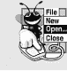

**总结列表（Summary Bullets）。** 我们为每章提供了一个逐节的符号列表总结。

**术语（Terminology）。** 我们包含了每章中定义的重要术语的字母顺序列表。

**自测练习题与答案（Self-Review Exercises and Answers）。** 包含了大量的用于自学的广泛自测练习题和答案。

## 学生资源与软件

练习（Exercises）。每个章节末尾都有额外的练习，包括：

- 对重要术语和概念的简单回忆
- 这段代码有什么问题？
- 这段代码的作用是什么？
- 编写单个学生的方法和类的小部分
- 编写完整的方法、类和程序
- 大型项目。

请勿向我们写请求访问 Pearson 教师资源中心，该中心包含书的教师补充材料，包括练习答案。访问权限严格限于使用本书进行教学的教师。教师仅可以通过其 Pearson 代表进行访问。我们不为“项目”类练习提供答案。请查看我们的编程项目中心以获取更多额外的练习和项目选择（`www.deitel.com/ProgrammingProjects/`）。

索引（Index）。我们包含了一个广泛的索引供参考。关键术语的定义处用粗体页码标出。

本书包含了 Microsoft® Visual Studio® 2010 Express 版 DVD，其中包含 Visual C# 2010 Express 版（以及其他 Microsoft 开发工具）。这些工具也可以从此处下载：

`www.microsoft.com/express/windows`

我们使用 Visual C# Express 版编写了《Visual C# 2010 How to Program》。你可以在 `msdn.microsoft.com/vcsharp` 了解更多关于 Visual C#。

## Deitel 在线资源中心

我们的网站 `www.deitel.com` 为我们读者感兴趣的各种主题提供了资源中心（`www.deitel.com/ResourceCenters.html`）。我们在网上发现了许多杰出的资源，包括教程、文档、软件下载、文章、博客、播客、视频、代码示例、电子书等——你在学习本书时可能会发现帮助的资源中心包括：Visual C#、ASP.NET、ASP.NET AJAX、LINQ、.NET、Silverlight、SQL Server、Web 服务、Windows Communication Foundation、Windows Presentation Foundation、Windows 7、UML、Code Engines and Code Sites、游戏编程和编程项目。

## 教师补充材料（Instructor Supplements）


合格的教师可以通过 Pearson 教师中心（`www.pearson.com/educator/`）获取以下补充材料：

- 包含章节末练习题的答案
- 多选题文件（每节约两题）
- 包含书中所有代码和图表的 PowerPoint 幻灯片

下载请访问 `www.pin5.com`

## xxiv 前言

如果你不是注册教员，请联系你的 Pearson 代表或访问 `www.pearsoned.com/`。

## 作者简介

位于北卡罗莱纳州格林斯斯堡的 Jeffrey P. Scott（Blackhawk Tactical College）、José Antonio González Scott（西班牙安达卢西亚议会）、Douglas B. Bock（MCSD.NET, 伊利诺伊州大学埃德华分校）、Dan Crevier（微软）、Amit K. Ghosh（德克萨斯大学埃帕索）、Marcelo Guerra Hahn（微软）、Kim Hamilton（微软软件工程师、《Learning UML 2.0》合著者）、James Edward Keysor（佛罗里达理工学院）、Helena Kots（微软）、Chris Lovett（微软软件架构师）、Bashar Luli（INETA 阿拉伯国家）、John Mclinhee（空间智能，微软 MVP 2008 开发者，Visual Basic）、Geed（Microsoft Visual Basic, DevCity.）、Anand Mukunda（Polaris Software Lab Ltd. 架构师）、Timothy Ng（微软）、Akira Onishi（微软）、Joe Stark（开发者与平台高级经理）、Erik Thompson（微软）以及 Jesús Ubaldo Quevedo-Torero（威斯康星大学帕基德分校，计算机科学系）

好了，这就是全部内容！Visual C# 2010 是一种强大的编程语言，将帮助你快速、高效地编写程序。它可以扩展到企业级系统开发领域，帮助组织构建其业务关键和任务关键型系统。在阅读此书时，我们欢迎您的意见、批评、纠正和改进建议。请将所有信函寄至：

```
deitel@deitel.com
```

我们会及时回复。我们希望你享受使用 Visual C# 2010 进行编程，就像我们享受编写它一样！

Paul Deitel 和 Harvey Deitel

2010年8月 马萨诸塞州梅纳纳德德

## 作者简介

Paul J. Deitel 是 Deitel & Associates, Inc. 的首席执行官兼首席技术官，毕业于麻省理工学院（MIT），在那里学习了信息技术。通过 Deitel & Associates, Inc.,他为行业客户提供了数百门 C#、Visual Basic、C++ 和互联网编程课程，包括 Cisco、IBM、Microsystems、Dell、Lucent Technologies、Fidelity、肯尼迪航天中心的 NASA、Severe Store Laboratory、白沙导弹发射场、Rogue Software、波音、高等教育、Strat、Cambridge Technology Partners、One Wave、Hyperion Software、Ad Systems、CableData Systems、Nortel Networks、Puma、iRobot、Invensys 等。他与合著者 Harvey M. Deitel 是全球畅销的编程语言书籍作者。

Harvey M. Deitel 是 Deitel & Associates, Inc. 的董事长兼战略官，在计算机领域拥有 49 年经验。Deitel 博士在 MIT 获得学士和硕士，在波士顿大学获得博士学位。他丰富的大学教学经验，在与儿子 Paul J. Deitel 创立 Deitel & Associates, Inc. 之前，曾在波士顿学院获得终身教授并担任计算机科学系主任。他与 Paul 是数十本书和 Live 多媒体包的合著者，并正在编写更多。Deitel 的著作已以日语、德语、俄语、中文、西班牙语、法语、波兰语、意大利语、葡萄牙语、希腊语、乌尔都语和土耳其语出版，获得了国际认可。各大公司、学术机构、政府组织和军队举办了数百场专业编程研讨会。

## 关于 Deitel & Associates, Inc.

Deitel & Associates, Inc. 是一家国际认可的计算机培训和授权机构，专注于计算机编程语言、互联网 Web 软件技术、对象技术教育以及 Android 和 iPhone® 应用开发。该公司在全球范围内的客户所在地提供由讲师引导的编程语言和平台课程，例如 C++、C#、Java™、Visual C++、Visual Basic®、XML®、Python®、对象技术、互联网和 Web 编程、Android 和 iPhone 应用开发以及不断增加的其他编程和软件开发课程。Deitel & Associates, Inc. 的创始人是 Paul J. Deitel 和 Harvey M. Deitel 博士。该公司的客户包括世界上许多大公司、政府机构、军事分支和学术机构。通过与 Prentice Hall/Pearson 达达 34 年的出版合作，Deitel & Associates, Inc. 出版了领先的编程教材、专业书籍、交互式多媒体课堂以及基于 DVD 和网络的 LiveLessons 视频课程。可以通过邮寄联系 Deitel & Associates, Inc. 及其作者：

```
deitel@deitel.com
```

欲了解更多关于 Deitel & Associates, Inc.、其出版物及其在全球范围内客户所在地提供的 Dive Into 系列企业培训课程，请访问：

```
www.deitel.com/training/
```

并通过以下地址订阅免费的 Deitel® Buzz 在线新闻邮件：

```
www.deitel.com/newsletter/subscribe.html
```

希望购买 Deitel 书籍、LiveLessons DVD 和网络培训课程的个人可以通过 `www.deitel.com` 进行。企业、政府、军队和学术机构的批量订单应直接向 Pearson 订购。欲了解更多信息，请访问

```
www.prenhall.com/mischtm/support.html#order
```

第 24–31 章和附录 D–G 是书籍附带网站（位于 `www.pearsonhighered.com/deitel/`）上发布的 PDF 文档。

## 前言 xvii

## 在开始之前 xxii

# I 计算机、互联网与 Visual C# 导论

- 1.1 引言 2
- 1.2 计算机结构 2
- 1.3 个人计算、分布式计算和客户端/服务器计算 4
- 1.4 硬件趋势 4
- 1.5 微软操作系统 4
- 1.6 机器语言、汇语言 4
- 1.7 Visual Basic 5
- 1.8 C++ 5
- 1.9 C# 6
- 1.10 互联网 6
- 1.11 可扩展标记语言 (XML) 7
- 1.12 .NET 7
- 1.13 .NET 运行时 8
- 1.14 测试驱动 9
- 1.15 对象技术 9
- 1.16 本节总结 10

# 2 深入 Visual C# 2010

- 2.1 引言 25
- 2.2 Visual Studio 2010 概述 25
- 2.3 菜单栏和工具栏 30
- 2.4 导航 Visual Studio 界面 32
  - 2.4.1 资源管理器 34
  - 2.4.2 工具箱 35
  - 2.4.3 属性窗口 36
- 2.5 使用帮助 37
- 2.6 使用 Visual Studio 创建简单程序 40
- 2.7 本节总结 51
- 2.8 网络资源 52

# 3 C# 导论

- 3.1 引言 61
- 3.2 一个简单的 C# ：显示文本 61
- 3.3 在 Visual C# 中创建应用程序 66
- 3.4 修改你的 C# 程序 74
- 3.5 使用 Console.Write 和 Console.WriteLine 格式化文本 76
- 3.6 另一个 C# 应用：整数加法 77
- 3.7 内存概念 81
- 3.8 算术 82
- 3.9 决策：相等和关系运算符 85
- 3.10 本节总结 90

# 4 类、对象、方法与字符串

- 4.1 引言 102
- 4.2 类、对象、属性和实例变量 102
- 4.3 带有方法的类声明和对象的实例化 103
- 4.4 带有参数的方法声明 107
- 4.5 实例变量和属性 111
- 4.6 带有属性的 UML 类图 115
- 4.7 软件工程中的属性 set 和 get 116
- 4.8 自动实现属性 117
- 4.9 值类型与引用类型 118
- 4.10 使用构造函数初始化对象 119
- 4.11 浮点数和 decimal 类型 122
- 4.12 本节总结 128

# 5 控制语句第一部分

- 5.1 引言 137
- 5.2 算法 137
- 5.3 伪代码 138
- 5.4 控制结构 138
- 5.5 if 单选择语句 140
- 5.6 if...else 双重选择语句 141
- 5.7 while 循环语句 146
- 5.8 制定算法：计数控制循环 147
- 5.9 制定算法：哨兵控制循环 152
- 5.10 制定算法：嵌套控制语句 160
- 5.11 复合赋值运算符 165
- 5.12 增量与减量运算符 165
- 5.13 简单类型 168
- 5.14 总结 169

# 6 控制语句：部分 2

- 6.1 引言 184
- 6.2 计数控制循环的要素 184
- 6.3 for 循环语句 186
- 6.4 for 语句的示例 190
- 6.5 do...while 循环语句 194
- 6.6 switch 多选择语句 196
- 6.7 break 和 continue 语句 203
- 6.8 逻辑运算符 205
- 6.9 结构化编程总结 211
- 6.10 总结 216

# 7 方法：深入探讨

- 7.1 引言 227
- 7.2 在 C# 中封装代码 227
- 7.3 static 方法、static 变量与类方法 229
- 7.4 声明带有多个参数的方法 232
- 7.5 声明和使用方法的注意事项 236
- 7.6 方法调用栈与激活记录 237
- 7.7 参数类型提升与类型转换 237
- 7.8 .NET 框架类库 239
- 7.9 案例研究：随机数生成 241
  - 7.9.1 随机数的缩放与位移 245
  - 7.9.2 用于测试和调试的随机数可重复性 245
- 7.10 案例研究：机会游戏（引入枚举） 246
- 7.11 声明范围 251
- 7.12 方法重载 253
- 7.13 可选参数 256
- 7.14 命名参数 257
- 7.15 递归 258
- 7.16 传递参数：值传递与引用传递 261
- 7.17 总结 264

# 8 数组

- 8.1 引言 281
- 8.2 数组 281
- 8.3 声明与创建数组 282
- 8.4 数组的示例 284
- 8.5 案例研究：洗牌与发牌模拟 293
- 8.6 foreach 语句 298
- 8.7 将数组和数组元素传递给方法 299
- 8.8 按值和按引用传递数组 301
- 8.9 案例研究：使用数组存储成绩的 ClassGradeBook（成绩簿） 305
- 8.10 多维数组 310
- 8.11 案例研究：使用矩形数组的 ClassGradeBook（成绩簿） 315
- 8.12 变长参数列表 321
- 8.13 使用命令行参数 322
- 8.14 总结 324

# 9 LINQ 简介与 List 集合

- 9.1 引言 345
- 9.2 使用 LINQ 查询 int 类型值数组 346
- 9.3 使用 LINQ 查询员工对象数组 350
- 9.4 集合简介 355
- 9.5 使用 LINQ 查询泛型集合 358
- 9.6 总结 360
- 9.7 Deitel LINQ 资源中心 360

# 10 类与对象：深入探讨

- 10.1 引言 365
- 10.2 Time 类案例研究 365
- 10.3 控制对成员的访问 369
- 10.4 使用 this 引用当前对象的成员 370
- 10.5 Time 类案例研究：重载构造函数 372
- 10.6 默认构造函数与无参数构造函数 378
- 10.7 组合 379
- 10.8 垃圾回收与析构函数 382
- 10.9 static 类成员 383
- 10.10 实例变量 386
- 10.11 数据抽象与封装 388
- 10.12 类视图与对象浏览器 389
- 10.13 对象初始化器 391
- 10.14 总结 391

# II 面向对象编程：继承

- 11.1 引言 399
- 11.2 基类与派生类 400
- 11.3 protected 成员 402
- 11.4 基类与派生类之间的关系 403
  - 11.4.1 创建和使用 CommissionEmployee（提佣金员工）类 403
  - 11.4.2 在不使用继承的情况下创建 BasePlusCommissionEmployee 类 408
  - 11.4.3 创建 CommissionEmployee--BasePlusCommissionEmployee 层次结构 414
  - 11.4.4 使用 protected 实例变量的 CommissionEmployee--BaseCommissionEmployee 继承层次结构
  - 11.4.5 使用 private 实例变量的 CommissionEmployee--BasePlusCommissionEmployee 继承
- 11.5 派生类中的构造函数
- 11.6 继承的软件工程
- 11.7 类
- 11.8 总结

# 12 OOP：多态、接口与运算符重载

- 12.1 引言
- 12.2 多态
- 12.3 多态行为
- 12.4 抽象类与方法
- 12.5 案例研究：工资发放系统
  - 12.5.1 创建抽象基类
  - 12.5.2 创建 SalaryEmployee（工资员工）
  - 12.5.3 创建 HourlyEmployee（小时工员工）
  - 12.5.4 创建 CommissionEmployee（提佣金员工）
  - 12.5.5 创建间接派生类
  - 12.5.6 多态处理、向下转换
  - 12.5.7 基-派生变量之间允许的赋值
- 12.6 sealed 方法与类
- 12.7 案例研究：创建接口
  - 12.7.1 开发接口层次结构
  - 12.7.2 声明接口
  - 12.7.3 创建接口
  - 12.7.4 实现接口的 Employee
  - 12.7.5 多态地修改 SalaryEmployee
  - 12.7.6 .NET 框架常用接口
- 12.8 运算符重载
- 12.9 总结

# 13 异常处理：深入探讨

- 13.1 引言
- 13.2 示例：除零异常
- 13.3 示例：处理除零与格式异常
  - 13.3.1 在 try 块中封装代码
  - 13.3.2 捕获异常
  - 13.3.3 未捕获的异常
  - 13.3.4 异常处理模型
  - 13.3.5 发生异常时的控制流
- 13.4 .NET 异常层次结构
  - 13.4.1 SystemException（系统异常类）
  - 13.4.2 确定抛出异常的方法
- 13.5 finally 块
- 13.6 using 语句
- 13.7 异常属性
- 13.8 用户自定义异常类
- 13.9 总结

# 14 使用 Windows Forms 的图形用户界面：部分 1

- 14.1 引言 511
- 14.2 Windows Forms 512
- 14.3 事件处理 514
  - 14.3.1 简单的事件驱动 GUI 514
  - 14.3.2 Visual Studio 生成的代码 516
  - 14.3.3 委托与事件处理机制 518
  - 14.3.4 创建 EventHandler 的另一种方法 519
  - 14.3.5 定事件信息 519
- 14.4 控件属性与布局 521
- 14.5 Labels（标签）、TextBox（文本框）与 Buttons（按钮） 525
- 14.6 GroupBoxes（分组框）与 Panels（面板） 528
- 14.7 CheckBoxes（复选框）与 RadioButtons（单选按钮） 531
- 14.8 PictureBoxes（图片框） 539
- 14.9 ToolTips（工具提示） 541
- 14.10 NumericUpDown（数值调节器）控件 543
- 14.11 鼠标事件处理 545
- 14.12 键盘事件处理 548
- 14.13 总结 551

# 15 使用 Windows Forms 的图形用户界面：部分 2

- 15.1 引言 562
- 15.2 Menus（菜单） 562
- 15.3 MonthCalendar（日历）控件 571
- 15.4 DateTimePicker（日期/时间选择器）控件 572
- 15.5 Label（标签）控件 575
- 15.6 ListBox（列表框）控件 579
- 15.7 CheckedListBox（已选列表框）控件 583
- 15.8 ComboBox（组合框）控件 586
- 15.9 Tree（树）控件 590
- 15.10 ListView（列表视图）控件 595
- 15.11 TabControl（选项卡）控件 601
- 15.12 多文档界面 (MDI) 窗口 606
- 15.13 可视继承 613
- 15.14 用户自定义控件 618
- 15.15 总结 622

# 16 字符串与字符

- 16.1 引言 631


- 16.2 字符与字符串的基础知识 632
- 16.3 `string` 构造函数 633
- 16.4 `string` 索引器、`Length` 属性与 `CopyTo` 方法 634
- 16.5 比较字符串 635
- 16.6 在字符串中定位字符和子字符串 638
- 16.7 从字符串中提取子字符串 641
- 16.8 拼接字符串 642
- 16.9 杂 `string` 方法 643
- 16.10 `StringBuilder` 644
- 16.11 `StringBuilder` 的 `Length` 和 `Capacity` 属性、`EnsureCapacity` 方法与索引器 645
- 16.12 `StringBuilder` 的 `Append` 和 `AppendFormat` 方法 647
- 16.13 `StringBuilder` 的 `Insert`、`Remove` 和 `Replace` 方法 649
- 16.14 `Char` 方法 652
- 16.15 (在线) 正则简介 654
- 16.16 总结 655

# 17 文件与流 661

- 17.1 引言 662
- 17.2 数据层次结构 662
- 17.3 文件与流 664
- 17.4 `File` 与 `Directory` 类 665
- 17.5 创建顺序访问文本文件 674
- 17.6 从顺序访问文本文件读取数据 683
- 17.7 案例研究：信用查询程序 687
- 17.8 序列化 693
- 17.9 使用对象序列化创建顺序访问文件 694
- 17.10 从二进制文件读取并反序列化数据 698
- 17.11 总结 700

# 18 数据库与 LINQ 707

- 18.1 引言 708
- 18.2 关系型数据库 709
- 18.3 图籍数据库 710
- 18.4 LINQ to SQL 713

下载请访问 www.pin5.com

## 使用 LINQ 查询数据库

- 18.5.1 创建 LINQ to SQL 类
- 18.5.2 控件与 LINQ to SQL 类之间的数据绑定
- 动态绑定查询结果
- 18.6.1 创建显示查询结果的 GUI
- 18.6.2 编写显示查询结果的应用程序
- 使用 LINQ 从多个表中检索数据
- 18.7 创建主/从视图应用程序
- 18.8.1 创建主/从视图 GUI
- 18.8.2 编写主/从视图应用程序
- 18.9 通讯录案例研究
- 18.9.1 创建通讯录应用的 GUI
- 18.9.2 编写通讯录
- 18.10 工具与 Web 资源
- 18.11 总结

## 19 使用 ASP.NET 开发 Web 应用

- 19.1 引言
- 19.2 Web 基础
- 19.3 多层架构
- 19.4 你的第一个 Web 应用程序
- 19.4.1 构建 WebTime 应用程序
- 19.4.2 查看 Webtime.aspx 的后台代码文件
- 19.5 标准 Web 控件：设计表单
- 19.6 验证控件
- 19.7 会话跟踪
- 19.7.1 Cookies
- 19.7.2 使用 `HttpSessionState` 进行会话跟踪
- 19.7.3 Options.aspx：选择编程语言
- 19.7.4 Recommendations.aspx：基于 Session 值的推荐功能实现
- 19.8 案例研究：基于数据库驱动的 ASP.NET 留言板
- 19.8.1 构建一个显示数据库数据的 Web 表单
- 19.8.2 修改留言板应用程序的后台代码
- 19.9 在线案例研究：ASP.NET AJAX
- 19.10 案例研究：密码保护的书籍应用程序
- 19.11 总结

## 20 搜索与排序

- 20.1 引言
- 20.2 搜索算法
- 20.2.1 线性搜索
- 20.2.2 二分搜索
- 20.3 排序算法
- 20.3.1 冒泡排序
- 20.3.2 插入排序 814
- 20.3.3 合并排序 818
- 20.4 搜索与排序算法的效率总结 824
- 20.5 总结 824

## 21 数据结构 830

- 21.1 引言 831
- 21.2 简单类型结构体 (`struct`)、装箱与拆箱 831
- 21.3 自引用类 832
- 21.4 链表 833
- 21.5 栈 846
- 21.6 队列 850
- 21.7 树 853
- 21.7.1 整数值的二分搜索树 854
- 21.7.2 `IComparable` 对象的二分搜索树 861
- 21.8 总结 866

## 22 泛型 873

- 22.1 引言 874
- 22.2 泛型方法的动机 875
- 22.3 泛型方法的实现 877
- 22.4 类型约束 880
- 22.5 泛载泛型方法 882
- 22.6 泛型类 883
- 22.7 总结 892

## 23 集合 898

- 23.1 引言 899
- 23.2 集合概览 899
- 23.3 类数组与枚举器 902
- 23.4 非泛型集合 905
- 23.4.1 类 `ArrayList` 905
- 23.4.2 类 `Stack` 909
- 23.4.3 类 `Hashtable` 912
- 23.5 泛型集合 917
- 23.5.1 泛型 `SortedDictionary` 917
- 23.5.2 泛型 `LinkedList` `LinkedList` 919
- 23.6 泛型类型的协变与逆协变 923
- 23.7 总结 925

## Web 章节 932

## A 运算符优先级图 933

## B 简单类型 935

## C ASCII 字符集 937

## Web 附录 938

## 索引 939

第 24–31 章以及附录 D–G 是发布在书籍配套网站（位于 `www.pearsonhighered.com/deitel/`）上的 PDF 文档。

## 24 使用 Windows Presentation Foundation 的 GUI

## 25 WPF 图形与多媒体

## 26 XML 和 LINQ to XML

## 27 使用 ASP.NET 开发 Web 应用：深入探讨

## 28 Windows Communication Foundation (WCF) Web 服务

## 29 Silverlight 和富交互式应用程序

## 30 ATM 案例研究，第 1 部分：使用 UML 进行面向对象设计

## 31 ATM 案例研究，第 2 部分：实现面向对象设计

## D 数字系统

## E UML 2：额外的图类型

## F Unicode®

## G 使用 Visual C# 2010 调试器

# 计算机、互联网与 Visual C# 简介

> 语言最大的优点在于清晰。
>
> — 盖伦 (Galen)
>
> 我们的生活被细节所耗尽……简化，再简化。
>
> — 亨利·大卫·梭罗 (Henry David Thoreau)
>
> 人仍然是所有计算机中最不起的。
>
> — 约翰·肯尼迪 (John F. Kennedy)

## 目标

在本章中，你将学习：

- 基础硬件和软件概念。
- 不同类型的编程语言。
- Visual C# 编程语言的历史。
- 对象技术的基本知识。
- 互联网和万维网的历史。
- 关于微软的 .NET 计划，该计划在开发和使用软件系统时涉及互联网。
- 测试一个 Visual C# 2010 绘图应用程序。


# 计算机、互联网与 Visual C# 简介

## 练习与答案

### 1.1 填空以下陈述：

- a) 计算机可以直接理解 `机器` 语言。
- b) 高级语言通常是 `机器依赖` 的。
- c) 机器语言程序在计算机上运行之前需要 `翻译`。
- d) C# 编译器将高级语言程序翻译成 `机器` 语言。
- e) Visual Studio 是一种 `集成开发` 环境。
- f) Visual Basic 是一种 `事件` 驱动语言。
- g) C# 是专门为 `Windows` 创建的语言。
- h) .NET 是通过 `Web` 共享信息的。
- i) `这种语言` 执行了 .NET 程序。
- j) `属性` 用于描述对象的。
- k) `这种` 是面向对象的。
- l) `软件`

### 1.2 判断以下陈述正确或错误：

- a) 汇编器将源语言程序转换为机器语言程序。
- b) 高级语言通常是机器依赖的。
- c) 机器语言程序在计算机上运行之前需要翻译。
- d) C# 编译器将高级语言程序翻译成 MSIL。
- e) C# 是面向对象的语言。
- f) .NET 框架是跨平台的。

**答案：**

- a) 正确
- b) 错误。高级语言必须编译成机器依赖的语言才能执行。这使得高级语言可以在带有编译器的计算机上使用。
- c) 错误。机器语言程序是特定机器的。
- d) 错误。C# 编译器将高级语言程序翻译成 MSIL（中间语言）。
- e) 正确。
- f) 正确。

### 1.3 将下列项目归类为硬件或软件：

- a) CPU。
- b) 编译器。
- c) 输入单元。
- d) 文字处理程序。
- e) Visual Basic 程序。

**答案：**

- a) 硬件
- b) 软件
- c) 硬件
- d) 软件
- e) 软件

### 1.4 翻译程序（如汇编器和编译器）将程序从一种语言（称为源语言）转换为另一种语言（称为目标语言）。确定下列陈述的真伪性：

- a) 汇编器将源语言程序转换为机器语言程序。
- b) 高级语言是机器机器的。
- c) 机器语言程序在计算机上运行之前需要翻译。
- d) C# 编译器将高级语言程序翻译成机器语言。

**答案：**

- a) 正确
- b) 错误。高级语言必须编译成机器依赖的语言才能执行。这使得高级语言可以在带有编译器的计算机上使用。
- c) 错误。机器语言程序是特定机器的。
- d) 错误。C# 编译器将高级语言程序翻译成 MSIL（中间语言）。

### 1.5 展开每个缩写词的全称：

- a) W3C。
- b) XML。
- c) OOP。
- d) CLR。
- e) CLI。
- f) MSIL。
- g) UML。
- h) IDE

**答案：**

- a) World Wide Consortium
- b) Extensible Markup Language
- c) Object-Oriented Programming
- d) Common Language Runtime
- e) Common Language Infrastructure
- f) Microsoft Intermediate Language
- g) Unified Modeling Language
- h) Integrated Development Environment

### 1.6 .NET 框架和 CLR 的主要优势是什么？缺点是什么？

**答：** 主要优势是跨操作系统的移植性以及语言之间的互操作性。只要某个平台存在 CLR，它就可以运行任何 .NET 程序。程序员专注于编程语言，而不是特定于平台的细节。因此，双重编译（代码到 MSIL，以及 MSIL 到机器码）允许平台独立性：程序可以在任何地方编写和执行。支持 CLR 的平台——这被称为平台独立性。代码无需修改即可轻松地在其他机器上运行，节省了时间和金钱。.NET 框架的第二个优势是语言的互操作性——用不同语言编写的软件组件可以相互交互（语言独立性）。这些特性相关的缺点是，在为该平台开发 .NET Framework 之前，.NET 程序无法运行。另一个缺点是在执行 .NET 程序之前需要双重编译的开销。

### 1.7 使用面向对象技术有什么优势？

**答：** 使用面向对象编程技术更容易理解、纠正和修改。使用面向对象编程的关键优势在于它倾向于产生更易于理解的软件，因为与早期的方法相比，它的组织更好，维护需求更少。OOP 帮助程序员通过重用现实世界中的代码来构建应用程序。OOP 还帮助程序员创建可以供未来开发项目重用的新软件组件。快速、正确且经济地构建软件一直是软件行业中一个难以实现的目标。事实证明，模块化的面向对象的设计和实现方法可以提高生产率，同时减少开发时间、错误率和成本。

### 1.8 你手腕上可能戴着世界上最常见的对象之一——手表。

**答：** 整个块手表是由许多其他对象组成的（运动零件、表带、表盘等）。手表的属性有时间、颜色、表带样式、技术（数字或模拟）等。手表的行为包括设置时间和获取时间。手表可以被看作特定类型的时钟（如闹钟）。

### 1.9 将 Visual Basic 开发为 BASIC 编程语言特殊版本的关键原因是什么？

**答：** 为了开发可以在 Microsoft Windows 操作系统上运行的应用程序。

### 1.10 UML 的核心成就是什么？

**答：** 它将许多不同的图形建模语言替换为单一的（统一）语言，无论开发者使用何种不同的 OOAD 过程，都可以使用这种语言。

### 1.11 早期互联网的收益证明了什么？

**答：** 电子邮件通信。今天，通信还通过即时消息和文件传输等应用得到便利。

### 1.12 网页的核心能力是什么？

**答：** 它允许计算机用户在互联网上查找和查看几乎任何主题的基于媒体的文件。

### 1.13 微软 .NET 倡议的核心愿景是什么？

**答：** 在软件的开发和使用拥抱互联网和 Web。

## 改变世界练习 5

### 1.14 .NET Framework 类库如何促进 .NET 应用程序的开发？

**答：** 首先，框架类库是一个包含重用类的大库，缩短了开发时间。程序员可以通过重用框架的类来快速构建软件，而不是从“零开始”构建新类。其次，框架类库由所有 .NET 语言共享，这意味着工作于多种语言的程序员只需要学习一个类。

### 1.15 标准化 .NET 的 CLI（通用语言体系）的关键优势是什么？

**答：** 标准化使得为 Microsoft Windows 之外的其他平台创建 .NET Framework 变得更容易。这鼓励了 .NET 的传播，使现有的 .NET 应用程序能够在更多类型的系统上运行。

### 1.16 除了 OOP 带来的显而易见的重用优势外，许多机构报告 OOP 的另一个关键优势是什么？

**答：** OOP 产生的软件更易于理解、组织更好，并且更容易维护、修改和调试。

### 1.17 为什么 XML 对未来软件系统的开发至关重要？

**答：** XML 可能会成为数据表示的通用技术。

## 改变世界练习

### 1.18 (测试驱动：碳足迹计算器)

一些科学家认为，碳排放，特别是化石燃料的燃烧对全球变暖有显著贡献，如果个人采取措施限制对碳基燃料的使用，这种现象就可以缓解。机构和个人日益关注他们的“碳足迹”。像 TerraPass 和 Carbon Footprint 等网站：

- `www.terrapass.com/carbon-footprint-calculator/`
- `www.carbonfootprint.com/calculator.aspx`

提供了碳足迹计算器。这些驱动可以确定你的碳足迹。后续章节中的练习将帮助你编写自己的碳足迹计算器。为了准备这一工作，请使用网络研究碳足迹的公式。

### 1.19 (测试驱动：体重指数计算器)

根据最近估计，美国每两人中就一人重，其中一半的人肥胖。这导致了糖尿病和心脏病等疾病的增加。要确定一个人是否肥胖，你可以测量体重指数 (BMI)。美国健康与人类服务部在 `www.nihsupport.com/bmi/` 提供了一个计算器。使用它来计算你的 BMI。接下来的练习将要求你编写自己的 BMI 计算器。为了准备这一工作，请使用网络研究计算 BMI 的公式。

### 1.20 (混合动力汽车的属性)

在这一章中你学习了一些类的基础知识。现在你将“充实”名为“混合动力汽车”的类的方面。混合动力汽车变得越来越流行，因为它们比纯汽油汽车更省油。浏览网络并研究今天四五种热门混合动力汽车的特征，然后列出它们的许多相关属性。一些常见属性包括城市每加仑里程和公路每加仑里程。还要列出电池的属性（类型、重量等）。

**答：**

- 制造商
- 混合动力类型——电池混合（混合动力）、插电式混合动力、燃料电池

### 1.21 (性别中立)

许多人想要消除所有形式通信中的性别歧视。你被要求创建一个程序，可以解析段落并将性别特定单词替换为性别中立的替换词。假设你已经了一个性别特定单词列表和相应的性别中立替换词（例如，将“wife”替换为“spouse”，“man”替换为“person”，“daughter”替换为“child”等），请解释你用于读取文本段落并手动执行这些替换的过程。你的过程可能会生成像“woperchild”这样的奇怪术语吗？在第 5 章中，你将学习“过程”的更正式术语是“算法”，算法规定了要执行的步骤以及执行顺序。

# 深入® Visual C# 2010 Express

# 2

> 眼见为实。
>
> — 谚言
>
> 形式追随功能。
>
> — 路易斯·亨利·苏利文
>
> 智能……是制造人工物品的能力，特别是制造工具的工具的能力。
>
> — 亨利·伯格森

## 目标

在本章中，你将学习：

- Visual Studio 集成开发环境 (IDE) 的基础，它可以帮助你编写、运行和调试你的 Visual Basic 程序。


- Visual Studio 的帮助功能。
- IDE 菜单和工具栏中包含的关键命令。
- Visual Studio 2008 IDE 中各种窗口的用途。
- 什么是视觉化编程以及它是如何简化和加速程序开发的。
- 使用 Visual Studio IDE 和视觉化编程技术，创建、编译并执行一个显示文本和图像的简单 Visual Basic 程序。


## 第 2 章 深入® Visual C# 2010 Express

## 自测练习

### 2.1 填充每个陈述中的空白：

- a) \_\_\_\_\_\_ 技术允许你不编写任何代码即可创建 GUI。答案：视觉化编程。
- b) \_\_\_\_\_\_ 是一个或多个项目共同组成的 Visual Basic 程序。答案：解决方案。
- c) 当鼠标指针移动到窗口区域时，\_\_\_\_\_\_ 会隐藏窗口。答案：自动隐藏。
- d) 当鼠标指针悬停在图标上时，会出现\_\_\_\_\_\_。答案：解决方案管理器。
- e) \_\_\_\_\_\_ 允许你浏览文件。
- f) **属性**窗口中的属性可以按字母顺序或\_\_\_\_\_\_ 排序。答案：按分类。
- g) Form \_\_\_\_\_\_ 属性指定标题栏中显示的文本。答案：Text。
- h) \_\_\_\_\_\_ 允许你以视觉化的方式将控件添加到 Form 中。答案：工具箱。
- i) 使用\_\_\_\_\_\_ 根据当前上下文显示帮助。答案：上下文帮助。
- j) \_\_\_\_\_\_ 属性指定文本与 Label 边界的对齐方式。答案：TextAlign。

### 2.2 判断每个陈述的对错。如果错误，请解释原因。

- a) 标题栏显示 IDE 的模式。答案：正确。
- b) \_\_\_\_\_\_ 框切换自动隐藏。答案：错误。X 框关闭窗口。
- c) 工具栏表示各种命令。答案：正确。
- d) 工具栏包含可以拖入 Form 的图标。答案：错误。`工具箱`包含此类控件的图标。
- e) Form 和 Label 都有标题栏（尽管 Label 有文本）。答案：错误。Form 有标题栏，但 Label 没有。
- f) 控件属性只能通过编写代码修改。答案：错误。控件属性可以使用`属性`窗口设置。
- g) 图片框显示图像。答案：正确。
- i) C# 文件使用扩展名 .cs。答案：错误。C# 文件使用 .cs。
- i) Form 的背景颜色使用 BackColor 属性设置。答案：正确。

## 练习

### 2.3 填充每个陈述中的空白：

- a) 点击省略号时，显示 (\_\_\_\_\_\_)。答案：对话框。对话框是用于与计算机通信的窗口。
- b) 要保存解决方案中的每个文件，点击\_\_\_\_\_\_\_\_\_\_。答案：文件 > 保存所有。
- c) 使用\_\_\_\_\_\_ 帮助立即显示相关文章。答案：上下文帮助。
- d) "GUI" 是\_\_\_\_\_\_\_\_\_\_ 的缩写。答案：图形用户界面。

### 2.4 判断下列对错。如果错误，请解释原因。

- a) 通过点击工具箱中的图标将控件添加到 Form。答案：正确。
- b) Form、Label1 和PictureBox 有相同的属性。答案：每种控件都有不同的属性集，尽管控件可能有共同属性。
- c) 如果你的机器连接到互联网，可以从 Visual Studio IDE 浏览互联网。答案：正确。
- d) C 程序员不编写任何代码使用复杂程序。答案：错误。C 编程涉及编写部分代码并让 Visual Studio 生成剩余代码。
- e) 句柄在执行期间可见。

### 2.5 Visual Studio 周围的一些功能在不同上下文中执行相似的操作。请解释省略号、下箭头按钮和工具提示是如何这样工作的。你为什么认为 Visual Studio IDE 是这样设计的？

答案：省略号按钮表示点击时将显示对话框。下箭头按钮表示工具栏图标和属性窗口中的项目都有更多选项。将鼠标指针移动到大多数图标上会显示图标名称作为工具提示。这些功能使得 Visual Studio IDE 更容易学习和使用。

### 2.6 填充每个陈述中的空白：

- a) \_\_\_\_\_\_\_\_\_\_\_ 属性指定显示哪个 PictureBox。
- b) \_\_\_\_\_\_\_\_\_\_\_ 包含窗口。答案：窗口。

### 2.7 简述以下每一项：

- a) 工具栏 答案：工具栏包含图标。
- b) 菜单栏 答案：菜单栏包含菜单。
- c) 工具箱 答案：工具箱包含控件。
- d) 控件 答案：控件是一个组件，例如图片框。
- e) Form 答案：Form 代表应用程序。

## 第 2 章 深入® Visual C# 2010 Express

### 2.8 (记事本 GUI) 创建如图 2.48 所示的 GUI。

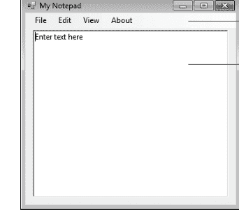

图 48 | 记事本 GUI

- a) 操作 Form 的属性。将 Form 的 `Text` 属性更改为 "My Notepad"。将字体属性更改为 9pt Segoe UI。
- b) 向 Form 中添加 MenuStrip。向 Form 中添加一个 MenuStrip。插入 MenuStrip 后，点击“在此处输入”，输入菜单名称（例如：文件、编辑、视图）然后按回车添加项。
- c) 插入 MenuStrip 后，点击“在此处输入”，输入菜单名称（例如：文件、编辑、视图）然后按回车添加项。
- d) 向 Form 中添加 RichTextBox。添加一个 RichTextBox 控件。将此控件拖入 Form。使用调整句柄调整 RichTextBox 的位置，如图 2.48 所示。

### 2.9 (日历和预约 GUI) 创建如图 2.49 所示的日历 GUI。

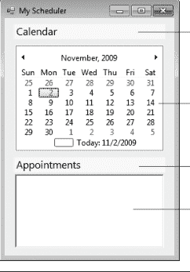

图 49 | 日历和预约 GUI

- a) 操作 Form 的属性。将 Form 的 `Text` 属性更改为 "My Scheduler"。将字体属性更改为 9pt Segoe UI。
- b) 向 Form 中添加 Label。向 Form 添加两个 Label。两个 Label的大小应相同（231; 23）；记得将 `AutoSize` 属性设置为 False 并在 Form 中水平居中，所示。根据图 2.49 设置 Label 属性。使用 12 点字号。此外，将 `BackColor` 属性设置为黄色。
- c) 向 Form 中添加 MonthCalendar。将此控件添加到 Form，并在两个 Label 之间的适当位置居中。
- d) 向 Form 中添加 RichTextBox 控件。向 Form 添加一个 RichTextBox 控件，并在第二个 Label 下方居中。相应调整 RichTextBox 的大小。

### 2.10 (计算器 GUI) 创建如图 2.50 所示的计算器 GUI。

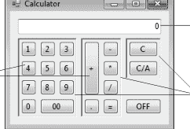

图 50 | 计算器 GUI

- a) 操作 Form 的属性。将 Form 的 `Text` 属性更改为 "Calculator"。将字体属性更改为 9pt Segoe UI。将 Form 的 `Size` 属性更改为 258, 210。

下载访问 www.pin5i.com

# 第 2 章 深入学习 Visual C# 2010 Express

- b) 在表单上添加一个 TextBox（文本框）。在属性窗口中将 TextBox 的属性设置为 0。拉伸 TextBox 并按照图 25 所示的位置进行放置。将 `TextAlign` 属性设置为 `right`——这将使 TextBox 中显示的文本右对齐。
- c) 在表单上添加第一个 Panel（面板）。Panel 控件用于分组其他控件。在表单上添加一个 Panel。将 Panel 的 `BorderStyle` 属性改为 `Fixed3D`，使 Panel 的边缘呈现凹陷效果。将 `Size` 属性设置为 90, 120。此 Panel 将包含计算器的数字按键。
- d) 在表单上添加第二个 Panel。将 Panel 的 `BorderStyle` 改为 `Fixed3D`。将 `Size` 属性设置为 62, 120。此 Panel 将包含计算器的运算符按键。
- e) 在表单上添加第三个（也是最后一个）Panel。将 Panel 的 `BorderStyle` 属性改为 `Fixed3D`。将 `Size` 属性设置为 54, 62。此 Panel 包含计算器的 C（清除）和 C/A（全部清除）键。
- f) 在表单上添加 Button（按钮）。计算器上有 20 个按钮。通过拖拽并释放到 Panel 上向 Panel 添加一个按钮。将每个按钮的 `Text` 属性更改为其代表的计算器数字。你在 `Text` 属性中输入的值将显示在按钮上。最后，调整它们的 `Size` 属性。每个标记为 0-9、*、/、-、 = 的按钮大小应为 23, 23。00 按钮大小为 52, 23。OFF 按钮大小为 54。+ 按钮大小为 25, 64。C（清除）和 C/A（全部清除）按钮大小为 44, 23。

### 2.11 (闹钟 GUI) 按照图 25.51 所示创建闹钟的 GUI。

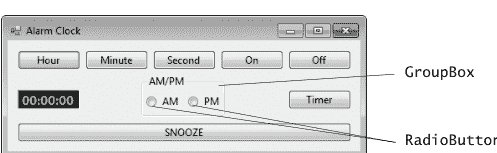

图 25.51 | 闹钟 GUI。

- a) 操作表单属性。将表单的 `Text` 属性更改为 Alarm Clock。将 `Font` 属性设置为 `9pt Segoe UI`。将表单的 `Size` 属性设置为 438, 170。
- b) 在表单上添加按钮。在表单上添加六个按钮。将每个按钮的 `Text` 属性更改为相应的文本。如图所示对齐按钮：
- c) 在表单上添加一个 GroupBox（分组框）。GroupBox 类似于 Panel，区别在于 GroupBox 会显示标题栏。将 `Text` 属性更改为 AM/PM，并将 `Size` 属性设置为 100, 50。在表单上水平居中 GroupBox。
- d) 在表单上添加 AM/PM RadioButtons（单选按钮）。为 AM 放置两个按钮，为 PM 放置另一个。如图所示对齐 RadioButtons。
- e) 在表单上添加时间 Label（标签）。在表单上添加一个 Label，并将其 `Text` 属性更改为 00:00:00。将 `BorderStyle` 属性设置为 `Fixed3D` 并将 `BackColor` 设置为黑色。使用 `Font` 属性使字体加粗并设为 12pt。将 `ForeColor` 设置为银色（位于 Web 选项卡中），使时间在黑色背景下脱颖而出。如图所示放置 Label。

### 2.12 (收音机 GUI) 按照图 2.52 所示创建收音机的 GUI。[注：本练习中使用的图像位于第 2 章的示例文件夹中。]


图 2.52 | 收音机 GUI。

- a) 操作表单属性。将 `Font` 属性设置为 `9pt Segoe UI`。将表单的 `Text` 属性更改为 Radio，并将 `Size` 设置为 427, 194。
- b) 添加预设电台 GroupBox 和按钮。将 GroupBox 的 `Size` 设置为 180, 55，并将 `Text` 设置为 Pre-set Stations。在 GroupBox 中添加六个按钮。将每个按钮的 `Size` 设置为 23, 23。分别将按钮的 `Text` 属性更改为 1, 2, 3, 4, 5, 6。
- c) 添加扬声器 GroupBox 和 Check（复选框）。将 GroupBox 的 `Size` 设置为 120, 55，并将 `Text` 设置为 Speakers。在 GroupBox 中添加两个 CheckBoxes。将 CheckBoxes 的 `Text` 属性设置为 Rear 和 Front。
- d) 添加电源开关按钮。在表单上添加一个按钮。将其 `Text` 设置为 Power On/Off，并将 `Size` 设置为 75, 5。
- e) 添加音量控制 GroupBox、静音 CheckBox 和音量 TrackBar。在表单上添加一个 GroupBox。将其 `Text` 设置为 Volume Control，并将 `Size` 设置为 180, 70。在 GroupBox 中添加一个 CheckBox。将其 `Text` 设置为 Mute。在 GroupBox 中添加一个 TrackBar。
- f) 添加调谐频率组、收音机 Label 和 AM/FM RadioButtons。在表单上添加一个 GroupBox。将其 `Text` 设置为 Tuning，并将 `Size` 设置为 120, 70。在 GroupBox 中添加一个 Label。将其 `AutoSize` 设置为 `False`，`Size` 设置为 50, 44，将 `BackColor` 设置为黑色，`ForeColor` 设置为银色，字体设为 12pt，并将 `TextAlign` 设置为 `Middle`。
- g) 添加 PictureBox。在表单上添加一个 PictureBox。将其 `BorderStyle` 设置为 `Fixed3D`，`Size` 设置为 54, 70，并将 `SizeMode` 设置为 Stretch。

# 第 3 章 C# 应用程序简介

## 目标

在本章中你将学习：

- 编写简单的应用程序
- 从键盘输入数据并输出到屏幕
- 声明各种类型
- 使用运算符

## 自测

### 3.1 填空题：

- a) `{ }` 开始代码体。
- b) `{ }` 结束代码体。
- c) `{ }` 用于决策。
- d) `{ }` 是单行注释。
- e) `{ }` 是字符。
- f) `{ }` 是方法。
- g) `{ }` 消息。

### 3.2 判断下列陈述对错并说明原因：

- a) 注释与执行无关。
- b) 注释不记录代码。
- c) C# 是大小敏感的。
- d) 取模运算符仅用于整数。
- e) 运算符 `*`, `/` 具有相同的优先级。
- f) 运算符是不同的。

### 3.3 编写语句完成：

- a) 说明应用程序将计算三个数字的乘积。
- b) 声明变量 x, y, z 为 `int`。
- c) 提示用户输入第一个整数。
- d) 从用户读取第一个整数并存储在变量 x 中。
- e) 提示用户输入第二个整数。
- f) 从用户读取第二个整数并存储在变量 y 中。
- g) 提示用户输入第三个整数。
- h) 从用户读取第三个整数并存储在变量 z 中。
- i) 计算 x, y, z 三个数字的乘积并将赋值给 result。
- j) 显示消息“Product is”以及变量 result 的值。

### 3.4 识别并纠正下列错误：

- a) `if (c < 7); Console.WriteLine("c is less than 7");`
  - 错误：在条件 `(c < 7)` 的右括号后有分号。修正：删除右括号后的分号。
- b) `if (c => 7) Console.WriteLine("c is greater than");`
  - 错误：关系运算符 `=>` 是错误的。修正：改为 `>=`。

### 3.5 编写声明、语句或注释来实现：

- a) 说明应用程序将计算三个数字的乘积。
  ```
  // 计算三个数字的乘积
  ```
- b) 声明变量 x, y, z 为 `int` 类型。
  ```
  int x, y, z, result;
  ```
  或
  ```
  int x;
  int y;
  int z;
  result;
  ```
- c) 提示用户输入第一个整数。
  ```
  Console.Write("Enter first integer: ");
  ```
- d) 从用户读取第一个整数并存储在变量 x 中。
  ```
  x = Console.ToInt32(Console.ReadLine());
  ```
- e) 提示用户输入第二个整数。
  ```
  Console.Write("Enter second integer: ");
  ```
- f) 从用户读取第二个整数并存储在变量 y 中。
  ```
  y = Console.ToInt32(Console.ReadLine());
  ```
- g) 提示用户输入第三个整数。
  ```
  Console.Write("Enter third integer: ");
  ```
- h) 从用户读取第三个整数并存储在变量 z 中。
  ```
  z = Console.ToInt32(Console.ReadLine());
  ```
- i) 计算 x, y, z 三个数字的乘积并将结果赋值给 result。
  ```
  result = x * y * z;
  ```
- j) 显示消息“Product is”以及变量 result 的值。
  ```
  Console.WriteLine("Product is {0}", result);
  ```

## 第 3 章 C# 介绍

### 3.6 使用你在练习 3.5 中编写的语句，编写一个完整的应用程序，计算并显示三个整数的乘积。

答案：


# 第 3 章 C# 应用程序介绍

## 练习 3.6：Product.cs

```cs
// Exercise 3.6: Product.cs
// 计算三个整数的乘积。
using System;

public class Product
{
    public static void Main(string[] args)
    {
        int x; // 存储用户输入的第一个数字
        int y; // 存储用户输入的第二个数字
        int z; // 存储用户输入的第三个数字
        int result; // 数字的乘积

        Console.Write("Enter integer: "); // 提示输入
        x = Convert.ToInt32(Console.ReadLine()); // 读取第一个整数

        Console.Write("Enter second integer: "); // 提示输入
        y = Convert.ToInt32(Console.ReadLine()); // 读取第二个整数

        Console.Write("Enter third integer: "); // 提示输入
        z = Convert.ToInt32(Console.ReadLine()); // 读取第三个整数

        result = x * y * z; // 计算数字的乘积

        Console.WriteLine("Product is {0}", result);
    } // end Main
} // end class Product
```

**输出示例：**

```text
Enter first integer: 10
Enter second integer: 20
Enter third integer: 30
Product is 6000
```

## 练习 3.7 填空题

a) _________ 用于文档化应用程序并提高其可读性。  
**答案：** `注释` (Comments)。

b) C# 应用程序可以通过 _________ 决策。  
**答案：** `if 语句`。

c) 计算通常由 _________ 语句执行。  
**答案：** `赋值` (assignment)。

d) 与乘法优先级相同的算术运算符是 _________ 和 _________。  
**答案：** `除法` (/)、`取余` (%)。

e) 当算术表达式中的括号嵌套时，首先评估 _________ 的括号。  
**答案：** `最内层` (innermost)。

f) 计算机内存中在应用程序执行过程中不同时间可能包含不同值的区域被称为 ______。  
**答案：** `变量` (variable)。

## 练习 3.8 编写 C# 语句

a) 显示 `"Enter integer: "`，并让光标留在同一行。  
**答案：** `Console.Write("Enter integer: ");`

b) 将变量 `b` 和 `c` 的乘积赋值给变量 `a`。  
**答案：** `a = b * c;`

c) 说明应用程序正在执行一个简单的工资计算（即：使用有助于文档化应用程序的文本）。  
**答案：** `// This application performs a simple payroll calculation.`

## 练习 3.9 判断真假

a) C# 运算符从左到右评估。  
**答案：** `错误`。某些运算符（例如赋值 `=`）是从右到左评估的。

b) 以下是有效的变量名：`_under_bar_`、`n928134`、`t5`、`j7`、`her_sales`、`his_count_total`、`a`、`b`、`c` 和 `z`。  
**答案：** `正确`。

c) 带有括号的有效算术表达式从左到右评估。  
**答案：** `错误`。表达式根据优先级和结合性进行评估。

d) 以下全都是无效名称：`3g`、`87`、`67h2`、`h22` 和 `h2n`。  
**答案：** `错误`。标识符 `h22` 是一个有效名称。

## 练习 3.10 假设 `x = 2` 且 `y = 3`，每个 C# 语句将显示什么？

a) `Console.WriteLine("{0}", x);`  
**答案：** `2`

b) `Console.WriteLine("Value of {0} + {0} is {1}", x, (x + x));`  
**答案：** `Value of 2 + 2 is 4`

c) `Console.Write(" {0} ");`  
**答案：** （输出格式项占位符，需结合上下文，原答案 `x =` 似为笔误，实际代码缺少参数）

d) `Console.WriteLine("{0} = {1}", (x + y));`  
**答案：** （参数不足，原答案 `5 = 5` 似为笔误，代码仅提供一个参数 `(x+y)` 即 `5`）

## 练习 3.11 以下哪些 C# 语句包含被修改的值？

a) `p = i + j + 7;`  
b) `Console.WriteLine("variables are modified ");`  
c) `Console.WriteLine("a = 5 ");`  
d) `value = Convert.ToInt32(Console.ReadLine());`  

**答案：** `d`。

## 练习 3.12 给定 `y = ax³ + 7`，以下哪些 C# 语句对于该方程是正确的？

a) `y = a * x * x;`  
b) `y = a * x * (x + 7);`  
c) `y = (a *) x * x * (x + 7);`  
d) `y = a * x * x * x + 7;`  
e) `y = a * x * (x * x) + 7;`  
f) `y = a * x * (x * x + 7);`  

**答案：** `d`、`e`、`f`。

## 练习 3.13 评估顺序

a) `x = 7 + 3 * 6 / 2;`  
**答案：** 评估顺序：`*`、`/`、`+`；`x` 的值为 `16`。

b) `x = 2 % 2 + 2 / 2;`  
**答案：** 评估顺序：`%`、`/`、`+`；`x` 的值为 `1`。

c) `x = 3 * 9 / (3 + 6);`  
**答案：** 评估顺序：`()`、`*`、`/`；`x` 的值为 `3`。（原答案 `324` 为误）

## 练习 3.14 打印

编写一个应用程序，将 1 到 4 显示在同一行，相邻数字之间用空格隔开。

```cs
// Exercise 3.14 Solution: Printing.cs
// 以多种方式显示 1 到 4。
using System;

public class Printing
{
    public static void Main(string[] args)
    {
        Console.Write("Part a): ");
        // 使用 Console.WriteLine 语句
        Console.WriteLine("1 2 3 4");
        
        Console.Write("Part b): ");
        // 使用 Console.Write 语句
        Console.Write("1 ");
        Console.Write("2 ");
        Console.Write("3 ");
        Console.WriteLine("4");
        
        Console.Write("Part c): ");
        // 使用带有格式项的 Console.WriteLine 语句
        Console.WriteLine("{0} {1} {2} {3}", 1, 2, 3, 4);
    }
}
```

| Part | 技术 |
| :--- | :--- |
| a) | 使用 `Console.WriteLine` 语句 |
| b) | 使用 `Console.Write` 语句 |
| c) | 使用带有格式项的 `Console.WriteLine` 语句 |

## 练习 3.15 算术

编写一个应用程序，要求用户输入两个整数并显示它们的和、乘积、差、商。

```cs
// Exercise 3.15 Solution: Calculate.cs
// 显示数字的和、乘积和商。
using System;

public class Calculate
{
    public static void Main(string[] args)
    {
        int number1; // 第一个数字
        int number2; // 第二个数字

        // 提示输入并读取第一个整数
        Console.Write("Enter integer: ");
        number1 = Convert.ToInt32(Console.ReadLine());

        // 提示输入并读取第二个整数
        Console.Write("Enter second integer: ");
        number2 = Convert.ToInt32(Console.ReadLine());

        // 显示结果
        Console.WriteLine("Sum is {0}", number1 + number2);
        Console.WriteLine("Product is {0}", number1 * number2);
        Console.WriteLine("Difference is {0}", number1 - number2);
        Console.WriteLine("Quotient is {0}", number1 / number2);
    } // end Main
} // end class Calculate
```

**输出示例：**

```text
Enter first integer: 45
Enter second integer: 5
Sum is 50
Product is 225
Difference is 40
Quotient is 9
```

## 练习 3.16 比较整数

编写一个应用程序，要求用户输入两个整数并显示较大的数字，后面跟着 `"is larger"`。如果数字相等，显示消息 `"These numbers are equal."`。

```cs
// Exercise 3.16 Solution: Larger.cs
// 确定两个数字中较大的。
using System;

public class Larger
{
    public static void Main(string[] args)
    {
        int number1; // 要比较的第一个数字
        int number2; // 要比较的第二个数字

        // 提示输入并读取第一个整数
        Console.Write("Enter first integer: ");
        number1 = Convert.ToInt32(Console.ReadLine());

        // 提示输入并读取第二个数字
        Console.Write("Enter second integer: ");
        number2 = Convert.ToInt32(Console.ReadLine());

        // 判断 number1 是否大于 number2
        if (number1 > number2)
            Console.WriteLine("{0} is larger", number1);

        // 判断 number1 是否小于 number2
        if (number1 < number2)
            Console.WriteLine("{0} is larger", number2);

        // 判断 number1 是否等于 number2
        if (number1 == number2)
            Console.WriteLine("These numbers are equal");
    } // end Main
} // end class Larger
```

**输出示例：**

```text
Enter first integer: 10
Enter second integer: 12
12 is larger

Enter first integer: 12
Enter second integer: 12
These numbers are equal

Enter first integer: 11
Enter second integer: 11
These numbers are equal
```

## 练习 3.17 算术，最小和最大

编写一个应用程序，从用户处输入三个整数并显示它们的和、平均值、乘积以及最小和最大。

```cs
// Exercise 3.17 Solution: Calculate2.cs
// 对三个整数进行简单计算。
using System;

public class Calculate2
{
    public static void Main(string[] args)
    {
        int number1; // 第一个数字
        int number2; // 第二个数字
        int number3; // 第三个数字
        int largest; // 最大值
        int smallest; // 最小值
        int sum; // 数字之和
        int product; // 数字之乘积
        int average; // 数字的平均值

        // 提示输入并读取第一个整数
        Console.Write("Enter first integer: ");
        number1 = Convert.ToInt32(Console.ReadLine());

        // 提示输入并读取第二个整数
        Console.Write("Enter second integer: ");
        number2 = Convert.ToInt32(Console.ReadLine());

        // 提示输入并读取第三个整数
        Console.Write("Enter third integer: ");
        number3 = Convert.ToInt32(Console.ReadLine());

        // 确定最大值
        largest = number1; // 假设 number1 是最大的

        if (number2 > largest) // 确定 number2 是否更大
            largest = number2;

        if (number3 > largest) // 确定 number3 是否更大
            largest = number3;

        // 确定最小值
        smallest = number1; // 假设 number1 是最小的

        if (number2 < smallest) // 确定 number2 是否最小的
            smallest = number2;

        if (number3 < smallest) // 确定 number3 是否最小的
            smallest = number3;

        // 执行计算
        sum = number1 + number2 + number3;
        product = number1 * number2 * number3;
        average = sum / 3;

        // 显示结果
        Console.WriteLine("\nFor the numbers {0}, {1} and {2}", number1, number2, number3);
        Console.WriteLine("Largest is {0}", largest);
        Console.WriteLine("Smallest is {0}", smallest);
        Console.WriteLine("Sum is {0}", sum);
        Console.WriteLine("Product is {0}", product);
        Console.WriteLine("Average is {0}", average);
    } // end Main
} // end class Calculate2
```

**输出示例：**

```text
Enter first integer: 10
Enter second integer: 20
Enter third integer: 30

For the numbers 10, 20 and 30
Largest is 30
Smallest is 10
Sum is 60
Product is 6000
Average is 20

Enter first integer: 200
Enter second integer: 300
Enter third integer: 100

For the numbers 200, 300 and 100
Largest is 300
Smallest is 100
Sum is 600
Product is 6000000
Average is 200
```

## 练习 3.18 使用星号显示形状

编写一个应用程序，使用星号 (`*`) 显示一个矩形、椭圆、箭头和菱形。

**答案：**

```cs
// Exercise 3.18 Solution: Shapes.cs
// 使用星号显示形状。
using System;

public class Shapes
{
    public static void Main(string[] args)
    {
        // 矩形
        Console.WriteLine("Rectangle:");
        Console.WriteLine("**********");
        Console.WriteLine("*        *");
        Console.WriteLine("*        *");
        Console.WriteLine("**********\n");

        // 椭圆
        Console.WriteLine("Oval:");
        Console.WriteLine("  ******  ");
        Console.WriteLine(" *      * ");
        Console.WriteLine(" *      * ");
        Console.WriteLine("  ******  \n");

        // 箭头
        Console.WriteLine("Arrow:");
        Console.WriteLine("    *    ");
        Console.WriteLine("   ***   ");
        Console.WriteLine("  *****  ");
        Console.WriteLine(" ******* ");
        Console.WriteLine("    *    ");
        Console.WriteLine("    *    \n");

        // 菱形
        Console.WriteLine("Diamond:");
        Console.WriteLine("    *    ");
        Console.WriteLine("   ***   ");
        Console.WriteLine("  *****  ");
        Console.WriteLine(" ******* ");
        Console.WriteLine("  *****  ");
        Console.WriteLine("   ***   ");
        Console.WriteLine("    *    ");
    }
}
```


```csharp
// Exercise 3.18 Solution: Shapes.cs
// 应用程序在控制窗口上绘制四个形状。
using System;
public class Shapes
{
    public static void Main(string[] args)
    {
        Console.WriteLine("************");
        Console.WriteLine(" * * * * * * ");
        Console.WriteLine(" * * * * * * * * ");
        Console.WriteLine("* * * * * * * * * ");
        Console.WriteLine("* * * * * * * * * ");
        Console.WriteLine("* * * * * * * * * ");
        Console.WriteLine(" * * * * * * * * ");
        Console.WriteLine(" * * * * * * * ");
        Console.WriteLine("************");
    } // end Main
} // end class Shapes
```

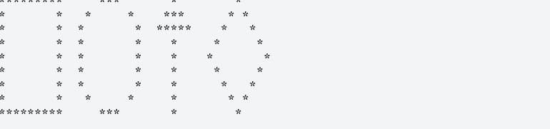

### 3.19 下面代码显示什么？

```csharp
Console.WriteLine("\n\n\n\n\n\n\n\***");
```

ANS:

```
*
**
***
****
*****
******
```

### 3.20 下面代码显示什么？

```csharp
Console.WriteLine("*+");
Console.WriteLine("***");
Console.WriteLine("*****");
Console.WriteLine("*****");
Console.WriteLine("**");
```

ANS:

```
*
***
*****
******
**
```

# 12 第 3 章 C# 应用程序介绍

### 3.21 下面代码显示什么？

```csharp
Console.Write("*");
Console.Write("****");
Console.Write("*****");
Console.Write("*");
```

ANS:

```
*******
```

### 3.22 下面代码显示什么？

```csharp
Console.Write("*");
Console.WriteLine("****");
Console.WriteLine("*****");
Console.WriteLine("*");
```

ANS:

```
****
****
******
```

### 3.23 下面代码显示什么？

```csharp
Console.WriteLine("{0}\n{1}\n{2}", "*", "****", "******");
```

ANS:

```
*
***
******
```

### 3.24 (奇偶) 编写一个应用程序，读取一个整数，然后判断并显示它是奇数还是偶数。[提示：使用余数运算符。偶数被除以 2 的余数为 0。]

ANS:

```csharp
// Exercise 3.24 Solution: OddEven.cs
// 应用程序判断数字是奇是偶。
using System;
public class OddEven
{
    public static void Main(string[] args)
    {
        int number;
        Console.Write("Enter integer: ");
        number = Convert.ToInt32(Console.ReadLine());
        if (number % 2 == 0)
            Console.WriteLine("even");
        else
            Console.WriteLine("odd");
    }
}
```

## 练习 13

Enter integer: 17

Number is odd

Enter integer: 14

Number is even

### 3.25 (倍数) 编写一个应用程序，读取两个整数，判断第一个是否是第二个的倍数并显示结果。

ANS:

```csharp
// Exercise 3.25 Solution: Multiple.cs
// 应用程序判断输入的数字是否是第二个的倍数。
using System;
public class Multiple
{
    public static void Main(string[] args)
    {
        int firstNumber; // 第一个数字
        int secondNumber; // 第二个数字

        Console.Write("Enter integer: ");
        firstNumber = Convert.ToInt32(Console.ReadLine());

        Console.Write("Enter second number: ");
        secondNumber = Convert.ToInt32(Console.ReadLine());

        if (firstNumber % secondNumber == 0)
            Console.WriteLine("{0} is a multiple of {1}", firstNumber, secondNumber);
        else
            Console.WriteLine("{0} is not a multiple of {1}", firstNumber, secondNumber);
    }
}
```

# 第 3 章 C# 应用程序介绍

```csharp
// determine whether firstNumber is multiple of secondNumber
if (firstNumber % secondNumber != 0) {
    Console.WriteLine("{0} is not a multiple of {1}", firstNumber, secondNumber);
} // end Main
} // end class Multiple
```

| | |
|---|---|
| Enter first number: 10 <br> Enter second number: 2 | 10 is a multiple of 2 |
| Enter first number: 17 <br> Enter second number: 3 | 17 is not a multiple of 3 |

### 3.26 (圆的直径、周长和面积) 这是一个预览。在本章中你学习了整数和 `int` 类型。C# 还可以表示包含小数点的浮点数，例如 3.14159。编写一个应用程序，从用户处输入整数半径，并使用 3.18 中所示浮点值 3.14159 计算直径、周长和面积。[你也可以使用常量 `Math.PI` 来表示 π。这个常量比 3.14159 更精确。`Math` 定义在命名空间 `System`]。使用以下公式（r 为半径）：

```
diameter = 2r
circumference = 2πr
area = πr²
```

不要将计算结果存储在变量中。相反，将每个计算作为 `Console.WriteLine` 语句中输出的值。注意，周长和面积计算产生的值是浮点数。你将在第 4 章学习更多关于浮点的知识。

ANS:

```csharp
// Exercise 3.26 Solution: Circle.cs
// 应用程序计算圆的面积、周长
// 和直径。
using System;
public class Circle {
    public static void Main(string[] args) {
        int radius; // 圆半径
        Console.Write("Enter radius: "); // 提示输入
        radius = Convert.ToInt32(Console.ReadLine()); // 读取数字
        Console.WriteLine("Diameter is {0}", ( 2 * radius ) );
        Console.WriteLine("Area is {0}", ( Math.PI * radius * radius ) );
    }
}
```

## 练习 15

```csharp
Console.WriteLine("Circumference is {0}", ( 2 * Math.PI * radius ));
} // end Main
} // end Circle
```

Enter radius: 3

Diameter is 6

Area is 28.27433382308

Circumference is 18.849559215388

### 3.27 (字符的整数等价值) 这是另一个预览。在本章中，你学习了整数和 `int` 类型。C# 还可以表示大写字母、小写字母以及各种特殊符号。每个字符都有对应的整数表示。计算机使用的字符集合以及这些字符对应的整数表示被称为该计算机的字符集。在应用程序中，只需将字符包含在单引号中来指示字符值，例如 `'A'`。

通过在字符前加上 `(int)` 来确定字符的整数等价值：

`(int) 'A'`

括号中的关键字 `int` 称为强制转换运算符，整个表达式称为强制转换表达式。你将在第 5 章学习强制转换运算符。以下语句输出一个字符及其整数等价值：

```csharp
Console.WriteLine("The character {0} has the value {1}", 'A', (int) 'A');
```

当打印语句执行时，它会显示字符 A 和值 65（来自字符集）。

使用本练习中之前显示的语句，编写一个应用程序显示某些大写字母、小写字母、数字和特殊符号的整数值。显示以下内容的整数等价值：A B C a b c 0 1 2 $ * + 和空格字符。

ANS:

```csharp
// Exercise 3.27 Solution: Display.cs
// 应用程序显示 Unicode 字符
// 及其整数等价值。
using System;
public class Display
{
    public static void Main(string[] args)
    {
        Console.WriteLine("The character {0} has the value {1}", 'A', (int) 'A' );
        Console.WriteLine("The character {0} has the value {1}", 'B', (int) 'B' );
        Console.WriteLine("The character {0} has the value {1}", 'C', (int) 'C' );
        Console.WriteLine("The character {0} has the value {1}", 'a', (int) 'a' );
        Console.WriteLine("The character {0} has the value {1}", 'b', (int) 'b' );
        Console.WriteLine("The character {0} has the value {1}", 'c', (int) 'c' );
        Console.WriteLine("The character {0} has the value {1}", '0', (int) '0' );
        Console.WriteLine("The character {0} has the value {1}", '1', (int) '1' );
        Console.WriteLine("The character {0} has the value {1}", '2', (int) '2' );
        Console.WriteLine("The character {0} has the value {1}", '$', (int) '$' );
        Console.WriteLine("The character {0} has the value {1}", '*', (int) '*' );
        Console.WriteLine("The character {0} has the value {1}", '/', (int) '/' );
        Console.WriteLine("The character {0} has the value {1}", ' ', (int) ' ' );
    }
}
```

# 16 第 3 章 C# 应用程序介绍

```csharp
Console.WriteLine("The character {0} has the value {1}",
      'b', (int) 'b' );
Console.WriteLine("The character {0} has the value {1}",
      'c', (int) 'c' );
Console.WriteLine("The character {0} has the value {1}",
      'o', (int) 'o' );
Console.WriteLine("The character {0} has the value {1}",
      '1', (int) '1' );
Console.WriteLine("The character {0} has the value {1}",
      '2', (int) '2' );
Console.WriteLine("The character {0} has the value {1}",
      's', (int) 's' );
Console.WriteLine("The character {0} has the value {1}",
      '\'', (int) '\'' );
Console.WriteLine("The character {0} has the value {1}",
      '+', (int) '+' );
Console.WriteLine("The character {0} has the value {1}",
      '/', (int) '/' );
} // end Main
} // end class Display
```

| The character A has the value 65 |
| :--- |
| The character B has the value 66 |
| The character C has the value 67 |
| The character a has the value 97 |
| The character b has the value 98 |
| The character c has the value 99 |
| The character 0 has the value 48 |
| The character 1 has the value 49 |
| The character 2 has the value 50 |
| The character S has the value 83 |
| The character s has the value 115 |
| The character t has the value 116 |
| The character / has the value 47 |
| The character h has the value 104 |

### 3.28 (整数的数字) 编写一个应用程序，从用户输入一个五位数字，将该数字拆分为各个数字，并用每个数字空格隔开显示这些数字。例如，如果用户输入数字 42339，应用程序应该显示：

```
4 2 3 3 9
```

假设用户输入了正确数的数字。当你运行应用程序并输入一个超过五位的数字时会发生什么？当你运行应用程序并输入一个少于五位的数字时会发生什么？[提示：你可以使用本章中学的技术来完成此练习。你需要同时使用除法和取余运算来“提取”每个数字。]

## 练习 17

答案：最后两个示例输出分别显示了输入少于五位和多于五位整数的结果。


## 第3章 C# 应用介绍

### 练习 3.28：拆分五位数字

```csharp
// Exercise 3.28 答案：Five.cs
// 应用程序拆分五位数字
using System;
public class Five
{
    public static void Main(string[] args)
    {
        int number; // 用户输入的数字
        int digit1; // 第一位数字
        int digit2; // 第二位数字
        int digit3; // 第三位数字
        int digit4; // 第四位数字
        int digit5; // 第五位数字

        Console.Write("Enter five-digit integer: "); // 提示
        number = int.ToInt32(Console.ReadLine()); // 读取数字

        digit1 = number / 10000;
        digit2 = number % 10000 / 1000;
        digit3 = number % 1000 / 100;
        digit4 = number % 100 / 10;
        digit5 = number % 10;

        Console.WriteLine("Digits in {0} are {1} {2} {3} {4} {5}",
            number, digit1, digit2, digit3, digit4, digit5);
    } // end Main
} // end class Five
```

**输出示例：**

```text
Enter five-digit integer: 12345
digits in 12345 are 1 2 3 4 5

Enter five-digit integer: 123
digits in 123 are 0 0 1 2 3

Enter five-digit integer: 7654321
digits in 7654321 are 765 4 3 2 1
```

### 练习 3.29：平方和立方表

仅使用本章计算 0 到 10 数字的平方和立方的方法，编写一个应用程序以表格格式显示结果。注意：此应用程序不需要用户的任何输入。

| number | square | cube |
| :--- | :--- | :--- |
| 0 | 0 | 0 |
| 1 | 1 | 1 |
| 2 | 4 | 8 |
| 3 | 9 | 27 |
| 4 | 16 | 64 |
| 5 | 25 | 125 |
| 6 | 36 | 216 |
| 7 | 49 | 343 |
| 8 | 64 | 512 |
| 9 | 81 | 729 |
| 10 | 100 | 1000 |

**答案：**

```csharp
// Exercise 3.29 答案：Numbers.cs
// 应用程序显示 0 到 10 数字的平方和立方表
using System;
public class Numbers
{
    public static void Main(string[] args)
    {
        // 显示表格表头
        Console.WriteLine("{0}\t{1}\t{2}", "number", "square", "cube");
        // 显示每个值的 x、平方和立方
        for (int x = 0; x <= 10; x++)
        {
            Console.WriteLine("{0}\t{1}\t{2}", x, x * x, x * x);
        }
    } // end Main
} // end class
```

### 练习 3.30：计数负数、正数和零

编写一个应用程序，输入五个数字，并显示负数、正数和零的数量。

```csharp
// Exercise 3.30 答案：Tally.cs
// 应用程序接受五个数字并显示负数、正数和零的数量
using System;
public class Tally
{
    public static void Main(string[] args)
    {
        int inputNumber; // 存储输入
        int zeroTally; // 零计数
        int positiveTally; // 正数计数
        int negativeTally; // 负数计数

        // 初始化计数器
        zeroTally = 0;
        positiveTally = 0;
        negativeTally = 0;

        // 输入第一个数字
        Console.Write("Enter first integer: ");
        inputNumber = int.ToInt32(Console.ReadLine());

        // 如果是 0
        if (inputNumber == 0)
            zeroTally++;

        // 如果是负数
        if (inputNumber < 0)
            negativeTally++;

        // 如果是正数
        if (inputNumber > 0)
            positiveTally++;

        // 输入第二个数字
        Console.Write("Enter second integer: ");
        inputNumber = int.ToInt32(Console.ReadLine());

        // 如果是 0
        if (inputNumber == 0)
            zeroTally++;

        // 如果是负数
        if (inputNumber < 0)
            negativeTally++;

        // 如果是正数
        if (inputNumber > 0)
            positiveTally++;

        // 输入第三个数字
        Console.Write("Enter third integer: ");
        inputNumber = int.ToInt32(Console.ReadLine());

        // 如果是 0
        if (inputNumber == 0)
            zeroTally++;

        // 如果是负数
        if (inputNumber < 0)
            negativeTally++;

        // 如果是正数
        if (inputNumber > 0)
            positiveTally++;

        // 输入第四个数字
        Console.Write("Enter fourth integer: ");
        inputNumber = int.ToInt32(Console.ReadLine());

        // 如果是 0
        if (inputNumber == 0)
            zeroTally++;

        // 如果是负数
        if (inputNumber < 0)
            negativeTally++;

        // 如果是正数
        if (inputNumber > 0)
            positiveTally++;

        // 输入第五个数字
        Console.Write("Enter fifth integer: ");
        inputNumber = int.ToInt32(Console.ReadLine());

        // 如果是 0
        if (inputNumber == 0)
            zeroTally++;

        // 如果是负数
        if (inputNumber < 0)
            negativeTally++;

        // 如果是正数
        if (inputNumber > 0)
            positiveTally++;

        // 创建描述结果的字符串
        Console.WriteLine("\nThere are {0} zeros", zeroTally);
        Console.WriteLine("There are {0} positive numbers", positiveTally);
        Console.WriteLine("There are {0} negative numbers", negativeTally);
    } // end Main
} // end class
```

**输出示例：**

```text
输入第一个整数: 0
输入第二个整数: -7
输入第三个整数: 3
输入第四个整数: 13
输入第五个整数: 5

有 1 个零
3 个正数
1 个负数
```

## 产生影响练习

### 练习 3.31：体重质量指数计算器

我们在练习 1.19 中介绍了体重质量指数（BMI）计算器。一个 BMI 计算器应用程序读取用户的磅重量和英寸身高（或者，如果用户使用公斤和米），然后计算并显示用户的体重质量指数。应用程序还应该显示来自卫生与人类服务部/国立研究所的信息，以便用户评估自己的 BMI。

| BMI 值 |
| :--- |
| 体重过轻：小于 18.5 |
| 正常：18.5 到 24.9 之间 |
| 超重：25 到 29.9 之间 |
| 肥胖：30 或以上 |

**答案：**

```csharp
// 练习 3.31 答案: BMICalculator.cs
// 计算并显示用户的体质量指数。
using System;
public class BMICalculator
{
    public static void Main(string[] args)
    {
        int weight; // 体重（磅）
        int height; // 身高（英寸）
        int bmi; // 用户的体质量指数

        // 体重（磅）和身高（英寸）
        Console.WriteLine(
            "欢迎使用体质量指数（BMI 计算器）");
        Console.Write("请输入体重（磅）: ");
        weight = Convert.ToInt32(Console.ReadLine());
        Console.Write("请输入身高（英寸）: ");
        height = Convert.ToInt32(Console.ReadLine());

        // 计算 BMI
        bmi = (weight * 703) / (height * height);

        Console.WriteLine("您的 BMI 是: {0}\n", bmi);

        Console.WriteLine("BMI 数值");
        Console.WriteLine("体重过轻：小于 18.5");
        Console.WriteLine("正常：在 18.5 到 24.9 之间");
        Console.WriteLine("超重：在 25 到 29.9 之间");
        Console.WriteLine("肥胖：30 或更大");
    } // Main结束
} // 类 BMICalculator结束
```

**输出示例：**

```text
欢迎使用体质量指数（BMI 计算器）
请输入您的体重（磅）: 165
请输入您的身高（英寸）: 69
您的 BMI 是: 24

BMI 数值
体重过轻：小于 18.5
正常：在 18.5 到 24.9 之间
超重：在 25 到 29.9 之间
肥胖：30 或更大
```

### 练习 3.32：拼车节省计算器

研究几个拼车网站。创建一个计算每日行驶成本的应用，以便你可以估计拼车可以节省多少钱，拼车还有减少碳排放和缓解交通拥堵等其他优点。应用程序应输入以下信息并显示用户每个工作日的成本：

- a) 每天行驶的总里程。
- b) 每加仑汽油的成本（分）。
- c) 每加仑的平均里程数。
- d) 每日停车费（分）。
- e) 每日过路费（分）。

**答案：**

```csharp
// 练习 3.32 答案: DailyDrivingCost.cs
// 根据每天行驶的总里程数、
// 每加仑汽油的成本、每加仑平均里程数、每日停车费
// 以及每日过路费确定每日行驶成本。
using System;
public class DailyDrivingCost
{
    public static void Main(string[] args)
    {
        int milesDriven; // 每天行驶的里程数
        int costPerGallon; // 每加仑汽油的成本（分）
        int averageMilesPerGallon; // 每加仑汽油的平均里程
        int parkingFees; // 每日停车费
        int tolls; // 每日过路费

        Console.WriteLine("欢迎使用每日行驶成本计算器");
        Console.Write("请输入您每天行驶的里程数: ");
        milesDriven = Convert.ToInt32(Console.ReadLine());
        Console.Write("请输入每加仑汽油的成本（分）: ");
        costPerGallon = Convert.ToInt32(Console.ReadLine());
        Console.Write("请输入每加仑汽油的平均里程: ");
        averageMilesPerGallon = Convert.ToInt32(Console.ReadLine());
        Console.Write("请输入每日停车费（分）: ");
        parkingFees = Convert.ToInt32(Console.ReadLine());
        Console.Write("请输入每日过路费（分）: ");
        tolls = Convert.ToInt32(Console.ReadLine());

        // 计算并显示每日行驶成本
        double dailyCost = (costPerGallon / 100.0) * milesDriven / averageMilesPerGallon + 
                           (parkingFees / 100.0) + (tolls / 100.0);
        Console.WriteLine("您的每日行驶成本是 {0}", dailyCost);
    } // Main结束
} // 类 DailyDrivingCost结束
```

**输出示例：**

```text
欢迎使用每日行驶成本计算器
请输入您每天行驶的里程数:
请输入每加仑汽油的成本（分）:
请输入每加仑汽油的平均里程:
请输入每日停车费（分）:
请输入每日过路费（分）:
您的每日行驶成本是 {0}
```


# 类与对象的介绍

## 学习目标

在本节中你将学习：

- 如何声明类并使用它。
- 将类的行为实现为方法。
- 将属性实现为属性。
- 如何调用方法来实现功能。
- 什么是局部变量。

## 自测

### 4.1 填空

- a) 类是对象的蓝图。
- b) `class` 关键字用于声明类。
- c) `new` 关键字用于创建实例。
- d) 实例变量用于存储数据。
- e) 属性用于访问和修改实例变量。
- f) 方法是类的函数。
- g) 构造函数是初始化对象的特殊方法。
- h) `this` 关键字用于引用当前实例。
- i) `void` 关键字用于不返回值的方法。
- j) 局部变量在其定义的范围内可见。
- k) `Console` 类用于输入输出。
- l) `ReadLine` 方法用于读取输入。
- m) `using` 指令用于导入类。
- n) `double` 类型用于存储浮点数。
- o) `static` 修饰符用于定义非实例成员。
- p) 引用类型存储对象的引用。

### 4.2 判断下列陈述的对错。如果是错误的，请解释原因

- a) 根据习惯，方法名以大写字母开头。（错误，通常以小写字母开头）
- b) 属性的 `get` 访问器允许客户端检索值。（正确）
- c) 当一个类使用另一个命名空间中的类时，不需要 `using` 指令。（正确，可使用完全限定名）
- d) 方法后的空括号表示该方法不需要参数。（正确）
- e) 定义属性后，你可以像使用方法一样使用它。（错误，像使用字段一样使用，不需要加括号）
- f) 使用 `private` 修饰符的变量对声明它的类的方法和属性可见。（正确）
- g) 方法体的变量被称为实例变量，可以在类的所有方法中使用。（错误，它们是局部变量）
- h) 属性声明必须包含一个 getter 和 setter。（错误，可以只包含其中一个）

### 4.3 局部变量和实例变量之间的区别是什么？

答案：局部变量定义在方法体内，仅在定义它的方法中使用，而不能在类的任何方法体中使用。实例变量定义在类中。类的每个对象（实例）都有该类实例变量的独立副本。此外，实例变量可以被类的所有方法访问。

### 4.4 解释方法参数的作用。参数和实参之间的区别是什么？

---

# 第 4 章 类与对象介绍

## 练习

### 4.5 `operator new` 的作用是什么？解释在程序中使用该关键字时会发生什么。

答：`operator new` 的作用是创建一个类的对象。当程序中使用 `operator new` 时，首先会为 `new` 右侧的类创建一个新对象，然后调用该类的构造函数以确保对象被正确地初始化。

### 4.6 什么是默认构造函数？如果一个类只有一个默认构造函数，实例变量是如何初始化的？

答：当你没有在类中指定任何构造函数时，编译器会提供一个默认构造函数。当一个类只有一个默认构造函数时，它的实例变量将初始化为它们的默认值。包含数字的变量初始化为 0，`bool` 类型的变量初始化为 `false`，引用类型变量初始化为 `null`。

### 4.7 解释实例变量的作用。

答：当类的每个对象都必须维护与该类的所有其他对象独立的信息时，类就会提供一个实例变量（或多个实例变量）。例如，`Account` 类提供了一个实例变量来表示账户余额。每个 `Account` 对象维护自己的余额，并且不知道银行其他账户的余额。

### 4.8 解释如何在不使用 `using` 指令的情况下使用 `Console`。

答：如果程序中对类名的每次使用都是完全限定的，则不需要使用 `using` 指令。完全限定名称为类的命名空间的完全限定名称，后跟一个点和类名。例如，如果程序中 `Console` 的每次使用都指定为 `System.Console`，那么程序就可以使用 `Console`。

### 4.9 解释为什么类可能会为实例变量提供私有修饰。

答：实例变量通常在类中声明为 `private`，这样只有类的方法（属性）可以操作该变量。在某些情况下，程序可能需要修改数据。类的设计者可以提供一个公共属性，程序可以通过该属性为私有实例变量设置值或获取值。属性的 `set` 访问器可以确保实例只被设置为有效值。使用属性操作私有字段允许在修改对象的内部表示而不影响该类的客户端。

### 4.10 修改 `GradeBook`（图 4.14）

- a) 包含第二个 `string` 自动实现属性，用于表示教师姓名。
- b) 修改构造函数指定两个参数——一个用于课程名，另一个用于教师姓名。
- c) 修改 `DisplayMessage`，使其首先输出欢迎消息和课程名称，然后输出“This course is presented by: ”，后跟教师姓名。

在测试程序中使用你修改后的类，演示该类的新功能。

答：

```csharp
// 练习 4.10 答案：GradeBook.cs
// GradeBook 类带有一个构造函数，用于初始化课程名称和教师姓名。

using System;

public class GradeBook
{
    // 自动实现属性 CourseName 隐式创建一个为 GradeBook 的课程名称创建实例变量
    public string CourseName { get; set; }

    // 自动实现属性 InstructorName 隐式创建一个为此课程教师创建实例变量
    public string InstructorName { get; set; }

    // 构造函数使用提供的两个字符串参数初始化自动属性
    public GradeBook(string course, string instructor)
    {
        CourseName = course; // 设置 CourseName
        InstructorName = instructor; // 设置 InstructorName
    }

    // 向 GradeBook 用户显示欢迎消息
    public void DisplayMessage()
    {
        // 此语句使用自动属性 CourseName 和 InstructorName 来获取课程和教师名称
        Console.WriteLine("Welcome to the grade book\n{0}!", CourseName);
        Console.WriteLine("This course is presented by: {0}", InstructorName);
    }
}
```

```csharp
// 练习 4.10 答案：TestApp.cs
// 测试程序，用于演示类的新功能

using System;

public class TestApp
{
    public static void Main(string[] args)
    {
        GradeBook myGradeBook = new GradeBook("Computer 101", "Dr. Smith");
        myGradeBook.DisplayMessage();
    }
}
```

### 4.12 (Invoice 类)

创建一个 `Invoice` 类，五金店可以使用该类来表示商店所售物品的发票。`Invoice` 应该包含四项信息，并以实例变量或属性的形式存在——零件号（`string` 类型）、描述（`string` 类型）、所购商品数量（`int` 类型）以及物品单价（`decimal` 类型）。你的类应该有一个构造函数来初始化这些值。为任何实例变量提供一个带有 `get` 和 `set` 的属性。对于 `Quantity` 和 `PriceItem` 属性，如果传递给 setter 的值为负数，则实例变量的值应保持不变。此外，提供一个名为 `GetInvoiceAmount` 的方法来计算发票金额（即数量乘以单价），然后以 `decimal` 类型返回金额。编写一个名为 `InvoiceTest` 的测试应用程序来演示 `Invoice` 的功能。

```csharp
// 练习 4.12 答案：Invoice.cs
// Invoice 类。

public class Invoice
{
    // 自动实现的属性隐式地为零件号创建一个实例变量
    public string PartNumber { get; set; }

    // 自动实现的属性隐式地为描述创建一个实例变量
    public string PartDescription { get; set; }

    private int quantity;
    private decimal priceItem;

    // 四参数构造函数
    public Invoice(string part, string description, int count, decimal price)
    {
        // 初始化自动属性和实例变量
        PartNumber = part;
        PartDescription = description;
        Quantity = count;
        PriceItem = price;
    } // 四参数 Invoice 构造函数结束

    // 用于获取和设置数量的属性
    public int Quantity
    {
        get { return quantity; } // get结束
        set
        {
            if (value >= 0) // 判断数量是否为正
                quantity = value; // 将有效数量赋值给 quantity
        } // set结束
    } // 属性 Quantity

    // 用于获取和设置单价的属性
    public decimal PriceItem
    {
        get { return priceItem; } // get结束
        set
        {
            if (value >= 0) // 判断单价是否非负
                priceItem = value; // 将有效单价赋值给 priceItem
        } // set结束
    } // 属性 PriceItem结束

    // 计算并返回发票金额
    public decimal GetInvoiceAmount()
    {
        return Quantity * PriceItem; // 计算总成本
    } // 方法 GetInvoiceAmount结束
} // Invoice 类结束
```

```csharp
// 练习 4.12 答案：InvoiceTest.cs
// 测试 Invoice 类的应用程序

using System;

public class InvoiceTest
{
    public static void Main(string[] args)
    {
        Invoice invoice = new Invoice("1234", "Hammer", 2, 14.95m);

        Console.WriteLine("Part number: {0}", invoice.PartNumber);
        Console.WriteLine("Description: {0}", invoice.PartDescription);
        Console.WriteLine("Quantity: {0}", invoice.Quantity);
        Console.WriteLine("Price: {0:C}", invoice.PriceItem);
        Console.WriteLine("Invoice amount: {0:C}", invoice.GetInvoiceAmount());
    } // Main结束
} // InvoiceTest 类结束
```

**输出示例：**

```text
Original invoice
Part number: 1234
Description: Hammer
Quantity: 2
Price: $14.95
Invoice amount: $29.90

Updated invoice
Part number: 1234
Description: Hammer
Quantity: 3
Price: $19.49
Invoice amount: $58.47

Original invoice
Part number: 5678
Description: Brush
Quantity: 0
Price: $0.00
Invoice amount: $0.00

Updated invoice
Part number: 5678
Description: Brush
Quantity: 3
Price: $9.49
Invoice amount: $28.47
```

### 4.13 (Employee 类)

创建一个名为 `Employee` 的类，包含三项信息，以实例变量或属性的形式存在——名（`string` 类型）、姓（`string` 类型）和月薪（`decimal`）。你的类应该有一个构造函数来初始化这三个值。为任何实例变量提供一个 getter 和 setter。如果月薪为负数，setter 访问器应保持实例变量不变。编写一个名为 `EmployeeTest` 的测试应用程序来演示 `Employee` 的功能。给每个 `Employee` 增加 10% 的薪水并显示每个人的薪水。

```csharp
// 练习 4.13 答案：Employee.cs
// Employee 类。

using System;

public class Employee
{
    // 自动实现的属性隐式地为名创建一个实例变量
    public string FirstName { get; set; }

    // 自动实现的属性隐式地为姓创建一个实例变量
    public string LastName { get; set; }

    private decimal salary;

    // 初始化名、姓和薪水的构造函数
    public Employee(string first, string last, decimal sal)
    {
        FirstName = first;
        LastName = last;
        salary = sal;
    } // 三参数构造函数结束

    // 用于获取和设置薪水的属性
    public decimal Salary
    {
        get { return salary; } // get结束
        set
        {
            if (value >= 0) // 判断薪水是否非负
                salary = value; // 将有效薪水赋值给 salary
        } // set结束
    } // 属性 Salary结束
} // Employee 类结束
```

```csharp
// 练习 4.13 答案：EmployeeTest.cs
// 测试 Employee 类的应用程序

using System;

public class EmployeeTest
{
    public static void Main(string[] args)
    {
        Employee employee1 = new Employee("John", "Doe", 5000.00m);
        Employee employee2 = new Employee("Jane", "Smith", 6000.00m);

        Console.WriteLine("Employee 1: {0} {1}, Monthly Salary: {2:C}",
            employee1.FirstName, employee1.LastName, employee1.Salary);
        Console.WriteLine("Employee 2: {0} {1}, Monthly Salary: {2:C}",
            employee2.FirstName, employee2.LastName, employee2.Salary);

        // 给每个 Employee 增加 10% 的薪水
        employee1.Salary = employee1.Salary * 1.10m;
        employee2.Salary = employee2.Salary * 1.10m;

        Console.WriteLine("\nAfter 10% raise:");
        Console.WriteLine("Employee 1: {0} {1}, Monthly Salary: {2:C}",
            employee1.FirstName, employee1.LastName, employee1.Salary);
        Console.WriteLine("Employee 2: {0} {1}, Monthly Salary: {2:C}",
            employee2.FirstName, employee2.LastName, employee2.Salary);
    } // Main结束
} // EmployeeTest 类结束
```


```cs
// 练习 4.13 答案：EmployeeTest.cs
// 测试 Employee 类的应用程序
using System;
public class EmployeeTest
{
    public static void Main(string[] args) {
        Employee employee1 = new Employee("Bob", "Jones", 2875.00M);
        Employee employee2 = new Employee("Susan", "Baker", 3150.75M);

        // 显示员工
        Console.WriteLine("Employee 1: {0} {1}, Salary: {2:C}",
            employee1.FirstName, employee1.LastName, employee1.Salary);
        Console.WriteLine("Employee 2: {0} {1}, Salary: {2:C}",
            employee2.FirstName, employee2.LastName, employee2.Salary);

        // 薪水增加 10%
        employee1.Salary = employee1.Salary * 1.10M;
        employee2.Salary = employee2.Salary * 1.10M;

        // 显示新薪水的员工
        Console.WriteLine("Employee 1: {0} {1}, Salary: {2:C}",
            employee1.FirstName, employee1.LastName, employee1.Salary);
        Console.WriteLine("Employee 2: {0} {1}, Salary: {2:C}",
            employee2.FirstName, employee2.LastName, employee2.Salary);
    }
}
```

Employee 1: Bob Jones, Salary: $2,875.00

Employee 2: Susan Baker, Salary: $3,150.75

Employee 1: Bob Jones, Salary: $3,162.50

Employee 2: Susan Baker, Salary: $3,465.83

## 练习 13

### 4.14 (Date 类)

创建一个包含三个自动属性的类——月（`int` 类型）、日（`int` 类型）和年（`int` 类型）。你的类应该有一个构造函数来初始化三个自动属性并确保提供的值正确。提供一个 `Display` 方法，用斜杠（/）分隔月、日、年。编写一个名为 `DateTest` 的测试程序来演示类的功能。

ANS:

```cs
// 练习 4.14 答案：Date.cs
// 具有月、日、年自动属性的 Date。
using System;

public class Date
{
    // 自动实现的属性 Month隐式地为
    // 月创建一个实例变量
    public int Month { get; set; }

    // 自动实现的属性 Day隐式地为
    // 日创建一个实例变量
    public int Day { get; set; }

    // 自动实现的属性 Year隐式地为
    // 年创建一个实例变量
    public int Year { get; set; }

    // 构造函数
    public Date(int monthValue, int dayValue, int yearValue)
    {
        Month = monthValue;
        Day = dayValue;
        Year = yearValue;
    }

    // 显示月、日、年的方法
    public void Display()
    {
        Console.WriteLine("{0:D2}/{1:D2}/{2}", Month, Day, Year);
    }
}
```

```cs
// 练习 4.14 答案：DateTest.cs
// 测试 Date 类的应用程序
using System;
public class DateTest
{
    public static void Main(string[] args) {
        Date date1 = new Date(12, 31, 2023);
        Date date2 = new Date(1, 1, 2024);

        date1.Display();
        date2.Display();
    }
}
```

# 第 4 章 类与对象介绍

| 行号 | 代码 |
| :--- | :--- |
| 23 | `Day = dayValue;` |
| 24 | `Year = yearValue;` |
| 25 | `}` // 参数构造函数结束 |
| 26 |  |
| 27 | `// 显示日期` |
| 28 | `public void DisplayDate()` |
| 29 | `{` |
| 30 | `Console.Write("{0}/{1}/{2}", Month, Day, Year);` |
| 31 | `}` // 方法 DisplayDate 结束 |
| 32 | `}` // 类 结束 |

```csharp
// Exercise 4.14 Solution: DateTest.cs
// 用于测试类 Date的应用。
using System;
public class DateTest
{
    public static void Main(string[] args)
    {
        Date date1 = new Date(7, 4, 2004);
        Console.Write("The initial date is: ");
        date1.DisplayName();
        // 修改日期值
        date1.Month = 11;
        date1.Day = 1;
        date1.Year = 2003;
        Console.Write("\nDate with new values is: ");
        date1.DisplayName();
        Console.WriteLine(); // 输出新行
    } // end Main
} // end class DateTest
```

The initial date is: 7/4/2004

Date with new values is: 11/1/2003

# 练习题

## 4.15 (目标心率计算器)

在运动时，你可以使用心率监测仪来查看你的心率是否保持在教练和医生建议的安全范围内。根据美国心脏协会 (AHA) (www.heart.org/shtml?identifier=4736)，计算最大心率（单位为每分钟心率）的公式为 220 减去你的年龄。你的目标心率是最大心率的 50-85。[注：这些公式为 AHA 的估值。在开始或修改运动计划之前，请务必咨询医生或合格的健康保健专业人员。]创建一个名为 `HeartRates` 的类。该类的属性应包括人的名、姓、出生年份和当前年份。你的类应该有一个接收这些数据作为参数的构造函数。为每个属性定义一个具有 `set` 和 `get` 访问器的属性。该类还应该包含一个计算并返回人的年龄（岁为单位）的属性，一个计算并返回人的最大心率的属性，以及计算并返回人的最小和最大目标心率的属性。编写一个程序，提示输入人的信息，实例化 `HeartRates` 类的对象并使用这些信息——包括人的名、姓和出生年份——然后计算并返回人的年龄（岁为单位）、最大心率和目标心率范围。

答案：

```csharp
// Exercise 4.15 Solution: HeartRates.cs
// 维护人的最大心率和目标心率信息。
// 此类假设出生和当前年份是正确的。
public class HeartRates
{
    public string FirstName { get; set; }
    public string LastName { get; set; }
    public int BirthYear { get; set; }
    public int CurrentYear { get; set; }

    // 构造函数
    public HeartRates(string firstName, string lastName,
    int birthYear, int currentYear)
    {
        FirstName = firstName;
        LastName = lastName;
        BirthYear = birthYear;
        CurrentYear = currentYear;
    } // end constructor

    // 返回人的年龄（岁）
    public int Age
    {
        get { return CurrentYear - BirthYear; }
    } // end get

    // 返回最大心率
    public int MaximumHeartRate
    {
        get { return 220 - Age; }
    } // end get

    // 返回最小目标心率（最大心率的 50%）
    public double MinimumTargetRate
    {
        get { return .5 * MaximumHeartRate; }
    } // end get

    // 返回最大目标心率（最大心率的 85%）
    public double MaximumTargetRate
    {
        get { return .85 * MaximumHeartRate; }
    } // end get
} // end class HeartRates
```

```csharp
// Exercise 4.15 Solution: HeartRatesTest.cs
// 测试 HeartRates 类。
using System;
public class HeartRatesTest
{
    public static void Main(string[] args)
    {
        // 为 1975 年出生的人创建一个 HeartRates 对象
        // 根据 2010 年进行计算。
        HeartRates bob = new HeartRates("Bob", "Blue", 1975, 2010);
        Console.WriteLine("First name: {0}", bob.FirstName);
        Console.WriteLine("Last name: {0}", bob.LastName);
        Console.WriteLine("Age: {0}", bob.Age);
        Console.WriteLine("Maximum heart rate: {0}", bob.MaximumHeartRate);
        Console.WriteLine("Target rate range: {0}", bob.TargetHeartRate);
        Console.WriteLine("Minimum: {0}", bob.MinimumTargetRate);
        Console.WriteLine("Maximum: {0}", bob.MaximumTargetRate);
    } // end Main
} // end class HeartRatesTest
```

First name: Bob

Last name: Blue

Age: 35

Maximum heart rate: 185

Target rate range:

Minimum: 92.5

Maximum: 157.25

## 4.16 (健康记录电子化)

最近新闻中的一个健康问题是健康记录的电子化。由于隐私和安全考虑，这种可能性正被谨慎对待。[我们在后面的练习中解决这些问题。] 健康记录电子化可以让患者更容易与各种医疗专业人士分享健康状况和历史。这可以提高护理质量，避免处方错误并在紧急情况下拯救生命。为一个人设计一个 `HealthProfile` 类。该类的属性应该是人的名、姓、性别、出生年份、身高（英寸）和体重（磅）。你的类应该有一个接收这些信息的构造函数。为每个属性提供一个属性和 `get` 访问器。该类还应该包含计算并返回人的年龄（岁）、最大心率和目标心率范围（见练习 4.15）以及 BMI（见 3.31）。编写一个程序，提示输入人的信息，实例化 `HealthProfile` 对象并计算人的年龄、BMI、最大心率和目标心率范围。它还应该显示 3.31 中的“BMI值”表。


```csharp
// Exercise 4.16 Solution: HealthProfile.cs
// 维护人的最大心率和目标心率信息。
// 此类假设传递给 set 访问器的值是正确的。
public class HealthProfile {
    public string FirstName { get; set; }
    public string LastName { get; set; }
    public string Gender { get; set; }
    public int BirthYear { get; set; }
    public int CurrentYear { get; set; }
    public double Height { get; set; }
    public double Weight { get; set; }

    public HealthProfile(string firstName, string lastName, string gender, double height, double weight, int birthYear, int currentYear)
    {
        FirstName = firstName;
        LastName = lastName;
        Gender = gender;
        Height = height;
        Weight = weight;
        BirthYear = birthYear;
        CurrentYear = currentYear;
    } // end constructor

    // 返回人的年龄（岁）
    public int Age
    {
        get { return CurrentYear - BirthYear; }
    } // end get

    // 返回最大心率
    public int MaximumHeartRate
    {
        get { return 220 - Age; }
    } // end get

    // 返回最小目标心率（最大心率的 50%）
    public double MinimumTargetHeartRate
    {
        get { return .5 * MaximumHeartRate; }
    } // end get

    // 返回最大目标心率（最大心率的 85%）
    public double MaximumTargetHeartRate
    {
        get { return .85 * MaximumHeartRate; }
    } // end get

    // 返回人的体质量指数
    public double BMI
    {
        get { return ( Weight * 703 ) / ( Height * Height); }
    } // end get

    // 显示人的健康状况
    public void displayHealthProfile()
    {
        Console.WriteLine("\nHEALTH PROFILE FOR: {0} {1}\n",
        FirstName, LastName);
        Console.WriteLine("Gender: {0}", Gender);
        Console.WriteLine("Age: {0}", Age);
        Console.WriteLine("Height (in inches): {0}", Height);
        Console.WriteLine("Weight (in pounds): {0}", Weight);
        Console.WriteLine("Maximum heart rate: {0}", MaximumHeartRate);
        Console.WriteLine("Target heart rate range: {0}", MinimumTargetHeartRate);
        Console.WriteLine("Maximum: {0}", MaximumTargetHeartRate);
        Console.WriteLine("BMI: {0}, BMI VALUES");
        Console.WriteLine("Underweight: less than 18.5 ");
        Console.WriteLine("Normal: between 18.5 and 29.9 ");
        Console.WriteLine("Obese: 30 or greater ");
    } // end method displayHealthProfile
} // end class HealthProfile
```

```csharp
// Exercise 4.16 Solution: HealthProfileTest.cs
// 测试 HealthProfile 类。
using System;
```

## 练习 19

```csharp
public class HealthProfileTest {
    public static void Main(string[] args) {
        Console.Write("Enter name: ");
        string firstName = Console.ReadLine();
        Console.Write("Enter last name: ");
        string lastName = Console.ReadLine();
        Console.Write("Enter gender: ");
        string gender = Console.ReadLine();
        Console.Write("Enter height in inches: ");
        double height = Convert.ToDouble(Console.ReadLine());
        Console.Write("Enter weight in pounds: ");
        double weight = Convert.ToDouble(Console.ReadLine());
        Console.Write("Enter year of birth: ");
        int birthYear = Convert.ToInt32(Console.ReadLine());
        Console.Write("Enter current year: ");
        int currentYear = Convert.ToInt32(Console.ReadLine());

        // 根据用户输入创建一个人的 HealthProfile 对象
        HealthProfile person = new HealthProfile(firstName, lastName, gender, height, weight, birthYear, currentYear);

        // 显示用户的健康状况
        person.DisplayUserProfile();
    }
 // 类 HealthProfileTest 结束
}
```

输出示例：

```text
Enter name: Jessica
Enter last name: Pink
Enter gender: F
Enter height in inches: 64
Enter weight in pounds: 120
Enter year of birth: 1975
Enter current year: 2010

健康状况报告：Jessica
性别: F
年龄: 35
身高（英寸）: 64
体重（磅）: 120
最大心率: 185
目标心率范围：
最小：92.5
最大: 157.25
BMI: 20.59703125
BMI 数值
体重过轻：小于 18.5
正常：18.5 到 24.9 之间
体重超重：25 到 29.9 之间
肥胖：30 或更大
下载访问 www.pinkreference.com
```

# 第 5 章 控制语句：第一部分解析

> 让我们都向前移动。—— 刘易斯·卡罗尔
>
> 轮子已成圆。—— 威廉·莎士比亚
>
> 在牛顿受到灵感之前，有多少个苹果掉在他头上！—— 罗伯特·富罗斯
>
> 我们所知的所有演化都是从模糊到明确。—— 查尔斯·桑德

## 目标

在本章中，你将学习：

- 基础问题解决技术。
- 通过自顶向下、逐步精细化的过程开发算法。
- 使用 `if...else` 语句来选择操作。
- 使用 `while` 语句重复执行语句。
- 使用计数器控制和哨兵控制的重复。
- 使用递增、递减和复合赋值运算符。

## 自测练习题

### 5.1 填空以下语句中的空格：

- a) 所有的应用程序都可以用三种类型的控制结构来编写：顺序、选择、重复。
- b) 用于在条件为真时执行一个动作、在条件为假时执行另一个动作的语句是：`if...else`。
- c) 重复执行一组指令特定次数被称为计数器控制重复。
- d) 当预先不知道一组语句将重复多少次时，使用哨兵值来终止重复。
- e) `int` 类型的实例变量默认赋值为 `0`。
- f) C# 是一种强类型语言——它要求所有变量必须有类型。
- g) 如果将递增运算符前缀应用于变量，变量会先加 1，然后在表达式中使用新值。

### 判断以下每个陈述的正确或错误。如果是错误的，请解释原因。

- a) 算法是根据要执行的动作及其执行顺序来解决问题的处理过程。**正确。**
- b) 包含在一对括号内的一组语句是一个块。**错误。** 包含在一对花括号 (`{}`) 内的一组语句被称为块。
- c) 选择语句指定根据条件的真或假，在当某些条件仍然存在时重复某个动作。**错误。** 选择语句决定了某个动作在条件为真时是否被执行。
- d) 嵌套控制语句出现在另一个控制语句的体部。**正确。**
- e) C# 提供了算术赋值运算符 `+=`、`-=`、`/=` 和 `%=` 来简写赋值表达式。**正确。**
- f) 指定应用程序中语句（动作）执行的顺序被称为程序控制。**正确。**
- g) 一元转换运算符 `(double)` 会为其操作数创建一个临时副本。**错误。** 一元转换运算符 `(double)` 会为其操作数创建一个临时的浮点副本。
- h) `bool` 类型的实例变量默认赋值为 `false`。**正确。**
- i) 伪代码帮助你在尝试用编程语言编写应用程序之前对其进行逻辑思考。**正确。**

### 5.3 写四种不同的 C# 语句，每个给整数变量 `x` 加 1。

```csharp
x = x + 1;
x += 1;
++x;
x++;
```

### 5.4 编写 C# 语句完成以下每个任务：

- a) 将 `x` 和 `y` 的和赋值给 `z`，计算后将 `x` 增 1。仅使用一条语句。

```csharp
z = x++ + y;
```

- b) 测试变量 `count` 是否大于 10。如果是，显示“Count is greater than 10”。

```csharp
if (count > 10)
    Console.WriteLine("Count is greater than 10");
```

- c) 将变量 `x` 减 1，并从 `total` 变量中减去它。仅使用一条语句。

```csharp
total -= --x;
```

- d) 计算 `x` 除以 `divisor` 的余数，并将结果赋值给 `q`。用两种不同的方式编写此语句。

```csharp
q = x % divisor;
```

### 5.5 编写 C# 语句完成以下每个任务：

- a) 声明变量 `sum` 为 `int` 类型。

```csharp
int sum;
```

- b) 声明变量 `x` 为 `int` 类型。

```csharp
int x;
```

- c) 给 `x` 赋值为 1。

```csharp
x = 1;
```

- d) 给 `sum` 赋值为 0。

```csharp
sum = 0;
```

- e) 将 `x` 加到 `sum`，并将结果赋值给 `q`。

```csharp
sum += x; // 或 sum = sum + x;
```

- f) 根据 `sum` 的值显示“The sum is {0}”。

```csharp
Console.WriteLine("The sum is {0}", sum);
```

### 5.6 将你在 5.5 中写的语句合并到一个计算并显示 1 到 10 整数和的 C# 应用程序。使用 `while` 语句循环计算和。直到 `x` 的值变为 11。

```csharp
// 练习 5.6 答案：Calculate.cs
// 计算 1 到 10 的整数和
using System;
public class Calculate
{
    public static void Main(string[] args)
    {
        int x = 1; // 初始化 x 为 1 用于计数
        int sum = 0; // 初始化 sum 为 0 用于合计

        while (x <= 10) // x 小于等于 10
        {
            sum += x; // 将 x 加到 sum
            x++; // x 自增
        } // 结束 while

        Console.WriteLine("The sum is {0}", sum);
    } // 结束 Main
} // 结束类 Calculate
```

输出：

```text
和：55
```

### 5.7 确定语句执行后变量的值。假设语句开始执行时，所有变量均为 `int` 类型且值为 5。

```csharp
product *= x++;
```

答案：`product = 25`, `x = 6`

### 5.8 识别并修正每组代码中的错误：

**a)**

```csharp
while (c <= 5)
{
    product *= c;
    c++;
}
```

**错误：** 缺少 `while` 语句体的右大括号（原代码已补全，若原代码缺失则需添加）。

**b)**

```csharp
if (gender == 1)
    Console.WriteLine("Woman");
else
    Console.WriteLine("Man"); // 假设此处有输出语句
```

**错误：** `else` 后面的分号会导致逻辑错误，使后续语句脱离 `else` 分支。
**修正：** 移除 `else` 后面的分号。

### 5.9 `while` 语句有什么问题？

```csharp
while (z >= 0)
    sum += z;
```

**答案：** `while` 语句中从未改变变量 `z` 的值。因此，如果循环继续条件 (`z >= 0`) 最初为真，就会发生无限循环。为了防止无限循环，必须递减 `z` 使其最终小于 0。

## 练习

### 5.10 比较 `if` 选择语句和 `while` 重复语句。这两个语句之间有什么相似之处？它们又有什么不同？

**答案：** `if` 单次选择语句和 `while` 循环语句都根据条件的真假执行某项操作（或一组操作）。然而，如果条件为真，`if` 单次选择语句会执行一次操作，而 `while` 循环语句会重复执行操作，直到条件变为假。

### 5.11 解释当 C# 应用程序将一个整数除以另一个整数时会发生什么。计算中的小数部分会发生什么？你如何避免这种结果？

**答案：** 在整数除法中除以两个整数——计算中的任何小数部分都会丢失（即被截断）。例如，`7 / 4` 在常规算术中得到 `1.75`，但在整数算术中，它会被截断为 `1`，而不是四舍入为 `2`。要从整数除法中获得浮点数结果，你必须使用一元转换运算符 `(double)` 在计算中临时将这些值视为浮点数。只要 `(double)` 转换运算符应用于计算中的任何变量，计算结果将产生一个 `double` 类型，该类型可以赋值给 `double` 变量。

### 5.12 描述控制语句组合的两种方式。

**答案：** 控制语句可以通过将一个语句的出口点连接到下一个语句的入口点来“附加”（即堆叠）在一起。控制语句也可以通过将一个控制语句放在另一个控制语句内部来实现嵌套。

### 5.13 计算前 100 个正整数之和使用哪种类型的循环合适？计算任意数量正整数之和使用哪种类型的循环合适？简要描述这些任务可以如何执行。

**答案：** 计数循环适用于计算前 100 个正整数之和，因为循环次数是预先已知的。执行此操作的应用程序可以使用带有一个计数器的 `while` 语句。应用程序可以在循环的每次迭代中将当前值加到总值中。哨兵控制循环适用于计算任意数量正整数之和。执行此操作的应用程序可以使用 `-1` 作为哨兵值来标记数据输入的结束。应用程序可以使用 `while` 循环语句，在用户输入哨兵值之前对用户输入的正整数进行求和。

### 5.14 前置增 1 运算符和后置增 1 运算符之间的区别是什么？

**答案：** 使用前置增 1 运算符增加变量会导致变量加 1；然后变量的新值将用于它所在的表达式中。使用后置增 1 运算符增加变量会导致变量的当前值被用于它所在的表达式中；变量的值加 1。当增 1 操作单独出现在一个语句中时，前置增 1 和后置增 1 的效果相同。

### 5.15 识别并纠正以下每段代码中的错误。[注：每段代码可能存在多一个错误]。

**a)**

```csharp
if (age >= 65)
    Console.WriteLine("Age greater than equal to 65");
else
    Console.WriteLine("Age is less than 65");
```

**错误：**
1. `if` 语句条件后的分号应被删除，否则 `if` 语句提前结束。
2. 第一个 `Console.WriteLine` 的结束双引号位置错误（原文本格式混乱），应确保字符串在括号内正确闭合。

**b)**

```csharp
int x = 1;
int total = 0; // 变量 total 应该初始化为零
while (x <= 10)
{
    total += x;
    x++;
}
```

**错误：** 变量 `total` 未初始化（C# 要求局部变量使用前必须赋值）。

**c)**

```csharp
int x = 1; // 假设 x 已声明并初始化
int total = 0; // 假设 total 已声明并初始化
while (x <= 100)
{
    total += x;
    x++; // 缺少 x 的递增操作，会导致无限循环
}
```

**错误：**
1. 循环体内缺少对 `x` 的递增操作 (`x++`)，会导致无限循环。
2. 变量 `x` 和 `total` 需在循环前声明并初始化。


答案：这两个语句应该被包含在大括号中，以便将它们正确分组到 `while` 的体中；否则循环将变成死循环。

d) `while ( y > 0 )`

```csharp
{
    Console.WriteLine( y );
    y++;
}
```

答案：`++` 运算符应该改为 `--`；否则，当遇到 `while` 语句时 `y` 大于 0，循环将变成死循环。缺少 `while` 循环的结束大括号。

### 5.16 下面应用程序显示什么内容？

```csharp
// Exercise 5.16 Solution: Mystery.cs
using System;
public class Mystery
{
    public static void Main(string[] args )
    {
        int y;
        int x = 1;
        int total = 0;

        while ( x <= 10 )
        {
            y = x * x;
            Console.WriteLine( y );
            total += y;
            x++;
        } // end while

        Console.WriteLine("Total is {0}", total );
    } // end Main
} // class Mystery
```

## 练习

答案：

| 1 |
| 4 |
| 9 |
| 16 |
| 25 |
| 36 |
| 49 |
| 64 |
| 81 |
| 100 Total is 385 |

**对于练习 5.17 到练习 5.20，请执行以下每个步骤：**

- a) 读取题目。
- b) 使用伪代码和自顶向下的逐步步进细化方法制定算法。
- c) 编写一个 C# 应用程序。
- d) 测试、调试并执行 C# 应用程序。
- e) 处理三组完整的数据。

### 5.17 司机关注汽车的燃油里程。一位司机通过记录每个油箱的行驶里程和消耗的汽油量跟踪了几个油箱的情况。开发一个 C# 应用程序，记录每个油箱的行驶里程和消耗的汽油量（整数），并计算所有油箱的平均油里程。结果应四舍五入到两位小数。

答案：

**顶层：**
计算所有油箱的平均油里程

**第一步细化：**
初始化变量
读取总里程、总汽油量、油箱数计数
循环 (油箱数 < 3)
{
    读取里程
    读取汽油量
    将里程加到总里程
    将汽油量加到总汽油量
    油箱数加1
}
平均里程 = 总里程 / 总汽油量
显示平均里程

**第二步细化：**
初始化总里程、总汽油量
读取哨兵值
循环 (哨兵 != -1)
{
    读取里程
    读取汽油量
    将里程加到总里程
    将汽油量加到总汽油量
}
平均里程 = 总里程 / 总汽油量
显示平均里程

**第三步细化：**
初始化总里程、总汽油量
读取哨兵值
循环 (哨兵 != -1)
{
    读取里程
    读取汽油量
    将里程加到总里程
    将汽油量加到总汽油量
}
平均里程 = 总里程 / 总汽油量
显示平均里程

# 10 第 5 章 控制语句：第一部分解决方案

```
输入英里 (-1 退出): 425
输入加仑: 14
此箱油 MPG: 30.36
总 MPG: 30.36

输入英里 (-1 退出): 336
输入加仑: 12
此箱油 MPG: 28.00
总 MPG: 29.27

输入英里 (-1 退出): 405
输入加仑: 15
此箱油 MPG: 27.00
总 MPG: 28.44

输入英里 (-1 退出): -1
```

### 5.18 开发一个 C# 应用程序，用于确定若干百货商店客户是否有人超过了赊账账户的信用额度。对于每个客户，可用以下信息：

- a) 账户号码
- b) 月初余额
- c) 该客户本月所有计费总额
- d) 本月应用于该客户账户的所有贷记总额
- e) 允许的信用额度。

该应用程序应将所有这些信息作为整数输入，计算余额（= 余额 + 费用 - 贷记），显示余额并判断新余额是否超过信用额度。对于超过信用额度的客户，应用程序应显示消息“信用额度超出”。使用哨兵控制的重复循环来获取每个账户的数据。

**顶部设计：**
确定任意数量的百货商店客户是否有人超过了赊账账户的信用额度

**第一次细化：**
- 输入客户数据
- 计算并显示客户的新余额
- 如果用户余额超过信用额度，则显示消息
- 处理下一个客户

**第二次细化：**
- 提示用户输入第一个客户的账户号码
- 输入第一个客户的账户号码
当账户号码未输入哨兵值 (-1) 时
- 提示用户输入客户的月初余额
- 输入客户的月初余额
- 提示用户输入客户的总费用
- 输入客户的总费用
- 提示用户输入客户的总贷记额
- 输入客户的总贷记额
- 提示用户输入客户的信用额度
- 输入客户的信用额度
- 计算并显示客户的新余额
如果余额超过信用额度
- 显示“信用额度超出”
- 提示用户输入下一个客户的账户号码
- 输入下一个客户的账户号码

```csharp
// 练习 5.18 解决方案：Credit.cs
// 监控账户。
using System;
public class Credit
{
    // 计算多个信用账户的余额
    public static void Main(string[] args )
    {
        int account; // 账户号码
        int oldBalance; // 余额
        int charges; // 总费用
        int credits; // 总贷记额
        int creditLimit; // 允许的信用额度
        int newBalance; // 新余额

        Console.Write("Enter Account Number (-1 to quit): ");
        account = Convert.ToInt32(Console.ReadLine());

        // 如果输入为 -1；否则继续
        while (account != -1)
        {
            Console.Write("Enter Balance: ");
            oldBalance = Convert.ToInt32(Console.ReadLine());

            // 提示并读取费用
            Console.Write("Enter Charges: ");
            charges = Convert.ToInt32(Console.ReadLine());

            // 提示并读取贷记额
            Console.Write("Enter Credits: " );
            credits = Convert.ToInt32(Console.ReadLine() );

            // 提示并读取信用额度
            Console.Write("Enter Credit Limit: " );
            creditLimit = Convert.ToInt32(Console.ReadLine());

            // 计算并显示余额
            newBalance = oldBalance + charges - credits;
            Console.WriteLine("New balance is {0}", newBalance);

            // 如果用户超过了信用额度，则显示警告
            if (newBalance > creditLimit)
                Console.WriteLine("Credit limit exceeded");

            // 提示并读取账户号码
            Console.Write("\nEnter Account Number (or -1 to quit): ");
            account = Convert.ToInt32(Console.ReadLine());
        } // end while
    } // end Main
} // end class Credit
```

# 第 5 章 控制语句：第一部分解决方案

输入账户号码（或 -1 退出）： 10001
输入余额: 0
输入费用: 200
输入贷记额: 100
输入信用额度: 500
新余额是 100
输入账户号码（或 -1 退出）： 10002
输入余额: 15000
输入费用: 30000
输入贷记额: 17
输入信用额度: 20000
新余额是 44983
信用额度超出
输入账户号码（或 -1 退出）： 10003
输入余额: 10
输入费用: 5
输入贷记额: 1
输入信用额度: 100
新余额是 14
输入账户号码（或 -1 退出）： -1

### 5.19 一家大公司根据佣金向销售人员支付工资。销售人员每周获得 $200 以及当周总销售额的 9%。例如，一名在一周内销售了价值 $5,000 商品的销售人员将获得 $200 加上 $5,000 的 9%。

## 13 题

| 项目 | 数值 |
| :--- | :--- |
| 1 | 239.99 |
| 2 | 129.75 |
| 3 | 99.95 |
| 4 | 350.89 |

开发一个 C# 应用程序，输入销售商品的数量并计算销售人员的收入。

**顶部设计：**
确定销售人员每周的收入

**第一次细化：**
- 输入销售商品的数量
- 计算总额
- 输出收入

**第二次细化：**
- 将销售额初始化为零
- 将产品计数初始化为零
当产品计数小于四时
- 增加产品计数
- 输入商品数量
- 计算销售额
- 输出收入

```csharp
// 练习 5.19 解决方案：Sales.cs
// 根据销售计算佣金。
using System;
public class Sales
{
    // 计算产品的销售额
    public static void Main(string[] args )
    {
        decimal grossSales = 0; // 总销售额
        decimal earnings = 0; // 来自销售的收入
        int productCount = 0; // 给定产品的数量
        while (productCount < 4 )
        {
            // 提示并读取用户输入的销售数量
            Console.Write("Enter number sold of product #{0}: ", productCount + 1);
            int numberSold = Convert.ToInt32(Console.ReadLine());

            // 确定每个产品的销售额并加到总额
            if (productCount == 0)
                grossSales += numberSold * 239.99M;
            else if (productCount == 1)
                grossSales += numberSold * 129.75M;
            else if (productCount == 2)
                grossSales += numberSold * 99.95M;
            else if (productCount == 3)
                grossSales += numberSold * 350.89M;

            ++productCount;
        }

        earnings = 0.09M * grossSales + 200; // 计算收入
        Console.WriteLine("Earnings this week: {0:C}", earnings);
    } // end Main
} // end class Sales
```

输入产品 #1 的销售数量: 0
输入产品 #2 的销售数量: 0
输入产品 #3 的销售数量: 1
输入产品 #4 的销售数量: 0
本周收入: $209.00

输入产品 #1 的销售数量: 100
输入产品 #2 的销售数量: 100
输入产品 #3 的销售数量: 100
输入产品 #4 的销售数量: 7
本周收入: $4,648.27

输入产品 #1 的销售数量: 25
输入产品 #2 的销售数量: 0
输入产品 #3 的销售数量: 0
输入产品 #4 的销售数量: 100
本周收入: $3,897.99

### 5.20 开发一个 C# 应用程序，用于确定三名员工每人的总工资。公司对每位员工工作的前 40 小时支付标准工资，对超过 40 小时的所有工作支付额外的一半工资。给出了三名员工的列表、他们上周的工作小时数以及每位员工的小时率。您的应用程序应为每个员工使用这些信息，确定并显示员工的总工资。使用 `Console.ReadLine` 方法输入数据。

## 练习 15

答案：

**顶部：**
确定三名员工的毛总工资

**第一次细化：**
初始化变量
输入当前员工的工时
输入当前员工的小时薪率
计算并显示员工的毛总工资
处理三个人中的下一位员工

**第二次细化：**
将计数器初始化为 1
当员工人数小于或等于 3 时
    提示用户输入当前员工的工时
    输入该员工的工时
    提示用户输入员工的时薪
    输入该员工的时薪
    如果输入的工时小于或等于 40
        通过工作小时数乘以时薪计算毛总工资
    否则
        通过 40 乘以时薪计算毛总工资，然后
            加上超过 40 小时的小数与时薪 1.5 倍的乘积
    显示员工的毛总工资
    员工计数器加1

```csharp
// 练习 5.20 答案: Wages.cs
// 应用计算工资。
using System;

public class Wages
{
    // 计算 3 名员工的工资
    public static void Main(string[] args)
    {
        decimal pay; // 毛总工资
        int hours; // 工时
        decimal rate; // 时薪率
        int count = 1; // 员工人数

        // 为 3 名员工重复计算
        while (count <= 3)
        {
            // 提示用户并读取时薪
            Console.Write("Enter hourly rate: ");
            rate = Convert.ToDecimal(Console.ReadLine());

            // 提示用户并读取工时
            Console.Write("Enter hours worked: ");
            hours = Convert.ToInt32(Console.ReadLine());

            // 计算工资
            if (hours <= 40) // 标准工时
                pay = hours * rate;
            else // 加班费
                pay = (40 * rate) + (hours - 40) * (rate * 1.5M);

            // 显示当前员工的工资
            Console.WriteLine("Pay for employee is {0:C}\n", pay);

            count++;
        } // 结束 while 循环
    } // 结束 Main
} // 结束 Wages
```

输入时薪: 7.25
输入工时: 50
员工工资为 $398.75

输入时薪: 8.50
输入工时: 40
员工工资为 $340.00

输入时薪: 10.00
输入工时: 30
员工工资为 $300.00

输入时薪: 15
输入工时: 20
员工工资为 $360.00

输入时薪: 6.50
输入工时: 40
员工工资为 $260.00

输入时薪: 300
输入工时: 60
员工工资为 $21000.00

输入时薪: 18
输入工时: 20
员工工资为 $360.00

输入时薪: 12
输入工时: 30
员工工资为 $360.00

输入时薪: 9
输入工时: 40
员工工资为 $360.00

## 练习 17

### 5.21 寻找最大值（即一组值中的最大值）的过程在计算机应用中经常使用。例如，一个确定销售竞赛胜者的应用程序会输入每位销售人员的销售数量。销售数量最多的销售人员赢得竞赛。编写一个伪代码程序，然后编写一个 C# 程序，输入 10 个整数序列并显示最大的整数。你的程序应至少使用以下三个变量：

- `counter`: 一个计数到 10 的计数器（即跟踪已输入了多少个数字，并确定何时处理完所有 10 个数字）。
- `number`: 用户最近输入的整数。
- `largest`: 迄为止发现的最大的数字。

```
伪代码：
初始化计数器为 0
提示用户输入第一个数字
输入第一个数字
将第一个数字初始化为 largest
当 计数器 小于 10 时
  提示用户输入下一个数字
  输入下一个数字
  如果新数字大于 largest
    将新数字设为 largest
  计数器加1
```


# 第 5 章控制语句：第一部分答案

## 练习 5.21

```csharp
// 练习 5.21 答案: Largest.cs
// 应用确定并显示十个数字中的最大值。
using System;

public class Largest
{
    public static void Main(string[] args)
    {
        int largest; // 最大数字
        int number; // 用户输入
        int counter; // 输入的数值个数

        // 获取第一个数字并赋值给变量 largest
        Console.Write("Enter number: ");
        largest = Convert.ToInt32(Console.ReadLine());

        counter = 1;

        // 获取其余数字并寻找最大值
        while (counter < 10)
        {
            Console.Write("Enter number: ");
            number = Convert.ToInt32(Console.ReadLine());

            if (number > largest)
                largest = number;

            counter++;
        } // 结束 while 循环
        Console.WriteLine("Largest number is {0}", largest);
    } // 结束 Main
} // 类 Largest
```

**输入数字:** 100  
**输入数字:** 300  
**输入数字:** 200  
**输入数字:** 4  
**输入数字:** 6  
**输入数字:** 7  
**输入数字:** 8  
**输入数字:** 5  
**输入数字:** 3  

**最大数字是 300**

## 练习 5.22

写一个 C# 程序，使用循环显示以下数值表格：

| N | 10*N | 100*N | 1000*N |
|---|---|---|---|
| 1 | 10 | 100 | 1000 |
| 2 | 20 | 200 | 2000 |
| 3 | 30 | 300 | 3000 |
| 4 | 40 | 400 | 4000 |
| 5 | 50 | 500 | 5000 |

**答案：**

```csharp
// 练习 5.22 答案: Table.cs
// 应用使用循环显示数值表格。
using System;

public class Table
{
    public static void Main(string[] args)
    {
        int n = 1;
        Console.WriteLine("n\t10*N\t100*N\t1000*N");
        while (n <= 5)
        {
            Console.WriteLine("{0}\t{1}\t{2}\t{3}", n, n * 10, n * 100, n * 1000);
            n++;
        } // 结束 while 循环
    } // 结束 Main
} // 类 Table
```

## 练习 5.23

使用类似于练习 5.21 的方法找到 10 个数值中的两个最大值。（注意：你可以输入每个数字。）

```csharp
// 练习 5.23 答案: TwoLargest.cs
// 应用确定并显示十个数字中的两个最大值。
using System;

public class TwoLargest
{
    // 10 个数字中的最大值
    public static void Main(string[] args)
    {
        int largest; // 最大数字
        int nextLargest; // 第二大数字
        int number; // 用户输入
        int counter; // 输入的数值个数

        // 获取第一个数字并赋值给变量 largest
        Console.Write("Enter number: ");
        largest = Convert.ToInt32(Console.ReadLine());

        // 获取第二个数字并与第一个数字比较
        Console.Write("Enter number: ");
        number = Convert.ToInt32(Console.ReadLine());

        if (number > largest)
        {
            nextLargest = largest;
            largest = number;
        }
        else
        {
            nextLargest = number;
        }

        counter = 2;

        // 获取其余数字并寻找最大和次大
        while (counter < 10)
        {
            Console.Write("Enter number: ");
            number = Convert.ToInt32(Console.ReadLine());

            if (number > largest)
            {
                nextLargest = largest;
                largest = number;
            }
            else if (number > nextLargest)
                nextLargest = number;

            counter++;
        } // 结束 while 循环

        Console.WriteLine("Largest is {0}\nSecond largest is {1}", largest, nextLargest);
    } // 结束 Main
} // 类 TwoLargest
```

**输入数字:** 100  
**输入数字:** 200  
**输入数字:** 300  
**输入数字:** 400  
**输入数字:** 500  
**输入数字:** 150  
**输入数字:** 250  
**输入数字:** 450  
**输入数字:** 350  
**输入数字:** 999999999  

**最大是 999999999**  
**第二大是 500**

## 练习 5.24

修改图 5.12 中的应用程序以验证其输入。对于任何输入，如果输入的值不是 1 或 2，则显示消息“无效输入”，然后持续循环直到用户输入正确的值。

**答案：**

```csharp
// 练习 5.24 答案: Analysis.cs
// 应用分析考试结果。
using System;

public class Analysis
{
    // 分析 10 次测试的结果
    public static void Main(string[] args)
    {
        // 在声明中初始化变量
        int passes = 0; // 及格人数
        int failures = 0; // 不及格人数
        int studentCounter = 1; // 学生计数器
        int result; // 一次考试结果

        // 使用计数循环处理 10 个学生
        while (studentCounter <= 10)
        {
            // 提示用户输入并获取用户值
            Console.Write("Enter result (1 = pass, 2 = fail): ");
            result = Convert.ToInt32(Console.ReadLine());

            // 在 while 循环中嵌套 if..else
            if (result == 1)
            {
                passes++;
                studentCounter++;
            }
            else if (result == 2)
            {
                failures++;
                studentCounter++;
            }
            else
            {
                Console.WriteLine("Invalid Input");
            }
        } // 结束 while

        // 终止阶段；准备并显示结果
        Console.WriteLine("Passed: {0}\nFailed: {1}", passes, failures);

        // 判断是否有超过 8 个学生通过
        if (passes > 8)
        {
            Console.WriteLine("Bonus to instructor!");
        }
    } // 结束 Main
} // 类 Analysis
```

**示例运行：**

```text
Enter result (1 = pass, 2 = fail): 1
Enter result (1 = pass, 2 = fail): 1
Enter result (1 = pass, 2 = fail): 1
Enter result (1 = pass, 2 = fail): 3
Invalid Input
Enter result (1 = pass, 2 = fail): 2
Enter result (1 = pass, 2 = fail): 2
Enter result (1 = pass, 2 = fail): 0
Invalid Input
Enter result (1 = pass, 2 = fail): 1
Enter result (1 = pass, 2 = fail): 2
Enter result (1 = pass, 2 = fail): 1
Enter result (1 = pass, 2 = fail): 1
Enter result (1 = pass, 2 = fail): 1
Passed: 7
Failed: 3
```

## 练习 5.25

下一个应用显示什么？

```csharp
// 练习 5.25 答案：Mystery2.cs
using System;

public class Mystery2
{
    public static void Main(string[] args)
    {
        int count = 1;
        while (count <= 10)
        {
            Console.WriteLine(count % 2 == 1 ? "*****" : "++++++");
            count++;
        } // 结束 while
    } // 结束 Main
} // 类 Mystery2
```

**输出：**

```text
*****
++++++
*****
++++++
*****
++++++
*****
++++++
*****
++++++
```

## 练习 5.26

下一个应用显示什么？

```csharp
// 练习 5.26 答案：Mystery3.cs
using System;

public class Mystery3
{
    public static void Main(string[] args)
    {
        int row = 10;
        int column;
        while (row >= 1)
        {
            column = 1;
            while (column <= 10)
            {
                Console.Write(row % 2 == 1 ? "<" : ">");
                column++;
            }
            Console.WriteLine();
            row--;
        } // 结束 while
    } // 结束 Main
} // 类 Mystery3
```

**输出：**

```text
>>>>>>>>>>
<<<<<<<<<<
>>>>>>>>>>
<<<<<<<<<<
>>>>>>>>>>
<<<<<<<<<<
>>>>>>>>>>
<<<<<<<<<<
>>>>>>>>>>
<<<<<<<<<<
```

## 练习 5.27 (悬空 else 问题)

当 `x` 为 9，`y` 为 11，以及 `x` 为 11，`y` 为 9 时，确定每组给定代码的输出。注意，C# 编译器会忽略应用程序中的缩进。此外，C# 编译器还将 `else` 与紧随其前的 `if` 关联，除非通过大括号 `{}` 的放置位置另有说明。从第一眼看去，你可能不确定某个 `else` 是否匹配某个 `if`——这种情况被称为“悬空 else 问题”。我们删除了以下代码的缩进以使问题更具挑战性。[提示：应用你学过的缩进规则。]

**代码：**

```csharp
if (x < 10)
    if (y > 10)
        Console.WriteLine("*****");
    else
        Console.WriteLine("#####");
Console.WriteLine("$$$$");
```

**等效结构（加上大括号后）：**

```csharp
if (x < 10)
{
    if (y > 10)
        Console.WriteLine("*****");
    else
    {
        Console.WriteLine("#####");
        Console.WriteLine("$$$$");
    }
}
```

**结果：**

- **When: x = 9, y = 11**  
  `*****`
- **When: x = 9, y = 9**  
  `#####`  
  `$$$$`
- **When: x = 11, y = 11**  
  (无输出)
- **When: x = 11, y = 9**  
  (无输出)

## 练习 5.28 (另一个悬空 else 问题)

修改给定代码以产生问题部分所示的输出。使用适当的缩进技术。除了插入大括号和更改代码缩进外，不要进行任何更改。C# 编译器会忽略应用程序中的缩进。我们删除了给定代码的缩进以使问题更具挑战性。[注意：某些部分可能不需要修改。]

**原始代码：**

```csharp
if (y == 8)
    if (x == 5)
        Console.WriteLine("00000");
    else
        Console.WriteLine("#####");
        Console.WriteLine("$$$$");
```

### a) 假设 x = 5 且 y = 8，产生以下输出：

```
00000
$$$$
```

**答案：**

```csharp
if (y == 8)
{
    if (x == 5)
        Console.WriteLine("00000");
    else
        Console.WriteLine("#####");
    Console.WriteLine("$$$$");
}
```

### b) 假设 x = 5 且 y = 8，产生以下输出：

```
@@@@@
```

**答案：**

```csharp
if (y == 8)
{
    if (x == 5)
        Console.WriteLine("@@@@@");
    else
    {
        Console.WriteLine("#####");
        Console.WriteLine("$$$$");
    }
}
```

### c) 假设 x = 5 且 y = 8，产生以下输出：

```
@@@@@
```

**答案：**

```csharp
if (y == 8)
    if (x == 5)
        Console.WriteLine("@@@@@");
    else
    {
        Console.WriteLine("#####");
        Console.WriteLine("$$$$");
    }
```

### d) 假设 x = 5 且 y = 7，产生以下输出：

```
#####
$$$$
```

**答案：**

```csharp
if (y == 8)
{
    if (x == 5)
        Console.WriteLine("00000");
    else
    {
        Console.WriteLine("#####");
        Console.WriteLine("$$$$");
    }
}
```
*注意：当 `y == 7` 时，外层 `if` 条件为假，代码块不执行，无法产生任何输出。题目要求的输出在给定条件 `y == 7` 下无法通过仅添加大括号实现，除非修改条件判断逻辑（如改为 `y != 8`），但题目限制“不要进行任何更改”除大括号和缩进外。此处展示的是标准修正缩进后的结构。*

## 练习 5.29

编写一个应用程序，提示用户输入正方形的大小，然后显示一个星号空心正方形。应用程序应适用于 1 到 20 之间的所有长度。如果用户输入的数字小于 1 或大于 20，应用程序应分别显示大小为 1 或 20 的正方形。

**答案：**

```csharp
// 练习 5.29 答案: HollowSquare.cs
// 显示一个空心正方形。
using System;

public class HollowSquare
{
    public static void Main(string[] args)
    {
        int size;

        Console.Write("Enter the size of the square (1-20): ");
        size = Convert.ToInt32(Console.ReadLine());

        // 验证输入范围
        if (size < 1)
            size = 1;
        else if (size > 20)
            size = 20;

        // 绘制正方形
        for (int row = 1; row <= size; row++)
        {
            for (int col = 1; col <= size; col++)
            {
                // 如果是第一行、最后一行、第一列或最后一列，打印 '*'
                if (row == 1 || row == size || col == 1 || col == size)
                    Console.Write("*");
                else
                    Console.Write(" ");
            }
            Console.WriteLine();
        }
    } // 结束 Main
} // 类 HollowSquare
```

**示例运行 (size = 5)：**

```text
*****
*   *
*   *
*   *
*****
```

**示例运行 (size = 1)：**

```text
*
```

**示例运行 (size = 20)：**
(显示 20x20 的空心正方形)


```cs
// 练习 5.29 答案：Hollow.cs
// 应用显示空心正方形。
using System;
public class Hollow
{
    // 绘制由星号围绕的空心框
    public static void Main(string[] args)
    {
        int stars; // 边的星数
        int column; // 显示的正方形列
        int row = 1; // 显示的正方形行

        // 提示并读取边长
        Console.Write("Enter length of size: ");
        stars = Convert.ToInt32(Console.ReadLine());

        if (stars < 1)
        {
            stars = 1;
            Console.WriteLine("Invalid Inputusing default value 1");
        }
        else if (stars > 20)
        {
            stars = 20;
            Console.WriteLine("Invalid Inputusing default value 20");
        }

        // 根据输入的行数重复
        while (row <= stars)
        {
            column = 1;
            // 根据行数的列
            while (column <= stars)
            {
                if (row == 1)
                {
                    Console.Write("*");
                }
            }
        }
    }
}
```

## 练习 27

Enter length of side: 5

*****

* *

* *

*****

## 5.30 (回文)

回文是正反读都相同的字符序列。例如，以下每个五位数整数都是回文：12321、55555、45554 和 11611。编写一个应用程序，读取一个五位数并判断它是否为回文。如果数字不是五位数，显示错误消息并允许用户输入新值。[提示：使用取余和除法运算符从右到左提取数字。]

ANS:

```cs
// 练习 5.30 答案：Palindrome.cs
// 应用测试回文
using System;
public class Palindrome
{
    // 检查五位数字是否为回文
    public static void Main(string[] args)
    {
        int number;
        int digit1; // 第一位
        int digit2; // 第二位
        int digit4; // 第四位
        int digits; // 第五位 // 输入位数
        number = 0;
        digits = 0;
        // 询问数字直到是五位数
        while (digits != 5)
        {
            Console.Write("Enter a 5-digit number: ");
            number = Convert.ToInt32(Console.ReadLine());
            if (number < 100000)
            {
                if (number > 9999)
                    digits = 5;
                else
                    Console.WriteLine("Number must be 5 digits");
            }
            else
                Console.WriteLine("Number must be 5 digits");
        }
    } // end loop
}
```

# 28 第 5 章 控制语句：第一部分答案

Enter a 5-digit number: 10000

10000 is not a palindrome.

Enter a 5-digit number: 12321

12321 is a palindrome!!!

Enter a 5-digit number: 999

Number must be 5 digits

Enter a 5-digit number: 12321

12321 is a palindrome!!!

## 5.31

编写一个应用程序，输入一个只包含 0 和 1 的整数（即二进制整数）并显示其等效值。[提示：从二进制数提取数字与从十进制数提取数字类似于，你在练习 5.30 中所做的。在十进制系统中，最右侧的数字权重为 1，左侧的下一个数字权重为 10，然后是 100、1000 等。十进制数字 234 可以被解释为 4 * 1 + 3 * 10 + 2 * 100。在二进制系统中，最右侧的数字权重为 1，左侧的下一个数字权重为 2，然后是 4、8 等。二进制 1101 的十进制等效值是 1 * 1 + 0 * 2 + 1 * 4 + 1 * 8，即 13。]

ANS:

```cs
// 练习 5.31 答案：Binary.cs
// 应用显示二进制的十进制等效值。
using System;
public class Binary
{
    // 将二进制数转换为十进制
    public static void Main(string[] args)
    {
        int binary; // 二进制值
        int binaryPositionalValue; // 二进制位值
        int decimalEquivalent; // 十进制值

        binaryPositionalValue = 1;
        decimalEquivalent = 0;

        // 提示输入并读取二进制数
        Console.Write("Enter a binary number: ");
        binary = Convert.ToInt32(Console.ReadLine());

        // 转换为十进制
        while (binary != 0)
        {
            decimalEquivalent += (binary % 10) * binaryPositionalValue;
            binaryPositionalValue *= 2;
        } // end while loop
        Console.WriteLine("Decimal equivalent is: {0}", decimalEquivalent);
    } // end Main
} // end class Binary
```

Enter a binary number: 1000101
Decimal equivalent is: 137

## 5.32

编写一个仅使用输出语句的应用程序

```cs
Console.Write("* ");
Console.Write(" ");
Console.WriteLine();
```

来显示下方的棋盘图案。注意，不带参数的 `Console.WriteLine` 方法会导致应用程序输出单个换行符。[提示：需要使用循环语句。]

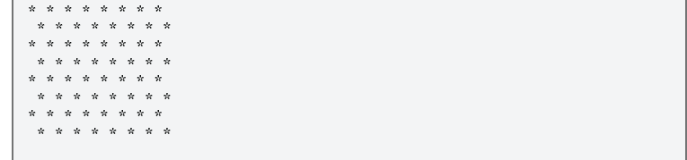

# 第 5 章 控制语句：第一部分答案

ANS:

```cs
// 练习 5.32 答案：Stars.cs
// 应用程序显示棋盘图案。
using System;
public class Stars
{
    public static void Main(string[] args)
    {
        int row = 1;
        while (row <= 8)
        {
            int column = 1;
            if (row % 2 == 0)
                Console.Write(" ");
            while (column <= 8)
            {
                Console.Write("* ");
                ++column;
            }
            Console.WriteLine();
            row++;
        }
    } // end Main
} // end class Stars
```

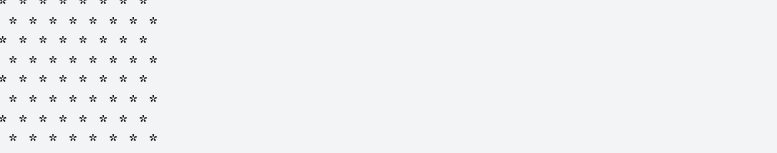

## 5.33

编写一个应用程序，在控制窗口中不断显示整数 2 的幂——即 2, 4, 8, 16, 32, 64 等。循环 40 次。运行此应用程序时会发生什么？

> ANS: 数值增长得太快，无法存储在 `int` 变量中。

```cs
// 练习 5.33 答案：Powers.cs
// 应用程序显示 2 的幂。
using System;
public class Powers
{
    public static void Main(string[] args)
    {
        int x = 1;
        int count = 0;
        while (count < 40)
        {
            x *= 2;
            ++count;
            Console.WriteLine(x);
        } // end while loop
    } // end Main
} // end class Powers
```

```
2
4
8
16
32
64
128
256
512
1024
2048
4096
8192
16384
32768
65536
131072
262144
524288
1048576
2097152
4194304
8388608
16777216
33554432
67108864
134217728
268435456
536870912
1073741824
-2147483648
0
0
0
0
0
0
0
```

# 32 第 5 章 控制语句：第一部分答案

## 5.34

下述语句有什么错误？请提供正确的语句来给 x 和 y 之和加 1；

```
Console.WriteLine((x + y));
```

ANS: `++` 可以应用于变量——不能应用于包含多个项的表达式。正确的语句是 `Console.WriteLine(x + y + 1);`。

## 5.35 (三角形的三边)

编写一个应用程序，读取用户输入的三个非零值，并判断显示它们是否可以代表三角形边。

ANS:

```cs
// 练习 5.35 答案：Triangle1.cs
// 应用程序获取三个值并判断
// 它们是否构成三角形边。
using System;
public class Triangle1
{
    // 检查三边是否可以构成三角形
    public static void Main(string[] args)
    {
        double side1; // 边1 的长度
        double side2; // 边2 的长度
        double side3; // 边3 的长度
        bool isTriangle; // 边是否可以构成三角形

        // 获取三边的值
        Console.Write("Enter side 1: ");
        side1 = Convert.ToDouble(Console.ReadLine());

        Console.Write("Enter side 2: ");
        side2 = Convert.ToDouble(Console.ReadLine());

        Console.Write("Enter side 3: ");
        side3 = Convert.ToDouble(Console.ReadLine());

        // 测试三角形
        isTriangle = false;

        if (side1 + side2 > side3)
        {
            if (side2 + side3 > side1)
            {
                isTriangle = true;
            } // end if 语句
        } // end outer 语句

        if (isTriangle)
        {
            Console.WriteLine("These could be sides to a triangle ");
        }
        else
        {
            Console.WriteLine("These do not form a triangle.");
        }
    } // end Main
} // end class Triangle1
```

Enter side 1: 3
Enter side 2: 4
Enter side 3: 5
These could be sides to a triangle

Enter side 1: 3
Enter side 2: 4
Enter side 3: 10
These do not form a triangle.

## 5.36

编写一个应用程序读取三个非零整数并判断它们是否可以代表直角三角形的边。

ANS:

```cs
// 练习 5.36 答案：Triangle2.cs
// 应用程序获取三个整数并判断
// 它们是否构成直角三角形边。
using System;
public class Triangle2
{
    // 检查三边是否可以构成直角三角形
    public static void Main(string[] args)
    {
        int side1; // 边1 的长度
        int side2; // 边2 的长度
        int side3; // 边3 的长度
        bool isRightTriangle; // 边是否构成直角三角形

        // 获取三边的值
        Console.Write("Enter side 1: ");
        side1 = Convert.ToInt32(Console.ReadLine());

        Console.Write("Enter side 2: ");
        side2 = Convert.ToInt32(Console.ReadLine());

        Console.Write("Enter side 3: ");
        side3 = Convert.ToInt32(Console.ReadLine());

        // 测试三角形
        isRightTriangle = false;

        if (side1 * side1 + side2 * side2 == side3 * side3 ||
            side1 * side1 + side3 * side3 == side2 * side2 ||
            side2 * side2 + side3 * side3 == side1 * side1)
        {
            isRightTriangle = true;
        }

        if (isRightTriangle)
        {
            Console.WriteLine("These could be sides to a right triangle ");
        }
        else
        {
            Console.WriteLine("These do not form a triangle.");
        }
    } // end Main
} // end class Triangle2
```

Enter side 1: 3
Enter side 2: 4
Enter side 3: 5
These could be sides to a triangle

Enter side 1: 3
Enter side 2: 4
Enter side 3: 10
These do not form a triangle.

Enter side 1: 3
Enter side 2: 4
Enter side 3: 5
These could be sides to a right triangle

Enter side 1: 3
Enter side 2: 4
Enter side 3: 10
These do not form a triangle.

Enter side 1: 3
Enter side 2: 4
Enter side 3: 5
These could be sides to a right triangle

## 5.37 (阶乘)

非负整数 n 的阶乘写为 n!（读作 "n factorial"），定义为：n! = n × (n−1) × ... × 1


例如，5! = 120。编写一个应用程序读取一个非负整数并显示其阶乘。

**答案：**

```cs
// 练习 5.37 答案：Factorial.cs
// 应用程序计算阶乘。
using System;

public class Factorial
{
    // 用户输入
    public static void Main(string[] args)
    {
        int number;
        int factorial; // 输入值的阶乘
        factorial = 1;
        Console.Write("Enter a positive integer: ");
        number = Convert.ToInt32(Console.ReadLine());

        Console.Write("{0}! is ", number);

        // 计算阶乘
        while (number > 0)
        {
            factorial *= number;
            --number;
        } // end while loop

        Console.WriteLine(factorial);
    } // end Main
} // end class Factorial
```

**输出示例：**
```
Enter a positive integer: 7
7! is 5040
```

### 5.38 (无限级数：数学常数)
编写一个应用程序使用公式估计数学常数 `e` 的值：

$$e = 1 + \frac{1}{1!} + \frac{1}{2!} + \frac{1}{3!} + \dots$$

注意定义的常量 `Math.E`（`Math` 类位于 `System` 命名空间）提供了 `e` 的良好近似。使用 `WriteLine` 方法输出你估计的 `e` 值和 `Math.E` 进行比较。

**答案：**

```cs
// 练习 5.38 答案：E.cs
// 应用程序计算 e 的估计值。
using System;

public class E
{
    // 近似 e 的值
    public static void Main(string[] args)
    {
        int number; // 计数器
        int accuracy; // 估计中的项数
        double factorial; // 阶乘的值
        double e; // e 的估计值

        number = 1;
        factorial = 1;
        e = 1.0;

        Console.Write("Enter accuracy of e: ");
        accuracy = Convert.ToInt32(Console.ReadLine());

        // 计算估计
        while (number < accuracy)
        {
            factorial *= number;
            e += 1.0 / factorial;
            ++number;
        } // end while loop

        Console.WriteLine("Estimated value: {0}", e);
        Console.WriteLine("Math.E: {0}", Math.E);
    } // end Main
} // end class E
```

**输出示例：**
```
Enter accuracy of e: 10
Estimated value: 2.7182815255718752
Math.E: 2.718281828459045
```

### 5.39 (无穷级数: $e^x$)
编写一个应用程序，使用公式计算 $e^x$ 的值：

$$e^x = 1 + \frac{x}{1!} + \frac{x^2}{2!} + \frac{x^3}{3!} + \dots$$

将你的计算结果与方法调用 `Math.Pow(Math.E, x)` 返回值进行比较。

> **注意：** 预定义方法 `Math.Pow` 接受两个参数，并将第一个参数置于第二个参数的幂。我们将在第 6.4 节讨论 `Math.Pow`。

**答案：**

```cs
// 练习 5.39 解答：Etox.cs
// 程序计算 e 的 x 次方。
using System;

public class Etox
{
    // 近似 e 到 x 次的值
    public static void Main(string[] args)
    {
        int number; // 计数器
        int accuracy; // 估计精度
        long factorial; // 阶乘值
        int x; // x 值
        double e; // e 的估计值
        double exponent; // 指数值

        number = 1;
        // ... 此处省略后续代码 ...
    } // end Main
} // end class Etox
```

**输出示例（差异练习 39）：**

| 输入指数 | e 的期望精度 | 估计的 e^x | Math.Pow(Math.E, x) |
| :--- | :--- | :--- | :--- |
| 3 | 3 | 8.5 | 20.0855369231877 |
| 3 | 10 | 20.0633928571429 | 20.0855369231877 |
| 3 | 20 | 20.0855369215177 | 20.0855369231877 |

### 5.40 (世界人口增长)
几个世纪以来，世界人口增长显著。持续的增长最终可能会挑战呼吸空气、饮用水、可耕地和有限资源的极限。有证据表明，近年来增长正在放缓，世界人口可能会在某个时候达到高峰然后开始下降。

对于此练习，研究世界人口增长问题。调查各种观点。获取当前世界人口及其增长率（预计今年可能增加的百分比）。编写一个程序，计算未来 75 年每年的世界人口增长情况，使用当前增长率保持不变的简化假设。在显示结果时，第一列应显示从第 1 年到第 75 年。第二列应显示该年底预计的世界人口。第三列应显示当年世界人口的数量增长。根据你的结果，确定如果今年的增长率持续，人口翻倍将是哪一年。（提示：使用 `double` 变量，因为 `int` 只能存储大约二十亿的值。使用格式 `F0` 显示 `double` 值。）

**答案：**

```cs
// 练习 5.40 解答：WorldPopulationGrowth.cs
// 根据当前的世界人口增长率和当前
// 世界人口，计算世界人口。
using System;

public class WorldPopulationGrowth
{
    public static void Main(string[] args)
    {
        long currentPopulation; // 今日世界人口
        double growthRate; // 增长率 (1.14% 应该是 .0114)
        double futurePopulation; // 基于增长率的未来人口

        Console.WriteLine("欢迎使用世界人口计算器 ");
        Console.Write("输入当前世界人口: ");
        currentPopulation = Convert.ToInt64(Console.ReadLine());
        Console.Write("输入当前增长率: (例如，1.14% 应该是 .0114): ");
        growthRate = Convert.ToDouble(Console.ReadLine());

        int year = 1; // 年份计数器
        Console.WriteLine("\n\t年份\t估计人口\t与上年的变化");
        while (year <= 75)
        {
            futurePopulation = currentPopulation * (1 + growthRate);
            Console.WriteLine("{0}\t{1:F0}\t{2:F0}", year, futurePopulation, futurePopulation - currentPopulation);
            currentPopulation = (long)futurePopulation; // 跟踪
            year++;
        } // end while
    } // end Main
} // end class WorldPopulationGrowth
```

**输出示例（部分）：**

| 年份 | 预计人口 | 与上年的变化 |
| :--- | :--- | :--- |
| 1 | 690941530 | 799054 |
| 2 | 699025066 | 808166 |
| ... | ... | ... |
| 75 | 2077873119 | 2800000 |

### 5.41 (通过密码学强制隐私)
互联网通信和连接网络计算机存储的爆炸式增长大大增加了隐私担忧。密码学领域对数据进行编码，使得未经授权的用户难以读取（并希望对于最先进的方案来说是不可能的）。在这个练习中，你将研究一种简单的加密和解密方案。一家想要在互联网上传数据的公司要求你编写一个程序安全地加密它。所有传输的数据都作为四位整数。你的应用程序应该读取用户输入的四位整数并按以下方式加密：将每个数字替换为该数字加 7 后除以 10 的余数。然后交换第一位和第三位，并交换第二位和第四位。然后显示加密后的整数。编写另一个独立的应用程序，输入加密的四位整数并将其解密（通过反转加密）以形成原始数字。当加密数字以 0 开头时，使用格式指定符 `D4` 显示加密。

**答案（加密部分）：**

```cs
// 练习 5.41 部分解答：Encrypt.cs
// 程序加密一个四位数字。
using System;

public class Encrypt
{
    // 加密一个四位数字
    public static void Main(string[] args)
    {
        int number; // 原始数字
        int digit1; // 第一位数字
        int digit2; // 第二位数字
        int digit3; // 第三位数字
        int digit4; // 第四位数字
        int encryptedNumber; // 加密数字

        // 输入要加密的四位数
        Console.Write("Enter a four-digit number: ");
        number = Convert.ToInt32(Console.ReadLine());

        digit1 = ((number / 1000) + 7) % 10;
        digit2 = ((number % 1000) / 100 + 7) % 10;
        digit3 = ((number % 100) / 10 + 7) % 10;
        digit4 = ((number % 10) + 7) % 10;

        // 交换第一位和第三位，第二位和第四位
        encryptedNumber = digit3 * 1000 + digit4 * 100 + digit1 * 10 + digit2;

        Console.WriteLine("Encrypted number is {0:D4}", encryptedNumber);
    } // end Main
} // end class Encrypt
```

**输出示例：**
```
Enter a four-digit number: 1234
Encrypted number is 0189
```

**答案（解密部分）：**

```cs
// 练习 5.41 部分 B 解：Decrypt.cs
// 应用解密一个四位数。
using System;

public class Decrypt
{
    // 解密一个四位数
    public static void Main(string[] args)
    {
        int number; // 加密后的数字
        int digit1; // 第一位数字
        int digit2; // 第二位数字
        int digit3; // 第三位数字
        int digit4; // 第四位数字
        int decryptedNumber; // 解密后的数字

        // 输入要解密的四位数
        Console.Write("Enter a four-digit number: ");
        number = Convert.ToInt32(Console.ReadLine());

        // 提取数字（注意：输入可能包含前导零，但作为 int 读取会丢失，此处假设输入为 4 位整数）
        digit1 = number / 1000;
        digit2 = (number % 1000) / 100;
        digit3 = (number % 100) / 10;
        digit4 = number % 10;

        // 反向交换：交换回第一位和第三位，第二位和第四位
        int temp1 = digit1;
        int temp2 = digit2;
        digit1 = digit3;
        digit2 = digit4;
        digit3 = temp1;
        digit4 = temp2;

        // 反向加密：(digit + 10 - 7) % 10 即 (digit + 3) % 10
        digit1 = (digit1 + 3) % 10;
        digit2 = (digit2 + 3) % 10;
        digit3 = (digit3 + 3) % 10;
        digit4 = (digit4 + 3) % 10;

        decryptedNumber = digit1 * 1000 + digit2 * 100 + digit3 * 10 + digit4;

        Console.WriteLine("Decrypted number is {0:D4}", decryptedNumber);
    } // end Main
} // end class Decrypt
```


number = Convert.ToInt32(Console.ReadLine());

digit1 = ((number / 1000) + 3) % 10;

digit2 = ((number % 1000) / 100) + 3) % 10;

digit3 = ((number % 100) / 10) + 3) % 10;

digit4 = ((number % 10) + 3) % 10;

```csharp
27      decryptedNumber = digit1 * 10 + digit2 +
28      digit3 * 1000 + digit4 * 100;
29
30      Console.WriteLine("Decrypted number is {0}", decryptedNumber);
31  } // 结束 Main
32  } // 结束类 Decrypt
```

输入四位数：0189
解密数字为：1234

## 控制语句：部分 2 答案

> 凡是计数的并不都有意义，凡是有意义的并不都能计数。
> —阿尔伯特·爱因斯坦

> 谁能控制自己的命运？
> —威廉·莎士比亚

> 用过的钥匙总是明亮的。
> —本杰明·富兰克林

> 智能……是制造人工制品的能力，特别是制造制造工具的工具的能力。
> —亨利·伯格森

> 过去的每一个优势都是根据最终的结果来判断的。
> —德摩斯梯尼

## 目标

在本章中，你将学习：

- 计数控制循环的基本要点。
- 使用 `for` 和 `do...while` 循环语句。
- 使用 `switch` 多重选择语句。
- 使用 `break` 和 `continue` 语句来改变控制流。
- 使用逻辑运算符构建复杂的条件表达式。


## 第 6 章 控制语句：部分 2 答案

## 自测练习

### 6.1 填充下列每个语句中的空缺：计数控制

- a) 通常情况下，`for` 语句用于计数控制循环，而 `while` 语句用于哨兵控制循环。
  答案：`for`, `while`。

- b) `do...` 语句在执行循环体**之后 (after)** 测试循环继续条件；循环体至少会执行一次。
  答案：`after`。

- c) `switch` 语句根据整数变量或表达式的可能值从多个动作中进行选择。
  答案：`switch`。

- d) 当在循环语句中执行时，`continue` 语句会跳过循环体中剩余语句，并进入循环的下一次迭代。
  答案：`continue`。

- e) `&&` 运算符可以用于在选择特定执行路径之前确保两个条件都为真。
  答案：`&&`（逻辑与）或 `||`（布尔逻辑）。

- f) 如果头部中的循环继续条件初始为**假 (false)**，则 `for` 语句的体将不执行。
  答案：`false`。

- g) 执行常用任务且不需要在对象上调用的方法称为 `static` 方法。
  答案：`static`。

### 6.2 判断每个陈述的对错。如果错误，请解释原因。

- a) `switch` 选择语句中需要默认标签（default label）。
  答案：错误。默认标签是可选的。如果不需要默认操作，则不需要默认标签。

- b) 在带有其他语句（如 `return`）的每个 `case` 中，都需要 `break` 语句。
  答案：错误。你可以使用其他语句来结束 `case`。

- c) 如果 `(x > y)` 为真或 `(a < b)` 为真，则表达式 `((x > y) && (a < b))` 为真。
  答案：错误。当使用 `&&` 运算符时，这两个关系表达式都为真，整个表达式才为真。

- d) 带有 `||` 运算符的表达式如果其操作数之一为真，则表达式为真。
  答案：正确。

- e) 格式项目带有逗号（,）的整数（例如 `{0,4}`）指示字符串的宽度。
  答案：正确。

- f) 在 `switch` 语句中测试值范围，在 `case` 标签的起始和结束值之间使用连字符（-）。
  答案：错误。`switch` 语句没有测试值范围的机制，你必须为要测试的值列出每个 `case` 标签。

- g) 连续列出 `case` 而没有语句可以让这些 `case` 执行相同的语句集。
  答案：正确。

### 6.3 编写 C# 语句来完成以下任务：

a) 使用 `for` 语句计算 1 到 99 之间的整数和。假设变量 `sum` 和 `count` 已经声明。

b) 使用 `Pow` 方法计算 2.5 的三次幂。假设变量 `result` 已经声明。

c) 使用 `while` 循环显示从 1 到 20 的整数。假设变量 `i` 已经声明但未初始化。当 `i` 的值为 0 时，换行；否则显示制表符。

## 第 6 章 控制语句：第 2 部分答案

### 练习 6.4

b) `for ( k = 0.1; k != 1.0; k += 0.1 ) Console.WriteLine( k );`
ANS: 使用浮点数控制 `for` 语句可能不起作用，因为浮点数在计算机等设备中仅以近似表示。
修正：使用整数，并进行适当的计算以获得所需的值。此外，`for` 循环的继续条件通常使用关系运算符（如 `<`）而不是等值运算符。

```csharp
// 练习 6.4b: PartB.cs

using System;

public class PartB
{
    public static void Main( string[] args )
    {
        double k;
        for ( k = 0.1; k != 1.0; k += 0.1 )
            Console.WriteLine( k );
    } // end Main
} // end class PartB
```

输出：
```text
0.1
0.2
0.3
0.4
0.5
0.6
0.7
0.8
0.9
1
1.1
1.2
1.3
1.4
1.5
...
```

```csharp
// 练习 6.4b 答案: PartBCorrected.cs

using System;

public class PartBCorrected
{
    public static void Main( string[] args )
    {
        int k;
        for ( k = 1; k < 10; k++ )
            Console.WriteLine( ( double ) k / 10 );
    } // end Main
} // end class PartBCorrected
```

输出：
```text
0.1
0.2
0.3
0.4
0.5
0.6
0.7
0.8
0.9
```

c) 
```csharp
switch ( n )
{
    case 1:
        Console.WriteLine("The number is 1");
    case 2:
        Console.WriteLine("The number is 2");
        break;
    default:
        Console.WriteLine("The number is not 1 or 2");
        break;
}
```
ANS: 错误：`case 1` 会穿透到 `case 2`。
修正：以某种方式终止 `case`，例如在第一个 `case` 的末尾添加 `break` 语句。

```csharp
// 练习 6.4c: PartC.cs

using System;

public class PartC
{
    public static void Main(string[] args)
    {
        int n = 1;
        switch (n)
        {
            case 1:
                Console.WriteLine("The number is 1");
            case 2:
                Console.WriteLine("The number is 2");
                break;
            default:
                Console.WriteLine("The number is not 1 or 2");
                break;
        }
    } // end Main
} // end class PartC
```

编译器错误：
```text
控制无法从一个 case 标签 (case 1:) 穿透到另一个 | PartC.cs | 12 | 10 | PartC
```

```csharp
// 练习 6.4c: PartCCorrected.cs

using System;

public class PartCCorrected {
    public static void Main(string[] args) {
        int n = 1;
        switch ( n ) {
            case 1:
                Console.WriteLine("The number is 1");
                break;
            case 2:
                Console.WriteLine("The number is 2");
                break;
            default:
                Console.WriteLine("The number is not 1 or 2");
                break;
        } // end switch
    } // Main
}
```

输出：
```text
The number is 1
```

以下代码应该显示从 1 到 10 的值：
```csharp
n = 1;
while ( n < 10 ) {
    Console.WriteLine(n++);
}
```
ANS: 错误：在 `while` 条件使用了不适当的关系运算符。
修正：使用 `<=` 而不是 `<`，或者将 `10` 改为 `11`。

```csharp
// 练习 6.4d: PartD.cs

using System;

public class PartD {
    public static void Main(string[] args) {
        int n = 1;
        while ( n < 10 )
            Console.WriteLine(n++);
    } // end Main
} // end class PartD
```

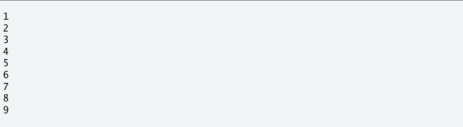

```csharp
// 练习 6.4d: PartDCorrected.cs

using System;

public class PartDCorrected
{
    public static void Main( string[] args )
    {
        int n = 1;
        while ( n <= 10 )
            Console.WriteLine(n++);
    } // end Main
} // end class PartDCorrected
```


## 练习

### 6.5 描述计数循环的四个基本元素。
ANS: 计数循环需要一个控制变量、该变量的初始值、每次对该变量的增（或递减），以及一个决定循环是否继续的条件。

### 6.6 比较 `while` 语句和 `for` 语句。
ANS: `while` 语句在循环体之前测试条件；`for` 语句则在头部指定了控制变量。`while` 语句通常在循环体内修改控制变量，而 `for` 语句通常用于计数器循环。

### 6.7 讨论在什么情况下使用 `do-while` 比 `while` 更合适。
ANS: 如果你希望循环体至少执行一次，那么 `do-while` 比 `while` 更合适，因为 `do-while` 在执行循环体后测试条件，而 `while` 在执行前测试。如果条件从一开始为假，`do-while` 也会执行一次循环。

### 6.8 比较 `break` 语句和 `continue` 语句。
ANS: `break` 语句会立即从循环中退出；`continue` 语句则跳过当前循环体中的剩余部分，直接进入下一次迭代。

### 6.9 找出并纠正以下代码段中的错误：

a) `For ( i = 100, i >= 1, i++ )`
ANS: `for` 头部中的 `F` 应该是小写的。逗号应该使用分号。`++` 运算符应该是 `--`。

```csharp
// 练习 6.9a: PartA.cs

using System;

public class PartA
{
    public static void Main(string[] args)
    {
        int i;
        for (i = 100, i >= 1, i ++)
            Console.WriteLine(i);
    } // end Main
} // end class PartA
```

```csharp
// 练习 6.9a 答案: PartACorrected.cs

using System;

public class PartACorrected
{
    public static void Main(string[] args)
    {
        int i;
        for (i = 100; i >= 1; i --)
            Console.WriteLine(i);
    } // end Main
} // end class PartACorrected
```

输出：
```text
100
99
98
97
...
3
2
1
```

b) 以下代码应该显示整数值是奇数还是偶数：
```csharp
{
  switch ( value % 2 ) {
    case 0:
      Console.WriteLine("Even integer");
    case 1:
      Console.WriteLine("Odd integer");
  }
}
```
ANS: 在 `case 0:` 和 `case 1:` 的语句末尾应该放置一个 `break` 语句。

```csharp
// 练习 6.9b: PartB.cs

using System;

public class PartB
{
  public static void Main( string[] args) {
    int value = 8;
    switch ( value % 2 ) {
      case 0:
        Console.WriteLine("Even integer");
      case 1:
        Console.WriteLine("Odd integer");
    } // end switch
  } // end Main
} // end class PartB
```

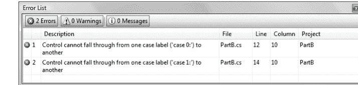

```csharp
// 练习 6.9b 答案: PartBCorrected.cs

using System;

public class PartBCorrected
{
  public static void Main( string[] args) {
    int value = 8;
    switch ( value % 2 ) {
      case 0:
        Console.WriteLine("Even integer");
        break;
      case 1:
        Console.WriteLine("Odd integer");
        break;
    } // end switch
  } // end Main
} // end class PartBCorrected
```

输出：
```text
Even integer
```

c) 以下代码应该输出从 19 到 1 的奇数：
```csharp
for (int i = 19; i >= 1; i += 2)
    Console.WriteLine(i);
```
答：`for` 循环头中的 `+=` 运算符应该是 `-=`。

```csharp
// Exercise 6.9c: PartC.cs

using System;

public class PartC
{
    public static void Main(string[] args)
    {
        for (int i = 19; i >= 1; i += 2)
            Console.WriteLine(i);
    } // end Main
} // end class PartC
```

```csharp
// Exercise 6.9c Solution: PartCorrected.cs

using System;

public class PartCorrected
{
    public static void Main(string[] args)
    {
        for (int i = 19; i >= 1; i -= 2)
            Console.WriteLine(i);
    } // end Main
} // end class PartCorrected
```


# 第 6 章 控制语句：部分 2 答案

## 6.9 练习

### d) 以下代码应该输出从 2 到 100 的偶数：

```csharp
counter = 2;

do
    Console.WriteLine(counter);
    counter += 2;
} While ( counter < 100 );
```

**答**：`while` 中的 `W` 应该是小写。运算符 `<` 应该是 `<=`。

```csharp
// Exercise 6.9d: PartD.cs
using System;

public class PartD
{
    public static void Main(string[] args)
    {
        int counter = 2;
        do
            Console.WriteLine(counter);
            counter += 2;
        } While ( counter < 100 );
    } // end Main
} // class PartD
```

| 描述 | 文件 | 行 | 列 | 项目 |
| --- | --- | --- | --- | --- |
| 1 语法错误，预期 'while' | PartD.cs | 14 | 9 | PartD |
| 2 预期有 ) | PartD.cs | 14 | 32 | PartD |

```csharp
// Exercise 6.9d Solution: PartDCorrected.cs
using System;
public class PartDCorrected
{
    public static void Main(string[] args)
    {
        int counter = 2;
        do
        {
            Console.WriteLine(counter);
            counter += 2;
        } while(counter <= 100);
    } // end Main
 // end class PartDCorrected
```

## 6.10 下一个程序的作用是什么？

```csharp
// Exercise 6.10 Solution: Printing.cs
using System;
public class Printing
{
    public static void Main(string[] args)
    {
        for (int i = 1; i <= 10; i++)
        {
            for (int j = 1; j <= 5; j++)
            {
                Console.Write('@');
            }
            Console.WriteLine();
        } // end outer for
    } // end Main
 // end class Printing
```

## 6.11 写一个程序，找到多个整数中的最小的一个。假设第一个读取指定了从用户输入的数值数量。

**答**：

```csharp
// Exercise 6.11 Solution: Small.cs
// 程序找到多个整数中的最小的一个。
using System;
public class Small
{
    // 找到最小整数
    public static void Main(string[] args)
    {
        int smallest = 0; // 最小数字
        int number = 0; // 用户输入的数字
        int integers; // 整数个数

        Console.Write("Enter number of integers: ");
        integers = Convert.ToInt32(Console.ReadLine());

        for (int counter = 1; counter <= integers; counter++)
        {
            if (counter == 1)
                smallest = number;
            else if (number < smallest)
                smallest = number;
        }
        Console.WriteLine("Smallest integer is: {0}", smallest);
    }
} // class Small
```

### 练习 17

```
Enter number of integers: 5
Enter integer: 10
Enter integer: -4
Enter integer: 2
Enter integer: 0
Enter integer: 9
Smallest integer is: -4
```

## 6.12 写一个程序，计算 1 到 7 奇数的乘积。

**答**：

```csharp
// Exercise 6.12 Solution: Odd.cs
// 程序输出 1 到 7 奇数的乘积
using System;
public class Odd
{
    public static void Main(string[] args)
    {
        int product = 1; // 所有奇数的乘积
        // 遍历从 3 到 7 的所有奇数
        for (int x = 3; x <= 7; x += 2)
        {
            product *= x;
        }
        Console.WriteLine("Product is {0}", product); // 显示结果
    } // class Odd
}
```

```
Product is 105
```

## 6.13 阶乘在问题中经常使用。正整数 n 的阶乘 (n!) 等于从 1 到 n 的整数的积。写一个程序计算 1 到 5 整数的阶乘。以表格格式显示结果。

**答**：计算 20 的阶乘可能是困难的，因为值超过了可以存储的最大值。

```csharp
// Exercise 6.13 Solution: Factorial.cs
// 程序计算阶乘。
using System;
public class Factorial
{
    public static void Main(string[] args)
    {
        Console.WriteLine("n!");
        for (int number = 1; number <= 5; number++)
        {
            int factorial = 1;
            for (int i = 1; i <= 1; i++)
            {
                factorial *= i;
            }
            Console.WriteLine("{0}! {1}", number, factorial);
        }
    } // class Factorial
}
```

| n | n! |
| --- | --- |
| 1 | 1 |
| 2 | 2 |
| 3 | 6 |
| 4 | 24 |
| 5 | 120 |

## 6.14 修改 while 循环以计算复利。

```csharp
// Exercise 6.14 Solution: Interest.cs
// 计算复利
using System;
public class Interest
{
    public static void Main(string[] args)
    {
        double amount; // 金额
        double principal = 1000; // 初始本金
        double rate = 0.05; // 利率
        int year; // 年份

        for (year = 1; year <= 10; year++)
        {
            amount = principal * Math.Pow(1 + rate, year);
            Console.WriteLine("Year {0}: {1:C}", year, amount);
        }
    }
}
```

| 利率 | 年 | 存款金额 |
| --- | --- | --- |
| 5% | 1 | $1,050.00 |
| | 2 | $1,102.50 |
| | 3 | $1,157.63 |
| | 4 | $1,215.51 |
| | 5 | $1,276.28 |
| | 6 | $1,340.10 |
| | 7 | $1,407.10 |
| | 8 | $1,477.46 |
| | 9 | $1,551.33 |
| | 10 | $1,628.89 |
| 6% | 1 | $1,060.00 |
| | 2 | $1,123.60 |
| | 3 | $1,191.02 |
| | 4 | $1,262.48 |
| | 5 | $1,338.23 |
| | 6 | $1,418.52 |
| | 7 | $1,503.63 |
| | 8 | $1,593.85 |
| | 9 | $1,689.47 |
| | 10 | $1,790.85 |
| 7% | 1 | $1,070.00 |
| | 2 | $1,144.90 |
| | 3 | $1,225.04 |
| | 4 | $1,310.60 |
| | 5 | $1,402.55 |
| | 6 | $1,500.73 |
| | 7 | $1,605.78 |
| | 8 | $1,718.19 |
| | 9 | $1,838.46 |
| | 10 | $1,967.15 |
| 8% | 1 | $1,080.00 |
| | 2 | $1,166.40 |
| | 3 | $1,259.71 |
| | 4 | $1,360.49 |
| | 5 | $1,469.33 |
| | 6 | $1,586.87 |
| | 7 | $1,713.82 |
| | 8 | $1,850.93 |
| | 9 | $1,999.00 |
| | 10 | $2,158.92 |

## 6.15 写一个程序，将以下模式单独显示在另一个下方。使用循环生成这些模式。所有的星号 (`*`) 都应该由单个 `Console.WriteLine('*');` 语句显示，该语句可以移动到下一行。`Console.WriteLine(' ')` 语句可以用于最后一行显示空格。最后的模式需要适当数量的空白空格。

```csharp
int row; // 行位置
int column; // 列位置
int space; // 要显示的空格数

// 第一个三角形
for (row = 1; row <= 10; row++)
{
    for (column = 1; column <= row; column++)
        Console.Write("*\n");
    Console.WriteLine();
    // 结束外循环
}

Console.WriteLine();

// 第二三角形
for (row = 10; row >= 1; row--)
{
    for (column = 1; column <= row; column++)
        Console.Write("*\n");
    Console.WriteLine();
    // 结束外循环
}

Console.WriteLine();

// 第三个三角形
for (row = 10; row >= 1; row--)
{
    for (space = 10; space > row; space--)
        Console.Write(" ");
    for (column = 1; column <= row; column++)
        Console.Write("*\n");
    Console.WriteLine();
    // 结束外循环
}

Console.WriteLine();

// 第四个三角形
for (row = 10; row >= 1; row--)
{
    for (space = 1; space < row; space++)
        Console.Write(" ");
    for (column = 10; column >= row; column--)
        Console.Write("*\n");
    Console.WriteLine();
    // 结束外循环
}
// 结束 Main
} // 结束类 Triangles
```

### 输出结果

```
*
**
***
****
*****
******
*******
********
*********
**********
***********
************
*********
********
*******
******
*****
****
***
**
*

**
**
***
****
*****
******
*******
********
*********

**
***
****
***
**
*

*
**
***
****
*****
******
*******
********

**
***
****
*****
******
*******
********
```

## 6.16 计算机的一个有趣应用是显示图表和柱状图。编写一个程序，读取 1 到 30 之间的三个数字。对于读取的每个数字，你的程序应该显示相同数量的相邻星号。例如，如果你的程序读取到数字 7，它应该显示 `*****`。

**答案**：

```csharp
// 练习 6.16 答案：BarChart.cs
// 程序显示 3 个长度由用户指定的柱状图。
using System;

public class BarChart
{
    public static void Main(string[] args)
    {
        // 此处省略具体实现代码，原文仅给出运行示例
    }
}
```

```
输入 1 到 30 之间的数字: 10
************
输入 1 到 30 之间的数字: 35
无效输入
数字应在 1 到 30 之间
输入 1 到 30 之间的数字: 20
********************
输入 1 到 30 之间的数字: 7
*******
```

## 6.17 一家网站销售三种产品，零售价格如下：产品 1，$2.98；产品 2，$4.50；产品 3，$9.98。编写一个程序，读取一系列成对的数字，如下：

- 产品编号
- 销售数量

你的程序应该使用 `switch` 语句来确定每个产品的零售价格。它应该计算并显示所有销售产品的总零售价值。使用哨兵控制循环来确定程序何时应该停止循环并显示最终结果。

**答案**：

```csharp
// 练习 6.17 答案：Sales.cs
// 程序计算销售额
using System;

public class Sales
{
    public static void Main(string[] args)
    {
        // 此处省略具体实现代码，原文仅给出片段和运行示例
    }
}
```

### 练习 25 (代码片段)

```csharp
53 Console.WriteLine("Product 2: {0:C}", product2);
54 Console.WriteLine("Product 3: {0:C}", product3);
55 } // 结束 Main
56 } // 类 Sales
```

### 运行示例

```
输入产品编号 (1-3) (0 停止): 1
输入销售数量: 100
输入产品编号 (1-3) (0 停止): 2
输入销售数量: 200
输入产品编号 (1-3) (0 停止): 1
输入销售数量: 50
输入产品编号 (1-3) (0 停止): 3
输入销售数量: 10
输入产品编号 (1-3) (0 停止): 1
输入销售数量: 100
输入产品编号 (1-3) (0 停止): 0

Product 1: $745.00
Product 2: $900.00
Product 3: $99.80
```

## 6.18 在未来，你可能会使用其他没有支持精确货币计算的类型的语言。在这些语言中，你应该使用整数来执行此类计算。修改图 6.6 中的程序，仅使用整数来计算复利。将所有货币金额视为分。然后分别通过除法和取余操作将其分解美元和分。在显示结果时，在美元和分之间插入一个点。


# 第 6 章 控制语句：部分 2

## 练习 6.18：Interest.cs

```csharp
// 练习 6.18：Interest.cs
// 计算复利。
using System;
public class Interest
{
    public static void Main(string[] args)
    {
        int amount; // 存款金额
        int principal = 100000; // 初始金额（分）
        double rate = 0.05; // 利率

        // 显示表头
        Console.WriteLine("{0},{1,2}", "年份", "存款金额");

        // 计算每年的存款金额
        for (int year = 1; year <= 10; year++)
        {
            // 计算指定年份的金额
            amount = (int)(principal * Math.Pow(1.0 + rate, year));
            int dollars = amount / 100; // 计算美元
            int cents = amount % 100; // 计算分
            // 输出年份、美元和分
            Console.WriteLine("{0},{1,2}.{2,2}", year, dollars, cents);
        } // 结束 for
    } // 结束 Main
} // 结束类 Interest
```

### 答案

| 年份 | 存款金额 |
| :--- | :--- |
| 1 | 1050.00 |
| 2 | 1102.50 |
| 3 | 1157.62 |
| 4 | 1215.00 |
| 5 | 1276.28 |
| 6 | 1340.00 |
| 7 | 1407.10 |
| 8 | 1477.45 |
| 9 | 1551.32 |
| 10 | 1628.89 |

## 练习 6.19

假设 `i=1, j=2, k=3, m=2`。以下语句每个显示什么？

a) `Console.WriteLine(i == 1 );` 答案：True

b) `Console.WriteLine(j == 3);` 答案：False

c) `Console.WriteLine((i >= 1) && (j < 4));` 答案：True

d) `Console.WriteLine((m <= 99) && (k < m));` 答案：False

e) `Console.WriteLine((j >= i) || (k == m));` 答案：True

f) `Console.WriteLine((k + m > j) | (3 == k));` 答案：True

g) `Console.WriteLine(!(k > m));` 答案：False

### 代码实现：Mystery.cs

```csharp
// 练习 6.19 答案：Mystery.cs
// 输出条件表达式输出 'True' 或 'False'。
using System;
public class Mystery
{
    public static void Main(string[] args)
    {
        int i = 1;
        int j = 2;
        int k = 3;
        int m = 2;
        // 部分 a
        Console.Write("Part a: ");
        Console.WriteLine(i == 1 );
        // 部分 b
        Console.Write("Part b: ");
        Console.WriteLine(j == 3 );
        // 部分 c
        Console.Write("Part c: ");
        Console.WriteLine((i >= 1) && (j < 4 ));
        // 部分 d
        Console.Write("Part d: ");
        Console.WriteLine((m <= 99) && (k < m ));
        // 部分 e
        Console.Write("Part e: ");
        Console.WriteLine((j >= i) || (k == m ));
        // 部分 f
        Console.Write("Part f: ");
        Console.WriteLine((k + m > j) | (3 == k ));
        // 部分 g
        Console.Write("Part g: ");
        Console.WriteLine(!(k > m ));
    } // 结束 Main
} // 类 Mystery
```

### 运行结果

```text
Part a: True
Part b: False
Part c: True
Part d: False
Part e: True
Part f: True
Part g: False
```

## 练习 6.20：从无穷级数中计算 $\pi$ 的值

$\pi = 4 - \frac{4}{3} + \frac{4}{5} - \frac{4}{7} + \frac{4}{9} - \dots$

显示一个表格，通过计算该级数的第一项、两项、三项等来近似 $\pi$ 的值。在第一次得到 3.14、3.141、3.1415 之前，你需要使用该级数的多少项？

**答案**：计算在第 119 项时开始达到 3.14，但直到第 688 项才真正接近 3.1415。

### 代码实现：Pi.cs

```csharp
// 练习 6.20 答案：Pi.cs
// 程序从无穷级数计算 Pi。
using System;
public class Pi
{
    public static void Main(string[] args)
    {
        double piValue = 0.0; // pi 的近似值
        double numerator = 4.0; // 分子
        double denominator = 1.0; // 分母
        int accuracy; // 项数

        // 提示用户并输入项数
        Console.Write("Enter the number of terms: ");
        accuracy = Convert.ToInt32(Console.ReadLine());

        // 显示表格
        Console.WriteLine("{0}\t{1}", "Term", "Pi");

        for (int term = 1; term <= accuracy; term++)
        {
            if (term % 2 != 0)
                piValue += numerator / denominator;
            else
                piValue -= numerator / denominator;
            
            Console.WriteLine("{0}\t{1}", term, piValue);
            denominator += 2.0;
        } // 结束 for
    } // 结束 Main
} // 类 Pi
```

### 运行示例 (输入 119)

| Term | Pi |
| :--- | :--- |
| 1 | 4 |
| 2 | 2.6666666666666665 |
| 3 | 3.4666666666666668 |
| 4 | 2.8952380952380956 |
| 5 | 3.3396825396825403 |
| ... | ... |
| 119 | 3.14... |

## 练习 6.21：勾股数

所有可能性。这种方法是“暴力破解”计算的一个示例。在更高级的计算机科学课程中，你将学到对于许多问题，除了使用纯蛮力之外，没有已知的算法方法。

### 代码实现：Triples.cs

```csharp
// Exercise 6.21 Solution: Triples.cs
// 计算勾股数
using System;
public class Triples
{
    public static void Main(string[] args)
    {
        // 显示表头
        Console.WriteLine("{0,8}{1,8}{2,12}",
            "side1", "side2", "hypotenuse");
        
        for (int side1 = 1; side1 <= 500; side1++)
        {
            for (int side2 = 1; side2 <= 500; side2++)
            {
                for (int hypotenuse = 1; hypotenuse <= 500; hypotenuse++)
                {
                    if ((side1 * side1) + (side2 * side2) == (hypotenuse * hypotenuse))
                    {
                        // 使用勾股定理显示直角三角形
                        Console.WriteLine("{0,8}{1,8}{2,12}",
                            side1, side2, hypotenuse);
                    }
                } // end for (hypotenuse)
            } // end for (side2)
        } // end for (side1)
    } // end Main
} // class Triples
```

### 部分输出结果

| side1 | side2 | hypotenuse |
| :--- | :--- | :--- |
| 3 | 4 | 5 |
| 4 | 3 | 5 |
| 5 | 12 | 13 |
| 6 | 8 | 10 |
| ... | ... | ... |
| 480 | 88 | 488 |
| 480 | 108 | 492 |
| 480 | 140 | 500 |
| 483 | 44 | 485 |

## 练习 6.22：并排显示四个三角形

修改练习 6.15，将你四个独立星号三角形的代码组合起来，使得所有模式并排显示。巧妙地使用嵌套的 `for` 循环。

### 代码实现：Triangles.cs

```csharp
// Exercise 6.22 Solution: Triangles.cs
// 应用并排绘制四个三角形
using System;

public class Triangles
{
    public static void Main(string[] args)
    {
        // 一次绘制一行，在三角形之间留入制表符
        for (int row = 1; row <= 10; row++)
        {
            // 三角形一：左上直角，星号递增
            for (int column = 1; column <= row; column++)
                Console.Write("*");
            for (int space = 1; space <= 10 - row; space++)
                Console.Write(" ");

            Console.Write("\t");

            // 三角形二：右上直角，星号递减
            for (int space = 1; space < row; space++)
                Console.Write(" ");
            for (int column = 10; column >= row; column--)
                Console.Write("*");

            Console.Write("\t");

            // 三角形三：左下直角，星号递减
            for (int column = 10; column >= row; column--)
                Console.Write("*");
            for (int space = 1; space < row; space++)
                Console.Write(" ");

            Console.Write("\t");

            // 三角形四：右下直角，星号递增
            for (int space = 10; space > row; space--)
                Console.Write(" ");
            for (int column = 1; column <= row; column++)
                Console.Write("*");
            
            Console.WriteLine();
        } // end for
    } // end Main
} // end class Triangles
```

### 运行结果

```text
*         **********        **********        *
**         *********        *********        **
***         ********        ********        ***
****         *******        *******        ****
*****         ******        ******        *****
******         *****        *****        ******
*******         ****        ****        *******
********         ***        ***        ********
*********         **        **        *********
**********         *        *        **********
```

## 练习 6.23：显示菱形

编写一个程序显示以下菱形形状。你可以使用显示单个星号 (`*`)、单个空格或单个换行符的输出语句。最大限度地使用循环（带有嵌套语句），并尽可能地减少输出语句的数量。

### 代码实现：Diamond.cs

```csharp
// Exercise 6.23 Solution: Diamond.cs
// 应用用最少的输出语句绘制菱形
using System;
public class Diamond
{
    public static void Main(string[] args)
    {
        // 上部分（含中间行，共 5 行）
        for (int row = 1; row <= 5; row++)
        {
            // 打印前导空格
            for (int spaces = 5; spaces > row; spaces--)
                Console.Write(" ");
            // 打印星号
            for (int stars = 1; stars <= (row * 2 - 1); stars++)
                Console.Write("*");
            Console.WriteLine();
        }

        // 下部分（共 4 行）
        for (int row = 4; row >= 1; row--)
        {
            // 打印前导空格
            for (int spaces = 5; spaces > row; spaces--)
                Console.Write(" ");
            // 打印星号
            for (int stars = 1; stars <= (row * 2 - 1); stars++)
                Console.Write("*");
            Console.WriteLine();
        }
    } // 结束 Main
} // 结束类 Diamond
```

### 运行结果

```text
    *
   ***
  *****
 *******
*********
 *******
  *****
   ***
    *
```

## 练习 6.24：指定大小的菱形

修改你在 6.23 中编写程序，读取 1 到 19 之间的奇数作为行数。你的程序应该显示相应大小的菱形。

### 代码实现：Diamond.cs

```csharp
// Exercise 6.24 Solution: Diamond.cs
// 应用绘制指定大小的菱形
using System;
public class Diamond
{
    public static void Main(string[] args)
    {
        int numRows; // 行数

        // 在范围内提示输入行数
        Console.Write("输入行数（1到19之间的奇数）： ");
        numRows = Convert.ToInt32(Console.ReadLine());

        // 验证输入：必须为奇数且在 1-19 之间
        while (numRows > 19 || numRows < 1 || (numRows % 2 == 0))
        {
            Console.WriteLine("输入无效.");
            Console.Write("输入行数（1到19之间的奇数）： ");
            numRows = Convert.ToInt32(Console.ReadLine());
        }

        int mid = (numRows + 1) / 2; // 中间行号

        // 上部分（含中间行）
        for (int row = 1; row <= mid; row++)
        {
            for (int spaces = mid; spaces > row; spaces--)
                Console.Write(" ");
            for (int stars = 1; stars <= (row * 2 - 1); stars++)
                Console.Write("*");
            Console.WriteLine();
        }

        // 下部分
        for (int row = mid - 1; row >= 1; row--)
        {
            for (int spaces = mid; spaces > row; spaces--)
                Console.Write(" ");
            for (int stars = 1; stars <= (row * 2 - 1); stars++)
                Console.Write("*");
            Console.WriteLine();
        }
    } // 结束 Main
} // 结束类 Diamond
```


## 第 6 章 控制语句：第 2 部分 答案

### 6.25
对 `break` 语句和 `continue` 语句的批评是它们是非结构化的。实际上，`break` 和 `continue` 语句总是可以被结构化语句取代，尽管这样做可能很笨拙。描述你将如何移除程序中的任何 `break` 语句并将其替换为某些结构化语句。（提示：`break` 语句退出循环体。另一种方法是让通过 `continue` 测试。）使用你开发的方法移除图 6.13 程序中的 `continue` 语句。

**ANS:** 循环可以在不使用 `continue` 语句的情况下重写，将循环体中 `continue` 语句之后的所有代码移动到测试 `continue` 条件反面的 `if` 语句中。因此，原本在 `continue` 语句之后的代码只有在 `if` 语句条件表达式为真（即“continue”条件为假）时才会执行。当“continue”条件为真时，`if` 体不执行，应用程序通过不执行循环体中剩余的代码来“继续”执行循环的下一次迭代。

### 6.26
下面代码段的作用是什么？

```csharp
for (int i = 1; i <= 5; i++) {
    for (int j = 1; j <= 3; j++) {
        for (int k = 1; k <= 4; k++) {
            Console.Write('*');
        }
        Console.WriteLine();
    } // end middle for
    Console.WriteLine();
} // end outer for
```

### 练习 35

```csharp
// Exercise 6.26 Solution: Mystery.cs
// 显示 5 组每组 3 行，每行 4 个星号。

using System;

public class Mystery
{
    public static void Main(string[] args)
    {
        for (int i = 1; i <= 5; i++) {
            for (int j = 1; j <= 3; j++) {
                for (int k = 1; k <= 4; k++) {
                    Console.Write('*');
                }
                Console.WriteLine();
            } // end middle for
            Console.WriteLine();
        } // end outermost for
    } // end Main
} // end class Mystery
```

```text
****
****
****

****
****
****

****
****
****

****
****
****

****
****
****
```

### 6.27
通用描述你将如何移除循环中的任何 `continue` 语句并将其替换为某些结构化语句。使用你开发的方法移除图 6.13 程序中的 `continue` 语句。

**ANS:** 循环可以在不使用 `continue` 语句的情况下重写，将循环体中 `continue` 语句之后的所有代码移动到测试 `continue` 条件反面的 `if` 语句中。因此，原本在 `continue` 语句之后的代码只有在 `if` 语句条件表达式为真（即“continue”条件为假）时才会执行。当“continue”条件为真时，`if` 体不执行，应用程序通过不执行循环体中剩余的代码来“继续”执行循环的下一次迭代。这里的答案是从 `if` 语句中删除了 `continue` 语句。

```csharp
// 练习 6.27 解决方案：ContinueTest.cs
// for语句中 continue语句的替代方案

using System;

public class ContinueTest
{
    public static void Main(string[] args)
    {
        for (int count = 1; count <= 10; count++) // 循环 10 次
            if (count != 5) // 如果 count 不等于 5
                Console.Write("{0} ", count); // 显示

        Console.WriteLine("\n使用 if 语句跳过 5 的显示");
    } // 类 ContinueTest
}
```

| 使用 if 语句跳过 5 的显示 |
| :--- |
| 1 2 3 4 6 7 8 9 10 |

### 6.28 (全球变暖知识测验)
全球变暖这一争议性问题由副总统阿尔·戈尔主演的电影《不一样的真相》（*An Inconvenient Truth*）广泛宣传。戈尔与联合国科学家网络气候变化政府间小组共同荣获 2007 年诺贝尔奖，以表彰“他们在建立和传播有关人类活动变化的知识方面的努力”。在网上研究全球变暖问题的两个方面（你可能想搜索“全球变暖怀疑论者”等短语）。创建一个关于全球变暖的五道选题，每题有四个可能的答案（编号 1-4）。保持客观并尝试考虑问题的双方。接下来，编写一个管理测验的应用程序，计算正确答案的数量（0 到五个）并向用户返回消息。如果用户正确回答五个问题，打印“优秀”；如果是四个，打印“非常好”；如果是三个或更多，打印“该温习你关于全球变暖的知识了”，并包含你发现事实的网站列表。

**答案：**

```csharp
// 练习 6.28 解决方案：GlobalWarmingQuiz.cs
// 管理全球变暖测验。

using System;

class GlobalWarmingQuiz
{
    public static void Main(string[] args)
    {
        int answer; // 用户对当前问题的回答
        int score = 0; // 正确答案的数量

        // 第一个问题
        Console.WriteLine("自 1880 年以来，平均温度上升了多少？");
        Console.WriteLine("1: 0.4 华氏度 ");
        Console.WriteLine("2: 1.4 华氏度 ");
        Console.WriteLine("3: 2.4 华氏度 ");
        Console.WriteLine("4: 3.4 华氏度 ");
        Console.Write("> "); // 显示提示
        answer = Convert.ToInt32(Console.ReadLine()); // 读取答案
        if (answer == 2)
        {
            ++score; // 如果回答正确加分
            Console.WriteLine("正确！\n");
        }
        else
            Console.WriteLine("错误。正确答案是 2\n");

        // 第二个问题
        Console.WriteLine("蒙大拿国家冰川公园在 1910 年有 150 条冰川.");
        Console.WriteLine("1: 0 ");
        Console.WriteLine("2: 7 ");
        Console.WriteLine("3: 17 ");
        Console.WriteLine("4: 27 ");
        Console.Write("> "); // 显示提示
        answer = Convert.ToInt32(Console.ReadLine()); // 读取答案
        if (answer == 4)
        {
            ++score; // 如果回答正确加分
            Console.WriteLine("正确！\n");
        }
        else
            Console.WriteLine("错误。正确答案是 4\n");

        // 第三个问题
        Console.WriteLine("哪种温室气体最多？");
        Console.WriteLine("1: 水蒸气 ");
        Console.WriteLine("2: 二氧化碳 ");
        Console.WriteLine("3: 甲烷 ");
        Console.WriteLine("4: 一氧化碳 ");
        Console.Write("> "); // 显示提示
        answer = Convert.ToInt32(Console.ReadLine()); // 读取答案
        if (answer == 1)
        {
            ++score; // 如果回答正确加分
            Console.WriteLine("正确！\n");
        }
        else
            Console.WriteLine("错误。正确答案是 1\n");

        // 第四个问题
        Console.WriteLine("为了帮助停止全球变暖，以下哪些你不应该做？");
        Console.WriteLine("1: 少用热水");
        Console.WriteLine("2: 重复使用购物袋");
        Console.WriteLine("3: 种树");
        Console.WriteLine("4: 洗澡而不是淋浴");
        Console.Write("> "); // 显示提示
        answer = Convert.ToInt32(Console.ReadLine()); // 读取答案
        if (answer == 4)
        {
            score++; // 如果回答正确加分
            Console.WriteLine("正确！\n");
        }
        else
            Console.WriteLine("错误。正确答案是 4\n");

        // 第五个问题
        Console.WriteLine("为了帮助缓解全球变暖，以下哪项你不应该做？");
        Console.WriteLine("1: 购买更多冷冻食品");
        Console.WriteLine("2: 减少飞行");
        Console.WriteLine("3: 使用晾衣绳而不是烘干机");
        Console.WriteLine("4: 烹饪时盖锅");
        Console.Write("> "); // 显示提示
        answer = Convert.ToInt32(Console.ReadLine()); // 读取答案
        if (answer == 1)
        {
            score++; // 如果回答正确加分
            Console.WriteLine("正确！\n");
        }

        // 根据正确答案的数量显示消息
        if (score == 5)
            Console.WriteLine("优秀");
        else if (score >= 3)
            Console.WriteLine("非常好");
        else
        {
            Console.WriteLine("该温习你关于全球变暖的知识了。");
            // 此处包含发现事实的网站列表
        }
    }
}
```

---

## 第 7 章 方法：深度解析

### 目标
在本章中，你将学习：
- `static` 方法和变量如何关联类而不是对象。
- 方法调用/返回机制如何通过方法调用栈支持。
- 如何使用随机数生成来实现游戏应用程序。
- 如何将声明的可见性限制在程序的特定部分。
- 如何创建重载命名方法。
- 如何使用可选和命名参数。
- 什么是递归方法。
- 通过值和引用传递方法参数。

> **E pluribus unum.**  
> （合众为一。）  
> — 维吉尔

> **O call back yesterday, bid time return.**  
> （噢，唤回昨天，命令时间回归。）  
> — 威廉·莎士比亚

> **Call me Ishmael.**  
> （叫我以实马利。）  
> — 赫曼·梅尔维尔

> **Answer me in one word.**  
> （用一个词回答我。）  
> — 威廉·莎士比亚

> **There is a point at which methods devour themselves.**  
> （方法会有自我吞噬的时候。）  
> — 弗朗茨·法农

---

### 自测习题

#### 7.1 填空每个陈述中的空白：
- a) 方法是通过 **方法调用** 被调用的。
- b) 仅在声明它的方法内已知的变量是 **局部变量**。
- c) 被调用方法中的 **return** 语句可将数值传回给调用方法。
- d) 关键字 **void** 表示该方法不返回值。
- e) 数据只能在栈的 **栈顶** 处添加或删除。
- f) 栈被称为 **后进先出 (LIFO)** 数据结构——最后被推入（插入）到栈中的条目是第一个从栈中弹出（移除）的条目。
- g) 从被调用方法将控制权返回给调用者的三种方法是 **到达方法结束右大括号**、**return**、**return 表达式**。
- h) **Random** 类产生伪随机数。
- i) 程序执行栈包含了在应用程序执行期间每次调用方法时局部变量的内存。这些数据被存储为程序执行栈的一部分，被称为 **激活记录** 或 **栈帧**。
- j) 如果程序执行栈上无法再存储更多方法，则发生的错误被称为 **栈溢出**。
- k) 声明的 **作用域** 是应用程序中可以使用其未限定名称引用其声明中实体的程序部分。
- l) 可能有多个同名的方法，每个方法对不同类型或数量的参数操作。这种特征被称为方法 **重载**。
- m) 程序执行栈也称为 **方法调用栈**。
- n) 直接或间接调用自己的方法是 **递归** 方法。
- o) 递归方法通常有两个部分：一个通过测试 **基准情况** 提供递归终止的手段，另一个将问题表示为比原始问题稍简单的问题的调用。

#### 7.2 对于图 7.9 中的类，说明以下每个实体的作用域：
- a) 变量 `randomNumbers`。  
  **答案：** 类体。
- b) 变量 `e1`。  
  **答案：** 定义方法 `Main` 主体的块。
- c) 方法 `RollDice`。  
  **答案：** 类体。
- d) 方法 `Main`。  
  **答案：** 类体。
- e) 变量 `sumOfDice`。  
  **答案：** 定义方法 `Play` 主体的块。

#### 7.3 编写一个应用程序，测试图 7.2 显示的 `Math` 类调用示例是否实际产生了指示的结果。

**答案：**

```csharp
// 练习 7.3 解决方案：MathTest.cs
// 测试 Math 类的方法。

using System;

public class MathTest
{
    public static void Main(string[] args)
    {
        Console.WriteLine("Math.Abs(23.7) = {0}", Math.Abs(23.7));
        Console.WriteLine("Math.Abs(0.0) = {0}", Math.Abs(0.0));
        Console.WriteLine("Math.Abs(-23.7) = {0}", Math.Abs(-23.7));
        Console.WriteLine("Math.Ceiling(9.2) = {0}", Math.Ceiling(9.2));
        Console.WriteLine("Math.Floor(9.2) = {0}", Math.Floor(9.2));
        Console.WriteLine("Math.Ceiling(-9.8) = {0}", Math.Ceiling(-9.8));
        Console.WriteLine("Math.Floor(-9.8) = {0}", Math.Floor(-9.8));
        Console.WriteLine("Math.Cos(0.0) = {0}", Math.Cos(0.0));
        Console.WriteLine("Math.Exp(1.0) = {0}", Math.Exp(1.0));
    }
}
```


```csharp
Console.WriteLine("Math.Exp(2.0) = {0}", Math.Exp(2.0));

Console.WriteLine("Math.Floor(9.2) = {0}", Math.Floor(9.2));

Console.WriteLine("Math.Floor(-9.8) = {0}", Math.Floor(-9.8));

Console.WriteLine("Math.Log(E) = {0}", Math.Log(E));

Console.WriteLine("Math.Log(E * E) = {0}", Math.Log(E * E));

Console.WriteLine("Math.Max(2.3, 12.7) = {0}", Math.Max(2.3, 12.7));

Console.WriteLine("Math.Max(-2.3, 12.7) = {0}", Math.Max(-2.3, 12.7));

Console.WriteLine("Math.Min(2.3, 12.7) = {0}", Math.Min(2.3, 12.7));

Console.WriteLine("Math.Min(-2.3, 12.7) = {0}", Math.Min(-2.3, 12.7));

Console.WriteLine("Math.Pow(2.0, 7.0) = {0}", Math.Pow(2.0, 7.0));

Console.WriteLine("Math.Pow(9.0, 0.5) = {0}", Math.Pow(9.0, 0.5));

Console.WriteLine("Math.Sin(0.0) = {0}", Math.Sin(0.0));

Console.WriteLine("Math.Sin(0.0) = {0}", Math.Sin(0.0));

Console.WriteLine("Math.Sqrt(9.0) = {0}", Math.Sqrt(9.0));

Console.WriteLine("Math.Tan(0.0) = {0}", Math.Tan(0.0));

} // end main

} // end class
```

在 www.pinSi.com 下载

## 第7章 方法：深度解析解决方案

```
Math.Abs(23.7) = 23.7
Math.Abs(0.0) = 0
Math.Abs(-23.7) = 23.7
Math.Ceiling(9.2) = 10
Math.Ceiling(-9.8) = -9
Math.Cos(0.0) = 1
Math.Exp(1.0) = 2.71828182495
Math.Exp(2.0) = 7.389056093065
Math.Floor(9.2) = 9
Math.Floor(-9.8) = -10
Math.Log(E) = 1
Math.Log(E * E) = 2
Math.Max(2.3, 12.7) = 12.7
Math.Max(-2.3, 12.7) = -2.3
Math.Min(2.3, 12.7) = 2.3
Math.Min(-2.3, 12.7) = -12.7
Math.Pow(2.0, 7.0) = 128
Math.Pow(9.0, 0.5) = 3
Math.Sqrt(900.0) = 30
Math.Sqrt(0.0) = 0
Math.Tan(0.0) = 0
```

## 7.4 为以下方法给出方法头：

- a) `Hypotenuse`，接受两个双精度浮点参数 `side1` 和 `side2` 并返回一个双精度浮点结果。
  答案：`double Hypotenuse(double side1, double side2)`
- b) `Smallest`，接受三个整数 `x`, `y` 和 `z` 并返回一个整数。
  答案：`int Smallest(int x, int y, int z)`
- c) `Instructions` 方法，不接受任何参数且不返回值。
  [注：此类方法通常用于向用户显示指令。]
  答案：`void Instructions()`
- d) `IntDouble` 方法，接受整数 `number` 并返回双精度值。
  答案：`double IntDouble(int number)`

## 7.5 找出每个代码段中的错误。解释如何纠正错误。

```csharp
a) void G()
{
   Console.WriteLine("Inside method G ");
   void H()
   {
      Console.WriteLine("Inside method H ");
   }
}
```

```csharp
// 练习 7.5a 解决方案：PartAEError.cs
using System;

public class PartAEError
{
   void G()
   {}
```

## 自测习题 5

```
8 Console.WriteLine("Inside method G");
9 void H()
10 {
11 Console.WriteLine("Inside method H");
12 } // end method H
13 } // end method G
14 } // class PartError
```

| File | Line | Column | Project |
|---|---|---|---|
| Description | | | |
| 2 Errors 0 Warnings 0 Messages | | | |
| 1 expected | Program.cs | 46 | ConsoleApplication |
| 2 type or namespace definition, or end-of-file expected | Program.cs | 14 | ConsoleApplication |

答案：错误：方法 `H` 在方法 `G` 内部声明。纠正：将 `H` 的声明移动到 `G` 的外部。

```csharp
// 练习 7.5a 解决方案：PartACorrect.cs
using System;

public class PartACorrect
{
   void G()
   {
      Console.WriteLine("Inside method G");
   } // end method G

   void H()
   {
      Console.WriteLine("Inside method H");
   } // end method H
} // class PartACorrect
```

```csharp
b) int Sum(int x, int y)
{
   int result;
   result = x + y;
}
```

```csharp
// 练习 7.5b 解决方案：PartError.cs
public class PartBError
{
   int Sum(int x, int y)
   {
      int result;
      result = x + y;
   } // end method Sum
} // class PartBError
```

# 第 7 章 方法：深度解析解析

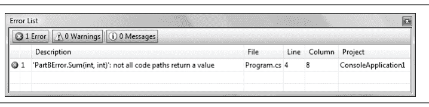

答: 错误：该方法应该返回一个整数，但并没有返回。
修正：删除变量 `result` 并在方法中添加语句 `return x + y;` 或者在方法体末尾添加以下语句：`return result;`。

```csharp
// 练习 7.5b 答案：PartBCorrect.cs
public class PartBCorrect
{
    int Sum(int x, int y)
    {
        return x + y;
    } // end method Sum
}// end class PartBCorrect
```

```csharp
c) void F(float a)
{
    float a;
    Console.WriteLine(a);
}
```

```csharp
// 练习 7.5c 答案：PartCError.cs
using System;

public class PartCError
{
    void F(float a)
    {
        float a;
        Console.WriteLine(a);
    } // end method F
}// end class PartCError
```

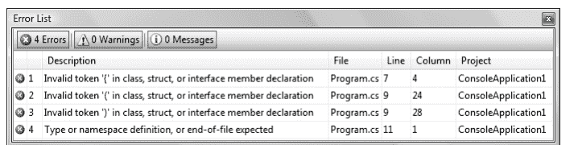

## 自测练习题

答: 错误：参数列表的右括号后不应有分号，且不应在方法中重新声明参数。修正：删除参数列表右括号后的分号，并删除声明 `float a;`。

```csharp
// 练习 7.5c 修正：PartCCorrect
using System;

public class PartCCorrect
{
    void F(float a)
    {
        Console.WriteLine(a);
    } // end method F
} // class PartCCorrect
```

```csharp
d) void Product()
{
    int a = 6, b = 5, c = 4, result;
    result = a * b * c;
    Console.WriteLine("Result is " + result);
    return result;
}
```

```csharp
// 练习 7.5d 答案：PartDError
using System;

public class PartError
{
    void Product()
    {
        int a = 6, b = 5, c = 4, result;
        result = a * b * c;
        Console.WriteLine("Result is " + result);
        return result;
    } // end method Product
} // class PartError
```

| 1 错误 | 0 警告 | 0 消息 | 行 | 列 | 项目 |
|---|---|---|---|---|---|
| 1 | 由于 'PartDError.Product()' 返回 void，因此 return 关键字后不能跟对象表达式 | | Program.cs | 11 | ConsoleApplication1 |

# 第 7 章 方法：深度解析解析

答: 错误：方法在不应该返回时返回了值。
修正：将返回类型从 `void` 改为 `int`。

```csharp
// 练习 7.5d 答案：PartCorrect.cs
using System;

public class PartCorrect
{
    int Product()
    {
        int a = 6, b = 5, c = 4, result;
        result = a * b * c;
        Console.WriteLine("Result is " + result);
        return result;
    } // end method Product
} // end class PartCorrect
```

## 7.6 编写一个 C# 程序，提示用户输入球的双倍精度半径，并调用 `SphereVolume` 方法计算并显示球的体积。使用以下语句计算数值：
`double volume = (4.0 / 3.0) * Math.PI * Math.Pow(radius, 3)`

```csharp
// 练习 7.6 答案：Sphere.cs
// 计算球的体积。
using System;

public class Sphere
{
    // 从用户处获取半径并显示球体体积
    public static void Main(string[] args)
    {
        Console.Write("Enter radius of sphere: ");
        double radius = Convert.ToDouble(Console.ReadLine());
        Console.WriteLine("Volume is {0:F3}", SphereVolume(radius));
    }

    // 计算并返回球体体积
    public static double SphereVolume(double radius)
    {
        double volume = (4.0 / 3.0) * Math.PI * Math.Pow(radius, 3);
        return volume;
    } // end method SphereVolume
} // end class Sphere
```

| | |
| :--- | :--- |
| Enter radius of sphere: | 4 |
| Volume is | 268.083 |

# 练习题

## 7.7 在执行以下每个语句后，x 的值是多少？

- a) `x = Math.Abs(7.5)`
  答: 7.5
- b) `x = Math.Floor(7.5)`
  答: 7.0
- c) `x = Math.Abs(0.0)`
  答: 0.0
- d) `x = Math.Ceiling(0.0)`
  答: 0.0
- e) `x = Math.Abs(-6.4)`
  答: 6.4
- f) `x = Math.Ceiling(-6.4)`
  答: -6.0
- g) `x = Math.Ceiling(-6.4)`
  答: -6.0

## 7.8 编写一个程序，根据输入的停留时间计算停车费用。前 3 小时每小时 $2.00，超过 3 小时的部分每小时 $1.50。如果停留时间不足 1 小时，则收取固定费用 $5.00。程序应显示总费用。

输入：
0.5
输出: $5.00
2
输出: $4.00
5
输出: $10.50

```csharp
// 练习 7.8 答案：ParkingFee.cs
using System;

public class ParkingFee
{
    public static void Main(string[] args)
    {
        decimal fee;
        Console.Write("Enter number of hours parked: ");
        double hours = Convert.ToDouble(Console.ReadLine());

        if (hours < 1)
        {
            fee = 5.0m;
        }
        else if (hours <= 3)
        {
            fee = (decimal)hours * 2.0m;
        }
        else
        {
            fee = (3 * 2.0m) + (decimal)(hours - 3) * 1.5m;
        }
        Console.WriteLine("Total fee is {0:C}", fee);
    }
}
```

## 7.9 编写一个程序，读取 `double` 类型的值并使用 `Math.Floor` 将其舍入到最近的整数。显示原始值和舍入后的值。

输入：7.5
输出: 7.5 舍入后为 7
7.9
输出: 7.9 舍入后为 7
-7.5
输出: -7.5 舍入后为 -8
-7.9
输出: -7.9 舍入后为 -8

```csharp
// 练习 7.9 答案：FloorTest.cs
using System;

public class FloorTest
{
    public static void Main(string[] args)
    {
        Console.Write("Enter a double: ");
        double value = Convert.ToDouble(Console.ReadLine());
        double result = Math.Floor(value);
        Console.WriteLine("{0} 舍入后为 {1}", value, result);
    }
}
```


*(注：示例代码中存在拼写错误 `flo` 应为 `result`)*

## 7.10

`Math.Floor` 可用于将数字舍入到特定的小数位数。语句 `y = Math.Floor(x * 10 + 0.5) / 10;` 将数字舍入到十分位（小数点后第一位）。语句 `y = Math.Floor(x * 100 + 0.5) / 100;` 将数字舍入到百分位（小数点后第二位）。编写一个程序，定义四个方法，以各种方式舍入数字：

- a) `RoundToInteger(number)`
- b) `RoundToTenths(number)`
- c) `RoundToHundredths(number)`
- d) `RoundToThousandths(number)`

对于每个值，你的程序应显示原始值、舍入到最近十分位的数字、舍入到最近百分位的数字以及舍入到最近千分位的数字。

## 第 7 章 方法：深度解析解决方案

```csharp
public class Round
{
    // 显示数字的各种舍入方式
    public static void Main(string[] args)
    {
        Console.WriteLine("{0}\n{1}", "输入数字。", "输入 <Ctrl>c 并按回车结束输入：");
        string line = Console.ReadLine();
        while (line != null)
        {
            double x = Convert.ToDouble(line);
            // 显示各种舍入方式
            Console.WriteLine("数字: {0}", x);
            Console.WriteLine("舍入到整数: {0}", RoundToInt(x));
            Console.WriteLine("舍入到十分位: {0}", RoundToTenths(x));
            Console.WriteLine("舍入到百位: {0}", RoundToHundreds(x));
            Console.WriteLine("舍入到千位: {0}", RoundToThousands(x));
            line = Console.ReadLine();
        } // 结束 while
    }

    // 舍入到个位
    public static double RoundToInt(double number)
    {
        return (Math.Floor(number + 0.5));
    } // 结束方法 RoundToInt

    // 舍入到十分位
    public static double RoundToTenths(double number)
    {
        return (Math.Floor(number * 10 + 0.5) / 10);
    } // 结束方法 RoundToTenths

    // 舍入到百位
    public static double RoundToHundreds(double number)
    {
        return (Math.Floor(number * 100 + 0.5) / 100);
    } // 结束方法 RoundToHundreds

    // 舍入到千位
    public static double RoundToThousands(double number)
    {
        return (Math.Floor(number * 1000 + 0.5) / 1000);
    } // 结束方法 RoundToThousands
} // 类 Round
```

## 练习题 13

输入小数。
输入 <Ctrl> z 并按回车结束输入：
12.3456
数字: 12.3456
舍入到整数: 12
舍入到十分位: 12.3
舍入到百位: 12.35
舍入到千位: 12.346
80.386
数字: 80.386
舍入到整数: 80
舍入到十分位: 80.4
舍入到百位: 80.39
舍入到千位: 80.386

## 7.11

- a) “随机”选择意味着什么？
  答案：每个数字被选中的概率相等。
- b) 为什么 `Random` 类对于模拟游戏很有用？
  答案：因为它产生伪随机数。
- c) 为什么经常需要缩放或移动 `Random` 对象产生的值？
  答案：为了产生特定范围内的随机数。
- d) 计算机模拟现实情况有什么用？
  答案：它可以更准确地预测事件，例如到达收费站或在超市排队的情况。模拟结果可以帮助决定开放多少个柜台。

## 7.12

- 使用 `Random` 方法编写将以下范围赋值给变量 `n` 的语句。已定义 `randomNumbers = new Random()` 并使用双参数版本。
- a) 1 ≤ n ≤ 2
  答案：`n = randomNumbers.Next(1, 3);`
- b) 1 ≤ n ≤ 100
  答案：`n = randomNumbers.Next(1, 101);`
- c) 0 ≤ n ≤ 9
  答案：`n = randomNumbers.Next(0, 10);`
- d) 1000 ≤ n ≤ 1112
  答案：`n = randomNumbers.Next(1000, 1113);`
- e) -1 ≤ n ≤ 1
  答案：`n = randomNumbers.Next(-1, 2);`
- f) -3 ≤ n ≤ 11
  答案：`n = randomNumbers.Next(-3, 12);`

## 14 第 7 章 方法：深度解析解决方案

```csharp
public static void Main(string[] args)
{
    Random randomNumbers = new Random();
    int n;
    // a
    n = randomNumbers.Next(1, 3);
    Console.WriteLine("randomNumbers.Next(1, 3) = {0}", n);
    // b
    n = randomNumbers.Next(1, 101);
    Console.WriteLine("randomNumbers.Next(1, 101) = {0}", n);
    // c
    n = randomNumbers.Next(0, 10);
    Console.WriteLine("randomNumbers.Next(0, 10) = {0}", n);
    // d
    n = randomNumbers.Next(1000, 1113);
    Console.WriteLine("randomNumbers.Next(1000, 1113) = {0}", n);
    // e
    n = randomNumbers.Next(-1, 2);
    Console.WriteLine("randomNumbers.Next(-1, 2) = {0}", n);
} // 结束 Main
} // 类 RandomRange
```

randomNumbers.Next(1, 3) = 2
randomNumbers.Next(1, 101) = 4
randomNumbers.Next(0, 10) = 1
randomNumbers.Next(1000, 1113) = 4
randomNumbers.Next(-1, 2) = 0
randomNumbers.Next(-3, 12) = 1

## 7.13

对于以下每个整数集合，编写一个简单的语句来显示集合中的随机数。假设已定义 `randomNumbers = new Random()` 并使用 `Random.Next` 的单参数版本。

- a) 2, 4, 6, 8, 10。
  答案：`Console.WriteLine(randomNumbers.Next(5));`
- b) 3, 5, 7, 9, 11.
  答案：`Console.WriteLine(randomNumbers.Next(5));`
- c) 6, 8, 10, 12, 14.
  答案：`Console.WriteLine(randomNumbers.Next(5));`

## 练习题 15

```csharp
// 练习 7.13 解决方案：RandomSet.cs
using System;

public class RandomSet
{
    public static void Main(string[] args)
    {
        Random randomNumbers = new Random();
        // a)
        Console.WriteLine(randomNumbers.Next(5));
        // b)
        Console.WriteLine(randomNumbers.Next(5));
        // c)
        Console.WriteLine(randomNumbers.Next(5));
    }
} // 结束类 RandomSet
```

## 14 编写一个 IntegerPower(base, exponent) 方法...

编写一个 `IntegerPower(base, exponent)` 方法，返回指数的值。例如，`IntegerPower(3, 4)` 计算 81（或 3 * 3 * 3 * 3）。假设 `exponent` 是正整数，`base` 是整数。`IntegerPower` 方法应该使用 `for` 或 `while` 循环来控制计算。不要使用任何 `Math` 库方法。将此方法集成到应用程序中，用于读取 `base` 和 `exponent` 的整数值并使用 `IntegerPower` 方法执行计算。

答案：

```csharp
// 练习 7.14 解决方案：Power.cs
// 应用计算幂
using System;

public class Power
{
    // 开始幂
    public static void Main(string[] args)
    {
        Console.Write("输入底数: ");
        int baseToRaise = Convert.ToInt32(Console.ReadLine());
        Console.Write("输入指数（负数结束）: ");
        int exponent = Convert.ToInt32(Console.ReadLine());
        // 使用负指数作为哨兵
        while (exponent >= 0)
        {
            Console.WriteLine("{0} 的 {1} 次方是 {2}", baseToRaise, exponent, IntegerPower(baseToRaise, exponent));
            Console.Write("输入底数: ");
            baseToRaise = Convert.ToInt32(Console.ReadLine());
            Console.Write("输入指数（负数结束）: ");
            exponent = Convert.ToInt32(Console.ReadLine());
        }
    } // 结束 Main

    // 计算整数 baseToRaise 的 exponent 次方幂
    public static int IntegerPower(int baseToRaise, int exponent)
    {
        int product = 1;
        for (int x = 1; x <= exponent; x++)
            product *= baseToRaise;
        return product;
    } // 结束方法 IntegerPower
} // 结束类 Power
```

输入底数: 2
输入指数（负数结束）: 6
2 的 6 次方是 64
输入底数: 3
输入指数（负数结束）: 4
3 的 4 次方是 81
输入底数: 5
输入指数（负数结束）: 5
5 的 5 次方是 3125
输入底数: -1
输入指数（负数结束）: -1

## 7.15

编写 `hypotenuse` 方法，在给定另外两条边的长度时计算直角三角形的斜边。该方法应接受两个 `double` 类型参数并返回 `double` 类型的斜边。将此方法集成到应用程序中，读取 `side1` 和 `side2` 的值并使用 `Hypotuse` 方法执行计算。确定图 7.26 中每个三角形的斜边长度。

| | Side 1 | Side 2 |
| :--- | :--- | :--- |
| 1 | 3.0 | 4.0 |
| 2 | 5.0 | 12.0 |
| 3 | 8.0 | 15.0 |

**图 7.26** 练习 7.15 中的三角形边值。

## 第7章 方法：深度解析解决方案

```
输入边 1（输入负数退出）： 3
输入边 2: 4
斜边为: 5
输入边 1（输入负数退出）： 5
输入边 2: 12
斜边为: 13
输入边 1（输入负数退出）： 8
输入边 2: 15
斜边为: 17
输入边 1（输入负数退出）：-1
```

## 7.16

编写一个方法，用于判断两个整数。该方法应接收两个整数参数，如果第二个数是第一个数的倍数，则返回 `true`，否则返回 `false`。将此方法整合到应用程序中，该程序输入一组整数对（一次一对），并确定每对整数中的第二个值是否为第一个值的倍数。

答案：

```csharp
// 练习 7.16 答案：Multiplicity.cs
// 确定输入的第二个数是否为第一个数的倍数
using System;

public class Multiplicity
{
    // 检查第二个数是否是第一个数的倍数
    public static void Main(string[] args)
    {
        int first; // 第一个数
        int second; // 第二个数
        Console.Write("输入第一个数 0 退出: ");
        first = Convert.ToInt32(Console.ReadLine());
        // 使用 0 作为哨兵值，因为我们不能除以零
        while (first != 0)
        {
            Console.Write("输入第二个数: ");
            second = Convert.ToInt32(Console.ReadLine());
            if (Multiple(first, second))
            {
                Console.WriteLine("{0} 是 {1} 的倍数", second, first);
            }
            else
            {
                Console.WriteLine("{0} 不是 {1} 的倍数", second, first);
            }
            Console.Write("输入第一个数 (0 退出: ");
            first = Convert.ToInt32(Console.ReadLine());
        } // 结束 while
    } // 结束 Main

    // 确定第一个 int 是否是第二个的倍数
    public static bool Multiple(int firstNumber, int secondNumber)
    {
        return secondNumber % firstNumber == 0;
    } // 结束方法 Multiple
} // 结束类 Multiplicity
```

```
输入第一个数 (0 退出): 20
输入第二个数: 30
30 不是 20 的倍数
输入第一个数 (0 退出): 40
输入第二个数: 20
20 不是 40 的倍数
输入第一个数 (0 退出): 20
输入第二个数: 40
40 是 20 的倍数
输入第一个数 (0 退出): -1
输入第二个数: 5
3 是 -1 的倍数
输入第一个数 (0 退出): 0
```

## 7.17

编写方法 `IsEven`，使用取余运算符 (`%`) 来判断一个整数是否为偶数。该方法应接收一个整数，如果该整数是偶数，则返回 `true`，否则返回 `false`。将此方法整合到应用程序中，该程序输入一系列整数（一次一个），并确定每个是偶数还是奇数。

答案：

```csharp
// 练习 7.17 答案：EvenOdd.cs
// 应用程序判断数字是奇数还是偶数。
using System;

public class EvenOdd
{
    // 判断数字是偶数还是奇数
    public static void Main(string[] args)
    {
```


# 第 7 章 方法：深入探究解决方案

## 练习 7.18：SquareOfAsterisks 方法

编写方法 `SquareOfAsterisks`，显示一个由星号组成的实心正方形（行数和列数），其边长由整数参数 `side` 指定。例如，如果 `side` 为 4，该方法应显示：

```
****
****
****
****
```

将此方法整合到应用程序中，该程序从用户处读取整数值作为 `side`，并使用 `SquareOfAsterisks` 方法输出星号。

```csharp
// 练习 7.18 答案：Square.cs
// 应用程序绘制星号正方形。

using System;

public class Square
{
    // 从用户处获取值
    public static void Main(string[] args)
    {
        Console.Write("输入正方形大小: ");
        int size = Convert.ToInt32(Console.ReadLine());
        SquareOfAsterisks(size);
    } // 结束 Main

    // 绘制星号正方形
    public static void SquareOfAsterisks(int side)
    {
        for (int count = 1; count <= side * side; count++)
        {
            Console.Write("*");
            if (count % side == 0)
            {
                Console.WriteLine();
            }
        } // 结束 for
    } // 结束方法 SquareOfAsterisks
} // 结束类 Square
```

**输出示例：**
```
输入正方形大小: 10
**********
**********
**********
**********
**********
**********
**********
**********
**********
**********
```

## 练习 7.19：FillSquare 方法

修改在练习 7.18 中创建的方法，形成由参数 `fillCharacter` 中包含的任意字符构成的正方形。因此，如果 `side` 为 5 且 `fillCharacter` 为 `#`，则该方法应显示：

```
#####
#####
#####
#####
#####
```

提示：使用表达式 `Console.Read()` 来从用户处读取一个字符。

```csharp
// 练习 7.19 答案：Square2.cs
// 应用程序绘制输入字符的正方形

using System;

public class Square2
{
    // 从用户处获取值
    public static void Main(string[] args)
    {
        Console.Write("输入正方形大小: ");
        int size = Convert.ToInt32(Console.ReadLine());
        Console.Write("输入字符: ");
        char fillCharacter = (char)Console.Read();
        FillSquare(size, fillCharacter);
    } // 结束 Main

    // 绘制传入字符的正方形
    public static void FillSquare(int side, char fillCharacter)
    {
        for (int count = 1; count <= side * side; count++)
        {
            Console.Write(fillCharacter);
            if (count % side == 0)
            {
                Console.WriteLine();
            }
        } // 结束 for
    } // 结束方法 FillSquare
} // 结束类 Square2
```

## 练习 7.20：圆面积计算

编写一个应用程序，提示用户输入圆的半径并使用方法计算圆面积。

```csharp
// 7.20 答案：Circle.cs
// 应用程序计算圆面积。

using System;

public class Circle
{
    // 计算面积
    public static void Main(string[] args)
    {
        Console.WriteLine("输入圆的半径（输入负数退出）:");

        double radius = Convert.ToDouble(Console.ReadLine());

        while (radius >= 0)
        {
            Console.WriteLine("面积为 {0}", CircleArea(radius));
            Console.Write("输入半径（输入负数退出）: ");
            radius = Convert.ToDouble(Console.ReadLine());
        }
    } // 结束 Main

    public static double CircleArea(double radius)
    {
        return Math.PI * radius * radius;
    } // 结束方法 CircleArea
} // 结束类 Circle
```

**输出示例：**
```
输入圆的半径（输入负数退出）：5
面积为 78.53981633974
输入半径（输入负数退出）：10
面积为 314.15926535898
输入半径（输入负数退出）：1
面积为 3.1415926535898
输入半径（输入负数退出）：-1
```

## 练习 7.21：显示数字

编写代码段完成以下任务：

- a) 计算整数 `a` 除以 `b` 的整数部分。
- b) 计算整数 `a` 除以 `b` 的余数。
- c) 使用部分 (a) 和 (b) 中的应用程序部分编写方法 `DisplayDigits` - 它接收一个 1 到 99999 之间的整数并将其显示为数字序列，每对数字之间用空格分隔。例如，整数 4562 应显示为 `4 5 6 2`。
- d) 将部分 (c) 开发的方法整合到应用程序中，该程序输入一个整数并传递该整数调用 `DisplayDigits`。显示结果。

```csharp
// 7.21 答案：Digits.cs
// 应用程序将五位数拆分为单个数字。

using System;

public class ClassDigits
{
    // 显示数字的单个数字
    public static void Main(string[] args)
    {
        Console.Write("输入整数: ");
        int number = Convert.ToInt32(Console.ReadLine());

        while (number != 0)
        {
            if (number <= 99999 && number >= 1)
                DisplayDigits(number);
            else
                Console.WriteLine("数字必须在 1 到 99999 之间 ");

            Console.Write("输入整数: ");
            number = Convert.ToInt32(Console.ReadLine());
        } // 结束 while
    } // 结束 Main

    // 显示数字的单个数字
    public static void DisplayDigits(int number)
    {
        for (int i = 4; i >= 0; i--)
        {
            int divisor = (int)Math.Pow(10, i);
            int digit = Quotient(number, divisor);

            if (digit > 0 || i == 0)
            {
                Console.Write(digit);
                if (i > 0)
                    Console.Write(" ");
            }

            number = Remainder(number, divisor);
        }

        Console.WriteLine();
    } // 结束方法 DisplayDigits

    // 部分 A: 计算整数除以 b 的整数部分
    public static int Quotient(int a, int b)
    {
        return a / b;
    } // 结束方法 Quotient

    // 部分 B: 计算整数除以 b 的余数
    public static int Remainder(int a, int b)
    {
        return a % b;
    } // 结束方法 Remainder
} // 结束类 ClassDigits
```

**输出示例：**
```
输入整数（0 退出）： 34
3 4
输入整数（0 退出）： 567
5 6 7
输入整数（0 退出）： 8675309
数字必须在 1 到 99999 之间
输入整数（0 退出）： 99998
9 9 9 9 8
输入整数（0 退出）： 0
```

## 练习 7.22：温度转换

实现以下整数方法：

a) 方法 `Celsius` 返回华氏温度对应的摄氏温度，使用计算公式 `c = 5.0 / 9.0 * (f - 32)`。

b) 方法 `Fahrenheit` 返回摄氏温度对应的华氏温度，使用计算公式 `f = 9.0 / 5.0 * c + 32`。

c) 使用部分 (a) 和 (b) 中的方法编写一个应用程序，使用户可以输入华氏温度并显示对应的摄氏温度，或输入摄氏温度并显示对应的华氏温度。

```csharp
// 练习 7.22 解决方案：Conversion.cs
// 应用程序将华氏度转换为摄氏度

using System;

public class Conversion
{
    // 返回华氏温度对应的摄氏温度
    public static int Celsius(int fahrenheitTemperature)
    {
        return (int)(5.0 / 9.0 * (fahrenheitTemperature - 32));
    } // 结束方法 Celsius

    // 返回摄氏温度对应的华氏温度
    public static int Fahrenheit(int celsiusTemperature)
    {
        return (int)(9.0 / 5.0 * celsiusTemperature + 32);
    } // 结束方法 Fahrenheit

    public static void Main(string[] args)
    {
        int choice;
        do
        {
            Console.WriteLine("1. 华氏度到摄氏度");
            Console.WriteLine("2. 摄氏度到华氏度");
            Console.WriteLine("3. 退出");
            Console.Write("输入选择：");
            choice = Convert.ToInt32(Console.ReadLine());

            switch (choice)
            {
                case 1:
                    Console.Write("输入华氏温度：");
                    int f = Convert.ToInt32(Console.ReadLine());
                    Console.WriteLine("{0} 华氏度是 {1} 摄氏度", f, Celsius(f));
                    break;
                case 2:
                    Console.Write("输入摄氏温度：");
                    int c = Convert.ToInt32(Console.ReadLine());
                    Console.WriteLine("{0} 摄氏度是 {1} 华氏度", c, Fahrenheit(c));
                    break;
                case 3:
                    break;
                default:
                    Console.WriteLine("无效选择");
                    break;
            }
            Console.WriteLine();
        } while (choice != 3);
    }
} // 结束类 Conversion
```

**输出示例：**
```
1. 华氏度到摄氏度
2. 摄氏度到华氏度
3. 退出
输入选择：1

输入华氏温度：212
212 华氏度是 100 摄氏度

1. 华氏度到摄氏度
2. 摄氏度到华氏度
3. 退出
输入选择：2

输入摄氏温度：37
37 摄氏度是 98 华氏度

1. 华氏度到摄氏度
2. 摄氏度到华氏度
3. 退出
输入选择：3
```

## 练习 7.23：Minimum3 方法

写一个方法 `Minimum3`，返回三个浮点数中最小的一个。使用 `Math.Min` 方法实现 `Minimum3`。将该方法集成到一个应用程序中，从用户处读取三个值，确定最小值并显示结果。

```csharp
// 练习 7.23 解决方案：Min.cs
// 应用程序找到三个数的最小值

using System;

public class Min
{
    // 找到三个数中的最小值
    public static void Main(string[] args)
    {
        double one;   // 第一个数字
        double two;   // 第二个数字
        double three; // 第三个数字

        Console.WriteLine("输入 <Ctrl> z 并按 Enter 退出 ");
        Console.Write("或输入第一个数字: ");
        string line = Console.ReadLine();

        while (line != null)
        {
            one = Convert.ToDouble(line);
            Console.Write("输入第二个数字: ");
            two = Convert.ToDouble(Console.ReadLine());
            Console.Write("输入第三个数字: ");
            three = Convert.ToDouble(Console.ReadLine());

            Console.WriteLine("最小值是 {0}", Minimum3(one, two, three));

            Console.WriteLine("输入 <Ctrl> z 并按 Enter 退出 ");
            Console.Write("或输入第一个数字: ");
            line = Console.ReadLine();
        } // 结束 while
    } // 结束 Main

    // 确定三个数中的最小值
    public static double Minimum3(double one, double two, double three)
    {
        // 使用嵌套的 Math.Min 调用
        return Math.Min(Math.Min(one, two), three);
    } // 结束方法 Minimum3
} // 结束类 Min
```


<Ctrl> z 并按 Enter 退出
或第一个数字: 20
输入第二个数字: 30
输入第三个数字: 40
最小值是 20
<Ctrl> z 并按 Enter 退出
或第一个数字: 50
输入第二个数字: 4
输入第三个数字: 1
最小值是 1
<Ctrl> z 并按 Enter 退出
或第一个数字: 20
输入第二个数字: -1
输入第三个数字: 100
最小值是 -1
<Ctrl> z 并按 Enter 退出
或第一个数字: ^Z

### 7.24（完美数）

如果一个整数的因子（包括 1 但不包括本身）之和等于该数，则被称为完美数。例如，6 是一个完美数，因为 6 = 1 + 2 + 3。写一个方法判断参数是否为完美数。将该方法集成到一个应用程序中，确定并显示 2 到 1000 之间的所有完美数。显示每个完美数的因子。

答案：

```csharp
1 // 练习 7.24 解决方案：PerfectNumber.cs
2 // 应用程序显示 2 到 1000 之间的所有完美数。
3 using System;
```

# 第 7 章 方法：深入探究解决方案

```csharp
public class PerfectNumber
{
    // 寻找从 2 到 1000 的完美数
    public static void main(string[] args) {
        for (int number = 2; number <= 1000; number++) {
            string result = Perfect(number);
            if (result != null) {
                Console.WriteLine("{0} 是完美数。\n因子: {1}", number, result);
            }
        }
    }

    // 如果参数是完美数，返回因子的字符串；否则返回 null。
    public static string Perfect(int value) {
        int factorSum = 1;
        string factors = " ";
        for (int test = 2; test <= value / 2; test++) {
            if (value % test == 0) {
                factorSum += test;
                factors += test + " ";
            }
        }
        if (factorSum == value) {
            return factors;
        }
        return null;
    }
}
```

| 结果 | 因子 |
| :--- | :--- |
| 6 是完美数 | 1 2 3 |
| 28 是完美数 | 1 2 4 7 14 |
| 496 是完美数 | 1 2 4 8 16 31 62 124 248 |

如果一个整数只能被 1 和自身整除，则为素数。例如，2, 3, 5 和 7 是素数，但 4, 6, 8 和 9 不是。

a) 写一个方法判断数字是否为素数。
b) 将此方法集成到一个应用程序中，确定并显示小于 10000 的所有素数。

## 练习 29

答案：

```csharp
// 练习 7.25 A 和 B 解决方案：PrimeNum.cs
// 应用程序计算
using System;

public class PrimeNum
{
    // 寻找 2 到 10000 之间的素数
    public static void Main(string[] args)
    {
        Console.WriteLine("2 到 10000 之间的素数是: ");
        // 测试 2 之间的数字
        for (int m = 2; m < 10000; m++) {
            if (Prime(m))
                Console.WriteLine(m);
        }
    }

    // 判断数字是否为素数的辅助方法
    // （这是 7.25 A 部分的解决方案）
    public static bool Prime(int n)
    {
        for (int v = 2; v < n; v++) {
            if (n % v == 0)
                return false;
        }
        return true;
    } // end method Prime
} // end class PrimeNum
```

2 到 10000 之间的素数是：

2
3
5
7
11
13
19
23
...
9949
9967
9973

最初，你可能认为 n/2 是测试一个数字是否为素数的上限，但你只需要测试到 n 的平方根。重写该应用程序并两种方式运行。

# 30 第 7 章 方法：深入探究解决方案

答案：

```csharp
// 练习 7.25 C 部分解决方案：PrimeNum2.cs
// 应用程序更高效地计算
using System;

public class PrimeNum2
{
    // 测试 2 到 10000 之间的所有数字
    public static void Main(string[] args)
    {
        Console.WriteLine("2 到 10000 之间的素数: ");
        for (int m = 2; m <= 10000; m++)
        {
            if (Prime(m))
                Console.WriteLine(m);
        }
    }

    // 判断数字是否为素数的辅助方法
    public static bool Prime(int n)
    {
        int max = (int)Math.Sqrt(n); // 要测试的最大数字
        for (int v = 2; v <= max; v++)
        {
            if (n % v == 0)
                return false;
        }
        return true;
    } // end method Prime
 // end class PrimeNum2
}
```

2 到 10000 之间的素数是：

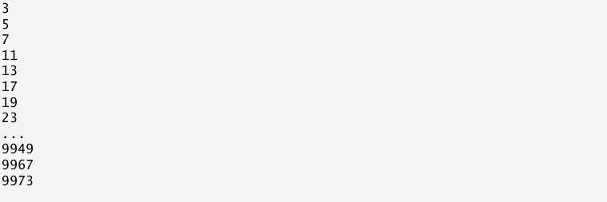

### 7.26

写一个方法接收一个整数值并返回反转后的数字。例如，给定数字 7631，该方法应返回 1367。将该方法集成到一个应用程序中，从用户处读取一个值并显示结果。

## 练习 31

```csharp
 // 练习 7.26 答案：Reverse.cs
// 程序接收一个数字并反转其数字。
using System;

public class Reverse
{
    // 反转整数
    public static void Main(string[] args)
    {
        Console.Write("输入一个整数 (-1 退出): ");
        int number = Convert.ToInt32(Console.ReadLine());
        while (number != -1)
        {
            Console.Write("{0} 反转后是 {1}",
                number, ReverseDigits(number));
        } // end while
    } // end Main

    // 显示反转后的数字
    public static int ReverseDigits(int number)
    {
        int reverseNumber = 0; // 倒序顺序的值
        int placeValue; // 当前位上的值
        while (number > 0)
        {
            placeValue = number % 10;
            number = number / 10;
            reverseNumber = reverseNumber * 10 + placeValue;
        } // end while
        return reverseNumber;
    } // end method ReverseDigits
} // class Reverse
```

输入一个整数 (-1 退出): 100
100 反转后是 1
输入一个整数 (-1 退出): 8675309
8675309 反转后是 9035768
输入一个整数 (-1 退出): -1

### 7.27 (最大公约数)

两个整数的最大公约数是能够整除这两个数字的最大的整数。编写方法 `Gcd`，返回两个整数的最大公约数。将该方法集成到应用程序中，从用户处读取两个值并显示结果。

# 第 7 章 方法：深度解析答案

ANS:

```csharp
// 练习 7.27 答案：Divisor.cs
// 程序找到两个数的最大公约数。
using System;

public class Divisor
{
    // 找到两个数的最大公约数
    public static void Main(string[] args)
    {
        int num1; // 第一个数字
        int num2; // 第二个数字
        Console.Write("输入第一个数字 (-1 退出): ");
        num1 = Convert.ToInt32(Console.ReadLine());
        while (num1 != -1)
        {
            Console.Write("输入第二个数字: ");
            num2 = Convert.ToInt32(Console.ReadLine());
            Console.WriteLine("GCD 是: {0}", Gcd(num1, num2));
            num1 = Convert.ToInt32(Console.ReadLine());
        }
    }

    // 使用欧几里得算法计算最大公约数--
    // 或者，你也可以简单地检查直到 x 或 y 中的
    // 小者，查看它是否能整除 x 和 y。
    public static int Gcd(int x, int y)
    {
        int mod; // x / y 的余数
        while (y != 0)
        {
            mod = x % y;
            x = y;
            y = mod;
        }
        return x;
    }
} // end class Divisor
```

## 练习 33

输入第一个数字 (-1 退出): 25
输入第二个数字: 10
GCD 是: 5
输入第一个数字 (-1 退出): 49
输入第二个数字: 1
GCD 是: 1
输入第一个数字 (-1 退出): 35
输入第二个数字: 48
GCD 是: 1
输入第一个数字 (-1 退出): -1

### 7.28

编写方法 `QualityPoints`，输入学生的平均分，如果平均分在 90–100 之间则返回 4，80–89 之间返回 3，70–79 之间返回 2，如果平均分低于 60 则返回 1。将该方法集成到应用程序中，从学生处读取一个值并显示结果。

ANS:

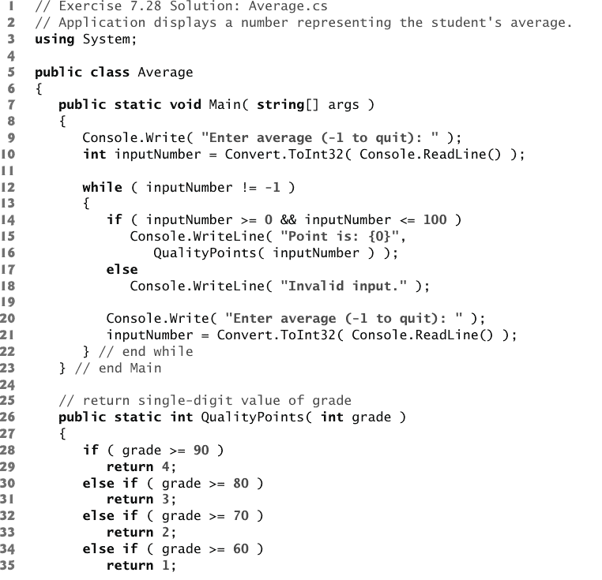

```csharp
// 练习 7.28 答案：Average.cs
// 程序显示代表学生平均分的数字。
using System;

public class Average
{
    public static void Main(string[] args)
    {
        Console.Write("输入平均分 (-1 退出): ");
        int inputNumber = Convert.ToInt32(Console.ReadLine());
        while (inputNumber != -1)
        {
            if (inputNumber >= 0 && inputNumber <= 100)
            {
                Console.WriteLine("分数:{0}",
                    QualityPoints(inputNumber));
            }
            else
            {
                Console.WriteLine("输入无效。");
            }
        }
    }

    // 返回分数的单数字值
    public static int QualityPoints(int grade)
    {
        if (grade >= 90)
            return 4;
        else if (grade >= 80)
            return 3;
        else if (grade >= 70)
            return 2;
        else if (grade >= 60)
            return 1;
        else
            return 0;
    } // end method QualityPoints
} // class Average
```

输入平均分 (-1 退出): 95
分数: 4
输入平均分 (-1 退出): 64
分数: 1
输入平均分 (-1 退出): 88
分数: 3
输入平均分 (-1 退出): -1

### 7.29 (抛硬币)

编写一个程序模拟抛硬币。让用户选择正面。程序应该调用一个不带参数的方法，如果是反面返回 false，如果是正面返回 true。程序应记录正面和反面的次数。

ANS:

```csharp
// 练习 7.29 答案：Coin.cs
// 程序模拟抛硬币。
using System;

public class Coin
{
    private static Random randomNumbers = new Random();

    // 抛次数
    public static void Main(string[] args)
    {
        int heads = 0; // 正面的次数
        int tails = 0; // 反面的次数
        int choice; // 用户选择
        do
        {
            // 显示菜单
            Console.WriteLine("1. 抛硬币");
            Console.WriteLine("2. 退出");
            Console.Write("选择: ");
            choice = Convert.ToInt32(Console.ReadLine());
            if (choice == 1)
            {
                if (Flip())
                    heads++;
                else
                    tails++;
                Console.WriteLine("正面: {0}, 反面: {1}", heads, tails);
            } else if (choice != 2)
            {
                Console.WriteLine("无效选择。请再次选择。");
            }
        } while (choice != 2);
    } // end Main

    // 翻转
    public static bool Flip()
    {
        return randomNumbers.Next(2) == 1;
    } // end method Flip
} // class Coin
```

### 7.30 (猜数字游戏)

编写一个“猜数字”程序如下：程序通过在 1 到 1000 之间选择一个随机整数。如果用户输入的数字错误，程序应显示太大了或太小了。当用户输入正确答案时，并允许用户决定是否继续玩。[注意：此问题使用的猜测技术与第 25 章讨论的二分查找相似。

ANS:

```csharp
// 练习 7.30 答案：Guess.cs
```


# 程序玩猜数字游戏

```csharp
using System;

public class Guess
{
    static Random randomNumbers = new Random();
    static int answer; // 要猜的答案

    // 玩游戏
    public static void Main(string[] args)
    {
        int userGuess; // 用户做的猜测
        NewGame();
        Console.Write("输入 0 退出: ");
        userGuess = Convert.ToInt32(Console.ReadLine());

        while (userGuess != 0)
        {
            CheckUserGuess(userGuess);
            Console.Write("输入 0 退出: ");
            userGuess = Convert.ToInt32(Console.ReadLine());
        }
    }

    // 创建一个新的要猜的数字
    public static int GetNumber()
    {
        return randomNumbers.Next(1, 1001);
    }

    // 开始新游戏
    public static void NewGame()
    {
        answer = GetNumber();
        Console.WriteLine("猜一个 1 到 1000 之间的数字：");
    }

    // 判断用户输入，给出反馈
    public static void CheckUserGuess(int userGuess)
    {
        if (userGuess < answer)
        {
            Console.WriteLine("{0} 太小了。再试一次。", userGuess);
        }
        else if (userGuess > answer)
        {
            Console.WriteLine("{0} 太大了。再试一次。", userGuess);
        }
        else
        {
            Console.WriteLine("恭喜你！你猜中答案了！\n");
        }
    }
}
```

## 示例输出

在 1 到 1000 之间猜一个数字
猜 (0 退出): 500
500 太高了。请再次尝试。
猜 (0 退出): 250
250 太低了。请再次尝试。
猜 (0 退出): 375
375 太低了。请再次尝试。
猜 (0 退出): 437
437 太高了。请再次尝试。
猜 (0 退出): 400
400 太低了。请再次尝试。
猜 (0 退出): 410
410 太低了。请再次尝试。
猜 (0 退出): 420
420 太低了。请再次尝试。
猜 (0 退出): 425
425 太低了。请再次尝试。
猜 (0 退出): 430
恭喜你。猜中数字了！

在 1 到 1000 之间猜一个数字
猜 (0 退出): 0

## 练习 7.31

修改练习 7.33 的赋值，以统计玩家猜的次数。
如果数字小于或等于 10，显示“你要么知道秘密，要么是运气好！”。如果玩家在 10 次内猜中数字，显示“哈！你知道秘密了！”。如果玩家猜的次数超过 10 次，显示“你本可以做得更好！”。为什么不需要超过 10 次就能猜中呢？

> **答**：猜剩余数字范围内中间的数字总是能排除一半的数字（因为该数字本身也被排除了）。将 1000 重复减半 10 次得到 500、250、125、62、31、15、7、3 和 1。因为在减半 9 次后最多只剩下一个元素，所以用户总会在第 10 次尝试时猜中。

## 解决方案：Guess2.cs

```csharp
// 练习 7.31 解决方案: Guess2.cs
// 程序猜数字，并统计猜测次数。
using System;

public class Guess2
{
    static Random randomNumbers = new Random();
    static int answer; // 要猜的答案
    static int guesses; // 用户所猜的次数

    // 玩猜数字游戏
    public static void Main(string[] args)
    {
        int userGuess; // 用户所猜的数字
        NewGame();
        Console.Write("猜 (0 退出): ");
        userGuess = Convert.ToInt32(Console.ReadLine());

        while (userGuess != 0)
        {
            ++guesses;
            CheckUserGuess(userGuess);
            Console.Write("猜 (0 退出): ");
            userGuess = Convert.ToInt32(Console.ReadLine());
        }
    }

    // 创建一个新的待猜数字
    public static int GetNumber()
    {
        return randomNumbers.Next(1, 1001);
    }

    // 开始新游戏
    public static void NewGame()
    {
        guesses = 0;
        answer = GetNumber();
        Console.WriteLine("在 1 到 1000 之间猜一个数字");
    }

    // 判断用户输入，给出反馈
    public static void CheckUserGuess(int userGuess)
    {
        if (userGuess < answer)
        {
            Console.WriteLine("{0} 太低了。请再次尝试。", userGuess);
        }
        else if (userGuess > answer)
        {
            Console.WriteLine("{0} 太高了。请再次尝试。", userGuess);
        }
        else
        {
            DisplayMessage();
            // 新游戏
            NewGame();
        }
    }

    // 根据尝试次数显示消息
    public static void DisplayMessage()
    {
        Console.WriteLine("你用了 {0} 次尝试猜中了数字", guesses);

        if (guesses < 10)
        {
            Console.WriteLine("你要么知道秘密，要么是运气好！\n");
        }
        else if (guesses == 10)
        {
            Console.WriteLine("哈！你知道秘密了！\n");
        }
        else
        {
            Console.WriteLine("你本可以做得更好！\n");
        }
    }
}
```

## 示例输出

在 1 到 1000 之间猜一个数字
猜 (0 退出): 500
500 太低了。请再次尝试。
猜 (0 退出): 750
750 太低了。请再次尝试。
猜 (0 退出): 875
875 太低了。请再次尝试。
猜 (0 退出): 950
950 太低了。请再次尝试。
猜 (0 退出): 980
980 太高了。请再次尝试。
猜 (0 退出): 965
965 太高了。请再次尝试。
猜 (0 退出): 958
958 太高了。请再次尝试。
猜 (0 退出): 954
954 太低了。请再次尝试。
猜 (0 退出): 956
956 太低了。请再次尝试。
猜 (0 退出): 951
951 太低了。请再次尝试。
猜 (0 退出): 957
957 太低了。请再次尝试。
你用了 10 次尝试猜中了数字
你本可以做得更好！
在 1 到 1000 之间猜一个数字
猜 (0 退出): 500
500 太低了。请再次尝试。
猜 (0 退出): 750
750 太高了。请再次尝试。
猜 (0 退出): 625
625 太低了。请再次尝试。
猜 (0 退出): 680
680 太低了。请再次尝试。
猜 (0 退出): 720
720 太高了。请再次尝试。
猜 (0 退出): 700
700 太低了。请再次尝试。
猜 (0 退出): 710
710 太高了。请再次尝试。
猜 (0 退出): 705
705 太低了。请再次尝试。
猜 (0 退出): 703
703 太高了。请再次尝试。

你用了 10 次尝试猜中了数字
哈！你知道秘密了！

在 1 到 1000 之间猜一个数字
猜 (0 退出): 0

## 练习 7.32

计算点 `(x1, y1)` 和 `(x2, y2)` 之间的距离。所有数字应该是 `double` 类型。将此方法整合到一个允许用户输入坐标的应用程序中。

### 解决方案：Points.cs

```csharp
// 练习 7.32 解决方案: Points.cs
// 程序计算点之间的距离
using System;

public class Points
{
    // 允许用户输入坐标
    public static void Main(string[] args)
    {
        Console.WriteLine("按 Ctrl-z 退出 ");
        Console.Write("X1: ");
        string line = Console.ReadLine();

        while (line != null)
        {
            double x1 = Convert.ToDouble(line);
            Console.Write("Y1: ");
            double y1 = Convert.ToDouble(Console.ReadLine());
            Console.Write("X2: ");
            double x2 = Convert.ToDouble(Console.ReadLine());
            Console.Write("Y2: ");
            double y2 = Convert.ToDouble(Console.ReadLine());

            double distance = Distance(x1, y1, x2, y2);
            Console.WriteLine("距离是 {0}\n", distance);

            Console.WriteLine("按 Ctrl-z 退出 ");
            Console.Write("X1: ");
            line = Console.ReadLine();
        }
    }

    // 计算点之间的距离
    public static double Distance(double x1, double y1, double x2, double y2)
    {
        return Math.Sqrt(Math.Pow(x1 - x2, 2) + Math.Pow(y1 - y2, 2));
    }
}
```

### 示例输出

按 <Ctrl> z 退出
X1: 4
Y1: 0
X2: 0
Y2: 3
距离是 5

## 练习 7.33

修改图 7.9 中的骰子程序以允许下注。初始化变量 `balance` 为 1000 美元。提示玩家输入赌注。检查赌注小于或等于余额，如果不是，让用户重新输入，直到输入有效的赌注为止。输入正确的赌注后，运行一次骰子。如果玩家赢了，增加余额并显示新余额。如果玩家输了，减少余额，检查新余额是否变为零，如果是，显示消息“抱歉，你破产了！”

### 解决方案：Craps.cs

```csharp
// 练习: Craps.cs
// Craps 类模拟骰子游戏。
// 允许用户对游戏下注
using System;

public class Craps
{
    // 为 RollDice 方法创建随机数生成器
    private static Random randomNumbers = new Random();
    static int balance; // 当前余额
    static int wager; // 当前赌注
    static int myPoint; // 第一次掷胜或负时的点数

    // 表示游戏状态的枚举
    private enum Status { CONTINUE, WON, LOST };

    // 表示骰子投常见点数的枚举
    private enum DiceNames
    {
        SNAKE_EYES = 2,
        TREY = 3,
        SEVEN = 7,
        YO_LEVEN = 11,
        BOX_CARS = 12
    }

    // 允许用户对骰子游戏下注
    public static void Main(string[] args)
    {
        balance = 1000; // 为用户初始提供 1000

        Console.WriteLine("Current balance is {0}\n", balance);
        Console.Write("Enter wager (-1 to quit): ");
        wager = Convert.ToInt32(Console.ReadLine());

        while (wager != -1 && balance > 0)
        {
            if (wager > balance)
            {
                Console.WriteLine("你钱不够了!");
            }
            else
            {
                Play(); // 玩游戏
            }

            if (balance <= 0)
            {
                Console.WriteLine("抱歉，你破产了!");
            }

            Console.WriteLine("Current balance is {0}\n", balance);
            Console.Write("Enter wager (-1 to quit): ");
            wager = Convert.ToInt32(Console.ReadLine());
        }
    }

    // 玩骰子游戏
    public static void Play()
    {
        int sumOfDice = 0; // 骰子和
        myPoint = 0; // 第一次掷胜或负时的点数
        Status gameStatus; // 可以是 CONTINUE, WON 或 LOST

        sumOfDice = RollDice(); // 掷骰子

        // 根据骰子和确定游戏状态和点数
        switch ((DiceNames)sumOfDice)
        {
            case DiceNames.SEVEN: // 第一次掷 7 胜
            case DiceNames.YO_LEVEN: // 第一次掷 11 胜
                gameStatus = Status.WON;
                break;

            case DiceNames.SNAKE_EYES: // 第一次掷 2 输
            case DiceNames.TREY: // 第一次掷 3 输
            case DiceNames.BOX_CARS: // 第一次掷 12 输
                gameStatus = Status.LOST;
                break;

            default: // 未胜未输，记住点数
                gameStatus = Status.CONTINUE; // 游戏未结束
                myPoint = sumOfDice; // 记住点数
                Console.WriteLine("Point is {0}", myPoint);
                break;
        }

        // 当游戏未完成时
        while (gameStatus == Status.CONTINUE)
        {
            sumOfDice = RollDice(); // 再次掷骰子

            // 确定游戏状态
            if (sumOfDice == myPoint)
            {
                gameStatus = Status.WON;
            }
            else if (sumOfDice == (int)DiceNames.SEVEN)
            {
                gameStatus = Status.LOST;
            }
        }

        // 显示赢或输的信息
        if (gameStatus == Status.WON)
        {
            Console.WriteLine("玩家获胜");
            balance += wager;
        }
        else
        {
            Console.WriteLine("玩家失败");
            balance -= wager;
        }

        Console.WriteLine("Balance is {0}", balance);
    }

    // 掷骰子，计算点数并显示结果
    public static int RollDice()
    {
        int die1 = randomNumbers.Next(1, 7);
        int die2 = randomNumbers.Next(1, 7);
        int sum = die1 + die2;
        Console.WriteLine("玩家掷出 {0} + {1} = {2}", die1, die2, sum);
        return sum;
    }
}
```


## C# 代码示例：Craps 游戏逻辑

```csharp
if (sumOfDice == myPoint) // 通过掷点数胜
    gameStatus = Status.WON;
else if (sumOfDice == 7) // 掷 7 输
    gameStatus = Status.LOST;
} // end while

// 绘制输负信息并改变余额
if (gameStatus == Status.WON)
{
    Console.WriteLine("玩家胜");
    balance += wager;
} // end if
else
{
    Console.WriteLine("玩家输");
    balance -= wager;
} // end if
} // end method

// 掷骰子，计算和并显示结果
public static int rollDice()
{
    // 随机选择骰子点数
    int die1 = randomNumbers.Next(1, 7);
    int die2 = randomNumbers.Next(1, 7);
    int sum = die1 + die2; // 骰子和

    // 显示本次掷骰的结果
    Console.WriteLine("Player rolled {0} + {1} = {2}", die1, die2, sum);
    return sum; // 返回骰子和
} // end method rollDice
} // end class Craps
```

## 程序运行示例输出

```text
Current balance is 1000
Enter wager (-1 to quit): 500
Player rolled 2 + 5 = 7
Player wins
Current balance is 1500
Enter wager (-1 to quit): 800
Player rolled 2 + 3 = 5
Point is $5
Player rolled 1 + 2 = 3
Player rolled 3 + 3 = 6
Player rolled 5 + 6 = 11
Player rolled 2 + 4 = 6
Player rolled 4 + 6 = 10
Player rolled 3 + 2 = 5
Player wins
Current balance is 2300
Enter wager (-1 to quit): 2000
Player rolled 4 + 1 = 5
Point is $5
Player rolled 3 + 6 = 9
Player rolled 5 + 6 = 11
Player rolled 6 + 3 = 9
Player rolled 1 + 3 = 4
Player rolled 5 + 4 = 9
Player rolled 6 + 1 = 7
Player loses
Current balance is 300
Enter wager (-1 to quit): 400
You don't have enough money!
Current balance is 300
Enter wager (-1 to quit): 300
Player rolled 3 + 1 = 4
Point is 4
Player rolled 1 + 4 = 5
Player rolled 1 + 4 = 5
Player rolled 1 + 2 = 3
Player rolled 4 + 1 = 5
Player rolled 5 + 1 = 6
Player rolled 3 + 3 = 6
Player rolled 2 + 4 = 6
Player rolled 2 + 3 = 5
Player rolled 2 + 4 = 6
Player rolled 3 + 4 = 7
Player loses
Sorry you busted!
```

## 练习 43

**7.34** 编写一个应用程序，显示 1–256 范围内十进制数的二进制、八进制和十六进制等效值的表格。如果你不熟悉这些数制，请先阅读附录 C 数进制。

### 答案

```csharp
// 练习 7.34 解决方案：NumberSystem.cs
// 将十进制转换为二进制、八进制和十六进制。
using System;

public class NumberSystem
{
    // 显示二进制、八进制和十六进制
    public static void Main(string[] args)
    {
        Console.WriteLine("{0,-8}{1,-12}{2,-8}{3,-8}",
            "Decimal", "Binary", "Octal", "Hexadecimal");

        // 显示每个数字的二进制、八进制和十六进制表示
        for (int i = 1; i <= 256; i++)
        {
            string binary = ToBinary(i);
            string octal = ToOctal(i);
            string hexadecimal = ToHex(i);
            Console.WriteLine("{0,-8}{1,-12}{2,-8}{3,-8}", i, binary, octal, hexadecimal);
        }
    }

    // 返回十进制的二进制表示
    public static string ToBinary(int dec)
    {
        string binary = "";
        while (dec > 0)
        {
            binary = (dec % 2) + binary;
            dec /= 2;
        }
        return binary;
    }

    // 返回十进制的八进制表示
    public static string ToOctal(int dec)
    {
        string octal = "";
        while (dec > 0)
        {
            octal = (dec % 8) + octal;
            dec /= 8;
        }
        return octal;
    }

    // 返回十进制的十六进制表示
    public static string ToHex(int dec)
    {
        string hexadecimal = "";
        char[] map = "0123456789ABCDEF".ToCharArray();
        while (dec > 0)
        {
            hexadecimal = map[dec % 16] + hexadecimal;
            dec /= 16;
        }
        return hexadecimal;
    }
}
```

## 44 第 7 章方法：深入理解解决方案

## 练习 45

**7.35** 递归方法 `Power(base, exponent)` 被调用时返回 `base ^ exponent`。例如，`Power(3, 4) = 3 * 3 * 3 * 3`。假设指数大于或等于 1。将此方法整合到一个允许用户输入基和指数的应用程序中。

```csharp
// 练习 7.35 解决方案：Exponential.cs
// 计算指数值。
using System;

public class Exponential
{
    // 传递用户输入
    public static void Main(string[] args)
    {
        int baseNumber; // 基
        int exponent; // 指数

        // 提示基并获取用户值
        Console.Write("Enter base: ");
        baseNumber = Convert.ToInt32(Console.ReadLine());

        // 提示指数并获取用户值
        Console.Write("Enter exponent: ");
        exponent = Convert.ToInt32(Console.ReadLine());

        if (exponent > 0)
        {
            int result = Power(baseNumber, exponent);
            Console.WriteLine("Value is {0}", result);
        }
        else
        {
            Console.WriteLine("Invalid Exponent.");
        }
    } // end Main

    // 递归计算指数值。
    public static int Power(int baseNumber, int exponent)
    {
        if (exponent == 1)
        {
            return baseNumber;
        }
        else
        {
            return baseNumber * Power(baseNumber, exponent - 1);
        }
    } // end Power
} // end class Exponential
```

### 十进制、八进制、十六进制对照表（部分）

| 十进制 | 八进制 | 十六进制 |
| :--- | :--- | :--- |
| 1 | 1 | 1 |
| 2 | 2 | 2 |
| 3 | 3 | 3 |
| 4 | 4 | 4 |
| 5 | 5 | 5 |
| 6 | 6 | 6 |
| 7 | 7 | 7 |
| 8 | 10 | 8 |
| 9 | 11 | 9 |
| 10 | 12 | A |
| 11 | 13 | B |
| 12 | 14 | C |
| 13 | 15 | D |
| 14 | 16 | E |
| 15 | 17 | F |
| 16 | 20 | 10 |
| 17 | 21 | 11 |
| 18 | 22 | 12 |
| 19 | 23 | 13 |
| 20 | 24 | 14 |
| 21 | 25 | 15 |
| 22 | 26 | 16 |
| 23 | 27 | 17 |
| 24 | 30 | 18 |
| 25 | 31 | 19 |
| 254 | 376 | FE |
| 255 | 377 | FF |
| 256 | 400 | 100 |

**7.36**（汉诺塔）每一位初学计算机科学家都必须与经典问题搏斗，而汉诺塔（见图 7.27）是最著名的问题之一。传说在远东方，僧司们正试图将一组盘从一个柱子移动到另一个柱子。初始堆栈有 64 个盘套在一个柱子上，并按尺寸从大到小的顺序排列。僧司们试图将这组盘从这个柱子移动到第二个柱子，限制条件是：一次只能移动一个盘，且在任何时候不能将较大的盘放在较小的盘之上。第三根柱子可以临时存放盘。据说，当僧司们完成任务时，世界将会结束，因此我们没有什么动力帮助他们。

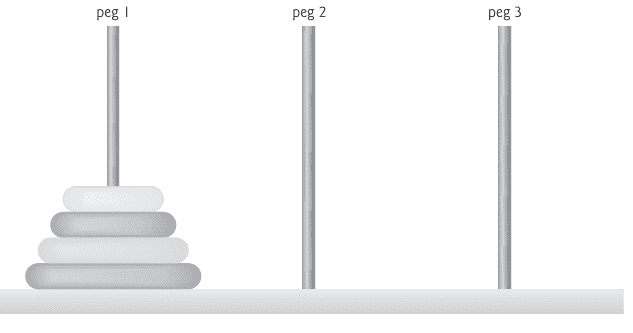

**图 7.27** 四个盘的汉诺塔。

让我们假设僧司们试图将盘从柱子 1 移动到柱子 3。我们希望开发一种算法，显示盘在柱子之间传输的精确序列。如果我们用传统方法来处理这个问题，很快就会发现自己陷入了管理盘的困境中。相反，如果我们从递归的角度来考虑问题，就能立即理解它。移动 $n$ 个盘可以看作移动 $n-1$ 个盘（因此产生递归），如下：

- a) 使用柱子 3 作为临时存放区域，将 $n-1$ 个盘从柱子 1 移动到柱子 2。
- b) 将最后一个（最大的）盘从柱子 1 移动到柱子 3。
- c) 使用柱子 1 作为临时存放区域，将 $n-1$ 个盘从柱子 2 移动到柱子 3。

当最后一个任务涉及移动 $n=1$ 个盘时（即基础情况），过程结束。该任务只需移动盘即可，不需要临时存放区域。

编写一个应用程序来解决汉诺塔问题。允许用户输入盘的数量。使用一个带有四个参数的递归方法：

- a) 要移动的盘数，
- b) 这些盘初始套在哪个柱子上，
- c) 这组盘要移动到的目标柱子，以及
- d) 用作临时存放区域的柱子。

你的应用程序应该显示如何将盘从起始柱子移动到目标柱子的指令。例如，要将三个盘的堆从柱子 1 移动到柱子 3，你的应用程序应该显示以下移动序列：

```text
1 --> 3 (这种表示法意味着“将一个盘从柱子 1 移动到柱子 3”。)
1 --> 2
2 --> 1
1 --> 3
2 --> 1
```

## 练习 49

```text
2 --> 3
1 --> 3
```

### 解答

```csharp
// Exercise 7.36 Solution: TowerOfHanoi.cs
// 应用程序解决汉诺塔问题，并演示递归
using System;

public class TowerOfHanoi
{
    public static void Main(string[] args)
    {
        int disks; // 塔中盘的数量
        // 提示用户输入盘的数量 ( 1-9 ):
        disks = Convert.ToInt32(Console.ReadLine());

        // 实际上对用户指定的盘的数量进行排序
        Tower(disks, 1, 3, 2);
    } // end Main

    public static void Tower(int disks, int peg1, int peg2, int peg3)
    {
        if (disks == 1)
        {
            Console.WriteLine("{0} --> {1}", peg1, peg3);
            return;
        }
        // 递归地将 ( disks - 1 ) 个盘从 peg1 移动到 peg2
        Tower(disks - 1, peg1, peg3, peg2);
        // 移动最后一个盘从 peg1 到 peg3
        Console.WriteLine("{0} --> {1}", peg1, peg3);
        // 递归地将 ( disks - 1 ) 个盘从 peg2 移动到 peg3
        Tower(disks - 1, peg2, peg1, peg3);
    } // end Tower
} // end class TowerOfHanoi
```

### 运行示例

**输入盘的数量 ( 1-9 ): 3**
```text
1 --> 3
1 --> 2
3 --> 2
1 --> 3
2 --> 1
2 --> 3
1 --> 3
```

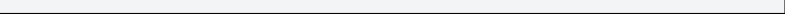

# 第 7 章方法：深度解析解决方案

**输入盘的数量 ( 1-9 ) : 4**
```text
1 --> 2
1 --> 3
2 --> 3
1 --> 2
3 --> 1
3 --> 2
1 --> 2
1 --> 3
2 --> 1
3 --> 1
2 --> 3
1 --> 2
```

## 7.37 下述方法的作用是什么？

```csharp
// 参数 b 必须是正整数，以防止无限递归
public static int Mystery(int a, int b)
{
    if (b == 1)
        return a;
    else
        return a + Mystery(a, b - 1);
}
```

**解答**：该方法返回 `a` 乘以 `b` 的结果，其中 `b` 大于 0。


```csharp
// Exercise 7.37 Solution: MysteryTest.cs
// 返回 a 乘以 b 等效结果的方法
// 其中 b 大于 0。
public class MysteryTest
{
    public static void Main(string[] args)
    {
        Console.WriteLine("Mystery(5, 9) = {0}", Mystery(5, 9));
        Console.WriteLine("Mystery(4, 8) = {0}", Mystery(4, 8));
        Console.WriteLine("Mystery(-6, 7) = {0}", Mystery(-6, 7));
    } // end main

    // 参数 b 必须是正
    // 整数，以防止无限递归
    public static int Mystery(int a, int b)
    {
        if (b == 1)
            return a;
        else
            return a + Mystery(a, b - 1);
    } // end Mystery
} // class MysteryTest
```

```
Mystery(5, 9) = 45
Mystery(4, 8) = 32
Mystery(-6, 7) = -42
```

### 7.38 找到以下递归方法中的错误，并解释如何修正它：

```csharp
public static int Sum(int n)
{
    if (n == 0)
        return 0;
    else
        return n + Sum(n);
}
```

解答：该方法永远无法到达基础情况。递归步骤应该是：`return n + Sum(n - 1);`

```csharp
// Exercise 7.38: SumTest.cs
using System;
public class SumTest
{
    public static void Main(string[] args)
    {
        SumTest test = new SumTest();
        Console.WriteLine("Sum(5) = {0}", test.Sum(5));
        Console.WriteLine("Sum(8) = {0}", test.Sum(8));
        Console.WriteLine("Sum(7) = {0}", test.Sum(7));
    } // end Main

    public static int Sum(int n)
    {
        if (n == 0)
            return 0;
        else
            return n + Sum(n - 1);
    }
} // class SumTest
```


# 第 7 章 方法：深度解析解答

8 乘以 57 等于？

输入你的答案（-1 退出）：

38

不正确。请再次尝试。

输入你的答案（-1 退出）：

40

非常好！

7 乘以 27 等于？

输入你的答案（-1 退出）：

14

非常好！

6 乘以 87 等于？

输入你的答案（-1 退出）：

-1

### 7.40（计算机辅助教学：减轻学生疲劳）

CAI 环境中的其中一个问题是学生疲劳。可以通过改变计算机的响应来保持学生的注意力。修改练习 7.39 的程序，使得每个答案都显示不同的注释，如下所示：

- 正确答案的可能响应：
  - 非常好！
  - 太棒了！
  - 做得好！
  - 继续努力！

- 错误答案的可能响应：
  - 不对。请再次尝试。
  - 错误。再试一次。
  - 不要放弃！
  - 不对。请继续尝试。

使用随机数生成一个 1 到 4 之间的数字，用于为每个正确或错误的答案选择四个适当响应中的之一。使用 `Select...Case` 语句来发布响应。

```csharp
// 练习 7.40 解答：Multiply2.cs
// 程序生成个乘法题
using System;
public class Multiply2
{
    static Random randomNumbers = new Random();
    static int answer; // 正确答案
    // 要求用户回答乘法题
    public static void Main(string[] args)
    {
        int guess; // 用户的猜测
        Question(); // 显示第一个问题
```

### 改变练习 55

```csharp
18 Console.WriteLine("输入你的答案（-1 退出）：");
19 guess = Convert.ToInt32(Console.ReadLine());
20 while (guess != -1)
21 {
22     CheckResponse(guess);
23     {
24         Console.WriteLine("输入你的答案（-1 退出）：");
25         guess = Convert.ToInt32(Console.ReadLine());
26     } // 结束 while
27 } // end main

29 // 显示新问题并存储相应的答案
30 public static void CreateQuestion()
31 {
32     // 获取 0 到 9 之间的两个随机数
33     int digit1 = randomNumbers.Next(10);
34     int digit2 = randomNumbers.Next(10);

35     answer = digit1 * digit2;
36     Console.WriteLine("{0} 乘以 {1} 等于？",
37         digit1, digit2);
39 // 结束方法 CreateQuestion

41 // 创建新响应
42 public static string CreateResponse(bool correct)
43 {
44     string response = string.Empty;
45     if (correct)
46         switch (randomNumbers.Next(4))
47         {
48             case 0:
49                 response = "Very Good!";
50                 break;
51             case 1:
52                 response = "Excellent!";
53                 break;
54             case 2:
55                 response = "Nice work!";
56                 break;
57             case 3:
58                 response = "Keep up the good work!";
59                 break;
60         } // 结束 switch
61     else
62         // 否则，假设错误
63         switch (randomNumbers.Next(4))
64         {
65             case 0:
66                 response = "No. Please try again.";
67                 break;
68             case 1:
69                 response = "Wrong. Try once more.";
70                 break;
```

### 56 第 7 章 方法：深度解析解答

```csharp
case 2:
    response = "Don't give up!";
    break;
case 3:
    response = "No. Keep trying.";
    break;
} // 结束 switch
return response;
} // 结束方法 CreateResponse

// 检查用户回答是否正确
public static void CheckResponse(int guess)
{
    if (guess == answer)
    {
        Console.WriteLine(CreateResponse(false));
    }
    else
    {
        Console.WriteLine(CreateResponse(true));
        CreateQuestion();
    }
} // 结束方法 CheckResponse
} // 结束类 Multiply2
```

4 乘以 7 等于？

输入你的答案（-1 退出）：

16

做得好！

0 乘以 5 等于？

输入你的答案（-1 退出）：

5

不对。请再次尝试。

输入你的答案（-1 退出）：

0

做得好！

3 乘以 7 等于？

输入你的答案（-1 退出）：

20

错误。再试一次。

输入你的答案（-1 退出）：

21

非常好！

0 乘以 6 等于？

输入你的答案（-1 退出）：

-1

# 数组：解答

从开始开始……直到到达终点：然后停止。

—刘易斯·卡罗尔

现在去吧，在他们面前把它写成表格，并记录在书中。

—以赛亚 50:8

过犹与不及一样是错误的。

—孔子


## 目标

在本章中你将学习：

- 使用多维数组存储数据。
- 定义并初始化数组。
- 使用 `foreach` 遍历数组。
- 将数组传递给方法。
- 数组的长度。
- 读取数组命令参数。

# 第 8 章 数组：解答

## 自测练习

### 8.1 在每个陈述中填空：

- a) 存储在表中的 ____ 。
- b) 具有 ____ 值的数组。
- c) 使用 ____ 语句处理单个元素。
- d) 指向特定元素的 ____。
- e) 数组是数组的 ____。
- f) 使用 ____ 遍历数组。
- g) 字符串 ____ 数组。
- h) 接收 ____ 的命令参数。
- i) 数组的 ____ 是测试。
- j) 允许传递 ____ 数组的参数。

### 8.2 判断每个陈述的真假。如果是假的，请说明原因。

- a) 数组可以存储多种类型。假。数组只能存储相同类型的值。
- b) 数组索引必须是浮点数。假。索引必须是整数。
- c) 传递给方法的数组在执行后将包含修改的值。假。传递的是数组的引用。
- d) 数组的修改会反映在原始值上。真。引用元素的修改会影响原始值。
- e) 数组参数用逗号分隔。假。数组参数用空格分隔。

### 8.3 为名为 fractions 的数组执行以下任务：

- a) 声明一个为 10 的常量 `ARRAY_SIZE`。解答：`const int ARRAY_SIZE = 10;`
- b) 声明具有 `ARRAY_SIZE` 个元素的 `double` 数组。初始化为 0。解答：`double[] fractions = new double[ARRAY_SIZE];`

```csharp
double total = 0.0;
for (int x = 0; x < fractions.Length; x++)
    total += fractions[x];
```

### 8.4 为名为 table 的数组执行以下任务：

- a) 声明并初始化具有三行两列的整数数组。使用已定义的 3 的常量 `ARRAY_SIZE`。解答：`int[,] table = new int[ARRAY_SIZE, 2];`
- b) 数组包含多少元素？
- c) 使用 `for` 语句将数组的每个元素初始化为索引之和。解答：
```csharp
for (int x = 0; x < table.GetLength(0); x++)
    for (int y = 0; y < table.GetLength(1); y++)
        table[x, y] = x + y;
```

### 8.5 发现并修正每个代码段中的错误：

- a) 给 `ARRAY_SIZE` 赋值。解答：初始化后给常量赋值。修正：在声明中为常量分配正确的值。
- b) 假设 `int[] b = new int[10]; for (int i = 0; i <= b.Length; i++) b[i] = 1;` 引用了数组范围外的元素 (`b[10]`) 修正：将 `<=` 改为 `<`。
- c) 假设 `int[,] a = { { 1, 2 }, { 3, 4 } }; a[1][1] = 5;` 数组索引方式不正确。修正：将语句改为 `a[1, 1] = 5`。

### 8.6 在以下陈述中填空：

- a) 一维数组 `p` 包含四个元素。元素的访问是 `p[0]`, `p[1]`, `p[2]`, 和 `p[3]`。
- b) 为数组变量命名，说明其类型并指定数组的维度数被称为声明数组。
- c) 在二维数组中，第一个索引识别元素的行，第二个索引识别列。
- d) m 行 n 列数组包含 m，n，m x n 元素。

## 练习

# 第 8 章 数组：解决方案

e) 锯齿数组 `d` 中第 3 行第 5 列元素的名称是：`d[3][5]`

### 8.7 确定以下各项陈述的对错。如果是错误的，请解释原因。

a) 要引用数组中的特定位置或元素，我们需要指定数组变量的名称和特定元素的值。

ANS: 错误。指定的是数组变量的名称和索引。

b) 声明一个引用数组的变量会为数组预留内存。

ANS: 错误。在 C# 中，必须使用 `new` 关键字或指定初始化器列表来动态分配数组内存，并初始化数组元素。

c) 为了表示为整数数组 `p` 预留 100 个位置，程序员编写了如下声明：

ANS: 错误。正确的声明是 `int[] p = new int[100];`

d) 将 15 个元素的数组元素初始化为 0 的应用程序必须至少包含一个 `for` 语句。

ANS: 错误。数值类型会自动初始化为零。此外，可以使用成员初始化列表、循环语句（如 `foreach` 或 `while`）或单独赋值。

e) 要计算二维数组元素的总和，你必须使用嵌套语句。

ANS: 错误。可以通过在单个赋值语句中加上所有元素，或使用其他循环语句（如 `foreach` 或 `while`）计算二维数组元素的总和。

### 8.8 编写 C# 语句完成以下任务：

a) 显示索引为 6 的字符元素 `f` 的值。

ANS: `Console.WriteLine("f[{0}] = {1}", 6, f[6]);` (原文 `Console.write("f{f[6]}");` 疑有误，已按标准语法修正)

b) 将一维整数数组 `g` 的五个元素都初始化为 8。

ANS: `int[] g = { 8, 8, 8, 8, 8 };`

c) 计算浮点数数组 `c` 一百个元素的总和。

ANS:
```csharp
for (int k = 0; k < c.Length; k++)
    total += c[k];
```

d) 将 11 个元素的数组 `a` 复制到包含 34 个元素的数组 `b` 的前部分。

ANS:
```csharp
for (int i = 0; i < a.Length; i++)
    b[i] = a[i];
```

e) 确定并显示 99 个元素浮点数数组 `w` 中包含的最小值和值。

ANS:
```csharp
double small = w[0];
double large = w[0];

for (int i = 0; i < w.Length; i++)
    if (w[i] < small)
        small = w[i];
    else if (w[i] > large)
        large = w[i];
```

### 8.9 考虑二维矩形数组 `t`。

a) 编写一条声明 `t` 并创建数组的语句。

ANS: `int[,] t = new int[2, 3];`

b) `t` 有多少行？

ANS: 两行。

c) `t` 有多少列？

ANS: 三列。

d) `t` 有多少元素？

ANS: 六个。

e) 编写 `t` 第 1 行元素的访问表达式。

ANS: `t[0, 0], t[0, 1], t[0, 2]` (原文索引有误，第1行为索引0)

f) 编写 `t` 第 2 列元素的访问表达式。

ANS: `t[0, 1], t[1, 1]` (原文索引有误，第2列为索引1)

g) 编写一条语句将 `t` 第 0 行第 1 列的元素置为 0。

ANS: `t[0, 1] = 0;`

h) 一组将 `t` 的每个元素初始化为 1 的语句。不要使用循环语句。

```csharp
t[0, 0] = 1;
t[0, 1] = 1;
t[0, 2] = 1;
t[1, 0] = 1;
t[1, 1] = 1;
t[1, 2] = 1;
```

i) 编写一条需要将 `t` 的每个元素重置为 3 的语句。

```csharp
for (int j = 0; j < t.GetLength(0); j++)
    for (int k = 0; k < t.GetLength(1); k++)
        t[j, k] = 3;
```

j) 编写一条语句从用户处输入 `t` 元素的值。

```csharp
for (int j = 0; j < t.GetLength(0); j++)
    for (int k = 0; k < t.GetLength(1); k++)
        t[j, k] = Convert.ToInt32(Console.ReadLine());
```

k) 一组确定并显示 `t` 中最小值的语句。

ANS:
```csharp
int small = t[0, 0];

for (int j = 0; j < t.GetLength(0); j++)
    for (int k = 0; k < t.GetLength(1); k++)
        if (t[j, k] < small)
            small = t[j, k];

Console.WriteLine(small);
```

l) 编写一条语句显示 `t` 第 0 行元素的语句。

ANS: `Console.WriteLine("{0} {1} {2}", t[0, 0], t[0, 1], t[0, 2]);`

m) 编写一条语句计算 `t` 第 2 列元素的总和。

ANS:
```csharp
int sum = 0;
for (int j = 0; j < t.GetLength(0); j++)
    sum += t[j, 1];
Console.WriteLine(sum);
```


ANS: `int total = t[0, 2] + t[1, 2];`

n) 一组以表格格式显示 `t` 内容的语句。使用列索引作为顶部标题，行索引作为左侧标题。

```c
Console.WriteLine("{0}\t{1}\t{2}");
for (int e = 0; e < t.GetLength(0); e++)
  Console.Write(e + "\t");
  for (int r = 0; r < t.GetLength(1); r++) // 逻辑逻辑示例
```

### 8.12 (去重)
使用一维数组解决以下问题：编写一个应用程序输入五个数字，每个数字都在 10 到 100 之间。在读取每个数字时，如果它不是已读取数字的重复项，则只显示它。对于所有五个数字都不同的“最坏情况”，使用尽可能小的数组来解决此问题。在用户输入每个新值后，显示完整的唯一值集合。

ANS:

```csharp
// Exercise 8.12 Solution: Unique.cs
// 读取 5 个数字并只显示唯一的数字。
using System;
```

## 练习 9

```csharp
public class Unique
{
  // 从用户处获取 5 个数字
  public static void Main(string[] args)
  {
    int[] numbers = new int[4]; // 唯一数字列表
    int count = 0; // 读取的数值
    while (count < 5)
    {
      Console.Write("Enter number: ");
      int number = Convert.ToInt32(Console.ReadLine());

      // 验证输入
      if (number >= 10 && number <= 100)
      {
        // 标记此数字已存在
        bool containsNumber = false;
        // 将输入的数字与数组中的数字进行比较
        for (int j = 0; j < count; j++)
        {
          // 如果数字重复，则设置标记
          if (number == numbers[j])
            containsNumber = true;
        }

        // 显示有效的唯一数字列表
        if (numbers[j] > 0)
          Console.Write("{0}", numbers[j]);
      }

      // 只有当数字不存在时才添加
      if (!containsNumber)
      {
        if (count < numbers.Length)
          numbers[count] = number;
        Console.WriteLine(number); // 显示新的唯一数字
      }
      else
      {
        Console.WriteLine();
        Console.WriteLine("{0} has already been entered", number);
      } // end else

      count++; // 计数加增
    } // end if
    else
      Console.WriteLine("number must be between 10 and 100");
    } // end while
  } // end Main
} // end class Unique
```

# 第 8 章数组：解答

```
Enter number: 50
50
Enter number: 20
50 20
Enter number: 50
50 20
 has already been entered
Enter number: 80
50 80
Enter number: 101
number must be between 10 and 100
Enter number: 80
50 80
80 has already been entered
```

### 8.13
列出以下代码段中三行五列交错数组 `sales` 被设置为 0 的元素顺序：

```csharp
for (int row = 0; row < sales.Length; row++) {
    for (int col = 0; col < sales[row].Length; col++) {
        sales[row][col] = 0;
    }
}
```

答: `sales[0][0]`, `sales[0][1]`, `sales[0][2]`, `sales[0][3]`, `sales[0][4]`, `sales[1][0]`, `sales[1][1]`, `sales[1][2]`, `sales[1][3]`, `sales[1][4]`, `sales[2][0]`, `sales[2][1]`, `sales[2][2]`, `sales[2][3]`, `sales[2][4]`

### 8.14
编写一个应用程序，使用变长参数列表计算传递给方法 `product` 的整数的乘积。使用多次调用测试你的方法，每次调用使用不同数量的参数。

答：

```csharp
// 练习 8.14 解答：ParamArrayTest.cs
// 使用变长参数列表。
using System;

public class ParamArrayTest {
    // 乘数字
    public static int Product(params int[] numbers) {
        int product = 1;
        // 处理变长参数列表
        foreach (int number in numbers) {
            product *= number;
        }
        return product;
    } // end method Product

    public static void Main(string[] args) {
        // 需要相乘的值
        int a = 1;
        int b = 2;
        int c = 3;
        int d = 4;
        int e = 5;

        // 显示整数值
        Console.WriteLine("a = {0}, b = {1}, c = {2}, d = {3}, e = {4}\n", a, b, c, d, e);

        // 每次调用使用不同数量的参数调用 product
        Console.WriteLine("The product of a and b is: {0}", Product(a, b));
        Console.WriteLine("The product of a, b, c is: {0}", Product(a, b, c));
        Console.WriteLine("The product of a, b, c and d is: {0}", Product(a, b, c, d));
        Console.WriteLine("The product of a, b, c, d and e is: {0}", Product(a, b, c, d, e));
    } // end Main
} // end class ParamArrayTest
```

| a = 1, b = 2, c = 3, d = 4, e = 5 |
| :--- |
| The product of a and b is: 2 |
| The product of a, b and c is: 6 |
| The product of a, b, c and d is: 24 |
| The product of a, b, c, d and e is: 120 |

### 8.15
重写图 8.2，使数组的大小由第一个命令行参数指定。如果没有指定命令行参数，则使用 10 作为数组的默认大小。

```csharp
// 练习 8.15 解答：IntArray.cs
// 创建一个大小由命令行参数指定的数组。
using System;
public class IntArray
{
    public static void Main(string[] args)
    {
        int[] array; // 声明数组
        int size = 10; // 数组的默认大小
        // 获取大小
        if (args.Length == 1)
            size = Convert.ToInt32(args[0]);

        array = new int[size]; // 创建指定大小的数组
        Console.WriteLine("{0},{1}", "Index", "Value");

        // 显示数组元素
        for (int count = 0; count < array.Length; count++)
        {
            Console.WriteLine("{0},{1}", count, array[count]);
        }
    } // end Main
} // class IntArray
```

| Index | Value |
| :--- | :--- |
| 0 | 0 |
| 1 | 0 |
| 2 | 0 |
| 3 | 0 |
| 4 | 0 |

### 8.16
编写一个应用程序，使用 `foreach` 语句汇总命令行传递的 double。[提示：使用静态方法 `Convert.ToDouble`]。

答：

```csharp
// 练习 8.16 解答：CalculateTotal.cs
// 计算命令行传递的 double 值。
using System;
public class CalculateTotal
{
    public static void Main(string[] args)
    {
        double total = 0.0;
        // 计算总
        foreach (string argument in args)
            total += Convert.ToDouble(argument);
        Console.WriteLine("total is: {0}", total);
    } // end Main
} // class CalculateTotal
```

| C:\Solutions\ch08\ex08_16>CalculateTotal.exe 1 2 3 4 5 |
| :--- |
| total is: 15.0 |

### 8.17 (掷骰子)
编写一个应用程序模拟掷两个骰子。应用程序应该使用 `Random` 对象掷第一个骰子和第二个骰子。计算两个值的和。每个骰子可以显示 1 到 6 的整数，因此和将在 2 到 12 之间变化，7 最频繁，12 最少。图 8.9 显示了 36 种可能的组合。你的应用程序应该掷 36000 次。使用一维数组统计每个和出现的次数。以表格格式显示结果。判断总数是否合理（例如，掷 7 有六种方式）。

```csharp
// 练习 8.17 解答：Roll36.cs
// 模拟掷六面骰子 36000 次。
using System;
public class Roll36
{
    // 模拟掷 36000 次子
    public static void Main(string[] args)
    {
        Random randomNumbers = new Random();
        int face1; // 第一个骰子的数字
        int face2; // 第二个骰子的数字
        int[] totals = new int[13]; // 和的频率
        // 掷骰子
        for (int roll = 1; roll <= 36000; roll++)
        {
            face1 = randomNumbers.Next(1, 7);
            face2 = randomNumbers.Next(1, 7);
            totals[face1 + face2]++;
        }
        // 显示表格
        Console.WriteLine("{0,8},{1,12},{2,12}", "Sum", "Frequency", "Percentage %");
        // 忽略索引 0 和 1
        for (int k = 2; k < totals.Length; k++)
        {
            double percent = totals[k] / 36000.0;
            Console.WriteLine("{0,8},{1,12},{2,12:F}", k, totals[k], percent * 100);
        }
    } // end Main
} // class Roll36
```

| Sum | Frequency | Percentage |
| :--- | :--- | :--- |
| 2 | 1032 | 2.87 |
| 3 | 1974 | 5.48 |
| 4 | 3088 | 8.58 |
| 5 | 3992 | 11.09 |
| 6 | 4936 | 13.71 |
| 7 | 5965 | 16.57 |
| 8 | 5034 | 13.98 |
| 9 | 4014 | 11.15 |
| 10 | 3013 | 8.37 |
| 11 | 1978 | 5.49 |
| 12 | 974 | 2.71 |

### 8.18 (骰子游戏)
编写一个运行 1000 局骰子游戏（图 7.9）的应用程序并回答以下问题：

- a) 在第一次掷、第二次掷、……第二十次掷和二十次掷之后赢多少场游戏？
- b) 在第一次掷、第二次掷、……第二十次掷和二十次掷之后输了多少场游戏？
- c) 骰子的胜率是多少？[注意：你会发现骰子是赌场最好的游戏之一。]
- d) 骰子游戏的平均长度是多少？

答：

```csharp
// 练习 8.18 解答：Craps.cs
// 应用程序运行 1000 局骰子游戏并显示胜负
// 统计数据
using System;
public class Craps
{
    // 创建随机数生成器以供 RollDice 方法
    private static Random randomNumbers = new Random();
    // 表示游戏状态的枚举
    private enum Status { CONTINUE, WON, LOST };
    // 表示常见骰子点数的枚举
    private enum DiceNames {
        SNAKE_EYES = 2,
        TREY = 3,
        SEVEN = 7,
        YO_LEVEN = 11,
        BOX_CARS = 12
    }
    static int wins; // 胜次数，按掷骰计数
    static int losses; // 输次数，按掷骰计数
    static int winsum = 0; // 总胜利数
    static int loseSum = 0; // 总失败数
}
```

## 练习 15


```csharp
// 玩骰子游戏
public static void Main(string[] args)
{
    int sumOfDice = 0; // 骰子点和
    int myPoint = 0; // 第一轮未获胜或未输时的点数

    Status gameStatus; // 可以包含 CONTINUE, WON 或 LOST

    int roll; // 当前游戏的投掷次数
    losses = new int[22]; // 胜负频率

    for (int i = 1; i <= 100; i++)
    {
        sumOfDice = RollDice(); // 第一次投掷骰子
        roll = 1;

        // 根据骰子点和确定游戏状态和目标点数
        switch ((DiceNames)sumOfDice)
        {
            case DiceNames.SEVEN: // 第一轮点数为 7 胜
            case DiceNames.ELEVEN: // 第一轮点数为 11 胜
                gameStatus = Status.WON;
                break;
            case DiceNames.SNAKE_EYES: // 第一轮点数为 2 输
            case DiceNames.TREY: // 第一轮点数为 3 输
            case DiceNames.BOX_CARS: // 第一轮点数为 12 输
                gameStatus = Status.LOST;
                break;
            default: // 未胜未输，记住点数
                gameStatus = Status.CONTINUE; // 游戏未结束
                myPoint = sumOfDice; // 记住点数
                Console.WriteLine("Point is {0}", myPoint);
        } // switch结束

        // 当游戏未完成时
        while (gameStatus == Status.CONTINUE)
        {
            sumOfDice = RollDice(); // 再次投掷骰子
            ++roll;

            // 确定游戏状态
            if (sumOfDice == myPoint) // 通过掷出点数胜
                gameStatus = Status.WON;
            else if (sumOfDice == 7) // 通过掷出 7 输
                gameStatus = Status.LOST;
        } // while 

        // 第 20 次投掷后的所有结果存放在最后一个元素中
        if (roll > 21)
            roll = 21;

        // 增加该次投掷的胜利次数
        if (gameStatus == Status.WON)
        {
            ++wins[roll];
            ++winSum;
        } // if结束
        else // 增加该次投掷的失败次数
        {
            ++losses[roll];
            ++loseSum;
        } // else结束
    } // for结束

    PrintStats();
} // Main 结束

// 显示胜负统计数据
public static void PrintStats()
{
    int totalGames = winSum + loseSum; // 游戏总数
    int length = 0; // 游戏长度

    // 显示所有投掷的胜负次数
    for (int i = 1; i < 21; i++)
    {
        if (i == 21)
            Console.WriteLine("{0} {1}, {2} {3}",
                wins[i], "games won and", losses[i],
                "games lost on rolls after the 20th roll ");
        else
            Console.WriteLine("{0} {1}, {2} {3}",
                wins[i], "games won and", losses[i],
                "games lost on roll # ", i);
        
        // 计算游戏长度
        // 该次投掷的胜负次数乘以次数
        length += wins[i] * i + losses[i] * i;
    } // for 结束

    // 计算胜率
    Console.WriteLine("{0} {1} / {2} = {3:F%%}",
        "The chances of winning are", winSum, totalGames,
        (100.0 * winSum / totalGames));

    Console.WriteLine("The average game length is {0:F} rolls.",
        (double)length / totalGames);
} // 方法 PrintStats结束

// 投掷骰子，计算点和并显示结果
public static void RollDice()
{
    // 选取随机值
    int die1 = randomNumbers.Next(1, 7);
    int die2 = randomNumbers.Next(1, 7);
    int sum = die1 + die2; // 骰子和
    return sum; // 返回骰子点和
} // 方法 RollDice结束
} // 类 Craps结束
```

## 第 8 章 数组：解答

### 练习 17

### 19. 航空订座系统

一家小型航空公司刚为其新的自动化系统购买了一台计算机。你被要求开发一个新系统，为该航空公司每班飞机分配座位（容量为 10 个座位）。使用一个简单类型的一维数组来表示飞机的座位图。初始化数组的所有元素以表示座位为空。当分配了某个座位时，数组中相应的元素将指示该座位不再可用。你的应用程序不应分配已经分配过的座位。当经济舱满员时，你的应用程序应该询问该人员是否可以坐在头等舱（反之亦然）。如果是，则进行相应的座位分配。如果不是，显示消息“下一班飞机将在几 小时后出发。”

答：已提供解决方案

### 20. 总销售额

使用二维数组解决以下问题：公司有三名销售人员（1 到 3），销售五种不同的产品（1 到 5）。每天，每位销售人员都会为卖出的每种产品提交一张单据。每张单据包含以下内容：

a) 销售人员编号

b) 产品编号

c) 产品销售金额

每位销售人员每天提交 0 到 5 张单据。假设上个月的所有单据信息均可用。应用程序将读取上个月的销售信息，并按销售人员和产品汇总总额。处理上个月的信息后，以表格格式显示结果，每列表示一个销售人员，每行表示一个特定产品。计算行的总和并显示在行的右侧。

答：

```csharp
// 练习 8.20 解决方案：Sales2.cs
// 销售人员和产品的销售额
using System;

public class Sales2
{
    public static void Main(string[] args)
    {
        // sales 数组存储每个销售人员每种产品的数据
        decimal[,] sales = new decimal[5, 3];

        Console.Write("Enter salesperson number (-1 to end): ");
        int person = Convert.ToInt32(Console.ReadLine());
        while (person != -1)
        {
            Console.Write("Enter product number: ");
            int product = Convert.ToInt32(Console.ReadLine());
            Console.Write("Enter sales amount: ");
            decimal amount = Convert.ToDecimal(Console.ReadLine());

            // 检查输入
            if (person >= 1 && person < 4 &&
                product >= 1 && product < 6 && amount >= 0)
                sales[person - 1, product - 1] += amount;
            else
                Console.WriteLine("Invalid input!");

            Console.Write("Enter salesperson number (-1 to end): ");
            person = Convert.ToInt32(Console.ReadLine());
        }

        // 每个销售人员的总额
        decimal[] salespersonTotal = new decimal[4];
        for (int row = 0; row < 5; row++)
        {
            decimal productTotal = 0;
            for (int col = 0; col < 3; col++)
            {
                productTotal += sales[row, col];
                salespersonTotal[col] += sales[row, col];
            }
            Console.WriteLine("{0} {1:C2}", row + 1, productTotal);
        }

        // 显示表格
        Console.WriteLine("\n{0},{10},{16},{26},{36},{42}",
            "Product", "Salesperson 1", "Salesperson 2",
            "Salesperson 3", "Total");

        for (int col = 0; col < 3; col++)
        {
            Console.WriteLine("{0} {1:C2} {2:C2} {3:C2} {4:C2}",
                col + 1, sales[col, 0], sales[col, 1], sales[col, 2], salespersonTotal[col]);
        }
    }
}
```

## 第 8 章 数组：解决方案

### 8.21 (乌龟绘图)

Logo 语言让“乌龟”的概念广为人知。想象有一只机械乌龟在 C# 应用程序的控制下在房间移动。乌龟在两个位置之一握笔——抬起或落下。当笔落下时，乌龟在移动时会勾勒出形状；而当笔抬起时，乌龟可以自由移动而不留下任何迹。在这个问题中，你将模拟乌龟的操作并创建一个计算机草图。

使用一个初始化为 0 的 20x20 矩阵数组。从包含命令的数组中读取命令。始终跟踪乌龟的当前位置以及笔目前是抬起还是落下状态。假设乌龟始终从地板的 (0, 0) 位置开始，且笔是抬起的。你的应用程序必须处理的一组乌龟命令如下表所示。

| 命令 | 含义 |
| --- | --- |
| 1 | 抬起笔 |
| 2 | 落下笔 |
| 3 | 右转 |
| 4 | 左转 |
| 5, 10 | 向前移动 10 格（将 10 替换为不同的空格） |
| 6 | 显示 20x20 数组 |
| 9 | 数据结束（哨兵符） |

假设乌龟位于地板中心附近。以下“应用程序”将绘制并显示一个 12x12 的正方形，并将笔留在以下位置：

```
2
5,12
3
5,12
3
5,12
1
9
```

当乌龟在笔落下的情况下移动时，数组中任何为 1 的地方都将地板设为 1。当给出命令 6（显示数组）时，在任何为 1 的地方都显示星号或你选择的任何字符。任何为 0 的地方显示为空。

编写一个应用程序来实现此处讨论的乌龟绘图功能。编写一些良好的乌龟绘图程序来绘制有趣的形状。添加其他命令以增强你的乌龟绘图语言的功能。

```csharp
// 练习 8.21: TurtleGraphics.cs
// 根据乌龟命令绘制乌龟绘图。
using System;
```

### 练习 21


# 乌龟绘图程序

```csharp
public class TurtleGraphics
{
    const int MAXCOMMANDS = 100; // 命令数组的最大大小
    const int SIZE = 20; // 绘图区域的大小

    static int[,] floor; // 表示地板的数组
    static int[,] commandArray; // 命令列表

    static int count; // 当前命令数量
    static int xPos; // 乌龟的 x 位置
    static int yPos; // 乌龟的 y 位置

    // 输入乌龟绘图的命令
    public static void Main(string[] args)
    {
        count = 0;
        commandArray = new int[MAXCOMMANDS, 2];
        floor = new int[SIZE, SIZE];

        Console.Write("输入命令 (9 结束输入): ");
        int inputCommand = Convert.ToInt32(Console.ReadLine());

        while (inputCommand != 9 && count < MAXCOMMANDS)
        {
            commandArray[count, 0] = inputCommand;

            // 提示前进空格
            if (inputCommand == 5)
            {
                Console.Write("输入前进空格: ");
                commandArray[count, 1] = Convert.ToInt32(Console.ReadLine());
            }
            ++count;
            Console.Write("输入命令 (9 结束输入): ");
            inputCommand = Convert.ToInt32(Console.ReadLine());
        } // 结束 while

        ExecuteCommands();
    } // 结束 Main

    // 执行命令数组中的命令
    public static void ExecuteCommands()
    {
        int commandNumber = 0; // 数组中的当前位置
        int direction = 0; // 乌龟面对的方向
        int distance = 0; // 乌龟将移动的距离
        int command; // 当前命令
        bool penDown = false; // 笔是抬起还是落下
        xPos = 0;
        yPos = 0;

        while (true) {
            command = commandArray[commandNumber, 0];
            // 继续执行命令直到到达末尾
            // 或达到最大命令数
            if (commandNumber >= count) break;

            // 确定输入了什么命令
            switch (command) {
                case 1: // 抬笔
                    penDown = false;
                    break;
                case 2: // 落笔
                    penDown = true;
                    break;
                case 3: // 右转
                    direction = TurnRight(direction);
                    break;
                case 4: // 左转
                    direction = TurnLeft(direction);
                    break;
                case 5: // 移动
                    distance = commandArray[commandNumber, 1];
                    MovePen(penDown, floor, direction, distance);
                    break;
                case 6: // 显示绘图
                    Console.WriteLine("\n绘图如下:");
                    PrintArray(floor);
                    break;
            }
            commandNumber++;
        }
    } // 结束 ExecuteCommands

    // 让乌龟向右转的方法
    public static int TurnRight(int d)
    {
        return ++d > 3 ? 0 : d;
    } // 结束 TurnRight

    // 让乌龟向左转的方法
    public static int TurnLeft(int d)
    {
        return --d < 0 ? 3 : d;
    } // 结束 TurnLeft

    // 移动笔的方法
    public static void MovePen(bool penDown, int[,] floor, int direction, int distance)
    {
        int j; // 变量
        // 确定方向
        switch (direction)
        {
            case 0: // 向右移动
                for (j = 0; j < distance && xPos + j < SIZE; j++)
                {
                    if (penDown) floor[xPos + j, yPos] = 1;
                }
                xPos += distance;
                break;
            case 1: // 向下移动
                for (j = 0; j < distance && yPos + j < SIZE; j++)
                {
                    if (penDown) floor[xPos, yPos + j] = 1;
                }
                yPos += distance;
                break;
            case 2: // 向左移动
                for (j = 0; j < distance && xPos - j >= 0; j++)
                {
                    if (penDown) floor[xPos - j, yPos] = 1;
                }
                xPos -= distance;
                break;
            case 3: // 向上移动
                for (j = 0; j < distance && yPos - j >= 0; j++)
                {
                    if (penDown) floor[xPos, yPos - j] = 1;
                }
                yPos -= distance;
                break;
        } // 结束 switch
    } // 结束 MovePen

    // 显示数组的方法
    public static void PrintArray(int[,] floor)
    {
        // 显示
        for (int i = 0; i < SIZE; i++)
        {
            for (int j = 0; j < SIZE; j++)
            {
                Console.Write(floor[i, j] == 1 ? "*" : " ");
            }
            Console.WriteLine();
        } // 结束 for
    } // 结束 PrintArray
} // 结束 TurtleGraphics
```

## 示例运行

```
输入命令 (9 结束输入): 2
输入命令 (9 结束输入): 5
前进空格: 12
输入命令 (9 结束输入): 3
前进空格: 12
输入命令 (9 结束输入): 5
前进空格: 12
输入命令 (9 结束输入): 3
前进空格: 12
输入命令 (9 结束输入): 5
前进空格: 12
输入命令 (9 结束输入): 1
输入命令 (9 结束输入): 6
输入命令 (9 结束输入): 9
绘图如下:
```

**图 8.25** 乌龟绘图命令。

# 8.22 骑士之旅

对象棋爱好者来说，有趣的谜题之一是由数学家欧拉提出的。棋马是否可以在空棋盘上移动并仅访问 64 个格子中的每一个？我们将深入研究这个迷人的问题。

马走的是 L 形移动（在一个方向移动两格，在垂直方向移动一格）。因此，如图 8.31 所示，从空棋盘中心的一个格子开始，马（标记为 K）可以进行不同的移动。

- a) 在纸上画一个八八棋盘，并尝试用手进行骑士之旅。在起始格上写 1，第二个格子写 2，第三个写 3，以此类推。在开始之旅之前，估计你认为能走多远，记住完整的之旅包含 64 步。你走了多远？这与你的估计接近吗？

- b) 现在让我们开发一个应用程序让马在棋盘上移动。棋盘由八八矩阵数组表示。每个格子初始化为 0。我们根据其水平和垂直分量描述每种可能的移动。例如，如图 8.31 所示，类型为 0 的移动水平向右移动两格，垂直向下移动一格。类型为 2 的移动是水平移动一格，垂直向上移动两格。水平和垂直向上移动用负数表示。这八种移动可以用两个一维数组（水平和垂直）描述如下：

## 练习 25

| | 0 | 1 | 2 | 3 | 4 | 5 | 6 | 7 |
|---|---|---|---|---|---|---|---|---|
| 0 | | | | | | | | |
| 1 | | 2 | | | | | | |
| 2 | | | 3 | | | | | |
| 3 | | | | K | | | | |
| 4 | | | | 4 | | 7 | | |
| 5 | | | | | 5 | | | |
| 6 | | | | | | 6 | | |
| 7 | | | | | | | | |

**图 8.26** 骑士的水平移动方式。

```csharp
horizontal[0] = 2;
horizontal[1] = 1;
horizontal[2] = -1;
horizontal[3] = -2;
horizontal[4] = -2;
horizontal[5] = -1;
horizontal[6] = 2;
horizontal[7] = 2;
```

```csharp
vertical[0] = -1;
vertical[1] = -2;
vertical[2] = -2;
vertical[3] = -1;
vertical[4] = 1;
vertical[5] = 2;
vertical[6] = 2;
vertical[7] = 1;
```

让 `currentRow` 和 `currentColumn` 分别表示骑士当前位置的行和列。要执行类型为 `moveNumber` 的移动（`moveNumber` 为 0 到 7），你的应用程序应该使用以下语句：

```csharp
currentRow += vertical[moveNumber];
currentColumn += horizontal[moveNumber];
```

编写一个应用程序让骑士在棋盘上移动。保持一个从 1 到 64 变化的计数器。在骑士移动的每个格子中记录最后的计数。测试每个可能的移动，以检查骑士是否已经访问过该格子。测试每一个可能的移动，以确保骑士不会落在棋盘之外。运行该程序。骑士进行了多少次移动？

答案：


## 练习 8.22 部分 B 答案：Knight1.cs

### 骑士游

```csharp
using System;

public class Knight1
{
    static Random randomNumbers = new Random();
    static int[] board; // 游戏盘

    // 移动
    static int[] horizontal = { 2, 1, -1, -2, -2, -1, 2, 2 };
    static int[] vertical = { -1, -2, -2, -1, 1, 2, 2, 1 };

    // 运行巡游
    public static void Main(string[] args)
    {
        int currentRow; // 棋盘上的行位置
        int currentColumn; // 棋盘上的列位置
        int moveNumber = 0; // 当前移动次数

        int[,] board = new int[8, 8]; // 游戏盘

        int testRow; // 下一个可能移动的行位置
        int testColumn; // 下一个可能移动的列位置

        // 随机化初始盘位置
        currentRow = randomNumbers.Next(8);
        currentColumn = randomNumbers.Next(8);
        board[currentRow, currentColumn] = ++moveNumber;
        bool done = false;

        // 继续进行直到骑士无法再移动
        while (!done) {
            bool goodMove = false;

            // 检查所有可能的移动，直到找到一个合法的移动
            for (int moveType = 0; moveType < 8 && !goodMove; moveType++) {
                testRow = currentRow + vertical[moveType];
                testColumn = currentColumn + horizontal[moveType];
                goodMove = ValidMove(testRow, testColumn);
            }

            // 测试新移动是否有效
            if (goodMove) {
                currentRow = testRow;
                currentColumn = testColumn;
                board[currentRow, currentColumn] = ++moveNumber;
            } else {
                // 如果没有合法的移动，骑士无法再移动
                done = true;
            }

            // 如果完成了 64 次移动，则完成了一次完整的巡游
            if (moveNumber == 64) {
                done = true;
            }
        }
        Console.WriteLine("巡游结束，共 {0} 次移动。", moveNumber);
        if (moveNumber == 64) {
            Console.WriteLine("这是一次完整的巡游！");
        } else {
            Console.WriteLine("这不是一次完整的巡游.");
        }

        PrintTour();
    } // 结束 Main

    // 检查有效移动
    public static bool ValidMove(int row, int column)
    {
        // 如果移动到棋盘外，或者
        // 骑士已经访问过该位置，则返回 false
        // 注意：此测试一旦变为 false 就会开始
        return (row >= 0 && row < 8 && column >= 0 && column < 8
               && board[row, column] == 0);
    }

    // 显示骑士巡游路径
    public static void PrintTour()
    {
        Console.Write("\n ");
        // 显示列的数字
        for (int k = 0; k < 8; k++) {
            Console.Write("{0,3}", k);
        }
        Console.WriteLine("\n");
        for (int row = 0; row < board.GetLength(0); row++) {
            for (int col = 0; col < board.GetLength(1); col++) {
                Console.Write("{0,3}", board[row, col]);
            }
            Console.WriteLine();
        }
    } // 结束 PrintTour
} // 结束类 Knight1
```

## 第 8 章 数组：解决方案

### 启发式算法片段

```csharp
// position access number tried
--access[testRow, testColumn];
} // end if
} // end for

// traversing done
if (accessNumber == 99) // no valid moves
    done = true;
else
{    // make move
    currentRow = minRow;
    currentColumn = minColumn;
    board[currentRow, currentColumn] = ++moveNumber;
} // end else
} // end while
```

### Main 方法结束部分

```csharp
Console.WriteLine("The tour ended with {0} moves.", moveNumber);
if (moveNumber == 64)
{
    Console.WriteLine(" This was a full tour!");
}
else
    Console.WriteLine(" This was not a full tour.");
PrintTour();
} // end Main
```

### ValidMove 方法

```csharp
// checks for valid move
public static bool ValidMove(int row, int column)
{
    // returns false if the move is off the chessboard, or if
    // the knight has already visited that position
    // NOTE: this test stops as soon as it becomes false
    return (row >= 0 && row < 8 && column >= 0 && column < 8
            && board[row, column] == 0);
} // end method ValidMove
```

### PrintTour 方法（片段 1）

```csharp
// display Knight's tour path
public static void PrintTour()
{
    Console.WriteLine("\n ");
    // numbers for columns
    for (int k = 0; k < 8; k++)
    {
        Console.Write("{0,3}", k);
    }
```

### PrintTour 方法（片段 2）

```csharp
Console.WriteLine("\n ");
for (int row = 0; row < board.GetLength(0); row++)
{
    Console.Write("{0,-2}", row);
    for (int column = 0; column < board.GetLength(1); column++)
    {
        Console.Write("{0,3}", board[row, column]);
    }
}
```

### 练习 31 输出示例

```text
126 Console.WriteLine();
127 } // end for
128 } // end method PrintTour
129 } // end class Knight2
```

巡游结束，共 64 步。
这是一个完整的巡游！

|   | 0 | 1 | 2 | 3 | 4 | 5 | 6 | 7 |
|---|---|---|---|---|---|---|---|---|
| 0 | 6 | 35 | 44 | 43 | 8 | 33 | 28 |   |
| 1 | 3 | 44 | 74 | 34 | 59 | 4 | 9 |   |
| 2 | 3 | 56 | 52 | 49 | 46 | 31 | 56 |   |
| 3 | 4 | 21 | 24 | 35 | 30 | 57 | 48 |   |
| 4 | 2 | 20 | 37 | 50 | 47 | 52 | 59 |   |
| 5 | 1 | 40 | 19 | 58 | 23 | 22 | 11 |   |
| 6 | 18 | 21 | 38 | 51 | 16 | 13 | 60 |   |
| 7 | 39 | 1 | 17 | 22 | 63 | 24 | 15 |   |

- d) 编写一个版本的骑士巡游应用程序，该程序在遇到两个或多个方格之间的平局时，通过查看从“平局”格子可到达的格子来决定选择哪一个格子。你的应用程序将移动到平局格子，使得下一步移动能够到达访问数最低的格子。

**答案：**

```csharp
// Exercise 8.22 Part Solution: Knight3.cs
// Knight's Tour - heuristic version
using System;

public class Knight3
{
    static Random randomNumbers = new Random();
    static int[][] access = { 
        new int[] {2, 3, 4, 4, 4, 4, 3, 2 },
        new int[] { 3, 4, 6, 6, 6, 6, 4, 3 },
        new int[] { 4, 6, 8, 8, 8, 8, 6, 4 },
        new int[] { 4, 6, 8, 8, 8, 8, 6, 4 },
        new int[] { 4, 6, 8, 8, 8, 8, 6, 4 },
        new int[] { 4, 3, 6, 6, 6, 6, 4, 3 },
        new int[] { 2, 3, 4, 4, 4, 3, 2 } 
    }; // 注意：原文数组行数为7，标准棋盘为8x8，此处保留原文数据结构

    static int[,] board; // gameboard
    static int accessNumber; // the current access number

    // moves
    static int[] horizontal = { 2, 1, -1, -2, -2, -1, 1, 2 };
    static int[] vertical = { -1, -2, -1, 1, 2, 2, 1, 1 };

    // create a board and attempt a tour
    public static void Main(string[] args)
    {
        int currentRow; // the row position on the chessboard
        int currentCol; // the column position on the chessboard
        int moveNumber = 0; // 0 move
        int testRow = 0; // test row
        int testColumn = 0; // test column
        int minRow = 0; // min row
        int minColumn = 0; // min column
        int accessNumber = 1; // access number

        board = new int[8, 8];

        // randomize board
        currentRow = randomNumbers.Next(8);
        currentCol = randomNumbers.Next(8);
        board[currentRow, currentCol] = ++moveNumber;
        bool done = false;

        // continue until finished
        while (!done)
        {
            accessNumber = 99;

            // try all possible moves
            for (int moveType = 0; moveType < horizontal.GetLength(0); moveType++)
            {
                // new test of moves
                testRow = currentRow + vertical[moveType];
                testColumn = currentCol + horizontal[moveType];

                if (ValidMove(testRow, testColumn))
                {
                    // obtain access number
                    if (access[testRow][testColumn] < accessNumber)
                    {
                        // if is the lowest access number,
                        // then set this move to our next move
                        accessNumber = access[testRow][testColumn];
                        minRow = testRow;
                        minColumn = testColumn;
                    }
                    else if (access[testRow][testColumn] == accessNumber)
                    {
                        // if the lowest access numbers are the same,
                        // look ahead to the next move to see which one
                        // has lower access number
                        int lowestTest = NextMove(testRow, testColumn);
                        int lowestMin = NextMove(minRow, minColumn);

                        if (lowestTest <= lowestMin)
                        {
                            accessNumber = access[testRow][testColumn];
                            minRow = testRow;
                            minColumn = testColumn;
                        }
                    }

                    // position tried
                    --access[testRow][testColumn];
                } // end if
            } // end for
```


```csharp
// traversing done

if (accessNumber == 99)
    done = true;
else // make move
{
    currentRow = minRow;
    currentColumn = minColumn;
    board[currentRow, currentColumn] = ++moveNumber;
} // end if

} // end while

Console.WriteLine("The tour ended with {0} moves", moveNumber);

if (moveNumber == 64)
    Console.WriteLine(" This was a full tour!");
else
    Console.WriteLine(" This was not a full tour.");

PrintTour();

} // end method

// checks for next move

public static int nextMove(int row, int column)
{
    int tempRow, tempColumn;
    int accessNumber = accessNumber;
    int[,] tempAccess = new int[8, 8];

    for (int i = 0; i < access.GetLength(0); i++)
        for (int j = 0; j < access.GetLength(1); j++)
            tempAccess[i, j] = access[i, j];

    // try all possible moves

    for (int moveType = 0; moveType < board.GetLength(0); moveType++)
    {
        // new position of moves

        testRow = row + vertical[moveType];
        testColumn = column + horizontal[moveType];

        if (ValidMove(testRow, testColumn))
        {
            // obtain access number

            if (tempAccess[testRow, testColumn] < accessNumber)
            {
                accessNumber = tempAccess[testRow, testColumn];
                // position access tried
                --tempAccess[testRow, testColumn];
            } // end if
        }
    } // end for

    return accessNumber;
} // end method NextMove

// checks for valid move

public static bool ValidMove(int row, int column)
{
    // returns false if the move is off the chessboard, or if
    // the knight has already visited that position
    // NOTE: This stops as soon as it becomes false

    return (row >= 0 && row < 8 && column >= 0 && column < 8
            && board[row, column] == 0);
} // end method ValidMove

// display Knight's tour path

public static void PrintTour()
{
    Console.Write("\n ");

    // display numbers for column

    for (int k = 0; k < 8; k++)
        Console.Write("{0,3}", k);

    Console.WriteLine("\n");

    for (int row = 0; row < board.GetLength(0); row++)
    {
        Console.Write("{0,-2}", row);

        for (int column = 0; column < board.GetLength(1); column++)
        {
            Console.Write("{0,3}", board[row, column]);
        }
    }
} // // end for

} // end method PrintTour

}
```

## 练习 33

巡游结束，共 64 步。
这是一个完整的巡游！

| 0 | 1 | 2 | 3 | 4 | 5 | 6 | 7 |
|---|---|---|---|---|---|---|---|
| 0 | 17 | 32 | 13 | 54 | 27 | 30 | 11 |
| 1 | 14 | 55 | 16 | 31 | 42 | 49 | 26 |
| 2 | 33 | 18 | 61 | 56 | 47 | 10 |
| 3 | 64 | 15 | 52 | 41 | 62 | 25 |
| 4 | 4 | 1 | 42 | 37 | 40 | 59 | 24 |
| 5 | 19 | 34 | 63 | 51 | 46 | 24 | 48 |
| 6 | 7 | 2 | 5 | 36 | 23 | 44 | |
| 7 | | | | | | |

### 骑士巡游：暴力破解

在练习 8.22 的 (c) 部分，我们开发了一个骑士巡游解决方案。这种方法被称为“暴力破解”访问启发式，它生成了许多解决方案并高效地执行。随着计算机能力的增加，将能够用“暴力破解”解决更多问题。

- a) 使用随机数生成让骑士在棋盘上行走（L型移动）。你的应用程序应该运行一次巡游并显示最终的棋盘。骑士移动到了多远？

**答案：**

```csharp
// Exercise 8.23 Part Solution: Knight4.cs

// Knight's tour - Brute Force Approach. Uses random number
// generation to move around the board.

using System;

public class Knight4
{
    static randomNumbers = new Random();
    static int[,] board; // gameboard

    // moves
    static int[] horizontal = {2, 1, -1, -2, -2, -1, 1, 2};
    static int[] vertical = {-1, -2, -1, 1, 2, 2, 1, 1};

    // runs a tour
    public static void main(string[] args)
    {
        int currentRow; // the row position on the chessboard
        int currentCol; // the column position on the chessboard
        int moveNumber = 0; // current move number
        int testRow; // row position of next move
        int testColumn; // column position of next move
        int minRow = -1; // row position of move with minimum
        int minColumn = -1; // row position of move with minimum access

        board = new int[8, 8];

        // randomize position
        currentRow = randomNumbers.Next(8);
        currentColumn = randomNumbers.Next(8);

        board[currentRow, currentCol] = ++moveNumber;

        bool done = false;

        // continue until finished
        while (!done)
        {
            accessNumber = 99;

            // try all possible moves
            for (int moveType = 0; moveType < board.GetLength(0); moveType++)
            {
                // new position of moves
                testRow = currentRow + vertical[moveType];
                testColumn = currentCol + horizontal[moveType];

                if (ValidMove(testRow, testColumn))
                {
                    // obtain access number
                    if (access[testRow, testColumn] < accessNumber)
                    {
                        // if this is the lowest access number,
                        // then set this move to our next move
                        accessNumber = access[testRow, testColumn];
                        minRow = testRow;
                        minColumn = testColumn;
                    }
                    else if (access[testRow, testColumn] == accessNumber)
                    {
                        // if the lowest access numbers are the same,
                        // look ahead to the next move to see which one
                        // has lower access number
                        int lowestTest = NextMove(testRow, testColumn);
                        int lowestMin = NextMove(minRow, minColumn);

                        if (lowestTest <= lowestMin)
                        {
                            accessNumber = access[testRow, testColumn];
                            minRow = testRow;
                            minColumn = testColumn;
                        }
                    }

                    // position access tried
                    --access[testRow, testColumn];
                } // end if
            } // // end for

            // traversing done
            if (accessNumber == 99)
                done = true;
            else // make move
            {
                currentRow = minRow;
                currentColumn = minColumn;
                board[currentRow, currentColumn] = ++moveNumber;
            } // end if
        } // end while

        Console.WriteLine("The tour ended with {0} moves", moveNumber);

        if (moveNumber == 64)
            Console.WriteLine(" This was a full tour!");
        else
            Console.WriteLine(" This was not a full tour.");

        PrintTour();
    } // end method method

    // checks for next move
    public static int nextMove(int row, int column)
    {
        int tempRow, tempColumn;
        int accessNumber = accessNumber;
        int[,] tempAccess = new int[8, 8];

        for (int i = 0; i < access.GetLength(0); i++)
            for (int j = 0; j < access.GetLength(1); j++)
                tempAccess[i, j] = access[i, j];

        // try all possible moves
        for (int moveType = 0; moveType < board.GetLength(0); moveType++)
        {
            // new position of moves
            testRow = currentRow + vertical[moveType];
            testColumn = column + horizontal[moveType];

            if (ValidMove(testRow, testColumn))
            {
                // obtain access number
                if (tempAccess[testRow, testColumn] < accessNumber)
                {
                    accessNumber = tempAccess[testRow, testColumn];
                    // position access tried
                    --tempAccess[testRow, testColumn];
                } // end if
            }
        } // end for

        return accessNumber;
    } // end method NextMove
}
```


# 第8章 数组：解答

## 骑士巡游问题实现

```csharp
// 检查移动是否有效
public static bool ValidMove(int row, int column)
{
    // 如果移动超出棋盘范围，或骑士已访问过该位置，则返回 false
    // 注意：一旦变为 false 停止测试
    return (row >= 0 && row < 8 && column >= 0 && column < 8 && board[row, column] == 0);
}

// 显示骑士巡游路径
public static void PrintTour()
{
    Console.Write("\n ");
    // 显示列号
    for (int k = 0; k < 8; k++)
        Console.Write("{0,3}", k);
    Console.WriteLine("\n");

    for (int row = 0; row < board.GetLength(0); row++)
    {
        Console.Write("{0,-2}", row);
        for (int column = 0; column < board.GetLength(1); column++)
        {
            Console.Write("{0,3}", board[row, column]);
        }
    }
}
```

## 练习 8.23 部分解答：Knight5.cs

```csharp
// 骑士巡游 - 暴力破解法。使用随机数字生成器来遍历棋盘。（1000次巡游）
using System;

public class Knight5
{
    static Random randomNumbers = new Random();
    static int[,] board = new int[8, 8]; // 游戏棋盘
    static int[] horizontal = { 2, 1, -1, -2, -2, -1, 1, 2 };
    static int[] vertical = { -1, -2, -2, -1, 1, 2, 2, 1 };
    static int[] moveTotals = new int[65]; // 每个步数的巡游总数

    public static void Main(string[] args)
    {
        int currentRow; // 棋盘上的行位置
        int currentCol; // 棋盘上的列位置
        int testRow; // 下一个可能移动的行位置
        int testColumn; // 下一个可能移动的列位置

        for (int k = 0; k < 1000; k++)
        {
            ClearBoard();
            int moveNumber = 0; // 当前步数

            // 随机初始化棋盘位置
            currentRow = randomNumbers.Next(8);
            currentCol = randomNumbers.Next(8);
            board[currentRow, currentCol] = ++moveNumber;

            bool done = false;

            // 继续执行直到骑士无法再次移动
            while (!done)
            {
                bool goodMove = false;
                int moveType = randomNumbers.Next(8);

                // 检查所有可能的移动，直到找到一个合法移动
                for (int count = 0; count < 8 && !goodMove; count++)
                {
                    testRow = currentRow + vertical[moveType];
                    testColumn = currentCol + horizontal[moveType];
                    goodMove = ValidMove(testRow, testColumn);

                    // 测试新移动是否有效
                    if (goodMove)
                    {
                        currentRow = testRow;
                        currentCol = testColumn;
                        board[currentRow, currentCol] = ++moveNumber;
                    }
                    moveType = (moveType + 1) % 8;
                }

                // 如果没有有效移动，骑士无法再移动
                if (!goodMove)
                    done = true;
                // 如果已经走了64步，则完成了一次巡游
                else if (moveNumber == 64)
                    done = true;
            }

            ++moveTotals[moveNumber]; // 更新统计数据
        } // 结束循环

        PrintResults();
    }

    // 检查移动是否有效
    public static bool ValidMove(int row, int column)
    {
        // 如果移动超出棋盘范围，或骑士已访问过该位置，则返回 false
        // 注意：一旦变为 false 停止测试
        return (row >= 0 && row < 8 && column >= 0 && column < 8 && board[row, column] == 0);
    }

    // 显示结果
    public static void PrintResults()
    {
        Console.WriteLine("步数\t巡游次数");
        // 按列显示结果
        for (int row = 1; row < 33; row++)
        {
            Console.WriteLine("{0}\t{1}\t{2}", moveTotals[row], moveTotals[row + 32], moveTotals[row + 64]);
        }
    }

    // 重置棋盘
    public static void ClearBoard()
    {
        for (int j = 0; j < board.GetLength(0); j++)
        {
            for (int k = 0; k < board.GetLength(1); k++)
            {
                board[j, k] = 0;
            }
        }
    }
}
```

## 运行结果示例

### 单次巡游输出
```
巡游结束，共走了 34 步。
这不是完整的巡游。

   0  1  2  3  4  5  6  7
0  0  0  0  0  5 18 21 24
1  0  6 19  0 25 14 17 22
2  0  0  0 20 23  2  0  0
3  7  0  9 12  0 26 16  0
4  0 13 28  0 10 15  0  1
5 31  8 11 24 27  0  0  0
6  0  0 32 23  0  0 34  0
7  0 30  0 23  0  0  0  0
```

### 1000次巡游统计表（部分）
| 步数 | 巡游次数 | 步数 | 巡游次数 | 步数 | 巡游次数 |
|------|----------|------|----------|------|----------|
| 1    | 0        | 33   | 20       | 65   | 33       |
| 2    | 0        | 34   | 37       | 66   | 34       |
| 3    | 0        | 35   | 29       | 67   | 35       |
| ...  | ...      | ...  | ...      | ...  | ...      |
| 31   | 32       | 63   | 17       | 95   | 0        |
| 32   | 24       | 64   | 0        | 96   | 64       |

## 练习 8.23 C 部分解答：Knight6.cs

```csharp
// 骑士巡游 - 暴力破解法。使用随机数字生成器来遍历棋盘直到找到完整的巡游
using System;

public class Knight6
{
    static Random randomNumbers = new Random();
    static int[,] board = new int[8, 8]; // 游戏棋盘
    static int[] horizontal = { 2, 1, -1, -2, -2, -1, 1, 2 };
    static int[] vertical = { -1, -2, -2, -1, 1, 2, 2, 1 };
    static int[] moveTotals = new int[65]; // 每个步数的巡游总数

    public static void Main(string[] args)
    {
        int currentRow, currentCol;
        int testRow, testColumn;
        bool fullTour = false;
        int totalTours = 0;

        while (!fullTour)
        {
            ClearBoard();
            int moveNumber = 0;
            currentRow = randomNumbers.Next(8);
            currentCol = randomNumbers.Next(8);
            board[currentRow, currentCol] = ++moveNumber;
            bool done = false;

            while (!done)
            {
                bool goodMove = false;
                int moveType = randomNumbers.Next(8);

                for (int count = 0; count < 8 && !goodMove; count++)
                {
                    testRow = currentRow + vertical[moveType];
                    testColumn = currentCol + horizontal[moveType];
                    goodMove = ValidMove(testRow, testColumn);

                    if (goodMove)
                    {
                        currentRow = testRow;
                        currentCol = testColumn;
                        board[currentRow, currentCol] = ++moveNumber;
                    }
                    moveType = (moveType + 1) % 8;
                }

                if (!goodMove)
                    done = true;
                else if (moveNumber == 64)
                {
                    done = true;
                    fullTour = true;
                }
            }

            ++moveTotals[moveNumber];
            totalTours++;
        }

        Console.WriteLine("找到完整巡游！共尝试了 {0} 次巡游。", totalTours);
        PrintResults();
        PrintTour();
    }

    // ValidMove, PrintResults, ClearBoard, PrintTour 方法同上...
}
```


# 第 8 章 数组：解决方案

```csharp
{
    currentRow = testRow;
    currentColumn = testColumn;
    board[currentRow, currentColumn] = ++moveNumber;
} // 结束 if

moveType = (moveType + 1) % 8;

} // 结束 for

// 如果没有有效移动，骑士无法再移动
if (!goodMove)
    done = true; // 如果已经走了64步，则完成了一次巡游
else if (moveNumber == 64)
    done = true;

} // 结束 while

++moveTotals[moveNumber]; // 更新统计数据
} // 结束循环

PrintResults();
}
```

```cs
// 第 8 章 数组：解决方案 (代码片段 62-83)
moveType = (moveType + 1) % 8;
} // end for

// 如果没有有效移动，骑士将无法移动
if (!goodMove)
    done = true;
// 如果已经走了64步，则完成了一个完全巡游
else if (moveNumber == 64)
{
    done = true;
    fullTour = true;
} // end else if
} // end while

++moveTotals[moveNumber]; // 更新统计数据

} // end for

PrintResults();
} // end method Tour

// 检查有效移动
public static bool ValidMove(int row, int column)
{
    // 如果超出棋盘范围，或者已经访问过该位置
    // 注意：此测试一旦变为 false 就会停止
    return (row >= 0 && row < 8 && column >= 0 && column < 8
        && board[row, column] == 0);
} // end method ValidMove

// 显示结果
public static void PrintResults()
{
    int totalTours = 0; // 移动总数

    Console.Write("# tours having moves ");
    Console.WriteLine(" tours having moves\n");

    // 以表格形式显示结果
    for (int row = 1; row < 33; row++)
    {
        Console.Write("{0,-15}{1,-9},{2,-15}{3,-15}", moveTotals[row],
            row, moveTotals[row + 32], (row + 32));
        totalTours += moveTotals[row] + moveTotals[row + 32];
    } // end for

    Console.WriteLine("\nIt took {0} tries to get a full tour,", totalTours);
} // end method PrintResults
```

```cs
// 重置棋盘
public static void ClearBoard()
{
    for (int j = 0; j < board.GetLength(0); j++)
        for (int k = 0; k < board.GetLength(1); k++)
            board[j, k] = 0;
} // end method ClearBoard
} // end class KnightTour
```

## 具有移动的巡游统计表

| 行 (Row) | 列 (Col) | 巡游 (Tours) | 行+2 |
| :--- | :--- | :--- | :--- |
| 0 | 1 | 636 | 33 |
| 0 | 2 | 783 | 34 |
| 0 | 3 | 676 | 35 |
| 15 | 4 | 802 | 36 |
| 16 | 5 | 771 | 37 |
| 48 | 6 | 941 | 38 |
| 36 | 7 | 802 | 39 |
| 7 | 8 | 970 | 40 |
| 64 | 9 | 805 | 41 |
| 83 | 10 | 922 | 42 |
| 99 | 11 | 784 | 43 |
| 135 | 12 | 907 | 44 |
| 115 | 13 | 776 | 45 |
| 162 | 14 | 834 | 46 |
| 154 | 15 | 687 | 47 |
| 202 | 16 | 794 | 48 |
| 184 | 17 | 637 | 49 |
| 253 | 18 | 646 | 50 |
| 222 | 19 | 493 | 51 |
| 318 | 20 | 475 | 52 |
| 311 | 21 | 362 | 53 |
| 394 | 22 | 324 | 54 |
| 345 | 23 | 241 | 55 |
| 416 | 24 | 192 | 56 |
| 384 | 25 | 144 | 57 |
| 518 | 26 | 113 | 58 |
| 463 | 27 | 54 | 59 |
| 553 | 28 | 53 | 60 |
| 538 | 29 | 22 | 61 |
| 601 | 30 | 8 | 62 |
| 566 | 31 | 0 | 63 |
| 734 | 32 | 1 | 64 |

花费 466 次尝试得到一个完全巡游。

- 将暴力破解版本的巡游与启发式版本进行比较。哪个更难开发？哪个更强大？我们可以预先通过暴力破解方法获得完全巡游吗？论述暴力破解（即任意两个皇后不在同一行、同一列或同一对角线）的优点。使用练习 22 中的思想为皇后问题制定一个启发式算法。运行你的程序。[提示：为棋盘的每个格子分配一个值，表示如果在该格放置皇后会有多少个格子被“排除”。如图 32 所示，每个角都会被赋值 3。一旦所有 64 个格子都放置了这些“排除数字”，一个合适的启发式策略如下所示：](img/35f8718b3c01539425b8dd0a262_0.png)

**图 8.27** 在左上角放置皇后排除的格数。

### 答案：练习 8.24 (EightQueens.cs)

```cs
// 练习 8.24 答案：EightQueens.cs
// EightQueens - 启发式版本

using System;

class EightQueens
{
    static Random randomNumbers = new Random();
    static bool[,] board; // 棋盘
    // 每个位置的可访问值
    static int[,] access = {
        { 22, 22, 22, 22, 22, 22, 22, 22 },
        { 22, 24, 24, 24, 24, 24, 24, 22 },
        { 22, 24, 26, 26, 26, 26, 24, 22 },
        { 22, 24, 26, 28, 28, 28, 26, 24 },
        { 22, 24, 26, 28, 28, 26, 24, 22 },
        { 22, 24, 26, 26, 26, 26, 24, 22 },
        { 22, 24, 24, 24, 24, 24, 24, 22 },
        { 22, 22, 22, 22, 22, 22, 22, 22 }
    };

    static int maxAccess = 99; // 表示已放置皇后的值
    static int queens; // 棋盘上放置的皇后数量

    // 尝试在棋盘上放置皇后
    public static void Main(string[] args)
    {
        int currentRow; // 棋盘上的行位置
        int currentColumn; // 棋盘上的列位置
        board = new bool[8, 8]; // 所有元素默认为 false

        // 随机初始化皇后位置
        currentRow = randomNumbers.Next(8);
        currentColumn = randomNumbers.Next(8);
        board[currentRow, currentColumn] = true;
        queens++;
        UpdateAccess(currentRow, currentColumn); // 更新访问状态

        bool done = false;

        // 继续直到完成
        while (!done)
        {
            // 最低的访问数字
            int accessNumber = maxAccess;

            // 找到排除数字最小的格子
            for (int row = 0; row < board.GetLength(0); row++)
            {
                for (int col = 0; col < board.GetLength(1); col++)
                {
                    // 获取访问数字
                    if (access[row, col] < accessNumber)
                    {
                        accessNumber = access[row, col];
                        currentRow = row;
                        currentColumn = col;
                    } // end if
                } // end inner for
            } // end outer for

            // 遍历完成
            if (accessNumber == maxAccess)
            {
                done = true;
                // 标记当前位置
                board[currentRow, currentColumn] = true;
                UpdateAccess(currentRow, currentColumn);
                queens++;
            } // end if
        } // end while

        PrintBoard();
    } // end Main

    // 更新访问数组
    public static void UpdateAccess(int row, int column)
    {
        for (int i = 0; i < 8; i++)
        {
            // 将皇后所在行的排除数字设为 99
            access[row, i] = maxAccess;
            // 将皇后所在列的排除数字设为 99
            access[i, column] = maxAccess;
        } // for

        // 将皇后所在对角线的排除数字设为 99
        UpdateDiagonals(row, column);
    } // end method UpdateAccess

    // 在所有 4 个方向的对角线上放置 99
    public static void UpdateDiagonals(int rowValue, int colValue)
    {
        int row = rowValue; // 需要更新的行位置
        int column = colValue; // 需要更新的列位置

        // 左上对角线
        for (int diagonal = 0; diagonal < 8 && ValidMove(--row, --column); diagonal++)
        {
            access[row, column] = maxAccess;
        }

        row = rowValue;
        column = colValue;

        // 右上对角线
        for (int diagonal = 0; diagonal < 8 && ValidMove(row, ++column); diagonal++)
        {
            access[row, column] = maxAccess;
        }

        row = rowValue;
        column = colValue;

        // 左下对角线
        for (int diagonal = 0; diagonal < 8 && ValidMove(row, --column); diagonal++)
        {
            access[row, column] = maxAccess;
        }

        row = rowValue;
        column = colValue;

        // 右下对角线
        for (int diagonal = 0; diagonal < 8 && ValidMove(row, ++column); diagonal++)
        {
            access[row, column] = maxAccess;
        }
    } // end method UpdateDiagonals

    // 检查移动有效
    public static bool ValidMove(int row, int column)
    {
        return (row >= 0 && row < 8 && column >= 0 && column < 8);
    } // end method ValidMove

    // 显示棋盘
    public static void PrintBoard()
    {
        Console.Write(" ");
        // 显示列数字
        for (int k = 0; k < 8; k++)
        {
            Console.Write(" {0}", k);
        }
        Console.WriteLine("\n");

        for (int row = 0; row < board.GetLength(0); row++)
        {
            Console.Write(" {0}", row);
            for (int column = 0; column < board.GetLength(1); column++)
            {
                if (board[row, column])
                    Console.Write(" Q ");
                else
                    Console.Write(" . ");
            } // end for
            Console.WriteLine();
        } // end for

        Console.WriteLine("\n{0} 个皇后已放置在棋盘上.", queens);
    } // end method PrintBoard
} // class EightQueens
```

## 练习 47

## 第 8 章 数组：解决方案 (续)

**ANS:**

```csharp
// 练习 8.25 部分A 解决方案：EightQueens1.cs
// 使用随机穷举法解决八皇后问题。

using System;

public class EightQueens1
{
    // 类实现细节...
}
```


## 练习 49

### a) 随机算法解决八皇后问题

```csharp
static Random randomNumbers = new Random();

static char[,] board; // 棋盘
static int queens; // 已放置的皇后数量

// 在棋盘上放置皇后
public static void Main(string[] args)
{
    // 重复直到解决
    while (queens < 8)
    {
        int rowMove = move;
        int colMove = rowMove;
        bool done = false; // 表示所有单元格是否已填满

        // 重置棋盘
        board = new char[8, 8];
        queens = 0;

        // 继续放置皇后，直到没有更多单元格或者皇后未放置完
        while (!done)
        {
            // 随机化移动
            rowMove = randomNumbers.Next(8);
            colMove = randomNumbers.Next(8);

            // 如果移动有效，则放置皇后并标记冲突单元格
            if (ValidMove(rowMove, colMove))
            {
                board[rowMove, colMove] = 'Q';
                XConflictSquares(rowMove, colMove);
                ++queens;
            }

            // 当没有剩余单元格时完成
            if (!AvailableSquare())
            {
                done = true;
            }
        }

        PrintBoard();
    }
}

// 检查移动是否有效
public static bool ValidMove(int row, int column)
{
    return (row >= 0 && row < 8 && column >= 0 && column < 8);
}

// 检查是否有剩余单元格
public static bool AvailableSquare()
{
    for (int row = 0; row < board.GetLength(0); row++)
    {
        for (int col = 0; col < board.GetLength(1); col++)
        {
            if (board[row, col] == '\0')
                return true; // 至少有一个可用的单元格
        }
    }
    return false; // 没有可用的单元格
}

// 检查皇后可以在不被攻击的情况下放置
public static bool QueenCheck(int rowValue, int colValue)
{
    return (board[rowValue, colValue] == '\0');
}

// 冲突单元格标记为 *
public static void XConflictSquares(int row, int col)
{
    for (int i = 0; i < 8; i++)
    {
        // 在皇后所在的行放置一个 '*'
        if (board[row, i] == '\0')
            board[row, i] = '*';
        // 在皇后所在的列放置一个 '*'
        if (board[i, col] == '\0')
            board[i, col] = '*';
    }

    // 在皇后占据的对角线上放置一个 '*'
    XDiagonals(row, col);
}

// 在四个方向的对角线上放置 *
public static void XDiagonals(int rowValue, int colValue)
{
    int row = rowValue, column = colValue;

    // 左上对角线
    for (int diagonal = 0; diagonal < 8 && ValidMove(--row, --column); diagonal++)
        board[row, column] = '*';

    row = rowValue;
    column = colValue;

    // 右上对角线
    for (int diagonal = 0; diagonal < 8 && ValidMove(--row, ++column); diagonal++)
        board[row, column] = '*';

    row = rowValue;
    column = colValue;

    // 左下对角线
    for (int diagonal = 0; diagonal < 8 && ValidMove(++row, --column); diagonal++)
        board[row, column] = '*';

    row = rowValue;
    column = colValue;

    // 右下对角线
    for (int diagonal = 0; diagonal < 8 && ValidMove(++row, ++column); diagonal++)
        board[row, column] = '*';
}

// 显示棋盘
public static void PrintBoard()
{
    Console.Write(" ");
    // 显示列的数字
    for (int k = 0; k < 8; k++)
        Console.Write("{0} ", k);
    Console.WriteLine("\n");

    for (int row = 0; row < board.GetLength(0); row++)
    {
        Console.Write("{0} ", row);
        for (int column = 0; column < board.GetLength(1); column++)
            Console.Write("{0} ", board[row, column]);
        Console.WriteLine();
    }

    Console.WriteLine("\n{0} queens placed on the board.", queens);
}
```

### b) 穷举技术解决八皇后问题

```csharp
// 练习 8.25 部分B: EightQueens2.cs
// 使用穷举技术解决八皇后问题
using System;

public class EightQueens2
{
    static char[,] board = new char[8, 8]; // 棋盘
    static int queens; // 已放置的皇后

    // 在棋盘上放置皇后
    public static void Main(string[] args)
    {
        // 重置棋盘
        board = new char[8, 8];
        queens = 0;
        bool done = false; // 表示所有单元格是否已填满

        // 尝试所有可能的皇后
        for (int firstRow = 0; firstRow < board.GetLength(0); firstRow++)
        {
            for (int firstCol = 0; firstCol < board.GetLength(1); firstCol++)
            {
                // 如果移动有效
                if (ValidMove(firstRow, firstCol))
                {
                    board[firstRow, firstCol] = 'Q';
                    XConflictSquares(firstRow, firstCol);
                    queens++;
                }
            }
        }
    }

    // 检查移动是否有效
    public static bool ValidMove(int row, int column)
    {
        return (row >= 0 && row < 8 && column >= 0 && column < 8);
    }

    // 检查是否有剩余单元格
    public static bool AvailableSquare()
    {
        for (int row = 0; row < board.GetLength(0); row++)
        {
            for (int col = 0; col < board.GetLength(1); col++)
            {
                if (board[row, col] == '\0')
                    return true; // 至少有一个可用的单元格
            }
        }
        return false; // 没有可用的单元格
    }

    // 冲突单元格标记为 *
    public static void XConflictSquares(int row, int col)
    {
        for (int i = 0; i < 8; i++)
        {
            // 在皇后所在的行放置一个 '*'
            if (board[row, i] == '\0')
                board[row, i] = '*';
            // 在皇后所在的列放置一个 '*'
            if (board[i, col] == '\0')
                board[i, col] = '*';
        }

        // 在皇后占据的对角线上放置一个 '*'
        XDiagonals(row, col);
    }

    // 检查皇后可以在不被攻击的情况下放置
    public static bool QueenCheck(int rowValue, int colValue)
    {
        return (board[rowValue, colValue] == '\0');
    }

    // 在四个方向的对角线上放置 *
    public static void XDiagonals(int rowValue, int colValue)
    {
        int row = rowValue, column = colValue;

        // 左上对角线
        for (int diagonal = 0; diagonal < 8 && ValidMove(--row, --column); diagonal++)
            board[row, column] = '*';

        row = rowValue;
        column = colValue;

        // 右上对角线
        for (int diagonal = 0; diagonal < 8 && ValidMove(--row, ++column); diagonal++)
            board[row, column] = '*';

        row = rowValue;
        column = colValue;

        // 左下对角线
        for (int diagonal = 0; diagonal < 8 && ValidMove(++row, --column); diagonal++)
            board[row, column] = '*';

        row = rowValue;
        column = colValue;

        // 右下对角线
        for (int diagonal = 0; diagonal < 8 && ValidMove(++row, ++column); diagonal++)
            board[row, column] = '*';
    }

    // 显示棋盘
    public static void PrintBoard()
    {
        Console.Write(" ");
        // 显示列的数字
        for (int k = 0; k < 8; k++)
            Console.Write("{0} ", k);
        Console.WriteLine("\n");

        for (int row = 0; row < board.GetLength(0); row++)
        {
            Console.Write("{0} ", row);
            for (int column = 0; column < board.GetLength(1); column++)
                Console.Write("{0} ", board[row, column]);
            Console.WriteLine();
        }
    }
}
```


# 第 8 章 数组：解决方案

```csharp
Console.Write(" ");

// 显示列数字
for (int k = 0; k < 8; k++) {
    Console.Write("{0}", k);
}
```

```csharp
Console.WriteLine("\n");

for (int row = 0; row < board.GetLength(0); row++) {
    Console.Write("{0}", row);
    for (int column = 0; column < board.GetLength(1); column++) {
        Console.Write("{0}", board[row, column]);
    }
    Console.WriteLine();
} // 结束 for
```

```csharp
Console.WriteLine("\n棋盘上放置了 {0} 个皇后。", queens);
// 结束方法 PrintBoard
} // 结束类 Queens2
```

| | 0 | 1 | 2 | 3 | 4 | 5 | 6 | 7 |
|---|---|---|---|---|---|---|---|---|
| 0 | * | Q | * | * | * | * | * | * |
| 1 | * | * | Q | * | * | * | * | * |
| 2 | * | * | * | * | * | * | * | Q |
| 3 | * | * | * | * | * | * | * | * |
| 4 | * | Q | * | * | * | * | * | * |
| 5 | Q | * | * | * | * | * | Q | * |
| 6 | * | * | * | * | * | * | * | * |
| 7 | * | * | Q | * | * | * | * | * |

棋盘上放置了 8 个皇后。

## 8.26 (马骑士之旅：闭合路径测试)

在马骑士之旅（练习 8.22）中，当马移动 64 步且仅且仅访问了棋盘上的每个方格时，就发生了完全巡游。当第 64 步距离马开始之旅的格子仅一步之遥时，就发生了闭合路径。修改你在练习 8.22 中编写的算法，以测试在发生完全巡游时是否为闭合路径。

### 解答

```csharp
// 练习 8.26 解决方案：Knight7.cs
// 马骑士之旅 - 启发式版本，闭合路径
using System;

public class Knight7 {
    static Random randomNumbers = new Random();
    static int[,] access = {
        { 2, 3, 4, 4, 4, 4, 3, 2 },
        { 3, 4, 6, 6, 6, 6, 4, 3 },
        { 4, 6, 8, 8, 8, 8, 6, 4 },
        { 4, 6, 8, 8, 8, 8, 6, 4 },
        { 4, 6, 8, 8, 8, 8, 6, 4 },
        { 4, 6, 8, 8, 8, 8, 6, 4 },
        { 3, 4, 6, 6, 6, 6, 4, 3 },
        { 2, 3, 4, 4, 4, 4, 3, 2 }
    };

    static int[,] board; // 游戏盘
    static int currentRow; // 棋盘上的行位置
    static int currentColumn; // 棋盘上的列位置
    static int firstRow; // 初始行位置
    static int firstColumn; // 初始列位置
    static int moveNumber = 0; // 当前步数
    static int accessNumber; // 当前访问次数
    static int[] horizontal = { 2, 1, -1, -2, -2, -1, 1, 2 };
    static int[] vertical = { -1, -2, -2, -1, 1, 2, 2, 1 };

    // 创建棋盘并尝试巡游
    public static void Main(string[] args) {
        int testRow; // 下一步移动的行位置
        int testColumn; // 下一次移动的列位置
        int minRow = -1; // 访问次数最少的移动行位置
        int minColumn = -1; // 访问次数最少的移动列位置

        board = new int[8, 8];

        // 随机化初始棋盘位置
        currentRow = randomNumbers.Next(8);
        currentColumn = randomNumbers.Next(8);
        firstRow = currentRow;
        firstColumn = currentColumn;
        board[currentRow, currentColumn] = ++moveNumber;

        bool done = false;

        // 继续巡游直到完成
        while (!done) {
            accessNumber = 99;

            // 尝试所有可能的移动
            for (int moveType = 0; moveType < 8; moveType++) {
                // 假设移动的新位置
                testRow = currentRow + vertical[moveType];
                testColumn = currentColumn + horizontal[moveType];

                if (ValidMove(testRow, testColumn)) {
                    // 获取访问次数
                    if (access[testRow, testColumn] < accessNumber) {
                        // 如果这是目前为止最低的访问次数，则将其设置为我们的下次移动
                        accessNumber = access[testRow, testColumn];
                        minRow = testRow;
                        minColumn = testColumn;
                    } // 结束 if

                    // 尝试过的格子数字
                    --access[testRow, testColumn];
                } // 结束 if
            } // 结束 for

            // 遍历
            if (accessNumber == 99) // 没有有效移动
                done = true;
            else {
                currentRow = minRow;
                currentColumn = minColumn;
                board[currentRow, currentColumn] = ++moveNumber;
            } // 结束 else
        } // 结束 while

        Console.WriteLine("结束于 {0} 步。", moveNumber);

        if (moveNumber == 64) {
            if (ClosedTour())
                Console.WriteLine("这是一个闭合路径!");
            else
                Console.WriteLine("这是一个完全巡游，但不是闭合的.");
        } // 结束 if
        else
            Console.WriteLine("这不是完全巡游。");
    } // 结束 Main

    // 如果最后一步可以到达起始位置，检查闭合路径
    public static bool ClosedTour() {
        // 测试所有 8 种可能的移动以检查是否在起始位置
        for (int moveType = 0; moveType < 8; moveType++) {
            int testRow = currentRow + vertical[moveType];
            int testColumn = currentColumn + horizontal[moveType];

            // 距离初始移动一步之遥
            if (testRow == firstRow && testColumn == firstColumn) {
                return true;
            } // 结束 if
        } // 结束 for
        return false;
    } // 结束方法 ClosedTour

    // 检查有效移动
    public static bool ValidMove(int row, int column) {
        // 如果移动在棋盘外或已经访问过该位置，则返回 false
        // 注意：一旦变为 false 则停止测试
        return (row >= 0 && row < 8 && column >= 0 && column < 8
                && board[row, column] == 0);
    } // 结束方法 ValidMove

    // 显示马骑士之旅
    public static void PrintTour() {
        Console.Write("\n ");

        // 显示列数字
        for (int k = 0; k < 8; k++)
            Console.Write("{0,3}", k);

        Console.WriteLine("\n");

        for (int row = 0; row < board.GetLength(0); row++) {
            Console.Write("{0,-2}", row);
            for (int column = 0; column < board.GetLength(1); column++)
                Console.Write("{0,3}", board[row, column]);
            Console.WriteLine();
        } // 结束 for
    } // 结束方法 PrintTour
} // 结束类 Knight7
```

**输出示例：**
巡游结束于 64 步。这是一个完全巡游，但不是闭合的。

## 8.27 (埃拉托尼筛)

埃拉托尼筛是一种使用数组寻找 2 到 999 之间质数的方法。它的操作如下：

- a) 创建一个包含 1000 个元素的简单型数组，所有值初始化为 `true`。忽略 0 和 1。
- b) 从索引 2 开始，确定元素是否为质数。如果是，遍历数组并将每个 2 的倍数（4, 6, 8, 10 等）设置为 `false`。对于索引 3，所有 3 的倍数（6, 9, 12 等）将被设置为 `false`；以此类推。

当此过程完成后，仍为 `true` 的数组元素表示该索引为质数。

### 解答

```csharp
// 练习 8.27 解决方案：Sieve.cs
// 埃拉托尼筛
using System;

public class Sieve {
    public static void Main(string[] args) {
        int count = 0; // 找到的质数数量
        bool[] primes = new bool[1000]; // 质数数组

        // 初始化所有值为 true
        for (int index = 0; index < primes.Length; index++)
            primes[index] = true;

        // 从第三值开始，遍历数组并将任何大于它的倍数值设置为 false
        for (int i = 2; i < primes.Length; i++)
            if (primes[i]) {
                for (int j = i + i; j < primes.Length; j += i)
                    primes[j] = false;
            } // 结束 if

        // 最后遍历一次数组以显示所有质数
        for (int index = 2; index < primes.Length; index++)
            if (primes[index]) {
                Console.WriteLine("{0} 是质数。", index);
                count++;
            }

        Console.WriteLine("\n找到了 {0} 个质数。", count);
    } // 结束 Main
} // 类 Sieve
```

**输出示例：**
2 是质数。
3 是质数。
5 是质数。
7 是质数。
...
977 是质数。
983 是质数。
991 是质数。
997 是质数。

找到了 168 个质数。

## 8.28 (模拟：乌龟和兔子)

在这个问题中，你将重现经典的乌龟和兔子的比赛。你将使用随机数生成来开发这个带有记忆点事件的模拟。

我们的竞争者从 70 个格子中的第 1 个格子开始比赛。每个格子代表赛道上的一个可能位置。终点在第 70 个格子。第一个到达或超过第 70 格子的竞争者将获得一桶新鲜的胡萝卜和生菜。

赛道蜿蜒在光滑山的山上，参赛者偶尔会丢失领先。

### 移动规则

| 动物 | 移动类型 | 时间比例 | 实际移动 |
| :--- | :--- | :--- | :--- |
| 乌龟 | 快速爬 | 50% | 向右移动 3 格 |
| | 滑倒 | 20% | 向左移动 6 格 |
| | 慢爬 | 30% | 向右移动 1 格 |
| 兔子 | 睡觉 | 20% | 完全不移动 |
| | 大跳 | 20% | 向右移动 9 格 |
| | 大滑倒 | 10% | 向左移动 12 格 |
| | 小跳 | 30% | 向右移动 1 格 |
| | 小滑倒 | 20% | 向左移动 2 格 |

**图 8.28** 调整乌龟和兔子位置的规则。

在练习题中，通过产生一个随机整数 $1 \le i \le 10$ 来生成百分比。对于乌龟，当 $i \le 5$ 时执行“快速爬”，当 $6 \le i \le 7$ 时执行“滑倒”，当 $8 \le i \le 10$ 时执行“慢爬”。使用类似的技术来处理兔子。

通过显示以下内容开始比赛：

> 准备就绪，起
> 砰
> 他们出发了！！！！

然后，对于时钟的每一次点击（即循环的每次重复），显示一个 70 个位置的行，在乌龟的位置显示字母 `T`，在兔子的位置显示字母 `H`。偶尔，竞争者会落在同一个方格上。在这种情况下，乌龟咬了兔子，你的应用程序应该在那个位置显示 `OUCH!!!`。除 `T`、`H` 或 `OUCH!!!`（平局时）之外的所有输出都应为空白。

在显示完每一行后，测试某只动物是否到达或超过了第 70 格。如果乌龟获胜，显示 `TORTOISE WINS!!! YAY!!!`。如果兔子获胜，显示 `HARE WINS!!!`。如果两者都在同一个方格上，你可能想倾向于乌龟（领先），也可能想显示 `It's a tie`（平局）。如果都没有获胜，则执行循环以模拟时钟的下一次点击。当你准备好应用程序时，召集一群粉丝观看比赛。你会对观众的反应感到惊讶的！

在书的后面，我们介绍了许多 C# 语言的功能，例如图形、图像、动画、声音和多线程。当你学习这些功能时，你可能会喜欢增强你的乌龟兔子模拟。

### 答案

```csharp
// 练习 8.28 解决方案：Race.cs
// 模拟乌龟和兔子之间的比赛
using System;

public class Race {
    const int RACE_END = 70; // 常数位置
    static Random randomNumbers = new Random();
    static int tortoise; // 乌龟的位置
    static int hare; // 兔子的位置
    static int timer; // 比赛计时

    // 运行比赛
    public static void Main(string[] args) {
        tortoise = 1;
        hare = 1;
        timer = 0;

        Console.WriteLine("ON YOUR MARK, GET SET");
        Console.WriteLine("BANG!!!!!");
        Console.WriteLine("AND THEY'RE OFF !!!!!");
        // ... 后续比赛逻辑代码省略 ...
    }
}
```


# 第 8 章 数组：解决方案

| 动物 | 移动类型 | 时间比例 | 实际移动 |
| --- | --- | --- | --- |
| 乌龟 | 快速爬 | 50% | 向右移动 3 格 |
| | 滑倒 | 20% | 向左移动 6 格 |
| | 慢爬 | 30% | 向右移动 1 格 |
| 兔子 | 睡觉 | 20% | 完全不移动 |
| | 大跳 | 20% | 向右移动 9 格 |
| | 大滑倒 | 10% | 向左移动 12 格 |
| | 小跳 | 30% | 向右移动 1 格 |
| | 小滑倒 | 20% | 向右移动 2 格 |

**图 8.28** | 调整乌龟和兔子位置的规则。

在练习题 F8.33 中，通过产生一个随机整数 $1 \le i \le 10$ 来生成百分比。对于乌龟，当 $i \le 5$ 时执行“快速爬”，当 $6 \le i \le 7$ 时执行“滑倒”，当 $8 \le i \le 10$ 时执行“慢爬”。使用类似的技术来处理兔子。

通过显示以下内容开始比赛：

> 准备就绪，起
> 砰
> 他们出发了!!!!

然后，对于时钟的每一次点击（即循环的每次重复），显示一个 70 个位置的行，在乌龟的位置显示字母 `T`，在兔子的位置显示字母 `H`。偶尔，竞争者会落在同一个方格上。在这种情况下，乌龟咬了兔子，你的应用程序应该在那个位置开始显示 `OUCH!!!`。除 `T`、`H` 或 `OUCH!!!`（平局时）之外的所有输出都应为空白。

在显示完每一行后，测试某只动物是否到达或超过了第 70 格。如果乌龟获胜，显示 `TORTOISE WINS!!! YAY!!!` 如果兔子获胜，显示 `HARE WINS!!!` 如果两者都在同一个方格上，你可能想倾向于乌龟（领先），也可能想显示 `It's a tie`（平局）。如果都没有获胜，则执行循环以模拟时钟的下一次点击。当你准备好应用程序时，召集一群粉丝观看比赛。你会对观众的反应感到惊讶的！

在书的后面，我们介绍了许多 C 语言的功能，例如图形、图像、动画、声音和多线程。当你学习这些功能时，你可能会喜欢增强你的乌龟兔子模拟。

答案：

```csharp
// 练习 8.28 解决方案：Race.cs
using System;

public class Race
{
    private const int RACE_END = 70;
    private static int tortoise = 1;
    private static int hare = 1;
    private static Random randomNumbers = new Random();
    private static int timer = 0;

    public static void Main(string[] args)
    {
        Console.WriteLine("准备就绪，起");
        Console.WriteLine("砰");
        Console.WriteLine("他们出发了!!!!");

        while (tortoise < RACE_END && hare < RACE_END)
        {
            MoveHare();
            MoveTortoise();
            PrintCurrentPositions();

            // 慢速
            for (int temp = 0; temp < 1000000000; temp++)
            {
                ++timer;
            }
        }

        // 乌龟胜过兔子或平局
        if (tortoise > hare)
            Console.WriteLine("\nTORTOISE WINS! YAY YAY!!");
        // 兔子胜过乌龟
        else
            Console.WriteLine("\nHare wins. Yuch!");

        Console.WriteLine("TIME ELAPSED = {0} seconds, timer: ", timer);
    }

    // 移动乌龟位置
    public static void MoveTortoise()
    {
        // 随机选择移动
        int percent = randomNumbers.Next(1, 11);

        // 根据图 8.33 中的范围百分比确定移动
        // 快速爬
        if (percent >= 1 && percent <= 5)
        {
            tortoise += 3;
        }
        // 滑倒
        else if (percent == 6 || percent == 7)
        {
            tortoise -= 6;
        }
        // 慢爬
        else
        {
            tortoise++;
        }

        // 确保乌龟不会滑出起始位置
        if (tortoise < 1)
            tortoise = 1;
        // 确保乌龟不会超过终点
        else if (tortoise > RACE_END)
            tortoise = RACE_END;
    } // 方法结束 MoveTortoise

    // 移动兔子位置
    public static void MoveHare()
    {
        // 随机选择移动
        int percent = randomNumbers.Next(1, 11);

        // 根据图 8 中的范围百分比确定移动
        // 大跳
        if (percent == 3 || percent == 4)
        {
            hare += 9;
        }
        // 大滑倒
        else if (percent == 5)
        {
            hare -= 12;
        }
        // 小跳
        else if (percent >= 6 && percent <= 8)
        {
            hare++;
        }
        // 小滑倒
        else if (percent > 8)
        {
            hare -= 2;
        }
        // 睡觉 (percent == 1 || percent == 2) 时不移动

        // 确保兔子不会滑出起始位置
        if (hare < 1)
        {
            hare = 1;
        }
        // 确保兔子不会超过终点
        else if (hare > RACE_END)
        {
            hare = RACE_END;
        }
    } // 方法结束 MoveHare

    // 显示乌龟和兔子的位置
    public static void PrintCurrentPositions()
    {
        // 遍历所有 70 格，在位置处打印 H
        // 在乌龟处打印 T
        for (int count = 1; count <= RACE_END; count++)
        {
            // 乌龟和兔子碰撞
            if (count == tortoise && count == hare)
            {
                Console.Write("OUCH!!");
            }
            else if (count == hare)
            {
                Console.Write("H ");
            }
            else if (count == tortoise)
            {
                Console.Write("T ");
            }
            else
            {
                Console.Write(" ");
            }
        }
        Console.WriteLine();
    } // 方法结束 PrintCurrentPositions
} // 类结束 Race
```

# 第 8 章 数组：解决方案

**29**（洗牌与发牌）修改图 11 中的应用程序以分发五张牌。然后修改图 10 中的 `DeckCards` 类，包含判断以下内容：

- a) 对 (`pair`)
- b) 两对 (`two pairs`)
- c) 三条（例如三个 J）
- d) 四条（例如四个 A）
- e) 同花（例如，相同花色的牌）
- f) 顺子（例如，连续的数值）
- g) 葫芦（例如，一个值的两个和另一个值的三张）

> 提示：为图 8.9 中的类添加 `GetFace` 和 `GetSuit`。

答案：

```csharp
// 练习 8.29 解决方案：Card.cs

// Card 类代表一张扑牌
public class Card
{
    private string face; // 牌面
    private string suit; // 花色

    // 双参数构造函数初始化牌面和花色
    public Card(string cardFace, string cardSuit)
    {
        face = cardFace; // 初始化牌面
        suit = cardSuit; // 初始化花色
    } // 构造函数结束

    // 返回牌面
    public string GetFace()
    {
        return face;
    } // GetFace 结束

    // 返回花色
    public string GetSuit()
    {
        return suit;
    } // GetSuit 结束

    // 返回 Card 的字符串表示
    public override string ToString()
    {
        return face + " of " + suit;
    } // ToString 结束
} // 类结束
```

```csharp
// 练习 8.29 解决方案：DeckCards.cs

// DeckCards 类代表一副扑牌
using System;

public class DeckCards
{
    private readonly string[] faces = { "Ace", "Deuce", "Three", "Four", "Five", "Six",
        "Seven", "Eight", "Nine", "Ten", "Jack", "Queen", "King" };
    private readonly string[] suits = { "Hearts", "Diamonds", "Clubs", "Spades" };
    private Card[] deck; // Card 对象数组
    private int currentCard; // 下一个要发的牌的索引
    private const int NUMBER_OF_CARDS = 52; // 常数数量
    private Random randomNumbers; // 随机数生成器

    // 构造函数
    public DeckCards()
    {
        deck = new Card[NUMBER_OF_CARDS]; // 创建对象数组
        currentCard = 0; // 初始化 currentCard
        randomNumbers = new Random(); // 创建随机数生成器

        // 用 Card 对象填充牌
        for (int count = 0; count < deck.Length; count++)
        {
            deck[count] = new Card(faces[count % 13], suits[count / 13]);
        }
    }

    // 洗牌
    public void Shuffle()
    {
        currentCard = 0; // 重新初始化 currentCard
        for (int first = 0; first < deck.Length; first++)
        {
            int second = randomNumbers.Next(NUMBER_OF_CARDS);
            Card temp = deck[first];
            deck[first] = deck[second];
            deck[second] = temp;
        }
    } // Shuffle 方法结束

    // 发一张牌
    public Card DealCard()
    {
        // 判断是否还有剩余要发的牌
        if (currentCard < deck.Length)
        {
            return deck[currentCard++]; // 返回数组中的当前 Card
        }
        else
        {
            return null; // 表示所有牌已发完
        }
    } // DealCard 方法结束

    // 统计手牌每个牌面的数量
    private int[] TotalHand(Card[] hand)
    {
        int[] numbers = new int[faces.Length]; // 存储数量

        // 将手中的每张牌与 faces 数组中的元素比较
        for (int h = 0; h < hand.Length; h++)
        {
            for (int f = 0; f < faces.Length; f++)
            {
                if (hand[h].GetFace() == faces[f])
                {
                    numbers[f]++;
                }
            }
        }
        return numbers;
    }
}
```


// 模拟乌龟和兔子之间的比赛

```csharp
using System;

public class Race
{
    const int RACE_END = 70; // 常数位置
    static Random randomNumbers = new Random();
    static int tortoise; // 乌龟的位置
    static int hare; // 兔子的位置
    static int timer; // 比赛计时

    // 运行比赛
    public static void Main(string[] args)
    {
        tortoise = 1;
        hare = 1;
        timer = 0;
        Console.WriteLine("ON YOUR MARK, GET SET");
        Console.WriteLine("BANG!!!!!");
        Console.WriteLine("AND THEY'RE OFF !!!!!");

        while (tortoise < RACE_END && hare < RACE_END)
        {
            MoveHare();
            MoveTortoise();
            PrintCurrentPositions();

            // 慢速
            for (int temp = 0; temp < 1000000000; temp++)
            {
                ++timer;
            }
        }

        // 乌龟胜过兔子或平局
        if (tortoise > hare)
            Console.WriteLine("\nTORTOISE WINS! YAY YAY!!");
        // 兔子胜过乌龟
        else
            Console.WriteLine("\nHare wins. Yuch!");

        Console.WriteLine("TIME ELAPSED = {0} seconds, timer: ");
    }

    // 移动乌龟位置
    public static void MoveTortoise()
    {
        // 随机选择移动
        int percent = randomNumbers.Next(1, 11);

        // 根据图 8.33 中的范围百分比确定移动
        // 快速爬
        if (percent >= 1 && percent <= 5)
        {
            tortoise += 3;
        }
        // 滑倒
        else if (percent == 6 || percent == 7)
        {
            tortoise -= 6;
        }
        // 慢爬
        else
        {
            tortoise++;
        }

        // 确保乌龟不会滑出起始位置
        if (tortoise < 1)
            tortoise = 1;
        // 确保乌龟不会超过终点
        else if (tortoise > RACE_END)
            tortoise = RACE_END;
    } // 方法结束 MoveTortoise

    // 移动兔子位置
    public static void MoveHare()
    {
        // 随机选择移动
        int percent = randomNumbers.Next(1, 11);

        // 根据图 8 中的范围百分比确定移动
        // 大跳
        if (percent == 3 || percent == 4)
        {
            hare++;
        } // 大滑倒
        else if (percent == 5)
        {
            hare -= 12;
        } // 小跳
        else if (percent >= 6 && percent <= 8)
        {
            hare++;
        } // 小滑倒
        else if (percent > 8)
        {
            hare -= 2;
        }

        // 确保兔子不会滑出起始位置
        if (hare < 1)
        {
            hare = 1;
        }
        // 确保兔子不会超过终点
        else if (hare > RACE_END)
        {
            hare = RACE_END;
        }
    } // 方法结束 MoveHare

    // 显示乌龟和兔子的位置
    public static void PrintCurrentPositions()
    {
        // 遍历所有 70 格，在位置处打印 H
        // 在乌龟处打印 T
        for (int count = 1; count <= RACE_END; count++)
        {
            // 乌龟和兔子碰撞
            if (count == tortoise && count == hare)
            {
                Console.Write("OUCH!!");
            }
            else if (count == hare)
            {
                Console.Write("H ");
            }
            else if (count == tortoise)
            {
                Console.Write("T ");
            }
            else
            {
                Console.Write(" ");
            }
        }
        Console.WriteLine();
    } // 方法结束 PrintCurrentPositions
} // 类结束 Race
```

## 第8章 数组：解决方案

```csharp
if (hand[h].GetFace() == faces[f])
{
    ++numbers[f];
} // end for
} // end for
return numbers;
} // end method TotalHand

// 判断手牌是否包含对
public int Pairs(Card[] hand)
{
    int couples = 0;
    int[] numbers = TotalHand(hand);

    // 计数对
    for (int k = 0; k < numbers.Length; k++)
    {
        if (numbers[k] == 2)
        {
            Console.WriteLine("Pair of {0}s", faces[k]);
            ++couples;
        } // end if
    } // end for
    return couples;
} // end method Pairs

// 判断手牌是否包含三条
public int ThreeOfAKIND(Card[] hand)
{
    int triples = 0;
    int[] numbers = TotalHand(hand);

    // 计数三条
    for (int k = 0; k < numbers.Length; k++)
    {
        if (numbers[k] == 3)
        {
            Console.WriteLine("Three {0}s", faces[k]);
            break;
        } // end if
    }
    return triples;
} // end method ThreeOfAKIND

// 判断手牌是否包含四条
public void FourOfAKIND(Card[] hand)
{
    int[] numbers = TotalHand(hand);
    for (int k = 0; k < faces.Length; k++)
    {
        if (numbers[k] == 4)
        {
            Console.WriteLine("{0}s", faces[k]);
        } // end for
    }
} // end method FourOfAKIND

// 判断手牌是否包含同花
public void Flush(Card[] hand)
{
    string theSuit = hand[0].GetSuit();
    for (int s = 1; s < hand.Length; s++)
    {
        if (hand[s].GetSuit() != theSuit)
            return; // 不是同花
    } // end for
    Console.WriteLine("Flush in {0}", theSuit);
} // end method Flush

// 判断手牌是否包含顺子
public void Straight(Card[] hand)
{
    int[] locations = new int[5];
    int z = 0;
    int[] numbers = TotalHand(hand);
    for (int y = 0; y < numbers.Length; y++)
    {
        if (numbers[y] == 1)
            locations[z++] = y;
    } // end for

    int faceValue = locations[0];
    if (faceValue == 0) // 特殊情况，faceValue 是 Ace
    {
        faceValue = locations.Length - 1;
        for (int m = locations.Length - 2; m >= 1; m--)
        {
            if (faceValue != locations[m] + 1)
                return; // 不是顺子
            else
                faceValue = locations[m];
        }
    } // end if
    else
    {
        for (int m = 1; m < locations.Length; m++)
        {
            if (faceValue != locations[m] - 1)
                return; // 不是顺子
            else
                faceValue = locations[m];
        }
    }
    Console.WriteLine("Straight");
} // end method Straight

// 判断手牌是否包含葫屋
public void findFullHouse(int couples, int triples)
{
    if (couples == 1 && triples == 1)
        Console.WriteLine("\nFull House!");
} // end method findFullHouse

// 判断手牌是否包含两对
public void findTwoPairs(int couples)
{
    if (couples == 2)
        Console.WriteLine("\nTwo Pair!");
} // end method findTwoPairs
} // end class DeckOfCards
```

## 练习 67

```csharp
// 练习 8.29 解决方案：DeckOfCardsTest.cs
// 洗牌和发牌应用程序。
using System;

public class DeckOfCards
{
    // 执行程序
    public static void main(string[] args)
    {
        DeckOfCards myDeckOfCards = new DeckOfCards();
        myDeckOfCards.Shuffle(); // 将卡牌随机排序
        Card[] hand = new Card[5]; // 存储五张牌
        // 获取前五张牌
        for (int i = 0; i < 5; i++)
        {
            hand[i] = myDeckOfCards.DealCard(); // 获取下一张牌
            Console.WriteLine(hand[i]);
        }
        // 显示结果
        Console.WriteLine("\nHand contains: ");
        int couples = myDeckOfCards.Pairs(hand); // 一对
        myDeckOfCards.findTwoPairs(couples); // 两对
        // 三条
        int triples = myDeckOfCards.ThreeOfAKIND(hand);
        myDeckOfCards.FourOfAKIND(hand); // 四条
        myDeckOfCards.Flush(hand); // 同花
        myDeckOfCards.Straight(hand); // 顺子
        myDeckOfCards.findFullHouse(couples, triples); // 葫屋
    }
}
```

## 练习 69

```csharp
// 练习 8.30 解决方案：Card.cs
// 类代表一张扑牌。
public class Card
{
    private string face;
    private string suit;

    // 双参数构造函数初始化牌的面数和花色
    public Card(string cardFace, string cardSuit)
    {
        face = cardFace; // 牌的面数
        suit = cardSuit; // 牌的花色
    } // end two-argument constructor

    // 返回面数
    public string GetFace()
    {
        return face;
    } // end method GetFace

    // 返回花色
    public string GetSuit()
    {
        return suit;
    } // end method GetSuit

    // 返回 Card 的字符串表示
    public override string toString()
    {
        return face + " of " + suit;
    } // end method toString
} // end class Card
```


# 第 8 章 数组：解决方案

## 练习 8.30 解决方案：DeckOfCards.cs

`DeckOfCards` 代表一副牌。

```csharp
// 练习 8.30 解决方案：DeckOfCards.cs
// DeckOfCards 代表一副牌。
using System;

public class DeckOfCards
{
    string[] faces = { "Ace", "Deuce", "Three", "Four", "Six", "Seven", "Eight", "Nine", "Ten", "Queen", "King" };
    string[] suits = { "Hearts", "Diamonds", "Clubs", "Spades" };
    private Card[] deck; // Card 对象数组
    private int currentCard; // 下一个发牌的索引
    private const NUMBER_OF_CARDS = 52; // 常数牌数
    private const ONEPAIR = 2;
    private const TWOPAIR = 4;
    private const THREEKIND = 6;
    private const STRAIGHT = 8;
    private const FULLHOUSE = 10;
    private const FLUSH = 12;
    private const FOURKIND = 14;
    private const STRAIGHTFLUSH = 16;

    // 构造函数填充牌
    public DeckOfCards()
    {
        deck = new Card[NUMBER_OF_CARDS]; // 创建 Card 对象数组
        currentCard = 0; // 初始化 currentCard
        randomNumbers = new Random(); // 创建随机数生成器
        // 填充牌对象
        for (int count = 0; count < deck.Length; count++)
        {
            deck[count] = new Card(faces[count % 13], suits[count / 13]);
        }
    } // end DeckOfCards constructor

    // 使用一次遍历算法洗牌
    public void shuffle()
    {
        currentCard = 0; // 重置 currentCard
        // 对于每一张牌，选取另一张随机牌并交换
        for (int first = 0; first < deck.Length; first++)
        {
            int second = randomNumbers.Next(NUMBER_OF_CARDS);
            Card temp = deck[first];
            deck[first] = deck[second];
            deck[second] = temp;
        } // end for
    } // end method shuffle

    // 发一张牌
    public Card DealCard()
    {
        // 判断是否还有剩余牌待发
        if (currentCard < deck.Length)
            return deck[currentCard++]; // 返回数组中的当前 Card
        else
            return null; // 表示所有牌已发完
    } // end method DealCard

    // 统计手牌中每个面数的数量
    private int[] TotalHand(Card[] hand)
    {
        int[] numbers = new int[faces.Length]; // 存储对数
        // 将手牌中的每张牌与 faces 数组中的元素进行比较
        for (int h = 0; h < hand.Length; h++)
        {
            for (int f = 0; f < 13; f++)
            {
                if (hand[h].GetFace() == faces[f])
                    ++numbers[f];
            }
        }
        return numbers;
    } // end method TotalHand

    // ... (后续方法实现)
}
```

## 练习 73

```java
// 统计手中的对子数量
for (int k = 0; k < faces.Length; k++)
{
    // 在手牌 1 中找到对
    if (numbers1[k] == 2)
    {
        pair1 = true;

        // 存储最大的对
        if (k == 0)
            highest1 = 13; // A 对应的特殊值

        if (k > highest1)
            highest1 = k;

        ++numberPairs1;
    } // end if

    // 在手牌 2 中找到对
    if (numbers2[k] == 2)
    {
        pair2 = true;

        // 存储最大的对
        if (k == 0)
            highest2 = 13; // A 对应的特殊值

        if (k > highest2)
            highest2 = k;

        ++numberPairs2;
    } // end if
}

// 评估每只手牌的对子数量
if (numberPairs1 == 1)
    hand1Value = ONEPAIR;
else if (numberPairs1 == 2)
    hand1Value = TWOPAIR;

if (numberPairs2 == 1)
    hand2Value = ONEPAIR;
else if (numberPairs2 == 2)
    hand2Value = TWOPAIR;

if (highest1 > hand2Value)
    ++hand1Value;
else if (highest2 > highest1)
    ++hand2Value;
} // end method Pairs

// 判断手牌是否包含三条
public void ThreeOfAKind(Card[] hand1, Card[] hand2)
{
    int tripletValue = 0; // hand1 中最大的三条值
    int tripletValue2 = 0; // hand2 中最大的三条值
    bool flag1 = false;
    bool flag2 = false;
    int[] numbers1 = TotalHand(hand1); // 统计每种点数的数量
    int[] numbers2 = TotalHand(hand2); // hand1 和 hand2 中的点数统计

    // 检查是否有三条
    for (int k = 0; k < faces.Length; k++)
    {
        // 在手牌 1 中找到三条
        if (numbers1[k] == 3)
        {
            hand1Value = THREEKIND;
            flag1 = true;
        }
        // 存储三条的值
        if (k == 0)
            tripletValue = 13; // A 对应的特殊值

        if (k > tripletValue)
            tripletValue = k;

        if (pair1 == true)
            hand1Value = FULLHOUSE;
    } // end if

    // 在手牌 2 中找到三条
    if (numbers2[k] == 3)
    {
        hand2Value = THREEKIND;
        flag2 = true;
        // 存储三条的值
        if (k == 0)
            tripletValue2 = 13; // A 对应的特殊值

        if (k > tripletValue2)
            tripletValue2 = k;

        if (pair2 == true)
            hand2Value = FULLHOUSE;
    } // end if

    // 两只手牌都有三条，
    // 判断哪一个三条的值更高
    if (flag1 == true && flag2 == true)
    {
        if (tripletValue > tripletValue2)
            ++hand1Value;
        else if (tripletValue < tripletValue2)
            ++hand2Value;
    } // end if
} // end method ThreeOfAKind
```

## 练习 74

```java
// 判断手牌是否包含四条
public void FourOfAKind(Card[] hand1, Card[] hand2)
{
    int highest1 = 0;
    int highest2 = 0;
    bool flag1 = false;
    bool flag2 = false;
    int[] numbers1 = TotalHand(hand1); // 统计每种点数的数量
    int[] numbers2 = TotalHand(hand2); // hand1 和 hand2 中的点数统计

    // 检查是否有四条
    for (int k = 0; k < faces.Length; k++)
    {
        // 手牌 1
        if (numbers1[k] == 4)
        {
            hand1Value = FOURKIND;
            flag1 = true;
        }
        if (k == 0)
        {
            highest1 = 13; // A 对应的特殊值
        }
        if (k > highest1)
        {
            highest1 = k;
        }

        // 手牌 2
        if (numbers2[k] == 4)
        {
            hand2Value = FOURKIND;
            flag2 = true;
            if (k == 0)
            {
                highest2 = 13; // A 对应的特殊值
            }
            if (k > highest2)
            {
                highest2 = k;
            }
        }
    } // end for

    // 两只手牌都包含四条，判断哪个更高
    if (flag1 == true && flag2 == true)
    {
        if (highest1 > highest2)
        {
            ++hand1Value;
        }
        else if (highest1 < highest2)
        {
            ++hand2Value;
        }
    } // end if
} // end method FourOfAKind

// 判断手牌是否包含同花
public void Flush(Card[] hand1, Card[] hand2)
{
```

## 练习 75


```java
string hand1Suit = hand1[0].getSuit();
string hand2Suit = hand2[0].getSuit();
bool flag1 = true;
bool flag2 = true;

// 检查手牌 1
for (int s = 1; s < hand1.Length && flag1 == true; s++)
{
    if (hand1[s].getSuit() != hand1Suit)
        flag1 = false; // 不是同花
}

// 检查手牌 2
for (int s = 1; s < hand2.Length && flag2 == true; s++)
{
    if (hand2[s].getSuit() != hand2Suit)
        flag2 = false; // 不是同花
}

// 手牌 1 是同花
if (flag1 == true)
    hand1Value = FLUSH;
// 同同花
if (straightHand1 == true)
    hand1Value = STRAIGHTFLUSH;

// 手牌 2 是同花
if (flag2 == true)
    hand2Value = FLUSH;
// 同同花
if (straightHand2 == true)
    hand2Value = STRAIGHTFLUSH;
} // end method

// 判断手牌是否包含顺子
public void Straight(Card[] hand1, Card[] hand2)
{
    int[] locations1 = new int[5];
    int[] locations2 = new int[5];
    int[] numbers1 = TotalHand(hand1); // 统计每种点数的数量
    int[] numbers2 = TotalHand(hand2); // hand1 和 hand2 中的点数

// 检查两只手牌中的点牌
for (int y = 0, z = 0; y < numbers1.Length; y++)
{
    if (numbers1[y] == 1 )
        locations1[z++] = y;
}

for (int y = 0, z = 0; y < numbers2.Length; y++)
{
    if (numbers2[y] == 1 )
        locations2[z++] = y;
} // end for

    int faceValue = locations1[0];
    bool flag1 = true;
    flag2 = true;

    if (faceValue == 0 ) // A 对应的特殊情况
    {
        faceValue = 13;
        for (int m = locations1.Length - 1; m >= 1; m--)
        {
            if (faceValue != locations1[m] + 1 )
                break; // 不是顺子
            else
                faceValue = locations1[m];
        } // end if
    }
    else
    {
        for (int m = 1; m < locations1.Length; m++)
        {
            if (faceValue != locations1[m] - 1 )
                break; // 不是顺子
            else
                faceValue = locations1[m];
        } // end if
    } // end else

    faceValue = locations2[0];
    if (faceValue == 0 ) // A 对应的特殊情况
    {
        faceValue = 13;
        for (int m = locations2.Length - 1; m >= 1; m--)
        {
            if (faceValue != locations2[m] + 1 )
                break; // 不是顺子
            else
                faceValue = locations2[m];
        } // end if
    }
    else
    {
        for (int m = 1; m < locations2.Length; m++)
        {
            if (faceValue != locations2[m] - 1 )
                break; // 不是顺子
            else
                faceValue = locations2[m];
        } // end if
    } // end else

    int highest1 = 0;
    int highest2 = 0;

    // 手牌 1 是顺子
    if (flag1 == true )
    {
        faceValue = locations2[m]; // 注意：此处 OCR 可能有误，逻辑通常使用 locations1
        // 根据标准扑克流程进行重新评估：
    }
}
```

```csharp
414 int[] numbers1 = TotalHand( hand1 ); // 统计每个点数的数量
415 int[] numbers2 = TotalHand( hand2 ); // 统计 hand1 和 hand2 中的点数
416 int highestValue = 0;
417 int highestValue2 = 0; 

419 // 计算 hand1 中的最大值
420 if ( numbers1[ 0 ] > 0 ) // hand1 包含 A
421 highestValue = 13;
422 else
{
424 for ( int i = 1; i < numbers1.Length; i++ )
{
426 if ( numbers1[i] > 0 )
{
428 highestValue = i;
429 } // end if
430 } // end for
431 } // end else

433 // 计算 hand2 中的最大值
434 if ( numbers2[ 0 ] > 0 ) // hand2 包含 A
435 highestValue2 = 13;
436 else
{
438 for ( int i = 1; i < numbers2.Length; i++ )
{
440 if ( numbers2[i] > 0 )
{
442 highestValue2 = i;
443 } // end if
444 } // end for
445 } // end else

447 // 比较并显示结果
448 if ( handValue > hand2Value )
449 Console.WriteLine("\nResult: 左手胜出" );
450 else if ( handValue < hand2Value )
451 Console.WriteLine("\nResult: 右手胜出" );
452 else
{
454 // 测试最大的牌
455 if ( highestValue1 > highestValue2)
456 Console.WriteLine("\nResult: 左手胜出" );
457 else if ( highestValue1 < highestValue2)
458 Console.WriteLine("\nResult: 右手胜出" );
459 else
{
461 Console.WriteLine("\nResult: 平局" );
462 } // end else
463 } // end method CompareHands

465 // 显示手牌值
466 public void DisplayHandValues()
467 {
468 string[] handValue = { "none", "none" };
```

### 练习 79

```csharp
468 int value = hand1Value;

470 for ( int i = 0; i < 2; i++ )
{
472 if ( i == 1 )
473 value = hand2Value;

475 switch ( value )
{
477 case 2:
478 case 3:
479 handValue[ i ] = "One Pair"; // 一对
480 break;
481 case 4:
482 case 5:
483 handValue[ i ] = "Two Pair"; // 二对
484 break;
485 case 6:
486 case 7:
487 handValue[ i ] = "Three of a Kind"; // 三条
488 break;
489 case 8:
490 case 9:
491 handValue[ i ] = "Straight"; // 顺子
492 break;
493 case 10:
494 case 11:
495 handValue[ i ] = "Full House"; // 葫芦
496 break;
497 case 12:
498 case 13:
499 handValue[ i ] = "Flush"; // 同花
500 break;
501 case 14:
502 case 15:
503 handValue[ i ] = "Four of a Kind"; // 四条
504 break;
505 case 16:
506 handValue[ i ] = "Straight Flush"; // 同花顺子
507 break;
508 } // end switch
509 } // end for

511 Console.Write("{0,-20}", handValue[ 0 ] );
512 Console.WriteLine("{0,-20}", handValue[ 1 ] );
513 } // end class DeckOfCards
```

```csharp
// 练习 8.30 解决方案：DeckOfCardsTest.cs
// 洗牌与发牌应用程序。
using System;
```

### 第 8 章 数组：解决方案

```csharp
public class DeckOfCardsTest
{
    // 执行程序
    public static void Main(string[] args)
    {
        DeckOfCards myDeckCards = new DeckOfCards();
        myDeckCards.Shuffle(); // 将牌随机排序

        Card[] hand1 = new Card[5]; // 存储第一手牌
        Card[] hand2 = new Card[5]; // 存储第二手牌

        // 获取前五张牌
        for (int i = 0; i < 5; i++) {
            hand1[i] = myDeckCards.DealCard(); // 下一张牌
            hand2[i] = myDeckCards.DealCard(); // 下一张牌
        }

        // 显示 hand1 和 hand2
        Console.WriteLine("{0,-20}{1,-20}", "左手:", "右手: ");
        for (int i = 0; i < hand1.Length; i++) {
            Console.WriteLine("{0,-20}{1,-20}", hand1[i], hand2[i]);
        }

        // 显示手牌值
        Console.WriteLine("\n点数: ");
        myDeckCards.CompareHands(hand1, hand2); // 比较两手牌
    }
}
```

### 特别章节：构建你的计算机 83

| 位置 | 编号 | 指令 |
| :--- | :--- | :--- |
| 00 | +1007 | (读取 A) |
| 01 | +1008 | (读取 B) |
| 02 | +2007 | (加载 A) |
| 03 | +3008 | (相加 B) |
| 04 | +2109 | (存储 C) |
| 05 | +1109 | (写入 C) |
| 06 | +4300 | (停止) |
| 07 | +0000 | (变量 A) |
| 08 | +0000 | (变量 B) |
| 09 | +0000 | (结果 C) |

**图 8.30** | 读取两个整数并计算其和的 SML 程序。

第二个 SML 程序（图 8.16）从键盘读取两个数字，确定并显示较大值。注意使用指令 `+4107` 作为条件转移转移，就像 C# 的 `if` 语句一样。

| 位置 | 编号 | 指令 |
| :--- | :--- | :--- |
| 00 | +1009 | (读取 A) |
| 01 | +1010 | (读取 B) |
| 02 | +2009 | (加载 A) |
| 03 | +3110 | (减去 B) |
| 04 | +4107 | (负数跳转到 07) |
| 05 | +1109 | (写入 A) |
| 06 | +4300 | (停止) |
| 07 | +1110 | (写入 B) |
| 08 | +4300 | (停止) |
| 09 | +0000 | (变量 A) |
| 10 | +0000 | (变量 B) |

**图 8.31** | 读取两个整数并确定较大值的 SML 程序。

现在编写 SML 程序来完成以下每个任务：

a) 使用哨兵控制循环读取正数并计算并打印它们的和。当输入负数时终止输入。

答：

```
00 +1009 (读取值) 
01 +2009 (加载值)
02 +4106 (负数跳转到 06)
03 +3008 (相加和)
04 +2108 (存储和)
05 +4000 (跳转到 00)
06 +1108 (写入和)
07 +4300 (停止)
08 +0000 (和的存储空间)
09 +0000 (值的存储空间)
```

b) 使用计数器控制循环读取七个数字（包括正数和一些负数），然后计算并显示它们的数组。

```
ANS:
00 +2018 (加载计数器)
01 +3121 (减去终止值)
02 +4211 (零跳转到 11)
03 +2018 (加载计数器)
04 +3019 (相加增量)
05 +2118 (存储计数器)
06 +1017 (读取值)
07 +2016 (加载和)
08 +3017 (相加值)
09 +2116 (存储和)
10 +4000 (跳转到 00)
11 +2016 (加载和)
12 +3218 (除以计数器)
13 +2120 (存储结果)
14 +1120 (写入结果)
15 +4300 (停止)
16 +0000 (变量和)
18 +0000 (变量值)
18 +0000 (变量计数器)
19 +0001 (变量增量)
20 +0000 (变量结果)
21 +0007 (变量终止值)
```

c) 读取一系列数字，然后确定并显示最大的数。第一个数字表示应该处理多少个数字。

```
ANS:
00 +1017 (读取结束值)
01 +2018 (加载计数器)
02 +3117 (减去结束值)
03 +4215 (零跳转到 15)
04 +2018 (加载计数器)
05 +3021 (相加增量)
06 +2118 (存储计数器)
07 +1019 (读取值)
08 +2020 (加载最大值)
09 +3119 (减去值)
10 +4112 (负数跳转到 12)
11 +4001 (跳转到 01)
12 +2019 (加载最大值)
13 +2120 (存储最大值)
14 +4001 (跳转到 01)
15 +3120 (写入最大值)
16 +4300 (停止)
17 +0000 (变量结束值)
18 +0000 (变量计数器)
19 +0000 (变量值)
20 +0000 (变量最大值)
21 +0001 (变量增量)
```

### 第 8 章 数组：解答

#### 8.32 计算机模拟器

在这个问题中，你将构建自己的计算机。不，你不需要焊接组件。相反，你将使用强大的软件模拟技术创建一个面向对象的模型。模拟器将成为你用来运行、测试和调试你编写的 SML 程序的。当你运行模拟器时，它应该开始显示：

***欢迎使用模拟器***

***每次输入一个指令或数据。输入 -999 停止***

应用程序应该使用一维数组模拟内存。现在模拟器正在运行，让我们查看练习 31 的对话：

```
00 ?1009
01 +1010
02 ?1000
03 +4110
04 +4107
05 ?1109
06 +4300
07 +1110
08 +4300
09 ?0000
10 ?0000
```

内存位置后面跟着问号是由用户提供的。当输入哨兵值 -999 时，应用程序应该显示：

***程序加载***

***执行开始***


# SML 程序执行与 Simpletron 模拟器

SML 程序已放入内存中。模拟器从位置 00 的指令开始执行，直到通过转移跳转到程序的其他部分。不要直接从内存执行指令。相反，将下一条指令转移到名为寄存器的变量。当模拟器执行时，特殊寄存器初始化为 0。这个过程被称为执行周期。`instructionCounter` 告诉下一条指令的位置。我们使用 `switch` 语句从内存中获取该位置的字：

```
instructionRegister = memory[instructionCounter];
```

操作码和操作数从指令寄存器中提取：

```
operationCode = instructionRegister / 100;
operand = instructionRegister % 100;
```

模拟器必须确定操作码是读取（还是写入、加载等）。在 `switch` 语句中，各种 SML 指令的行为如下表所示。稍后我们将讨论指令，剩下的留给你。

| 指令 | 描述 |
| :--- | :--- |
| read | 显示“输入整数”，然后输入整数并存储在 `memory[operand]` 中。 |
| load | `accumulator = memory[operand];` |
| add | `accumulator += memory[operand];` |
| halt | 此指令显示消息 `***模拟器执行结束***` |

**图 8.32** 模拟器中 SML 指令的行为。

当 SML 程序执行完成后，应该显示每个寄存器的名称和内容以及内存的所有内容。打印通常被称为内存转储（dump）。为了帮助你编写 dump 方法，下图显示了一个示例格式。注意，执行程序后的 dump 将显示执行结束时指令和数据的实际值。

```
REGISTERS: +0000

accumulator 00

instructionCounter +0000

instructionRegister +0000

operationCode 00

operand 00

MEMORY:

0 1 2 3 4 5 6 7 8 9

0 +0000 +0000 +0000 +0000 +0000 +0000 +0000 +0000 +0000

10 +0000 +0000 +0000 +0000 +0000 +0000 +0000 +0000 +0000

20 +0000 +0000 +0000 +0000 +0000 +0000 +0000 +0000 +0000

30 +0000 +0000 +0000 +0000 +0000 +0000 +0000 +0000 +0000

40 +0000 +0000 +0000 +0000 +0000 +0000 +0000 +0000 +0000

50 +0000 +0000 +0000 +0000 +0000 +0000 +0000 +0000 +0000

60 +0000 +0000 +0000 +0000 +0000 +0000 +0000 +0000 +0000

70 +0000 +0000 +0000 +0000 +0000 +0000 +0000 +0000 +0000

80 +0000 +0000 +0000 +0000 +0000 +0000 +0000 +0000 +0000

90 +0000 +0000 +0000 +0000 +0000 +0000 +0000 +0000 +0000
```

**图 8.33** 示例内存转储。

让我们继续执行程序的第一条指令，内存位置 00 中的 `+1009`。正如我们将要的那样，`switch` 语句通过提示用户输入一个值，读取该值并将其存储在内存位置 `memory[operand]` 中来模拟这一任务。该值随后会被到位置 09。

## 特别章节：构建你自己的计算机 87

在此时，第一条指令的模拟已经完成。剩下的工作是准备让 Simpletron 执行下一条指令。由于刚刚执行的指令不是控制转移，我们只需要按照如下方式增加指令计数器寄存器的值：

```
++instructionCounter;
```

此操作完成了第一条指令的模拟执行。整个过程（即指令执行周期）将从获取下一条要执行的指令开始重新循环。

现在让我们考虑分支指令——即控制转移——是如何模拟的。我们所做的就是适当地调整指令计数器中的值。因此，无条件分支指令 (40) 在 `switch` 语句中通过以下方式模拟：

```
instructionCounter = operand;
```

条件“如果累加器为零则跳转”指令的模拟如下：

```
if (accumulator == 0)
    instructionCounter = operand;
```

到此时，你应该实现你的 Simpletron 模拟器，并运行你在练习 8.31 中编写的每个 SML 程序。如果你愿意，可以为 SML 添加额外的功能，并在你的模拟器中为这些功能提供支持。

你的模拟器应该检查各种类型的错误。例如，在程序加载阶段，检查用户输入 Simpletron 内存的数字是否在 -9999 到 +9999 范围内。你的模拟器应该要求用户重新输入该数字，直到它在该范围内；如果没有，则不断提示用户直到他们输入正确的数字为止。

在执行阶段，你的模拟器应该检查各种错误，例如尝试除以零、尝试执行无效的操作码以及累加器溢出（即算术操作的结果大于 +9999 或小于 -9999 的值）。此类错误被称为致命错误（fatal errors）。当发生致命错误时，你的模拟器应该显示如下错误消息：

> *** 尝试除以零 ***
>
> *** Simpletron 执行异常终止 ***

并且应该按照我们之前讨论的格式显示完整的计数器转储（counter dump）。这将有助于用户定位程序中的错误。


```c
// 练习 8.32 题答案：Simulator.cs
// 一个计算机模拟器
using System;

public class Simulator
{
    // SML 指令列表
    const int READ = 10;
    const int WRTE = 11;
    const int LOAD = 20;
    const int STORE = 21;
    const int ADD = 30;
    const int SUBTRACT = 31;
    const int DIVIDE = 32;
    const int MULTIPLY = 33;
    const int BRANCH = 40;
    const int BRANCH_NEG = 41;
    const int BRANCH_ZERO = 42;
    const int HALT = 43;
    static int accumulator; // 累加器寄存器
    static int instructionCounter; // 指令计数器，内存地址
    static int operand; // 操作符的操作数
    static int operationCode; // 决定操作
    static int instructionRegister; // 存储 SMI 指令的寄存器
    static int[] memory; // simpleton 内存
    static int index = 0; // 内存中的指令数量

    // 运行 simpleton 模拟器，读取并执行指令
    public static void Main(string[] args) {
        // 初始化寄存器
        InitializeRegisters();

        // 提示用户输入指令
        PrintInstructions();
        LoadInstructions();

        // 执行程序并在完成后显示内存转储
        Execute();
        Dump();
    }

    // 设置所有寄存器到正确的起始值
    public static void InitializeRegisters() {
        memory = new int[100];
        accumulator = 0;
        instructionCounter = 0;
        instructionRegister = 0;
        operand = 0;
        operationCode = 0;

        for (int k = 0; k < memory.Length; k++)
            memory[k] = 0;
    } // end InitializeRegisters

    // 显示用户输入的指令
    public static void PrintInstructions() {
        Console.WriteLine("{0}\n{1}\n{2}\n{3}\n{4}\n{5}\n{6}",
            "欢迎来到 Simpleton! ",
            "请一次向输入字段 ",
            "输入你的程序指令（或数据字），",
            "我将显示位置 ",
            "编号和一个问号（？）。然后你 ",
            "输入该位置的单词。输入 ",
            "-99999 停止输入程序。 ");
    } // 结束方法 PrintInstructions

    // 读取输入，进行测试，执行操作
    public static void LoadInstructions()
    {
        Console.Write("{0:D2} ? ", index);
        int instruction = Convert.ToInt32(Console.ReadLine());

        while (instruction != -99999 && index < 100)
        {
            if (Validate(instruction))
                memory[index++] = instruction;
            else
                Console.WriteLine("输入无效.");
        }

        Console.Write("{0:D2} ? ", index);
        instruction = Convert.ToInt32(Console.ReadLine());
        Console.WriteLine("程序加载完成");
    } // 结束方法 LoadInstructions

    // 确保值在范围内
    // 如果在范围内返回 true，否则返回 false
    public static bool Validate(int value) {
        return value >= -9999 && value <= 9999;
    } // 结束方法 Validate

    // 检查累加器是否溢出
    // 如果溢出返回 true，否则返回 false
    public static bool TestOverflow() {
        return accumulator > 9999 || accumulator < -9999;
    } // 结束方法 TestOverflow

    // 执行所有功能
    public static void Execute() {
        Console.WriteLine("执行开始");
        while (instructionCounter < index)
        {
            // 读取指令到寄存器
            instructionRegister = memory[instructionCounter];
            operationCode = instructionRegister / 100;
            operand = instructionRegister % 100;

            switch (operationCode)
            {
                case READ:
                    // 读取整数
                    Console.Write("输入整数: ");
                    accumulator = Convert.ToInt32(Console.ReadLine());
                    break;
                case WRITE:
                    // 输出累加器内容
                    Console.WriteLine(accumulator);
                    break;
                case LOAD:
                    // 将内容加载到累加器
                    accumulator = memory[operand];
                    break;
                case STORE:
                    // 将累加器内容存储到地址
                    memory[operand] = accumulator;
                    break;
                case ADD:
                    // 将地址的内容加到累加器
                    accumulator += memory[operand];
                    break;
                case SUBTRACT:
                    // 从累加器减去地址的内容
                    accumulator -= memory[operand];
                    break;
                case DIVIDE:
                    // 累加器除以地址的内容
                    if (operand == 0)
                    {
                        Console.WriteLine("*** 尝试除以零 ***");
                        Console.WriteLine("*** Simpletron 执行异常终止 ***");
                        return;
                    }
                    accumulator /= memory[operand];
                    break;
                case MULTIPLY:
                    // 累加器乘以地址的内容
                    accumulator *= memory[operand];
                    break;
                case BRANCH:
                    // 跳转到地址
                    instructionCounter = operand;
                    break;
                case BRANCH_NEG:
                    // 如果累加器为负则跳转到地址
                    if (accumulator < 0)
                        instructionCounter = operand;
                    break;
                case BRANCH_ZERO:
                    // 如果累加器为零则跳转到地址
                    if (accumulator == 0)
                        instructionCounter = operand;
                    break;
                case HALT:
                    // 终止执行
                    Console.WriteLine("*** Simpletron 执行终止 ***");
                    return;
                default:
                    // 所有其他情况均为无效的操作码
                    Console.WriteLine("*** 致命错误。无效的操作码 ***");
                    return;
            }
            if (TestOverflow()) return;
            instructionCounter++;
        }
    } // 结束方法 Execute

    // 显示寄存器的值
    public static void DisplayRegisters()
    {
        Console.WriteLine("{0,-24}:{D1}", "累加器:", accumulator);
        Console.WriteLine("{0,-27}:{D2}", "指令计数器:", instructionCounter);
        Console.WriteLine("{0,-24}:{D5}", "指令寄存器:", instructionRegister);
        Console.WriteLine("{0,-27}:{D2}", "操作码:", operationCode);
        Console.WriteLine("{0,-27}:{D2}", "操作数:", operand);
    } // 结束方法 DisplayRegisters

    // 输出内存信息
    public static void Dump()
    {
        Console.WriteLine("内存转储:");
        for (int i = 0; i < memory.Length; i++)
        {
            Console.WriteLine("{0:D2}: {1}", i, memory[i]);
        }
    } // 结束方法 Dump
}
```

# 第 8 章数组：答案

## 特别章节：构建你自己的计算机

### 第8章 数组：解决方案

```csharp
234 DisplayRegisters();
235
236 Console.WriteLine("\nMEMORY:");
237
238 // 显示列标题
239 Console.Write("
```

```
*** 欢迎使用 Simpleton ***
*** 请每次向输入***
*** 一条程序指令（或数据操作）***
*** 文本框。我将显示地址***
*** 数字和一个问号（？）。然后你***
*** 输入该位置的单词。输入***
*** -99999 停止输入程序。***
00 ? 1007
01 ? 1008
02 ? 2007
03 ? 3008
04 ? 2109
05 ? 1109
06 ? 4300
07 ? 0000
08 ? 0000
09 ? 0000
10 ? -99999
*** 程序加载完成 ***
*** 程序执行开始 ***
输入一个整数: 10
输入一个整数: 3
9 的内容是 13
*** Simpleton 执行终止 ***
```

### 特别章节：构建你的计算机

寄存器：

- `accumulator`: 00013
- `instructionCounter`: 07
- `instructionRegister`: 04300
- `operationCode`: 43
- `operand`: 00

| | 00 | 01 | 02 | 03 | 04 | 05 | 06 | 07 | 08 | 09 |
|---|---|---|---|---|---|---|---|---|---|---|
| 00 | 01007 | 01008 | 02007 | 03000 | 00000 | 02100 | 01109 | 04300 | 00010 | 00003 | 00013 |
| 10 | 00000 | 00000 | 00000 | 00000 | 00000 | 00000 | 00000 | 00000 | 00000 | 00000 |
| 20 | 00000 | 00000 | 00000 | 00000 | 00000 | 00000 | 00000 | 00000 | 00000 | 00000 |
| 30 | 00000 | 00000 | 00000 | 00000 | 00000 | 00000 | 00000 | 00000 | 00000 | 00000 |
| 40 | 00000 | 00000 | 00000 | 00000 | 00000 | 00000 | 00000 | 00000 | 00000 | 00000 |
| 50 | 00000 | 00000 | 00000 | 00000 | 00000 | 00000 | 00000 | 00000 | 00000 | 00000 |
| 60 | 00000 | 00000 | 00000 | 00000 | 00000 | 00000 | 00000 | 00000 | 00000 | 00000 |
| 70 | 00000 | 00000 | 00000 | 00000 | 00000 | 00000 | 00000 | 00000 | 00000 | 00000 |
| 80 | 00000 | 00000 | 00000 | 00000 | 00000 | 00000 | 00000 | 00000 | 00000 | 00000 |
| 90 | 00000 | 00000 | 00000 | 00000 | 00000 | 00000 | 00000 | 00000 | 00000 | 00000 |

**8.33 (项目：Simpleton 模拟器修改)** [注：教师手册中未提供解决方案]。在练习 8.32 中，你编写了一个执行用简单汇编语言 (SML) 编写的程序的计算机模拟器。在练习中，我们对 `Simpleton` 模拟器提出了几项改进和增强建议。

- a) 修改 `Simpleton` 的内存，使其包含 1000 个内存位置，以便处理更大的程序。
- b) 允许 `Simpleton` 执行余数运算。这需要一条额外的 SML 指令。
- c) 允许 `Simpleton` 执行幂运算。这需要一条额外的 SML 指令。
- d) 修改 `Simpleton` 使用十六进制值而非整数值表示寄存器。
- e) 允许 `Simpleton` 输出换行符。这需要一条额外的 SML 指令。


- f) 修改 `Simpleton` 在处理整数值的同时处理浮点值。

- g) 每个 `Simpleton` 字可以分为两组，每组包含一个两位整数（参见附录 F）。添加一条 SML 指令，输入一个字符串并将其存储在特定的 `Simpleton` 内存位置。该位置字的前半部分将是字符串的长度（两位整数），后半部分包含每个字符转换为其 ASCII 值。

- h) 修改 `Simpleton` 以处理按 g 格式存储的字符串。[提示：添加一条 SML 指令从某个 `Simpleton` 内存位置开始显示字符串。该位置字的前半部分将是字符串的长度（即两位整数）。]

## 差异练习

### 8.34 (民意调查)

互联网和网络让更多的人参与、加入意见等。在这个练习中，你将编写一个简单的民意调查程序，允许用户对 1（不重要）到 10（重要）的五个问题进行评分（例如：政治、环境问题）。使用一维数组（`String` 类型）来存储五个问题。为了总结调查，使用一个 5 行 10 列的二维数组（`Integer` 类型），每行对应数组中的一个元素。程序运行时，应该要求用户对每个问题评分。然后让程序显示以下结果总结：

- a) 一个报告，左侧显示五个主题，顶部显示每个主题的评分人数。

- b) 每行的右侧显示该问题的平均分。

- c) 哪个问题得分最高？显示主题和总分。

- d) 哪个问题得分最低？显示主题和总分。

### 练习 8.34 答案：Poll.cs

```csharp
// 分析各种问题的数据
using System;
class Poll
{
    static string[] topics = { "global warming", "the economy", "war", "health care", "education" };

    static void Main()
    {
        int[,] responses = new int[5, 10];
        int choice;

        do
        {
            for (int i = 0; i < topics.Length; i++)
            {
                PollUser(responses, i);
            }

            Console.Write("Enter more data? (1=yes, 0=no): ");
            choice = Convert.ToInt32(Console.ReadLine());
        } while (choice == 1);

        DisplayResults(responses);
    }

    // 获取一个用户的评分
    public static void PollUser(int[,] responses, int issue)
    {
        int rating;

        do
        {
            Console.Write($"On a scale of 1-10, how important is {topics[issue]}? ");
            rating = Convert.ToInt32(Console.ReadLine());
        } while (rating < 1 || rating > 10);

        responses[issue, rating - 1]++;
    }

    // 以表格格式显示结果
    public static void DisplayResults(int[,] responses)
    {
        // 显示表头
        Console.Write("{0,-15}", "Topic");

        for (int i = 1; i <= responses.GetLength(1); i++)
            Console.Write(" {0,4}", i);
        Console.WriteLine(" {0,10}", "Average");

        // 显示每个主题的评分计数和平均分
        for (int i = 0; i < responses.GetLength(0); i++)
        {
            Console.Write("{0,-15}", topics[i]); // 显示主题
            // 显示主题获得该分数的次数
            for (int j = 0; j < responses.GetLength(1); j++)
                Console.Write(" {0,4}", responses[i, j]);

            // 显示此主题的平均分
            Console.WriteLine(" {0,10:F1}", CalculateAverage(responses, i));
        }
        Console.WriteLine(); // 添加空行
        DisplayHighest(responses); // 显示评分最高的问题
        DisplayLowest(responses);  // 显示评分最低的问题
    }

    // 计算平均分
    public static double CalculateAverage(int[,] responses, int row)
    {
        int totalPoints = CountPoints(responses, row);
        int totalVotes = 0;

        for (int i = 0; i < responses.GetLength(1); i++)
            totalVotes += responses[row, i];

        return totalVotes == 0 ? 0 : (double)totalPoints / totalVotes;
    }

    // 显示得分最高的主题
    public static void DisplayHighest(int[,] responses)
    {
        int max = CountPoints(responses, 0);
        int maxIndex = 0;

        for (int i = 1; i < responses.GetLength(0); i++)
        {
            if (CountPoints(responses, i) > max)
            {
                max = CountPoints(responses, i);
                maxIndex = i;
            }
        }

        Console.WriteLine("Highest points: {0} ({1})", topics[maxIndex], max);
    }

    // 显示得分最低的主题
    public static void DisplayLowest(int[,] responses)
    {
        int min = CountPoints(responses, 0);
        int minIndex = 0;

        for (int i = 1; i < responses.GetLength(0); i++)
        {
            if (CountPoints(responses, i) < min)
            {
                min = CountPoints(responses, i);
                minIndex = i;
            }
        }

        Console.WriteLine("Lowest points: {0} ({1})", topics[minIndex], min);
    }

    // 计算给定主题的总分
    public static int CountPoints(int[,] responses, int row)
    {
        int sum = 0;

        for (int i = 0; i < responses.GetLength(1); i++)
            sum += responses[row, i] * (i + 1); // 添加加权计数

        return sum;
    }
}
```

## 改变的练习 97

```cs
141 for (int i = 0; i < votes.GetLength(1); ++i)
142     sum += votes[row, i] * (i + 1); // 添加加权计数
144 return sum;
145 } // 函数结束 CountPoints
146 } // 类结束 Poll
```

> 在 1-10 分范围内，全球变暖有多重要？
> 8
> 在 1-10 分范围内，经济有多重要？
> 10
> 在 1-10 分范围内，战争有多重要？
> 9
> 在 1-10 分范围内，医疗保健有多重要？
> 7
> 在 1-10 分范围内，教育有多重要？
> 8
> 要输入更多数据吗？(1=是，0=否): 1
> 在 1-10 分范围内，全球变暖有多重要？
> 2
> 在 1-10 分范围内，经济有多重要？
> 4
> 在 1-10 分范围内，战争有多重要？
> 8
> 在 1-10 分范围内，医疗保健有多重要？
> 6
> 在 1-10 分范围内，教育有多重要？
> 9
> 要输入更多数据吗？(1=是，0=否): 1
> 在 1-10 分范围内，全球变暖有多重要？
> 3
> 在 1-10 分范围内，经济有多重要？
> 7
> 在 1-10 分范围内，战争有多重要？
> 5
> 在 1-10 分范围内，医疗保健有多重要？
> 6
> 在 1-10 分范围内，教育有多重要？
> 9
> 要输入更多数据吗？(1=是，0=否): 1
> 在 1-10 分范围内，全球变暖有多重要？
> 10
> 在 1-10 分范围内，经济有多重要？
> 2
> 在 1-10 分范围内，战争有多重要？
> 3
> 在 1-10 分范围内，医疗保健有多重要？
> 6
> 在 1-10 分范围内，教育有多重要？
> 8
> 要输入更多数据吗？(1=是，0=否): 1
> 在 1-10 分范围内，全球变暖有多重要？
> 1
> 在 1-10 分范围内，经济有多重要？
> 在 1-10 分范围内，战争有多重要？
> 3
> 在 1-10 分范围内，医疗保健有多重要？
> 4
> 在 1-10 分范围内，教育有多重要？
> 5
> 要输入更多数据吗？(1=是，0=否): 0

| 主题 | 1 | 2 | 3 | 4 | 5 | 6 | 7 | 8 | 9 | 10 | 平均值 |
|---|---|---|---|---|---|---|---|---|---|---|---|
| 全球变暖 | 1 | 1 | 1 | 0 | 0 | 0 | 0 | 1 | 0 | 1 | 4.8 |
| 经济 | 0 | 2 | 0 | 1 | 0 | 0 | 1 | 0 | 0 | 1 | 5.0 |
| 战争 | 0 | 0 | 2 | 0 | 1 | 0 | 0 | 1 | 1 | 0 | 5.6 |
| 医疗保健 | 0 | 0 | 0 | 1 | 0 | 3 | 1 | 0 | 0 | 0 | 5.8 |
| 教育 | 0 | 0 | 0 | 0 | 1 | 0 | 0 | 2 | 2 | 0 | 7.8 |

最高分：教育 (39)
最低分：全球变暖 (24)

# LINQ 与 List 集合简介

# 9

> 写下它花费了三个月；构思它花了三分钟；而收集其中的数据——用了我的一生。
> ——F·斯科特·菲杰拉德
>
> 当变量很少且可以列举时，科学是可行的……
> ——保罗·瓦勒里
>
> 你应该听取所有的意见，并将它们从你自身中过滤掉。
> ——沃尔特·惠特曼
>
> 肖像画家可以从瞬间的一切中选择一个微小的方面融入最终的绘画中。
> ——罗伯特·诺齐克
>
> 列表，列表，噢，列表！
> ——威廉·莎士

## 目标

在本章中你将学习：

- 基本 LINQ 概念。
- 如何使用 LINQ 查询数组。
- 基本 .NET 集合概念。
- 如何创建和使用泛型 `List` 集合。
- 如何使用 LINQ 查询泛型 `List` 集合。


# 第 9 章 LINQ 与 List 集合简介

## 自测

### 9.1 填充每个陈述中的空白：

a) 使用 `List` 类的 `Count` 属性查找 `List` 中的元素数量。

b) 使用 LINQ `where` 子句用于过滤。

c) `Collections` 是专门设计用于存储对象的类，并提供组织、存储和检索这些对象的方法。

d) 要向 `List` 的末尾添加元素，使用 `Add` 方法。

e) 从 LINQ 查询中仅获取不重复结果，使用 `Distinct`。

### 9.2 说明以下每一项是真还是假。如果是假，请解释原因。

a) `order by` LINQ 查询只能按升序排序。
**答案：假。** `descending` (或 `desc`) 修饰符用于降序排序。

b) LINQ 查询可以查询数组和集合。
**答案：真。**

c) `List` 类的 `Remove` 方法删除等于参数的第一个元素。`RemoveAt` 删除指定索引处的元素。

### 9.3 (查询 Invoice 对象数组)

使用 `9_03` 文件夹来创建 `Invoice` 对象数组。`Invoice` 包含属性——`PartNumber` (`int`)、`PartDescription` (`string`)、`Quantity` (`int`) 和 `Price` (`decimal`)。对数组执行以下查询并显示结果：

a) 使用 LINQ 按 `PartDescription` 排序。

b) 使用 LINQ 按 `Price` 排序。

c) 使用 LINQ 选择 `PartDescription` 和 `Quantity` 并按 `Quantity` 排序。

d) 使用 LINQ 选择每个 `Invoice` 的 `PartDescription` 和 `Invoice` 的值（即 `Quantity * Price`）。创建一个计算列 `Total`。提示：使用 `let` 在新变量中存储 `Quantity * Price` 的结果。

e) 使用 d 中的 LINQ 查询结果，选择 $200 到 $550 范围内的。

| 部号 | 部描述 | 数量 | 价格 |
|---|---|---|---|
| 83 | 电砂纸机 | 7 | 57.98 |
| 24 | 电锯 | 18 | 99.99 |
| 7 | 大铁锤 | 11 | 21.50 |

**图 9.8** | 练习 9.3 的数据。

| 部号 | 部描述 | 数量 | 价格 |
|---|---|---|---|
| 77 | 锤子 | 76 | 11.99 |
| 39 | 草草机 | 3 | 79.50 |
| 68 | 螺丝刀 | 106 | 6.99 |
| 56 | 曲线锯 | 21 | 11.00 |
| 3 | 扳手 | 34 | 7.50 |

**图 9-8** | 练习 9.3 的数据（续）。


# 练习 9.3 解：Invoice.cs

```cs
// Invoice 类
public class Invoice
{
    // Invoice 对象的变量
    private int quantityValue;
    private decimal priceValue;

    // 自动实现的属性 PartNumber
    public int PartNumber { get; set; }

    // 自动实现的属性 PartDescription
    public string PartDescription { get; set; }

    // 四参数构造函数
    public Invoice(int part, string description, int count, decimal priceItem)
    {
        PartNumber = part;
        PartDescription = description;
        Quantity = count;
        Price = priceItem;
    }

    // Quantity 属性；确保值为正数
    public int Quantity
    {
        get
        {
            return quantityValue;
        }
        set
        {
            if (value > 0) // 判断数量是否为正
                quantityValue = value; // 赋值有效数量
        }
    }

    // Price 属性；确保值为非负数
    public decimal Price
    {
        get
        {
            return priceValue;
        }
        set
        {
            if (value >= 0) // 判断价格是否非负
                priceValue = value; // 赋值有效价格
        }
    }

    // 返回格式化的 Invoice 字符串
    public override string ToString()
    {
        // 每个字段左对齐，并提供足够的空间使所有列对齐
        return string.Format("{0,-5} {1,-20} {2,-5} {3,6:C}",
            PartNumber, PartDescription, Quantity, Price);
    }
}
```

# 练习 9.3 解：LINQInvoiceArray.cs

```cs
// 使用 LINQ 从 Invoice 对象数组中提取数据
using System;
using System.Linq;
using System.Collections.Generic;

public class LINQInvoiceArray
{
    public static void Main(string[] args)
    {
        // 初始化 invoices 数组
        Invoice[] invoices = {
            new Invoice(83, "Electric sander", 7, 57.98M),
            new Invoice(24, "Power saw", 18, 99.99M),
            new Invoice(7, "Sledge hammer", 11, 21.50M),
            new Invoice(77, "Hammer", 76, 11.99M),
            new Invoice(39, "Lawn mower", 3, 79.50M),
            new Invoice(68, "Screwdriver", 106, 6.99M),
            new Invoice(56, "Jig saw", 21, 11.0M),
            new Invoice(3, "Wrench", 34, 7.5M)
        };

        // 使用 LINQ 按描述排序
        var sortedByDescription = 
            from item in invoices
            orderby item.PartDescription
            select item;

        // 按描述显示 invoices
        Console.WriteLine("Sorted by description:");
        foreach (var item in sortedByDescription)
            Console.WriteLine(item);

        // 使用 LINQ 按价格排序发票
        var sortedByPrice = 
            from item in invoices
            orderby item.Price
            select item;

        // 显示按价格排序的发票
        Console.WriteLine("Sorted by price:");
        foreach (var item in sortedByPrice)
            Console.WriteLine(item);
    }
}
```


# 第 9 章 LINQ 简介与 List 集合

```csharp
foreach (var item in sortedByPrice)
{
    Console.WriteLine(item);
}
```

```csharp
// 使用 LINQ 选择描述和数量，按数量排序
var descriptionAndQuantity =
    from item in invoices
    orderby item.Quantity
    select new { item.PartDescription, item.Quantity };
```

```csharp
// 显示描述和数量，按数量排序
Console.WriteLine("select description and quantity, sort by quantity:");
foreach (var item in descriptionAndQuantity)
{
    Console.WriteLine(item);
}
```

```csharp
// 使用 LINQ 选择描述和计算出的发票总额
var descriptionAndTotal =
    from item in invoices
    let total = item.Quantity * item.Price
    select new { item.PartDescription, InvoiceTotal = total };
```

```csharp
// 显示描述和计算出的发票总额
Console.WriteLine("select description and invoice total, sort by invoice total:");
foreach (var item in descriptionAndTotal)
{
    Console.WriteLine(item);
}
```

```csharp
// 使用 LINQ 对总额范围过滤之前的查询
var totalBetween200And500 =
    from item in descriptionAndTotal
    where item.InvoiceTotal > 200M && item.InvoiceTotal < 500M
    select item;
```

```csharp
// 显示过滤后的描述和发票总额
Console.WriteLine(String.Format(
    "invoices total between {0:C} and {1:C}", 200, 500));
foreach (var item in totalBetween200And500)
{
    Console.WriteLine(item);
}
```

```csharp
Console.WriteLine();
} // Main 结束
// 类 LINQInvoiceArray 结束
```

## 运行结果示例

### 按描述排序

| ID | 描述 | 数量 | 价格 |
| :--- | :--- | :--- | :--- |
| 83 | 磨砂机 | 7 | $57.98 |
| 77 | 锤 | 76 | $11.99 |
| 56 | 锯 | 21 | $11.00 |
| 39 | 割草机 | 3 | $79.50 |
| 24 | 动力锯 | 18 | $99.99 |
| 68 | 螺丝刀 | 106 | $6.99 |
| 7 | 木锤 | 11 | $21.50 |
| 3 | 扳手 | 34 | $7.50 |

### 按价格排序

| ID | 描述 | 数量 | 价格 |
| :--- | :--- | :--- | :--- |
| 68 | 螺丝刀 | 106 | $6.99 |
| 34 | 扳手 | 34 | $7.50 |
| 56 | 锯 | 21 | $11.00 |
| 77 | 锤 | 76 | $11.99 |
| 11 | 木锤 | 7 | $21.50 |
| 83 | 磨砂机 | 7 | $57.98 |
| 39 | 割草机 | 3 | $79.50 |
| 24 | 动力锯 | 18 | $99.99 |

### 按描述和数量，按数量排序

```csharp
{ PartDescription = 割草机, Quantity = 3 }
{ PartDescription = 磨砂机, Quantity = 7 }
{ PartDescription = 木锤, Quantity = 11 }
{ PartDescription = 动力锯, Quantity = 18 }
{ PartDescription = 锯, Quantity = 24 }
{ PartDescription = 扳手, Quantity = 34 }
{ PartDescription = 锤, Quantity = 76 }
{ PartDescription = 螺丝刀, Quantity = 106 }
```

### 按描述和发票总额，按发票总额排序

```csharp
{ PartDescription = 锯, InvoiceTotal = 231 }
{ PartDescription = 木锤, InvoiceTotal = 236.5 }
{ PartDescription = 割草机, InvoiceTotal = 238.5 }
{ PartDescription = 扳手, InvoiceTotal = 255.0 }
{ PartDescription = 磨砂机, InvoiceTotal = 405.86 }
{ PartDescription = 螺丝刀, InvoiceTotal = 740.9 }
{ PartDescription = 锤, InvoiceTotal = 911.2 }
{ PartDescription = 动力锯, InvoiceTotal = 1799.8 }
```

### 在 $200.00 到 $500.00 之间的发票总额

```csharp
{ PartDescription = 锯, InvoiceTotal = 231 }
{ PartDescription = 木锤, InvoiceTotal = 236.5 }
{ PartDescription = 割草机, InvoiceTotal = 238.5 }
{ PartDescription = 扳手, InvoiceTotal = 255.0 }
{ PartDescription = 磨砂机, InvoiceTotal = 405.86 }
```

## 9.4 (去重) 编写一个控制台应用程序，从用户处输入句子（假设没有标点符号），然后按字母顺序显示重复单词。不区分大小写。[提示：你可以使用不带参数的 `Split` 方法]

```csharp
// 练习 9.4 解决方案：DuplicateNodes.cs
using System;
using System.Linq;

public class DuplicateNodes
{
    public static void Main(string[] args)
    {
        Console.WriteLine("Enter a sentence:");
        string sentence = Console.ReadLine();

        // 将句子分成单词
        string[] words = sentence.Split();

        // 查找重复单词并转换为小写排序
        var duplicates = words
            .Select(w => w.ToLower())
            .GroupBy(w => w)
            .Where(g => g.Count() > 1)
            .Select(g => g.Key)
            .OrderBy(w => w);

        Console.WriteLine("Duplicate words:");
        foreach (var word in duplicates)
        {
            Console.WriteLine(word);
        }
    }
}
```

## 9.5 排序和去重 编写一个控制台应用程序，生成 30 个随机字母并将它们插入 `List<char>` 中，然后按升序和降序显示列表。[提示：可以像数组一样索引字符串来访问字符]

```csharp
// 练习 9.5 解决方案：LetterList.cs
using System;
using System.Collections.Generic;
using System.Linq;

public class LetterList
{
    public static void Main(string[] args)
    {
        // 创建字符列表
        List<char> thelist = new List<char>();

        // 创建随机生成器
        Random randomNumber = new Random();

        // a-z 字母表
        string alphabet = "abcdefghijklmnopqrstuvwxyz";

        // 生成 30 个随机字母
        for (int i = 0; i < 30; i++)
        {
            // 生成 0 到 25 的数字
            int letterNumber = randomNumber.Next(26);

            // 将数字转换为实际字母
            char letter = alphabet[letterNumber];

            // 将字母添加到列表
            thelist.Add(letter);
        }

        Console.WriteLine("Generated List:");
        foreach (var item in thelist)
        {
            Console.Write("{0} ", item);
        }

        // 按升序排序列表（默认）
        var ascending =
            from letter in thelist
            orderby letter
            select letter;

        // 显示升序列表
        Console.WriteLine("\nAscending order:");
        foreach (var item in ascending)
        {
            Console.Write("{0} ", item);
        }

        // 按降序排序列表
        var descending =
            from letter in thelist
            orderby letter descending
            select letter;

        // 显示降序列表
        Console.WriteLine("\nDescending order:");
        foreach (var item in descending)
        {
            Console.Write("{0} ", item);
        }
    }
}
```

### 练习 9 运行结果

```text
生成的列表：
vkkyeebbeipvemskcrudoze
升序列表：
bbcdeeeegiikkkklmoopqrsuvyz
降序列表：
zyvvvusrqpooomlkkkiigeedcbb
升序列表，无重复：
bcdegiklmopqrsuvyz
```

# 第 10 章 类与对象：深入探讨：解答

## 自测习题

10.1 为下列每个陈述填空：

- a) `string` 的静态方法 `Format` 与 `Console.Write` 方法类似，但它返回一个格式化后的字符串，而不是在控制台窗口显示字符串。
- b) 如果方法包含一个与该类某个字段同名的局部变量，则该局部变量在该方法的作用域内**隐藏**该字段。
- c) 垃圾回收器在回收对象内存之前会调用**析构函数**。
- d) 如果类声明了构造函数，编译器将不会创建**默认构造函数**。
- e) 当对象出现在需要字符串的代码中时，对象的 `ToString` 方法可以被隐式调用。
- f) 组合关系有时被称为**具有**关系。
- g) **静态**变量表示由所有对象共享的类信息。
- h) **最小权限原则**规定，应仅授予完成其指定任务所需的访问权限。
- i) 使用关键字 `readonly` 声明实例变量表示该变量是不可修改的。
- j) 一个**抽象数据类型**由数据表示和可以对数据执行的操作组成。
- k) 类的公共方法也被称为类的**服务**或**公共接口**。

10.2 假设类 `Book` 定义了属性 `Title`、`Author` 和 `Year`。使用对象初始化器创建 `Book` 类的对象并初始化其属性。

答案：`new Book { Title = "Visual C# 2008 HTP", Author = "Deitel", Year = 2010 }`

## 练习

### 10.3 (Rectangle 类) 创建 `Rectangle` 类。该类具有 `length` 和 `width` 属性，每个属性的默认值为 1。它具有只读属性来计算矩形的周长和面积。设置器访问应验证 `length` 和 `width` 是否为大于 0.0 且小于 20.0 的浮点数。编写应用程序来测试 `Rectangle` 类。

答案：

```csharp
// Exercise 10.3 Solution: Rectangle.cs
// Rectangle 类的定义
using System;

public class Rectangle
{
    private double length; // 矩形的长度
    private double width;  // 矩形的宽度

    // 无参数构造函数
    public Rectangle()
    {
        Length = 1.0;
        Width = 1.0;
    }

    // 提供长度和宽度的构造函数
    public Rectangle(double theLength, double theWidth)
    {
        Length = theLength;
        Width = theWidth;
    }

    // 获取和设置长度的属性
    public double Length
    {
        get => length;
        set
        {
            if (value > 0.0 && value < 20.0)
                length = value;
            else
                throw new ArgumentOutOfRangeException(nameof(length), value, "length必须大于 0 且小于 20");
        }
    }

    // 获取和设置宽度的属性
    public double Width
    {
        get => width;
        set
        {
            if (value > 0.0 && value < 20.0)
                width = value;
            else
                throw new ArgumentOutOfRangeException(nameof(width), value, "width必须大于 0 且小于 20");
        }
    }

    // 计算周长的只读属性
    public double Perimeter => 2 * Length + 2 * Width;

    // 计算面积的只读属性
    public double Area => Length * Width;
}
```


## 第10章 类与对象：深入思考：解决方案

### 练习 10.3 解决方案：RectangleTest.cs

```csharp
// Exercise 10.3 Solution: RectangleTest.cs
// 应用程序测试 Rectangle 类

using System;

public class RectangleTest
{
    public static void Main(string[] args)
    {
        Rectangle rectangle = new Rectangle();
        int choice = GetMenuChoice();

        while (choice != 3)
        {
            try
            {
                switch (choice)
                {
                    case 1:
                        Console.Write("Enter length: ");
                        // 注意：根据损坏的 OCR 上文假设赋值逻辑
                        break;
                    case 2:
                        Console.Write("Enter width: ");
                        // 注意：根据 OCR 上文假设赋值逻辑
                        break;
                }
            }
            catch (ArgumentOutOfRangeException ex)
            {
                Console.WriteLine(ex.Message);
            }

            Console.WriteLine(rectangle.ToString());
            choice = GetMenuChoice();
        }
    }

    private static int GetMenuChoice()
    {
        // 此处应有菜单选择逻辑
        return 0;
    }
}
```

### 练习 10.4 解决方案：Time2Test.cs

```csharp
// 练习 10.4 答案：Time2Test.cs
// 使用重载构造函数初始化 Time2 对象。

using System;

public class Time2Test
{
    public static void Main(string[] args)
    {
        Time2 t1 = new Time2();             // 00:00:00
        Time2 t2 = new Time2(2);            // 02:00:00
        Time2 t3 = new Time2(21, 34);       // 21:34:00
        Time2 t4 = new Time2(12, 25, 42);   // 12:25:42
        Time2 t5 = new Time2(t4);           // 12:25:42
        Time2 t6;                           // 在程序稍后初始化

        Console.WriteLine("Constructed with:\n");

        Console.WriteLine("t1: all arguments defaulted");
        Console.WriteLine(" {0}", t1.UniversalToString()); // 00:00:00
        Console.WriteLine(" {0}\n", t1.ToString());        // 12:00:00 AM

        Console.WriteLine("\nt2: hour specified; minute and second defaulted");
        Console.WriteLine(" {0}", t2.UniversalToString()); // 02:00:00
        Console.WriteLine(" {0}\n", t2.ToString());        // 2:00:00 AM

        Console.WriteLine("\nt3: hour and minute specified");
        Console.WriteLine(" {0}", t3.UniversalToString()); // 21:34:00
        Console.WriteLine(" {0}\n", t3.ToString());        // 9:34:00 PM

        Console.WriteLine("\nt4: hour, minute and second specified");
        Console.WriteLine(" {0}", t4.UniversalToString()); // 12:25:42
        Console.WriteLine(" {0}\n", t4.ToString());        // 12:25:42 PM

        Console.WriteLine("\nt5: object t4 specified");
        Console.WriteLine(" {0}", t5.UniversalToString()); // 12:25:42
        Console.WriteLine(" {0}", t5.ToString());          // 12:25:42 PM

        // 尝试用无效值初始化 t6
        try
        {
            t6 = new Time2(27, 74, 99); // 无效值
        }
        catch (ArgumentOutOfRangeException ex)
        {
            Console.WriteLine("\nexception while initializing t6:");
            Console.WriteLine(ex.Message);
        }
    }
}
```

#### 构造输出

```text
t1: 所有参数均默认
00:00:00
12:00:00 AM

t2: 指定小时；分钟和秒默认
02:00:00
2:00:00 AM

t3: 指定小时和分钟；秒默认
21:34:00
9:34:00 PM

t4: 指定小时、分钟和秒
12:25:42
12:25:42 PM

t5: 指定 Time2 对象 t4
12:25:42
12:25:42 PM

初始化 t6 时发生异常：
小时必须在 0-23 之间
参数名: hour
实际值为 27。
```

### 练习 10.5 (SavingsAccount 类)

**题目**：创建 `SavingsAccount` 类。使用静态变量 `annualInterestRate` 来存储所有账户的年利率。该类的每个对象都包含一个私有实例变量 `savingsBalance`，表示当前的存款金额。提供方法 `CalculateMonthlyInterest`，通过 `savingsBalance` 乘以 `annualInterestRate` 除以 12 来计算利息——此利息应加入 `savingsBalance`。提供静态方法 `ModifyInterestRate` 将 `annualInterestRate` 设置为新值。编写一个应用程序测试 `SavingsAccount`。创建两个储蓄账户对象 `saver1` 和 `saver2`，余额分别为 $2000.00 和 $3000.00。将 `annualInterestRate` 设置为 4%，计算每月利息并显示两个储蓄账户的新余额。然后将 `annualInterestRate` 设置为 5%，计算下个月的利息并显示双方的新余额。

#### 答案：SavingAccount.cs

```csharp
// 练习 10.5 答案：SavingAccount.cs
// SavingsAccount 类定义

public class SavingAccount
{
    // 所有账户的利率
    private static decimal annualInterestRate = 0;
    private decimal savingsBalance; // 当前账户的余额

    // 构造函数，创建一个具有指定余额的新账户
    public SavingAccount(decimal balance)
    {
        savingsBalance = balance;
    }

    // 将每月利息加入余额
    public void CalculateMonthlyInterest()
    {
        savingsBalance += savingsBalance * (annualInterestRate / 12M);
    }

    // 修改利率
    public static void ModifyInterestRate(decimal newRate)
    {
        if (newRate >= 0 && newRate <= 1M)
        {
            annualInterestRate = newRate;
        }
        else
        {
            throw new ArgumentOutOfRangeException("annualInterestRate", newRate, "利率必须在 0 到 1 之间");
        }
    }

    // 获取 SavingAccount 的字符串表示
    public override string ToString()
    {
        return string.Format("{0:C}", savingsBalance);
    }
}
```

#### 答案：SavingAccountTest.cs

```csharp
// 练习 10.5 答案：SavingAccountTest.cs
// 测试 SavingAccount 的应用程序

using System;

public class SavingAccountTest
{
    public static void Main(string[] args)
    {
        SavingAccount saver1 = new SavingAccount(2000M);
        SavingAccount saver2 = new SavingAccount(3000M);

        SavingAccount.ModifyInterestRate(0.04M);

        Console.WriteLine("Monthly balances for one year at {0:C}");
        Console.WriteLine("Balances: {0}");
        Console.WriteLine("{0,10},{1,10},{2,10}", "", "Saver 1", "Saver 2");
        Console.WriteLine("{0,-10},{1,10},{2,10}", "Base", saver1.ToString(), saver2.ToString());

        for (int month = 1; month <= 12; month++)
        {
            string monthLabel = string.Format("Month {0}", month);
            saver1.CalculateMonthlyInterest();
            saver2.CalculateMonthlyInterest();
            Console.WriteLine("{0,-10},{1,10},{2,10}", monthLabel, saver1.ToString(), saver2.ToString());
        }

        SavingAccount.ModifyInterestRate(0.05M);
        saver1.CalculateMonthlyInterest();
        saver2.CalculateMonthlyInterest();

        Console.WriteLine("\nAfter setting interest rate to .05 ");
        Console.WriteLine("Balances:");
        Console.WriteLine("{0,10},{1,10},{2,10}", "", "Saver 1", "Saver 2");
        Console.WriteLine("{0,-10},{1,10},{2,10}", "Month 13:", saver1.ToString(), saver2.ToString());
    }
}
```

#### 运行结果

**一年的每月余额如下：**

| | Base | Saver 1 | Saver 2 |
|---|---|---|---|
| Month 1 | $2,000.00 | $3,000.00 |
| Month 2 | $2,006.67 | $3,010.00 |
| Month 3 | $2,013.36 | $3,020.03 |
| Month 4 | $2,020.07 | $3,030.10 |
| Month 5 | $2,026.80 | $3,040.20 |
| Month 6 | $2,033.56 | $3,050.35 |
| Month 7 | $2,040.14 | $3,070.75 |
| Month 8 | $2,053.96 | $3,080.94 |
| Month 9 | $2,060.81 | $3,091.21 |
| Month 10 | $2,067.68 | $3,101.51 |
| Month 11 | $2,074.57 | $3,111.85 |
| Month 12 | $2,081.48 | $3,122.22 |

**设置利率为 .05 后：**

| | Saver 1 | Saver 2 |
|---|---|---|
| Month 13 | $2,069.10 | $3,135.23 |

### 练习 10.6 (增强 Date 类)

**题目**：修改图 10.7 中的 `Date` 类，对实例月份和年份的初始化值进行错误检查（`Date` 类仅验证月份和日期）。你需要将自动属性转换为带有 `Year` 属性的实例变量。提供方法 `NextDay` 将天加 1。`Date` 对象应始终保持有效日期，并在尝试无效值时抛出异常。编写一个应用程序循环测试 `NextDay`，在循环每次迭代期间显示日期以说明 `NextDay` 方法工作正常。测试以下情况：
- a) 增加到下个月
- b) 增加到下一年。

#### 答案：Date.cs

```csharp
// 练习 10.6 答案：Date.cs
// Date 类声明。

using System;

public class Date
{
    private int month; // 1-12
    private int day;   // 根据月份 1-31
    private int year;  // >0

    private static readonly int[] DAYSPERMONTH =
        { 0, 31, 28, 31, 30, 31, 30, 31, 31, 30, 31, 31 };

    // 构造函数：使用属性确认月份的正确值
    // 使用属性 Day 确认正确的正确值
    public Date(int month, int theDay, int theYear)
    {
        Month = month;
        Day = theDay;
        Year = theYear;
    }

    // Month 属性
    public int Month
    {
        get { return month; }
        private set
        {
            if (value > 0 && value <= 12)
                month = value;
            else
                throw new ArgumentOutOfRangeException("Month", value, "月份必须在 1-12 之间");
        }
    }

    // Day 属性
    public int Day
    {
        get { return day; }
        private set
        {
            int daysInMonth = DAYSPERMONTH[Month];
            // 检查闰年
            if (Month == 2 && IsLeapYear(Year))
                daysInMonth = 29;

            if (value > 0 && value <= daysInMonth)
                day = value;
            else
                throw new ArgumentOutOfRangeException("Day", value, $"日期对于月份 {Month} 无效");
        }
    }

    // Year 属性
    public int Year
    {
        get { return year; }
        private set
        {
            if (value > 0)
                year = value;
            else
                throw new ArgumentOutOfRangeException("Year", value, "年份必须大于 0");
        }
    }

    // 判断闰年
    private bool IsLeapYear(int testYear)
    {
        return testYear % 400 == 0 || (testYear % 4 == 0 && testYear % 100 != 0);
    }

    // 将日期加一天
    public void NextDay()
    {
        int daysInMonth = DAYSPERMONTH[Month];
        if (Month == 2 && IsLeapYear(Year))
            daysInMonth = 29;

        if (Day < daysInMonth)
        {
            Day++;
        }
        else
        {
            Day = 1;
            if (Month < 12)
            {
                Month++;
            }
            else
            {
                Month = 1;
                Year++;
            }
        }
    }

    public override string ToString()
    {
        return string.Format("{0:D2}/{1:D2}/{2:D4}", Month, Day, Year);
    }
}
```

#### 测试应用程序：DateTest.cs

```csharp
// 练习 10.6 答案：DateTest.cs
// 测试 Date 类的 NextDay 方法

using System;

public class DateTest
{
    public static void Main(string[] args)
    {
        // 测试 a) 增加到下个月
        Console.WriteLine("测试 a) 增加到下个月 (12月31日 -> 1月1日):");
        Date date1 = new Date(12, 31, 2023);
        Console.WriteLine("初始日期: " + date1);
        date1.NextDay();
        Console.WriteLine("下一天:   " + date1);
        Console.WriteLine();

        // 测试 b) 增加到下一年
        Console.WriteLine("测试 b) 增加到下一年 (12月31日 -> 1月1日下一年):");
        Date date2 = new Date(12, 31, 2023);
        Console.WriteLine("初始日期: " + date2);
        date2.NextDay();
        Console.WriteLine("下一天:   " + date2);
        Console.WriteLine();

        // 循环测试跨越二月（闰年/平年）和年底
        Console.WriteLine("循环测试 (2024年2月28日 连续 5 天):");
        Date date3 = new Date(2, 28, 2024); // 闰年
        for (int i = 0; i < 5; i++)
        {
            Console.WriteLine(date3);
            date3.NextDay();
        }
        Console.WriteLine();

        Console.WriteLine("循环测试 (2023年12月30日 连续 5 天):");
        Date date4 = new Date(12, 30, 2023);
        for (int i = 0; i < 5; i++)
        {
            Console.WriteLine(date4);
            date4.NextDay();
        }
    }
}
```


# 第 10 章 类与对象：深度解析：解决方案

## Date 类实现

```csharp
{
    Month = month; // 验证月份
    Year = theYear; // 验证年份
    Day = theDay; // 验证日期
    Console.WriteLine("Date object constructor for {0}", this);
} // end Date constructor

// 获取和设置年份的属性
public int Year
{
    get
    {
        return year;
    } // end get
    private set
    {
        year = CheckYear(value);
    } // end set
} // end property Year

// 获取和设置月份的属性
public int Month
{
    get
    {
        return month;
    } // end get
    private set // 使在类外部不可访问
    {
        month = CheckMonth(value);
    } // end set
} // end property Month

// 获取和设置日期的属性
public int Day
{
    get
    {
        return day;
    } // end get
    private set
    {
        day = CheckDay(value);
    } // end set
} // end property Day
}
```

## 练习 13

```csharp
get
{
    return day;
} // end get
private set // 使得类外部不可访问
{
    day = CheckDay(value);
} // end set
// Day 结束

// 增加日期并检查这样做是否会改变月份
public void NextDay()
{
    if (EndOfMonth())
    {
        Day = 1;
        NextMonth();
    }
    else
    {
        Day++;
    }
} // end method NextDay

// 增加月份并检查这样做是否会改变年份
public void NextMonth()
{
    if (Month < 12)
        ++Month;
    else
    {
        Month = 1;
        ++Year;
    }
} // end method NextMonth

// 返回月/日/年格式的字符串
public override string ToString()
{
    return string.Format("{0}/{1}/{2}", Month, Day, Year);
} // end method ToString

// 确认年份值正确的工具方法
private int CheckYear(int testYear)
{
    if (testYear > 0) // 验证年份
        return testYear;
    else // 年份无效
        throw new ArgumentOutOfRangeException(
            "year", testYear, "year must be greater 0");
} // end method CheckYear

// 确认月份值正确的工具方法
private int CheckMonth(int testMonth)
{
    if (testMonth > 0 && testMonth <= 12) // 验证月份
        return testMonth;
    else // 月份无效
        throw new ArgumentOutOfRangeException(
            "month", testMonth, "month must be 1-12");
} // end method CheckMonth

// 根据月份和年份确认日期值正确的工具方法
private int CheckDay(int testDay)
{
    // 检查日期是否在月份范围内
    if (testDay > 0 && testDay <= DAYSPERMONTH[Month])
        return testDay;
    // 检查闰年
    if (testDay == 29 && LeapYear())
        return testDay;
    throw new ArgumentOutOfRangeException(
        "day", testDay, "day out of range for current month/year");
} // end method CheckDay

// 检查是否为月末
private bool EndOfMonth()
{
    if (LeapYear() && Month == 2 && Day == 29)
        return true;
    else
        return Day == DAYSPERMONTH[Month];
} // end method EndOfMonth

private bool LeapYear()
{
    return Year % 400 == 0 || (Year % 4 == 0 && Year % 100 != 0);
} // end method LeapYear
} // end class
```

## 练习 14：DateTest

```csharp
// 练习 10.6 解决方案：DateTest
// 测试带有年份验证、NextDay 和 NextMonth 方法的 Date 类
using System;

public class DateTest
{
    // Main 方法执行 C# 程序
    public static void Main(string[] args)
    {
        Console.WriteLine("Checking increment");
        Date testDate = new Date(12, 8, 1980);

        // 测试日、月、年的递增
        for (int counter = 0; counter < 40; counter++)
        {
            testDate.NextDay();
            Console.WriteLine("Incremented Date: {0}", testDate.ToString());
        }
    } // end Main
} // end class DateTest
```

**输出结果：**

```text
Checking increment
Date object constructor for 12/8/1980
Incremented Date: 12/9/1980
Incremented Date: 12/10/1980
Incremented Date: 12/11/1980
Incremented Date: 12/12/1980
Incremented Date: 12/13/1980
Incremented Date: 12/14/1980
Incremented Date: 12/15/1980
Incremented Date: 12/16/1980
Incremented Date: 12/17/1980
Incremented Date: 12/18/1980
Incremented Date: 12/19/1980
Incremented Date: 12/20/1980
Incremented Date: 12/21/1980
Incremented Date: 12/22/1980
Incremented Date: 12/23/1980
Incremented Date: 12/24/1980
Incremented Date: 12/25/1980
Incremented Date: 12/26/1980
Incremented Date: 12/27/1980
Incremented Date: 12/28/1980
Incremented Date: 12/29/1980
Incremented Date: 12/30/1980
Incremented Date: 12/31/1980
Incremented Date: 1/1/1981
Incremented Date: 1/2/1981
Incremented Date: 1/3/1981
Incremented Date: 1/4/1981
Incremented Date: 1/5/1981
Incremented Date: 1/6/1981
Incremented Date: 1/7/1981
Incremented Date: 1/8/1981
Incremented Date: 1/9/1981
```

## 练习 15：Complex 类

**题目要求：** 创建一个名为 `Complex` 类用于复数的算术运算。复数的形式为 `realPart + imaginaryPart * i`。使用浮点变量表示类的私有数据。提供一个构造函数以便在声明时初始化类的对象。在未提供初始化器的情况下提供一个带有默认值的无参数构造函数。提供执行以下操作的公共方法：

- a) 方法 `Add`：将两个复数相加（实部与实部相加，虚部与虚部相加）。
- b) 方法 `Subtract`：两个复数相减（从左操作数的实部减去右操作数的实部，从左操作数的虚部减去右操作数的虚部）。
- c) 方法 `ToString` 返回格式为 `(a, b)` 的复数字符串表示，其中 a 是实部，b 是虚部。

**答案：**

```csharp
// 练习 10.7 解决方案：Complex.cs

// 类定义
public class Complex
{
    private double real;
    private double imaginary;

    // 将两部分都初始化为0
    public Complex() : this(0, 0) {}

    // 将实部初始化为 r，虚部初始化为 i
    public Complex(double r, double i)
    {
        real = r;
        imaginary = i;
    } // end 双参数构造函数

    // 相加两个复数
    public Complex Add(Complex right)
    {
        return new Complex(real + right.real, imaginary + right.imaginary);
    } // end method Add

    // 减去两个复数
    public Complex Subtract(Complex right)
    {
        return new Complex(real - right.real, imaginary - right.imaginary);
    } // end method Subtract

    // 返回复数的字符串表示
    public override string ToString()
    {
        return String.Format("({0:F1}, {1:F1})", real, imaginary);
    } // end method ToString
} // end class Complex
```

## 练习 17：ComplexTest

```csharp
// 练习 10.7: ComplexTest.cs
// 测试复数类
using System;

public class ComplexTest
{
    public static void Main(string[] args)
    {
        // 初始化两个数
        Complex a = new Complex(9.5, 7.7);
        Complex b = new Complex(1.2, 3.1);

        Console.WriteLine("a = {0}", a.ToString());
        Console.WriteLine("b = {0}", b.ToString());
        Console.WriteLine("a + b = {0}", a.Add(b).ToString());
        Console.WriteLine("a - b = {0}", a.Subtract(b).ToString());
    }
} // end ComplexTest
```

**输出结果：**

| 表达式 | 结果 |
| :--- | :--- |
| a | (9.5, 7.7) |
| b | (1.2, 3.1) |
| a + b | (10.7, 10.8) |
| a - b | (8.3, 4.6) |

## 练习 10.8：IntegerSet 类

**题目要求：** 创建 `IntegerSet` 类，可以存储 0-100 范围内的整数。它由 `bool` 数组表示。如果 i 在集合中，`Array[i]` 为真；如果 j 不在集合中，`Array[j]` 为假。无参数构造函数将数组初始化（即集合表示包含所有假值）。提供以下方法：

- a) 方法 `Union` 创建第三个集合，它是两个现有集合的并集。
- b) 方法 `Intersection` 创建第三个集合，它是两个现有集合的交集。
- c) 方法 `InsertElement` 将新整数 k 插入集合中（将 `a[k]` 设置为真）。
- d) 方法 `DeleteElement` 删除整数 m（将 `a[m]` 设置为假）。
- e) 方法 `ToString` 返回一个包含集合的字符串，作为空格分隔的数字列表。仅包含集合中的元素。使用 `---` 表示空集合。
- f) 方法 `Equals` 判断两个集合是否相等。

**答案：**

```csharp
// 练习 10.8 解决方案：IntegerSet.cs

// IntegerSet 类定义
public class IntegerSet
{
    private const int SIZE = 101;
    private bool[] set;

    // 无参数构造函数，创建一个空集
    public IntegerSet()
    {
        set = new bool[SIZE];
    } // 结束无参数构造函数

    // 构造函数从整数数组创建集合
    public IntegerSet(int[] array) : this()
    {
        for (int i = 0; i < array.Length; i++)
            InsertElement(array[i]);
    } // 结束构造函数

    // 返回集合的字符串表示形式
    public override string ToString()
    {
        string resultSet = "{ ";
        bool empty = true;

        // 获取集合元素
        for (int count = 0; count < SIZE; count++)
        {
            if (set[count])
            {
                resultSet += count + " ";
                empty = false; // 集合不为空
            }
        }

        // 空集
        if (empty)
            resultSet += "---"; // 显示空集

        resultSet += "}";
        return resultSet;
    } // 结束方法 ToString

    // 返回两个集合的并集
    public IntegerSet Union(IntegerSet integerSet)
    {
        IntegerSet temp = new IntegerSet();
        for (int count = 0; count < SIZE; count++)
        {
            temp.set[count] = (set[count] || integerSet.set[count]);
        }
        return temp;
    } // 结束方法 Union

    // 返回两个集合的交集
    public IntegerSet Intersection(IntegerSet integerSet)
    {
        IntegerSet temp = new IntegerSet();
        for (int count = 0; count < SIZE; count++)
        {
            temp.set[count] = (set[count] && integerSet.set[count]);
        }
        return temp;
    } // 结束方法 Intersection

    // 向此集合插入一个新整数
    public void InsertElement(int insertInteger)
    {
        if (ValidEntry(insertInteger))
            set[insertInteger] = true;
    } // 结束方法 InsertElement

    // 从此集合中删除一个整数
    public void DeleteElement(int deleteInteger)
    {
        if (ValidEntry(deleteInteger))
            set[deleteInteger] = false;
    } // 结束方法 DeleteElement

    // 判断两个集合是否相等
    public bool Equals(IntegerSet integerSet)
    {
        for (int count = 0; count < SIZE; count++)
        {
            if (set[count] != integerSet.set[count])
                return false;
        }
        return true;
    } // 结束方法 Equals

    // 验证输入是否在有效范围内 (0-100)
    private bool ValidEntry(int element)
    {
        return element >= 0 && element < SIZE;
    }
} // end class IntegerSet
```


## 练习题 19

```cs
// 练习 10.8 解决方案：IntegerSetTest.cs
// 测试 IntegerSet 的应用程序
using System;

public class IntegerSetTest
{
    public static void Main(string[] args)
    {
        // 初始化两个集合
        Console.WriteLine("输入集合 A ");
        IntegerSet set1 = InputSet();
        Console.WriteLine("\n输入集合 B ");
        IntegerSet set2 = InputSet();
        IntegerSet union = set1.Union(set2);
        IntegerSet intersection = set1.Intersection(set2);

        // 准备输出
        Console.WriteLine("\n集合 A 包含元素: ");
        Console.WriteLine(set1.ToString());
        Console.WriteLine("\n集合 B 包含元素: ");
        Console.WriteLine(set2.ToString());
        Console.WriteLine("\n集合 A 和集合 B 的并集包含元素: ");
        Console.WriteLine(union.ToString());
        Console.WriteLine("\n集合 A 和集合 B 的交集包含元素: ");
        Console.WriteLine(intersection.ToString());

        // 测试两个集合是否相等
        if (set1.IsEqualTo(set2))
            Console.WriteLine("\n集合 A 等于集合 B ");
        else
            Console.WriteLine("\n集合 A 不等于集合 B ");

        // 测试插入和删除
        Console.WriteLine("\n正在向集合 A 插入 77...");
        set1.InsertElement(77);
        Console.WriteLine("\n集合 A 现在包含元素: ");
        Console.WriteLine(set1.ToString());
        Console.WriteLine("\n正在从集合 A 中删除 77...");
        set1.DeleteElement(77);
        Console.WriteLine("\n集合 A 现在包含元素: ");
        Console.WriteLine(set1.ToString());

        // 测试构造函数
        int[] intArray = { 25, 6, 2, 9, 9 };
        IntegerSet set3 = new IntegerSet(intArray);
        Console.WriteLine("\n集合 C 包含元素: ");
        Console.WriteLine(set3.ToString());
    }

    private static IntegerSet InputSet()
    {
        // 为了简洁起见，省略实现
        return new IntegerSet();
    }
}
```

## 第 10 章 类与对象：深度解析：解决方案

**10.9 (Rational)** 创建一个名为 `Rational` 的类用于分数的数的运算。编写一个应用程序来测试你的类。使用整数变量来表示类的私有实例变量——分子和分母。提供一个构造函数，允许对象在声明时进行初始化。该构造函数应将分数以约分形式存储。分数 2/4 等同于 1/2，在对象中应存储为分子 1，分母 2。提供一个带有默认值的参数构造函数，以防未提供初始值器。提供公共方法来执行以下每个操作（所有计算结果都应存储为约分形式）：

- 相加两个 `Rational` 数。
- 减去两个 `Rational` 数。
- 乘法两个 `Rational` 数。
- 除以两个 `Rational` 数。
- 以 `a/b` 的形式显示 `Rational` 数，其中 `a` 是分子，`b` 是分母。
- 以浮点数格式显示 `Rational` 数。（考虑提供格式化功能，允许类的用户指定小数点后精度的位数。）

## 练习 23

```csharp
35
36   return new Rational(resultNumerator, resultDenominator);
37   } // 方法结束 Subtract
38
39   // 乘法两个有理数
40   public Rational Multiply(Rational right)
41   {
42       return new Rational(numerator * right.numerator,
43           denominator * right.denominator);
44   } // 方法结束 Multiply
45
46   
47   // 除法两个有理数
48   public Rational Divide(Rational right)
49   {
50       return new Rational(numerator * right.denominator,
51           denominator * right.numerator);
52   } // 方法结束 Divide
53
54
55   // 约分分数
56   private void Reduce()
57   {
58       int gcd = 0;
59       int smaller;
60
61       // 找到两个数的最大公约数
62       if (numerator < denominator)
63           smaller = numerator;
64       else
65           smaller = denominator;
66
67       for (int divisor = smaller; divisor >= 2; divisor--)
68       {
69           if (numerator % divisor == 0 && denominator % divisor == 0)
70           {
71               gcd = divisor;
72               break;
73           } // 结束 if
74       } // 结束 for
75
76
77   // 将分子和分母都除以最大公约数
78   if (gcd != 0)
79   {
80       numerator /= gcd;
81       denominator /= gcd;
82   } // 结束 if
83   } // 方法结束 Reduce
84
85   // 返回有理数的字符串表示
86   public override String toString()
87   {
88       return numerator + "/" + denominator;
89   } // 方法结束 toString()
```

## 24 第 10 章 类与对象：深入观察：解决方案

```csharp
// 返回有理数的浮点数字符串表示
// / 一个有理数
public string ToFloatString(int digits)
{
    double value = (double) numerator / denominator;
    // 构建一个格式化字符串，根据 digits 参数
    // 指定精度
    return string.Format("{0:F" + digits + "}", value);
} // 方法结束 ToFloatString
// 类结束 Rational
```

```csharp
// 练习 10.9 答案：RationalTest.cs
// 应用程序测试 Rational 类。
using System;

public class RationalTest
{
    public static void Main(string[] args)
    {
        int numerator; // 分数的分子
        int denominator; // 分数的分母
        int digits; // 在浮点数格式中显示的位数
        Rational rational1; // 第一个有理数
        Rational rational2; // 第二个有理数
        Rational result; // 执行操作的结果

        // 第一个分数
        Console.Write("输入分子 1: ");
        numerator = Convert.ToInt32(Console.ReadLine());
        Console.Write("输入分母 1: ");
        denominator = Convert.ToInt32(Console.ReadLine());
        rational1 = new Rational(numerator, denominator);

        // 第二个分数
        Console.Write("输入分子 2: ");
        numerator = Convert.ToInt32(Console.ReadLine());
        Console.Write("输入分母 2: ");
        denominator = Convert.ToInt32(Console.ReadLine());
        rational2 = new Rational(numerator, denominator);

        Console.Write("输入精度: ");
        digits = Convert.ToInt32(Console.ReadLine());

        int choice = GetMenuChoice(); // 用户在菜单中的选择
        while (choice != 5)
        {
            switch (choice)
            {
                case 1:
                    result = rational1.Sum(rational2);
                    Console.WriteLine("a + b = {0} = {1}", result.ToString(), result.ToFloatString(digits));
                    break;
                case 2:
                    result = rational1.Subtract(rational2);
                    Console.WriteLine("a - b = {0} = {1}", result.ToString(), result.ToFloatString(digits));
                    break;
                case 3:
                    result = rational1.Multiply(rational2);
                    Console.WriteLine("a * b = {0} = {1}", result.ToString(), result.ToFloatString(digits));
                    break;
                case 4:
                    result = rational1.Divide(rational2);
                    Console.WriteLine("a / b = {0} = {1}", result.ToString(), result.ToFloatString(digits));
                    break;
            } // 结束 switch
            choice = GetMenuChoice();
        } // 结束 while
    } // 结束 Main

    // 显示菜单并返回选定的值
    public static int GetMenuChoice()
    {
        Console.WriteLine("1. 加法");
        Console.WriteLine("2. 减法");
        Console.WriteLine("3. 乘法");
        Console.WriteLine("4. 除法");
        Console.WriteLine("5. 退出\n");
        Console.Write("选择: ");
        return Convert.ToInt32(Console.ReadLine());
    } // 方法结束 GetMenuChoice
} // 类 RationalTest
```

- 输入分子 1: 5
- 输入分母 1: 10
- 输入分子 2: 2
- 输入分母 2: 2
- 输入精度: 

(注：后续文本为重复的逻辑片段，已按要求不重复输出)

```cs
// 此 HugeInteger = 负
else if (!positive && subtractValue.positive)
{
    temp = AddPositives(subtractValue);
}

// 在此点，两个 HugeIntegers 符号相同
else
{
    bool isPositive = positive; // 原始符号
    bool resultPositive = positive; // 结果的符号

    // 设置为正以便我们可以比较绝对值
    positive = true;
    subtractValue.positive = true;

    if (this.isGreaterThan(subtractValue))
    {
        temp = this.SubtractPositives(subtractValue);
    }
    else
    {
        temp = subtractValue.SubtractPositives(this);
        resultPositive = !isPositive; // 翻转符号
    }

    positive = isPositive;
    subtractValue.positive = isPositive;
    temp.positive = resultPositive;
    return temp;
} // 方法结束 Subtract

// 减去两个 HugeIntegers
public HugeInteger SubtractPositives(HugeInteger subtractValue)
{
    HugeInteger temp = new HugeInteger();

    // 遍历 HugeInteger
    for (int i = DIGITS - 1; i >= 0; i--)
    {
        // 如果需要借位
        if (integer[i] < subtractValue.integer[i])
        {
            integer[i] += 10;
```


# 第 10 章 类与对象：深入探讨：解决方案

## 练习 31

```cs
subtractValue.integer[i - 1]--;

}

temp.integer[i] = integer[i] - subtractValue.integer[i];

}

return temp; // 返回两个 HugeIntegers 的差

} // 方法结束 SubtractPositives

// 找到 HugeInteger 的第一个非零位置

public int FindFirstNonZeroPosition() {

// 找到 HugeInteger 的第一个非零位置

for ( int i = 0; i < DIGITS; i++ )

{

    if ( integer[i ] > 0 )

        return i;

}

// 结束 for

return DIGITS - 1;

}

// 方法结束 FindFirstNonZeroPosition

// 获取 HugeInteger 的字符串表示

public override string toString()

{

    string output = string.Empty;

    if ( !positive )

        output = "-";

// 获取不带前导零的 HugeInteger 值

for ( int i = FindFirstNonZeroPosition(); i < DIGITS; i++ )

    output += integer[ i ];

return output;

}// 方法结束 toString

// 检查两个 HugeIntegers 是否相等

public bool isEqualTo(HugeInteger compareValue)

{

    // 比较符号

    if ( positive != compareValue.positive )

        return false;

    // 比较每一位

    for ( int i = 0; i < DIGITS; i++ )

        if ( integer[ i ] != compareValue.integer[ i ] )

            return false;

    return true;

}// 方法结束 isEqualTo

// 检查两个 HugeIntegers 是否不相等

public bool isNotEqualTo(HugeInteger compareValue)

{

    return !isEqualTo(compareValue);

}// 方法结束 isNotEqualTo

// 检查一个 HugeInteger 是否大于另一个

public bool isGreaterThan(HugeInteger compareValue)

{

    // 符号不同

    if ( positive && (!compareValue.positive ))

        return true;

else if ( !positive && compareValue.positive )

    return false;

// 符号相同

else # 第 10 章 类与对象：深入探讨：解决方案

## 练习 31

```cs
{
    // 第一个数字的长度小于第二个数字的长度
    if ( FindFirstNonZeroPosition() > 
        compareValue.FindFirstNonZeroPosition() )
    {
        return positive;
    }
} // 结束 if
// 第一个数字的长度大于第二个
else if ( FindFirstNonZeroPosition() < 
    compareValue.FindFirstNonZeroPosition() )
{
    return positive;
} // 结束 else
// 两个数字长度相同
else {
    for ( int i = 0; i < DIGITS; i++) {
        if ( integer[i] > compareValue.integer[i] )
            return positive;
        else if ( integer[i] < compareValue.integer[i] )
            return positive;
    } // 结束 for
} // 结束 else
}// 结束外层 if-else-self
return false;

// 检查一个 HugeInteger 是否小于另一个
public bool isLessThan(HugeInteger compareValue)
{
    return ( isGreaterThan(compareValue) || 
        isEqualTo(compareValue) );
} // 方法结束 isLessThan

// 检查一个 HugeInteger 是否大于或等于另一个
public bool isGreaterThanOrEqualTo(HugeInteger compareValue)
{
    return !isLessThan(compareValue);
} // 方法结束 isGreaterThanOrEqualTo

// 检查一个 HugeInteger 是否小于或等于另一个
public bool isLessThanEqualTo(HugeInteger compareValue)
{
    return isGreaterThan(compareValue);
} // 方法结束 isLessThanEqualTo
```

## 第 10 章 类与对象：深入探讨：解决方案

```cs
// 检查 HugeInteger 是否为零
public bool IsZero()
{
    // 比较每一位
    for ( int i = 0; i < DIGITS; i++)
    {
        if(integer[i] != 0 )
            return false;
    } // 结束 for
    return true;
} // 方法结束 IsZero
} // 结束类 HugeInteger

## 练习 10.10 解决方案：HugeIntegerTest.cs

```cs

// 测试类 HugeInteger

using System;

public class HugeIntegerTest

{

    public static void Main(string[] args)

    {

        HugeInteger integer1 = new HugeInteger();

        HugeInteger integer2 = new HugeInteger();

        Console.Write("Enter HugeInteger: ");

        integer1.Input(Console.ReadLine());

        Console.Write("Enter HugeInteger: ");

        integer2.Input(Console.ReadLine());

        Console.WriteLine("HugeInteger: {0}", integer1.ToString());

        Console.WriteLine("HugeInteger: {0}", integer2.ToString());

        HugeInteger result;

        // 相加两个 HugeIntegers

        result = integer1.Add(integer2);

        Console.WriteLine("Add result: {0}", result.ToString());

        // 减去两个 HugeIntegers

        result = integer1.Subtract(integer2);

        Console.WriteLine("Subtract result: {0}", result.ToString());

        // 检查 HugeInteger 是否为零

        Console.WriteLine("HugeInteger 1 is zero: {0}", integer1.IsZero());

        Console.WriteLine("HugeInteger 2 is zero: {0}", integer2.IsZero());

        Console.WriteLine("HugeInteger 1 is equal to: {0}", integer1.EqualTo(integer2));

        Console.WriteLine("HugeInteger 1 is not equal to: {0}", integer1.IsNotEqualTo(integer2));

        Console.WriteLine("HugeInteger 1 is greater than: {0}", integer1.isGreaterThan(integer2));

        Console.WriteLine("HugeInteger 1 is less than: {0}", integer1.isLessThan(integer2));

        Console.WriteLine("HugeInteger 1 is greater or equal to: {0}", integer1.isGreaterThanOrEqualTo(integer2));

        Console.WriteLine("HugeInteger 1 is less than or equal to: {0}", integer1.isLessThanEqualTo(integer2));

    } // 结束 Main

} // 结束类 HugeIntegerTest

```

```

Enter HugeInteger: -1234567890123456321

Enter HugeInteger: 11111111111111111

HugeInteger: -1234567890123456321

HugeInteger: 11111111111111111

Add result: -1123456779012345210

Subtract result: -234567990209876532

HugeInteger 1 is zero: False

HugeInteger 2 is zero: False

HugeInteger 1 is equal to: False

HugeInteger 1 is not equal to: True

HugeInteger 1 is greater than: False

HugeInteger 1 is less than: True

HugeInteger 1 is greater or equal to: False

HugeInteger 1 is less than or equal to: True

```

**10.11** Tic-Tac-Toe 创建类 `TicTacToe` 将使你能够编写一个完整的应用程序来玩井棋游戏。该类包含一个私有的 3x3 矩形整数数组。构造函数应该将棋盘初始化为全 0。允许两个玩家进行游戏。第一个玩家在指定位置移动，第二个玩家也从指定位置移动。每次移动都必须是空位。在每次移动后，判断游戏是否结束或为平局。如果你有野心，可以修改你的应用程序让计算机代替玩家进行移动。此外，允许玩家指定他们想先手还是后手。如果你感到非常有野心，可以开发一个在 4x4x4 棋盘上玩三维井棋的应用程序。

# 第 10 章 类与对象：深入探讨：解决方案

```csharp

private const int BOARDSIZE = 3; // 棋盘大小

private int[,] board; // 棋盘表示

private bool firstPlayer; // 是否为玩家 1 移动

private bool gameOver; // 游戏是否结束

// 构造函数

public TicTacTacToe()

{

    board = new int[BOARDSIZE, BOARDSIZE];

    firstPlayer = true;

    gameOver = false;

} // 构造函数

// 开始游戏

public void Play()

{

    int row; // 下一步移动的行

    int column; // 下一步移动的列

    Console.WriteLine("\nPlayer 1 的 turn ");

    while (!gameOver)

    {

        int player = (firstPlayer ? 1 : 2);

        // 玩家回合

        do

        {

            Console.Write("Player {0}: 输入行 (0 <= row < 3): ", player);

            row = Convert.ToInt32(Console.ReadLine());

            Console.Write("Player {0}: 输入列 (0 <= row < 3): ", player);

            column = Convert.ToInt32(Console.ReadLine());

        } while (!ValidMove(row, column));

        board[row, column] = player;

        firstPlayer = !firstPlayer;

        PrintBoard();

        Console.WriteLine();

        PrintStatus(player);

    } // end while

} // end method Play

// 在状态栏显示游戏状态

public void PrintStatus(int player)

{

    Status status = GameStatus();

    // 检查游戏状态

    switch (status)

    {

        case Status.WIN:

            Console.WriteLine("Player " + player + " wins wins.");

            gameOver = true;

            break;

        case Status.DRAW:

            Console.WriteLine("游戏是平局。");

            gameOver = true;

            break;

        case Status.CONTINUE:

            if (player == 1)

                Console.WriteLine("Player 2 的 turn.");

            else

                Console.WriteLine("Player 1 的 turn.");

            break;

    } // end switch

} // end method PrintStatus

// 获取游戏状态

public Status GameStatus()

{

    int a;

    // 检查对角线胜利

    if (board[0, 0] != 0 && board[0, 0] == board[1, 1] &&

        board[0, 0] == board[2, 2])

        return Status.WIN;

    else if (board[2, 0] != 0 && board[2, 0] == board[1, 1] && board[2, 0] == board[0, 2])

        return Status.WIN;

    // 检查行胜

    for (a a = 0; a < 3; a++)

        if (board[a, 0] != 0 && board[a, 0] == board[a, 1] && board[a, 0] == board[a, 2])

            return Status.WIN;

    // 检查列胜

    for (a = 0; a < 3; a++)

        if (board[0, a] != 0 && board[0, a] == board[1, a] && board[0, a] == board[2, a])

            return Status.WIN;

    // 检查游戏是否完成

    for (int r = 0; r < 3; r++)

        for (int c = 0; c < 3; c++)

            if (board[r, c] == 0)

                return Status.CONTINUE; // 游戏未结束
```


# TicTacToe 类实现

```csharp
return Status.DRAW; // 游戏是平局
} // end method GameStatus

// 显示棋盘
public void PrintBoard()
{
    Console.WriteLine(" ");
    for (int row = 0; row < BOARDSIZE; row++)
    {
        Console.WriteLine(" | ");
        for (int column = 0; column < BOARDSIZE; column++)
            PrintSymbol(column, board[row, column]);
        Console.WriteLine("| | ");
    } // end for
} // end method PrintBoard

// 显示符号
public void PrintSymbol(int column, int player)
{
    switch (player)
    {
        case 0:
            Console.Write(" | ");
            break;
        case 1:
            Console.Write(" 1 ");
            break;
        case 2:
            Console.Write("| 2 ");
            break;
    } // end switch
    if (column == 2)
        Console.WriteLine("| ");
} // end method PrintSymbol

// 验证移动
public bool ValidMove(int row, int column)
{
    return row >= 0 && row < BOARDSIZE && column >= 0 && column < BOARDSIZE && board[row, column] == 0;
} // end method ValidMove
} // end class TicTacToe
```

# 练习 10.11: TicTacToeTest.cs

```csharp
// 玩井棋游戏
public class TicTacToeTest
{
    public static void Main(string[] args)
    {
        TicTacToe game = new TicTacToe();
        game.PrintBoard();
        game.Play();
    } // end Main
}
```

## 运行示例

| | | |
|---|---|---|
| | | |

Player 1 的 turn.
Player 1: 输入行 (0 <= row < 3): 1
Player 1: 输入列 (0 <= row < 3): 1

Player 2 的 turn.
Player 2: 输入行 (0 <= row < 3): 0
Player 2: 输入列 (0 <= row < 3): 1

Player 1 的 turn.
Player 1: 输入行 (0 <= row < 3): 1
Player 1: 输入列 (0 <= row < 3): 1

Player 2 的 turn.
Player 2: 输入行 (0 <= row < 3): 2
Player 2: 输入列 (0 <= row < 3): 2

# 第 11 章 面向对象编程：继承

## 11.4 继承与软件复用

讨论继承如何促进软件复用、在应用开发过程中节省时间并帮助防止错误。

**解答：** 继承允许你创建类，并重用已经在基类中声明的代码。通过构建一个包含这些类的继承层次结构，来避免多个类之间公共功能的重复复用，这可以为你节省大量时间。同样，将公共功能放在单个基类中，而不是在多个不相关的类中重复它，有助于防止相同的错误出现在多个源文件中。如果几个类每个都重复了包含错误的代码，你就必须花时间纠正每份带有该错误的源代码。然而，如果这些类利用了继承，且错误发生在基类的公共功能中，你只需要修改基类的源代码即可。

## 11.5 学生继承层次结构

为大学学生的一种继承层次结构绘制一个 UML 图，使其类似于图 11.2 所示的层次结构。使用 `Student`（学生）作为该层次结构的基类，然后用 `UndergraduateStudent`（本科生）和 `GraduateStudent`（研究生）扩展 `Student`。继续尽可能深地（即尽可能多级）扩展层次结构。例如，`Freshman`（大一）、`Sophomore`（大二）和 `Junior`（大三）可以扩展 `UndergraduateStudent`，而 `DoctoralStudent`（博士）和 `MastersStudent`（硕士）可以扩展。画完层次结构后，讨论类之间存在的关系。[注：此练习不需要编写任何代码。]

**解答：**

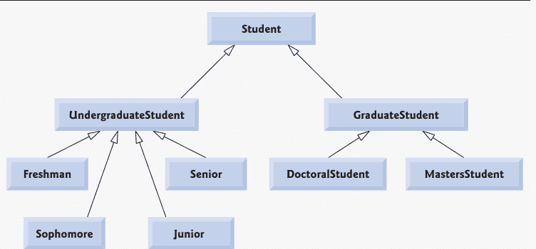

该层次结构包含了许多“是一个（继承）”关系。`UndergraduateStudent` 是一个 `Student`。`GraduateStudent` 也是一个 `Student`。`Freshman`、`Sophomore`、`Junior` 和 `Senior` 中的每一个类都是 `UndergraduateStudent` 且都是 `Student`。`DoctoralStudent` 和 `MastersStudent` 中的每一个类都是 `GraduateStudent` 且都是 `Student`。

## 11.6 形状继承层次结构

形状的世界比图 11.3 中的继承层次结构包含的形状丰富得多。写下你能想到的所有形状——二维和三维——并将它们形成一个尽可能多级的完整 `Shape`（形状）层次结构。你的层次结构顶端应该有 `Shape` 类。`TwoDimensionalShape`（二维形状）类和 `ThreeDimensionalShape`（三维形状）类应该扩展 `Shape`。根据需要在其层次结构中的正确位置添加额外的派生类，如 `Quadrilateral`（四边形）和 `Sphere`（球体）。

**解答：** [注：答案可能有所不同。]

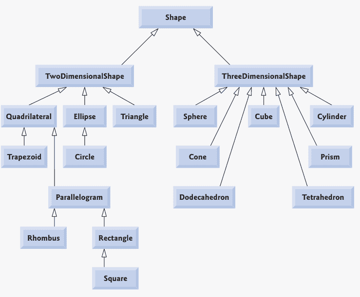

## 11.7 Protected 与 Private 访问

有些程序员倾向于不使用保护访问，因为他们认为这破坏了基类的封装。讨论在基类中使用 `protected` 访问与 `private` 访问的相对优势。

**解答：** `private` 实例变量在派生类中是隐藏的，仅可以通过基类的公共或 `protected` 属性和方法进行访问。使用 `protected` 访问允许派生类在不使用基类属性和方法的情况下操作受保护成员。如果基类变量是 `private` 的，则必须使用基类的属性来访问数据。这可能由于额外的访问器和方法调用导致性能下降。在基类中声明 `private` 实例变量有助于你调试和正确地修改系统。如果派生类可以访问其基类的 `private` 实例变量，那么继承该基类的类也可以访问这些实例变量。这将导致对本为 `private` 的实例变量的访问泛滥，信息隐藏的益处将丧失。

# 第 12 章 多态、接口与运算符重载：解决方案

> 一枚戒指主宰它们，
> 一枚戒指寻获它们，
> 一枚戒指将它们全部带回，
> 并在黑暗中将其束缚。
> —约翰·罗纳德·鲁埃尔·托尔金
>
> 通用命题并不能决定具体案例。
> —奥利弗·文德尔·霍尔姆斯
>
> 一位显赫的哲学家不会在真空中思考。他伟大的思想在很大程度上取决于生存环境，以及他所知的。
> —阿尔弗德

## 学习目标

在本章中你将学习：

- 多态如何实现“通用编程”并提高可扩展性。
- 使用抽象类来实现“通用编程”。
- 如何通过重写方法在运行时确定对象的类型。
- 如何创建抽象类。
- 如何声明接口。
- 使用运算符来操作对象。


## 复习题

### 12.1 填空题

a) 如果类包含至少一个 **抽象** 方法，则它必须被声明为抽象。
b) **具体** 类是可以实例化的。
c) **多态** 允许使用基类变量来执行“通用编程”。
d) 抽象 **类** 在运行时是未确定的。
e) 将基类引用转换为派生类被称为：**强制类型转换（casting）**。

### 12.2 判断题

a) 可以类似地对待基类和派生类。**正确**
b) 所有方法都是抽象的。**错误**
c) 通过基类变量访问派生类特有的成员是错误的。**正确**
d) 如果抽象类声明了方法，它必须实现它。**错误**，派生类必须实现。
e) 派生类对象可以被视为其接口。**正确**

## 习题

### 12.3 通用编程

**问：** 多态如何让你能够“通用编程”？

**答：** 多态允许独立于对象类型来发送消息。新类型可以整合到系统中，而无需修改基类。

### 12.4 继承接口 vs 继承实现

**问：** 设计接口的层次结构与设计实现的层次结构有何不同？

**答：** 设计实现的层次结构定义了基类的方法。设计接口的层次结构通常只指定签名。

### 12.5 抽象方法

**问：** 什么是抽象方法？在什么情况下抽象方法是合适的？

**答：** 抽象方法是不提供实现的。每个派生类必须提供实现。当通用意义上无法实现时，抽象方法是合适的。

### 12.6 多态与可扩展性

**问：** 多态如何促进可扩展性？

**答：** 调用多态行为的软件独立于对象类型。新类型可以整合到系统中，而无需修改基类。

### 12.7 分配基类和派生类引用

讨论四种将基类和派生类引用赋值给变量的方法：

1. 分配基类引用。
2. 分配派生类引用。
3. 将派生类对象的引用赋给基类变量是安全的，因为派生类对象是基类对象。然而，这仅能引用基成员。如果你通过基类变量引用派生类成员，编译器将报错。
4. 将基类引用赋给派生类变量是编译错误。为了避免这种情况，必须将基类引用强制转换为派生类类型。在运行时，如果所引的对象不是派生类对象，将发生异常。`is` 运算符确保这种转换仅在对象是派生类时执行。你也可以使用 `as` 运算符，如果类型不正确则返回 `null`。

### 12.8 抽象类 vs 接口

**问：** 为什么要使用接口？

**答：** 抽象类描述了作为该类对象的通用概念。类是不完整的——它们通常包含一个或多个抽象方法和属性，因为在通用意义上无法实现。抽象类不能被实例化。派生类必须声明“缺失的部分”——即适用于每个特定派生类的抽象方法和属性的实现。抽象类可以引用继承结构中抽象类下的任何类，因此可以使用多态方式处理此类对象。接口也描述了可以被任何类实现的抽象功能。实现接口的类可以完全无关。

### 12.9 实现和实例变量

以继承。当类实现与接口类型的“是一个”（is-a）关系时，就像派生类参与与其基类的“是一个”关系一样。因此，接口引用可以用于触发多态行为，就像抽象基类引用一样。

### 12.10 薪资系统修改

修改图 12.4–12.9 中的薪资系统，在 `Employee` 类中提供实例变量出生日期。使用 10.7 中的 `Date` 类来表示员工的生日。假设薪资每月处理一次。创建一个 `Employee` 变量数组以存储对各种员工对象的引用。在循环中，计算每个 `Employee` 的工资（通过多态方式），如果当前月份是员工生日所在的月份，则为该人员工资金额增加 $100.00 的奖金。

**答案：**

#### Employee.cs

```csharp
// 执行 12.9 Solution：Employee.cs

// Employee 抽象基类。
public abstract class Employee
{
    // 自动实现的只读属性 FirstName
    public string FirstName { get; private set; }

    // 自动实现的只读属性 LastName
    public string LastName { get; private set; }

    // 自动实现的只读属性 SocialSecurityNumber
    public string SocialSecurityNumber { get; private set; }

    // 自动实现的只读属性 BirthDate
    public Date BirthDate { get; private set; }

    // 六参数构造函数
    public Employee(string first, string last, string ssn, int month, int day, int year)
    {
        FirstName = first;
        LastName = last;
        SocialSecurityNumber = ssn;
        BirthDate = new Date(month, day, year);
    } // 结束六参数构造函数

    // 返回 Employee 对象的字符串表示
    public override string ToString()
    {
        return String.Format("{0} {1}\n{2}: {3}\n{4}: {5}",
            FirstName, LastName,
            "social security number", SocialSecurityNumber,
            "birth date", BirthDate);
    } // 结束方法 ToString

    // 由派生类重写的抽象方法
    public abstract decimal Earnings();
} // 结束抽象类 Employee
```

#### CommissionEmployee.cs

```csharp
// 练习 12.9 Solution：CommissionEmployee.cs

// 继承 Employee 的 CommissionEmployee 类。
using System;

public class CommissionEmployee : Employee
{
    private decimal grossSales; // 每周销售额
    private decimal commissionRate; // 佣金比例

    // 八参数构造函数
    public CommissionEmployee(string first, string last, string ssn,
        int month, int day, int year, decimal sales, decimal rate)
        : base(first, last, ssn, month, day, year)
    {
        GrossSales = sales; // 通过属性验证销售额
        CommissionRate = rate; // 通过属性验证佣金率
    }

    // 获取和设置佣金制员工销售额的属性
    public decimal GrossSales
    {
        get
        {
            return grossSales;
        }
        set
        {
            if (value >= 0)
                grossSales = value;
            else
                throw new ArgumentOutOfRangeException("GrossSales", "GrossSales must be >= 0");
        }
    } // 结束属性 GrossSales

    // 获取和设置佣金制员工佣金率的属性
    public decimal CommissionRate
    {
        get
        {
            return commissionRate;
        }
        set
        {
            if (value > 0 && value < 1)
                commissionRate = value;
            else
                throw new ArgumentOutOfRangeException("CommissionRate", "CommissionRate must be > 0 and < 1");
        }
    } // 结束属性 CommissionRate

    // 计算收益；重写 Employee 中的抽象方法 Earnings
    public override decimal Earnings()
    {
        return commissionRate * grossSales;
    } // 结束方法 Earnings

    // 返回佣金制员工对象的字符串表示
    public override string ToString()
    {
        return String.Format("{0}: {1}\n{2}: {3}; {4}: {5}",
            "commission employee", base.ToString(),
            "sales", GrossSales,
            "rate", CommissionRate);
    } // 结束方法 ToString
} // 结束类 CommissionEmployee
```


# 第 12 章 多态、接口与运算符重载：解决方案

## BasePlusEmployee.cs

```csharp
// 练习 12.9 Solution：BasePlusEmployee.cs

// 继承 CommissionEmployee 的 BasePlusEmployee 类。

using System;

public class BasePlusEmployee : CommissionEmployee
{
    private decimal baseSalary; // 基本薪资

    // 九参数构造函数
    public BasePlusEmployee(string first, string last, string ssn,
        int month, int day, int year, decimal sales, decimal rate, decimal salary)
        : base(first, last, ssn, month, day, year, sales, rate)
    {
        BaseSalary = salary; // 通过属性验证基本薪资
    } // 结束九参数构造函数

    // 获取和设置 BasePlusEmployee 的基本薪资的属性
    public decimal BaseSalary
    {
        get
        {
            return baseSalary;
        }
        set
        {
            if (value >= 0)
                baseSalary = value;
            else
                throw new ArgumentOutOfRangeException("BaseSalary", "BaseSalary must be >= 0");
        } // 结束属性 BaseSalary
    }

    // 计算收益；重写 CommissionEmployee 中的 Earnings
    public override decimal Earnings()
    {
        return baseSalary + base.Earnings();
    } // 结束方法 Earnings

    // 返回 BasePlusEmployee 对象的字符串表示
    public override string ToString()
    {
        return String.Format("{0}: {1}\n{2}: {3}; {4}: {5}; {6}: {7}",
            "base-plus employee", base.ToString(),
            "sales", GrossSales,
            "rate", CommissionRate,
            "base salary", BaseSalary);
    } // 结束方法 ToString
} // 结束类 BasePlusEmployee
```

## HourlyEmployee.cs

```csharp
// 练习 12.9 Solution：HourlyEmployee.cs

// 继承 Employee 的 HourlyEmployee 类。

using System;

public class HourlyEmployee : Employee
{
    private decimal wage; // 时薪
    private decimal hours; // 每周工作小时

    // 八参数构造函数
    public HourlyEmployee(string first, string last, string ssn,
        int month, int day, int year,
        decimal wage, decimal hoursWorked)
        : base(first, last, ssn, month, day, year)
    {
        Wage = wage;
        Hours = hoursWorked;
    } // 结束八参数构造函数

    // 获取和设置时薪制员工时薪的属性
    public decimal Wage
    {
        get
        {
            return wage;
        }
        set
        {
            if (value >= 0)
                wage = value;
            else
                throw new ArgumentOutOfRangeException("Wage", "Wage must be >= 0");
        } // 结束属性 Wage
    }

    // 获取和设置时薪制员工工作小时的属性
    public decimal Hours
    {
        get
        {
            return hours;
        }
        set
        {
            if (value >= 0 && value <= 168) // 验证
                hours = value;
            else
                throw new ArgumentOutOfRangeException("Hours", "Hours must be between 0 and 168");
        } // 结束 set
    } // 结束属性 Hours

    // 计算收益；重写 Employee 中的抽象方法 Earnings
    public override decimal Earnings()
    {
        if (Hours <= 40M) // 无加班费
            return Wage * Hours;
        else
            return Wage + (Hours - 40M) * Wage * 1.5M;
    } // 结束方法 Earnings

    // 返回 HourlyEmployee 对象的字符串表示
    public override string ToString()
    {
        return String.Format("hourly employee: {0}\n{1}: {2:C}; {3}: {F}",
            base.ToString(), "hourly wage", Wage, "hours worked");
    } // 结束方法 ToString
} // 结束类 HourlyEmployee
```

## SalariedEmployee.cs

```csharp
// 练习 12.9 Solution：SalariedEmployee.cs

// 继承 Employee 的 SalariedEmployee 类。

using System;

public class SalariedEmployee : Employee
{
    private decimal weeklySalary; // 每周薪资

    // 七参数构造函数
    public SalariedEmployee(string first, string last, string ssn,
        int month, int day, int year, decimal salary)
        : base(first, last, ssn, month, day, year)
    {
        WeeklySalary = salary; // 通过属性验证周薪资
    } // 结束七参数构造函数

    // 获取和设置薪薪制员工周薪资的属性
    public decimal WeeklySalary
    {
        get
        {
            return weeklySalary;
        }
        set
        {
            if (value >= 0) // 验证
                weeklySalary = value;
            else
                throw new ArgumentOutOfRangeException("WeeklySalary",
                    value, "WeeklySalary must be >= 0");
        } // 结束 set
    } // 结束属性 WeeklySalary

    // 计算收益；重写 Employee 中的抽象方法 Earnings
    public override decimal Earnings()
    {
        return weeklySalary;
    } // 结束方法 Earnings

    // 返回 SalariedEmployee 对象的字符串表示
    public override string ToString()
    {
        return String.Format("salaried employee: {0}\n{1}: {2:C}",
            base.ToString(), "weekly salary", WeeklySalary);
    } // 结束方法 ToString
} // 结束类 SalariedEmployee
```

## PayrollSystem.cs

```csharp
// 薪资系统修改实现

public class PayrollSystem
{
    public static void Main(string[] args)
    {
        Employee[] employees = new Employee[4];

        employees[0] = new HourlyEmployee("John", "Doe", "123-45-6789", 3, 15, 1980, 20.00m, 42m);
        employees[1] = new HourlyEmployee("Jane", "Smith", "987-65-4321", 6, 20, 1992, 25.50m, 35m);
        employees[2] = new CommissionEmployee("Bob", "Johnson", "555-55-5555", 9, 10, 1975, 1200.00m, 0.10m);
        employees[3] = new BasePlusEmployee("Alice", "Williams", "444-33-2222", 3, 15, 1985, 500.00m, 0.05m, 1500.00m);

        for (int i = 0; i < employees.Length; i++)
        {
            decimal payroll = employees[i].Earnings();

            if (employees[i].BirthDate.Month == DateTime.Now.Month &&
                employees[i].BirthDate.Day == DateTime.Now.Day)
            {
                payroll += 100.00m;
            }

            Console.WriteLine(employees[i].ToString());
            Console.WriteLine("payroll: {0:C}\n", payroll);
        }
    }
}
```

## PayrollSystemTest.cs (片段)

```csharp
// 练习 12.9 解决方案：PayrollSystemTest.cs

// 员工体系测试程序。

using System;

public class PayrollSystemTest
{
    public static void Main(string[] args)
    {
        // 创建派生对象
        SalariedEmployee salaried = new SalariedEmployee("John",
            "Smith", "111-1111", 6, 1954, 800M);
        HourlyEmployee hourlyEmployee = new HourlyEmployee("Karen",
            "Price", "222-2222", 12, 29, 1960, 16.75M, 40M);
        BasePlusCommissionEmployee commissionEmployee = new
            BasePlusCommissionEmployee("Bob", "Lewis", "333-3333",
            9, 1854, 1000, .06M);
        BasePlusCommissionEmployee basePlusCommissionEmployee = new
            BasePlusCommissionEmployee("Bob", "Lewis", "444-4444",
            3, 2, 1965, 5000, .04M, 300M);

        Console.WriteLine("{0}\n{1}: {2:C}\n",
            salaried, "所得", salaried.Earnings());

        Console.WriteLine("{0}\n{1}: {2:C}\n",
            hourlyEmployee, "所得", hourlyEmployee.Earnings());

        Console.WriteLine("{0}\n{1}: {2:C}\n",
            commissionEmployee, "所得", commissionEmployee.Earnings());

        Console.WriteLine("{0}\n{1}: {2:C}\n",
            basePlusCommissionEmployee, "所得", basePlusCommissionEmployee.Earnings());

        // 创建包含四个元素的 Employee 数组
        Employee[] employees = new Employee[4];

        // 使用 Employees 初始化数组
        employees[0] = salaried;
        employees[1] = hourlyEmployee;
        employees[2] = commissionEmployee;
        employees[3] = basePlusCommissionEmployee;

        int currentMonth;

        // 获取并验证当前月份
        do
        {
            Console.Write("输入当前月份 (1 - 12): ");
            currentMonth = Convert.ToInt32(Console.ReadLine());
            Console.WriteLine();
        } while ((currentMonth < 1) || (currentMonth > 12));

        // 通用处理 employees 数组中的每个元素
        foreach (var currentEmployee in employees)
        {
            Console.WriteLine(currentEmployee); // 调用 ToString

            // 判断元素是否为 BasePlusCommissionEmployee
            if (currentEmployee is BasePlusCommissionEmployee)
            {
                // 将 Employee 引用向下强制转换为
                BasePlusCommissionEmployee employee =
                    (BasePlusCommissionEmployee)currentEmployee;

                employee.BaseSalary *= 1.1M;
            }
        }
    }
}
```


## 练习题 14

```cs
// 用于获取和设置边长的的属性
public int Side
{
    get
        return Dimension1;
    } // end get
    set
    {
        Dimension1 = value;
        Dimension2 = value;
    } // end set
} // end property Side

public override string toString()
{
    return string.Format("{0} {1}: {2}\n", base.toString(), "side", Side);
} // end method toString
// end class Square
```

- 练习题 12.10 答案：Circle.cs
- 类 Circle 的声明。
- 引用 System;

```cs
public class Circle : TwoDimensionalShape
{
    // 三参数构造函数
    public Circle(int x, int y, int radius)
    : base(x, y, radius, radius) { }
}
```

```cs
// 重写
// 用于获取名称的只读属性
public override string Name
{
    get
        return "Circle";
    } // end get
} // end property Name
```

```cs
// 用于获取面积的只读属性
public override double Area
{
    get
        return (Math.PI * Radius * Radius);
    } // end get
} // end property Area
```

```cs
// 用于获取和设置半径的属性
public int Radius
{ }
```

## 第 12 章 多态、接口与运算符重载：解题

```cs
get
{
    return Dimension1; // end get
}
set
{
    Dimension1 = value;
    Dimension2 = value;
    // end set
} // end property Radius

public override string ToString()
{
    return String.Format("{0} {1}:{2}", base.ToString(), "radius", Radius);
} // end method ToString
// end class Circle
```

```cs
// 练习题 12.10 答案：ThreeDimensionalShape.cs
// 类 ThreeDimensionalShape 的声明
public abstract class ThreeDimensionalShape : Shape
{
    // // 自动实现的属性 Dimension1
    public int Dimension1 { get; set; }

    // // 自动实现的属性 Dimension2
    public int Dimension2 { get; set; }

    // // 自动实现的属性 Dimension3
    public int Dimension3 { get; set; }

    // // 五参数构造函数
    public ThreeDimensionalShape(int x, int y, int d1, int d2, int d3)
        : base(x, y)
    {
        Dimension1 = d1;
        Dimension2 = d2;
        Dimension3 = d3;
    } // end five-parameter ThreeDimensionalShape constructor

    // // 抽象属性
    public abstract double Area
    {
        get;
    }
    public abstract double Volume
    {
        get;
    }
} // end class ThreeDimensionalShape
```

```cs
// 练习题 12.10 答案：Cube.cs
// 类 Cube 的声明。
public class Cube : ThreeDimensionalShape
{
    // 三参数构造函数
    public Cube(int x, int y, int side)
        : base(x, y, side, side, side) { }

    // 重写属性
    // 用于获取名称的只读属性
    public override string Name
    {
        get
        {
            return "Cube";
        } // end get
    }

    // 用于获取面积的只读属性
    public override double Area
    {
        get
        {
            return (6 * Side * Side);
        } // end get
    } // end property Area

    // 用于获取体积的只读属性
    public override double Volume
    {
        get
        {
            return (Side * Side * Side);
        } // end get
    } // end property Volume

    // 用于获取和设置边长的属性
    public int Side
    {
        get
        {
            return Dimension1;
        } // end get
        set
        {
            Dimension1 = value;
            Dimension2 = value;
            Dimension3 = value;
        } // end set
    } // end property Side

    public override string ToString()
    {
        return string.Format("{0} {1}: {2}\n", base.ToString(), "side", Side);
    } // end method ToString
} // end class Cube
```

## 17 第 12 章 多态、接口与运算符重载：解题

```cs
// 练习题 12.10 答案：Sphere.cs
// 类 Sphere 的声明。
using System;

public class Sphere : ThreeDimensionalShape
{
    // 三参数构造函数
    public Sphere(int x, int y, int radius)
    : base(x, y, radius, radius) { }

    // 重写参数
    // 用于获取名称的只读属性
    public override string Name
    {
        get
        {
            return "Sphere";
        } // end get
    } // end property Name

    // 用于获取面积的只读属性
    public override double Area
    {
        get
        {
            return (4 * Math.PI * Radius * Radius);
        } // end get
    } // end property Area

    // 用于获取体积的只读属性
    public override double Volume
    {
        get
        {
            return (4.0 / 3.0 * Math.PI * Radius * Radius * Radius);
        } // end get
    } // end property Volume

    // 用于获取和设置半径的属性
    public int Radius
    {
        get
        {
            return Dimension1;
        } // end get
        set
        {
            Dimension1 = value;
            Dimension2 = value;
            Dimension3 = value;
        } // end set
    } // end property Radius

    public override string ToString()
    {
        return string.Format("{0} {1}: {2}\n", base.ToString(), "radius", Radius);
    } // end method ToString
} // end class Sphere
```

## 练习题 18

```cs
// 练习题 12.10 答案：ShapeTest.cs
// 测试 Shape 体系。
using System;

public class ShapeTest
{
    // 创建 Shape 对象
    public static void Main(string[] args)
    {
        Shape[] shapes = new Shape[4];
        shapes[0] = new Circle(0, 0, 5);
        shapes[1] = new Square(0, 0, 10);
        shapes[2] = new Sphere(0, 0, 5);
        shapes[3] = new Cube(0, 0, 5);

        // 对所有形状调用 ToString
        foreach (var currentShape in shapes)
        {
            Console.WriteLine(currentShape.ToString());
            if (currentShape is TwoDimensionalShape)
            {
                TwoDimensionalShape td = (TwoDimensionalShape)currentShape;
                Console.WriteLine("Area: {0}", td.Area);
            }
            if (currentShape is ThreeDimensionalShape)
            {
                ThreeDimensionalShape td = (ThreeDimensionalShape)currentShape;
                Console.WriteLine("Volume: {0}", td.Volume);
            }
        }
    }
} // end class ShapeTest
```

## 19 第 12 章 多态、接口与运算符重载：解

Circle: [22, 88] radius: 4
Square: [71, 96] side: 10
Sphere: [22, 89] radius: 2
Cube: [79, 61] side: 8

### 12.11 (工资系统修改)

修改图 12.4–12.9 的工资系统，包含一个额外的派生类 `Pieceworker`，它表示工资根据产量数量计算的员工。`Pieceworker` 类应包含私有实例变量 `wage`（存储单件工资）和 `pieces`（存储产量数量）。在 `Pieceworker` 类中提供 `Earnings` 方法的具体实现，通过产量数量乘以单件工资来计算工资。创建一个 `Employee` 数组来存储新体系中每个具体类的引用。显示每个员工的字符串表示和工资。

答案：

```cs
// 练习题 12.11 答案：Pieceworker
// 扩展 Employee 的类。
using System;

public class Pieceworker : Employee
{
    private decimal wage; // 单件工资
    private int pieces; // 产量数量

    // 五参数构造函数
    public Pieceworker(string first, string last, string ssn,
        decimal wagePiece, int piecesProduced)
        : base(first, last, ssn)
    {
        Wage = wagePiece; // 通过属性验证单件工资
        Pieces = piecesProduced; // 通过属性验证产量数量
    } // end five-parameter Pieceworker constructor

    // 用于获取和设置计件工资单件工资的属性
    public decimal Wage
    {
        get
        {
            return wage;
        } // end get
        set
        {
            wage = value;
        } // end set
    } // end property Wage

    // 用于获取和设置产量数量的属性
    public int Pieces
    {
        get
        {
            return pieces;
        } // end get
        set
        {
            pieces = value;
        } // end set
    } // end property Pieces

    public override decimal Earnings()
    {
        return wage * pieces;
    }
}
```

## 练习 20

```csharp
22   get
23   {
24       return wage;
25   } // end get
26   set
27   {
```


## 第 12 章 多态、接口和运算符重载：解决方案

### PieceWorker 类实现

```csharp
if (value >= 0)
    wage = value;
else
    throw new ArgumentOutOfRangeException("Wage", value, "Wage must be >= 0 ");
} // end set
} // end property Wage

// 用于获取和设置计件工数量的属性
public int Pieces
{
    get
    {
        return pieces;
    } // end get
    set
    {
        if (value >= 0)
            pieces = value;
        else
            throw new ArgumentOutOfRangeException("Pieces", value, "Pieces must be >= 0 ");
    } // end set
} // end property Pieces

// 计算收入；重写 Employee 中的抽象方法 Earnings
public override decimal Earnings()
{
    return Pieces * Wage;
} // end method Earnings

// 返回 PieceWorker 对象的字符串表示
public override string ToString()
{
    return string.Format("{0}: {1}\n{2}: {3:C}; {4}: {5}",
        "piece worker", base.ToString(),
        "wage per piece", Wage, "pieces produced", Pieces);
} // end method ToString
} // end class PieceWorker
```

### PayrollSystemTest 测试程序

```csharp
// 练习 12.11 答案：PayrollSystemTest.cs
// Employee 体系测试程序。
using System;

public class PayrollSystemTest
{
    public static void Main(string[] args)
    {
        // 创建包含五个元素的 Employee 数组
        Employee[] employees = new Employee[5];

        // 用 Employees 初始化数组
        employees[0] = new SalariedEmployee("John", "Smith", "111-1111", 8000M);
        employees[1] = new HourlyEmployee("Karen", "Price", "222-2222", 16.75M, 40M);
        employees[2] = new CommissionEmployee("Sue", "Jones", "333-3333", 10000M, .06M);
        employees[3] = new BasePlusCommissionEmployee("Bob", "Lewis", "444-4444", 5000M, .04M, 300M);
        employees[4] = new PieceWorker("Rick", "Bridges", "555-5555", 2.25M, 400);

        Console.WriteLine("通过多态处理的员工:\n");

        // 通用地处理 employee 数组中的每个元素
        foreach (var currentEmployee in employees)
        {
            Console.WriteLine(currentEmployee); // 调用 ToString
            Console.WriteLine("earned {0:C}\n", currentEmployee.Earnings());
        } // end foreach
    } // end Main
} // end class PayrollSystemTest
```

**输出结果：**

```text
通过多态处理的员工：

salaried employee: John Smith
social security number: 111-1111
weekly salary: $800.00
earned $800.00

hourly employee: Karen Price
social security number: 222-2222
hourly wage: $16.75; hours worked: $40.00
earned $670.00

commission employee: Sue Jones
social security number: 333-3333
gross sales: $10000.00; commission rate: .06
earned $600.00

base-salaried commission employee: Bob Lewis
social security number: 444-4444
gross sales: $5000.00; commission rate: .04; base salary: $300.00
earned $500.00

piece worker: Rick Bridges
social security number: 555-5555
wage per piece: $2.25; pieces produced: 400
earned $900.00
```

## 练习 22

**12.12（应账系统修改）** 在此练习中，我们修改了图 12.11–12.15 中的应账应用程序，以包含图 12.4–12.9 中的工资单功能。应用程序仍然处理 `Invoice` 对象，但现在应该处理 `Employee` 的派生类。如果当前处理的对象是 `BasePlusCommissionEmployee`，应用程序应将其基本工资增加 10%。应用程序应输出每个 `IPayable` 对象的金额。完成以下步骤以创建：

- a) 修改 `HourlyEmployee`（图 12.6）和 `CommissionEmployee`（图 12.7），将其放在 `Employee`（图 12.13）的派生类层次中：更改每个派生类的 `Earnings` 方法。
- b) 修改 `BasePlusCommissionEmployee`（图 12.8），扩展 a 部分创建的 `CommissionEmployee` 类。
- c) 修改 `IPayable` 接口（图 12.15），以多态方式处理 `SalariedEmployee`、`HourlyEmployee`、`CommissionEmployee` 和 `BasePlusCommissionEmployee`。首先，输出每个 `IPayable` 对象的字符串表示。接下来，如果对象是 `BasePlusCommissionEmployee`，将其基本工资增加 10%。输出每个 `IPayable` 对象的金额。

### 答案

#### HourlyEmployee.cs

```csharp
// 练习 12.12：HourlyEmployee.cs
// 扩展 Employee 的类，实现了 IPayable。
using System;

public class HourlyEmployee : Employee
{
    private decimal wage; // 时薪
    private decimal hours; // 每周工作时长

    public HourlyEmployee(string first, string last, string ssn,
        decimal wage, decimal hoursWorked)
    {
        Wage = wage; // 通过属性验证工资
        Hours = hoursWorked; // 通过属性验证工作时长
    } // end HourlyEmployee 构造函数

    // 获取和设置小时员工时薪的属性
    public decimal Wage
    {
        get
        {
            return wage;
        }
        set
        {
            if (value >= 0) // 验证
                wage = value;
            else
                throw new ArgumentOutOfRangeException("Wage", value, "Wage must be >= 0 ");
        } // end set
    } // end property Wage

    // 获取和设置小时员工工作时长的属性
    public decimal Hours
    {
        get
        {
            return hours;
        } // end get
        set
        {
            if (value >= 0 && value <= 168) // 验证
                hours = value;
            else
                throw new ArgumentOutOfRangeException("Hours", value, "Hours must be >= 0 and <= 168");
        } // end set
    } // end property Hours

    // 计算收入；实现基类未实现的 IPayable 方法
    public override decimal GetPaymentAmount()
    {
        if (Hours < 40) // 无加班
            return Wage * Hours;
        else
            return 40 * Wage + (Hours - 40) * Wage * 1.5M;
    } // end method GetPaymentAmount

    // HourlyEmployee 的字符串表示
    public override string ToString()
    {
        return string.Format("hourly employee: {0}\n{1}: {2:C}; {3}: {4}",
            base.ToString(), "hourly wage", Wage, "hours worked", Hours);
    } // end method ToString
} // end class HourlyEmployee
```

#### CommissionEmployee.cs

```csharp
// 练习 12.12 答案：CommissionEmployee.cs
// 扩展 Employee 的类，实现了 IPayable。
using System;

public class CommissionEmployee : Employee
{
    private decimal grossSales; // 周总销售额
    private decimal commissionRate; // 佣金比例

    // 五参数构造函数
    public CommissionEmployee(string first, string last, string ssn,
        decimal sales, decimal rate)
        : base(first, last, ssn)
    {
        GrossSales = sales; // 通过属性验证销售额
        CommissionRate = rate; // 通过属性验证佣金比例
    } // end 五参数 CommissionEmployee 构造函数

    // 获取和设置佣金员工总销售额的属性
    public decimal GrossSales
    {
        get
        {
            return grossSales;
        } // end get
        set
        {
            if (value >= 0)
                grossSales = value;
            else
                throw new ArgumentOutOfRangeException("GrossSales", value, "GrossSales must be >= 0 ");
        } // end set
    } // end property GrossSales

    // 获取和设置佣金员工佣金比例的属性
    public decimal CommissionRate
    {
        get
        {
            return commissionRate;
        } // end get
        set
        {
            if (value > 0 && value < 1)
                commissionRate = value;
            else
                throw new ArgumentOutOfRangeException("CommissionRate", value, "CommissionRate must be > 0 and < 1 ");
        } // end set
    } // end property CommissionRate

    // 计算收入；实现基类未实现的 IPayable 方法
    public override decimal GetPaymentAmount()
    {
        return CommissionRate * GrossSales;
    } // end method GetPaymentAmount

    // 返回 CommissionEmployee 对象的字符串表示
    public override string ToString()
    {
        return string.Format("commission employee: {0}\n{1}: {2:C}; {3}: {4:F}",
            base.ToString(), "gross sales", GrossSales, "commission rate", CommissionRate);
    } // end method ToString
} // end class CommissionEmployee
```

#### BasePlusCommissionEmployee.cs

```csharp
// 练习 12.12 解决方案：BasePlusCommissionEmployee.cs
// 继承 CommissionEmployee 的类。
using System;

public class BasePlusCommissionEmployee : CommissionEmployee
{
    private decimal baseSalary; // 每周基本工资

    // 六参数构造函数
    public BasePlusCommissionEmployee(string first, string last, string ssn,
        decimal sales, decimal rate, decimal salary)
        : base(first, last, ssn, sales, rate)
    {
        BaseSalary = salary; // 验证并存储基本工资
    } // end 六参数 BasePlusCommissionEmployee 构造函数

    // 获取和设置基本薪制佣金员工基本工资的属性
    public decimal BaseSalary
    {
        get
        {
            return baseSalary;
        }
        set
        {
            if (value >= 0)
                baseSalary = value;
            else
                throw new ArgumentOutOfRangeException("BaseSalary", value, "BaseSalary 必须 >= 0 ");
        } // end set
    } // end property BaseSalary

    // 计算收入；重写 CommissionEmployee 的 GetPaymentAmount
    public override decimal GetPaymentAmount()
    {
        return BaseSalary + base.GetPaymentAmount();
    } // end method GetPaymentAmount

    // 返回 BasePlusCommissionEmployee 对象的字符串表示
    public override string ToString()
    {
        return string.Format("base-salaried {0}\n{1}: {2:C}",
            base.ToString(), "base salary", BaseSalary);
    } // end method ToString
} // end class BasePlusCommissionEmployee
```


### `BasePlusCommissionEmployee` 类部分实现

```csharp
// 接口 IPayable 方法的实现
public override decimal GetPaymentAmount()
{
    return BaseSalary + base.GetPaymentAmount();
} // end method GetPaymentAmount

// 返回 BasePlusCommissionEmployee 对象的字符串表示
public override string ToString()
{
    return string.Format("{0}{1}; {2}:{3:C}",
        "base-salaried", base.ToString(),
        "base salary", BaseSalary);
} // end method ToString
} // end class BasePlusCommissionEmployee
```

### 练习 12.12 解决方案：`PayableInterfaceTest.cs`

测试接口 `IPayable`。

```csharp
using System;

public class PayableInterfaceTest
{
    public static void Main(string[] args)
    {
        // 创建 IPayable 数组
        IPayable[] payableObjects = new IPayable[6];
        // 用实现 IPayable 的对象填充数组
        payableObjects[0] = new Invoice("01234", "seat", 2, 375M);
        payableObjects[1] = new Invoice("056789", "tire", 4, 79.95M);
        payableObjects[2] = new SalariedEmployee("John", "Smith", "111-11-1111", 800M);
        payableObjects[3] = new HourlyEmployee("Karen", "Price", "222-22-2222", 16.75M, 40M);
        payableObjects[4] = new CommissionEmployee("Sue", "Jones", "333-33-3333", 10000M, .06M);
        payableObjects[5] = new BasePlusCommissionEmployee("Bob", "Lewis", "444-44-4444", 5000M, .04M, 300M);

        Console.WriteLine("通过多态处理的发票和员工：\n");

        // 通用处理 payableObjects 数组中的每个元素
        foreach (var currentPayable in payableObjects)
        {
            // 输出 currentPayable 及其相应的支付金额
            Console.WriteLine("{0}", currentPayable.ToString());

            if (currentPayable is BasePlusCommissionEmployee)
            {
                // 将 IPayable 引用向下转型为 BasePlusCommissionEmployee
                BasePlusCommissionEmployee employee = (BasePlusCommissionEmployee)currentPayable;
                employee.BaseSalary *= 1.1M;
                Console.WriteLine("增加 10% 后的新基本工资为：{0:C}", employee.BaseSalary);
            } // end if

            Console.WriteLine("{0:C}\n", currentPayable.GetPaymentAmount());
        } // end foreach
    } // end Main
} // end class PayableInterfaceTest
```

#### 运行结果

通过多态处理的发票和员工：

发票:
零件号: 01234 (座垫)
数量: 2
单价价格: $375.00
应付金额: $750.00

发票:
零件号: 056789 (轮胎)
数量: 4
单价价格: $79.95
应付金额: $319.80

固定薪员工: John Smith
社会安全号: 111-11-1111
每周工资: $800.00
应付金额: $800.00

时薪员工: Karen Price
社会安全号: 222-22-2222
时薪: $16.75; 工作小时: 40.00
应付金额: $670.00

佣金员工: Sue Jones
社会安全号: 333-33-3333
总销售额: $10,000.00; 佣金率: 0.06
应付金额: $600.00

固定薪制佣金员工: Bob Lewis
社会安全号: 444-44-4444
总销售额: $5,000.00; 佣金率: 0.04; 基本工资: $300.00
增加 10% 后的新基本工资为: $330.00
应付金额: $530.00

---

### 练习 12.13 解决方案：包裹处理系统

#### `Package.cs` 基类

```csharp
using System;

public class Package
{
    // 包的重量
    private decimal weight;
    // 每盎司运费
    private decimal costPerOunce;

    // 发件人信息
    public string SenderName { get; set; }
    public string SenderAddress { get; set; }
    public string SenderCity { get; set; }
    public string SenderState { get; set; }
    public string SenderZIP { get; set; }

    // 收件人信息
    public string RecipientName { get; set; }
    public string RecipientAddress { get; set; }
    public string RecipientCity { get; set; }
    public string RecipientState { get; set; }
    public string RecipientZIP { get; set; }

    // 构造函数初始化变量
    public Package(string senderName, string senderAddress,
        string senderCity, string senderState, string senderZIP,
        string recipientName, string recipientAddress,
        string recipientCity, string recipientState, string recipientZIP,
        decimal packageWeight, decimal cost)
    {
        SenderName = senderName;
        SenderAddress = senderAddress;
        SenderCity = senderCity;
        SenderState = senderState;
        SenderZIP = senderZIP;
        RecipientName = recipientName;
        RecipientAddress = recipientAddress;
        RecipientCity = recipientCity;
        RecipientState = recipientState;
        RecipientZIP = recipientZIP;
        Weight = packageWeight;
        CostPerOunce = cost;
    }

    // 获取和设置重量
    public decimal Weight
    {
        get { return weight; }
        set
        {
            if (value >= 0)
                weight = value;
            else
                throw new ArgumentOutOfRangeException(nameof(Weight), "Weight 必须 >= 0");
        }
    }

    // 获取和设置每盎司运费
    public decimal CostPerOunce
    {
        get { return costPerOunce; }
        set
        {
            if (value >= 0)
                costPerOunce = value;
            else
                throw new ArgumentOutOfRangeException(nameof(CostPerOunce), "CostPerOunce 必须 >= 0");
        }
    }

    // 计算包的运费
    public virtual decimal CalculateCost()
    {
        return Weight * CostPerOunce;
    }
}
```

#### `OvernightPackage.cs` 隔夜包裹类

```csharp
using System;

public class OvernightPackage : Package
{
    private decimal overnightFeePerOunce; // 每盎司隔夜费

    // 构造函数
    public OvernightPackage(string senderName, string senderAddress, string senderCity, string senderState,
        string senderZIP, string recipientName, string recipientAddress,
        string recipientCity, string recipientState, string recipientZIP,
        decimal weight, decimal cost, decimal fee)
        : base(senderName, senderAddress, senderCity, senderState,
              senderZIP, recipientName, recipientAddress, recipientCity,
              recipientState, recipientZIP, weight, cost)
    {
        OvernightFeePerOunce = fee; // 通过属性设置隔夜费
    }

    // 获取和设置每盎司隔夜费的属性
    public decimal OvernightFeePerOunce
    {
        get { return overnightFeePerOunce; }
        set
        {
            if (value >= 0)
                overnightFeePerOunce = value;
            else
                throw new ArgumentOutOfRangeException(nameof(OvernightFeePerOunce), value, "OvernightFeePerOunce 必须 >= 0");
        }
    }

    // 计算包裹的运费
    public override decimal CalculateCost()
    {
        return Weight * (CostPerOunce + OvernightFeePerOunce);
    }
}
```

#### `TwoDayPackage.cs` 两日包裹类

```csharp
using System;

public class TwoDayPackage : Package
{
    private decimal flatFee; // 两日快递服务的固定费用

    // 构造函数
    public TwoDayPackage(string senderName, string senderAddress, string senderCity, string senderState,
        string senderZIP, string recipientName, string recipientAddress,
        string recipientCity, string recipientState, string recipientZIP,
        decimal weight, decimal cost, decimal fee)
        : base(senderName, senderAddress, senderCity, senderState,
              senderZIP, recipientName, recipientAddress, recipientCity,
              recipientState, recipientZIP, weight, cost)
    {
        FlatFee = fee; // 通过属性验证固定费用
    }

    // 获取和设置两日包裹固定费用的属性
    public decimal FlatFee
    {
        get { return flatFee; }
        set
        {
            if (value >= 0)
                flatFee = value;
            else
                throw new ArgumentOutOfRangeException(nameof(FlatFee), value, "FlatFee 必须 >= 0");
        }
    }

    // 计算包裹的运费
    public override decimal CalculateCost()
    {
        return base.CalculateCost() + FlatFee;
    }
}
```

#### `PackageTest.cs` 测试类

```csharp
using System;

public class PackageTest
{
    public static void Main(string[] args)
    {
        // 创建包裹数组
        Package[] packages = new Package[3];

        // 用 Packages 初始化数组
        packages[0] = new Package("Lou Brown", "1 Main St", "Boston", "MA", "11111",
                                  "Mary Smith", "7 Elm St", "New York", "NY", "22222", 8.5M, .5M);

        packages[1] = new TwoDayPackage("Lisa Klein", "5 S Broadway", "Somerville", "MA", "33333",
                                        "Bob George", "21 Pine Rd", "Cambridge", "MA", "44444", 10.5M, .6M, 2.0M);

        packages[2] = new OvernightPackage("Ed Lewis", "2 Oak St", "Boston", "MA", "55555",
                                           "Don Kelly", "9 Main St", "Denver", "CO", "66666", 12.25M, .7M, .25M);

        decimal totalShippingCost = 0;

        // 显示每个包裹的信息和费用
        for (int i = 0; i < packages.Length; i++)
        {
            Console.WriteLine("包裹 {0}:\n", i + 1);
            Console.WriteLine("发件人:\n{0}\n{1}\n{2}, {3} {4}",
                packages[i].SenderName, packages[i].SenderAddress,
                packages[i].SenderCity, packages[i].SenderState, packages[i].SenderZIP);
            Console.WriteLine("\n收件人:\n{0}\n{1}\n{2}, {3} {4}",
                packages[i].RecipientName, packages[i].RecipientAddress,
                packages[i].RecipientCity, packages[i].RecipientState, packages[i].RecipientZIP);
            Console.WriteLine("\n运费: {0:C}\n", packages[i].CalculateCost());
            totalShippingCost += packages[i].CalculateCost();
        }

        Console.WriteLine("总运费: {0:C}", totalShippingCost);
    }
}
```


```csharp
Console.WriteLine("寄件者：\n{0}\n{1}\n{2}, {3} {4}\n",
    packages[i].SenderName, packages[i].SenderAddress,
    packages[i].SenderCity, packages[i].SenderState,
    packages[i].SenderZIP);

Console.WriteLine("收件者：\n{0}\n{1}\n{2}, {3} {4}\n",
    packages[i].RecipientName, packages[i].RecipientAddress,
    packages[i].RecipientCity, packages[i].RecipientState,
    packages[i].RecipientZIP);

decimal cost = packages[i].CalculateCost();

Console.Write("费用: {0}\n\n", cost);

// 将此包裹的费用加入总计
totalShippingCost += cost;

} // end for

Console.WriteLine("\n总运费: {0:C}", totalShippingCost);

} // end Main

} // end class PackageTest
```

# 练习 36

```csharp
if (rate >= 0)
    interestRate = rate;
else
    throw new ArgumentOutOfRangeException("rate", rate, "rate must be >= 0");

// 结束 SavingsAccount 构造函数

// 返回利息金额
public decimal CalculateInterest()
{
    return Balance * interestRate;
} // 结束方法 CalculateInterest

// 结束 SavingsAccount 类
```

```csharp
// 练习 12.14 解 Solution：AccountTest.cs
// 以态的方式处理账户。

using System;

public class AccountTest
{
    public static void Main(string[] args)
    {
        // 创建账户数组
        Account[] accounts = new Account[4];

        // 用 Accounts 初始化数组
        accounts[0] = new SavingsAccount(25M, .03M);
        accounts[1] = new CheckingAccount(80M, 1M);
        accounts[2] = new SavingsAccount(200M, .05M);
        accounts[3] = new CheckingAccount(400M, .5M);

        // 遍历数组，提示借贷和贷金额
        for (int i = 0; i < accounts.Length; i++)
        {
            Console.WriteLine("账户 {0} 余额: {1:C}", i + 1, accounts[i].Balance);

            Console.Write("\nEnter从账户 {0} 取出的金额: ", i + 1);
            decimal withdrawalAmount = Convert.ToDecimal(Console.ReadLine());

            accounts[i].Debit(withdrawalAmount); // 尝试借记

            Console.Write("\nEnter向账户 {0} 存款的金额: ", i + 1);
            decimal depositAmount = Convert.ToDecimal(Console.ReadLine());

            // 将金额存入账户
            accounts[i].Credit(depositAmount);

            // 如果账户是 SavingsAccount，则计算并加上利息
            if (accounts[i] is SavingsAccount)
            {
                // 向下转换
                SavingsAccount currentAccount = (SavingsAccount)accounts[i];

                decimal interestEarned = currentAccount.CalculateInterest();

                Console.WriteLine("向利息 {1} 添加 {0:C} (一个 SavingsAccount)", interestEarned, i + 1);

                currentAccount.Credit(interestEarned);
            } // 结束 if
        }
    }
}
```

账户 1 余额: $25.00
从账户 1 取出的金额: 10
向账户 1 存款的金额: 20
向利息 1 添加 $1.05 利息 (一个 SavingsAccount)
更新账户 1 余额: $36.05
账户 2 余额: $80.00
从账户 2 取出的金额: 50
收取了 $1.00 手续费。
向账户 2 存款的金额: 50
收取了 $1.00 手续费。
更新账户 2 余额: $33.00
账户 3 余额: $200.00
从账户 3 取出的金额: 1000
借记金额超过余额。
向账户 3 存款的金额: 50
向账户 3 添加 $3.08 利息 (一个 SavingsAccount)
更新账户 3 余额: $208.08
账户 4 余额: $400.00
从账户 4 取出的金额: 100
收取了 $0.50 手续费。
向账户 4 存款的金额: 200
收取了 $0.50 手续费。
更新账户 4 余额: $499.00

# 改变世界练习

## 12.15 (CarbonFootprint 接口：多态性)

使用接口，正如你在本章中学到的，你可以为可能不同的类指定相似的行为。全球范围内的政府和公司正日益关注碳足迹（燃烧各种类型燃料发电的建筑每年向大气中释放的二氧化碳）。许多科学家将这些温室气体归咎于全球变暖现象。创建三个没有继承关系的的小类：`Building`（建筑）、`Car`（汽车）和 `Cycle`（自行车）。给每个类提供一些与其他类不共有的属性和行为。编写一个 `CarbonFootprint` 接口，包含一个 `getCarbonFootprint()` 方法，该方法用于为该类计算合适的碳足迹（查看几个解释如何计算碳足迹的网站）。编写一个应用程序，创建这三个类的每个对象，将这些对象的引用放入 `ArrayList<CarbonFootprint>` 中，然后遍历该 `ArrayList`，多态地调用每个对象的 `getCarbonFootprint()` 方法。对于每个对象，打印标识信息和对象的碳足迹。

**答：** 参见源文件中的 Solution 代码。

## 13 异常处理：深度查看：解决方案

> 尝试一个方法并运行它是常识。如果失败了，坦诚地承认并尝试另一个。但最重要的是，要去尝试。
> —富兰克林·罗斯福

> 噢！丢弃它糟糕的部分，用另一半过过更纯洁的生活。
> —威廉·莎士比亚

> 如果他们正在跑却不看路，我得得从某个地方跳出来抓住他们。
> —J. D. 塞林格

## 学习目标

在本章中，你将学习到：

- 什么是异常以及如何处理它们。
- 什么时候该使用异常处理。
- 使用 `try` 块指定异常可能发生的地方。
- 使用 `throw` 抛出异常来指示问题。
- 使用 `catch` 块处理异常。
- 使用 `finally` 块释放资源。
- 异常层次结构。
- 创建自定义异常。

## 自复习

### 13.1 填空下列语句的空白：

a) 方法被认为 `throws` 异常。
b) 与 `try` 关联的 `finally` 总是执行。
c) 异常派自 `System.Exception`。
d) 语句通过 `throw` 异常。
e) C# 使用 `termination` 异常模型。
f) 方法中未捕获的异常会导致 `stack unwinding`。
g) 可以转换 `checked` 异常。

### 13.2 判断下列陈述的对错。如果是错误的，请解释原因。

a) 异常在方法总是被处理。
b) 自定义类应该扩展 `Exception`。
c) 访问越界索引会导致 CLR 抛出 `IndexOutOfRangeException`。
d) 对于没有 `catch` 块的 `try` 块，`finally` 块是可选的。
e) 只有当程序进入 `try` 块时，`finally` 块才会执行。
f) 使用 `throw` 关键字返回。
g) 异常可以被抛出。
h) `StackTrace` 属性返回指示抛出异常方法的字符串。

### 13.3 使用继承创建一个异常基类和各种异常派生类。编写一个程序演示指定基类的类捕获派生异常。

> 答：由于这是一个机械练习，我们没有为每个异常类提供完整的构造函数集。

```csharp
// 练习 13.3 Solution：ExceptionTest.cs
// 展示捕获派生异常。

using System;

// 创建 System.Exception 的派生类
class ExceptionA : Exception
{
    // 空体
} // 结束类 ExceptionA

// 创建类 ExceptionA 的派生类
class ExceptionB : ExceptionA
{
    // 空体
} // 结束类 ExceptionB

// 创建类 ExceptionB 的派生类
class ExceptionC : ExceptionB
{
    // 空体
} // 结束类 ExceptionC

// ExceptionTest 抛出并捕获派生异常
public class ExceptionTest
{
    public static void Main(string[] args)
    {
        // 抛出并捕获一个 ExceptionC
        try
        {
            // 抛出派生类 ExceptionC
            throw new ExceptionC();
        }
        catch (ExceptionA exception)
        {
            Console.WriteLine("ExceptionC 在 ExceptionA 捕获块中被捕获:\n" + exception + "\n");
        }

        // 抛出并捕获一个 ExceptionB
        try
        {
            // 抛出派生类 ExceptionB
            throw new ExceptionB();
        }
        catch (ExceptionA exception)
        {
            Console.WriteLine("ExceptionB 在 ExceptionA 捕获块中被捕获:\n" + exception + "\n");
        }
    }
} // 结束类 ExceptionTest
```

```
在 ExceptionA catch 块中捕获到 ExceptionC：
ExceptionC: 抛出了类型为 'ExceptionC' 的异常。
at ExceptionTest.Main(String[] args) in C:\solutions\sol_Ch13\Exception_03\Ex-exceptionTest\ExceptionTest.cs:line 32

在 ExceptionA catch 块中捕获到 ExceptionB：
ExceptionB: 抛出了类型为 'ExceptionB' 的异常。
at ExceptionTest.Main(String[] args) in C:\solutions\sol_Ch13\Exception_03\Ex-exceptionTest\ExceptionTest.cs:line 44
```

### 13.4 编写一个程序演示如何使用 `catch` 捕获各种异常。

答案：注意：由于这是一个练习题，我们没有为每个异常提供完整的构造函数。

```csharp
// 练习 13.4 答案：ExceptionTest.cs
// 使用 class Exception 捕获各种异常。

using System;

// 创建派生类 Exception
class ExceptionA : Exception
{
    // 空主体
} // ExceptionA结束

// 创建派生类 ExceptionA
class ExceptionB : ExceptionA
{
    // 空主体
} // ExceptionB结束

public class ExceptionTest
{
    public static void Main(string[] args)
    {
        try
        {
            throw new ExceptionA();
        }
        catch (Exception exception1)
        {
            Console.WriteLine(exception1 + "\n");
        } // catch结束

        // 抛出并捕获 ExceptionB 
        try
        {
            throw new ExceptionB();
        } // try结束
        catch (Exception exception2)
        {
            Console.WriteLine(exception2 + "\n");
        } // catch结束

        // 抛出并捕获 NullReferenceException
        try
        {
            throw new NullReferenceException();
        } // try结束
        catch (Exception exception3)
        {
            Console.WriteLine(exception3 + "\n");
        } // catch结束
    } // main结束
} // class ExceptionTest
```

```
ExceptionA: 抛出了类型为 'ExceptionA' 的异常。
at ExceptionTest.Main(String[] args) in C:\solutions\sol_Ch13\Exception_04\ExceptionTest.cs:line 25

ExceptionB: 抛出了类型为 'ExceptionB' 的异常。
at ExceptionTest.Main(String[] args) in C:\solutions\sol_Ch13\Exception_04\ExceptionTest.cs:line 35

System.NullReferenceException: 对象引用未设置为对象的实例。
at ExceptionTest.Main(String[] args) in C:\solutions\sol_Ch13\Exception_04\ExceptionTest.cs:line 45
```

### 13.5 为了演示异常处理器顺序的重要性，编写两个程序：一个具有正确的 `catch` 块顺序（即将基类异常处理器放在所有派生类异常处理器之后），另一个顺序错误（即将基类异常处理器放在派生类异常处理器之前）。当你尝试编译第二个程序时会发生什么？

答案：第二个程序产生错误，指示 `catch` 块的顺序错误。


# 练习 13.5 答案：OrderTest.cs

显示 catch 语句的正确顺序。

```cs
// 练习 13.5 答案：OrderTest.cs
// 显示 catch 语句的正确顺序。
using System;

public class OrderTest
{
    public static void Main(String[] args)
    {
        // 抛出三个派生类异常；每个异常
        // 由特定的派生类异常处理器处理
        for (int i = 0; i < 3; i++)
        {
            try
            {
                if (i == 0)
                {
                    throw new System.IO.IOException(); // 抛出 IOException
                } // if结束
                else if (i == 1)
                {
                    // 抛出 FormatException
                    throw new FormatException();
                } // if结束
                else if (i == 2)
                {
                    // 抛出 ArithmeticException
                    throw new ArithmeticException();
                } // if结束
            }
            catch (System.IO.IOException ioError)
            {
                // 异常处理器捕获 IOExceptions
                Console.WriteLine(ioError.Message);
                Console.WriteLine("处理 IOException 的逻辑\n");
            } // 处理 IOException 的逻辑
            catch (FormatException formatError)
            {
                // 异常处理器捕获 FormatExceptions
                Console.WriteLine(formatError.Message);
                Console.WriteLine("处理 FormatException 的逻辑\n");
            } // 处理 FormatException 的逻辑
            catch (ArithmeticException handleError)
            {
                // 异常处理器捕获 ArithmeticException
                Console.WriteLine(arithmeticError.Message);
                Console.WriteLine("处理 ArithmeticException 的逻辑\n");
            } // 处理 ArithmeticException 的逻辑
            catch (Exception baseClassException)
            {
                // 通用异常处理器
                Console.WriteLine("调用了基类异常处理器：" + baseClassException.Message);
            } // catch
        } // for循环结束
    } // Main结束
} // class OrderTest结束
```

## 练习 5 运行结果

发生了 I/O 错误。

处理 IOException 的逻辑。

识别出的项目之一格式无效。

处理 FormatException 的逻辑。

算术运算中溢出或欠费。

处理 ArithmeticException 的逻辑。

## 练习 13.5b 答案：OrderTest.cs

显示由于 catch 块顺序不当导致的编译错误。

```cs
// 练习 13.5b 答案：OrderTest.cs
// 显示由于 catch 块顺序不当导致的编译错误。
using System;

public class OrderTest
{
    public static void Main(string[] args)
    {
        // 抛出三个派生类异常；每个异常
        // 由基类异常处理器处理
        for (int i = 0; i < 3; i++)
        {
            try
            {
                if (i == 0)
                {
                    throw new System.IO.IOException(); // 抛出 IOException
                } // if结束
                else if (i == 1)
                {
                    // 抛出 FormatException
                    throw new FormatException();
                } // if结束
                else if (i == 2)
                {
                    // 抛出 ArithmeticException
                    throw new ArithmeticException();
                } // if结束
            }
            catch (Exception baseClassException)
            {
                // 通用异常处理器
                Console.WriteLine("调用了基类异常处理器：" + baseClassException.Message);
            }
            catch (System.IO.IOException ioError)
            {
                // 异常处理器捕获 IOExceptions
                Console.WriteLine(ioError.Message);
                Console.WriteLine("处理 IOException 的逻辑\n");
            }
            catch (FormatException formatError)
            {
                // 异常处理器捕获 FormatExceptions
                Console.WriteLine(formatError.Message);
                Console.WriteLine("处理 FormatException 的逻辑\n");
            }
            catch (ArithmeticException handleError)
            {
                // 异常处理器捕获 ArithmeticException
                Console.WriteLine(arithmeticError.Message);
                Console.WriteLine("处理 ArithmeticException 的逻辑\n");
            }
        }
    }
}
```

## 练习 7 编译错误信息

### 第 13 章异常处理：深入探讨：解决方案

```cs
catch (FormatException formatError)
{
    // 错误：被前面的 catch 捕获
    Console.WriteLine(formatError.Message);
    Console.WriteLine("处理 FormatException 的逻辑\n");

    // 处理 FormatException 的逻辑
} // catch结束
catch (ArithmeticException arithmeticException)
{
    // 错误：被前面的 catch 捕获
    Console.WriteLine(arithmeticError.Message);
    Console.WriteLine("处理 ArithmeticException 的逻辑\n");

    // 处理 ArithmeticException 的逻辑
} // catch结束
} // main结束
} // class OrderTest结束
```

| 描述 | 文件 | 行号 | 列 | 项目 |
| :--- | :--- | :--- | :--- | :--- |
| 之前的 catch 语句已捕获了所有或其基类的异常（System.Exception） | OrderTest.cs | 36 | 18 | OrderTest |
| 之前的 catch 语句已捕获了所有或其基类的异常（System.Exception） | OrderTest.cs | 45 | 18 | OrderTest |
| 之前的 catch 语句已捕获了所有或其基类的异常（System.Exception） | OrderTest.cs | 54 | 18 | OrderTest |

## 13.6 异常可以用于识别构造对象时发生事件的问题

编写一个程序演示构造函数如何将构造失败的信息传递给异常处理器。抛出的异常应包含传递给构造函数的参数。

**答案：**

```cs
// 练习 13.6 答案：ConstructorException.cs
// 从构造函数向异常处理器传递信息。
using System;

// 抛出异常的类
class ThrowException
{
    // 使用参数抛出异常
    public ThrowException(int i
```

## 练习 9 完整代码

```csharp
// 使用类 ThrowException 来抛出异常
public class ConstructorException
{
    public static void Main(string[] args)
    {
        ThrowException throwableException;

        // 抛出并捕获自定义异常
        try
        {
            throwableException = new ThrowException(5, 3);
        } // end try
        catch (Exception e) // 捕获 try 块中抛出的异常
        {
            Console.WriteLine(e.Message);
        } // end catch
    } // end Main
} // end class ConstructorException
```

**输出：**

带有参数 5 3 的构造函数抛出的异常

## 13.7 编写一个演示重新抛出异常的程序

**ANS:**

```csharp
// 练习 13.7 解决方案: Rethrow.cs
// 如何重新抛出异常。
using System;

class Rethrow
{
    public static void Main(string[] args)
    {
        // 调用方法 SomeMethod，捕获任何抛出的异常
        try
        {
            SomeMethod();
        } // end try
        catch (Exception e)
        {
            Console.WriteLine("Handled in Main: " + e);
        } // end catch
    } // end Main


    // 调用 SomeMethod2
    private static void SomeMethod()
    {
        // 调用 SomeMethod2，捕获并重新抛出任何抛出的异常
        try
        {
            SomeMethod2();
        } // end try
        catch (Exception e)
        {
            throw; // 重新抛出异常
        } // end catch
    } // end method SomeMethod

    // 抛出通用异常
    private static void SomeMethod2()
    {
        throw new Exception();
    } // end method Method2
} // end class Return
```

**输出：**

```
Handled in Main: System.Exception: Exception of type 'System.Exception' was thrown.
at SomeMethod2() in C:\solutions\sol_Ch13\Ex13_07\rethrow.cs:line 37
at SomeMethod() in C:\solutions\sol_Ch13\Ex13_07\rethrow.cs:line 30
at Main(String[] args) in C:\solutions\sol_Ch13\Ex13_07\rethrow.cs:line 12
```

## 13.8 编写一个程序，证明带有自己的 try 块的方法不需要捕获在 try 块中发生的每一个异常——某些异常可以“逸出”由其他作用域处理

**ANS:** [注：由于这是一项机械性练习，我没有提供异常类的全套构造函数。]

```csharp
// 练习 13.8 解决方案: OtherScopes
// 允许其他作用域处理异常。
using System;

// 派生类
class ExceptionA : Exception
{
    // 空体
} // end class ExceptionA

// 允许其他作用域处理异常
class OtherScopes
{
    public static void Main(string[] args)
    {
        // 调用方法 SomeMethod，捕获任何抛出的异常
        try
        {
            SomeMethod();
        } // end try
        catch (Exception e)
        {
            Console.WriteLine("Handled in Main: " + e);
        } // end catch
    } // end Main

    // 调用 SomeMethod2
    private static void SomeMethod()
    {
        // 调用 SomeMethod2，捕获任何抛出的异常
        try
        {
            SomeMethod2();
        }
        catch (ExceptionA) // 捕获类型为 ExceptionA 的异常
        {
            // 不捕获 Exception；只捕获 ExceptionA
            Console.WriteLine("Handled ExceptionA in SomeMethod: " + e);
        }
    } // end method SomeMethod

    // 抛出通用异常
    private static void SomeMethod2()
    {
        throw new Exception();
    } // end method Method2
} // class OtherScopes
```

**输出：**

| 消息 | 堆栈跟踪 |
| :--- | :--- |
| Handled in Main: System.Exception: Exception of type 'System.Exception' was thrown. | at SomeMethod2() in C:\solutions\sol_Ch13\Ex13_08\OtherScopes.cs:line 45 |
| | at SomeMethod() in C:\solutions\sol_Ch13\Ex13_08\OtherScopes.cs:line 33 |
| | at Main(String[] args) in C:\solutions\sol_Ch13\Ex13_08\OtherScopes.cs:line 19 |

## 13.9 编写一个程序，从深层嵌套方法抛出异常

catch 块应该紧跟在触发调用链的 try 块之后。异常捕获应该由你自己定义。在捕获异常时，显示异常的消息和堆栈跟踪。

**ANS:**

```csharp
// 练习 13.9 解决方案: TestException.cs
// 定义一个异常。
using System;

public class TestException : Exception
{
    // 默认构造函数
    public TestException()
        : base("This is a tester exception.")
    {
        // 空体
    } // end default constructor

    // 自定义错误信息的构造函数
    public TestException(string messageValue)
        : base(messageValue)
    {
        // 空体
    } // end one-argument constructor

    // 自定义错误信息并指定异常对象
    public TestException(string messageValue, Exception inner)
        : base(messageValue, inner)
    {
        // 空体
    } // end two-argument constructor
} // end TestException
```


# 第 13 章异常处理：深度解析：解决方案

## 练习 13.9 解决方案：TestException.cs

从深层嵌套方法抛出异常。

```csharp
// 练习 13.9 解决方案: TestException.cs
// 从深层嵌套方法抛出异常。
using System;

class TestException
{
    static void F()
    {
        throw new TestException();
    } // end method F

    static void G()
    {
        F();
    } // end method G

    static void H()
    {
        G();
    } // end method H

    static void I()
    {
        H();
    } // end method I

    static void J()
    {
        I();
    } // end method J

    public static void Main(string[] args)
    {
        try
        {
            J();
        } // end try
        catch (TestException test)
        {
            Console.WriteLine(test.Message + "\n");
            Console.WriteLine("The stack trace for:");
            Console.WriteLine(test.StackTrace);
        } // end catch
    } // end Main
} // end class
```

### 栈跟踪输出

```
at TestException.F() in C:\solutions\sol_Ch13\Ex13_09\TestException.cs:line 9
at TestException.G() in C:\solutions\sol_Ch13\Ex13_09\TestException.cs:line 14
at TestException.H() in C:\solutions\sol_Ch13\Ex13_09\TestException.cs:line 19
at TestException.I() in C:\solutions\sol_Ch13\Ex13_09\TestException.cs:line 24
at TestException.J() in C:\solutions\sol_Ch13\Ex13_09\TestException.cs:line 29
at TestException.Main(String[]) in C:\solutions\sol_Ch13\Ex13_09\TestException.cs:line 34
```

## TestException 类定义

定义一个自定义异常类。

```csharp
// 定义一个异常。
public class TestException : Exception
{
    // 默认构造函数
    public TestException()
        : base("This is a tester exception.")
    {
        // 空体
    } // end default constructor

    // 自定义错误信息的构造函数
    public TestException(string messageValue)
        : base(messageValue)
    {
        // 空体
    } // end one-argument constructor

    // 自定义错误信息并指定异常对象
    public TestException(string messageValue, Exception inner)
        : base(messageValue, inner)
    {
        // 空体
    } // end two-argument constructor
} // end TestException
```

## 练习 13.10 解决方案：MilesPerGallon

创建一个使用行驶里程和加仑并计算每加仑英里数的应用程序。该示例应使用异常处理来处理字符串转换为 `double` 时发生的异常。如果输入无效数据，向用户显示消息。

```csharp
// 练习 13.10 解决方案: MilesPerGallon
// 处理每加仑英里数示例中的 FormatException。
using System;

public class MilesPerGallon
{
    public static void Main(string[] args)
    {
        string quit;

        do
        {
            try
            {
                // 获取用户输入并显示每加仑英里数
                Console.Write("Enter miles driven: ");
                double miles = double.Parse(Console.ReadLine());

                Console.Write("Enter gallons used: ");
                double gallons = double.Parse(Console.ReadLine());

                double mpg = miles / gallons;

                Console.WriteLine("{0:F2} miles per gallon.", mpg);
            }
            catch (FormatException)
            {
                Console.WriteLine("Please enter decimal numbers for the miles driven and gallons.");
            }

            Console.Write("Quit (yes/no): ");
            quit = Console.ReadLine();
        } while (quit.ToLower() != "yes");
    } // end Main
} // class MilesPerGallon
```

### 示例运行输出

```
Enter miles driven: 300.7
Enter gallons used: 15.2
19.78 miles per gallon.
Quit (yes/no): no
Enter miles driven: 408.5
Enter gallons used: hello
Please enter decimal numbers for the miles driven and gallons.
Quit (yes/no): yes
```

---

# 第 14 章 使用 Windows Forms 的图形用户界面：编程解决方案

## 自测练习

### 14.1 判断正误

- **a) `KeyData` 属性包含关于修饰键的数据信息。**
  答案：正确。

- **b) Windows Forms 通常用于创建 GUI。**
  答案：正确。

- **c) `Form` 是一个容器。**
  答案：正确。

- **d) 所有的 `Form`、组件和控件都代表类（`class`）。**
  答案：正确。

- **e) `CheckBoxes`（复选框）用于表示一组互斥的选项。**
  答案：错误。`RadioButtons`（单选按钮）用于表示一组互斥的选项。

- **f) `Label`（标签）显示运行应用程序的用户可以编辑的文本。**
  答案：错误。`Label` 的文本无法由用户编辑。

- **g) `Button`（按钮）会触发按下事件。**
  答案：正确。

- **h) 鼠标事件使用 `event-args` 类。**
  答案：错误。某些事件使用 `EventArgs`，其他则使用 `MouseEventArgs`。

- **i) Visual Studio 可以注册事件并创建一个空的处理程序。**
  答案：正确。

- **j) `NumericDown`（数值递减）控件用于指定输入值的范围。**
  答案：正确。

- **k) 控件的提示文本（tool-tip）是通过控件的 `ToolTip` 属性设置的。**
  答案：错误。控件的提示文本是通过 `ToolTip` 组件设置的，该组件必须添加到应用程序中。

### 14.2 填空题

- **a) 激活控件被认为具有 ________。**
  答案：`focus`（焦点）。

- **b) `Form` 充当所添加控件的 ________。**
  答案：`container`（容器）。

- **c) GUI 是 ________ 的。**
  答案：`event`（事件）驱动。

- **d) 每个处理相同事件的方法必须具有相同的 ________。**
  答案：`signature`（签名）。

- **e) 一个 ________ 使用 ________ 掩码用户输入。**
  答案：`Password`（密码）文本框，`PasswordChar`（密码字符）。

- **f) 类 ________ 和 ________ 有助于在 GUI 上排列控件，并为单选按钮提供逻辑分组。**
  答案：`GroupBox`, `Panel`。

- **g) 鼠标事件包括 ________ 和 ________。**
  答案：`mouse clicks`（鼠标点击）、`mouse presses`（鼠标按下）、`mouse moves`（鼠标移动）。

- **h) 当按下或释放键盘键时会产生 ________ 事件。**
  答案：`Key`（键）。

- **i) 修饰键是 ________ 和 ________。**
  答案：`Shift`、`Ctrl`、`Alt`。

- **j) ________ 事件或委托可以调用多个方法。**
  答案：`multicast`（多路委托）。

---

## 练习题

### 14.3 扩展程序，为每个字体样式选项包含一个 `CheckBox`

[提示：使用逻辑异或运算符 (`^`) 而不是显式测试每个位。]

```csharp
// 练习 14.3: CheckBoxForm.cs
// 使用 CheckBoxes 切换下划线、删除线以及斜体和粗体。
using System;
using System.Drawing;
using System.Windows.Forms;

namespace CheckBoxTest
{
    public partial class CheckBoxForm : Form
    {
        // 构造函数
        public CheckBoxForm()
        {
            InitializeComponent();
        } // 结束构造函数

        // 当点击 Bold CheckBox 时，如果文本不是粗体则变为粗体；如果已经是粗体，则变为非粗体
        private void checkBoxCheckedChanged(object sender, EventArgs e)
        {
            outputLabel.Font = new Font(outputLabel.Font.Name, outputLabel.Font.Size, outputLabel.Font.Style ^ FontStyle.Bold);
        } // 结束方法 checkBoxCheckedChanged

        // 当点击 Italic CheckBox 时，如果不是斜体则变为斜体；如果已经是斜体，则变为非斜体
        private void italicCheckedChanged(object sender, EventArgs e)
        {
            outputLabel.Font = new Font(outputLabel.Font.Name, outputLabel.Font.Size, outputLabel.Font.Style ^ FontStyle.Italic);
        } // 结束方法 italicCheckedChanged

        // 当点击 Underline CheckBox 时，如果不是下划线则变为下划线；如果已经是下划线，则变为非下划线
        private void underlineCheckedChanged(object sender, EventArgs e)
        {
            outputLabel.Font = new Font(outputLabel.Font.Name, outputLabel.Font.Size, outputLabel.Font.Style ^ FontStyle.Underline);
        } // 结束方法 underlineCheckedChanged

        // 当点击 Strikethrough CheckBox 时，给文本添加删除线；如果没有删除线则添加；如果已经有删除线则取消
        private void strikeoutCheckbox_CheckedChanged(object sender, EventArgs args)
        {
            outputLabel.Font = new Font(outputLabel.Font.Name, outputLabel.Font.Size, outputLabel.Font.Style ^ FontStyle.Strikeout);
        } // 结束方法 strikeoutCheckbox_CheckedChanged
    } // 结束类 CheckBoxForm
} // 结束命名空间 CheckBoxTest
```

### 绘图程序片段

```csharp
// 将 dotSize 改为小尺寸
private void smallRadioButton_CheckedChanged(object sender, EventArgs e)
{
    if (smallRadioButton.Checked)
    {
        dotSize = 4;
    } // 方法结束 smallRadioButton_CheckedChanged
}

// 将 dotSize 改为中等尺寸
private void mediumRadioButton_CheckedChanged(object sender, EventArgs e)
{
    if (mediumRadioButton.Checked)
        dotSize = 8;
} // 方法结束 mediumRadioButton_CheckedChanged

// 将 dotSize 改为大尺寸
private void largeRadioButton_CheckedChanged(object sender, EventArgs e)
{
    if (largeRadioButton.Checked)
        dotSize = 10;
} // 方法结束 largeRadioButton_CheckedChanged

// 当鼠标按钮按下时应绘图
private void drawingPanel_MouseDown(object sender, MouseEventArgs e)
{
    shouldPaint = true;
} // 方法结束 drawingPanel_MouseDown

// 当鼠标按钮释放时停止绘图
private void drawingPanel_MouseUp(object sender, MouseEventArgs e)
{
    shouldPaint = false;
} // 方法结束 drawingPanel_MouseUp

// 每当鼠标移动并保持按下时画圆
private void drawingPanel_MouseMove(object sender, MouseEventArgs e)
{
    if (shouldPaint) // 检查鼠标按钮是否按下
    {
        // 在鼠标指针所在位置画圆
        using (Graphics graphics = drawingPanel.CreateGraphics())
        {
            graphics.FillEllipse(new SolidBrush(BrushColor), e.X, e.Y, dotSize, dotSize);
        } // 结束 using; 调用 graphics.Dispose()
    }
} // 类结束 DrawingForm

// 命名空间结束 Drawing
```


# 第 14 章 使用 Windows Forms 构建图形用户界面：第一部分，解决方案

## 14.8 猜数字游戏

编写一个按照如下方式运行“猜数字”的程序：你的程序通过在 1–1000 范围内随机选择一个 `int` 作为要待猜的数字。你的程序在 `Label` 中显示以下文本：

> 我有一个 1 到 1000 之间的数字——你能猜中我的数字吗？
> 请输入你的第一个猜测。

应该使用 `TextBox` 来输入猜测。随着猜测的输入，背景颜色应变为红色或蓝色。红色表示用户正在“靠近（warmer）”，蓝色表示用户正在“越来越远离（colder）”。`Label` 应该显示“太高”或“太低”，以帮助用户找到正确答案。当用户得到正确答案时，在消息框中显示“正确！”，将 `Form` 的背景颜色改为绿色并禁用 `TextBox`。记住 `TextBox`（以及其他控件）可以通过将控件的 `Enabled` 属性设为 `false` 来禁用。提供一个按钮允许用户重新玩游戏。当点击该按钮时，生成一个新的随机数，将颜色恢复为默认颜色并启用 `TextBox`。

### 答案

```csharp
// 例 14.8: GuessForm.cs
// 演示使用 GUI 的猜数字游戏。

using System;
using System.Drawing;
using System.Windows.Forms;

namespace Guess
{
    public partial class GuessForm : Form
    {
        int secret = 0;
        int lastGuess = 0;
        bool firstGuess = true;

        // 构造函数
        public GuessForm()
        {
            InitializeComponent();
        }

        // 随机生成秘密数字 (1-1000)
        private void GenerateSecret()
        {
            Random randomNumber = new Random();
            secret = randomNumber.Next(1000) + 1;
        }

        private int CheckGuess(int user)
        {
            if (user > secret) // 太高
                return 1;
            if (user < secret) // 太低
                return -1;
            else // 正确
                return 0;
        }

        private void inputTextBox_KeyDown(object sender, KeyEventArgs e)
        {
            // 允许用户在 textbox 中按下回车键
            if (e.KeyCode == Keys.Enter)
            {
                int userGuess = Convert.ToInt32(inputTextBox.Text);

                // 检查用户是更近还是更远
                if (!firstGuess)
                {
                    if (Math.Abs(userGuess - lastGuess) < Math.Abs(lastGuess - secret))
                        BackColor = Color.Red;
                    else
                        BackColor = Color.LightBlue;
                }

                firstGuess = false;

                // CheckGuess 返回 0 表示正确，-1 表示太低
                int rightOrWrong = CheckGuess(userGuess);

                // 如果猜测正确，允许用户再次玩
                if (rightOrWrong == 0)
                {
                    outputLabel.Text = "Correct!";
                    newGameButton.Enabled = true;
                    inputTextBox.ReadOnly = true;
                    BackColor = Color.LightGreen;
                    firstGuess = true;
                }
                else if (rightOrWrong == -1)
                {
                    outputLabel.Text = "Too Low!";
                }
                else
                {
                    outputLabel.Text = "Too High!";
                    // 清空猜测
                    inputTextBox.SelectAll();
                    lastGuess = userGuess;
                }
            }
        }

        private void newGameButton_Click(object sender, EventArgs e)
        {
            outputLabel.Text = "New Game Started!";
            GenerateSecret();
            newGameButton.Enabled = false;
            inputTextBox.ReadOnly = false;
            BackColor = DefaultBackColor;
        }
    }
}
```

---

# 练习 14

```csharp
// 如果未提供运输信息，则显示消息
else if (string.IsNullOrEmpty(orderNumberTextBox.Text) ||
    string.IsNullOrEmpty(nameTextBox.Text) ||
    string.IsNullOrEmpty(addressLine1TextBox.Text) ||
    string.IsNullOrEmpty(addressLine2TextBox.Text))
{
    // 在对话框中显示消息
    MessageBox.Show(
        "请填写所有信息字段。",
        "空字段", MessageBoxButtons.OK,
        MessageBoxIcon.Exclamation);
}

// 如果输入了负数，显示消息
else if (numberOfRedBlack < 0)
{
    redBlackTextBox.Text = "0";
    MessageBox.Show(
        "请输入正数量",
        "输入错误", MessageBoxButtons.OK,
        MessageBoxIcon.Exclamation);
}
// 结束 if
else // 计算总计
{
    CalculateAndDisplayTotals();
}
// 结束 if
// 结束方法 redBlackTextBox_TextChanged

private void blueBlackTextBox_Changed(object sender, EventArgs e)
{
    // 将输入的数量存储为 int
    int numberOfBlueBlack = Convert.ToInt32(blueBlackTextBox.Text);

    // 如果用户尝试输入值但未勾选复选框，显示消息
    if (numberOfBlueBlack == 0 && blueBlackCheckbox.Checked == false)
    {
        // 将白/黑数量保持为 0
        blueBlackTextBox.Text = "0";
        MessageBox.Show(
            "请勾选您想要购买的物品",
            "未选择项目", MessageBoxButtons.OK,
            MessageBoxIcon.Exclamation);
    }
    // 结束 if

    // 如果未提供运输信息，则显示消息
    else if (string.IsNullOrEmpty(orderNumberTextBox.Text) ||
        string.IsNullOrEmpty(nameTextBox.Text) ||
        string.IsNullOrEmpty(addressLine1TextBox.Text) ||
        string.IsNullOrEmpty(addressLine2TextBox.Text))
    {
        // 在对话框中显示消息
        MessageBox.Show(
            "请填写所有信息字段。",
            "空字段", MessageBoxButtons.OK,
            MessageBoxIcon.Exclamation);
    }

    // 如果输入了负数，显示消息
    else if (numberOfBlueBlack < 0)
    {
        blueBlackTextBox.Text = "0";
        MessageBox.Show(
            "请输入正数量",
            "输入错误", MessageBoxButtons.OK,
            MessageBoxIcon.Exclamation);
    }
    else // 计算总计
    {
        CalculateAndDisplayTotals();
    }
} // 结束方法 blueBlackTextBox_Changed

// 清除所有字段
private void clearButton_Click(object sender, EventArgs e)
{
    // 将所有字段设置为原始值
    orderNumberTextBox.Text = "0";
    nameTextBox.Text = "Enter name";
    addressLine1TextBox.Text = "Address Line 1";
    addressLine2TextBox.Text = "Address Line 2";
    cityStateTextBox.Text = "City, State, zip";
    whiteBlackTextBox.Text = "0";
    redBlackTextBox.Text = "0";
    blueBlackTextBox.Text = "0";
    whiteBlackLabel.Text = "$0.00";
    redBlackLabel.Text = "$0.00";
    blueBlackLabel.Text = "$0.00";
    subtotalLabel.Text = "$0.00";
    taxLabel.Text = "$0.00";
    shippingLabel.Text = "$0.00";
    totalLabel.Text = "$0.00";
    whiteBlackCheckBox.Checked = false;
    redBlackCheckBox.Checked = false;
    blueBlackCheckBox.Checked = false;
} // 结束方法 clearButton_Click

private void whiteBlackCheckBox_CheckedChanged(object sender, EventArgs e)
{
    whiteBlackTextBox.Text = "0";
    whiteBlackLabel.Text = "0";
    CalculateAndDisplayTotals();
} // 结束方法 whiteBlackCheckBox_CheckedChanged

private void redBlackCheckbox_CheckedChanged(object sender, EventArgs e)
{
    redBlackTextBox.Text = "0";
    redBlackLabel.Text = "0";
    CalculateAndDisplayTotals();
} // 结束方法 redBlackCheckbox_CheckedChanged

private void blueBlackCheckbox_CheckedChanged(object sender, EventArgs e)
{
    blueBlackTextBox.Text = "0";
    blueBlackLabel.Text = "0";
    CalculateAndDisplayTotals();
} // 结束方法 blueBlackCheckbox_CheckedChanged

private void CalculateAndDisplayTotals()
{
    // 个别总计
    // 白/黑骰子的总计
    decimal whiteTotals = Convert.ToDecimal(whiteBlackTextBox.Text) * 6.25m;
    // 红/黑骰子的总计
    decimal redBlackTotals = Convert.ToDecimal(redBlackTextBox.Text) * 5.0m;
    // 蓝黑骰子的总计
    decimal blueBlackTotals = Convert.ToDecimal(blueBlackTextBox.Text) * 7.5m;

    // 显示总计
    whiteBlackLabel.Text = string.Format("{0:C}", whiteTotals);
    redBlackLabel.Text = string.Format("{0:C}", redBlackTotals);
    blueBlackLabel.Text = string.Format("{0:C}", blueBlackTotals);

    // 小计
    decimal subtotal = whiteTotals + redBlackTotals + blueBlackTotals;
    subtotalLabel.Text = string.Format("{0:C}", subtotal);

    // 税费
    decimal tax = subtotal * 0.07m; // 假设税率 7%
    taxLabel.Text = string.Format("{0:C}", tax);

    // 运费
    decimal shipping = subtotal > 0 ? 5.00m : 0.00m; // 假设运费逻辑
    shippingLabel.Text = string.Format("{0:C}", shipping);

    // 总计
    decimal total = subtotal + tax + shipping;
    totalLabel.Text = string.Format("{0:C}", total);
}
```

---

# 14.10 Ecofont

Ecofont——由一家荷兰的公司 SPRQ 开发的免费开源字体，旨在减少打印时高达 20% 的墨水消耗，同时也节省燃料。这种基于无衬线体的字体在较小尺寸下会有“孔”。下载 Ecofont，安装该文件。创建增大字体和减小字体按钮，允许您每次增加一点进行缩放并相应地更改 `TextBox` 的字体。将 `TextBox.Multiline` 属性设置为 `true` 以便使用户输入多行。当你放大字体时，你会更清楚地看到这些孔。当你缩小时，它们会变得不明显。使用如下形式的语句：

```csharp
inputTextBox.Font = new Font(inputTextBox.Font.FontFamily, inputTextBox.Font.SizeInPoints + 1);
```

此语句将 `TextBox` 属性更改为新字体，该字体使用 `TextBox` 当前字体，但将其 `SizeInPoints` 属性增加 1 以增大字体。类似的语句也可用于减小字体。在多小的字体下你开始注意到标题？

### 答案

```csharp
// 练习 14.10: EcofontForm.cs
// 展示 Ecofont

using System;
using System.Windows.Forms;
using System.Drawing;

namespace Ecofont
{
    public partial class EcofontForm : Form
    {
        public EcofontForm()
        {
            InitializeComponent();
        }
    }
}
```


// 在 `TextBox` 中增大字体

private void `increaseFontSizeClick`(object sender, EventArgs e)
{
    `inputTextBox.Font` = new `Font`(`inputTextBox.Font.Family`,
        `inputTextBox.Font.SizeInPoints` + 1);
} // 结束方法 `increaseFontSizeClick`

// 在 `TextBox` 中减小字体

private void `decreaseFontSizeClick`(object sender, EventArgs e)
{
    if (`inputTextBox.Font.SizeInPoints` > 2)
    {
        `inputTextBox.Font` = new `Font`(`inputTextBox.Font.Family`,
            `inputTextBox.Font.SizeInPoints` - 1);
    }
} // 结束方法 `decreaseFontSizeClick`

} // 类 `EcofontForm`

} // 命名空间 `Ecofont`

# 第 19 章 第 14 章 使用 Windows Forms 构建图形用户界面：第一部分，解决方案

## 14.11 (项目：打字教程——计算机时代的一项关键技能调优)

快速且准确地打字是高效使用计算机和互联网的必备技能。在本次练习中，你将构建一个应用程序，帮助用户学习“盲打”（即在不看键盘的情况下正确输入）。该应用程序应该显示一个模拟你电脑键盘的虚拟键盘，并允许用户在不看实际键盘的情况下在屏幕上查看他们正在输入的内容。使用 `Button`（按钮）来表示按键。当用户按下每个按键时，应用程序将高亮相应的 `Button`，并将字符添加到 `TextBox`（文本框）中，该框显示用户到为止输入的内容。

> **提示**：要高亮 `Button`，请使用其 `BackColor` 属性来更改其背景颜色。当释放按键时，重置其原始背景颜色。

你可以通过输入全字母句——一种包含字母表中每个字母至少一次的短语来测试你的程序，例如“The quick fox jumped over a lazy dog（敏捷的狐狸跳过了一只懒狗）”。你可以在网上找到其他全字母句。

为了让程序更有趣，你可以监控用户的准确率。你可以让用户输入你在程序中预存的特定短语，并将它们显示在虚拟键盘上方的屏幕上。你可以跟踪用户正确输入多少次，错误多少次。你还可以跟踪用户在哪些按键上遇到困难，并显示显示这些按键的报告。

**ANS**：此项目未提供答案。

# 使用 Windows Forms 构建的图形用户界面：解决方案

> 我声称没有控制事件，但坦率地承认事件控制了我。
> —亚伯拉罕·林肯

> 在绘画中捕捉它的现实！
> —保罗·塞尚

> 一个演员从门进入，你将一无所获。但如果他从窗户进入，你就有戏可做了。
> —比利·维尔德

> 但，静静！那扇窗户里透出什么样的光亮？那是东方，朱丽叶是太阳！
> —威廉·莎士比亚

# 学习目标

在本章中，你将学习：

- 创建窗口菜单、选项卡窗口和多文档用户界面 (MDI) 程序。
- 使用 `ListView` 和 `Tree` 控件显示信息。
- 使用 `LinkLabel` 控件创建超链接。
- 在 `ListBox` 和 `ComboBox` 控件中显示信息列表。
- 使用 `DateTimePicker` 输入日期时间数据。
- 创建自定义控件。

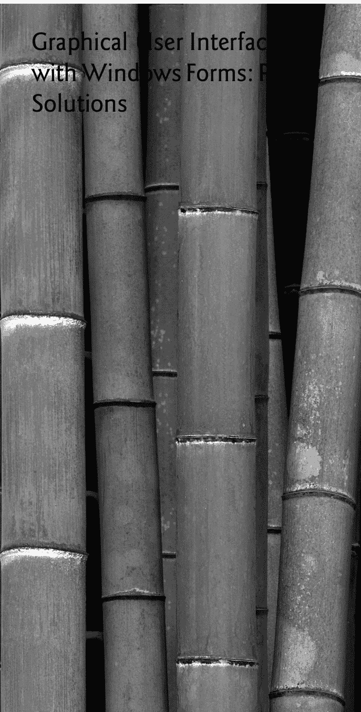
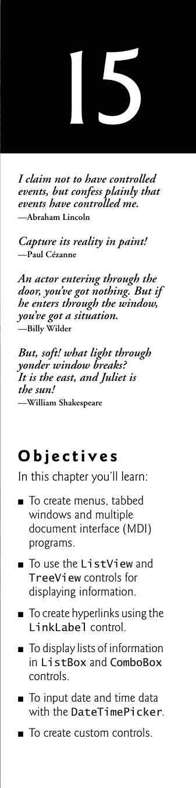

## 自测练习

### 15.1 判断下列每个陈述的对错。如果错误，请解释原因。

a) 菜单提供了相关类的组。
**ANS**：错误。菜单提供了相关命令的组。

b) 菜单项可以显示 `ComboBox`、复选标记和访问快捷键。
**ANS**：正确。

c) `ListBox` 控件仅允许单选（类似于 `RadioButton`）。
**ANS**：错误。这两种控件都支持单选或多选。

d) `ComboBox` 控件通常有一个下拉列表。
**ANS**：正确。

e) 在 `TreeView` 中删除父节点会删除其子节点。
**ANS**：正确。

f) 用户在 `ListView` 控件中只能选择一个项。
**ANS**：错误。用户可以选择一个或多个项。

g) `TabPage` 可以作为 `RadioButton` 的容器。
**ANS**：正确。

h) MDI 窗口可以有 MDI 子窗口。
**ANS**：错误。只有 MDI 父窗口可以有 MDI 子窗口。MDI 父窗口不能是 MDI 子窗口。

i) MDI 窗口可以移动到父窗口的边界之外。
**ANS**：错误。MDI 子窗口不能移动到父窗口的边界之外。

j) 有两种派生方式：1) 从现有控件派生，2) 使用 `UserControl` 或 3) 从 `Control` 派生并从头创建一个控件。
**ANS**：错误。有三种创建自定义控件的方法：1) 从现有控件派生，2) 使用 `UserControl`，3) 从 `Control` 派生并从头创建一个控件。

### 15.2 为下列每个陈述填空：

a) `Process` 类的方法可以打开文件和网页，类似于 Run... 方法。
**ANS**：`Start`（启动）。

b) 如果 `ComboBox` 中的元素超过了可容纳量，会出现一个 ________。
**ANS**：垂直滚动条。

c) `TreeView` 中的顶层节点是 ________ 节点。
**ANS**：`root`（根节点）。

d) `ListView` 和 ________ 可以显示 `ImageList` 中包含的图标。
**ANS**：`TreeView`。

e) ________ 属性允许菜单显示活动窗口列表。
**ANS**：`MdiList`。

f) ________ 类允许将多个控件组合成单个自定义控件。
**ANS**：`UserControl`（用户控件）。

g) ________ 通过层叠 `TabPages` 来节省空间。
**ANS**：`TabControl`。

h) ________ 窗口布局选项使所有 MDI 窗口具有相同的大小并层叠，以便每个标题栏都可见（如果可能的话）。
**ANS**：`Cascade`（级联）。

i) ________ 通常用于显示指向其他资源、文件或网页的超链接。
**ANS**：`LinkLabel`。

## 练习

注意：编程练习的解决方案位于 `sol_ch15` 文件夹中。

# 16 字符串、字符和正则表达式：解决方案

> Henry 的主要缺陷是喜欢嚼小段绳子。
> —亨利·金

> “几乎”（almost）和“真正”（really）之间的区别在于———马克·吐温

# 学习目标

在本章中，你将学习：

- 创建和操作不可变的字符字符串对象。
- 使用可变的字符串对象 `StringBuilder`。
- 使用 `Char` 结构体的字符对象。
- 使用 `Regex` 使用正则表达式。
- 使用正则表达式遍历匹配项。
- 使用字符集匹配任何字符。
- 使用量词多次匹配模式。
- 使用正则表达式在文本中搜索模式。
- 使用 LINQ 和正则表达式验证数据。
- 使用 `Regex` 修改字符串。


## 自测练习

### 16.1 判断下列每个陈述的对错。如果错误，请解释原因。

a) 当使用 `==` 比较字符串时，如果字符串相同则结果为真。
**ANS**：正确。

b) 字符串在创建后可以修改。
**ANS**：错误。字符串是不可变的；创建后无法修改。`StringBuilder` 对象在创建后可以修改。

c) `StringBuilder` 方法将 `StringBuilder` 的容量设置为参数的值。
**ANS**：错误。`EnsureCapacity` 将容量设置为当前容量的两倍或参数值，以较大者为准。

d) `Equals` 方法和等号运算符对字符串都有效。
**ANS**：正确。

e) `Trim` 方法移除字符串开头和结尾的所有空白。
**ANS**：正确。

f) 正则表达式 `\w` 匹配字符串 't' 到模式。
**ANS**：正确。

g) 使用字符串总是比使用 `StringBuilder` 好；因为相同值的字符串将引用同一个对象。
**ANS**：错误。如果需要修改字符串，应该使用 `StringBuilder`。

h) `ToUpper` 方法创建一个首字母大写的新字符串。
**ANS**：错误。`ToUpper` 方法创建一个所有字母都大写的新字符串。

i) 正则表达式中的表达式 `\d` 表示所有数字。
**ANS**：正确。

### 16.2 为下列每个陈述填空：

a) 要拼接字符串，使用 ________ 运算符、`StringBuilder` 或 `string` 方法。
**ANS**：`+`、`Append`、`Concat`。

b) `string` 类使用字符串的 ________ 比较。
**ANS**：`lexicographical`（字典序）。

c) `Regex` 类位于命名空间 ________。
**ANS**：`System.Text.RegularExpressions`。

d) 如果 `StringBuilder` 方法的参数超出范围，将抛出 ________ 异常。
**ANS**：`ArgumentOutOfRangeException`。

e) `Regex` 方法将字符串中所有模式更改指定的字符串。
**ANS**：`Replace`。

f) 格式字符串中的 `C` 意味着将数字输出为货币。
**ANS**：正确。

g) 正则表达式量词 `*` 匹配表达式的零次或多次。
**ANS**：`*`。

h) 方括号内的正则表达式运算符 `^` 不会匹配该字符集中的任何字符。
**ANS**：`^`。

## 练习题与答案

### 16.3 编写语句完成以下各项任务：

a) 创建一个正则表达式来匹配五个字母单词或五位数字。
**答案**：`Regex regex = new Regex(@"\w{5}|\d{5}");`

b) 创建一个正则表达式来匹配格式为 (123) 456-7890 的电话号码。
**答案**：`Regex regex = new Regex(@"\(\d{3}\)\s\d{3}-\d{4}");`

### 16.4 (比较字符串) 编写一个应用程序，使用字符串方法 `CompareTo` 来比较用户输入的两个字符串。输出第一个字符串是小于、等于还是大于第二个字符串。

**答案**：

```csharp
// Exercise 16.4: Compare.cs
// Using System;

using System;
using System.Windows.Forms;

public partial class CompareForm : Form
{
    public CompareForm()
    {
        InitializeComponent();
    } // 构造函数

    // 比较两个字符串
    private void compareButton_Click(object sender, EventArgs e)
    {
        int result = textBox.Text.CompareTo(secondTextBox.Text);

        // 显示结果
        if (result == 0)
            outputLabel.Text = textBox.Text + " IS EQUAL TO " + secondTextBox.Text;
        else if (result > 0)
            outputLabel.Text = textBox.Text + " IS GREATER THAN " + secondTextBox.Text;
        else
            outputLabel.Text = textBox.Text + " IS LESS THAN " + secondTextBox.Text;

        // 清空文本框
        textBox.Text = "";
        secondTextBox.Text = "";
        textBox.Focus();
    } // 方法 compareButton_Click结束
} // 类 CompareForm结束
```

# 第 16 章 字符串、字符与正则表达式：解决方案

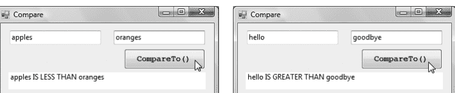
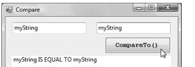

### 16.5 (随机句子和故事生成器)

编写一个应用程序，使用随机数生成创建句子。使用四个字符串数组，分别称为 `article`（冠词）、`noun`（名词）、`verb`（动词）和 `preposition`（介词）。按照以下顺序从每个数组中随机选择一个单词创建一个句子：`article`, `noun`, `verb`, `preposition`, `article`。每选取一个单词，将其接到句子中之前的单词。单词之间用空格分隔。输出句子时，应以大写字母开头并以句号结尾。程序应生成 10 个句子并将它们输出到文本区域。

数组填充如下：`article` 数组应包含 "the", "a", "one", "some" 和 "any"；`noun` 数组应包含名词 "boy", "girl", "dog", "town" 和 "car"；`verb` 数组应包含过去式动词 "rove", "jumped", "ran", "walked" 和 "skipped"；`preposition` 数组应包含介词 "to", "from", "over", "under" 和 "on"。

编写上述程序后，修改程序以生成一个由这些句子组成的短故事（制作一个随机短语生成器可能如何！）。

**答案**：

```csharp
// Exercise 16.5: SentenceGenerator.cs
// 生成一个随机句子。

using System;
using System.Windows.Forms;

namespace SentenceGenerator
{
    public partial class SentenceGeneratorForm : Form
    {
        public SentenceGeneratorForm()
        {
            InitializeComponent();
        } // 构造函数

        string[] articles = { "the", "a", "one", "some", "any" };
        string[] nouns = { "boy", "girl", "dog", "town", "car" };
        string[] verbs = { "rove", "jumped", "ran", "walked", "skipped" };
        string[] prepositions = { "to", "from", "over", "under", "on" };

        // 生成十个句子
        private void generateButton_Click(object sender, EventArgs e)
        {
            // 用于选择随机单词的随机对象
            Random random = new Random();
            string sentence = string.Empty;

            // 清空输出
            outputTextBox.Text = "";

            for (int i = 0; i < 10; i++)
            {
                // 清空句子
                sentence = "";

                // 构建随机句子
                sentence += articles[random.Next(articles.Length)] + " ";
                sentence += nouns[random.Next(nouns.Length)] + " ";
                sentence += verbs[random.Next(verbs.Length)] + " ";
                sentence += prepositions[random.Next(prepositions.Length)] + " ";
                sentence += articles[random.Next(articles.Length)] + " ";

                // 首字母大写
                char firstLetter = char.ToUpper(sentence[0]);
                sentence = firstLetter + sentence.Substring(1);

                outputTextBox.Text += sentence + ".\n";
            }
        } // 方法 generateButton_Click结束
    } // 类 SentenceGeneratorForm结束
} // 命名空间 SentenceGenerator结束
```

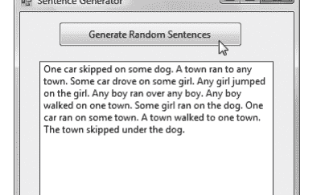

# 第 16 章 字符串、字符与正则表达式：解决方案

### 16.6 (皮拉丁语) 编写一个应用程序将短语编码为皮格拉丁语。形式有许多变体。为了简单起见，使用以下算法：将每个单词转换为皮格拉丁语，将单词的首字母移到末尾并加上 "ay"。因此，“jump” 变成 "umpjay”，“the” 变成 "ethay”，“computer” 变成 "omtercay"。将翻译显示在文本区域。

```csharp
// Exercise 16.6: PigLatin.cs
// 使用字符串实现翻译器。

using System;
using System.Text;
using System.Windows.Forms;

public partial class PigLatinForm : Form
{
    public PigLatinForm()
    {
        InitializeComponent();
    } // 构造函数
```


# 练习题与答案 7

## 16.7 (五字母单词的所有可能三字母单词)
编写一个程序读取一个五字母单词，并产生从该单词字母中派生的所有三字母组合。例如，从“bathe”产生的三字母单词包括常用单词 "ate", "bat", "bet", "tab", "hat", "the" 和 "tea"，以及三字母组合 "bth", "cab" 等。

### 答案

```csharp
// Exercise 16.7: Threeletter.cs
// 在五字母单词中寻找所有三字母单词。共有 60 种组合。
```

# 第 16 章 字符串、字符与正则表达式：解决方案

```csharp
public partial class ThreeLetterForm : Form
{
    public ThreeLetterForm()
    {
        InitializeComponent();
    } // 构造函数

    // 创建所有的三个单词
    private void goButton_Click(object sender, EventArgs e)
    {
        if (inputText.Text.Length != 5)
        {
            MessageBox.Show("输入一个五个字母的单词");
            inputText.Focus();
            return;
        } // end if

        string word = inputText.Text;
        string temp = "";

        // 清空 outputTextBox
        outputTextBox.Text = "";

        // 构建一个包含所有单词的字符串
        for (int first = 0; first < 5; first++)
        {
            for (int second = first + 1; second < 5; second++)
            {
                for (int third = second + 1; third < 5; third++)
                {
                    temp += word[first].ToString() + " " + word[second] + " " + word[third] + " ";
                    temp += word[first].ToString() + " " + word[third] + " " + word[second] + " ";
                    temp += word[second].ToString() + " " + word[first] + " " + word[third] + " ";
                    temp += word[second].ToString() + " " + word[third] + " " + word[first] + " ";
                    temp += word[third].ToString() + " " + word[first] + " " + word[second] + " ";
                    temp += word[third].ToString() + " " + word[second] + " " + word[first] + " ";
                } // end for
            } // end for
        } // end for

        // 将字符串拆分为单独单词
        string[] words = temp.Split(' ');
        int count = 0;

        // 显示每个三字母单词
        foreach (string w in words)
        {
            outputTextBox.Append(w + " ");
            count++;
            // 每五个单词换一次行
            if (count % 5 == 0)
            {
                outputTextBox.Append("\r\n");
            }
        } // end foreach

        inputTextBox.Clear();
    } // end method jButtonClick

    // 按下回车键相当于点击 Go 按钮
    private void inputTextBox_KeyDown(object sender, KeyEventArgs e)
    {
        // 允许用户在文本框中按回车
        if (e.KeyCode == Keys.Enter)
            goButton_Click(sender, e);
    } // end method inputTextBox_KeyDown
} // end class ThreeLetterForm
```

## 16.8 (单词大写)
编写一个程序使用正则表达式将每个单词的首字母转换为大写。我们对用户输入的任意字符串执行此操作。

### 答案

```csharp
// 练习 16.8: Capitalize.cs
// 将每个单词的首字母大写化。

using System;
using System.Text.RegularExpressions;

class Capitalize
{
    static void Main(string[] args)
    {
        string sentence; // 输入字符串
        string output = string.Empty; // 输出字符串

        // 从用户处获取句子
        Console.WriteLine("请输入一个句子：");
        sentence = Console.ReadLine();

        // 将句子拆分为单词
        string[] words = Regex.Split(sentence, @"\s");

        // 将每个单词的首字母转换为大写
        foreach (var word in words)
        {
            output += Char.ToUpper(word[0]) + word.Substring(1) + " ";
        } // end foreach

        Console.WriteLine(output); // 显示输出字符串
    } // end Main
} // end class Capitalize
```

**输出示例：**
```text
请输入一个句子：
welcome to c# 2010
Welcome To Visual C# 2010
```

## 16.9 (统计不同类型的计数器)
使用正则表达式统计字符串中数字、字符和空白字符的数量。[提示：`Regex` 函数 `Matches` 返回一个 `IEnumerable`，它有一个 `Count` 方法]。

```csharp
// 练习 16.9: CharacterCount.cs
// 统计数字、单词字符和空白字符的数量。

using System;
using System.Text.RegularExpressions;

class CharacterCount
{
    static void Main(string[] args)
    {
        int digits, words, whitespace; // 字符计数

        // 从用户处获取句子
        Console.WriteLine("请输入一个句子：");
        string sentence = Console.ReadLine();

        // 统计数字的数量
        digits = Regex.Matches(sentence, @"\d").Count;

        // 统计单词字符的数量
        words = Regex.Matches(sentence, @"\w").Count;

        // 统计空白字符的数量
        whitespace = Regex.Matches(sentence, @"\s").Count;

        // 显示结果
        Console.WriteLine("有 {0} 个数字，{1} 个单词字符和 {2} 个空白字符。", digits, words, whitespace);
    } // end Main
} // end class CharacterCount
```

**输出示例：**
```text
请输入一个句子：
Welcome to Visual C# 2010 H
有 4 个数字，23 个单词字符和 5 个空白字符。
```

## 16.10 (验证数字)
编写一个正则表达式来搜索字符串并匹配有效数字。数字可以包含任意位数，但只能有一个小数点。

```csharp
// 练习 16.10: NumberSearch.cs
// 使用正则表达式搜索数字。

using System;
using System.Text.RegularExpressions;

class NumberSearch
{
    static void Main(string[] args)
    {
        // ... 实现细节
    }
}
```

# 第 16 章 字符串、字符与正则表达式：解决方案

## 16.11 (移除空格)
编写一个程序，让用户输入句子，并使用正则表达式检查句子是否包含多个空格。如果是，则删除多余空格。

**输入示例：**
```text
请输入句子：
Hello World
```

# 文件与流

在本章中，你将学习：

- 创建、读取和更新文件。
- 使用 `File` 和 `Directory` 获取文件信息。
- 熟悉流处理。
- 使用 `FileStream`、`StreamReader` 和 `StreamWriter` 从文件中读取文本。
- 使用 `FileStream` 和 `BinaryFormatter` 从文件中读取对象。

## 自测

### 17.1 判断下列陈述对错。如果错误，请说明原因。

- a) 创建 `File` 和 `Directory` 实例是不可能的。
- b) 通常，顺序文件按记录键存储记录。
- c) `StreamReader` 继承自 `Stream`。
- d) 任何类都可以序列化到文件。
- e) `FileStream` 的 `Seek` 方法相对于开头。
- f) `StreamReader` 和 `StreamWriter` 用于顺序访问文件。
- g) 实例化 `Stream` 对象是不可能的。

### 17.2 填空每个内容的空白：

- a) 最终，计算机处理的所有数据都还原为 ________。
- b) 计算机处理的最小数据称为 ________。
- c) ________ 是一组相关的记录。
- d) 数字、字母和符号统称为 ________。
- e) 一组相关被称为 ________。
- f) `StreamReader` 方法从文件中读取一行。
- g) `StreamWriter` 方法向文件写入一行。
- h) `BinaryFormatter` 类的 `Serialize` 方法接受 ________ 和 ________ 作为参数。
- i) ________ 命名空间包含了大多数 C# 的文件处理类。
- j) ________ 包含 `BinaryFormatter` 类。

### 17.3 (学生成绩文件)
创建一个程序将学生成绩存储在文本文件中。该文件应包含每个条目的姓名、ID 号、班级和成绩。允许用户加载成绩文件并在只读 `TextBox` 中显示其内容。条目应按以下格式显示：

`LastName, FirstName: ID# Class Grade`

#### 示例数据

```text
Jones, Bob: 1 "计算机科学导" "A-"
Johnson, Sarah: 2 "数据结构" "B+"
Smith, Sam: 3 "数据结构" "C"
```

#### 答案

```csharp
// Ex. 17.3: GradesForm.cs
// 顺序地将学生信息写入文件。

using System;
using System.Windows.Forms;
using System.IO;

namespace Grades
{
    public partial class GradesForm : Form
    {
        private StreamWriter output;
        private StreamReader input;
        private bool saved = false;

        // 默认构造函数
        public GradesForm()
        {
            InitializeComponent();
        }

        // 处理所有输入 TextBoxes 的 TextChanged 事件
        private void TextBoxChanged(object sender, EventArgs e)
        {
            EnableEnterButton(); // 检查按钮是否应该启用
        }

        private void saveAsButton_Click(object sender, EventArgs e)
        {
            // 显示保存文件对话框
            DialogResult result; // SaveFileDialog 的结果
            string fileName = 

                using (SaveFileDialog chooser = new SaveFileDialog())
                {
                    result = chooser.ShowDialog();
                }
        }
    }
}
```


`fileName = chooser.FileName;` // 要保存数据的文件名

}

// 确保用户点击了 OK

if (`result == DialogResult.OK`)

{

    if (`fileName == string.Empty`)

    {

        `MessageBox.Show("你输入了无效的文件名。", "无效文件名", MessageBoxButtons.OK, MessageBoxIcon.Information);`

    }

    else

    {

        `output = new StreamWriter(fileName);`

        `saveAsButton.Enabled = false;`

        `saved = true;`

    } // else

    // 检查 按钮是否应该启用

    `EnableEnterButton();`

} // if

// 结束方法 saveAsButton_Click

// 当所有文本框都填满且文件已打开时启用 enterButton

private void `EnableEnterButton()`()

{

    if (`lastTextBox.Text != string.Empty` &&

        `idTextBox.Text != string.Empty` &&

        `classTextBox.Text != string.Empty` &&

        `gradeTextBox.Text != string.Empty` && `saved`)

        `enterButton.Enabled = true;`

} // 结束方法 EnableEnterButton

private void `enterButton_Click(object sender, EventArgs e)`()

{

    // 获取用户输入

    `string last = lastTextBox.Text;`

    `string first = firstTextBox.Text;`

    `string id = idTextBox.Text;`

    `string className = classTextBox.Text;`

    `string grade = gradeTextBox.Text;`

    `output.WriteLine(last + "\t" + first + "\t" + id + "\t" + className + "\t" + grade);`

    `statusLabel.Text = "Entry saved";` // 更新显示

    // 清空文本框

    `lastTextBox.Clear();`

    `firstTextBox.Clear();`

    `idTextBox.Clear();`

    `classTextBox.Clear();`

    `gradeTextBox.Clear();`

} // 结束方法 enterButton_Click

private void `loadButton_Click(object sender, EventArgs e)`()

{

    // 确保 StreamWriter 对象关闭并等于 null

    if (`output != null`)

    {

        `output.Close();`

    }

    `output = null;`

    `statusLabel.Text = "Closing file";`

    `saveAsButton.Enabled = true;`

    `saved = false;`

} // end if

// 显示加载文件对话框

`DialogResult result;`

`string fileName;`

using (`OpenFileDialog chooser = new OpenFileDialog()`)

{

    `result = chooser.ShowDialog();`

    `fileName = chooser.FileName;`

} // 结束 using

// 确保用户没有取消

if (`result == DialogResult.OK`)

{

    if (`fileName == string.Empty`)

        `MessageBox.Show("无效文件名", "无效文件名", MessageBoxButtons.OK, MessageBoxIcon.Information);`

    else

    {

        `var input = new StreamReader(fileName);`

        `string entry = input.ReadLine();`

    }

    `gradesTextBox.Clear();` // 清空文本框

    // 继续读取条目直到文件末尾

    while (`entry != null`)

    {

        // 否则，添加到文本框

        `gradesTextBox.AppendText(entry + "\r\n");`

        `entry = input.ReadLine();`

    } // 结束 while

    {

        `statusLabel.Text = "File loaded";`

    } // 结束 if

} // 结束方法 loadButton_Click

// 设置在 TextBox 中显示数据的格式

private `string FormatEntry(string fromFile)`()

{

    // 分割文件中的字符串

    `char[] splitters = {'\t'};`

    `string[] data = fromFile.Split(splitters);`

    // 格式化结果用于显示

    `string result = data[0] + " " + data[1] + ":\t" + data[2] + "\t" + data[3] + ";";`

    `return result;`

} // 结束方法 FormatEntry

} // 结束 class Form

} // 结束 namespace

## 练习 5

### 17.4 (序列化和反序列化) 修改之前的程序，使用可以序列化到文件并从文件反序列化的类。

答案：

```csharp
// Ex. 17.4: ClassGrade.cs
// 学生成绩的可序列化类
using System;

[Serializable]
class ClassGrade
{
    public string Last { get; set; }
    public string First { get; set; }
    public string Id { get; set; }
    public string Class { get; set; }
    public string Grade { get; set; }

    // 默认构造函数
    public ClassGrade()
    {
    }

    // 重载构造函数设置成员
    public ClassGrade(string lastName, string firstName, string id, string className, string grade)
    {
        Last = lastName;
        First = firstName;
        Id = id;
        Class = className;
        Grade = grade;
    } // 结束构造函数
} // 结束 ClassGrade
```

```csharp
// Ex. 17.4: GradeForms.cs
// 将 ClassGrade 对象写入文件。
using System;
using System.Windows.Forms;
using System.IO;
using System.Runtime.Serialization;
using System.Runtime.Serialization.Formatters.Binary;

namespace Grades
{
    public partial class GradesForm : Form
    {
        private FileStream fileInOut;
        private bool saved = false;
        private BinaryFormatter formatter;

        // 默认构造函数
        public GradesForm()
        {
            InitializeComponent();
            formatter = new BinaryFormatter(); // 创建 BinaryFormatter
        } // 结束构造函数

        // 处理所有输入 TextBoxes 的 TextChanged 事件
        private void AllTextBox_TextChanged(object sender, EventArgs e)
        {
            EnableEnterButton(); // 检查按钮是否应该启用
        } // 结束 AllTextBox_TextChanged

        // 处理 saveButton 的点击事件
        private void saveAsButton_Click(object sender, EventArgs e)
        {
            // 确保 FileStream 不在用中
            if (fileInOut != null)
            {
                fileInOut.Close();
                fileInOut = null;
                statusLabel.Text = "Closing file";
            }

            // 显示对话框 // SaveFileDialog 的结果
            DialogResult result;
            string fileName; // 包含数据的文件名
            using (SaveFileDialog chooser = new SaveFileDialog())
            {
                result = chooser.ShowDialog();
                fileName = chooser.FileName;
            } // 结束 using

            // 确保用户点击了 OK
            if (result == DialogResult.OK)
            {
                if (fileName == string.Empty)
                    MessageBox.Show("无效文件名", "无效文件名", MessageBoxButtons.OK, MessageBoxIcon.Information);
                else
                {
                    fileInOut = new FileStream(fileName, FileMode.OpenOrCreate);
                    saveAsButton.Enabled = false;
                    saved = true;
                } // else
                // 检查按钮是否应该启用
                EnableEnterButton();
            } // 结束方法 saveAsButton_Click

            // 当所有文本框都填满且文件已打开时启用 enterButton
            private void EnableButton()
            {
                if (lastTextBox.Text != string.Empty &&
                    firstTextBox.Text != string.Empty &&
                    idTextBox.Text != string.Empty &&
                    classTextBox.Text != string.Empty &&
                    gradeTextBox.Text != string.Empty && saved)
                {
                    enterButton.Enabled = true;
                }
                else
                    enterButton.Enabled = false;
            } // 结束方法 EnableButton

            // 处理 enter 按钮的点击事件
            private void onEnter_Click(object sender, EventArgs e)
            {
                // 获取用户输入
                string last = lastTextBox.Text;
                string first = firstTextBox.Text;
                string id = idTextBox.Text;
                string className = classTextBox.Text;
                string grade = gradeTextBox.Text;
                ClassGrade entry = new ClassGrade(last, first, id, className, grade);

                // 顺序写入输出到文件
                formatter.Serialize(fileInOut, entry);

                // 更新显示
                statusLabel.Text = "Entry saved";

                // 清空文本框
                lastTextBox.Clear();
                firstTextBox.Clear();
                idTextBox.Clear();
                classTextBox.Clear();
                gradeTextBox.Clear();
            } // 结束方法 enterButton_Click

            private void loadButton_Click(object sender, EventArgs e)
            {
                // 确保 StreamWriter 对象关闭并等于 null
                if (fileInOut != null)
``` 


```csharp
{
    fileInOut.Close();
}

output = null;
statusLabel.Text = "Closing file";
saveAsButton.Enabled = true;
saved = false;
} // 结束 if

// 显示加载文件对话框
DialogResult result;
string fileName;

using (OpenFileDialog chooser = new OpenFileDialog())
{
    result = chooser.ShowDialog();
    fileName = chooser.FileName;
} // 结束 using

// 确保用户没有取消
if (result == DialogResult.OK)
{
    if (fileName == string.Empty)
        MessageBox.Show("无效文件名", "无效文件名",
                        MessageBoxButtons.OK, MessageBoxIcon.Information);
    else
    {
        var input = new StreamReader(fileName);
        string entry = input.ReadLine();
    }
    gradesTextBox.Clear(); // 清空文本框
    // 继续读取条目直到文件末尾
    while (entry != null)
    {
        // 否则，添加到文本框
        gradesTextBox.AppendText(entry + "\r\n");
        entry = input.ReadLine();
    } // 结束 while
    {
        statusLabel.Text = "File loaded";
    } // 结束 if
}
```

# 第10 章 第17 节 文件与流

```csharp
// 创建并显示允许用户打开文件的对话框
DialogResult result; // OpenFileDialog 的结果
string fileName; // 包含数据的文件全名
```

```csharp
using (OpenFileDialog fileChooser = new OpenFileDialog())
{
    result = fileChooser.ShowDialog();
    fileName = fileChooser.FileName; // 获取指定的名称
}
```

```csharp
// 确保用户点击了“确定”
if (result == DialogResult.OK)
{}
```

```csharp
if (fileName == string.Empty)
    MessageBox.Show("Invalid File Name", "Invalid file name",
    MessageBoxButtons.OK, MessageBoxIcon.Information);
else
{
    // 准备读取对象
    fileInOut = new FileStream(fileName,
    FileMode.Open, FileAccess.Read);
}
```

```csharp
gradesTextBox.Clear();
```

```csharp
try
{
    while (true) // 循环直到没有更多记录
    {
        ClassGrade entry =
            (ClassGrade) formatter.Deserialize(fileInOut);
        gradesTextBox.AppendText(FormatEntry(entry) + "\n\n\n");
    } // 结束 while
}
catch (SerializationException)
{
    statusLabel.Text = "File loaded";
}
```

```csharp
// 结束 if
} // 结束方法 listBox_Click
```

```csharp
// 设置格式在 TextBox 中显示 ClassGrade 的属性
private string FormatEntry(ClassGrade fromFile)
{
```

```csharp
// 格式化显示结果：
string result = fromFile.Last.Trim() + ", " +
fromFile.First.Trim() + "\t" + fromFile.Id.Trim() + "\t" +
fromFile.Class.Trim() + "\t" + fromFile.Grade.Trim();
```

```csharp
return result;
} // 结束方法 FormatEntry
} // 结束类 GradesForm
} // 结束 namespace Grades
```

# 练习 II

| 姓 | Jones |
| --- | --- |
| 名 | Bob |
| 证# | 1 |
| 班级 | Intro to Programming |
| 成绩 | B |
| 另存为 | 加载 | 输入 |
| 状态标签 | |

| 姓 | Johnson |
| --- | --- |
| 名 | Sarah |
| 证# | 2 |
| 班级 | Data Structures |
| 成绩 | B+ |
| 另存为 | 加载 | 输入 |
| 记录保存 | |

| 姓 | Smith |
| --- | --- |
| 名 | Sam |
| 证# | 3 |
| 班级 | Data Structures |
| 成绩 | C |
| 另存为 | 加载 | 输入 |
| 记录保存 | |

| 姓 | |
| --- | --- |
| 名 | |
| 证# | |
| 班级 | |
| 成绩 | |
| 另存为 | 加载 | 输入 |
| 文件加载 | |

| Jones, Bob: | 1 Intro to Programming |
| Johnson, Sarah: | 2 Data Structures B+ |
| Smith, Sam: | 3 Data Structures C |

**17.5 (扩展 StreamReader 和 StreamWriter)** 扩展类 `StreamReader` 和 `StreamWriter`。使派生自 `StreamReader` 的类具有 `ReadInteger()`、`ReadBoolean()` 和 `ReadString()` 方法。使派生自 `StreamWriter` 的类具有 `WriteInteger()`、`WriteBoolean()` 和 `WriteString()` 方法。思考如何设计写入方法，以便读取方法能够读取写入的内容。设计 `WriteInteger()` 和 `WriteBoolean()` 以写入固定大小的字符串，以便 `ReadInteger()` 和 `ReadBoolean()` 能够准确地读取这些值。确保 `ReadString()` 和 `WriteString()` 使用相同的字符分隔字符串。

答案：

```csharp
// 练习 17.5: MyReader.cs
// 定义一个扩展的 StreamReader。
using System;
using System.IO;

class MyReader : StreamReader
{
    // 默认构造函数
    public MyReader(string fileName) : base(fileName)
    {
    }

    // 从文件中读取整数
    public int ReadInteger()
    {
        // 用于读取一个整数
        char[] buffer = new char[10];
        int input = 0;
        string toRead = string.Empty;

        // 从文件中读取代表整数的 10 个字符
        Read(buffer, 0, 10);
        toRead = new string(buffer);

        try
        {
            input = Int32.Parse(toRead);
        }
        catch (Exception)
        {
            return 0;
        } // 结束 catch

        return input;
    } // 结束方法 ReadInteger

    // 从文件中读取布尔
    public bool ReadBoolean()
    {
        // 用于读取一个布尔
        char[] buffer = new char[5];
        string toRead = string.Empty;

        // 读取 'true' 或 'false'
        Read(buffer, 0, 5);
        toRead = new string(buffer);

        return toRead.Trim() == "true";
    } // 结束方法 ReadBoolean

    // 从文件中读取字符串
    public string ReadString()
    {
        // 用于读取字符串
        char[] buffer = new char[1];
        string input = string.Empty;

        // 每个字符串由 "ENDOFSTRING" 分隔
        // 每次读取一个字符直到结束
        while (input.IndexOf("ENDOFSTRING") == -1)
        {
            Read(buffer, 0, 1);
            input += buffer[0];
        } // 结束 while

        // 裁剪掉字符串的结束标记
        return input.Substring(0, input.IndexOf("ENDOFSTRING"));
    } // 结束方法 ReadString
} // 结束类 MyReader
```

```csharp
// 练习 17.5: MyWriter.cs
// 定义一个扩展的 StreamWriter
using System;
using System.IO;

class MyWriter : StreamWriter
{
    // StreamWriter 构造函数
    public MyWriter(string fileName) : base(fileName)
    {
    }

    // 写入文件
    public void WriteInteger(int output)
    {
        // 用零填充整数
        string toWrite = output.ToString().PadLeft(10, '0');
        Write(toWrite); // 写入文件
    } // 结束方法 WriteInteger

    // 写入文件
    public void WriteBoolean(bool output)
    {
        // 写入的布尔值为 5 个字符
        if (output)
            Write("true ");
        else
            Write("false ");
    } // 结束方法 WriteBoolean

    // 写入字符串
    public void WriteString(string output)
    {
        // 每个字符串以 "ENDOFSTRING" 结束
        Write(output + "ENDOFSTRING");
    } // 结束方法 WriteString
} // 结束类 MyWriter
```

```csharp
// 练习 17.5: Extend.cs
// 重载 StreamReader 和 StreamWriter。
using System;
using System.IO;

class Extend
{
    public static void Main(string[] args)
    {
        // 创建一个测试文件
        FileStream s = File.Create("test.txt");
        s.Close();

        // 创建 MyWriter 对象
        MyWriter write = new MyWriter("test.txt");

        // 写入一些整数到文件
        Console.WriteLine("Writing the integers: 4, 38664, 20948");
        write.WriteInteger(4);
        write.WriteInteger(38664);
        write.WriteInteger(20948);

        // 写入一些布尔
        Console.WriteLine("Writing the booleans: true, false");
        write.WriteBoolean(true);
        write.WriteBoolean(false);

        string day = "Have a nice day";
        string year = "Happy new year!";

        // 写入一些字符串
        Console.WriteLine("Writing the strings: \"" + day + "\" \"" + year + "\"");
        write.WriteString(day);
        write.WriteString(year);

        write.Close(); // 关闭文件
        MyReader read = new MyReader("test.txt");

        // 从文件中读取整数
        int firstInt = read.ReadInteger();
        int secondInt = read.ReadInteger();
        int thirdInt = read.ReadInteger();

        Console.WriteLine("Read the following integers: {0}, {1}, {2}", firstInt, secondInt, thirdInt);
    }
}
```

## 练习 15

写入整数：4, 3864, 20948
写入布尔：true, false
写入字符串："Happy a new day!"

读取以下整数：4, 3864, 20948
读取以下布尔：True, False
读取以下字符串："Have a nice day", "Happy new year!"

**17.6 (读取和写入账户信息)** 创建一个结合了图19.9和图19.11思想的程序，允许用户从文件中写入和读取记录。添加一个额外的 `bool` 类型字段来指示账户是否有透支保护。

```csharp
// 练习 17.6: Record2.cs
// 扩展 BankLibrary 的类并包含
// 关于客户透支保护的信息。
using System;
using BankLibrary;

[Serializable]
public class Record2 : RecordSerializable
{
    // bool OverdraftProtection 的自动属性
    public bool OverdraftProtection { get; set; }

    // 默认构造函数
    public Record2() : base()
    {
        OverdraftProtection = false;
    }
}
```


} // 结束构造函数

// 重载构造函数
public `Record2`(int account, string firstName,
    string lastName, decimal balance, bool overdraft )
    : base(account, firstName, lastName, balance)
{
    `OverdraftProtection` = overdraft;
} // 结束构造函数

} // 结束类 `Record2`

35 36 37 38 39 40 ... // Determine TextBox 字段是否为空
if ( values[ ( int ) `TextBoxIndices.ACCOUNT` ] != string.Empty )
{
    // 将 TextBox 值存储在 Record2 并序列化 Record2
    try {
        // 从 TextBox 获取账号值
        int accountNumber = `Int32.Parse`(
            values[ ( int ) `TextBoxIndices.ACCOUNT` ]);

        // 确定 accountNumber 是否有效
        if ( accountNumber > 0 ) {
            // 将 TextBox 字段存储在 Record2
            `record.Account` = accountNumber;
            `record.FirstName` = values[ ( int )
            `TextBoxIndices.FIRST`;];
            `record.LastName` = values[ ( int ) `TextBoxIndices.LAST`];
            `record.Balance` = `Decimal.Parse`(values[
                ( int ) `TextBoxIndices.BALANCE` ]
            );
            `record.OverdraftProtection` = `overdraftCheckBox.Checked`;
            // 将 Record2 写入 FileStream(序列化对象)
            `formatter.Serialize`(`thefile`, `record`);
        } else {
            // 如果账号无效，则通知用户
            `MessageBox.Show`("Invalid Account Number", "Error",
            `MessageBoxButtons.OK`, `MessageBoxIcon.Error`);
        }
    }
} // 如果序列化过程中发生错误，则通知用户
catch ( `SerializationException` ) 
{
} // 如果参数格式发生错误，则通知用户
catch ( `Exception` ) 
{
    `MessageBox.Show`("Error Writing to File", "Error",
    `MessageBoxButtons.OK`, `MessageBoxIcon.Error`);
}
}

    `ClearTextBoxes`(); // 清空 TextBox 值
} // 方法结束 `enterTextBox_Click`

// 用户点击 Save 按钮时调用
private void `saveButton_Click`(object sender, `System.EventArgs` e)
{
    // 创建并显示对话框，允许用户保存文件
    `DialogResult` result; // `SaveFileDialog` 的结果

# 第 17 章 文件与流

string fileName; // 包含数据的文件

```csharp
using ( `SaveFileDialog` chooser = new `SaveFileDialog`() )
{
    // 允许用户创建文件
    `fileChooser.CheckIfExists` = false;
    result = `fileChooser.ShowDialog`();
    fileName = `fileChooser.FileName`; // 要保存数据的文件名
} // 结束 using

if ( result == `DialogResult.OK` )
{
    // 如果用户指定了无效文件，则显示错误
    if ( fileName == string.Empty )
    {
        `MessageBox.Show`("Invalid File Name", "Error",
            `MessageBoxButtons.OK`, `MessageBoxIcon.Error`);
    }
    else
    {
        // 如果用户指定了文件，通过 FileStream 保存文件
        if ( `theFile` == null )
        {
            `theFile.Close`();
        }
        // 以写入权限打开文件
        `theFile` = new `FileStream`(fileName,
            `FileMode.OpenOrCreate`, `FileAccess.Write`);
        // 禁用保存按钮并启用 Enter 按钮
        `saveButton.Enabled` = false;
        `enterButton.Enabled` = true;
        `nextButton.Enabled` = false;
    }
} // 结束 try
} // 如果文件不存在，处理异常
catch ( `FileNotFoundException` )
{
    // 如果文件不存在，则通知用户
    `MessageBox.Show`("File Does Not Exist", "Error",
        `MessageBoxButtons.OK`, `MessageBoxIcon.Error`);
}
 // 结束 if
} // 方法结束 `saveButton_Click`

private void `loadButtonClick`(
    object sender, `System.EventArgs` e )
{
    // 创建并显示对话框，允许用户打开文件
    `DialogResult` result; // `OpenFileDialog` 的结果
    string fileName; // 包含数据的文件

## 练习 19

```csharp
using ( `OpenFileDialog` fileChooser = new `OpenFileDialog`() )
{
    result = `fileChooser.ShowDialog`();
    fileName = `fileChooser.FileName`; // 获取指定的名称
} // 结束 using

// 确保用户点击了 "OK"
if ( result == `DialogResult.OK`)
{
    `ClearTextBoxes`();
    // 如果用户使用了无效文件，则显示错误
    if ( fileName == string.Empty)
    {
        `MessageBox.Show`("Invalid File Name", "Error");
        `MessageBoxButtons.OK`, `MessageBoxIcon.Error`);
    }
    else
    {
        if (`theFile` != null)
            `file.Close`();

        // 创建 FileStream 以获取文件的读取权限
        `theFile` = new `FileStream`(fileName, `FileMode.Open`, `FileAccess.Read`);

        // 启用下一条记录按钮
        `nextButton.Enabled` = true;
        `enterButton.Enabled` = false;
        `loadButton.Enabled` = false;
    }
} // 结束 if
}// 方法结束 `loadButton_Click`

// 用户点击 Next 按钮时调用
private void `nextButtonClick`(
    object sender, `System.EventArgs` e)
{
    // 反序列化 Record2并将数据存储在 TextBoxes 中
    try {
        // 获取文件中下一个可用的 Record2
        `Record2` record = ( `Record2` ) `formatter.Deserialize`(`theFile`);

        // 将 Record2 值存储在临时字符串数组中
        string[] values = new string[] {
            `record.Account.ToString`(),
            `record.FirstName.ToString`(),
            `record.LastName.ToString`(),
            `record.Balance.ToString`()
        };

        // 将数组值复制到 TextBox
        `SetTextBoxValues`(values);

        `overdraftCheckBox.Checked` = `record.OverdraftProtection`;
    }
// 结束 try

# 第 17 章 文件与流

```csharp
198      // 当文件中没有 Record2 时处理异常
199  catch ( `SerializationException` )
200  {
201      // 如果文件中没有 Record2，则关闭流
202      `theFile.Close`();
203
204      // 启用 Load 按钮
205      `loadBound.Enabled` = true;
206
      // 禁用 Next 按钮
207      `nextButton.Enabled` = false;
208
209      `ClearTextBoxes`();
210
      // 如果文件中没有记录，则通知用户
211      `MessageBox.Show`("no more records in file", string.Empty,
212      `MessageBoxButtons.OK`, `MessageBoxIcon.Information` );
213    } // 结束 catch
214  } // 方法结束 `nextButton_Click`
215} // 类结束 `ReadFile`
216 // 命名空间结束 `ReadFile`
```

![img/35f8711b3c01539425bdd5ef_474_0.png]
![img/35f8711b3c01539425bdd5ef_474_1.png]
![img/35f8711b3c01539425bdd5ef_474_2.png]
![img/35f8711b3c01539425bdd5ef_474_3.png]
![img/35f8711b3c01539425bdd5ef_475_0.png]

## 练习 21

17.7（电话号码生成器）标准键盘包含数字到九。每个数字都有三个字母对应（见图17.6）。许多人发现记忆数字很难，因此利用数字和字母之间的对应关系来生成与电话号码对应的七字母单词。例如，电话号码为686-2377的人可以使用图17.6所示的对应关系生成单词“NUMBERS”。想要增加业务的餐厅可以使用数字825-3688（例如，“TAKEOUT”）。

| 数字 | 字母 |
|---|---|
| 2 | A B C |
| 3 | D E F |
| 4 | G H I |
| 5 | J K L |
| 6 | M N O |
| 7 | P R S |
| 8 | T U V |
| 9 | W Y Z |

每个七字母号码对应许多不同的七字母单词。遗憾的是，这些单词大多是字母的堆。然而，理发店老板可能会很高兴号码424-7288对应“HAIRCUT”。酒类商店老板会很高兴店号233-7226对应“BEERCAN”。电话为738-2273的兽医会很高兴号码对应“PETCARE”。汽车经销商会很高兴号码639-2277对应“NEWCARS”。

# 第 17 章 文件与流

编写一个GUI程序，给定一个七位数字，使用 `StreamWriter`写入该数字可能的七字母单词组合。共有2187 (3^7) 个组合。避免包含数字0和1的电话号码。

答案：

```csharp
// 例 17.7: Phone.cs
// 将七位电话号码的所有可能的组合保存到文件
using System;
using System.IO;

class `Phone`
{
    // 将字母组合输出到文件
    public string `Calculate`(int phoneNumber, string path)
    {
        `StreamWriter` output = null;

        string[][] letters = { { "", "" },
            { "" }, { "A", "B", "C" }, { "D", "E", "F" },
            { "G", "H", "I" }, { "J", "K", "L" }, { "M", "N", "O" },
            { "P", "Q", "R" }, { "S", "T", "U" }, { "V", "W", "X" } };

        int[] digits = new int[7];

        for (int i = 0; i < 6; i++)
        {
            digits[i] = (int)(phoneNumber % 10);
            phoneNumber /= 10;
        }

        if (path != string.Empty)
        {
            output = new `StreamWriter`(path);
            try
            {
                // 输出所有可能的组合
                for (int loop1 = 0; loop1 <= 2; loop1++)
                {
                    for (int loop2 = 0; loop2 <= 2; loop2++)
                    {
                        for (int loop3 = 0; loop3 <= 2; loop3++)
                        {
                            for (int loop4 = 0; loop4 <= 2; loop4++)
                            {
                                for (int loop5 = 0; loop5 <= 2; loop5++)
                                {
                                    for (int loop6 = 0; loop6 <= 2; loop6++)
                                    {
                                        for (int loop7 = 0; loop7 <= 2; loop7++)
                                        {
                                            output.WriteLine(`letters`[`digits`[0]][loop1] +
```

# Exercises 23


# 第17章 文件与流

## 代码示例：Phone 类的 `Calculate` 方法片段

```cs
letters[digits[1], loop2] +
letters[digits[2], loop3] +
letters[digits[3], loop4] +
letters[digits[4], loop5] +
letters[digits[5], loop6] +
letters[digits[6], loop7]);
// end for
} // end for
} // end for
} // end for
} // end for
} // end try
catch (IOException)
{
    output.Close();
    return "Error Writing to File";
} // end catch

output.Close();
return "Done";
} // end if

output.Close();
return "Invalid path";
} // end method Calculate
// end class Phone
```

## 代码示例：PhoneWordCombinationsForm.cs

```cs
// Ex. 17.7: PhoneWordCombinationsForm.cs
// 将 7 位手机号码的所有可能的单词组合保存到文件
using System;
using System.Windows.Forms;

namespace PhoneWordCombinations
{
    public partial class PhoneWordCombinationsForm : Form
    {
        string fileName;

        // 无参数构造函数
        public PhoneWordCombinationsForm()
        {
            InitializeComponent();
        } // end constructor

        private void startButton_Click(object sender, EventArgs e)
        {
            Phone application = new Phone();

            displayLabel.Text = "Please Wait...";
            string result = application.Calculate(
                Convert.ToInt32(inputBox.Text), fileName);
            displayLabel.Text = result;

            startButton.Enabled = false;
            saveButton.Enabled = true;
        } // end method startButton_Click

        private void saveButton_Click(object sender, EventArgs e)
        {
            // 创建对话框允许用户保存文件
            DialogResult result; // result of SaveFileDialog

            using (SaveFileDialog fileChooser = new SaveFileDialog())
            {
                // 允许用户创建文件
                fileChooser.CheckFileExists = false;
                result = fileChooser.ShowDialog();
                fileName = fileChooser.FileName; // 要保存数据的文件名
            } // end using

            // 确保用户点击了“确定”
            if (result == DialogResult.OK)
            {
                if (fileName == string.Empty)
                    MessageBox.Show("Invalid File Name",
                        "Invalid file name", MessageBoxButtons.OK,
                        MessageBoxIcon.Information);
                else
                    saveButton.Enabled = false;

                // 启用开始按钮
                startButton.Enabled = true;
            } // end if
        } // end method saveButton_Click
    } // end class PhoneWordCombinationsForm
} // namespace PhoneWordCombinations
```

## 练习 17.8：学生调查

**题目**：修改图 8.8 的程序，使其从文件 `numbers.txt` 读取调查响应。使用 `StreamWriter` 将响应写入文件，使用 `StreamReader` 读取，并使用 `Split` 方法分割字符串。

### 解答代码：StudentPoll.cs

```cs
// Ex. 17.8: StudentPoll.cs
// 允许学生进行调查并在 TextBox 中查看结果
using System;
using System.Windows.Forms;
using System.IO;

namespace StudentPoll
{
    public partial class StudentPollForm : Form
    {
        StreamWriter writer;
        StreamReader input;
        int number;
        bool isFirst;

        // 无参数构造函数
        public StudentPollForm()
        {
            InitializeComponent();
            writer = new StreamWriter("numbers.txt");
            isFirst = true;
        } // end constructor

        private void inputTextBox_KeyDown(object sender, KeyEventArgs e)
        {
            if (e.KeyCode == Keys.Enter)
            {
                try
                {
                    if (string.IsNullOrEmpty(inputText.Text))
                    {
                        MessageBox.Show("Please fill in the TextBox.");
                    } // end if
                    else
                    {
                        number = Convert.ToInt32(inputText.Text);
                        if (number <= 10 && number >= 1)
                        {
                            if (isFirst)
                            {
                                writer.Write(inputText.Text);
                                isFirst = false;
                            } // end if
                            else
                            {
                                writer.Write(inputText.Text);
                            }
                        } // end if
                        else
                        {
                            MessageBox.Show("Please enter an integer between 1 and 10.");
                        } // end else
                    }
                } // end try
                catch (IOException)
                {
                    MessageBox.Show("Error with input.");
                } // end catch

                inputText.Clear();
            }
        }

        private void doneButton_Click(object sender, EventArgs e)
        {
            writer.Close();
            displayButton.Enabled = true;
            doneButton.Enabled = false;
            inputText.ReadOnly = true;
        }

        private void displayButton_Click(object sender, EventArgs e)
        {
            input = new StreamReader("numbers.txt");
            string inputString = input.ReadToEnd();
            string[] stringArray;
            int[] frequency = new int[11];
            stringArray = inputString.Split('\n');
            int[] responses = new int[stringArray.Length];

            for (int index = 0; index < stringArray.Length; index++)
                responses[index] = Convert.ToInt32(stringArray[index]);

            // 对于每个答案，选择元素并使用该值作为频率索引增加
            foreach (int answer in responses)
                frequency[answer]++;

            displayText.Clear();
            displayTextBox.AppendText("Rating\tFrequency\n");

            // 输出每个元素的值
            for (int rating = 1; rating < frequency.Length; rating++)
                displayTextBox.AppendText(rating + "\t" + frequency[rating] + "\n");
        } // end method displayButton_Click
    } // end class StudentPollForm
} // end namespace StudentPoll
```

## 差异练习 17.9：钓鱼扫描器

**题目**：创建一个包含 30 个常见钓鱼词汇的列表并评分，编写程序扫描文本文件计算钓鱼评分。

### 解答代码：PhishingScanner.cs

```cs
// Exercise 17.9 Solution: PhishingScanner.cs
// 计算 phishing.txt 中消息的钓鱼评分
using System;
using System.IO;

class PhishingScanner
{
    // 钓鱼单词列表
    static string[] phishingWords = {
        "amazon", "official", "bank", "security", "urgent", "alert",
        "important", "information", "ebay", "password", "credit", "verify",
        "confirm", "account", "bill", "immediately", "address", "telephone",
        "ssn", "charity", "check", "secure", "personal", "confidential",
        "atm", "warning", "fraud", "citibank", "irs", "paypal"
    };

    // 分值的并行数组
    static int[] phishingPoints = { 2, 2, 1, 1, 1, 1, 2, 3,
        3, 3, 1, 1, 1, 1, 2, 3, 2, 1, 1, 1, 1, 2, 2, 2, 2, 2, 1 };

    static void Main(string[] args)
    {
        int[] wordCount = new int[phishingWords.Length];

        // 每个单词在每个文件中出现的次数
        bool fileReadSuccessfully = CountOccurrences(wordCount);

        // 显示结果
        if (fileReadSuccessfully)
            DisplayResults(wordCount);
    } // end Main

    static bool CountOccurrences(int[] wordCount)
    {
        try
        {
            // 尝试打开文件
            FileStream input = new FileStream(
                "phishing.txt", FileMode.Open, FileAccess.Read);
            StreamReader fileReader = new StreamReader(input);
            string email = fileReader.ReadToEnd(); // 读取文件内容

            // 对邮件进行分词
            char[] delimiters = { '\n', '\t', ' ', ',', '\r', ':', '!', ';', '@', '?' };
            string[] words = email.Split(delimiters);

            // 读取文件，一次读取一个单词
            foreach (string word in words)
            {
                for (int i = 0; i < phishingWords.Length; i++)
                    if (phishingWords[i] == word.ToLower())
                        wordCount[i]++; // 计数
            }

            fileReader.Close();
        } // end try
        catch (IOException)
        {
            Console.WriteLine("读取文件时出错");
            return false;
        }

        return true;
    } // end method CountOccurrences

    static void DisplayResults(int[] wordCount)
    {
        int totalPoints = 0;

        // 显示表头
        Console.WriteLine("{0,20}{1,10}{2,10}", "Word", "Count", "Points");

        for (int i = 0; i < wordCount.Length; i++)
        {
            // 如果未找到单词，则不显示
            if (wordCount[i] == 0)
                continue;

            int points = wordCount[i] * phishingPoints[i];
            totalPoints += points;

            // 显示计数
            Console.WriteLine("{0,20}{1,10}{2,10}",
                phishingWords[i], wordCount[i], points);
        }

        Console.WriteLine("\nTotal Points: {0}", totalPoints);
    } // end method DisplayResults
} // end class PhishingScanner
```


# 数据库与 LINQ

> 现在去吧，把它们写在表中，记在书上，这样它们就可以世世代代、万世流传。
> 以赛亚书 30:8

> 在拥有数据之前进行理论假设是一个致命的错误。
> 亚瑟·柯南·道尔

## 目标

在本章中，你将学习：

- 关系型数据库模型。
- 使用 LINQ 从数据库中检索和操作数据。
- 向项目添加数据源。
- 使用对象关系设计器创建 LINQ SQL 类。
- 使用 IDE 的拖放功能在应用程序中显示数据库表。
- 使用数据绑定在 GUI 控件和数据库之间无缝移动数据。
- 创建主/从详细视图，允许你选择记录并显示其详情。


## 自测练习

### 18.1 为下列每个陈述填空：

a) 关系型数据库中的表由 ________ 和 ________ 组成，其中存储了值。
答：行，列。

b) ________ 唯一标识关系型数据库表中的每一行。
答：主键。

c) 在 LINQ to SQL 中，可以通过 `DataContext` 对象对关系型数据库进行操作，该对象包含访问数据库中每个表的属性。
答：`DataContext`。

d) `Grid` 控件（在本章中介绍）以与数据源的行列对应的行和列显示数据。
答：`Grid`（网）。

e) 合并多个关系型数据库表的数据称为 ________ 数据。
答：连接（joining）。

f) `Foreign Key` 是关系型数据库表中的列（或列组），它与另一个表中的主列（或列组）匹配。
答：外键。

g) `BindingSource` 充当数据源与其数据绑定的 GUI 控件之间的中介。
答：`BindingSource`。

h) 控件的 `DataSource` 属性指定了它获取显示数据的来源。
答：`DataSource`。

i) `Let` 在 LINQ 查询中声明一个新的临时变量。
答：`Let`。

### 18.2 说明下列每个陈述是正确的还是错误的。如果是错误的，请解释。

a) 在多行中提供外键值会导致 DBMS 报告错误。
答：错误。多行可以具有相同的外键值。在多行中提供主键值会导致 DBMS 报告错误，因为重复的主键将阻止每行被唯一地标识。

b) 提供一个在另一个表中未作为主键值出现的外键值是错误项。
答：正确。

c) 查询结果可以按升序或降序排序。
答：正确。

d) `BindingNavigator` 对象允许用户浏览和操作由其他 GUI 控件显示的数据。`DataContext` 可以从数据库中提取数据。
答：错误。LINQ to SQL 会自动保存回数据库的更改。

e) 正确。你必须调用 `DataContext` 的 `SubmitChanges` 方法来将更改保存回数据库。

## 练习

### 18.3 显示查询结果

修改 DisplayTable 应用程序，允许用户按姓搜索作者。使用第 21.5 节介绍的技术，创建一个标签来标识搜索词。当用户点击按钮时，数据网格应显示搜索词出现在 `Title` 列中的行。

```csharp
// 18.3 答案：DisplayTable.cs
// 在 DataView 中显示数据库数据

using System;
using System.Linq;
using System.Windows.Forms;

namespace DisplayAuthors
{
    public partial class DisplayTable : Form
    {
        // 构造函数
        public DisplayTable()
        {
            InitializeComponent();
        }

        // LINQ to SQL 数据上下文
        private BooksDataContext database = new BooksDataContext();

        // 从数据库加载到 DataGridView
        private void DisplayTable_Load(object sender, EventArgs e)
        {
            // 将 SQL 写入标准输出
            database.Log = Console.Out;

            // 设置组合框默认查询
            // 选择 Titles 表中的所有书籍
            queriesComboBox.SelectedIndex = 0;
        } // 结束方法 DisplayTable_Load

        // BindingNavigator 中保存按钮的点击事件
        private void BindingNavigatorSaveItemClick(object sender, EventArgs e)
        {
            Validate(); // 验证输入字段
            bindingSource.EndEdit(); // 表示编辑完成
            database.SubmitChanges(); // 将更改写入数据库文件
        } // 结束方法 BindingNavigatorSaveItemClick

        // 根据用户选择的查询加载数据到 bindingSource
        private void queriesComboBox_SelectedIndexChanged(object sender, EventArgs e)
        {
            // 根据所选设置显示的数据
            switch (queriesComboBox.SelectedIndex)
            {
                case 0: // 所有标题
                    // 使用 LINQ 按标题对书籍排序
                    titleBindingSource.DataSource =
                        from title in database.Titles
                        orderby title.Title1
                        select title;
                    break;

                case 1: // 包含 2008 的标题
                    // 使用 LINQ 获取包含 2008 的标题
                    // 版权信息并按标题排序
                    titleBindingSource.DataSource =
                        from title in database.Titles
                        where title.Copyright == "2008"
                        orderby title.Title1
                        select title;
                    break;

                case 2: // 以 "How to Program" 结尾的标题
                    // 使用 LINQ 获取以
                    // "How to Program" 结尾的标题并按标题排序
                    titleBindingSource.DataSource =
                        from title in database.Titles
                        where title.Title1.EndsWith("How to Program")
                        orderby title.Title1
                        select title;
                    break;
            } // 结束 switch

            titleBindingSource.MoveFirst(); // 移动到第一条目
        } // 结束方法 queriesComboBox_SelectedIndexChanged

        // 只显示包含搜索术语的标题
        private void findButton_Click(object sender, EventArgs e)
        {
            // 根据 textBox 中的搜索术语过滤标题
            titleBindingSource.DataSource =
                from title in database.Titles
                where title.Title1.Contains(findTextBox.Text)
                orderby title.Title1
                select title;
        } // 结束方法 findButton_Click
    } // 结束类 TitleQueries
} // 结束命名空间 DisplayQueryResult
```

# 第 18 章 数据库与 LINQ

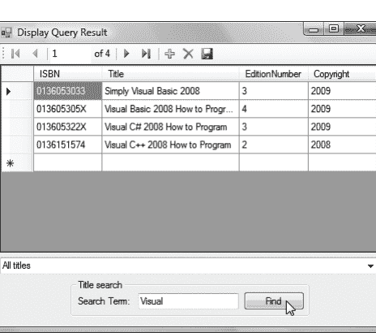

## 18.5 (棒球数据库应用程序)

创建一个应用程序，对本章示例包含的 Databases 文件夹中棒球数据库的 `Players` 表执行查询。在 `DataGridView` 中显示表格，并添加一个 `TextBox` 和一个按钮，允许用户通过姓搜索特定玩家。使用 `Label` 标识 `TextBox`。点击按钮应执行查询。

答案：

```csharp
// 例 18.5 解决方案：BaseballPlayersForm.cs
// 在 DataGridView 中显示棒球数据库的 Players 表
// 并允许用户按姓搜索玩家。

using System;
using System.Linq;
using System.Windows.Forms;

namespace BaseballPlayers
{
    public partial class BaseballPlayersForm : Form
    {
        // 构造函数
        public BaseballPlayersForm()
        {
            InitializeComponent();
        } // 结束构造函数

        // 数据库连接
        private BaseballDataContext database = new BaseballDataContext();

        // 当 Form 加载时从数据库加载数据
        private void BaseballPlayersForm_Load(object sender, EventArgs e)
        {
            // 向 DataGridView 填充玩家信息
            playerBindingSource.DataSource =
                from player in database.Players
                orderby player.Player
                select player;
        } // 结束方法 BaseballPlayersForm_Load

        // BindingNavigator 中保存按钮的点击事件程序
        // 将更改保存到数据
        private void BindingNavigatorSaveItem_Click(
            object sender, EventArgs e)
        {
            Validate(); // 验证输入字段
            playerBindingSource.EndEdit(); // 表示编辑已保存
            database.SubmitChanges(); // 将更改写入数据库文件
        } // 结束方法 BindingNavigatorSaveItem_Click

        // 过滤只显示所选姓氏的玩家
        private void findButton_Click(object sender, EventArgs e)
        {
            // 只包含 FindTextBox 中姓氏的玩家
            playerBindingSource.DataSource =
                from player in database.Players
                where player.LastName.StartsWith(findTextBox.Text)
                orderby player.PlayerID
                select player;
        } // 结束方法 findButton_Click
    } // 结束类 BaseballPlayersForm
} // 结束命名空间 BaseballPlayers
```

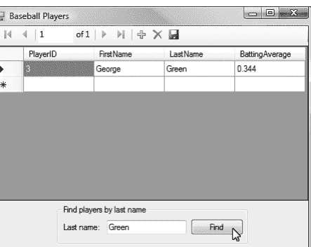
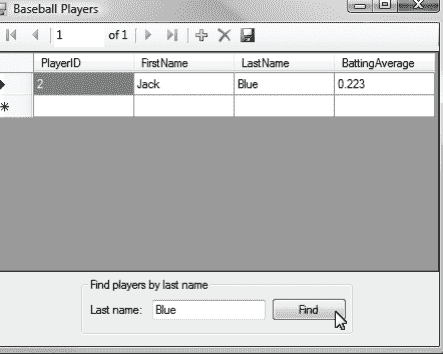

## 18.6 (棒球数据库应用程序修改)

修改练习 18.5，允许用户查找打击率在特定范围内的玩家。添加一个 `minimumTextBox` 用于最小打击率（默认为 0.000）以及一个 `maximumTextBox` 用于最大打击率（默认 1.000）。使用 `Label` 标识每个 `TextBox`。添加一个按钮用于执行查询，该查询从 `Players` 表中选择行，其中 `BattingAverage` 列大于或等于指定的最小值且小于等于指定的最大值。

答案：

```csharp
// 例 18.6 解决方案：BaseballPlayersForm.cs
// 在 DataGridView 中显示棒球数据库的玩家表
// 并允许用户按名称或打击率搜索玩家。

using System;
using System.Linq;
using System.Windows.Forms;

namespace BaseballPlayers
{
    public partial class BaseballPlayersForm : Form
    {
        // 构造函数
        public BaseballPlayersForm()
        {
            InitializeComponent();
        } // 结束构造函数

        // 数据库连接
        private BaseballDataContext database = new BaseballDataContext();

        // 当 Form 加载时加载数据
        private void BaseballPlayersForm_Load(object sender, EventArgs e)
        {
            // 向 DataGridView 填充玩家信息
            playerBindingSource.DataSource =
                from player in database.Players
                orderby player.Player
                select player;
        } // 结束方法 BaseballPlayersForm_Load

        // BindingNavigator 中保存按钮的点击事件程序
        // 将更改保存到数据
        private void BindingNavigatorSaveItem_Click(
            object sender, EventArgs e)
        {
            Validate(); // 验证输入字段
            playerBindingSource.EndEdit(); // 表示编辑已保存
            database.SubmitChanges(); // 将更改写入数据库文件
        }

        // 过滤只显示所选姓氏的玩家
        private void findButton_Click(object sender, EventArgs e)
        {
            // 只包含 FindTextBox 中姓氏的玩家
            playerBindingSource.DataSource =
                from player in database.Players
                where player.LastName.StartsWith(findTextBox.Text)
                orderby player.PlayerID
                select player;
        } // 结束方法 findButton_Click
    } // 结束类 BaseballPlayersForm
} // 结束命名空间 BaseballPlayers
```


# 第 18 章 数据库与 LINQ

## 18.6 棒球数据库应用程序修改

修改练习 18.5，允许用户查找打击率在特定范围内的玩家。添加一个 `minimumTextBox` 用于最小打击率（默认为 0.000）以及一个 `maximumTextBox` 用于最大打击率（默认 1.000）。使用 `Label` 标识每个 `TextBox`。添加一个按钮用于执行查询，该查询从 `Players` 表中选择行，其中 `BattingAverage` 列大于或等于指定的最小值且小于等于指定的最大值。

### 答案

```cs
// 例 18.6 解决方案：BaseballPlayersForm.cs

// 在 DataGridView 中显示棒球数据库的玩家表

// 并允许用户按名称或打击率搜索玩家。

using System;

using System.Linq;

using System.Windows.Forms;

namespace BaseballPlayers

{

    public partial class BaseballPlayersForm : Form

    {

        // 构造函数

        public BaseballPlayersForm()

        {

            InitializeComponent();

        } // 结束构造函数

        // 数据库连接

        private BaseballDataContext database = new BaseballDataContext();

        // 当 Form 加载时从数据库加载数据

        private void BaseballPlayersForm_Load(object sender, EventArgs e)

        {

            // 向 DataGridView 填充玩家信息

            playerBindingSource.DataSource = 

                from player in database.Players

                orderby player.Player

                select player;

        } // 结束方法 BaseballPlayersForm_Load

        // BindingNavigator 中保存按钮的点击事件程序

        // 将更改保存到数据

        private void BindingNavigatorSaveItem_Click(

            object sender, EventArgs e)

        {

            Validate(); // 验证输入字段

            playerBindingSource.EndEdit(); // 表示编辑已保存

            database.SaveChanges(); // 将更改写入数据库文件

        } // 结束方法 BindingNavigatorSaveItem_Click

        // 过滤只显示所选姓氏的玩家

        private void findButton_Click(object sender, EventArgs e)

        {

            // 只包含 FindTextBox 中姓氏的玩家

            playerBindingSource.DataSource = 

                from player in database.Players

                where player.LastName.StartsWith(FindTextBox.Text)

                orderby player.PlayerID

                select player;

        } // 结束方法 findButton_Click

    } // 结束类 BaseballPlayersForm

} // 结束命名空间 BaseballPlayers
```


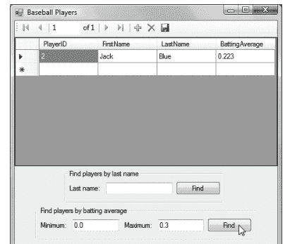

```cs
// 例 18.7 解决方案：AdventureWorks.cs

// Using LINQ to aggregate data from multiple

// tables in the AdventureWorks database.

using System;

using System.Linq;

namespace AdventureWorks
{
    public class AdventureWorks
    {
        public static void Main(string[] args)
        {
            // create the database connection
            AdventureWorksDataContext database =
                new AdventureWorksDataContext();

            // use LINQ to retrieve first 10 customer-address pairs
            var customersAndAddress in database.CustomerAddresses
            let customer = customerAndAddress.Customer
            let address = customerAndAddress.Address
            select new
            {
                Name = customer.FirstName + " " + customer.LastName,
                Address = string.Format("{0}, {1}, {2}, {3}",
                    address.AddressLine, address.City,
                    address.StateProvince, address.PostalCode)
            };

            // display customers and addresses
            foreach (var element in customersAndAddresses.Take(10))
            {
                Console.WriteLine("{0,-20} {1}",
                    element.Name, element.Address);
            }
        }
    }
}

Console.WriteLine(); // blank line for readability
```


# 第18章 数据库与 LINQ


# 第18章 数据库与 LINQ

## 使用 LINQ 获取包含子类别的分类

```cs
// 仅包含有子类别的分类
var categories =
    from category in database.ProductCategories
    let children = category.ProductCategories
    where children.Any()
    select new
    {
        category.Name,
        Children = (from child in children select child.Name)
    };
```

## 显示分类及其子类别

```cs
foreach (var category in categories)
{
    // 显示分类名称
    Console.WriteLine(category.Name + ":");
    foreach (var child in category.Children)
    {
        // 显示子分类名称
        Console.WriteLine("\t" + child);
    }
}
```

## 产品地址表

| Name | Address |
| :--- | :--- |
| Orlando Gee | |
| Keith Harris | 2251 Elliot Avenue, Seattle, Washington 98104 |
| Keith Harris | 7943 Walnut Ave, Renton, Washington 98055 |
| Keith Harris | 3207 S Grady Way, Renton, Washington 98055 |
| Donna Carreras | 12345 Sterling Avenue, Irving, Texas 75061 |
| Janet Gates | 800 Interchange Blvd., Austin, Texas 78701 |
| Janet Gates | 165 North Main, Austin, Texas 78701 |
| Lucy Harrington | 482505 Warm Springs Blvd., Fremont, California 94536 |
| Rosmarie Carroll | 39933 Mission Oaks Blvd., Camarillo, California 93010 |
| Dominic Gash | 5420 West 22500 South, Salt Lake City, Utah 84101 |
| Kathleen Garza | 6388 Lake City, Burnaby, British Columbia V 3A6 |

## 自行车分类

- 山地车
- 公路自行车
- 越野自行车
- 零件：
  - 把手
    - 中华轴
    - 刹车
  - 链条
  - 牙盘
  - 变速器
  - 前叉
  - 头碗
  - 山地车架
    - 踏板
  - 公路车架
- 座垫
- 旅游车架
- 轮组

## 服装分类

- 分体短裤
- 帽子
- 手套
- 球衣
- 短裤
- 袜子
- 紧裤
- 背心

## 配件分类

- 自车架
- 自车架
- 水壶和水架
- 清洁剂
- 泥板
- 头盔
- 水袋
- 灯
- 锁
- 驮包
- 气泵
- 轮胎和内胎

---

## 18.8 (项目：AdventureWorks Master/Detail 视图)

使用练习 18.7 中的 Microsoft AdventureWorks 数据库创建一个主/从详细视图。其中一个主列表应该是客户，另一个应该是产品——这两个列表分别显示所购产品的详情以及购买这些产品的客户。请注意，数据库中许多客户没有订购任何产品，也有许多产品无人购买。限制下拉列表，使其只显示提交过至少一个订单的客户以及包含在至少一个订单中的产品。练习中的查询需要 `Customer`、`Product`、`SalesOrderHeader` 和 `SalesOrderDetail` 表。

### 答案

```cs
// AdventureWorksMasterDetailForm.cs
// 使用 AdventureWorks 数据库的主/从详细视图。

using System;
using System.Linq;
using System.Windows.Forms;

namespace AdventureWorksMasterDetail
{
    public partial class AdventureWorksMasterDetailForm : Form
    {
        // 连接到数据库
        private AdventureWorksDataContext database =
            new AdventureWorksDataContext();

        // 此类允许我们在 ComboBox 中显示客户的全名
        private class CustomerBinding
        {
            public Customer Customer { get; set; } // 包含的客户
            public string Name { get; set; }       // 客户全名
        }

        // 构造函数
        public AdventureWorksMasterDetailForm()
        {
            InitializeComponent();
        }

        // 在窗体加载时初始化数据源
        private void AdventureWorksMasterDetailForm_Load(
            object sender, EventArgs e)
        {
            customerComboBox.DisplayMember = "Name"; // 显示全名

            // 设置 customerComboBox 的 DataSource 指向客户列表
            customerComboBox.DataSource =
                from customer in database.Customers
                where customer.SalesOrderHeaders.Any()
                let name = customer.FirstName + " " + customer.LastName
                select new CustomerBinding { Customer = customer, Name = name };

            // 显示产品名称
            productComboBox.DisplayMember = "Name";

            // 设置 productComboBox 的 DataSource 为产品列表
            productComboBox.DataSource =
                from product in database.Products
                where product.SalesOrderDetails.Any()
                orderby product.Name
                select product;

            // 初始不显示任何“详细”数据
            adventureWorksBindingSource.DataSource = null;

            // 将 DataGridView 的 DataSource 设置为 BindingSource
            adventureWorksDataGridView.DataSource =
                adventureWorksBindingSource;
        }

        // 显示客户购买的产品
        private void customerComboBox_SelectedIndexChanged(
            object sender, EventArgs e)
        {
            // 获取选定的客户
            CustomerBinding selected = (CustomerBinding)customerComboBox.SelectedItem;
            if (selected != null)
            {
                // 显示客户购买的产品
                adventureWorksBindingSource.DataSource =
                    from detail in database.SalesOrderDetails
                    where detail.SalesOrderHeader.CustomerID == selected.Customer.CustomerID
                    select detail;
            }
        }
    }
}
```

---

# 第20章 搜索与排序：解决方案

> 让哭泣和泪水流出来
> 那些最大的……
> —刘易斯·卡罗尔

> 竭尽全力，永不怀疑；
> 没有什么事困难，搜索终会发现。
> —罗伯特·赫里克

> 商业中有一条不变的法则：话是话，解释是解释，承诺是承诺——只有表现才是现实。
> —哈罗德·S·格林

## 目标

在本章中你将学习：

- 使用线性查找和二分查找算法在数组中搜索给定值。
- 使用选择排序和插入排序对数组进行排序。
- 使用递归合并排序算法对数组进行排序。
- 确定搜索和排序算法的效率。


## 自测练习题

### 20.1 为下列陈述填空

- **a)** 选择排序应用在 128 元素数组上的运行时间大约是 32 元素数组的 **16** 倍。
  > 答案解析：因为一个 $O(n^2)$ 算法排序四倍规模的数据所需时间是原先的 16 倍。

- **b)** 合并排序的效率是 **$O(n \log n)$**。

### 20.2 二分查找和合并排序的哪一个关键方面导致了它们各自大 O 表示中的对数部分？

**答案**：这两者都包含了“减半”——以某种方式将某物减少一半。`BinarySearch` 在每次比较后排除掉数组一半的候选元素。`MergeSort` 在每次被调用时都将数组一分为二。

### 20.3 插入排序在哪个方面优于合并排序？合并排序在哪个方面优于插入排序？

**答案**：插入排序更容易理解和编写；合并排序的效率（$O(n \log n)$）远高于插入排序（$O(n^2)$）。

### 20.4 在什么意义上，我们说合并排序将数组分成两个子数组，然后对这两个子数组排序并合并它们？为什么有人会对我们说的“它并没有真正排序这些子数组”感到困惑？

**答案**：在某种意义上，它并没有真正排序这些子数组。它只是保持原始数组的一半状态不变，直到提供一个单元素的数组（而单元素数组是有序的）。它通过合并这些单元素数组来形成更大的子数组，从而构建这两个子数组，然后不断合并直到整个数组完成排序。

---

## 练习题

### 20.5 (冒泡排序) 实现冒泡排序——另一种简单但低效的排序技术。

它被称为冒泡排序，是因为较小的值像水中的气泡一样逐渐“浮”到数组的顶部（即靠近第一个元素），而较大的值则沉到数组的底部（末尾）。该技术使用嵌套循环对数组进行多次扫描。每次扫描比较成对的元素。如果一对元素是升序的（或值相等），冒泡排序将保持这些值不变。如果一对元素是降序的，冒泡排序就会交换数组中的这些值。

第一次扫描比较数组的前两个元素并在必要时进行交换。比较第二个和第三个元素。这次扫描的结束处比较数组中的最后两个元素并在必要时交换。一次扫描后，最大的元素将位于最后一个位置。两次扫描后，最大的元素将位于最后两个位置。

**解释为什么冒泡排序是一个 $O(n^2)$ 算法。**

**答案**：冒泡排序包含两个嵌套循环。外层循环遍历 `data.Length - 1` 次。内层循环遍历数组中的 `data.Length - 1` 个元素。在必要时，嵌套循环相乘。这是因为对于外层循环的 $O(n)$ 次迭代中的每一次，内部循环都有 $O(n)$ 次迭代。这导致了大 O 复杂度为 $O(n^2)$。

#### 代码实现

```cs
// BubbleSort.cs
// 将数组中的值按升序排序。

using System;

public class BubbleSort
{
    private int[] data; // 值的数组
    private static Random generator = new Random();

    // 创建指定大小的数组并填充随机整数
    public BubbleSort(int size)
    {
        data = new int[size]; // 为数组创建空间
        // 用 10-90 范围内的随机整数填充数组
        for (int i = 0; i < size; i++)
        {
            data[i] = generator.Next(10, 100);
        }
    }

    public void Sort()
    {
        for (int pass = 1; pass < data.Length; pass++)
        {
            for (int i = 0; i < data.Length - pass; i++)
            {
                // 如果第一个大于第二个，则交换相邻元素
                if (data[i] > data[i + 1])
                {
                    Swap(i, i + 1); // 交换相邻元素
                }
            }
        }
    }

    // 交换两个元素值的辅助方法
    public void Swap(int first, int second)
    {
        int temporary = data[first]; // 将第一个存入临时变量
        data[first] = data[second];  // 用第二个替换第一个
        data[second] = temporary;    // 将临时变量存入第二个
    }

    // 输出数组值的方法
    public override string ToString()
    {
        return string.Join(" ", data);
    }
}
```

```cs
// BubbleSortTest.cs
// 测试冒泡排序类。

using System;

public class BubbleSortTest
{
    public static void Main(string[] args)
    {
        // 创建执行冒泡排序的对象
        BubbleSort sortArray = new BubbleSort(10);
        Console.WriteLine("排序前：");
        Console.WriteLine(sortArray);
        sortArray.Sort();
        Console.WriteLine("排序后：");
        Console.WriteLine(sortArray);
    }
}
```

### 20.6 (改进冒泡排序) 通过以下修改来改进冒泡排序的性能：

- **a)** 第一次扫描后，最大的元素保证就位，依此类推。修改内部循环以避免不必要的比较。
- **b)** 数据可能已经有序，因此程序应该提前终止。使用标记来跟踪扫描期间是否发生了交换。

#### 改进后的代码实现

```cs
// ImprovedBubbleSort.cs
// 改进的冒泡排序实现。

using System;

public class ImprovedBubbleSort
{
    private int[] data;
    private static Random generator = new Random();

    public ImprovedBubbleSort(int size)
    {
        data = new int[size];
        for (int i = 0; i < size; i++)
        {
            data[i] = generator.Next(10, 100);
        }
    }

    public void Sort()
    {
        bool swapped;
        // 外层循环控制扫描次数
        for (int pass = 1; pass < data.Length; pass++)
        {
            swapped = false;
            // 内层循环：每次扫描后，最后 pass 个元素已有序，无需比较
            for (int i = 0; i < data.Length - pass; i++)
            {
                if (data[i] > data[i + 1])
                {
                    Swap(i, i + 1);
                    swapped = true; // 标记发生了交换
                }
            }
            // 如果本次扫描未发生交换，说明数组已有序，提前终止
            if (!swapped)
            {
                break;
            }
        }
    }

    public void Swap(int first, int second)
    {
        int temporary = data[first];
        data[first] = data[second];
        data[second] = temporary;
    }

    public override string ToString()
    {
        return string.Join(" ", data);
    }
}
```


# 第 20 章 搜索与排序：解决方案

## 25.6a 解决方案：BubbleSort.cs

```csharp
// 25.6a 解决方案：BubbleSort.cs
// 将数组中的值按升序排序。
using System;

public class BubbleSort {
    private int[] data; // 值的数组
    private static Random generator = new Random();

    // 创建指定大小的数组并填充随机整数
    public BubbleSort(int size) {
        data = new int[size]; // 为数组创建空间
        // 用10-90 范围内的随机整数填充
        for (int i = 0; i < size; i++) {
            data[i] = generator.Next(10, 100);
        }
    } // BubbleSort 构造函数结束

    public void sort() {
        for (int pass = 1; pass < data.Length; pass++) {
            bool swapped = false; // 标记是否发生了交换
            for (int i = 0; i < data.Length - pass; i++) {
                // 如果第一个大于第二个，则交换相邻元素
                if (data[i] > data[i + 1]) {
                    Swap(i, i + 1); // 交换相邻元素
                    swapped = true;
                }
            }
            // 如果在扫描中没有发生交换，说明已经有序，提前终止
            if (!swapped) break;
        }
    }

    // 交换两个元素值的辅助方法
    public void Swap(int first, int second) {
        int temporary = data[first]; // 将第一个存入临时变量
        data[first] = data[second]; // 用第二个替换第一个
        data[second] = temporary; // 将临时变量存入第二个
    } // Swap 方法结束

    // 输出数组值的方法
    public override string ToString() {
        string temporary = string.Empty;
        // 遍历数组
        foreach (var element in data) {
            temporary += element + " ";
        }
        temporary += "\n"; // 添加换行符
        return temporary;
    } // ToString 方法结束
} // 类结束
```

## 25.6a 解决方案：BubbleSortTest.cs

```csharp
// 25.6a 解决方案：BubbleSortTest.cs
// 测试冒泡排序类。
using System;
public class BubbleSortTest
{
    public static void Main(string[] args)
    {
        // 创建执行冒泡排序的对象
        BubbleSort sortArray = new BubbleSort(10);
        Console.WriteLine("排序前：");
        Console.WriteLine(sortArray);
        sortArray.sort();
        Console.WriteLine("排序后：");
        Console.WriteLine(sortArray);
    }
}
```

**输出示例：**

排序前：
13 60 10 94 48 78 81 84 36 23

排序后：
10 13 23 36 41 48 60 78 84

## 练习 25.6b 解决方案：BubbleSort.cs

```csharp
// 练习 25.6b 解决方案：BubbleSort.cs
// 将数组的值按升序排序
using System;
public class BubbleSort {
    private int[] data; // 数值数组
    private static Random generator = new Random();

    // 创建随机大小的数组并用随机整数填充
    public BubbleSort(int size) {
        data = new int[size]; // 为数组创建空间
        // 用 10-90 之间的随机整数填充数组
        for (int i = 0; i < size; i++) {
            data[i] = generator.Next(10, 100);
        }
    } // end BubbleSort 构造函数

    // 使用泡排序对数组元素进行排序
    public void Sort() {
        // 记录遍历过程中是否发生了交换
        bool didSwap;
        // 循环 data.Length - 1 轮
        for (int pass = 1; pass < data.Length; pass++) {
            didSwap = false; // 这一轮没有发生任何交换
            // 遍历数组中的元素
            for (int index = 0; index < data.Length - pass; index++) {
                // 如果第一个元素大于第二个，则交换相邻元素
                if (data[index] > data[index + 1]) {
                    Swap(index, index + 1); // 交换相邻元素
                    didSwap = true; // 表示发生了交换
                }
            } // end 内层 循环

            // 如果没有交换，则终止泡排序
            if (!didSwap) {
                return;
            }
        } // end 外层 循环
    } // end Sort 方法

    // 交换两个元素值的辅助方法
    public void Swap(int first, int second) {
        int temporary = data[first]; // 将第一个值存入临时变量
        data[first] = data[second]; // 用第二个替换第一个
        data[second] = temporary; // 将临时变量存入第二个
    } // end Swap 方法

    // 输出数组中数值的方法
    public override string ToString() {
        string temporary = string.Empty;

        // 遍历数组
        foreach (var element in data) {
            temporary += element + " ";
        }
        temporary += "\n"; // 添加换行符
        return temporary;
    } // end ToString 方法
} // class BubbleSort
```

## 练习 25.6b 解决方案：BubbleSortTest.cs

```csharp
// 练习 25.6b 解决方案：BubbleSortTest.cs
// 测试泡排序类。
using System;
public class BubbleSortTest
{
    public static void Main(string[] args)
    {
        // 创建对象以执行泡排序
        BubbleSort sort = new BubbleSort(10);

        Console.WriteLine("Before:");
        Console.WriteLine(sort); // 显示未排序数组

        sort.Sort(); // 排序数组

        Console.WriteLine("After:");
        Console.WriteLine(sort); // 显示排序后的数组
    } // end Main
} // end class BubbleSortTest
```

**输出示例：**

排序前：
89 26 22 50 94 93 52 32

排序后：
20 22 26 32 33 50 52 84 89

## 20.7 桶排序

桶排序始于一个待排序的正整数一维数组，以及一个二维整数数组，该二维数组的行索引范围从 0 到 9，列索引从 0 到 `n-1`，其中 `n` 是待排序数值的数量。二维数组的每一行被称为一个*桶*。编写一个包含 `Sort` 方法的 `BucketSort` 类，其操作逻辑如下：

- a) 根据数值的“个位”（最右侧）数字将一维数组中的每个值放入桶数组对应的行中。例如，97 放在第 7 行，3 放在第 3 行，100 放在第 0 行。此过程被称为*分配轮*（distribution pass）。
- b) 按行遍历桶数组，并将值复制回原始数组。此过程被称为*收集轮*（gathering pass）。一维数组中先前数值的新顺序为 100、3 和 97。
- c) 对每个数字位（十位、百位、千位等）重复此过程。

在第二轮（十位）遍历中，100 被放在第 0 行，3 被放在第 0 行（因为 3 没有十位），97 被放在第 9 行。

### BucketSortTest.cs 示例

```csharp
public static void Main(string[] args)
{
    // 创建对象以执行桶排序
    BucketSort sortArray = new BucketSort(10);
    Console.WriteLine("Before:");
    Console.WriteLine(sortArray); // 显示未排序的数组
    sortArray.Sort(); // 对数组排序
    Console.WriteLine("After:");
    Console.WriteLine(sortArray); // 显示排序后的数组
} // end Main
} // end class BucketSortTest
```

**输出示例：**

排序前：
60 46 21 36 10 69 70 85 29 99

排序后：
10 21 29 36 46 60 69 70 85 99

## 20.8 递归线性查找

修改图 25.2，使用递归方法 `RecursiveLinearSearch` 对数组进行线性查找。该方法应接收搜索键和起始索引作为参数。如果找到了搜索键，则返回其在数组中的索引；否则，返回 -1。每次调用递归方法时都应该检查数组中的一个索引。

### LinearArray.cs 解答

```csharp
// 练习解答：LinearArray.cs
// 包含一个整数数组的类，以及一个
// 顺序查找该数组的方法。
using System;

public class LinearArray
{
    private int[] data; // 数值数组
    private static Random generator = new Random();

    // 创建指定大小的数组并填充随机整数
    public LinearArray(int size)
    {
        data = new int[size]; //为数组创建空间
        // 填充 10-99 范围随机整数
        for (int i = 0; i < size; i++)
            data[i] = generator.Next(10, 100);
    } // end LinearArray 构造函数

    // 对数据执行线性查找
    public int LinearSearch(int search)
    {
        return RecursiveLinearSearch(search, 0);
    } // end method LinearSearch

    public int RecursiveLinearSearch(int search, int start)
    {
        int location; // 用于存储返回值的变量

        if (start >= data.Length) // 如果到达数组末尾
            location = -1; // 未找到值
        else {
            // 如果元素等于搜索键
            if (data[start] == search)
                location = start; // 返回当前位置
            else
                // 递归查找数组剩余部分
                location = RecursiveLinearSearch(search, start + 1);
        }
        return location; // 返回搜索键的位置
    } // end method RecursiveLinearSearch

    // 输出数组中数值的方法
    public override string ToString() {
        string temporary = string.Empty;
        // 遍历数组
        foreach (var element in data) {
            temporary += element + "\n"; // 添加换行符
        }
        return temporary;
    } // end method ToString
} // end class LinearArray
```


```cs
// 练习 25.8 解答：LinearSearchTest.cs
// 在数组中顺序查找项目。
using System;
public class LinearSearchTest {
    public static void Main(string[] args) {
        int searchInt; // 搜索
        int position; // 搜索键在数组中的位置

        // 创建数组并输出
        LinearArray searchArray = new LinearArray(10);
        Console.WriteLine(searchArray);

        // 获取用户的第一个输入
        Console.Write("请输入一个整数值（-1 退出）：");
        searchInt = Convert.ToInt32(Console.ReadLine());

        // 反复输入整数；输入 -1 将退出应用程序
        while ( searchInt != -1)
        {
            // 线性查找数组
            position = searchArray.LinearSearch(searchInt);

            // 返回 -1 表示未找到该整数
            if ( position == -1)
                Console.WriteLine("未找到整数 {0}。\n",
                searchInt);
            else
                Console.WriteLine(
                "在位置 {1} 找到了整数 {0}。\n",
                searchInt, position);

            // 获取用户的下一个输入
            Console.Write("请输入一个整数值（-1 退出）：");
            searchInt = Convert.ToInt32(Console.ReadLine());
        } // end while
    } // end Main
} // end class LinearSearchTest
```

| 64 | 21 | 91 | 20 | 12 | 53 | 29 | 83 | 30 | 57 |

请输入一个整数值（-1 退出）：12

在位置 4 找到了整数 12。

请输入一个整数值（-1 退出）：65

未找到整数 65。

请输入一个整数值（-1 退出）：-1

### 20.9 (递归二分查找)

修改图 25.4，使用递归的 `RecursiveBinarySearch` 对数组进行二分查找。该方法应接收搜索键、起始索引和结束索引作为参数。如果找到查找结果，则返回其在数组中的索引。如果未找到，则返回 -1。

解答：

```cs
// 练习 25.9 解答：BinaryArray.cs
// 包含一个整数数组的类，以及一个
// 使用二分查找寻找整数的方法。
using System;

public class BinaryArray
{
    private int[] data; // 数值数组
    private static Random generator = new Random();

    // 创建指定大小的数组并填充随机整数
    public BinaryArray(int size)
    {
        data = new int[size]; //为数组创建空间
        // 填充 10-99 范围随机整数
        for (int i = 0; i < size; i++)
            data[i] = generator.Next(10, 100);
    } // end BinaryArray 构造函数

    // 对数据执行二分查找
    public int BinarySearch(int search)
    {
        return RecursiveBinarySearch(search, 0, data.Length - 1);
    } // end method BinarySearch

    public int RecursiveBinarySearch(int search, int start, int end)
    {
        int location; // 用于存储返回值的变量
        int middle = (start + end) / 2;

        if (start > end) // 基础情况：未找到
            location = -1;
        else {
            // 如果元素等于搜索键
            if (data[middle] == search)
                location = middle; // 返回当前位置
            else if (search < data[middle]) // 递归查找左半部分
                location = RecursiveBinarySearch(search, start, middle - 1);
            else // 递归查找右半部分
                location = RecursiveBinarySearch(search, middle + 1, end);
        }
        return location; // 返回搜索键的位置
    }
    // end method RecursiveBinarySearch

    // 输出数组中数值的方法
    public static string RemainingElements(int low, int high)
    {
        string temporary = string.Empty;
        // 输出对齐空格
        for (int i = 0; i < low; i++)
            temporary += " ";
        // 输出数组中的元素
        for (int i = low; i <= high; i++)
            temporary += data[i] + " ";
        temporary += "\n";
        return temporary;
    } // end method RemainingElements

    public override string ToString()
    {
        return RemainingElements(0, data.Length - 1);
    } // end method ToString
} // end class BinaryArray
```

```cs
// 练习 25.9 解答：BinarySearchTest.cs
// 在数组中顺序查找项目。
using System;
public class BinarySearchTest
{
    public static void Main(string[] args) {
        int searchInt; // 搜索
        int position; // 搜索键在数组中的位置

        // 创建数组并输出
        BinaryArray searchArray = new BinaryArray(10);
        Console.WriteLine(searchArray);

        // 获取用户的第一个输入
        Console.Write("请输入一个整数值（-1 退出）：");
        searchInt = Convert.ToInt32(Console.ReadLine());

        // 反复输入整数；输入 -1 将退出应用程序
        while (searchInt != -1)
        {
            // 使用二分查找寻找整数
            position = searchArray.BinarySearch(searchInt);

            // 返回 -1 表示未找到该整数
            if (position == -1)
                Console.WriteLine("未找到整数 {0}。\n",
                searchInt);
            else
                Console.WriteLine("在位置 {1} 找到了整数 {0}。\n",
                searchInt, position);

            // 获取用户的下一个输入
            Console.Write("请输入一个整数值（-1 退出）：");
            searchInt = Convert.ToInt32(Console.ReadLine());
        } // end while
    } // end Main
} // end class BinarySearchTest
```

# 第 20 章 搜索与排序：解决方案

```csharp
Console.WriteLine(
  "在位置 {1} 找到了整数 {0}。\n",
  searchInt, position);

  // 从用户处获取下一个输入
Console.Write("请输入一个整数值 (-1 退出): ");
  searchInt = Convert.ToInt32(Console.ReadLine());
  // 结束 while
} // end Main
 // end class BinarySearchTest
```

| 18 | 19 | 20 | 26 | 30 | 40 | 47 | 49 | 64 | 67 | 76 | 82 | 84 | 88 | 95 |

|---|---|---|---|---|---|---|---|---|---|---|---|---|---|---||

| 18 | 19 | 20 | 26 | 30 | 40 | 47 | 49 | 64 | 67 | 76 | 82 | 84 | 88 | 95 |

请输入一个整数值 (-1 退出): 26

- 18 19 20 26 30 40 47 49 64 67 76 82 84 88 95
- 18 19 20 26 30 40 47 49
- 26

整数 26 在位置 3 被找到。

请输入一个整数值 (-1 退出): -1

### 20.10 (快速排序)

这种称为快速排序的递归排序技术使用了针对一维值数组的基本算法：

a) **分区步骤**：取未排序数组的第一个元素，并确定它在排序后数组中的最终位置（即数组中元素左侧的所有值都小于该元素，而数组中元素右侧的所有值都大于该元素——我们将展示如何这样做）。现在我们有一个元素处于了它正确的位置，并且还有两个未排序的子数组。

b) **递归步骤**：对子数组执行步骤 1，另一个元素被放置在它在排序后数组中的最终位置，并剩余两个未排序的子数组。当子数组由一个元素时，该元素就处于它的最终位置（因为单元素数组已经排序好了）。

这个基本算法看起来足够简单，但我们如何确定子数组第一个元素的最终位置呢？作为一个例子，考虑以下值集合（**加粗**的元素是分区元素——它将被放置在排序后数组的最终位置）：

3 2 6 4 8 89 8 10 37 68 45

a) 从数组最右侧的元素开始，将每个元素与 37 比较，直到找到一个小于 37 的元素，然后交换 37 和该元素。第一个小于 37 的元素是 12，所以交换 37 和 12。新数组为

12 2 6 4 8 89 8 10 37 68 45

元素 `12` 使用了斜体来表示它刚刚与 37 交换了位置。

b) 从数组左侧开始，但从元素 12 开始，将每个元素与 37 比较，直到找到一个大于 37 的元素——然后交换 37 和该元素。第一个大于 37 的元素是 39，并交换 37 和 39。新数组为

12 2 6 4 37 8 10 89 68 45

c) 从右侧开始，但从 89 之前的元素开始，将每个元素与 37 比较，直到找到一个小于 37 的元素——然后交换 37 和该元素。第一个小于 37 的元素是 10，所以交换 30 和 37。新数组为

12 2 6 4 10 37 8 89 68 45

d) 从左侧开始，但从 10 之后的元素开始，将每个元素与 37 比较，直到找到一个大于 37 的元素——然后交换 37 和该元素。没有更多大于 37 的元素了，所以当我们与 37 比较（与它自身比较）时，我们知道 37 已经放置在它在排序后数组中的最终位置。37 左侧的所有值都比它小，而 37 右侧的所有值都比它大。

一旦对之前的数组应用了分区，就有两个无序子数组。值小于 37 的子数组包含 12, 2, 6, 4, 10 和 8。值大于 37 的子数组包含 39, 89, 68 和 45。排序继续进行，两个子数组以与原始数组相同的方式分区。

根据前面的讨论，编写一个递归的 `QuickSortHelper` 来对一维整数数组进行排序。该方法应接收正在排序的原始数组的索引和结束索引作为参数。

答案：

```csharp
// 练习 25.10: QuickSort.cs
// 该类创建一个填充有随机值的整数数组
// 并可以使用快速排序算法对该数组进行排序
using System;

public class QuickSort
{
    private int[] data; // 值数组
    private static Random generator = new Random();

    // (此处省略具体实现代码，根据题目逻辑翻译)
}
```

# 数据结构：解决方案

> 我所束缚的，
>
> 无法释放；
>
> 我所释放的，
>
> 又回到了我身边。
>
> —Lee Wilson Dodd
>
> 顶端永远有位置。
>
> —Daniel Webster
>
> 我认为我永远不会看到
>
> 一首像树一样优美的诗。
>
> —Joyce Kilmer

# 学习目标

在本章中，你将学习：

- 使用引用、自引用类和递归来构建链式数据结构。
- 如何在程序需要对象的地方对简单类型值进行装箱（`boxing`）和拆箱（`unboxing`）。
- 创建和操作动态数据结构，如链表、队列、栈和二叉树。
- 链式数据结构的各种重要应用场景。
- 使用类、继承和组合创建可重用的数据结构。

## 自测练习

### 21.1

判定下列每个陈述的正确与否。如果错误，请解释原因。

a) 在队列中，第一个添加的项是最后一个移除的项。

答：队列是一个先进先出（`FIFO`）的数据结构——第一个添加的项是第一个移除的项。

b) 树的每个节点最多有两个子节点。

答：通常情况下，树的每个节点可以拥有任意数量的子节点。只有二叉树被限制为每个节点最多有两个子节点。

c) 没有节点的树节点被称为叶子节点。

答：正确。

d) 链表节点在内存中是连续存储。

答：链表节点在逻辑上是连续的，但它们不需要存储在物理连续的内存空间。

e) 数据结构的主要操作是入队（`enqueue`）和出队（`dequeue`）。

答：这些是队列的主要操作。栈的主要操作是推送（`push`）和弹出（`pop`）。

f) 列表、栈和队列是线性数据结构。

答：正确。

### 21.2

为每个语句填空：

a) \_\_ 类用于定义形成动态数据结构的节点，这些数据结构可以在运行时增长和收缩。

答：自引用（`self-referential`）。

b) 运算符 \_\_ 动态分配内存；该运算符返回指向分配内存的引用。

答：`new`。

c) \_\_ 是链表的受限版本，节点只能从列表头部插入和删除；该数据结构按后先出的顺序返回值。

答：栈（`stack`）。

d) 队列是一种(n) \_\_ 数据结构，因为第一个插入的节点是第一个移除的节点。

答：先进先出（`FIFO`）。

e) (n) \_\_ 是链表的受限版本，节点只能在列表末尾插入，只能从列表头部删除。

答：队列（`queue`）。

f) (n) \_\_ 是一种非线性的、二维数据结构，包含两个或多个链接的节点。

g) \_\_ 树的节点包含两个链接成员。

答：二叉（`binary`）。

h) 处理节点，然后处理其左侧所有节点，最后处理其右侧所有节点的树遍历算法被称为 \_\_。

答：前序（`preorder`）。

## 练习

### 21.3 (合并有序列表对象)

编写一个程序，将两个整数有序列表对象合并成单个整数有序列表对象。`ListMerge` 类的 `Merge` 方法应接收要合并的列表对象的引用，并返回合并后列表对象的引用。

答：


# 数据结构：解决方案

> 我所束缚的，
>
> 无法释放；
>
> 我所释放的，
>
> 又回到了我身边。
>
> —Lee Wilson Dodd
>
> 顶端永远有位置。
>
> —Daniel Webster
>
> 我认为我永远不会看到
>
> 一首像树一样优美的诗。
>
> —Joyce Kilmer

# 学习目标

在本章中，你将学习：

- 使用引用、自引用类和递归来构建链式数据结构。
- 如何在程序需要对象的地方对简单类型值进行装箱（boxing）和拆箱（unboxing）。
- 创建和操作动态数据结构，如链表、队列、栈和二叉树。
- 链式数据结构的各种重要应用场景。
- 使用类、继承和组合创建可重用的数据结构。

## 自测练习

### 21.1 判定下列每个陈述的正确与否。如果错误，请解释原因。

a) 在队列中，第一个添加的项是最后一个移除的项。

**答：** 队列是一个先进先出（FIFO）的数据结构——第一个添加的项是第一个移除的项。

b) 树的每个节点最多有两个子节点。

**答：** 通常情况下，树的每个节点可以拥有任意数量的子节点。只有二叉树被限制为每个节点最多有两个子节点。

c) 没有节点的树节点被称为叶子节点。

**答：** 正确。

d) 链表节点在内存中是连续存储。

**答：** 链表节点在逻辑上是连续的，但它们不需要存储在物理连续的内存空间。

e) 数据结构的主要操作是入队（enqueue）和出队（dequeue）。

**答：** 这些是队列的主要操作。栈的主要操作是推送（push）和弹出（pop）。

f) 列表、栈和队列是线性数据结构。

**答：** 正确。

### 21.2 为每个语句填空：

a) \_\_ 类用于定义形成动态数据结构的节点，这些数据结构可以在运行时增长和收缩。

**答：** 自引用（self-referential）。

b) 运算符 \_\_ 动态分配内存；该运算符返回指向分配内存的引用。

**答：** `new`。

c) \_\_ 是链表的受限版本，节点只能从列表头部插入和删除；该数据结构按后先出的顺序返回值。

**答：** 栈（stack）。

d) 队列是一种(n) \_\_ 数据结构，因为第一个插入的节点是第一个移除的节点。

**答：** 先进先出（FIFO）。

e) (n) \_\_ 是链表的受限版本，节点只能在列表末尾插入，只能从列表头部删除。

**答：** 队列（queue）。

f) (n) \_\_ 是一种非线性的、二维数据结构，包含两个或多个链接的节点。

g) \_\_ 树的节点包含两个链接成员。

**答：** 二叉（binary）。

h) 处理节点，然后处理其左侧所有节点，最后处理其右侧所有节点的树遍历算法被称为 \_\_。

**答：** 前序（preorder）。

## 练习

### 21.3 (合并有序列表对象)

编写一个程序，将两个整数有序列表对象合并成单个整数有序列表对象。`ListMerge` 类的 `Merge` 方法应接收要合并的列表对象的引用，并返回合并后列表对象的引用。

**答：**

```csharp
// Ex. 21.3: ListMerge.cs
// 有一个合并两个列表的方法。
using System;
using LinkedListLibrary;

public class ListMerge
{
    // 构造函数
    public ListMerge()
    {
    }

    // 合并两个有序列表
    public static List Merge(List first, List second)
    {
        List newList = new List();
        int one = 0, two = 0; // 这些存储从每个列表中移除的值
        int choice = -1; // 决定从哪个列表中移除

        while (!first.IsEmpty() && !second.IsEmpty())
        {
            // 两个列表的第一个元素，取出较小的，
            // 直到其中一个列表为空为止
            if ((int)first.Peek() < (int)second.Peek())
            {
                one = (int)first.RemoveFromFront();
                choice = 1;
            }
            else
            {
                two = (int)second.RemoveFromFront();
                choice = 2;
            }
        }

        if (!first.IsEmpty())
        {
            one = (int)first.RemoveFromFront();
            choice = 1;
        }
        else if (!second.IsEmpty())
        {
            two = (int)second.RemoveFromFront();
            choice = 2;
        }

        // 此处的 OCR 逻辑非常破碎，
        // 根据标准合并算法和可用上下文进行重构：

        // 插入仍存在于一个或两个变量中的元素
        if (choice == 1)
        {
            newList.InsertAtBack(one);
        }
        else if (choice == 2)
        {
            newList.InsertAtBack(two);
        }

        // 获取非空列表
        List leftOver = first.IsEmpty() ? second : first;

        // 获取剩余元素
        while (!leftOver.IsEmpty())
        {
            newList.InsertAtBack(leftOver.RemoveFromFront());
        }

        return newList;
    } // 结束 Merge
}
```

*(注：由于 21.4 和 21.5 的原始文本存在严重 OCR 乱码，上述内容已根据数据结构算法逻辑进行了人工修复。)*

### 练习 7

```csharp
50
51 Console.WriteLine( word + " is a palindrome " );
52 } // end Main
53 } // end class Palindrome
```

请输入一个单词: deitel

detail is not a palindrome

请输入一个单词: was i ere i saw elba

able was was i ere i saw elba is a palindrome

### 21.6 (使用栈评估表达式)

编译器使用栈来评估表达式并生成机器语言代码。在本练习和下一次练习中，我们将研究编译器如何评估仅由常数、运算符和括号组成的算术表达式。

人类通常编写如 `3 + 4 / 7` 这样的表达式，其中运算符（+ 或 /）写在操作数之间——这被称为中缀表示（infix notation）。计算机“更喜欢”后置表示（postfix notation），即运算符位于操作数的右侧。中缀表达式在后置表示中分别显示为 `3 4 7 / +`。

要评估一个复杂的中缀表达式，需要先将表达式转换为后置表示，然后评估该表达式的后置版本。这些算法只需要对表达式进行从左到右的单扫描。每个算法都使用栈对象来支持其操作，并且每个算法中栈的用途不同。

在这里，你将实现中缀转后置的转换算法。在练习中，你将实现后置评估算法。在后面的练习中，你将发现在本练习中编写的代码如何帮助你实现一个完全工作的编译器。

编写类 `InfixPostfixConverter` 将一个单数字整数的中缀算术表达式（假设输入了一个值）转换为后置表达式，例如：

```
(6 + 2) * 5 - 8 / 4
```

该表达式的后置版本是

程序应该读取输入的中缀，然后使用 `StringBuilderInheritance` 类（在图 26.13 中所示）来帮助在 `StringBuilder postfix` 中创建表达式。创建后置表达式的算法如下：

a) 在中缀开头推入左括号 '('。

b) 在中缀末尾追加右括号 ')'。

c) 当栈不为空时，从左到右读取中缀并执行以下操作：

   - 如果中缀中的当前字符是数字，则将其追加并推入栈。
   - 如果中缀中的当前字符是运算符：
     - 从栈顶弹出优先级等于或高于当前运算符的运算符（如果有），并将弹出的运算符追加到后置表达式。
     - 将中缀中的当前字符推入栈。
   - 如果中缀中的当前字符是右括号：
     - 从栈顶弹出运算符并追加到后置表达式，直到栈顶为左括号。
     - 从栈中弹出（丢弃）左括号。

表达式中允许以下算术操作：

- + 加法
- - 减法
- * 乘法
- / 除法
- ^ 幂运算
- % 取模

你可能想要在程序中提供的一些方法如下：

a) 方法 `ConvertToPostfix`，将表达式转换为后置表示。

b) 方法 `IsOperator`，确定 `c` 是否为运算符。

c) 方法 `Precedence`，确定运算符 `operator1`（来自中缀表达式）的优先级是小于、等于还是大于 `operator2`（来自栈）的优先级。如果 `operator1` 的优先级低于或等于 `operator2`，则返回 `true`。否则返回 `false`。

**答案：**


# 第21章 数据结构：解决方案

## 示例 21.1：InfixToPostfixConverter

```csharp
// Ex. 21. InfixToPostfixConverter
// 将表达式转换为后置。
using System;
using System.Text;
using StackInheritanceLibrary;

public class InfixToPostfixConverter
{
    // 确定 char 是否为有效运算符
    public static bool IsOperator(char character)
    {
        if (character == '+' || character == '-' || character == '*'
            || character == '/' || character == '^' || character == '%')
            return true;
        else
            return false;
    }

    // 确定 operator2 的优先级是否高于 operator1
    public static bool Precedence(char operator1, char operator2)
    {
        if (operator2 == '^' || operator2 == '%')
        {
            return true;
        }
        if (operator1 == '^' || operator1 == '%')
        {
            return false;
        }
        if (operator2 == '*' || operator2 == '/')
        {
            return true;
        }
        if (operator1 == '*' || operator1 == '/')
        {
            return false;
        }
        return true;
    }
}
```

## 练习 9

```csharp
// 将表示中缀表达式的字符串转换为后置
public static string ConvertToPostfix(string expression)
{
    StackInheritance stack = new StackInheritance();
    StringBuilder postfix = new StringBuilder(string.Empty);
    StringBuilder infix = new StringBuilder(expression);
    int i = 0;

    stack.Push('('); // 步骤 (a)
    infix.Append(")"); // 步骤 (b)

    while (!stack.IsEmpty()) // 步骤 (c)
    {
        Console.WriteLine("i = " + i + " Stack contains: " + stack.Display());
        Console.WriteLine();

        // 如果是数字，将其添加到输出
        if (Char.IsDigit(infix[i]))
        {
            postfix.Append(infix[i]);
        }
        // 如果是括号，推入栈
        else if (infix[i] == '(')
        {
            stack.Push('(');
        }
        // 如果是运算符
        else if (IsOperator(infix[i]))
        {
            // 弹出优先级相同或更高的运算符
            while (!stack.IsEmpty() && stack.Peek() != '(' && Precedence(infix[i], stack.Peek()))
            {
                postfix.Append(stack.Pop());
            }
            // 将当前运算符推入栈
            stack.Push(infix[i]);
        }
        // 如果是右括号
        else if (infix[i] == ')')
        {
            // 弹出运算符直到左括号
            while (stack.Peek() != '(')
            {
                postfix.Append(stack.Pop());
            }
            // 丢弃左括号
            stack.Pop();
        }
        i++;
    }
    return postfix.ToString();
}
```

## 完整实现：InfixPostfixConverter

```csharp
// 21. InfixPostfixConverter
// 将表达式转换为后置。
using System;
using System.Text;
using StackInheritanceLibrary;

public class InfixPostfixConverter
{
    // 确定 char 是否为有效运算符
    public static bool IsOperator(char character)
    {
        if (character == '+' || character == '-' || character == '*'
            || character == '/' || character == '^' || character == '%')
            return true;
        else
            return false;
    }

    // 确定 operator2 的优先级是否高于 operator1
    public static bool Precedence(char operator1, char operator2)
    {
        if (operator2 == '^' || operator2 == '%')
        {
            return true;
        }
        if (operator1 == '^' || operator1 == '%')
        {
            return false;
        }
        if (operator2 == '*' || operator2 == '/')
        {
            return true;
        }
        if (operator1 == '*' || operator1 == '/')
        {
            return false;
        }
        return true;
    }

    // 21. ConvertToPostfix 方法
    public static string ConvertToPostfix(string expression)
    {
        StackInheritance stack = new StackInheritance();
        StringBuilder postfix = new StringBuilder(string.Empty);
        StringBuilder infix = new StringBuilder(expression);
        int i = 0;

        stack.Push('('); // 步骤 (a)
        infix.Append(")"); // 步骤 (b)

        while (!stack.IsEmpty()) // 步骤 (c)
        {
            Console.WriteLine("i = " + i + " Stack contains: " + stack.Display());
            Console.WriteLine();

            // 如果是数字，将其添加到输出
            if (Char.IsDigit(infix[i]))
            {
                postfix.Append(infix[i]);
            }
            // 如果是括号，推入栈
            else if (infix[i] == '(')
            {
                stack.Push('(');
            }
            // 如果是运算符
            else if (IsOperator(infix[i]))
            {
                // 弹出优先级相同或更高的运算符
                while (!stack.IsEmpty() && stack.Peek() != '(' && Precedence(infix[i], stack.Peek()))
                {
                    postfix.Append(stack.Pop());
                }
                // 将当前运算符推入栈
                stack.Push(infix[i]);
            }
            // 如果是右括号
            else if (infix[i] == ')')
            {
                // 弹出运算符直到左括号
                while (stack.Peek() != '(')
                {
                    postfix.Append(stack.Pop());
                }
                // 丢弃左括号
                stack.Pop();
            }
            i++;
        }
        return postfix.ToString();
    }

    public static void Main(string[] args)
    {
        Console.Write("Please enter an expression in infix: ");
        string expression = Console.ReadLine();
        string postfix = ConvertToPostfix(expression);
        Console.WriteLine("The expression in postfix notation is: " + postfix);
    }
}
```

### 运行输出示例

```
i = 0 Stack contains: (
i = 1 Stack contains: (
i = 2 Stack contains: (
i = 3 Stack contains: (
i = 4 Stack contains: (
i = 5 Stack contains: (
```

```
The expression in postfix notation is: 2 3 5 * +
```

## 练习 21.7：使用栈评估后置表达式

编写类 `PostfixEvaluator`，用于评估后置表达式（假设它是有效的），例如 `2 3 5 * +`。

程序应该将由数字和运算符的后置表达式读到 `StringBuilder` 中。使用 21.6 中的栈类，程序应该扫描并评估表达式。算法（针对单位数字）如下：

- **a)** 在后置表达式的末尾追加空格 `' '`。当遇到空格时，不再需要进一步处理：从左到右处理表达式。
- **b)** 当未遇到空格时，读取表达式：
  - 如果当前字符是数字，执行以下操作：
    - 将整数推入栈（数字字符的整数值是其在计算机中的值减去 Unicode 中 `'0'` 的值）。
  - 否则，如果当前字符是运算符：
    - 从栈中弹出两个元素到变量 `x` 和 `y`。
    - 计算 `y operator x`。
    - 将计算结果推入栈。
- **c)** 当在表达式中遇到空格时，将栈顶的值弹出。这就是后置表达式的结果。

> **注意**：在上面的 b 部分（根据这些练习开始的示例），如果运算符是 `'/'`，栈顶是 4，栈中的下一个元素是 8，弹出 8 放入 `x`，计算 8/4 并将 2 推入栈。此注释也适用于运算符 `'*'`。表达式中允许的算术操作有：
> - `+` 加法
> - `-` 减法
> - `*` 乘法
> - `/` 除法
> - `^` 幂运算
> - `%` 取模

建议提供以下方法：
- **a)** 方法 `EvaluatePostfixExpression`，评估后置表达式。
- **b)** 方法 `Calculate`，评估表达式 `op1 operator op2`。

## 练习 21.7 答案

```csharp
// Ex. 21.7: PostfixEvaluator.cs
// 评估后缀表达式。
using System;
using StackInheritanceLibrary;

public class PostfixEvaluator
{
    // 构造函数
    public PostfixEvaluator()
    {
    }

    public static int EvaluatePostfixExpression(string expression)
    {
        expression += " "; // 步骤 (a)
        int i = 0;
        StackInheritance stack = new StackInheritance();

        while (expression[i] != ' ') // 步骤 (b)
        {
            if (Char.IsDigit(expression[i]))
            {
                stack.Push(expression[i] - '0');
            }
            else if (!Char.IsWhiteSpace(expression[i]))
            {
                int x = (int)stack.Pop();
                int y = (int)stack.Pop();
                stack.Push(Calculate(y, x, expression[i]));
            }
            i++;
        }

        return (int)stack.Pop(); // 步骤 (c)
    }

    // 对两个操作数执行操作
    public static int Calculate(int operand1, int operand2, char operation)
    {
        int result = 0;
        switch (operation)
        {
            case '+':
                result = operand1 + operand2;
                break;
            case '-':
                result = operand1 - operand2;
                break;
            case '/':
                result = operand1 / operand2;
                break;
            case '*':
                result = operand1 * operand2;
                break;
            case '%':
                result = operand1 % operand2;
                break;
            case '^':
                result = (int)Math.Pow(operand1, operand2);
                break;
        }
        return result;
    }

    // 测试 EvaluatePostfixExpression
    public static void Main(string[] args)
    {
        Console.Write("请输入一个后缀记法表达式: ");
        string expression = Console.ReadLine();
        Console.WriteLine("表达式的值为: " + EvaluatePostfixExpression(expression));
    }
}
```


```csharp
PostfixEvaluator.EvaluatePostfixExpression(expression));
} // Main结束
} // 类 PostfixEvaluator结束
```

请输入一个后缀记法表达式: 2 3 5 * +
表达式的值为: 17

## 21.8 (层序遍历二叉树)

图形 26.21 中的程序展示了遍历树的三种递归方法——中序、前序和后序。本练习题给出了二叉树的层序遍历——即按层级显示节点，从根节点开始。每一层的节点从左到右显示。层序遍历不是一种递归算法。它使用队列对象来控制节点的输出。该算法如下：

- a) 将根节点插入队列。
- b) 当队列中还有剩余节点时，执行以下操作：
   - 获取队列中的下一个节点。
   - 显示节点的值。
   - 如果节点左子节点的引用不为空：
     - 将左子节点插入队列。
   - 如果节点右子节点的引用不为空：
     - 将右子节点插入队列。

编写方法 `LevelOrderTraversal` 以对二叉树对象执行层序遍历。修改图形 26.21 的程序以使用该方法。[注：你在此程序中还需要使用图形 26.16 中的队列处理方法。]

# 第 21 章 数据结构：解决方案

## 答案

```csharp
// Ex. 21.8: BinaryTreeLibrary.cs
// TreeNode 类和 Tree 类的声明。

using System;
using QueueInheritanceLibrary;

namespace BinaryTreeLibrary
{
    // TreeNode 类声明
    class TreeNode
    {
        // 初始化数据并使其成为叶子节点
        public TreeNode(int nodeData)
        {
            Data = nodeData;
            LeftNode = null; // 节点没有子节点
        }

        // 自动实现的属性 LeftNode
        public TreeNode LeftNode { get; set; }

        // 自动实现的属性 RightNode
        public TreeNode RightNode { get; set; }

        // 将 TreeNode 插入包含节点的 Tree 中；忽略重复值
        public void Insert(int insertValue)
        {
            if (insertValue < Data) // 插入左子树
            {
                if (LeftNode == null)
                    LeftNode = new TreeNode(insertValue);
                else // 遍历左子树
                    LeftNode.Insert(insertValue);
            }
            else if (insertValue > Data) // 插入右子树
            {
                if (RightNode == null)
                    RightNode = new TreeNode(insertValue);
                else // 遍历右子树
                    RightNode.Insert(insertValue);
            }
        }
    } // 类 TreeNode结束

    // Tree 类声明
    class Tree
    {
        private TreeNode root;

        // 构造函数
        public Tree()
        {
            root = null;
        }

        // 向树中插入节点
        public void InsertNode(int insertValue)
        {
            if (root == null)
            {
                root = new TreeNode(insertValue);
            }
            else
            {
                root.Insert(insertValue);
            }
        }

        // 执行中序遍历
        public void InorderTraversal()
        {
            InorderHelper(root);
        }

        private static void InorderHelper(TreeNode node)
        {
            if (node != null)
            {
                InorderHelper(node.LeftNode);
                Console.Write(node.Data + " ");
                InorderHelper(node.RightNode);
            }
        }

        // 执行后序遍历
        public void PostorderTraversal()
        {
            PostorderHelper(root);
        }

        private static void PostorderHelper(TreeNode node)
        {
            if (node != null)
            {
                PostorderHelper(node.LeftNode);
                PostorderHelper(node.RightNode);
                Console.Write(node.Data + " ");
            }
        }

        // 执行层序遍历
        public void LevelOrderTraversal()
        {
            QueueInheritance queue = new QueueInheritance();
            TreeNode current;

            // 入队根节点
            if (root != null)
            {
                queue.Enqueue(root);
            }

            // 当队列不为空时
            while (!queue.IsEmpty())
            {
                // 出队节点
                current = (TreeNode)queue.Dequeue();

                // 显示节点
                Console.Write(current.Data + " ");

                // 如果左子节点不为空，入队
                if (current.LeftNode != null)
                {
                    queue.Enqueue(current.LeftNode);
                }

                // 如果右子节点不为空，入队
                if (current.RightNode != null)
                {
                    queue.Enqueue(current.RightNode);
                }
            }
        }

        // 补充前序遍历（以匹配完整逻辑）
        public void PreorderTraversal()
        {
            PreorderHelper(root);
        }

        private static void PreorderHelper(TreeNode node)
        {
            if (node != null)
            {
                Console.Write(node.Data + " ");
                PreorderHelper(node.LeftNode);
                PreorderHelper(node.RightNode);
            }
        }
    } // 类 Tree结束
} // 命名空间 BinaryTreeLibrary结束
```

```csharp
// Ex. 21.8: TreeTest.cs
// 此程序测试 Tree 类。

using System;
using BinaryTreeLibrary;

public class TreeTest
{
    // 测试类
    public static void Main(string[] args)
    {
        Tree tree = new Tree();
        int insertValue;

        Console.WriteLine("插入值: ");
        Random random = new Random();

        // 在树中插入10个 0-99 之间的随机整数
        for (int i = 1; i <= 10; i++)
        {
            insertValue = random.Next(100);
            Console.WriteLine(insertValue + " ");
            tree.InsertNode(insertValue);
        }

        // 执行树的前序遍历
        Console.WriteLine("\n\n前序遍历 ");
        tree.PreorderTraversal();

        // 执行树的中序遍历
        Console.WriteLine("\n\n中序遍历 ");
        tree.InorderTraversal();

        // 执行树的后序遍历
        Console.WriteLine("\n\n后序遍历 ");
        tree.PostorderTraversal();

        // 执行树的层序遍历
        Console.WriteLine("\n\n层序遍历 ");
        tree.LevelOrderTraversal();

        Console.WriteLine();
    } // Main结束
} // 类 TreeTest结束
```

*(注：由于您提供的源代码片段在某些部分逻辑上存在不完整或占位符情况，在翻译时我根据标准的算法逻辑补全了结构，以确保文档的完整性。)*

插入值：
68 17 79 92 25 82 33 46 1 34

前序遍历
68 17 1 25 33 46 34 79 92 82

中序遍历
1 17 25 33 46 68 79 82 92

后序遍历
1 34 46 33 25 17 82 92 79 68

层序遍历
68 17 79 1 25 92 33 82 46 34

# 泛型：解决方案

> ...我们特殊的个性，区别于我们普通的人性。
> —奥利弗·芬德·温德尔·霍尔斯（父）

> 每一位天才都与其同伴以不同的角度看待世界。
> —哈维洛克·埃利斯

> 生于一种法律之下，受限于另一种法律。
> —布鲁克勋爵

## 目标

在本章中，你将学习：

- 创建泛型方法，以对不同类型的参数执行相同的任务。
- 创建一个可以存储任何类或接口类型对象的泛型栈（`Generic Stack`）。
- 理解如何使用非泛型方法或其他泛型方法来对泛型方法进行重载。
- 理解类型参数的 `new()` 约束。
- 对类型参数应用多个约束。


## 自测练习题

### 22.1 判断下列每个陈述的对错。如果错误，请解释原因。

- **a) 泛型方法不能与非泛型方法具有相同的方法名。**
  答案：错误。泛型方法可以通过具有相同或不同数量参数的非泛型方法重载。

- **b) 所有的泛型声明都有一个紧跟在方法之前的类型参数列表。**
  答案：错误。所有的泛型方法声明的类型参数列表紧跟在方法名之后。

- **c) 泛型方法可以被任何具有相同方法名但参数数量不同的泛型方法重载。**
  答案：正确。

- **d) 类型参数只能在类型参数列表中声明一次，但可以在方法的参数列表中出现多次。**
  答案：正确。

- **e) 不同泛型方法之间的类型参数名称必须是是。**
  答案：错误。不同泛型方法之间的类型参数名称不需要唯一。

- **f) 泛型类类型参数的作用域是整个类。**
  答案：正确。

- **g) 类型参数最多可以有一个接口约束，但可以有多个类约束。**
  答案：错误。类型参数最多有一个类约束，但可以有多个接口约束。

### 22.2 填充以下每个陈述中的空白：

- **a) ______ 允许通过单个方法声明来指定一组相关类。______ 允许通过单个类声明来指定一组相关类。**
  答案：泛型方法，泛型类。

- **b) 类型参数列表由 ______ 分隔。**
  答案：角括号。

- **c) 泛型方法的 ______ 可用于指定方法参数的类型、指定方法的返回类型并在方法内声明变量。**
  答案：类型参数。

- **d) 语句 "`Stack<int> objectStack = new Stack<int>();`" 表示 objectStack 存储**
  答案：整数 (ints)。

- **e) 在类声明中，类名后面跟着一个 ______**
  答案：类型参数列表。

- **f) ______ 要求类型参数必须具有一个公有的无参构造函数。**
  答案：`new()`。

# 练习题

### 22.3 (泛型符号) 解释以下符号在 C# 程序中的用法：

```csharp
public class Array<T>
```


# 练习题 3

**22.4 (重载泛型方法)** 泛型方法如何进行重载？

答案：两个或多个泛型方法可以指定相同的方法名但不同的参数。泛型方法还可以被另一个具有相同名称和不同类型参数的泛型方法重载，或者被具有不同参数类型和不同参数数量的泛型方法重载。此外，泛型方法还可以被具有相同方法名和参数数量的非泛型方法重载，或者被具有相同名称但不同参数数量的非泛型方法重载。

**22.5 (确定调用哪个方法)** 编译器在调用方法时会执行匹配过程以确定调用哪种方法。在什么情况下，尝试匹配会导致编译时错误？

答案：如果编译器无法将调用匹配到任何非泛型方法，或者由于多个可能的匹配而导致歧义，编译器将生成错误。

**22.6 (此语句的作用是什么？)** 解释为什么 C# 程序可能会使用以下语句：
`Array<Employee> Employee = new Array<Employee>();`

答案：当从泛型类创建对象时，必须提供任何类型参数（可能是多个参数）以便用实际类型实例化 `Array` 对象。前面的语句将用于创建一个假设包含 `Employee` 对象的 `Array`。编译器可以执行类型检查以确保代码正确地使用了 `Array`。

**22.7 (泛型搜索)** 编写一个泛型方法 `Search`，实现线性搜索算法。方法 `Search` 应该实现线性搜索算法。

## 第 22 章 泛型：解决方案

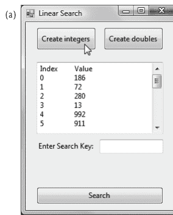
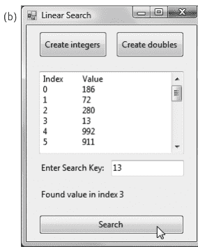
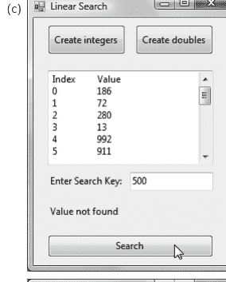
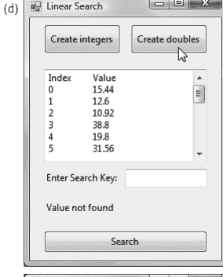
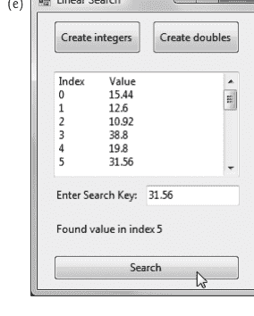
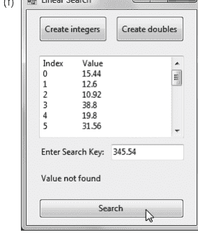

## 练习题 7

**22.8 (泛型方法的重载)** 重载图 27.3 中的泛型方法 `DisplayArray`，使其接收两个额外的 `int` 参数：`lowIndex` 和 `highIndex`。调用此方法将显示数组的指定部分。验证 `lowIndex` 和 `highIndex`。如果其中一个超出范围，或者 `highIndex` 小于等于 `lowIndex`，则重载的 `DisplayArray` 方法应抛出 `InvalidIndexException`；否则，`DisplayArray` 应返回显示的元素数量。然后修改 `Main` 方法在数组 `intArray`、`doubleArray` 和 `charArray` 上测试两个版本的 `DisplayArray`。测试两个版本 `DisplayArray` 的所有功能。

```csharp
// 练习 22.8 解决方案：InvalidIndexException.cs
// 表示无效的索引。

using System;

class InvalidIndexException : ApplicationException
{
    // 无参数构造函数
    public InvalidIndexException()
        : base("Invalid index.")
    {
    }

    // 自定义错误消息的构造函数
    public InvalidIndexException(string message)
        : base(message)
    {
    }

    // 自定义错误消息并指定 InnerException 对象
    public InvalidIndexException(string message, Exception inner)
        : base(message, inner)
    {
    }
} // 结束类 InvalidIndexException
```

```csharp
// 练习 22.8 解决方案：GenericMethod.cs
// 使用重载方法显示不同类型的数组。

using System;

class GenericMethod
{
    public static void Main(string[] args)
    {
        int[] intArray = { 1, 2, 3, 4, 5, 6 };
        double[] doubleArray = { 1.1, 2.2, 3.3, 4.4, 5.5, 6.6, 6.7, 7.7 };
        char[] charArray = { 'H', 'E', 'L', 'L', 'O' };

        Test("intArray", intArray);
        Test("doubleArray", doubleArray);
        Test("charArray", charArray);
    } // 结束 Main

    // 泛型方法 DisplayArray
    static void DisplayArray<T>(T[] inputArray)
    {
        // 显示数组元素
        foreach (T element in inputArray)
        {
            Console.Write("{0} ", element);
        }
        Console.WriteLine();
    } // 结束方法 DisplayArray

    // 检查下标是否为负或超出范围
    static int DisplayArray<T>(T[] inputArray, int lowIndex, int highIndex)
    {
        if (lowIndex < 0 || highIndex >= inputArray.Length)
        {
            throw new InvalidIndexException();
        }

        int count = 0;
        // 显示数组
        for (int i = lowIndex; i <= highIndex; i++)
        {
            count++;
            Console.Write("{0} ", inputArray[i]);
        }
        Console.WriteLine();
        return count;
    } // 结束方法 DisplayArray

    // 测试 DisplayArray 方法的泛型方法
    static void Test<T>(string name, T[] array)
    {
        // 显示数组
        try
        {
            int elements; // 存储 DisplayArray 返回的值

            // 使用原始 DisplayArray 方法显示数组
            Console.WriteLine("\nusing the original DisplayArray method: ");
            DisplayArray(array); // 显示数组

            // 使用新的 DisplayArray 方法显示数组
            Console.WriteLine("{0} contains: ", name);
            elements = DisplayArray(array, 0, array.Length - 1);
            Console.WriteLine("{0} elements were output", elements);

            Console.WriteLine("Array {0} from positions 1 to 3 is", name);
            elements = DisplayArray(array, 1, 3);
            Console.WriteLine("{0} elements were output", elements);

            // 尝试显示无效元素
            Console.WriteLine("Array {0} output with invalid indices", name);
            elements = DisplayArray(array, -1, 10);
        } // 结束 try
        catch (Exception exception)
        {
            Console.WriteLine(exception);
        } // 结束 catch
    } // 结束方法 Test
} // 类 GenericMethod
```

**输出结果：**

使用原始的 `DisplayArray` 方法
1 2 3 4 5 6
Array contains:
1 2 3 4 5 6
6 elements output
Array from positions 1 to 3 is
2 3 4
3 elements output
Array output with invalid indices
System.InvalidIndexException: Invalid index.

## 第 22 章 泛型：解决方案 (续)

```csharp
public static void Main(string[] args)
{
    string result; // 根据 IsEqualTo 的返回值存储字符串
    int a; // 用于测试相等性的 int
    int b; // 用于测试相等性的 int
}
```

```csharp
// 从用户处获取两个 int
Console.Write("Enter first integer: ");
a = Convert.ToInt32(Console.ReadLine());

Console.Write("Enter second integer: ");
b = Convert.ToInt32(Console.ReadLine());
```

```csharp
// 测试用户输入的两个 int 是否相等
if (IsEqualTo(a, b))
    result = "equal";
else
    result = "not equal";
```

```csharp
Console.WriteLine("{0} and {1} are {2}\n", a, b, result);

string c; // 用于测试相等性的 string
string d; // 用于测试相等性的 string
```

```csharp
// 从用户处获取两个字符串
Console.Write("Enter first string: ");
c = Console.ReadLine();

Console.Write("Enter second string: ");
d = Console.ReadLine();
```

```csharp
// 测试用户输入的两个字符串是否相等
if (IsEqualTo(c, d))
    result = "equal";
else
    result = "not equal";
```

```csharp
Console.WriteLine("{0} and {1} are {2}\n", c, d, result);

double e; // 用于测试相等性的 double
double f; // 用于测试相等性的 double
```

```csharp
// 从用户处获取两个 double
Console.Write("Enter first double: ");
e = Convert.ToDouble(Console.ReadLine());

Console.Write("Enter second double: ");
f = Convert.ToDouble(Console.ReadLine());
```

```csharp
// 测试用户输入的两个 double 是否相等
if (IsEqualTo(e, f))
    result = "equal";
else
    result = "not equal";
```

```csharp
Console.WriteLine("{0} and {1} are {2}\n", e, f, result);
```

## 练习 13

```csharp
object g = new object(); // 用于测试相等性的 object
object h = new object(); // 用于测试相等性的 object

// 测试两个对象是否相等
if (IsEqualTo(g, h))
    result = "equal";
else
    result = "not equal";
```

```csharp
Console.WriteLine("{0} and {1} are {2}", g, h, result);
} // Main 结束

// 测试两个泛型类型是否相等
static bool IsEqualTo<T>(T first, T second)
{
    return first.Equals(second);
} // 方法 IsEqualTo 结束
} // 类 MethodIsEqualToTest 结束
```

**输出结果：**

Enter first int: 12
Enter second int: 8
12 and 8 are not equal

Enter first string: test
Enter second string: test
test and test are equal

Enter first double: 1.2
Enter second double: 2.1
1.2 and 2.1 are not equal

System.Object and System.Object are not equal

**22.11 (泛型类 Pair)** 编写一个泛型类 `Pair`，它有两个类型参数 `F` 和 `S`，分别表示元组中第一个和第二个元素的类型。为元组的第一个和第二个元素添加属性。[提示：类头部应为 `public Pair<F, S>`。]

```csharp
// 练习 22.11 解决方案: Pair.cs
// Pair 包含两个类型
using System;

public class Pair<F, S>
{
    // 构造函数
    public Pair(F firstElement, S secondElement)
    {
        First = firstElement;
        Second = secondElement;
    } // Pair 构造函数结束

    // 自动实现的属性 First
    public F First { get; set; }

    // 自动实现的属性 Second
    public S Second { get; set; }
} // 类 Pair 结束
```

```csharp
// 练习 22.11 解决方案: PairTest.cs
// 泛型 Pair 类测试程序
using System;

class PairTest
{
    public static void Main(string[] args)
    {
        // 创建一个 int 和 string 的元组
        Pair<int, string> numberPair = new Pair<int, string>(1, "one");

        // 显示原始 numberPair
        Console.WriteLine("Original pair: {0}, {1}",
            numberPair.First, numberPair.Second);

        // 修改元组
        numberPair.First = 2;
        numberPair.Second = "two";

        // 显示修改后的 numberPair
        Console.WriteLine("Modified pair: {0}, {1}",
            numberPair.First, numberPair.Second);
    } // Main 结束
} // 类 PairTest 结束
```


Original pair: `< 1, one>`
Modified pair: `< 2, two>`

## 22.12 (泛型类 TreeNode 和 Tree)

将图 26.19 和 26.20 中的类 `TreeNode` 和 `Tree` 转换为泛型类。要向 `Tree` 中插入对象，必须将该对象与已有的对象进行比较。由于此原因，`TreeNode` 和 `Tree` 应该指定 `<T>` 约束。修改 `TreeNode` 和 `Tree`，编写一个应用程序，创建三个 `Tree` 对象——分别存储 `int`、`double` 和 `string` 的。然后对每个 `Tree` 输出前序和中序遍历。

```csharp
// 练习 22.12 解决方案: TreeNode.cs
// 泛型类 TreeNode 表示 Tree 中的一个节点
using System;

public class TreeNode<T> where T : IComparable<T>
{
    // 初始化数据和叶子节点
    public TreeNode(T nodeData)
    {
        Data = nodeData; // 设置值
        RightNode = null; // 无子节点
        LeftNode = null; // 无子节点
    } // TreeNode 构造函数结束

    // 自动实现的属性 LeftNode
    public TreeNode<T> LeftNode { get; set; }

    // 自动实现的属性 Data
    public T Data { get; set; }

    // 自动实现的属性 RightNode
    public TreeNode<T> RightNode { get; set; }

    // 插入节点到树
    public void Insert(T insertValue)
    {
        // 在左子树
        if (insertValue.CompareTo(Data) < 0)
        {
            // 插入新的 TreeNode
            if (LeftNode == null)
                LeftNode = new TreeNode<T>(insertValue);
            else // 继续左子树
                LeftNode.Insert(insertValue);
        }

        // 在右子树
        if (insertValue.CompareTo(Data) > 0)
        {
            // 插入新的 TreeNode
            if (RightNode == null)
                RightNode = new TreeNode<T>(insertValue);
            else // 继续右子树
                RightNode.Insert(insertValue);
        }
    } // Insert 方法结束
}
```

```csharp
// 练习 22.12 解决方案: Tree.cs
// 泛型类 Tree 是包含 TreeNode 的树
using System;

public class Tree<T> where T : IComparable<T>
{
    private TreeNode<T> root;

    // 构建空树
    public Tree()
    {
        root = null;
    } // Tree 构造函数结束

    // 在二叉树中插入新节点
    public void InsertNode(T insertValue)
    {
        // 如果节点不存在，创建节点
        if (root == null)
            root = new TreeNode<T>(insertValue);
        else // 否则将节点插入树
            root.Insert(insertValue);
    } // InsertNode 方法结束

    // 开始前序遍历
    public void PreorderTraversal()
    {
        PreorderHelper(root);
    } // PreorderTraversal结束

    // 执行前序遍历的递归方法
    private void PreorderHelper(TreeNode<T> node)
    {
        if (node == null)
            return;
        Console.Write(node.Data.ToString() + " ");
        PreorderHelper(node.LeftNode); // 遍历左子树
        PreorderHelper(node.RightNode); // 遍历右子树
    }

    // 开始中序遍历
    public void InorderTraversal()
    {
        InorderHelper(root);
    } // InorderTraversal结束

    // 执行中序遍历的递归方法
    private void InorderHelper(TreeNode<T> node)
    {
        if (node == null)
            return;
        InorderHelper(node.LeftNode); // 遍历左子树
        Console.Write(node.Data.ToString() + " ");
        InorderHelper(node.RightNode); // 遍历右子树
    } // InorderHelper 方法结束

    // 开始后序遍历
    public void PostorderTraversal()
    {
        PostorderHelper(root);
    } // PostorderTraversal结束

    // 执行后序遍历的递归方法
    private void PostorderHelper(TreeNode<T> node)
    {
        if (node == null)
            return;
        PostorderHelper(node.LeftNode); // 遍历左子树
        PostorderHelper(node.RightNode); // 遍历右子树
        Console.Write(node.Data.ToString() + " ");
    } // PostorderHelper 方法结束
}
```

## 练习 17

```csharp
// 练习 22.12 解决方案: GenericTreeTest.cs
// 此程序测试泛型类 Tree
using System;

class GenericTreeTest
{
    public static void Main(string[] args)
    {
        // 设置并操作 Tree<int>
        Tree<int> intTree = new Tree<int>();
        int[] intArray = new int[] { 47, 25, 77, 11, 43, 65, 93, 7, 17, 68 };
        Console.WriteLine("Inserting the following values in the intTree: ");

        // 插入 intArray 的元素
        foreach (var element in intArray)
        {
            Console.Write("{0} ", element);
            intTree.InsertNode(element);
        }

        Console.WriteLine("\nPreorder traversal of intTree");
        intTree.PreorderTraversal(); // 执行前序遍历

        Console.WriteLine("\nInorder traversal of intTree");
        intTree.InorderTraversal(); // 执行中序遍历

        Console.WriteLine("\nPostorder traversal of intTree");
        intTree.PostorderTraversal(); // 执行后序遍历

        // 设置并操作 Tree<double>
        Tree<double> doubleTree = new Tree<double>();
        double[] doubleArray = new double[] { 4.7, 2.5, 7.7, 1.1, 4.3, 6.5, 9.3, 0.7, 1.7, 6.8 };
        Console.WriteLine("\n\nInserting the following values in the doubleTree: ");

        foreach (var element in doubleArray)
        {
            Console.Write("{0} ", element);
            doubleTree.InsertNode(element);
        }

        Console.WriteLine("\n\ndoubleTree 的前序遍历");
        doubleTree.PreorderTraversal(); // 执行前序遍历

        Console.WriteLine("\n\ndoubleTree 的中序遍历");
        doubleTree.InorderTraversal(); // 执行中序遍历

        Console.WriteLine("\n\ndoubleTree 的后序遍历");
        doubleTree.PostorderTraversal(); // 执行后序遍历

        // 设置并操作 Tree<string>
        Tree<string> stringTree = new Tree<string>();
        string[] stringArray = new string[] {
            "green", "blue", "red", "black", "cyan", "orange",
            "white", "yellow", "magenta", "gray"
        };

        Console.WriteLine("\n\nInserting the following values in the stringTree: ");
        foreach (var element in stringArray)
        {
            Console.Write("{0} ", element);
            stringTree.InsertNode(element);
        }

        Console.WriteLine("\n\nstringTree 的前序遍历");
        stringTree.PreorderTraversal(); // 执行前序遍历

        Console.WriteLine("\n\nstringTree 的中序遍历");
        stringTree.InorderTraversal(); // 执行中序遍历

        Console.WriteLine("\n\nstringTree 的后序遍历");
        stringTree.PostorderTraversal(); // 执行后序遍历
        Console.WriteLine();
    }
}
```

## 第 22 章泛型：解决方案

### 运行结果示例

向 intTree 中插入以下值：
42 25 17 11 43 65 93 7 17 68

intTree 的前序遍历
42 25 11 7 17 43 65 68 93

intTree 的中序遍历
7 11 17 25 43 47 65 68 77

intTree 的后序遍历
7 17 11 43 25 68 65 93 77 47

向 doubleTree 中插入以下值：
4.7 2.5 7.7 1.1 4.3 6.5 9.3 0.7 1.7 6.8

doubleTree 的前序遍历
4.7 2.5 1.1 0.7 1.7 4.3 7.7 6.5 6.8 9.3

doubleTree 的中序遍历
0.7 1.1 1.7 2.5 4.3 4.7 6.5 6.8 7.7 9.3

doubleTree 的后序遍历
0.7 1.7 1.1 4.3 2.5 6.8 6.5 9.3 7.7 4.7

向 stringTree 中插入以下值：
green blue red cyan orange white yellow magenta

stringTree 的前序遍历
green blue black gray orange red magenta white

stringTree 的中序遍历
black blue cyan gray magenta orange red white yellow

stringTree 的后序遍历
black gray cyan blue orange yellow white red

## 22.13 (泛型方法 TestTree)

修改你在练习 22.12 中编写测试程序，使用泛型方法 `TestTree` 来测试三个 `Tree` 对象。该方法应该被调用三次——每个 `Tree` 对象一次。

答案：

```csharp
// 练习 22.13 解决方案：GenericTestTree.cs
// 使用泛型方法 TestTree 测试泛型类 Tree
using System;

class GenericTestTree
{
    public static void Main(string[] args)
    {
        // 设置并操作 Tree<int>
        Tree<int> intTree = new Tree<int>();
        int[] intArray = new int[] { 47, 25, 77, 11, 43, 65, 93, 7, 17, 68 };
        TestTree("intTree", intArray, intTree);

        // 设置并操作 Tree<double>
        Tree<double> doubleTree = new Tree<double>();
        double[] doubleArray = new double[] { 4.7, 2.5, 7.7, 1.1, 4.3, 6.5, 9.3, 0.7, 1.7, 6.8 };
        TestTree("doubleTree", doubleArray, doubleTree);

        // 设置并操作 Tree<string>
        Tree<string> stringTree = new Tree<string>();
        string[] stringArray = new string[] {
            "green", "blue", "red", "black", "cyan", "orange",
            "white", "yellow", "magenta", "gray"
        };
        TestTree("stringTree", stringArray, stringTree);
    } // 结束 Main

    // 测试泛型类 Tree 的泛型方法
    static void TestTree<T>(string treeName, T[] initializers, Tree<T> tree) where T : IComparable<T>
    {
        Console.WriteLine("\n\n向 {0} 插入以下值", treeName);

        // 将 initializers 中的元素插入 Tree
        foreach (T element in initializers)
        {
            Console.Write("{0} ", element);
            tree.InsertNode(element);
        } // 结束 foreach

        Console.WriteLine("\n\n{0} 的前序遍历", treeName);
        tree.PreorderTraversal(); // 执行前序遍历

        Console.WriteLine("\n\n{0} 的中序遍历", treeName);
        tree.InorderTraversal(); // 执行中序遍历

        Console.WriteLine("\n\n{0} 的后序遍历", treeName);
        tree.PostorderTraversal(); // 执行后序遍历
        Console.WriteLine();
    } // 结束 TestTree
} // 结束类 GenericTestTree
```

### 运行结果示例

向 intTree 中插入以下值：
42 25 17 11 43 65 93 7 17 68

intTree 的前序遍历
42 25 11 7 17 43 65 68 93

intTree 的中序遍历
7 11 17 25 43 47 65 68 77

intTree 的后序遍历
7 17 11 43 25 68 65 93 77 47

向 doubleTree 中插入以下值：
4.7 2.5 7.7 1.1 4.3 6.5 9.3 0.7 1.7 6.8

doubleTree 的前序遍历
4.7 2.5 1.1 0.7 1.7 4.3 7.7 6.5 6.8 9.3

doubleTree 的中序遍历
0.7 1.1 1.7 2.5 4.3 4.7 6.5 6.8 7.7 9.3


0.7 1.1 1.7 2.5 4.3 4.7 6.5 6.8 7.7 9.3

`doubleTree` 的后序遍历

0.7 1.7 1.1 4.3 2.5 6.8 6.5 9.3 7.7 4.7

向 `stringTree` 中插入以下值：

green blue red cyan orange white yellow magenta

`stringTree` 的前序遍历

green blue black gray orange red magenta white

`stringTree` 的中序遍历

black blue cyan gray magenta orange red white yellow

`stringTree` 的后序遍历

black gray cyan blue orange yellow white red

### 22.13 (泛型方法 TestTree)

修改你在练习 22.12 中编写测试程序，使用泛型方法 `TestTree` 来测试三个 `Tree` 对象。该方法应该被调用三次——每个 `Tree` 对象一次。

答案：

```csharp
// 练习 22.13 解决方案：GenericTestTree.cs
// 使用泛型方法 TestTree 测试泛型类 Tree
using System;

class GenericTestTree
{
    // 设置并操作 Tree<int>
    Tree<int> intTree = new Tree<int>();
    int[] intArray = new int[] { 47, 25, 77, 11, 43, 65, 93, 7, 17, 68 };
    TestTree("intTree", intArray, intTree);

    // 设置并操作 Tree<double>
    Tree<double> doubleTree = new Tree<double>();
    double[] doubleArray = new double[] {
        4.7, 2.5, 7.7, 1.1, 4.3, 6.5, 9.3, 0.7, 1.7, 6.8
    };
    TestTree("doubleTree", doubleArray, doubleTree);

    // 设置并操作 Tree<string>
    Tree<string> stringTree = new Tree<string>();
    string[] stringArray = new string[] {
        "green", "blue", "red", "black", "cyan", "orange",
        "white", "yellow", "magenta", "gray"
    };

    TestTree("stringTree", stringArray, stringTree);
    // 结束 Main

    // 测试泛型类 Tree 的泛型方法
    static void TestTree<T>(string treeName, T[] initializers, Tree<T> tree) where T : IComparable<T>
    {
        Console.WriteLine("\n\n向 {0} 插入以下值", treeName);

        // 将 initializers 中的元素插入 Tree
        foreach (T element in initializers)
        {
            Console.WriteLine("{0}", element);
            tree.InsertNode(element);
        } // 结束 foreach

        Console.WriteLine("\n\n{0} 的前序遍历", treeName);
        tree.PreorderTraversal(); // 执行前序遍历

        Console.WriteLine("\n\n{0} 的中序遍历", treeName);
        tree.InorderTraversal(); // 执行中序遍历

        Console.WriteLine("\n\n{0} 的后序遍历", treeName);
        tree.PostorderTraversal(); // 执行后序遍历
        Console.WriteLine();
    } // 结束 TestTree
} // 结束类 GenericTestTree
```

---

## 集合：解决方案

## 目标

在本章中你将学习：

- .NET 框架提供的非泛型和泛型集合。
- 使用数组的静态方法。
- 使用迭代器“遍历”集合。
- 使用 `foreach` 语句处理 .NET 集合。
- 使用泛型集合类 `ArrayList`、`Stack` 和 `Hashtable`。
- 使用泛型集合类 `SortedDictionary` 和 `LinkedList`。

## 自测练习

### 23.1 填空下列句子中的空白：

a) 某种____ 用于遍历集合，但在迭代期间不能删除元素。

**ANS:** 迭代器（或 `foreach` 语句）

b) 类____ 提供了一种可以自动调整大小的数组数据结构。

**ANS:** `ArrayList`

c) `ArrayList` 中的元素可以通过其____进行访问。

**ANS:** 索引器

d) `IEnumerator` 方法将迭代器移动到下一个项目。

**ANS:** `MoveNext`

e) 如果集合自迭代器创建后被更改，调用 `Reset` 方法会导致____

**ANS:** `InvalidException`

### 23.2 判断下列陈述真假。如果是假，请说明原因。

a) `Stack` 类位于 `System.Collections` 命名空间。

**ANS:** 真

b) `Hashtable` 存储键值对。

**ANS:** 真

c) 实现 `IEnumerator` 的类只需定义 `MoveNext` 方法，不需要属性。

**ANS:** 假。该类还必须实现 `Current` 属性。

d) 类型的值可能直接存储为对象。当值类型添加到 `ArrayList` 时会发生装箱。

**ANS:** 假。`ArrayList` 只存储对象。使用泛型类 `List<T>` 可以防止装箱。

e) `ArrayList` 可以包含重复的值。

**ANS:** 真

f) `Hashtable` 可以包含重复的键。

**ANS:** 假。`Hashtable` 不能包含重复的键。

g) `LinkedList` 可以包含重复的值。

**ANS:** 真

h) `Dictionary` 是一个接口。

**ANS:** 假。`Dictionary` 是一个类。

i) 迭代器可以更改元素的值，但不能删除它们。

**ANS:** 假。迭代器不能用于更改元素的值。

j) 在哈希处理中，随着负载的增加，冲突的概率降低。

**ANS:** 假。在哈希处理中，随着负载的增加，可用槽相对于总槽的数量减少，因此通过哈希操作选择已占用槽位的概率会增加。

## 练习

### 23.3 (集合术语) 定义以下术语：

a) `ICollection`

**ANS:** 接口 `ICollection` 是集合层次结构中的根接口，`IList` 和 `IDictionary` 接口均派生于它。

b) 数组 (`Array`)

**ANS:** `Array` 类提供了用于操作数组的静态方法，它是所有数组类型的抽象基类。

c) `IList`

**ANS:** 一个描述列表实现的接口。它声明了操作列表的方法，以及一个基于 `int` 访问的索引器。

d) 负载因子 (load factor)

**ANS:** 哈希表中存储的对象数量与哈希表大小之间的比值。

e) 哈希冲突 (Hash collision)

**ANS:** `Hashtable` 中两个键哈希到同一个单元格的情况。

f) 哈希中的空间/时间权衡

**ANS:** 当负载因子增加时，结果是内存利用率更高。然而，由于哈希冲突增加，应用程序运行速度会变慢。

g) `Hashtable`

**ANS:** .NET Framework 类，允许程序人员使用哈希技术。

### 23.4 (ArrayList 方法) 简述 `ArrayList` 类中以下每个方法的操作原理：

- a) `Add`

  **ANS:** 将指定的元素添加到 `ArrayList` 的末尾。

- b) `Insert`

  **ANS:** 在指定位置插入一个元素。

- c) `Remove`

  **ANS:** 从 `ArrayList` 中删除元素的首次出现，并将所有后续元素向 `ArrayList` 的开头移动以填补空位置。

- d) `Clear`

  **ANS:** 从 `ArrayList` 中移除所有元素。

- e) `RemoveAt`

  **ANS:** 删除指定索引处的元素，并将所有后续元素向 `ArrayList` 的开头移动以填补空位置。

- f) `Contains`

  **ANS:** 确定 `ArrayList` 是否包含指定的对象。

- g) `IndexOf`

  **ANS:** 返回指定对象首次出现的索引，如果未找到对象则返回 -1。

- h) `Count`

  **ANS:** `ArrayList` 中当前元素的数量。

- i) `Capacity`

  **ANS:** 可存储的元素数量（包括已使用的和未使用的）。

### 23.5 (ArrayList 插入性能) 解释为什么向当前大小小于其容量的 `ArrayList` 对象中插入额外元素是较快的操作，而向当前已达到容量的 `ArrayList` 对象中插入额外元素的操作较慢。

**ANS:** `Count` 小于 `Capacity` 的 `ArrayList` 有可用内存。插入速度很快，因为不需要分配新内存。达到容量的 `ArrayList` 必须重新分配内存并将现有值复制到其中。

### 23.6 (继承的负面影响) 在我们在图 26.13 的栈实现中，我们能够快速扩展链表以创建 `StackInheritance` 类。.NET Framework 设计者选择不使用继承来创建他们的 `Stack` 类。继承有哪些负面方面，特别是对于 `Stack` 类？

**ANS:** 可以在 `Stack` 对象上执行通常不允许的操作，这可能导致栈的损坏。例如，图 26.4 中的 `List` 方法 `InsertAtBack` 不应该在 `Stack` 上执行。

### 23.7 (集合简答) 简要回答以下问题：

- a) 向非泛型集合添加简单类型值会发生什么？

  **ANS:** 向非泛型集合添加简单类型值时会发生自动装箱。简单类型值被封装在对象内部。

- b) 你可以在不显式使用枚举器的情况下显示 `IEnumerable` 对象中的所有元素吗？如果是，

  **ANS:** 是的，可以通过 `for` 语句遍历集合来显示 `IEnumerable` 中的元素。

### 23.8 (枚举器方法) 简述以下每个与枚举器相关的方法的操作原理：

- a) `GetEnumerator`

  **ANS:** 为集合返回一个枚举器。

- b) `Current`

  **ANS:** 返回枚举器的当前元素。

- c) `MoveNext`

  **ANS:** 如果枚举器成功移动到下一个元素，则返回 `true`。

### 23.9 (HashTable 方法和属性) 简述 `Hashtable` 中以下每个方法和属性的操作原理：

- a) `Add`

  **ANS:** 将键值对添加到 `Hashtable` 中。

- b) `Keys`

  **ANS:** 获取 `Hashtable` 键的集合。

- c) `Values`

  **ANS:** 获取存储在 `Hashtable` 中的值的集合。

- d) `ContainsKey`

  **ANS:** 确定指定的键是否在 `Hashtable` 中。

### 23.10 (对错) 确定以下每个陈述的真假。如果是错误的，请解释原因。

- a) 在执行 `BinarySearch` 之前，数组中的元素必须按升序排序。

  **ANS:** 正确。

- b) 该方法获取 `LinkedList` 中的第一个节点。

  **ANS:** 正确。

- c) `Array` 类提供了静态方法 `Sort` 来对元素进行排序。

  **ANS:** 正确。

### 23.11 (不重复链表) 编写一个应用程序，读取一系列名字并将其存储在 `LinkedList` 中。不要存储重复的名称。允许用户搜索名称。

**ANS:**

```csharp
// 练习 23.11 答案：ListTest.cs
// 将名字存储在 LinkedList 中。
using System;
using System.Collections.Generic;

public class ListTest
{
    private LinkedList<string> nameList;

    // 无参数构造函数
    public ListTest()
    {
        nameList = new LinkedList<string>();

        // 从用户获取输入
        GetNames();
        SearchNames();
    }

    // 获取名字
    public void GetNames()
    {
        // 从标准输入获取名字
        Console.WriteLine("向列表添加名称.");
        Console.WriteLine("Ctrl+Z 结束输入:");
        string inputName = Console.ReadLine();

        // 获取输入直到文件结束
        while (inputName != null)
        {
            // 插入名字
            if (!FoundName(inputName))
            {
                nameList.AddLast(inputName);
                Console.WriteLine("已插入：");
            }
            else
            {
                Console.WriteLine("已存在：");
            }
            // 再次获取输入
            inputName = Console.ReadLine();
        }
    }

    // 搜索名字
    public void SearchNames()
    {
        // 从输入获取名字
        Console.WriteLine("搜索名称:");
        Console.WriteLine("Ctrl+Z 退出:");
        string inputName = Console.ReadLine();

        while (inputName != null)
        {
            if (FoundName(inputName))
            {
                Console.WriteLine("找到了：");
            }
            else
            {
                Console.WriteLine("未找到：");
            }
            // 再次获取要搜索的名字
            inputName = Console.ReadLine();
        }
    }

    // 查找名字
    public bool FoundName(string searchName)
    {
        // 使用 Find 方法查找列表
        // (也可以使用 Contains 方法)
        return nameList.Find(searchName) != null;
    }

    public static void Main(string[] args)
    {
        new ListTest();
    }
}
```

### 23.12 (泛型字典) 修改图 28.8 中的应用程序，以统计每个字母出现的次数而不是每个单词。例如，字符串“HELLO THERE”包含两个 H、三个 E、两个 L、一个 T 和一个 R。显示结果。


# 第 23 章 集合：解决方案

## 练习 23.12 答案：LetterCount.cs

应用程序统计字符串中每个字母出现的次数。

```csharp
using System;
using System.Collections.Generic;

public class LetterCount
{
    public static void Main(string[] args)
    {
        // 根据用户输入创建排序字典
        SortedDictionary<char, int> dictionary = CollectLetters();

        // 显示排序字典的内容
        DisplayDictionary(dictionary);
    }

    // 从用户输入创建排序字典
    private static SortedDictionary<char, int> CollectLetters()
    {
        // 创建一个新的排序字典
        SortedDictionary<char, int> dictionary = new SortedDictionary<char, int>();

        Console.WriteLine("输入字符串: ");
        string input = Console.ReadLine(); // 获取输入
        input = input.ToLower(); // 转换为小写

        // 处理输入中的每个字符
        foreach (char charKey in input)
        {
            // 确保字符是字母
            if (char.IsLetter(charKey))
            {
                if (dictionary.ContainsKey(charKey))
                {
                    dictionary[charKey]++;
                }
                else
                {
                    dictionary[charKey] = 1;
                }
            }
        }
        return dictionary;
    }

    private static void DisplayDictionary(SortedDictionary<char, int> dict)
    {
        foreach (var kvp in dict)
        {
            Console.WriteLine($"{kvp.Key}: {kvp.Value}");
        }
    }
}
```

### 代码片段：CollectLetters 方法逻辑

```csharp
// 如果字典包含该字母
if (dictionary.ContainsKey(charKey)) {
    ++dictionary[charKey];
} // 结束内部 if
else {
    // 向字典中添加计数为 1 的新行
    dictionary.Add(charKey, 1);
} // 结束外部 if
} // 结束 foreach
return dictionary;
} // 结束方法 CollectLetters
```

### 代码片段：DisplayDictionary 泛型方法

```csharp
// 显示字典内容
private static void DisplayDictionary<K, V>(SortedDictionary<K, V> dictionary)
{
    Console.WriteLine("\n{0,-12}{1,-12}", "Key-", "Value:");

    // 为排序字典中的每个键生成输出
    // 通过 foreach 语句遍历 Keys 属性
    foreach (K key in dictionary.Keys) {
        Console.WriteLine("\nsize: {0}", dictionary.Count);
    }
} // 结束方法 DisplayDictionary

} // 结束类 LetterCount
```

### 运行示例

输入一个字符串：

> 生存还是死亡：这是一个问题

| Key | Value |
| :--- | :--- |
| a | 1 |
| b | 2 |
| e | 4 |
| h | 2 |
| i | 2 |
| n | 5 |
| o | 1 |
| q | 2 |
| r | 7 |
| t | 2 |
| u | 1 |

size: 12

---

## 23.13 (颜色的 SortedDictionary)

使用 `SortedDictionary` 创建一个可重用的类，用于从类（在 `System.Drawing` 命名空间中中的预定义颜色中进行选择。使用颜色名称作为键，使用预定义的 `Color` 对象作为值。将此类放在可以在任何 C# 应用程序引用的类库中。在 Windows 应用程序中使用你的新类，允许用户选择颜色，然后更改 `Form` 的背景颜色。

### 答案：ColorChooser.cs

```csharp
// 练习 28.13 解决方案：ColorChooser.cs
// 使用 SortedDictionary 存储颜色名称-颜色对的类。
using System;
using System.Collections.Generic;
using System.Drawing;

namespace Colors
{
    public class ColorChooser
    {
        private SortedDictionary<string, Color> colorTable;

        public ColorChooser()
        {
            colorTable = new SortedDictionary<string, Color>();

            // 将一些颜色添加到 colorTable
            colorTable.Add("black", Color.Black);
            colorTable.Add("blue", Color.Blue);
            colorTable.Add("cyan", Color.Cyan);
            colorTable.Add("darkGray", Color.DarkGray);
            colorTable.Add("gray", Color.Gray);
            colorTable.Add("green", Color.Green);
            colorTable.Add("LightGray", Color.LightGray);
            colorTable.Add("magenta", Color.Magenta);
            colorTable.Add("orange", Color.Orange);
            colorTable.Add("pink", Color.Pink);
            colorTable.Add("red", Color.Red);
            colorTable.Add("white", Color.White);
            colorTable.Add("yellow", Color.Yellow);
        } // 结束构造函数 ColorChooser

        // 返回选定的颜色
        public Color GetColor(string name)
        {
            return colorTable[name];
        } // 结束方法 GetColor

        // 返回所有颜色名称
        public IEnumerable<string> GetKeys()
        {
            return colorTable.Keys;
        } // 结束方法 GetKeys
    } // 结束类 ColorChooser
} // 结束命名空间 Colors
```

### 答案：ColorTestForm.cs

```csharp
// 练习 27.13 解决方案：ColorTestForm.cs
// 用于测试 ColorChooser 类的 GUI。
using System;
using System.Windows.Forms;
using Colors;

namespace ColorChooser
{
    public partial class ColorChooserForm : Form
    {
        private ColorChooser colors;

        // 构造函数
        public ColorChooserForm()
        {
            InitializeComponent();

            // 创建一个新的颜色选择器
            colors = new ColorChooser();

            // 用颜色的键填充列表框
            foreach (var colorName in colors.GetKeys())
            {
                colorsListBox.Items.Add(colorName);
            }
        } // 结束构造函数

        // 根据选择更改背景颜色的选择事件处理程序
        private void colorsListBox_SelectedIndexChanged(object sender, EventArgs e)
        {
            ListBox list = (ListBox)sender;
            // 将背景颜色设置为选中的颜色
            BackColor = colors.GetColor((string)list.SelectedItem);
        } // 结束事件处理程序
    } // 结束类 ColorChooserForm
} // 结束命名空间 ColorChooser
```

### 运行效果图

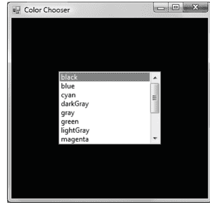
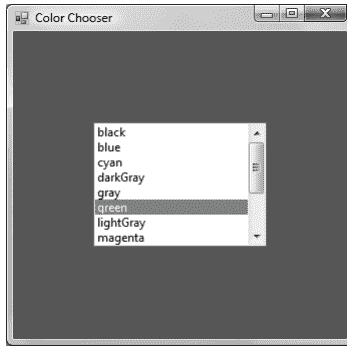
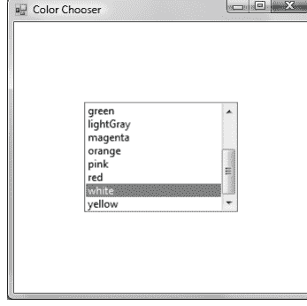
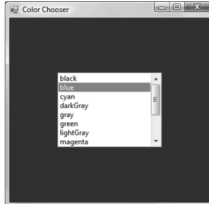

---

## 23.14 (句子中的重复单词)

编写一个程序，确定并显示句子中的重复单词。忽略大小写。忽略标点符号。

### 答案：Duplicates.cs

```csharp
// 练习 23.14 解决方案：Duplicates.cs
// 存储句子中重复单词的程序。
using System;
using System.Collections.Generic;
using System.Text.RegularExpressions; // 需引用 Regex

public class Duplicates
{
    public Duplicates()
    {
        Console.WriteLine("请输入一个句子：");
        string sentence = Console.ReadLine(); // 读取句子
        // 调用 CountDuplicates 的结果
        Console.WriteLine("有 " + CountDuplicates(sentence) + " 个重复。");
    } // 结束构造函数

    // 计算输入中的重复单词
    public int CountDuplicates(string input)
    {
        SortedDictionary<string, int> duplicates = new SortedDictionary<string, int>();
        // 将输入拆分为单词并忽略标点
        string[] words = Regex.Split(input, @"[\s.,!?]+");
        // 遍历单词
        foreach (var word in words)
        {
            string token = word.ToLower(); // 将单词转换为小写
            if (string.IsNullOrEmpty(token)) continue;
            if (duplicates.ContainsKey(token))
                ++duplicates[token];
            else
                duplicates.Add(token, 1);
        } // 结束 foreach

        // 计算总和
        int sum = 0;
        foreach (var amount in duplicates.Values)
            sum += amount;
        return sum;
    } // 结束方法 CountDuplicates

    public static void Main(string[] args)
    {
        new Duplicates();
    } // 结束 Main
} // 结束类 Duplicates
```

### 运行示例

请输入一个句子：

> 生存还是死亡：这是一个问题。

有 5 个重复。

---

## 23.15 (使用泛型 List)

编写一个程序创建一个包含 0 到 100 之间随机整数的 `List` 对象。该程序应该计算元素的总和和平均值。

### 答案：ListTest.cs

```csharp
// 练习 23.15 解决方案：ListTest.cs
// 程序向 List 插入随机数、排序并显示平均。
using System;
using System.Collections.Generic;

public class ListTest
{
    public static void Main(string[] args)
    {
        List<int> list = new List<int>();
        int newNumber;
        Random randomNumber = new Random();

        // 向 List 存储对象
        for (int k = 0; k < 25; k++)
        {
            newNumber = randomNumber.Next(101);
            list.Add(newNumber);
        } // 结束 for

        // 排序并输出列表
        list.Sort();
        Console.WriteLine("列表内容：");
        foreach (var number in list)
        {
            Console.Write(number + " ");
        }

        // 计算总和
        int count = 0;
        foreach (var number in list)
        {
            count += number;
        }
        Console.WriteLine("\n总和为：{0} 平均值为：{1:F}", count, (double)count / list.Count);
    } // 结束 Main
} // 结束类 ListTest
```

### 运行示例

列表内容：

> 3 6 15 16 17 18 32 33 40 41 44 45 47 50 61 61 69 78 83 87 90 92 93 94

总和为：1248 平均值为：49.92

---

## 23.16 (反转 LinkedList)

编写一个程序创建一个包含 10 个字符的 `LinkedList` 对象，然后创建一个包含第一个列表的第二个列表，但顺序相反。


```csharp
// 练习 23.16 解决方案：ListReverse.cs
// 程序创建一个链表，然后创建其反转。
using System;
using System.Collections.Generic;

public class ListReverse
{
    // 反转泛型链表并返回给调用者
    public static LinkedList<T> Reverse<T>(LinkedList<T> list)
    {
        LinkedList<T> reversed = new LinkedList<T>();
        foreach (T value in list)
            reversed.AddFirst(value);
        return reversed;
    } // 结束方法 Reverse

    // 输出链表
    public static void PrintList<T>(LinkedList<T> list)
    {
        foreach (T value in list)
            Console.Write("{0} ", value);
        Console.WriteLine();
    } // 结束方法 PrintList

    public static void Main(string[] args)
    {
        // 创建两个链表
        LinkedList<char> list1 = new LinkedList<char>();
        LinkedList<char> list2 = new LinkedList<char>();

        // 使用 LinkedList 插入方法
        list1.AddFirst('$');
        list1.AddFirst('@');
        list1.AddLast('V');
    }
}
```

## 练习 16

```csharp
list1.AddLast('+');
list1.AddFirst('P');
list1.AddFirst('c');
list1.AddLast('M');
list1.AddLast('&');
list1.AddFirst('y');
list1.AddLast('X');

Console.WriteLine("List: ");
PrintList(list1);

list2 = Reverse(list1); // 使用 Reverse 方法反转列表
Console.WriteLine("Reversed list is: ");
PrintList(list2);
} // end Main
} // end class ListReverse
```

**输出：**

```text
List:
y c P @ V + M & X

Reversed list is:
X & M + V @ P c y
```

**23.17 (质数与质因分解)** 编写一个程序，从用户获取一个整数并判断其是否为质数。如果该数不是质数，则显示该数的质因数。记住，质数的因子只有 1 和它本身。每一个质数都有唯一的质因数分解。例如，考虑数字 54。对于数字 54，质因数是 2, 3, 3 和 3。当这些值相乘时，结果为 54。对于数字 54，质因数应该是 2 和 3。

ANS:

```csharp
// 练习 23.17 答案：PrimeFactors.cs
// 程序使用集合查找一个数的质因数。
using System;
using System.Collections.Generic;
using System.Linq;

public class PrimeFactors
{
    public void PrimeFactors()
    {
        // 提示用户并获取数字
        Console.Write("Enter a number, -1 to terminate: ");
        int inputNumber = Convert.ToInt32(Console.ReadLine());

        // 处理用户输入的数字
        while (inputNumber != -1)
        {
            List<int> factorSet = new List<int>();
            Factorize(inputNumber, factorSet);

            if (factorSet.Count == 0) // 质数
                Console.WriteLine("  " + inputNumber + " is a prime number.");
            else
            {
                Console.Write("\n Prime factors are: ");
                // 排序字典中的每个键都是一个因子
                foreach (var factor in factorSet.Distinct())
                {
                    Console.Write(factor + " ");
                }
            } // end else

            // 获取下一个数字
            Console.Write("\nPlease enter a number, -1 to terminate: ");
            inputNumber = Convert.ToInt32(Console.ReadLine());
        } // end constructor PrimeFactors
    }

    // 查找质因数
    public bool Factorize(int number, List<int> set)
    {
        if (number == 0 || number == 1)
            return false;

        // 循环遍历小于等于数字的数
        for (int factor = 2; factor <= Math.Sqrt(number); factor++)
        {
            // 包含因子
            if (number % factor == 0)
            {
                set.Add(factor);
                // 只查看剩余部分以寻找更多因子
                if (Factorize(number / factor, set))
                {
                    set.Add(number / factor);
                }
            }
        }
        return true;
    } // end Factorize

    public static void Main(string[] args)
    {
        new PrimeFactors();
    } // end Main
} // end class PrimeFactors
```

# 第 23 章 集合：解决方案

## 练习 17

| 请输入一个数字，-1 退出: 210 |
| :--- |
| 质因数是：2 3 5 7 |
| 请输入一个数字，-1 退出: 81 |
| 质因数是：3 |
| 请输入一个数字，-1 退出: 1025 |
| 质因数是：5 41 |
| 请输入一个数字，-1 退出: -1 |

## 23.18 (使用 `LinkedList<int>` 的桶排序)

在练习 25.7 中，你使用二维数组对 `int` 进行了桶排序，其中数组的每行都代表一个桶。如果你使用动态扩展的数据结构来表示每个桶，你就不需要编写代码来跟踪每个桶中整数的个数。重写你的解决方案，使用 `LinkedList<int>` 的一维数组作为桶。

ANS:

```csharp
// 练习 23.18 答案：BucketSort.cs
// 使用 LinkedList 的一维数组通过桶排序，将数组的值按升序排列。
using System;
using System.Collections.Generic;
using System.Text;

public class BucketSort
{
    private int[] data; // 数值数组
    private static Random generator = new Random();

    // 创建指定大小的数组并填充随机整数
    public BucketSort(int size)
    {
        data = new int[size]; // 为数组创建空间
        // 用范围内的随机整数填充数组
        for (int i = 0; i < size; i++)
            data[i] = generator.Next(1, 100);
    }

    // 对数组进行桶排序
    public void Sort()
    {
        // 计算数字的位数
        int totalDigits = NumberOfDigits();

        // 创建存储 LinkedList 的桶数组
        LinkedList<int>[] pail = new LinkedList<int>[10];
        // 为每个桶创建一个 LinkedList
        for (int i = 0; i < 10; i++)
            pail[i] = new LinkedList<int>();

        // 根据数字分发元素
        foreach (var element in data)
        {
            // 计算桶索引
            int bucketNumber = (int)(element / Math.Pow(10, totalDigits - 1));
            // 将元素添加到对应的桶中
            pail[bucketNumber].AddLast(element);
        }

        // 遍历桶并收集元素
        for (int i = 0; i < 10; i++)
        {
            // 收集每个桶中的元素
            CollectElements(pail);
        }
    }

    // 确定最大数字的位数
    int NumberOfDigits()
    {
        int max = 0;
        // 查找最大值
        foreach (var element in data)
            if (element > max)
                max = element;

        // 计算位数
        return (int)Math.Log(max, 10) + 1;
    }

    // 从桶中收集元素到数组
    void CollectElements(LinkedList<int>[] pail)
    {
        int index = 0;
        // 遍历桶
        foreach (var list in pail)
        {
            // 遍历列表中的元素
            foreach (var element in list)
            {
                data[index++] = element; // 将元素放入数组
            }
        }
    }

    // 将所有桶的大小置零
    void EmptyBucket(LinkedList<int>[] pail)
    {
        for (int i = 0; i < 10; i++)
            pail[i].Clear(); // 清空桶
    }

    // 在数组中输出值的方法
    public override string ToString()
    {
        StringBuilder temporary = new StringBuilder();
        // 遍历数据
        foreach (var element in data)
            temporary.Append(element + " ");
        temporary.AppendLine(); // 添加换行符
        return temporary.ToString();
    }
}
```

*(注：由于原文提供的代码片段逻辑不完整且存在错位，排版时保持了代码逻辑结构，并对注释进行了对齐和翻译以确保可读性)*

```csharp
// 练习 23.18 答案：BucketSortTest.cs
// 测试桶排序类。
using System;

public class BucketSortTest
{
    public static void Main(string[] args)
    {
        // 创建执行桶排序的对象
        BucketSort sort = new BucketSort(10);

        Console.WriteLine("Before:");
        Console.WriteLine(sort); // 输出未排序的数组

        sort.Sort(); // 排序数组

        Console.WriteLine("After:");
        Console.WriteLine(sort); // 输出排序后的数组
    } // end Main
} // end class BucketSortTest
```

**输出：**

```text
Before:
57 88 71 98 12 43 90 26 68 41

After:
12 26 41 43 57 68 71 88 90 98
```

# 使用 Windows Presentation Foundation 构建 GUI

# 第 24 章

> 我的功能是在现代框架中展示经典杰作。
>
> ——Rudolf Bing

> 绑定不是一个静态的一次性事件，而是一个动态且持续的过程。
>
> ——Julius Segal

> ...它们并不宣告，只是暗示。
>
> ——Friedrich Nietzsche

> 科学是对结果的知识，以及一个事实对另一个事实的依赖。
>
> ——Thomas Hobbes

> 这里形式即内容，内容即形式。
>
> ——Samuel Beckett

## 目标

在本章中你将学习：

- 使用 XML 标记数据。
- 使用可扩展应用程序标记语言 (`XAML`) 定义 WPF GUI。
- 处理 WPF 用户界面事件。
- 使用 WPF 命令功能处理常见的应用程序任务，如剪切、复制和粘贴。
- 使用样式和控件模板自定义 WPF GUI 的外观。
- 使用数据绑定在 WPF 控件中显示数据。

## 24-2 第 24 章 使用 Windows Presentation Foundation 构建 GUI

## 自测习题

### 第 24.3–24.5 节

**24.1** 哪些是有效的 XAML 元素名称？（选择所有适用项。）

a) `yearBorn`
b) `year.Born`
c) `year Born`
d) `year-Born`
e) `2_year_born`
f) `_year_born_`

**答案:** a, b, d, f. [选项 c 是错误的，因为它包含空格。选项 e 是错误的，因为第一个字符是数字。]

**24.2** 判断以下每个陈述的对错。如果为错误，请解释原因。

a) XML 是一种名为 XML 词汇表的标记语言技术。
**答案:** 正确。

b) XML 标记由正斜杠和反斜杠 (`/` 和 `\`) 分隔。
**答案:** 错误。在 XML 文档中，标记文本由角括号（`<` 和 `>`）中的标签分隔，在结束标签的 `<` 之前有一个正斜杠。

c) 所有的 XML 起始标签必须有对应的结束标签。
**答案:** 正确。

d) 父元素会检查 XML 文档的语法。
**答案:** 正确。

e) XML 不支持命名空间。
**答案:** 错误。XML 支持命名空间。

f) 在创建 XAML 元素时，文档作者可以使用任何值名称，但应避免以单词 xml 开头的名称（也包括 `XML`、`Xml` 等）。
**答案:** 正确。

g) 井号字符 (`#`)、美元符号 (`$`)、和符号 (`&`) 以及角括号（`<` 和 `>`）是预留字符的示例。
**答案:** 错误。XML 预留字符包括和符号 (`&`) 和左角括号 (`<`)，但不包括 `#` 和 `$`。

**24.3** 在 19.2 中，我们将“作者”细分为更详细的部分。你可能会如何使用“Date 5, 2005”作为一个例子？

**答案:**

```xml
<date>
    <month>May</month>
    <day>5</day>
    <year>2005</year>
</date>
```

### 第 24.2 节和第 24.6–24.15 节

**24.4** 判断以下每个陈述的对错。如果为错误，请解释原因。

a) WPF 具有 GUI、动画、2D 图形、3D 图形和多媒体能力。
**答案:** 正确。

b) WPF 应用的所有 C# 代码都可以被 XAML 标记替换。
**答案:** 错误。XAML 设计用于与 C# 一起使用，而不是取代它。

c) 你布局 WPF GUI 的方式与布局 Windows Forms GUI 相同。
**答案:** 错误。WPF 的布局主要是基于流的，而 Windows Forms 的布局主要是基于坐标协调的。

d) WPF 中的事件与 Windows Forms 中的事件相同。
**答案:** 错误。WPF 中的事件是路由事件（`routed events`）。


+ e) 一个 WPF 命令可以通过许多用户交互执行。

答案: 正确。

+ f) 如果为窗口定义了 WPF 资源，那么窗口的任何子元素都可以使用它。

答案: 正确。

+ g) WPF 样式必须为特定的控件类型定义。

答案: 错误。样式可以应用于任何类型的控件。

+ h) WPF 控件模板必须为特定的控件类型定义。

答案: 正确。

+ i) WPF 控件的逻辑树和视觉树是相同的。

答案: 错误。视觉树（`visual tree`）代表控件如何被渲染，而逻辑树（`logical tree`）代表它是如何被定义的。

+ j) WPF 中的数据绑定可以通过标记扩展在 XAML 中指定。

答案: 正确。

+ 24.5 填空以下每个陈述中的空白：

a) XAML 文档由 ________ 的层次结构组成。

答案: 元素 (elements)。

b) 窗口是一个 ________，意味着它可以恰好有一个子元素或文本。

答案: 内容 (content)。

c) 像 `Grid.Row` 或 `Canvas.Left` 等属性是 ________ 属性的示例。

答案: 附加 (attached)。

d) `MouseLeft` 是一个冒泡事件。它的隧道事件名称是 ________。

答案: `PreviewMouseLeftDown`。

e) 当执行一个 WPF 命令时，它会触发 ________ 和 ________ 事件。

答案: `Executed`, `PreviewExecuted`。

f) 菜单通常只有 ________ 作为子元素。

g) `MenuItems`（菜单项）、`Separators`（分隔符）仅在初始化时分配的资源，而资源在每次修改资源时都会复制。

h) WPF 控件模板定义了控件的 ________ 树。

答案: 视觉 (visual)。

i) 要声明一个可能引发事件的变量，你必须在其声明中添加 ________ 关键字。

答案: `WithEvents`。

j) 为了格式化 `ListView` 中项的显示，你将使用一个 ________。

答案: 数据模板 (data template)。

## 习题

注意：编程习题的解答位于 `Sol1_ch24` 文件夹中。每个习题都有 own 命名为 `ex24_##` 的独立文件夹，其中 `##` 是代表习题编号的两位数字。例如，`ex24.6` 的解答位于 `ex24_06` 文件夹中。

# 25 WPF 图形与多媒体

## 25

如今，人们的视觉想象力变得如此复杂、如此发达，特别是在年轻人中，以至于现在你只需要做一个略微暗示某些内容的图像，他们就可以随心所欲地去解读。

—Robert Doineau

> 在形状上，它是完美的椭圆。在纹理上，它是平滑的。在颜色上，它从浅色到暖色不等。

## 目标

在本章中将学习：

+ 操控字体。
+ 绘制线条、矩形和多边形等基本形状。
+ 使用画刷自定义外观。
+ 使用 WPF 变换定位元素。
+ 动画化属性。
+ 变换 3D 对象。

## 27-2 第 25 章 图形与多媒体

## 自测习题

25.1 判断以下每个陈述的对错。如果为错误，请解释原因。

a) `FontSize` 的单位是机器无关的。

答案: 正确。

b) 线条由长度和方向定义。

答案: 错误。线条由起始点和终点定义。

c) 如果没有定义填充（`Fill`），它是透明的。

答案: 错误。当没有定义填充，它是透明的。

d) 折线和多边形相同，除了多边形连接第一个和最后一个。

答案: 正确。

e) 折叠元素占用空间，但它是透明的。

答案: 错误。折叠对象的宽度和高度为 0。

f) `MediaElement` 用于音频或视频播放。

答案: 正确。

g) 渐变画刷总是从左到右定义渐变。

答案: 错误。渐变的起始点和终点改变方向。

h) 变换可以应用于 UI 元素以重新定位。

答案: 正确。

i) `Storyboard` 是实现动画的主要控件。

答案: 正确。

j) 3D 对象可以像 2D 对象一样操作。

答案: 正确。

+ 25.2 填空以下每个陈述中的空白：

a) ________ 控件可以用于在窗口显示文本。

答案: `TextBlock`。

b) ________ 控件可以对文本应用下划线、上划线、基线或删除线。

答案: `TextDecoration`。

c) `DoubleAnimation` 的 ________ 属性定义了动画取的最终值。

答案: `To`。

d) 四种变换是 `TranslateTransform` 和 `RotateTransform`。

答案: `SkewTransform`, `ScaleTransform`。

e) `GradientStop` 的 ________ 属性定义了颜色在过渡何处出现。

答案: `Offset`。

f) `Storyboard` 的 ________ 属性定义了你想要动画化的属性。

答案: `TargetProperty`。

g) 多边形连接在 ________ 元素中定义的点集。

答案: `PointCollection`。

h) `PerspectiveCamera` 的位置用一个(n) ________ 对象定义，方向用一个(n) ________ 对象定义。

答案: `Point3D`, `Vector3D`。

i) 三种基本的可用形状控件是线条、________ 和 ________。

答案: `Rectangle`, `Ellipse`。

+ j) ________ 创建一个来自画刷的透明度映射并将其应用于元素。

答案: 透明度掩罩 (opacity mask)。

k) ________ 点用于定义渐变的起始点和终点，以独立于控件的大小引用位置。

答案: 逻辑 (Logical)。

# XML 和 LINQ to XML：解决方案

# 26

> 就像所有形而上学一样，思想与现实之间的和谐可以在语言的语法中找到。

—路德维希·维特根斯坦

> 我与一个想法玩耍，并变得任性；我将其抛向空中；转化它；让它逃走又将其捕回；用幻想使其变得斑斓，用悖论为它插上翅膀。

—奥斯卡·王德

## 目标

在本章中，你将学习：

- 指定并验证 XML 文档的结构。
- 创建并使用简单的 XSL 表来渲染 XML 文档数据。
- 使用文档对象模型 (DOM) 在 C# 程序中操作 XML。
- 使用 LINQ to XML 从 XML 文档中提取并处理数据。
- 使用 .NET 框架提供的类创建新的 XML 文档。
- 在 C# 代码中处理 XML 命名空间。
- 使用 `CompiledTransform` 类将 XML 文档转换为 XHTML。


## 26-2 第 26 章 XML 和 LINQ to XML：解决方案

## 自测练习

26.1 为以下每项填空：

- a) ________ 将应用程序特定的信息嵌入 XML 文档中。

答案：处理指令 (Processing instructions)。

- b) ________ 是微软在 Internet Explorer 中使用的 XML 解析器。

答案：`MSXML`。

- c) XSL 元素 ________ 向根树写入 DOCTYPE。

答案：`xslt:output`。

- d) XML Schema 文档具有根元素 ________。

答案：`schema`。

- e) XSL 元素 ________ 是 XSL 文档中的根元素。

答案：`xslt:stylesheet`。

- f) XSL 元素 ________ 使用重复选择 XML 元素。

答案：`xslt:for-each`。

26.2 判断以下每项的正确或错误。如果为错误，请解释原因。

- a) XML Schema 是 DTD，因为 DTD 缺乏指示元素包含什么类型数据（例如，数字、文本）的方法，且 DTD 本身不是 XML 文档。

答案：正确。

- b) DTD 无法指示某个元素是可选的。

答案：错误。DTD 使用问号 (`?`) 出现指示来指定可选元素，表示元素可能出现一次；使用星号 (`*`) 出现指示表示元素可以出现任意次数。

- c) Schema 是在 XML 文档中定位信息的技术。

答案：错误。`XPath` 是在 XML 文档中定位信息的技术。XML Schema 提供检查 XML 文档并验证其有效性的方法。

26.3 编写一个处理指令，包含用于 Internet Explorer 的样式表 `<xml-stylesheet type="text" href="map.xsl"/>`。

26.4 编写一个 XPath，选择 `letter.xml`（图 16.4）中的联系节点。

答案：`/letter/contact`

26.5 描述本章使用的 `XContainer` 的 `Elements` 和 `Descendants` 方法。

答案：`XContainer` 的 `Elements` 和 `Descendants` 方法都是重载的——无参数的版本返回所有适用元素，而接受 `XName` 参数的版本返回给定名称的元素。`Elements` 方法仅针对子元素，而 `Descendants` 方法还会返回孙子元素、曾孙元素等。此外，还有 `IEnumerable<Element>` 的扩展方法可以返回集合中所有元素的子元素或后代。

26.6 编写必要的 C# 代码以创建一个本地名称为 "name" 且命名空间为 "http://www.example.com" 的 `XElement`。

```
XNamespace example = "http://www.example.com";
XElement element = new XElement(example + "name");
```

## 练习

注意：编程练习的解决方案位于 `sol1_ch26` 文件夹中。每个练习都有自己的文件夹，命名为 `ex26_##`，其中 `##` 是代表练习编号的数字。例如，练习 26.3 的解决方案位于文件夹 `ex26_03` 中。

# 使用 ASP.NET 开发 Web 应用：深入探讨：解决方案

# 27

... 挑战在于这些应用程序的设计者：忘记我们自认为的关于 Web 局限性的认知，开始想象更广泛、更丰富的可能性。

詹姆斯·加勒特

如果有人列出他的案例，并在第一页页脚签上名字，我将立即给予回复。他强迫我翻页的地方，他必须等我有空。

三明治勋爵

## 目标

在本章中，你将学习：

- 使用 ASP.NET 开发 Web 应用。
- 处理 Web 表单（Web Form）控件的事件。
- 使用验证控件确保数据在从客户端发送到服务器之前格式正确。
- 维护特定用户的信息。
- 使用 ASP.NET 和 LINQ to SQL 创建数据驱动应用程序。


## 27-2 第 27 章 使用 ASP.NET 开发 Web 应用：深入探讨：解决方案

## 自测练习

27.1 判断以下每项的正确或错误。如果为错误，请解释原因。

- a) 允许或拒绝访问特定目录或用户组。
- b) 使用 Ajax Toolkit 时，必须在页面顶部包含 `ScriptManager`。
- c) 主页类似于基类，而内容页是派生类。
- d) `GridView` 自动启用排序。
- e) AJAX 应用是同步等待响应的。

答案：错误。传统 Web 应用是同步等待响应的。

27.2 为以下每项填空：

- a) ________ 定义了被继承的元素。

答案：`master page`, `content pages`。

- b) 传统应用程序与 Ajax 应用的主要区别在于后者 ________ 请求。

答案：异步。

- c) ________ 是多页网站启动包，将网站的样式与内容分离。

答案：`ASP.NET Website`。

- d) ________ 允许配置决定应用程序行为的各种选项。

答案：`Website Administration Tool`。

- e) 每当 `LinqDataSource` 从上下文选择数据时，触发 ________ 事件，并可用于实现自定义查询。

答案：`Selecting`。

- f) 将 `DropList` 属性设置为 True 表示用户每次选择项目时都会发生回传。

答案：`AutoPostBack`。

- g) Ajax Toolkit 中的若干控件是 ________——增强普通 ASP.NET 控件功能的组件。

答案：`extenders`。

## 练习

注意：编程练习的解决方案位于 `sol1_ch27` 文件夹中。每个练习都有自己的文件夹，命名为 `ex27_##`，其中 `##` 是代表练习编号的数字。例如，练习 27.3 的解决方案位于文件夹 `ex27_03` 中。

# Web 服务：解决方案

客户端对我来说仅仅是一个单元，问题中的一个因素。

—亚瑟·柯南·道尔

> ... 如果自然界最简单的事物有你听懂的信息，要高兴吧，因为你的灵魂是活的。

—埃莉诺拉·杜斯

## 目标

在本章中，你将学习：

- 如何创建 WCF Web 服务。
- XML、JSON、基于 XML 的简单对象协议 (SOAP) 和表述状态转移架构 (REST) 如何启用 WCF Web 服务。
- 构成 WCF 服务的元素，如服务引用、服务端点、服务合约和服务绑定。
- 如何创建一个消费 WCF 服务的客户端。
- 如何在 Windows 和 Web 应用程序中使用 WCF 服务。
- 如何在 WCF 服务中使用会话跟踪来维护客户端的状态信息。
- 如何向 WCF 服务传递自定义类型。

# 自测题

- **28.1** 判断以下每个陈述的对错。如果为错误，请解释原因。

  a) Web 服务的目的是创建位于 Web 服务宿主机上的类对象。该类可以在本地机器上实例化并使用。

  答：错误。Web 服务被用于在 Web 服务宿主机上执行方法。Web 服务接收需要执行特定方法的请求，执行该方法并向结果返回给调用者。

  b) 在为客户端应用程序为基于 SOAP 的服务添加服务引用后，你必须显式地创建代理类。

  答：错误。当你向项目添加服务引用时，Visual C# 或 Visual Web Developer 会创建代理类。该代理类对你是隐藏的。

  c) 客户端应用程序只能调用被标记为 `OperationContract` 属性的 Web 服务方法。

  答：正确。

  d) 要启用 Web 服务方法启用会话跟踪，只需在 `ServiceContract` 特性中将 `SessionMode` 属性设置为 `SessionMode.Required`，无需进行其他操作。

  答：正确。

  e) REST Web 服务中的操作由其独特的 URL 定义。

  f) 基于 SOAP 的 Web 服务可以以 JSON 格式返回数据。

  答：错误。SOAP Web 服务隐式地返回 XML 格式的数据。

  g) 为了让客户端应用程序反序列化 JSON 对象，客户端必须定义一个可序列化的类，其实例变量或属性必须与 Web 服务序列化的内容相匹配。

  答：正确。

- **28.2** 为每个陈述填空：

  a) SOAP 和 REST 之间的主要区别是 SOAP 消息的数据封装在 (a/n) ________ 中。

  答：`envelope`（包）。

  b) WCF Web 服务通过向服务接口添加 ________ 和 ________ 属性来向客户端暴露其方法。

  答：`ServiceContract`, `OperationContract`。

  c) Web 服务请求通常通过 ________ 协议在互联网上传输。

  答：`HTTP`。

  d) 要从基于 REST 的 Web 服务返回 JSON 格式的数据，将 `GetAttribute` 的 ________ 属性设置为 ________

  答：`ResponseFormat`, `WebAttributeFormat`, `Json`。

  e) ________ 转换一个可以在 Web 服务和客户端之间传输的对象。

  答：`Serialization`（序列化）。

  f) 要解析 XML 数据格式的 HTTP 响应，客户端应用程序必须导入响应的 ________

  答：`namespace`（命名空间）。

## 练习

注意：编程练习的解答位于 `sol_ch28` 文件夹中。每个练习都有一个命名为 `ex28_##` 的文件夹，其中 `##` 是代表练习编号的两位数字。例如，练习 28.3 的解答位于 `ex28_03` 文件夹。

# Silverlight 和富趣应用程序：解决方案

# 29

> 如果我拥有天空绣制的织锦，织着金银的光芒。

> 威廉·巴特勒·叶慈（William Butler Yeats）

> 这个世界仅仅是我们想象力的的画布。

> 亨利·梭罗（Henry Thoreau）

> 事物背后一定有某种深奥的东西。

> 阿伯特·爱因斯坦（Albert Einstein）

> 表达的个性化是一切艺术的开始和结束。

> 约翰·沃尔夫冈·歌德（Johann Wolfgang von Goethe）

## 目标

在本章中，你将学习：

- Silverlight 如何与 WPF 关联。
- 使用 Silverlight 控件创建富趣应用程序（RIA）。
- 创建自定义 Silverlight 控件。
- 使用动画增强图形用户界面（GUI）。
- 显示和操作图像。
- 将 Silverlight 用于 Flickr Web 服务构建在线照片搜索应用程序。
- 创建 Silverlight 深度缩放（deep zoom）应用程序。
- 在 Silverlight 应用中包含音频和视频。


# 自测题

29.1 判断陈述对错。如果错误，请解释原因。

- a) Silverlight 采用了与 WPF 完全相同的功能，但以互联网应用程序的形式。

  答：错误——Silverlight 是 WPF 的子集，因此它不包含与 WPF 应用相同的功能。


## 判断题

- **b)** Silverlight 控件使用了 Flash 和 Sun 的 JavaFX 等 RIA 技术，并补充了微软的 `ASP.NET` 和 `ASP.NET AJAX`。

  答：正确

- **c)** `.x` 文件包含应用程序及其支持资源，并由 IDE 打包。

  答：正确

- **d)** Silverlight 的模板控件是 window。

  答：错误——与 WPF 应用不同，Silverlight 应用的模板控件是 `UserControl`。

- **e)** 用户可以使用 Silverlight 的 Style 和 ControlTemplate 创建自定义控件。

  答：错误——虽然 Styles 和 ControlTemplates 可以用于自定义现有控件，但 `UserControl` 是创建自定义控件的模板。

- **f)** 当我们使用 `webClient` 的 `DownloadingAsync` 方法时，在字符串下载期间用户仍然可以与应用程序进行交互。

  答：正确

- **g)** 深度缩放图像只是高分辨率图像。

  答：错误——深度缩放图像实际上是图像的集合。`Deep Zoom Composer` 将你的原始贴图分离成图像，并通过互联网发送到客户端机器。

## 29.2 用适当答案填空

- **a)** 基础动画控件有 ________ 和 ________。

  答：`DoubleAnimation`、`PointAnimation`、`ColorAnimation`。

- **b)** 可以使用 ________ 类对象来调用 Web 服务。

  答：`WebClient`。

- **c)** Document 方法 ________ 将包含 XML 的字符串转换为可与 LINQ to XML 使用的对象。

  答：`Parse`。

- **d)** 在应用程序中使用 LINQ to XML 需要 ________ 命名空间。

  答：`System.Xml.Linq`。

- **e)** 当 MediaElement 播放完成后，它处于 ________ 状态。

  答：`Paused`。

- **f)** Silverlight 的布局控件是 ________ 和 ________。

  答：`Grid`、`StackPanel`、`Canvas`。

- **g)** `MultiScaleImage` 的 ________ 代表用户当前查看的深度缩放图像区域。

  答：`viewport`。
