# Visual Studio Code：Web 开发者的端到端编辑与调试工具


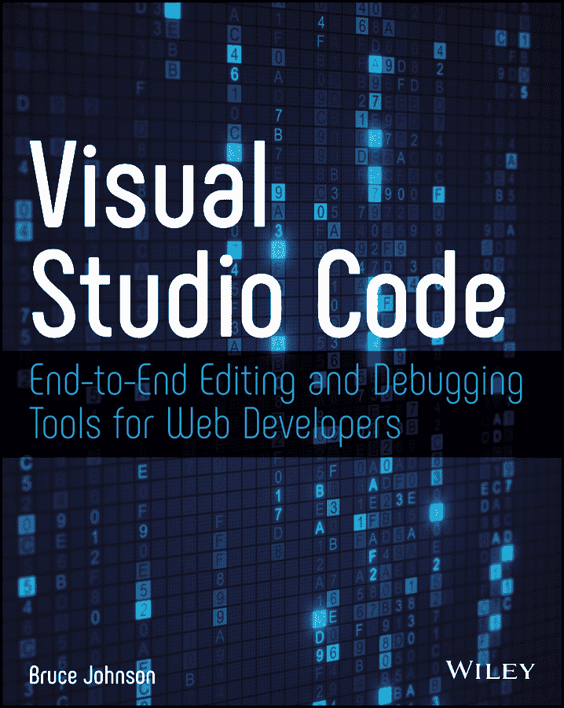


# 第 10 章

1. 图 10-1
2. 图 10-2
3. 图 10-3
4. 图 10-4
5. 图 10-5
6. 图 10-6

## 指南

1. 封面
2. 目录
3. 开始阅读

## 页码

1. iii
2. xv
3. xvi
4. 1
5. 2
6. 3
7. 4
8. 5
9. 6
10. 7
11. 8
12. 9
13. 10
14. 11
15. 12
16. 13
17. 14
18. 15
19. 16
20. 17
21. 18
22. 19
23. 20
24. 21
25. 22
26. 23
27. 24
28. 25
29. 26
30. 27
31. 28
32. 29
33. 30
34. 31
35. 32
36. 33
37. 34
38. 35
39. 36
40. 37
41. 38
42. 39
43. 40
44. 41
45. 42
46. 43
47. 44
48. 45
49. 46
50. 47
51. 48
52. 49
53. 50
54. 51
55. 52
56. 53
57. 54
58. 55
59. 56
60. 57
61. 58
62. 59
63. 60
64. 61
65. 62
66. 63
67. 64
68. 65
69. 66
70. 67
71. 68
72. 69
73. 70
74. 71
75. 72
76. 73
77. 74
78. 75
79. 76
80. 77
81. 78
82. 79
83. 80
84. 81
85. 82
86. 83
87. 84
88. 85
89. 86
90. 87
91. 88
92. 89
93. 90
94. 91
95. 92
96. 93
97. 94
98. 95
99. 96
100. 97
101. 98
102. 99
103. 100
104. 101
105. 102
106. 103
107. 104
108. 105
109. 106
110. 107
111. 108
112. 109
113. 110
114. 111
115. 112
116. 113
117. 114
118. 115
119. 116
120. 117
121. 118
122. 119
123. 120
124. 121
125. 122
126. 123
127. 124
128. 125
129. 126
130. 127
131. 128
132. 129
133. 130
134. 131
135. 132
136. 133
137. 134
138. 135
139. 136
140. 137
141. 138
142. 139
143. 140
144. 141
145. 142
146. 143
147. 144
148. 145
149. 146
150. 147
151. 148
152. 149
153. 150
154. 151
155. 152
156. 153
157. 154
158. 155
159. 156
160. 157
161. 158
162. 159
163. 160
164. 161
165. 162
166. 163
167. 164
168. 165
169. 166
170. 167
171. 168
172. 169
173. 170
174. 171
175. 172
176. 173
177. 174
178. 175
179. 176
180. 177
181. 178
182. 179
183. 180
184. 181
185. 182
186. 183
187. 184
188. 185
189. 186
190. 187
191. 188
192. 189
193. 190
194. 191
195. 192
196. 193
197. 194
198. 195
199. 196
200. 197
201. 198
202. 199
203. 200


# 第 3 章:文件、文件夹与项目]（Oh My）考虑了网络项目的流式结构。Visual Studio Code 允许开发者根据需要选择结构。本章将介绍 Visual Studio Code 支持最常见结构的不同方式。

# 第 4 章:使用你喜欢的语言编辑代码]讨论了 Visual Studio Code 编辑器。编辑器是开发者体验的核心，可能是书中最重要的章节。它章内容涵盖了语法高亮、`IntelliSense`、重构和代码导航。

# 第 5 章:与源码控制集成]涵盖了 Visual Studio Code 为源码控制提供的支持，包括开箱即用的 `Git` 集成，以及针对其他源码控制提供者的第三方扩展。在本章中，我们将查看如何在 Visual Studio Code 内部执行常见的 `Git` 函数（提交、检出、分支和合并）。

# 第 6 章:调试代码]查看了 Visual Studio Code 对 `.NET` 开发者熟悉的许多调试功能提供的支持。本章涵盖了如何在 `.NET Core` 和 `Node.js` 中调试你的代码。

# 第 7 章:外部工具与任务自动化]描述了 Visual Studio Code 与这些工具集成的强大能力，并提供了一个与工具相关的任务自动化的环境。

# 第 8 章:单元测试]研究了 Visual Studio Code 为编写代码的单元测试提供的支持。本章涵盖了 JavaScript 和 Python 中的单元测试功能。

# 第 9 章:使用扩展]查看了作为 Visual Studio Code 一大组成部分的扩展性。市场中提供了许多可用扩展，从额外的语言支持到提供极其有用功能的工具等。本章涵盖了安装和配置扩展的可用选项，并描述了添加了开发者梦寐以求的功能的扩展。

# 第 10 章:创建你自己的扩展]涵盖了开发者如何创建他们需要的任何额外工具。这包括对可能尚未包含的语言的支持，以及在市场中心中找不到的功能。本章查看了如何扩展 Visual Studio Code 以提供开发者所需的函数。

## 谁应该读这本书

本书的目标是为现有的网络开发者提供所需的信息，使其能够使用 Visual Studio Code 进行全栈开发。尽管示例使用 JavaScript 编写，但在开发网络应用程序使用的语言上保持中立，尽管偶尔会包含 `C#` 和 `Python` 代码段。

我在这里对读者做出某些假设：

*   你熟悉网络技术。
*   你对编辑和运行网络应用程序代码有基础了解。
*   你了解源码控制提供者的某些概念，例如 `Git`。

通常情况下，我预计本书的大多数读者是那些对听过的 Visual Studio Code 感兴趣的现有开发者。对于这个群体，本书的目的是为使用该工具完成他们的开发任务提供基础。然而，这并不是忽视现有的 Visual Studio Code 用户。对于他们来说，本书的目标是扩展他们对工具工作原理以及可用扩展的知识。无论读者属于哪一类，很多信息都将立即有用，并最终是无价的。

## 如何联系作者

我们欢迎你的评论和问题！如果你认为在书中发现了错误，请通过 `errata@wiley.com` 告诉我们。你可以从 [`www.wiley.com/go/visualstudiocode`](http://www.wiley.com/go/visualstudiocode) 下载随每一章提供的配套文件，对于你对该项目的任何反馈，你可以通过任何这些方式联系我：

`@LACanuck`

`bjohnson@objectsharp.com`

# 1：介绍 Visual Studio Code

### 本章内容？

*   安装并开始使用 Visual Studio Code
*   了解构成 Visual Studio Code 的跨平台组件

## 入门

任何开发者对所用编辑器的选择都是极其个人化的。选择一个而不是其他的原因取决于通常与他们日常执行的任务相关的属性集合。开发者寻找功能性、按键快捷键、代码片段、颜色高亮等可以让他们保持高效生产率的特性。

要让开发者离开他们的选择并不是容易的。编辑器的任何变化都会导致生产力的立即流失。毕竟，需要时间来熟悉提供的功能，并使其成为编码“心流”的自然部分。因此，开发者要切换编辑器，需要达到一种特殊的“更好”水平。

出于这个原因，Visual Studio Code 的成功充分说明了它的特性和功能性。尽管它正式发布仅仅三年（它于 2016 年 4 月结束公共预览），但它已迅速成为最受欢迎的编辑器之一，与 `Sublime Text`、`Atom` 和 `UltraEdit` 竞争领先地位。

但这对你，一个读者来说并不重要。你更关心的是 Visual Studio Code 能做什么帮助你提高生产率。作为一个开发者，经常是小事会产生最大的差异——知道如何通过单次按键添加代码，能够在你的 `Node.js` 项目上进行客户端和服务器调试，或者进行语言敏感的代码补全。这些中的任何、全部或都不都可能重要，但本书的目标是帮助你找到那些让你兴奋使用 Visual Studio Code 的核心功能。

### 安装 Visual Studio Code

Visual Studio Code 是一个跨平台编辑器。在此处，跨平台意味着适用于 Windows (7、8 和 10)、macOS 和 Linux。安装过程在每种情况下都相似，起点相同：[`https://code.visualstudio.com/Download`](https://code.visualstudio.com/Download)。图 1-1 (#c01.xhtml_c01-0001) 显示了下载页的样子，但它自然会发生变化。

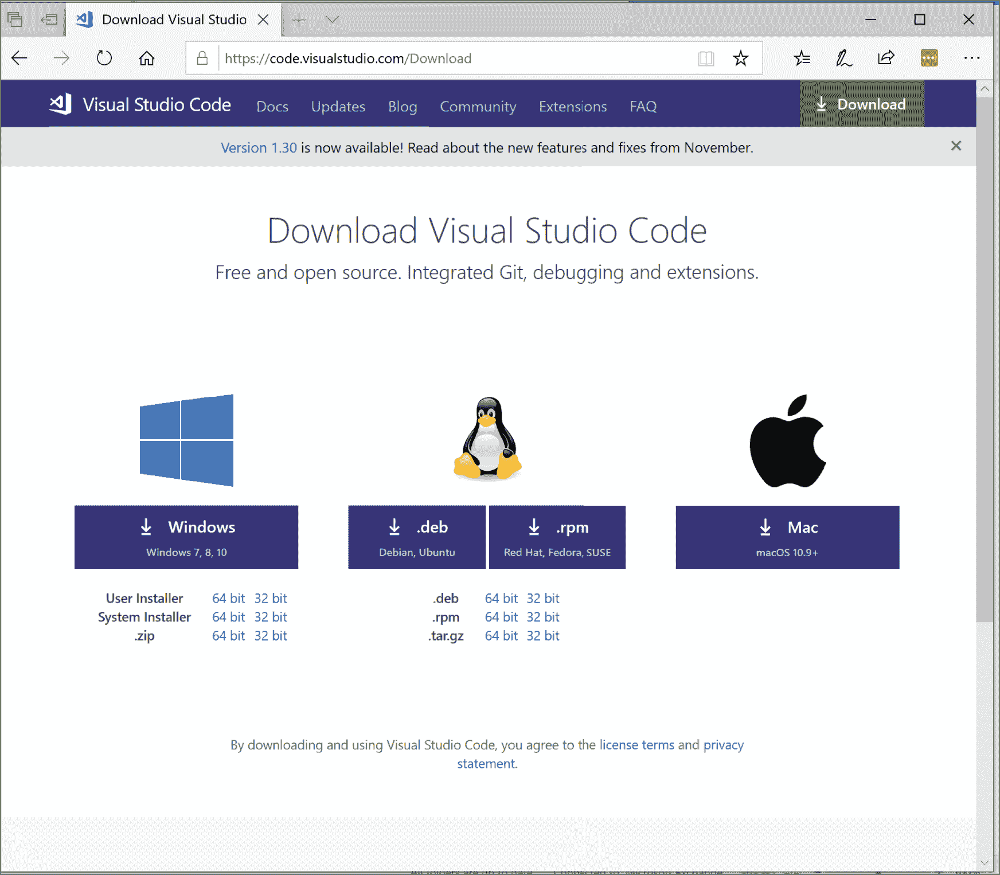

**图 1-1** (#c01.xhtml_R_c01-0001)

#### Windows

Windows 安装最有效的起点是下载所需的安装程序。你有六种可能的选择——三种不同的安装程序，每种程序都提供 32 位和 64 位格式，分为两个独立的属性。首先，你可以从三种安装程序类型中选择：系统、用户和 Zip：

*   *System Installer*——这是 Visual Studio Code 的原始安装程序。它需要本地管理员权限，并将执行文件和支持文件放在 `Program Files` 目录中。
*   *User Installer*——Visual Studio Code 最近新增的安装程序，执行不需要管理员权限。文件没有放在 Program Files 结构中，而是用户目录下的 `AppData\Local\Programs`。由于这是首选安装程序，它会询问你是否要卸载任何使用系统安装程序的版本。

    当使用这两种安装程序之一安装 Visual Studio Code 时，当更新可用时你会自动收到通知。Visual Studio Code 的变化速度意味着大约每月更新一次。


- `Zip`—`Zip` 选项只是一个 ZIP 压缩文件，其中包含了用户安装程序放置在 `AppData\Local\Programs` 中的内容。一旦你打开了该文件，就可以将内容复制到你喜欢的任何位置。但是，你需要负责为你想要放置在桌面或任务栏上的任何可执行文件（称为 `code.exe`）创建快捷方式。此外，你不会自动接收更新。如果你想使用较新的版本，则需要下载新的 ZIP 文件并再次复制文件。

安装程序提供的另一个可用属性的值为 32 位或 64 位。这指的是你设备上的 CPU 所支持的数据单元宽度。如果你运行的是 32 位的 Windows，请选择所选安装程序的 32 位版本。如果你运行的是 64 位的 Windows，可以选择 32 位或 64 位版本。

对于系统安装程序和用户安装程序，运行安装程序都会提供相似的体验。以下屏幕构成了安装过程：

- **欢迎屏幕（Welcome Screen）**——描述了你即将要的操作（即安装 Visual Studio Code）。描述说明了你正在使用用户安装程序还是系统安装程序。

- **许可协议（License Agreement）**——展示 Visual Studio Code 的许可协议。你必须在安装软件之前接受该协议。

- **选择目标位置（Select Destination Location）**——在此屏幕（见图 1-2）中，你选择安装 Visual Studio Code 的目录。用户版和系统的默认值不同。对于用户安装，它被放置在 `C:\Users\<your username>\AppData\Local\Programs\Microsoft VS Code`。对于系统安装，它被放置在 `C:\Program Files (386)\Microsoft VS Code`。如果你运行 32 位操作系统，目录中的 (386) 部分将省略。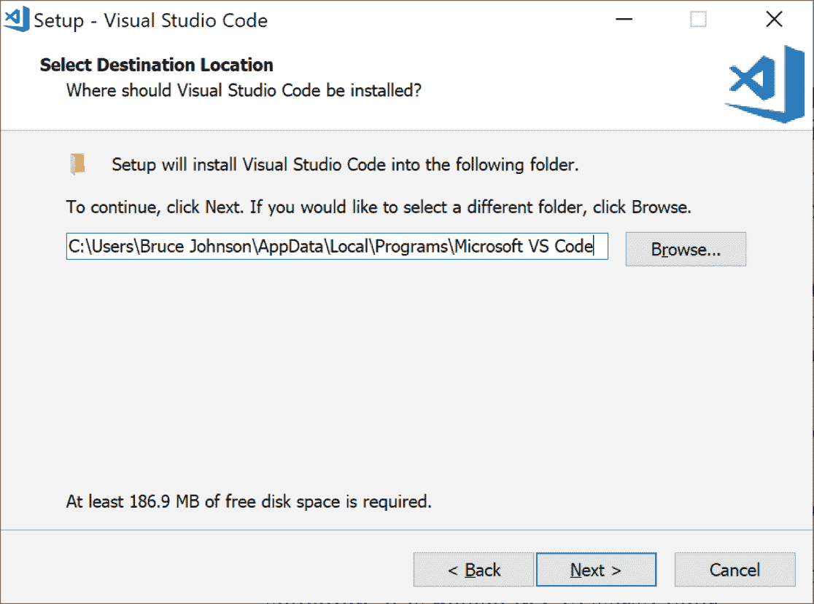

    图 1-2

- **选择开始菜单文件夹（Select Start Menu Folder）**——一旦你指定了 Visual Studio Code 的安装位置，就可以确定应用程序快捷方式在开始菜单中的放置位置。执行此操作的对话框如图 1-3 所示。默认文件夹是 Visual Studio Code，但你可以提供另一个名称，在现有的开始菜单文件夹中浏览，或者根据喜好创建一个新的。如果你不想添加任何开始菜单项，请勾选对话框左下角的“不创建开始菜单文件夹”复选框。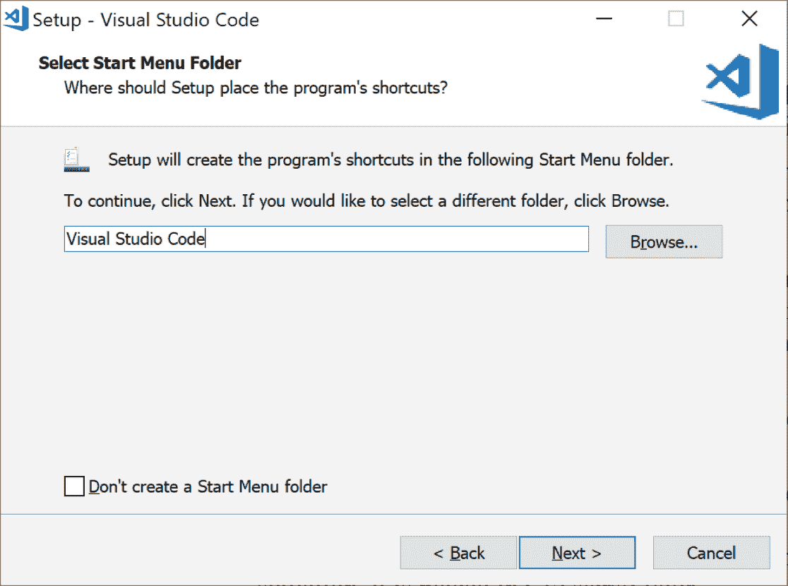

    图 1-3

- **选择其他任务（Select Additional Tasks）**——安装过程中可以执行若干额外任务。在图 1-4 所示的对话框中，提供的选项包括：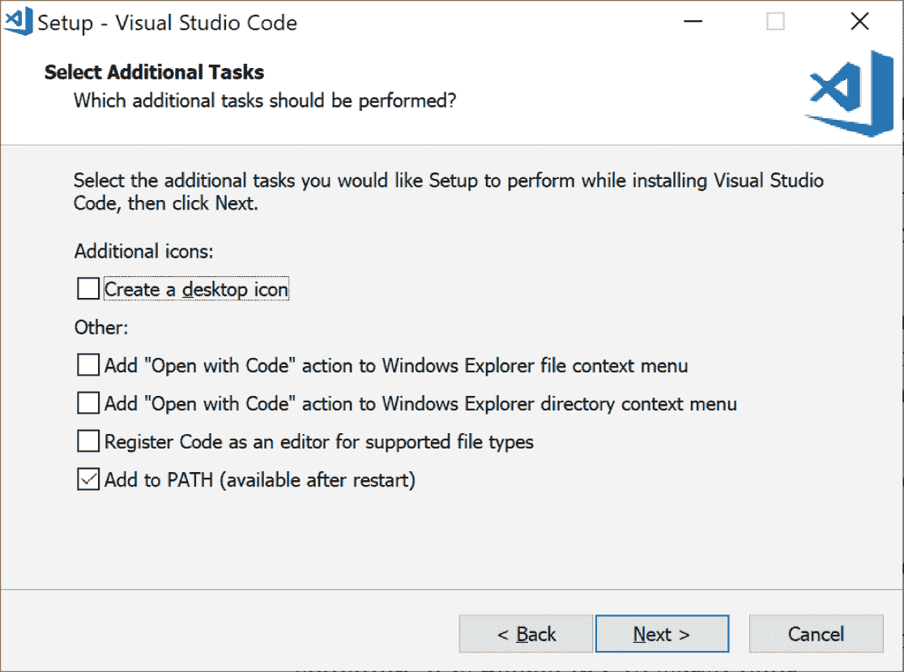

    图 1-4

    - 创建启动 Visual Studio Code 的桌面图标。
    - 为 Windows 资源管理器文件和目录的右键菜单添加“用 Code 打开”选项。
    - 将 Visual Studio Code 注册为任何支持的文件类型的编辑器。这会导致 Visual Studio Code 出现在 Windows 资源管理器右键菜单的“打开方式”选项列表中。
    - 将 Visual Studio Code 的安装目录添加到 `PATH` 环境变量中。这允许从命令行工具内部调用 Visual Studio Code 命令。请记住，对 `PATH` 的任何更改都需要重启电脑才能生效。

- **准备好安装（Ready To Install）**——安装过程的最后一步，如图 1-5 所示，是对你在其他屏幕上所选选项的总结。如果你点击“安装”，安装将开始。

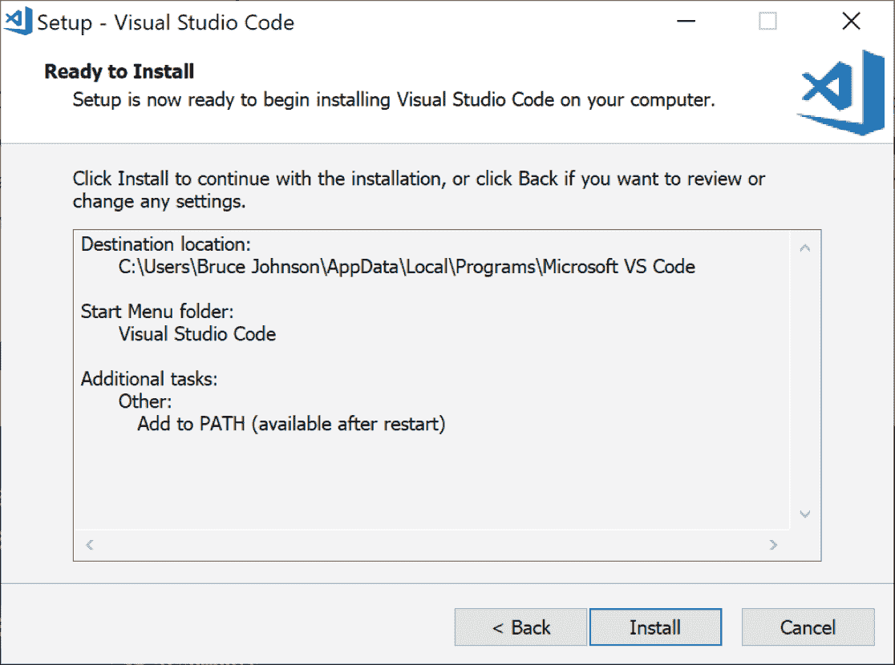

    图 1-5

#### Linux

无论你使用哪种发行版，在 Linux 上安装 Visual Studio Code 涉及的基本步骤都是相同的：

1. 下载相应的软件包。
2. 使用适用于你发行版的工具对其进行安装。

然而，这些步骤中的具体细节取决于你的发行版。后续章节描述了针对多个不同发行版的精确说明。

本节中的所有插图都是从 Ubuntu 内部截取的，因此你可能在自己的环境中看到略有不同的内容。此外，请注意，你需要在 Linux 环境中安装桌面才能运行 Visual Studio Code。

### Ubuntu 和 Debian 发行版

Ubuntu 或 Debian 的安装流程与 Windows 或 macOS 非常相似：

1. 打开你喜爱的浏览器并导航到 [`https://code.visualstudio.com/download`](https://code.visualstudio.com/download)。图 1-6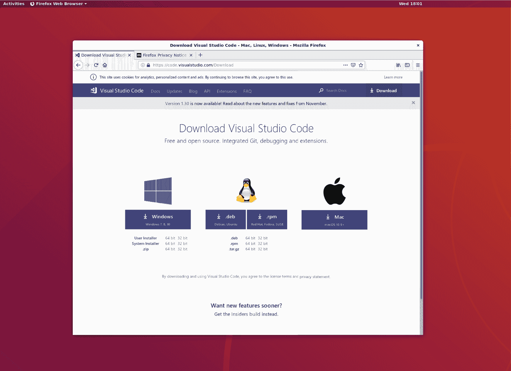

    图 1-6

2. 识别并下载所需的软件包。提供 64 位和 32 位的 Visual Studio Code 版本，以及 gzip 格式。对话框如图 1-7 所示。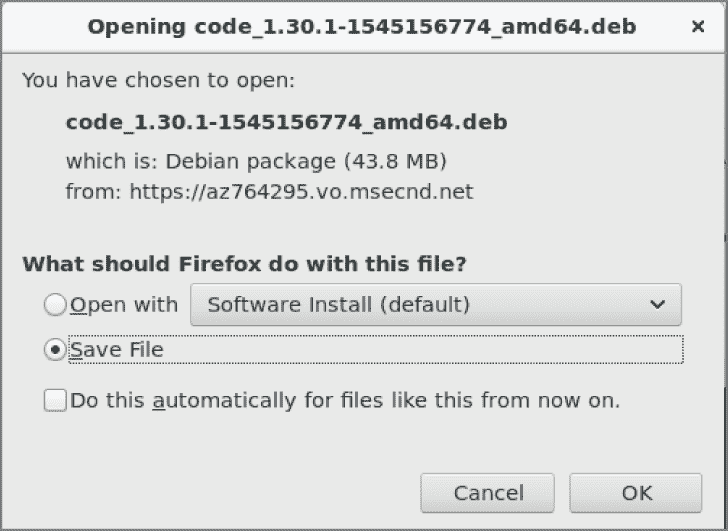

    图 1-7

3. 文件下载完成后，打开终端窗口。切换到下载文件所在的目录。

```bash
cd ~/Downloads
```

4. 使用 `apt` 工具安装：

```bash
sudo apt install ./file>.deb
```

此时，Visual Studio Code 已经准备就绪。在终端中执行 `code` 以启动应用程序（见图 1-8）。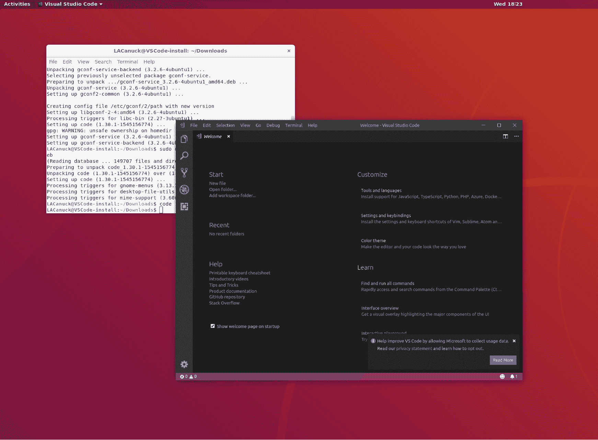

    图 1-8

### CentOS, Fedora 和 RHEL 发行版

获取 Visual Studio Code 安装文件的另一种方法是通过 YUM 仓库。微软维护着包含最新稳定版 64 位版本的 YUM 仓库。

要安装密钥和仓库，请在你的 Linux 上执行以下命令：

```bash
sudo rpm --import https://packages.microsoft.com/keys/microsoft.asc
sudo sh -c 'echo -e "[code]\nname=Visual Studio Code\nbaseurl=https://packages.microsoft.com/yumrepos/vscode\nenabled=1\ngpgcheck=1\ngpgkey=https://packages.microsoft.com/keys/microsoft.asc" > /etc/yum.repos.d/vscode.repo'
```

第一条命令将密钥导入仓库。第二条命令将微软仓库作为识别的 YUM 仓库添加。这是通过创建一个文件（名为 `vscode.repo`）并将其放在 `/etc/yum.repos.d` 目录实现的。

完成后，你可以通过执行以下命令更新 YUM 包缓存：

```bash
yum check-update
```

现在你准备好安装 Visual Studio Code 了。`yum install` 命令启动安装：

```bash
sudo yum install code
```

### OpenSUSE 和 SLE 发行版

对于这些发行版，YUM 仓库是获取 Visual Studio Code 的最佳选择。不同的是需要执行的命令。


```
sudo rpm --import https://packages.microsoft.com/keys/microsoft.asc
sudo sh -c 'echo -e "[code]\nname=Visual Studio
Code\nbaseurl=https://packages.microsoft.com/yumrepos/vscode\nenabled=1\ntype=r
pm‐md\ngpgcheck=1\ngpgkey=https://packages.microsoft.com/keys/microsoft.asc" >
/etc/zypp/repos.d/vscode.repo'
```

接下来的两个命令将更新包缓存并安装 Visual Studio Code：

```
sudo zypper refresh
sudo zypper install code
```

### Nix 包管理器

Linux 世界中偶尔会出现的另一个包管理器是 `Nix`。虽然微软没有维护 `Nix` 软件包，但社区管理的版本可以在 [`https://github.com/NixOS/nixpkgs/blob/master/pkgs/applications/editors/vscode/vscode.nix`](https://github.com/NixOS/nixpkgs/blob/master/pkgs/applications/editors/vscode/vscode.nix) 找到。

使用 `Nix` 安装 Visual Studio Code，请在你的 `config.nix` 文件中将 `allowUnfree` 选项设置为 true。然后执行以下命令：

```
nix-env -i vscode
```

#### macOS

在 macOS 上安装 Visual Studio Code 的起点与 Windows 类似，都是 Visual Studio Code 下载页面（位于 [`https://code.visualstudio.com/Download`](https://code.visualstudio.com/Download) 并在 图 1-9 中在 Safari 中显示）。

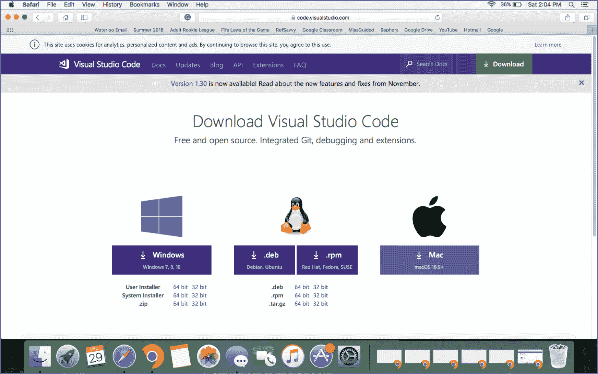

**图 1-9**

点击右侧的 Mac 选项开始下载。下载完成后，打开浏览器的下载部分并打开下载的文件。你将看到一个警告消息，指示你正尝试打开的文件来自互联网（图 1-10）。

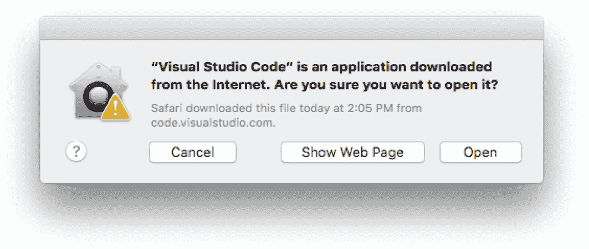

**图 1-10**

点击“打开”按钮展开下载的文件。由于下载的是 ZIP 文件，这意味着内容将变得可见。将 Visual Studio `Code.app` 文件拖到 `Applications` 文件夹中。这将使得 Visual Studio Code 出现在启动台中（Launchpad）中。

如果你想将 Visual Studio Code 添加到坞（Dock）中，右键点击图标并选择选项 ➣ 保留在程序坞中（图 1-11）。


**图 1-11**

### 跨平台工作原理

虽然使用 Visual Studio Code 并非必须理解，但了解使其能够在其支持的各个不同平台上运行的原理是有帮助的。如果你考虑过为 Visual Studio Code 编写扩展，这一点尤为重要，该主题在第 10 章“创建你自己的扩展”中有所介绍。

首先，Visual Studio Code 是一个开源项目。这意味着源代码供任何人查看。如果你有兴趣，甚至可以对其做出贡献。你可以在 [`https://github.com/Microsoft/vscode`](https://github.com/Microsoft/vscode) 找到源代码。

Visual Studio Code 基于一个名为 `Electron` 的框架。`Electron` 的设计目的是允许使用 Web 应用程序的前后后端组件创建桌面应用程序。在前端部分，使用 `JavaScript`、`HTML` 和 `CSS` 来创建用户界面功能。该界面使用 `Chromium` 进行渲染。

在后端，使用 `Node.js` 来提供用户界面组件并提供任何额外功能。这些技术的结合使其能够在三个主要的桌面平台：Windows、macOS 和 Linux 上运行。

`Electron` 最初由 GitHub 创建，表面上其主要目的是支持 `Atom` 文本编辑器。但它的用途并不止于此。它目前被用于广泛的应用程序，从集成开发环境（IDE）到音乐播放器再到游戏。

尽管 `Electron` 是 `Atom` 构建的基础，但 Visual Studio Code 并没有使用 `Atom` 作为它的编辑器。相反，它使用了与 `Azure DevOps`（以前名为 Visual Studio Team Services，再名为 Visual Studio Online）相同的文本编辑器。该编辑器被称为 `Monaco`。它也是开源的，并独立于 Visual Studio Code 提供（你可以在 [`https://microsoft.github.io/monaco-editor`](https://microsoft.github.io/monaco-editor) 找到仓库）。

其他常用功能通过许多其他通道实现。例如，颜色化是通过 `Monarch` 提供的，该库允许你使用声明式语法指定语法高亮器。更好的是，语法是使用 `JSON` 表示的，大多数 Web 开发者可能对此非常熟悉。

另一个例子是，特定语言的功能（如自动补全、格式化和诊断）是在独立的语言服务器中实现的。该服务器运行在与 Visual Studio Code 独立的进程中。

## 总结

你已经了解了如何在不同的操作系统上安装 Visual Studio Code。一旦应用程序准备就绪，用户体验是非常一致的。在随后的章节中，你将学习如何自定义 IDE 以更符合你自己的风格。

# 2 探索用户界面

### 本章内容

*   探索 Visual Studio Code 的不同区域
*   理解可用的不同窗口

在任何开发工具中保持极高效率的关键在于对用户界面非常熟悉，原因很简单，因为基础用户界面将是你花费绝大多数时间的环境。是的，快速快捷键绑定是有用的，可用的自定义设置和扩展也是如此。但要在 Visual Studio Code 中真正实现高效，你需要了解用户界面的基本元素以及它们是如何运作的。

图 2-1 显示了打开了简单 React 应用的 Visual Studio Code。

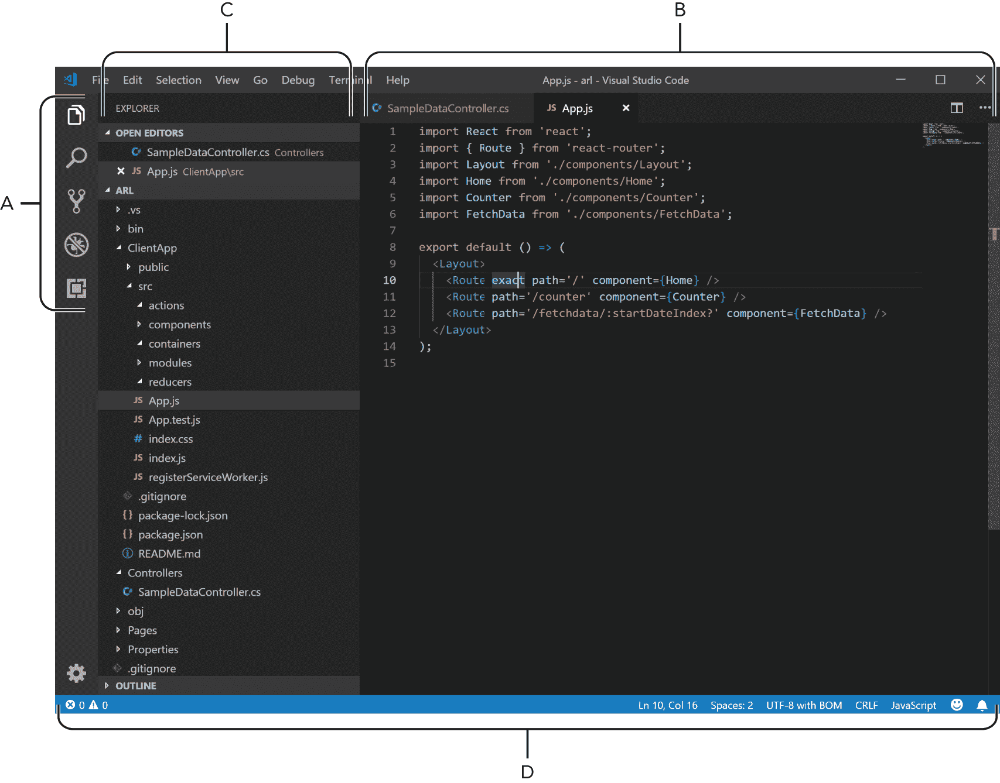

**图 2-1**

基础用户界面由四个主要区域组成，每个区域在图 2-1](#c02.xhtml_c02-fig-0001)中用不同的字母标记：

*   活动栏（Activity Bar，标记为“A”）——位于屏幕左侧，活动栏提供了切换不同视图的机制。
*   编辑器（Editors，标记为“B”）——此区域包含 Visual Studio Code 打开的不同编辑器。每个标签代表一个不同的文件，但可以同时处理多个文件，使用并排视图或上下视图。
*   侧边栏（Side Bar，标记为“C”）——包含工作区的不同视图，如所示的资源管理器（Explorer）。它也是处理源代码控制、调试应用程序以及与已安装扩展交互的启动点。
*   状态栏（Status Bar，标记为“D”）——显示当前活动工作区和正在编辑的文件的信息。

## 编辑器

由于 Visual Studio Code 核心是一个文本编辑器（即使考虑到它提供的额外功能），从该区域开始是合理的。


为不同的编辑器预留的区域占据了应用程序界面的大部分。它位于图 2-1 的右侧，顶部的尺寸用字母“B”标记。此空间是你打开的所有不同文件的编辑器出现出现的地方。

关于如何操作编辑器、如何布局不同的编辑器以适应你的需求，以及可提供的许多不同功能，都将在第 4 章“用你选择的语言编辑代码”中介绍。

## 活动栏 (ACTIVITY BAR)

Visual Studio Code 的左侧（默认情况下）是活动栏。它是图 2-1 中标记为“A”的区域，可以在图 2-2 中看到更详细的视图。

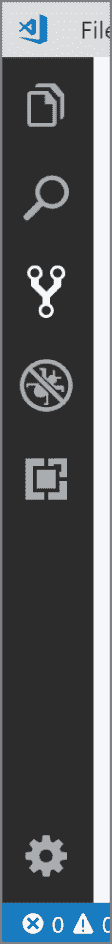

`图 2-2`

每个图标分别用于访问一个包含对编辑和开发过程有用信息的面板。共有六个图标。从顶部开始的前五个图标分别是资源管理器（Explorer）、搜索（Search）、源代码控制（Source Control）、调试（Debug）和扩展（Extensions）。底部是一个用于访问 Visual Studio Code 设置的图标。

这些不同的图标分别用于访问 Visual Studio Code 的部分，这些部分足够重要且功能齐全，值得单独用一个章节介绍。资源管理器和搜索将在第 3 章“文件、文件夹和项目（噢我的）”中介绍。源代码控制将在第 5 章“与源代码控制集成”中介绍。调试选项将在第 6 章“调试代码”中讨论，扩展的安装和使用将在第 9 章“使用扩展”中详细介绍。

设置图标是访问 Visual Studio Code 设置的方法之一。点击该图标会显示上下文菜单，如图 2-3 所示。

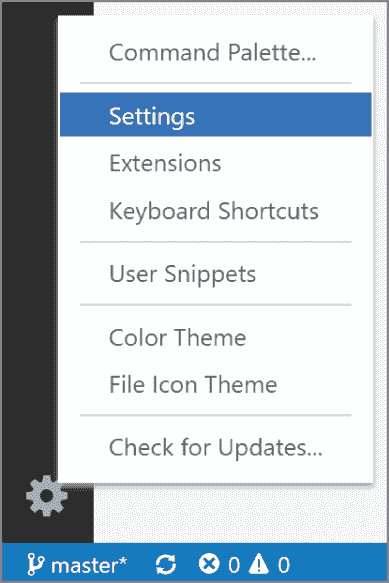

`图 2-3`

点击设置选项（在图 2-3 中突出显示）将打开设置编辑器（图 2-4）。

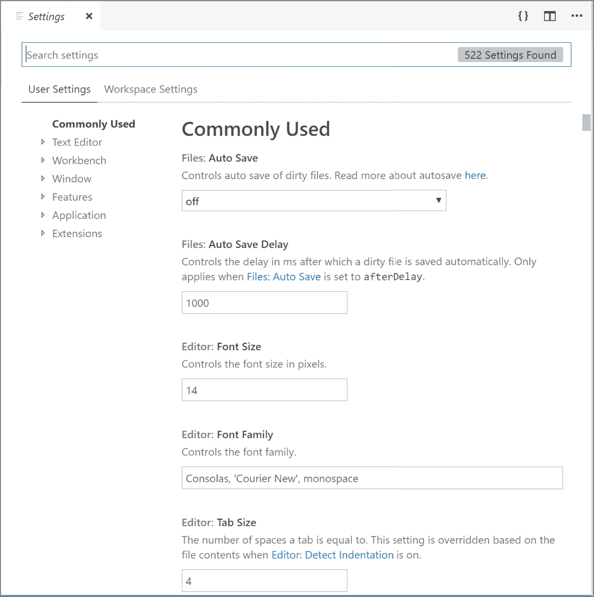

`图 2-4`

还可以通过文件 ➪ 偏好 ➪ 设置菜单项，或者使用命令面板（视图 ➪ 命令面板）并输入 `Preferences: Edit User Settings` 进入设置编辑器。

设置被划分为两个独立的块：用户设置（user settings）和工作区设置（workspace settings）。你可以在搜索设置文本框正下方看到这两个范围。可能的设置列表对于每个范围大多数情况下是相同的。区别在于设置的持久化位置，以及哪一个具有优先级。

用户设置应用于你打开的任何 Visual Studio Code 实例。用户设置的具体存储位置取决于你的平台。对于 Windows，文件位于 `%APPDATA%\Code\User\settings.json`。对于 macOS，位置是 `$HOME/Library/Application Support/Code/User/settings.json`。对于 Linux，设置位于 `$HOME/.config/Code/User/settings.json`。

工作区设置应用于正在打开特定工作区。这意味着设置（同样在 `settings.json` 文件中）存储在与工作区相同的文件夹中。这使得通过简单移动设置与其他文件文件夹，更容易在团队成员之间共享设置。

为了使两组设置的范围与这些定义一致，工作区设置中的任何配置值都将覆盖用户设置中的相同配置。

设置被分为若干不同的类别。这些类别出现在设置编辑器左侧的树形导航控件中。展开任何一个类别都会显示多个子类别。当选择某个类别或子类别时，该组的设置将显示在右侧。

此外，与许多树形导航不同，你可以使用右侧的滚动条在不同的设置组之间移动。当你向上向下滚动时，左侧的类别和子类别会发生变化，因此你实际上可以在不通过类别的情况下滚动所有设置项。

作为通过设置的最后一个导航功能，设置编辑器的顶部有一个搜索设置文本框。当你向文本框输入内容时，匹配你文本的设置将出现在编辑器的其余部分。参见图 2-5 关于在文本框中输入 `Exc` 的示例。

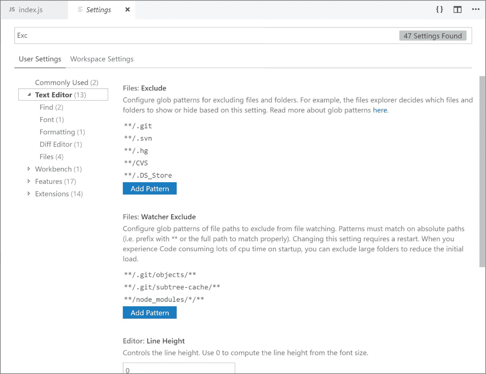

`图 2-5`

注意，不仅设置列表会根据过滤发生变化，左侧的内容也是。

### 手动编辑设置

Visual Studio Code 提供了两种编辑设置的方法。一种是通过上述描述的用户界面。但你也可以手动编辑设置，而且对于某些设置，手动编辑是唯一选择。

在设置面板的右上角有一对大括号（在图 2-4 中可见）。点击它们，将打开当前范围（用户或工作区）的 `settings.json` 文件。以下是该文件可能内容的示例：

```json{
    "workbench.colorTheme": "Default Light+",
    "workbench.sideBar.location": "left",
    "editor.lineNumbers": "off",
    "files.useFileWatcher": true,
    "workbench.useExperimentalGridLayout": true,
    "terminal.integrated.shell.windows": "C:\\Program Files\\Git\\bin\\bash.exe",
    "editor.autoIndent": false,
    "diffEditor.renderSideBy": true
}
```

每个设置都是一个 JSON 属性名结合一个值。值可以是字符串、布尔值、数字或另一个 JSON 对象。由于设置是由 Visual Studio Code 或扩展解释的，因此由格式者来确定正确的格式。

属性名是设置的全限定名称。通常，该名称采用 `target.setting` 的形式，其中 `target` 是将使用该设置的组件，`setting` 是设置的标识符。

`settings.json` 文件是一个文本文件，尽管它是以 JSON 格式的。这意味着你可以随心所欲编辑它。做出你想要的更改，保存文件，设置就会随之改变。如果你觉得这对你来说有些随意，请知道 IntelliSense 可以帮助你确保不会出现任何拼写错误。定义任何未使用的设置都不会导致 Visual Studio Code 崩溃。只要文件是有效的 JSON 格式，Visual Studio Code 就没有问题。


与你用过的几乎所有应用程序一样，Visual Studio Code 中的 `Status Bar`（状态栏）出现在应用程序底部，并横跨整个屏幕宽度。让这个 `Status Bar` 略有不同之处在于，它在提供状态信息的同时，还可以用于调整当前文件的设置，或与源控制进行交互。

`Status Bar`有两个端，每个端都有不同的重点。状态栏的左侧如图图 2-6 所示，显示的是源控制和整个项目的状态。


**图 2-6**

`Status Bar` 的左侧有四个组件。最左侧是当前分支名称。在图 2-6 中，项目位于 `master` 分支。分支名称右侧的星号表示当前分支已发生更改。

可以通过 `Status Bar` 启动切换分支的过程。点击当前分支，如图图 2-7 所示的文本框和下拉菜单将出现在 Visual Studio Code 界面的顶部。

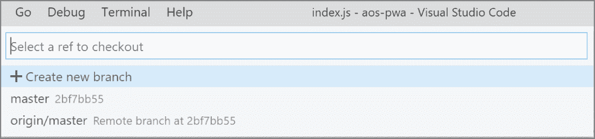

**图 2-7**

这里你有许多选项。你可以直接选择你想要切换的分支。点击分支会自动执行检出（checkout）。或者，你也可以在文本框中输入所需分支的名称。这将过滤列表中显示的分支列表。再次，选择一个即可启动检出过程。

最后，你可以点击 `Create New Branch` 链接创建一个新分支。会显示一个不同的文本框，提示你应该提供新分支的名称。输入新分支名称并按 `Enter` 即可创建分支。远程服务器上也会创建一个同名的分支。如果你想在任何时候终止创建，请使用 `Esc` 键退出此过程。

第二个图标（图 2-6 中的圆箭头）用于与 Git 仓库同步更改。该图标实际上会发生变化，表示点击图标时触发的操作。当它是圆箭头时，它用于同步当前分支与该分支关联远程仓库之间的更改。随着项目更改的产生，图标也会发生变化。有一个云朵/箭头图标，用于将更改发布到本地仓库。你可以在第 5 章中找到更多关于源控制交互的详细信息。

状态栏左侧的最后两个图标（该组右侧的图标）用于指示项目中发现的错误和警告。错误和警告的数量以数字显示在相应图标的右侧。当你点击任意一个图标，都会显示 `Problems`（问题）窗口。`Problems` 窗口在本章后的专门章节中描述。

`Status Bar` 右侧的图标组（如图图 2-8 所示）专注于与当前编辑器相关的信息和设置。


**图 2-8**

从左侧开始是光标当前位置，包括行和列。如果编辑器中有活动选择项，则显示字符数（即使跨行）。如果你点击此信息，Visual Studio Code 顶部会打开一个文本框（参见图 2-9），允许你输入行号并直接跳转到该行。`Ctrl+G` 可打开相同的文本框。

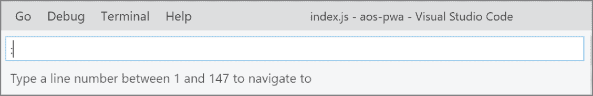

**图 2-9**

下一条信息与编辑器内的代码缩进有关。在图 2-8 中，每个缩进由四个空格组成。然而，你可以通过多种不同的方式对其进行更改和配置。点击该值会导致如图图 2-10 所示的面板出现在窗口顶部。

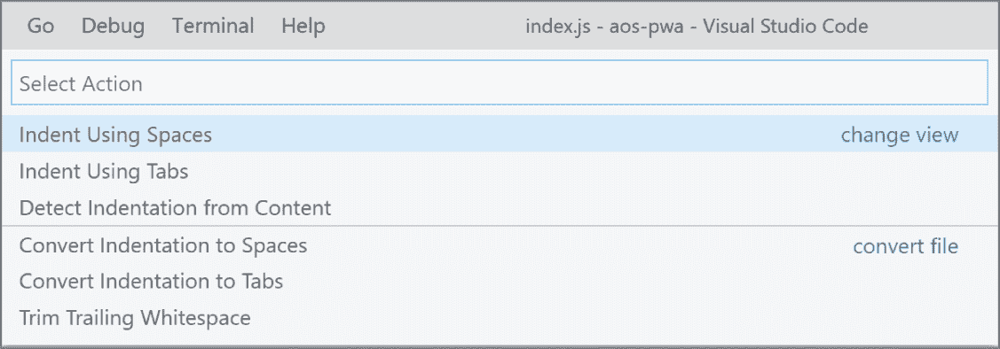

**图 2-10**


下一个选项是标记为“配置‘JavaScript’语言相关设置”的选项，用于自定义 Visual Studio Code 中处理 JavaScript 语言的方式。选择此选项会在新的编辑器中打开 Visual Studio Code 的设置文件。然后，你可以手动向此文件添加设置并保存，以使其生效。具体设置取决于所涉及的语言。

最后两个图标用于获取和发送关于 Visual Studio Code 的反馈。笑脸图标会打开一个窗口（见图 2-13），你可以用它来撰发布一条描述你想法的推文。

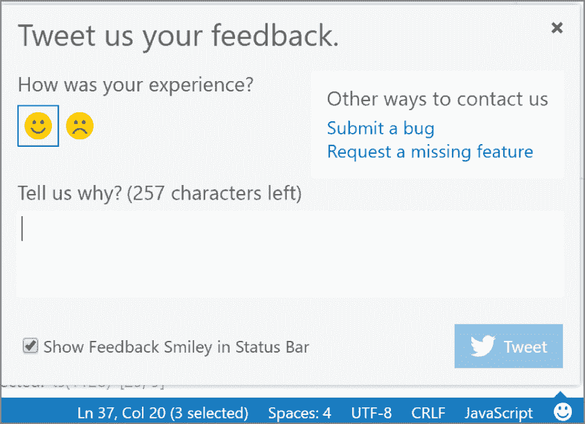

图 2-13

虽然发送推文很不错，但反馈面板还包含几个链接，用于向开发团队提供特定信息。`提交 Bug（Submit A Bug）`链接会触发图 2-14 所示的表单。

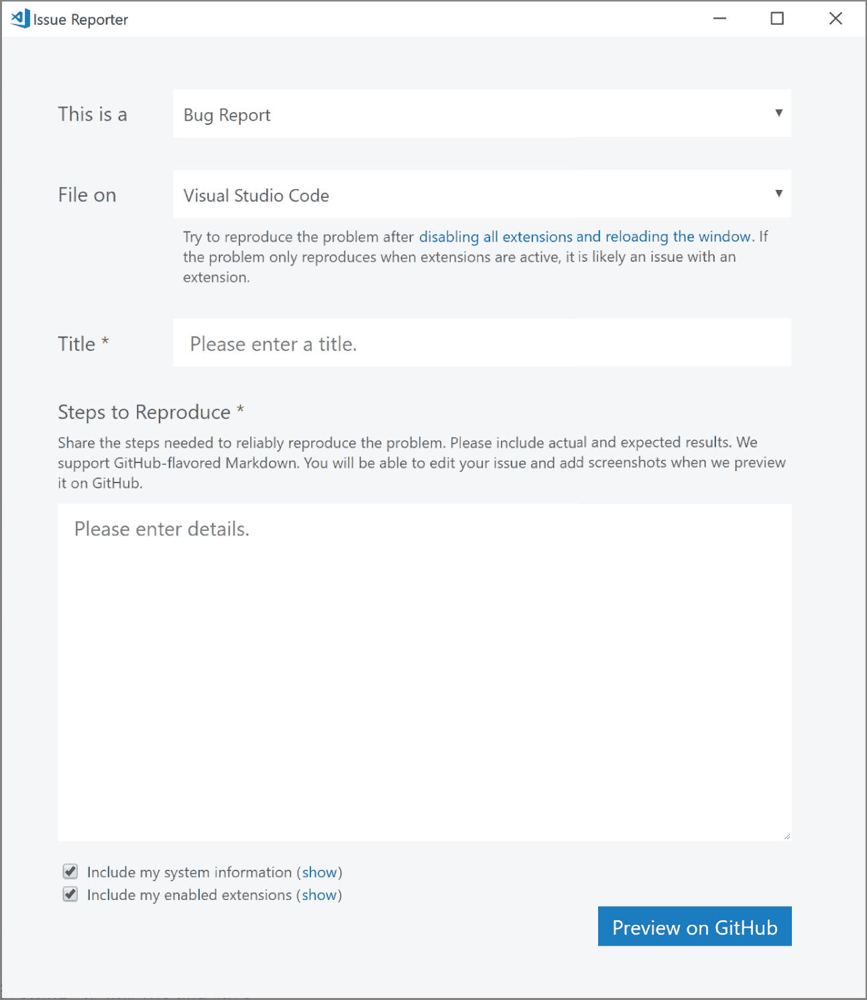

图 2-14

在这里，你可以选择反馈类型（bug、功能请求或性能问题）以及反馈目标（Visual Studio Code 本身或扩展）。此外，你会被要求提供一个标题和一组可以重现该 bug 或问题的步骤。一旦提供了信息，点击`在 GitHub 上预览（Preview On GitHub）`就会将这些信息传输到 GitHub。

你问为什么用 GitHub？因为 Visual Studio Code 是一个开源项目，源代码托管在 GitHub 上。因此，如果你批准，你的反馈将成为针对该项目提交的一个 issue（问题）。

图 2-8 最右侧的最后一个图标（铃铛）用于查看从 Visual Studio 内部发起的任何通知。这些不是与你正在工作的项目相关的通知，而是应用程序级别的通知，例如当有新版本可用时。点击该图标将显示列表，并允许你根据需要查看并响应这些通知。

## 其他窗口

到目前为止，我们查看了 Visual Studio Code 打开时的呈现界面。本节将讨论其他非常有用的窗口，它们只需几次击键或点击即可到达。

### 命令面板（Command Palette）

能够保持“心流”状态的关键之一是避免让手离开键盘。为了帮助你访问 Visual Studio Code 中提供的各种命令，你可以使用命令面板。图 2-15 显示了 IDE 顶部的命令面板。

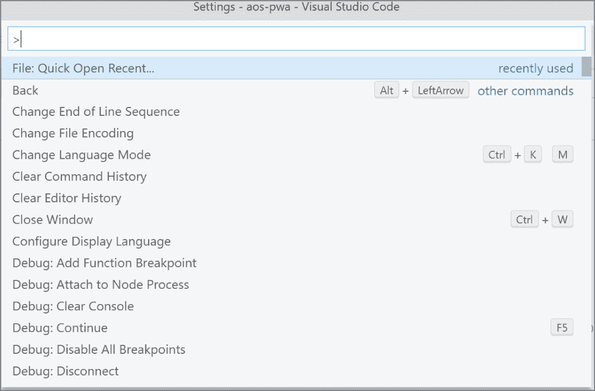

图 2-15

命令面板可以通过多种不同的快捷键组合激活。为了延续“心流”的主题，你可以使用 `Ctrl-Shift+P`（macOS 上为 `Cmd+Shift+P`）或 `F1` 来启动它。这些键盘快捷键是可配置的，以防你偏于不同的组合。第 4 章中的“键盘快捷键”部分描述了更改快捷键的过程。你也可以通过 `视图 ➪ 命令面板（View ➪ Command Palette）`菜单选项打开面板。

面板的目的是让你访问所有的 Visual Studio Code 命令。如图 2-15 所示，所有可用命令的列表可见。对于与键盘快捷键相关的命令，相应的快捷键显示在命令的右侧。

当你在顶部的文本框中输入时，命令列表会更改，以指示与内容匹配的内容。通过`工作区：键盘导航（Workbench: Keyboard Navigation）`设置，你可以控制匹配命令的显示方式。此设置实际上用于控制 Visual Studio Code 中所有列表和树的基于文本的搜索显示方式。有三个选项：

*   `简单（Simple）`——随着你的输入，列表中与累积按键匹配的项将获得焦点。匹配仅通过项目的开头进行。换句话说，按键‘work’会匹配‘workspace’，但不会匹配‘network’。

*   `高亮（Highlight）`——随着你的输入，列表中与累积按键匹配的项将被高亮。你可以通过使用滚动条上下移动列表来查看额外的匹配项。

*   `过滤（Filter）`——随着你的输入，所有与累积按键不匹配的元素将从列表中过滤掉。

列表最顶端是你最近使用的命令。这种设计理念是，随着时间的推移，你喜欢的命令将通过最少的按键次数触手可及。你可以通过`工作区：命令面板历史（Workbench: CommandPaletteHistory）`命令来控制保留的最近命令数量。该值只是一个数字，表示要持久化多少历史。命令历史跨越 Visual Studio Code 的多次执行周期。如果你不想保留任何命令，请将此值设置为 0。

### 终端窗口（Terminal Window）

对于许多不同的项目类型，能够从命令行执行命令对功能至关重要。终端窗口内置在 Visual Studio 中以帮助这一过程（见图 2-16）。你可以使用 `Ctrl+` `（反引号）、`视图 ➪ 终端（View ➪ Terminal）`菜单选项或命令面板中的`切换集成终端（View: Toggle Terminal）`命令来启动它。

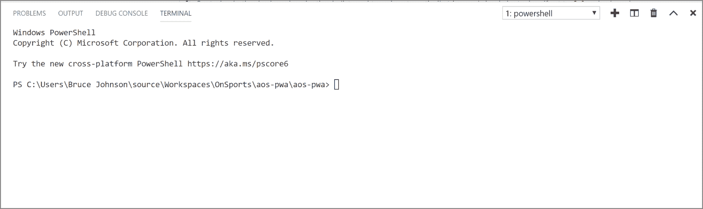

图 2-16

当终端窗口启动时，当前目录是你的文件夹。运行的实际 shell 取决平台。对于 macOS 和 Linux，默认是 `$SHELL`。对于 Windows 10，它是 PowerShell。对于早版本的 Windows，它是 `cmd.exe`。

但是，你可以随时通过设置更改启动的 shell。首先启动命令面板（`Ctrl+Shift+P`）。然后在文本框中输入 shell。选择`终端：选择默认 shell（Terminal: Select Default Shell）`会出现平台的 shell 列表（见图 2-17](#c02.xhtml_c02-fig-0017)）。选择你需要的 shell，这将成为下次打开终端时使用的 shell。

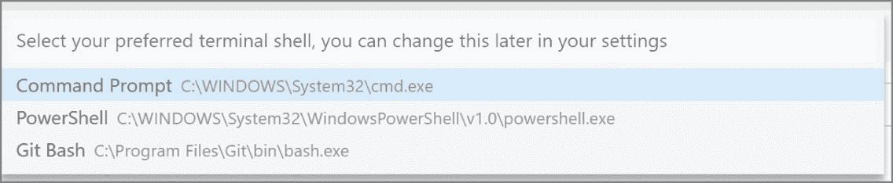

图 2-17

可以同时运行多个终端会话。在图 2-16 中，右上角有一个下拉列表。该列表包含你当前运行的不同 shell。紧右侧有一个加号图标。点击该图标即可启动另一个 shell（你指定的默认 shell）。你可以使用下拉列表在不同的 shell 之间切换。

如果你想并查看两个终端会话，点击加号右侧的双面板图标。这会创建一个另一个终端会话，但位于当前会话旁边（见图 2-18](#c02.xhtml_c02-fig-0018)）。

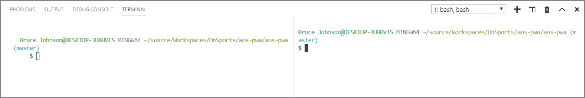

图 2-18

垃圾桶图标用于杀死当前终端会话。如果你杀死最后一个终端会话，终端标签将关闭。


可以使用许多设置来配置你的终端（Terminal）窗口。对于不同的平台，你可以配置将执行的 shell 路径（`Terminal` ➪ `Integrated` ➪ `Shell: Linux`、`Terminal` ➪ `Integrated` ➪ `Shell: Osx` 以及 `Terminal` ➪ `Integrated` ➪ `Shell: Windows`）。你可以指定执行 shell 时包含的参数（`Terminal` ➪ `Integrated` ➪ `Shell Args: Linux/Osx/Windows`），而且在最有用的设置中，你可以指定 shell 的初始工作目录（`Terminal` ➪ `Integrated: Cwd`）。如果你文件夹的根目录对于你想要执行的命令不方便，这个设置就会特别有用。

### 输出窗口 (Output Window)

来自 Visual Studio Code 各部分的消息都会定向到输出窗口（参见图 2-19）。你可以通过 `View` ➪ `Output` 菜单进入此窗口。

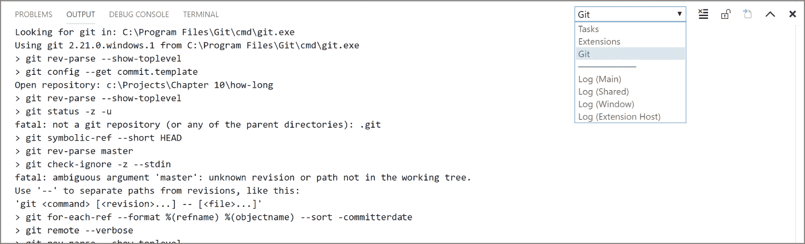

FIGURE 2-19

从功能上讲，输出窗口并不复杂。它的工作是显示从 Visual Studio Code 内部运行的不同进程的输出。在图 2-19 中，你可以看到窗口右上角有一个下拉菜单。它包含所有潜在输出源的列表。要查看某个源的输出，在该下拉菜单中选择它。在图 2-19 中，输出来自 Git。

该下拉菜单右侧有两个实用的图标。右侧的第一个图标（右上角带有 X 的线条）用于清除当前源的输出窗口。这让你能够关注对你来说重要的输出。

下一个图标（锁）如果选定的源频繁生成输出，则非常有用。每当源产生输出时，它都会被添加到屏幕底部。当输出过多时，会出现滚动条。这些都是很典型的行为。然而，如果你向上滚动输出以寻找某些内容，而源又生成了新行，文本会跳回到底部。如果你正在寻找那个关键消息，这可能会非常恼人。当你点击锁图标时，窗口将冻结在你当前的滚动位置。这意味着当新行被添加到底部时，你当前的滚动位置不会改变。输出将保持稳定，你可以更容易地找到那条重要消息。

第三个图标（带有箭头的文档）并不是所有源都启用的。事实上，它只有在选择一个日志源（在图 2-19 的下拉列表底部）时才会被启用。这些日志实际上是查看 Visual Studio Code 不同部分生成的日志文件的窗口。虽然它们在输出窗口中可见，但它们实际上是文件系统上的物理物理文件。点击该图标会在编辑器中打开该物理文件。

### 调试控制台 (Debug Console)

调试控制台（图 2-20）的功能与输出窗口非常相似。

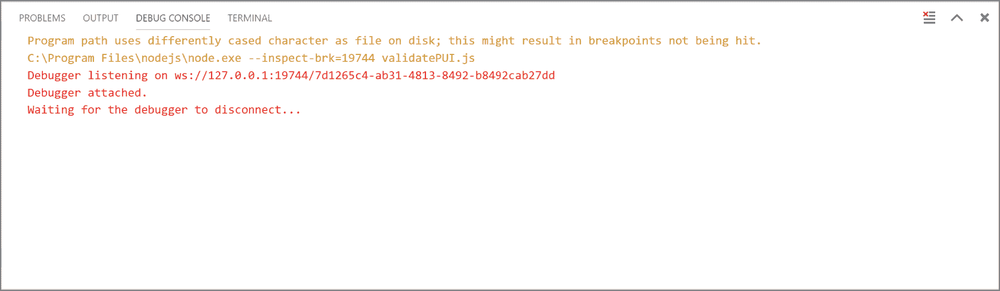

FIGURE 2-20

两者之间的区别在于，输出窗口是对不同源的视图，而调试控制台只有一个源：调试器。

此窗口的内容是在你调试应用程序时生成的。因此，调试器生成的所有消息都会发送到调试控制台。此外，如果你的应用程序将消息重定向到调试输出（例如在 JavaScript 中使用 `console.log` 方法），这些消息也会出现在调试控制台中。

在对内容的控制方面，窗口右上角有一个图标（带有 X 的线条），点击该图标可以清除窗口内容。

字体 问题窗口 (Problems Window)

问题窗口（图 2-21）列出了当前在项目中发现的所有错误和警告。

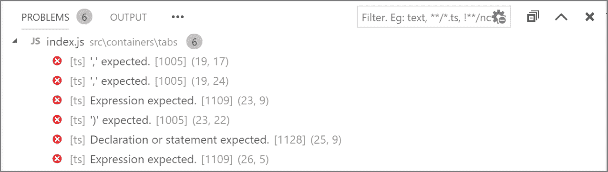

FIGURE 2-21

显示采用层级格式。在每个树形结构的顶部是发现错误或警告的文件。然后，在该节点下方是错误和警告列表，包括它们所在的行和字符位置。双击任何项目都将打开该文件的编辑器并将光标置于该行。

在图 2-21 的顶部栏右侧，还有其他一些控件，当你有大量的错误和警告需要筛选时，这些控件非常有用。首先是一个过滤文本框。输入某些文本，只有包含该文本的错误和警告会出现在窗口中。右侧还有一个齿轮按钮，它用于过滤哪些文件显示在结果中。例如，你可能不想搜索 `node_modules` 目录，因为它包含了第三方代码。通过 `Files: Exclude` 设置（参见下节），这些文件将不会出现在搜索结果中。这里是一些常见的 glob 示例：

* `**/.git`
* `**/node_modules/**`


# 理解构成 Visual Studio Code 的跨平台组件

你的项目是有结构的。这是肯定的。你可能并不总是对结构拥有完全的控制权，但它确实在那里，你必须与之配合。

在本章中，我们将介绍 Visual Studio Code 用于帮助你浏览文件和文件夹的视觉组件。这包括对资源管理器（Explorer）、搜索功能以及你如何根据喜好定制这些功能进行详细介绍。

## 资源管理器 (Explorer)

资源管理器的目的是让你通过树视图查看并导航，该视图包含了组成项目的文件和文件夹。它看起来与图 3-1 相似。

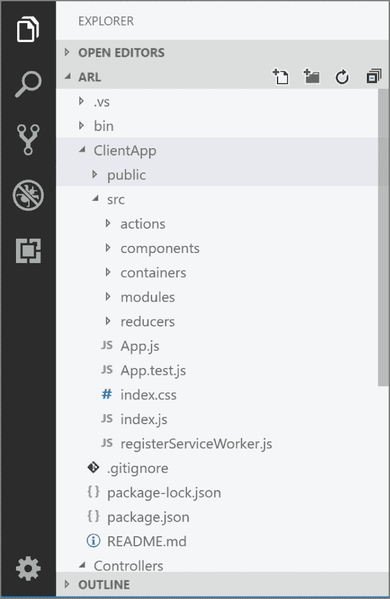

`图 3-1`

要显示资源管理器，你可以点击活动栏（图 3-1 的左侧）中的资源管理器图标，使用查看 ➪ 资源管理器菜单选项，或使用键盘快捷键（默认为 `Ctrl+Shift+E` 或 `Cmd+Shift+E`）。

资源管理器由三个部分组成。顶部是打开的编辑器和编辑器组列表。中间是你的项目文件和文件夹。底部显示当前活动编辑器的大纲（假设当前编辑器支持大纲概念）。可以通过在资源管理器顶部右键点击并勾选（或取消勾选）与部分相关的上下文菜单项来隐藏或显示这些部分。由于资源管理器的“打开的编辑器”和“大纲”部分都涉及文件编辑，因此在第 4 章“使用你选择的语言编辑代码”中进行了描述。

### 项目视图 (Project View)

资源管理器的中间部分（如图 3-2 所示）包含组成当前项目的文件和文件夹视图。在大多数情况下，项目视图中的功能模仿与其他编辑工具中的类似视图。文件夹以层级方式显示。点击文件夹将打开它，显示其中找到的文件。再次点击文件夹将关闭树节点，隐藏所有包含的文件。

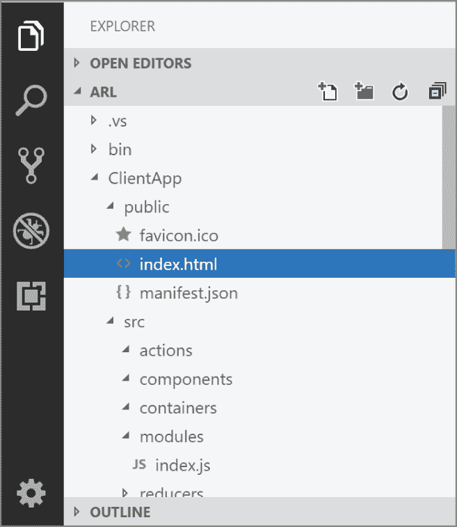

`图 3-2`

要预览文件，请点击它。将在当前活动编辑器组的标签页中打开文件。如果你点击第二个文件，它将替换相同标签页中的第一个文件。换句话说，一个标签用于预览任何文件。该标签可以像任何其他标签一样在编辑器组内重新定位。如果你对第一个文件进行了更改，点击第二个文件将创建一个不同的标签来用于预览文件。

项目视图区域还为文件和文件夹视图提供了许多常见和不寻常的功能。首先是常见功能：

*   你可以将文件从资源管理器（即你环境的文件系统资源管理器）拖入到**项目视图**中。
*   你可以从项目视图中选择一个或多个文件，并使用上下文菜单复制或删除它们。
*   你可以从项目视图中选择一个文件，并使用上下文菜单对其进行重命名。
*   你可以从项目视图中选择一个或多个文件，并将它们拖到项目视图中的另一个文件夹中。这有效地将文件从一个文件夹移动到另一个文件夹。

这些是几乎任何文件和文件夹视图中都可以预期的功能。Visual Studio Code 超出常见功能始于几个设置，这些设置可以修改其中某些功能的流，使它们更符合你的喜好。`Explorer: Enable Drag and Drop` 设置决定你是否可以通过拖放来移动文件或文件夹。`Explorer: Confirm Drag and Drop` 设置决定在移动文件或文件夹之前是否会提示你进行确认，而 `Explorer: Confirm Delete` 设置用于指定在删除选择项之前是否需要确认。

你可以从项目视图中选择一个或多个文件，并将它们拖到编辑器组上。它将在组中为这些文件添加编辑器标签页。如果任何文件已在组中，则该标签不会发生任何变化。

从图 3-3 所示的上下文菜单，你可以从以下选项中进行。

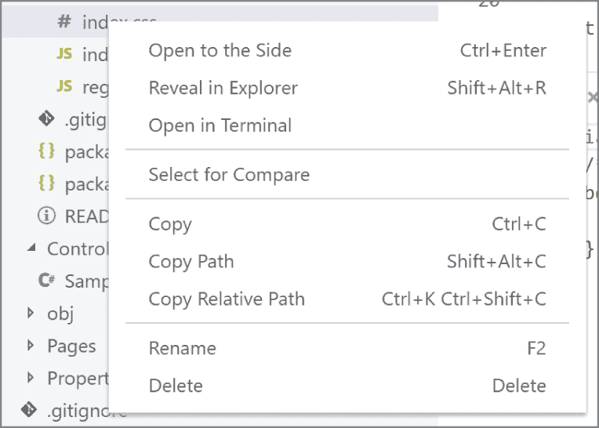

`图 3-3`

*   **侧向打开 (Open to the Side)**：选中一个或多个文件后，你可以将它们侧向打开。将在当前活动编辑器组的右侧创建一个新的编辑器组并将文件添加到该新组中。
*   **在资源管理器中显示 (Reveal in Explorer)**：选中一个或多个文件后，此选项将打开本地文件系统资源管理器并定位文件所在的目录。如果选中的文件位于多个目录，则会打开多个资源管理器实例，每个目录一个。
*   **在终端中打开 (Open In Terminal)**：选中一个或多个文件后，此选项将启动终端窗口，并将初始目录设置为上一个所选文件的目录。终端窗口在第 2 章“探索用户界面”部分中有详细介绍。


在你选择文件夹的位置处，会添加一个新项目，并显示一个文本框，你可以在其中输入新项目的名称（参见图 3-5）。你只需输入新项目的名称，包括文件扩展名。

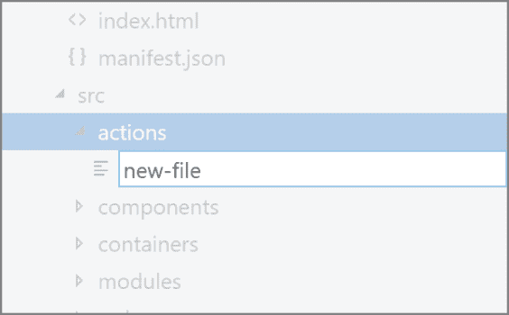

**图 3-5**

文件扩展名是必要的，因为在此过程的任何时候你都没有指定文件类型。没有向你列出可能的文件类型列表并让你选择其一的向导。是通过文件扩展名来确定文件类型，更重要的是，确定用于编辑该文件的编辑器。由于语法高亮和 IntelliSense（智能感知）等实用功能与文件编辑器绑定的，因此文件扩展名至关重要。

文件扩展名在影响文件编辑器的同时，还会触发 Visual Studio Code 的建议。在你添加新文件后，Visual Studio Code 会检查你是否安装了支持该文件类型的扩展。如果你没有安装，Visual Studio Code 将检查市场（Marketplace）中是否有可用的扩展。如果发现了一个（或多个），界面右下角会显示此类消息（参见图 3-6）。

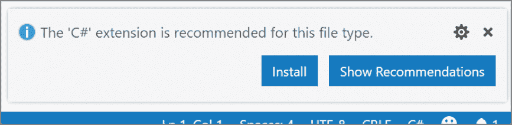

**图 3-6**

自然，你不需要安装扩展即可使用该文件。最常见的文件类型已经有了 Visual Studio Code 自带的编辑器。然而，扩展程序提供了许多实用功能，因此可能值得一看，特别是对于那些更冷门的文件类型。你可以在第 9 章“使用扩展程序”中找到关于如何使用扩展的更详细介绍。

除了右键菜单外，资源管理器（Explorer）在标题区域右侧也有一组图标（参见图 3-7）。这些图标仅在鼠标悬停在标题栏上时可见。

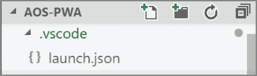

**图 3-7**

可见的四个图标提供了四个常用函数的快速访问。左侧的两个分别用于创建新文件夹和新文件。当你尝试在打开的文件夹的顶层创建文件或文件夹时，可以使用它们。第三个图标（带箭头的圆圈）根据文件夹中的当前文件刷新资源管理器。最后一个按钮（右侧）用于折叠资源管理器树中的所有节点。

说到出现在资源管理器中的文件和文件夹，有一个设置可以控制哪些文件可见。`Files: Exclude` 设置是一组 glob 模式。如果文件匹配其中一个模式，则它在资源管理器中将不可见。你可以在第 2 章的“问题窗口”部分找到 glob 模式的描述。

### 装饰

除了给人窗帘、百叶窗和小摆件的印象外，Visual Studio Code 资源管理器中的装饰还提供了实用的通知作用。当你编辑代码时，文件本身会进入不同的状态——它们可能包含错误，可能自上次提交以来发生了更改，或者可能未被跟踪。通过装饰，资源管理器可以通知开发者这些情况。

图 3-8 显示了右侧可见多个不同装饰的资源管理器。通常情况下，装饰有两种类型。圆圈位于文件夹层级，表示文件夹内部至少有一个你感兴趣的文件。圆圈的颜色表示问题的类型：浅红色表示错误，浅金色表示文件已修改，绿色表示当前未被源控制跟踪的文件。

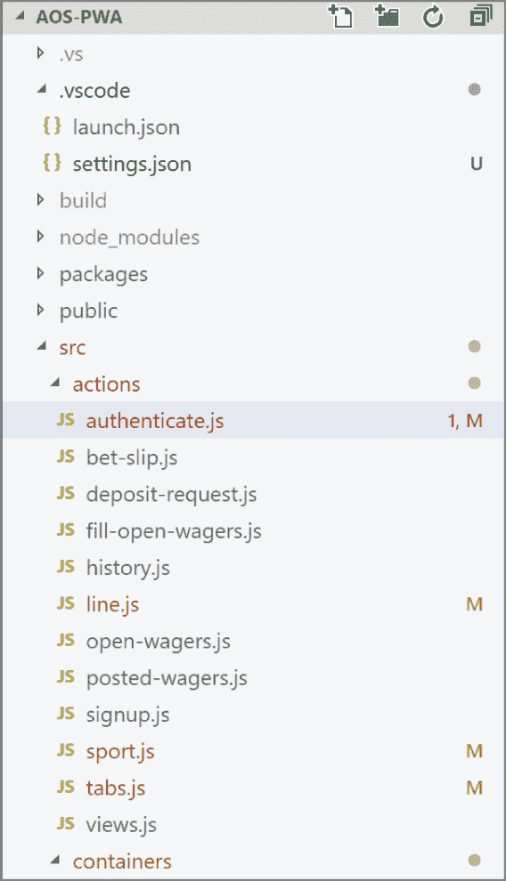

**图 3-8**

在图 3-8 中，`.vscode` 文件夹包含一个一个未被跟踪的文件。`src` 和 `actions` 文件夹都包含一个带有错误的文件，`containers` 文件夹包含已修改的文件。注意，`actions` 文件夹也包含已修改的文件，但圆圈的颜色是浅红色的。这是因为如果一个文件夹内有多个装饰原因，颜色将由最严重的原因提供。

在 `settings.json` 文件旁边有一个绿色的“U”。这表示该文件当前未被源控制跟踪。自然，只有当你的工作区当前与某种源控制关联时，此装饰才会出现。

`authenticate.js` 文件是几个装饰的来源。数值（在此例中为“1”）表示文件中发现的问题数量。该值（以及对应的颜色）只有在文件有问题时出现。如果你想查看装饰的更详细说明，将鼠标悬停在文件或文件夹上即可显示工具提示（参见图 3-9）。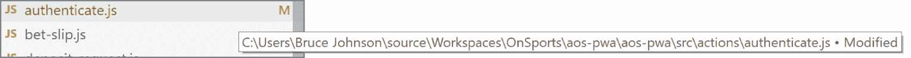

**图 3-9**

### 工作区

虽然之前没有详细介绍工作区，但你在资源管理器中操作时，工作区是文件和文件夹的集合。它是这些集合的名称。对于许多开发者来说，甚至不需要意识到工作区 string，只需打开文件或文件夹即可。然而，使用工作区有很多好处，特别是当你有多个文件夹时。

#### 保存工作区

虽然每个打开的文件夹都属于工作区，但在你保存工作区之前，这些好处都不会体现。要保存工作区，请选择文件保存工作区选项。在弹出的对话框中，你可以确定保存扩展为 `.workspace` 文件的位置。

`.workspace` 文件不是项目文件或解决方案——它只是另一个文件。配置文件的结构非常直接，如下所示：

```
{
   "folders": [
      {
         "name": "PWA",
         "path": "aos-pwa"
      },
      {
         "name": "API",
         "path": "AosPwa.WebAPI"
      }
   ],
   "settings": {
      "workbench.quickOpen.closeOnLost": false
   }
}
```

示例顶层有两个属性。第一个 `folders` 是工作区中文件夹的数组。`path` 属性定义了要打开的文件夹路径。该路径相对于 `.workspace` 文件的位置。`name` 属性提供了一个不同的显示标题。图 3-10 说明了设置了 `name` 属性后的资源管理器样式。

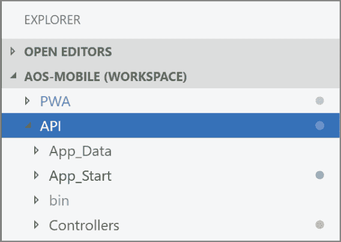

**图 3-10**

如所示，名称（PWA 或 API）出现在每个文件夹的顶部。如果你没有包含 `name` 属性，则将使用文件夹名称。该 `name` 属性确实是为了提供一个更易于用户的文件夹名称版本。同样，给 `.workspace` 文件命名的名称就是工作区的名称，它出现在文件和文件夹树的顶部。


### 添加文件夹

你可以在保存工作区之前向其中添加文件夹。你可以通过`文件 ➪ 向工作区添加文件夹 (Add Folder To Workspace)`菜单选项来实现。这将出现标准的“打开文件”对话框，你可以选择一个要添加的文件夹。

此外，Visual Studio Code 支持通过从本地文件管理器拖拽文件夹并将其到`资源管理器 (Explorer)`区域来添加文件夹。你可以通过在“打开文件”对话框中选择多个文件夹或将多个文件夹拖入`资源管理器`来添加多个文件夹。

如果你尚未保存工作区，工作区的名称为“未命名工作区 (UNTITLED WORKSPACE)”。一旦以不同的名称保存工作区，该名称就会更改。

## 设置

你可能已经注意到工作区配置文件还包含一个 `settings` 属性。这些是工作区级别的设置。但是，你也可以定义不仅适用于用户和工作区，也适用于单个文件夹的设置。设置编辑器包含了此功能。图 3-11 展示了 AOS-MOBILE 工作区的用户界面。

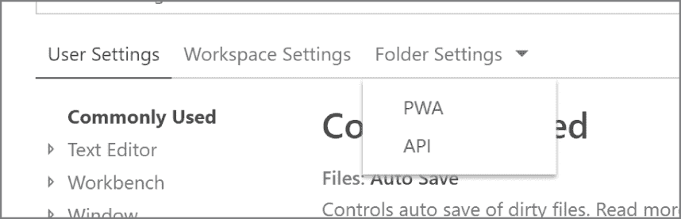

`图 3-11`

要访问文件夹级设置，请从下拉列表中选择该文件夹并像通常一样编辑设置。

文件夹级设置的考虑因素之一是如何处理处理冲突。也就是说，Visual Studio Code 如何处理用户、工作区或文件夹对同一设置赋予不同值的情况？对于许多设置来说，这并不是问题。文件夹具有优先权。然而，在某些情况下这是无法实现的。特别是，如果存在影响整个开发环境的设置（例如编辑器布局或缩放级别），文件夹级设置将被忽略。当你在 Visual Studio Code 内部进行编辑时，被忽略的设置将显示为灰色。

### 搜索

Visual Studio Code 中的文件和文件夹搜索功能通过一个面板可用，默认情况下，该面板会替换界面中的`资源管理器 (Explorer)`。你可以通过几种不同的机制启动搜索。你可以点击活动栏中的搜索图标，使用快捷键 `Ctrl+Shift+F`，或者使用`视图 ➪ 搜索 (View ➪ Search)`菜单选项。基础搜索界面如图 3-12 所示。

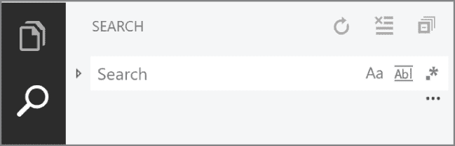

`图 3-12`

该功能相对简单：在文本框中输入你想搜索的术语并按回车。文本框下方出现的列表（如图 3-13 所示）显示了结果。

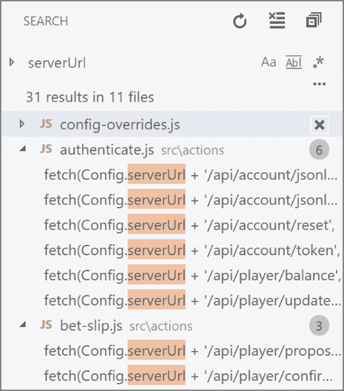

`图 3-13`

结果以树的形式结构化。每个包含至少匹配项的文件都会以节点的形式出现。文件名以及包含它的文件夹（相对于项目中的顶层文件夹）都会显示。在节点的最右侧，一个数字表示搜索术语在文件中找到的次数。如果你想从结果中移除某个文件，将鼠标悬停在节点上，结果数量将被替换为 X。点击该 X 即可从显示中忽略该文件中找到的结果。

每个文件的子节点是文件中找到搜索术语的行。该行的提示框（在鼠标悬停时可见）是整行代码——实际上，只是前 80 个字符左右，但足以让你了解该行的详细信息。

每一行都可用于在编辑器中打开相应文件并将光标定位在该某行上。一个名为`工作区 ➪ 列表：打开模式 (Workbench ➪ List: Open Mode)`的设置控制着你完成此操作需要执行的操作。有两个选项可供选择：`单击 (Single Click)`（这是默认值），打开文件只需点击一次。另一个选择是`双击 (Double Click)`，意味着需要双击来打开文件。此设置不仅控制在搜索结果行上的操作方式，还控制在任何树或列表上的操作方式。

## 高级搜索

搜索面板的功能与其他许多搜索并不相似。但 Visual Studio Code 还包含了一些高级功能，当你尝试减少返回的行数，或者只是在寻找不同的术语组合时，这些功能非常有用。

搜索文本框的右侧有三个图标。左侧的图标用于控制搜索是以区分大小写还是不区分大小写的方式进行。默认是不区分大小写的。当选中区分大小写时，图标会被一个框包围。点击该图标可以切换敏感性的开启。

第二个图标用于切换全词匹配。当选中时（图标被一个框包围），只有当搜索术语作为一个完整的单词时的实例才会被包含。默认不使用全词，点击图标可以切换该设置。

第三个图标用于开启和关闭正则表达式匹配功能。详细信息将在下一节描述。

### 正则表达式匹配

你可以做的不仅仅是匹配输入搜索文本框的术语。你可以提供一个正则表达式，该表达式将对文件的每一行进行处理。要启用此功能，请点击框最右侧的图标。此时，输入的项必须是有效的正则表达式。参考表 3-1 中关于正则表达式如何强大的示例。

| 正则表达式 | 结果 |
| --- | --- |
| `Status ?Code` | 匹配“Status Code”或“StatusCode”，空格被视为可选。 |
| `Stat.*Code` | `.*` 匹配一个或多个字符，因此涵盖了 `StatCode` 和 `StatusCode`。 |
| `[sS]tatusCode` | 匹配 `StatusCode` 的大写和小写版本。 |

`表 3-1`:正则表达式

你可以使用范围正则表达式字符。虽然这可能很难学习，但利用正则表达式让搜索变得强大。

### 指定文件

默认情况下，项目中的所有文件都包含在搜索中。准确地说，有两个设置控制被搜索的文件。`文件排除 (Files: Exclude)`设置（在本章较之前的“项目视图”部分中描述）通过识别（使用一组通配符）被排除的文件和文件夹来控制项目显示。正如你预期的，这些文件没有包含在搜索中。

然而，还有一个名为`搜索排除 (Search: Exclude)`的设置，它（通过一组通配符）定义了虽然是项目的一部分但你不希望出现在任何搜索结果中的文件。你想从搜索中排除的文件示例是 `node_modules` 目录或 `bower_components` 目录。这些是你项目的一部分但实际上不是你可能搜索的第三方组件。

这两个设置都是搜索面板默认功能的一部分。但你可以在不修改设置的情况下修改搜索的文件。如果你点击正则表达式切换图标下方的省略号，就会出现两个额外的文本框，如图 3-14 所示。

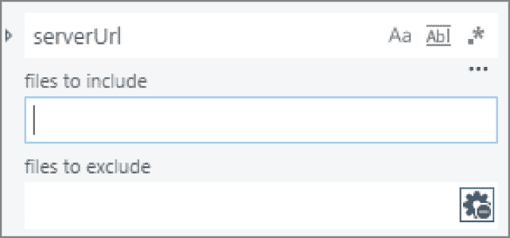

`图 3-14`


顶部的文本框用于指定你希望包含在搜索结果中的文件。例如，如果你输入单词 `reduce`，则只有包含“reduce”文本的文件或文件夹会出现在搜索结果中。

除了输入文本外，还可以使用一些特殊字符来执行模式匹配。表 3-2 包含了这些字符及其用途。

| 模式 | 描述 |
| --- | --- |
| `*` | 匹配文件名或路径中的一个或多个字符。 |
| `?` | 匹配文件名或路径中的单个字符。 |
| `**` | 匹配文件夹路径中任意数量的路径段。 |
| `{}` | 包含一个用逗号分隔的模式列表。 |
| `[]` | 定义要匹配的字母数字字符范围。 |

**`表 3-2`**](#c03.xhtml_R_c03-tbl-0002): 文件包含模式

第二个文本框用于定义从搜索中排除的文件和文件夹。它采用与“要包含的文件”文本框相同的相同的规则。区别在于 Visual Studio Code 对这些信息的处理方式。在这里，匹配模式的文件和文件夹将不会包含在搜索结果中，尽管根据搜索设置它们通常会被包含。文本框右侧的齿轮图标用于开启或关闭排除模式匹配。

### 替换文本

可以通过搜索面板替换文本。要开始此过程，请点击搜索文本框左侧的三角形以显示第二个文本框（见图 3-15）。

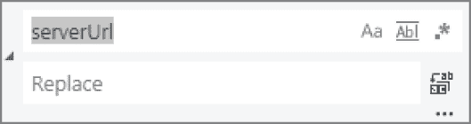

**`图 3-15`**](#c03.xhtml_R_c03-fig-0015)

在第二个文本框中，输入你想要替换第一个文本框中内容的文本。当你输入时，你可以看到搜索结果中正在发生替换操作。图 3-16 说明了其后的样子。

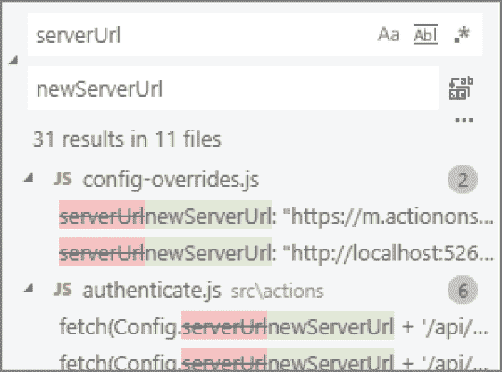

**`图 3-16`**](#c03.xhtml_R_c03-fig-0016)

在此处按回车键将对第一个实例执行替换。点击第二个文本框右侧的图标将对搜索结果中所有文件的所有实例执行替换。

## 设置

若干附加设置会影响查看结果的位置和方式，以及实际出现的结果：

* `Editor`（编辑器）➪ `Find: Seed Search String from Selection`（查找：从选择种子搜索字符串）——当勾选此设置时，编辑器中选择任何文本将自动出现在搜索面板中。
* `Search: Collapse Results`（搜索：折叠结果）——决定搜索结果是展开还是折叠。默认设置是自动，这意味着包含少于 10 个结果的文件将展开，而包含 10 个或更多结果的文件将折叠。其他设置 `AlwaysExpand`（始终展开）和 `AlwaysCollapse`（始终折叠）无论文件中结果的数量多少，都会将结果展开或折叠。
* `Search: Maintain File Search Cache`（搜索：维护文件搜索缓存）——Visual Studio Code 通过使用搜索进程来提高搜索性能。该进程索引文件内容并跟踪任何更改，以便在你执行搜索时非常快速地生成结果。在使用一小时后，服务将关闭。如果勾选此设置，即使没有活动，搜索进程也将继续运行。
* `Search: Show Line Numbers`（搜索：显示行号）——勾选后，将显示找到结果的文件内的行号。
* `Search: Smart Case`（搜索：智能大小写）——如果模式全小写，则将以不区分大小的方式进行搜索。如果模式中包含任何大写字母，搜索将区分大小写。
* `Search: Use Ignore Files`（搜索：使用忽略文件）——`Files: Exclude` 设置用于识别不包含在任何搜索结果中的。但 `.gitignore` 和 `.ignore` 这两个文件经常用于指定被不同进程忽略的文件。此设置决定搜索是否也忽略这些文件。

## 总结

构成你项目的文件夹和文件是开发过程中重要的一部分。在本章中，你了解了如何在导航应用程序时，利用 Visual Studio Code 中的资源管理器和搜索面板来为你自己服务。利用可用的工具可以帮助改进工作流。查找代码、替换文本以及轻松识别你所做的更改这些是该流程中的重要部分。

# 4

在你选择的语言中编辑代码

### 本章内容包括？

* 学习编辑器和编辑器组提供的基本功能
* 理解 Visual Studio Code 提供的高级功能
* 定制编辑器以符合你的个人编码风格
* * *

Visual Studio Code 是一个编辑器。虽然提供了许多许多功能和扩展，但从核心而言，编辑功能是至关重要的。在本章中，我们将查看编辑文件的多种方法、让你的生活更简单的函数和快捷键，以及你如何配置编辑器以满足你的需求。

## 编辑器区域

图 4-1

此处讨论的编辑器空间更准确地被称为编辑器组。该组包含一组标签和编辑器，并可以作为一个单元放置。

图 4-1

正如在第 3 章，“文件、文件夹和项目（我的）”中所述，编辑器区域位于右侧。这是显示所有文件的空间。每个标签包含一个与文件类型相关的图标。要获取文件的完整路径，将鼠标悬停在标签上，路径将以工具提示的形式显示。活动标签的右侧是 X 或实心圆。圆心表示文件已修改但尚未保存。一旦保存文件，图标将恢复 X。对于当前非活动标签，当鼠标悬停在标签上时会出现用于关闭标签的 X。

但如果你像许多开发者一样，编辑器顶部的区域是不够的。发生这种情况，某些标签将从顶部移除。你可以通过点击更多按钮（图 4-3 所示工具栏右侧的省略号）并选择显示打开的编辑器选项来访问当前打开的文件列表。

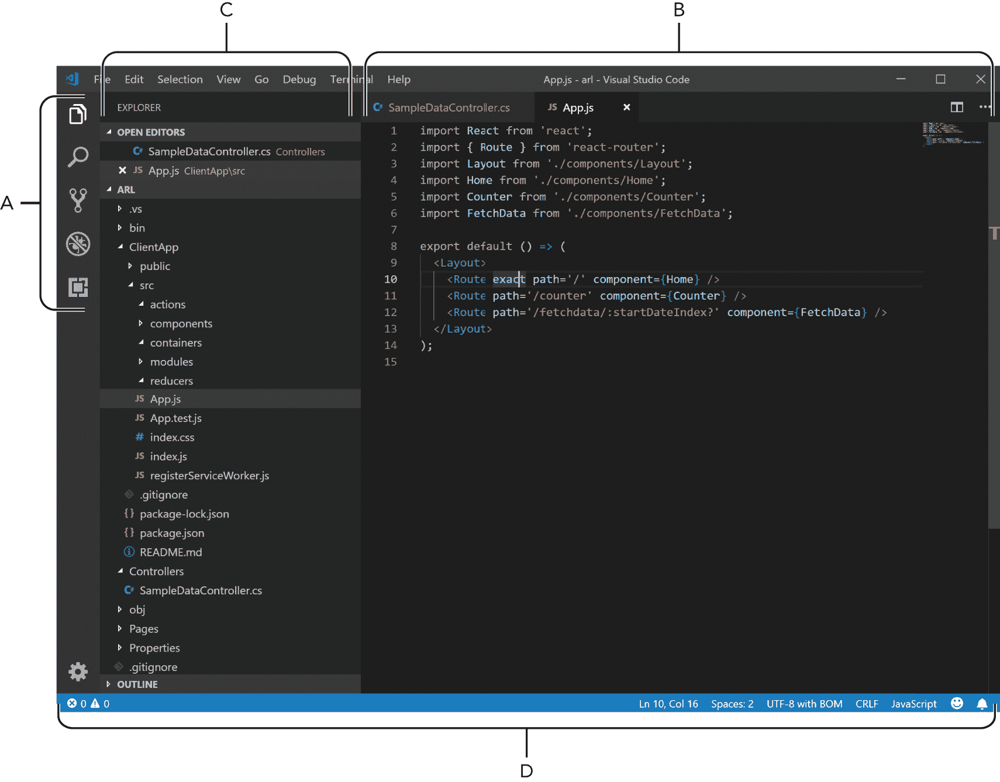

你会注意到打开编辑器列表顶部的文本框包含 `edt` 字符。此区域被称为“命令面板”（Command Palette），对于导航 Visual Studio Code 中发现的大量命令非常有用。但在实例中，`edt` 命令用于显示所有打开的编辑器列表。通过点击列表项可以使某个编辑器变为活动。

### 编辑器组和布局

你可以通过三种方式创建编辑器组。

在表格右侧（更多按钮的左侧）有一个图标，可以在当前组的右侧添加一个编辑器组（见图 4-4）。


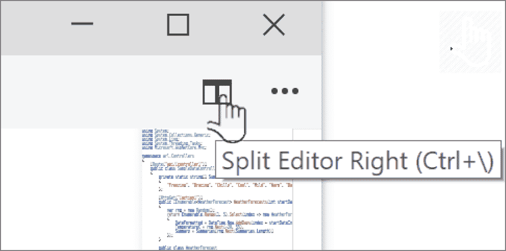

**图 4-4**

在图 4-2 所示的组右侧添加编辑器组后的结果如图 4-5 所示。

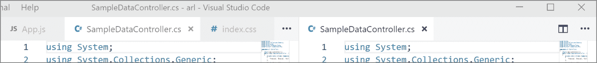

**图 4-5**

在左侧组中，所有原先存在的标签都在那里。在右侧组中，激活状态的标签可见可见。

创建编辑器组的第二种方法是右键点击其中一个标签。这将打开一个上下文菜单（如图 4-6 所示），该菜单包含以下四个选项：

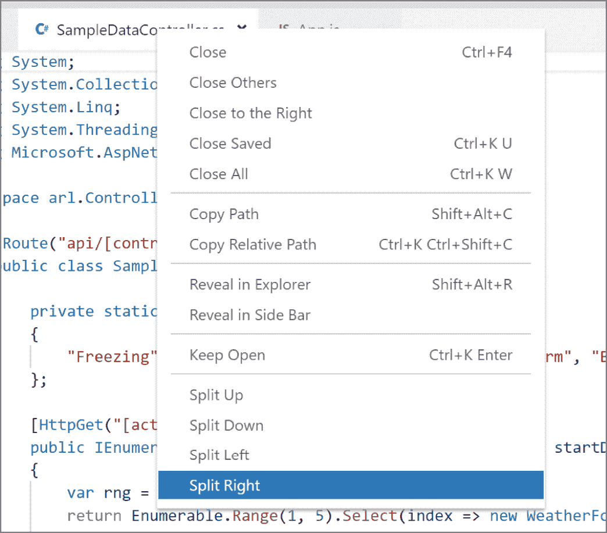

**图 4-6**

*   `Split Up`—向上拆分在当前组上方创建一个新组
*   `Split Down`—向下拆分在当前组下方创建一个新组
*   `Split Right`—向右拆分在当前组右侧创建一个新组
*   `Split Left`—向左拆分在当前组左侧创建一个新组

图 4-7 展示了执行 `Split Down` 后的情况。

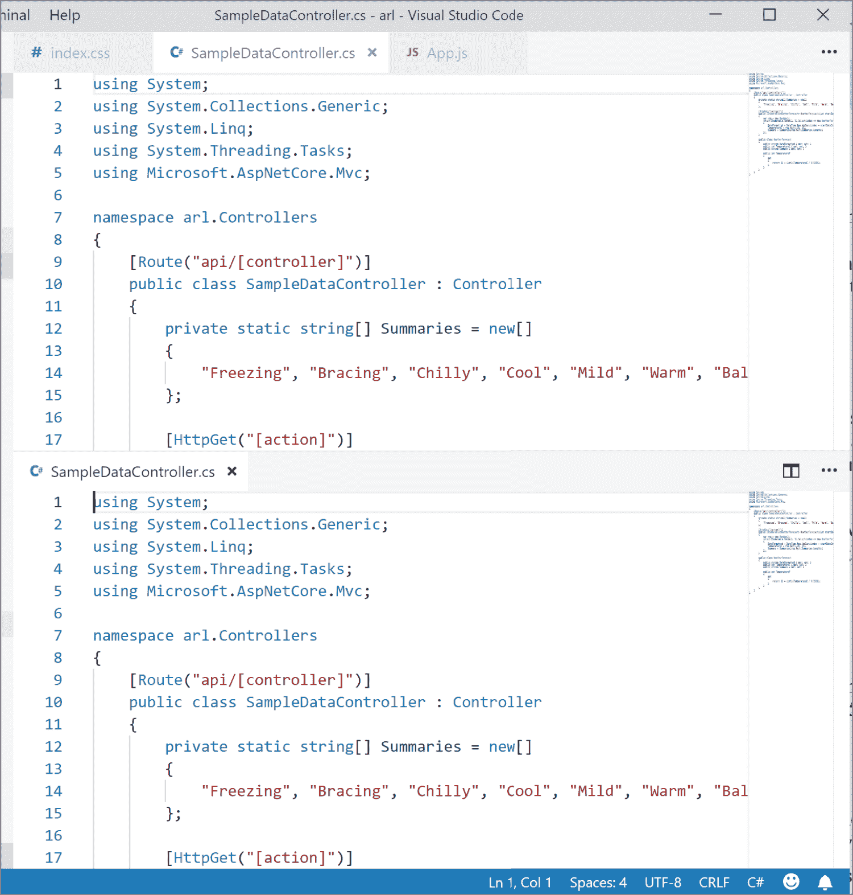

**图 4-7**

创建编辑器组的第三种方法是通过“视图（View）”菜单。选择 `View` ➪ `Editor Layout` 选项进入图 4-8 所示的菜单。

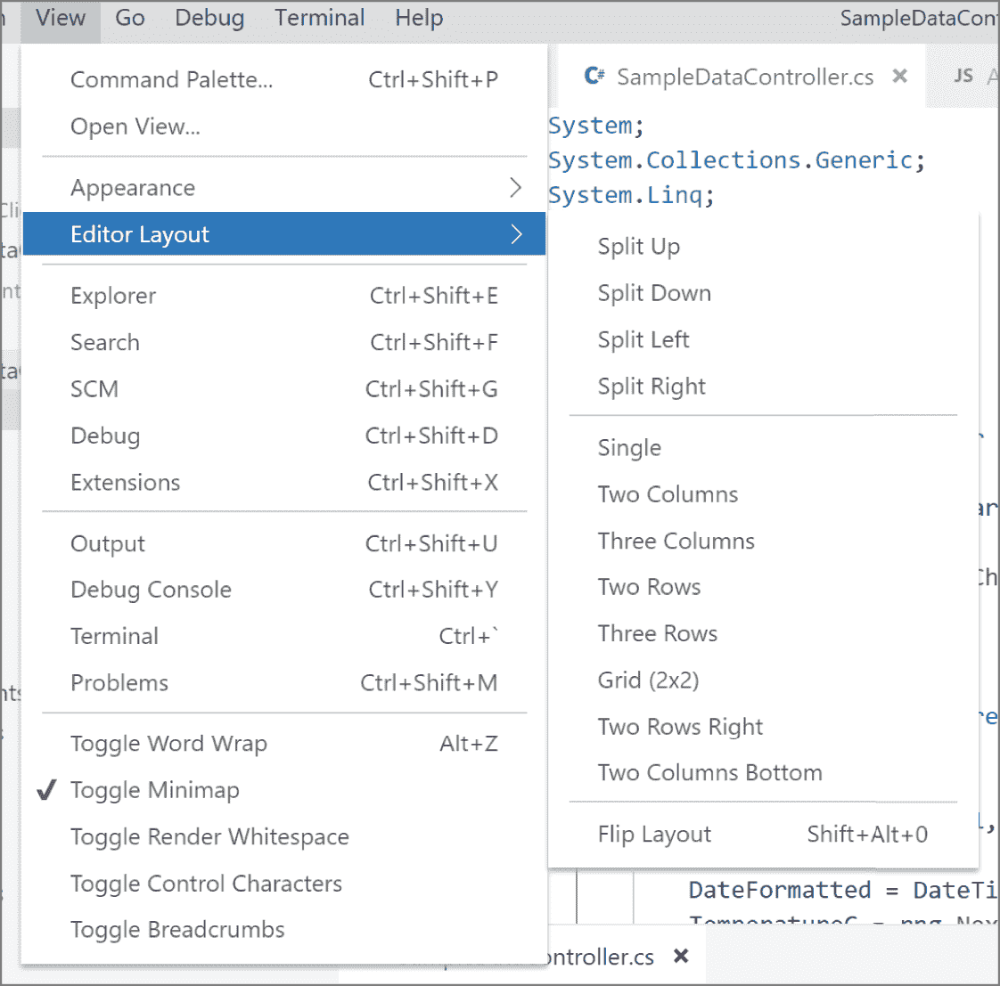

**图 4-8**

在顶部，你可以看到与图 4-6 上下文菜单中相同的四个选项。在底部，还有一个 `Flip Layout`（翻转布局）选项，它可以将并排的组转换为上下堆叠的组。

这些不同的菜单选项并不是在编辑器工作区内放置文件或组的唯一方法。虽然菜单允许垂直或水平列，但你仍然可以通过拖放将文件和组移动到不同的位置。

图 4-9 展示了将一个文件拖到底部或右侧垂直列的过程。阴影区域是新组放置的区域。结果如图 4-10 所示。

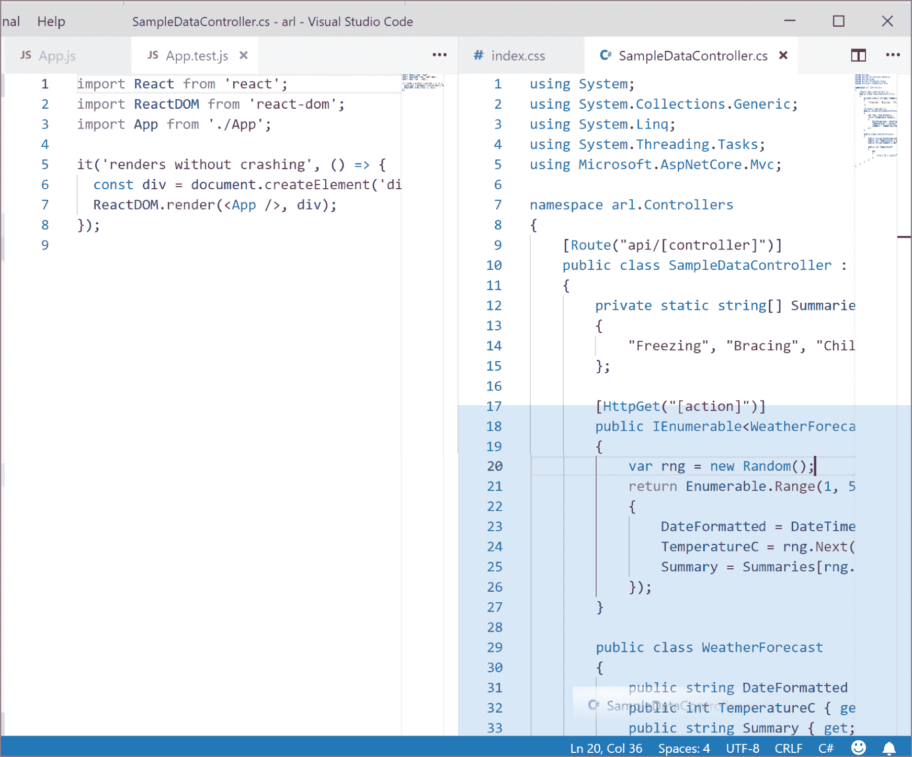

**图 4-9**


**图 4-10**

如果你倾向于使用某些预定义的编辑器组布局，还有其他选项可用。在图 4-8 中有许多布局可供选择。

*   两列和三列—创建总共两个或三个垂直组。
*   两行和三行—创建两个或三个水平组。
*   网格（Grid）—创建四个编辑器组，每行两个。
*   两行右（Two Rows Right）—总共创建三个编辑器组，右侧的两个堆叠在一起。图 4-10 展示了“两行右”布局。
*   两列底（Two Columns Bottom)—同样创建三个组，底部的两个并排排列。

### 打开的编辑器 (Open Editors)

资源管理器（Explorer）在第 3 章的独立章节中进行了描述。资源管理器由三个独立部分组成，中间部分（项目结构）在该章节中进行了详细介绍。在这里，我们查看另外两个部分：打开的编辑器和大纲视图（Outline View）。图 4-11 是资源管理器的一个示例。


**图 4-11**


另一个不寻常的符号出现在 `mapDispatchToProps` 变量中，它似乎包含了基于图标的方法。这是因为 `mapDispatchToProps` 是一个函数变量，返回一个具有三个函数作为属性的 JSON 对象。所以，是的，这在 JavaScript 的能力范围内是合理的。

其中一点点是，大纲视图（Outline View）非常特定于当前活跃的编辑器。并不是所有编辑器都支持大纲视图，而且图标和内容也会随每个编辑器而异。涵盖所有不同的大纲视图远非本书的范围——更不用说这些视图可能会随着 Visual Studio Code 的更新而轻易更改或添加。只需说明，悬停在任何节点上，都会提供关于内容的稍为详细的描述，这些信息将为编辑器提供必要的上下文。

## 编辑功能

正如在本章开头提到的，Visual Studio Code 是一个编辑器（准确来说是一个文本编辑器）。作为一个文本编辑器，它拥有许多许多功能，旨在让你在编写代码时工作得更轻松。在本节中，我们将详细查看你可以应用于任务的许多不同功能。

### 键盘快捷键

高效编辑的要素之一是尽可能让手停留在键盘上。虽然有时使用鼠标是必要的，但能够仅通过键盘组合键执行一些常用的编辑功能（如移动光标、选择文本块和添加代码片段）是非常强大的。

顺便说一下，如果你熟悉这个术语，`键盘组合键`（keyboard chord）是为了执行某功能而同时按下的键组合。诸如 `Ctrl+X` 和 `Ctrl+C`（分别是剪切和复制）是常用的键盘组合键。但任何两个或三个字符的组合都被称为组合键。

每个平台都提供了一系列默认键盘快捷键，且触发快捷键的组合键在每个平台上都是不同的。因此，列出所有组合键及其每个平台功能的庞大列表将非常冗长，并且没有特别的启发。

相反，本书处理快捷键的方式将类似于处理设置的方式。这首先从讨论一些支持的最常用编辑快捷键开始。对于不属于编辑器的快捷键，将在相应的章节中说明。接下来，将描述自定义快捷键的过程。作为自定义过程的一部分，你实际上可以看到用于触发你特定平台快捷键的键盘组合键。

考虑到这一点，以下是某些与编辑代码相关的、常用的键盘快捷键列表。命令名称在各个平台之间保持保持的：

*   `Add Line Comment, Remove Line Comment`——在当前行开头添加或删除注释字符。如果选择了多行，则注释字符将添加到每行的开头。
*   `Add Selection to Next Find Match`——使用所选文本开始执行“查找下一个”匹配项。匹配项在编辑器中高亮显示，连续执行此命令将会在整个文件中从一个匹配项移动到下一个匹配项。
*   `Auto Fix`——当你的代码存在问题且通过 IntelliSense 识别出潜在解决方案时使用。对于特定的问题，IntelliSense 可能会包含一个或多个可能的修复。此命令将实施该列表中的第一个修复（通常是概率最大的）。
*   `Change All Occurrences`——获取当前选择内容并在当前文件中找到所有出现处。光标将置于这些选择项的末尾。图 4-15 展示了其外观。


**FIGURE 4-15

当你开始打字时，所做的更改将同时应用于所有选中的出现处。在编辑器中，编辑区域左侧的深色水平条指示了文件中发现出现的位置。

*   `Close Window`——关闭当前窗口。在关闭时，系统会提示你确认是否要保存或丢弃更改。
*   `Copy/Cut/Paste`——这些是每个编辑器都可用的三个标准命令。
*   `Copy Line Up/Copy Line Down`——在当前行（光标所在的行）上方或下方复制当前行。如果选择了多行，则不可用这些命令。
*   `Delete Line`——删除当前行。如果选择了多行，则删除所有选中的行。
*   `Expand Selection`——此命令的作用正如其名所示：它通过添加内容来扩展当前选择范围。该命令有趣之处在于如何确定添加的内容。从未选择任何内容开始，扩展选择将按以下顺序添加：当前单词、当前代码行、当前行（包括所有前导和尾空格）、当前块。一个示例有助于理解这一点。

图 4-16 显示了四张图像。第一张说明了当光标在“Promise”中时执行 `Expand Selection` 命令时的选择情况。第二张图像显示了执行第二次 `Expand Selection` 后的情况。现在选择了整行的代码。第三张图像是执行另一个命令后的情况，整行被选中。最后一张图像是再执行一次 `Expand Selection` 命令后的，现在包含原始光标的块被选中。后续执行该命令现在将选择父级块，直到最终整个代码文件被选中。


**FIGURE 4-16

*   `Find`——启动文件内的查找过程。有关查找功能的详细信息可以在本章节后面的“查找和替换”部分找到。
*   `Find Next, Find Previous`——移动到下一个或上一个匹配项。这些命令最有趣的部分是，如果查找面板未打开，该命令将打开面板，显示当前选中的值，并将该文本作为光标移动的目标。
*   `Fold All, Fold All Block Comments, Fold All Regions`——虽然你可能熟悉“折叠”（folding）这个术语，但功能可能很熟悉。图 4-17 展示了 JavaScript 文件的折叠。


**FIGURE 4-17

你会注意到代码行左侧有一组加减号符号。点击减号会导致该元素内的代码折叠。点击加号会导致该部分内的代码展开。这就是*代码折叠*。

许多命令与代码折叠有关。它们是：

*   `Fold All`——折叠当前文件中的所有代码区域以便它们关闭。
*   `Fold All Block Comments`——折叠所有的块注释部分。创建块注释使用的字符取决于语言，但从概念上说，它是一个开头和结尾都有界定的注释区域。这与行注释（注释字符位于每行的开头）区分开来。


* `Fold All Regions`—某些语言允许在代码文件中定义特定的区域（regions）。这与根据缩进层级或代码作用域（scope blocks）自动确定区域的方法相反。此命令会折叠所有显式定义的区域。

* `Fold Level n`—有许多折叠级别注释。这些命令将按 `n` 指定级别执行折叠。例如，`Fold Level 2` 命令将折叠所有二级级代码块。

* `Fold Recursively`—从当前光标所在的折叠层开始，折叠当前块及其所有子代码块。

* `Unfold`—根据光标位置展开当前区域。

* `Unfold All`—展开当前文件中的所有代码区域。

* `Unfold All Regions`—如果当前编辑器允许定义区域，此命令将展开所有这些区域。

* `Unfold Recursively`—从当前光标所在的折叠层开始，此命令将展开当前块及其所有子代码块。

Visual Studio Code 包含一些影响折叠命令的设置：

* `Editor: Folding`—控制开启或关闭代码折叠。

* `Editor: Folding Strategy`—决定 Visual Studio Code 如何识别可折叠的元素。默认的“auto”策略允许语言编辑器确定策略。这通常是首选方案，因为语言编辑器更深入地理解代码的上下文，因此能更好地判断哪些元素可以被折叠。如果你将策略设置为“indentation”，它将使用缩进层级来确定可折叠元素。

* `Editor: Show Folding Controls`—默认情况下，折叠控件（加号和减号框）仅在鼠标悬停在编辑器该部分时才出现。如果你希望折叠控件始终可见，请将此设置更改为“always”。

* `Format Document, Format Selection`—这些命令用于根据当前语言关联的格式化程序重新格式化文档。箱箱（这已经是一个非常过时的说法了）Visual Studio Code 支持 `JavaScript`、`TypeScript`、`JSON`、`C#` 和 `HTML` 的代码格式化。但在市场扩展中提供了支持其他语言的扩展。

这两个命令都会对整个文档或仅对当前选择区域运行当前语言的格式化程序。

* `Go Back, Go Forward`—将光标移动到不同位置，即使该位置在不同的文件中。`Go Back` 返回你到达当前位置之前的位置。`Go Forward`回到你返回之前的位置。

* `Go to Bracket`—移动到当前块的开头或结尾。

* `Go to Last Edit Location`—类似于 `Go Back` 和 `Go Forward`，但它只会停留在你实际进行过更改的地方。

* `Insert Line Above, Insert Line Below`—在当前行上方和下方添加空行。

* `Move Line Up, Move Line Down`—将当前行向上（或向下）移动一行。

* `New Window`—创建一个 Visual Studio Code 的新实例。默认情况下你处于欢迎页，可以打开任何所需的项目或工作区。

* `Show All Commands`—在 IDE 顶部打开命令面板。命令面板在 第 2 章 “探索用户界面”部分中有详细描述。

* `Show Editor Context Menu`—这个命令在保持手不键盘时非常出色。它会显示编辑器的上下文菜单，就像你在当前光标处点击了右键一样。

* `Show Hover`—与上一个命令类似，旨在让你真正实现无鼠标操作。它会显示当你将鼠标悬停在当前光标上会看到的内容。

* `Shrink Selection`—`Shrink Selection` 的工作方式与之前描述的 `Expand Selection` 命令类似，区别在于它不是扩大选择范围，而是使其变小。

* `Soft Undo`—将此视为光标位置的堆栈，最近的位置位于顶部。每次后续执行此命令，你的光标都会移动到之前的光标位置。

* `Toggle Block Comment`—用当前语言的注释字符包裹当前选择。或者，如果当前选择已被注释，则移除注释字符。

* `Toggle Line Comment`—在行开头添加当前语言的注释字符。或者，如果行已被注释，则移除注释。

* `Trigger Parameter Hints, Trigger Suggest`—这些命令也属于让手离开鼠标的类别。它们会触发参数提示工具提示和自动建议。通过这两个命令看到的内容都基于当前光标位置。

* `Trim Trailing White‐space`—移除当前行尾的任何空白字符。

### 选择你的语言

Visual Studio Code 可以编辑许多文件类型。安装后，以下语言提供了可用编辑器：`JavaScript`、`JSON`、`HTML`、`CSS`、`TypeScript`、`Markdown`、`PowerShell`、`C++`、`Java`、`PHP`、`Python`、`Go`、`T‐SQL` 和 `C#`。但除此之外，活跃的第三方生态系统为许多其他语言提供了编辑器。市场以及如何添加语言将在 第 9 章 “使用扩展”中讨论。

使用的语言编辑器通过将文件扩展名与特定编辑器关联来确定。如果你已经编辑文件了一段时间，默认关联列表不会让你感到意外。例如，`*.html` 打开 `HTML` 编辑器，`*.js` 打开 `JavaScript` 编辑器。如果你想修改关联，可以通过 `File: Associations` 设置进行。

然而，此设置的不同之处在于，Visual Studio Code 内部没有界面来做出这些更改。相反，在设置选项卡中有一个链接，可以打开 `settings.json` 文件并让你编辑关联。例如，以下内容将 `*.jsx` 文件与 `javascript` 编辑器相关联：

```json
{
    "workbench.colorTheme": "Default Light+",
    /* more settings */
    "file.associations": {
       "*.jsx": "javascript"
    }
}
```

请注意`settings.json` 文件不仅用于文件关联。它实际上包含了你定义的所有自定义设置。设置选项卡只是允许你轻松修改内容的界面，但你始终可以直接访问该文件——关键在于，在你更新文件关联时，不要删除或更改其他设置。

你可以通过添加更多文件扩展名（使用用于通配符的 glob 模式）和编辑器名称的对来添加任意数量的关联。唯一的要求是你知道编辑器的名称。有关已知语言字符串列表，请查看 [`code.visualstudio.com/docs/languages/identifiers#_known-language-identifiers`](https://code.visualstudio.com/docs/languages/identifiers#_known-language-identifiers)。

#### 格式化

以各种方式格式化文本是文本编辑器的共同功能，Visual Studio Code 例外。Visual Studio Code 可扩展性的优势之一是允许编辑器本身实现格式化，这是合理的。有什么组件比专门该语言的编辑器更如何格式化 JavaScript`/`C#`/`PHP`/`Python` 等呢？

Visual Studio Code 在格式化方面提供的优势是能够指定何时执行格式化。有三种可用选项。这些选项并不互斥，因此你可以选择其中一个、全部或都不选。然而，它们依赖于编辑器是否有可用的格式化程序，并不是每个第三方编辑器都如此：


- **粘贴时格式化 (Format on Paste)**——在粘贴内容后立即对其进行格式化。此选项要求编辑器拥有一个支持格式化范围的格式化程序，也就是说，并不是每个格式化程序都能只格式化一段文本块。在某些情况下，它只能格式化整个文件，而不能仅针对部分。如果是这种情况，则不支持此选项。
- **保存时格式化 (Format on Save)**——在保存文件时对整个文件进行格式化。有一个单独选项（保存时格式化超时 `Format on Save Timeout`）对格式化所需的持续时间进行限制。默认超时时间为 750 毫秒。这里的目的是确保格式化不会阻止保存操作，因为除了极难以想象的情况，保存文件比格式化它更重要。
- **打字时格式化 (Format on Type)**——在输入行后对该行进行格式化。

### 代码编写辅助

还有一些控制编辑器如何帮助你编写代码的设置。根据经验，应该开启还是关闭这些设置是一个非常个人的选择。如果你浏览论坛以寻找关于如何调整默认设置的问题，你会发现人们对字体颜色和字符间距等问题是多么热情——结果就是，了解编辑器可以做什么以及你如何更改它以适应你的风格是非常重要的。

考虑到这一点，以下是一些与让 Visual Studio 帮助你编写代码相关的设置：

- **编辑器：自动闭合括号 (Editor: Auto Closing Brackets)**——指定编辑器在用户输入左括号时是否自动添加右括号。除了“始终 (always)”和“从不 (never)”这两个显而易见的选项外，还有一个选项——输入左括号后，光标右侧的字符是否为空白字符以触发右括号。如果将此配置设置为 `beforeWhitespace`，则在现有文本左侧立即输入的左括号将不会生成右括号。然而，如果你输入一个左括号且右侧没有字符（或是一个空格），则会自动添加右括号。该设置的另一个值 `languageDefined` 允许每个语言的编辑器决定适当的行为。
- **编辑器：自动闭合引号 (Editor: Auto Closing Quotes)**——指定编辑器在输入左引号后是否立即自动添加右引号。与自动闭合括号选项类似，有以下四个可用选项：
    - **始终 (Always)**——始终添加右引号。
    - **从不 (Never)**——从不添加右引号。
    - **空格前 (Before White‐space)**——只有在输入左引号后，光标右侧立即有空白字符时才添加右引号。
    - **语言定义 (Language Defined)**——允许语言的编辑器决定适当的自动闭合行为。
- **编辑器：自动包围选择 (Editor: Auto Surround Selection)**——此设置绝对属于个人偏好范畴。前提是你选择一个文本块，然后输入一个边界字符（括号、中括号、引号）。当开启自动包围时，选中的内容将被输入的字符包裹。换句话说，如果你选择了 `TEST` 并输入 `(` ，结果将是 `(TEST)`。如果你期望按键操作会导致选中的文本被删除，那么这就会变得很困扰。

  默认设置是允许语言定义行为，因此你将根据打开的文件类型获得不同的结果。还有两个可用设置可以让你获得更多控制：
    - **括号 (Brackets)**——仅当边界键为括号字符时才自动包围选择内容。在这种情况下，*括号*定义为方括号、大括号或圆括号。
    - **引号 (Quotes)**——仅当边界键为双引号或单引号时才自动包围选择内容。
    - **从不 (Never)**——永远不自动包围选择内容。
- **编辑器：行号 (Editor: Line Numbers)**——此设置的目的非常直接。它决定编辑器行左侧是否显示行号。然而，在配置行号时，几个值有些不同常。可能的值如下：
    - **关闭 (Off)**——不显示行号。
    - **开启 (On)**——行号位于每行的左侧。文件的第一行被视为第 1 行。
    - **相对 (Relative)**——行号位于每行的左侧，但值计算为到当前光标位置的行数。例如，光标位置上方和下方的行都是第 1 行。
    - **间隔 (Interval)**——每隔 10 行在行左侧显示行号。例外是光标所在的行号也会被渲染。
- **编辑器：鼠标轮缩放 (Editor: Mouse Wheel Zoom)**——此设置决定在按住 `Ctrl` 键的同时滚动鼠标轮是否会导致字体增大或缩小。提到此设置是因为默认是关闭的，这对于 Visual Studio 用户来说可能有些不习惯。
- **编辑器：显示未使用 (Editor: Show Unused)**——Visual Studio Code 能够将未使用的代码置灰。这非常有用，特别是当你尝试重构或清理现有代码时。然而，如果你不想要此功能，可以通过取消勾选此配置将其关闭。
- **编辑器：Tab 键补全 (Editor: Tab Completion)**——现代 IDE 的强大功能之一是自动补全部分输入的命令。例如，如果你输入函数名的前几个字母，`IntelliSense` 会显示匹配的函数列表，你可以选择最合适的一个并使用 `Tab` 键确认选择。

  此配置用于开启或关闭 补全功能。此外，还有第三种选项 `onlySnippets`，它使补全仅适用于代码片段，而不是方法或变量名。
- **编辑器：启用垃圾箱 (Editor: Enable Trash)**——此设置控制在 Visual Studio Code 中删除文件时会发生什么。默认启用启用此设置，这意味着删除的文件会被放入垃圾箱或回收站（取决于你的操作系统）。如果取消选择此设置，在 Visual Studio Code 中删除的文件将被永久删除。

### IntelliSense

IntelliSense 是一组与代码编辑相关的功能的统称。它包括代码补全、参数信息、快速信息和成员列表等功能。

`IntelliSense` 的支持贯穿整个 Visual Studio Code。初始安装时，对 `TypeScript`、`JSON`、`HTML`、`CSS`、`SCSS` 和 `Less` 有广泛支持。除此之外，对于任何类型的文件都有基于单词的补全。这意味着常用单词会被立即识别，并提供快速键的选项。如果你想要更复杂的 `IntelliSense` 能力，市场中提供的各种语言扩展非常令人深刻。你可以在第 9 章 (c09.xhtml) 中找到查找和安装这些扩展的详细信息。

`IntelliSense` 的功能由语言服务提供。这是在独立进程中运行的代码（以免影响编辑过程）。随着输入，文件和工作区的信息会被提供给该服务。然后该服务负责提供任何适当的信息（如建议、参数等）。


除了性能考虑外，上下文、语义和其他分析具有非常强的语言特定性。每种语言都有其自己的服务，可以专注于其最擅长的内容。此外，升级或安装新版本的语言不仅简单直接，而且无需担心安装一种语言会破坏另一种语言的功能。

## 方法信息

你可以使用多种不同的技术来获取特定方法的信息。首先，将鼠标悬停在方法名上。停留片刻后，会出现一个提示框，如图 4-19 所示。


**图 4-19**

提示框包含了由语言服务返回的信息，因此很难描述所有可能的组合。但通常情况下，它包含了方法的签名（包括每个参数的数据类型）、返回的数据类型以及对该方法功能的简要描述。

如果你将光标移动到方法的参数列表中，提示框中的内容会发生细微变化。

如图 4-20 所示，可用信息现在更多地关注方法的参数。如果该方法接受多个参数，将鼠标悬停在每个参数部分（由逗号分隔）上将显示关于该参数的信息。


**图 4-20**

## 代码 Completion

在代码的任何位置放置光标时，你都可以使用 `Ctrl+Space` 查看可能的输入选项列表。此列表中的选项称为 `completions`（补全），你可以在图 4-21 中看到示例。


**图 4-21**

选项列表出现在下拉菜单中。该列表由源自 Visual Studio Code 的单词补全、推断的符号和全局标识符组成。此列表根据你输入的字符进行过滤，因此你可以接近所需的输入，然后使用 `Enter` 或 `Tab` 来确认你的选择。有关特定选项的更多信息，请将鼠标悬停在 Get 选项上，右侧会出现一个信息图标。点击该图标将显示有关变量或方法的详细信息（在图 4-21 中可见）。

列表每个项的左侧是一个指示补全类型的图标。图 4-22 显示了不同的图标（取自 Visual Studio Code 文档）。


**图 4-22**

## 设置

许多设置允许你配置 IntelliSense 的行为。为了理解前几个设置的用途，先理解“提交字符”（commit character）的概念会有帮助。

在 IntelliSense 的世界里，`commit character` 是导致建议被接受的字符。Visual Studio Code 的默认提交字符是 `tab`。然而，某些语言添加了其他提交字符。例如，在 JavaScript 中，分号也是一种提交字符。在这种情况下，区别在于分号不仅接受建议，还会在文件中添加一个分号。

`Editor: Accept Suggestion On Commit Character` 设置用于开启或关闭使用提交字符来接受建议的功能。

除了 `Tab` 字符外，`Editor: Accept Suggestion On Enter` 设置用于将 `Enter` 作为提交字符。此设置的有趣之处在于，你不仅可以开启和关闭它，还有一个 `Smart`（智能）选项。在后一种情况下，`Enter` 键可能会根据情况被解释为提交字符，也可能不会。

`Editor: Quick Suggestions` 设置用于确定建议何时实际出现。Visual Studio Code 中没有此设置的用户界面。相反，它是直接在 JSON 文件中修改的。以下是该设置的示例：

```json
 "editor.quickSuggestions": {
    "other": true,
    "comments": false,
    "strings": false
  }
```

此设置包含三个属性。`Comments` 和 `Strings` 设置决定了当你在注释或字符串内输入字时是否会出现建议。你会发现这些设置默认被设置为 `false`，因为在字符串内输入字时出现单词或方法的建议可能会让人感觉有点不寻常。`Other` 设置默认设置为 `true`，表示每当你在注释或字符串之外输入字时，建议都会出现。

### 查找和替换

跨工作区中所有文件和文件夹的搜索内容将在第 3 章 的“搜索”章节中介绍。涉及指定大小写敏感性和使用正则表达式的技术也适用于此处。


## 最小地图 (Minimap)

最小地图的设计并不是 Visual Studio Code 所独有的，尽管这个名称本身可能让你感到陌生。最小地图的一个示例如图 4-25 所示。


图 4-25

图 4-25 的右侧、紧邻滚动条左侧的区域就是最小地图。它是滚动条的一部分，因为可以用它在代码中上下移动。然而，它的内容绝对不是构成普通滚动条的纯灰色。相反，它包含了代码的表示形式。根据配置设置，这种表示要么是以极小、非常极小的字体显示的代码文件，要么仅仅是模拟文件内容形状的彩色色块。最小地图的目的是让你更快速地在代码文件中找到想要的位置。

你可以在 IDE 中自定义最小地图的外观。用于实现此目的的设置如下：

*   `Minimap`: Enabled—如果已勾选，则显示最小地图。否则，它只是普通的滚动条。
*   `Minimap`: Max Column—指定最小地图列的最大宽度。此设置可以防止文件行很长时该区域变得过大。
*   `Minimap`: Render Characters—勾选时，最小地图中使用极小字体。否则，使用彩色方框。
*   `Minimap`: Show Slider—在图 4-25 中，你可以看到最小地图的一个区域颜色较深。该区域表示当前屏幕上可见的代码文件部分。此配置允许阴影区域始终显示，或仅在你的鼠标悬停在最小地图上时显示。
*   `Minimap`: Side—决定最小地图出现在编辑器的哪侧。选项有右（Right，默认值）或左（Left）。

## 代码片段 (Code Snippets)

代码片段的目的是加速编写常用的代码块。当使用得当时，它甚至可以帮助整个团队保持风格的一致性。

代码片段是常用代码模式的模板。例如，大多数语言都有循环或条件模板。作为编码人员，你可以选择循环模板，它就会将循环的基本语法结构添加到你的文件中。然后，你可以根据具体情况对该结构进行修改。

在 Visual Studio Code 中，任何可用的代码片段都包含在 IntelliSense 选项中。它们与选项列表中的关键字和方法混合在一起。你可以通过出现的图标判断哪个选项是代码片段。在图 4-22 中，底部带虚线的正方形表示代码片段。

实际上，将代码片段与其他 IntelliSense 选项包含在一起意味着，当你开始输入时，匹配你文本的代码片段会自动显示。要插入片段，请使用鼠标选择选项，或使用 `Tab` 或 `Enter` 键。如果你将鼠标悬停在选项列表中的片段上，可以看到该片段的描述以及将插入的代码。

代码片段分为三类：全局（global）、语言特定（language-specific）和项目特定（project-specific）。最终，这意味着每个编辑器都会暴露自己的一套代码片段。这意味着描述所有可能的片段是不切行的。然而，为了让你直观模板是如何工作的，请考虑图 4-26 所示的片段。


图 4-26

此代码片段中有两个标记需要替换。它们是 `array` 和 `element`，一旦片段插入到你的代码中，两者都会被高亮。片段中的第一个标记被选中，如果你开始输入，该标记将被你输入的内容所替换。当你完成第一个标记后，按下 `Tab` 键会将光标移动到下一个标记。代码片段的便利之处之一是如果同一个标记名称在片段中出现多次，替换任何一个标记都会更改所有标记。

你可以通过 Visual Studio Code 创建自己的代码片段。选择 `File`（文件） ➪ `Preferences`（选项） ➪ `User Snippets`（用户代码片段）开始该过程。出现如图 4-27 所示的面板。


图 4-27

此面板允许你指定新片段的位置和作用范围。前两个选项将片段添加到全局范围或仅针对当前项目。其余选项将片段与特定语言关联。

每个代码片段的格式都是一个 JSON 文件。以下是一个 JavaScript 代码片段的示例：

```json
"Print to console": {
   "prefix": "log",
   "body": [
      "console.log('$1');"
   ],
   "description": "Log to console"
}
```

## 多光标 (Multiple Cursors)

Visual Studio Code 支持多光标的添加和操作。顾如其名，你可以在编辑器中添加多个光标。然后，当你使用键盘移动（例如使用方向键）或选择文本时，每个光标都将作为你执行的任何命令的起点。

例如，如果你在文件中有两个光标，并使用选择单词命令（默认为 `Ctrl+D`），则两个光标所在位置的单词都会被选中。

有一个设置 (`Editor: Multi Cursor Modifier`) 控制如何向编辑器添加光标。要创建多个光标，你需要在点击每个位置时按住特定键。默认是 `Alt` 键（macOS 上为 `Options`）。另一个选择是使用 `Ctrl` 键（macOS 上为 `Command`）。

## 自动保存 (Auto Save)

虽然 Visual Studio Code 支持保存更改，但该功能默认是关闭的。这对于 Visual Studio 用户来说可能有些意外，但在编辑 Web 应用程序时，这是合理的，因为文件更改通常会触发应用程序的重新构建。

通过 `Files: Auto Save` 设置，可以开启自动保存。对于何时保存已修改的文件有三个选项可用：


- `After Delay`（延迟后）——文件在修改的一刻起，经过一段时间后保存。该时间的长短可以通过 `Auto Save Delay` 值（后文会描述）进行配置。如果在 `Auto Save Delay` 数值过期前进行了后续更改，计时器将重置并重新等待。
- `On Focus Change`（焦点变化）——当焦点离开该文件的编辑器时，保存文件。
- `On Window Change`（窗口变化）——当 Visual Studio Code 失去焦点时，保存文件。

你也可以控制文件的保存频率。`Files: Auto Save Delay` 设置定义了文件更改后到保存文件之间经过的毫秒数。只有当 `Auto Save` 配置的值设置为 `After Delay` 时，此值才会被使用。

### 热退出 (Hot Exit)
“热退出”这个概念非常有意思。它的用性最好通过通过实践而非仅仅是文字描述来体验，因为当你习惯了它，它会变得非常自然。

在你编辑文件时，Visual Studio Code 会定期进行备份。在 Visual Studio Code 崩溃的罕见情况下，当你重新启动应用程序时，将使用备份文件将文件恢复到编辑时的状态。

然而，热退出更进了一步，即使 Visual Studio Code 正常退出，它也会保留备份。因此，它不会在退出时询问你是否要保存所有已更改的文件，而是直接存储备份。当你下次打开 Visual Studio Code 时，所有的更改仍然在那里。如果你现在在不保存的情况下关闭文件，你所做的任何更改都将丢失（正就像你在此期间没有关闭过 Visual Studio Code 一样）。换句话说，正常的编辑流即使跨越不同的会话也能继续。

`Files: Hot Exit` 设置有三个选项可用。首先，你可以完全将其关闭（其值为 `off`）。这意味着当你在退出时，系统会提示你保存文件。默认设置（其值为 `onExit`）是在 Visual Studio Code 中最后一个打开的文件夹被关闭时，触发备份文件的保存。最后一个设置是 `onExitAndWindowClose`。它不仅在关闭最后一个打开的文件夹时保存备份，在任何关闭文件夹时都会保存。此功能仅在你的工作空间包含多个文件夹的情况下才有用。

## 编辑器设置 (EDITOR SETTINGS)
到这里，不仅在本章中，而且在整本书中，你应该已经意识到 Visual Studio Code 提供的系列配置选项。编辑器也不例外。本节将讨论一些与编辑器相关的最有用设置，但这些设置并没有很好地归入本章的其他主题。

首先，你可以通过 Visual Studio Code 窗口左下角的齿轮图标访问主设置页面。点击该图标会显示上下文菜单，点击 `Settings` 选项将打开设置编辑器（图 4-28）。


**图 4-28**

也可以通过 `File ➪ Preferences ➪ Settings` 菜单选项进入设置编辑器。或者，你可以使用 `Command Palette`（`View ➪ Command Palette`）并输入 `Preferences: Edit User Settings`。

设置以两个独立的块保存：`User Settings`（用户设置）和 `Workspace Settings`（工作区设置）。你可以在 `Search Settings` 文本框正下方看到这两个项目的标签页页。每个块的可能设置列表是相同的。也就是说，522 项设置既可以作为用户设置，也可以作为工作区设置。区别在于设置的应用范围：

- `User Settings`——适用于你打开的任何 Visual Studio Code 实例。
- `Workspace Settings`——适用于正在打开的特定工作区。如果打开了多个工作区，每个工作区都将显示一个范围。

为了使设置组的范围与这些定义一致，工作区设置中的任何配置值都会覆盖用户设置中的相同配置。

设置被分为不同的类别。这显示在设置编辑器左侧的树形导航控件中。展开任何一个类别都会显示多个子类别。当选中某个类别或子类别时，该组的设置将显示在右侧。

此外，与许多树形导航不同，你可以使用右侧的滚动条在不同的设置项组之间移动。当你向上或向下滚动时，左侧的类别和子类别会发生变化。因此，你实际上可以滚动所有的设置项而无需经过类别：

- `Editor: Font Size`（编辑器：字体大小）——设置编辑器中字符的大小。该值以像素指定；这仅是默认值。对于任何编辑器，你都可以使用 `Editor Font Zoom In` 和 `Editor Font Zoom Out`（或 `Editor Font Zoom Reset`）命令增大字体大小。这些命令可以通过 `Command Palette`（通过菜单 `View ➪ Command Palette`）可用。
- `Editor: Font Family`（编辑器：字体族）——确定用于显示编辑器中文件内容的字体。此值可以是逗号分隔的字体族列表。随后的值是回退字体。如果在不同的平台上打开项目时，某个字体不可用，它将回退到列表中的下一个字体族。
- `Editor: Tab Size`（编辑器：制表大小）——等于制表符的空格数。这用于指定使用 `Tab` 键对代码文件的缩进。
- `Editor: Render White-space`（编辑器：渲染空白字符）——此选项控制空白字符在编辑器内的显示。默认情况下，是不渲染的，如图 29 左侧所示。然而，如果你更改了设置，空格将显示为点，如图 29 右侧所示。


**图 29**

此设置有三个值：

- `None`（无）——不渲染空格（如图 29 左侧所示）。这是默认设置。
- `Boundary`（边界）——所有空格都显示为点，单词之间的单个空格除外。此设置位于图 29 右侧。
- `All`（全部）——所有空格都显示为点，包括单词之间的。

- `Editor: Cursor Style`（编辑器：光标样式）——控制编辑器中光标的大小和形状。三种基本样式：`line`（线）、`block`（块）和 `underline`（下划线）。此外，每个样式都有常规和细的渲染。因此，你共有六种不同的样式可选。
- `Editor: Insert Spaces`（编辑器：插入空格）——当此设置被勾选时，按下 `Tab` 键会在文件编辑器中插入空格。如果取消勾选，则插入制表符。默认插入空格，如果 `Detect Indentation` 设置为真，则行为由分析文件内容决定。
- `Editor: Word Wrap`（编辑器：自动换行）——确定文本行何时换行。默认值是不换行。这意味着长行只能通过滚动视口来查看。然而，当你开启自动换行时，可以使用许多与 `Word Wrap Column` 设置配合使用的不同选项。以下是可能的设置：

- `Off`（关闭）——不换行。
- `On`（开启）——在视口边缘换行。
- `Word Wrap Column`（按列换行）——在 `Word Wrap Column` 设置指定的列处换行。因此，如果 `Word Wrap Column` 设置为 40，行将在第 40 列换行。


- `Bounded`（边界限制）：行会在 `Word Wrap Column` 设置和视口宽度的较小值之间换行。
- 编辑器：`Word Wrap Column`——指定行换行的列数，具体取决于 `Word Wrap` 配置设置的值。

## 总结

了解编辑器的功能对于在该编辑器中进行高效工作至关重要。鉴于 Visual Studio Code 将编辑作为其核心功能，其内置的众多特性和功能并不令人意外。你会发现，你有多种方式来配置编辑器，以适应你自己的编码风格。

本章探讨了 Visual Studio Code 采取编辑方法、编辑器中实现的各种特性，以及你根据个人偏好定制编辑功能的多种不同方式。

# 5 与源码控制集成

### 本章包含哪些内容？

- 了解如何在 Visual Studio Code 内部内部使用 `Git`
- 添加额外的源码控制提供程序

为了提供完整的端到端开发者体验，所使用的代码编辑器应该与源码控制提供程序集成。虽然对于某些开发者来说这可能并不是绝对要求，但很少有专业开发者在日常工作中不使用某种形式的源码控制。能够在不切换到其他界面的情况下使用源码控制，是一种生产力的提升。幸运的是，Visual Studio Code 包含了对 `Git` 的内置集成，并通过 easily 获取的扩展访问许多其他源码控制工具。

## 源码控制管理

回望几十年前大型软件项目是如何创建的，似乎几乎有些古老。特别是如何管理多个开发人员同时编辑多个文件的协调工作。是的，在源码控制工具成熟之前曾有过那样的时期——而且看起来并不完美。

但现代软件开发需要现代的源码控制工具。它们是任何大型（以及大多数中小型）开发工作中不可或缺的一部分。在理想的世界里，你用于编写代码的工具将无缝集成到你的源码控制环境中。而且，虽然世界本身可能并不理想，但只要你在使用 Visual Studio Code，你参与源码控制管理的能力就是完好的。

Visual Studio Code 与内置的 `Git` 支持紧密集成。市场扩展中提供了支持 `Perforce`、`SVN` 和 `Mercurial` 的扩展，这仅是示例。但除了支持这些源码控制提供程序之外，Visual Studio Code 还具有一些实用的功能，特别是如果你在一个拥有多个“标准”源码控制工具的环境中工作。

任何源码控制工具（`Git` 除外）的起点都是安装必要的扩展。此过程在第 9 章“使用扩展”中介绍。一旦提供程序可用，你就可以轻松地选择你想要使用的那个。从点击`活动栏`（Activity Bar）中的`源码控制`图标开始。这将显示`源码控制`视图。两者都显示在图 5-1 中，`源码控制`图标是从上往下数的第三个，看起来像一个 Y（或者更准确地说，是一个分支）。


**图 5-1**

如果你右键点击顶部的`源码控制`标签，右键菜单允许你从可用的`源码控制提供程序`中选择，或直接访问你为当前工作区配置的任何一个。如果你选择显示`源码控制提供程序`列表，你将看到类似于图 5-2 所示列表。


**图 5-2**

从此列表中，你有许多不同的选项可用，它们自然都与源码控制有关。

首先，右侧的`刷新`图标（圆圈箭头）用于将你的本地仓库与远程仓库同步。点击该图标将开始同步，或者你可能会收到一个请求确认同步的对话框。这取决于你仓库的配置。

点击分支（在图 5-2 中命名为“master”）将显示一个提供更多选项的窗格。虽然列表的细节取决于提供程序，但它们都与分支有关。图 5-3 显示了如果你连接到 `Git` 仓库时的选择。


**图 5-3**

窗格中的前两个选项允许你创建一个新分支。在两种情况下，你都会提示提供分支名称。在第二种选项中，你还必须选择从哪个分支创建新分支。

此窗格上的其他选项取决于本地和远程仓库的内容。它是本地和远程可用的分支列表。通过点击分支，你启动了检出该分支的过程。这是否有效或你是否会收到额外信息取决于仓库的状态。例如，如果当前分支的变化会被覆盖，则无法执行 `git checkout`。考虑此选项的最佳方法是意识到你在图 5-3 中看到的内容只是 `git checkout` 命令的一个用户界面。这意味着适用于该命令的限制同样适用于。

如果你点击分支名称，你将在源码控制视图中打开该分支（如图 5-4 所示）。现在可能性增加了一个数量级。Git 仓库的可能性将在下一节中介绍。


**图 5-4**

## 使用 Git

虽然 Visual Studio Code 内置了 `Git`，但它利用你机器上的 `Git` 安装来正常工作（这当然意味着你必须安装 `Git` 以便 Visual Studio Code 可以工作）。

当你第一次配置 `Git` 时，可能会在 Visual Studio Code 右下角看到提示，询问是否应定期执行自动 fetch。执行此 fetch 的原因纯属视觉上的。通过执行 fetch，Visual Studio Code 能够准确地维护输入和输出提交的数量。开启或关闭自动 fetch 不影响 Visual Studio Code 之外的任何功能。因此，是否开启此功能由你决定，且你完全了解其影响。如果你以后想更改行为，可以通过 `Git: Autofetch` 设置进行修改。


需要提醒的是，据报告显示，自动抓取有时会导致 Git 要求你输入存储库的凭据。这种情况是因为在凭据可用之前执行了初始抓取（fetch）。如果发生这种情况，较可靠的解决方法之一是禁用自动抓取，并忍受不准确的提交计数。

## 克隆仓库

使用 Git 工作的起点通常是克隆一个现有的仓库。虽然 Visual Studio Code 中没有提供太多用户界面来支持此操作，但仍然可以完成该任务。通过命令面板（视图 ➪ 命令面板），执行 `Git: Clone` 命令。系统会提示你输入与仓库相关的 URL 以及你想要将仓库本地版本放置的目录。

## 暂存与提交

当你对工作区区中的文件进行更改并保存时，源控制（Source Control）窗格会随之更新。图 5-5 展示了修改单个文件后的窗格。


图 5-5

首先，注意源控制图标上有一个数字角标。这是已更改的文件数量。已更改（但尚未暂存）的文件列表显示在 `Changes`（更改）标题下方。当鼠标悬停在每个文件上时，会出现三个图标。这些图标允许你在源控制中操作文件。

第一个图标（顶部带有箭头的文档）用于打开已更改的文件。第二个图标（撤销箭头）用于丢弃任何更改。这意味着存储库中当前存在的文件将替换掉该文件。所有更改都将丢失。第三个图标（加号）用于将文件添加到暂存列表。

在 Git 中，提交一组更改通常是一个两个阶段的过程。首先，将你想要包含在提交中的文件进行**暂存**（staged）。然后，对暂存的文件进行提交。将文件放入暂存状态并不意味着你不能继续对其进行更改。你可以这样做。你所做的任何更改在提交发生时都会包含在内。“正在暂存”仅表示该文件已准备好成为更改集的一部分。

在 Visual Studio Code 中，你有几种方法可以暂存文件。你可以右键点击文件并在右键菜单中选择 `Stage Changes`（暂存更改），可以点击鼠标悬停在文件上时出现的加号，或者当鼠标悬停在 `Changes` 标签上时，点击加号将所有已更改的文件添加到暂存区。当暂存区中有文件时，`Changes` 标签将作为一个独立的标题出现，如图 5-6

图 5-6

当需要提交暂存的文件时，图 5-6

图 5-7

在此窗格中，你有三个主要选择。你可以通过点击所需分支名称切换到不同的本地分支。你可以通过点击远程分支名称切换到远程分支（如果它在本地不存在，则将其添加到你的本地仓库）。

至少从用户界面的角度来看，更复杂的任务是创建新分支。图 5-7 显示了两个选项：`Create New Branch`（创建新分支）和 `Create New Branch From`（从...创建新分支）。这两者都会创建一个新分支。

在 Git 中，有一个概念被称为“跟踪分支”（tracking branch）。这指的是一个分支与另一个分支之间的关系。无论你选择哪个创建分支的选项，第一步都是为新分支提供名称。你通过 IDE 顶部的窗格进行此操作。一旦输入名称，按 Enter 键确认。如果你使用 `Create New Branch` 选项，将创建一个该名称的新分支并准备就绪。如果你使用 `Create New Branch From` 选项，将出现图 5-8

图 5-8

在这里你可以选择作为新分支基础的现有分支。列表包含了所有的本地和远程分支，以及一个名为 `HEAD` 的分支。`HEAD` 分支代表你在当前分支中的最后一次提交。选择你想使用的分支，新分支将被创建。此外，该分支将被检出，其名称将出现在 IDE 的左下角。

## 与跟踪分支工作

当你的当前分支有一个跟踪分支（称为*上游链接*，upstream link）时，你就可以可以使用许多其他功能。具体来说，这些操作的目的如下：

*   *Pull*（拉取）：从跟踪分支获取任何更改并更新当前分支。
*   *Push*（推送）：从当前分支获取任何更改并更新跟踪分支。
*   *Sync*（同步）：同步当前分支和远程分支。它通过先执行 `pull` 后执行 `push` 来实现。
*   *Fetch*（抓取）：下载跟踪分支的最新更改，但并不将其应用到你的本地分支。这样你就可以查看其他人在跟踪分支中的工作情况。在 Visual Studio Code 中，它用于更新状态栏（左下角）版本控制部分显示的信息。


你有两种不同的方法在 Visual Studio Code 中执行这些命令。在“源代码控制”（Source Control）视图中，点击省略号（...）会显示一个上下文菜单，其中包含了支持的 Git 命令。图 5-9 显示了该菜单。


**图 5-9**

在上下文菜单的顶部，你可以看到多种不同类型的拉取（pull）和推送（push）。基础选项（`Pull`、`Push`）用于针对跟踪的分支执行拉取或推送。`Pull From` 和 `Push To` 选项允许你指定执行操作的分支。这不仅在你本地分支没有跟踪其他分支时使用，即使它正在跟踪某个分支可以使用。`Pull (Rebase)` 是一种特定的拉取方式，旨在“清理”仓库历史。是否应该经常使用拉取变基（pull rebase）是一个深层次的哲学辩题，且超出了本书的范围。只需记住在需要时可以使用它即可。

执行这些命令的另一种方法是通过命令面板（View ➪ Command Palette）。在面板中，输入 `Git` 即可看到完整的 Git 相关命令列表。请注意，其中许多项与图 5-9 中显示的列表相对应，包括 `Pull`、`Push` 和 `Sync`。

`fetch` 则稍有不同。由于它的主要目的是获取信息，因此它没有出现在图 5-9 中。相反，它仅在需要时（通过命令面板）或通过自动拉取（autofetch）设置执行。请记住，`fetch` 的目的（至少在 Visual Studio Code 中）是更新左下角的状态栏。因此，你可以轻松省略 `fetch`。而且，（在最新版本中）默认是关闭了自动拉取的。

默认关闭的原因之一是一个反复出现的问题。由于 `fetch` 是针对一个经常需要凭据的仓库执行的，有时会出现开发者在启动 Visual Studio Code 后几乎立即被提示输入 Git 凭据的情况。这是一个计时问题（在内部，`fetch` 在 Git 登录之前执行），一个成功的解决方案是将自动拉取设置为关闭。

### 合并冲突 (Merge Conflicts)

当你处理远程分支工作时，会出现远程分支和你的本地分支之间发生冲突的情况。这意味着两个分支都拥有修改过的公共文件。可能是同一个文件的两个独立部分被修改了（例如添加了方法），也可能是两个开发人员在文件顶部添加了不同的导入语句。无论原因如何，如果你的当前分支和远程分支都有更改，它们就会被认为存在冲突。

当你执行 `pull` 时，`Git` 会识别出存在冲突并尝试寻找最佳处理方式。在许多情况下，更改差异足够大（例如添加了独立的方法时），`Git` 可以成功合并文件的文件的两个版本。然而，在某些情况下，对文件的更改（如文件顶部的两个导入语句）会被识别为位于语义上相似的位置。在这种情况下，`Git` 检测到了合并冲突，并对相关文件进行标记，以便两个不同的冲突块都可供审查。正如你预期的那样，在文件中添加不同的代码块（特别是使用 `Git` 使用的边界分隔符）会对代码的执行产生负面影响。技巧在于如何识别这些块并快速快捷地解决冲突。

首先，当存在合并冲突时，源代码控制面板会提示你（参见图 5-10）。


**图 5-10**

任何存在合并冲突的文件都会出现在“待合并更改”（Merge Changes）部分。文件右侧的 `C` 和图标表示文件中仍有冲突。如果你将鼠标悬停在 `C` 上，工具提示不仅显示文件的完整路径，还会显示冲突的类型。

如果你点击“打开文件”（Open File）图标（顶部带有箭头的文档图标），将打开文件。所有冲突部分都将用颜色标记（图 5-11）。


**图 5-11**

顶部（在现实世界中为绿色）是你的当前更改。底部（蓝色）是从远程分支拉取的更改。这些被标记为“传入的更改”（Incoming Changes）。

在此段代码的顶部有处理冲突的选项。它们是：

*   `Accept Current Change`——接受当前更改：保留标记为 `Current Change` 的部分，丢弃 `Incoming Change` 部分。
*   `Accept Incoming Change`——接受传入更改：丢弃 `Current Change` 部分，保留 `Incoming Change` 部分。
*   `Accept Both Changes`——接受所有更改：保留两者，`Current Change` 位于 `Incoming Change` 之前。
*   `Compare Changes`——比较更改：并排显示当前和传入更改（参见图 5-12）。

虽然此差异视图是在 Git 上下文中生成的，但相同的功能也适用于任何两个文件。在 `Explorer` 中，你可以右键点击一个文件将其用于比较。然后右键点击另一个文件并使用菜单启动比较。这一过程在第 3 章的“文件和项目”部分有详细介绍。

### 其他支持

Visual Studio Code 与 `Git` 提供了深度集成。因此，在许多其他区域它们可以工作，这可以让你更好地看到 Visual Studio Code 正在执行的内容，并允许 `Git` 直接使用 Visual Studio Code。

#### Git 输出

正如你可能想到的那样，本章讨论的不同用户界面元素最终会导致 `Git` 命令的执行。如果你感兴趣（或者你正在试图找出为什么不起作用），看到已执行的命令非常有帮助。`Output`输出）窗口提供了该视图。

使用 `View ➪ Output` 命令打开 `Output` 窗口。会出现一个类似于图 5-13 的窗口。


**图 5-13**

从窗口顶部的下拉列表中，选择 `Git` 选项。这将显示已执行的各种 `Git` 命令以及它们的输出。如果发生了问题，你可能会在这里找到它。

#### 默认 Git 编辑器

Visual Studio Code 支持从命令行作为编辑器打开。实际上，Visual Studio Code 支持大量的命令行选项，但从 Git 编辑器的角度来看，从命令行启动编辑器就了。


在 Visual Studio Code 成为 Git 编辑器之前，你需要确保可执行文件已在你的路径（path）中。对于 Linux 和 Windows，你在安装过程中会有该选项。对于 macOS，从命令面板（Command Palette）执行命令 `Shell Command: Install 'Code' command in path`。

现在 Visual Studio Code 已经从任何命令行启动了，你可以配置 Git 使用它。从 Git Bash（或任何其他启用 Git 的命令行），执行命令 `git config --global core.editor "code --wait"`。现在配置就完成了。

虽然这不是强制性要求，但你可能会发现在配置命令中添加 `--new-window` 选项会很有用。这将在由 Git 触发时，打开一个新的 Visual Studio Code 实例（而不是使用你当前可能正在使用的实例）。

## Git Diff 工具

你也可以配置 Visual Studio Code 作为 Git 的差异工具（diff tool）。起始步骤与配置 Git 编辑器的步骤相同；即 Visual Studio Code 需要可以通过命令行访问。但一旦在你的 `PATH` 变量中找到了可执行文件，配置步骤就会略有不同。

要打开 Git 配置文件，从命令行执行命令 `git config --global -e`。这将启动 Visual Studio Code（假设它是默认编辑器）。在配置文件中，添加以下部分。

```
[diff]
    tool = default-difftool
[difftool "default-difftool"]
    cmd = code --wait --diff $LOCAL $REMOTE
```

保存文件，现在 Visual Studio Code 将被用于执行 Git 的差异比较。

## 其他 SCM（源码控制管理）

正如本章前面提到的，通过市场（Marketplace）支持其他的源码控制管理工具。换句话说，虽然 Git 支持内置在 Visual Studio Code 中，但同时也支持源码控制 API，该 允许第三方开发者将源码控制功能集成到他们的扩展中。

要查看各种不同的 SCM 扩展，请启动扩展面板，可以通过活动栏（Activity Bar）、视图（View）➪扩展（Extensions）菜单，或者齿轮上下文菜单（同样在活动栏中）上的扩展选项。图 5-14 显示了当你使用 SCM 作为搜索标准时可见的扩展。


FIGURE 5-14

你会发现一些流行的选择，如 SVN、Perforce、Mercurial 和 Clear Case 都在列表中，而某些（Azure Repos 是其中之一）不在此列表中，因为 SCM 并不是该扩展的关键词。Visual Studio Code 支持许多不同的源码控制管理器。找到它们可能需要进行一些搜索。

要访问 SCM，第一步是安装扩展。然后，在很大情况下，该扩展需要进行配置。每个扩展的配置信息和流程都会有所不同。为了让你直观地了解可能的情况的情况，接下来的章节将介绍 Azure Repos 扩展的安装和配置。考虑到 SCM 的性质，它与任何其他选项之间很可能会有许多相似之处。

### 安装扩展

该过程的第一步是安装所选内容。在扩展面板中，输入搜索标准 `Azure Repo`。在出现的列表中，选择 Azure Repos 扩展。点击扩展项目右下角的绿色“安装”（Install）按钮来安装扩展。

一旦扩展安装完成（通常不会超过几分钟），IDE 底部会出现一个通知（图 5-15）。


FIGURE 5-15

此通知上的“设置 TFVC 支持”（Set Up TFVC Support）按钮可用于初始化配置。更准确地说，点击该按钮会导致你的默认浏览器出现，并显示一个描述如何配置 TFVC（团队基金版本控制）的网页。

### 配置扩展

要访问 Azure DevOps 中的仓库，你需要一个个人访问令牌（PAT）。当你第一次连接到 TFVC 仓库时，Visual Studio Code 顶部的面板中会提示你选择想要提供 PAT 的方法。图 5-16 显示了此面板。


FIGURE 5-16

有两种可用方法，通俗地称为“当前体验”（current experience）和“新体验”（new experience）。如果你选择当前体验，你会看到一个必须在其中输入 PAT 的面板（图 5-17）。


FIGURE 5-17

当然，挑战在于如何生成该 PAT。你可以在 [`https://aka.ms/gtg4`](https://aka.ms/gtg4) 找到说明。一旦你有了 PAT 并将其输入框框，按回车键。

如果你选择新体验，过程将更加顺畅（或者说步骤更少）。新体验从图 5-18 所示的面板开始。


面板中会自动生成并显示一些文本。复制这些文本（因为你很快就会需要它们）并按回车键。浏览器将打开，并要求对 Azure DevOps 进行身份验证。一旦登录，网页将提示你输入复制的代码。提供代码并点击确定。完成这些步骤后的结果是，你已经通过凭据对 Visual Studio Code 进行了验证，并且仓库可以使用。

## 总结

任何规模的项目都会以某种形式使用源码控制，而且有理由认为即使小项目也应该使用源码控制。在本章中，我们查看了 Visual Studio Code 内置的 SCM 提供者（即 Git），以及如何集成允许其他 SCM 提供者的扩展。但对开发者来说最重要的是，检出、更改和提交的流程在不同的提供者之间是一致的，并且无需在机器上使用额外的工具即可完成。

# 6 调试代码

#### 本章内容：

*   理解如何在 Visual Studio Code 内部启动应用程序
*   学习支持的各种调试操作
*   创建支持多个并行调试会话的启动配置

到为止，大家已经认为 Visual Studio Code 是一个非常优秀的编辑器。也许比优秀还要好。但如果你来自更“功能完备”的开发环境（指的是 Visual Studio 和 Eclipse），仅仅有一个出色的编辑器是不够的。你习惯于在 IDE 内部执行和调试应用程序。虽然你可以使用其他工具来调试 Web 应用程序，但在地方完成编辑、执行和调试仍然非常方便。


幸运的是，Visual Studio Code 可以满足这一需求。在本章中，我们将介绍如何在 IDE 内部调试你的 Web 应用程序。尽管许多调试器扩展允许对其他语言进行调试，但 Visual Studio Code 原生的功能已经令人印象深刻。

## 调试 NODE.JS

能够将你的编辑器作为调试环境是一个强大的主意。当你在 Web 环境中工作时，这一点更是如此，因为 Web 服务器会频繁检测文件的更改并动态地重新加载整个或或部分应用程序。

Visual Studio Code 自带了调试 Node.js 应用程序的能力，无需额外安装。本节将通过首次安装 Node.js 时提供的示例应用程序，演示整个调试体验。

在调试 Node.js 之前，你需要先安装它。你可以在 [`https://code.visualstudio.com/docs/nodejs/nodejs-tutorial`](https://code.visualstudio.com/docs/nodejs/nodejs-tutorial) 找到安装 Node.js 的说明，以及创建一个我们将要用到的示例应用程序的步骤指南。

## 启动会话

在最简单的情况下，你可以针对当前打开的文件启动 Visual Studio Code 的调试器。对于教程中创建的单文件示例应用，这样运行完全没问题。然而，对于现实世界的应用程序（更不用说许多示例应用），这是不足够的。

但通过这个简单案例仍有可以学习的东西，因此让我们从通过调试器运行示例应用开始。首先打开“调试”面板，可以使用活动边栏中的“调试”图标，或者使用“视图 ➪ 调试”菜单项。随后会出现图 6-1 所示的面板。


图 6-1

在没有预定义配置的情况下，运行应用程序（点击配置下拉菜单左侧的绿色三角形）将启动当前编辑的文件。调试控制台将打开，假设示例应用中的 `app.js` 文件已打开，结果将显示在图 6-2 中。


图 6-2

调试控制台已打开并显示调试会话的输出。它包含了启动应用程序时执行的 `node` 命令、告知调试监听器已附加到本地 websocket URL 的消息（`ws://` 协议表示它是 websocket），以及应用程序的输出。

在没有任何任何配置的情况下，好奇所有这些活动源自何处，这是很自然的。这与 Visual Studio Code 如何感知 JavaScript 文件有关。从它的角度来看，JavaScript 文件是使用 Node.js 执行的。有一个用于调试 Node.js 应用程序的默认配置，涉及启动 Node.js 并为应用程序的任何调试输出附加监听器。

尽管这是一个简单案例，但它并非特别不现实；这是另一种方式表明，当你的应用程序比“Hello world”更复杂时，你的调试设置也会变得更加复杂。因此，让我们来看一些更现实的场景。

## 配置

由于启动当前文件并不是真实应用程序的做法，Visual Studio Code 包含一个 `launch.json` 文件来为调试提供更具体的配置。

`launch.json` 文件的内容实际上取决于调试器。你可能会对调试器作为一个独立实体的引用感到惊讶。如果你熟悉 Visual Studio 或 Eclipse 等开发环境，调试器只是应用程序的一部分。但在 Visual Studio Code 中并非如此。在这里，调试是一个基于语言的特性；也就是说，JavaScript 的调试器与 C# 的调试器不同。每种语言都有自己的调试器。这种方法有很多优点，其中重要的一点是是对不同语言的可扩展性。就像可以通过扩展添加对不同语言的 IntelliSense 支持一样，调试器支持也可以添加。

虽然 `launch.json` 的具体内容取决于调试器，但确实存在一些限制条件。它必须是一个 JSON 格式的文件，并且必须存在以下属性：

*   `type`——指示处理 JSON 文件的调试器类型。
*   `request`——与此配置相关的调试类型。有效选项是 `launch` 和 `attach`，分别用于启动进程或附加到正在运行的进程。
*   `name`——该配置的友好名称。

点击图 6-1 所示配置下拉菜单右侧的齿轮图标会自动创建 `launch.json` 文件。图 6-3 显示了它的样子。


图 6-3

你可以看到之前三个三个属性被赋值为 `node`、`launch` 和 `program`。你还会注意到有一个名为 `program` 的属性。这是调试器启动时要执行的文件路径。它使用变量替换来指示当前目录。

如果你查看图 6-4 中的资源管理器，你会看到已创建 `.vscode` 目录并添加了 `launch.json` 文件。


图 6-4

在 `launch.json` 编辑器中，你会注意到右下有一个巨大的“添加配置”按钮。该按钮的作用将在本章后面的“添加配置”章节中介绍。

虽然只需要三个属性，但存在一组调试器中常见的属性。毕竟，调试器的主要目的在不同语言之间移动并没有发生显著变化。在这种情况下，IntelliSense 是一个非常有价值的开发伴侣。在任何 `launch.json` 文件中，使用 `Ctrl+Space` 命令应该显示属性范围。如果你使用了目标未识别的属性，IntelliSense 将用绿色波浪线下划该属性。因此，特别是在 `launch.json` 中，不要忽略 IntelliSense 告诉你的关于内容有效性的信息。


*   `console`—要使用的控制台类型。最常用的选项是内部控制台（如图 6-2 所示）、内部终端（Visual Studio Code 内的终端面板）和外部终端（与调试器关联的外部窗口）。
*   `serverReadyAction`—用于在调试会话的适当位置自动在网络浏览器中打开 URL。此属性的细节将在本章稍后部分介绍。
*   `preLaunchTask`—标识一个在启动调试会话之前应该启动的任务。
*   `postDebugTask`—标识一个作为调试会话最后一步应该启动的任务。

关于最后两个属性的简要说明。虽然标识和执行任务的具体方法将取决于调试器，但在许多情况下，会使用一种通用格式。Visual Studio Code 支持一个 `tasks.json` 文件（在 `.vscode` 文件夹中找到），其中包含了任务信息。你可以在第 7 章“外部工具与任务自动化”中找到更多关于 `tasks.json` 结构和使用的详细信息。

## 启动 (Launch) 与 附加 (Attach) 执行

根据你的开发经验，你可能会觉得通过“启动”应用程序来对其测试的想法有点奇怪。例如，如果你是一个前端开发人员，你的浏览器可能一直处于打开状态。你对底层文件进行更改，你的应用程序会自动重新加载。当然，你不需要重新启动浏览器。如果你需要调试 JavaScript，可以使用浏览器内置的开发者工具。这些工具实际上是“附加”到你当前的浏览器实例上的，以便查看和操纵执行期间发生的情况。

相反，考虑一个后端开发人员。后端开发人员更熟悉通过自动附加调试器来启动服务器。他们在代码中设置断点，当请求进来来时，他们可以停止执行，查看发生了什么，然后将结果返回给请求者。调试器仍然需要附加到服务器，但这种操作在启动服务器时会自动完成的，而不需要单独的操作。

如你所见，这些是截然不同的体验，并且它们需要与调试相关的不同过程。因此，Visual Studio Code 同时支持启动配置（launch configuration）和附加配置（attach configuration）的概念。

可视化这种差异的最简单方法是将启动配置考虑为描述如何启动一个进程然后对其附加调试器。附加配置则描述如何将调试器附加到现有进程上。如果你在想为什么 `program` 不是 `launch.json` 的必需属性，那是因为在附加配置的情况下，它是必要的。你并没有运行一个程序；相反，你附加到一个进行调试活动的端口。

## 添加配置

在 `launch.json` 文件中定义多个配置是可能的。然后，当你启动应用程序时，你可以选择使用哪种配置。这允许你根据你的选择，附加到现有进程或从同一个工作区启动新进程。或者，你也可以根据所选择的配置拥有不同的启动程序、任务或不同的参数。

添加配置的过程非常直观。如前所述，在编辑 `launch.json` 文件时，编辑器右下角有一个标记为“Add Configuration”（添加配置）的大型按钮。要添加新配置，点击该按钮。这将启动 `launch.json` 文件的代码片段生成过程，如图 6-5 所示。


**图 6-5**

如你所见，有很多可用选项。Attach（附加）、Attach To Process（附加到进程）和 Attach To Remote Program（附加到远程程序）选项创建用于附加到运行应用程序的配置。Launch Program（启动程序）和 Launch Via NPM 选项用于启动特定程序或使用 NPM 运行脚本。这些这些选项之间的区别如下：

*   `Attach`—通过连接到特定端口附加到运行中的进程。假设该进程已经在运行并将在该端口与调试器通信。
*   `Attach To Process`—附加到由进程 ID 标识的运行中的进程。当启动此调试会话时，将提示你选择你想要附加的进程。
*   `Attach To Remote Program`—附加到在远程机器上运行的程序。
*   `Launch A Program`—启动特定程序。
*   `Launch Via NPM`—启动 Node.js 包管理器 (NPM) 进程，然后按照指定的参数执行脚本。

一旦你定义了多个配置，下一步是在运行时指定你想要使用的配置。回到调试面板（如图 6-6 所示），有一个专门为此目的设置的选项。


**图 6-6**

面板顶部的下拉列表包含在 `launch.json` 中定义的配置列表。具体地说，它包含了每个配置的 `name` 属性（这就是为什么 `name` 属性是必需的）。面板顶部的下拉列表包含 `launch.json` 中定义的配置列表。具体地说，它包含了每个配置的 `name` 属性（这就是为什么 `name` 属性是必需的）。从下拉列表中选择所需的配置并点击运行（或附加）。一旦选择了配置，活动配置将显示在状态栏中（见图 6-7）。


**图 6-7**

## 同时配置 (Simultaneous Configurations)

根据应用程序的复杂性，有时你可能需要在单个调试会话中运行多个进程。需要这种情况的一种场景是你的服务器代码与客户端代码分开执行。坦率地说，Visual Studio Code 支持同时运行多个配置，并为每个进程附加调试器，从而提供端到端的调试体验。

你有两种方法同时运行多个调试会话。第一种是临时的（ad hoc）。首先启动一个会话。然后在启动后启动第二个会话。此时，Visual Studio Code 将进入多目标模式（multi-target mode）。

在详细介绍多目标模式之前，让我们考虑运行多个调试会话的第二种方法，因为这种技术比临时方法好得多。

首先，打开 `launch.json` 文件。然后在顶层添加一个如下所示属性：

```
"compounds": [
  {
    "name": "Console/Node",
    "configurations": [
       ".NET Core Launch (console)", 
       "VSCode Sample Launch"
     ]
  }
]
```

`compounds` 属性定义了一个复合配置（命名为 Console/Node），它将 .NET Core Launch (console) 配置与 VSCode Sample Launch 配置相结合。该配置现在出现在之前图 6-6 中所示的下拉列表中，因此你可以在启动调试会话时选择它。


当 Visual Studio Code 进入多目标模式时，会有几处细微的变化。首先，每个调试会话都有一个调试工具栏。图 6-8 展示了该工具栏的示例。


**图 6-8**

虽然此工具栏的详细信息将在下一节“调试操作”中介绍，但请注意右侧的下拉菜单。此列表包含了当前运行的会话。通过选择特定的会话，你可以将工具栏上按钮触发的调试操作定向到相应的会话。

第二个变化位于调试面板的“调用堆栈（Call Stack）”部分（图 6-9）。


**图 6-9**

你可以从图中看到两个节点，每个对应一个调试会话。每个节点下方都是该节点的当前调用堆栈。这允许你独立地与每个会话进行交互，同时在一个地方看到所有相关信息。

## 调试操作

现在你已经学习了如何启动调试会话，让我们来考虑调试期间可用的功能。作为起点，让我们从断点的基本功能开始。

### 断点 (Breakpoints)

断点用于在执行的特定点暂停应用程序。被暂停的应用程序处于“断点模式（Break mode）”，这使得许多调试操作变为可用状态。你可以通过编辑器或使用键盘快捷键（默认为 `F9`）来设置断点。最简单的方法是点击编辑器中的左侧边距。会出现一个红点，表示已设置断点（见图 6-10）。


**图 6-10**

再次点击可清除断点。如果你使用键盘快捷键设置或清除断点，它将在当前行上操作，根据需要切换断点状态。

一旦为某行指定了断点，可以通过右键上下文菜单指定断点的更多详细信息（见图 6-11）。


**图 6-11**

在这里，你有完全删除断点或仅禁用断点的选项。被禁用的断点在被命中时不会暂停执行，但该断点的所有设置将保持完好。

上下文菜单中的第三种选项“编辑断点（Edit Breakpoint）”用于进行更高级的断点配置。如果你以前使用过断点，你就会熟悉需要在同一个断点处多次使用“继续（Continue）”命令，直到满足你正在寻找的条件。通过使用“编辑断点”选项，你可以打开一个小面板（图 6-12），用于创建条件断点，从而最大限度地减少这种继续操作的需求。


**图 6-12**

Visual Studio Code 支持断点的两种不同类型。第一种通过从下拉菜单中选择“表达式（Expression）”来选择，它允许你编写表达式，该表达式每当命中该行时都会求值一次。如果表达式求值为 `True`，执行将在断点处暂停。否则，执行继续。该表达式可以是设置断点处的语言的任何有效表达式。唯一的要求是它需要求值为 `Boolean`（布尔值）。

第二种类型的类型的条件是命中次数（hit count）。提供的表达式是执行将被暂停之前该行必须执行的次数。这里的要求是表达式必须求值为 `integer`（整数）。

编辑断点的下拉菜单中还有第三种选项，但它不是不同类型的条件。相反，它被称为“日志点（Logpoint）”，它通过从下拉菜单中选择“日志消息（Log Message）”来定义。仍然需要提供一个表达式，但命中代码行时，不是暂停执行，表达式会被求值并将结果发送到“调试控制台（Debug Console）”（或任何设置为调试输出目标的终端）。这种类型的断点可以帮助在在断点停止执行实际上会防止问题发生的情况下识别问题。

请注意，并不是每个调试器都支持条件断点或日志点（`Logpoints`）。如果是这样，“编辑断点”上下文菜单项将被禁用。

调试器可能支持另外两种类型的断点。

内联断点（Inline Breakpoint）是在执行到达特定列时触发的断点。这对于尝试调试混淆代码非常有用。你可以打开文件，在想要放置断点的列上点击右键，并从菜单中选择“添加内联断点（Add Inline Breakpoint）”。断点创建后，红点出现在边距处断点处。图 6-13 说明了它的样子。


**图 6-13**

函数断点（Function Breakpoint）是通过方法名称触发暂停的。当你处理第三方代码且无法访问该方法的实现处时，最可能会使用它。

你通过调试视图中的断点面板创建函数断点（图 6-14）。


**图 6-14**

面板包含应用程序中所有的断点。你可以通过断点左侧的复选框启用和禁用单个断点。在图 6-14 中，`app.js` 文件的第 2 行有一个断点（行号在最右侧）。此外，你还可以指定是在所有异常还是仅在应用程序内未捕获的异常时暂停执行。

要创建函数断点，点击面板标题中的加号。这会在断点列表中打开文本框（见图 6-15）。


**图 6-15**

现在你可以输入方法名称，如果命中了该方法，执行将暂停。注意，函数断点使用的不是圆形，而是菱形。

### 单步执行代码 (Stepping through Code)

一旦你暂停了应用程序的执行，你就有许多选项来移动执行。选择包括：

*   *跳过（Step Over）*——当前聚焦的行将被执行，并将执行点设置为当前代码块中的下一行。如果已到达代码块末尾，跳过将返回到调用代码块。


- **Step Into（单步进入）**——当遇到数值操作或类型转换等简单语句时，`Step Into` 的行为与 `Step Over`（逐过程）相同。当行较复杂时，`Step Into` 会逐行执行所有用户代码。例如，如果当前语句包含一个方法，`Step Into` 将执行点移动到该方法中的第一行可执行代码。

- **Step Out（单步跳出）**——`Step Out` 将执行点移出当前方法并返回调用方法的地方。如果你正处于一个长方法的中间，既不想逐过该方法的每一行，也不想在方法结束处设置断点，这就非常方便。

你可以通过几个用户界面选项执行这些函数中的任何一个。首先，如图 6-8 所示，在调试 模式下，可以看到一个工具栏。图 6-16 显示了当你不在多目标模式下的工具栏。


**图 6-16**

上述列表中的调试操作连同另外几个操作可以通过工具栏触发。具体来说，第二个图标（跳过圆点的箭头）调用 `Step Over` 命令。第三个图标（向下箭头）调用 `Step Into` 命令。第四个图标（向上箭头）调用 `Step Out`。

工具栏中还有其他三个命令可用。第一个图标（向右的三角形）用于继续执行。你的应用程序将继续执行，除非并且再次暂停执行，否则调试操作将不会变为激活状态。

第五个图标（圆形箭头）用于重启应用程序。在这种情况下，执行将停止并启动一个全新的调试会话。最后，最后一个图标（正方形）用于终止当前调试会话。

### 数据检查

在调试应用程序时，检查正在使用的变量的值是非常用的。在 Visual Studio Code 中，你有两种在运行时检查数据的方法。

首先，可能也是最方便的方法，是将鼠标悬停在你想要检查的变量上。当你这样做时，变量的当前值将以工具框的形式出现（在图 6-17 中显示了示例）。


**图 6-17**

如果你来自 Visual Studio 世界，你可能会对无法通过工具框修改变量的值而感到失望。但查看变量的另一个提供了实现该功能的方法。

查看变量值的第二个地方是调试面板中的 `Variable`（变量）面板。图 6-18 展示了活动断点处的变量。


**图 6-18**

你可以看到局部变量（定义在作用域内）和全局变量（具有多个方法的变量）。


`pattern` 属性值是一个正则表达式，与调试控制台（Debug Console）中显示的消息进行比较。在这种情况下，它正在寻找字符串 `listening on port nnnn`，并将提取 port 之后的数值值。`uriFormat` 属性是一个表达式，通过求值生成浏览器的 URL。最后，`action` 属性指示使用外部应用程序打开该 URL（在此情况下，将是你的默认浏览器）。当你运行应用程序时，浏览器将显示并可见“Hello World!”消息（参见图 6-21）。


图 6-21

## 总结

通过 Visual Studio Code 调试应用程序的能力是一项强大的功能。触手可及的信息以及在启动选项方面的灵活性，都是使用 Visual Studio Code 完成整个开发工作流的有力理由。

归根底，可以实现端到端的启动和调试体验。如果你开发 Web 应用，无论你是客户端开发人员、后端专家还是两者兼顾，都会发现追踪 Bug 变得更容易（而且更有趣），这是不可忽视的。

# 7 外部工具与任务自动化

### 本章内容概览

* 了解如何在 Visual Studio Code 内部执行任务
* 学习 Visual Studio Code 在自定义任务方面的功能
* 配合问题匹配器（problem matchers）和变量替换来创建通用任务

*** 现代 Web 应用的发展不仅仅是编写一些 JavaScript、Python、PHP 或任何其他单一语言的问题。今天的代码存在于工具生态系统中，这些工具执行着各种功能，从确保代码质量到生成部署的高效包。

这并不局限于 Web 应用。无论使用何种语言以及目标平台是什么，某些任务作为开发和测试工作流的一部分被定期执行。

为了能够真正融入今天开发人员的工作方式，Visual Studio Code 必须与这些工具无缝协作——而它确实做到了。在本章中，我们将介绍如何在常规工作流中使用 linter（代码检查工具）、转译器（transpilers）、压缩器（minifiers）等。

## 定义的任务

Visual Studio Code 与外部工具之间的连接是通过一组定义的任务实现的。对于大多数工具，它们首选执行方法是通过命令行界面（CLI）。因此，任务的核心在于执行命令行，然后捕获并处理结果的能力。而且，是以一种通用的方式执行此操作以便适用于许多不同的工具。

作为一个开始，让我们通过创建一个简单（且相对常见）的任务过程。在这个示例中，我们将一个 TypeScript 文件（该过程通常称为*编译*compiling，或者更准确地说是*转译*transpiling）处理成 JavaScript。

对于示例任务，打开你喜欢的命令行窗口并执行以下命令：

```
mkdir sample-task
cd sample-task
tsc --init
code .
```

带有 `init` 选项的 `tsc` 命令用于创建 `tsconfig.json` 文件。要转译 TypeScript，你需要安装可用的 `typescript` 包。如果你之前已经在系统中安装了 TypeScript，应该不会有任何问题。但如果你执行 `tsc` 命令时提示找不到命令，请尝试运行 `npm install -g typescript` 命令将包加载到项目中。

一旦 Visual Studio Code 运行，创建一个名为 `greeting.ts` 的文件。该新创建的文件内容如下：

```
function greeting(name: string): void {
    console.log('Hello ${name}!');
}

greeting('Snickers');
```

现在示例已准备就绪，让我们查看可用的任务。执行终端（Terminal）➪运行生成任务（Run Build Task）菜单命令。这将显示如图 7-1 所示的面板。


图 7-1

由于 `tsconfig.json` 文件的存在，Visual Studio Code 自动检测并暴露了两个命令。这两个任务由 TypeScript 语言服务提供。`tsc: build` 命令对你的工作区执行构建。`tsc: watch` 命令以监听模式启动编译器。这样，如果文件发生更改，它们将自动编译。你可以通过点击列表中的项来执行这些任务之一。

你可能会发现，每次想构建或监控 TypeScript 文件时，都必须执行运行生成任务命令，然后从选项列表中选择，这很烦人。Visual Studio Code 团队也有同感，这真是很幸运的。因此，可以将其中一个任务定义为默认。

在终端菜单中，选择配置默认生成任务（Configure Default Build Task）选项。这将显示与图 7-1 相同的面板。然而，一旦你选择了一个任务，就会创建一个 `tasks.json` 文件（放置在 `.vscode` 文件夹中），其中选定的任务被定义为默认。以下是在选择 watch 任务为默认时生成的 `tasks.json` 文件：

```
{
    "version": "2.0.0",
    "tasks": [
        {
            "type": "typescript",
            "tsconfig": "tsconfig.json",
            "option": "watch",
            "problemMatcher": [
                "$tsc-watch"
            ],
            "group": {
                "kind": "build",
                "isDefault": true
            }
        }
    ]
}
```

使此任务成为默认的属性是 `group` 中的 `isDefault` 属性。`kind` 属性指示该任务是一个构建任务。这意味着它将出现在与运行生成任务（Run Build Tasks）命令相关的列表中。否则，它将仅在运行任务（Run Tasks）命令中可用。

Visual Studio Code 自动检测多个不同系统的任务：Grunt、Gulp、Jake 和 Node Package Manager (npm)。这意味着它们不会出现在 `tasks.json` 文件中。相反，它们定义在每个这些任务运行器的配置文件中。然而，Visual Studio Code 知道这些文件的格式，因此当你执行运行任务命令时它们是可用的。在大多数情况下，这是一项非常方便的功能。它让开发人员无需为在其他配置文件中定义的任务集去配置 `tasks.json` 文件。任何可以减少配置的操作，更不用说保持两个文件同步的挑战，都能提高生产力。

但对于那些不能整齐地放入自动检测任务的情况，Visual Studio Code 确实提供了一些逃生口。首先，你可以修改设置，以便对每个系统都不进行自动检测。以下 JSON 展示了当它们都已关闭时的设置：

```json
{
    "grunt.autoDetect": "off",
    "gulp.autoDetect": "off",
    "jake.autoDetect": "off",
    "npm.autoDetect": "off",
    "typescript.tsc.autoDetect": "off",
}
```


[content]

更可能的情况是，禁用自动检测是你想要修改已检测任务的场景。要实现这一点，你需要在 `tasks.json` 文件中添加必要的配置。如果你回看图 7-1，你会发现任务右侧有一个齿轮图标。当鼠标悬停在任务上时，这个齿轮就会出现。点击该齿轮会将该任务的配置添加到 `tasks.json` 文件中。现在，你可以根据需要对其进行自定义。关于如何自定义配置（或创建任务）的描述将在下一节介绍。

## 自定义任务 (CUSTOM TASKS)

虽然自动检测任务很方便，但在某些情况下，对于当前的任务（双关）是不够的。例如，在运行一组测试之前，你可能想要执行一个设置并初始化环境的脚本。Visual Studio Code 不仅限于内置任务。在本节中，我们将查看用于创建自定义任务的可用选项。

起点是创建一个 `tasks.json` 文件，如果你的工作区还没有的话。如果你已经按照本章之前的示例操作过，已经可以使用 `Terminal` 配置 Tasks 选项来显示图 7-2 所示的面板。如果没有，请使用该选项。


**图 7-2**你会注意到，除了自动检测的任务外，还有一个创建 `tasks.json` 的选项。选择该选项，图 7-3 所示的面板就会出现](c07.xhtml_c07-fig-003)。


**图 7-3**图 7-3 列表包含了你机器上可用的任务运行器。如果你安装了不同的任务运行器（如 `grunt` 或 `gulp`），你会在列表中看到该名称。

它们在 `tasks.json` 文件中都有不同的模板可以使用。对于本示例，选择 Others 来使用通用模板。生成的 `tasks.json` 文件包含以下内容：

```json
{
    "version": "2.0.0",
    "tasks": [
        {
            "label": "echo",
            "type": "shell",
            "command": "echo Hello"
        }
    ]
}
```

`tasks` 属性实际上是一个数组，数组中的每个元素都是代表任务的 JSON 对象。通用任务只有三个属性：

*   `label`——任务的用户友好名称，在显示任务列表时使用。
*   `type`——任务的类型。对于自定义任务（即由扩展程序提供者执行的任务），可选选项只有 `shell` 和 `process`。对于 `shell` 类型，命令被解释为 shell 命令；对于 `process` 类型，命令被解释为要启动的可执行文件。
*   `command`——要执行的实际命令。

正如你预期的那样，这些并不是所有可用选项。虽然以下列表并不完整，但它涵盖了许多典型场景：

*   `group`——用于定义任务所属的组。Visual Studio Code 中有两个重要的组：`build` 和 `test`。当你使用“运行生成任务 (Run Build Task)”命令时，属于 `build` 组的任务都会出现。巧合的是，使用“运行测试任务 (Run Test Task)”命令时，属于 `test` 组的任务会出现。

    `group` 属性可以比简单的组名复杂得多。它本身可以是一个 JSON 对象。以下是一个更完整的片段：

```json
    "group": {
        "kind": "build",
        "isDefault": true
    }
```

以前的组名（即 `build` 或 `test`）现在是 `kind` 属性。还有第二个属性 `isDefault`，它指示该任务是该种类型的默认任务。

*   `presentation`——决定任务输出如何在 Visual Studio Code 中显示。

    该属性的值是一个包含四个属性的 JSON 对象。

    *   `echo`——一个布尔值，决定与任务关联的命令是否显示在用户界界面中。
    *   `focus`——一个布尔值，决定显示任务输出的面板是否获得焦点。
    *   `panel`——指定用于任务的面板实例。选项有：`shared`（面板将在多个任务之间共享）、`dedicated`（将创建一个面板，每次运行时获取此任务的输出）或 `new`（每个任务都创建一个新面板）。
    *   `reveal`——决定任务是否显示在用户界面中。选项是 `never` 和 `always`。`never` 和 `always` 的值分别表示从不或始终显示。`silent` 选项显示输出但不显示面板。


Visual Studio Code 内置了许多内置的问题匹配器（problem matchers）。这些匹配器旨在涵盖 IDE 中使用的许多常用工具，包括 C#、ESLint、Go、JSHint、Less、Sass、TypeScript 和 Visual Basic。

虽然列表已经很全了，但在某些情况下，你可能需要创建自己的问题匹配器。你可以通过对任务的输出使用正则表达式匹配来实现这一点。因此，问题匹配器的定义需要与任务关联，而 `problemMatcher` 属性正是用来实现此点的。以下是一个 `problemMatcher` 示例：

```
"problemMatcher": {
   "owner": "cpp",
   "fileLocation": ["relative", "${workspaceFolder}"],
   "pattern": {
       "regexp": "^(.*):(\\d+):(\\d+):\\s+(warning|error):\\s+(.*)$",
       "file": 1,
       "line": 2,
       "column": 3,
       "severity": 4,
       "message": 5
   }
}
```

问题匹配器的组件实际上比出奇地简单：

* `owner`—拥有该问题匹配器的语言服务的名称。这用于限制何时需要使用该匹配器。
* `fileLocation`—与错误相关的文件位置。在示例中，输出中出现的任何文件名都是相对于 `workspaceFolder` 的。这种设计的理念是，如果输出中只有文件名（而不是完整路径），也能定位到文件。
* `pattern`—这是模式匹配器的核心。它是对任务输出中的每一行进行处理的正则表达式。注意，该表达式中有多个捕获组（captures）。这些捕获组被用于到其他属性中。
* `file`, `line`, `column`, `severity`, `message`—这些属性名映射到出现在“问题”（Problems）选项卡中的输出内容。为每个属性赋值的值是正则表达式中包含文件的捕获组编号。例如，如果第二个捕获组包含文件名，那么 `file` 属性的值将为 `2`。没有必要为这些属性中的任何一个提供值。它们的存在是为了让信息可以在“问题”列表中显示。

### 多行匹配器

在某些情况下，任务的输出在输出文件中可能跨越多行。事实上，你可能会得到如下所示的输出：

```
Filename.ext:
   Line 5: bad stuff happened
   Line 7: more bad stuff happened
```

为了处理输出中的多行，你需要创建一个模式数组：

```
"pattern": [
  {
    "regexp": "^([^\\s].*)$",
    "file": 1
  },
  {
    "regexp": "^Line (\\d+):\\s+(.*)$",
    "line": 2,
    "message": 3
  } 
]
```

数组中的第一个模式匹配第一行，即包含文件名的那行。第二个模式匹配与特定相关的错误消息。你会发现，尽管匹配了多个模式，但“问题”选项卡中的每个属性只会出现一次。

当然，这种模式并不能完全涵盖描述的情景。在输出文件中，单行包含文件，但错误占据了多行。这通过在数组的最后一个模式中添加 `loop` 属性来解决。最终的模式所示：

```
"pattern": [
  {
    "regexp": "^([^\\s].*)$",
    "file": 1
  },
  {
    "regexp": "^Line (\\d+):\\s+(.*)$",
    "line": 2,
    "message": 3,
    "loop": true
  } 
]
```

### 后台模式

许多工具（如 `gulp` 或 `tsc`）拥有支持监控文件系统的任务，并在发生更改后开始执行。与普通任务一样，你需要处理输出，以便任何错误都能显示在“问题”面板中。区别在于，你可能会得到如下所示的输出：

```
Change detected - Started processing
Filename.ext:
   Line 5: bad stuff happened
   Line 7: more bad stuff happened
Ready - Watching for file changes 
```

处理此情况的起点是上一节中创建的任务。任务有一个 `background` 属性，需要将其设置为 `true` 以触发后台处理。这允许任务在后台运行，并监控输出中的起始模式（starting pattern）。一旦发现了起始模式，所有输出将通过通常的问题匹配正则表达式进行处理，直到找到结束模式（ending pattern）。因此对于上述输出，任务定义如下：

```
{
    "version": "2.0.0",
    "tasks": [
        {
            "label": "background",
            "type": "shell",
            "command": "backgroundWatcher.cmd",
            "background": true,
            "problemMatcher": {
               "owner": "cpp",
               "fileLocation": ["relative", "${workspaceFolder}"],
               "pattern": [
                 {
                   "regexp": "^([^\\s].*)$",
                   "file": 1
                 },
                 {
                   "regexp": "^Line (\\d+):\\s+(.*)$",
                   "line": 2,
                   "message": 3,
                   "loop": true
                 } 
               ],
               "background": {
                  "activeOnStart": true,
                  "beginsPattern": "^Change detected - Started processing",
                  "endsPattern": "^Ready - Watching for file changes $"
               }
            }
        }
    ]
}
```

## 高级配置

任务配置似乎很详尽，但某些情况仍需要注意。

### 平台属性

`tasks.json` 和 `launch.json` 都支持定义取决于操作系统的值（例如传递给程序的参数）。要这样做，可以在 JSON 文件中放置平台特定的字面量，并指定相应的属性。

以下是一个在 Windows 和其他平台上执行同一任务的示例：

```
{
    "version": "2.0.0",
    "tasks": [
        {
            "label": "Run setup",
            "type": "shell",
            "command": ".\scripts.sh",
            "windows": {
               "command": ".\\scripts\\setup.cmd"
            }
        }
    ]
}
```

有效的操作系统包括 Windows 的 `"windows"`、Linux 的 `"linux"` 以及 macOS 的 `"osx"`。在操作系统特定作用域定义的属性会覆盖全局作用域定义的属性。

### 变量替换

考虑到传递给特定任务的不同参数，很难想象需要提供上下文值。我们都同意硬编码值不是最好的方法，至少从长期来看不是。相反，更好的方法是使用在调试会话开始时赋值的位符。这种功能被称为变量替换，虽然其是否存在取决于特定的调试器，但在 Node.js 调试中是原生支持的。

变量替换原理并不独特。在 `launch.json` 或 `tasks.json` 的任何位置，你都可以指定一个占位符。占位符的形式为 `${`*name**}`，其中 *`name`* 是占位符的标识。当为该配置启动调试会话时，占位符将被替换为当前值。支持的占位符列表如下：

* `cwd`—任务运行器的当前工作目录。任务运行器是解释 JSON 文件并用于启动调试会话的进程。
* `execPath`—运行中的 Visual Studio Code 执行文件路径。
* `file`—当前打开文件的路径。
* `fileBasename`—当前打开文件的文件名。


* `fileBasenameNoExtension`—打开文件的基本名称，但不包含文件扩展名。
* `fileDirname`—当前打开文件所在目录的名称。
* `fileExtname`—当前打开文件的扩展名。
* `lineNumber`—活动文件中当前选中行的行号。
* `relativeFile`—相对于 `workspaceFolder` 的当前打开文件的路径。
* `selectedText`—活动文件中当前选中的文本。
* `workspaceFolder`—当前打开文件夹的路径（即在 Visual Studio Code 中打开的文件夹）。
* `workspaceFolderBasename`—不包含任何斜线的当前打开文件夹名称。

你还可以在 JSON 文件中访问环境变量。占位符的模式为 `${env:name}`，其中 `name` 是环境变量的名称。

请注意大小写敏感。请确保占位符中使用的环境变量名称与你平台上的名称匹配。

在文件中也可以引用 Visual Studio Code 的配置值。模式为 `${config:name}`，其中 `name` 是配置值的全名。

最后，如果仅访问变量值还不够用，你可以执行一个命令。模式为 `${command:commandId}`，其中 `commandId` 是命令的标识符。

命令的处理很大程度上取决于命令本身。如果执行命令仅返回一个值，则该值将无需额外操作直接替换。然而，命令可能会显示复杂的用户界面。在这种情况下，将显示界面，用户将在继续处理之前输入值并确认其输入。

这些替换的一个缺点是，你无法在启动调试会话时提示用户输入值。这通过实现输入变量解决了。输入变量的模式为 `${input:variableId}`，其中 `variableId` 是变量的标识符。

变量标识符是 JSON 中 `inputs` 部分的索引。你可以创建一个如下所示的章节：

```json
"inputs": [
    {
        "id": "variableID",
        "type": "type of input variable",
        …
    },
    …
]
```

三种不同类型的输入变量会影响输入 JSON 对象中的其他属性：

* `promptString`—这种输入类型提示用户输入一个值。输入框中显示有一个 `description` 属性，并有一个在没有任何用户输入时定义值的 `default` 属性。
* `pickString`—提示用户从选项列表中选择。与 `promptString` 类似，有一个 `description` 和 `default` 属性，还有一个 `options` 属性，其中包含一个要在列表中显示的值的数组。
* `command`—导致执行特定命令。有一个 `command` 属性包含要执行的命令的全名，以及一个 `args` 属性，它是命令将使用的属性的 JSON 对象。

## 总结

现代应用程序的流程很大程度上陷入了“编辑、编译、测试、调试”的循环。由于这个循环被反复不断地进行，任何可以简化步骤的改进都能极大地提高生产力。

有很多命令行工具可用，它们的工作正是如此。这些工具通过任务运行器用于执行任务的配置文件被集成到开发循环中。通过利用 Visual Studio Code 的任务配置功能，开发者可以以熟悉的节奏继续高效工作。

# 8: 单元测试

### 本章包含什么？

* 了解运行单元测试的一些基本概念
* 学习 Visual Studio Code 中测试面板的功能

***

正如上一章非常末尾提到的，软件开发者会经历一个常见的循环。编辑、编译、测试、调试流是编码人员工作的核心。到目前为止，书的大部分内容都在讨论这四个步骤中的三个：编辑代码、编译和构建项目产物、以及调试应用程序。这给我们留下了测试，即本章的主题。

## 测试一个单元

在深入研究 Visual Studio Code 为单元测试提供的支持之前，让我们快速描述一下什么是单元测试。我们在这里所说的 `unit`（单元）是指我们希望验证其按预期运行的特定代码段。它可以是一个方法，也可以是一个类。这两者中的任何一个都符合定义。重要部分是需要确定单元的功能是正确的，如果存在问题，则需要通知开发者。`unit test`（单元测试）是一组代码，其目的是验证单元的正确性。

虽然听起来有点老套，但有一个经常与良好的单元测试相关的缩写词，即 TRIP：

* **详尽性（Thorough）**：覆盖一个单元的测试集应该涵盖所有关键路径和场景。所有的分支都应该经过测试，这一要求经常影响你应用程序中方法和类的设计。
* **可重复性（Repeatable）**：测试的执行在每次运行时都应该产生相同的结果，当然，前提是你在此期间没有修改代码。从实际角度来看，这意味着你不应该运行依赖于外部源（如数据库或 API 调用）的测试。数据库可能会发生变化，在你的应用程序没有任何更改的情况下破坏测试。
* **独立性（Independent）**：测试应该测试一件事且仅测试一件事。你可以在测试中包含多个断言，但应仅覆盖一个功能或行为。同样，测试执行的顺序不应该。测试不应该依赖于之前的测试来设置状态。如果这样做，当测试中出现问题时，你会收到多个错误警告，但不知道问题的所在。
* **专业性（Professional）**：如果你在编写单元测试方面非常详尽（自然，因为这是 TRIP 中的 T），你将产生大量的测试代码。这些代码将进入版本控制，与你可能称为生产代码放在一起。只是你应该像对待生产代码一样对待单元代码。在需要时对其重构。一致且刻意地命名方法——就像你编写“真实”代码时采取的步骤一样。因为无论你是否意识到，单元测试代码和生产代码一样真实重要。

有些人喜欢将“自动（Automatic）”作为良好单元测试的一个属性。也就是说，在检查代码或在代码提升到开发流水线的下一个阶段之前，单元测试应该自动运行。虽然在单元测试的执行中包含自动化元素是非常好的主意，但还有一个更大的问题。没有一个包含 TRIP 和 A 的良好缩写词。所以就是 TRIP 吧，但要努力包含自动化。

## Python 单元测试


单元测试关注的是对应用程序表层的测试；即接口——暴露的方法、传递的参数以及返回的值。它们不关注实现的细节。虽然对该要求可能偶尔有例外，但它们绝大多数情况下是例外而非常例。

要在 Visual Studio Code 中开始使用 Python 内置的单元测试，你需要安装几个组件。首先，在“扩展”面板（Extensions pane）中（请参见图 8-1），搜索来自 Microsoft 的 Python 扩展并安装它。


**图 8-1**

安装完成后，扩展程序会检查你的机器上是否安装了 Python。如果没有安装，IDE 右下角会弹出一个通知指示该状态，并提供一个按钮，点击该按钮将带你带到 [`https://www.python.org/downloads/`](https://www.python.org/downloads/)，你可以在那里下载适用于你平台的包。下载该包并安装它，本示例的其余部分你就没问题了。

为了有一个可以测试的函数，创建一个名为 `validatePUI.py` 的文件，并将内容设置如下：

```
import re

def validatePUI(puiName):
    matchObj = re.match(r'^[A-Z]{3}\d{6}$', puiName)
    return matchObj != None
```

该方法接受 PUI（实际唯一标识符）的名称作为输入参数，并验证它是否符合三个大写字母后跟六个数字的模式。

### Unittest 框架

对于第一个测试用例，将使用内置的 Unittest 框架，因此创建一个名为 `test_unittest.py` 的文件，并将内容设置如下：

```
import validatePUI
import unittest

class Test_TestValidatePUI(unittest.TestCase):
    def test_validPUI(self):
        self.assertTrue(validatePUI.validatePUI('ABC123456'))

    def test_invalidPUI(self):
        self.assertFalse(validatePUI.validatePUI('ABC12345'))

if __name__ == '__main__':
    unittest.main()
```

到目前为止，Visual Studio Code 中还没有发生任何特殊。这是因为默认情况下，Python 单元测试框架是禁用的。要解决这个问题，转到“设置”面板并找到 Python ➪ Unit Test: Unittest Enabled 设置，将其设置为 `true`。此时，你会在 Visual Studio Code 中看到几处变化。具体来说，你会看到活动栏（Activity Bar）中增加了一个图标（如所示图 8-2）。


**图 8-2**

当你点击该图标时，“Test: Python”视图就会打开，如图 8-2 所示。

默认情况下，Python 扩展会自动发现当前工作区中是否存在任何单元测试。你可以使用 Python ➪ Unit Test: Auto Test Discover On Saved Enabled 设置将其关闭。但目前，如果你展开“测试”面板中的树状结构，你之前在示例中添加的单元测试就会出现（图 8-3）。


**图 8-3**

你通过几种机制执行单元测试。首先，“测试”面板顶部左侧的图标（带有烧瓶的那个）将启动所有单元测试。如果你想从单个文件运行单元测试，请点击文件名右侧的（绿色）三角形。或者，你可以通过命令面板（Command Palette）使用可用 `Python: Run All Unit Tests` 命令。

当你运行单元测试时，你会发现它们都通过了，因为图标变绿了（图 8-4）。


**图 8-4**

让我们对单元测试做一个小更改，以便观察到失败。将第二个单元测试函数修改为如下，然后再次运行单元测试：

```
def test_invalidPUI(self):
    self.assertFalse(validatePUI.validatePUI('ABC123456'))
```

现在输出看起来如图 8-5。


**图 8-5**

在这里你可以看到关于测试失败的详细信息，例如哪个断言失败了。单元测试右侧的图标现在显示为 `X`。Python 扩展的一个额外有用功能是单元测试本身被装饰了两个可点击的链接（参见图 8-7）。其中一个用于运行测试（测试），另一个用于调试测试（测试）。函数右侧的 `X` 或勾选表示测试当前的状态（失败或通过）。这里的目标是让你对测试可能所需的任何更改并快速运行。

### PyTest 框架

上一个示例使用了 Unittest 框架。但 Python 扩展也包含 PyTest 测试框架，所以让我们看看框架的变化是否有任何影响。

开始之前，为 `validatePUI` 方法复制单元测试。创建一个名为 `test_pytest.py` 的文件，并将内容设置如下：

```
import validatePUI

def test_validPUI():
    assert validatePUI.validatePUI('ABC123456')

def test_invalidPUI():
    assert validatePUI.validatePUI('ABC12345') == False
```

如果你点击发现单元测试图标，不会发生任何变化。这是因为 PyTest 框架尚未启用。在设置中，找到 Python ➪ Unit Test: Py Test Enabled 设置并将其设置为 `true`。一旦你完成此操作，点击发现单元测试图标就会将 PyTest 测试添加到面板中（参见图 8-8）。


**图 8-8**


请注意，PyTest 测试和 Unittest 测试都是可见的。但除此之外，用户界面的其余部分都是相同的。你可以使用之前描述的相同图标来运行测试、发现测试和调试测试。事实证明，没有任何事情（也许除了一致性的感觉之外）能阻止你在同一个项目中混合使用不同框架的测试。

## JAVASCRIPT 单元测试

在本节中，我们将介绍 Visual Studio Code 中进行单元测试的另一种方法。当我们进入第 9 章“使用扩展](c09.xhtml#c9)”时，我们会提到一些可用的不同单元测试扩展。但有趣的是，大多数扩展都符合与 Python 单元测试相同的用户体验结构（也就是说，从活动栏 `Activity Bar` 中有一个 `Test` 面板，它可以显示测试的层级结构，你可以从该面板执行或调试测试，而包含测试指示灯的树会根据测试的失败或成功显示为红色或绿色）。

相反，在 JavaScript 单元测试部分，我们将演示一种不同的方法，这种方法可能让你在编写单元测试时能够更好地保持编程心流。

### Jest 扩展

对于此示例，我们将使用 Create-React-App 作为基础应用程序。并不是因为该示例对 React 有任何依赖，也并不是因为你需要 Create-React-App 的功能来使用扩展。原因在于 `Jest`（与大多数测试框架一样）。为了让 `Jest` 运行，需要进行一些配置，但解释所有这些会不必要地增加书籍的长度。因此，首先确保使用 `npm` 或 `yarn` 在你的机器上安装了 Create-React-App。你不仅可以找到应用程序本身的详细信息，还可以找到如何安装它，访问 [`https://github.com/facebook/create-react-app`](https://github.com/facebook/create-react-app)。开始此示例的最简单方法是打开 Node.js 命令行提示符并执行以下命令：

```
npx create-react-app js-tests
cd js-tests
code .
```

这会创建一个名为 `js-tests` 的目录，安装 Create-React-App，然后使用它创建一个新的 React.js 应用程序。然后你进入新创建的目录并启动 Visual Studio Code。

一旦打开 Visual Studio Code，你就可以通过 `Explorer` 面板查看项目结构。你将在 `src` 文件夹中添加几个文件。

首先，添加一个名为 `validatePUI.js` 的文件，并赋予以下内容：

```javascript
function validatePUI(puiName) {
    let matchObj = puiName.match(/^[A-Z]{3}\d{6}$/);
    return matchObj != null
}

module.exports = validatePUI;
```

这是本章第一节中 `validatePUI.py` 文件的 JavaScript 等效文件（实际上它是 ECMAScript 6，但已经足够了）。

要添加的第二个文件是 `validatePUI.test.js`。接下来的代码所示的内容是 `validatePUI.js` 的单元测试。它包含了你在 Python 中处理过的两个测试，同样翻译成了 JavaScript。测试的结构实际上使用的是 `Jest` 框架，该框架是 Create-React-App 自动包含的：

```javascript
import validatePUI from './validatePUI';

describe('sample JavaScript tests', () => {
  test('validates PUI', () => {
      expect(validatePUI('ABC123456')).toBe(true);
    });

  test('detects invalid PUI', () => {
      expect(validatePUI('ABC12345')).toBe(false);
    });
});
```

你的应用程序结构应该像图 8-9 所示的 `Explorer` 面板。


**图 8-9**

在本节探索的功能是 `Jest` 扩展的一部分（该扩展的全称为 `vscode-jest`）。在 `Expansions` 面板中，使用 `Jest` 作为搜索准则并从列表中选择 `Jest` 扩展（如图 8-10

**图 8-10**

点击该扩展右下角的 `Install` 按钮进行安装。安装完成后，重启 Visual Studio Code 以启动扩展的功能。该功能将在接下来的几段中描述。

该扩展的优点之一是，测试方法的当前状态会自动亮起。正如你在图 8-11 中所示，每个测试方法名称左侧都有彩色圆点。圆点的颜色代表测试状态：绿点表示测试通过，红点表示失败，未着色的空心点表示测试尚未运行。


**图 8-11**

除了颜色之外，如果测试失败，还有许多不同的指示器旨在引起对问题的关注，并解决任何 bug。图 8-12 显示了测试失败时的测试代码。


**图 8-12**

请注意，除了红点外，导致错误的断言下方有红色波浪线，并且行末尾添加了注释，显示了预期值和实际值。此外，每个有错误的方法上方都有 `Debug` 链接。点击该链接将在调试模式下启动测试。此外，运行测试检测到的错误显示在 `Problem` 面板中（参见图 8-13）。


**图 8-13**

状态栏也发生了变化（参见图 8-14）。


**图 8-14**

你会注意到 `X` 图标旁边的数字 `2`。这表示存在两个问题。点击该图标会显示 `Problems` 面板。在错误和警告图标旁边是 `Jest` 消息。如果一切顺利，`Jest` 右侧将出现一个勾。。在这种情况下，有一个警告三角形以及指示有多少个测试套件失败的消息（*失败*意味着套件中至少有一个测试失败了）。如果你点击 `Jest` 消息，`Jest` 的输出将在关联扩展的 `Terminal` 面板中显示（参见图 8-15）。


**图 8-15**

出现在 `Terminal` 面板中的输出基本上就是你从命令行运行测试时会看到的内容。在这种情况下，有很多失败的测试，每个测试都会提供关于具体发生了什么错误以及在哪里错误的详细信息。如果你的测试运行良好，该面板中的消息也会说明这一点。


这个 Jest 扩展的一个非常棒特性是它会持续监控工作区内文件的变化。当它检测到文件发生变化时，它会查看单元测试列表，并根据该文件确定需要运行哪些单元测试。因此，只有可能受你所更改影响的单元测试会被执行，而且这种执行是自动完成的。这意味着如果你进行了导致测试失败的更改，你可以迅速发现问题，此时你对这些更改还记忆犹新。

## 重构 (REFACTORING)

在章节开头，我们提到了开发者常用的工作流——编辑、编译、测试、调试循环。单元测试过程有其专门的循环，被称为 `red/green/refactor`（红/绿/重构）。

这个循环背后的思想是从编写一个失败的单元测试开始。具体来说，测试失败的原因是尚未编写通过该测试所需的功能。因此，现在当你运行单元测试时，你会看到一个红色的失败符号（一个 X、一个圆圈或单元测试扩展生成的任何符号）。

一旦你有了一个失败的单元测试，你就编写足够的功能代码使该测试通过。这通常会在单元测试扩展中以绿色显示。。这两个步骤就是单元测试循环中的“红”和“绿”。

最后一步“重构”要复杂一些。简单来说，重构代码涉及在不改变代码功能的情况下改变代码的结构。这可能意味着从添加适当的换行和空格，到将代码移动到单独的方法，或者将文件中不同部分执行相似代码块移动到一个公共方法中。归结底，它是指保持代码功能不变的同时，对代码进行的任何微小的增量式更改。

重构代码的目的是提高其可读性、模块化可测试性——即清理代码，让它变得……更好。但在任何情况下，更好也意味着现有功能没有改变，而这需要由你编写的单元测试来确保。如果你对代码进行了那些微小的、增量式的更改（即重构），那么如果所有单元测试都能正常运行，说明功能没有发生变化。因此，单元测试和重构是紧密相分的。

Visual Studio Code 为重构过程提供了支持。虽然它没有评估代码可读性或整洁程度的能力，但它确实拥有你可以使用的函数来实现构成重构的增量更改。需要注意的是，实际的重构过程是由语言服务（language service）完成的，这意味着并不是所有语言都具有相同的重构选项。

考虑到其中涉及的过程，依赖语言服务是合理的。以一个简单的重构为例，如“提取方法”（Extract Method）。其基本流程是选择一段代码块并开始重构。选中的代码将被移动到文件的不同部分（通常是当前方法下方），并封装在新创建的方法中。该方法将被赋予一个名称，原始代码的位置将被替换为对该方法的调用。

在上述描述中，包含了许多关于语法和结构的假设。例如，执行重构的过程需要知道如何检测当前方法的结束位置（以知道将新方法放在何处），并创建一个包含名称、参数和作用域字符的新方法。


Visual Studio Code 支持的另一种重构是“重命名符号”（Rename Symbol）。与通过代码操作（灯泡图标）启动的“提取方法”（Extract Method）和“提取变量”（Extract Variable）重构不同，重命名符号是通过“重命名符号”命令启动的（默认使用 `F2` 执行该命令）。为了使该命令生效，在使用命令之前，你必须在文件中选择一个变量。当你按下 `F2` 时，变量下方会出现一个文本框（参见图 8-19），允许你输入新名称。


**图 8-19**

当你输入新名称时，它会更改当前文件中对该变量的所有引用。请注意，这不等同于全局替换。执行重构的语言服务能够区分符号是在作为变量使用，还是在字符串中找到。它还能识别变量的作用范围。因此，如果更改了在方法内部声明的变量，则只有该方法内的变量实例会受到影响，即使不同方法中存在同名变量。

## 总结

在“编辑、编译、测试、调试”的现代开发循环中，`test` 步骤非常重要。它允许开发者更自由地创新，因为他们知道更改不会对应用程序的其他部分产生负面影响。此外，拥有帮助执行和管理测试的工具是非常受欢迎的。更不用说使用支持执行重构的编辑器，无论这些功能是内置的还是作为扩展提供的。所有这些因素共同构成了 Visual Studio Code 的强大功能。

在本章中，我们查看了创建和运行单元测试的两种不同方法。有趣的是，单元测试方法和重构都利用了扩展以及第三方提供者的生态系统。这很自然地引出了下一章，下一章将详细介绍如何安装和配置扩展。

# 9 使用扩展

### 本章内容

* 了解如何查找、安装和配置扩展
* 学习扩展市场（Marketplace）中一些流行且实用的扩展
* * *

Visual Studio Code 的主要设计考虑之一是扩展性——这是在创建了顶级的编辑器体验之后。考虑到框架的激增以及用于开发应用程序（网页或其他）的工具增长速度。似乎每个月都有 `Angular`、`React` 和 `Vue` 的新版本出来，更不用说不断的新框架或变得流行的语言了。单一团队是不可能让任何开发环境的工具都保持更新的。Visual Studio Code 团队深清楚这一事实。此外，它的同名 IDE `Visual Studio` 具有可扩展的历史，一直追溯到 20 世纪 90 年初的 Visual Basic 时代。因此，允许扩展是一个显而易见的明决策。

由于这种方法，很有可能在开发过程的某个时刻你会使用扩展。扩展支持不同的语言、不同的测试框架、不同的源控制提供者以及不同的语法和样式检查。而且，取决于你正在做什么，你将选择对你的工作流重要的扩展。

在本章中，我们首先查看扩展市场（Extension Marketplace），并讨论如何搜索和安装扩展。然后，我们将查看一些最流行或功能上有趣的扩展，让你大致了解有哪些可用资源，以及不同的扩展是如何处理相似问题的。

## 扩展市场

在 Visual Studio Code 中使用扩展的起点是扩展面板（Extensions pane）。面板的实际内容不仅取决于你已经安装了哪些扩展，还取决于你打开的文件类型。图 9-1 显示了扩展面板的一个示例。


**图 9-1**

你可以通过点击活动栏（Activity Bar）中的扩展图标（底部的方形）来打开此面板。面板本身包含几个部分。在图 9-1 中可以看到推荐和流行扩展的集合。推荐的扩展基于你的活动——你通常打开的文件类型、你使用的 Visual Studio Code 功能，以及从你使用 Visual Studio Code 中收集到的其他相关信息。左上角的星形图标表示该扩展是被推荐的，如果你悬停在图标上（如图 9-2 所示），会出现一个工具 tip 提示原因。


**图 9-2**

无论扩展位于哪个部分，星形图标都会出现在扩展上，包括你执行的任何过滤或搜索。如果你愿意，可以通过 `Ignore Recommendations`（忽略推荐）设置关闭推荐。使用此设置，推荐将完全不会显示。还有一个 `Show On Demand`（按需显示推荐）设置。如果开启此设置，只有当你专门使用 `@recommended` 关键字时才会显示推荐。

图 9-1 中显示的第二个部分是流行扩展。这正如你预期的那样：一个安装大量的 Visual Studio Code 扩展列表。推荐和流行部分之间可能会重叠（从 `C#` 扩展出现在两个部分中可以看出）。

图 9-1 中未显示的还有两个部分：`Installed`（已安装）和 `Disabled`（已禁用）。`Installed` 部分包含你所有的扩展，而 `Disabled` 部分包含被禁用的扩展。

### 搜索扩展

虽然推荐和流行部分是查找扩展的好方法，但很可能无法找到你可能需要的一切。扩展面板包含了搜索功能，允许你在 Visual Studio Code 市场上查找扩展。当你在面板顶部的搜索框中输入关键词时，这些词将用于搜索市场。图 9-3 说明了使用 `JavaScript` 作为关键字时的结果。


**图 9-3**

Visual Studio Code 市场是由各种人编写扩展的集散地。它就像是扩展的应用商店。如果你想查看网页版，可以在 [`https://marketplace.visualstudio.com/VSCode`](https://marketplace.visualstudio.com/VSCode)找到市场。

除了关键字搜索，你还有几种可用选项对结果进行排序。为了快速查看语法样式，请点击扩展面板右上角的三个点（参见图 9-4）。


**图 9-4**


在右侧菜单的下半部分，你会注意到三个排序选项：按安装次数、按评分和按名称。如果你点击这些选项中的任何一个，用于提供搜索标准的文本将发生细微变化（请参见图 9-5），并且结果将相应进行排序。


[图 9-5

在该图中，你会注意到添加了 `@sort` 关键字，后面跟随着一个额外的限定符。该限定符指示了排序的类型。图 9-5 使用了`name` 限定符。图 9-4 中显示的其他选项将导致 `installs` 和 `rating` 限定符。

`@sort` 关键字的使用引入了一种 Visual Studio Code 用来帮助你精简结果列表的模式。你可以使用许多以 @ 符号为前缀的关键字。要查看列表，请清除搜索标准文本框，然后输入 `@`（图 9-6）。


[图 9-6

如你从图 9-6 所示，有很多关键字可用。前六个（`@builtin`、`@disabled`、`@enabled`、`@installed`、`@outdated`、`@recommended`）可以在图 9-4 中显示的菜单中找到。三个 `@sort` 加限定符的选项也是可见的。但还有其他一些选择（有些可见，有些不可见）你可以使用：

*   `@ext`——理论上，这将查找与特定语言关联的扩展。目前，此关键字似乎不起作用。
*   `@tag`——同样是一个不可运行的标签，但它应该根据标签搜索扩展。每个扩展在发布时，都可以标识适用于它的标签。例如诸如 `format`、`json` 和 `debugger` 等术语。当此关键字起作用时，你将使用限定符来匹配指定的标签。
*   `@category`——在想法上与 `@tag` 相似，即扩展在发布时包含它们所属的类别。使用此关键字将根据类别与指定限定符匹配的扩展进行过滤。其区别在于，虽然扩展可以选择任何标签（以及任何数量的标签），但每个扩展只能从预定义的列表中选择类别。图 9-7 说明了可以使用的不同类别。


[图 9-7

扩展的类别还会影响它在 Visual Studio Code Marketplace 网页版中的显示方式。虽然提供了通用的搜索功能，但还有一个树形导航结构，允许你查看每个类别中的扩展。

### 安装扩展

一旦你找到了想要使用的扩展，下一步就是安装它。Visual Studio Code 让安装扩展变得非常简单。首先，你可能想查看一些关于扩展的详细信息。当你点击窗格中的任何扩展时，当前编辑器组中会弹出一个包含扩展某些细节的编辑器窗口。

图 9-8 显示了 C# 扩展详情的示例。如果你在 Visual Studio Code Marketplace 网站上查看 C# 扩展的网页，你会发现具有极高的关联性。这是因为你在编辑器中看到的是扩展网页的变体。


[图 9-8

此页面上显示的内容取决于扩展作者。然而，所有扩展都提供一些基础信息。在顶部，你可以看到扩展的名称（包括全称和用户友好名称）、描述、作者名称、安装次数、当前评分以及指向仓库和许可证的链接。

详情（Details）窗格中的信息完全由作者决定，只有少数例外。然而，这些例外并不在此窗格中显示，而是在 Marketplace 中的扩展网站上显示。

如果你点击详情窗格顶部的扩展名称（图 9-8 中的 C#），将打开扩展的网页。正如前面提到的，扩展的网页将会打开。图 9-8 显示了 C# 扩展详情的示例。


在“扩展”（Extensions）面板中，`Install`（安装）按钮已变为一条指示扩展已安装的消息，并且有一个齿轮图标，点击后会显示管理扩展的可用选项。在扩展的“详细信息”（Details）面板中，`Install`按钮上的标题已改为`Installed`（已安装），并且现在有一个可以用于卸载扩展的按钮。

在 Visual Studio Code 中安装扩展还有另一种方法，即直接处理 `VSIX` 文件。即使扩展位于市场（Marketplace）中，某些情况下你可能需要直接处理 `VSIX` 文件。例如，某些公司的网络安全策略限制了可以访问的网站。或者，它们要求执行安装的用户具有管理员权限，但限制了管理员访问互联网。

无论原因如何，前提是你能够访问 `VSIX` 文件，但无法访问市场。在通过扩展面板中的省略号（...）可以打开菜单中（见图 9-4），有一个 `Install From VSIX`（从 VSIX 安装）选项。当选择此选项时，会弹出“打开文件”（File Open）对话框，允许你浏览并选择 `VSIX` 文件。点击`Open`（打开）按钮即可开始安装过程。一旦安装完成，你就可以与其他任何扩展相同的接口管理该扩展。

### 扩展配置

扩展可以提供自己的配置设置。Visual Studio Code 为扩展提供了必要的钩子，以便其通过标准界面显示这些设置。图 9-12 显示了“设置”（Settings）页面。


`图 9-12 (FIGURE 9-12)`

在左侧，导航元素之一是 `Extensions`（扩展）。在这里你可以找到与已安装扩展相关的设置。在此示例中，已选择了 `C#` 扩展的配置，右侧是该扩展的设置。每个扩展将有自己的设置。在某些情况下，你可以在扩展“详细信息”面板中的“贡献”（Contributions）页面上看到扩展的设置列表。图 9-13 显示了 `C#` 扩展的示例，但无论是 Visual Studio Code 还是第三方扩展，设置用户界面的基本选择都是相同的。


`图 9-13 (FIGURE 9-13)`

“详细信息”面板中的 `Contributions`（贡献）选项卡还包含了扩展为 Visual Studio Code 体验添加的其他区域。例如，考虑图 9-14。


`图 9-14 (FIGURE 9-14)`

这是 `C#` 扩展的 `Contributions` 选项卡，部分章节已折叠。你可以看到，除了设置，扩展还向 Visual Studio Code 添加了许多其他项目。例如，添加了可以通过命令面板（Command Palette）使用的命令。它以两种不同的方式添加了对两种语言的支持。对于 `C#`，它添加了一些代码片段（snippets）。对于 `ASP.NET Core Razor`，它添加了语法理解，以便文件（*.cshtml` 和 `*.razor`）可以得到适当着色。它添加了支持，使得 IntelliSense 在 `project.json` 中处于激活。


```json
{
   "recommendations": [
        "dbaeumer.vscode-eslint",
        "msjsdiag.debugger-for-chrome"
   ],
   "unwantedRecommendations": [
        "ms-vscode.vscode-typescript-tslint-plugin"
   ]
}
```

`recommendations` 数组（或 `unwantedRecommendations` 数组）中的每个元素都是扩展的完全限定名称。完全限定名称的格式为 `publisher.extensionName`。你可以在“详情”（Details）窗格中找到任何扩展的名称。例如，图 9-17 显示了 ESLint 扩展的详情，你可以看到上方“推荐”（Recommendations）部分找到的名称已被高亮显示。


**图 9-17**

为了完整说明这一功能的说明，`recommendations` 数组中的任何扩展都将包含在打开工作区的用户的“推荐”部分。相反，如果一个扩展出现在 `unwantedRecommendations` 数组中，那么它将不会出现在“推荐”部分，即使根据用户的历史记录应该被推荐。在示例中，ESLint 和 Debugger for Chrome 扩展会被推荐，但 TSLint 扩展则不会。

如果你正在使用多根工作区（multi-root workspace），那么不是 `extensions.json` 文件，推荐和不需要推荐将出现在 `code-workspace` 文件中。在这种情况下，JSON 文件中将有 `extensions.recommendations` 和 `extensions.unwantedRecommendations` 数组，如下所示：

```json
{
   "extensions": {
      "recommendations": [         "dbaeumer.vscode-eslint",
         "msjsdiag.debugger-for-chrome"        
      ],
      "unwantedRecommendations": [
         "ms-vscode.vscode-typescript-tslint-plugin",
      ]
   }
}
```

## 命令行界面

如果你正在尝试自动配置 Visual Studio Code，可以使用命令行界面这一事实将是一个救星。通过命令行，你可以显示已安装的扩展，查看这些扩展的当前版本，并安装或卸载扩展。实现这些目的选项如下：

```
code --list-extensions
```

列出当前已安装的扩展。

```
code --list-extensions --show-versions
```

包含每个已安装扩展的当前版本信息。

```
code --install-extension <extensionId>
```

安装指定的扩展。`<extensionId>` 是扩展的完全限定名称。

```
code --install-extension extensionName.vsix
```

安装一个扩展。`extensionName.vsix` 是扩展的 VSIX 文件的路径。这种形式的命令允许你从本地共享自动安装扩展。

```
code --uninstall-extension <extensionId>
```

卸载指定的扩展。`<extensionId>` 是扩展的完全限定名称。

```
code --disable-extensions
```

禁用所有当前安装的扩展。

```
code --disable-extension <extensionId>
```

禁用指定的扩展。`<extensionId>` 是扩展的完全限定名称。

```
code --install-extension <extensionId>
```

安装指定的扩展。`<extensionId>` 是扩展的完全限定名称。

## 有用的扩展

扩展的数量之多可能会令人望而却畏。更重要的是，对你重要的扩展取决于你的编码风格以及你正在从事的项目类型。尽管如此，列出一些不仅流行而且解决常见问题的扩展仍然值得——特别是当这些问题跨越不同语言时。因此，带着这一目标，接下来的章节将讨论市场中一些符合“必看”类别的扩展。

### 检查器 (Linters)

我怎么能拒绝呢？linter 是在去籽后去除棉籽中短纤维的机器。而你刚才还以为从书中中学不到任何有用的东西。

好了，认真地说，在开发世界，linter 是有助于验证所编写代码质量的工具。它检查格式差异，确保你的代码符合预定义的标准，并检查可能的逻辑错误——对于生成可靠的代码来说，这些都是有利的。

以下 Visual Studio Code 扩展执行检查。由于 linter 取决于语言，你会发现不同的语言有不同的检查器：

*   `TSLint (eg2.tslint)`——此扩展有两个版本：一个被标记为已弃用，另一个是取代已弃用版本。有趣的是，人们在让最新版本正常工作方面一直存在问题。因此，在这些问题解决之前，你可能想坚持使用已弃用的版本。
*   `ESLint (dbaeumer.vscode-eslint)`——将名为 ESLint 的开源项目集成到 Visual Studio Code。此检查器针对 JavaScript 和 JSX。
*   `SASS Lint (glen-84.sass-lint)`——为 SASS 提供检查功能。
*   `markdownlint (DavidAnson.vscode-markdownlint)`——针对 Markdown 标记语言的检查功能。
*   `JSHint (dbaeumer.jshint)`——像 ESLint 一样，JSHint 针对 JavaScript。同样像 ESLint 一样，这是一个开源模块。

### 键盘映射

如果你是从另一个编辑器切换过来的，适应 Visual Studio Code 的默认快捷键会很恼，并降低生产效率。良好的键盘映射器可以将你熟悉的快捷键应用到 Visual Studio Code 中：

*   `Visual Studio Keymap (ms-vscode.vs-keybindings)`——将 Visual Studio 的键映射到 Visual Studio Code。映射并不完美（Visual Studio Code 没有实现 Visual Studio 的所有快捷键），但它为 Visual Studio 用户提供了熟悉感。
*   `Vim (vscodevim.vim)`——为 Visual Studio Code 提供 Vim 模拟。
*   `Sublime Text Keymap (ms-vscode.sublime-keybindings)`——将一组 Sublime Text 快捷键映射到 Visual Studio Code。
*   `Atom Keymap (ms-vscode.sublime-keybindings)`——将一组 Atom 快捷键映射到 Visual Studio Code。
*   `EditorConfig for Visual Studio Code (EditorConfig.EditorConfig)`——使用 `.editorconfig` 文件中的设置来更新 Visual Studio Code 中的快捷键。EditorConfig 是一种跨语言配置工具，可在跨文件类型和编辑器提供一致的快捷键集。

### 代码片段和编码辅助

帮助你快速编写代码是编辑器应该的功能。如果你浏览市场，你会发现很多片段扩展。这是因为通常代码片段对于组件作者来说实现非常简单，所以它们是尝试流程的好地方（主题是另一个新手发布的温床）。但该类别中的某些扩展绝对值得你花时间：

*   `React-Native/React/Redux snippets for es6/es7 (EQuimper.react-native-react-redux)`——React、Redux、React Native 都在一组片段中。
*   `Angular 8 Snippets (Mikael.Angular-BeastCode)`——一组 Angular 相关的片段，支持直到第 8  Angular。
*   `Angular v7 Snippets (johnpapa.Angular2)`——同样一组 Angular 相关的片段，但该扩展只更新到版本 7。
*   `HTML CSS Support (ecmel.vscode-html-css)`——为类和 ID 属性提供自动补全支持。具有将远程 CSS 文件包含在其处理中的能力。
*   `jQuery Code Snippets (donjayamanne.jquerysnippets)`——针对 jQuery 项目的片段集。

### 其他工具


一些最有趣的扩展并没有整齐地归入某个特定类别。首先，许多语言都有它们自己的扩展（在 Visual Studio Code 中支持这些扩展，用于语法检查、自动补全，有时甚至用于执行目的）。这个列表会太长，但如果你想为某个冷门语言寻求支持，扩展的存在本身通常就足够令人兴奋了。

但即使在语言之外，某些扩展对于帮助你调试应用程序、提高性能、方便部署或仅仅让你的开发生活变得更简单来说，也是绝对非常有用的：

- `SQL Server (mssql) (ms-mssql.mssql)`——抱歉名字起得很困惑，但该扩展的实际名称确实包含了括号。此扩展让你能够连接到 SQL Server 数据存储（本地或 Azure），对数据库执行查询并查看结果。将其视为一个轻量级的 SQL Server Management Studio（数据库管理工具），你就很接近目标了。
- `Debugger for Chrome (msjsdiag.debugger-for-chrome)`——允许你在通过 Chrome 浏览器运行时调试你的 JavaScript。功能包括断点、单步执行、监视、本地变量和控制台窗口。
- `Docker (PeterJausovec.vscode-docker)`——处理容器是开发者非常常见的任务，尤其是当 DevOps 和持续部署变得越来越普遍时。如果你使用 Docker，这个扩展会让你倍感轻松。它会对 Docker 配置文件进行语法高亮和静态检查。命令面板（Command Palette）包含了最常用的 Docker 命令，并与资源管理器（Explorer）集成，用于管理镜像和运行容器。唯一的缺点（如果你使用 Docker，这可能甚至不会拖慢你的速度）是，你需要在系统中安装 Docker 才能充分利用它的功能。
- `GitLens (eamodio.gitlens)`——虽然 Visual Studio Code 内置了对 Git 的支持，但仍有一些改进空间。此扩展有助于填补这些空白。具体来说，它通过一系列代码装饰显示有关文件历史的信息。这包括代码透（code lens）功能（出现在代码行上方的链接）、行边栏装饰（出现在代码编辑器边缘的图标和颜色）以及状态栏消息。此外，它还添加了一个侧边栏，让你更轻松地在 Git 仓库中浏览可用信息。
- `Rest Client (humao.rest-client)`——此扩展的基本功能允许你发送 HTTP 请求并查看响应。但单这一句话就包含了巨大的用处。你可以轻松地使用此扩展对 API 端点、SOAP 端点或任何 HTTP 端点进行测试。单个文件中可以包含多个命令，且命令本身可以通过历史视图或之前的保存记录来调用。此外，它还提供了多种语言的提交 HTTP 请求的代码片段。
- `Import Cost (wix.vscode-import-cost)`——开发移动设备 Web 应用的挑战之一是包含的文件大小。向项目中添加新包非常容易，使用该包中你需要的某一个方法也同样容易。而不明显的是，仅仅这一个操作，你的应用程序下载大小就增加了多少。Import Cost 的目的是让这种影响对开发者可见。它让开发者看到增加了多少空间，以便他们可以例如在只需要一次格式化货币时为他们的解决方案设定一个货币价值，因为下载大小的增加可能会影响使用你应用程序的人。拥有这些信息并不一定会改变决定，但至少在做选择时是睁眼看到的。
- `Bracket Pair Colorizer 2 (CoenraadS.bracket-pair-colorizer-2)`——在一个单色括号的世界里，你如何轻松地看到哪些括号与哪些括号匹配？是的，如果你点击一个括号，许多语言的默认功能是高亮它的配对括号。但这需要点击。该扩展的目标是通过使用不同的颜色来指示匹配，从而消除点击。这样，你可以在不改变光标位置的情况下看到哪些括号是匹配的。注意有两个扩展名称相似——Bracket Pair Colorizer 和 Bracket Pair Colorizer 2。目前最受欢迎的是旧的那个 Bracket Pair Colorizer，但新的版本 Bracket Pair Colorizer 2 来自同一作者，并包含了一些导致旧版本不再兼容的改进。因此，创建了一个新的扩展。但在这两种情况下，基本功能是相同的。

## 总结

Visual Studio Code 的扩展生态系统非常有活力。市场（Marketplace）中不断有新项目加入。虽然并不是所有新增项都用用，但可以肯定，其中一些将成为你开发流程中不可或缺的一部分。而这才是真正重要的。

在本章中，我们学习了如何查找、安装和管理扩展。此外，我们描述了一些最常用且受欢迎的扩展。创建扩展的能力是非常强大的，特别是当你尝试添加一个针对你的工作定制、但对团队其他成员也有用的功能时。在下一章中，我们将学习如何为 Visual Studio Code 创建你自己的扩展。

# 10 创建你自己的扩展

### 本章内容

- 理解如何创建一个 Visual Studio Code 扩展
- 学习如何定义你的扩展所提供的贡献
- 将扩展集成到现有的 Visual Studio Code 用户体验中

正如上一章所强调的那样，Visual Studio Code 具有很强的扩展性，第三方作者（更不用说微软）正在利用这种扩展性来创建各种实用的扩展。但几乎不可避免的是，你会发现 Visual Studio Code 中缺少某些功能，或者你希望添加某些功能来帮助你或你的团队，因此花一点时间研究扩展构建的细节是有意义的。

本章的目标是引导你完成一个简单扩展的：检查扩展结构、使用 Visual Studio Code 提供的不同扩展点，并考虑调试如何工作。

## 开始

虽然完全可以从头编写 Visual Studio Code 扩展，但使用 Yeoman 以及提供的代码生成器会容易得多。

如果你熟悉 Yeoman，它是一个脚手架工具。它的作用是创建各种类型的项目起点。它是语言无关的，因为它并不实际进行任何编译。它只是创建目录结构、添加适当的文件，然后就可以了。如果你还没有在机器上安装 Yeoman，可以通过以下 Bash 命令行进行安装：

```bash
npm install -g yo
```

安装 Yeoman 后，你还需要安装 Visual Studio Code 扩展的生成器。它被称为 `generator-code`，可以通过以下命令安装：

```bash
npm install -g generator-code
```

现在安装已完成，让我们来脚手架扩展。在 Bash Shell 中，执行以下命令：

```bash
yo code
```

你现在会被问一系列关于你要创建的扩展的问题。起点是确定你想要的扩展类型。图 10-1 (#c10.xhtml_c10-fig-001) 显示了脚手架中可用的扩展列表：


**图 10-1**


- **颜色主题 (Color Theme)**—Visual Studio Code 允许你定义一种颜色主题并将其作为一个扩展。一旦安装了扩展，你就可以通过“文件 ➪ 设置 ➪ 颜色主题”选项使用它。
- **扩展 (TypeScript 或 JavaScript)**—这两者中的每一个都是一个包含通用扩展的项目。唯一的区别在于编写功能时使用的语言。
- **扩展包 (Extension Pack)**—扩展包是一组（推测）相关的扩展集合，将作为一个单元进行安装。
- **键位映射 (Keymap)**—定义特定的键盘映射，通常是为了让 Visual Studio Code 的键盘命令模仿其他编辑器（如 Notepad++、Sublime Text 或 Visual Studio）的键盘命令。
- **语言包 (Language Pack)**—包含特定语言的本地化字符串资源（例如，如果你想让 Visual Studio Code 界面显示克林贡语）。

如你所见，它有很多选择。但对于本章的示例，请选择 `Extension (TypeScript)` 开始。每个选择的后续步骤各相同。然而然而前三项信息是相同的：

- **名称 (Name)**—扩展的名称。这是市场用户将看到的名称。名称并不要求是唯一的，但你可能应该检查它是否已被使用。
- **标识符 (Identifier)**—扩展的标识符。这个名称需要是唯一的，但不需要对用户友好。标识符中不能有空格。在扩展包中包含扩展、工作区推荐以及任何需要精确标识扩展的地方，你都会看到该标识符。
- **描述 (Description)**—扩展的描述。这应该包含对扩展目标、功能和目的的描述。

除了这些属性之外，你需要提供的信息集取决于你选择的扩展类型。例如，如果你选择 `Extension Pack`，你就不需要提供其他内容了。但如果你选择 `Extension`（如你所做的），你需要提供一些额外的细节。图 10-2 显示了扩展所需的问集。


**图 10-2**

图 10-2 中针对两个额外问题的答案是默认值。但如果你选择不同的答案，不会影响你完成本章的示例。

当你回答完问题后，Yeoman 将开始工作。它会创建相应的文件夹结构并添加所需的文件。完成后，它会运行命令来安装所有必要的组件（运行 `npm install` 或 `yarn install`）。现在你已经准备好了。要运行你的新扩展，请进入刚创建的文件夹并启动 Visual Studio Code：

```
cd how-long
code .
```

一旦 Visual Studio Code 加载，你将看到 IDE 右下角出现一条通知消息（图 10-3）。


**图 10-3**

此消息的原因是脚手架项目包含了对 TSLint 扩展的建议。你可以选择安装它、查看推荐扩展列表，或直接忽略该消息。如果你已经安装了 TSLint，则不会看到此消息。

有趣的是，为了测试扩展，需要运行第二个 Visual Studio Code 实例。一个实例是你当前正在开发的地方；第二个实例是你部署扩展并可以在其中进行测试的地方。

要运行你的扩展，请使用“调试 ➪ 开始调试”菜单选项。片刻之后，你将看到启动了一个新的 Visual Studio Code 实例。新的*测试*实例与你正在开发的实例之间最显著的区别是，测试实例（正式名称为“开发宿主机”）在启动时没有打开工作区，且标题栏包含短语 *[Extension Development Host]*（扩展开发宿主机*）。这个测试实例就是当前运行你扩展的实例。

要尝试你扩展的功能，打开命令面板（视图 ➪ 命令面板）并执行命令 `Hello World`。IDE 的右下角会弹出一个 toast 消息（参见图 10-4）。这是脚手架项目中实现的功能。


**图 10-4**

Visual Studio Code 支持在开发宿主机实例中运行扩展时进行调试。在你原本运行的实例中，打开 `extension.ts` 文件，并在第 20 行（调用 `vscode.window.showInformationMessage` 的地方）设置断点。


是什么决定了命令与扩展之间的关系？那是 `package.json` 文件中的一个设置，它将扩展与特定命令关联。打开 `package.json` 文件并寻找 `activationEvents` 数组。它如下：

```json
"activationEvents": [
   "onCommand:extension.helloWorld"
],
```

`onCommand` 部分是激活事件名称。`extension.helloWorld` 是触发激活事件的命令名称。

### 贡献点 (Contribution Points)

为 `onCommand` 定义激活事件并不会将命令添加到 Visual Studio Code 中。要实现这一点，扩展依赖于“贡献点”。

`contribution`（贡献）这个词听起来有点奇怪。它是一个完全准确的描述，但在软件领域并不是这个词的常用用法。你可以这样理解：Visual Studio Code 是用户界面功能的集合：菜单、命令、键盘快捷键和其他用户界面元素。你的扩展将把它自己的一组用户界面元素贡献到 Visual Studio Code 拥有的元素集中。因此，“贡献”一词是有意义的。贡献点就是 Visual Studio Code 中可以进行贡献的地方之一。

对于特定的扩展，贡献列表是在 `package.json` 文件中通过静态声明找到的。考虑示例扩展中 `package.json` 文件的以下部分：

```json
"contributes": {
   "commands": [
      {
         "command": "extension.helloWorld",
         "title": "Hello World"
      }
   ]
}
```

`contributes` 属性是一个 JSON 对象。该对象中的每个属性都有一个名称，指示贡献将添加到 Visual Studio Code 的哪个部分。在示例中，扩展将添加一个命令。具体来说，它将添加一个标题为 Hello World 的命令。这意味着在命令面板（Command Palette）中，你将执行 Hello World 来触发命令，而被触发的命令是 `extension.helloWorld`。

# Visual Studio Code API

现在，Visual Studio Code 知道它会在调用名为 `extension.helloWorld` 的命令时激活该扩展，并且它已经添加了一个名为 Hello World 的用户界面命令，该命令将触发 `extension.helloWorld` 命令。最后一步是将该命令连接到扩展中的实际功能。

为了实现这一点，Visual Studio Code 暴露了一系列端点（endpoints）。这些端点通过 JavaScript 和 TypeScript 函数供你的扩展使用。对于示例扩展，`commands` 命名空间包含了用于定义该链接的函数。在示例扩展中，打开 `extension.ts` 文件。你会看到一个如下的 `activate` 方法（移除注释和日志语句后）：

```typescript
export function activate(context: vscode.ExtensionContext) {
   let disposable = vscode.commands.registerCommand('extension.helloWorld', 
      () => {
         vscode.window.showInformationMessage('Hello World!');
      });

   context.subscriptions.push(disposable);
}
```

`activate` 方法是每个扩展都暴露的方法。它在扩展被激活第一次（也是唯一一次）时执行。

在 `activate` 方法内部，它使用 `commands` 对象为 `extension.helloWorld` 命令注册一个处理器。然后，该注册被推入 Visual Studio Code 的订阅列表中。现在，当 `extension.helloWorld` 命令被触发时，调用 `showInformationMessage` 的匿名方法会被调用，导致 Hello World 消息在吐司提示（toast message）中出现。这就是扩展意图产生的功能。

### 扩展项目结构

现在已经涵盖了示例扩展中的功能，让我们来看一下项目脚架生成（scaffolded）时添加到扩展项目中的结构和组件。有趣的是，只有两个文件（`package.json` 和 `extension.ts`）参与了实现。其余文件用于支持测试、辅助工具配置以及文档。图 10-6 显示了项目结构。


**图 10-6**

从顶部开始，你看到一个 `.vscode` 文件夹。该文件夹包含 Visual Studio Code 不同部分的配置文件。在图 10-6 中，有四个配置文件：

* `extensions.json`——配置工作区正在使用的扩展，特别是推荐扩展和不推荐的扩展。
* `launch.json`——包含项目的启动选项。包含了两个启动配置：一个运行测试，另一个启动扩展开发宿主并附加到上面。
* `settings.json`——工作区级设置文件。对于脚架项目，它从搜索和文件监控功能中排除了“out”文件夹。
* `tasks.json`——定义项目的任务。在脚架项目中，它定义了一个监视任务作为构建组的默认任务。

接下来，你看到项目中的 `node_modules` 和 `out` 文件夹。`node_modules` 文件夹包含应用程序使用的包。它是 Web 应用程序的标准文件夹，其内容通常由 `package.json` 文件中的条决定。`out` 文件夹是项目构建过程输出存放的位置。

`src` 目录是扩展的实现；不仅是功能，还有测试。`test` 文件夹包含了与测试相关的代码。脚架项目包含了一些虚拟测试，以便有内容可以运行。但该代码中没有任何内容是实际测试扩展的。

`extension.ts` 文件包含扩展的实现。需要明确，并没有要求文件名必须是 `extension.ts`。那只是脚架设置的。是 `extension.ts` 的内容连接了功能，无论它的文件名是什么。

剩余的文件属于配置和文档类：

* `.gitignore`——定义 Git 忽略的文件和文件夹。
* `.vscodeignore`——定义在安装扩展时想要被忽略的文件集合。
* `CHANGELOG.md`——记录扩展从版本到版本之间变化的 Markdown 文件。
* `package-lock.json`——一个自动生成的文件，包含了 npm 操作生成的精确树结构。该文件的目标是定义由安装各种包生成的单一依赖表示。
* `package.json`——Node.js 运行时环境的一部分，包含了应用程序使用的所有包，包括它们的版本。此外，它还有许多可选属性，在构建时用于有助于构建过程。
* `README.md`——对扩展功能进行简要（或详细）描述的 Markdown 文件。
* `tsconfig.json`——TypeScript 配置。
* `tslint.json`——TSLint 扩展的配置文件。只有在你安装了推荐的 TSLint 扩展时，此文件才会存在。
* `vsc-extension-quickstart.md`——描述脚架项目内容的 Markdown 文件。


当安装扩展时，它会让 Visual Studio Code 知道它对一系列不同事件中的某些感兴趣。当这些事件在任何时间发生时，Visual Studio Code 就会激活该扩展。这允许扩展“唤醒”并执行其代码中编写要执行的任何操作。扩展可以感兴趣的事件被称为激活事件（activation events）。

特定扩展所关注的激活事件定义在 `package.json` 文件中。它们是 `activationEvents` 属性的一部分，该属性是一个字符串数组。字符串的内容表示激活事件以及该事件的一些额外限定信息。

可能的激活事件集合并不特别长，但这些事件所带来的扩展性范围远比你想象的要得多。接下来的章节将讨论不同的激活事件以及它们的触发时机，以及任何额外限定符可能是什么样式。

#### onCommand

在查看示例扩展时，也讨论过这种激活方式。在这种情况下，当执行命令时会触发激活事件。限定符是命令的全名。配置看起来如下所示：

```json
"activationEvents": [
    "onCommand: extension.helloWorld"
]
```

虽然你在网上看到的所有示例在代码中使用了 `extension…`，但这真的只是一个示例。你应该将 *extension* 替换为你的扩展的标识符。因此，更有可能的配置如下：

```json
"activationEvents": [
    "onCommand: how-long.helloWorld"
]
```

此外，就像 `onLanguage` 扩展一样，单个 `onCommand` 作为激活事件是没有限制的。

#### onDebug

`onDebug` 激活事件在调试会话启动之前触发。没有限定符，因此配置看起来如下：

```json
"activationEvents": [
    "onDebug"
]
```

`onDebug` 激活事件可能没有你所需的那么细粒度，因此有两个额外的激活事件与调试相关：

- `onDebugInitialConfiguration`——在请求 `DebugConfigurationProvider` 获取配置信息之前触发。
- `onDebugResolve:type`——在请求 `DebugConfigurationProvider` 解决调试配置之前触发。

为了理解其中涉及的过程，了解调试器是如何指定的以及调试会话配置是如何构建的将有所帮助。

首先，调试器是扩展。因此，它们使用自己的 `package.json` 文件进行构建。该文件 `contributes` 部分中的 `debuggers` 属性定义了关于调试器的信息。请参阅本章节后面“贡献点”部分的“调试器”获取信息。

现在当配置被添加到 `launch.json` 文件时（参见第 6 章，“调试你的代码”中的启动配置部分），扩展会请求提供用于创建添加到 `launch.json` 文件中的数组元素所需的配置。`onDebugInitialConfiguration` 事件在查询调试器扩展的初始配置之前触发。

当启动调试会话时，可能会根据会话对调试配置进行更改。`launch.json` 中的配置可能会被修改（例如，通过解析路径）。这种修改是通过请求调试器扩展解析配置来实现的。当步骤发生时，会触发 `onDebugResolve` 事件。

虽然直接使用 `onDebug` 事件显然更简单，但如果激活过程发生得不够快，就会产生影响。请记住，在 `onDebug` 事件完成之前，调试会话不会开始——而且开发者正在等待（不一定有耐心））它的发生。因此，如果你的扩展在启动时看起来很迟钝，那么考虑为你的扩展使用另外两个激活事件之一可能是值得的。

#### onFileSystem

这个激活事件看起来可能有点奇怪，但它是根据用于检索特定文件或文件夹的方案（scheme）触发的。请记住，打开文件或文件夹的典型方案是 `file://`，但你可以使用不同的协议访问文件。典型的配置可能如下：

```json
"activationEvents": [
    "onFileSystem: ftp"
]
```

如果使用 `ftp://` 链接检索文件，可能会触发激活事件。

#### onLanguage

每当打开特定类型的文件时，`onLanguage` 激活事件就会被触发。配置看起来如下：

```json
"activationEvents": [
    "onLanguage:javascript"
]
```

在这种情况下，限定符是语言名称。它必须是 Visual Studio Code 的有效语言标识符之一。这是一个包含大约四个字符串的列表，这些字符串与已知语言直接关联。从 BAT 文件到 GO、Python、JavaScript、Java 和 C#，以及你可能没有想过的语言。你可以在 https://code.visualstudio.com/docs/languages/identifiers 找到列表。

也没有理由限制为单一语言。你可以通过向数组中添加额外的字符串来添加更多语言，如下所示：

```json
"activationEvents": [
   "onLanguage:javascript",
   "onLanguage:typescript"
]
```

#### onUri

此激活事件允许扩展在打开系统级 URI 时被激活。配置非常直观：

```json
 "activationEvents": [
    "onUri"
]
```

但其工作原理要复杂一些。

首先，激活事件取决于是否打开了特定格式的 URI；URI 方案为 `vscode` 或 `vscode-insiders`。接下来，URI 权威（authority）必须是扩展的标识符，因此 URI 将采取以下形式：

```
vscode://how-long/init
vscode-insiders://how-long/start?t=1033
```

在提供了方案和权威之后，URI 的剩余部分是任意的。由扩展来处理。也就是说，由扩展来识别 URI 中的 `init`，这意味着扩展需要设置为初始状态。或者（再次例如）识别 URI 中的 `start` 并提取查询参数（`t=1033`）。

为了能够接收并处理 URI，扩展调用 `vscode.window.registerUrlHandler`。这在 Visual Studio Code 中注册了扩展对 URI 的兴趣。

#### onView

`onView` 激活事件与扩展添加的视图协同工作。配置如下：

```json
"activationEvents": [
    "onView: outstandingTasks"
]
```

严格按照定义，这意味着当打开 `outstandingTasks` 视图时会触发 `onView` 激活事件。然而，它并没有说明何时可能发生。答案是当扩展向 Visual Studio Code 贡献视图容器（View Container）和树形视图（Tree Views）。

为了实现这一点，扩展在 `package.json` 的 `contributes` 部分定义视图容器，然后定义位于该容器的一个或多个视图。你创建的视图名称就是与 `onView` 事件关联的限定符。以下配置显示了这种关系：

```json
"contributes": {
  "viewsContainers": {
    "activitybar": [
      {
        "id": "task-explorer",
        "title": "Task Explorer",
        "icon": "media/task.svg"
      }
    ]
  },
  "views": {
    "task-explorer": [
      {
        "id": "outstandingTasks",
        "name": "Outstanding Tasks",
        "when": "explorer"
      }
    ]
  }
} 
```


此激活事件的前提是，当特定类型的网络视图（web view）显示时它会被触发。更准确地说，它是在网络视图被恢复时触发的。这种区别对于理解激活事件的目的至关重要。配置如下：

```json
"activationEvents": [
    "onWebviewPanel: taskPanel"
]
```

需要明确的重要联系是，单凭此激活事件不足以启动扩展。原因是该事件是在 Visual Studio Code 打开时触发的，而原本在 Visual Studio Code 关闭时可见的网络视图被恢复了。然而，为了让网络视图在 Visual Studio Code 关闭时是可见，必须有另一个激活事件激活了该扩展。此激活事件的作用是让你的扩展能够恢复到之前的状态，而无需开发者进行任何操作。

配置中的限定符（例如中的 `taskPanel`）是调用 `vscode.window.createWebviewPanel` 创建的网络视图的名称。

### workspaceContains

当打开文件夹且该文件夹包含至少一个匹配配置中限定符通配符（glob pattern）的文件时，就会触发此激活事件。考虑以下示例：

```json
"activationEvents": [
    "workspaceContains: **/.hlconfig"
]
```

在这里，当在打开的工作区内任何地方找到 `.hlconfig` 文件时，就会触发事件。

### Start Up

激活事件可能会在 Visual Studio Code 启动时被触发。配置如下：

```json
"activationEvents": [
    "*"
]
```

虽然这是确保扩展被激活的简单方法，但并不是理想的。在所有监听 `startup` 事件的扩展启动之前，开发者将无法使用 Visual Studio Code。如果每个扩展都在在启动时激活，可以想象性能可能会受到负面影响。因此，在在使用 `startup` 事件之前，请务必考虑你的其他选项。

## 贡献点 (CONTRIBUTION POINTS)

Visual Studio Code 中的贡献点是扩展可以添加新功能的地方。在接下来的章节中，将描述 Visual Studio Code 留出扩展性钩子（hooks）的不同位置。由于该领域非常丰富，无法涵盖所有可能的组合。相反，这些章节将重点讨论底层概念，并在适当的情况下讨论不同组件是如何组合在一起的。

贡献点的配置都发生在 `package.json` 文件的 `contributes` 部分。例如，一个命令的配置可能如下：

```json
"contributes": {
    "commands": [{
        "command": "how-long.helloWorld",
        "title": "Hello World",
        "category": "Greetings"
    }]
}
```

注意上述代码中的 `contributes` 是一个 JSON 对象，而 `commands` 只是该对象中的一个属性。每个贡献点也是如此。因此，在本节中，当我们讨论特定贡献点的配置时，只会显示属性名。除非文中另有说明，否则假设它是 `contributes` JSON 对象的一部分。

### breakpoints (断点)

`breakpoints` 贡献点仅存在调试器扩展中。它允许扩展定义允许断点的文件类型。贡献值本身是一个 JSON 对象的数组，其中每个对象定义了语言或文件类型：

```json
"breakpoints": [
    {
        "language": "javascript"
    },
    {
        "language": "typescript"
    }
]
```

### colors (颜色)

尽管你可能听到这个消息感到很难过，但你并没有通过此贡献点定义一个新颜色。你正在做是将扩展中使用的颜色映射到用户可以控制的颜色值。你可以将其想象为如下：你的扩展将在特定关键词出现的任何时候高亮文本。你正在定义从哪个设置中获取该颜色的设置名称。以下是一个示例：

```json
"colors": [{
   "id": "how-long.keywordHighlight",
   "description": "用于高亮关键字的颜色。",
   "defaults": {
       "dark": "errorForeground",
       "light": "errorForeground",
       "highContrast": "#010203"
   }
}]
```

首先，注意 `colors` 贡献是一个颜色对象的数组。这是因为扩展可以定义多个颜色映射。其核心思想是扩展将使用 `vscode.workspace.getConfiguration` 方法从配置中获取特定用途的颜色，然后在扩展内部该颜色。

`id` 属性用于唯一标识颜色，`description` 应该让开发者了解该颜色在扩展中如何使用。`defaults` 属性描述了在开发者未进行任何更改时的默认颜色。有三个独立的默认值：一个用于深色主题，一个用于浅色主题，一个用于高对比度主题。示例引用中 `dark` 和 `light` 值使用的关键字引用了 Visual Studio Code 调色板中的颜色。

### configuration (配置)

此贡献点允许扩展定义一组属性，这些属性构成了扩展的配置。真正贡献的是一个 JSON Schema，它随后用于渲染用户和工作区设置中的用户界面。以下是 `configuration` 贡献的示例：

```json
"configuration": {
    "type": "object",
    "title": "How Long 配置",
    "properties": {
        "how-long.use24Hour": {
            "type": "boolean",
            "default": false,
            "description": "使用 24 小时制表示时间。"
        },
    }
}
```

`type` 属性是一个内置数据类型（如 Boolean），或者是当配置具有额外属性时的字面量对象。单个属性可以有多个类型。例如，以下允许配置值为字符串或空：

```json
…
"type": ["string","null"],
…
```

还可以创建一个包含值数组的配置：

```json
"type": ["string", "array"],
"items": {
   "type": "string"
},
```

或者强制用户从列表中选择：

```json
"type": ["string"],
"enum": [
   "就绪",
   "进行中",
   "已完成"
]
```

配置的值可以使用 `vscode.workspace.getConfiguration` 方法读取。

### configurationDefaults (默认配置)

在这种情况下，配置默认与扩展配置无关。相反，此扩展点的目标是更改特定语言的默认设置。以下将更改 JavaScript 的默认设置：

```json
"configurationDefaults": {
    "[javascript]": {
        "editor.quickSuggestions": false
    }
}
```

通常，修改语言默认值是因为默认行为在某种程度上与扩展的功能产生了冲突。

### commands (命令)

`commands` 的配置在本章早些部分讨论过。此贡献向命令面板中添加一个标题以及要执行的命令：

```json
"commands": [{
    "command": "how-long.helloWorld",
    "title": "Hello World",
    "category": "Greeting"
}]
```

### debuggers (调试器)


为 Visual Studio Code 贡献调试器是一个比大多数其他贡献都要繁大的任务。原因是它需要一个独立的可执行文件，以实现 Visual Studio Code 支持的调试协议。该贡献定义了对该可执行文件的引用，并提供了 `launch.json` 中所需的模式（schema），以便正确配置调试器。关于如何贡献调试器的详细描述已超出了本书的范畴，但你可以在 [`https://code.visualstudio.com/api/extension‐guides/debugger‐extension`](https://code.visualstudio.com/api/extension-guides/debugger-extension) 找到详细的起始点。

## grammars

Visual Studio Code 使用 TextMate 语法法将内容分解为一组标记（tokens）。TextMate 本质上是一个专门且结构化的正则表达式集合。你可以在 [`https://macromates.com/manual/en/language_grammars`](https://macromates.com/manual/en/language_grammars) 找到更多关于 TextMate 语法的信息。

当你为 Visual Studio Code 贡献语法法时，涉及到三个元素：语言、顶层作用域（scope）以及语法文件的路径。以下是一个示例：

```
"grammars": [
   {
      "language": "mylua",
      "scopeName": "source.lua",
      "path": "./syntaxes/lua.icdGrammar.json"
   }
]
```

该示例假设已经定义了一个名为 `mylua` 的语言。请参见“Languages”（语言）部分了解如何操作。顶层作用域是 `source.lua`。它与语法文件中找到的作用域名称匹配，该文件的路径在 `path` 属性中被标识。

## jsonValidation

`jsonValidation` 贡献的目的是建立文件模式与 JSON schema 之间的链接：

```
"jsonValidation": [{
    "fileMatch": ".jshintrc",
    "url": "http://json.schemastore.org/jshintrc"
}]
```

`fileMatch` 属性用于确定哪些文件需要使用该 schema 进行验证。`url` 属性是指向 schema 本身的链接。它可以是扩展提供的 schema 本地路径，也可以通过不同的协议（如 HTTP 或 HTTPS）访问。

## keybindings

按键绑定（key binding）是一种规则，定义了当按下特定的组合键时应该执行哪个命令。如果你贡献了一个按键绑定，它将成为 Visual Studio Code 默认快捷键的一部分，且如果你的命令在 UI 中表示（例如在命令面板列表中可见），则该快捷键将会显示。以下是一个简单的按键绑定贡献：

```
"keybindings": [{
    "command": "extension.sayHello",
    "key": "ctrl+f1",
    "mac": "cmd+f1",
    "when": "editorTextFocus"
}]
```

按键绑定可以与命令贡献协同工作。`command` 属性引用一个命令。该命令可以是 Visual Studio Code 中现有的命令，也可以是你的扩展贡献的命令。在后的情况下，`command` 属性的值必须与所贡献的命令匹配。

`key` 属性定义了用于触发命令的键盘组合。类似的属性还有 `mac`、`linux` 和 `windows`。这些属性中的每一个都用于定义特定于平台的键盘组合。在前面的示例中，Linux 和 Windows 都将使用 Ctrl+F1 组合键，而在 macOS 上，将使用 Cmd+F1 组合键。

`when` 属性用于提供一种细粒度的手段来标识按键绑定何时处于激活状态。该表达式评估为布尔值，当该值为真时，组合键将生效。

### when Clause

`when` 子句的假设是 Visual Studio Code 会根据用户的操作显示正在更新的变量。这些更改会导致你的菜单被启用或禁用。暴露的变量范围从标识操作环境（`isLinux`、`isMac`、`isWindows`）到编辑器焦点（`editorFocus`）或编辑器中的选择（`editorSelections`）。你可以在 [`https://code.visualstudio.com/docs/getstarted/keybindings-contexts`](https://code.visualstudio.com/docs/getstarted/keybindings-contexts) 找到完整的列表。

`when` 子句可以使用逻辑操作符组合这些变量。与 (`&&`)、或 (`||`) 和非 (`!`) 运算符都是有效的，此外还有相等检查 (`==`)。例如，以下内容检查编辑器是否处于 Windows 环境：

```
isWindows && editorFocus
```

有些变量具有布尔值。例如，针对 JavaScript 的检查：

`languages` 贡献是非常直观的：

```
"languages": [{
    "id": "mylua",
    "extensions": [ ".lua" ],
    "aliases": [ "Lua" ],
    "configuration": "./language-configuration.json"
}]
```

`id` 属性是语言的标识符，预期在 Visual Studio Code 其他地方使用。`extensions` 数组是语言列表。`filenames` 数组类似于 `extensions`，用于指定文件名模式。`firstLine` 属性用于匹配文本的首行。

变得复杂的是 `configuration` 属性。该值指向一个语言配置文件，定义了语言的一系列声明式功能：例如指示注释的字符、自动闭合括号，以及可以折叠行组模式。此配置与语言语法（由 `grammars` 贡献定义）无关，而是编辑器与文件交互的方式。关于语言配置的更多详细信息，请查看 [`https://code.visualstudio.com/api/language-extensions/language-configuration-guide`](https://code.visualstudio.com/api/language-extensions/language-configuration-guide)。

## menus

`menus` 配置与命令协同工作。事实上，必须有一个相关的命令，`menus` 贡献才能工作。让我们来看示例配置：

```
"menus": {
    "editor/context": [{
        "when": "editorTextFocus",
        "command": "how-long.startTimer",
        "alt": "how-long.stopTimer",
        "group": "navigation"
    }]
}
```

起点是 Visual Studio Code 允许贡献的菜单之一。菜单对应于的名称。可用菜单列表如下：

-   `commandPalette`——命令面板。
-   `explorer/context`——与资源管理器相关的上下文菜单。
-   `editor/context`——与编辑器相关的上下文菜单。
-   `editor/title`——出现在编辑器标题栏的菜单栏。
-   `editor/title/context`——右键点击编辑器标题时出现的上下文菜单。
-   `debug/callstack/context`——调试时显示的调用栈视图的上下文菜单。
-   `debug/toolbar`——在调试期间可见的工具栏。
-   `scm/title`——源代码控制器的标题菜单。
-   `scm/resourceGroup/context`——源代码控制器的资源组。


*   `scm/resource/context`—源代码控制管理器资源的菜单。
*   `scm/change/title`—内联更改的标题栏。
*   `view/title`—视图的标题菜单。
*   `view/item/context`—视图内项的右键菜单。
*   `touchBar`—macOS 中的 Touch Bar。

这些属性中的每一个实际上都是菜单命令的数组。每个菜单命令最多有四个属性：

* `command`—将要执行的命令名称。该命令需要在 `commands` 贡献中有一个相应的条目，因为它提供了在此菜单项中显示的名称。
* `alt`—在点击该菜单项的同时按住 `Alt` 键时执行的命令名称。
*   `group`—此菜单项所属的组。该组用于将相关的菜单项排序在一起。例外情况是你指定了组名为“navigation”。该组会使该菜单项出现在列表顶部。
*   `when`—此属性定义了菜单项激活的条件。这是一个求值为布尔值的表达式。当表达式为 `true` 时，该菜单项即可可用。

你可能会疑问的一点是，为什么潜在的菜单目标之一是命令面板（Command Palette）。毕竟，`commands` 贡献能够将命令添加到面板中。但其原理在于 `when` 子句。如果你针对命令面板并包含 `when` 子句，你限制了命令何时可用，而这种功能是 `commands` 贡献本身并不提供的。

### problemMatchers

问题匹配器

问题匹配器（problem matcher）在 Visual Studio Code 中的目标是为“问题”（Problems）面板提供有用信息的机制。例如，如果你有一个文件在构建过程中被转译并检测到错误，你可能会看到如下消息：

```
sample.mylua: 35:15 Unrecognized method name. 
```

问题匹配器会获取此输出，解析出有意义的部分，并向“问题”面板添加消息：

```json"problemMatchers": [
    {
        "name": "ml-build",
        "owner": "mylua",
        "fileLocation": ["relative", "${workspaceFolder}"],
        "pattern": {
            "regexp": "^(.*):(\\d+):(\\d+):\\s+(.*)$",
            "file": 1,
            "line": 2,
            "column": 3,
            "message": 4
        }
    }
]
```

问题匹配器的 `name` 是标识符。`owner` 指明与问题相关的语言。`fileLocation` 用于识别与模式匹配的输出所在的位置。最后是 `pattern` 本身。

模式由一个正则表达式组成，该表达式与输出文件中的每一行进行匹配。如果该行匹配模式，表达式中的值将被捕获并分配给 `file`、`line`、`column` 和 `message`。这些值被用于向“问题”面板添加条目。很妙之处在于，通过捕获 `file` 和 `line` 等值，开发者可以双击“问题”面板中的某行，打开相应的文件并将光标定位到错误位置。

### snippets

`snippets` 贡献用于识别包含要由扩展添加的代码片段的文件。代码片段文件的格式与用户定义的代码片段相同。你可以在 `https://code.visualstudio.com/docs/editor/userdefinedsnippets#_snippet-syntax` 找到描述。

至于贡献本身，这是一个示例：

```json
"snippets": [{
    "language": "mylua",
    "path": "./snippets/mylua.json"
}]
```

`language` 属性引用与这些代码片段关联的语言，`path` 属性是包含代码片段定义的 JSON 文件路径。

### taskDefinitions

`taskDefinition` 贡献定义了扩展所提供的任务（task）的架构（schema）。定义包含了与该架构关联的任务类型、架构中的属性列表以及必需的属性（相对于可选属性）。在每个属性内部，都有数据类型和关联的描述：

```json
"taskDefinitions": [
    {
        "type": "npm",
        "required": [
            "script"
        ],
        "properties": {
            "script": {
                "type": "string",
                "description": "要执行的脚本"
            },
            "path": {
                "type": "string",
                "description": "指向 package.json 文件的路径。如果省略，将使用工作区文件夹根下的 package.json。"
            }
        }
    }
]
```

此贡献用于一个打开 `package.json` 文件、定位具有给定名称的脚本并执行它的任务。请记住，任务定义并不是为了实际执行此任务，而是为了定义写入 `task.json` 文件的内容，以便另一个进程可以执行该任务。

### themes

此贡献用于为 Visual Studio Code 添加 TextMate 主题：

```json
"themes": [{
    "label": "Vanessence",
    "uiTheme": "vs-dark",
    "path": "./themes/Vanessence.tmTheme"
}]
```

`label` 属性是在选择选择主题时显示的用户友好名称。`uiTheme` 值指示主题是浅色、深色还是高对比度主题。该区分会影响 Studio Code 不同部分的颜色（原理请参见 `colors` 贡献）。最后，`path` 指向 TextMate 主题文件。你可以在 `https://code.visualstudio.com/api/extension-guides/color-theme` 阅读如何创建该主题。

### viewsContainers

视图容器（viewsContainers）是存放视图的容器。虽然准确，但如果没有更多上下文，这个定义并没有太大帮助。

在 Studio Code 中，视图容器通过点击活动栏（Activity Bar）中的图标来激活。管理器（Explorer）是一个视图容器，源代码控制（Source Control）也是如此。并不明显的是管理器和源代码控制的内容实际上是视图。因此，视图容器是活动栏图标与显示一组视图的 UI 元素之间的关系。

这种关系通过以下 JSON 提供：

```json
"viewsContainers": {
    "activitybar": [
        {
            "id": "how-long-explorer",
            "title": "How Long Items",
            "icon": "resources/how-long-explorer.svg"
        }
    ]
}
```

`viewsContainers` 元素内部是一个 `activitybar` 属性。该属性是一个视图容器数组。前提是你指定图标的目标，然后是图标本身。在这里，你添加了一个标题为“How Long Items”并带有指定图标的视图容器。

虽然这种结构暗示还有其他放置视图容器图标的地方，但目前唯一的目标是活动栏。图标的外观非常具体：它应该是 28×28 像素并居于 50×40 的区块中，而且它应该是单色的，以避免显著改变 Studio Code 的外观。

### views

视图（views）是视图容器关系的第二部分。当你贡献一个视图时，你指定了你的视图将放置在何处以及它何时可能被激活。但贡献只是建立了这种关系。视图的渲染是由 `onView` 激活事件触发的，该事件在“激活事件”章节中讨论过：


```json
"views": {
    "how-long-explorer": [
        {
            "id": "workItemList",
            "name": "Open Work Items",
            "when": "workspaceHasPackageJSON"
        }
    ]
}
```

在此示例中，一个名为 `workItemList` 的视图被添加到 `viewsContainers` 示例中定义的视图容器中。除了扩展可能添加的自定义视图容器外，你还可以针对四个内置视图容器：`explorer`（资源管理器）、`scm`（源码控制）、`debug`（调试）和 `test`（测试）。

当作为该视图宿主的视图容器被打开时，会触发 `onView` 激活事件，并将 `id` 值作为限定符包含在。随后，由扩展来响应该事件并渲染视图的内容。

# Visual Studio Code API

在本章中，你已经看到了几个 Visual Studio Code API 的示例，大多与获取当前配置有关，适用于开发者能够修改默认设置的情况。但显然还有许多其他领域提供了可用的功能。

基本上，Visual Studio Code API 是一组 JavaScript API，你可以使用它们来访问和操作 Visual Studio Code 的部分内容。在本节中，我们将查看暴露出的不同命名空间。并不是每一个方法都会被详细介绍（这是一个非常庞大且不断演进的 API），但对扩展编写者最有用的方法将会涵盖在。

## 常见模式

由于 API 是基于 JavaScript 的，许多使用的模式不仅在 API 之间常见，在 JavaScript 内部也是如此。为了避免对某些调用的“为什么”和“如何”产生疑问，在开始之前深入研究 JavaScript 可能是很有。

### Promises

为了避免对任何 Promise 库产生依赖，Visual Studio Code API 使用了 `Thenable` 类型。Thenable 类型代表了所有 promise 库的通用最小公约数：`then`。`then` 方法最多接受两个参数：第一个是在 Promise 解析成功（resolved）时调用的函数，第二个是在 Promise 被拒绝（rejected）时调用的函数。

在大多数情况下，使用 Promises 是可选的。API 调用能够支持使用 Thenable 模式的用户，也可以直接支持实际返回值。

### 取消令牌 (Cancellation Tokens)

在某些情况下，API 调用发生在调用时的状态可能会发生变化。这对于许多开发者来说这似乎是一个奇怪的场景，但考虑一种情况：调用 API 来获取 IntelliSense 上下文的方法列表。当 API 在收集列表时，用户在继续输入，导致返回的列表过时。

暴露此类行为的 API 会传递一个取消令牌。这允许 API 根据 `isCancellationRequested` 属性检查请求的当前状态以及是否需要继续处理。

### 事件 (Events)

在 Visual Studio Code API 中，事件以函数的形式暴露，你可以对其进行订阅。基本流程是：创建监听函数、将监听器与事件关联、完成后释放关联。以下代码显示了一个示例：

```javascript
var listener = function(event) {
  console.log('Here I am', event);
};

var subscription = fsWatcher.onWillDelete(listener);

…

subscription.dispose();
```

事件名称的模式在整个 API 中是一致的。它们看起来像 `on[Will|Did]Verb`。`Will` true 事件在动作发生之前触发。`Did` true 事件在动作发生后触发。

### 命令 (Commands)

命令是一个具有唯一标识符的函数，可以通过命令面板（Command Palette）或用户界面手势（如键盘绑定）触发。

在 API 内部，你需要通过指定命令名称以及触发命令时被调用的函数来注册命令：

```javascript
commands.registerCommand('how-long.startWorking', () => {
    window.showInformationMessage('Gettings started');
});
```

在这里，命令是 `how‐long.startWorking`，当开发者执行该命令时调用的函数是在作为第二个参数传递的匿名函数定义的。

你还可以使用 `registerTextEditorCommand` 方法注册文本编辑器命令。区别在于，回调函数传递了当前 `TextEditor` 和 `TextEditorEdit` 对象的引用。这些引用允许你获取并修改文本编辑器的状态。因此，注册的文本编辑器命令只有在有活跃的文本编辑器时才能执行。

还有方法允许你执行任意命令（`executeCommand`）或获取命令列表（`getCommands`）。

### 调试 (Debug)

提供了许多函数来查询和修改调试状态。但由于调试通常在调试器扩展中处理，暴露的功能看起来可能相对有限。请考虑大多数扩展除非本身就是调试器，否则将无法直接访问调试功能。

因此，API 以属性的形式暴露了断点列表，以及活动调试控制台（Debug Console）和调试会话的引用。

暴露的方法包括添加和删除断点以及启动调试会话。为了支持这些功能，API 在断点列表更改、调试会话启动或终止时也会触发事件。

### 环境 (Env)

`Env` 命名空间包含了描述当前执行环境的属性。这包括应用程序名称、运行所在的根文件夹、当前语言、机器的唯一标识符以及当前会话的标识符。

通过此命名空间可以获取的一个有趣值是剪贴板。这意味着可以使用你的扩展访问并粘贴从扩展外部添加到剪贴板的项目。

此外，还有一个名为 `openExternal` 的方法，它接受 URI 作为参数并使用默认应用程序打开该项目。例如，HTTP URI 将由浏览器打开，而 MAILTO URI 将由邮件应用程序打开。

### 扩展 (Extensions)

此命名空间允许扩展访问另一个扩展暴露的 API。首先，意识到任何扩展都有暴露 API 表的能力。这是通过从 `activate` 方法返回表面来实现：

```javascript
export function activate(context: vscode.ExtensionContext) {
    let api = {
        add(a, b) {
            return a + b;
        },
        multiply(a, b) {
            return a * b;
        }
    };

    return api;
}
```

在这种情况下，该扩展拥有两个供其他扩展访问的方法：`add` 和 `multiply`。

为了让扩展访问此 API，可以使用以下代码：

```javascript
let myExt = extensions.getExtension('how-log.calculations');
let api = myExt.exports;

console.log(api.multiply(6, 9));
```

### 语言 (Languages)

如果不显而易见，有很多不同的语言。许多语言在 Visual Studio Code 中都有支持，无论是原生支持还是扩展。但许多不同的语法和语义分布在不同的语言中。

大多数使用任何语言的人都希望有补全、代码导航和静态代码检查。为了实现这些功能，所有这些 UI 元素都内置在 Visual Studio Code 中。因此，从语言的角度来看，你需要提供数据。

该命名空间包含了等方法：

- `registerCodeLensProvider`: 注册代码透 功能数据的提供者。
- `registerDocumentHighlightProvider`: 注册确定文档部分是否应该被高亮的提供者。


* `registerDocumentSymbolProvider`—注册一个包含文档符号的提供者。这将用于“转到符号”（Go To Symbol）功能。

*   `registerRenameProvider`—注册提供重命名功能的提供者。

### Scm

`scm` 命名空间包含一个方法：`createSourceControl`。它接收一个要创建的源控制的标识符，并返回 `SourceControl` 对象的实例。通过该对象，你可以访问如状态栏（Status Bar）中的命令以及源代码控制视图中的输入框等属性。

### Tasks

通过 `tasks` 命名空间，你可以对 `tasks.json` 文件中定义的任务执行操作。这包括获取任务列表、获取当前正在执行的任务列表以及启动特定任务。支持的事件包括在任务开始和结束时收到通知。

### Window

此命名空间用于用于处理 Visual Studio Code 的当前窗口。它包含了对终端（包括活动终端）和活动文本编辑器的引用。这些引用中的每一个都会返回对象（`terminal` 和 `textEditor`），扩展可以通过这些对象访问并修改底层的用户界面元素。当终端和文本编辑器发生变化时（不是内容变化，而是例如用户选择了不同的终端时），会触发暴露的事件。

但对于大多数扩展来说，此命名空间提供的主要功能是访问各种显示和输入元素。例如：

```
vscode.window
  .showInformationMessage('What's Next', 'first', 'second', 'third')
  .then(choice => {
    console.log(choice);
  });
```

这将显示一条消息 `What's Next`，并带有三个选项（`first`、`second` 和 `third`）。用户选择的值将作为 `choice` 参数传递给 `then` 函数。

部分方法如下：

* `createStatusBarItem`—创建一个状态栏项。返回值为 `StatusBarItem`，允许扩展显示消息或在点击该项时执行命令。

* `createTreeView`—为视图创建一个树形视图。其思路是扩展有一个预先定义的视图作为其贡献之一，而该视图包含一组数据。此方法创建一个表示该数据的树形视图。

* `createWebviewPanel`—创建并显示一个新的 Webview 面板（Webview panel）。

* `registerTreeDataProvider`—为贡献的视图注册 `TreeDataProvider`。这允许在打开视图容器时显示的视图被填充数据。

* `setStatusBarMessage`—在状态栏上显示消息。

* `showErrorMessage`—显示错误消息。

* `showInformationMessage`—显示信息消息。

* `showInputBox`—显示一个用于捕获用户输入的文本框。该方法返回的值的用户输入的文本。

* `showOpenDialog`—显示打开文件对话框。该方法是可等待的（Thenable），所选文件的 URI 将作为参数传递。

* `showQuickPick`—显示项目列表并允许用户选择一个或多个。该方法是可等待的（Thenable），选中的项目将作为参数传递给回调函数。

* `showSaveDialog`—显示保存对话框。

* `showTextDocument`—使用关联的编辑器打开文档。

* `showWarningMessage`—显示警告消息。

### Workspace

此命名空间是两个主要元素的组合。首先，许多对象和方法与当前工作空间（workspace）相关。其次，命名空间包含了用于处理当前工作空间（包括所有文件和文件夹）的方法和属性。有一个创建文件系统监听器的方法（`createFileSystemWatcher`），在文件被修改时会触发事件，还有一个用于搜索工作空间内文件的方法（`findFiles`）。这两个方法都是在编辑器进程之外执行的，因此它们的性能非常好——比你使用原生 Node.js 方法实现相同功能要高效得多。

除了这些方法（以及另外几个），`Workspace` 命名空间包含了 Visual Studio Code API 中使用的许多其他对象的声明。从 `CancellationToken` 到 `Clipboard`，从 `Command` 到 `Task`，与 API 交互所需的各种 JavaScript 对象都在此工作空间中。

## 总结

Visual Studio Code 扩展性的广度和深度令人印象深刻。由于该应用程序在设计时就考虑了可扩展性，因此，你能做什么以及你如何将你的扩展集成到应用程序中，意味着几乎你能想象的任何事情都是可能的。

# 索引

* **A**

* activation events, 147, 148, 151–155

* Activity Bar, 13, 14, 15, 31, 74, 76

* Atom text editor, 12

* Auto Check Updates setting, 136

* Auto Detect, 21

* auto save, 67

* Auto Detect, 136

* Automatic, 114

* automatic-detection, 103, 104

* automatic fetch, 75, 80

* automatic updates, 136

* Azure DevOps, 85, 86

* Azure Repos, 84

* **B**

* background, 109

* branches, 77

* breakpoints, 95–98, 156

* **C**

* configuration, 92–93, 98–99, 110–112, simultaneous configurations, 94

* cancellation tokens, 165

* CentOS, 8

* Changes, 76

* Chromium, 12

* Clear Case, 84

* Code Actions, 122–124

* code folding, 54–56

* code indentation, 20

* code snippets, 65–67

* code writing assistance, 59–60

* colors, 156

* command, 166

* command line interface, 138

* Command Palette, 23–24, 45

* command-line options, 83

* commit character, 62–63

* Compare with Selected option, 34

* compiling, 102

* completions (IntelliSense), 62

* configuration files, 150–151


* `contributes` 章节, 151, 154, 155
* 贡献点, 148–149, 155–164
* 贡献选项卡（详情面板），134
* 将缩进转换为空格, 20
* 跨平台，其工作原理, 11–12
* CSS，使用, 12, 57
* 光标，多个光标, 67
* 自定义任务，创建, 104–106

## **D**
* Debian，安装, 6–8
* 调试控制台, 26–27, 88, 99, 100, 166
* 调试面板, 99
* 调试器，作为扩展, 151
* `debuggers` 贡献, 158
* 调试
    * 调试动作, 95–98
    * 在调试时启动浏览器, 99
    * Node.js, 87–100
* 装饰, 36
* 已定义任务, 101–104
* 依赖项，安装额外的项, 8
* 详情面板, 130, 132, 136, 137
* 差异工具（用于 Git），83
* 禁用按钮, 136
* 禁用选项, 135
* 已禁用章节, 126

## **E**
* 编辑功能, 52–57
* 编辑：在提交字符时接受建议设置, 63
* 编辑：在按回车时接受建议设置, 63
* 编辑区域, 43–45
* 编辑：自动闭合括号设置, 59
* 编辑：自动闭引号设置, 59
* 编辑：自动围绕选中项设置, 59
* 编辑：光标样式设置, 70
* 编辑：启用垃圾回收设置, 60
* 编辑：字体族设置, 70
* 编辑：字体大小设置, 70
* 编辑组和布局, 33, 45–48
* 编辑：插入空格设置, 70
* 编辑：行号设置, 60
* 编辑：滚轮缩放设置, 60
* 编辑：多光标修键, 67
* 编辑：渲染空白字符设置, 70
* 编辑设置, 68
* 编辑：显示未未使用设置, 60
* 编辑：Tab 补全设置, 60
* 编辑：Tab 大小设置, 70
* 编辑 ⇒ 从选中项查找字符串, 41
* 编辑器, 13, 14
* Electron，作为 VS Code 的框架, 12
* 启用选项, 136
* 端点, 149
* ESLint, 107, 137
* 事件，作为常见模式, 165–166
* 扩展, 132, 135
* 资源管理器
    * 消息角色, 36
    * 章节, 31, 48
* 资源管理器：确认删除设置, 33
* 资源管理器：确认拖拽设置, 33
* 资源管理器：启用拖拽设置, 33
* 表达式匹配, 107
* 扩展市场, 126–138
* 扩展
    * 配置, 85–86, 133
    * 创建, 11, 143
    * 调试器作为, 151
    * 扩展项目, 147
    * 文件扩展, 35
    * 安装, 84, 129
    * Jest 扩展, 118–121
    * 检查器, 139
    * 各种工具, 140–141
    * 搜索, 127–129
    * 代码片段扩展, 140
    * 更新, 136
    * 有用的扩展, 138–141
    * 使用, 125–142
    * 工作区扩展, 137–138
* 外部工具，任务自动化, 101–112

## **F**
* Fedora 发行版, 8–9
* 反馈面板, 21, 22
* 文件比较, 34
* 文件资源管理器, 90
* 文件扩展, 35
* 文件
    * 访问常见文件位置, 11
    * 配置文件, 150–151
    * 在搜索中指定, 40–41
* 文件：自动保存设置, 67
* 文件：排除设置, 27, 36, 40
* 文件：热退出设置, 68
* 查找并替换, 63
* 文件夹，添加到, 38
* 格式化，选中项设置, 56
* 粘贴时格式化设置, 58
* 保存时格式化设置, 58
* 类型时格式化设置, 59
* 格式化, 58

## **G**
* Git
    * 分支, 77–8
    * 克隆仓库, 76
    * 默认编辑器, 83
    * 差异工具, 83
    * 输出, 80
    * 合并冲突, 80–82
    * 各种工具, 82–83
    * 暂存和提交, 76–77
    * 跟踪分支, 77, 78
    * 使用概述, 75–76
* Git：自动抓取周期, 76
* Git：自动抓取设置, 76
* GitHub
    * Electron, 12
    * 托管代码在, 23
    * Glob 模式, 27, 28, 40
* Go，使用, 59, 107
* 向后、向后设置, 56
* 跳转括号设置, 56
* 转到上次编辑位置设置, 57
* Google，Chrome, 12
* `grammars` 贡献, 158
* Grunt, 103
* Gulp, 103

## **H**
* 热退出, 68
* HTML，使用, 12, 57, 58

## **I**
* 忽略建议设置, 126
* 传入更改, 81
* 缩进, 20
* Independent（在 TRIP 缩写中）, 114
* `init` 选项, 102
* `inputs` 章节（JSON）, 111
* 插入上方行、插入下方行设置, 57
* 安装按钮, 132
* 安装


* 额外的依赖, 8
* CentOS, Fedora 和 RHEL 发行版, 8–9
* 安装程序选项, 2–3
* 许可协议, 3
* 在 Linux 上, 6
* 在 MacOS 上, 10–11
* Nix 管理器, 10
* OpenSUSE 和 SLE 发行版, 9–10
* 准备好安装屏幕, 5
* 选择额外任务屏幕, 5
* 选择目标位置屏幕, 3–4
* 选择开始菜单文件夹屏幕, 4
* 对于 Ubuntu 或 Debian, 6–8
* 欢迎屏幕, 3

* 已安装部分, 126
* IntelliSense, 61–63, 91
* **J**
* Jake, 103
* Java 的使用, 59
* JavaScript
    * 调试, 91
    * 单元测试, 118–121
    * 使用, 12, 21, 57, 58
* JSHint, 107
* JSON
    * 使用...表示的语法, 12
    * 使用, 57
* `jsonValidation` 贡献, 159
* **K**
* 键绑定定义, 159
* `keybindings` 贡献, 159
* 键盘组合键, 53
* 键盘映射, 139
* 键盘快捷键, 53–56
* 关键字, 126, 128, 129
* **L**
* 语言，选择你的语言, 57–58
* 语言服务器协议 (LSP), 12
* `languages` 贡献, 160
* 运行程序选项, 92
* 通过 NPM 运行选项, 92
* Less, 107
* 许可协议, 3
* Lters, 139
* 在 Linux 上安装, 6
* 记录点 (Logpoints), 96
* **M**
* 在 macOS 上安装, 10–11
* Markdown 的使用, 57
* 市场扩展, 59, 74, 83。参见扩展市场商店
* `menus` 贡献, 160–161
* Mercurial, 74, 84
* 合并更改 (源码控制), 80
* 合并冲突, 80–82
* 方法信息 (IntelliSense), 61–62
* Microsoft Edge, 12
* 最小化视图 (Minimap), 64–65
* Monaco 编辑器, 12
* Monarch 提供的着色, 12
* 向上移动行，行上移设置, 57
* 多行匹配器, 108
* 多目标模式, 94
* **N**
* 命名空间, 166–169
* 新窗口设置, 57
* Nix 管理器, 10
* Node 包管理器 (npm), 9, 103
* Node.js
    * 调试, 87–100
    * 使用, 12
* NuGet, 9
* **O**
* `off` (热退出), 68
* `onCommand` 事件, 151
* `onDebug` 事件, 151
* `onDebugInitial` 事件, 151
* `onDebugResolve:type` 事件, 151
* `onExit` (热退出), 68
* `onExitAndClose` (热退出), 68
* `onFileSystem` 事件, 152
* `onLanguage` 事件, 153
* `onUri` 事件, 153
* `onView` 事件, 154
* `onWebview` 事件, 154
* 打开编辑器 (资源管理器), 31, 32, 48–51
* 打开终端, 34
* 打开到侧边栏, 33
* 作为 Visual Code 的开源项目, 1
* OpenSUSE 发行版, 9–10
* 过时部分, 136
* 大纲 (资源管理器), 31
* 大纲视图, 28, 51–52
* 输出窗口, 25–26, 82
* **P**
* Perforce, 74, 84
* 个人访问令牌 (PAT), 85
* PHP 的使用, 59
* 占位符, 110–111
* 特定平台的属性, 110
* 热门部分, 127
* PowerShell 的使用, 57
* 问题匹配器, 107–108, 162
* `problem` 贡献, 152
* 问题面板, 109, 162
* 问题标签, 107, 108
* 问题窗口, 27–29
* 生产代码, 14
* 专业 (TRIP), 113
* 项目视图, 28, 32
* 模式作为模式, 165
* PyTest 框架, 116–118
* Python
    * 单元测试, 114
    * 使用, 59
* **Q**
* 快速修复, 122–123
* 快速建议, 63
* **R**
* React 应用, 13
* 准备好安装屏幕, 5–6
* 建议部分, 137
* 推荐部分, 127
* 红/绿/重构, 121
* 重构, 121–122
* 正则表达式匹配 (搜索中), 39–40
* 重命名符号, 123
* 可重复 (TRIP), 113–114
* 替换文本 (搜索中), 41
* 仓库的克隆, 76
* 在资源管理器中显示, 34
* RHEL 发行版, 8–9
* RPM (红帽包管理器) 文件, 9


* 选择比较选项，34
* 设置 TFVC 支持按钮，85
* 设置。*另参见特定设置*
    * 搜索中的其他设置，41–42
    * 手动编辑，17–18
    * 通过用户界面编辑，16–17
    * 编辑器设置，68–71
    * IntelliSense，62–63
    * 工作区级设置，38
* 设置编辑器，16–17
* 设置标签页，58
* 外壳，25
* 显示编辑器上下文菜单设置，57
* 显示悬停设置，57
* 显示已打开编辑器菜单项，44
* 仅按需显示建议设置，126
* 缩收选择设置，57
* 用户界面中的侧边栏，14
* SLE 分布，9–10
* 代码片段扩展，140
* `snippets` 贡献，162
* 软撤销设置，57
* 源码控制 API，83
* 源码控制标签，74
* 源码控制管理 (SCM)，73–75, 83–86
* 源码控制面板，80
* 源码控制提供程序，74
* 源码控制视图，75
* 向下拆分选项，46
* 向左拆分选项，46
* 向右拆分选项，46
* 向上拆分选项，46
* 暂存更改，76
* 暂存与提交，76–77
* 星形图标，126
* 状态栏，14, 18–23, 77
* 提交 Bug 链接，21, 22, 23
* SVN，74, 84
* 系统安装程序，3
* T
* 带有外部工具的任务自动化，101–112
* 任务运行器，104
* `taskDefinition` 贡献，163
* 任务
    * 高级任务配置，110–112
    * 复合任务，106–107
    * 创建自定义任务，104–106
    * 定义，101–104
* 终端 ⇒ 配置任务，104
* 终端窗口，24–25
* 作为 Visual Studio Code 的文本编辑器，14, 52, 58
* TextMate，163
* TFVC 仓库，85
* `themes` 贡献，163
* 类型，165
* 作为 32 位应用的 Visual Studio Code，3
* Thorough (缩写词)，113
* 切换注释设置，57
* 切换行注释设置，57
* 提示框，61
* 跟踪分支，77, 78
* 编译译，102
* 触发器设置，57
* 裁剪尾空格设置，57
* Thorough (可重复的，专业的)，113–114
* T-SQL 的使用，59
* TypeScript
    * 处理为 JavaScript，102
    * 使用，57, 107
* U
* Ubuntu 的安装，6
* 卸载按钮，136
* 定义，113
* 单元测试，113
* 单元测试，113–124
* Unittest 框架，115
* 更新按钮，136
* 上游链接，78
* URI，153, 167
* 用户安装程序，3
* 探索用户界面，13–29
* 用户设置，68
* V
* 变量替换，98, 110–112
* `viewContainers` 贡献，163–164
* `views` 贡献，164
* Visual Basic，107
* Visual Studio Code API，148, 149, 165–169
* `.vscode` 目录，89
* VSIX (Visual Studio 接口扩展)，132–133
* W
* 欢迎界面，3
* `when` 子句，159–160
* 自动换行设置，71
* Workbench: 键盘导航设置，24
* Workbench ⇒ 列表：打开模式设置，39
* 工作区设置，68
* 工作区扩展，137–138
* `workspaceContains` 激活事件，155
* 工作区，37–38
* Y
* Yeoman，143–144, 145
* YUM (Yellowdog Updater, Modified) 仓库，8, 9
* Z
* Zip 选项，3

**Visual Studio Code: 为 Web 开发者的端到端编辑和调试工具**

出版者

John Wiley & Sons, Inc.

10475 Crosspoint

Indianapolis, IN 46256

[`www.wiley.com`](http://www.wiley.com)

版权 ©2019 John Wiley & Sons, Inc., Indianapolis

同步出版于加拿大

ISBN: 978-1-119-5818-4

ISBN: 978-1-119-58830-6 (ebk)

ISBN: 978-1-119-58821-4 (ebk)

未经出版者的事先书面许可或根据 1976 年美国版权法第 107 条或第 108 条的规定，本出版物的任何部分不得以任何形式或手段（电子、机械、复印、录制、扫描或其他）复制、存储在检索系统中或传输，除非通过向版权许可中心支付相应的每份费用获得授权：222 Rosewood Drive, Danvers, MA 01923, (978) 750-8400, fax (978) 646-8600。向出版者请求许可的请寄至：Permissions Department, John Wiley & Sons, Inc., 111 River Street, Hoboken, NJ 07030, (201) 748-6011, fax (201) 748-6008, 或在线访问 [`http://www.wiley.com/go/permissions`](http://www.wiley.com/go/permissions)。


# 责任限制/免责声明：

出版商和作者对本书内容的准确性或完整性不作任何陈述或保证，并特别放弃所有保证，包括但不限于针对特定用途的适用性保证。销售或促销材料可能创建或扩展任何保证。书中包含的建议和策略可能不适用于所有情况。本书的销售基于以下理解：即出版商并未提供法律、会计或其他专业服务。如果需要专业协助，应寻求能力胜的专业人士的服务。出版商和作者对由此产生的损害均不承担责任。书中提到某个机构或网站作为引用和/或进一步信息的潜在来源的事，并不意味着作者或出版商认可该机构或网站可能提供的信息或其可能做出的建议。此外，读者应当注意，本书中列出的互联网网站在本书编写期间到您阅读期间可能已经发生了变化或消失。

有关我们其他产品和服务的通用信息，请联系我们的美国客户服务部门，电话 (877) 762-2974；美国境外请拨打 (317) 572-3993，或传真至 (317) 572-4002。

Wiley 以多种印刷版和电子格式以及按需打印的形式出版。本书标准印刷版中包含的部分材料可能未包含在电子书或按需打印中。如果本书提到的媒体（如 CD 或 DVD）未包含在您购买的版本中，您可以在 `http://booksupport.wiley.com` 下载这些材料。有关有关 Wiley 产品的更多信息，请访问 `www.wiley.com`。

# 美国国会图书号：2019944259

# 商标：

Wiley、Wiley 标志、Wrox、Wrox 标志、Programmer to Programmer 以及相关贸易装是 John Wiley & Sons, Inc. 及其关联公司在美国和其他国家的商标或注册商标，未经书面许可不得使用。所有其他商标均为其各自所有者的财产。John Wiley & Sons, Inc. 与书中提到的任何产品或供应商无关联。

# 关于作者

`BRUCE JOHNSON` 是 ObjectSharp Consulting 的合伙人，在计算机行业工作了 33 年（真的有那么久了吗？）。在此期间，他从为大型机和微型计算机编写 `UNIX` 代码转变为专注于 PC 和 Windows。真正引发这一变化的是 20 世纪 90 年代初 Visual Basic 和万网的出现。但从那时起，他一直致力于 Windows 技术前沿的项目。这意味着他构建了丰富的客户端应用程序、Web 应用程序、服务和 API。为了增加趣味性，他还兼杂了一些数据库和前端开发。纯属如此。

在享受构建系统的乐趣的同时，Bruce 曾在整个北美各地的会议和用户小组中进行过多次演讲。他曾一直是微软认证培训师 (MCT) 和多伦多 `.NET` 用户小组的联合主席。他还为许多杂志撰写过专栏和文章。由于这些活动，Bruce 还担任了十多年年的微软 MVP。目前，他已经在为他的下一本书编写大纲了。

# 关于技术编辑

`BENJAMIN PERKINS` 目前在德国慕尼黑的微软工作，担任 `IIS`、`ASP.NET` 和 `Azure App Services` 的高级升级工程师。他在 IT 行业从事专业工作已超过二十年。他在 11 岁时在 `Atari 1200XL` 桌面电脑上开始学习 `QBasic` 计算机编程。他乐于面对技术故障排除带来的挑战，并品味编写良好程序带来的回报。高中毕业后，他加入了美国陆军。在顺利完成兵役后，他就读德克萨斯州学院斯城的德克萨斯州州立大学，获得了管理信息系统的工商管理学士学位。他还从欧洲大学获得了工商管理硕士学位。

# 谢谢

`我想感谢我的` 四个孩子——Curtis、Gillian、Cameron 和 Kyle，感谢他们的爱和支持。他们现在已是青少年或年轻成年人了，所以获得独处写作的时间并不是挑战。事实上，这是他们经常的要求。但他们一直支持我的写作项目，我为他们感到非常自豪。没有他们，我的生活将变得单调许多。

我的孩子并不是生命中唯一支持我写作的人。还有另外一位，由于其谦虚和对隐私的渴望，我无法点名感谢他们，但他们是我写作（不仅是这本书，还有其他书籍）的巨大动力。他们知道自己是谁，也知道我对他们的支持有多么感激。

写一本书是孤独与协作的奇妙结合。大部分文字是在深夜坐在书桌前或周末早晨在咖啡馆里完成的。但一旦初稿完成，它就会交到一些极具才华的人手中。正是这些人使得散文语法上正确、使用主动语态并按照逻辑顺序流动。与 Wiley 的编辑、技术编辑和校对编辑合作一直是一件乐事，本书也不例外。我非常感谢他们的帮助和对细节的关注。他们是你可以阅读我所写内容的重要原因。

# WILEY 用户许可协议：

访问 `www.wiley.com/go/eula` 以获取 Wiley 的电子书用户许可协议 (EULA)。

