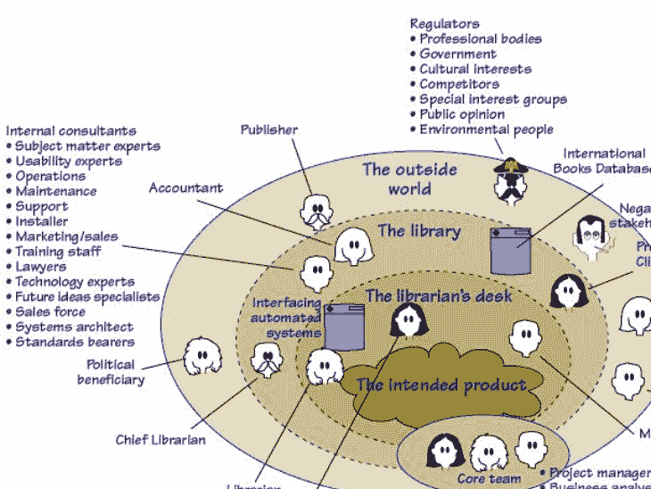
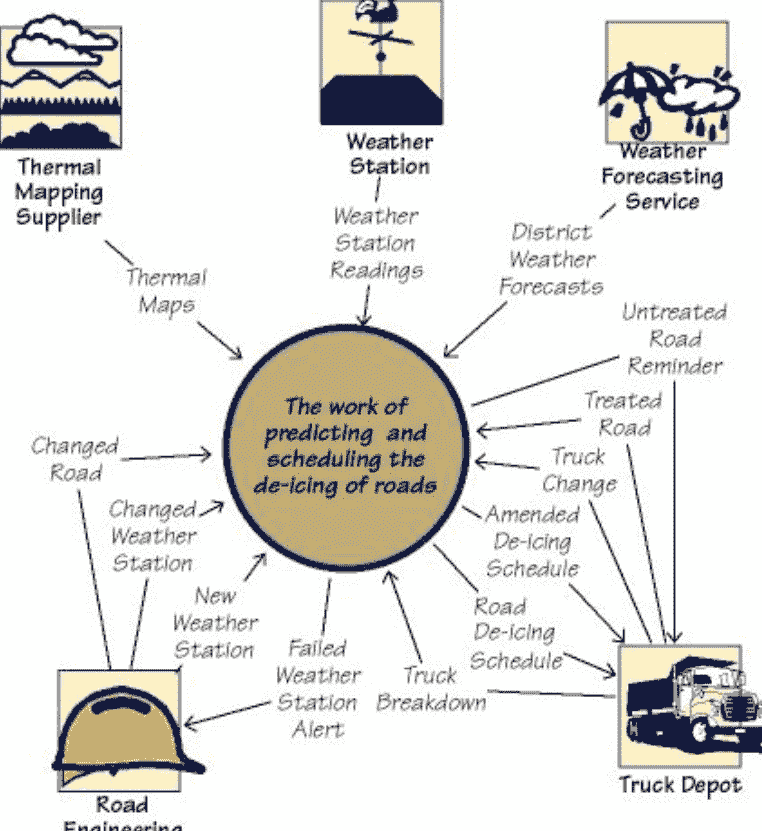
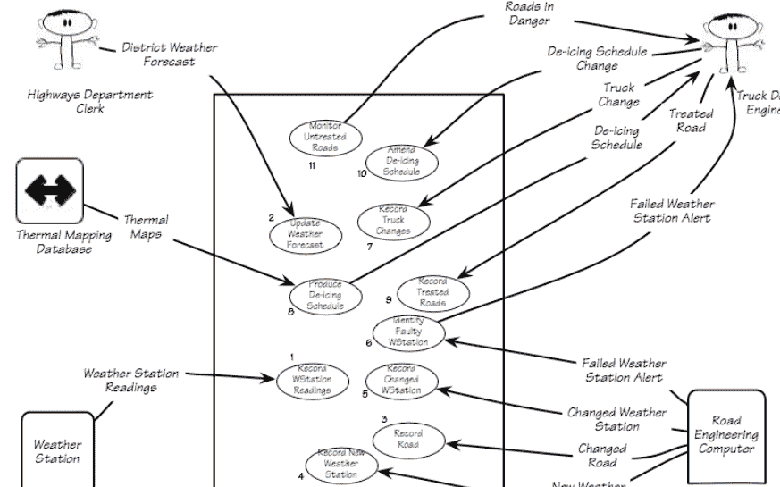
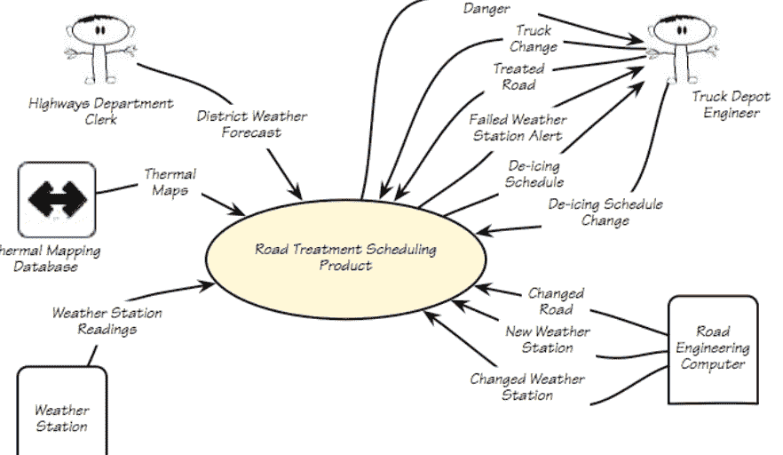

# Volere 需求规范模板

Volere 需求规格书模板旨在作为您需求规格书的基础。该模板为适用于当今软件系统的每种需求类型提供了相应的章节。您可以从 Volere 网站下载该模板，并根据您的需求收集流程和需求工具进行调整。该模板可与 Requisite、DOORS、Caliber RM、IRQa 以及其他流行工具配合使用，详参见 http://www.volere.co.uk/tools.htm

Volere 需求知识模型（包含在模板第 16 版中）展示了上述目录组件之间的正式结构和交叉引用。

# Volere

Volere 是需求工程和业务分析领域多年实践、咨询和研究的成果。我们将这些经验封装为通用需求流程、需求培训、需求咨询、需求审计、各种可下载指南和文章、需求知识模型以及此需求模板。我们还提供需求规格书编写服务。

Volere 规格书模板第一版于 1995 年发布。从那时起，世界各组织通过使用该模板作为发现、组织和沟通需求的基础，节省了大量的时间和金钱。

Volere 网站 volere.co.uk 包含关于 Volere 技术、Volere 用户经验和案例研究、需求工具以及其他对需求从业者有用的信息。

Volere 需求流程描述在 Suzanne Robertson 和 James Robertson 著的《掌握需求过程》（Mastering the Requirements Process—Second Edition）书中，Addison-Wesley，2006。ISBN 0-321-41949-9。

更多关于需求管理的信息，请参见 Suzanne Robertson 和 James Robertson 著的《需求驱动的项目管理》（Requirements Led Project Management），Addison-Wesley，2005。ISBN 0-321-65904-X。

本模板的更新内容和下载说明请访问 http://www.volere.co.uk。

Volere 公开研讨会在欧洲、美国、澳大利亚和新西兰定期举行。课程表请参阅 www.volere.co.uk。

# 需求类型

为了方便使用，我们发现将需求归为某种类型是非常方便的。分类类型有两个原因：作为发现需求的帮助，能够对与特定专家领域相关的需求进行分组。

功能性需求是产品的基础或核心主题内容。它们描述了产品必须做什么或它必须采取哪些处理操作。

Volere 的哲学是从开始编写需求时就开始对其进行测试。您通过添加其的**验收标准（fit criterion）**来使需求变得可测试。该验收标准对需求进行衡量，从而确定给定的解决方案是否符合需求。如果无法为需求找到验收标准，那么该需求要么是模糊的，要么是理解的。所有需求都是可以衡量的，且都应该带有验收标准。

# 原子化需求外壳

需求外壳（requirements shell）是编写每个原子需求的指南。外壳的组件（也称为“雪花卡”）下文所示。您可能决定添加一些额外的属性，以提供您的环境所需的追溯性。例如：实现此需求的产品、实现此需求的软件版本、对此需求的部门等。还有其他属性，但除非它们对你有帮助，否则不要随意添加属性：您添加的每个属性都需要进行维护。

这种需求外壳可以且应当自动化。当您下载模板时，您还会发现雪花卡的 Excel 表格实现版本。

| 需求 #： 唯一 ID 需求类型/ 事件/BUC/PUC #： |
| :--- | :--- |
| 描述：对需求意图的单句陈述 | |
| 依据：对需求的合理性说明 | |
| 发起者：提出此需求的利益者，以便能够测试解决方案是否符合原始需求 | |
| 验收标准：对需求的衡量标准，例如 | |
| 客户满意度：如果此需求未实现，客户的不满意度 | 如果此需求未包含在最终产品中，导致无法实现的其他需求 | 优先级：需求的相对重要性 | 冲突： | |
| 支持材料：历史：创建、更改： 指向说明和解释此需求的文档 Volere |
| 如果此需求被成功实施，利益者的快乐程度。分值从 1（不感兴趣）到 5（非常满意）。利益者的不满意程度。分值从 1（几乎不重要）到 5（极度不悦） | 需要此需求的事件/用例 ID | 模板中的类型 |

以下内容讨论并为 Volere 规格书模板的每个章节提供了示例。对于每个章节，内容、动机、考虑因素和格式为模板用户编写每种需求提供了一些指导。当您下载模板时，您还会发现一个模板骨架，您可能会发现它可以作为生成文档的基础。

## 1. 项目目的

模板的第一部分处理客户要求您构建新产品的根本原因。也就是说，它描述了客户面临的业务问题，并解释了产品旨在解决该问题。

### 1a. 用户业务或项目工作背景

内容

对正在进行的业务、背景以及触发开发工作的的简要描述。它还应该描述用户打算对交付的产品进行的工作。

### 动机

没有这一声明，项目将缺乏理由和方向。

### 考虑因素

您应该考虑业务问题是否严重，以及是否以及为什么要解决。

也许没有严重的问题，只是客户希望利用的一个重大商业机会。在这种情况下，请描述该机会

或者，项目可能寻求探索或调查可能性。在这种情况下，项目的交付物不是新产品，而是一个证明产品需求可以（或不能）满足的文档。

### 格式

文本描述通常足以理解项目。您可以选择结合现状模型、业务流程模型、当前文档样本、现状的照片和视频、网站地址以及组织架构图的组合来支持该描述。

### 1b. 项目目标

### 内容

本规范的这部分描述了我们希望产品的功能，以及它将为工作的整体目标带来什么优势。这一部分不要太冗长——对项目目标的简要说明通常比长篇大论、漫无叙述更有价值。一个短而有力的目标对利益相关者来说更清晰，并增加达成目标共识的概率。

### 动机

存在一种危险，即这一目的可能会在过程中丢失。随着客户和开发者发现更多可能性的，系统在构建过程中可能会偏离原始目标。除非客户采取了刻意的行动来改变目标，否则这种现象是非常糟糕的。可能需要任命专人作为目标的守护者，但将目标公开化并定期提醒开发者可能已经足够了。在每场评审会议上，对目标进行确认应该是强制性的要求。

### 示例

- 我们希望为在线订购货物的客户提供即时且完整的响应。
- 通过准确预测和安排路面除冰工作，来减少事故的发生。

### 衡量

任何合理的目标必须是可衡量的。如果你想测试项目是否成功，这是必要的。衡量标准必须量化业务通过实施该项目所获得的优势。如果项目是值得的，必须有坚实的理由来做它。例如，如果你的项目目标是：

- 我们希望为在线订购货物的客户提供即时且完整的响应。

你就清楚实现该目标为组织带来了什么优势。如果即时响应会导致更多客户感到满意，那么衡量标准必须量化这种满意度。例如，你可以衡量重复业务的增长（基于满意的客户会再次光临）、通过调查获得的客户认可率的提高、回头客带来的收入增加等。

无论你的目标是什么：

- 服务目标：这通过量化其对客户所做的贡献来衡量。
- 收益目标：量化在某段时间内的收入或收益增长量。或者，可以通过市场份额来量化收益目标。
- 法律目标：这不是量化，而是一种了解产品是否符合某项法规的方法（这可能是当地法律，也可能是你行业或组织的标准）。

目标的稳固建立、合理性和可衡量性对于其余的开发工作至关重要。通常是后者使得前者成为可能。

### 格式

你可以使用“目的、优势、衡量标准 (PAM)”来构建你的目标。
目的 (Purpose)：用一句话解释组织投资该项目的理由。

优势 (Advantage)：用一句话描述如果项目成功，组织将实现的益处。

衡量标准 (Measurement)：用一句话、图表或图形来量化你将如何衡量益处是否已实现。

目标的另一种形式可能是使用某种类型的目标模型。例如，扩展企业建模语言 EEML 包含了一种目标建模技术。如果你的组织正在使用企业建模，那么这提供了企业战略目标与单项项目目标之间的联系。

## 2. 利益相关者

本节描述了利益相关者——即对产品有兴趣的人。花足够的时间来准确确定和描述这些人是值得的，因为由于不知道他们是谁而出的代价可能非常高。

### 2a. 客户

### 内容

此项给出了客户的名称（有时称为赞助人）。允许有多个名称，但超过三个就会失去其意义。

### 动机

客户对产品的验收有最终决定权，因此必须对交付的产品感到满意。你可以将客户想成对产品进行投资的人。如果产品是为了公司内部消耗而开发的，通常同一个人往往兼任客户和用户的角色。如果你无法为客户找到名字，那么也许你不应该构建这个产品。

### 考虑因素

有时，在构建产品时，如果是为了外部包，，客户可能是某个部门。

### 格式

- 显示客户在组织中位置的图。
- 客户负责的决策列表。
- 你还可以包含一个图表，量化你将为客户提供的指标。

### 2b. 用户

### 内容

打算购买产品的人。在内部开发的情况下，客户和用户可能是同一个人。对于大众市场产品，此部分包含了对典型用户的描述（见 2e 节）。

### 动机

客户最终负责决定是否购买产品。只有在了解客户及其愿望时，才能收集到正确的需求。

### 格式

- 客户负责的决策列表。
- 你还可以包含一个图表，量化你将为客户提供的指标（指标）。

### 2c. 其他利益相关者

### 内容

受产品影响或在构建产品需要其输入的人和组织（如果可能的话）。这些利益相关者可能属于你的组织，也可能是外部的。

利益相关者的示例：

- 客户/赞助人（参考 2a）
- 用户（参考 2b）
- 主题专家
- 公众成员
- 当前系统的用户
- 营销专家
- 法律专家
- 领域专家
- 可用性专家
- 外部协会的代表
- 业务分析师
- 设计师和开发者
- 测试人员
- 系统工程师
- 软件工程师
- 技术专家
- 系统设计师

完整的清单请从 http://www.volere.co.uk 下载利益相关者分析模板。

对于每类利益相关者，提供以下信息：

- 利益相关者识别（角色/职位、人员姓名和组织名称的组合）
- 项目从利益相关者处需要的知识
- 该利益相关者/知识组合所需的参与程度
- 该利益相关者/知识组合的影响力
- 如何解决对同一知识的利益冲突的协议

### 动机

未能识别利益相关者会导致需求缺失。

### 格式

利益相关者地图，辅以每个角色代表的姓名以及该角色将提供的知识。以下图是一个通用的利益相关者地图，你可以将其作为清单，并替换为项目特定的人员/角色或组织。有关利益相关者地图的更多信息请参阅 http://www.volere.com

另一种用于识别利益相关者的格式是利益相关者分析表格。示例可以在 http://www.volere.com 下载。

带有注释的组织结构图也是定义利益相关者的有用格式。

### 2d. 产品的实际操作用户

### 内容
一类特殊类型的利益相关者列表——即产品的潜在用户。对于每一类用户，提供以下信息：

- 用户名称/类别：最可能是用户组的名称，例如文职人员、学生、道路工程师或项目经理。
- 用户角色：总结用户的职责。
- 领域知识经验：总结用户对相关领域/业务的了解程度。评分为初学者、熟练工或专家。
- 技术经验：描述用户对相关技术的经验。评分为初学者、熟练工或专家。
- 其他用户特征：描述任何对需求和产品最终设计产生影响的用户特征。例如：
    - 身体能力/残疾
    - 智力能力/残疾
    - 对工作的态度
    - 对技术的态度
    - 地理位置
    - 教育背景
    - 语言能力
    - 年龄段
    - 性别
    - 种族/族群

### 动机
用户是以某种方式与产品交互的人类。利用用户的特征来定义产品的可用性需求。用户也被称为用参与者（Actors）。

### 示例
用户可能来自各种（有时是意料之外的）来源。考虑你的用户可能是文职人员、店员、经理、经过高度培训的操作员、普通大众、休闲用户、路人、不识字者、技艺人员、学生、测试工程师、外国人、儿童、律师、远程用户、通过电话或互联网连接使用系统的人、应急工作人员等。

### 格式
一个简单的列表或电子表格，包含每个“用户角色 + 用户名称/代表人物”的用户特征。

### 2e. 用户画像 (Personas)

### 内容
一个关于虚构人物的故事，包括：

用户画像的名字、年龄、工作、家庭、爱好、居住地、最喜欢的食物、最喜欢的音乐、喜欢的、讨厌的、去哪里度度假、对技术的态度、金钱状况或任何其他可能影响该人物对产品思考方式的特征。如果能包含构想人物的照片或图画将会有所帮助。

### 动机
通过拥有一个或多个（限制在3个以内）用户画像，你可以让需求更针对你正试图满足的人群。如果你正在为消费类产品或公众成员使用的产品规定需求，这种技术将尤为有效。

### 格式
包含用户画像生平的简介。包含用户画像的照片或图画。简介可以以文档形式存在，用于向项目参与者介绍用户画像。你也可以将用户画像放在大尺寸的A3卡片上，并在会议上展示，提醒参与者你正在试图发现谁的需求。另一个想法是为用户画像制作故事板。你还可以为用户画像创建一个网站，通过添加更多关于其日常生活的内容来保持他的“活跃”。所有这些捕捉和交流用户画像的形式都是为了帮助人们将用户画像视为具有特定而非通用真实需求的真实用户。

### 2f. 分配给用户的优先级

### 内容
为每一类用户分配一个优先级。这确定了用户的重要性和优先顺序。按如下方式对用户进行优先级排序：

- 关键用户：他们对产品的持续成功至关重要。赋予这类用户产生的需求更高的权重。
- 次要用户：他们会使用产品，但他们对产品的看法对其长期成功没有影响。当次要用户的需求与关键用户的需求发生冲突时，以关键用户优先。
- 不重要的用户：这类用户被最低优先级。这包括频繁的、未经授权的、无技能的用户，以及误用产品的人。

用户类型的百分比旨在评估对每一类用户所考虑的程度。

### 动机
如果某些用户被认为对产品或组织更重要，这种偏好应该被陈明，因为它会影响你设计产品的方式。例如，你需要知道是否有一个大的客户群专门要求该产品，如果他们没有得到他们想要的，可能会导致重大的业务损失。

某些用户可能被列为对产品没有影响。这些用户会使用产品，但对其没有利益。换句话说，这些用户既不会抱怨，也不会做贡献。这些用户的任何特殊需求将具有较低的设计优先级。

### 格式
在你的用户特征电子表格中（见 2d）包含用户重要性评级，以供核心项目团队参考信息。根据你所属组织的文化，你可能需要将此视为敏感信息。

### 2g. 用户参与

### 内容
在适当的情况下，为用户类别附上参与声明，说明你认为这些用户提供需求是必要的参与程度。描述你期望这些用户提供的贡献——例如，业务知识、界面原型设计或可用性需求。如果可能，评估这些用户必须花费的最少时间，以便你确定完整的需求。

### 动机
许多项目由于缺乏用户参与而失败，有时是因为要求的参与程度没有说清楚。当人们必须在“完成日常工作”和“致力于新项目”之间做出选择时，日常工作通常具有优先权。这项要求从从初就明确了，必须为项目分配指定的用户资源。

### 格式
在你的用户特征电子表格中（见 2d）包含预估的用户参与时间，以及你期望该用户提供的知识类型。

### 2h. 维护用户与服务技术人员

### 内容
维护用户是一种特殊的实际操作用户，他们对维护和更改产品有需求。

### 动机
许多此类需求将在第4节发现。如果我们定义了维护产品的人的特征，将有助于触发可能遗漏的需求。

### 格式
将维护用户包含在用户特征电子表格中（见 2d）。

## 3. 强制约束
本节描述了对产品最终设计的约束。约束是全局性的——适用于整个产品的因素。产品必须在约束范围内构建。通常你已经知道这些约束，或者它们在项目开始前就已经确定了。它们限制了你可以做的事情并塑造了产品。约束与其他需求类型一样，具有描述、理由和适用标准，并通常以功能性和非功能需求相同的格式编写。

### 3a. 解决方案约束

### 内容
规定强制性技术或解决方案。包括任何相关的版本号。你应该解释使用该技术的原因。

### 动机
确定指导产品的约束。你的客户、顾客或用户可能有设计偏好，或者只有某些解决方案是可以接受的。如果不符合这些约束，你的解决方案就是不可接受的。

### 示例
约束的写法与其他原子需求相同（参考需求卡片/模板）。对于每个约束，理由和适用标准都是重要的，因为有助于暴露错误的约束（伪装成约束的解决方案）。此外，你通常会发现约束影响整个产品，而不是一个或多个产品用例。

- 描述：产品应使用目前的无线电系统与司机司机进行通信。
  理由：客户不会为新的无线电系统付费，司机也没有其他通信手段。
  适用标准：产品产生的所有信号应能让所有司机通过无线电系统听到并理解。

- 描述：产品应在 Windows XP 上运行。
  理由：客户使用 XP 不想切换到更高版本。
  适用标准：产品应通过微软测试组的 XP 合规认证。

- 描述：产品应为手持设备。
  理由：该产品面向徒步者和登山者营销。
  适用标准：产品重量不超过 300 克，任何尺寸不应超过 15 厘米，且没有外部电源。

### 注意事项

### 格式

将约束要求作为特定类型的原子需求（atomic requirement）包含在你的需求电子表格或数据库中。关于原子需求的属性，请参考此模板开头的“原子需求外壳”（Atomic Requirements Shell）示例。此外，请参考原子需求

http://www.volere.co.uk

约束的另一种形式可以是新产品/变更产品的系统架构图——参见 3b 和 3c。

### 3b. 当前系统的实现环境

### 内容

此部分描述了产品将安装的技术和物理环境。它包括自动化、机械、组织和其他设备，以及非人类的相邻系统。

### 动机

描述产品必须适应的技术环境。该环境对产品施加了设计约束。规范的这部分内容提供了关于环境的充分信息，使设计人员能够让产品与其周围的技术成功交互。

运行需求是根据此描述得出的。

### 示例

示例可以用图表的形式展示，用某种图标来代表每个独立的设备或人员（处理器）。在处理器之间添加接口，并对其形式和内容进行注释。

### 注意事项

当前系统的所有组件，无论其类型如何，都应该包含在实现环境的描述中。

如果产品将影响当前组织或对当前组织很重要，则请包含一张组织图。

### 格式

表示将用于实现产品的每个硬件和软件组件/子组件/设备/构建块的图。你所使用的特定图表取决于你的组织和项目的工作方式，重要的是，实现环境对于必须对如何实现功能和非功能需求决策的人来说必须是清晰理解的。常用的 UML 图类型有：类图、组件图、组件结构图、部署图、包图。还有许多其他自定义图表。

### 3c. 合作伙伴或协作应用程序

### 内容

描述不属于产品的一部分但产品将与之协作的应用程序。它们可以是外部应用程序、商业软件包或预存在的内部应用程序。

### 动机

提供由于使用合作伙伴应用程序引起的设计约束信息。通过描述或建模这些合作伙伴应用程序，你可以发现并突出潜在的集成问题。

### 示例

此章节可以通过包含文字描述、模型或与其他规范的引用来完成。描述必须包含对产品影响的所有接口的完整规范。

### 注意事项

检查工作上下文模型，以确定任何相邻系统是否应被视为合作伙伴应用程序。可能还需要检查工作的一些细节以发现相关的合作伙伴应用程序。

### 格式

用图表或表格识别待构建的产品与其他相邻系统之间的所有接口。记住，相邻系统可能是软件、人类或硬件。某些相邻系统位于你的组织内部，可能更容易理解且可能受到影响。其他相邻系统位于你的组织之外，如果无法影响则可能会很困难。产品范围图（示例参见 8a）通常用于定义与合作伙伴或协作应用程序的接口。

### 3d. 现成软件 (Off-the-Shelf Software)

### 内容

描述为了实现产品的某些需求必须使用的商业、开源或其他任何现成软件 (OTS)。它也适用于非软件 OTS 组件，如硬件或任何作为解决方案部分的其他商业产品。

### 动机

识别并描述将并入最终产品的现有商用、免费、开源或其他产品。该软件包的特性、行为和接口构成了设计约束。

### 注意事项

在收集需求时，你可能会发现与 OTS 软件的行为和特性冲突的需求。请记住，在完全了解需求范围之前，就已经强制使用 OTS 软件。根据你的发现，你必须考虑 OTS 产品是否是一个可行的选择。如果使用 OTS 软件不可商榷，则必须舍弃冲突的需求。

注意，你发现需求的策略会受到使用 OTS 软件决策的影响。根据你的发现，你必须考虑 OTS 产品是否是一个可行的选择。如果使用 OTS 软件不可商榷，则必须舍弃冲突的需求。

（注：此处原文存在重复内容，已根据“不重复输出原文”原则进行了逻辑处理，翻译确保语义连贯）

注意：此处原文多处存在表述重复。

根据你的发现，请考虑 OTS 可能会引发的法律影响。

### 3e. 预期工作环境

### 内容

描述用户工作和使用产品的环境。它应该描述对产品设计产生影响的工作环境，以及社交文化方面。

### 动机

识别工作环境的特征，以便设计产品以应对困难。

### 示例

 全 打印机距离用户桌子很远。这建议减少输出频率。
- 环境嘈杂，因此声音信号可能无效。
- 环境在室外，因此产品必须耐候、具有阳光下可见的显示，并考虑风的影响。
- 产品将用于图书馆；必须非常安静。
- 产品是环保意识组织使用的打印机；必须可以使用再生纸。
- 用户将站立或在某些位置工作。这建议采用手持产品。

### 注意事项

物理工作环境限制了完成方式。产品应该克服任何存在的困难；然而，你可能考虑重新设计工作环境，作为让产品补偿的替代方案。

### 格式

工作环境的文字描述；显示工作环境所有组件的图片；照片；视频。

### 3f. 进度约束

### 内容

应在此说明任何知的截止日期或机会窗口。

### 动机

识别对产品需求影响的关键节点。如果截止日期短，需求必须限制在允许时间内可以构建的内容。

### 示例

- 为了满足定期的软件发布。可能有其他业务部分或其他软件产品依赖于此产品。
- 机会窗口。对你产品的业务计划变更。例如，组织可能正在启动新工厂，在生产开始之前需要你的产品。

### 注意事项

通过给出日期并描述其重要性来说明截止日期限制。此外，识别产品某些部分需要测试之前的日期。

你还应该就未能在截止日期完成提出：

- 如果我们在年底之前没有完成该产品会怎样？
- 在圣诞购物季之前没有产品会有什么财务影响？
- 产品的哪些部分对于圣诞购物季至关重要？

### 格式

一份书面声明，给出：截止日期、截止日期原因、未能在截止日期完成的影响。

### 3g. 预算约束

内容

本节显示项目的预算，以金钱或可用资源的形式表示。

动机

需求不能超过预算。这一限制可能会限制产品中可以包含的需求数量。

此问题的意图是确定产品是否真的被需要。

考虑因素

意图是限制最疯狂的野心，防止团队在预算只能买得一架塞斯纳（Cessna）的情况下，却为空客A380收集需求。在这个预算内构建产品是否现实？如果问题的答案是否定的，那么要么客户并非真的投入精力构建该产品，要么客户对该产品的重视不够。无论何种情况，你都应该考虑继续下去是否值得。

格式

给出预算金额和资金来源的声明。

### 3h. 企业约束

内容

本节包含针对对你项目进行投资的企业特定需求。

动机

理解某些看起来看似无关或不理性的需求，因为它们与项目目标没有明显的直接联系。

示例

- 产品应仅使用美国制造的组件进行安装。
- 产品应为 CEO 提供所有功能。

考虑因素

你是否打算在 Macintosh 上开发产品，而办公室经理已经规定只允许使用 Windows ？

某位董事是否也是一家生产与你打算构建的产品相似公司的董事成员？

你是否同意这些企业需求对结果影响很小。事实是，即使你找到了更好、更高效或更经济的解决方案，系统也必须遵守企业需求。在这里提出几个探究性的问题可以避免以后的一些心痛。

企业需求可能纯粹涉及你组织内部的政治问题。但在其他情况下，你可能需要考虑客户组织内部的政治或国家的政治状况。考虑企业要求的另一种方式是，它们是由位于项目范围明显边界之外的战略决策所定义的约束需求。

## 4. 命名规范和术语

根据我们的经验，所有项目都有自己独特的词汇，通常包含各种缩写和首略词。未能理解这些项目特定的术语不可避免地导致误解、浪费数小时的时间、团队成员之间的沟通不畅，并最终导致规格质量糟糕。

## 4a. 项目相关利益者使用的所有术语定义（包括缩写）

内容

一个术语表，包含了利益者使用的所有名称、缩写和首略词的含义。仔细选择名称，以避免产生不同的、非违意的含义。

如果你正在研究的工作已经有一个术语表，则以其为起点。随着分析的进行，该术语表应该不断扩大和完善，但目前，它介绍了利益者使用的术语以及这些术语的含义。该术语表反映了当前工作领域正在使用的术语。你也可以从行业内使用的标准名称开始。

为每个术语写一个描述。相关的利益者必须对该术语含义的描述达成一致。

我们建议你添加所有的缩写和首略词。我们经常遇到团队成员使用缩写，但承认不知道这些缩写含义的情况。这一节为你提供了一个注册缩写的地方。

动机

名称非常重要。它们唤起的含义如果定义得恰当，可以节省数小时的解释工作。在项目早期对名称的关注有助于揭示误解。

随着详细工作的进行，术语表为更精确的业务/工作数据模型和数据字典提供输入——参见模板的第 7 节。随着分析数据的演变，术语中的许多定义将在字典中通过添加其数据组成得到扩展。

示例

- 卡车 (Truck)：用于在道路上铺除冰材料的车辆。
- “Truck”不指载货车辆。

BIS：业务智能服务（Business Intelligence Service）。由 Steven Peters 管理的部门，为组织的其余部分提供业务智能。

热力图 (Thermal Map)：对某一或其他地理区域进行调查，以确定该区域不同部分的温度差异。生成的热力图意味着通过知道参考点的温度就可以确定该区域任何部分的温度。

考虑因素

利用现有的参考资料和现有的数据字典。显然，避免重命名现有项目是最好的，除非它们模糊到导致混淆。

从项目开始，就强调避免同音词和同义词的必要。解释它们如何增加项目成本。

格式

现有的术语表、指向行业字典的指针，或者问题领域中常用的术语列表，并附有一句描述每个术语含义和目的的句子。

## 5. 相关事实和假设

相关事实是影响产品但未被需求模板其他部分涵盖的外部因素。它们不一定会被转化为需求，但可以转化。相关事实提醒开发人员注意与需求相关的条件和因素。

## 5a. 相关事实

内容

影响产品但不是强制性需求约束的因素。事实为规格书读者提供了更多理解业务问题的背景。

动机

相关事实为规格书读者提供了背景信息，并可能有助于需求。它们将对产品的最终设计产生影响。

示例

- 一吨除冰材料可以处理三英里的单车道道路。
- 现有应用程序有 10,000 行 C 代码。

## 5b. 业务规则

内容

这些可能是对需求来源的工作/业务/领域产生影响的业务规则。相关的业务规则将是需求的触发。

动机

业务规则在需求过程的所有阶段都会被提到。通常很难立即确定规则是否与项目相关。这一节提供了一个捕捉业务规则的地方，并随着对工作的理解，重新审视它们并作为触发器。

示例

- 卡车司机最长休息为 5 小时。
- 工程师每周维护气象站。

格式

描述业务规则、规则原因以及规则权限的声明。在新项目开始时，查看是否已经定义了一些业务规则。这让你进入需求重用的道路。

所建造的卡车将能够以 40 英里的速度运行。
它们的容量为两吨。

考虑因素

我们会做出下意识的假设。有必要与项目成员交谈，发现他们任何下意识的假设。向利益者提问此类技术和业务相关问题，例如：

- 你预计可以使用哪些软件工具？
- 会有新的软件产品吗？
- 你预计以新的方式使用现有产品吗？
- 有任何预计我们可以处理的业务变化？

事先说明这些假设很重要。你可能需要考虑假设正确的概率，并在相关情况下，列出如果假设未发生时的替代方案。

假设是暂时的。也就是说，在规格书发布时，所有假设都应该被消除——假设应该变成需求或约束。例如，如果关于预期作为你产品伙伴的产品能力的假设，该能力应该已被证明是满意的，它变成了一个约束。相反，如果购买的产品不适用，它就变成了项目团队构建所需能力的需求。

格式

描述假设的书面声明，以及假设错误时对项目的影响。根据假设的复杂程度，可能需要包含对其他文档或人员的引用。

## 6. 工作范围

工作范围确定了要研究的业务领域的边界，并概述了它如何融入其环境。一旦你理解了工作及其约束，就可以建立产品范围，参见模板的第 8 节。

### 6a. 现状

### 内容

这是对现有业务流程的分析，包括可能被新产品替换或更改的手动和自动化流程。根据你提到的 Volere 棕牛模型（Brown cow model），你可以将此称为“现状（How Now）”视图。业务分析师可能已经作为项目业务论证分析的一部分完成了这项调查。此时，构建一些业务流程模型可能是合适的。这些模型是业务为了开展组织工作而使用的流程模型。模型包含了角色、个人、部门、技术和程序。它们说明了工作流以及流程各个组件之间的依赖关系。

### 动机

如果你的项目打算对现有的手动或自动系统进行更改，你就需要理解拟议更改的影响。对现状的研究为理解拟议更改的影响以及选择最佳替代方案提供了基础。业务流程建模并不总是导致软件开发。相反，程序和角色分配方式的某些更改可能是实现必要改进的最佳方法。

### 形式

许多不同的表示法适用于构建业务流程模型，例如：活动图、业务流程图、泳道道图、数据流图。

### 6b. 工作上下文

### 内容

工作上下文图识别了我们为了构建产品而需要调查的工作边界。请注意，它包含的不只是预期的产品。除非理解产品将支持的工作，否则你几乎没有机会构建出一个能够完美融入其环境的产品。

示例上下文图中的相邻系统（例如，天气预报服务）指示了其他需要理解的主题（系统、人和组织）。相邻系统与工作上下文之间的接口说明了我们为什么对该相邻系统感兴趣。在天气预报服务的案例中，我们可以说，我们关注它何时、如何、何地、由谁、什么以及为什么产生区域天气预报信息的细节。

### 动机

清晰地定义工作研究的边界，从而确定需求的工作量。没有这个定义，我们就很难构建出一个能够无缝融入其环境的产品。

### 示例

此工作上下文模型定义了正在调查的世界部分与其他、组织、硬件和软件（称为相邻系统）之间的连接。输入和输出代表了在工作与世界其他部分之间传输的数据和材料。工作上下文是划分调查和发现需求的基础。

### 注意事项

上下文图中使用的名称应与命名规范（第4节）一致，并最终在数据字典（第7节）中定义。没有这些定义，上下文模型就缺乏严谨性，并可能被误解。相关利益者必须同意上下文模型上所示接口定义。

### 形式

一个显示工作与相邻系统之间流过的输入和输出的图。

或

一个识别工作与相邻系统之间流动的所有输入和输出的表格。

输入和输出的名称最终定义在数据字典中——参见第 7b节。

### 6c. 工作划分

### 内容

显示工作做出响应的所有业务事件的列表。业务事件是现实世界中影响工作的事件。因为时间到了工作去做某些事情了——例如，生成周报、提醒未付款客户、检查设备状态等。对每个事件的响应是一个业务用例（称为 BUC）；它代表了工作中的一个离散划分，对工作的总功能有所贡献。

事件列表包含以下元素：

- 事件名称
- 来自相邻系统的输入或触发数据流（与上下文图上的名称相同）
- 指向相邻系统的输出（与上下文图上的名称相同）
- 业务用例的简要总结（这是可选的，但我们发现这是定义业务用例需求时非常有用的第一步——你可以将其看作一个微场景。）
- 与此事件相关的业务数据类别（在研究事件的早期你不会知道这些，随着深入细节，你将开始理解核心数据并将其添加到事件列表中。）

### 动机

识别出逻辑上的工作块，这些工作块可以作为发现详细需求的基础。这些业务事件还提供了子系统，可以作为管理详细分析和设计的基石。每个业务事件都有一个业务用例（BUC），其细节可以被独立研究。然而，所有的 BUC 都通过存储的业务数据相互连接（参见第 7节）。

### 示例业务事件列表

| 事件名称 | 输入和输出 | BUC 总结 |
| --- | --- | --- |
| 1. 气象站传输读数 | 气象站读数（入） | 记录读数属于气象站。 |
| 2. 天气服务预报天气 | 区域天气预报（入） | 记录预报。 |
| 3. 道路工程师建议更改道路 | 变更的道路（入） | 记录变更的道路。 |
| 4. 道路工程安装新气象站 | 新气象站（入） | 记录气象站。 |
| 5. 道路工程更改气象站 | 变更的气象站（入） | 记录气象站。 |
| 6. 测试气象站的时间 | 失败告警（出） | 记录气象站的变化。 |
| 7. 调度更改车辆 | 车辆变更（入） | 预测未来两小时的冰情。 |
| 8. 检测结冰道路的时间 | 除冰计划（出） | 为结冰的道路分配车辆。 |
| 9. 车辆处理道路 | 已处理的道路（入） | 通知道路工程。 |
| 10. 调度报告车辆问题 | 故障计划（出） | 重新分配可用车辆到道路。 |
| 11. 监控道路处理的时间 | 未处理道路提醒（出） | 检查所有计划道路是否已处理，并对未处理的发出提醒。 |

### 注意事项

尝试列出业务事件并对每个 BUC 进行一句话总结是测试工作上下文的方法。这项活动涵盖了项目中的不确定性并有助于沟通。当你进行事件分析时，它通常会促使对工作上下文进行某些更改。

我们建议为离散的工作收集需求。我们发现业务事件是将工作划分为可单元的最方便、一致且自然的方式，并可以将细节追溯到工作范围。

### 形式

业务事件列表/表格，每个事件包含：事件编号、事件名称、输入名称、输出名称。事件响应总结。列表上的名称必须与上下文模型/表格一致（参见 6b）。

### 6d. 规范业务用例 (BUC)

### 内容

关于业务用例 (BUC) 如何响应业务事件的细节规范。

### 动机

理解当业务事件发生时必须执行的详细业务响应，并为发现详细需求提供基础。对 BUC 的理解还为讨论 BUC 的哪些部分由构建的产品执行提供了基础。

### 示例

在随此模板下载的示例规范中，你会找到 BUC 场景的示例。

### 注意事项

无论你使用什么方法来规范 BUC 的细节，都应该保持在该业务事件的输入和输出边界内。如果你发现了额外的输入或输出数据，这表明你需要更改事件列表以及工作上下文图上的输入/输出数据。

### 形式

可以使用任何适合分析师的模型组合来规范 BUC。常用的方法有：活动图、BUC 场景、流程图、时序图、思维导图、面试笔记……唯一的注意事项是你的 BUC 上的输入和输出必须完全相同且

因此可以追溯到相应业务事件的输入和输出。

## 7. 业务数据模型与数据字典

### 7a. 业务数据模型

### 内容

对产品相关的核心主题、业务对象、实体和类的规范。它可能以初步模型、实体关系模型或任何其他类型的数据模型的形式存在。

### 动机

明确系统的主题内容，从而引发对尚未考虑的需求的识别。你可以通过使用“创建、引用、更新、删除（CRUD）”表交叉检查数据模型和事件来发现需求。数据模型是对所有与工作范围相关的业务数据的规范说明。

### 示例

这是一个使用统一建模语言（UML）类模型表示法描述的业务系统业务主题的模型。这些是所研究工作范围内的流程所创建、引用、更新和删除的所有数据。关于工作范围的更多信息，请参阅第 6 节。

| 区域 | | 道路 | 1 | 路段 | | 卡车 |
| --- | --- | --- | --- | --- | --- | --- |
| | * | * | | | | |
| | * | | | | * | |
| | | | | 1 | | 1 |
| 预测 | | 温度读数 | * | 1 | 天气站 | 仓库 |

每个矩形代表一类业务数据。该类的属性在数据字典中定义。

例如：区域 (District) = *由议会定义的地理区域*

区域名称 + 区域尺寸 + 区域坐标

同样，每个属性在字典中也有定义，例如：区域名称 (District Name) = *工程师识别区域时使用的名称*
你可以使用任何类型的数据或类模型来捕获这些知识。问题在于捕获业务主题的含义以及各个部分之间的连接，并证明你在项目内部是一致的。如果你有既定的公司标准符号，请使用它，因为这将帮助你在这不同项目之间复用知识。

更多关于数据模型的示例，请参阅与此需求模板下载包一同提供的示例规范。

### 考虑因素

是否存在针对相似或重叠系统的数据或对象模型可以作为一个有用的起点？对于该系统处理的主题是否存在领域模型？

### 格式

有许多类型的数据模型可以对业务数据进行建模。你最可能遇到的是：

- UML 类模型
- 鸟脚图
- 实体关系图
- 显示以下内容的表格：类名、类之间的关系、每个类的属性。

如果你的组织偏好某种特定模型，你必须使用该模型。重要的是，你构建的数据模型是一个业务数据模型，而不是数据库设计。你的模型关注的是通过对工作语境内的所有数据进行逻辑划分，以及这些业务类之间必要的业务关系，来识别业务类。你的模型被用作设计如何实现数据的输入。每个业务类中属性的定义位于数据字典中（见第 7b 节）。

### 7b. 数据字典

模板第 4 节早早描述的术语表是建立术语共同理解的起点。当你开始定义调查范围时，要在正式的数据字典中定义数据输入和输出。你在该字典中定义的术语（甚至精确到元素级）与你在定义详细原子化需求时使用的术语是相同的。

### 内容

数据字典规定了以下内容：

- 数据模型上的类
- 类的属性
- 类之间的关系
- 所有模型上的输入和输出
- 输入输出输出数据元素

当做出实现决策时，应将接口的技术规范添加到字典中。

### 动机

工作上下文图提供了对所研究工作范围的准确定义，而产品范围图（见第 8a 和 8b 节）定义了边界。你在字典中定义的术语（精确到元素级）与你在定义详细原子化需求时使用的术语是相同的。

### 示例

以下是针对所研究项目的部分数据字典，注意此版本的字典按字母顺序排序。当做出实现决策时，应将实施的格式添加到字典中。

| 名称 | 内容 | 类型 |
|---|---|---|
| 仓库 (Depot) | 仓库标识 | 类 |
| 区域 (District) | 区域名称 + 区域尺寸 | 类 |
| 预测 (Forecast) | 温度预测 + 预测时间 | 类 |
| 道路 (Road) | 道路名称 + 道路编号 | 类 |
| 路段 (Road Section) | 路段标识 + 坐标 | 类 |
| 温度读数 (Temperature Reading) | 读数时间 + 温度测量 | 类 |
| 卡车 (Truck) | 卡车标识 | 类 |
| 道路除冰计划 (Road Deicing Schedule) | {路段标识 + 计划执行时间 + 关键开始时间 + 卡车标识} | 数据流 |
| 区域名称 (District Name) | *由议会定义的地理区域* | 元素 |
| 区域尺寸 (District Size) | *单位公里* | 元素 |
| 温度预测 (Forecast Temperature) | *摄氏度* | 元素 |
| 预测时间 (Forecast Time) | *24小时制* | 元素 |
| 读数时间 (Reading Time) | *24小时制* | 元素 |
| 道路名称 (Road Name) | *参见数据库* | 元素 |
| 道路编号 (Road Number) | *参见数据库* | 元素 |
| 路段 (Road Section) | *参见数据库* | 元素 |
| 路段标识 (Road Section Identifier) | *参见数据库* | 元素 |
| 温度测量 (Temperature Measurement) | *摄氏度* | 元素 |
| 计划执行时间 (Treatment Scheduled Date) | *年-月-日* | 元素 |
| 开始开始时间 (Treatment Start Time) | *24小时制* | 元素 |
| 关键开始时间 (Critical Start Time) | *在此时间之后开始的处理不保证有效* | 元素 |
| 卡车标识 (Truck Identifier) | *1到1000之间的数字。咨询首席工程师获取列表* | 元素 |

### 考虑因素

字典提供了需求人员/业务分析师与设计/开发/实施人员之间的联系。实施人员为字典中的术语添加实现细节，定义如何实现数据。此外，实施人员还会添加由于所选技术而存在且与业务需求无关的术。

当你研究工作时，可能会发现放在命名规范和术语（第 4 节）中的项实际上是特定的数据流或属性数据。发生这种情况时，你应该将该项转移到数据字典。

### 格式

数据字典根据你手中的工具以多种形式维护。重要的是尽可能方便将需求、文档和模型中的术语使用与字典中的定义进行交叉引用。维护数据字典的常见形式是表格、数据库和自动化需求工具。

## 8. 产品范围

### 8a. 产品边界

用例图识别了用户（角色）与产品之间的边界。你通过检查每个业务用例，并与相关利益相关者共同确定业务用例的哪些部分应该自动化（或由某种产品满足），哪些部分应该由用户或其他产品完成，从而得出产品边界。这项任务必须考虑用户的能力。

（第2节）、约束条件（第3 节）、项目目标（第1 节），以及你对工作和技术的了解，这些将对工作做出最大的贡献。

示例用例图显示了产品边界（矩形）之外的用户/参与者。产品用例（PUCs）是边界内的椭圆。数字将每个 PUC 链接回它所属的 BUC（见第 7 节）。箭头表示使用关系。在这一版本的 PUC 图中，我们在箭头上标注了名称，以确保精确性和可追溯性。注意，参与者可以是自动化的，也可以是人类。

你通过决定每个业务用例（BUC）的产品边界应该在哪里来推导出 PUC。这些决策基于你以及相关利益相关者对工作和需求约束的了解。请注意，你提出的 PUC 可以追溯回 BUC。当你实现一个 PUC 时，你的内部设计可能（很可能也会）意味着你实现了一个包含几个系统用例（SUCs）的 PUC。

### 示例

PUC 图上的数字与业务事件列表上的 BUC 数字相对应（见第 7 节）。

你可以看到，PUC 图是少量（最多约 20 个） PUC 的有效总结。如果你有大量的 PUC，那么产品范围图结合 PUC 汇总表（见 8b）将是更好的方法。

以下是路面除冰项目产品范围图的示例。产品范围图上每个接口的内容都在数据字典中定义，并且也可以通过某种形式的原型或仿真来支持。某些项目会发布一份单独名为《接口规范文档》的独立文档。该文档的内容将是产品范围图上接口的定义，通常由原型和模型提供支持。

上述产品范围图总结了产品与参与者/用户之间的接口。

### 格式

一个产品用例图。

由单个用例说明支持的产品范围图。范围图上接口的说明书和原型。

### 8b. 产品用例表

产品范围图是产品与其他自动化系统、组织和用户之间所有接口的有用总结。如果 PUC 的数量在可控范围内——例如少于二十个——那么 PUC 图作为一种总结与产品相关的 PUC 的图形方式是有用的。但在实践中，我们发现产品用例表更有用，因为它可以处理大量的 PUC，并精确地识别定义每个 PUC 边界的输入和输出数据。

## 产品用例 (PUC) 汇总表

| PUC  | PUC 名称 | 参与者 | 输入与输出 |
|---|---|---|---|
| 1 | 记录气象读数 | 气象站 | 气象站读数 (入) |
| 2 | 记录天气预报 | 高路部门人员 | 区域天气预报 (入) |
| 3 | 记录道路 | 道路工程计算机 | 变更道路 (入) |
| 4 | 记录新气象站 | 道路工程计算机 | 新气象站 (入) |
| 5 | 记录变更的气象站 | 道路工程计算机 | 变更的气象站 (入) |
| 6 | 识别故障气象站 | 卡车场工程师 | 气象站故障警报 (出) |
| 7 | 记录卡车变更 | 卡车场工程师 | 卡车变更 (入) |
| 8 | 生成除冰计划 | 卡车场工程师/热力图数据库 | 除冰计划 (出) 热图 (入) |
| 9 | 记录已处理道路 | 卡车场工程师 | 已处理的道路 (入) |
| 10 | 修改除冰计划 | 卡车场工程师 | 除冰计划变更 (入) 修改后的除冰计划 (出) |
| 11 | 监控未处理道路 | 卡车场 | 危险中的道路 |

### 8c. 个体产品用例

在这里你定义了你的 PUC 表中列出的单个产品用例 PC 的细节。你可以为你列表上的每个产品用例包含一个场景或模型。

格式

- *一个文本场景*（a text scenario）
- *一个故事板*（a storyboard）
- *低保真原型*（a low fi prototype）
- *高保真原型*（a hi fi prototype）
- 包括异常和替代方案的正式用例说明
- 序列图、活动图、数据流图或任何你的项目组熟悉的其他类型的模型

## 9. 功能性需求

### 9a. 功能性需求

内容

这是每个原子功能性需求的规格书。对于所有类型的原子需求（功能性的、非功能性的、约束），使用需求外壳（requirements shell）作为指南，确定应该指定哪些属性。原子需求及其属性的完整说明包含在此模板的介绍材料中。

动机

规范由产品执行的详细功能性需求。

# # 示例

| 需求 #: 75 | 需求类型: 9 | 事件/BUC/PUC #: |
| --- | --- | --- |
| 描述: *产品应记录已处理的道路* | | |
| 理由: *能够调度未处理的道路* | Arnold Snow - 总工程师 | |
| 验收标准: *在30分钟内更新* | | |
| 客户满意度: 5 | 客户不满意度: 5 |
| 依赖关系: 所有 | 冲突: 10 |
| 支持材料: 工作上下文 | | |
| 历史记录: 创建于20 | |

# # 验收标准

每个需求都应该有一个验收标准或测试用例。在任何情况下，验收标准是判断产品符合需求的基。

# # 注意事项

如果你产生了用例列表（见 6c 和 8b），那么它可以帮助追溯到开发。注意，如果你尚未确定产品边界和用例（PUCs），则请编写功能性和非功能性需求。

即使你使用原型，它也是为了发现需求的；它不应被认为是需求的替代品。

### 格式

用于记录和维护需求（功能性的、非功能性的）的格式取决于你拥有的工具。自动化形式是管理需求的最佳方式：

- * 电子表格（随模板下载提供示例）
- * 你使用的任何需求工具提供的数据库。市场上有很多工具，请参阅 http://www.volere.co.uk/tools 获取列表
- * 你建立的内网，用于维护和访问原子需求及其属性
- * 自定义的数据库

无论你使用何种格式来记录和维护需求，在编号和术语上保持一致都是重要的，这样你就可以检查完整性并响应变化。

## 非功能性需求

下文 10-17 节描述了非功能性需求。这些需求的形式与上述所有功能性需求的形式相同。

## 10. 外观与感受需求

### 10a. 外观需求

内容

本节包含与产品精神相关的需求。客户可能对产品提出了特殊要求，例如企业品牌、使用的颜色等。本节捕获了外观的需求。在外观需求确定之前不要尝试进行设计。

动机

确保产品的外观符合组织的预期。

示例

- 产品应对青少年具有吸引力。
- 产品应符合企业品牌标准。

验收标准

- 代表性的青少年样本在首次接触产品后四分钟内，在没有提示或诱导的情况下开始使用该产品。

- 品牌办公室应证明产品符合当前标准。

### 10b. 风格需求

### 内容

指定产品氛围、风格或感觉的需求，这些需求会影响潜在客户看待产品的方式。同时也包含了利益相关者对于用户与产品之间交互程度的意图。

在本节中，如果该产品是制造产品，你还需要描述包装的外观。包装在尺寸、风格以及与贵机构其他包装的一致性方面可能有某些要求。请记住关于包装的法律，这些法律要求包装不能显著大于其所包含的物品。

你在此处记录的风格需求将指导设计师创建出符合客户愿景的产品。

### 动机

鉴于当今市场状况和人们的期望，我们无法负担风格错误的产品。一旦满足了功能需求，通常是产品的外观和风格决定了它们是否能够成功。你在这一节中的任务是精确确定产品在目标消费者眼中应呈现出什么样子。

### 示例

产品的外观应呈现出权威性。

### 验收标准

在首次接触产品后，70% 的代表性潜在客户应同意他们觉得可以信任该产品。

### 考虑因素

外观和感受需求规定了客户对产品外观的愿景。这些需求最初可能看起来很模糊（例如，“保守且专业的外观”），但它们将通过其标准进行量化。验收标准为你提供了机会，从客户那里精确提取含义，并为设计师提供其要完成任务的精确指令。

## 11. 可用性与人性化需求

本节关注使产品易于使用且对手部用户符合人体工程学接受标准的需求。

### 11a. 易用性需求

### 内容

本节描述了客户对产品目标用户操作简易程度的期望。产品的易用性源于预期用户的能力以及产品功能的复杂性。

易用性需求应涵盖以下属性：

- 使用效率：用户使用产品的速度有多快或多准确。
- 易记忆性：预期普通用户能记住多少关于使用产品的知识。
- 错误率：对于某些产品来说，用户犯极少或不犯错误至关重要。
- 使用产品的整体满意度：这对于面临激烈竞争的商业性交互产品尤为重要。网站就是一个很好的例子。
- 反馈：用户需要多大的反馈才能确信产品正在准确地执行用户预期的操作。对于某些产品（例如安全关键型产品），所需的反馈程度将比其他产品更高。

### 动机

引导产品设计师构建出符合最终用户期望的产品。

### 示例

- 产品应易于 11 岁儿童使用。
- 产品应帮助用户避免出错。
- 产品应让用户想要使用它。
- 产品应由没有经过培训、可能甚至理解英语的人使用。

### 验收标准

这些示例可能看起来很简单，但它们确实表达了客户的意图。为了完全明确该需求的含义，你必须添加一个可以测试它的衡量标准——即验收标准。以下是上述示例的验收标准：

80% 的 11 岁儿童测试小组应能够在[指定时间]内成功完成[任务列表]。

在使用该产品一个月后，总错误率应低于 1%。

匿名调查应显示，在经过三周的熟悉期后，75% 的目标用户正在经常使用该产品。

### 考虑因素

参考第 3 节“产品用户”，以确保你已经从所有不同类型用户的角度考虑了可用性需求。

可能需要与你的用户和客户进行特别咨询会议，以确定是否必须在产品中构建任何特殊的可用性考虑。

你还可以考虑一个在产品可用性测试方面经验丰富的实验室，该实验室测试过的项目状况（模板的第 1-7 节）与你的相似。

### 11b. 个性化与国际化需求

### 内容

本节描述了如何通过更改或配置产品，以考虑用户的个人偏好或语言选择。

个性化需求应涵盖以下问题：

- 语言、拼写偏好和语言习语
- 货币，包括符号和小数点规范
- 个人配置选项

### 动机

确保产品的用户无需与开发者的文化习俗作斗争或被动地接受。

### 示例

- 产品应保留购买者的购买偏好。
- 产品应允许用户选择所选语言。

### 考虑因素

考虑你产品的潜在客户和用户的国家及文化。任何国外用户都会欢迎转换回其母语拼写和表达的机会。

通过允许用户自定义使用产品的方式，你为他们提供了更紧密地参与贵机构的机会，并享受他们个人的用户体验。
你可能还会考虑产品的可配置性。可配置允许不同的用户拥有产品的不同功能变体。

### 11c. 学习需求

### 内容

指定学习使用该产品应多容易的需求。这种学习曲线范围从放置在公共领域的产品（例如停车收费表）的零时间成本，到复杂产品需要大量时间不等。

### 动机

量化你的客户认为在使用产品之前允许的时间。此项需求指导设计师理解用户将如何学习。例如，设计师可能会在产品中构建交互式帮助功能。或者，可以这样构造产品，使其功能一目了然。

### 示例

- 产品应易于工程师学习。
- 职员应能够在短时间内发挥生产力。
- 产品应由未接受培训的公众成员使用。

### 验收标准

工程师应在不需要手册的情况下，在指定时间内产生特定结果。
在接受[小时数]培训后，职员应能在单位时间内产生[输出数量]。
[约定百分比]的测试小组应在时间限制内成功完成特定任务。

### 考虑因素

参考第 2d 节“产品手部用户”，确保你已经从所有不同类型用户的角度考虑了学习需求。

### 11d. 可理解性与礼貌性需求

本节关注与目标终端用户熟悉的概念和隐喻相关的需求。

### 内容

这规定了产品被用户理解的需求。虽然“可用性”指的是使用、效率等特征，但“可理解性”决定了用户是否直觉知道产品将为他们做什么，以及它如何融入他们的世界观。你可以将可理解性理解为产品的礼貌，即不要求他们了解或学习与其业务问题无关的事情。礼貌的另一个方面是产品不应要求用户输入产品已经获取的信息。

### 动机

避免强制用户学习属于产品内部构造且与用户无关的术语和概念。使产品更容易理解，从而更有可能被目标用户采用。

### 示例

- 产品应使用用户社区自然理解的符号和单词。
- 产品应向用户隐藏其构造细节。

### 11e. 无障碍性需求

### 内容

关于常见残障人士易于访问产品的需求。这些残障可能与身体残障或视觉、听力、认知或其他能力有关。

### 动机

在许多国家，要求某些产品必须供残障人士使用。无论何种，排除这一庞大的潜在客户群体都是适得其反的。

### 示例

- 产品应能供视力受损的用户使用。
- 产品应符合《美国残疾人法》。

### 考虑因素

某些用户患有常见疾病之外的残疾。此外，某些部分残疾相当常见。一个简单且影响不大的例子是，大约 20% 的男性患有红绿色盲。

## 12. 性能需求

### 12a. 速度和延迟需求

### 内容

规定了用于完成指定任务的可用时间。这些需求通常指的是响应时间。它们也可以指产品以适用于预期环境的速度运行的能力。

### 动机

某些产品——通常是实时产品——必须能够在给定的时间段内执行其某些功能。未能做到可能意味着灾难性的失败（例如，飞机上的地面感应雷达探测即将出现的山脉），或者产品无法应对所需的使用量（例如，自动售票机）。

### 示例

- 用户与自动化系统之间的任何接口其最大响应时间不应超过 2 秒。
- 响应应足够快，以避免中断用户的思维流。
- 产品应每 10 秒轮询一次传感器。
- 产品应在变化发生后 5 分钟内下载新的状态参数。

### 验收标准

当需求描述未量化时，需要验收标准。然而，我们发现大多数性能需求都是用量化的术语表述的。例外是上述的第二个需求，其建议的验收标准是：

对于 90% 的查询，产品的响应时间应少于 1 秒。任何无响应的情况都不应超过 2.5 秒。

### 考虑因素

不同类型的速度需求重要性存在巨大差异。如果你正在开发导弹制导系统，那么速度至关重要。相比之下，每六个月运行一次的库存控制报告几乎不需要极快的响应时间。

对此模板的这一部分进行自定义，以提供您的环境中重要的速度需求示例。

### 12b. 安全关键需求

### 内容

对人员、财产和环境遭受的感知风险进行量化。不同国家有不同的标准，因此验收标准必须精确指定产品必须符合哪些标准。

### 动机

理解并强调在预期运行环境中使用产品时可能发生的损坏。

### 示例

- 产品不应产生损害人类健康的有毒气体。
- 热交换器应采取措施防止人体接触。

### 验收标准

产品应通过卫生部标准 E110-98 的认证。这应由合格的测试工程师进行认证。

[指定尺寸] 测试小组的任何成员都不应能接触热交换器。热交换器还必须符合安全标准 [指定是哪一个]。

### 考虑因素

这里给出的示例需求适用于某些产品而非所有产品。无法为安全关键需求的每种变体提供示例。

为了使模板在您的环境中生效，您应该通过添加特定于您产品的示例来对其自定义。

此外，请注意不同国家有不同的安全标准和相关安全法律。如果你计划在国际上销售产品，必须了解这些法律。一位同事建议，对于电气产品，如果遵循德国标准，将支持尽可能多的。

如果你正在构建安全关键系统，相关的安全关键标准已经规定得非常明确。你的员工中可能会有专家。这些专家是获取你类型产品相关安全关键需求的最佳来源。他们几乎会有你可以使用的大量信息。

咨询你的法律部门。该部门的成员会由于产品安全失败导致的诉讼类型。这可能是生成相关安全需求的最佳起点。

### 12c. 精确或准确性需求

### 内容

对产品产生的结果所需的精度进行量化。

### 动机

设定客户和用户对产品精度的预期。

### 示例

- 所有货币金额应精确到小数点后两位。
- 道路温度读数的准确性应在 ±2°C 以内。

### 考虑因素

如果你对定义做过任何详尽的工作，那么某些精度需求可能通过第 7 节字典中的定义得到充分定义。

你可能需要考虑产品预期使用的单位。读者会回起当当以公制数据而非英制数据发送坐标时，那个坠毁在火星上的航天器。

产品可能还需要保持准确的时间、与时间服务器同步，或在 UTC 时间下工作。

此外，请注意某些货币没有小数，例如日元。

### 12d. 可靠性和可用性需求

### 内容

本节量化了产品必要的可靠性。可靠性通常表示为故障之间的允许时间，或总允许故障率。

本节还量化了产品的预期可用性。

### 动机

对于某些产品来说，频繁故障是至关重要的。本节允许你探索故障并设定现实的服务水平。它还给了你机会设定客户和用户对产品可用时长的预期。

### 示例

- 产品应每天 24 小时、每年 365 天均可用。
- 产品应在上午 8:00 到下午 5:30 之间可用。
- 电梯应从早上 6 点运行到晚上 10 点。
- 产品应实现 99% 的运行时间。

### 考虑因素

仔细考虑你的产品的真实需求是可用还是任何时候都不故障。

还要考虑可靠性和可用性的成本，这对于你的产品是否合理。

### 12e. 健壮性或容错性需求

### 内容

健壮性规定了产品在异常情况下继续运行的能力。

### 动机

确保产品在异常发生后或期间能够提供部分或全部的服务。

### 示例

- 每当丢失与中央服务器的连接时，产品应继续以本地模式运行。
- 如果断电，产品应提供 10 分钟的应急运行。

### 考虑因素

异常情况几乎可以被视为常态。今天的产品如此巨大且复杂，很有可能随时某个组件没有正常工作。健壮性需求旨在防止产品的完全故障。

你可以在这一节考虑灾难恢复。该计划描述了产品在故障或异常发生后恢复可性能的能力。

### 12f. 容量需求

### 内容

本节规定了产品必须处理的容量以及产品存储的数据量。

### 动机

确保产品能够处理预期的容量。

### 示例

- 产品应在上午 9:00 到 11:00 期间支持 300 个并发用户。其他时段的最大负载为 150 个并发用户。
- 在发射期间，产品应允许最多 20 人进入室内。

### 验收标准

在这种情况下，需求描述是量化的，因此可以进行测试。

### 12g. 可扩展性或扩展性需求

### 内容

规定了产品必须处理的预期规模增长。随着业务的增长（或预期增长），我们的软件产品必须增加其容量以应对新的业务量。

示例

产品应能够处理现有的 100,000 名客户。预计这一数字将在三年内增长到 500,000 名。

产品应在发布后两年内能够每小时处理 50,000 笔交易。

### 12h. 寿命需求

内容

本节规定了产品的预期使用寿命。

动机

确保产品的开发是基于对预期投资回报的理解而构建的。

示例

预计产品应在定义的最大维护预算内运行至少五年。

## 13. 运行与环境需求

### 13a. 预期物理环境

内容

本节规定了产品运行的物理环境。

动机

强调可能需要特殊要求、准备或培训的条件。这些要求确保产品适用于其预期的环境。

示例

产品应由工人站立并在室外寒冷多雨的天气下使用。

产品应在嘈杂且灰尘较多的环境中使用。

产品应能够放入口袋或提包中。

产品应在昏暗的光下可以使用。

产品的噪音不应高于环境中现有的噪音水平。

考虑因素

工作环境：产品是否要在某些异常环境中运行？这是否会导致特殊要求？另见第 11 节“可用性与人性化需求”。

### 13b. 与相邻系统的接口需求

内容

本节描述了产品为了成功运行而需要与合作伙伴应用程序和或设备建立接口的需求。

动机

与其他应用程序的接口需求通常在实施阶段才会被被发现。通过尽早发现这些需求，避免大量的重做工作。

示例

- 产品应在五个最流行的浏览器的最后四个版本中运行。
- 新版本的电子表格必须能够访问前两个版本的数据。
- 我们的产品必须与运行在远程气象站上的应用程序建立接口。

验收标准

对于每个应用程序间的接口，指定以下元素：

- 数据内容
- 物理材料内容
- 承载接口的介质
- 频率
- 容量
- 触发因素
- 适用于接口的标准/协议

### 13c. 产品化需求

内容

任何使产品成为可分发或可销售物品的必要需求。描述成功安装软件产品所需的操作也是合适的。

动机

确保如果必须完成工作才能交付产品，那么这些工作就会成为需求的一部分。此外，量化客户和用户对分配到安装产品所需的时间、金钱和资源的预期。

示例

- 产品应以 ZIP 文件格式分发。
- 产品应允许未受过培训的用户参考单独打印的说明书进行安装。
- 产品的大小应使其能够放入一张 CD 中。

考虑因素

某些产品有特殊需求来将其转换为可销售或可用的产品。你可能需要考虑对产品进行保护，只有付费客户才能访问。
向你的营销部门提问，以发现对指定环境所做出的未说明假设，以及客户对安装所需多久和花费多少资金的预期。
大多数商业产品在该领域都有需求。

### 13d. 发布需求

内容

规定产品的预期发布周期以及发布的形式。

动机

让每个人意识到你打算多久发布一次产品新版本。

示例

- 维护版本将每年向终端用户提供一次。
- 每次发布都不应导致之前的功能失效。

验收标准

维护类型的描述以及为此投入的预算工作量。

考虑因素

你是否有任何可能受新产品影响的现有承诺或维护协议？

## 14. 可维护性与支持需求

### 14a. 维护需求

内容

对产品进行指定更改所需的时间进行量化。

动机

让每个人意识到产品的维护需求。

示例

- 新的 MIS 报告必须在需求达成之日起一个工作周内可用。
- 新气象站必须能够在一夜内被添加到系统中。

考虑因素

对可维护性可能有特殊要求，例如产品必须由终端用户或非原始开发人员进行维护。这些要求会影响产品开发的方式。此外，可能还有对文档或培训的需求。

你可能还会考虑在本节中编写可测试性需求。

### 14b. 支持需求

内容

这规定了产品所需的支持水平。支持通常通过帮助台提供。如果人们为产品提供支持，则服务被视为产品的一部分：对该支持是否有任何要求？你可能会将支持构建到产品本身中，在这种情况下，本节就是编写这些需求的地方。

动机

确保产品的支持方面得到充分规定。

考虑因素

考虑预期的支持水平以及它可能采取的形式。例如，约束可能会规定不提供打印版手册。或者，产品可能需要完全自给。

### 13c. 适应性需求

内容

描述产品必须移植的其他平台或环境。

动机

公开客户和用户对产品能够在哪些平台上运行的预期。

示例

- 产品预计在 Windows 和 Linux 下运行。
- 产品最终可能在日本市场销售。
- 产品设计在办公环境中运行。

验收标准

产品必须运行的系统软件规格。

产品预期运行的未来环境规格。

允许转换的时间。

考虑因素

向你的营销部门询问，以发现对产品可移植性所做出的未说明假设。

## 15. 安全需求

### 15a. 访问需求

内容

规定谁授权访问产品（包括功能和数据）、在什么情况下授予访问以及允许访问产品的哪些部分。

动机

理解系统机密性方面的预期。

示例

- 只有直接经理可以看到其员工的人员记录。
- 只有当前安全许可的持有者才能进入建筑。

验收标准

系统功能名称或系统数据名称。

有权限访问数据的用户角色和/或人员姓名。

有权限添加、更改、删除数据的用户角色和/或人员姓名。

考虑因素

是否存在层认为敏感的数据？是否存在低级用户不希望管理层拥有的数据？是否存在可能导致损害或被用于个人利益的流程？是否存在任何不应访问系统的人？

避免规定如何为安全需求设计解决方案。例如，不要指定密码安全。你的目标是识别安全需求；设计将从需求产生。

考虑寻求帮助。计算机安全是一个高度专业化的领域，也是专业合格人员无法涉足的领域。如果你的产品需要高于平均水平的安全，我们建议你利用安全顾问。此类顾问并不便宜，但安全不足的后果可能更加昂贵。

### 15b. 完整性需求

内容

数据库和其他文件以及产品本身所需的完整性。

动机

理解对产品数据完整性的预期。在发生意外情况（如外部攻击或授权用户的无意误用）时，产品将做什么来确保其完整性。

示例

- 产品应防止错误数据的引入。
产品应保护自己免受故意滥用。

考虑因素

组织越来越依赖其存储的数据。如果这些数据发生损坏、错误或消失，那么对组织来说可能是致命的打击。例如，一半的小企业在火灾摧毁其计算机系统后破产了。

旨在防止数据和流程的完全丢失以及损坏。

### 15c. 隐私需求

内容

说明产品必须执行哪些操作，以确保其所存储信息的个人的隐私。该产品还必须确保遵守所有与个人数据隐私相关的法律。

动机

确保产品符合法律，并保护您客户的个人隐私。很少有人会对不尊重隐私的组织产生好感。

示例

- 产品在从用户处收集数据之前，应让用户了解其信息处理做法。
- 产品应在信息策略发生变更时通知客户。
- 产品应仅在符合组织信息政策的情况下泄露隐私信息。
- 产品应根据相关的隐私法和组织信息政策保护隐私信息。

考虑因素

隐私问题可能具有重大的法律影响，建议您咨询公司的法律部门，以确定在本节中要编写的要求。

考虑在收集客户个人信息之前，您必须向其客户发布哪些通知。此外，您是否需要采取任何措施来告知客户您持有了他们的个人信息？

在收集或存储客户隐私数据时，客户必须始终处于可以给予或拒绝同意的状态。同样，客户应该能够查看任何隐私数据，并在适当的情况下对数据进行更正或要求更正。

还要考虑隐私数据的完整性和安全性——例如，当您存储信用卡信息时。

### 15d. 审计需求

内容

说明产品必须执行哪些操作（通常是保留记录），以允许必要的审计检查。

动机

构建一个符合适当审计规则的系统。

考虑因素

本节可能具有法律影响。建议您就在此处编写的内容寻求公司审计师的批准。

您还应该考虑产品应该保留谁使用过它的信息。其意图是提供安全性，使用户以后可能否认使用过该产品或参与过使用该产品的某种形式的交易。

### 15e. 免豁需求

内容

产品必须执行哪些操作，以保护自己免受未经授权或不良软件程序（如病毒、蠕虫、间谍软件和其他任何不良干扰）的感染。

动机

构建一个尽可能防止受到恶意干扰的产品。

考虑因素

每一天都来自未知的外部世界的更多恶意。购买软件或其他任何类型产品的人期望它能够保护自己免受外部干扰。

## 16. 文化需求

### 16a. 文化需求

内容

本节包含影响产品接受度的社会学因素特定要求。如果您正在为海外市场开发产品，那么这些要求尤为相关。

动机

揭示那些因为超出开发人员的文化经验而难以发现的显性要求。

示例

- 产品不应对宗教或种族群体产生冒犯。
- 产品应能够区分法国、意大利和英国的道路编号系统。
- 产品应保留所有欧盟国家和美国所有州的公立假期记录。

考虑因素

考虑该产品是否旨在用于您所熟悉的文化之外的文化。询问其他国家或其他类型组织的人是否将使用该产品。这些人是否具有不同的习惯、假期、迷信或文化规范，而这些并不适用于您自己的文化？是否存在在另一种文化环境中具有不同含义的颜色、图标、测量单位或词汇？如果您对某项要求的反应是——相当奇怪/不寻常/怪异，那么您很可能有一个文化需求。

## 17. 法律需求

### 17a. 合规需求

内容

说明该系统法律要求的声明。

动机

遵守法律，以避免日后的延迟、诉讼和法律费用。

示例

- 应当实施个人信息保护，以符合《数据保护法》。

适用标准

律师认为该产品没有违反任何法律的意见。

考虑因素

考虑咨询律师帮助识别法律要求。

是否有必须保护的版权或其他知识产权？反之，是否有任何竞争对手拥有您可能面临侵犯风险的版权？

是否要求开发人员没有见过竞争对手的代码，甚至没有为竞争对手工作过的这一要求？

《萨班斯-奥克斯利法案》（SOX）、《健康保险流动性与责任法案》（HIPAA）和《格拉姆-里奇-布莱法案》（GLBA）可能对您产生影响。请咨询公司律师。

是否有任何待决的立法可能会影响该系统的开发？是否有任何您应该考虑的刑法方面？

您是否考虑过影响您的产品的税法？

是否有任何与您的产品相关的劳动法（例如，工作时间）？

### 17b. 标准需求

内容

说明适用标准并引用详细标准描述的声明。这指的不是当地法律——将其视为由贵公司或所在行业施加的内部法律。

动机

遵守标准，以避免日后的延迟。

示例

- 产品应符合军用标准（MilSpec）。
- 产品应符合保险行业标准。
- 产品应根据 SSADM 开发步骤进行开发。

标准

适当的标准维护者确认已遵守该标准。

考虑因素

并不总是明显存在适用标准的，因为它们的存在往往被认为是理所当然的。考虑以下几：

- 是否任何行业机构有适用标准？
- 该行业是否有实践准则、监督机构或监察员？
- 此类产品是否有特殊的开发步骤？

项目问题

接下来的 18-27 节包含了为了满足需求并使产品现实必须面对的问题。这些章节还将需求与发现和推进需求的活动连接起来。如果您使用一致的语言进行通信，那么项目经理可以使用需求作为引导项目的输入。Volere 需求模型（包含在模板版本 16 中）通过识别知识类及其之间的关系提供了需求的通用语言基础。每个知识类都与模板中的章节交叉引用。

## 18. 开放问题

已经提出但尚未结论的问题。

内容

对不确定且可能对产品产生重大影响的因素的说明。

动机

将问题公开，并为风险分析提供客观输入。

示例

关于新版本处理器是否适用于我们的应用程序的调查尚未完成。
- 政府计划更改谁负责高速公路除雪的规则，但我们不知道这些变化是什么。
- 关于是否使用区域气象中心在线数据库的可行性研究尚未完成。该问题影响我们应如何处理天气数据。

对驾驶员工作时间的计划变更可能会影响卡车的调度方式和允许行驶的路线长度。这些变更仍处于提案阶段；细节将在年底前公布。

在需求收集阶段是否出现了任何尚未解决的问题？你是否听过在你的上下文图中其他组织或系统可能发生的变化？是否有任何可能影响你系统的法律变更？关于你的硬件或软件供应商是否有任何可能产生影响的传言？

### 格式

一个包含以下内容的待解决问题列表：

- 事项编号
- 指向受影响需求的交叉引用（业务事件、BUC、PUC、原子化需求、字典定义）
- 问题摘要
- 涉及的利益相关者
- 行动措施
- 解决方案

## 19. 现成解决方案

本节查看了可行的解决方案，并总结了它们对需求的适用性。此讨论并非为了对替代方案进行全面的可行性研究，而是为了告诉客户，你已经考虑了一些替代方案，并确定了它们与产品匹配的程度。

### 19a. 成品产品

### 内容

应作为潜在解决方案进行调查的现有产品列表。参考任何对这些产品进行过的调查报告。

### 动机

考虑是否可以购买某种解决方案。

### 考虑因素

你是否可以购买已经存在或即将推出的产品？在此阶段可能无法非常有把握地做出判断，但任何可能的产品都应该列在此处。

还要考虑某些产品是禁止使用的。

### 19b. 可复用组件

### 内容

描述项目可以使用的候选组件，可以是从外部购买的，也可以由贵公司构建。列出可以作为组件来源的库。

### 动机

复用而非重复发明。

### 19c. 可以复制的产品

### 内容

你可以合法复制或易于修改的其他相似产品或产品部分列表。

### 动机

复用而非重复发明。

### 示例

另一家电力公司建立了一个客户服务系统。它的硬件与我们的不同，但我们可以购买它的规格书，减少大约 60% 的分析工作量。

### 考虑因素

虽然可能不存在现成的解决方案，但也许某些东西在本质上足够相似，以至于你可以复制并可能对其修改，以获得比从零开始更好的效果。这种方法具有潜在的危险性，因为它取决于基础系统的质量。

这个问题应该始终被回答。回答这个问题的行为将迫使你查看其他类似问题的现有解决方案。

### 格式

针对 19a、19b 和 19c 的每一项，列出你认为合适的替代方案。如果你的发现是初步的，请说明。添加近似成本、可用性、实施时间以及其他可能影响决策的因素是很有用的。

## 20. 新问题

### 20a. 对当前环境的影响

### 内容

新产品将如何影响当前实施环境的描述。本节还应涵盖新产品不应该做的事情。

### 动机

意图是尽早发现任何在实施之前才可能实现的潜在冲突。

### 示例

调度系统的任何更改都将影响部门工程师的工作和卡车司机员的工作。

### 考虑因素

新系统可能会损坏某些现有系统吗？人们是否会被新系统取代或以其他方式影响？

### 格式

这些问题需要对当前环境进行研究。一个突出变化影响的模型是让这些信息被广泛理解的好方法。

### 20b. 对已安装系统的影响

### 内容

新系统与现有系统接口的规范。

### 动机

很少有新开发是打算完全独立运行的。通常，新系统必须与某些旧系统共存。这个问题迫使你仔细查看现有系统，检查其与新开发项目之间潜在的冲突。

### 格式

一个识别新旧系统之间接口的模型，并由接口的数据字典定义提供支持。接口也可能由原型或格式草图支持。

### 20c. 潜在的用户问题

### 内容

现有用户可能遭受的任何不利反应的细节。

### 动机

有时，现有用户使用产品的方式可能会导致他们受到新系统或新功能的负面影响。识别任何可能的负面反应，并确定我们是否关心这些反应，以及我们将采取哪些预防措施。

## 20d. 预期实施环境中可能抑制新产品的局限性

### 内容

对新的自动化技术或组织结构的新方法任何潜在问题的陈述。

### 动机

意图是尽早发现任何在实施之前才可能实现的潜在冲突。

### 示例

- 计划的新服务器功率不足，无法应付我们预期的增长模式。
- 新产品的尺寸和重量不符合物理环境。
- 电源能力无法满足新产品的预期功耗。

### 考虑因素

这需要对预期的实施环境进行研究。

### 20e. 后续问题

### 内容

识别我们可能无法应对的情况。

### 动机

防止产品可能失败的情况。

### 考虑因素

我们是否会创造出我们无法服务的业务需求？新系统是否会导致我们违反目前不适用的法律？现有硬件能够应对吗？

潜在存在成百个负面影响。非常仔细地回答这个问题是有价值的。

## 21. 任务

交付产品需要采取哪些步骤？本节强调了构建产品所需的精力、购买解决方案所需的步骤、修改和安装现成解决方案的精力量等。

### 21a. 项目计划

### 内容

将用于交付产品的生命周期和方法的细节。

### 动机

指定交付产品将采用的方法，以便所有人有相同的预期。

### 考虑因素

根据你的流程的成熟程度，新产品将使用标准方法开发。然而，某些情况对于特定产品是独特的，将导致生命周期发生变化。如果可能，根据已有的需求为每个任务所需的时间和资源提供估算。不要忘记与数据转换、用户培训和切换相关的问题。这些在设定实施日期时通常会被忽略。

### 格式

一个高层流程图或显示任务及其之间接口的任务列表是传递此类信息的好方法。在这里，你还可以确定你意图最大化敏捷性的策略。

### 21b. 开发阶段计划

### 内容

开发每个阶段以及运行环境中组件的规范。

### 动机

识别实施新系统运行环境所需的阶段，以便管理实施。

### 考虑因素

识别新系统每个阶段所需的哪些硬件和其他设备。此列表在需求过程中可能是未知的，因为这些设备可能在设计阶段确定。

### 格式

这通常是图表和文本的混合。对于项目的每个阶段：阶段名称。交付给用户的价值/收益。要求的日期。包含的运行环境组件。包含的功能需求。包含的非功能性需求。

## 22. 迁移到新产品

当你安装新产品时，总要进行一些工作才能成功运行。例如，数据库通常需要转换。通常有新的数据需要收集、程序需要转换，以及许多步骤步骤确保成功过渡到新产品。

通常会有时期并行运行旧产品和新产品，直到新产品证明其运行正常。规范的这一部分是你识别过渡期所需任务的地方。该部分是项目计划过程的输入。

### 22a. 迁移到新产品的需求

内容

转换活动列表。实施时间表。

### 动机

识别转换任务，作为项目规划过程的输入。

### 考虑因素

你将使用分阶段实施来安装新系统吗？如果是，请描述每个主要阶段将实现哪些需求。

需要什么类型的数据转换？是否必须编写特殊程序将数据从现有系统传输到新系统？如果是，请在此处描述这些程序的需求。

在安装新系统期间，需要何种手动备份？

每个主要组件何时到位？实施各阶段何时发布？

是否需要让新产品与现有产品并行运行？我们是否需要额外的或不同的员工？

废除旧产品需要任何特殊工作吗？

本节是新系统的实施时间表。

### 格式

开发任务、你的项目阶段与产品用例（Product Use Cases）及原子化需求（Atomic Requirements）之间的交叉引用。

### 22b. 新系统必须修改或翻译的数据

内容

数据翻译任务列表。

### 动机

发现影响项目规模和边界的缺失任务。

### 考虑因素

每当你向字典中添加内容时（见第7 节），请问这个问题：这些数据目前存储在何，新系统是否会影响该实现？

### 格式

存储数据的当前技术描述。

将存储数据的新技术描述。

数据翻译任务的描述。

可预的问题。

## 23. 风险

所有项目都涉及风险——即可能出现问题的风险。风险并不一定是坏事，因为不承担某些风险就无法取得进展。只有当风险被忽视并变成问题时，它才是坏事。风险管理包括评估最可能适用于项目的风险，在这些风险变成问题时决定行动方案，以及监控项目以对变成问题提供早期预警。

### 内容

规范的此部分包含了你的项目最可能且最严重的风险列表。对于每个风险，请包括其变成问题的概率以及任何应急计划。

### 动机

发现并管理风险。

### 考虑因素

风险在项目生命周期内无疑会发生。你对需求的越了解，就越能识别出哪些风险对你的项目最严重。项目经理决定如何管理风险，但需求专家和开发人员会对新风险以及哪些风险正在变成问题提供建议。

利用你对需求的知识作为输入，发现哪些风险与你的项目最相关。使用 Volere 需求知识模型（包含在第16版的模板下载包中）作为识别相关风险的触发器。

如果在风险变成问题时能包含其对进度和/或成本的影响，那么对项目管理也是有益的。

作为替代方案，你可能倾向于识别出单一最大的风险——致命性风险（showstopper）。如果这个风险变成问题，项目将会失败。以这种方式识别单一风险可以将注意力集中在最关键的领域上。项目工作将集中在不让这种风险变成问题上。

本书的这一节并不是对风险管理进行详尽论述。需求规范的此部分也不是作为适当风险管理的替代品。这里的目的是是将风险分配给需求，并清楚地表明需求不是免费的——它们带有成本，这种成本可以用金钱或时间表示，也可以用风险表示。以后，如果你需要对哪些需求应该给予更高的优先级做出选择，可以使用这些信息。

### 格式

一个列表或日志。风险模型定义于：DeMarco, Tom, and Timothy Lister. *Waltzing with Bears: Managing Risk on Software Projects*. Dorset House, 2003。

对于每个风险，包括其变成问题的概率。Jones 的 *Assessment and Control of Software Risks* (Prentice-Hall, Englewood Cliffs, N. J., 1994) 提供了风险及其概率的综合列表；你可以将这些列表作为起点。例如，Jones 引用了以下风险为最严重的：

- 不准确的指标
- 测量不足
- 过度的进度压力
- 管理不当
- 成本估算不准确
- 银弹综合症
- 不断增加的用户需求
- 低质量
- 低生产率
- 被取消的项目

## 24. 成本

需求的其他成本是你为将它们构建到产品中而花费的金钱或精力。一旦需求规范完成，你就可以使用估算方法之一来评估成本，并将结果表示为构建所需的金额或时间。

估算时没有最佳方法。重要的是使用与需求直接相关的指标来创建你的估算值。如果你按照我们描述的方式指定了需求，你将拥有以下指标：

- 工作上下文（work context）上的输入和输出流数量
- 业务事件数量
- 产品用例数量
- 功能需求数量
- 非功能需求数量
- 需求约束数量
- 功能点数量

你对需求的工作做得越详细，你的估算就越准确。你的成本估算是你估计每个交付物在你的环境中生产所需的资源量。你可以根据工作上下文创建非常早期的成本估算。在那个阶段，你对工作的知识是通用的，你应该通过将成本估算为一个范围而不是单一数字来反映这种模糊性。你可以使用这些指标作为估计时间、努力成本的基础。有关如何估算需求工作，请参考 *Mastering the Requirements Process*, Addison Wesley, 2011。

### 附录 C 功能计数：简单介绍

在现阶段告诉客户产品可能需要的成本是非常重要的。你通常将此金额表示为完成产品的总成本，但你可能发现指出需求工作的成本也是有利的。无论你做什么，不要让成本陷入歇斯底里的乐观主义。确保本节包含了关于交付物的有意义的数字。

## 25. 用户文档与培训

本节规定了作为产品构建工作一部分产生的用户文档。这不是文档本身，而是对必须产生的内容描述。包含此描述的原因是建立客户的预期，并给你的可用性设计和用户一个评估建议的文档是否充分的机会。

### 25a. 用户文档需求

内容

作为产品一部分提供的用户文档列表。不要在已经定义的任何内容上浪费时间。记住，需求，特别是产品用例、原子化需求和数据定义为用户文档提供了输入。

### 动机

为用户手册设定预期，并识别谁将负责创建它。

### 示例

- 伴随产品的技术规范。
- 用户手册。
- 服务手册（如果技术规范中未涵盖）。
- 应急程序手册（例如，飞机上找到卡片）。
- 安装手册。

### 考虑因素

你需要交付哪些文档，交付给谁？记住，这个问题的答案取决于你的组织流程和角色。对于每份文档，考虑以下问题：

- 文档的目的
- 使用该文档的人
- 文档的维护

期望什么种程度的文档？用户会参与文档的制作吗？谁负责保持文档的更新？文档将采用什么形式？

使用你已经指定的需求作为输入来编写用户文档。例如，如果你已经定义了需求中使用的所有术语，那么请利用这一点，在用户文档中使用相同的定义和词汇表。以产品用例（PUC）场景为核心，描述用户如何完成某项任务。如果由他人来编写用户文档，请向他们展示如何利用大量已完成的工作来作为用户手册的基础。

### 25b. 培训需求

### 内容
对产品用户所需培训的描述。注意不要浪费时间去定义已经定义过的内容，特别是产品用例、原子化需求和数据定义，它们为用户培训提供了输入。

### 动机
为培训设定预期。明确谁负责创建和提供这些培训。

### 考虑因素
哪些培训是必要的？谁来设计培训？谁来提供培训？举办培训课程的计划是什么？

使用你已经指定的需求作为输入来设计培训。例如，你已经规定了产品用例（PUC）必须实现的功能。请以该 PUC 场景或模型为基础，为将执行该任务的用户构建培训。你已经定义了需求中使用的所有术语，因此请利用这一点，在用户培训中使用相同的定义和词汇表。

## 26. 等待室

等待室存放了由于某种原因，不会包含在产品初始发布版本中的需求。如果你擅长收集需求，你的用户可能会被激发出许多比项目限制所能容纳更多的需求。虽然你可能不想将所有需求都包含在初始版本中，但你也不想丢失它们。如果你进行迭代开发，那么等待室就是你的待办列表（backlog）。

### 内容
任何细粒度的任何类型的需求。

### 动机
允许需求被记录，即使它们不会成为当前开发的一部分。确保好的点子不会丢失。管理待办列表。

### 考虑因素
需求发现过程通常会丢弃那些超出当前产品版本复杂性或时间允许的需求。本节保留了这些待处理的需求。其意图是通过使用存储库保留未来需求，避免扼杀用户和客户的创造力。同时，通过明确表示你认真对待这些需求（尽管它们不会包含在约定的产品中），你也在管理他们的预期。

许多人将等待室作为规划产品未来版本的一种。等待室中的每个需求都标记了其预期的版本号。随着需求越来越接近实施，你可以投入更多时间，并添加诸如该需求相关的成本和收益等细节。

你可能还会对等待室的内容进行优先级排序。“易得的果实”——以低实现成本提供高收益的需求——是下一个发布版本排名最高的候选者。对于存在迫切需求的需求，你也会赋予其较高的等待室排名。你可以将等待室视为一种管理待办列表的方式。

等待室对每个人都有一种安抚作用，因为它显示了他们的想法正在被认真对待。你的用户和客户知道需求没有被遗忘，只是暂时停放，直到审查它们并决定是否将其纳入产品时机到时。

## 27. 解决方案的想法

解决方案的想法显然不是需求，但在收集需求时，不可能不产生关于如何实现这些需求的想法。与其丢弃这些想法——或者更糟糕的是——将它们当成需求一样写下来——一个实用的办法是可以在你的说明书中专门留出一个章节来存放这些想法。在该区域内忠实地记录每一种想法，然后将它们连同需求一起交给你的设计师。

### 内容
你认为值得在未来考虑的任何解决方案的想法。这可以是粗略的、草图、指向其他文档的索引、指向人员的索引、指向现有产品的索引、原型等等。其目标是用最小的精力捕捉一个你以后可以重新查看的想法。

### 动机
确保好的点子不会丢失。帮助你将需求与解决方案分开来。

### 考虑因素
在收集需求时，你不可避免地会有解决方案的想法；本节提供了一种记录它们的方法。请记住，本节并不一定会包含在你发布的每一份文档中。

### 形式
解决方案的想法是博客的理想主题。毕竟，这里是产生想法的地方，而博客是发挥创造力和在他人基础上进行完善的绝佳场所。
