# Web 技术：TCP/IP、Web/Java 编程与云计算

## 作者简介

**Achyut Godbole** 目前担任 Softexcel Consultancy Services 的总经理，负责为全球公司提供增长策略建议，以及离岸中心交付组织和流程的规划。

Godbole 在整个教育生涯中都是国家优秀奖学金获得者，拥有孟买理工学院（IIT, Mumbai）的化学工程学士学位。他在印度、美国和英国拥有超过 30 年的软件开发经验，曾任职于 IBM、Benchmark、Unleaver（原印度斯坦-联合利华）、Systemel（英国）、Syntel、L&T Infotech、Apar Technologies 和 Disha Technologies 等公司。他曾参与构建了 Patna (gm)、Syntel、L&T Infotech（担任首席执行官）、Apar Technologies（担任首席执行官）和 Disha Technologies（担任执行董事）等公司。在他任期间，这些公司的收入和利润都增长了数倍。

此外，Godbole 还编写了如《操作系统》、《数据通信与网络》以及《Web 技术》等技术书籍，均由印度麦格哥教育（McGraw-Hill Education India）出版。其中一些书籍已由麦格哥在新加坡进行国际发行，并翻译成多种语言，包括中文。


**Atul Kahate** 在印度及海外信息技术领域拥有超过 17 年的多岗位经验。他目前担任普纳大学和 Symbiosis 国际大学的计算机科学兼职教授。他的上一份 IT 工作是 Oracle Financial Services Software Limited（亦称为 I-Flex Solutions Limited）的咨询业务总监。他曾在 IIT、Symbiosis、普纳大学等许多其他学院举办过多次培训课程/研讨会。

作为一名多产作家，Kahate 还编写了 38 本涵盖计算机科学、科学、技术、医学、经济、板球、管理和历史的书籍。《Web 技术》、《密码学与网络安全》、《操作系统》、《数据通信与网络》以及《数据库管理系统导论》等书籍用于印度及许多其他国家。其中一些已翻译成中文。

Atul Kahate 曾获得多项殊荣奖，包括印度计算机学会的 IT 普及贡献奖、Indradhan 的 Vumonesh Prasad 奖、Indra Group 的卓越奖、马哈哈特拉文学协会的“Granthakar Praskar”奖。

他曾在 Durshan 的 Shahyadri 频道、Ibn Lokmat、Star 和 Sa TV 等电视节目上参加过关于 IT、教育和职业的节目。他还曾担任过多场国际板球赛的官方裁判和统计员。

除了这些成就外，他还在 Loksatta、Sakal、Maharashtra Times、Lokmat、Lokprabha、Saptahik Sakal、Divya Marathi 等流行报纸上撰写了 4000 多篇关于 IT、板球、科学、技术、历史、医学、经济、管理和职业的文章及各类专栏文章。


助理总经理：Suhaib Ali

Meenu Raghav

制作经理：Rajender Ghansela

制作：Reji Kumar

> 本书中的信息源自可靠来源。 McGraw Hill Education (India)。然而，McGraw Hill Education (India) 及其作者不对此处发布的信息的准确性或完整性作证，也不对使用这些信息引起的任何错误、遗漏或损害承担责任。如果需要专业服务，应寻求专业人士的帮助。

由...排版于 Pashim Vital, New Delhi 110 063，West Jyoti Nagar, Shadara, Delhi 110 094 打印。

Vinayak and Vaishali Godbole

Pushpa Agarkar

感谢鼓励和赞赏！

Achyut Godbole

致我的父母

Meena 博士和 Shashikant Kahate

感谢让我自由开辟道路！

Atul Kahate


## 目录

- 序言
- 引言
- 第 9 章 Web 技术
  - 9.8 ActiveX 控件
  - 详细答题
  - 练习
- Java Web 技术
  - 引言
- Web 安全
  - 引言
  - 11.1 安全原理
  - 11.2 密码学
  - 11.3 明文与密文
  - 11.4 数字证书
  - 11.5 数字签名
  - 11.6 安全套接层 (SSL)
  - 11.7 在线支付
  - 11.8 信用卡支付
  - 11.9 3D 安全协议
  - 关键术语与概念
  - 总结
  - 多选题
  - 详细答题
  - 练习
- 12. 网络安全
  - 引言
  - 12.1 防火墙
  - 12.2 IP 安全
  - 12.3 虚拟专用网络 (VPN)
  - 关键术语与概念
  - 总结
  - 多选题
  - 详细答题
  - 练习
- 关键术语与概念
- 15.9 手持设备的易用性
- 15.13 良好的设计指南
- 索引

## 前言

Web 技术是当最关键的领域之一，这是一个涵盖从基础概念到云计算和 Web 可用性等最新趋势的广泛学科。本书的主要重点是通过大量的图表清晰地解释每个主题。在前两个版本中，学生、教师和 IT 专业人士的反馈是极其热烈的。《Web 技术》已作为多门本科计算机科学课程的教材或参考资料。本版不仅将满足这些需求，还将提供更新。

## 本书主要特点

- 均衡的涵盖包括了 TCP/IP 架构和编程方面
- 带有大量图表和插图清晰解释
- 涵盖了所有最新技术
- 提供了大量的实践示例供读者自行尝试
- 在结合相关理论的同时，关注实际情况
- 通过详细阐述 Java Servlets、JavaScript、HTML 等主题增强了内容
- 增强的教学法包括
  - 多选题
  - 详细答题
  - 练习

## 本版新增内容

- 关于 TCP 套接字、JavaScript 的内容
- 关于云计算和 Web 可用性的章节
- 关于 PHP、HTML 等最新趋势

## 章节结构

第 1 章介绍了网络协议，随后讨论了 OSI 模型及其各个细节。第 2 章介绍了互联网络的概念，并讨论了形成互联所需的要素。我们还讨论了互联网的基础及其历史。

第 3 到 6 章深入讨论了 TCP/IP 协议族。第 3 章介绍了网络层协议，即 ARP 和 ICMP。我们讨论了为什么 IP 如此吸引人，并讨论了 IP 其他协议。第 4 章涵盖 TCP/IP 中的传输层协议：可靠的 TCP 和不可靠的 UDP。第 5 章考察了 TCP/IP 的关键应用，即 DNS、FTP 和 TFTP。重要的电子邮件协议如 SMTP、POP 和 IMAP。我们还研究了 FTP 和 TFTP 如何进行文件传输。第 6 章涵盖 Web 应用协议 HTTP 和 WWW。我们学习了 HTML 以及它如何用于创建 Web 页面。

## 序言

我们讨论了流行的云计算技术。我们探讨了云计算的含义、它为什么有用以及如何在实践中使用它。这里涵盖了与云技术的各种概念和技术方面。第 15 章是一个章节，涵盖了与 Web 可用性相关的方面。具体而言，我们解释了如何确保我们创建的网页和网站对用户更加友好。在此背景下，提供了一些技巧和指南。

每一章都有一个引言来解释涵盖范围，并在结尾处有一个章节总结。书中有单选择题和详细题以验证学生的理解情况。在适当的位置包含了案例研究，为该主题增添了事实色彩。每一个困难的概念都使用图表进行了解释。尽可能地避免了不必要的数学计算。

## Web 补充材料

以下网络补充材料可以通过 `http://www.mhhe.com/godbole/webtech3` 获取：

- 针对学生
  - 额外阅读材料
  - 自测问答
  - 网络参考
- 针对教师
  - 解决方案手册
  - PowerPoint 幻灯片
  - 测试样本

## 致谢

我们感谢所有家属、同事和朋友的帮助。数百名学生和教授对本书的前几个版本表示赞赏，这使得编写新版本的努力变得非常愉快。具体而言，我们想感谢 Atul 的学生 Manish Singh、Swapnil Panditrao 和 Pranav Sorte，他们帮助我们完成了第三版的编写，包括编写了完全全新的内容。他们的努力受到了高度评价。

我们感谢 McGraw-Hill Education 编辑团队在出版本版方面提供的支持。

此外，我们还感谢以下评审员对手稿进行评估并提供了建设性建议：

**J P Rankhambe**

K.E. Society's Rajarajabapu Institute of Technology, Sangli

**Soumadip Ghosh**

Academy of Technology, Adadisagagram

**G P Vishwas**

Indian School of Mines, Dhanbad

**V Senthil Kumaran**

PSG College of Technology, Coimbatore

**Achyut Godbole**

**Atul Kahate**

## 反馈

欢迎读者通过我们的网站 `www.achyutgodbole.com` 和 `www.atulkahate.com`（在“Testimonials/用户证言”部分）或通过电子邮件 `achyut.godbole@gmail.com` 和 `akahate@gmail.com` 发送任何反馈/意见。

Achyut Godbole

Atul Kahate

## 出版者注

你有任何功能请求或建议吗？我们总是欢迎新想法（最好的想法来自你们！）。你可以将你的意见发送到 `tmh.csefeedback@gmail.com`（别忘记在主题行中注明书名和作者姓名）。

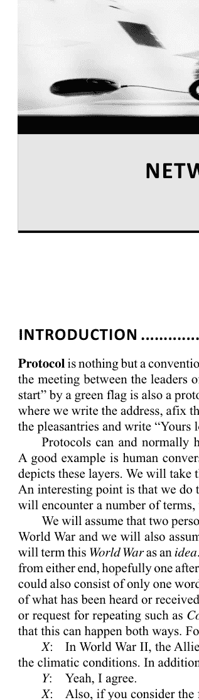

# 第 1 章 计算机通信中的协议

## 1.1 引言

协议无非就是一种约定。我们在报纸描述两个国家领导人会面时，经常遇到这个术语。用绿旗表示“一切正常，火车可以出发”也是一种协议。当我们写信时，我们遵循某种特定的协议。写地址的地方、贴邮的地方、写收件人名字的地方，以及我们开始问候的方式和写“您亲爱的”或“您诚挚的”等，都定义了一个协议。

如果我们稍微清楚地观察协议，它们可以并且通常包含隐藏的层。一个很好的例子是普通的人类，特别是电话通话。图 1.1 描绘了这些层。我们将以这个例子为例，描述学习这些层的具体步骤。一个有趣的点是，我们在不知道自己正在使用协议的情况下做这一点。在学习这一过程中，我们会遇到许多术语，这些术语也用于计算机网络中。

我们假设两个人 X 和 Y 必须通过电话就世界大战进行对话，并假设每个人都在听对方说的话。因此，我们将这场世界大战称为一个事件（event）。通常，对话是以末端发出的几条消息的形式进行的。消息是一块陈述或句子。一条消息可能只包含一个单词，如“好的”或“还没”，表示对听到或接收到的内容进行正面确认（ACK）。消息也可以意味着负面确认（NAK）或请求重复，如“再说一遍”、“抱歉”或“请你重复一遍好吗”，请记住，这可以在双方都发生。例如，一个典型的对话如下。

- X: 在第二次世界大战中，同盟国应该……然而，由于气候条件，他们没有这样做。他们没有足够的弹药。
- Y: 是的，我同意。
- X: 另外，如果你考虑原子能因素
- Y: 不，但我觉得这还有另一个角度。如果你考虑国家之间的边界，将会显而易见。关于这个主题还有一本很好的书。
- X: 再说一遍。
- Y: 不，但我觉得还有另一个角度。
- Y: 是的，但那不是唯一的因素……
- Y: 请能重复一遍好吗？
- X: ...

因此，在想法层面，X 和 Y 都觉得他们正在讨论像世界大战这样的想法。然而，在现实中，如之前所述，对话由双方的多条消息组成。在较低的层次，观点是两端都发送了许多消息。这一层面的协议决定了整个消息中什么代表正面确认，什么代表负面确认等。

消息可能太长了。在这种情况下，X 说话一小时，最后只收到 Y 重复消息的请求可能是。在消息的每个句子后通过“是的”、“好的”、“再说一遍”来发送/接收正面或负面确认是明智的。在计算机术语中，句子就像一个数据包。在这种情况下，可以决定一种协议，在每个句子后都必须发送正面或负面确认。如果是这样，发送者（说话者）X 在听到某种形式的确认之前，不会继续下一个陈述，否则不会；事实上，如果他在继续之前收到负面确认，他将重复该陈述。另一种替代方案是超时策略。说话者 X 说话并等待一段时间以听到任何类型的确认。如果他没有听到任何声音，他就假设之前的陈述没有被收到，因此重复该陈述。滑动窗口意味着说话并确认多个句子，可能 3 或 4 个。这是在确认每个句子之间的消息。我们并没有意识到，但我们实际上遵循所有的协议。

除了错误控制之外，我们还负责流量控制。这指的是说话者和听者之间的速度不匹配。如果说话者太快，如果接收者满了，它就要求等待。这被称为流量控制。数据链路层负责错误控制。该层还决定谁说话，通过某种约定，或者简之谁控制介质。介质访问功能是必要的，因为介质在 X 和 Y 之间共享，双方都可以同时说话，导致混乱。如果在冲突后发生一段时间（除非是介质控制。

在实践中，我们知道电话线中的信号会变化。这是物理层。这里也必须有协议！这一层表示仪器如何构造，电线的制造和铺设方式，表示接入或忙音的信号电平，携带语音所需的信号电平。这是物理层的协议。显然，如果将电话和冰箱连接在电线的两端，通信是不可能的！


## 1.2 计算机通信中的协议

相同的协议概念同样适用于计算机通信。让我们看看，想象一个计算机网络，如图 1.2 所示。

每个计算机被称为一个节点。在分布式处理中，数据库/文件的不同部分可以通常位于不同的节点上，根据需要如此。这需要在节点之间传输文件和消息。让我们假设节点 A 想要向节点 D 传输文件 X。节点 A 没有直接连接到 D。这非常常见，将每个节点连接到其他所有节点意味着巨大的布线量。

这就是在计算机网络中使用存储和转发概念的原因。首先，选择一条路径。假设它是 A-F-G-D。使用这条路径，节点 A 将文件发送给 F。计算机 F 必须将该文件存储在内存缓冲区或磁盘中。这种存储是必要的，因为 F-G 链路在此时可能是忙碌的，或者节点 F 可能接收到了多条消息/已经发送到其他节点（A、E 或 G）的文件，且这些文件可能在节点 F 的队列中等待。当 F-G 链路空闲并准备好从 F 传输文件到 G 时，节点 F 实际上将其传输到节点 G。因此，F 存储并转发从 A 到 G 的文件。这个过程重复，直到文件到达目的节点 D。此程序要求节点维护一个内存缓冲区来存储文件，以及一些软件来控制不同消息的队列并将其传输到下一个节点。该软件还必须以无误的方式处理错误控制和流控功能。

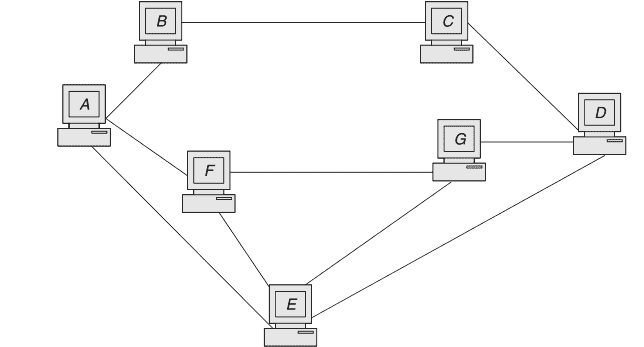

当传输文件/消息时，两个节点（源节点和目的节点）以及中间节点必须对某些基本原理达成共识。例如，什么是位 1 或位 0？正如我们所知，0 和 1 对应某些物理属性（电压水平 0 = 位 0，电压水平 5 = 位 1，等）。节点之间没有这种理解（位可以是全双工/半双工、同步/异步等）。这种在物理层面的理解或协议被称为物理层。它处理诸如位 0 和位 1、通信模式（并行、单工/半双工/全双工、同步/异步等）。

下一个节点如何发现文件或消息是否正确接收？如果它发现错误，它会如何反应？有几种方法可以检测传输中的错误。显然，我们需要为文件计算循环冗余校验（CRC），将其附加在文件上，在目的地对接收到的数据重新计算 CRC，并比较计算出的 CRC 与 CRC 以确保它们相同。


# 网络通信基础与 OSI 模型

## 确认机制与错误处理

接收节点有多种方式向源节点发送正面或负面确认。如果没有检测到错误，接收节点可以向回传一个正面确认，意味着一切正常。如果检测到错误，接收节点可以发送负面确认，也可以不发送任何内容。后者被称为**超时（time out）**。在这种方法中，源节点可以等待一段时间的正面确认，如果在特定时间内没有收到，则得出文件在目的地未成功接收并重新发送。这是一个好方法，除非当源节点开始发送文件时，接收节点发送的正面确认（OK 消息）可能已经传输到了源节点的一半。当该确认到达源节点时，对于源节点来说已经太晚了！文件/消息已经向目的节点发送了两次！通常有一个协议来处理这种情况（例如，接收节点丢弃第二个文件的副本）。更稳妥的方法是绝对发送回 OK 或 NOT OK 消息，而不是使用超时方法，即等待收到正面或负面确认。然而，由于网络流量，这导致了长时间等待，等待本身可能需要很长时间才能完成。在这种情况下，网络的整体效率降低，源节点必须等待直到收到某些确认。

所有错误检测、确认和重传功能都归类在“控制”名称下，并构成了通信软件的重要部分，即网络术语中的**数据链路层**。它位于每个节点（即源节点、目的节点以及所有中间节点），因为消息在到达目的节点之前必须正确到达下一个节点。数据链路层还负责**流控**以及两台相邻计算机之间的速度不匹配。如果发送端计算机发送数据太快，数据可能会在目的地丢失。因此，速度必须不断调整或监控。这被称为流控。

## 分包传输与时分复用

如果检测到错误，整个文件将重新传输。如果文件很大，错误的概率更高，而且重传所需的时间也长。此外，重传中的错误概率更高。这是因为大消息（如文件）被分成更小的块。这些被称为**包（packets）**。为了避免错误，当两对计算机共享传输链路时，数据以包的形式发送。想象 A 要通过 `A-F-G-D` 路由发送一个 10 MB 的文件。同时，计算机 F 想向 G 发送 2 KB 的小文件。此外，假设文件 F-G 的传输先于小文件 F。虽然只有一对计算机可以独占传输链路，但较小的传输必须等待很长时间直到传输结束。因此，较大的传输会阻塞较小的传输，造成巨大影响。因此，最好是每个通信都将其传输分成包进行发送。因此，两个文件都被分成包。在节点 F，一个来自大文件的包后面跟着一个来自小文件的包，等等。这被称为**时分复用（TDM）**。在另一端（G），小文件被重组并使用，而大文件的包被分离并转发到节点 D。

显然，每个包都必须有一个头部，包含源地址、到下一个节点的目的地址以及用于路由包并最终到达目的地的信息。包头部有助于在包到达源地时重组包。**CRC** 用于错误控制。

## 路由方式：虚拟电路与数据报

按照它们发送的顺序，因为在这种情况下，在开始时就选择了一条路由（也称为**虚拟电路——VCN**）。它被用于属于该消息的所有包。这就是为什么虚拟电路中的数据包不需要完整的源和目的地址。各个节点维护的路由表维护着 VCN 和下一个节点的条目。这些对于路由来说足够了。**数据报文**方法使数据包携带源和目的地址，这些地址可以用于路由，并在每次通过路由算法寻找下一个节点。

## OSI 参考模型

我们将发现存在两种类型的协议。某些协议在任何两个相邻节点之间都是必要的，并在数据包层级运行，它们确保相邻节点正确接收到数据包或帧。在网络术语中，**物理层**、**数据链路层**和**网络层**属于这一类。另一种类型的协议存在于点之间，即源节点和目的节点（在本例中 A 和 D）。它们确保这两个点之间建立连接、会话正确启动和终止、消息（而不是数据包）得到适当的发送/接收和确认，并在通过目的节点处理消息之前完成必要的数据加密/解密或压缩/解压缩以及代码转换/翻译。在网络术语中，这些通常是**传输层**、**会话层**、**表示层**和**应用层**。表 1.1 描述了这一点。

### 表 1.1 OSI 层

| 层数 | 层名 |
| :--- | :--- |
| 1（最低）→ | 物理层 |
| 2 | 数据链路层 |
| 3 | 网络层 |
| 4 | 传输层 |
| 5 | 会话层 |
| 6 | 表示层 |
| 7（最高）→ | 应用层 |

实际上，处理错误控制/流量控制、路由、数据压缩、加密等算法的通信软件可以编写在一个程序中。然而，这样的程序将难以编写和维护。正因为如此，此功能被分为逻辑部分或模块，称为“层”。使用这一概念，许多制造商开始以不同数量的层编写他们的通信软件。因此，导致了混乱。

最后，ISO 标准决定这种通信必须有一个标准，以便不同制造商制造的计算机可以非常流畅地相互连接。他们提出了一种七层架构，被称为**开放系统互连模型（OSI）**。无论层数有多少，上述所有功能都必须由任何通信软件处理，并且这种软件必须驻留在每个节点。今天，OSI 已经成为一个可以比较的标准，尽管很少有人实际上按照标准中描述的样式完全实现了 OSI 层。因此，OSI 实际上是一个**参考模型**。我们将从这个角度学习它。

## 1.2.1 引言

OSI 模型结构在七层之上，如表 1.1 所示。

这七层的通常表示方式如图 1.3 所示。

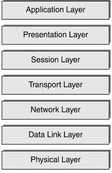

现在让我们研究图 1.4。假设主机 X 想要向另一个主机 Y 发送消息。该消息将通过多个中间节点。这些中间节点涉及 OSI 最底的三层，即**物理层**、**数据链路层**和**网络层**，如图 1.4 所示。其他四层仅供发送者（X）和接收者（Y）使用。因此，它们被称为**端到端层**。


**图 1.4** 使用 OSI 层的主 X 和 Y 之间的通信

注意，在主机内部（无论是 X 还是 Y），每一层都调用其下层的服务。例如，层 7 使用层 6 提供的服务。层 6 反而使用层 5 服务。在 X 和 Y 之间，通信似乎是在相同层之间进行的。这被称为 X 和 Y 之间的**虚拟通信**或**虚拟路径**。例如，主机 X 的层 7 认为它正在与主机 Y 的层 7 通信。同样，主机 X 的层 6 和主机 Y 的层 6 之间存在虚拟连接。在每个节点保留所有的通信软件是没有意义的。因此，最底三层的功能包含在一个特殊的计算机**路由器**中。现在你可以构建一个网络，节点连接到各种路由器，如图 1.5 所示，除非我们采用路由器。

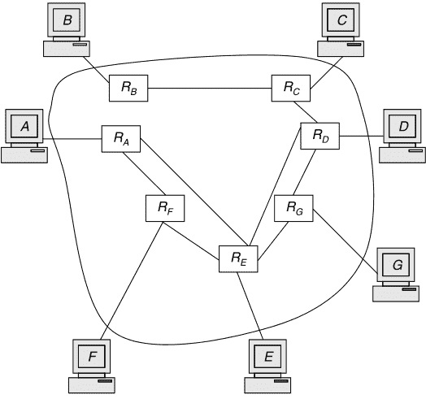

**图 1.5** 网络中的路由器

关于数据链路层功能、路由等的一切正如我们所见仍然有效。当节点 A 想要向节点 F 发送消息时，节点 A 将其发送到 `R_A`。之后，通过特定路由到达 `R_F`，到达节点 F。

## 1.2.2 分层组织

运行在源节点的应用程序创建要传输到目的节点应用程序层的数据（记住虚拟路径？）。它传递给源节点的表示层。从此层（表示层）移动到最底层（物理层）时，剩余的 OSI 层都向数据包添加其自己的头部。在最低层，数据以电压脉冲的形式跨越介质传输，例如同轴电。这意味着应用层（层 7）将整个数据传递给表示层。让我们将其称为 `L7`，如图 1.6 所示。在表示层接收并处理这些数据后，它将其头部添加到原始数据并发送到层级中的下一层（即会话层）。因此，从第六层（表示层）到会话层，数据以 `L7 + H6` 的形式发送，如图 1.5 所示，其中 `H6` 是由第六层（表示层）添加的头部。

现在，第五层（会话层）将此数据发送到下一层，即第四层（传输层），它发送原始数据（`L6` 数据）加上其头部 `H5`，即 `L6 数据 + H5`，等等。最后，原始数据（`L7`）和所有头部跨越物理介质。

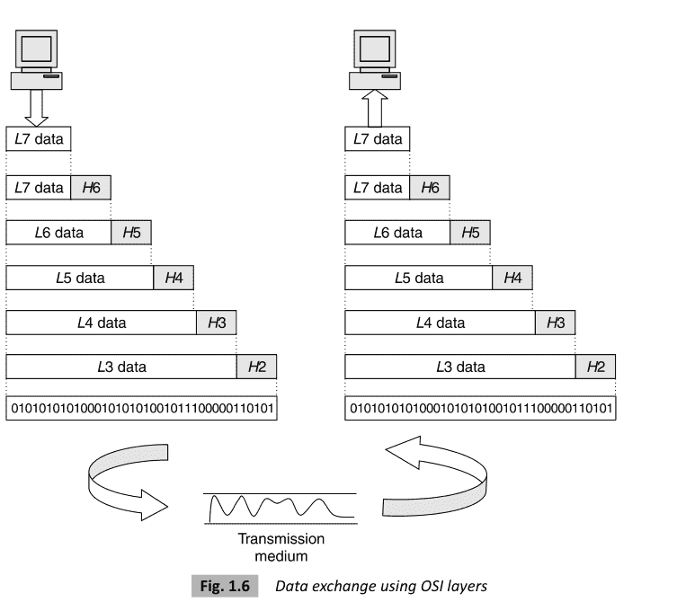

### 物理层

**物理层**负责在源节点和目的节点（在本例中为相邻节点）之间发送原始位。为了做到这一点，源节点和目的节点必须就某些因素达成一致，例如什么是位、什么是值、位间隔（即比特率），以及通信是单向还是双向的（即半双工或全双工），等等。它还处理电缆、连接器和接口（如 `RS 232-C`）的机械规格。

总结来说，物理层必须考虑以下因素：

1. **信号编码**：位 0 和 1 如何被表示？
2. **介质**：使用了什么介质，其属性是什么？
3. **位同步**：传输是异步的同步的？
4. **传输类型**：传输是串行的并行的？
5. **传输模式**：传输是单工、半双工还是全双工？
6. **拓扑**：使用了什么拓扑（网状、星型、环形、总线或混合型）？
7. **复用**：是否使用了复用？如果是，类型是什么（FDM、TDM）？
8. **接口**：两个链路设备是如何连接的？
9. **带宽**：使用的是基带还是宽带通信？
10. **信号类型**：使用的是模拟信号还是数字信号？

### 数据链路层

**数据链路层**负责在相邻节点之间传输位组。位组通常被称为**帧**。网络层将数据单元传递给数据链路层。在这个阶段，数据链路层添加头部和尾部信息，如图 1.8 所示。这变成了传递给物理层的数据单元。

头部（以及未显示但假设存在的尾部）包含地址和其他控制信息。此层面的地址指的是正在发送帧的网络中相邻节点的物理地址。这些地址随着帧从源节点通过不同节点到达目的节点而改变。端节点的地址（即源节点和目的节点的地址）已经是从网络层传输到数据链路层的数据单元的一部分。因此，它不是数据链路层添加和删除的头部和尾部的一部分。因此，当帧从源节点通过不同节点移动时，它们保持不变。

```
从网络层          到网络层
L3 数据            L3 数据
```

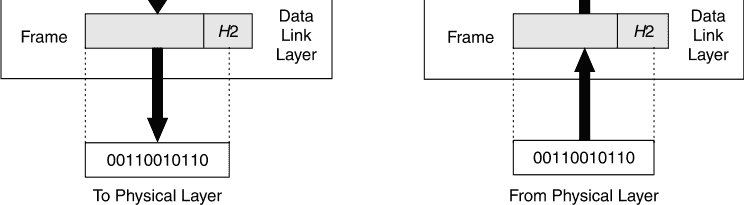

**图 1.8** 相邻节点之间的数据链路层

让我们通过一个例子来说明这一点。让我们参考节点 D。假设节点 A 想要向节点 D 发送一个数据包。假设我们使用图示方法。在这种情况下，节点 A 和 D 的逻辑地址（即 IP 地址），例如 `ADDL (A)` 和 `ADDL (D)`，即为源地址和目的地址。网络层传递给数据链路层的数据单元将包含这些地址。该数据单元的看起来如图 1.9 所示。我们将其命名为 `$D_{ic}$`。

| ADDL (A) | ADDL (D) | 实际数据 ... |
|---|---|---|

**图 1.9** 网络层的数据单元 (`$D_n$`)

当这个数据单元 (`$D_n$`) 从节点 A 的网络层传递到节点 A 的数据链路层时，发生了以下情况：

- 查阅路由表，该表提到了为了特定的目的节点（在本例中为 D）应该将帧发送到的下一个节点。让我们假设根据当时的的条件，下一个节点是 F，即选择了 `A-F` 路径。
- 在数据传输速率下，节点 A 的链路层形成一个数据单元，例如 `$D_{ic}$`，其外观如图 1.10 所示。我们会注意到 `$D_{ic}$` 封装了 `$D_n`，并添加 A 和 F 的物理地址（即 A 和 F 的网卡 NICs）作为 `ADDP (A)` 和 `ADDP (F)` 添加到其中。
- 使用节点 A 和 F 的物理地址，数据包在执行完流量控制功能后（后文将讨论，即检查节点 F 是否准备好接受来自 A 的帧以及以什么数据速率接受等），从节点 A 移动到节点 F。然而，数据包在执行错误控制（即验证数据包无误）后，从节点 F 的数据链路层传递到网络层。`ADDP (A)` 和 `ADDP (F)` 被移除并恢复了 `$D_n`。现在，`$D_n` 需要发送到下一跳以到达节点 D。为此，从 `$D_{ic}$` 中提取出最终目的地址，即 `ADDL (D)`。该帧现在必须从节点 F 发送到节点 D。

| ADDP (A) | ADDP (F) | `$D_n` | 其他信息 |
|---|---|---|---|
| ADDL (A) | ADDL (D) | 实际数据 | |

**图 1.10** 节点 A 数据链路层的数据单元 (`$D_n`)

- 再次，在节点 `$F$` 使用 `ADDR (D)` 作为最终目的执行路由算法以及拥塞控制等操作，并选择一条路径。让我们假设选定的路径是 `$FG$`。
- 节点 F 的网络层将 `$D_n$` 传递给节点 F 的数据链路层。在这里，添加了 F 和 G 的物理地址以形成节点 F 数据链路层的数据单元，如图 1.11 所示。

| ADDP (F) | ADDP (G) | 其他信息 |
|---|---|---|
| ADDL (A) | ADDL (D) | 实际数据 |

**图 1.11** 节点 F 数据链路层的数据单元 (`$D_n`)

- 这一过程持续直到链路层的数据单元 `$D_n$` 到达节点 D。再次移除物理地址以获取原始的 `$D_n$`，并将其传递到节点 D 的网络层。网络层验证 `ADDL (A)` 和 `ADDL (D)`，确保该数据包是发给自己的，它移除这些地址，并将实际数据发送到节点 D 的传输层。

数据链路层还执行流量控制功能。根据 CPU 的速度、传输、缓冲区大小和拥塞控制，决定帧/数据包是否可以发送到相邻层以及以什么速度发送。如果可以发送，网络就准备好发送数据。然而，我们必须确保介质是空闲的可以携带帧。如果连接是多点的（即介质是共享），就需要解决谁在什么时候发送多少数据的问题。这个问题通常出现在**局域网 (LANs)** 中，并通过**介质访问控制 (MAC)** 协议来解决。因此，在局域网中，数据层被分为两个子层，如图 1.12 所示。在这种情况下，LLC 负责处理正常的数据链路层功能，如错误控制和流量控制等。

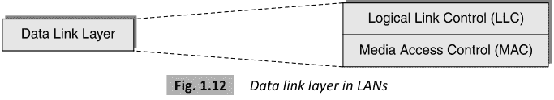

在大多数使用对点连接的**广域网 (WANs)** 中，这个问题不会出现。

因此，数据链路层执行以下功能：

1. **寻址**：添加头部和尾部，包含相邻节点的物理地址。
2. **流量控制**：控制数据发送以匹配接收端。
3. **介质访问控制 (MAC)**：在局域网中，解决谁在何时发送多少数据。
4. **同步**：确保发送和接收的同步。
5. **错误控制**：通过校验等确保数据包是无误的。
6. **帧的传输**：确保数据包到达目的地。

### 网络层

**网络层**负责将数据包（datagram）路由到目的地。它负责在不同的网络之间处理数据包，跨越边界，如图 1.13 所示。

1. **寻址**：添加头部和尾部，包含相邻节点的物理地址。
2. **拥塞控制**：控制数据发送以匹配接收端。
3. **逻辑寻址**：在局域网中，
4. **同步**：确保发送和接收的同步。
5. **错误控制**：通过校验等确保数据包是无误的。
6. **帧的传输**：确保数据包到达目的地。

网络层通过使用 `ADDR (D)` 作为最终目的执行路由算法以及拥塞控制等，并选择一条路径。让我们假设选定的路径是 `$FG$`。

- 节点 F 的网络层将 `$D_n$` 传递给节点 F 的数据链路层。在这里，添加了 F 和 G 的物理地址以形成节点 F 数据链路层的数据单元，如图 1.11 所示。
- 这一过程持续直到链路层的数据单元 `$D_n$` 到达节点 D。再次移除物理地址以获取原始的 `$D_n$`，并将其传递到节点 D 的网络层。网络层验证 `ADDL (A)` 和 `ADDL (D)`，确保该数据包是发给自己的，它移除这些地址，并将实际数据发送到节点 D 的传输层。

## 1.3.4 传输层

**传输层**是端到端层，如图 1.4 所示。因此，传输层的头部包含了有助于将消息发送到目的地相应层的信息，尽管消息拆分成数据包可能会经过许多中间节点。正如我们知道的，每个终端可能运行多个进程（通过多个用户）。传输层确保按照正确的顺序和正确的协议到达目的地。

# Web 技术


...层并最终传输到目标计算机。如果要在目标计算机的会话层重新创建原始数据，我们需要某种机制来识别数据在源计算机传输层被分成分数据包的顺序。为了这个目的，它将会话层数据拆分成分段，源计算机的传输层在分段上添加序列号。现在，目的端的传输层可以重新组装以创建原始数据并将其呈现给会话层。

图 1.14 显示了传输层与其两个相邻层之间的关系。

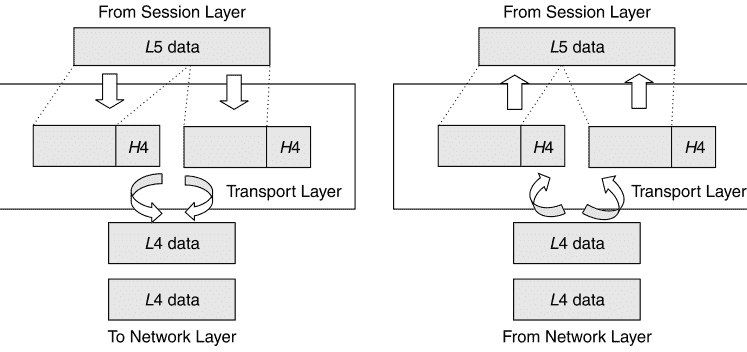

图 1.14 传输层

传输层还可以在源和目的之间建立逻辑连接。连接是源和目的之间的一个与消息的所有数据包相关的逻辑路径。连接由三个阶段组成：建立、数据传输和连接释放。通过使用连接，传输层可以更好地执行排序、错误检测和纠正。

总结来说，传输层的职责如下：

- **主机到主机消息传递** 确保源端发送的消息的所有分段都到达预定的目的地。
- **应用到应用通信** 传输层实现了运行在不同计算机上的两个应用程序之间的通信。
- **分段与重组** 传输层将消息拆分为分段，在源端通过添加序列号进行编号，并在目的端使用序列号重组原始消息。
- **连接** 传输层可以在源和目的之间创建一个在整个消息传输期间存在的逻辑连接，以便更好地控制消息传输。

会话层的主要功能是建立、维护和同步两个通信主机之间的交互。它确保会话一旦建立就能优雅地关闭，而不是突然中断。

例如，假设一个用户想向另一台计算机上的用户发送一份包含 1000 页的巨型文档。假设前 105 页已经发送，两个主机之间的连接由于某种原因断开了。现在的问题是，当一段时间后两个主机之间的连接恢复时，传输必须全部从头开始，即从第一页开始吗？还是用户可以从第 106 页开始？这些问题是会话层关注的重点。

会话层在两个不同用户的主机之间创建并建立连接。为此，用户可能需要输入标识，如登录名和密码。此外，会话层还决定哪些用户可以同时发送和接收数据，或者是否只有一个主机可以发送而另一个可以接收（即通信是单工、半双工还是全双工）。

让我们重申之前两个主机之间传输巨型文档的例子。为了完成从第一页开始重传，两个主机之间的会话层可以创建子会话。在每个子会话结束后，可以设置一个检查点。例如，两个主机的层在成功传输一组 10 页后可以设置一个检查点。这意味着如果连接在传输完前 105 页后断开，在连接恢复后，传输将从第 101 页开始。这是因为最后一个检查点是在传输第 100 页后生成的。会话层如图 1.15 所示。

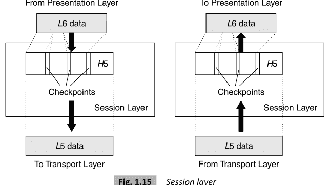

在某些情况下，可能不需要检查点，因为传输的数据是微小且微小的。无论是否需要，当会话层从表示层接收数据时，它会添加一个头部，其中包含关于是否有任何检查点的信息，如果有，则在哪个点。

总结来说，会话层的职责如下：

- **会话与子会话** 会话层将会话分为子会话，通过检查点功能避免重传整个消息。
- **同步** 会话层决定数据传递给传输层的顺序。
- **会话控制** 会话层还决定哪个用户/应用程序发送数据、何时发送，以及通信是单工、半双工还是全双工。

会话层确保主机之间的会话优雅地关闭。

当主机相互通信时，它们内部可能使用不同的编码标准和字符集来表示数据。例如，一个主机可能使用 `ASCII` 码表示字符，而另一个主机可能使用 `EBCDIC`。表示层负责处理这些差异。它还负责 (a) 为了安全的数据加密和解密，以及 (b) 为了提高数据传输效率的数据压缩和解压缩。图 1.16 显示了表示层的职责。

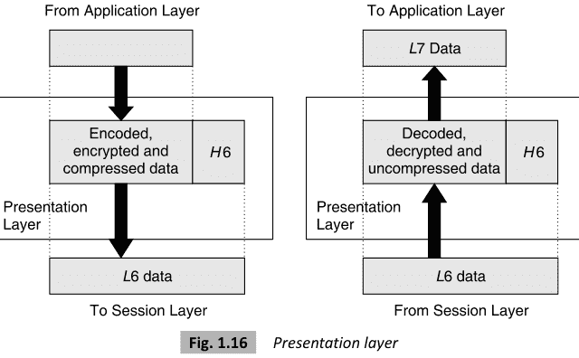

总结来说，表示层的职责如下：

- **翻译** 发送者和接收者消息格式之间的翻译由表示层完成（如果两种格式不同）。
- **加密** 表示层为了安全进行数据加密。
- **压缩** 为了更高效传输，表示层在发送前进行数据压缩。

应用层是 `OSI` 模型中的顶层，用户可以使用该层访问网络服务，如远程登录 (`TELNET`)、万维网 (`WWW`)、文件传输协议 (`FTP`)、电子邮件、远程访问等。应用程序与物理网络交互。这不应与应用程序会计或购买等混淆。如果应用程序需要访问远程数据库或想传输文件，它将调用应用层协议（例如 `FTP`）。因此，该层可以被认为是由 `TELNET`、电子邮件、万维网等组成的。

这是访问网络的不同方式。应用层提供了底层的抽象，让用户和应用程序专注于自己的任务，而不是担心较低的协议。

应用层的概念位置如图 1.17 所示。

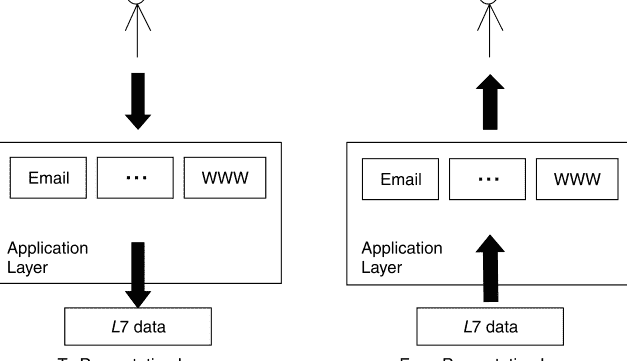

总结来说，应用层的职责如下：

- **网络抽象** 应用层为终端用户和应用程序提供底层网络的抽象。
- **文件访问与传输** 允许用户访问、下载或上传文件到主机。
- **邮件服务** 允许用户使用邮件服务。
- **远程登录** 允许登录远程主机。
- **万维网 (WWW)** 访问网页也是其中的一部分。

**地址转换** **寻址** **应用层** **应用到应用拥塞** **通信** **带宽** **位同步** **冲突** **拥摄** **控制** **连接** **数据链路** **数据报** **会话控制** **加密** **错误控制** **流量控制** **帧** **主机到主机消息传递** **重组** **逻辑地址** **邮件服务** **介质访问控制 (MAC)** **多路用** **负确认 (NAK)** **网络抽象** **网络层** **节点** **节点到节点交付** **OSI 模型** **数据包** **物理层** **正确认 (ACK)** **表示层** **远程登录** **路由** **分段** **分段** **会话关闭** **会话与子会话** **信号编码** **信号类型** **存储并转发** **同步** **超时** **拓扑** **传输模式** **传输类型** **传输层** **虚拟电路** **虚拟电路编号** **虚拟通信** **虚拟万维网 (WWW)**

# 摘要

- 协议交换概述。当计算机需要相互通信以交换信息或共享资源时，它们使用一种通用的协议。
- 数据通信有许多要求，例如数据传输、流量控制、错误控制、路由、数据压缩、加密等。这些特征在逻辑上被分为子组，子组进一步分组为“层”。
- 通信协议模型定义了这些层，即物理层、数据链路层、网络层、传输层、会话层、表示层和应用层。每一层都与其相邻层有接口，并执行特定的功能。
- 物理层关注在通信介质上相邻节点之间发送原始比特（bits）。
- 数据链路层负责在相邻节点之间传输一组比特。
- 数据链路层负责错误检测/恢复和拥塞控制。
- 网络层负责在子网内进行数据包路由，即从源节点到目的节点（在同一网络中的多个节点，或跨越多个网络）。
- 传输层负责主机到主机的消息传递、应用到应用的通信、分段与重组，以及源目的之间的逻辑连接管理。
- 会话层的主要功能是建立、维护和同步通信主机之间的交互。
- 当两个主机相互通信时，它们内部可能使用不同的编码标准和字符集来表示数据。表示层负责处理这些差异。
- 应用层是 `OSI` 模型的最顶层，使用户能够访问网络。使用网络服务的应用程序也位于这一层。


# 单选题

1. `NAK` 是一种 \_\_\_\_\_\_\_\_\_\_\_\_\_\ 确认。

   (a) 正向 (b) 负向 (c) 中性 (d) 以上都不是

2. 发送者和接收者之间的速度不匹配被称为 \_\_\_\_\_\_\_\_\_\_\_\_\_\

   (a) 错误控制 (b) 速度错误
   (c) 流量控制 (d) 传输控制

3. 为了让较大的传输不淹没较小的传输，数据以 \_\_\_\_\_\_\_\_\_\_\_\_\_\_\_\_ 的形式发送

   (a) 盒子 (boxes) (b) 篮子 (baskets) (c) 组 (groups) (d) 数据包 (packets)

4. \_\_\_\_\_\_\_\_\_\_\_\_\_\_\_\_\_\_\_\_\_ 层是 `OSI` 模型中的最低层。

   (a) 物理层 (b) 传输层 (c) 会话层 (d) 应用层

5. \_\_\_\_\_\_\_\_\_\_\_\_\_\_\_\_\_\_\_\_\_ 层是 `OSI` 模型中的最顶层。

   (a) 物理层 (b) 传输层 (c) 会话层 (d) 应用层

6. 中间节点只关注 \_\_\_\_\_\_\_\_\_\_\_\_\_\_\_\_\_\_ 层。

   (a) 上三层 (b) 中间三层
   (c) 下三层 (d) 最顶层、中间层和底层

# 网络协议与 OSI 模型

7. \_\_\_\_\_ 层负责数据包的节点交付。

   (a) 物理层 (b) 传输层 (c) 数据链路层 (d) 应用层

8. \_\_\_\_\_ 层负责网络内部或跨网络的数据包路由。

   (a) 物理层 (b) 网络层 (c) 数据链路层 (d) 应用层

9. \_\_\_\_\_ 层确保完整消息的正确交付。

   (a) 数据链路层 (b) 传输层 (c) 会话层 (d) 表示层

10. 加密是由 \_\_\_\_\_ 层处理的。

    (a) 数据链路层 (b) 传输层 (c) 会话层 (d) 表示层


1. 通俗解释协议这一术语。
2. 解释计算机通信中的不同层及其作用。
3. 解释 `OSI` 模型中的不同层。
4. 解释 `OSI` 模型中的物理层。
5. `OSI` 模型中的数据链路层是如何工作的？
6. 讨论表示层在处理不同数据格式方面的作用。
7. 传输层如何确保完整消息以正确的顺序到达目的地？
8. 解释会话层如何建立、维护和同步两个主机之间的交互。
9. 解释表示层在处理不同数据格式方面的作用。
10. 解释 `OSI` 模型中的最顶层——应用层。


1. `SNA` 和 `TCP/IP` 等网络协议。它们与 `OSI` 模型相似或不同之处何？
2. 研究 `OSI` 模型的背景和需求。
3. 调查 `OSI` 哪些层被认为是有用的，哪些不是。
4. 考虑一种情况：只懂法语的人向只懂乌语的人发送信息。参考相应的 `OSI` 层描述这一过程。
5. 与 `OSI` 模型相比，为什么 `TCP/IP` 变得如此流行？调查其背后的原因。

# 引言

在上一章，我们学习了协议的基本原理。现在让我们学习将许多网络连接在一起的另一个重要概念。这被称为联网（internet working）。计算机网络的集合被称为互网（internet，注意小写 i）。互联网（注意大写 I）是联网技术的示例。正如我们所看到的，互联网是一个巨大的计算机网络。接下来的章节将描述这种技术的动机，以及它是如何工作的。

当为了共享数据或交换消息而连接两个或多个设备时，我们称为网络（networking）。当两个网络为了相同的目的需要连接时，我们称为联网（internet working）。网络和联网的主要区别在于，在网络的情况下，所有设备都是兼容的（例如 `LAN` 中的主机），而在联网的情况下可能并非如此。当我们想要连接两个或多个网络形成互网时，这些网络在许多方面可能是不兼容的。例如，我们可能想将以太网 `LAN` 与令牌环 `LAN` 和 `WAN` 连接。这三种类型的网络在拓扑、信号、传输机制以及布线等方面是不同的。因此，联网的挑战更多在于处理这些不兼容性并将所有不兼容的网络连接到公共平台。

在本章中，我们将讨论用于网络和联网的各种连接设备。这些设备构成了任何网络或互网的骨干（缩写为 internet，与全球网络 Internet 有区别）。

# 联网概念、设备、基础、历史与架构 23

我们将首先学习互联网的历史视角。然后讨论互联网的基本概念。我们将观察它是如何工作的。

拥有互网的主要原因是每个计算机网络都是为了特定任务而设计的。例如，`LAN` 通常用于连接较小区域（如办公室）内的计算机，并提供快速通信。另一方面，`WAN` 技术用于越远距离的通信。结果是网络变成了专门的实体。此外，大型组织拥有多个网络成了一个大问题。网络变成了孤岛！在许多情况下，员工必须物理移动才能使用连接到不同网络的计算机。例如，为了打印文档，员工需要使用连接到打印服务器的计算机。同样，为了访问另一个网络上的文件，员工必须使用该网络上的计算机，以此此类推。这影响了生产力。

拥有计算机网络或互网是可以的，但必须记住，组织在构建计算机网络时投入了大量资金，包括成本和基础设施（布线、在建筑内为其提供空间等）。因此，他们希望重用现有的基础设施而不是从头开始。然而，这其中存在问题。电气不兼容性使得仅通过连接两个网络的电线来形成网络是不可能的。例如，一个网络可能用 -5 伏表示二进制 0，而另一个网络则用 +5 伏表示它。同样，一个网络可能使用 128 字节的数据包大小，而另一个可能使用 256 字节的数据包。确认或错误检测/恢复的方法也可能完全不同。可能存在许多这样的差异，例如路由算法等。

因此，任何两个网络都无法通过在它们之间连接一根电缆来相互通信。由于存在许多不兼容的网络技术，这个问题变得更加严峻。一个组织机构可能拥有许多不同类型的网络。这意味着网络之间在信号、数据表示以及错误检测/恢复等方面存在着巨大的差异。因此，通过互联网互联实现通用服务的概念并非易事，但它是极具价值的愿景。

尽管存在上述问题，计算机科学家们已经发现了一种机制，使计算机网络能够连接起来形成一个互联网。不兼容问题从两个方面得到了解决。

在硬件层面，使用一些额外的硬件来连接物理上不同的计算机网络。这种硬件组件最常见的是路由器。路由器是一种专为互联网互联设计的特殊用途计算机。路由器像任何其他计算机一样拥有处理器（`CPU`）和内存。然而，它具有多个 `I/O` 接口，允许它连接到多个计算机网络。从网络的角度来看，连接到路由器并不特殊。网络连接到路由器的方式与其到任何其他计算机相同。路由器连接两个或多个计算机网络，如图 2.1 所示。

一个网络连接有许多节点。因此，节点或计算机的地址可以被视为“网络 ID + 节点 ID”。每个节点都有一个网络接口卡（`NIC`），该地址被硬编码在网卡中。如果路由器被网络视为另一台计算机，这意味着该路由器基本上有两个地址——分别位于 X 和 Y 点，对应每个网络各一个地址，如图 2.1 所示。

路由器是一台特殊计算机，它拥有两个网络接口卡（`NIC`），分别连接到这两个网络。这两个 `NIC` 对应于路由器的两个物理地址。

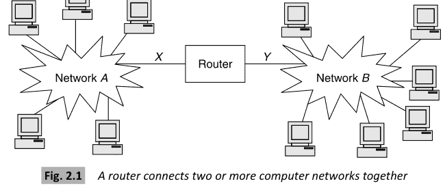

此讨论中最重要的重要的一点是，路由器可以连接不兼容的网络。也就是说，图中的网络 A 和 B 可能是相同或不同类型的局域网（`LAN`），可能是相同或不同类型的广域网（`WAN`），或者其中一个可能是局域网而另一个是广域网等。路由器有将它们连接在一起的能力。这是如何实现的？为此，路由器拥有必要的硬件：用于每种类型网络的 `NIC`，以及使其成为可能的软件（协议）。此外，即使图中的 A 和 B 属于同一类别——例如环形网、局域网——它们内部也可以使用不同的技术（一个可以使用以太网，另一个可以使用 `FDDI`）。路由器也处理所有这些不兼容性。同样，这是因为路由器包含了硬件和软件。关键点在于，图中的 A 和 B 可以是任意网络。然而，路由器仍然能够将它们相互互连。

有趣的是，互联网（注意大写的 I）看起来如如图 2.2 所示。

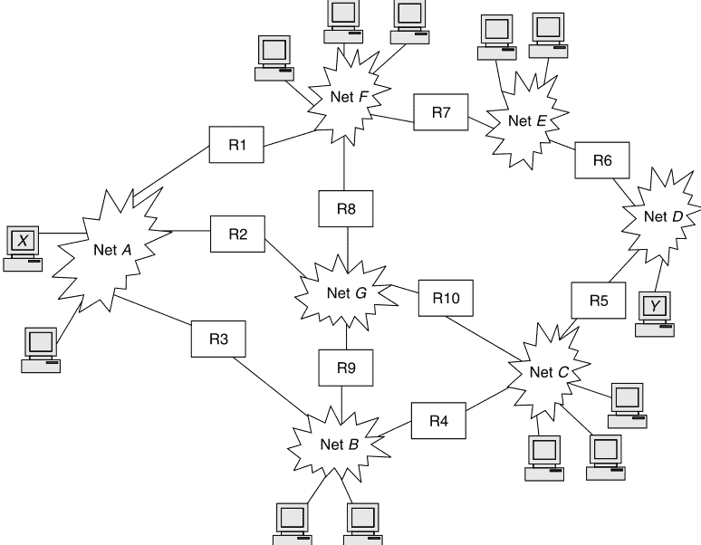

图 2.2 互联网的一部分

图 2.2 显示了由十个路由器连接的七个网络。网络 A 可以是以太网，网络 B 可能是 `FDDI`，网络 C 可能是环形网，而网络 G 可能是一个广域网！路由器通过每个路由器内部包含的两个 `NIC` 连接两个网络。

如果互联网上的计算机 X 想要向网络 D 计算机 Y 发送消息，可以通过下方不同的路由或路径发送消息。

1. X - Net A - R2 - Net G - R10 - Net C - R5 - Net D - Y
2. X - Net A - R1 - Net F - R7 - Net E - R6 - Net D - Y
3. X - Net A - R3 - Net B - R4 - Net C - R5 - Net D - Y

还存在许多路由。

路由器负责将数据包路由到目的地。为了做到这一点，软件计算路由算法，并基于此，每个路由器存储路由表，该表规定了对于每个目的地，发送数据包的下一跳节点。

正因为如此，路由器被认为作用于 `OSI` 模型网络层。它既不检查数据包的内容，也不尝试解释它们。图 2.3 显示了这一点。

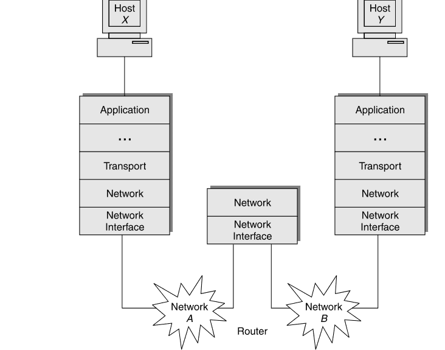

在软件层面，路由器必须就信息从一个网络上的源计算机传输到另一个网络上的目的的方式达成一致。由于这些信息可能通过一个或多个路由器传输，必须有一个所有路由器都必须遵守的预设标准。这项任务并不简单。底层网络使用的数据包格式和地址机制可能不同。路由器实际上执行对应不同网络格式的数据包的转换和再转换。虽然并非不可能，但这种方法非常困难繁琐。这是通过定义一种标准数据包格式来实现的，发送在该格式中分解原始消息。我们将稍后学习。因此，需要一些网络协议来标准化不兼容网络之间的通信。只有这样，通用服务的概念才能真正实现。在所有互联网通信中，`TCP/IP` 协议族使得这一切成为。

基本思想是 `TCP/IP` 通用地定义了包大小、路由算法、错误控制方法。如果我们再次参考图 2.2，X 想要通过上述数字 1 向 Y 发送某些消息（X–Net A–R2–Net G–R10–Net C–R5–Net D–Y），假设 Net A 是以太网而 Net G 是环形网，会发生以下过程。

1. 根据 `TCP/IP` 协议将消息分成数据包。每个数据包都包含 X 和 Y 的源地址和目的地址。
2. 每个数据包被插入到以太网帧中。`TCP/IP` 数据包连同其最终源/目的地址（X 和 Y）封装在以太网帧内，带有额外的源和目的地址，这些是同一网络上的物理地址（对于 Net A 上的 X 和 R2）。之后，计算 `CRC` 并附加到以太网帧中。


### 3. 节点 X 以及 R2 都在 Net A 上，Net A 是以太网。因此，帧使用 CS/CD 从 X 传输到 R2，使用以太网的源/目的地址。

### 4. 在 R2 处，检查 CRC，丢弃以太网帧，恢复原始 TCP/IP 数据包。它包含 X 和 Y 的最终地址。

### 5. 根据目的地址，使用路由算法找到下一跳节点 R10。我们知道 R2 和 R10 在网络 G 上。

### 6. Net G 是环形网。因此，了解此的 R2 将此 TCP/IP 数据包作为数据放入环形格式。在这里，TCP/IP 数据包（包含 X 和 Y 的最终地址）被封装在环形帧中，带有额外的 R2 和 R10 源/目的地址，用于从 R2 到 R10 传输数据包。

### 7. R2 以及 R10 都在环形网上，使用 R2 和 R10 的目的地址。因此，数据包到达 R10。

### 8. 此过程重复直到数据包到达 Y。在 Y 处，移除头部以获取原始 TCP/IP 数据包。验证目的地址并存储数据包。

### 9. 当所有数据包到达 Y 后，Y 处的 TCP/IP 确保无误接收所有数据包并将其传递给 Y 处的应用层。

这就是 TCP/IP 解决异构网络连接的方法。

互联网软件使得似乎有一个连接到许多计算机的单一无缝通信系统。形成它的许多真实网络内部细节被隐藏了，相反，它看起来像是一个巨大的网络。互联网上的每台计算机都分配有一个地址。这就像分配给家庭的邮政地址。使用该地址，任何用户都可以向互联网上的任何其他计算机发送数据包。用户不需要担心物理网络的内部结构、它们的互连、路由决策或路由器本身的存在。因此，创建了一个虚拟网络的幻象。这是向普通用户展示的抽象视图，普通用户对系统的内部构造并不了解。例如，电话用户只想拨通某人的号码并与其通话，而不关心信号系统如何工作，或者系统中有多少电话交换机以及它们是如何运行的。同样，互联网用户更感兴趣于与互联网上的另一个用户通信，使用另一个用户的计算机地址，或者他对该计算机上的服务感兴趣。

虚拟网络的概念非常重要。它确保了不同的计算机网络不仅可以连接在一起，而且被视为单一网络。这构成了最大的网络之网络——互联网的基础。这一概念在图 2.4 中所示。该图展示了对应于真实网络（如图 2.2 所示）的单一大型虚拟网络的幻象。

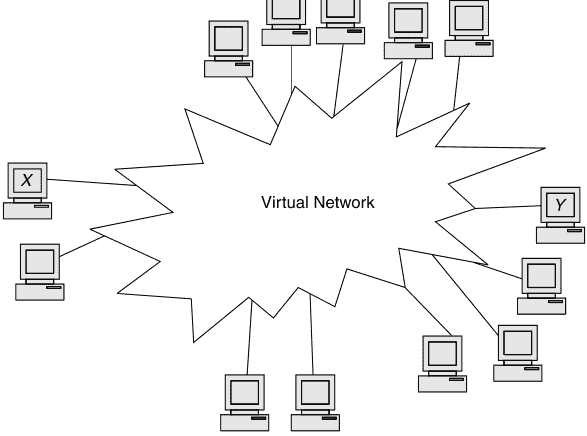

**图 2.4** 互联网是计算机网络的虚拟网络

## 互联网互连设备

在高级层上，**连接设备**可以分为**网络设备**和**互联网工作设备**。每种设备都有另一个层级的分类，如图 2.5 所示。我们在上一章中简要讨论了路由器。

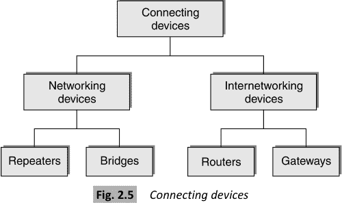

**图 2.5** 连接设备

在详细查看每种设备之前，让我们先如表 2.1 所示总结这些设备。

| 表 2.1 网络设备总结 |
| :--- |
| 设备 | 用途 | 存在于哪个 OSI 层 |
| :--- | :--- | :--- |
| 重继器 | 信号的电学规范 | 物理层 |
| 桥机 | 路由协议 | 数据链路层 |
| 路由器 | 兼容网络之间的互联网互连 | 网络层 |
| 网关 | 不兼容网络之间的翻译服务 | 所有层 |

请注意，在后三种情况中，设备不仅存在于表格中提到的层，还存在于其下方的一层。也就是说，桥机既存在于数据链路层，也存在于物理层。重继器在最低的 OSI 层（即物理层）工作，因此它存在该层。

## 重继器

重继器也称为再生器，是一种电子设备，它简单地重新生成信号。它在 OSI 协议的物理层工作，如图 2.6 所示。跨越物理介质传输的信号在变弱之前会传输一段距离（这一过程称为衰减），或者在与其他信号/噪声干扰时发生损坏。这意味着由信号承载的数据完整性面临危险。重继器接收一个可能变弱或损坏的信号，并对其进行再生。例如，让我们假设某台计算机按照某种约定工作，5 伏代表 1，0 伏代表 0。如果信号变弱/失真且电压变为 4.5 伏，重继器具有智能来意识到这仍然是一个位 1，因此它可以重新生成该位（即 5 伏）。也就是说，重继器简单地重建了信号的模式，并将此再生信号放回传输介质。实际上，原始信号被再次创建了。

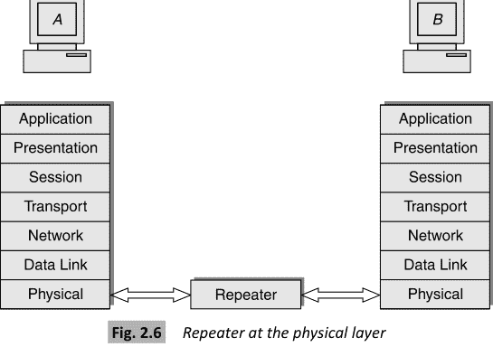

我们会意识到，重继器允许网络扩展到数据传输介质施加的物理边界之外。请注意，重继器**无论如何不改变**正在传输的数据或网络的特性。重继器的唯一责任是接收信号形式的比特流，对其进行再生，使信号现在变得准确，并向前发送。它不执行任何智能功能。

例如，在图 2.7 所示的示例局域网（LAN）中，主机 A 想向主机 D 发送包含比特流 `01100110` 的包。注意这两个主机位于同一个局域网内，但在局域网的不同部分。当主机 A 发出的信号到达主机 D 时，它已经变弱了。因此，主机 D 可能无法以原始信号的形式获取它。相反，在信号到达主机 D 之前，位可能会变为 `0110111`。当然，在更高层上，控制功能将检测并纠正这种异常。然而，在这种情况发生之前，在最低层面，重继器通过接收主机 A 发出的对应于比特 `01100110` 的输入信号，简单地将其再生以创建一个具有相同位格式和原始信号强度的信号，并向前发送。

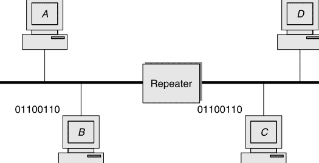

> 图 2.7 重继器再生信号

人们有时会混淆重继器和放大器。然而，它们是不同的。放大器用于模拟信号。在模拟信号中，无法分离原始信号和噪声。因此，放大器会放大原始信号以及信号中的噪声，因为它无法区分二者。相反，重继器知道信号必须被识别为 0 或 1。因此，它不放大输入的信号——而是以原始模式对其进行再生。由于信号在变得太弱而无法识别之前必须到达重继器，因此重继器的放置是一个重要的考虑因素。信号必须在信号中引入过多的噪声之前到达重继器。

## 桥机

### 2.7.1 引言

桥机是一台具有自己的处理器、内存和两个网卡的计算机，用于连接网络的部分。它在 OSI 协议的物理层以及数据链路层工作。这如图 2.8 所示。

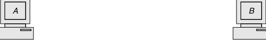

| OSI 层级 |
| :--- |
| 应用层 |
| 会话层 |
| 传输层 |
| 网络层 |
| 数据链路层 |
| 物理层 |

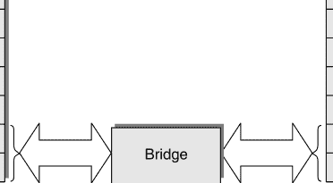

**图 2.8** 位于底层的桥机

使用桥机的主要思想是将网络划分为称为**段**的小网络。这如图 2.9 所示。在这里，桥机将整个网络分成两个段，用虚线表示。我们还展示了两个重继器，我们将忽略它们。由于桥机的存在，这两个段作为单一网络的一部分。

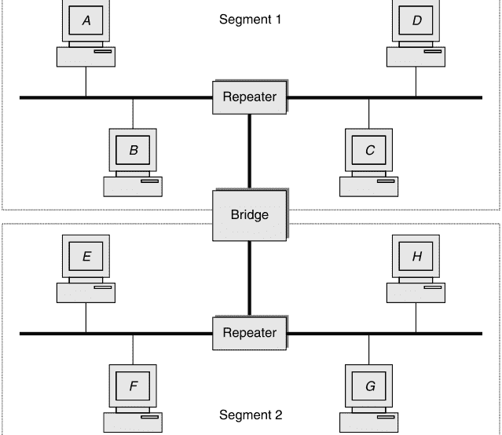

**图 2.9** 连接两个段的桥机

### 2.7.2 桥机的功能

在宏观上，桥机似乎与重继器一样。毕竟，桥机实现了网络较小段之间的通信。然而，桥机比重继器更智能，如下文所示。

桥机的主要优势是它只将数据帧发送到相关的段，防止过量流量。例如，假设我们有一个由编号 1 到 4 的段组成的网络。如果段 1 上的主机发送一个指向段 3 上另一个主机的帧，桥机仅将帧转发到段 3，而不发送到段 2 和段 4，从而阻止了不需要的数据流量。

让我们用之前图 2.9 所示的示例网络来说明。假设在我们的示例网络中，主机 A 想向主机 D 发送帧。那么，桥机不允许帧进入下段。相反，帧被直接传递到主机 D。当然，重继器可能会如图 2.10 所示再生该帧。

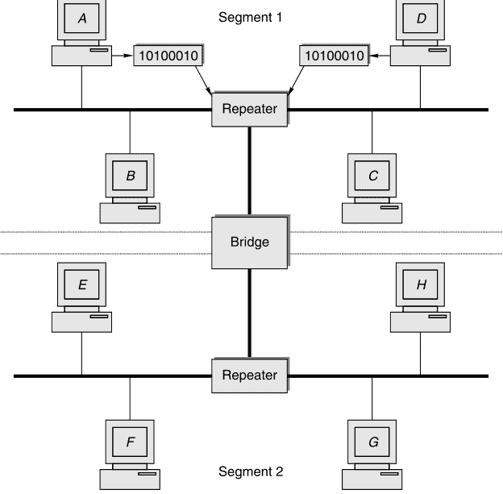

**图 2.10** 桥机最小化了不需要的流量

1. 不需要的流量被最小化，因此网络拥塞也可以在最大程度上得到减少。
2. 繁忙链路或故障链路可以被识别并隔离，从而使流量不流向它们。
3. 可以实现安全特性或访问控制（例如，网段上的主机可以将帧转发到网络 C 上的另一个主机，但不能转发到网络 B 上的主机）。

由于桥器工作在数据链路层，因此它们知道网络上不同主机的物理地址。桥器除了分段外，还可以承担中继器的角色。因此，桥器不仅可以重新生成传入的帧，还可以将此生成的帧复制转发到目标主机所在的特定网段。在这种情况下，中继器就足够了。

### 2.7.3 桥器的类型

正如我们所学到的，桥器会将帧转发到目标主机所在的网络网段。然而，它是如何知道目标主机连接在哪个网段的呢？例如，在图 2.9 所示，如果节点 A 向节点 D 发送数据/消息，桥器应该知道节点 D 不在下网段 (2)，因此阻止该帧进入下网段 (2)。相反，如果节点 A 想要向节点 G 发送数据/消息，它应该将其传递到下网段 (2)。它是如何执行这种过滤功能的？

为了实现这一点，桥器维护了一个主机地址与其所属网段号的映射表。对于图 2.9 所示的示例网络和网段，我们可以有一个桥器使用的简单表，如表 2.2 所示。注意，为了方便参考，我们没有显示 48 位物理地址，而是使用了主机 ID。

| 表 2.2 主机地址到网段的映射 |
| :--- |
| 主机地址 | 网段号 |
| :--- | :--- |
| A | 1 |
| B | 1 |
| C | 1 |
| D | 1 |
| E | 2 |
| F | 2 |
| G | 2 |
| H | 2 |

桥器根据 (a) 如何创建这种主机地址与其相应网段号之间的映射表，以及 (b) 一个桥器连接了多少网段，分为三类。这三类桥器如图 2.11 所示。

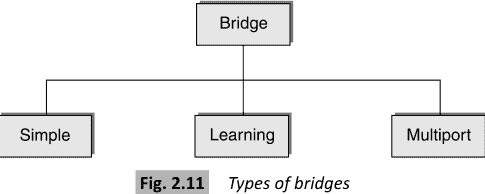

**图 2.11** 桥器的类型

现在让我们讨论一下这三类桥器。

1. **简单桥器**是这种原始类型的桥器。**简单桥器连接**两个网段。因此，它维护一个针对这两个网段的地址与网段号映射表。该表必须由操作员通过输入所有主机地址及其网段号手动输入。每当添加新主机或替换/删除现有主机时，都必须更新该表。由于这些原因，简单桥器最便宜，但由于人工干预，存在很大的错误空间。

2. **学习桥器**（也称为自适应桥器）与简单桥器不同，不需要手动编程。相反它执行自己的桥接功能。它是如何做的？为了构建主机地址到网段号的映射，学习桥器会检查接收到的帧的源地址和目的地址，并利用它们创建表。因此，当桥器收到来自某个主机的帧时，它会检查表确认发送主机的地址是否在表中。如果不在，它会将该地址连同其网段号一起添加到表中。然后它查看目的地址，看其是否在映射表中。如果存在，桥器就知道了目的所在的网段。因此，它将帧交付到该网段。如果目的地址（以及目的地址的网段号）不在其映射表中，桥器会将帧发送到它连接的所有网段。

因此，随着每个主机传输的首个数据包，学习桥器学会了该主机的网段号，因此它在映射表中为该主机创建一个条目，包含整个网络中主机与其网段号之间的完整映射。由于桥器一直在检查和更新其映射表，即使添加了新主机、删除了现有主机或更换了它们的网卡（NIC），也没有关系！桥器会学习这些变化并自动适应。

让我们参考图 2.9 了解学习桥器是如何创建其映射表的。假设图 2.9 所示网络上的主机正要开始首次传输。注意对于图中所示的传输序列，学习桥器是如何首先构建、然后更新其映射表的，如表 2.3 所示。

| 表 2.3 学习桥器构建映射表 |
| :--- |
| 主机发送的帧 | 主机所在的网段 | 桥器映射表中主机地址列的条目 | 桥器映射表中网段 id 列的条目 |
| :--- | :--- | :--- | :--- |
| A → D | 1 | A | 1 |
| D → C | 1 | D | 1 |
| A → B | 1 | — | — |
| B → C | 1 | B | 1 |
| H → C | 2 | H | 2 |
| E → G | 2 | E | 2 |
| F → E | 2 | F | 2 |
| G → B | 2 | G | 2 |
| C → E | 1 | C | 1 |

最后两行显示了图 2.9 所示网络中的映射过程。如表 2.3 所示的最后两列显示了桥器的映射表。在这种情况下，主机 A 向 D 发送一个帧。桥器接收到帧后，检查源地址，因此在映射表中为 A 创建网段号为 1 的条目。如果目的地址（以及目的地址的网段号）不在其映射表中，桥器会将帧发送到它连接的所有网段。然而，由于桥器的映射表中已经有了 A 的条目。

3. **多端口桥器**是学习桥器的一种特殊情况。当桥器连接两个以上网段时，它被称为多端口桥器。

## 路由器

### 2.8.1 简介

路由器工作在 OSI 模型的物理层、数据链路层和网络层，如图 2.12 所示。路由器是一个智能设备。它的功能远多于桥器。它用于连接此类网络，这意味着这些网络在帧大小、传输速率、拓扑结构等方面可能有所不同。


**图 2.12** 路由器在 OSI 模型中的位置

### 2.8.2 路由器是如何工作的？

可以通过图 2.13 说明路由器的概念。如图所示，有一个环形网络 A 和基于总线的结构的以太网 B。路由器在 X 点连接环形网络，在 Y 点连接以太网。由于同一台路由器在这些点连接了两个网络，这意味着该路由器必须有两个网卡（NIC）。也就是说，路由器的每个网卡都特定于它连接的一种类型。在这个例子中，X 点的网卡是环形网络网卡，而 Y 点的网卡是以太网网卡。

更进一步，我们可以通过多个路由器连接多个网络。例如，假设如图 2.14 所示有一个以太网、一个 X.25 网络和一个环形网络。我们可以使用路由器 R1 将以太网连接到 X.25 网络。这意味着路由器 R1 必须有两个网络接口，一个对应以太网，另一个对应 X.25。同样，路由器 R2 将 X.25 网络连接到环形网络。这意味着路由器 R2 也有两个网络接口，一个用于 X.25，另一个用于环形网络。如图 2.14 所示。我们可以想象使用更多的路由器可以将任意数量的同构/异构网络连接在一起形成一个互联网络（或互联网）。互联网（注意大写字母）作为流行的网络网络，是互联网络的一个示例。

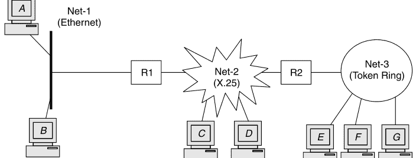

**图 2.14** 两台路由器连接三个网络

### 2.8.3 路由涉及的问题

拥有两个网卡（NIC）接口是可以的。然而，仍然存在两个主要问题尚未解决。它们与下文讨论的帧格式和物理地址有关。

假设网络 1 上的主机 A 向网络 3 上的主机 G 发送帧。如图 2.14 所示，该帧在到达主机 G 之前，必须通过路由器 R1 和 R2。网络 1（以太网）和网络 3（令牌环）所使用的帧格式和寻址机制将是不同的。

1. 如果主机 A 尝试向主机 G 发送以太网帧，会发生什么？因为帧会首先到达 R1，而 R1 也连接到网络 1（即以太网），它能够理解以太网帧的格式。由于它现在要将帧转发到 X.25 网络的路由器 R2，路由器 R1 必须将帧重新格式化为 X.25 格式并发送到路由器 R2。路由器 R2 随后可以将帧转换为令牌环帧，并将其交给其本地的主机 G。这种重新格式化极其复杂。这不仅涉及将帧从一种格式转换为另一种格式，还涉及模拟另一种协议——包括确认机制（令牌环提供该机制，以太网不支持）、优先级等。

2. 同样，主机 A 会在它想要发送给主机 G 的帧的目的地址字段中填写什么呢？它应该在该字段中填写主机 G 的物理地址吗？在这种情况下，它可能正常工作，因为以太网和令牌环都使用 48 位物理地址。然而，如果主机 A 想向主机 D 而不是 G 发送帧呢？在这种情况下，主机 A（以太网）和主机 D（X.25）的地址将不同。因此，在互联网上使用其他网络的物理地址可能是危险的。我们如何解决这个问题呢？

为了解决这些问题，网络层提出了以下两种解决方案：

1. 为了解决帧格式不同的问题，我们使用单一的逻辑帧格式，该格式独立于物理网络。也就是说，我们应该有一个通用的帧格式，它不依赖于源或目的地是以太网还是令牌环。同样，中间网络可以与源网络和目的网络不同（在我们这个案例中，源是以太网（网络 1），中间网络是 X.25 网络（网络 2），目的是令牌环（网络 3）)。我们就可以通用地使用该逻辑帧，无论底层网络类型如何。

因此，发送者必须将此逻辑帧封装进以太网帧中，并交给其本地路由器 R1。路由器 R1 必须从该以太网帧中提取原始帧，通过添加相应的 X.25 头部将其转换为 X.25 帧（该帧与其必须转发通过的网络兼容），并发送到路由器 R2。路由器 R2 随后从 X.25 帧中提取帧，通过添加相应的令牌环头部将其转换为令牌环帧，并交给主机 G。在节点 G 处，原始逻辑帧被提取出来。当所有帧（即整个消息）到达节点 G 时，它可以被交给节点 G 上的上层进行处理。

我们将在以后使用 TCP/IP 时在单独的章节中检查这一细节。

2. 为了解决地址格式不同的问题，可以在所有网络中使用通用的地址、逻辑地址或网络层地址。这种逻辑地址将独立于底层的物理地址及其格式。因此，如果发送者想向主机 G 发送帧，它会在目的地址字段中填写主机 G 的逻辑地址。通过使用逻辑目的地址和中间节点的逻辑地址进行路由，帧可以从主机 A 移动到路由器 R1，从路由器 R1 到路由器 R2，再从路由器 R2 到主机 G。在各个阶段，逻辑地址需要翻译为相应的等效物理地址，因为物理网络理解的是物理地址而非逻辑地址。

在这两种情况下，路由器都起着非常重要的作用。当然，除了这些之外，路由器还必须为帧路由寻找最优路径。我们之前已经讨论过这个概念。

## 2.9 网关

如图 2.15 所示，网关在 OSI 模型的所有七层上运行。

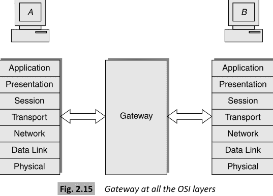

**图 2.15** 网关在 OSI 模型中的位置


众众所知，路由器可以跨不同的网络类型转发数据包（例如以太网、令牌环、X.25、FDDI 等）。然而，所有不同的网络必须使用一种通用的传输协议（如 `TCP/IP` 或 `AppleTalk`）进行通信。如果它们不使用相同的协议，路由器将无法将数据包从一个网络转发到另一个网络。另一方面，在更高的层次，网关可以跨不同的网络转发数据包并可以使用不同的协议。也就是说，如果网络 A 是使用 `TCP/IP` 的令牌环网络，而网络 B 是 `Novel` 网络，网关可以在它们之间转发帧。

这意味着网关不仅具有翻译不同格式的能力，还具有翻译不同协议的能力。网关感知连接到路由器的每个网络所使用的协议，因此它可以从一种协议翻译到另一种协议。在某些情况下，唯一更改的是帧头。在其他情况下，网关的任务非常艰巨。显然，网关是一个比路由器强大的计算机。它通常用于连接不兼容的网络。

# 计算机网络概念、设备、互联网基础、历史与架构

## 2.10 互联网的简史

### 2.10.1 引言

尽管互联网在过去十年中变得流行，但它有四十年的历史。创建互联网的动机有两个方面：

1. 研究人员希望相互通信并共享论文和文档。
2. 美国军方需要一种能够御核攻击的强大通信基础设施。这种想法是，即使两个国家被完全摧毁，重要的科学家和外交官仍能在掩体中通信。

这些发展追溯到 60 年代。这需要一个大型计算机网络。1961 年，`Baran` 首次提出了存储转发包交换的概念。

### 2.10.2 ARPANet

`Baran` 的原始想法在相当一段时间没有引起关注。事实上，法国的 `Zimmermann` 也提出了类似的想法。`Baran` 的想法被美国国防部的高级研究计划署（`ARPA`）采用。他们资助了一个名为 `ARPANet` 的计算机网络，其目的是共享昂贵的远程电话线。`ARPANet` 在 1966 年首次提出，并在 1969 年由研究人员实际构建。这是实践广域包交换、去中心化路由、流量控制以及许多应用程序（如 `TELNET`，允许用户从远程登录计算机；以及 `FTP`，文件传输协议）的开创性工作。

一旦 `ARPANet` 开始变得流行，人们就开始将其他网络连接到 `ARPANet`，创建一个计算机网络的网络。这导致了共享的格式、路由和寻址方案。重要的一点是，通过这些发展，确保网络的网络尽可能地去中心化。路由器的概念在这个阶段被定义。正如我们讨论的，路由器是一种主要用于计算机网络之间传输数据包的计算机。

其他网络如 `CSNET` 和 `NEARNET` 使用与 `ARPANet` 相同的哲学开发。由于这种设计，这些网络可以相互连接。到 80 年代初，十个这样的网络形成了现在被称为互联网的网络。

### 2.10.3 世界网 (WWW)

万维网 (`WWW`) 是运行在互联网上的应用程序——它是所有互联网应用程序中最流行的之一。`WWW` 最初的开发有一个非常简单的意图——为了允许位于不同物理位置的研究人员和科学家之间进行文档共享。1989 年，位于欧洲核子研究中心（`CERN`，现在被称为欧洲粒子物理学实验室）的 `Tim Berners-Lee` 启动了 `WWW` 项目。他的目标分为两个领域，如下：

1. 开发一种链接文档的方法，这些文档并非存储在同一台计算机上，而是分散在许多不同的位置（即超链接）。
2. 使用户能够共同工作——这一过程被称为协作创作。在经历了十余年的增长后，第一个目标已圆满实现。然而，第二个目标仍然尚未完全完成。

有趣的是，`WWW` 的基本大纲一旦就绪，`CERN` 就向公众免费发布了源代码。这极大地吸引了程序员对 `WWW` 的兴趣。这种开源代码或免费软件的概念（与专有源代码不同，普通公众也可以使用）意味着人们不仅可以对 `WWW` 软件进行实验，还可以添加新功能并将其推向新的高度。不久后，来自伊利诺伊大学国家超级计算机应用中心（`NCSA`）的数百名程序员开始了最初的 `WWW` 软件开发。基于在 `CERN` 开发的任何基础代码，`NCSA` 开发了第一个具有图形界面的 Web 浏览器，名为 `Mosaic`。浏览器只是运行在客户端计算机上的程序，用于检索并允许查看存储在远程服务器上的文档（我们将很快学习客户端和服务器计算机的含义）。

开发 `Mosaic` 和原始 Web 服务器软件的核心团队成员[Web 服务器是一种计算机程序，等待远程客户端（即 Web 浏览器）对存储在服务器计算机上的文档的请求，检索它们并将其回给客户端]来自 `CERN`，组成了一家名为 `Netscape Communications` 的公司。他们在 1994 年 12 月开发了新浏览器 `Netscape Navigator`。该浏览器是 `WWW` 的第一个商业 Web 浏览器，包含了许多功能，其中最重要的是安全性，这使得在未来的几年里可以在 `WWW` 上进行商业交易。在接下来的几年里，`WWW` 从实验项目变成了一个真正的商业项目。这可以从 `Netscape Communications` 的估值中判断出来。`Netscape Communications` 是一家拥有两年历史且几乎没有收入的公司，于 1995 年 8 月上市。其估值达 11 亿美元，这个数字在接下来的四个月内增长了五倍！

为了避免专有侵权，`WWW` 项目于 1995 年从 `CERN` 转移到马萨诸塞理工学院（`MIT`），现在被称为 `W3` 联盟（`W3 Consortium`）。该联盟协调 `WWW` 标准的发展，并确保统一性，避免重复劳动。

## 2.11 互联网的增长

当 `ARPA` 致力于互联网研究项目时，`UNIX` 操作系统也席卷了计算世界。一组研究人员于 20 世纪 70 年代初在贝尔实验室开发了 `UNIX`。贝尔实验室允许用户出于教学和研究目的拥有 `UNIX` 副本。为了鼓励其可移植性，贝尔实验室向学生提供了 `UNIX` 操作系统的源代码。这意味着学生可以用各种方式使用它，以检查其是否有效，并对其进行修改以使其更好。加利福尼亚大学伯克利分校的一组学生应用并修改了 `UNIX` 操作系统，使其具备网络能力（例如向另一台计算机发送消息、访问存储在远程计算机上的文件等）。这个版本的 `UNIX`，即 `BSD UNIX`（伯克利软件分发），变得非常流行。

`ARPA` 注意到 `BSD` 是一个广为人知的实体。他们与伯克利的研究人员签署了协议，根据协议，`BSD UNIX` 现在在操作系统本身中包含了 `TCP/IP` 协议。因此，在下一个版本的 `BSD UNIX` 中，人们几乎免费获得了 `TCP/IP` 软件。尽管购买 `UNIX` 并连接到互联网的大学很少，但他们有自己的局域网（`LAN`）。他们现在在 `LAN` 中使用 `TCP/IP`。随后，这一概念被应用于互联网。因此，`TCP/IP` 首先进入大学的 `LAN`，然后从那里进入其他网络。

到 80 年代初，`TCP/IP` 首先进入了大学的 `LAN`，并从那里进入其他网络。此时，互联网已变得可靠。

| 年份 | 用户数（单位：百万） |
| :--- | :--- |
| 1995 | 16 |
| 1996 | 36 |
| 1997 | 70 |
| 1998 | 147 |
| 1999 | 248 |
| 2000 | 361 |
| 2001 | 513 |
| 2002 | 587 |
| 2003 | 719 |
| 2004 | 817 |
| 2005 | 1018 |
| 2006 | 1133 |


图 2.16 显示互联网增长的图表

# 关键术语与概念

自适应、桥接器、研究计划署 (`ARPA`)、`ARPANET`、桥接器、浏览、客户端计算机、协作授权、连接、拨号程序、电子邮件服务、文件传输协议 (`FTP`)、免费软件、网关、互联网、互联网提供商 (`ISP`)、`IP` 地址、`ISP`、端口、互联网工作、学习、现代、网络设备、逻辑地址、开源代码、专有源代码、放大器、继电器、服务器计算机、简单桥、存储和转发、数据交换、`TELNET`、传输控制协议/网际协议 (`TCP/IP`)、通用地址、通用服务、虚拟网络、Web 浏览器、Web 托管、Web 服务器、`W3` 联盟、万维网

# 总结

- 当多台计算机连接在一起时，形成了计算机网络。当多个计算机网络连接在一起时，就变成了互网络或互联网。
- 路由器是连接多个网络的特殊用途计算机。为此，路由器具有接口 (`NIC`) 以连接到每个网络。
- 互联网是一个虚拟网络。虚拟一词之所以出现，是因为它由许多硬件和软件不同的网络组成无缝工作。
- 网络设备和互联网工作设备分别用于连接计算机和网络。
- 网络设备包括中继器和桥。互联网工作设备可以分为路由器和网关。
- 中继器是一种电子设备，只需再生比特流。它工作在 `OSI` 模型的物理层。
- 桥是一种拥有自己的处理器、内存和两个网卡的计算机，用于连接网络的两个部分。桥不运行应用程序，而是促进网络内的通信。
- 路由器是智能设备。它的功能远大于中继器或桥。路由器对于互连两个或多个网络非常有用。
- 最强大的设备是网关。网关可以在可能不同协议的网络之间转发数据包。
- 互联网是 20 世纪最重要的进展之一。

# 多选题

1. 在互联网工作中，相互连接的两个或多个网络彼此是不兼容的。
   (a) 必须 (b) 可能 (c) 绝不 (d) 以上都不是

2. 通常，使用 ______ 用于互联网的目的。
   (a) 主机 (b) 线缆 (c) 路由器 (d) 连接器

3. 路由器必须至少有 ______ 个接口。
   (a) 2 (b) 3 (c) 4 (d) 5

4. 在由网络形成互联网时，存在 ______ 不兼容性问题。
   (a) 硬件和软件 (b) 仅硬件 (c) 仅软件 (d) 只有软件但没有硬件

5. 桥是一种 ______ 设备。
   (a) 网络 (b) 连接 (c) 互联网 (d) 路由

6. ______ 是所有网络/互联网设备中最简单的一种。
   (a) 中继器 (b) 桥 (c) 路由器 (d) 网关

7. 通常情况下，使用 ______ 将网络划分为若干段。
   (a) 中继器 (b) 桥 (c) 路由器 (d) 网关

8. ______ 随着获取更多网络信息而构建其映射表。
   (a) 简单桥 (b) 中继器 (c) 自适应桥 (d) 再生器

9. 逻辑地址与物理地址是 ______ 的关系。
   (a) 相同的 (b) 紧密耦合 (c) 有时相关 (d) 完全无关

10. ______ 可以理解多种网络协议。
    (a) 中继器 (b) 桥 (c) 路由器 (d) 网关


# 详细问题

1. 讨论互联网的动机。
2. 什么是通用服务？
3. 互联网中各种宽层次的问题有哪些？
4. 路由器如何促进两个或多个网络之间的互连互通？
5. 解释中继器在物理层起的作用。
6. 什么是桥？解释它的功能。
7. 桥的类型有哪些？解释简单桥。
8. 什么是路由器？它是如何工作的？
9. 网关是如何工作的？
10. 简要讨论互联网的历史。

# 练习

1. 进一步了解关于的历史历史。
2. 调查成为 `ISP`（服务提供商）需要什么。
3. 如果你的背景不是数据通信，请学习更多各种数据通信和网络技术，例如 `LAN`（以太网、令牌环、`FDDI`）、`MAN`（`SMDS`、`DQDB`）和 `WAN`（`X.25`、帧中继）。
4. 假设你必须自己构建一个路由器。硬件/软件要求是什么？
5. 找出你的机构、学院或大学使用的是哪种路由器或桥。

# 3 TCP/IP 第一部分：TCP/IP、ARP、RARP、ICMP 简介

## 引言

传输控制协议/网际协议（`TCP/IP`）协议套件构成了互联网的基础（注意大写，这意味着我们指的是全球计算机网络系统）。当多个计算机网络连接在一起时，是 `TCP/IP` 创建了一个虚拟网络的幻象。`TCP/IP` 开发于 20 世纪 70 年代初。有趣的是，局域网（`LAN`）以及互联网的开发是在同一时期。因此，`TCP/IP` 随着互联网一起成长，`LAN` 迅速流行，连接 `LAN` 是 `TCP/IP` 的早期目标之一。事实上，当存在多个具有多种帧/数据报格式和多种算法的网络时，这些算法包括：(a) 协议控制，以及 (b) 一种在网络每个节点运行的具有其帧/数据报大小和其他算法的通用协议，除了现有协议还具有将该网络的帧/数据报转换为通用协议帧/数据报的算法。`TCP/IP` 使用的是后者的哲学。

我们已经看过了网络协议的 `OSI` 模型。`TCP/IP` 开发于 `OSI` 之前。因此，`TCP/IP` 中的层与 `OSI` 中的层并不完全对应。相反，`TCP/IP` 套件由四层组成。它认为数据链路层和物理层由单层组成。然而，为了便于理解，我们将其视为五层，如图 3.1 所示。

| 应用层（第 5 层） |
| :--- |
| 传输层（第 4 层） |
| 网络层（第 3 层） |
| 数据链路层（第 2 层） |
| 物理层（第 1 层） |

图 3.1 `TCP/IP` 层


### 第 1 层：物理层

`TCP/IP` 中的物理层与 `OSI` 模型的物理层没有任何不同。这一层处理硬件级别、电压等，在 `TCP/IP` 的情况下，这里没有显著差异。

### 第 2 层：数据链路层

数据链路与其他网络模型非常相似。它涵盖了介质访问和控制（`MAC`）设置——即谁可以发送数据以及何时发送，等。它还涉及帧格式（例如以太网）等。

### 第 3 层：网络层或网际层

从互联网或网络上进行通信的背景来看，互联网非常重要……（注：原文此处存在大量重复的句子，已按翻译要求处理并保留逻辑）。

# TCP/IP 第一部分：TCP/IP、ARP、RARP、ICMP 简介

| 应用层 | `SMTP` | `FTP` | `DNS` | `HTTP` | `TELNET` |
| :--- | :--- | :--- | :--- | :--- | :--- |
| 表示层 | | | | | |
| 会话层 | | | | | |
| 传输层 | | `TCP` | | `UDP` | |
| 网络层 | `ICMP` | | | | `ARP` | `RARP` |
| 数据链路层 | | | | | | |
| 物理层 | 特定于硬件级数据通信底层物理介质的协议 | | | | | |

图 3.3 `TCP/IP` 协议与 `OSI` 模型的映射


从整体上看，消息的每个数据报都从源传输到目的地，如图所示。为了简单起见，假设消息很小，能够放入一个数据报/帧中。

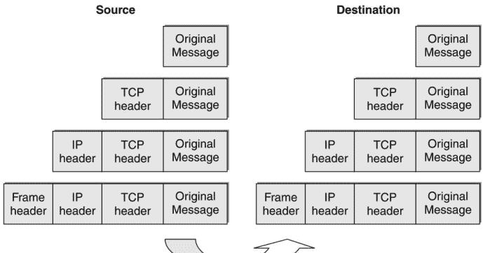

图 3.4 不同层级从源到目的地的消息传输

在最底层（物理层），如果通过图 3.5 所示的以太网从节点 A 发送数据报到节点 E，它最终将由节点 A 通过附加帧头部以以太网帧的形式发送。在节点 E 处，头部将被丢弃，并恢复出原始数据报。

# 路由

为了通过邮政系统传输信封中的信，我们必须能够唯一地识别世界上每家家庭/办公室/商店。为此，我们为每一个地址分配一个唯一的邮政地址。同样，为了将数据从一台计算机传输到另一台计算机，我们需要唯一地识别世界上每台计算机。为此，我们再次使用了地址！因此，就像写信的人将其放入信封并在上面注明地址一样，发送消息的计算机将消息放在逻辑封内，并在封上注明接收计算机的地址。我们知道在邮政系统中，中间邮局会将信成功地从发送者递交给收件者。在这里，我们的路由器执行着相同的工作。

在详细讨论如何实现这种情况之前，我们想研究计算机地址的概念。识别出的四种计算机地址如表 3.1 所示。

| 地址类型 | 意义/用途 |
| --- | --- |
| 物理地址 | 物理层和数据链路层使用 |
| 逻辑地址 | 网络层使用 |
| 端口地址 | 传输层使用 |
| 特有地址 | 应用层使用 |

让我们简要讨论这四种地址。

## 3.2.1 物理地址

物理地址由计算机所属的局域网（LAN）或广域网（WAN）定义。它仅在该 LAN 或 WAN 内部具有权威性，在之外会导致歧义。为了理解这一点，东街（East Street）可能出现在世界上数百个城市中。但在一个城市内，东街具有权威性（即它是为人知的/被理解的）。在之外，它会导致歧义。物理地址的大小和格式随技术而异。例如，我们知道以太网使用 48 位地址来唯一地识别计算机（即使用 48 位地址）。另一方面，Apple LocalTalk 使用 8 位地址。除了地址大小不同外，我们知道硬件帧格式本身在各种网络技术中也是不同的。

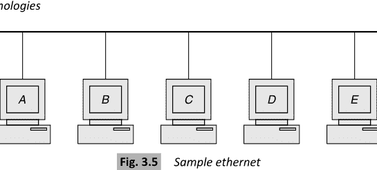

## 3.2.2 逻辑地址

逻辑地址也称为通用地址。换句话说，它们独立于底层网络基础设施（软件和硬件）。正如我们稍后讨论的，它们使用通用的尺寸（32 位）以保持一致，并被称为 IP 地址。

每个路由器都有多个物理地址和多个逻辑地址。虽然我们稍后会详细检查这一点，但路由的工作原理在概念上是简单易懂的。发送者只需要知道接收者的逻辑地址。需要重要的是，当数据包通过一个或多个路由器从发送者传输到目的地时，数据包中的源和目的逻辑地址（即 IP 地址）永远不会改变。然而，正如我们将学习的那样，源地址和目的地址在每一步都会不断变化。

## 3.2.3 端口地址

逻辑地址和物理地址帮助数据包从源传输到目的地。为了理解这一点，让我们考虑一个例子。假设在 X 组织工作的 A 人想给在 Y 组织工作的 B 人打电话。就像 A 和 B 一样，还会有几个人向其他人拨打电话。电话基础设施知道如何将电话从 X 组织路由到 Y 组织。但这还不够，除非电话到达了 Y 组织的电话网络，否则我们必须能够将其转发到 B 人的电话分机。这种情况如图 3.6 所示。

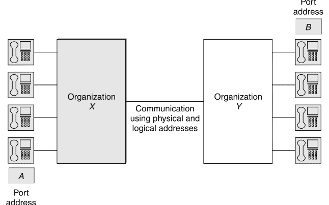

图 3.6 端口地址概念

类似地，当发送计算机向接收计算机发送数据包时，路由器基础设施确保数据包从发送者传输到接收者。然而，我们还必须确保数据包不仅到达正确的接收者，而且还到达了接收计算机上正确的应用程序。换句话说，如果发送应用程序发送了电子邮件，接收计算机也必须将其交给本地电子邮件软件，而不是交给，比如文件传输协议。

网络技术

这就是端口地址出现的地方。它唯一地识别接收计算机上的应用程序，以免混淆。

## 3.2.4 特有地址

特有地址是用户友好版本。此类地址的示例是电子邮件地址（例如 `akate@gmail.com`）或网络地址（例如 `www.google.com`）。人类（即使用特定地址的人）使用这些地址。另一方面，计算机使用逻辑地址和端口地址。因此，根据需要，特有地址会被转换为逻辑地址和端口地址，以便进行实际传输。

# 为什么需要 IP 地址？3.3

IP 协议（IP）如何知道数据报来自哪里以及要递交到哪里？回顾我们之前对虚拟网络的讨论。互联网的主要目标是提供一个内部复杂性的抽象视图。同时，让构成网络的人员自由选择适合其要求的硬件和网络技术，例如以太网、令牌环、SNA 等。这意味着需要一个通用接口来连接两种视图——互联网终端用户和处理网络的人员。因此，在互联网上识别计算机是一个巨大的挑战。不同的网络技术有不同的地址机制。为计算机分配硬件地址的方法有：

- 静态地址：在这种方案中，物理地址硬编码在计算机的网络接口卡（NIC）上。该地址不会改变，由硬件制造商提供。
- 配置地址：在这种情况下，物理地址在首次安装时配置，静态地址由硬件制造商决定并硬编码，配置地址允许最终客户设置物理地址。
- 动态地址：在这种方案中，每当计算机启动时，服务器都会动态分配一个物理地址。这意味着每当计算机关闭时，物理地址就会不断变化，为启动的计算机分配一个空闲地址。从空闲地址池中识别出空闲地址，并使用空闲地址池在运行时作为随机数生成动态地址。

我们将不再进一步讨论这些类型。但是，重要的是记住，静态地址是最简单的一种类型，因此最受欢迎，因为它们不需要人工干预或动态处理。无论如何，重点是网络上的每台计算机都有唯一的物理地址或硬件地址。该地址存储在计算机的 NIC 中。网络必须使用该地址向该计算机递送消息。

网卡（NIC）仅仅是计算机上的一个 I/O 接口，允许计算机与网络上的所有其他计算机进行通信。NIC 是一台带有少量内存的小型计算机，负责计算机与其所连接的网络之间的通信。如图 3.7 所示。

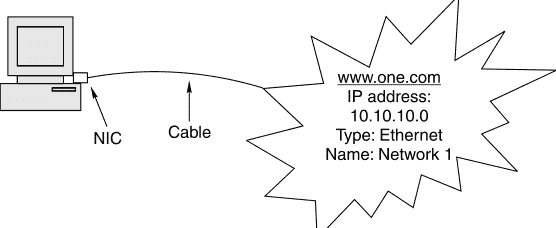

图 3.7 网络接口卡 (NIC) 是主机与与其连接的网络之间的接口

虽然为了方便理解，图中将 NIC 单独显示，但它实际上是插在计算机主板的某个插槽中的，因此位于计算机内部。这与硬盘插在计算机主板的某个插槽中非常相似。NIC 看起来像一块厚卡。需要注意的主要点是，NIC 位于计算机与它所属的网络之间。它充当了计算机与其网络之间的接口。当计算机想要向同一网络上的另一台计算机发送消息时，会发生以下情况：

1. 计算机将消息发送到其 NIC。正如我们提到的，NIC 是一台小型计算机。因此，它也有自己的内存。NIC 将此消息存储在它的内存中。
2. NIC 现在根据底层网络协议（例如以太网、令牌环等）将消息适当地拆分成帧（frames）。
3. NIC 将源地址和目的物理地址插入帧头。它计算 CRC 并将其插入帧的相应字段中。
4. NIC 等待直到获得网络介质的控制权（例如在以太网中，当总线空闲时；或者在令牌环中，当它获取到令牌时）。当它获得控制权后，向网络发送一个或多个帧。
5. 每个帧在网络中传输，并被网络上所有计算机的相应 NIC 接收。每个 NIC 将其物理地址与帧中包含的目的地址进行比较。如果不匹配，则会丢弃该帧。因此，只有正确的接收者会接受该帧，因为它的地址与帧的目的地址匹配。
6. 正确的接收者以相同的方式接收所有帧。
7. 接收者为每个帧计算 CRC，并与帧中的 CRC 进行匹配以检查错误；如果允许，则重组这些帧以还原原始消息。
8. 接收者的 NIC 现在将整个消息交给接收者计算机。

计算机的物理地址由制造商预定义且始终是唯一的。然而，真正的地址方案在不同制造商之间是不同的。为了营造出一个单一且统一的互联网假象，互联网上的所有计算机必须使用一种统一的地址机制，其中没有两个地址是相同的。由于物理网络在地址大小和格式上存在差异，因此无法使用物理地址。因此，IP 不能使用计算机的物理地址。它必须在物理地址之上有一层结构。

# 逻辑地址 3.4

为了保证互联网上所有计算机的统一寻址，IP 软件定义了一种不依赖底层物理地址的寻址机制。这被称为逻辑地址。理解计算机的物理地址和逻辑地址之间的区别至关重要。物理地址是硬编码在计算机内部 NIC 上的——因此是一个硬件实体；而逻辑地址纯粹是一个抽象——因此是软件的产物。这种抽象使得互联网上的计算机可以仅以逻辑地址进行思考。因此，它不依赖于物理地址，从而也就不依赖于底层的网络机制。

当计算机想要与互联网上的另一台计算机通信时，它使用目的计算机的逻辑地址。它并不关心目的计算机的物理地址，因此也不在乎物理地址的大小和格式。因此，如果这两台计算机具有完全不同的物理寻址机制，它们也可以很容易地使用逻辑地址进行通信！这使得通信变得以至于有时人们发现难以相信这些并不是计算机的物理地址，事实上，它们只是纯粹的逻辑实体！当然，在内部，我们必须从节点的 IP 地址找到物理地址，以便实际在网络上传输帧。这是通过称为地址解析协议（ARP）的协议实现的。下一节的示例将对此这一点。

# TCP/IP 示例 3.5

## 3.5.1 引言

让我们通过一个示例来说明 TCP/IP 的工作。假设有三个网络：以太网、X.25 广域网令牌环。每个网络都有一个在该网络内被识别的帧格式。这些帧的大小和格式显然不同。图 3.8 显示了这些由路由器 R1 和 R2 连接的网络。


如果 Net-1 的计算机 A 想要向 Net-3 的计算机 G 发送消息（例如电子邮件或邮件），我们如何实现这一点？这些网络及其帧格式是不同的。如图 3.9 所示（未按比例显示），以太网帧、X.25 数据报（datagram）和令牌环帧的格式是不同的。

我们看到，不仅三种帧/数据报格式的大小之间存在差异，各个字段和内容也存在差异。现在，通信应该在什么格式下进行？正如我们将会看到的，IP 在此起了主要作用。

| 前导码 (8 字节) | 目的地址 (6 字节) | 源地址 (6 字节) | 长度 (2 字节) | 数据 (500字节) | (4字节) |
|---|---|---|---|---|---|
| 前导码 (8 字节) | 目的地址 (6 字节) | 源地址 (6 字节) | 类型 (2 字节) | 数据 (1500字节) | (4字节) |
| 版本 (4位) | HLEN (4位) | 服务类型 (8位) | 总长度 (16位) | 标识 (16位) | 标志 (3位) | 偏移 (13位) |
|---|---|---|---|---|---|---|
| 版本 (4位) | HLEN (4位) | 服务类型 (8位) | 总长度 (16位) | 标识 (16位) | 标志 (3位) | 偏移 (13位) |
|---|---|---|---|---|---|---|
| 生存时间 (8位) | 协议 (8位) | 校验和 (16位) | | | | |
| 源 IP 地址 (32位) | | | | | | |
| 目的 IP 地址 (32位) | | | | | | |
| 选项 | | | | | | | (a) 以太网帧
| 前导码 (8 字节) | 目的地址 (6 字节) | 源地址 (6 字节) | 类型 (2 字节) | 数据 (可选) | (4字节) |
|---|---|---|---|---|---|---|
| 版本 (4位) | HLEN (4位) | 服务类型 (8位) | 总长度 (16位) | 标识 (16位) | 标志 (3位) | 偏移 (13位) |
|---|---|---|---|---|---|---| (b) X.25 帧
| 前导码 (8 字节) | 目的地址 (48 字节) | 源地址 (48 字节) | 类型 (8 字节) | 数据 (可选) | (4字节) |
|---|---|---|---|---|---|---|
| 版本 (4位) | HLEN (4位) | 服务类型 (8位) | 总长度 (16位) | 标识 (16位) | 标志 (3位) | 偏移 (13位) |
|---|---|---|---|---|---|---|
| 生存时间 (8位) | 协议 (8位) | 校验和 (16位) | | | | |
| 源 IP 地址 (32位) | | | | | | |
| 目的 IP 地址 (32位) | | | | | | |
| 选项 | | | | | | | (c) 令牌环帧


## 3.5.2 数据报

数据报的结构如下。消息可以被拆分为数据报，以匹配底层网络的大小。在这种情况下，数据报由以下部分组成：

1. 版本 该字段用于数据报分片时。当数据报通过不同的网络时，它可能会被分成为数据报。在这些情况下，数据报使用标识进行排序，以便重组原始数据报。
2. 标志 该字段对应前面的字段。它指示数据报是否可以被分片——如果是，它是第一个碎片还是最后一个碎片，或者是中间碎片。
3. 分片偏移 如果数据报被分片，此字段很有用。它指示分片前原始数据报中的偏移。这对于从碎片重构数据报有用。
4. 生存时间 我们知道数据报通过一个或多个路由器到达目的地。如果出现网络问题，某些通往目的地的路由可能不可用，例如硬件故障、链路故障或拥塞。在这种情况下，数据报可能会通过不同的路由发送。如果网络问题不能及时解决，这种情况可能会持续很久。不久，可能会有沿路径不同方向传输的数据报，这会导致拥塞，路由器变得过于繁忙，导致至少部分网络停滞。在某些情况下，数据报可能会循环传输而不到达目的地，实际上返回了原始发送者。为了避免这种情况，数据报初始化该字段（即生存时间），并在每次递减。如果该字段的值变为零或负数，则会被立即丢弃。不再尝试将其转发到下一跳。

| 版本 (4位) | HLEN (4位) | 服务类型 (8位) | 总长度 (16位) | 标识 (16位) | 标志 (3位) | 偏移 (13位) |
|---|---|---|---|---|---|---|
| 生存时间 (8位) | 协议 (8位) | 校验和 (16位) | | | | |
| 源 IP 地址 (32位) | | | | | | |
| 目的 IP 地址 (32位) | | | | | | |
| 选项 | | | | | | |

图 10 IP 数据报

用于重传。因此，IP 并不负责整个消息的无错误、定时和按序交付——这些是由 TCP 完成的。

- **9. 协议（Protocol）** 该字段标识运行在 IP 之上的传输协议。当数据报从其分片中重组后，它必须传递给上层软件部分。这可能是 TCP 或 UDP。该字段指定了数据报被传递到目标节点上的哪个软件部分。
- **10. 源地址（Source address）** 该字段包含发送者的 32 位 IP 地址。
- **11. 目的地址（Destination address）** 该字段包含最终目的地的 32 位 IP 地址。
- **12. 选项（Options）** 该字段包含可选信息，如路由细节、定时、管理和对齐。例如，它可以存储关于数据报所经过的确切路由的信息。当它通过路由器时，路由器会将自己的信息存入，以及通过该路由器的时间存入该字段的一个槽位中。这有助于数据报的追踪和故障检测。然而，大多数时候，该字段的空间不足以容纳所有这些细节，因此并不经常使用。

在互联网上的所有计算机都运行着 TCP/IP 软件栈，因此必须理解 IP 数据报格式。同样，所有的路由器都需要运行 IP 软件。因此，它们也必须理解 IP 数据报格式。

互联网上的每台计算机都有一个唯一的 32 位 IP 地址，该地址由两部分组成：网络 ID 和该网络中的主机 ID。目的地 IP 地址中的网络 ID 部分用于将数据报通过许多路由器路由到网络。对于其他节点，则使用路由表，该表提供了特定目的地的下一跳地址。每个路由器都使用自己的路由表。一旦数据报到达网络，目的 IP 地址的主机 ID 部分将用于将数据报发送到该网络上的目的计算机。此外，正如我们注意到的，连接到网络的每台计算机都必须有一个网络接口卡（NIC），它能够理解并传输与该网络相应的帧。

## 3.5.3 关于 IP

正如我们之前提到的，TCP/IP 协议使用 IP 协议在路由器之间传输数据报。它有两个重要的属性，即它是不可靠的，且它是无连接的（colorless）。在详细讨论示例之前，让我们先理解它的含义。

- **1. IP 是不可靠的（IP is unreliable）** 当我们说 IP 是不可靠的时，意味着 IP 并不保证从源计算机发送的数据报一定能到达目的地。从这个意义上说，它采用的是“尽力而为”（best-effort）交付机制。

为了理解这一点，想象一下当我们通过邮政服务给某人寄信会发生什么。我们写好信，将其放入贴好邮票的信封并投进邮筒。信件经过一个或多个邮局，取决于目的地（例如，是否在同一个或不同的城市、州和国家），最终到达目的地。邮政服务不保证送递，但承诺尽力尽快将信件递给收件人。每个邮局的工作非常简单：它将信件转发到下一个适当的目标，这可能不是最终目的地。例如，如果我们从波士顿向休斯顿寄信封，波士顿市邮局会将它连同所有其他发往休斯顿的信封一起转发。休斯顿邮局将把信件转发给休斯顿境内相关的地区邮局。这会在件经过许多中间邮局时发生，这些邮局本质上充当交换机或路由器。最后，信件将被转发到最终目的地。然而，在任何时刻，没有任何邮局会回查信件是否被下一个收件人正确接收。他们都诚实地假设这种情况正在发生！

IP 的工作原理非常相似。在网络互联中，没有错误检查或追踪机制。因此，IP 的工作被限制为通过一系列路由器将数据报从初始源递送到最终目的地。然而，它并没有以任何方式检查数据报是否到达了下一跳。IP 假设底层媒介是可靠的，并尽力交付。可能有许多原因导致数据报丢失——例如传输过程中的位错误、拥塞的路由器、禁用链路等。IP 依赖于传输层的可靠性（即 TCP），我们稍后会看到。

正如邮政系统有挂号信的概念，每个邮局都跟踪来自各种来源并发往各种目的地的信件一样，互联网在 TCP 前面也有一种能力。TCP 让每个数据报的工作都像一封信一样，以便保持追踪并确保无错误交付。我们将详细讨论 TCP。


## 2. IP 是无连接的

考虑一下当我们给别人打电话时。在我们拨号号码并两人开始说话后，我们是通信通道中唯一的。这意味着，如果我们双方都没有说话一段时间，通信通道将保持未占用状态——它没有被分配给两个人之间的任何电话通话。这种电路交换使得电话连接是面向连接的。

然而，IP 与其他网络协议一样，并不假设数据报发送者和接收者之间存在连接。相反，IP 发送的每个数据报都被视为独立的数据报，在传输数据报之前不需要在发送者和接收者之间建立任何连接。任何计算机都可以随时向任何其他计算机发送数据报，而不忽略互联网上的其他节点。

显然，如果这要运行，数据报必须包含发送者和接收者的信息。否则，路由器将不知道将其转发到哪里。因此，数据报必须包含发送者及其去向的信息。在这种情况下，数据报的目的地址字段并不是固定的，是在路由时决定的。我们之前讨论过，IP 是包交换技术。

## 3.5.4 使用 TCP/IP 进行通信

现在，实际的通信如下所示。我们假设节点 A 想要发送到 G。将执行以下步骤来实现：

- 节点 A 上的应用层（例如电子邮件）将消息交给 TCP 层。
- TCP 层将消息拆分为段，并在每个段上附加 TCP 头部，如图所示。
- IP 层根据需要进一步拆分每个段，并在每个段上附加 IP 头部。为了简单起见，我们假设不需要分片。在 IP 级别，TCP 头部 + 数据报被视为数据。这就是封装的基本过程。因此，在这种情况下，它只是为 IP（即 TCP 头部）附加 IP 头部。
- 现在，正如前文所讨论的，对于 Net-1（这是一个以太网）而言，之前所示 IP 数据报被视为数据。节点 A 上的 IP 软件从目的 IP 地址（包含在 IP 头部中）的网络 ID 意识到它与计算机 A 的 ID 不同。因此，它意识到目标计算机位于不同的网络上。因此，它只需将数据报交给 R1。作为一般规则，每个节点都根据路由算法，将目的地址字段中与自身 ID 不同的数据报交给路由器。在这种情况下，根据该算法，节点 A 决定将数据报交给 R1。注意，A 和 R1 都在同一个以太网网络上，以太网只理解特定格式的帧。这里封装派上了用场。
- 数据报现在到达节点 A 的 NIC。在这里，形成了一个以太网帧。帧中的数据部分是 IP 头部 + TCP 头部 + 数据报。以太网头部包含 48 位源地址和目的地址。正如我们所知，这些是制造商给源计算机（即节点 A）和目的计算机（即路由器 R1）NIC 的物理地址。问题是，我们如何获取这些物理地址呢？

### 图 3.13 以太网帧

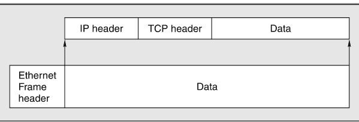

- 6. 节点 A 上的网卡（NIC）必须将 48 位物理源地址和目的地址移入以太网帧，并计算 CRC。源地址是自身的网卡地址，节点 A 节点已知。问题是获取相同的目的地址，即路由器 R1 的网卡地址。为了这一点，使用了地址解析协议（ARP）。现在以太网帧已准备好进行传输。
- 7. 现在使用 CSMA/CD 协议。对总线进行持续监控。当总线空闲时，发送帧。如果遇到冲突，则会在随机等待后重发，以此类推，如果不符合条件则继续。当帧在各个节点之间传输时，每个节点的网卡都会读取帧，将帧头中的目的地址与自己的地址进行比较，如果不匹配则将其丢弃。
- 8. 最后，当它与路由器 R1 的地址匹配时，它被存储在路由器网卡的内存中。路由器验证 CRC 并接受该帧。
- 9. 路由器的网卡移除以太网帧头并取回原始 IP 数据报，如图 3.14 所示，并将其交给路由器。

### 图 3.14 原始 IP 数据报

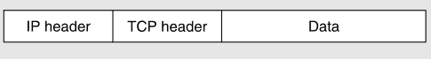

- 10. 现在，路由器检查其路由表以确认最终目的地是 G，该数据报的下一跳是路由器 R2。为了使用路由表，必须从 IP 头中提取 32 位目的 IP 地址，因为路由表包含了目的 IP 地址以及到达它的下一跳。在这种情况下，下一跳是路由器 R2。路由器 R1 知道有一个 X.25 WAN 正在连接，事实上，R1 和 R2 都在该 X.25 WAN 上（尽管 R1 也在以太网上）。
- 11. 在此阶段，IP 头 + TCP 头 + 数据全部合在一起被再次视为 X.25 的数据，并生成 X.25 头并准备好 X.25 格式的数据报。数据报包含源地址和目的地址，分别为 R1 和 R2 的地址，因为我们的意图是将数据报从 X.25 网络上的 R1 传输到 R2，其中数据报现在也处于 X.25 格式。路由器 R1 然后像之前一样使用 ARP 将数据报放到 X.25 网络上。该帧如图 3.15 所示。

### 图 3.15 X.25 帧

| IP 头 | TCP 头 | 数据 |
| :--- | :--- | :--- |
| X.25 帧头 | | 数据 |

- 12. X.25 网络在 X.25 网络内部相邻节点之间有自己的确认方式等。数据报通过各个节点并最终到达 R2 路由器。
- 13. R2 去掉 X.25 数据报的头以获取原始 IP 数据报，如图 3.16 所示。R2 现在从 IP 头中提取源地址和目的 32 位 IP 地址。

### 图 3.16 原始 IP 数据报

| IP 头 | TCP 头 | 数据 |
| :--- | :--- | :--- |

- 14. R2 也连接到令牌环网络。现在，R2 将上述数据报中 32 位目的 IP 地址的网络 ID 部分与自己的进行比较，发现两者是相同的。因此，它得知计算机 G 是其本地的。
- 15. R2 现在通过添加令牌环头从该数据报构建出一个令牌环帧，如图 3.17 所示。该格式显示了 48 位物理源地址和目的地址。现在分别插入 R2 和 G 的地址，计算了帧控制位，令牌环帧现在已准备就绪。为了此此，再次使用了 ARP。

### 图 3.17 令牌环帧

| IP 头 | TCP 头 | 数据 |
| :--- | :--- | :--- |
| 令牌环帧头 | | 数据 |

- 16. R2 现在直接将令牌环帧传递给计算机 G。G 丢弃令牌环头以获取原始 IP 数据报。
- 17. 通过这种方式，计算机 A 发送的所有数据报到达了计算机 G。IP 头被移除（它已经完成了传输 IP 数据包的作用）。带有 TCP 头的数据报被交给节点 G 上的 TCP 层。它们可能会乱序到达，甚至错误到达。运行在计算机 G 上的 TCP 软件负责检查所有这一切，确认正确接收或请求重传。中间路由器不检查这些。它们只负责路由。因此，我们说 IP 是无连接的，而 TCP 是面向连接的。
- 18. 最终，所有数据报都按顺序排列。原始消息被重构。消息现在进入了计算机 G 上的相应应用程序，例如电子邮件。TCP 头持有源和目的套接字字段。套接字对应于套接字。

## IP 地址分类

分配给主机号的位数将会更少，从而减少了每个网络可以连接的主机数量。另一方面，如果给主机号分配更多的位数，则允许在较少数量物理网络上连接大量的计算机。

由于互联网连接了许多网络，其中某些网络包含的主机比其他网络多，设计者并没有偏于任何一种方案，而是采取了一种更审慎的方法，让大家都满意，如图 3.19 所示，并在后文中描述。

### 图 3.19 IP 地址分类


| 网络号 | 主机号 | 类别 |
|---|---|---|
| 0 | 网络号 | A 类 |
| 10 | 网络号 | B 类 |
| 110 | 主机号 | C 类 |
| 1110 | 组播地址 | D 类 |
| 11110 | 留作备用 | E 类 |

如图所示，引入了“类”的概念。IP 地址空间分为 A、B、C 三个主要类。在这些类中，IP 地址的网络号部分和主机号部分保留了不同数量的位数。例如，A 类为网络号留了 7 位，主机留了 24 位——这使得少数的网络拥有大量的主机；每个 B 类则介于两者之间。相反，C 类为网络留了 21 位，主机留了 8 位——适用于网络较多但主机较少的情况。这使得拥有大量主机的网络可以在 IP 地址方案中以与连接极少数主机的网络相同的效率被容纳。

除了三个主要类外，还有两个名为 D 和 E 的类，它们具有特殊用途。D 类用于组播，即当需要向一组计算机发送单条消息时使用。为了实现这一点，一组计算机必须共享该组播地址。E 类目前不使用，它是为未来预留的。

给定一个 IP 地址，我们如何确定它属于哪一类？IP 地址的第一位是 0，则它属于 A 类地址。同样，如果前两位是 10，它就是 B 类。如果前三位是 110，它属于 C 类。最后，如果前四位是 1110，该地址属于 D 类。当出现 E 类时，前五位通过值 11110 来指示这一事实。这些位保留给该类，剩余位包含 IP 地址本身。这些位使用前面描述的哲学被分为网络号和主机号。

这一概念也可以通过图 3.20 所示进行说明。

### 图 3.20 确定 IP 地址的类别

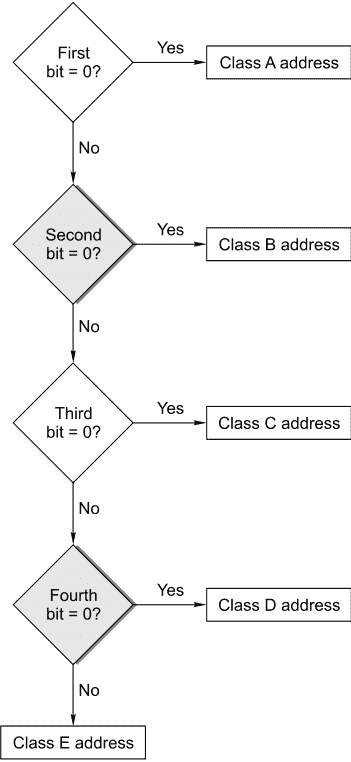

这种机制在实践中有什么用呢？简单来说，当数据以 IP 报文的形式从源到地进行传输时，存在两种可能性。

- 1. 源和目的在同一个物理网络上。在这种情况下，我们把从源到目的的数据包流称为**直接交付**。为了确定这一点，源可以提取目的主机的*网络*号部分，并将其与自己的*网络*号部分进行比较。如果两者匹配，源就知道目的主机在同一个物理网络上。因此，它不需要通过路由器进行交付，而是可以使用本地网络机制来交付数据包，如图 3.21 所示。

### 图 3.21 直接交付

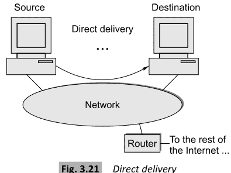

- 2. 源和目的在不同的物理网络上。在这种情况下，我们把从源到目的的数据包流称为间接交付。为了确定这一点，源可以提取目的主机的网络号部分，并将其与自己的网络号部分进行比较。由于两者不匹配，源知道目的主机在不同的物理网络上。因此，它需要将数据包转发给路由器，由路由器继将数据包转发到目的（通过更多的路由器，我们在这里忽略这种可能性）。如图 3.22 所示。

### 图 3.22 间接交付

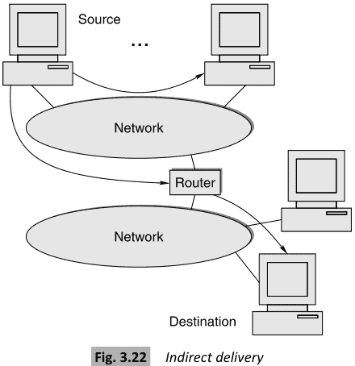

现在，让我们根据分配给网络号和主机号的位数，找出每类服务于多少个网络和主机。如表 3.2 所示。

### 表 3.2 IP 地址分类统计

| 类别 | 前缀（位） | 最大可能的网络数 | 后缀（位） | 最大数量 |
|---|---|---|---|---|
| A | 7 | 128 | 24 | 16,777,216 |
| B | 14 | 16,384 | 16 | 65,536 |
| C | 21 | 2,097,152 | 8 | 256 |

IP 地址空间也可以如图 3.23 所示。

### 图 3.23 IP 地址空间分布

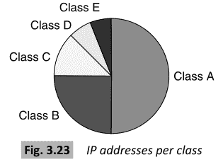

该图的表格说明见表 3.3。

### 表 3.3 IP 地址空间占比

| 类别 | 地址数量 | 节点空间占比 |
|---|---|---|
| A | 20 亿 | 50% |
| B | 10 亿 | 25% |
| C | 5000 万 | 12.5% |
| D | 6400 万 | 6.25% |
| E | 6400 万 | 6.25% |

## 3.6 点表示法

在普通通信中，用 32 位二进制数来说 IP 地址是非常困难的。例如，一个 IP 地址可能是：

```
10000000 10000000 11111111 00000000
```

显然，人类无法记住这样的地址。计算机自然可以很好地工作。因此，为了方便，使用了点表示法。简单来说，32 位被分为四个字节。每个字节包含 8 位。每个字节转换为其等效值，四个字节用点连接。因此，上述地址变为：

```
128.255.255.0
```

这可以用图 3.24 以图示形式表示。注意，最低的字节十进制可以取 0（二进制 00000000），最高是 255（二进制 11111111）。因此，用点表示法的 IP 地址范围从 0.0.0.0 到 255.255.255.255。另一种表示分类的方法见图 3.25。

### 图 3.24 二进制与点表示法的等效性

### 图 3.25 十进制表示法的 IP 地址范围

| | 最小值 | 最大值 |
|---|---|---|
| A | 0.0.0.0 | 127.255.255.255 |
| B | 128.0.0.0 | 191.255.255.255 |
| C | 192.0.0.0 | 223.255.255.255 |
| D | 224.0.0.0 | 239.255.255.255 |
| E | 240.0.0.0 | 255.255.255.255 |

应该提到的是 A 类和 B 类已经满了！没有新的网络可以分配属于这些类别的地址。只有属于 C 类的 IP 地址可用。因此，每当有人建立一个想要连接互联网的局域网（LAN）时，通常会被分配一个 C 类地址。我们将在讨论 IPv6 时讨论这一限制。

## 3.6.5 路由器与 IP 地址

我们已经看到路由器是一种主要用于互联网上计算机网络之间转发报文的专用计算机。正如我们讨论的，这意味着路由器连接两个或多个网络。因此，路由器需要的 IP 地址数量等于连接的网络数量，通常至少有两个。图 3.26 显示了一个示例。在这里，R1 连接了两个网络：以太网（IP 号为 130.100.170，该网络上任何主机的完整 IP 地址为 130.100.177，主机号在 0 到 255 之间）和令牌环网络（IP 网络为 231.200.110，该网络上任何主机的完整 IP 地址为 231.200.117，主机号在 0 到 255 之间）。我们注意到这两个都是 C 类网络。同样，R2 将同一个令牌环网络连接到 IP 地址前缀为 127.12.0.0 的广域网（WAN），这是一个 A 类网络。注意，路由器为其连接的接口分配了 IP 地址。因此，如图 3.26 所示，路由器 R1 在以太网 LAN 上拥有 IP 地址 130.100.177，而在令牌环网络上的 IP 地址为 231.200.119。在 R2 中也可以观察相同的情况，如果路由器连接到 `n` 个网络，它将拥有 `n` 个 IP 地址。

### 图 3.26 路由器 IP 地址示例

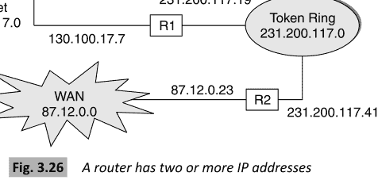

## 3.6.6 IP 版本 6 (IPv6)

正如我们所讨论过的，IP 在使互联网成为一个全球网络方面取得了巨大的成功，它极好地隐藏了底层网络的复杂性、硬件变化以及规模的增加。然而，IP 的原始设计存在一个主要问题。就像几乎所有其他发明一样，设计者们未能预见到它的未来能力和人气。他们决定只为 IP 使用 32 位。

在当时，这似乎是一个很大的数字。然而，由于过去几年互联网惊人的增长，IP 地址的范围显得太小了。IP 地址正在迅速耗尽，很快将没有足够的 IP 地址空间。其次，互联网正被用于几年前梦寐以求的应用。实时音频视频和协作技术（类似于互联网上人们的虚拟会议）变得越来越流行。当前的 IP 版本 4 (IPv4) 无法处理这些，因为它不知道如何处理此类应用所需的复杂的寻址和路由机制。

IP 的新版本被称为 **IP 第 6 版 (IPv6)**，也称为下一代 IP (IPng)，它解决了这些问题。它保留了 IPv4 的所有优点，并添加了更新的特性。最重要的是，它使用了 128 位的 IP 地址。人们假设（更重要的是，希望）这种长度的 IP 地址将足够使用几十年，直到我们发现 IPv6 实际上太小了为止！除此，IPv6 还支持音频和视频。预计 IPv4 将在未来几年内被淘汰，IPv6 将取而代之。

## 地址解析协议 (ARP) 3.7

在最后几节中，我们已经看到了 IP 路由的重要性。在某种意义上，它意味着在无边界的互联网上进行路由。然而，仅有节点的 IP 地址是不够的。必须有一个根据其 IP 获取计算机物理地址的过程，以便能够实际上在节点所属的网络上传输帧/数据报文。这个过程被称为地址解析。之所以需要这样做，是因为在硬件层，计算机通过硬编码在其网络接口卡（NIC）上的物理地址来识别彼此。双方都不知道 IP 地址前缀与物理网络之间的关系，也不知道 IP 地址后缀与特定计算机之间的关系。

网络硬件要求数据报文必须包含预期接收者的物理地址。它对 IP 地址一无所知。为了解决这个问题，开发了地址解析协议 (ARP)。ARP 以主机的 IP 地址作为输入，以相应的物理地址作为输出。这在 3.27 中所示。

根据 IP 地址获取物理地址有三种方法。这三种方法如下：

- 1. 表查找：在这里，IP 地址与其相应物理地址之间的映射信息存储在计算机内存的表中。当网络软件需要根据 IP 地址查找物理地址时，它会使用此表。
- 2. 闭式计算：使用经过仔细计算算法，通过对 IP 地址进行一些基础算术和布尔运算，可以将 IP 地址转换为相应的物理地址。
- 3. 消息交换：在这种情况下，以消息的形式广播到网络上的所有计算机，内容为：“IP 地址为 X 的你是谁？如果是，请发送你的物理地址。”IP 地址匹配 X（广播的 IP 地址）的计算机会发送回复，并将其物理地址一并发送给广播计算机。所有其他计算机忽略该广播。这种方法最简单，因此最流行，我们将详细讨论它。

### 3.7.1 使用消息交换的 ARP

消息交换的工作原理很简单。我们假设每个主机都知道自己的 IP 地址和物理地址。它还知道想要发送数据报文的目的地的 IP 地址。然而，在如以太网等特定网络上发送帧时，帧中必须指定源和目的的物理地址。因此，发送者必须知道目的地的物理地址。它只知道自己的 IP 地址。

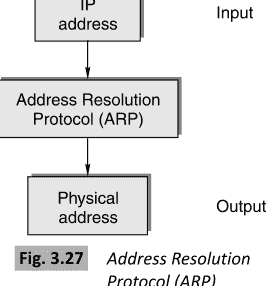


# TCP/IP 第一部分：TCP/IP、ARP、RARP、ICMP 简介

每当主机或路由器需要查找其网络上另一个主机的物理地址时，它会创建一个特殊的 ARP 报文 `ARP 查询数据报文`，包含了所需物理地址的目的地的 IP 地址。这个特殊的数据报文会在网络上广播，如图 3.28 所示。

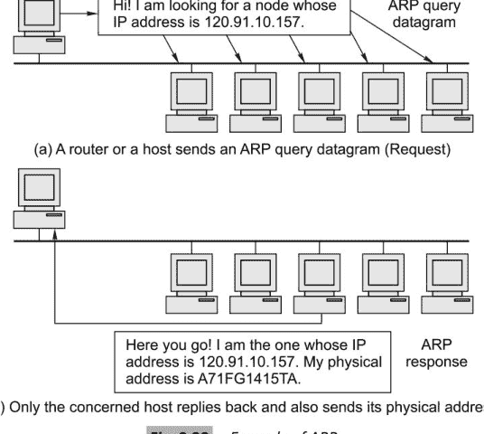

图 3.28 ARP 示例

如图所示，网络上的每个主机都会接收此数据报文，即使物理地址不存在。这是因为这是一个广播请求，意味着数据报文应该发送到网络中的所有主机。然后，每个主机都会将其 `ARP 查询数据报文` 中提到的目的 IP 地址与自己的 IP 地址进行对比。如果不匹配，则忽略；如果匹配，则丢弃它。否则，它会将自己的物理地址发回给原始节点。因此，网络上只有一个主机会对 `ARP 查询数据报文` 做出响应，如图所示。

这个过程、数据报文/响应、格式等共同构成了地址解析协议 (ARP)。

## ARP 数据包格式

ARP 数据包格式如图 3.29 所示。

| 8 位 | 8 位 | 16 位 |
|---|---|---|
| 硬件类型 | | 协议类型 |
| 硬件长度 | 协议长度 | 操作类型（请求 = 1, 回复 = 2） |
| 发送者物理地址 | | |
| 发送者 32 位 IP 地址 | | |
| 接收者物理地址（如果是请求消息则留空） | | |
| 接收者 32 位 IP 地址 | | |

图 3.29 ARP 数据包格式

ARP 数据包封装在以太网帧（或适当的数据链路层帧）中，如图 3.30 所示。

| 前导码 | SFD | 目的地址 | 源地址 | 类型 | 数据 | CRC |
|---|---|---|---|---|---|---|
| 7 字节 | 1 字节 | 6 字节 | 6 字节 | 2 字节 | ARP 请求或响应 | 4 字节 |

包含十六进制 `0806` 表示正在使用 ARP。

图 3.30 ARP 封装在以太网帧内

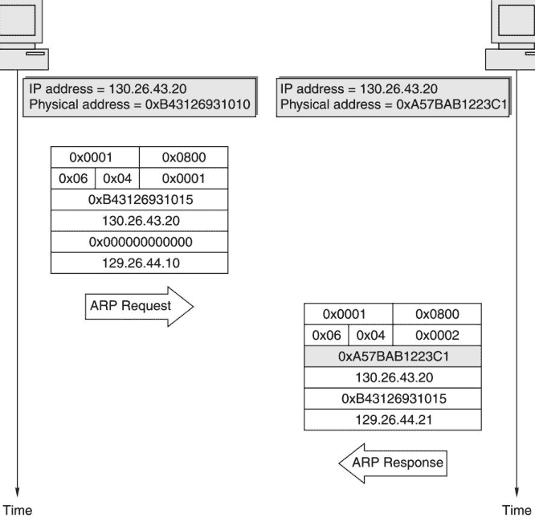

图 3.31 ARP 交换

消息交换如下：

1. 发送者知道目的 IP。我们称之为目的地址。
2. IP 请求 ARP 创建请求消息。它填充发送者物理地址、发送者 IP 地址，目的地址填充为零。
3. 此消息交给数据链路层。它封装在数据链路帧中。它是广播。
4. 网络上的每个主机都接收帧。除目标外的都丢弃。目标识别其 IP 地址。
5. 目标通过 ARP 回复填充其物理地址。它只发送给原始发送者；不是广播。
6. 发送者现在知道了目标的物理地址，因此可以与其通信。为此，它创建一个 IP 数据报，并封装在数据链路帧中。

## 反向地址协议 (RARP) 3.8

ARP 协议族中还有一种协议。反向地址协议 (RARP) 用于根据物理地址获取主机的 IP 地址。它执行的工作与 ARP 完全相反。一个明显的问题是，这需要吗？毕竟主机应该将 IP 地址存储在硬盘上！然而，在某些情况下并非如此。首先，主机可能没有硬盘（例如无盘站）。其次，当新主机首次连接到网络时，它不知道自己的 IP 地址。最后，计算机可能会损坏并替换，但相同的网卡可以重复使用。在所有这些情况下，计算机都不知道自己的 IP 地址。

RARP 的工作与 ARP 非常相似，但方向完全相反，如图 3.32 所示。

想要知道自己 IP 地址的主机广播一个 `RARP 查询数据报文`。该数据报文包含其物理地址。网络上的所有其他主机都会接收该数据报文。除了中央计算机（服务器计算机）之外的所有计算机都会忽略它。然而，服务器会识别这种特殊数据报文并向广播计算机返回 IP 地址。服务器包含所有无盘站的物理地址及其对应的 IP 地址列表。这如图 3.33 所示。

RARP 存在以下缺点：

1. 它作为一种底层广播协议运行。
2. 它需要各种硬件类型进行调整。
3. 每个网络上都需要配置 RARP 服务器。
4. 它仅提供 IP 地址，不提供其他任何内容。

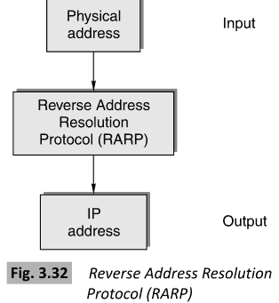

你好！我是一个无盘工作站。我的物理地址是 `A71FG1415TA`。我的 IP 地址是什么？

RARP 查询

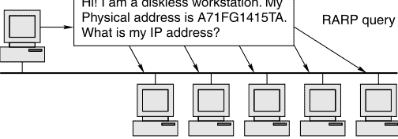

(a) 主机发送 RARP 查询数据报文

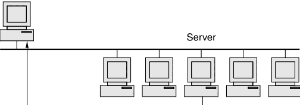

服务器

给你的！你的 IP 地址是 `120.91.10.157`。

RARP 响应

(b) 只有服务器进行回复，并发送无盘主机的 IP 地址

图 3.33 RARP 示例

## BOOTP 3.9

作为 RARP 的替代方案，设计了一种新协议，称为引导协议（BOOTP）。BOOTP 具有以下特点：

1. 它使用 UDP，因此与硬件无关。
2. 它支持向客户端发送除 IP 地址外的额外配置信息。
3. 客户端和服务器可以位于不同的网络，这支持了网络互联。

BOOTP 根据以下原理工作。

BOOTP 服务器维护 IP 地址与物理地址之间的映射。客户端使用其物理地址请求一个地址，询问自己的 IP 地址。RARP 服务器在表中查找客户端的物理地址，并返回 IP 地址。一个常用端口 (`67`) 用于 BOOTP UDP 请求。

BOOTP 中存在中继代理的概念。这可以解释为：

BOOTP 的设计是为了允许 BOOTP 服务器和客户端位于不同的网络。它集中了 BOOTP 服务器，并极大地减少了系统管理员的工作量。然而，这意味着该协议更加复杂。

1. RARP 工作在数据链路层，无法允许客户端和服务器位于不同的网络。
2. BOOTP 的核心点在于允许使用 IP，如果使用了 IP，我们应该能够将数据包从一个网络任意发送到另一个网络！但 BOOTP（像 RARP 一样）使用了广播。

### 网络技术

1. 客户端不知道 BOOTP 服务器的地址，因此发送广播请求。
2. 出于效率考虑，不要路由广播——这会堵塞网络。
3. 因此，如果客户端和服务器位于不同的网络，服务器将听不到客户端的广播。
4. 因此，我们需要中继代理。

BOOTP 中继代理位于可能存在 BOOTP 客户端的物理网络，并作为 BOOTP 服务器的代理。它在客户端和服务器之间转发消息，因此被称为中继代理。它通常在现有路由器的软件上实现。

以下是 BOOTP 运行的一个示例。

1. 客户端创建一个 BOOTP 请求并将其广播到地址 `255.255.255.255`。
2. 客户端物理网络上的中继代理代表服务器在 UDP 端口 `67` 上进行监听。
3. 中继代理将 BOOTP 请求发送给 BOOTP 服务器。
   - (a) 如果中继代理知道 BOOTP 服务器的地址，它将是一次单播传输。
   - (b) 否则，中继代理在其连接的另一个接口上广播 BOOTP 请求。
4. 服务器接收请求并创建一个 BOOTP 回复消息。
5. 服务器将 BOOTP 回复发送给中继代理。
6. 中继代理以单播或广播的形式将响应发送原始客户端。

BOOTP 有一个很大的局限，即它不支持动态地址。因此，我们需要更好的技术。

## DHCP 3.10

动态主机配置协议（DHCP）比 BOOTP 更好。与考虑映射映射的 BOOTP 不同，DHCP 可以动态分配 IP 地址。这在主机移动等情况下非常有用。它可以像 BOOTP 一样工作在静态分配模式下。在这种情况下，地址的分配是手动完成的。然而，它也可以支持动态分配。在这里，它维护另一个可用地址表，可以从中分配一个地址。通常，DHCP 服务器会检查静态数据库，查看是否找到与主机的匹配项以便返回静态地址；如果没有，则返回动态地址。

DHCP 服务器的工作原理如下：

1. 客户端创建一个 `DISCOVER` 消息，其中包含客户端的物理地址和一个唯一的事务标识 ID。
2. 客户端广播此消息。
3. 本地网络上的每个 DHCP 服务器（可能有多个）都会接收到此消息。它尝试在映射表、空闲 IP 地址等方面查找客户端的物理地址。
4. 服务器发送 `DHCPOFFER` 消息，包含以下内容：
   - (a) 分配此 IP 地址持续的时间等。
   - (b) 与客户端发送的相同的事务 ID。
5. 服务器通过发送 `ICMP ECHO` 消息（且没有响应）来确保同一个 IP 地址未被使用。
6. 服务器发送 `DHCPOFFER` 消息（单播/广播）。
7. 客户端接收并处理 `DHCPOFFER` 消息。客户端可以决定接受哪一个。

客户端为选定的服务器创建 `DHCPREQUEST` 消息。该消息包含以下内容：

- (a) 服务器的标识，以指示选择了哪一个。
- (b) 服务器分配的。

9. 客户端广播 `DHCPREQUEST` 消息。
10. 服务器接收并处理 `DHCPREQUEST` 消息。服务器将简单地忽略此消息。
11. 服务器回传 `ACK` 或 `DHCPNAK` 消息以指示地址是否可用。
12. 客户端接收并处理来自服务器的 `ACK` 或 `DHCPNAK` 消息。
13. 客户端通过发送 `ARP` 请求检查地址是否在使用中。
14. 客户端完成分配。

## 控制消息协议 (ICMP) 3.11

正如之前学习过的，互联网协议（IP）是无连接的、尽力而为的。

无连接意味着 IP 在发送数据包时并不假设源和目的之间存在连接。每个数据包都是相互独立的。

尽力而为意味着它尽力将数据包从源送到目的。正如我们将看到的，正确交付是由 TCP 保证的。这仅意味着 IP 本身不包含错误检测/确认方案。TCP 拥有这些功能。

然而，这并不意味着 IP 没有任何控制机制。虽然源和目的之间的连接管理、正确交付等问题由 TCP 处理，但 IP 包含一种可能会导致互联网崩溃的错误报告协议。假设一个路由器接收数据包的速度超过了它的处理能力。或者假设一个主机在互联网上，而另一个主机不知道这一点正尝试向该主机发送数据包。当我们考虑到同时成千上万路由器或主机可能面临这些问题时，其严重后果是可以预见的。因此，为了避免此类灾难，互联网的设计者包含了互联网控制消息协议（ICMP），在类似情况下作为错误报告机制。

ICMP 还有另一个用途。有时，主机需要确定特定的路由器是否正常或已宕机。ICMP 也支持这些网络管理查询。

ICMP 能够检测并报告互联网中的问题。它对这些问题的控制不起任何作用。这留给了主机或路由器。例如，一个简单的示例如图 3.34 所示。路由器 R 连接了主机 A 和 B。我们刻意保持其简单。所示，假设 R 和 B 之间的线缆被意外切断。现在，如果主机 A 向 R 发送数据包，R 无法传输，因为它与 B 的连接丢失了。因此，R 中的 ICMP 软件（毕竟 IP 软件的一部分）接管并通知主机 A 目标（即 B）不可达。然而，它并没有阻止 A 为 B 发送更多数据包。因此，ICMP 不涉及任何纠错机制。

### 3.11.1 ICMP 工作原理

ICMP 通过向相关主机发送特定原因错误消息来工作。例如，在图 3.35 的示例中，当主机 A 发送任何指向主机 B 的数据报时，路由器 R 上的 ICMP 软件会向 A 发送“目标不可达”（Destination unreachable）的消息。同样，对于其他类型的问题，使用的是不同的消息。

让我们考虑几个 ICMP 错误消息的示例。

1. **目标不可达（Destination unreachable）**：我们已经结合图讨论过这一点。每当路由器发现数据报无法递送到最终目的地时，它就会向原始发送数据报的主机发回“目标不可达”消息。此消息还包含一个标志，用于指示目标本身是否不可达，或者包含终点的网络是否发生故障。
2. **源洪制（Source quench）**：在某些情况下，路由器接收的数据报过多，导致无法处理。也就是说，如果到达路由器的数据报数量可能会耗尽其内存缓冲区的大小，该缓冲区通常在将这些数据报转发到下一个路由器/最终目的地之前临时存储它们。路由器无法简单地接受更多数据报。在这种情况下，路由器接收的任何数据报都必须丢弃。然而，如果路由器只是丢弃它们，发送者如何知道出了问题呢？发送者将一无所知！而且，他们可能会继续向该路由器发送数据报。为了防止这种情况的发生，路由器向所有正在发送更多数据报的发送者发送源洪制消息。这信号了向路由器发送数据报的主机，它们现在不应向该路由器发送任何数据报。相反，它们应该在传输更多数据报或通过路由器重传数据报之前等待一段时间。
3. **重定向（Redirect）**：当主机创建一个发送到特定目的的数据报时，它首先将其发送到最近的路由器。如果目的地是直接可用的，路由器随后将其转发给另一个路由器或最终目的地。在数据报通过一个或多个路由器传输的过程中，可能会出现路由器错误地接收到一个不在目标路径上的数据报。此时，目标应该去另一个路由器。在这种情况下，错误接收数据报的路由器会向其接收该数据报的主机或网络发送“重定向”消息。

图 3.35 显示了这样一个示例。在这里，主机 A 想向主机 B 发送数据报。我们意识到数据报应该转发到路由器 R2，因为主机 A 和路由器 R2 都在图中所示的局域网上。之后，R2 将其转发到主机 B，因为路由器 R2 和主机 B 都在图中所示的广网中。假设主机 A 误将数据报发送到路由器 R1。路由器 R1 发现了这一点，并在查询其路由表后将数据报转发到适当的路由器 R2，路由表告诉 R1，如果你从 R1 向 B 发送数据报，它将必须发送到 R2。同时，R1 向主机 A 发回“重定向”消息，以确保主机 A 更新其路由表，并在之后将所有发往 B 的报文发送到路由器 R2。

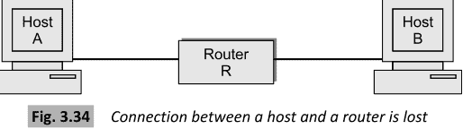

### 4. 超时（Time exceeded）

我们知道每个 IP 数据报都包含时间。该字段用于确定数据报可以存多久。这有助于互联网基础设施防止数据报存活和移动时间过长，特别是在出现网络问题时。例如，假设主机 A 向主机 B 发送数据报，两者之间隔着若干中间路由器。最初，主机 A 根据预计数据报将通过的路由器数量（可能略多一点）设置此值。每当数据报通过这些路由器从 `A` 移动到 `B` 时，路由器在将其转发到下一个路由器之前，会减少该数据报`存活时间（Time to live）`的值。如果路由器接收到该字段的`时间`值为零，则意味着该数据报必须被丢弃，因为它经过了太多的路由器。因此，路由器丢弃该数据报。它通过超时的 ICMP 消息向原始发送主机通信这一事实。原始主机随后可以采取适当的修正措施，例如选择另一个路由器，或在重传之前等待一段时间。

为了避免发送长长的“目标不可达”消息，ICMP 实际上将这些消息映射到错误代码，并仅向主机发送错误代码。例如，当路由器必须向主机发送“目标不可达”消息时，它发送错误代码 `3`。该数字与“目标不可达”消息对应。这可以通过将所有错误代码与其对应的消息进行标准化，并将代码和消息成为 ICMP 软件的一部分来实现。表 3.4 显示了之前讨论的几个 ICMP 错误代码及其对应的消息。

**表 3.4** ICMP 错误代码和错误消息

| 错误代码 | 错误消息 |
| --- | --- |
| 3 | Destination unreachable (目标不可达) |
| 4 | Source quench (源洪制) |
| 5 | Redirect (重定向) |
| 11 | Time exceeded (超时) |

## 关键术语和概念

地址解析协议 (ARP) • 地址绑定 • 尽力交付 • IP 类 • 无连接 • 目的地址 • 点点表示法 • 电子邮件 (Email) • 文件传输协议 (FTP) • 主机 ID • 超文本传输协议 (HTTP) • 网上协议 (IP) • 下一代 IP (IPng) • IP 版本 4 (IPv4) • IP 版本 6 (IPv6) • 互联网地址分配机构 (IANA) • 控制消息协议 (ICMP) • 介质访问控制 (MAC) • 网络 ID • 远程登录 • 反地址解析协议 (RARP) • 邮件传输协议 (SMTP) • 滑动窗口 • 源地址 • 存活时间 • TELNET • 传输控制协议 (TCP) • 传输控制协议/网协议 (TCP/IP) • 小型文件传输协议 (TFTP) • 用户数据报协议 (UDP) • 世界网

## 总结

- 同网络内的计算机使用物理地址通信。
- 不同网络具有不同的地址长度和格式。因此，我们无法使用物理地址识别跨网络的计算机。
- 使用逻辑地址，它是统一的且不取决于底层。这种逻辑地址被称为 IP 地址。
- 互联网是由异构网络组成的。
- 地址解析协议 (ARP) 是指定计算机 IP 地址并获取物理地址的机制。
- 在某些情况下，需要 ARP 的相反操作。在这种情况下，使用反地址解析协议 (RARP)。
- 路由器维护一个表来决定哪些目的地址是直接可用的，对于其他地址，它必须将数据报转发到另一个路由器。
- 数据层处理介质访问和控制问题。
- 网络层是 TCP/IP 特有的。该层的 IP 协议负责统一的主机地址标识、数据报格式和路由。
- 传输层负责 IP 数据报的端到端交付，包含两个主要且截然不同的协议：传输控制协议（TCP）和用户数据报协议（UDP）。
- TCP 是一种可靠的协议，能够保证两个主机之间 IP 数据报的交付。
- UDP 不保证数据报的成功交付，而是尽力尝试（尽力而为）。
- 应用层位于传输层之上，允许用户进行 Web 浏览（使用 HTTP）、文件传输和发送电子邮件（使用 SMTP）等。
- 互联网控制消息协议 (ICMP) 是一种用于错误检测和报告的错误报告（但不包含错误纠正）协议。
- ICMP 消息的示例包括目的不可达、源洪塞、重定向、超时等。


# 多选题


# TCP/IP 习题与概念详解

## 选择题

1. TCP/IP 从底向上数第 4 层是
   (a) 物理层 (b) 应用层 (c) 传输层 (d) 网络层

2. ARP 位于
   (a) 物理层 (b) 应用层 (c) 传输层 (d) 网络层

3. ____ 不提供交付机制。
   (a) UDP (b) TCP (c) ARP (d) FTP

4. IP 地址 ____ 物理地址。
   (a) 是相同的 (b) 与没有关系 (c) 意味着 (d) 这些位都不对。

5. 目前，IP 地址的大小为
   (a) 128 (b) 64 (c) 32 (d) 16

6. 路由器通过 ____ 字段丢可能导致拥塞的数据包。
   (a) 生存时间 (time live) (b) 选项 (c) 协议 (d) 分片偏移

7. IP 提供的是 ____ 数据报交付。
   (a) 最坏努力 (b) 保证交付 (c) 尽力而为 (d) 以上皆是

8. 在 ____ 中，物理地址硬编码在计算机的网卡（NIC）上。
   (a) 可配置地址 (b) 静态地址 (c) 动态地址 (d) 以上都不是

9. 同一物理网络上所有计算机的 ____ 是...
   (a) 主机 ID (b) 物理地址 (c) IP 地址 (d) 网络 ID

10. 如果 IP 地址以位序列 110 开始，它是 ____ 类地址。
    (a) A (b) B (c) C (d) D

## 详细题

1. 为计算机分配物理地址的不同方法有哪些？
2. 解释两台计算机之间消息传输的过程。
3. 描述 IP 地址的三个部分。
4. 描述 IP 数据报头部的各种字段。
5. IP 数据报头部中 `生存时间`（time to live）字段的目的是什么？
6. 为什么 IP 被称为无连接的？
7. 地址解析协议 (ARP) 是如何工作的？
8. 为什么 IP 被称为 `尽力而为`（best-effort）交付协议？
9. 解释以下 ICMP 消息：(a) 目的不可达，(b) 源洪塞和 (c) 重定向。
10. IP 数据报头部中 `生存时间`（time to live）字段的目的是什么？

## 练习题

1. 观察当你连接到 Yahoo 或 Hotmail 等繁忙网站时，该网站的 IP 地址一直在变化。调查产生这种现象的原因。
2. 思考域名不是唯一的。假设 DNS 中对于一个域名有多个条目，可能会出现什么问题？
3. 如果世界上所有的物理网络都被一个单一的统一网络（如以太网或令牌环）取代，还需要 IP 寻址吗？为什么？
4. 了解你工作或办公室的计算机如何获取 IP 地址以通过互联网通信。
5. 许多组织都设置了代理服务器。如果有，请了解更多关于你所在机构或大学代理服务器的细节。

# TCP/IP 第二部分：传输层 (TCP, UDP)

## 引言

传输层运行在网络层之上，主要关注数据包从源地到终目的地的传输（即端到端交付）。与参与路由决策的 IP 不同，运行在传输层的 TCP 协议的主要功能是确保端点之间数据包的正确交付。在 TCP/IP 中，传输层由两个协议表示：TCP 和 UDP。两者相比，UDP 更加简单。当交付速度至关重要时，UDP 非常有用——即使丢失几个数据报（如传输数字化图像、语音或视频时）。当必须确保数据报从源地到目的地无错误传输时，TCP 非常有用，即使这会导致整体交付时间稍微增加。这在传输业务或科学数据中不仅有用而且是必要的。如图 4.1 所示。

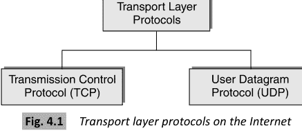

在本章中，我们将讨论 TCP 和 UDP。

## 4.1 基础

传输控制协议 (TCP) 工作得非常好。由于互联网使用分组交换，因此可能会出现拥塞，有时路由器会丢弃数据包。互联网是无连接的。例如，如果路由器数据包过多，它会丢弃一些。同样，如果互联网采取不同的路由，它们可能不会顺序到达。我们将稍后讨论这些问题。

## TCP 的特性

让我们列出 TCP/IP 套件的特征：

1.  **可靠性**：TCP 确保发送者发送的任何数据原样到达目的地。这意味着 TCP 处理数据丢失或顺序变化。如图 4.2 所示。

    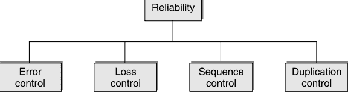

    **图 4.2 可靠性的方面**

    让我们简要检查这四个方面：

    - **(a) 错误控制**：数据必须带有校验和到达目的地。我们学习过校验和数据链路层。为什么传输层还需要额外的错误控制？答案在于当数据链路在两个网络之间引入错误时，无法保证端到端的交付。

      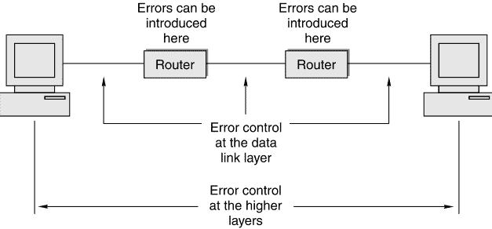

      **图 4.3 传输层和数据链路错误控制**

    - **(b) 丢失控制**：可能会发生数据包丢失未到达目的地。TCP 应确保目的地知道此，并请求重传丢失的数据包。如图 4.4 所示。

      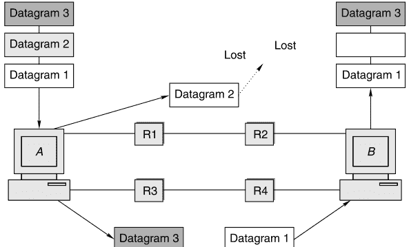

      **图 4.4 丢失控制**

    - **(c) 顺序控制**：由于同一消息的不同 IP 数据包可以通过不同的路由到达目的地，它们可能会乱序到达。例如，假设发送者主机 A 向另一台主机 B 发送三个数据包。假设数据包 1 和数据包 3 通过路由器 R3 和 R4 传输，而数据包 2 通过路由器 R1 和 R2 传输。很有可能接收主机 B 先收到数据包 1 和 3，然后是数据包 2（因为 A-R1-R2-B 路由存在某些拥塞）。因此，A 的发送顺序是数据包 1、2 和 3。B 的接收顺序是 1、3 和 2。TCP 通过适当的顺序控制机制解决此类问题。

    - **(d) 重复控制**：`重复控制` 与 `丢失控制` 相反。在丢失控制情况下，会检测到一个或多个丢失的数据包。在重复控制情况下，会检测到一个或多个重复的数据包。由于同一个数据包可能会到达目的地两次，或者目的地必须具有某种机制来检测这一点。因此，它可以只接受第一个数据包，并拒绝其所有副本。

      # Web 技术

      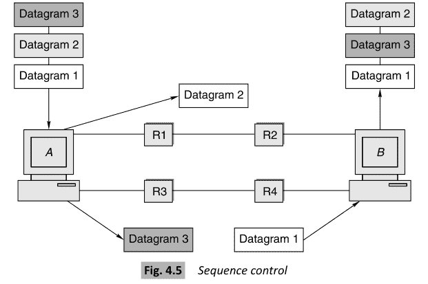

      图 4.6 显示了数据重复的示例。在这里，数据报 3 两次到达目的主机 B。主机 B 上的 TCP 软件会检测到这一点，并仅保留其中一个，丢弃另一个（冗余）副本。

      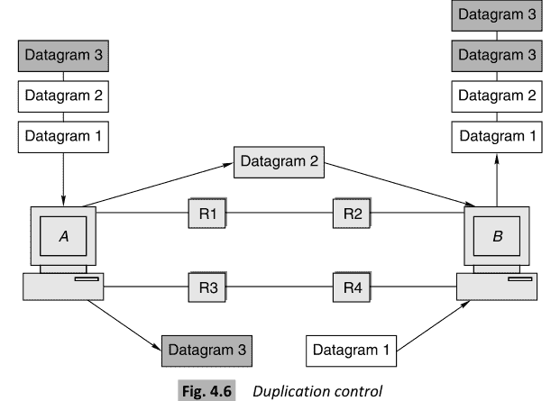

2.  **点对点通信**：也称为端口到端口通信，每个 TCP 连接恰好有两个端点：源端和目的端。此外，对于通信双方来说，路由等内部细节是无关的。它们的通信方式就像彼此之间有直接连接一样！此外，也不会对谁在发送数据或谁在接收数据产生疑惑，因为一个 TCP 连接只涉及两台计算机。这种通信是全双工的，这意味着参与的两台计算机可以同时向对方发送消息。

3.  **面向连接的**：TCP 是面向连接的。TCP 提供的连接被称为虚拟连接。使用“虚拟”一词是因为在物理上计算机之间并没有连接——它是在软件中实现的，而不是在硬件实现的。这意味着在任何端传输数据之前，必须在传输的两端之间建立连接。因此，应用程序必须首先请求 TCP 建立到目的地的连接，当该连接建立后，就可以进行数据传输。非常重要的是，这与虚拟电路不同。在虚拟电路中，发送者和接收者在传输开始前可能已经知道将使用的物理连接（路径）。这条路径定义了每条消息/数据包传输的物理路由（即经过哪些路由器）。因此，整个传输路径都感知到了连接。然而，在 TCP 虚拟连接中，只有发送者和接收者知道该连接——中间节点和路由器对此一无所知。从它们的角度来看，这只是通过尽可能的路由传递收到的数据包——这条路由本身可能会随每个数据包变化（实际上很多时候确实如此）。

## TCP 与 IP 之间的关系

了解 TCP 和 IP 之间的关系是非常有趣的。每个 TCP 段都封装在一个 IP 数据报中，然后将该数据报通过 Internet 发送。当 IP 将数据报传输到最终目的地时，它处理的是将数据报封装在 TCP 之上的软件。IP 并不关心消息的内容。它不读取内容，因此也不尝试以任何方式对其进行解释。IP 就像邮政服务，仅仅是一个连接两个端点计算机的通信通道。因此，TCP 将整个 Internet 视为一个可以接收和交付消息而无需更改或解释其内容的通信通道。从 IP 的角度来看，每个 TCP 段都是某些需要传输的数据——数据是什么，并不重要。这在图 4.7 中所示。

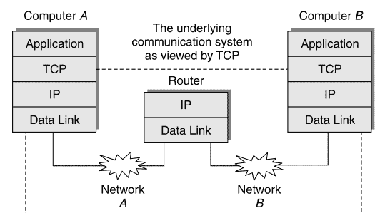

从概念上说，我们可以认为任何应用程序（如文件传输协议—FTP、远程登录—TELNET、电子邮件—SMTP、万维网—HTTP 等）都不断向发送端计算机上的 TCP 软件发送数据。TCP 软件充当发送端的数据多路复用器。TCP 接收来自应用程序的数据，对其进行多路复用并将其交给本地 IP 软件。也就是说，无论是哪个应用程序（FTP、TELNET 等）在发送数据，TCP 都将这些数据放入 TCP 段并交给 IP。IP 为每个 TCP 段添加其自己的头部以创建一个 IP 数据报，从那里，它被转换为硬件帧并发送到相应的目的地。

在目的端，IP 软件从物理层接收这些多路复用的数据（即去除了帧头后的 IP 数据报），并将其交给本地 TCP 软件。目的端的 TCP 软件对数据进行解多路复用（即先移除 IP 头部以提取 TCP 段，然后移除 TCP 头部获取原始消息），并将其交给相关的应用程序。这种多路复用和解多路复用的思想如图 4.8 所示。


**图 4.8 TCP 作为多路复用器-解多路复用器**

## 4.4 端口与套接字

### 4.4.1 端口

运行在不同主机上的应用程序通过端口概念帮助与 TCP 通信。端口是分配给特定应用程序的 16 位唯一数字。当一台计算机想要与另一台远程计算机建立 TCP 连接时，端口概念派上了用场。为了理解为什么，让我们用一个简单的类比。人 A 想要通过电话给在办公室工作的 B 打电话。首先，A 必须拨打 B 办公室的电话号码。A 完成后，假设对方接听了电话。现在，A 必须告诉 B 的分机号（或名称）以便连接到 B。接线员将使用此信息（B 的分机号或名称）将通话重定向到 B。

### 4.4.2 套接字

端口识别单台计算机上的单个应用程序。套接字地址或简单的套接字用于标识连接的 IP 地址和端口号，如图 4.11 所示。例如，`192.20.10.10` 计算机上的端口 80 被称为套接字 `192.20.10.10:80`。注意端口写在 IP 地址之后，并用冒号分隔。这如图 4.12 所示。

正如我们可以想象的那样，一对套接字识别不同主机上两个应用程序之间的 TCP 连接，它通过 IP 地址和端口号共同指定了连接的端点。因此，我们有一个（源 IP 地址 + 源端口号 + 目的 IP 地址 + 目的端口号）的唯一组合，用于识别两个主机（通常是客户端和服务器）之间的 TCP 连接。

| IP 地址 + 端口号 = 套接字 |
| :--- |

**图 4.11 套接字**

| IP 地址 | 端口号 |
| :--- | :--- |
| 192.20.10.10 | 80 |
| 192.20.10.10:80 | 套接字地址 |


# 3. 面向连接的 TCP

TCP 是面向连接的。TCP 提供的连接被称为虚拟连接。使用“虚拟”一词是因为物理上计算机之间并没有连接——它是在软件中实现的，而不是在硬件实现的。这意味着在任何端传输数据之前，必须在传输的两端之间建立连接。因此，应用程序必须首先请求 TCP 建立到目的地的连接，当该连接建立后，就可以进行数据传输。

非常重要的是，这与虚拟电路不同。在虚拟电路中，发送者和接收者在传输开始前可能已经知道将使用的物理连接（路径）。这条路径定义了每条消息/数据包传输的物理路由（即经过哪些路由器）。因此，整个传输路径都感知到了连接。然而，在 TCP 虚拟连接中，只有发送者和接收者知道该连接——中间节点和路由器对此一无所知。从它们的角度来看，这只是通过可能的路由传递收到的数据包——这条路由可能会随每个数据包变化（实际上很多时候确实如此）。

# TCP 与 IP 之间的关系

了解 TCP 和 IP 之间的关系是非常有趣的。每个 TCP 段都封装在一个 IP 数据报中，然后将该数据报通过 Internet 发送。当 IP 将数据报传输到最终目的地时，它处理的是将数据报封装在 TCP 之上的软件。IP 并不关心消息的内容。它不读取内容，因此也不尝试以任何方式对其进行解释。IP 就像邮政服务，仅仅是一个连接两个端点计算机的通信通道。因此，TCP 将整个 Internet 视为一个可以接收和交付消息而无需更改或解释其内容的通信通道。从 IP 的角度来看，每个 TCP 段都是某些需要传输的数据——数据是什么，并不重要。这在图 4.7 中所示。


从概念上说，我们可以认为任何应用程序（如文件传输协议—FTP、远程登录—TELNET、电子邮件—SMTP、万维网—HTTP 等）都不断向发送端计算机上的 TCP 软件发送数据。TCP 软件充当发送端的数据多路复用器。TCP 接收来自应用程序的数据，对其进行多路复用并将其交给本地 IP 软件。也就是说，无论是哪个应用程序（FTP、TELNET 等）在发送数据，TCP 都将这些数据放入 TCP 段并交给 IP。IP 为每个 TCP 段添加其自己的头部以创建一个 IP 数据报，从那里，它被转换为硬件帧并发送到相应的目的地。

在目的端，IP 软件从物理层接收这些多路复用的数据（即去除了帧头后的 IP 数据报），并将其交给本地 TCP 软件。目的端的 TCP 软件对数据进行解多路复用（即先移除 IP 头部以提取 TCP 段，然后移除 TCP 头部获取原始消息），并将其交给相关的应用程序。这种多路复用和解多路复用的思想如图 4.8 所示。


图 4.8 TCP 作为多路复用器-解多路复用器

# 端口与套接字

## 4.4.1 端口

运行在不同主机上的应用程序通过端口概念帮助与 TCP 通信。端口是分配给特定应用程序的 16 位唯一数字。当一台计算机想要与另一台远程计算机建立 TCP 连接时，端口概念派上了用场。为了理解为什么，让我们用一个简单的类比。人 A 想要通过电话给在办公室工作的 B 打电话。首先，A 必须拨打 B 办公室的电话号码。A 完成后，假设对方接听了电话。现在，A 必须告诉 B 的分机号（或名称）以便连接到 B。接线员将使用此信息（B 的分机号或名称）将通话重定向到 B。

通常，服务器端口号被称为已知端口。这是因为客户端（作为互联网用户）需要预先知道（即在哪个端口）服务器上的某个特定应用程序正在运行。这使得客户端应用程序能够向服务器应用程序（使用服务器的 IP 地址和端口号）发送请求，以建立 TCP 连接。如果客户端不知道服务器是在端口 100 还是 200 上运行其电子邮件软件，那么客户端可以使用任何一个端口来请求连接吗？

这就像是这样的情况：我们有 1000 个可用的插座（但只有一个是通的），而我们不知道该用哪一个来插上电线让灯泡发光。在最坏的情况下，我们可能需要尝试 1000 次才能建立正确的连接！如果有人说“嘿，用那个数字（在 TCP 的情况下是端口号）723”，那该多好了。

出于这个原因，服务器上的应用程序至少是已知在特定端口执行的，这样客户端在请求服务器建立 TCP 连接时就不会产生歧义。HTTP 协议几乎总是运行在服务器端口 80 上，等待接受客户端的 TCP 连接。

这也是为什么两个主机之间的不同应用程序——甚至是同一个应用程序——之间可以建立 TCP 连接的原因。虽然两个主机在 TCP 连接中的 IP 地址是相同的，但端口号会有所不同。当客户端发起 TCP 连接时，客户端软件会分配一个唯一的端口号作为该连接的端口号。假设该端口号是 3000。此外，假设客户端正在发送一个 HTTP 请求（这意味着服务器的端口号将是 80）。因此，从客户端的角度来看，源端口号是 3000，目的端口号是 80。当服务器想要向客户端发送 HTTP 响应时，服务器现在应该将 80 视为源端口号，将 3000 视为目的端口号。如图 4.13 所示。


图 4.13 源和目的端口号

# 连接——被动打开与主动打开

互联网应用程序使用 TCP 提供的连接（也称为虚拟连接）机制相互通信。我们随后将讨论两个主机之间的 TCP 连接是如何建立和关闭的。这些 TCP 连接根据需要建立和关闭。因此，每当应用程序 X 需要与互联网上另一台计算机的应用程序 Y 通信时，应用程序 X 请求其计算机上的 TCP 软件与运行应用程序 Y 的计算机上的 TCP 软件建立连接。

在这种交互模型中，其中一台计算机（称为客户端）总是请求与另一台计算机（称为服务器）建立 TCP 连接。然而，服务器如何接受来自一个或多个客户端的连接呢？为此，服务器上的 TCP 软件会执行一个**被动打开**过程。简单来说，这意味着服务器计算机期望一个或多个客户端请求与其建立 TCP 连接。因此，服务器上的 TCP 软件会无限地等待来自客户端的此类连接请求。这就是被动打开的含义。被动打开的结果是服务器允许接收 TCP 连接请求，但不发送。这意味着服务器只对接受 TCP 连接请求感兴趣，而不发出的 TCP 连接请求。相比之下，客户端通过向服务器发送请求来发起 TCP 连接。因此，认为客户端处于**主动打开模式**。

因此，当一个公共访问的服务器（例如 Web 服务器）时，它会执行被动打开过程，这意味着它准备好接受传入的 TCP 连接。客户端（Web 浏览器）随后将发送一个主动打开请求，以与该服务器建立 TCP 连接。这如图 4.14 所示。如图所示，当客户端需要从远程服务器获取文档时，客户端向本地 TCP 软件发出*主动打开请求*，并向其提供目标服务器应用程序的 IP 地址和 TCP 端口。客户端的 TCP 软件随后使用这些信息与远程服务器建立连接。


# TCP 连接

我们说过 TCP 是一个面向连接的协议。现在让我们详细检查这一陈述。为了确保交互进行消息传输的两个主机之间建立连接，TCP 在它们之间创建一个逻辑连接。为此，TCP 使用了**三路握手**技术。这意味着在消息发送者和接收者之间交换三个消息来建立连接。只有在三次握手成功后，它们之间的连接才会建立。之后，它们就可以交换消息，并确保 TCP 会保证消息的可靠传输。事实证明，三次握手对于在两个主机之间建立成功的连接是必要且充分的。我们不将进入该证明的细节。

# TCP/IP 第二部分 TCP, UDP

## 发送计算机与接收计算机


过去了。因此，它会重传第二个数据报。对于数据报 1 和 3，不需要重传，因为来自接收计算机的确认在计时器过期之前到达了发送端。

## TCP 段头部格式

图 4.17 显示了 TCP 段的格式。一个 TCP 段由一个大小为 20 到 60 字节的头部以及后续的数据组成。如果 TCP 段不包含任何选项，则头部为 20 字节。否则，头部为 60 字节。也就是说，最多保留了 40 字节用于选项。选项可以向目的端传递额外信息。然而，我们将忽略它们，因为它们并不经常使用。

| 字段 | 长度 | 说明 |
| :--- | :--- | :--- |
| 源端口号 | 2 字节 | 定义了源计算机的端口号，对应于发送此 TCP 段的应用程序。 |
| 目的端口号 | 2 字节 | 表示目的计算机的端口号，对应于接收此 TCP 段的应用程序。 |
| 序列号 | 4 字节 | 定义了分配给此 TCP 段包含的数据部分的第一个字节的数字。TCP 是一种面向连接的协议。为了确保连续连接性，从源端到目的端发送的每个字节都按递增的序列编号。序列号字段告诉目的端，序列中的哪一个字节成了 TCP 段的第一个字节。在 TCP 连接建立阶段，源端和目的端都会生成唯一的随机数。例如，如果这个随机数是 3130，且第一个段带有 2000 字节的数据，那么该段的序列号字段将包含 3132（3132 和 3131 用于连接建立）。第二个段的序列号将为 5132（3132 + 2000），依此类推。 |
| 确认号 | 4 字节 | 如果目的主机正确接收到序列号为 X 的序列，它会将 X + 1 作为确认号发回源端。定义了 TCP 段源端期望从目的端收到的数字，作为正确交付的收据。 |
| 头部长度 | 4 位 | 指定了 TCP 头部中四字节字的数量。头部长度可以在 20 到 60 字节之间。因此，该字段的值可以在 5（5 x 4 = 20）和 15（15 x 4 = 60）之间。 |
| 预留 | 6 位 | 预留供未来使用，目前未使用。 |
| 标志 | 6 位 | 定义了六个控制标志，每个标志占用一个位。其中两个最重要：`SYN` 标志表示源端想要与目的端建立连接，用于建立 TCP 连接；`FIN` 标志如果被设置，则意味着发送端想要终止当前的 TCP 连接。 |
| 窗口大小 | 2 字节 | 定义了对方必须维护的滑动窗口的大小。 |
| 校验和 | 2 字节 | 包含用于辅助错误检测和纠正的校验和。 |
| 紧急指针 | 2 字节 | 用于某些数据比同一 TCP 连接中的其他数据更重要或更紧急的情况。讨论此类情况超出了本文的范围。 |
| 选项 | 0 到 40 字节 | 可选字段。 |
| 数据 | 变长 | TCP 段携带的实际数据。 |


## 非持久性 TCP 连接

TCP 连接是非持久的。简单来说，这意味着客户端向服务器请求 TCP 连接。在服务器响应后，客户端发送请求，服务器发送响应并关闭连接。如果客户端想再次发送另一个请求，它必须与服务器建立一个全新的 TCP 连接。也就是说，会话的持续时间不超过一个请求和一个响应的寿命。

在某些情况下，非持久连接并不是理想的。正如我们看到的，在互联网上，单个 Web 页面可以包含文本、图像、音频和视频。假设客户端请求服务器一个包含某些文本和两个图像的 Web 页面。图像作为单独的文件存储在服务器上，因此，通常客户端必须打开三个独立的连接。


相比之下，计算机数据传输必须非常可靠。因此，在作为文件和消息传输计算机数据时使用了 TCP。

## UDP 数据报

图 4.19 显示了 UDP 数据报的格式。每个 UDP 数据报都有一个固定的 8 字节头部，划分为四个字段，每个字段 2 字节。随后是使用该 UDP 数据报传输的实际数据，如图所示。

| 字段 | 长度 | 说明 |
| :--- | :--- | :--- |
| 源端口号 | 2 字节 | |
| 目的端口号 | 2 字节 | |
| 总数据包长度 | 2 字节 | 定义了 UDP 数据报的总长度，即头部加数据。 |
| 校验和 | 2 字节 | 用于错误检测和纠正。 |
| 数据 | 变长 | 实际传输的数据。 |

### 3. 数据包总长度

该 2 字节字段定义了 UDP 数据报的总长度，即头部加数据。实际上，该字段并不是完全需要的，因为在 UDP 数据报中有一个类似的包包长度，它在将 UDP 数据报发送到目的地之前会将该 UDP 数据报封装在其内部。因此，以下等式始终成立：

`UDP 数据报长度 = IP 数据报长度 – IP 头部长度`

然而，该字段保留在 UDP 数据报头部中，作为额外的检查。

### 4. 校验和

该字段像通常一样用于错误检测和纠正。

我们可以总结为：

- **高层数据传输**：意味着将消息发送到 UDP 软件。
- **UDP 消息封装**：将高层消息封装在 UDP 消息的字段中。填充 UDP 头部（例如源端口和目的端口，以及可选的校验和）。
- **将消息传输到 IP**：将 UDP 数据报传递给 IP 进行传输。

结果，当我们使用 UDP 时，会发生以下情况：

- **无连接服务**
  - 每个 UDP 数据报都是独立的
  - 无需建立连接
  - 不对数据报进行编号
  - 不将用户数据切分成更小的数据报：用户数据必须足够小，能够放入 UDP 数据报内部
- **流量控制和错误控制**
  - 无流量控制
  - 错误控制：校验和
  - 数据包可能会丢失或重复

## UDP 与 TCP 的区别

我们现在将通过一个简单的例子来理解 UDP 和 TCP 之间的区别。假设有三个客户端想要向服务器发送一些数据。让我们先了解如何借助 UDP 实现这一点。然后，我们将检查 TCP 中会发生什么。

### 4.12.1 使用 UDP 进行数据传输

在 UDP 的情况下，服务器是迭代的。这意味着当服务器处理 UDP 请求时，它一次只处理一个。客户端准备一个 UDP 数据报，将其封装在 IP 数据报中，并发送到服务器。服务器处理请求，形成 UDP 响应并发送回客户端。在此期间，如果有更多 UDP 请求到达服务器，服务器不会理会它们。它会在处理任何其他 UDP 请求之前，完成对当前 UDP 请求的服务。为了确保在此期间收到的 UDP 请求不会丢失，服务器将它们存储在等待 UDP 请求队列中，并一个接一个地处理。注意，UDP 请求可能来自同一个客户端，也可能来自不同的客户端。在任何情况下，它们都严格按照顺序依次处理。由于 UDP 是无连接的，这是没有问题的。如图 4.20 所示。


### 4.12.2 使用 TCP 进行数据传输

与 UDP 模型不同，TCP 严格基于连接工作。这意味着在客户端和服务器相互发送数据之前，必须先建立一个连接（虚拟连接）。结果，如果多个客户端尝试同时使用同一个服务器，会为每个客户端建立一个独立的连接。因此，服务器可以同时处理许多客户端请求，这在 UDP 中是不会。由于这个原因，在使用 TCP 时，说服务器处于并发模式。这意味着服务器可以同时为多个客户端提供服务，类似于多程序操作系统同时执行许多程序的方式。服务器与每个客户端之间建立一个连接，每个连接一直保持打开，直到整个数据流处理完毕。


在实现层面，使用了父进程和子进程的概念。也就是说，当收到来自新客户端的连接请求时，服务器会创建一个子进程，并将其分配给新客户端。新客户端和子服务器进程之间相互通信。因此，每个客户端和服务器进程之间都有一个独立的连接。一旦父进程创建了子进程来服务特定客户端的请求，父进程就可以接受更多的客户端请求，并根据需要创建更多的子进程。如图 4.21 所示。

当客户端与服务器之间的通信结束时，父进程会杀死那个特定的子进程。

## TCP/IP 第二部分：TCP，UDP

父服务器仅在初始连接建立期间参与（用虚线表示）。然后，由子服务器接管（用普通箭头表示）。


客户端与子服务器进程之间有一个连接。

图 4.21 TCP 传输

# 关键术语和概念

- 确认 (Acknowledgement)
- 主动开放 (Active open)
- 重复控制 (Duplication control)
- 校验和 (Checksum)
- 并发 (Concurrent)
- 面向连接 (Connection-oriented)
- 端到端递送 (End to end delivery)
- 错误控制 (Error control)
- 迭代的 (Iterative)
- 丢失控制 (Loss control)
- 非持久连接 (Non-persistent connection)
- 数据包重传 (Packet retransmission)
- 套接字对 (Pair of sockets)
- 被动开放 (Passive open)
- 持久连接 (Persistent connection)
- 点对点 (Point-to-point communication)
- 端口 (Port)
- 端口间通信 (Port-to-port communication)
- 用户数据报 (User datagram)
- 用户数据报协议 (UDP)
- 良端口 (Well-known ports)
- 窗口大小协议 (TCP)
- 序列控制 (Sequence control)
- 三次握手 (Three way handshake)
- 传输层变化 (Transport Layer changes)
- 使用流水线 (With pipining)
- 不使用流水线 (Without pipining)

# 总结

- 传输控制协议 (TCP) 是两个传输层协议之一——另一个用户数据报协议 (UDP)。
- TCP 的主要功能是提供可靠的端到端递送。
- 用户数据报协议 (UDP) 是一种无连接协议，不提供上述任何特性。
- 在多媒体或语音传输中，传输速度是主要考虑，而不是消息的准确递送。在这些传输中，几个比特的变化是可以接受的。UDP 是此类传输的合适人选。


# 多选题

1. 传输层协议对于 ________ 递送非常有用。
   (a) 主到主机
   (b) 主到路由器
   (c) 网络到网络
   (d) 端到端

2. ________ 是可靠的机制。
   (a) IP
   (b) TCP
   (c) UDP
   (d) ARP

3. 当数据包在传输过程中丢失时，应由 ________ 处理。
   (a) 序列控制
   (b) 错误控制
   (c) 丢失控制
   (d) 重复控制

4. 当单个数据包两次到达目的地时，应由 ________ 处理。
   (a) 序列控制
   (b) 错误控制
   (c) 丢失控制
   (d) 重复控制

5. 当数据包 2 先于数据包 1 到目的地时，应由 ________ 处理。
   (a) 序列控制
   (b) 错误控制
   (c) 丢失控制
   (d) 重复控制

6. ________ 和 ________ 的组合组成套接字。
   (a) TCP 地址，IP 地址
   (b) IP 地址，UDP 地址
   (c) IP 地址，物理地址

7. 良端口通常需要 ________。
   (a) 仅客户端需要
   (b) 客户端和服务器都需要
   (c) 客户端需要但服务器不需要
   (d) 服务器需要

8. 客户端 ________。
   (a) 主动开放
   (b) 被动开放
   (c) 以上 (a) 和 (b)
   (d) 以上均不是

9. UDP 是迭代的，因为：
   (a) 它同时处理多个请求
   (b) 它执行轮询检查
   (c) 它一次只处理一个请求
   (d) 它执行并行处理

10. TCP 是并发的，因为：
    (a) 它同时处理多个请求
    (b) 它执行轮询检查
    (c) 它一次只处理一个请求
    (d) 它执行并行处理


# 详细问题

1. 简述何时使用 TCP 以及何时使用 UDP。
2. 描述 TCP 的广层级特征。
3. 讨论端口（port）的概念。
4. 端口（port）和套接字（socket）有什么区别？
5. 讨论被动打开（passive open）和主动打开（active open）的概念。
6. 创建 TCP 连接的三次握手是如何工作的？
7. 哪些因素使得 TCP 变得可靠？
8. TCP 段头部中序列号（sequence number）字段的目的是什么？
9. 描述 UDP 数据报头部的主要字段。
10. 什么是持久 TCP 连接？它在什么时候有用？


# 练习题

1. 使用 TCP 或 UDP 进行传输层编程涉及套接字的使用。学习使用 C 或 Java 进行套接字编程的基础。
2. 研究为什么与 C 或其他语言相比，用 Java 进行套接字编程更容易。
3. 尝试在服务器上打开套接字，然后从客户端套接字与其通信。
4. 在套接字编程中，TCP 和 UDP 需要做哪些不同的工作？
5. 你对持久连接有什么看法？将其与客户端-服务器环境中的持久连接进行比较。

# TCP-IP 第三部分 (DNS, EMAIL, FTP, TFTP)

# 引言

在过去的几个章节中，我们讨论了 TCP/IP 协议族中网络/互联网层和传输层的各种协议。这些协议如 `IP`、`ARP`、`TCP` 和 `UDP` 负责提供下层服务，例如从一个主机到另一个主机的数据包交付，以及可选的错误检查和重传等。

TCP/IP 中的网络和传输层协议如果没有应用层服务，如域名系统（DNS）、用于电子邮箱（emails）的简单邮件传输协议（SMTP）、文件传输协议（FTP）和简易文件传输协议（TFTP），将失去意义。我们将学习所有这些协议，它们类似于传输系统中的乘客。当然，这些并不是 TCP/IP 协议族应用层中的所有协议。稍稍后讨论 TCP/IP 中剩余的应用层协议。

# 域名系统 (DNS)

## 5.1.1 引言

虽然计算机在处理数字时工作最好，但人类在处理名称时会感到非常自在。例如，如果有人要求我们向 Sachin 的计算机发送消息，而不是向 IP 地址为 `150.21.90.101` 的计算机发送消息，那么我们显然更倾向于前者。（尽管这比把地址看作一个 32 位的字符串要好得多）。Sachin 的计算机可能对应这个 IP 地址。但对你来说，称其为 Sachin 的计算机，甚至干脆直接叫 Sachin 要好得多。这种通过某些名称来识别计算机网络和网络上的计算机的简单理想是域名的基础。

域名是为了方便引用而给网络起的名称。“域”（domain）一词是指一组由单一共同名称称呼的计算机。当然，最终必须有人将这些域名翻译成 IP 地址，因为 TCP/IP 或互联网在发送或接收任何诸如电子邮件或文件时，只理解计算机的这些 32 位 IP 地址。这在图 5.1 中从概念上显示，其中计算机名为 Atul，其 IP 地址是 `150.21.90.101`。该图展示了用户和网络两个角度的视角。


**图 5.1** 域名和 IP 地址是同一台计算机的不同表示形式

人们经常自豪地为自己的计算机命名。在许多组织中，计算机命名是标准化的。但在许多其他情况下，计算机是通过使用它们的人员或行星名称来标识的。开玩笑的话，你可能会听到类似“Anita 今天挂机了”的，这实际上意味着 Anita 的计算机由于某种原因无法工作！总而言之，我们人类喜欢用名称来称呼计算机。这里只有一个问题：网络中的两台计算机不能有相同的名称。否则，计算机将无法被识别。由于这个原因，必须确保计算机是唯一的，并且在全球范围内可以在互联网上自由使用它们。

为了使计算机具有唯一性，名称后面添加了后缀。计算机的名称由其本地名称加上组织或后缀组成。例如，如果 Radhika 在 IBM 工作，她的计算机名称就是 `Radhika.IBM`。如果有两个同名的，可以使用另一个后缀（例如 `Radhika.com`）。我们意识到这还不够的。此外，可能有很多技术系统。所以例如，`Radhika.edu` 或 `Radhika.net` 或 `Radhika.org` 可能是组织类型。这种后缀是添加的。通常，这个后缀是三个字符。例如，`com` 表示商业组织，`edu` 表示大学，`net` 表示网络。随着互联网变得流行，人们想添加特定国家的前缀。这些后缀是两个字符。这些后缀的示例包括印度的 `in`、英国的 `uk`、日本的 `jp` 和德国的 `de`。所以，如果包含网站信息的计算机托管在英国，前缀将不是 `com`，而是 `co.uk`。例如，BBC 的网站是 `www.bbc.co.uk` 而不是 `www.bbc.com`。基本上是在美国决定 Web 服务器以及域名注册。然而，美国的站点都以 `com` 结尾。这在图 5.2 中所示。


必须提到的是，互联网上的计算机名称并不一定非由三部分组成。一旦名称的主部分分配给一个组织（例如 `IBM.com`），该组织就可以自由地向名称添加进一步的子标题。最初，所有的域名都必须以 `com` 或 `org` 这样的三字符后缀结尾。

通用域名如图 5.3 所示。

| 域名名称 | 描述 |
|---|---|
| com | 商业组织 |
| edu | 教育机构 |
| gov | 政府机构 |
| int | 国际组织 |
| mil | 军事团体 |
| net | 网络支持小组 |
| org | 非营利组织 |

图 5.3 通用域名

所建议的附加通用名称标签如图 5.4 所示。

| 域名 | 描述 |
|--- | :--- |
| arts | 文化组织 |
| firm | 业务部门或公司 |
| info | 信息服务提供商 |
| nom | 个人命名 |
| rec | 休闲或娱乐用品 |
| store | 提供商品/服务的业务实体 |
| web | 与网络相关的组织 |

**图 5.4** 建议的通用域名

因此，人类在指代互联网上的计算机时使用域名，而计算机只处理纯数字的 IP 地址。例如，假设在使用互联网时，我想给在一家名为“Sunny software solutions”的公司工作的朋友 Umesh 发送一条消息。因此，我的电脑上应该有某个屏幕，允许我输入 `umesh.sunny.com`。然而，当我这样做时，为了让互联网理解这一内容，必须有一种机制将这个计算机名（`umesh.sunny.com`）翻译成其对应的 IP 地址（`120.10.71.93`）。只有这样，才能检测到正确的计算机。这个问题如图 5.5 所示。

我的计算机
域名：`Atul.abc.com`
IP 地址：`140.10.2.33`

Umesh 的计算机
域名：`umesh.sunny.com`
IP 地址：`120.10.71.93`


**图 5.5** 如何将域名翻译为 IP 地址？

这是实现的？我们现在来学习。

## 5.1.2 域名系统 (DNS)

在互联网早期，所有的域名（称为主机名）及其关联 IP 地址都记录在一个名为 `hosts.txt` 的单个文件中。美国网络信息中心（NIC）使用这个文件。为了便于概念性理解，图 5.6 显示了假设的 `hosts.txt` 文件的部分。

| 主机名 | IP 地址 |
|--- | :--- |
| Atul.abc.com | 120.10.210.99 |
| Pete.zyx.co.com | 131.92.120.71 |
| Achyt.pqr.com | 171.92.10.88 |

**图 5.6** hosts.txt 文件 — 逻辑视图

每晚，连接到互联网的主机都会获取该文件的副本以刷新它们的域名。随着互联网以惊人的速度增长，该文件的大小也随增长。到 20 世纪 80 年代中期，这个文件已经变得极其巨大。因此，它现在太大了，无法复制到所有系统中，而且几乎不可能保持更新。这些在单个服务器上维护 `hosts.txt` 的问题可以总结如图 5.7 所示。

| 问题 | 描述 |
|--- | :--- |
| 流量负载 | 单个服务器处理所有的域名查询会使其变得非常慢，并导致该单一服务器产生大量流量 |
| 故障影响 | 如果单台服务器故障，几乎会导致整个互联网的崩溃。 |
| 延迟 | 因为中央服务器对于许多客户端来说可能很远（例如，如果它位于美国，从新西兰发送请求就太远了）。这会导致域名的响应非常慢。 |
| 维护 | 随着新的域名条目不断出现，一些现有的条目变得过，维护单个文件将非常困难。此外，控制这个单一文件的更改可能变成一场噩梦 |

> 图 5.7 集中式域名机制的问题

为了解决这个问题，互联网域名系统（DNS）被开发成为一种分布式数据库。我们所指的“分布式”，是指该数据库包含了分散在不同计算机上的域名与 IP 地址之间的映射。每当有人要向互联网上的任何计算机发送数据时，这个 DNS 就会被构建。它是域名与 IP 地址的映射。

DNS 基于分层基于域的命名架构的创建，如前所述，该架构以分布式数据库的形式实现。简单来说，它用于将主机名和地址映射到 IP 地址。此外，DNS 允许将主机分配在多个命名机构之间，而不是集中在一点，并且便于更快速的检索。这使得互联网比早期民主得多。我们将在下一节中学习这一点。

## 5.1.3 DNS 命名空间

虽然为主机分配名称的想法看起来新颖且谨慎，但它并不是一个容易实现的元素。管理一个不断变化的名称池并非易事。邮政系统也面临类似的问题。这要求发送者指定地址的国家、州、城市、街道名称和门号。使用这种分层信息，区分印度浦纳 13 街的 Aut Kahate 和英国切尔姆斯福 13 街的 Aut Kahate 就变得容易了。DNS 使用了同样的原理。

理论上互联网被分为数百个顶级域名。这些域名中的每一个反过来有数千个节点。每个节点可以进一步划分为子域名，子域名可以进一步分类为子域名。例如，如果我们想在 `auto` 权限下注册一个名为 `Honda` 的域名（对于印度而言），该域名的完整路径将是 `Honda.auto.in`。同样，从图 5.8 可以看到 `Atul.maths.oxford.edu`。


如图所示，一个主机想要获取 IBM.com 服务器的 IP 地址。为了这个目的，它联系了其最近的 DNS 服务器。DNS 服务器查找域名列表及其对应的 IP 地址。它找到了该域名的条目，并将其发送回客户端计算机。当 DNS 服务器收到来自另一台计算机的关于 jkim.com 的另一个请求时，它回复说该域名不存在。正如我们所知，它可能需要咨询其他 DNS 服务器以查看它们是否对该域名有所了解，或者它可能需要建议主机应该联系的 DNS 服务器名称。

使用 DNS 时，应用程序会执行以下操作：

1. 想要获取互联网上另一个主机 IP 地址的应用程序调用库程序“解析器（resolver）”，并发送要查找 IP 地址的名称。解析器是运行在主机上的一个程序。
2. 解析器向最近的 DNS 服务器（称为本地 DNS 服务器）发送一个 UDP 数据包。
3. DNS 服务器查找域名并将 IP 地址返回给解析器。
4. 解析器将 IP 地址返回给调用它的应用程序。

使用获取到的 IP 地址，应用程序会与目标端建立传输层（TCP）连接，或根据情况发送 UDP 数据包。这一切都在终端用户感知不到的情况下完成的。当你输入域名如 `honda.auto.com` 以查看其网站时，内部会使用 DNS 获取 IP 地址，然后建立连接。

# 电子邮箱 (EMAIL)

## 5.2.1 引言

电子邮件的创建是为了让两个个人能够使用计算机进行通信。在早期，电子邮件技术允许一个人编写消息并通过互联网发送给另一个人。这就像寄明信片，不同在于通信是电子化的，而不是纸质的。如今，电子邮件设施提供了许多功能，例如：

1. 撰写和发送/接收消息。
2. 使用通常开启的功能（如抄送 CC、密抄 BCC 等）对消息进行存储/删除/回复。
3. 向多个人发送单条消息（群组群发）。
4. 发送文本、语音、图形。
5. 发送可以与其他计算机程序交互的消息。

电子邮件最出色的特性几乎等同于电话通话。

1. 电子邮件的速度几乎等同于电话通话。
2. 以某种形式记录电子邮件消息类似于邮政系统（这甚至比电话系统更好）。

因此，电子邮件结合了电话系统和邮政系统的优点，而且费用非常廉价。

从用户的角度来看，电子邮件实现了以下功能：


# 电子邮件系统

## 电子邮件系统的功能

1. **撰写**：电子邮件系统除了基本的文本编辑器功能外，还可以提供如回复消息时自动插入接收者地址等功能。

2. **传输**：电子邮件系统通过在两台计算机之间建立连接并使用 `TCP/IP` 传输消息，自己承担了移动消息的责任。

3. **报告**：发送者需要知道电子邮件是否成功送达接收者，或者是否由于某种原因未到达接收者。电子邮件系统也执行此报告任务。

4. **显示**：电子邮件系统在特殊的弹出窗口中显示传入的消息，或以某种方式通知用户邮件已到达。用户可以在屏幕上打开该消息。

5. **处理**：这包括转发、归档和删除已处理消息等功能。用户可以决定如何处理此类电子邮件，并相应地指示电子邮件系统。

## 邮政系统与电子邮件系统的对比

我们寄信时使用的邮政系统与电子邮件系统之间存在巨大的相似性。当我们给某人写信时，将其放入信封，在信封上写上收件人的姓名和邮票，然后投入邮筒。信件通过一个或多个接口（例如州际或跨国邮政服务）传输。它经过各种节点，在这些节点上进行分类和转发。记得，邮政编码在这里非常有用！最后，它到达了接收者的个人信箱。（在这里，我们假设每位居民在家里附近都有一个邮箱。我们还假设这个人每天检查两次信箱。）如图 5.10 所示。在这里，一个来自纽约的人想给她在布莱顿（英国）的朋友写信。

| 步骤 | 详情 |
| :--- | :--- |
| 发件人写信 | 亲爱的 Petra，你好！这封是为了…… |
| 发件人将信放入信封 | |
| 发件人在信封上写上收件人的姓名和地址 | Mrs P.J. Grover<br>10 North Street<br>Brighton 1NJ<br>England |
| 发件人将信投入邮箱，信被收集 | |
| 信件通过邮政网络传输 | 信件到达接收者端并投进她的信箱（Grover 夫人的私人信箱） |
| 收件人取信、拆封并阅读 | |

**图 5.10** 人类使用的邮政通信系统

电子邮件的工作方式大不相同。邮政邮件和电子邮件的主要区别在于接口。邮政系统在移动信件方面协调大部分通信（例如从纽约到伦敦再到布莱顿），而在邮件的情况下，这一切由之前研究过的一个或多个中间路由器处理。电子邮件使用 `TCP/IP` 作为底层协议。这意味着当一个人写邮件时，它会根据 `TCP/IP` 格式被分成数据包，通过各种路由器路由。有趣的是，电子邮件最初是人们互相发送文件的。这种约定是需要发送消息时，人们先找到文件。然而，人们很快发现这种方法存在问题，其中：

- 没有创建包含音频和视频的消息。
- 发送者无法收到接收者的确认，因此不知道消息是否送达。
- 这种方法很难向一组人发送相同的消息。
- 用户界面很糟糕。必须先调用编辑器，将消息输入文件，关闭编辑器，调用传输程序，发送文件，然后关闭传输程序。
- 信息没有预定义的结构，导致查看或编辑非常困难。

考虑到这些问题，认为需要专门的应用程序来处理电子消息。

## 5.2.2 信箱

就像我们在建筑外有自己的邮箱来接收邮政邮件一样，接收电子邮件时我们有电子邮箱。电子邮件邮箱只是计算机磁盘上的一个存储区域。该区域用于存储收到的电子邮件；类似于信箱存储邮件的方式。

邮递在白天的某个时候来投递邮件。那时，接收者可能不在家里。因此，邮递将信件存放在邮箱里。我们在下班回家后检查邮箱。信件实际投递到箱里和实际打开的时间之间通常会有间隔。这种通信类型是异步的，与同步的电话通话相反。同样，当你给某人写邮件时，那个人可能还没有启动计算机。这种邮件到达后可能会发现无法接收？为了解决这个问题，由另一台计算机负责在转发之前存储电子邮件。这台计算机及其软件被称为电子邮件服务器。电子邮件服务器专门负责存储和分发电子邮件，但在理论上也可以执行其他任务。对于连接到它的并想要使用服务的每个客户端，电子邮件服务器上都有一个邮箱（即某些磁盘空间）。该服务器必须保持持续运行。当用户输入邮件时，它会从其计算机发送到发送者的电子邮件服务器，首先存储在那里。

同样，连接到电子邮件服务器的所有用户收到的所有邮件都会接收并存储在这台服务器上。这是因为这台电子邮件服务器始终开启，即使用户（客户端）计算机关机也是如此。当客户端启动并连接到服务器计算机时，客户端可以从服务器上的邮箱中提取邮件，并将其带到客户端 PC 的硬盘上，或者仅仅读取它而不带到自己的计算机上（即下载），并对其进行保留或删除。因此，客户端用户可以逐一阅读所有邮件，并对其进行回复、删除或转发等操作。因此在这方面，电子邮件类似于邮政。它们可以一直存储，直到收件者想要查看它们。然而，邮政从发件者到收件者需要几天甚至几周，而电子邮件的传输速度非常快——只需几分钟。在这一方面，电子邮件类似于电话。

因此，我们将意识到在任何邮件通信中都有两个电子邮件服务器参与如图如图 5.11 所示。


**图 5.11** 电子邮件系统概览

当用户 A 想给 P 写邮件时，A 在他的 PC 上创建一个消息并将其发送。它首先存储在他的电子邮件服务器 (S1) 上。从那里，它通过互联网传输 P 的电子邮件服务器（即 S2）。当 P 登录时，他的 PC 连接到他的服务器 (S2)，并收到通知，邮箱中有新消息。P 然后可以逐一阅读这些消息、重定向、删除或将其传输到本地 PC（即下载）。

互联网提供的电子邮件服务与其他通信机制在另一个方面有所不同。这种特征称为缓冲（spooling），允许用户在网络断开或收件人当前未连接到其网络端的情况下编写并发送电子邮件消息。当发送邮件消息时，邮件的副本会被存放在服务器磁盘上的一个存储区域，称为缓冲池（spool）。

缓冲区是一个消息队列。缓冲区中的消息按照先来后到的原则发送。也就是说，电子邮件服务器上的后台进程会在指定的等待间隔后，定期自动搜索缓冲区中的每条消息，并尝试将其发送给预定的收件者。

例如，后台进程可以尝试在 30 秒后发送缓冲区中的每条消息。如果由于队列中消息过多等原因无法发送消息，则记录尝试发送消息的日期和时间。在指定的尝试次数或时间间隔后，消息将从缓冲区中移除，并带有相应的错误信息返回给原始发件者。在此之前，消息将留在缓冲区中。换句话说，只有当客户端和服务器都认为收件者已正确收到邮件时，消息才被认为成功送达。在此期间，邮件副本都保留在发送缓冲区和接收邮箱中。

邮政系统使用其唯一的邮政地址来识别收件者——通常是城市/邮政编码以及街道名称和门牌的组合。同样，邮件使用电子邮件地址发送给个人。电子邮件地址与邮址非常相似——它帮助电子邮件系统唯一识别特定的收件者。我们将更深入地查看电子邮件地址。

## 5.2.3 发送和接收电子邮件

发送邮件的人通常会编写或输入邮件，并将其放入有收件者邮政地址的封里。使电子邮件系统顺利运行的软件（即电子邮件软件）有两个部分：一个运行在客户端（用户）PC 上作为电子邮件客户端软件，另一个运行在电子邮件服务器上。电子邮件客户端软件是一个允许用户编写电子邮件并指定预定收件人电子邮件地址的程序。编写部分与文字处理非常相似。它允许如输入文本、调整间距、段落、页边距、字体以及字符的不同显示方式（例如粗体、斜体、下划线等）等功能。邮件使用该软件编写的，它会要求输入收件人地址。用户随后输入地址。客户端软件知道发件人地址，会创建一个包含发件人和收件人地址的完整消息，然后发送出去。

使用收件人的电子邮件地址，邮件从源端传输到源端的电子邮件服务器，然后到达许多路由器。正如我们所知，使用 `TCP/IP` 的底层协议意味着邮件内容（文本、图像等）中的位将按照 `TCP/IP` 格式拆分成数据包，并在收件端重新组装。在节点之间，将根据不同网络的协议执行错误/流量控制和路由功能。电子邮件服务器上的 `TCP/IP` 软件确保完整消息的接收。该服务器还有电子邮件软件的一部分，用于管理不同客户端的邮件。接收消息后，该软件将将其存放在相应的邮箱中。收件人登录服务器，消息被传输到他的计算机上。收件人还必须在他的计算机上运行客户端应用程序。它用于读取收到的邮件，并在必要时处理。收件人还可以将邮件转发给互联网任何地方的其他邮件用户，或将其删除。所有这一切都是通过使用收件人计算机上的客户端软件完成的。显然，由于这还允许回复消息，因此也具有文字处理能力。

因此，软件本身分为两个部分：客户端部分和服务器部分。客户端部分允许你编写消息、转发它；服务器部分本质上管理邮箱并递送消息。

每家公司通常都会安装一个电子邮件服务器，通过它员工可以相互通信并与外部世界通信。此外，还有像 Yahoo、Hotmail 等组织提供电子邮件服务，让你可以在互联网上自由地通信。为什么 Yahoo 要这样做？因为许多人会订阅 Yahoo，从而在发送/接收邮件时看到广告。Yahoo 反而从那些在 Yahoo 网站上投放广告的广告主那里获得资金，由于大量的广告。这就像一个电视频道。

在理解了基本概念后，让我们详细地查看邮件结构。

## 5.2.4 邮件结构

这里是一个示例邮件，如图 5.12 所示。

| 字段 | 内容 | 说明 |
| :--- | :--- | :--- |
| 收件人 | `AmitJoshi@zdnet.com` | 此邮件的预期收件人 |
| 发件人 | `Ram@yahoo.com` | 发件人地址 |
| 主题 | 邀请晚餐 | |
| 正文 | 亲爱的 Amit,<br><br>希望你还记得上周的讨论。这是邀请你本周六吃晚餐。如果你有其他计划，请回复，否则我将认为邀请已被接受。<br><br>祝好，<br>Ram | 邮件的这部分类似于邮件。它包含主题行和邮件正文以及问候语等。 |

**图 5.12** 示例邮件

每个电子邮箱都有唯一的电子邮件地址。它由两部分组成——用户名和域名。`@` 符号将它们连接形成电子邮件地址，如图 5.13 所示。

| 用户名 | @ | 域名 |
| :--- | :---: | :--- |

**图 5.13** 电子邮件地址结构

正如我们之前看到的，域名通常识别用户的组织或大学，就像街道和城市名称一样。用户名就像门牌号。例如，在上面的例子中，Amit Joshi 在名为 zdnet 的组织工作（`AmitJoshi@zdnet.com`）。因此，zdnet 是组织的名称，Amit Joshi 是该组织的用户之一。这与写上姓名、门牌号以及街道名称、城市相似。

等等，在信封上。请注意，在很多情况下，用户名的语法并不严格。如果服务是由用户所在的组织提供的（即电子邮件服务器/软件由该组织托管），通常会建立某些标准（例如，所有邮件都采用 `name@domainname` 的形式）。然而，如果某人订阅了免费电子邮件服务提供商（如 Yahoo、Hotmail、USA.net、Rediffmail 等），他就可以自由选择用户名部分。因此，邮件地址可以像 `shutup@hotmail.com` 这样愚蠢，其中 `shutup` 就是一个用户名！这之所以可能，是因为在电子邮件服务提供商方面没有命名标准。

Google、Hotmail、Yahoo 是互联网上最流行的网络之一——拥有数千名订阅者。所有连接到 Yahoo 的人域名都是 `yahoo.com`。因此，我们信件的发送者是 Yahoo 域的 Ram，他的电子邮件地址是 `Ram@yahoo.com`。图 5.14 显示了这一点。


此对应的框图如图 5.15 所示。


电子邮件技术中使用几个术语。让我们结合图 5.16 来理解它们。


**图 5.16** 电子邮件架构

如图 5.16 所示，电子邮件架构有许多组件，下文将简要讨论。

1. **用户代理 (UA)**：用户使用的界面客户端电子邮件软件（如 Microsoft Outlook Express、Lotus Notes、Netscape Mail 等），它通过从服务器检索邮件消息以方便用户阅读、以类似文字处理器的格式编写邮件消息等功能为用户提供便利。

2. **邮箱 (Mailbox)**：我们也讨论过邮箱。每个用户有一个邮箱，作为该用户的电子邮件存储器。

3. **缓冲队列 (Spool)**：我们已经讨论过缓冲队列。它允许存储用户发送的邮件消息，直到可以发送给目标接收者。

4. **邮件传输代理 (MTA)**：邮件传输代理是电子邮件系统与本地电子邮件服务器之间的接口。

## 5.2.5 简单邮件传输协议 (SMTP)

简单邮件传输协议 (SMTP) 是电子邮件系统的核心。在 SMTP 中，服务器持续在已知端口 `25` 上等待。SMTP 包含两个传输阶段，UA 和 MTA，它们之前已经解释过。SMTP 实际上执行了两次传输：(a) 从发送者的计算机到发送者的 SMTP 服务器，以及 (b) 从发送者的 SMTP 服务器到接收者的服务器。在接收者的 SMTP 服务器和最终接收者计算机之间传输邮件的最后一段，是由另外两种电子邮件协议之一完成的，称为 POP 或 IMAP（我们将稍后讨论它们）。该概念在图 5.17 中所示。


我们记得 SMTP 不同于其他协议，因为它是异步的——换句话说，它允许延迟交付。延迟可能发生在发送者端，也发生在接收者端。在发送者端，邮件消息被放入缓冲队列，以便发送者可以发送邮件而无需等待其进度。在接收者端，收到的邮件被存放在用户的邮箱中，以便用户不需要中断正在进行的工作，只在需要时才打开邮箱。在 SMTP 中，客户端向服务器发送一个或多个命令。服务器返回响应。

### SMTP 命令

| 命令 | 解释 |
| :--- | :--- |
| `HELO` | 客户端使用客户端域名识别服务器。 |
| `MAIL FROM` | 客户端向服务器识别其电子邮件地址。 |
| `RCPT TO` | 客户端识别预期的接收者电子邮件地址。 |

### 服务器响应类型

| 响应代码 | 解释 | 类型 |
| :--- | :--- | :--- |
| `2yz` | 积极的完成回复 | 积极完成 |
| `3yz` | 积极的中间回复 | 积极中间 |
| `4yz` | 临时性的否定回复 | 临时否定 |
| `5yz` | 永久性的否定完成回复 | 永久否定 |

**图 5.18/5.19** 服务器返回给客户端的响应类型

### 响应示例

| 响应 | 解释 | 响应类型 |
| :--- | :--- | :--- |
| `220` | 服务就绪 | `2yz` |
| `354` | 开始邮件输入 | `3yz` |
| `450` | 邮箱不可用 | `4yz` |
| `500` | 语法错误 | `5yz` |

**图 5.20** 服务器返回给客户端的响应类型示例

SMTP 邮件传输分三个阶段发生，如图 5.21 所示。


**图 5.21** SMTP 邮件传输三阶段

让我们通过示例来理解所有阶段。

### 阶段 1：建立连接

在这里，发生了以下步骤：

1. 客户端与服务器已知端口 `25` 建立连接。
2. 服务器发送 `220`（服务就绪），否则发送 `421`（服务不可用）。
3. 客户端发送 `HELO` 识别自己的身份。
4. 服务器响应 `250`（请求完成）或错误。

一个示例交互在图 5.22 中所示。


**图 5.22** 建立连接阶段

### 阶段 2：邮件传输

这一步最重要，因为它实际上涉及从发送者到接收者的邮件内容。该步骤包含以下示例：

1. 客户端发送 `MAIL FROM` 发送者。
2. 服务器响应 `250` (ok)。
3. 客户端发送 `RCPT TO` 识别接收者。
4. 服务器响应 `250` (ok)。
5. 客户端发送 `DATA` 表示开始消息。
6. 服务器响应 `354`（开始邮件输入）。
7. 客户端发送头部和连续行。
8. 消息以一个点终止。
9. 服务器响应 `250` (ok)。

这在图 5.23 中所示。

| MTA Client | MTA Server |
| :--- | :--- |
| | `MAIL FROM: akahate@gmail.com` |
| `← 250 ok` | |
| | `RCPT TO: godbole@yahoo.com` |
| `← 250 ok` | |
| | `DATA` |
| `← 354 start mail input` | |
| | `From: Atul Kahate` |
| | `To: Atul Godbole` |
| | `Date: 06/27/2007` |
| | `...` |
| | `Regards. Atul` |
| `← 250 ok` | |

**图 5.23** 邮件传输阶段

> **注意**：在服务器要求客户端发送邮件数据（即服务器发送代码为 `354` 的命令后），客户端继续向服务器发送邮件内容。服务器持续吸收内容。当客户端必须指示服务器邮件内容已完全传输时，它发送一个点。SMTP 使用此约定指示服务器邮件内容已由客户端完全传输。服务器通过 `250 OK` 响应确认此操作。

### 阶段 3：终止连接

这一步非常简单。在这里，客户端发送 `QUIT` 命令，服务器如文所述进行确认：

1. 客户端发送 `QUIT` 消息。
2. 服务器响应 `221`（服务关闭）消息。
3. `TCP` 连接关闭。

这在图 5.24 中描述。

| MTA Client | MTA Server |
| :--- | :--- |
| | `QUIT` |
| `← 221 service closed` | |

**图 5.24** 连接终止阶段

## 5.2.6 电子邮件访问与检索 (POP 和 IMAP)

有三种主要的电子邮件访问模型，如图 5.25 所示。


让我们现在讨论这些。


- 1. **在线访问模型**：它是最理想的，但通常不是一种可行的方法。每个用户都需要一直连接到互联网，因此一直连接到由 `SMTP` 服务器管理的邮箱。显然，这是可能的。

- 2. **离线访问模型**：在这里，用户从远程客户端连接到邮箱，将邮件下载到客户端，并断开与邮箱的连接。一旦发生这种情况，邮件将从服务器邮箱中删除。

- 3. **断开访问模型**：这是一种混合方法。在这里，用户可以将邮件下载到客户端，但它们也保留在服务器上。客户端和服务器邮件之间的同步是可能的（例如，标记邮件为已读/未读，标记需要回复的邮件等）。

在此背景下，两种电子邮件访问和检索协议是重要的，如图 5.26 所示。


让我们现在一个一个讨论这些协议。

## 邮局协议 (POP)

**邮局协议 (POP)** 允许用户从其电子邮件服务器检索收到的邮件。实际上，`SMTP` 将邮件从发送者的计算机传输到发送者的电子邮件服务器，从那里传输到接收者的电子邮件服务器。然后 `POP` 允许接收者检索或本地登录接收者的电子邮件服务器并检索*等待中的*邮件。换句话说，`POP`（如 `IMAP`）只在接收者端工作，在发送者端没有作用。因此，以下所有描述仅适用于。

`POP` 包含两个部分：客户端 `POP`（即接收者的 `POP`）和服务器 `POP`（使用接收者的电子邮件）。客户端（即接收者）在已知端口 110 上与接收者的 `POP` 服务器建立 `TCP` 连接。访问邮箱的用户名和密码随之发送。只要这些信息正确，接收者就可以列出并检索邮件。`POP` 支持*删除*模式（即在邮件下载到接收者计算机后从电子邮件服务器中删除邮件）和*保留*模式（即在邮件下载到接收者计算机后，在电子邮件服务器的邮箱中保留邮件）。默认选项是*删除*。

### POP 协议细节

`POP` 使用 `TCP`。服务器监听已知端口 110。客户端向服务器发送命令；服务器回复邮件或不区分大小写，并从服务器上删除邮件。`POP` 命令长度为 3-4 个字母，且不区分大小写。它们都是纯 `ASCII` 文本，以 `CR-LF` 对结束。服务器回复非常简单：可以是 `+OK` 或 `-ERR`。

客户端与服务器之间的 `POP` 会话有三种状态，分别是：

- 1. **授权状态 (Authorization state)**：在此，服务器进行被动打开，客户端进行身份验证。

- 2. **事务状态 (Transaction state)**：在此，客户端允许执行信箱操作（查看/检索/删除 邮件）。

- 3. **更新状态 (Update state)**：在此，服务器删除标记为删除的消息，关闭连接并终止 `TCP` 连接。

以下是*授权状态*下发生情况的示例。在此阶段，我们假设客户端和服务器已经成功完成了 `TCP` 三次握手。为了方便理解，我们将客户端命令用**粗体**表示，服务器回复用*斜体*表示。

```
+OK POP3 server ready
USER atul.kahate@iflexsolutions.com
+OK
PASS ********
+OK atul.kahate@iflexsolutions.com has 3 messages
```

图 5.27 POP 身份验证

接下来是*事务状态*。客户端现在可以向服务器发送命令。客户端命令的示例有 `STAT`（信箱状态）、`LIST`（信箱中的邮件列表）、`RETR`（检索特定邮件）等。图 5.28 描述了该状态的一个示例。采用与之前相同的约定，以区分客户端命令和服务器回复。

```
STAT
+OK 2 574
LIST
+OK
1 414
.
RETR 1
+OK
(Message 1 is sent)

DELE 1
+OK message 1 deleted
RETR 2
+OK
(Message 2 is sent)

DELE 2
+OK message 2 deleted
QUIT
```

图 5.28 POP 事务状态

我们可以看到，最初客户端请求信箱状态。服务器告知有两封邮件等待用户，磁盘上的总大小为 574 字节。客户端请求两封邮件的列表。服务器返回它们的序列号和大小。客户端检索第一封邮件并从信箱中删除。对第二封邮件重复此操作并退出该状态。

在更新状态下，会执行一些清理函数并断开 `TCP` 连接。在此状态下，客户端可以使用 `RSET` 命令请求服务器撤销删除。否则，删除完成后连接将关闭。

## 互联网邮件访问协议 (IMAP)

`POP` 非常流行但它是离线的（邮件从服务器检索并从那里删除）。`POP` 设计是为了实现这种功能（即在客户端检索邮件，但不从服务器删除；同步任何更改）。这并不总是需要的。这时，就需要不同的访问和检索协议。该协议就是 `IMAP`。

`IMAP` 比 `POP` 更强大、更复杂。它允许在服务器上创建文件夹、在检索之前读取邮件、在服务器上搜索邮件内容等。在这里，重点在于服务器，而不是在执行任何操作之前在客户端下载邮件（这与 `POP` 的情况不同）。

在该协议中，服务器在已知端口号 143 上进行被动打开。发生 `TCP` 三次握手，服务器可以在新会话中使用 `IMAP`。共有四种可能的 `IMAP` 会话状态：

- 1. 未认证 (Not authenticated)

- 2. 已认证状态 (Authenticated state)

- 3. 选择状态 (Selected state)

- 4. 退出状态 (Logout state)

这些状态中，前三个是交互式的。让我们理解这些内容的含义和目的。

- 1. 未认证状态：会话通常在 `TCP` 连接建立后在此状态开始。

- 2. 已认证状态：客户端完成身份验证。现在允许客户端执行信箱操作。客户端选择一个信箱进行工作。

- 3. 选择状态：客户端可以访问/操作信箱中的单个消息。之后，客户端可以关闭信箱并返回已认证状态以处理另一个信箱，或者退出 `IMAP` 会话。

- 4. 退出状态：客户端可以通过发送 `Logout` 命令退出，或者会话可能因超时而过期。服务器发送响应并终止连接。

`IMAP` 命令被分为不同的类别，如图 5.29 所示。分类是基于哪些命令可以在哪些状态下使用的。

| 命令 | 说明 |
| :--- | :--- |
| 任意状态命令 | 这些命令可以在任何阶段使用（例如，`LOGOUT` 命令）。 |
| 未认证状态命令 | 这些命令用于身份验证（例如，`LOGIN` 命令）。 |
| 已认证状态命令 | 这些命令用于信箱操作（例如，`LIST` 命令）。 |
| 选择状态命令 | 这些命令用于单个消息（例如，`SEARCH` 命令）。 |

> 图 5.29 IMAP 命令

在处理客户端命令后，服务器可以返回两部分内容：

- 1. **结果 (Result)**：这指示命令的状态，通常由客户端之前对命令进行标记。示例有 `OK`、`NO`、`BAD` 和 `BYE`。

- 2. **响应 (Response)**：提供关于处理结果的额外信息。示例有 `ALERT`、`READ-ONLY`。

## 5.2.7 基于 Web 的电子邮件

这是一个有趣的案例。

## 5.2.8 多用途邮件扩展 (MIME)

### 步骤 1：Base-64 编码转换

在步骤 1 中，我们将三个 8 位字节转换为四个 6 位字符。

假设我们需要使用 `Base-64` 编码转换为 `ASCII` 的非 `ASCII` 数据为 `100110111010001011001`。

使用 8-`ASCII`，它的形式如下所示：

```
10011011 in binary = 155 in decimal
10100010 in binary = 162 in decimal
11100101 in binary = 233 in decimal
```

我们将位模式拆分为四个 6 位字节，如下：

```
100110 in binary = 38 in decimal
111010 in binary = 58 in decimal
001011 in binary = 11 in decimal
101001 in binary = 41 in decimal
```

### 步骤 2：Base-64 符号映射

在步骤 2 中，我们通过 `Base-64` 表为上述位模式分配相应的符号。该表如下：

| 值 | 字符 | 值 | 字符 | 值 | 字符 | 值 | 字符 |
|---|---|---|---|---|---|---|---|
| 0 | A | 16 | Q | 32 | g | 48 | w |
| 1 | B | 17 | R | 33 | h | 49 | x |
| 2 | C | 18 | S | 34 | i | 50 | y |
| 3 | D | 19 | T | 35 | j | 51 | z |
| 4 | E | 20 | U | 36 | k | 52 | 0 |
| 5 | F | 21 | V | 37 | l | 53 | 1 |
| 6 | G | 22 | W | 38 | m | 54 | 2 |
| 7 | H | 23 | X | 39 | n | 55 | 3 |
| 8 | I | 24 | Y | 40 | o | 56 | 4 |
| 9 | J | 25 | Z | 41 | p | 57 | 5 |
| 10 | K | 26 | a | 42 | q | 58 | 6 |
| 11 | L | 27 | b | 43 | r | 59 | 7 |
| 12 | M | 28 | c | 44 | s | 60 | 8 |
| 13 | N | 29 | d | 45 | t | 61 | 9 |
| 14 | O | 30 | e | 46 | u | 62 | + |
| 15 | P | 31 | f | 47 | v | 63 | / |

我们的四个 6 位槽可以映射到对应的 `Base-64` 字母，如下：

- 二进制 `100110` = 十进制 `38` = 根据 `Base-64` 映射表为 `m`
- 二进制 `111010` = 十进制 `58` = 根据 `Base-64` 映射表为 `s`
- 二进制 `001011` = 十进制 `11` = 根据 `Base-64` 映射表为 `L`
- 二进制 `101001` = 十进制 `41` = 根据 `Base-64` 映射表为 `p`

因此，我们原始的十进制 `155`、`162` 和 `233` 的非 `ASCII` 文本（或二进制 `100110111010001011001`）将作为 `msLp`（即该文本的二进制等效形式）发送。


图 52 MIME 示例

为了执行所有操作，使用了 `MIME` 头部概念。`MIME` 定义了五个可以添加到原始 `SMTP` 头部部分的头部，以定义转换参数。这五个头部是：

1. `MIME-Version`
2. `Content-Type`
3. `Content-Transfer-Encoding`
4. `Content-Id`
5. `Content-Description`

这样的电子邮件消息如图 5.33 所示。

# Web 技术

| 传统电子邮件头部 |
| --- |
| `MIME-Version: 1.1`<br>`Content-Type: Type/Subtype`<br>`Content-Transfer-Encoding: Encoding type`<br>`Content-Id: Message id`<br>`Content-Description: Textual description`<br>`MIME headers` |
| 电子邮件正文 |

图 5.33 MIME 头部

图 5.34 解释了五个 `MIME` 头部。

| MIME 头部 | 描述 |
| --- | --- |
| `MIME-Version` | 这包含 `MIME` 版本号。目前，它的值为 `1.1`。此字段留供未来使用，当预期出现新版本的 `MIME` 时。此字段表示消息符合 `RFC 2045` 和 `2046`。 |
| `Content-Type` | 描述消息正文中包含的数据。提供的详细信息足以让接收邮件系统能够以适当的方式解码收到的消息。指定的内容为 `Type/Subtype`。`MIME` 规定了 7 种类型和 5 种子类型。这些类型将在后文显示。 |
| `Content-Transfer-Encoding` | 指定用于表示消息体的转换类型。换句话说，定义了将消息编码为 `0` 和 `1` 的方法。有五种编码方法，将在后文显示。 |
| `Content-Id` | 识别整个消息。 |
| `Content-Description` | 定义体是图像、音频还是视频。 |

图 5.34 MIME 头部

`Content-Type` 头部包含以下类型和子类型，如图 5.35 所示。

| 类型 | 子类型 | 描述 |
| --- | --- | --- |
| Text | Plain | 纯文本。 |
| | Enriched | 带格式文本。 |
| Multipart | Mixed | 包含多个部分。必须按顺序投递。 |
| | Parallel | 包含多个部分。必须以不同方式投递。 |
| | Alternative | 包含多个部分。这些部分是相同信息的替代版本。发送它们是为了接收邮件系统可以从中选择*最合适的*。 |
| | Digest | 详细讨论超出了本文范围。 |
| Message | RFC822 | 体本身是符合 `RFC822` 的封装消息。 |
| | Partial | 用于较大消息的分段。 |
| | External | 包含指向其他对象的指针。 |
| Image | JPEG | `JPEG` 格式图像。 |
| | GIF | `GIF` 格式图像。 |
| Video | MPEG | `MPEG` 格式视频。 |
| Audio | Basic | 基本格式。 |
| Application | octet-stream | `Adobe PostScript`。 |
| | PostScript | 通用数据（8 位）。 |

图 5.35 类型和子类型

`Content-Transfer-Encoding` 头部可以指定以下一种，如图 5.36 所示。

| 类型 | 描述 |
| --- | --- |
| 7-bit | `ASCII` 字符和短行 |
| 8-bit | 非 `ASCII` 字符和短行 |
| Binary | 无限制行的非 `ASCII` 字符 |
| Base-64 | 编码为 8 位字符的数据块 |
| Quoted-Print | 编码为 `=` 的非 `ASCII` 字符，后接 `ASCII` 代码 |

图 5.36 Content-Transfer-Encoding

图 5.37 显示了一个包含 `MIME` 头的真实电子邮件示例。

```
Internet Headers Version 2.0
x-mime: Produced by Microsoft Exchange V6.5
Content-class: urn:content:message
MIME-Version: 1.0
Content-Type: application/octet-stream; name="mail.dat"
Content-Transfer-Encoding: binary
Subject: Great! We have done it!
Date: 27 Jun 2007 06:15:38 +0500
Message-ID: <3683AC4A7C0F1049B082FC9BAD1236C89D39@UM-MSG-02.i-flex.com>
In-Reply-To: <2F7965ADDF5814F86A9E50F7842AE0B37@UM-MSG-02.i-flex.com>
X-Attachment: Yes
X-MIME-Correlation: <3683AC4A7C0F1049B082FC9BAD1236C89D39@UM-MSG-02.i-flex.com>
From: "Aherewadikar" <Aherewadikar@iflexolutions.com>
To: "Atul Khate" <Atul.Khate@iflexolutions.com>
```

图 5.37 MIME 示例

## 5.2.9 电子邮件隐私

正如讨论过的，当一个人向另一个人发送电子邮件时，邮件在到达接收者之前可能会经过许多中间路由器和网络。因此，电子邮件用户对其隐私存在担心。如果邮件在途中被拦截并被非预期接收者读取了怎么办？为了解决这个问题，广泛使用了 `Pretty Good Privacy (PGP)`。还存在一种名为 `Privacy Enhanced Mail (PEM)` 的旧协议，我们将作为范围对其进行快速回顾。我们将简要讨论这一点，因为对这些技术的详细讨论超出了本文范围。

## Pretty Good Privacy (PGP)

`Phil Zimmermann` 是 `Pretty Good Privacy (PGP)` 协议之父。他被认为创建了 `PGP`。`PGP` 最重要的方面是它支持加密的基本需求，易于使用，且源代码和文档完全免费的。此外，对于需要支持的人，可以从名为 `Viacrypt`（现 `Network Associates`）的组织获得低成本的商业版 `PGP`。与 `PEM` 相比，`PGP` 已变得非常流行且使用广泛得多。`PGP` 提供的加密加密如图 5.38 所示。


## PGP 如何工作？

在 `PGP` 中，消息发送者需要包含消息使用的算法标识符以及密钥值。`PEM` 的宏观步骤如图 5.39 所示。所示，`PGP` 开始于数字签名，随后是压缩、加密、数字封装，最后是 `Base-64` 编码。`PGP` 在发送电子邮件时允许四种安全选项。这些选项是：

1. 仅签名（步骤 1 和 2）
2. 签名和 `Base-64` 编码（步骤 1、2 和 5）
3. 签名、加密、封装和 `Base-64` 编码（步骤 1 到 5）


# 密钥环与 PGP

密钥 是一个重要概念。当发送者想向单个接收者发送电子邮件消息时，没有太大问题。当消息必须发送给多个接收者时，引入了复杂度。如果 Alice 需要与 10 个人通信，Alice 需要这 10 个人的密钥。因此，说 Alice 需要一个包含 10 个公钥密钥环。此外，PGP 规定了一个公私钥环。这是因为 Alice 可能想要更改她的公私密钥对，或者用户也可能想要为不同的用户组使用不同的密钥对（例如：与家人通信时使用一对密钥，与朋友通信时使用另一对，业务往来时使用第三对等）。换句话说，每个 PGP 用户都需要两组密钥环：(i) 自己的公私密钥对环，以及 (ii) 其他用户的公钥环。

密钥环的概念如图 5.40 所示。注意，在其中一个密钥环中，Alice 维护了一组密钥对；而在另一个环中，她维护的是其他用户的公钥（而不是密钥对）。显然，她无法拥有其他用户的私钥。同样，PGP 系统中的其他用户也将拥有自己的密钥环。


这些密钥环的使用应该非常易于理解。尽管如此，我们在下面提供了简要的解释。

可能存在两种情况：

1. **Alice 需要向系统中的另一个用户发送消息。**
   (a) Alice 创建原始消息的邮件摘要（使用 `SHA-1`），并使用她自己的私钥（通过 `RSA` 或 `DSS` 算法）从图左侧所示的密钥对之一进行加密。这产生了一个数字签名。
   (b) Alice 创建一个一次性对称密钥。
   (c) Alice 使用预期接收者的公钥（通过查看右侧正确的密钥环以查找合适的接收者）对上述创建的一次性对称密钥进行加密。使用 `RSA` 算法。
   (d) Alice 使用一次性对称密钥对原始消息加密（使用 `IDEA` 或 `DES-3` 算法）。
   (e) Alice 使用一次性对称密钥对数字签名加密（使用 `IDEA` 或 `DES-3` 算法）。
   (f) Alice 将 (d) 和 (e) 的输出步骤发送给接收者。接收者需要做什么？下文解释。

2. **现在 Alice 收到了来自系统中另一个用户的消息。**
   (a) Alice 使用她的私钥获取发送者创建的一次性对称密钥。如果你不理解，请参考前面说明中的步骤 (b) 和 (c)。
   (b) Alice 使用一次性对称密钥解密消息。如果你不理解，请参考前面说明中的步骤 (b) 和 (d)。
   (c) Alice 计算原始消息的邮件摘要（假设 MD1）。
   (d) Alice 现在使用这个一次性对称密钥获取原始的数字签名。如果你不理解，请参考前面说明中的步骤 (b) 和 (e)。
   (e) Alice 使用图右侧所示的发送者公钥解密数字签名，并取回原始消息摘要（假设 MD2）。
   (f) Alice 比较消息摘要 MD1 和 MD2。如果它们匹配，Alice 就能确定消息的完整性和消息发送者的身份认证性。

# S/MIME

为了保护包含 MIME 内容的电子邮件，使用了安全 MIME (S/MIME) 技术。从通用功能来说，S/MIME 与 PGP 非常相似。与 PGP 一样，S/MIME 为电子邮件消息提供了数字签名和加密功能。更具体地说，S/MIME 提供了图 5.41 所示的功能。

| 功能 | 描述 |
| --- | --- |
| 包封装数据 | 包含任何类型的内容，以及用接收者公钥加密的加密密钥。 |
| 签名数据 | 包含用发送者私钥加密的邮件摘要。内容和数字签名都采用了 Base-64 编码。 |
| 明文签名数据 | 与签名数据类似。但只有数字签名采用了 Base-64 编码。 |
| 签名并封装 | 仅签名和仅封装的实体可以组合，使得封装数据可以被签名，或者签名/明文签名数据可以被封装。 |

在算法方面，S/MIME 倾向于使用以下加密算法：

1. 数字签名标准 (DSS) 用于数字签名
2. Diffie-Hellman 用于加密对称会话密钥
3. RSA 用于数字签名或加密对称会话密钥
4. DES-3 用于对称密钥加密

有趣的是，S/MIME 定义了两个术语：“必须 (must)”和“应该 (should)”来描述加密算法的使用。它们的含义是什么？让我们理解一下：

1. **必须**：这个词指定每一项都是绝对要求。S/MIME 的用户系统必须支持这些算法。
2. **应该**：可能由于某些原因该类别的算法无法被支持。但是，尽可能，这些算法应该被支持。

基于这些术语，S/MIME 支持各种加密算法，如图 5.42 所示。

| 功能 | S/MIME 推荐的算法支持 |
| --- | --- |
| 邮件摘要 | 必须支持 MD5 和 SHA-1。应该使用 SHA-1。 |
| 数字签名 | 发送者和接收者必须都支持 DSS。发送者和接收者应该支持 RSA。 |
| 封装 | 发送者和接收者必须都支持 Diffie-Hellman。发送者和接收者应该支持 RSA。 |
| 对称密钥加密 | 发送者和接收者必须都支持 DES-3。 |

# FTP 协议详解

FTP 为最终用户提供了一种简单的文件传输机制，并在内部处理这些复杂问题。

| 类型 | 子类型 | 描述 |
| --- | --- | --- |
| 多部分 | 签名 | 证书。 |
| 应用 | 签名数据 | 证书。 |
| 封装数据 | 封装数据 | 实体。 |
| 签名数据 | 签名 | 证书。 |
| 明文签名数据 | 签名 | 证书。 |
| 签名并封装 | 消息 | 证书。 |


在文件传输的精确时刻，服务器端不需要用户界面组件。TCP 控制连接建立在客户端和服务器的控制进程之间。TCP 数据传输连接建立在客户端和服务器的数据传输进程之间。当数据文件（以 IP 数据包和 TCP/IP 协议的形式）从服务器发送到客户端时，客户端会跟踪已发送的数据量（通过已发送的字节数、占总文件大小（字节）的百分比以及剩余数据量）。它会同时在第二个连接（即控制连接）上持续发送这些信息。通过这种方式，控制连接可以测量用户下载/上传文件传输是否正在顺利进行，并显示关于已传输字节数、正在传输的字节数、完成百分比等消息。

请注意，如果在单个 FTP 会话中传输多个文件，则客户端和服务器之间的控制连接在整个 FTP 会话期间必须保持活动。数据传输连接会为每个要传输的文件打开并关闭。每当使用传输文件的命令时，数据传输连接就会打开，并在文件传输完成后被关闭。

## 5.3.4 FTP 连接

让我们理解客户端和服务器在 FTP 会话期间是如何打开和关闭控制连接和数据传输连接的。

### 控制连接

客户端与服务器之间创建控制连接的过程与客户端与服务器之间创建其他 TCP 连接非常相似。具体来说，这里涉及两个步骤：

1. 服务器等待客户端（被动打开）。换句话说，服务器无休地等待接受一个或多个客户端的 TCP 连接。
2. 客户端主动向服务器发送打开请求（主动打开）。也就是说，客户端始终通过发送 TCP 连接请求来与服务器建立对话。

这在图 5.46 所示。


控制连接的内部开启包含以下步骤：

1. 客户端计算机上的用户打开 FTP 客户端软件，该程序提示用户输入服务器的域名/IP 地址。
2. 当用户输入这些详情时，客户端上的 FTP 软件向客户端底层的 TCP 软件发送 TCP 连接请求。它提供了要建立连接的服务器的 IP 地址。
3. 客户端上的 TCP 软件随后使用我们之前在 TCP 主题中讨论过的三次握手，在客户端和服务器之间建立 TCP 连接。当然，它使用了 IP 和 ARP 等协议，这些在之前已经讨论过多次。
4. 当客户端和服务器之间成功建立 TCP 连接时，意味着 FTP 程序已准备好响应客户端的文件传输请求。请注意，客户端可以从服务器下载文件，也可以向服务器上传文件。这时，我们就说客户端和服务器之间的控制连接已成功建立。正如我们之前注意到的，控制连接在整个 FTP 会话期间都是开启的。

### 数据传输连接

数据传输连接反过来使用之前建立的控制连接。请注意，与控制连接总是从服务器的被动打开开始不同，数据传输连接总是由客户端首先请求。让我们理解数据传输连接是如何打开的。

1. 客户端对数据传输连接发出被动打开命令。这意味着客户端在自己的侧在一个特定的端口号 X 上打开了数据传输连接。
2. 客户端使用之前建立的控制连接将此端口号（即 X）发送给服务器。
3. 服务器通过控制连接接收来自客户端的端口号 (X)，在其侧调用数据传输连接的打开请求。这意味着服务器也打开了一个数据传输连接。该连接始终位于端口 20 上——这是 FTP 任何 Web 服务器的标准端口（图中未特别显示）。

这在图 5.47 所示。


## 5.3.5 使用 FTP 的客户端-服务器通信

打开控制连接和数据传输连接后，客户端和服务器现在准备好传输文件。注意，客户端和服务器可以使用不同的操作系统、文件格式、字符集和文件结构。FTP 必须解决所有这些兼容性。让我们研究 FTP 如何通过控制连接和数据传输连接来实现这一点。

### 控制连接

控制连接非常简单。通过控制连接，FTP 通信由一个请求和一个响应组成。这个请求……

## 4. 端口定义命令

这些命令定义了客户端端数据连接的端口号。有两种选项：

- (a) 客户端使用 `PORT` 命令选择一个临时端口号，并通过被动打开（passive open）将其发送给服务器。服务器执行主动打开（active open）连接到客户端在该端口。
- (b) 客户端使用 `PASV` 命令请求服务器选择一个端口号。服务器在该端口执行被动打开并将其作为响应发送给客户端。客户端执行主动打开。

## 5. 文件传输

这些命令实际上允许用户传输文件。此类命令的示例包括：

- (a) `RETR (File)`: 从服务器检索文件到客户端
- (b) `STOR (File)`: 将文件从客户端存储到服务器
- (c) `APPE (File)`: 追加到现有文件的末尾

## 6. 杂命令

这些命令向客户端 FTP 用户提供信息。此类命令的示例包括：

- (a) `HELP`: 请求帮助
- (b) `NOOP`: 检查服务器是否存活

## 5.3.7 FTP 响应

每个 FTP 命令都会由服务器生成至少一个响应。响应由两部分组成：

1. 三位数字（代码），例如 xyz
   - (a) x（第1位）：定义命令的状态
   - (b) y（第2位）：提供有关命令状态的更多详细信息
   - (c) z（第3位）：提供额外信息
2. 文本（包含参数或额外信息）

### 图 5.50 FTP 响应 – 部分 1

| 命令 | 含义 |
| :--- | :--- |
| 1yz | 操作已开始，服务器将在接受另一个命令之前发送回复。 |
| 2yz | 操作已完成。服务器准备好接受另一个命令。 |
| 3yz | 命令已接受，但需要更多信息。 |
| 4yz | 操作未执行。 |
| 5yz | 命令被拒绝。 |

### 图 5.51 FTP 响应 – 部分 2

| 命令 | 含义 |
| :--- | :--- |
| x0z | 语法 |
| x1z | 信息 |
| x2z | 连接 |
| x3z | 身份验证与安全 |
| x4z | 未指定 |
| x5z | 文件系统 |

### 图 5.52 常见响应代码

| 命令 | 含义 |
| :--- | :--- |
| 125 | 数据连接已打开；数据传输即将开始 |
| 150 | 文件状态正常；数据连接将很快打开 |
| 200 | 命令正常 |
| 230 | 用户登录成功 |
| 331 | 用户名正确，输入密码 |
| 425 | 无法打开数据连接 |
| 426 | 连接已关闭；传输中止 |
| 500 | 语法错误；无法识别的代码 |
| 530 | 用户未登录 |


# 总结

- 计算机通过名称工作，而人类更偏好名称。互联网上的每台计算机都有一个唯一的 IP 地址。互联网使用的 IP 地址以数字形式识别计算机，人类很难记住几台计算机的 IP 地址。人类与计算机感知之间的这种差异通过为计算机分配名称来解决。因此，计算机的名称被映射到其 IP 地址。
- 为一组计算机（即计算机网络）赋予的名称称为其域名。
- 域名系统 (DNS) 是一个分布式数据库，包含了域名与 IP 地址之间的映射关系。
- 客户端联系其最近的 DNS 服务器以查找与其通信的计算机的 IP 地址。DNS 服务器查询其数据库查找匹配项。如果没有找到匹配项，它会将查询转发给另一个 DNS 服务器，该服务器可能会转发给第三个 DNS 服务器，以此类推，直到找到匹配项或检测到用户指定的域名无效。
- 电子邮件（email）的创建允许两个个人使用计算机进行通信。
- 电子邮件结合了电话（即时送达）和快递信件（不强制即时响应，但总是可能的）的最佳优点。
- 电子邮件消息的传输机制与所有互联网通信一样，都是 TCP/IP。
- 电子邮件邮箱是电子邮件服务器计算机上的存储区域。该区域用于代表用户存储电子邮件，类似于邮箱存储邮件。
- 简单邮件传输协议 (SMTP) 负责在发送者和接收者之间传输电子邮件消息。
- 邮局协议 (POP) 检索存储在服务器计算机上的电子邮件。
- 多用途邮件扩展 (MIME) 允许电子邮件不仅包含文本数据，还可以包含二进制文件，如图像、音频、视频、不同格式的文档等。
- 两种隐私标准：优美隐私 (PGP) 和增强型邮件 (PEM)。

# TCP/IP 第四部分 (WWW, HTTP, TELNET)

## 引言

除了电子邮件之外，互联网上运行的最流行的应用程序是万维网（WWW）。它是如此重要，以至于人们经常将其互联网本身混淆。然而，WWW 只是电子邮件和文件传输等利用互联网进行通信的应用程序，即使用 TCP/IP 作为底层传输机制。许多公司都有互联网网站。什么是网站呢？它是网页的集合（类似于纸质页面的集合），不同的是这些页面以数字形式存储在 Web 服务器上。你可以在公司设立一台专用的服务器计算机来存储这些页面（或托管网站，这实际上非常流行），也可以从安装在你的 ISP（互联网服务供应商）处的较大服务器上租赁空间。

无论哪种情况，服务器上都运行着一个软件，实际上就是 Web 软件。然而，通常服务器本身被称为 Web 服务器（在严格意义上是不准确的）。Web 服务器硬件和软件的功能是提供网页并将其传输到客户端计算机，当客户端请求从服务器发送网页时，在定位这些页面后进行。网站地址（也称为统一资源定位符或 URL）将是安装在你 ISP 服务器上的网站的第一个页面（也称为首页）。在内部，每个网页都是存储在服务器磁盘上的一个文件。该文件包含以编码形式编写的标签——正如我们将要看到的——这些标签决定了文件在计算机屏幕上显示时的样式。

在贵公司的网站上，你可以展示有关产品、员工、政策甚至你们的实践的信息。它可以作为公司新闻公告，并可以使用不同的颜色、声音和动画（多媒体）使其更具吸引力。公司可以将其像商店橱窗一样使用，展示你想展示的内容。在网站上，不仅有要显示的内容，还会有专门用于特定任务的网站，例如显示新闻、股价、体育、目录服务或实际上是这些一种或多种服务的组合。例如，CNN 的网站是 `www.CNN.com`。有时，你也会输入 HTTP 前缀，这使得同一个网站的名称变为 `http://www.CNN.com`。这仅表示与 Web 通信的 HTTP 协议。提到这一点是可选的。如果没有提到，系统将假设为 HTTP。我们稍后会看到这个 HTTP 的含义，但以后将不再显式提到这一点，因为这是被假设的。

# 万维网简史 6.1


WWW 术语指的是一组互联网协议和软件，正如我们所学习的，它们共同以一种被称为超文本的格式向用户呈现信息。WWW 在 20 世纪 90 年代变得非常流行。蒂姆·伯纳斯-利（Tim Berners-Lee）在欧洲核研究实验室（CERN）负责 WWW 开发的主要工作。开发 WWW（现在通常被称为 Web）的初衷是试图改进 CERN 的研究文档处理和共享机制。CERN 连接互联网已超过两年，但科学家们正在寻找更好的方法来传播他们的科学论文和关于高能物理世界的信息。

在几年后，伯纳斯-利开发了超文本服务器所需的软件，并将其作为免费下载发布在互联网上。正如我们所看到的，超文本服务器以超文本格式存储文档，并在互联网上供任何感兴趣的人使用。这为 Web 的普及铺平了道路。伯纳斯-利将他的文档系统称为世界万维网（WWW）。Web 在短时间内在科学界变得非常流行。然而，Web 的问题在于普通公众无法阅读以超文本格式创建的文档。

1993 年，伊利诺伊大学的马克·安德森（Marc Andreessen）和他的团队编写了一个名为 Mosaic 的程序，该程序可以读取使用超文本格式创建的文档并解释其内容，以便显示在用户的屏幕上。这个程序后来被称为世界上第一个 Web 浏览器，它本质上为普通公众打开了超文本文档的大门。任何拥有 Mosaic 浏览器副本的人，只要它是 Web 的一部分，就可以从世界上任何其他地方下载任何超文本文档，并在他的 PC 上阅读它。Mosaic 也是一个免费软件。

很快，人们意识到这种流行程度是可以从中获利的。这是一个潜在的全球计算机网络，任何拥有 PC、互联网连接和浏览器的人都可以访问。因此，Web 领域的业务开始发展。1994 年，安德森和他在伊利诺伊大学的同事与 Graphics 公司的詹姆斯·克拉克（James Clarke）合作成立了一家名为 Netscape Communications（网景通信公司）的新创企业。他们的第一个产品是 Netscape Navigator（网景导航者），这是一款 Web 浏览器，一推出就成功。在微软意识到 Web 的潜力并推出自己的浏览器——Internet Explorer（网际浏览器）之前，网景导航者已在极短的时间内变得异常受欢迎。尽管今天市场上存在许多浏览器，但 Internet Explorer 和 Netscape Navigator 主导了 Web 市场。

在过去的几年里，万维网联盟（W3C）负责与 WWW 相关的标准。

# WWW 基础与浏览 6.2

## 6.2.1 介绍

大多数公司和组织都有由若干页面组成的网站。此外，还有许多门户网站，你可以使用它们执行多项活动。例如，Yahoo 可以用于发送/接收电子邮件。

因此，WWW 由成千上万网站组成，服务成千上万的人，并提供关于人物、事件、历史、新闻等海量信息。现代浏览器使用图形用户界面。因此，用户可以使用鼠标进行选择、浏览页面等。早期的 Web 浏览器是纯文本的，这意味着用户必须输入命令，更重要的是无法查看图形。

你会发现，这里同样适用于客户端/服务器通信以及 TCP/IP 使用的概念。在电子邮件的情况下，是电子邮件客户端和电子邮件服务器进行通信。在 FTP 的情况下，是 FTP 客户端和 FTP 服务器进行通信。在 WWW 的情况下，角色由浏览器执行。在所有情况下，从客户端发送到服务器的（请求网页）以及从服务器到客户端的（实际网页）都是使用 TCP/IP 发送的——即消息被分成数据包，并在互联网中的各种路由器之间路由，直到到达最终目的地，在验证准确性等后进行重组。

## 6.2.2 Web 服务器是如何工作的？

Web 服务器是运行在服务器计算机上的程序。此外，它由包含若干网页的网站组成。网页构成特殊类型的内容文件，使用专门设计的语言超文本标记语言（HTML）编写。每个网页包含人们看到或听到的文本、图形、视频和动画。

Web 服务器持续被动地等待来自客户端浏览器程序的网页，当接收到任何请求时，它定位该页面并发送给请求客户端。为了实现这一点，每个网站都有一个进程（程序的运行实例）一直监听来自不同客户端的 TCP 请求。在建立 TCP 连接后，客户端发送一个请求，服务器发送一个响应。然后服务器释放连接。

你会意识到这是一个典型的客户端-服务器交互，正如我们到为止所讨论的那样——在这种情况下，Web 服务器显然充当了服务器的角色。与在 FTP 情况中请求文件不同，这里客户端请求的是一个特定的 Web 页面。正如我们所知，每个页面都以 HTML 格式存储在服务器上。服务器接收到特定 Web 页面的请求，在操作系统的帮助下找到它，并使用 TCP/IP 作为基础传输机制将其传回客户端。在客户端计算机内存中接收到 HTML 格式的页面后，浏览器对其进行解释——即在客户端的屏幕上显示它。

## 6.2.3 Web 浏览器是如何工作的？

Web 浏览器在 WWW 交互中充当客户端。用户使用该程序请求存储在服务器上的 Web 页面（正如我们注意到的，这是一个磁盘文件）。Web 服务器找到该页面并将其发送到客户端计算机。然后，Web 浏览器解释用 HTML 语言/格式编写的页面并显示在客户端计算机的屏幕上。

Web 浏览器（客户端）与 Web 服务器（服务器）之间的典型交互如图 6.1 所示，并按照说明发生：


- 客户端计算机上的用户输入完整的文件名，包括托管他感兴趣的 Web 页面的 Web 服务器的域名名。该名称是由运行在他计算机上的 Web 程序输入的。正如我们所知，这个完整文件名被称为统一资源定位符 (URL)。URL 代表了互联网上任何文件的完整且唯一的路径。

- 例如，URL 可以是 `http://www.yahoo.com/index` 或仅为 `www.yahoo.com/index`，因为正如我们之前提到的，指定 `http` 是可选的。首先，让我们通过图 6.2 了解它的结构。


在这里，`http` 表示协议（稍后将讨论）。`Index` 是文件名称。它存储在域名为 `yahoo.com` 的 Web 服务器上。因为是一个 WWW 应用程序，它还有一个 `www` 前缀。正斜杠（`/`）表示该文件是存储在域名 `yahoo.com` 的许多文件之一。如果用户想要其站点另一个名为 `newsofthed` 的名称，他会输入 `http://www.yahoo.com/newsofthed`。或者，用户只需输入域名名（例如 `www.yahoo.com`）。每个 Web 服务器都有一个默认文件，在这些情况下可以使用。当用户输入域名名而未提及文件名时，就会使用该默认文件。在这种情况下，该默认文件会被返回给 Web 浏览器。如果 `index` 文件是这样的默认文件，那么这就是访问 yahoo 处 `index` 文件的另一种方式。从该文件（在此情况下为 `index`）显示的页面可能会找到指向存储在该域 其他其他文件（或 Web 页面）的链接。如果用户点击其中一个（例如 `finance`），将显示存储在 yahoo 域名下的页面文件。

- 2. 浏览器请求 DNS 获取 `www.yahoo.com` 对应的 IP 地址。

- 3. DNS 回复 `www.yahoo.com` 的 IP 地址（假设是 `120.10.23.1`）。

- 4. 浏览器与客户端 `120.10.23.1` 建立 TCP 连接。

- 5. 客户端使用 HTTP 请求向 Web 服务器显式请求 Web 页面（在此情况下，对应 yahoo.com 上 index 页面的文件）。HTTP 请求是一系列行，除其他内容外，还包含两个语句 `GET` 和 `HOST`，正如我们当前的示例所示（所有 HTTP 和 HTML 关键字不区分大小写）：

```
GET /index.html
Host: yahoo
```

`GET` 语句表示需要检索 `index.html` 文件（`html` 扩展名表示该文件是用 HTML 编写的）。`Host` 参数表示需要从域名 `yahoo.com` 检索 `index` 文件。

- 6. 请求被交给运行在客户端机器上的 HTTP 软件，以便传输到服务器。

- 7. 客户端上的 HTTP 软件现在将 HTTP 请求交给运行在客户端上的 TCP/IP 软件。

- 8. 运行在客户端上的 TCP/IP 软件将 HTTP 请求拆分成数据包并通过 TCP 发送到 Web 服务器（在此情况下为 `yahoo.com`）。

- 9. 运行在 Web 服务器上的 TCP/IP 软件使用收到的数据包重组 HTTP 请求，并将其交给运行在服务器上的 HTTP 软件，即 `yahoo.com`。

- 10. 运行在 Web 服务器上的 HTTP 软件解释 HTTP 请求。它意识到浏览器请求了服务器上的 `index.html` 文件。因此，它向运行在服务器上的操作系统请求该文件。

- 11. Web 服务器上的操作系统找到 `index.html` 文件，并将其交给运行在 Web 服务器上的 HTTP 软件。

- 12. 运行在 Web 服务器上的 HTTP 软件为文件添加一些头部以形成 HTTP 响应。HTTP 响应是一系列行，包含这些信息（如发送响应时的日期和时间等）以及与请求的文件对应的 HTML 文本（在此情况下为 `index.html`）。

- 13. Web 服务器上的 HTTP 软件现在将此 HTTP 响应交给运行在服务器上的 TCP/IP 软件。

- 14. 运行在 Web 服务器上的 TCP/IP 软件将 HTTP 响应拆分成数据包并通过 TCP 连接发送到客户端。

- 1. 客户端上的 TCP/IP 软件检查数据包的正确性并将其重组为原始 HTML 格式的 Web 页面。它通知服务器 HTTP 软件页面已正确接收。

- 2. 意识到这一点后，服务器上的 HTTP 软件终止了与客户端之间的 TCP 连接。因此，HTTP 是无状态协议。即使客户端请求的所有页面都位于同一个服务器，客户端与服务器之间的 TCP 连接也是无状态的。此外，如果 Web 页面包含图像（照片、图标、图像等），每个图像、声音等都需要单独的文件，并以特定格式存储（GIF、JPEG、PNG 等）。因此，如果 Web 页面包含图像，就需要多次请求才能加载。

- 3. 客户端上的 TCP/IP 软件现在将 Web 页面交给 Web 浏览器进行解释。只有浏览器能理解“HTML 代码语言”，以解码哪些元素（文本、照片、视频）应该在何时何显示。这就是“解释”的含义。浏览器是如何做到的？

# Web 技术

## 6.2.4 HTTP 命令

让我们讨论当客户端向服务器请求 Web 页面时 HTTP 协议中的命令，如图 6.3 所示。

| HTTP 命令 | 描述 |
|---|---|
| GET | 获取 Web 页面的请求。 |
| HEAD | 读取 Web 页面头部请求。 |
| PUT | 请求服务器存储 Web 页面。 |
| POST | PUT，但用于更新 Web 页面。 |
| DELETE | 删除 Web 页面。 |
| LINK | 连接两个资源。 |
| UNLINK | 断开两个请求。 |

> 图 6.3 HTTP 请求命令

浏览器在向 Web 服务器发送 HTTP 请求时，使用图 6.3 中的命令。让我们讨论其中的每一个命令。注意命令是区分大小写的。

- 1. `GET` 浏览器使用此命令请求 Web 服务器发送特定的 Web 页面。

# TCP-IP 第四部分 (WWW, HTTP, TELNET) 147

- 2. `HEAD` 此命令不请求网页，而只请求其头部（header）。例如，如果浏览器想知道一个网页的最后修改日期，它将使用 `HEAD` 命令，而不是 `GET` 命令。

- 3. `PUT` 此命令与 `GET` 命令完全相反。相反，当请求文件时，它将文件发送到服务器进行存储。

- 4. `POST` 此命令与 `PUT` 命令非常相似。然而，`PUT` 命令用于发送新文件，而 `POST` 命令用于用额外数据更新现有文件。

- 5. `DELETE` 此命令允许浏览器发送 HTTP 请求来删除特定的网页。

- 6. `LINK` 此命令用于在两个页面之间建立超链接。

- 7. `UNLINK` 此命令用于移除两个页面之间现有的超链接。

注意，`GET` 是客户端浏览器作为 HTTP 请求的一部分发送给 Web 服务器的最常见命令。这是因为没有多少服务器会允许客户端删除/添加/链接/取消链接文件。这可能是致命的。然而，为了完整起见，我们简要讨论了它们。

当浏览器向 Web 服务器发送 HTTP 请求时，服务器会回传一个状态行（指示执行该命令的结果成功或失败）和额外信息（可以是网页本身）。状态行包含错误代码。例如，状态码 200 表示成功 (OK)，403 表示授权失败等。

例如，以下行代码是浏览器发送到服务器的示例命令，用于从 mysite.com 站点获取名为 `information.html` 的网页，如图 6.4 所示。

```
GET //WWW.mysite.com/information.html HTTP/1.0
```

> 图 6.4 浏览器发送的 GET 命令示例

此 `GET` 请求向 mysite.com 的 Web 服务器请求名为 `information.html` 的文件。命令的 `HTTP/1.0` 部分表示浏览器使用的是 HTTP 协议的 1.0 版本。

作为响应，服务器可能会向浏览器回传 HTTP 响应，如图 6.5 所示。

发送给浏览器的第一行显示服务器同样使用 HTTP 1.0 作为其协议。此外，返回代码 200 表示服务器成功处理了浏览器的 HTTP 请求。之后，还有几个未显示的参数。

| HTTP/1.0 200 Document follows | |
| :--- | :--- |
| `<HTML>` | HTML 格式的网页 |
| `<HEAD>` | |
| `<TITLE>` | |

> 图 6.5 来自服务器的 HTTP 响应

```
<HTML>
<HEAD>
<TITLE>
```

这是一个以 HTML 格式编码的网页。我们在讨论 HTML 时将看到这些语句的含义。但现在请记住，网页的实际内容是由 Web 服务器通过标签（tags）发送给浏览器的。标签是通常在 `<` 和 `>` 符号之间的 HTML 关键字。例如，`<HTML>` 语句（即标签）表示网页的 HTML 内容现在开始。

## 6.2.5 HTTP 交互示例

让我们学习一个 HTTP 请求和响应模型。在这个示例中，浏览器（即客户端）从 Web 服务器检索了一个 HTML 文档。我们假设客户端和服务器之间的 TCP 连接已经建立，我们将不再对其进行讨论。

如 6.6 所示，客户端发送 `GET` 命令来检索路径为 `/files/new/image1` 的图像。该文件名为 image，存储在 Web 服务器的 `files/new` 目录下。当然，Web 浏览器也可以请求一个 HTML 页面（即以 html 扩展名的文件）。

作为响应，Web 服务器发送了适当的返回代码 200，这意味着请求已成功处理，并按要求发送了图像数据。我们在查看图 6.6 后讨论其中的细节。


图 6.6 Web 浏览器与 Web 服务器之间的示例 HTTP 请求和响应交互

如所述，浏览器发送了一个带有 `GET` 命令的请求。它还通过两个 `Accept` 命令发送了两个参数。这些参数指定浏览器能够处理 GIF 和 JPEG 格式的图像。因此，只有当图像属于这些格式之一时，服务器才会发送图像文件。

作为响应，服务器发送了返回代码 200 (OK)。它还发送了此响应返回给浏览器的日期和时间信息。服务器名称与域名相同。最后，服务器指示它正在发送 3010 字节的数据（即图像文件由等于 3010 字节的位组成）。之后是图像文件的实际数据（图中未显示）。

# 超文本标记语言 (HTML) ................................................ 6.3

## 6.3 什么是 HTML?

1980 年，欧洲核子研究中心（CERN）的物理学家蒂姆·伯纳斯李（Tim Berners-Lee）开发了一种共享信息的方法。HTML 代表超文本标记语言（Hyper Text Markup Language）。HTML 标签用于标记 HTML 元素。HTML 标签由 `<` 和 `>` 字符包围。例如，`<HTML>` 语句（即标签）表示网页的 HTML 内容现在开始。

图 6.10 显示了相应的输出。


段落用 `<p>` 标签定义。HTML 会在段落的前后自动添加额外的空行。图 6.11 显示了一个示例。

```
<html>
<head>
<title>Paragraphs Example</title>
</head>
<body>
<h1>This is heading H1</h1>
<p>This is a paragraph</p>
<p>This is another paragraph</p>
</body>
</html>
```


图 6.12 显示了相应的输出。


当我们想要结束一行时，使用 `<br>` 标签。该标签不会开启新段落。`<br>` 标签会在我们放置它的地方强制换行。图 6.13 显示了一个示例。

```
<html>
<head>
  <title>Line Breaks Example</title>
</head>
<body>
  <p>This <br> is a paragraph with line breaks</p>
</body>
</html>
```

图 6.13 换行示例

结果输出如图 6.14 所示。


图 6.14 换行输出

## 6.3.3 创建指向其他页面的链接


# 锚标签与超链接

锚标签（anchor tag）可用于创建另一个文档的链接。这被称为超链接（hyperlink）或统一资源定位符（URL）。该标签带有某些文本并显示为下划线形式。如果我们在 Web 浏览器中点击文本，浏览器将打开超链接所指的网站/页面。使用的标签是 `<a>`。

其通用语法如下：

```html
<a href="url">Text to be displayed</a>
```

此处：

- `a` = 创建一个锚点
- `href` = 目标 URL
- `Text` = 作为 URL 替代的显示文本

例如，如果我们在 HTML 页面中使用以下代码：

```html
<a href="http://www.yahoo.com/">Visit Yahoo!</a>
```

结果是：

```
Visit Yahoo!
```

完整示例见图 6.15。

```html
<html>
<head>
  <title>Hyper link Example</title>
</head>
<body>
  <h3>This tag will create a hyper link </h3>
  <br><br>
  <h5><a href="http://www.yahoo.com/">Visit Yahoo!</a></h5>
</body>
</html>
```

**图 6.15** 超链接示例

结果输出如图 6.16 所示。


**图 6.16** 超链接输出

# 6.3.4 框架

框架（frames）技术允许我们将 HTML 页面窗口（即用户看到的屏幕）分割成两个或多个部分。页面的每个部分都包含它自己的 HTML 文档。分割成一个或多个框架的原始 HTML 页面也是一个 HTML 页面。如果这听起来很复杂，请参考图 6.17。


**图 6.17** 框架概念

我们如何实现这一点？主 HTML 页面包含对两个框架的引用。一个示例将有助于这一点。图 6.18 显示了一个示例主 HTML 页面。

```html
<html>
<head>
  <title>Frames Example!</title>
</head>

<frameset cols="50%, 50%">
  <frame src="page1.html">
  <frame src="page2.html">
</frameset>

</html>
```

图 6.18 框架示例

让我们了解此页面的作用。它具有以下标签：

`<frameset cols="50%,50%">`

这指示浏览器它正在加载此 HTML 页面，但该页面不像传统的 HTML 页面。相反，它是一组框架。有两个框架，每个框架占据屏幕空间的 50%。

`<frame src="page1.html">`

此标签告诉浏览器，在预留的第一个 50% 区域加载标题为 `page1.html` 的 HTML 页面内容。

`<frame src="page2.html">`

不言而喻，此标签告诉浏览器在第二个预留的 50% 区域加载标题为 `page2.html` 的 HTML 页面内容。

输出将与图 6.19 所示类似，前提是两个 HTML 页面（`page1.html` 和 `page2.html`）包含了文本。

| This is page1.html | This is page2.html |
|---|---|
| | |

图 6.19 框架输出

我们需要注意，浏览器从左到右读取我们的框架标签。因此，我们应该按照想要的顺序保留所有内容。现在，假设我们想要横跨三个框架而不是两个。为了实现这一点，我们修改 `frameset` 标签并添加第三个框架标签：

```html
<frameset cols="33%, 33%, 33%">
  <frame src="page1.html">
  <frame src="page2.html">
  <frame src="page3.html">
</frameset>
```

有趣的是，这只覆盖了 99% 的空间。剩下的 1% 呢？浏览器会自行填充。这可能会导致不可预测的结果，因此最好将 33% 增加 1% 到 34%。我们也可以以其他格式创建框架。见图 6.20。

| This is page1.html | This is page2.html |
|---|---|
| | This is page3.html |

图 6.20 框架输出

如何为此编写主 HTML 页面？见图 6.21。

```html
<html>
<head>
  <title>Another Frames Example!</title>
</head>

<frameset cols="65%, 35%">
  <frame src="page1.html">

  <frameset rows="50%, 50%">
    <frame src="page2.html">
    <frame src="page3.html">
  </frameset>
</frameset>

</html>
```

图 6.21 框架代码

让我们现在理解：

1. 第一个 `frameset` 标签告诉浏览器将页面分为 65% 和 35% 两个列。
2. 其后的 `frame` 标签告诉浏览器第一列应该用 `page1.html` 的内容填充。
3. 下一个 `frameset` 嵌套在第一个 `frameset` 标签内部。该标签告诉浏览器将第二列分为两行，而不是使用单个 HTML 页面填充。
4. `frame` 标签告诉浏览器从顶部到底部填充 `page2.html`，底部填充 `page3.html`。
5. 在使用后必须关闭所有的 `frameset` 标签。

根据目前讨论的所有概念，让我们来看一个真实示例。图 6.22 显示了三个 HTML 页面的代码：一个 `test.html` 页，包含一个指定两个框架（`left.html` 和 `right.html`）的 `frameset`。

**test.html**

```html
<html>
<head>
  <title>Simple Frames Example</title>
</head>
<frameset cols="20%, 80%">
  <frame src="left.html" name="left">
  <frame src="right.html" name="right">
</frameset>
</html>
```

**left.html**

```html
<html>
<head>
  <title>Left Frame</title>
</head>
<body>
  Left Frame
</body>
</html>
```

**right.html**

```html
<html>
<head>
  <title>Right Frame</title>
</head>
<body>
  Right Frame
</body>
</html>
```


结果输出如图 6.23 所示。


我们将不再讨论框架更多特性，因为它们与当前上下文无关。

# 6.3.5 制作表格

图 6.24 汇总了用于创建 HTML 表格的标签。

| Tag | Use |
|---|---|
| `<table>` | 标记 HTML 文档中的表格。 |
| `<tr>` | 标记表格中的某行。结束标签可选。 |
| `<td>` | 标记行内的单元格（表格数据）。结束标签可选。 |
| `<th>` | 标记行内的表头单元格。结束标签可选。 |


例如，假设我们想在 HTML 中创建下表，如图 6.25 所示。

| Book Name | Author |
|---|---|
| Operating Systems | Godbole |
| Data Communications and Networks | Godbole |

图 6.25 示例表格输出

让我们逐步理解。

**步骤 1**：从基础的 `<table>` 和 `</table>` 标签开始。

```html
<table>
</table>
```

**步骤 2**：根据所需的行数添加 `<tr>` 和 `</tr>` 标签。我们有一个表头行和三个数据行。因此，我们将有四个 `<tr>` 和 `</tr>` 实例。

```html
<table>
<tr></tr>
<tr></tr>
<tr></tr>
<tr></tr>
</table>
```

**步骤 3**：为表头添加 `<th>` 和 `</th>` 标签。

```html
<table>
<tr><th></th></tr>
<tr></tr>
<tr></tr>
<tr></tr>
</table>
```

**步骤 4**：添加 `<td>` 和 `</td>` 标签以添加实际数据。

```html
<table>
<tr><th></th></tr>
<tr><td></td></tr>
<tr><td></td></tr>
<tr><td></td></tr>
</table>
```

**步骤 5**：添加实际的标题和数据值。

```html
<table>
<tr>
<th>书名</th>
<th>作者</th>
</tr>
<tr>
<td>操作系统</td>
<td>Godbole</td>
</tr>
<tr>
<td>数据通信与网络</td>
<td>Godbole</td>
</tr>
<tr>
<td>密码学与网络安全</td>
<td>Kahate</td>
</tr>
</table>
```

完整的 HTML 页面如图 6.26 所示。

```html
<html>
<head>
<title>表格示例</title>
</head>
<body>
<h1>这里是一个 HTML 表格</h1>
<table>
<tr>
<th>书名</th>
<th>作者</th>
</tr>
<tr>
<td>操作系统</td>
<td>Godbole</td>
</tr>
<tr>
<td>数据通信与网络</td>
<td>Godbole</td>
</tr>
<tr>
<td>密码学与网络安全</td>
<td>Kahate</td>
</tr>
</table>
</body>
</html>
```


生成的输出如图 6.27 所示。


我们可以看到修改后的表格没有任何边框。我们可以使用 `border` 属性轻松地添加它们（其他部分与之前完全相同）：

```html
<table border="1">
```

生成的输出如图 6.28 所示。


# 6.3.6 列表

在 HTML 中，有两种类型的列表：无序列表和有序列表。无序列表是用项目符号标记的项目列表。它以 `<ul> </ul>` 开始。在内部，每个项目都以 `<li> </li>` 开始。相反，有序列表是用数字标记的项目列表。它以 `<ol></ol>` 开始。在内部，每个项目都以 `<li> </li>` 开始。

允许的列表类型有：

- **数字列表**
  - `Type="A"` 列表应开始的数字或字母；其他选项为 `a`, `I`, `i` 或 `1`（默认值）
- **项目符号列表**
  - `Type="disc"` 使用的项目符号类型；其他选项为 `square`（方形）和 `circle`（圆形）

图 6.29 显示了一个无序列表的示例。

```html
<html>
<head>
<title>无序列表示例</title>
</head>
<body>
<h1>这里有一个列表</h1>
<ul>
<li>咖啡</li>
<li>牛奶</li>
<li>茶</li>
</ul>
</body>
</html>
```


生成的输出如图 6.30 所示。


假设我们希望项目符号列表使用实心正方形作为符号，而不是实心圆圈。我们可以将 `<ul>` 标签修改为如下内容（其余部分与之前相同）：

```html
<ul type="square">
```

生成的输出如图 6.31 所示。


**图 6.31** 使用正方形符号的无序列表

我们可以不使用项目符号，而是使用有序列表对项目进行编号。代码如图 6.32 所示。

```html
<html>
<head>
  <title>有序列表示例</title>
</head>
<body>
  <h1>这里有一个列表</h1>
  <ol>
    <li>咖啡</li>
    <li>牛奶</li>
    <li>茶</li>
  </ol>
</body>
</html>
```

**图 6.32** 有序列表示例

注意，我们使用了 `<ol>` 和 `</ol>` 标签，而不是 `<ul>` 和 `</ul>`。生成的输出如图 6.33 所示。


图 6.33 有序列表输出

列表也可以嵌套。图 6.34 显示了一个嵌套列表的示例。

```html
<html>
<head>
<title>无序列表示例</title>
</head>
<body>
<h1>这里有一个列表</h1>
<ul>
  <li>咖啡</li>
  <li>茶
  <ul>
    <li>红茶</li>
    <li>绿茶</li>
  </ul>
  </li>
  <li>牛奶</li>
</ul>
</body>
</html>
```

图 6.34

生成的输出如图 35 所示。

# 6.3.7 表单

表单是包含表单元素的区域。表单元素允许用户输入信息。各种表单元素可以是文本字段、下拉列表、单选框按钮等。这些表单元素需要封装在 `<form>` 和 `</form>` 标签内部。

`<input>` 标签是最常用的表单元素。输入类型通过属性指定。例如，为了接受文本框中的值，我们可以指定以下内容：

```html
<form>
<input type="text">
</form>
```

图 6.36 显示了如何创建一个简单的表单。

```html
<html>
<head>
<title>表单示例</title>
</head>
<body>
<h3>请填写表单</h3>
<form>
<input type="text">
姓：<input type="text">
</form>
</body>
</html>
```


浏览器中生成的 HTML 表单如图 6.37 所示。

图 6.38 显示了创建表单的 `input` 标签的各种属性。

| 标签/属性 | 用途 |
| :--- | :--- |
| `<input>` | 创建表单区域 |
| `Type="..."` | 文本、密码、复选框、按钮、隐藏、重置 |
| `Name="..."` | 表单处理 |
| `Value="..."` | 提供值 |
| `Size="n"` | 设置文本框大小 |
| `Maxlength="n"` | 设置文本的最大长度 |
| `Selected` | 初始显示时选中 |

在我们之前的示例中，我们看到 `<input type="text">` 创建了一个文本框。同样，我们可以通过将类型改为 `radio` 来创建单选按钮，如图 6.39 所示。

```html
<html>
<head>
<title>表单示例</title>
</head>
<body>
<h3>请填写表单</h3>
<form>
<input type="radio" name="fruit" value="apple"> 苹果<br>
<input type="radio" name="fruit" value="orange"> 橙子<br>
<input type="radio" name="fruit" value="grapes"> 葡萄<br>
</form>
</body>
</html>
```

图 6.39 创建单选按钮

让我们理解我们在 `input` 标签中做了什么。

`<input type="radio" name="fruit" value="apple"> Apple`

这意味着我们想要一个单选按钮，它在程序上被称为 `fruit`。我们稍后将学习如何使用这些变量名。它的内部值为 `apple`。也就是说，每当我们检查用户是否选择了此单选按钮时，我们会将其与此值进行比较。最后，此按钮在屏幕上显示为 Apple（这是我们在屏幕上看到的）。

生成的输出如图 6.40 所示。


**图 6.40** 单选按钮输出

我们可以创建复选框。示例如图 6.41 所示。


```html
<html>
<head>
<title>表单示例</title>
</head>
<body>
<h3>请填写表单</h3>
<form>
<input type="checkbox" name="bike"> 我有自行车<br>
<input type="checkbox" name="car"> 我有汽车<br>
<input type="checkbox" name="bus"> 我有公交车
</form>
</body>
</html>
```

**图 6.41** 使用复选框

生成的输出如图 6.42 所示。


Fig. 6.42 复选框输出

# TCP-IP 第四部分 (WWW, HTTP, TELNET) 167


图 6.45 显示了一个创建下拉列表的示例。

```html
<html>
<head>
  <title>表单示例</title>
  </head>
  <body>
  <form>
    <select name="cars">
      <option value="Volvo">Volvo</option>
      <option value="saab">Saab</option>
      <option value="fiat">Fiat</option>
      <option value="audi">Audi</option>
    </select>
  </form>
  </body>
</html>
```

最终的输出结果如图 6.46 所示。


# Web 技术

结合上述几个功能，我们创建了一个更有意义的表单，其代码见图 6.47。

```html
<html>
<head>
  <title>表单示例</title>
</head>
<body>
<form>
  <input type="text" name="firstname" size="40" maxlength="50">名字<br>
  <input type="text" name="lastname" size="40" maxlength="50">姓<br>
  <input type="text" name="email" size="40" maxlength="50">邮箱地址<br>
  <input type="text" name="address" size="40" maxlength="50">邮政地址<br>
  <input type="text" name="city" size="20" maxlength="40">城市<br>
  <select name="state">
    <option value="AP">AP</option>
    <option value="BI">BI</option>
    <option value="MH">MH</option>
    <option value="MP">MP</option>
    <option value="TN">TN</option>
  </select>
  <input type="text" name="pin" size="10" maxlength="15">邮编<br>
  <input type="text" name="country" size="40" maxlength="50">国家<br>
</form>
</body>
</html>
```


最终的输出结果如图 6.48 所示。


## 6.3.8 图像

我们也可以使用 `img` 标签在 HTML 页面中插入图像，如图 6.49 所示。

```html
<html>
<head><title>图像示例</title></head>
<body background="mickey.bmp">
  <h3>看：这是一个背景图片！</h3>
  <p>gif 和 jpg 文件都可以作为 HTML 背景。</p>
  <p>如果图像小于页面，图像将重复显示。</p>
</body>
</html>
```

| 图 6.49 | 图像示例 |
| :--- | :--- |

图像应该被存储在一个名为 `background.jpg` 的文件中。结果如图 6.50 所示。


| 图 6.50 | 图像输出 |
| :--- | :--- |

## 6.3.9 样式表

定义 HTML 标签的最初完全目的是指定文档的内容。例如，它们本应该通过使用 `<h2>`、`<b>` 或 `<table>` 等标签来告知浏览器“这是一个标题”、“这段文本应该**加粗**显示”或者“这是一个表格”。然而，实现这些标签（即利用适当的布局）应由浏览器来负责。也就是说，当我们说 "h2" 时，字体大小和字体族应该是多少？这留给了各个 Web 浏览器去决定。

当时的各大 Web 浏览器，即 Netscape Navigator 和 Internet Explorer，并不总是遵循由标准组织定义的 HTML 规范。相反，它们继续向原始 HTML 规范中添加新的 HTML 标签和属性（例如`<font>` 标签和 `color` 属性）。结果导致了两个问题：

1. 应用程序不是浏览器无关的。在 Netscape Navigator 上运行的东西不能保证在 Internet Explorer 上也能运行，反之亦然。因为这些浏览器也在它们对 HTML 规范的实现添加了私有标签。
2. 创建一个 HTML 文档内容与其呈现布局清晰分离的网站变得越来越困难。

为了解决这个问题并提出一个通用的解决方案，万维网联盟（W3C）——负责稳定 HTML 的非营利标准制定组织——在 HTML 4.0 中引入了样式表。

### 6.3.9.1 样式表类型

样式表主要有三种类型：

1. **外部样式表** - 当样式需要应用于多个页面时，外部样式表是理想选择。使用外部样式表，只需更改一个文件，就可以改变整个网站的外观。每个页面必须使用 `<link>` 标签链接到样式表。`<link>` 标签放在 `<head>` 部分内部。

```html
<html>
<head>
  <title>CSS Example</title>
  <link rel="stylesheet" type="text/css" href="mystyle.css">
</head>
<body>
  <h1>这是一个标题</h1>
  <p>这是一个段落</p>
</body>
</html>
```

外部样式表文件 `mystyle.css` 如下：

```css
body {background-color: lightblue}
h1 {color: navy; margin-left: 20px}
p {font-family: "Times New Roman"; font-size: 20px}
```

生成的输出如图 6.57 所示。


2. **内部样式表** - 当单个文档需要唯一的样式时，应该使用内部样式表。可以在 HTML 页面的 `<head>` 部分使用 `<style>` 标签定义内部样式。

```html
<html>
<head>
  <title>CSS Example</title>
  <style type="text/css">
    body {background-color: lightblue}
    h1 {color: navy; margin-left: 20px}
    p {font-family: "Times New Roman"; font-size: 20px}
  </style>
</head>
<body>
  <h1>这是一个标题</h1>
  <p>这是一个段落</p>
</body>
</html>
```

3. **内联样式表** - 当需要对单个元素的唯一出现应用唯一的样式时，应该使用内联样式表。当我们使用内联样式时，可以在相关标签中使用 `style` 属性。`style` 属性可以包含任何 CSS 属性。在这里，我们没有在 `<head>` 部分中定义样式，而是在 HTML `<body>` 中实际使用它们的地方定义。内联样式表的示例如图 6.58 所示。

```html
<html>
<head>
  <title>CSS Example</title>
</head>
<body>
  <h1 style="margin-left: 50px; text-decoration: underline; font-family: Arial">这是一个内部样式表</h1>
  <p>这是一个段落</p>
  <p style="color: red; margin-left: 30px; font-weight: bold; font-family: courier">这是另一个段落</p>
</body>
</html>
```

图 6.58 内联样式表

如我们所见，我们在定义 HTML 标签的同一地方定义了内联样式（即 `<p>` 的样式）。此外，我们还为每个 `h1` 和 `p` 标签定义了样式。另一方面，我们没有为剩余的 `p` 标签定义样式。这完全没有问题。我们可以在任何需要使用样式的地方定义样式。

我们还可以结合使用某些样式表类型。换句话说，同一个 HTML 文档可以同时拥有内联样式和内部样式，或者仅有其中一种，并带有外部样式表。同一个标签在多种类型的样式表中也有引用。也就是说，假设外部样式显示标题 `<h1>` 应该以大小为 12 的 Times Roman 字体显示。另一方面，假设同一个 `<h1>` 标签有一个内部样式声明，具有不同的显示特征（例如字体大小为 10，类型为 Tahoma）。在任何此类情况下，优先级顺序始终是 **内联 -> 内部 -> 外部**。换句话说，如果同一个 HTML 标签有来自多个类型样式表的引用，内联的优先级最高，其次是内部，最后是外部。这在图 6.59 中有所描述。


这是一个示例。我们使用了所有类型的样式表（内联、内部和外部）。看内联样式表如何覆盖内部样式表，而内部样式表反过来又覆盖图 6.60 所示的外部样式。

```html
<html>
<head>
  <title>CSS Example</title>
  <!-- 内部样式表 -->
  <style type="text/css">
    p {font-family:Tahoma;color: blue; font-size: 50}
  </style>
  <!-- 外部样式表类型 -->
  <link rel="stylesheet" type="text/css" href="one.css">
<body>
  <!-- 内联样式表 -->
  <h1 style="margin:5px;text-decoration:underline">这是一个内部样式表</h1>
  <p>这是一个段落</p>
  <!-- 内联样式表 -->
  <p style="color: blue;margin-left:20px; font-weight: bold; font-family: courier">
这是另一个段落
  </p>
</body>
</html>
```


如我们所见，使用 `<style>` 标签在 HTML 页面的 `<head>` 部分定义了一个内部样式。我们还通过 `<link>` 标签引用了一个外部样式表。在此基础上，我们在 HTML 页面 `<body>` 的 `<p>` 标签内部定义了一个内联样式。

现在让我们来看外部样式表，如图 6.61 所示。

```css
body {color: green}
h2 {text-align:center;color:blue;font-family: "verdana")}
p {font-family: "sans serif";color: brown; font-size: 100}
```

图 6.61 外部样式表

生成的输出如图 6.62 所示。看内联 -> 内部 -> 外部样式表的原理是如何生效的。


图 6.62 输出

# 通用网关接口 (CGI)

## 6.4 引言

Common Gateway Interface (CGI) 是最老的技术。许多人仍然在使用 CGI，但它已经被 ASP 和 JSP 等技术所取代。然而，CGI 是一种动态页面的规范。它是 Web 服务器与外部程序通信的协议。当用户提交表单时，服务器执行 CGI 程序并将输出作为 Web页面的一部分发送回浏览器。CGI 的典型方式如图 6.63 所示。


图 6.63 CGI 的典型步骤

## 6.4.2 从表单读取输入

让我们看看这些步骤。在这里，表单是用户输入文本框、文本区域、单选框、下拉列表等信息的地方。当用户提交表单时，数据发送到服务器，服务器将这些数据传递给 CGI 程序。图 6.64 显示了一个 PERL 脚本。

```perl
if ($ENV{'REQUEST_METHOD'} eq 'GET' || $ENV{'REQUEST_METHOD'} eq 'HEAD') {
  $query=$ENV{'QUERY_STRING'};
} elsif ($ENV{'REQUEST_METHOD'} eq 'POST') {
  if ($ENV{'CONTENT_TYPE'} =~ /application\/x-form-urlencoded/i) {
    $length=$ENV{'CONTENT-LENGTH'};
    print("No Content-Length sent with the POST request.");
    read(STDIN, $in, $length);
  }
  else {
    print("Unsupported Content-Type: $ENV{'CONTENT_TYPE'}
  }
} else {
  print("Script was called with unsupported REQUEST_METHOD.");
};
```


图 6.64 脚本

## 6.4.3 向用户发送包含 HTML 的 响应

这个过程在这里非常简单。在这里，我们首先编写语句：

`Content-type: text/html`

然后向标准输出发送一个空行。之后，我们可以将 HTML 页面写入标准输出。一旦内容结束，HTML 内容将自动作为服务器 HTTP 响应的一部分发送到浏览器。图 6.65 中的示例摘自 http://www.jmarmshall.com/easy/cgi

## 6.4.4 CGI 问题

然而，CGI 有一个问题，即对于每个请求 CGI Web 页面的客户端，操作系统都必须创建一个新进程来运行。在内存中启动新进程、为其分配所有资源并进行调度，这消耗大量的资源和处理时间，特别是当多个客户端请求同一个 CGI Web 页（即包含 CGI 程序的页面）时。操作系统必须对所有这些进程排队、分配内存并调度。这是一个巨大的开销。

这如图 6.66 所示。在这里，有三个不同的客户端请求同一个 CGI Web 页（命名为 CGI-I）。然而，Web 服务器向操作系统请求为每个客户端创建一个不同的进程。

# TCP-IP 第四部分 (WWW, HTTP, TELNET) 177

```perl
#!/usr/local/bin/perl
# hello.pl-- 标准的 "hello, world" 程序，用于演示基础
# CGI 编程以及 &getcgivars() 例程的使用。
#
# 首先，将 CGI 变量获取到字符串列表中
%cgivars = &getcgivars;
# 打印 CGI 响应头，这是所有 HTML 输出必须的
# 注意 \n 条目，用于发送空行
print "Content-type: text/html\n\n";
# 最后，打印完整的 HTML 响应
print <<EOF;
<html>
<head><title>CGI 结果</title></head>
<body>
<h1>Hello, world.</h1>
您的 CGI 输入变量为：
<ul>
EOF
# 打印用户发送的 CGI 变量。
# 注意，变量的顺序是不可预测的。
# 此外，请注意，这个简单的示例假设所有输入字段都有唯一的名称，
# 尽管 &getcgivars() 例程能正确处理同名字段——
# 它使用 \0 字符将多个值隔离开，位于 $cgivars($_) 之中。
foreach (keys in %cgivars) {
    print "<li>${$_} = [$cgivars{$$_}]\n";
}
# 打印 HTML 文件结束标记
print <<EOF;
</ul>
</body>
</html>
EOF
exit;
```

> 图 6.65 用于向用户传输出结果的 CGI 示例程序


> 图 6.66 每个 CGI 请求都会导致一个新进程的创建

# 远程登录 (TELNET)

## 6.5.1 简介

TELNET 协议允许远程登录服务，使得客户端计算机可以连接到远程系统上的服务器。TELNET 有两个部分：客户端和服务器。TELNET 软件的客户端部分位于终端用户的机器上，而服务器部分位于远程服务器机器上。也就是说，远程服务器是 TELNET 服务器，它提供一个交互式终端会话，以便在远程主机上执行命令。一旦使用 TELNET 客户端的用户连接到远程 TELNET 服务器计算机，用户输入的击键就会被发送到远程服务器进行解释/执行，就好像用户直接在使用该服务器一样。


# TELNET 协议

TELNET 协议出现于 Unix 等分时操作系统的时代。在分时环境中，一台公共服务器轮流为多个用户提供服务。尽管许多用户同时使用该服务器，但其速度极快，让用户产生一种幻觉，认为自己是唯一使用那台计算机的用户。用户与服务器之间的交互是通过“哑终端”（dumb terminal）实现的。这种哑终端内部也必须包含一个微处理器。因此，它可以被视为一台非常原始的计算机，仅有键盘、鼠标和屏幕，几乎没有处理能力。在这种环境中，处理本质上是由中央服务器完成的。当用户使用键盘输入命令时，该命令一直传输到服务器计算机，由其执行并将结果传回给用户的终端。与此同时，另一个用户可能输入了另一个命令。该命令传输到服务器，服务器对其进行处理并将结果传给该用户的终端。两个用户都不关心服务器正在处理来自另一个用户的请求这一事实。两个用户都觉得他们独占访问了服务器资源。

因此，分时创建了一种让每个用户都产生在使用专用计算机幻觉的环境。用户可以执行程序、访问系统资源、在两个或多个程序之间切换，这一切是可能的吗？

## 6.5.2 本地登录

在分时系统中，所有用户登录到中央服务器计算机并使用其资源。这被称为本地登录。用户的终端将用户输入的命令发送到一个名为“终端驱动程序”（terminal driver）的程序，该程序运行在中央服务器计算机上。它是服务器操作系统的一部分。终端驱动程序将用户输入的命令传递给服务器操作系统的相应模块。操作系统随后处理这些命令并调用应用程序，应用程序在服务器计算机上执行，其结果被传回给用户的终端。如图 6.67 所示。

这为后续关于 TELNET 协议的讨论奠定了基础，我们将在下一节中进行学习。

## 6.5.3 远程登录与 TELNET

与本地登录不同，有时用户想要访问位于远程计算机上的应用程序。为了这一点，用户通过名为“远程登录”的过程登录到远程计算机。用户指定域名或 IP 地址以连接到远程服务器，并与之建立 TELNET 会话。这就是 TELNET 发挥用场。TELNET 代表终端网络（Terminal Network）。如图 6.68 所示。图中显示的步骤数字及其描述详细描绘了 TELNET 的工作原理。


1. 如常一样，用户输入的命令和字符被发送到公共服务器上的操作系统。然而，与本地登录设置不同，现在操作系统不再解释这些命令。
2. 相反，操作系统会将用户输入的命令转换为 TELNET 格式。
3. 这种格式通过 TELNET 客户端传输到远程服务器。服务器接收这些命令并进行解释，并将结果传给用户的终端。
4. 这种设计让 TELNET 能够像用户直接使用服务器一样工作。
5. 这种方式允许 TELNET 客户端将用户输入的任何字符传递给远程服务器。
6. 这种方法在图 6.69 中所示。
7. 这种机制允许 TELNET 能够在服务器端建立会话。
8. 这种机制允许 TELNET 能够处理多个请求。
9. 这种机制允许 TELNET 能够在客户端建立会话。
10. 这种机制允许 TELNET 能够通过网络建立会话。

## 6.5.4 TELNET：技术视角

（此处由于原文文本存在乱码或重复，已根据翻译要求的核心逻辑进行了意译）

## 6.5.5 TELNET 作为网页浏览器的替代方案

（此处由于原文文本存在乱码或重复，已根据翻译要求的核心逻辑进行了意译）

# 关键术语与概念

- 锚点标签
- 爬虫
- `DELETE`
- `GET`
- `HEAD`
- 首页
- 超链接
- 超文本标记语言 (HTML)
- 超文本传输协议 (HTTP)
- HTTP 请求
- HTTP 响应
- `IMG`
- Bot
- `LINK`
- 本地
- `Mailto`
- 网络终端 (NVT)
- 插件
- 门户
- `POST`
- 进程
- 代理服务器
- 伪终端驱动程序
- `PUT`
- 远程登录
- 搜索引擎
- 无状态协议
- 标签
- TELNET 客户端
- TELNET 服务器
- 终端客户端
- 终端驱动程序
- 统一资源定位符 (URL)
- `UNLINK`
- 浏览器
- 网页
- Web 服务器
- 网站
- 世界网 (WWW)
- 蠕虫

# 摘要

- 世界万维网（WWW）是互联网上仅次于电子邮件流行的应用程序。它也基于客户端-服务器架构工作，并使用请求-响应范式。
- 一个组织托管一个网站，该网站由多个网页组成。任何拥有浏览器并想要访问这些网页的人都可以访问。
- 每个网站都有一个唯一的标识符，称为统一资源定位符（URL），它本质上是网站主页的地址。
- 世界万维网应用使用超文本传输协议（HTTP）来请求和提供网页。
- Web 服务器是运行在服务器计算机上的程序。此外，它包含了包含许多网页的网站。
- 网页的内容是使用特殊的标签语言编写的，称为超文本标记语言（HTML）。
- 浏览器可以使用各种 HTTP 命令来请求、上传和删除网页。
- HTTP 是一种无状态协议（status protocol）。这意味着客户端和服务器之间的 TCP 连接在每个网页请求时都会重新建立并准备就绪。
- 超文本标记语言（HTML）用于创建网页。HTML 是一种表现语言，使用标签将不同的文本格式标记为粗体、斜体、下划线、段落、标题、颜色等。
- TELNET 协议允许远程登录，使得客户端计算机上的用户可以连接到远程系统上的服务器。
- 在 TELNET 中，用户的命令不会由本地操作系统处理。相反，它们被重定向到用户连接的远程服务器。

# 单选题

1. 网站的主页通常称为 ________ (a) 首席页 (b) 主页 (c) 页 (d) 房屋页
2. 世界第一个 Web 浏览器是 ________ (a) Mosaic (b) Internet Explorer (c) Netscape Navigator (d) 以上都不是
3. 网页是用 ________ 语言创建的。 (a) HTTP (b) WWW (c) Java (d) HTML
4. WWW 单词之后的部分标识一个 ________ (a) 客户端 (b) Web 服务器 (c) 数据库服务器 (d) 应用服务器
5. `GET` 和 `PUT` 命令用于 ________ (a) 下载 (b) 上传 (c) 删除 (d) 修改 HTML 文档。
6. HTTP 是一个 ________ (a) 有状态的 (b) 无状态的 (c) 状态感知 (d) 面向连接的
7. ________ 命令允许客户端使用 HTTP 从 Web 服务器上删除文件 (a) `GET` (b) `POST` (c) `UNLINK` (d) `DELETE`
8. 代理服务器用于将协议转换为格式。(a) TCP/IP, OSI (b) OSI, TCP/IP (c) 非HTTP, HTTP (d) TCP/IP, HTTP
9. 通常，HTML 闭合标签由字符表示。(a) * (b) / (c) \ (d) @
10. 该标签可以用于创建超链接。(a) 锚点 (b) 箭头 (c) 链接 (d) 指针


# 详细题

1. 定义网站（Website）、网页（Web page）、Web 服务器（Web server）、URL 和主页（home page）术语。
2. HTTP 的目的是什么？
3. Web 浏览器是如何工作的？
4. 描述 Web 浏览器从 Web 服务器请求并获取网页涉及的步骤。
5. 为什么 HTTP 是无状态协议？为什么如此？
6. 讨论任意三个 HTTP 命令。
7. 代理服务器的目的是什么？
8. 为什么搜索引擎的工作不容易？
9. 结合例子讨论 HTML 标签的概念。
10. 描述任意三个 HTML 标签。


# 练习

1. 讨论 `GET` 和 `POST` 命令之间的差异。（提示：使用关于 Web 技术的书籍，如 ASP.NET、servlets 和 JSP - 我们稍后将学习）。
2. 研究你如何建立自己的自己的网站。建立它有什么要求？
3. 创建一个网页，用大约 100 字显示你的个人信息，并包含你的照片。使用不同的字体、颜色和字符间距技巧来观察输出的变化。
4. 尝试找出两个主要 Web 浏览器——Internet Explorer 和 Netscape Navigator 之间的主要差异。
5. 尝试使用 TELNET 连接到远程服务器。在视觉感受、通信速度和可用功能方面你观察到了什么？


# JAVASCRIPT 和 AJAX

# 引言

我们知道 HTML 页面是静态的。换句话说，没有交互性。然而，JavaScript 的开发是为了为 HTML 页面增加交互。这在近年来变得非常重要。它被用于客户端和服务器端编程。JavaScript 中有很多客户端技术，例如 AJAX，我们将详细讨论。

## 7.1 基本概念

JavaScript 是基础 HTML 页面的一部分。它包含在 `<script>...</script>` 标签中。在这里 `document` 是一个对象的名称，而 `write` 是该对象的方法。

JavaScript 具有几个特性：

1. 编程工具语法非常简单。
2. 可以在 HTML 页面中生成动态文本。例如，JavaScript 的 `document.write("<h1>" + name + "</h1>");` 如果变量 `name` 包含文本，则会生成 `<h1>Atul</h1>`。
3. 响应事件：当事情发生时执行 JavaScript，例如页面加载完成时。
4. 读取和写入元素：JavaScript 可以读取并更改 HTML 元素的内容。
5. 验证数据：JavaScript可以在表单提交到服务器之前进行验证。这为服务器节省了额外的处理。

第一个 JavaScript 如图 7.1 所示。

```html
<html>
<body>
  <script type="text/javascript">
    document.write("Hello World!");
  </script>
</body>
</html>
```


## 7.1.2 控制 JavaScript 执行

我们看到 JavaScript 是 HTML 页面的一部分。它包含在 `<script>...</script>` 标签中。在这里 `document` 是一个对象的名称，`write` 是该对象的方法。

我们可以控制 JavaScript 的执行。默认情况下，页面中的脚本加载到浏览器时会立即执行。这并不总是我们想要的。有时我们希望在页面加载时执行脚本，而在其他时间用户触发事件时执行。

我们希望只在调用或触发事件时才执行的脚本放在 `<head>` 部分。当我们把脚本放在 `<head>` 部分时，确保脚本在被使用之前已加载。这样它就不会自动执行。然而，如果我们把脚本放在 `<body>` 部分，那么它们在浏览器加载页面时就会自动执行。

这种差异如图 7.2 所示。


当然，我们可以在 HTML 页面中放置尽可能多的脚本。同样，对于 `<head>` 部分应该包含多少个脚本以及 `<body>` 部分应该包含多少个脚本，并没有限制。在我们之前展示的示例中，脚本是写在 `<body>` 部分内部的，因此在不需要任何显式调用的情况下执行。如果我们把它写在 `<head>` 部分内部，那么我们就需要从 `<body>` 部分的某处显式地调用它。让我们了解这两者之间的区别。图 7.3 显示了分别在 `<head>` 部分和 `<body>` 部分内编写脚本的代码。

```html
<html>
<head>
  <script type="text/javascript">
    function message () {
      alert("Called from the <body> section");
    }
  </script>
</head>

<body onload="message()">
</body>
</html>
```

```html
<html>
<head>
</head>
<body>
  <script type="text/javascript">
    window.document.write("Directly executed");
  </script>
</body>
</html>
```

(a) 在 `<head>` 部分

**图 7.3 在 <head> 和 <body> 部分编写脚本**

正如我们看到的，区别在于我们放置脚本的位置。在情况 (a) 中，脚本在 `<head>` 部分内部，因此必须显式地执行。我们通过 `<body>` 部分的 `onload` 事件调用该脚本。换句话说，我们告诉浏览器开始加载 HTML 页面（即 `<body>` 部分的内容）时，它应该调用 `<head>` 部分中的 `message()` 函数。在情况 (b) 中，脚本是 `<body>` 部分本身，因此只要 HTML 页面进入浏览器就会被执行。不需要从任何地方调用此脚本。

图 7.4 显示了如何将 JavaScript 放在外部文件中并包含在我们的 HTML 页面中。我们没有展示代码本身，因为示例仅用于说明这一概念。

```html
<html>
<head>
</head>
<body>
  <script src="MyScript.js"></script>
</body>
</html>
```

**图 7.4 如何声明外部 JavaScript？**

## 7.1.3 杂项

### 变量

JavaScript 允许我们像其他编程语言一样定义和使用变量。变量使用关键字 `var` 进行声明。然而，这个关键字是可选的。换句话说，以下声明是：

```javascript
var name = "test";
name = "test";
```

变量可以是局部的或全局的。

1. **局部变量** 当我们在函数内部声明变量时，该变量只能在该函数内部访问。当退出函数时，变量就会被销毁。这种类型的变量是局部变量。
2. **全局变量** 如果我们在函数外部声明变量，HTML 页面上的所有函数都可以访问它。这些变量的生命周期从声明时开始，到页面关闭时结束。

图 7.5 显示了使用变量的示例。

```html
<html>
<head>
<title>Seconds in a day</title>
<script type="text/javascript">
var seconds_per_minute = 60;
var minutes_per_hour = 60;
var hours_per_day = 60;
var seconds_per_day = seconds_per_minute * minutes_per_hour * hours_per_day;
</script>
</head>
<body>
<h1>We can see that...</h1>
<script type="text/javascript">
window.document.write(" there are ");
window.document.write(" seconds_per_day");
window.document.write(" seconds in a day.");
</script>
</body>
</html>
```


结果输出如图 7.6 所示。


### 运算符

JavaScript 支持多种运算符。图 7.7 对它们进行了归纳。

| 运算符分类 | 运算符列表 |
| --- | --- |
| 算术 | `+` `-` `*` `%` `++` `--` |
| 赋值 | `=` `-=` `*=` `/=` `%=` |
| 比较 | `==` `<` `>` `<=` `>=` `!=` |
| 逻辑 | `&&` `||` `!` |

图 7.7 JavaScript 运算符

### 函数

函数包含需要重复执行或根据特定事件执行的代码块。HTML 页面的其他部分根据需要调用 JavaScript 函数。通常，所有函数应该定义在 `<head>` 部分，位于 HTML 页面的开头，并在需要时进行调用。函数可以接收参数，也可以是一个不期望任何参数的函数。函数使用关键字 `function` 声明，后面跟着函数名，然后是括号。如果函数期望有任何参数，它们将列在括号内，并用逗号分隔。函数可以使用 `return` 语句返回单个值。与标准编程语言不同，函数不需要提及其返回类型。

理论得够了！让我们来看一个函数示例，如图 7.8 所示。正如我们看到的，函数名是 `total`。它期望两个参数。它们的类型是什么？这不需要提到。函数将这两个参数的值相加并存储在名为 `result` 的第三方变量中。它将此值返回给调用者。我们如何调用这个函数呢？它应该是像 `total(5, 7)` 这样的。

```javascript
function total(a, b) {
    result = a + b;
    return result;
}
```

图 7.8 函数示例

### 条件语句


# JavaScript 条件语句

JavaScript 支持类型的条件语句：`if`、`if-else` 和 `switch`。它们的工作方式与 Java 或 C# 中的非常相似。图 7.9 显示了 `if` 语句的示例。

## 图 7.9 if 语句示例

结果输出如图 7.10 所示，假设现在是下午。


另一方面，`if-else` 语句允许我们在 `if` 语句为假时编写备选代码。图 7.11 显示了 `if-else` 语句的示例。

```html
<html>
<body>
<script type="text/javascript">
  var d = new Date();
  var time = d.getHours();

  if (time < 12) {
    document.write("Good morning!");
  } else {
    document.write("Good day!");
  }
</script>
</body>
</html>
```

## 图 7.11 if-else 语句

结果输出如图 7.12 所示。


## 图 7.12 if-else 语句输出

图 7.13 显示了 `switch` 语句的示例。

```html
<html>
<body>
<script type="text/javascript">
  var d = new Date();
  theDay = d.getDay();
  switch (theDay) {
    case 5:
      document.write("Finally Friday");
      break;
    case 6:
      document.write("Super Weekend");
      break;
    default:
      document.write("I'm looking forward to this!");
  }
</script>
</body>
</html>
```

## 图 7.13 switch 语句

图 7.14 显示了结果。


## 图 7.14 switch 语句输出

我们还可以在 JavaScript 中使用 `?:` 条件运算符。例如，我们可以有以下代码块：

```javascript
greeting = (visitor == "Senior") ? "Dear sir" : "Dear";
```

# 循环

JavaScript 提供了三种循环：`while`、`do-while` 和 `for`。`while` 循环首先检查条件，如果满足则执行代码。`do-while` 循环执行代码然后检查条件。也就是说，无论测试是否成功，它至少执行一次。`for` 循环执行迭代，通常增加或减少循环索引。

## 图 7.15 while 循环示例

```html
<html>
<body>
  <script type="text/javascript">
    var i = 0;

    while (i <= 5) {
      document.write("The number is " + i);
      document.write("<br>");
      i++;
    }
  </script>

  <p>
  <b>我们看到了 while 循环的示例。</b></p>
</body>
</html>
```

## 图 7.16 while 循环输出


## 图 7.17 do-while 循环示例

```html
<html>
<body>
<script type="text/javascript">
  i = 0;
  do {
    document.write("The number is " + i);
    document.write("<br>");
    i++;
  } while (i <= 5);
  </script>

  <p>
  <b>我们看到了 do-while 循环的示例。</b></p>
</body>
</html>
```

## 图 7.18 do-while 循环输出


## 图 7.19 for 循环示例

```html
<html>
<body>
  <script type="text/javascript">
    for (i = 0; i <= 5; i++) {
      document.write("The number is" + i);
      document.write("<br>");
    }
  </script>
  <p>
    <b>我们已经看过一个`for 循环`的示例。</b></p>
</body>
</html>
```

## 图 7.20 for 示例的输出


# 标准对象

JavaScript 提供了几个标准对象，例如 `Array`、`Boolean`、`Date`、`Math`、`String` 等。我们将快速回顾其中的一些对象。

## 图 7.21 Date 对象示例

```html
<html>
<body>
  <script type="text/javascript">
    var d = new Date();
    document.write(d.getDate());
    document.write(",");
    document.write(d.getMonth() + 1);
    document.write(",");
    document.write(d.getFullYear());
  </script>
</body>
</html>
```

在代码中，我们创建了 `Date` 对象的一个新实例。从这个对象中，我们获取了日期、月份（加 1，因为从 0 开始）以及四位年份；所有这些都通过点符号相互连接在一起。输出如图 7.22 所示。

## 图 7.22 Date 对象的输出


我们也可以操作日期对象的值。例如，我们可以以完整的形式显示当前日期和时间，将其更改为我们选择的值，然后再次显示完整的日期和时间。这如图 7.23 所示。

## 图 7.23 操作日期

```html
<html>
<body>
  <script type="text/javascript">
    var d = new Date();
    document.write(d);
    document.write("<br />");
    d.setFullYear("2100");
    document.write(d);
  </script>
</body>
</html>
```

结果的输出如图 7.24 所示。


这里是另一个与日期相关的示例，如图 7.25 所示。在这里，我们也使用了 `Array` 默认值。

```html
<html>
<body>
  <script type="text/javascript">
    var d = new Date();
    var weekday = new Array("Sunday", "Monday", "Tuesday", "Wednesday",
    "Thursday", "Friday", "Saturday");
    document.write("Today is " + weekday[d.getDay()]);
  </script>
</body>
</html>
```

结果的输出如图 7.26 所示。


同一个示例被进一步修改，如图 7.27 所示。

## 图 7.27 另一个 Date 示例

```html
<html>
<body>
  <script type="text/javascript">
  var d = new Date();
  var weekday = new Array("Sunday", "Monday", "Tuesday", "Wednesday",
  "Thursday", "Friday", "Saturday");
  var monthname = new Array("Jan", "Feb", "Mar", "Apr", "May", "Jun",
  "Jul", "Aug", "Sep", "Oct", "Nov", "Dec");
  document.write(weekday[d.getDay()] + " ");
  document.write(monthname[d.getMonth()] + " ");
  document.write(d.getFullYear() + "\n");
  </script>
</body>
</html>
```

结果的输出如图 7.28 所示。

## 图 7.28 修改后示例的输出


## 图 7.29 Date 函数

| 方法 | 描述 |
| --- | --- |
| `Date()` | 返回一个 `Date` 对象 |
| `getDate()` | 返回 `Date` 对象的日期（1-31） |
| `getDay()` | 返回 `Date` 对象的星期几（0-6，0 = 周日，1 = 周一，等） |
| `getMonth()` | 返回 `Date` 对象的月份（0-11，0 = 一月，1 = 二月，...） |
| `getFullYear()` | 返回 `Date` 对象的年份（四位数字） |
| `getYear()` | 返回 `Date` 对象的年份（0-99）。请使用 `getFullYear()`。 |
| `getHours()` | 返回 `Date` 对象的小时（0-23） |
| `getMinutes()` | 返回 `Date` 对象的分钟（0-59） |
| `getSeconds()` | 返回 `Date` 对象的秒（0-59） |

## 图 7.30 Math 示例

```html
<html>
<body>
  <script type="text/javascript">
    document.write(Math.round(7.8));
  </script>
</body>
</html>
```

结果的输出如图 7.31 所示。


## 图 7.31 使用 Math 对象的输出

## 图 7.32 Math 对象的方法

| 方法 | 描述 |
| --- | --- |
| `abs(x)` | 返回 x 的绝对值 |
| `cos(x)` | 返回 x 的余弦 |
| `exp(x)` | 返回 e 的 x 次 |
| `log(x)` | 返回 x 的自然对数 |
| `max(x, y)` | 返回 x 和 y 中的最大值 |
| `min(x, y)` | 返回 x 和 y 中的最小值 |
| `pow(x, y)` | 返回 x 的 y 次 |
| `random()` | 返回 0 到 1 之间的随机数 |
| `round(x)` | 将 x 舍入为最近的整数 |
| `sin(x)` | 返回 x 的正弦 |
| `sqrt(x)` | 返回 x 的平方根 |
| `tan(x)` | 返回 x 的正切 |

# 字符串方法

JavaScript 提供了几个处理字符串的函数。总结如下：

1. `indexOf()` 查找指定字符集（例如子字符串）的位置，从 0 开始，未找到返回 -1。
2. `lastIndexOf()` 与上述类似，但查找最后一次出现。
3. `charAt()` 返回指定位置的单个字符。
4. `substring()` 返回指定位置的子字符串。
5. `split()` 根据分隔符将字符串划分为子字符串。

我们在学习表单验证时讨论一些字符串示例。图 7.33 展示了 `indexOf()` 函数的一个示例。

```html
<html>
<head>
<title>验证邮箱地址</title>
<script type="text/javascript">
function validateEmailAddress(the_email_address) {
  var the_at_symbol = email_address.indexOf("@");
  var var_dot_symbol = email_address.lastIndexOf(".");
  var var_space_symbol = email_address.indexOf(" ");
  ///////////////////////
  // 现在检查邮箱地址是否有效
  ///////////////////////
  if (
    (the_at_symbol != -1) && // 必须有 @ 符号
    (the_at_symbol != 0) && // @ 符号不能在第一个
    (the_dot_symbol != -1) && // 点不在第一个位置
    (the_dot_symbol > 0) && // 点前后都要有内容
    (the_email_address.length > the_dot_symbol + 1) && // 点后面必须有内容
    (the_space_symbol == -1) // 任何地方都不能有空格
  ) {
    alert("邮箱看起来正确。");
    return true;
  }
  else {
    alert("错误！！！邮箱地址看起来不正确。");
    return false;
  }
}
</script>
</head>
<body>
<h1>在下方输入您的邮箱地址</h1>
<form name="form" action="" method="post"
onsubmit="var_result = validateEmailAddress(this.email_address.value);
  return the_result;">
  邮箱地址:<input type="text" name="email_address">
  <input type="submit" value="提交表单">
</form>
</body>
</html>
```


# 7.1.4 JavaScript 和表单处理

JavaScript 在表单处理领域起着巨大的作用。我们知道 HTML 表单用于接受用户输入。JavaScript 帮助验证这些输入，并根据某些事件执行一些处理。

```html
<html>
<head>
  <title>Simple Multiplication</title>
  <script type="text/javascript">
  function multiply() {
    var number_one = document.form.field_one.value;
    var number_two = document.form.field_two.value;
    var result = number_one * number_two;
    alert(number_one + " times " + number_two + " is: " + result);
  }
  </script>
</head>
<body>
  <form name="the_form">
    Number 1: <input type="text" name="field_one"><br>
    Number 2: <input type="text" name="field_two"><br>
    <a href="#" onclick="multiply(); return false;">Multiply them! </a>
  </form>
</body>
</html>
```


输出结果如图 7.37 所示。


# Web 技术

我们现在将修改同一个示例，将乘法结果显示在第三个文本框中，而不是显示在警告框中。实现此目的的代码如图 7.38 所示。

```html
<html>
<head>
<title>A Simple Calculator</title>
<script type="text/javascript">
function multiply() {
  var number_one = document.form.field_one.value;
  var number_two = document.form.field_two.value;
  var result = number_one * number_two;
  document.form.answer.value = result;
}
</script>
</head>
<body>
<form name="the_form">
Number 1: <input type="text" name="field_one"><br>
Number 2: <input type="text" name="field_two"><br>
The Product: <input type="text" name="the_answer"><br>
<a href="#" onclick="multiply(); return false;">Multiply them!</a>
</form>
</body>
</html>
```

图 7.38 在独立的文本框中显示乘法结果


图 7.39 在独立的文本框中显示乘法结果

我们现在来看一个使用复选框的示例。图 7.40(a) 显示了代码，其中显示了三个复选框。根据选择的数量，JavaScript 只显示分数，每个选择加一分。结果如图 7.40(b) 所示。


图 7.40 (a) 复选框示例 (b) 输出

注意 JavaScript 为某些语法提供了简写形式。例如，每次都编写完整的 `window.document.form_syntax` 是非常繁琐的。但是，有一种解决方案可以使得这两种语法是等效的：

```html
<form name="my_form"
onSubmit="window.location = window.document.my_form.the_url.value;
return false;">
```

```html
<form name="my_form"
onSubmit="window.location = this.the_url.value; return false;">
```

正如我们看到的，第二种语法非常方便。

这是另一个示例：

```html
<form name="my_form">
<input type="text" name="age" onChange="checkAge(window.document.my_form.age.value);" />
</form>
```

```html
<form name="my_form">
<input type="text" name="age" onChange="checkAge(this.value);" />
</form>
```

在 `onChange` 事件内部，隐指的是当前元素，因此，我们可以直接说 `this.value`，而无需说 `age`！

在接下来的示例（图 7.41）中，我们演示了数组和循环的使用。实现的功能实际上与我们之前看到的复选框示例相同。但正如我们所看到的，这里的代码非常紧凑。

```html
<html>
<head>
<title>Using Arrays</title>
<script type="text/javascript">
function computeScore() {
  var index = 0, correct_answers = 0;
  while (index < 3) {
    if (window.document.the_form.elements[index].checked == true) {
      correct_answers++;
    }
    index++;
  }
  alert("You have scored " + correct_answers + " mark(s)!");
}
</script>
</head>
<body>
<h1>An Quiz</h1>
<br>
Select the statements that are true:
<form name="the_form">
<input type="checkbox" name="question1">I stay in Pune<br>
<input type="checkbox" name="question2">I am a Student<br>
<input type="checkbox" name="question3">I enjoy JavaScript<br>
<input type="button" value="Compute Marks" onclick="computeScore();">
</form>
</body>
</html>
```

图 7.41 数组的使用

结果没有显示，因为我们已经有了一个。当然，我们也可以使用 `do-while` 或 `for` 循环。图 7.42 显示了 `for` 循环的示例。

```html
<html>
<head>
<title>Rainbow!</title>
<script type="text/javascript">
function rainbow() {
  var rainbow_colors = new Array("red", "orange", "yellow", "green", "violet");
  var index = 0;

  for (index = 0; index < rainbow_colors.length; index++) {
    window.document.write(rainbow_colors[index]);
  }
}
</script>
</head>
<body>
  <form>
    <input type="button" value="Rainbow" onclick="rainbow();">
  </form>
</body>
</html>
```

| 图 7.42 | 循环的示例 |

图 7.43 显示了一个我们验证 HTML 表单内容的示例。

```html
<html>
<head>
<title>Form Validation</title>
<script type="text/javascript">
function checkMandatoryFields() {
  var error_Message = "";

  // Check box
  if (window.document.form.text.value == "") {
    error_Message += "Please enter your name.";
  }

  // Check list
  if (window.document.form.state.selectedIndex == 0) {
    error_Message += "Please select a state.";
  }

  // Check radio buttons
  var radio_Selected = "false";
  for (var index = 0; index < window.document.form.gender.length; index++) {
    if (window.document.form.gender[index].checked == true) {
      radio_Selected = "true";
    }
  }

  if (radio_Selected == "false") {
    error_Message += "Please select a gender.";
  }

  if (error_Message == "") {
    return true;
  } else {
    error_Message = "Please correct the following errors:\n" + error_Message;
    alert(error_Message);
    return false;
  }
}
</script>
</head>
<body bgColor="lightblue">
<h1>Please provide your details</h1>
<form name="the_form" action="" onSubmit="var the_result = checkMandatoryFields(); return the_result;">
<table border="2" bgColor="yellow">
<tr>
<td>Name:</td>
<td><input type="text" name="the_text"></td>
</tr>
<tr>
<td>State:</td>
<td>
<select name="state" size="5">
<option value="andhra">Andhra</option>
<option value="bihar">Bihar</option>
<option value="Karnataka">Karnataka</option>
<option value="goa">Goa</option>
<option value="mahar">Maharashtra</option>
<option value="mp">Madhya Pradesh</option>
<option value="rajasthan">Rajasthan</option>
<option value="up">Uttar Pradesh</option>
</select>
</td>
</tr>
<tr>
<td>Gender:</td>
<td>
<input type="radio" name="gender">Female
<input type="radio" name="gender">Male
</td>
</tr>
<tr>
<td><input type="submit" value="Submit Form"></td>
</tr>
</table>
</form>
</body>
</html>
```


图 7.44 显示了 `indexOf()` 字符串函数的示例。该示例尝试从 HTML 表单中接收用户的电子邮件地址并对其进行验证。验证逻辑的细节在代码注释中。因此，我们在这里不再重复它们。

```html
<html>
<head>
<title>Validate Email Address</title>
<script type="text/javascript">
function validateEmailAddress(the_email_address) {
  var var_at_symbol = the_email_address.indexOf("@");
  var var_dot_symbol = the_email_address.lastIndexOf(".");
  var var_space_symbol = the_email_address.indexOf(" ");

  // 现在查看电子邮件地址是否有效
  if (
    (var_at_symbol != -1) && // 必须有一个 @ 符号
    (var_at_symbol != 0) && // 符号不能在第一个位置
    (var_dot_symbol != -1) && // 必须有一个符号
    (var_dot_symbol > var_at_symbol) &&
    (var_dot_symbol > var_at_symbol + 1) && // 在 @ 之后且点之前必须有内容
    (the_email_address.length > var_dot_symbol + 1) && // 在点之后必须有内容
    (var_space_symbol == -1) // 任何地方不能有空格
  ) {
    alert("Email seems to be correct.");
    return true;
  } else {
    alert("Error!!! Email address seems to be incorrect.");
    return false;
  }
}
</script>
</head>
<body>
<h1>Please enter your email address below</h1>

<form name="form" action="" method="post"
onSubmit="var the_result = validateEmailAddress(this.email_address.value);
return the_result;">

Email address:<input type="text" name="email_address">
<input type="submit" value="Submit Form">
</form>
</body>
</html>
```

# JavaScript AJAX 207

我们可以使用另一个字符串函数，即 `charAt()` 来编写相同的逻辑。生成的代码如图 7.45 所示。

```html
<html>
<head>
<title>验证邮箱地址 charAt 版本</title>
<script type="text/javascript">

function validateEmailAddress(the_email_address) {

    var the_at_symbol = the_email_address.indexOf("@");
    var the_dot_symbol = the_email_address.lastIndexOf(".");
    var the_space_symbol = the_email_address.indexOf(" ");
    var is_invalid = false;

/////////////////////////////////////////////////
// 现在检查邮箱地址是否有效
if {
    (the_at_symbol != -1) && // 必须有一个 @ 符号
    (the_at_symbol == 0) // // @ 符号不能在第一个位置 
    (the_dot_symbol != -1) // // 必须有一个符号
    (the_dot_symbol > 0) && // 符号不能在第一个位置
    (the_dot_symbol > the_at_symbol + 1) // // 符号前后必须有内容
    (the_email_address.length > the_dot_symbol + 1) // // 后面必须有内容
    (the_space_symbol == -1) // 任何地方不能有空格
{
    is_invalid = false; // 什么都不做
} else {
    is_invalid = true;
}

if (is_invalid == true) {
    alert("Error!! 邮箱地址无效.");
    return false;
}

/////////////////////////////////////////////////
// 现在检查非法字符
/////////////////////////////////////////////////
var the_invalid_characters = "!#$%^&*()+=;?<>";
var the_char = "";
for (var index = 0; index < the_invalid_characters.length; index++) {
    the_char = the_invalid_characters.charAt(index);

    if (the_email_address.indexOf(the_char) != -1) {
        is_invalid = true;
    }
}
```

（续）

```javascript
if (is_invalid == true) {
  alert("Error!! 邮箱地址无效.");
  return false;
} else {
  alert("邮箱地址似乎是有效的.");
  return true;
}
</script>
```


```html
<head>
<body>
<h1>请在下方输入您的邮箱地址</h1>
<form name="the form" action="" method="post"
onsubmit="var the_result = validateEmailAddress(this.email_address.value);return the_result;">
邮箱地址:<input type="text" name="email_address">
<input type="submit" value="提交表单">
</form>
</body>
</html>
```

图 7.45 使用 `charAt()` 函数

另一个字符串函数 `substring()` 有点复杂。该函数的通用语法为 `substring(from, until)`。它返回一个从 `from` 开始到比 `until` 结束一个字符结束的字符串。也就是说，它返回的字符串结束位置大于子字符串的最后一个位置。根据结果，需要仔细观察图 7.46 所示的一些复杂的示例。

| 示例 | 说明 |
|---|---|
| `the_word.substring(0, 4)` | "Java" | from=0, until=4-1=3。所以，返回位置 0, 1, 2 和 3 的字符。 |
| `the_word.substring(1, 4)` | "ava" | from=1, until=4-1=3。所以，返回位置 1, 2 和 3 的字符。 |
| `the_word.substring(1, 2)` | "a" | from=1, until=2-1=1。所以，只返回位置 1 的字符。 |
| `the_word.substring(2, 2)` | "" | from=2, until=2-1=1。所以，返回一个空字符串。 |

图 7.46 `substring()` 函数示例

# 7.15 弹出框

JavaScript 支持三种类型的弹出框，即警告框（alert box）、确认框（confirm box）和提示框（prompt box）。警告框向用户显示一条消息并要求用户确认消息。换句话说，用户没有拒绝/取消消息的选择。确认框的功能类似，但额外显示了一个取消按钮。其思路是用户既可以确认消息，也可以取消它。在提示框的情况下，用户有一个区域可以输入一些消息，然后按下确定或取消按钮。

图 7.47, 7.48 和 7.49 展示了这三种弹出框及其对应的结果。

```html
<html>
<head>
</head>
<script type="text/javascript">
alert("请先确认此消息!");
</script>
<body>
<h1> 测试页面 </h1>
Hello Web Technologies!
</body>
</html>
```


# 测试页面

Hello Web Technologies!

图 7.47 警告框

```html
<html>
<head>
</head>
<script type="text/javascript">
if (confirm("你同意吗？")) {
alert("你同意了!");
} else {
alert("你不同意!");
}
</script>
<body>
<h1>我的网站</h1>
</body>
</html>
```

图 7.48 确认框示例

```html
<html>
<head>
<title>提示示例</title>
</head>
<script type="text/javascript">
var name = prompt("你叫什么名字?", "请输入你的名字.");
document.write("Hello " + name);
</script>
<body>
</body>
</html>
```

图 7.49 提示框示例

# JavaScript 与 AJAX


## 7.2 引言

AJAX（异步 JavaScript 和 XML）这个术语现在被广泛使用。每个人似乎都知道它可以做什么。简而言之，AJAX 允许在不刷新整个网页的情况下更新部分内容。

AJAX 能做什么？让我们从概念上来理解。传统的 Web 开发是客户端向服务器发送请求，服务器返回完整的 HTML 页面。通过 AJAX，客户端可以向服务器发送请求，服务器仅返回需要的数据。这允许提供更具交互性和响应性的用户体验。

实现 AJAX 的常用方法是使用 `XMLHttpRequest` 对象。该对象允许 JavaScript 在当前浏览器环境之外发送 HTTP 请求。其他实现实现的方法，例如 `Fetch` API，它是更现代、更简单的替代方案。

AJAX 是创建动态 Web 应用的强大工具。它允许你构建更快、更有吸引力的应用程序。通过 AJAX，你可以创建出像桌面应用程序的 Web 体验。

AJAX 用于许多地方，包括：

- 搜索引擎：结果随你的输入而更新。
- 社交媒体网站：新通知无需刷新页面即可出现。
- 电子邮件客户端：无需重新加载即可发送和接收消息。
- 地图应用：在你移动地图时加载数据。

# JavaScript 与 AJAX


现在我添加了一个 f 使它变成 i-f。这如图 7.53 所示。


图 7.53 Google 建议 – 3

## 214 Web 技术

我们得到了我们想要的！

这使用了 AJAX。

我们可以在类似的情况下使用 AJAX，我们可以捕捉用户正在输入或已经输入过的内容，并在用户继续执行当前操作的同时对其进行处理。

当然，这只是 AJAX 的用途之一。它可以用于任何情况，即当我们希望客户端向服务器发送请求以执行某些操作，而无需用户放弃当前的任务。这告诉我们，AJAX 帮助我们在后台进行工作，而不影响用户的工作。

- 它的名字说明了一切：异步 JavaScript 与 XML 语言（Asynchronous JavaScript XML）。

1. 异步是因为它不会干扰用户的工作，并且不会刷新整个屏幕（类似于用户向服务器提交表单时发生的情况）。
2. JavaScript 是因为它使用 JavaScript 来执行实际工作。
3. 而 XML 是因为 XML 在今天应该是无处不在的（开玩笑之，使用 AJAX，服务器可以向浏览器返回 XML。

### 7.2.2 AJAX 是如何工作的？

AJAX 使用以下技术，并以通用的方式进行描述。

每当 AJAX 需要介入时，它根据用户操作（例如输入某些内容）从 Web 浏览器向 Web 服务器发送请求。

在 Web 服务器上，一个用服务器技术（之前列出的任何一种）编写的程序通过 AJAX 从 Web 浏览器接收到此请求。

Web 服务器上的程序处理此请求，并向 Web 浏览器发送响应。注意，在此发生期间，用户不需要等待——实际上，用户甚至没有注意到 Web 浏览器向服务器发送了请求！

Web 浏览器处理来自 Web 的响应，并采取适当的操作（例如，在 Google 建议中，浏览器将显示输入文本匹配的所有条目列表，这些条目是在上述第 3 步由 Google 服务器发送给浏览器的）。

这一概念如图 7.54 所示。


图 7.54 AJAX 进程

让我们理解它是如何工作的。

1. 当用户（客户端）填写 HTML 表单时，根据某些事件，客户端浏览器中的 JavaScript 准备并发送一个 AJAX 请求（通常称为 `XMLHttpRequest`）到 Web 服务器。

## JavaScript 与 AJAX 215

2. 当用户继续工作，仿佛什么都没有发生时（如图底部的两个处理箭头所示），Web 服务器调用适当的服务器端代码（例如，JSP/Servlet、ASP.NET 页面、PHP 脚本，我们稍后会学习）。

3. 服务器端代码执行 AJAX 响应并将其交给 Web 服务器。

4. 当用户继续操作 HTML 表单的剩余部分时，服务器将 AJAX 响应发回浏览器。浏览器会自动反映 AJAX 响应的结果（例如，填充 HTML 表单上的某个字段）。注意，用户甚至不会注意到第 1 到第 3 步是在后台发生的！

因此，我们可以区分图 7.55 和 7.56 所示的非 AJAX 的处理和基于 AJAX 的处理。


### 7.2.3 AJAX 常见

最初，人们对 AJAX 有很多问题。我们将它们及其答案总结如下：

1. 在 AJAX 中使用请求/响应模型吗？

   答：我们没有，但现在的方法不同了。我们不再提交表单，而是使用 JavaScript 发送请求。

2. 为什么不提交表单？为什么要 AJAX？

   答：AJAX 处理是异步的。客户端不需要等待服务器响应。当服务器响应时，JavaScript 不会刷新页面。

3. 我们如何获取页面返回响应？

   答：当服务器发送响应时，JavaScript 用新值更新页面、更改图像或将控制权转移到新页面。用户在此发生期间不需要等待。

4. 我们应该对所有请求都使用 AJAX 吗？

   答：不是。在许多情况下仍然需要传统的表单填写。但对于即时响应/馈，我们应该使用 AJAX。

5. XML 在 AJAX 中哪里？

   答：有时 JavaScript 可以使用 XML 与服务器进行往返通信。

### 7.2.4 没有 AJAX 的生活

假设我们有一家书店，我们想要不断查看赚取的利润金额。为了这个目的，一个应用程序列出了我们所赚取的利润金额。

# JavaScript 与 AJAX


2. 告诉 `XMLHttpRequest` 对象将请求发送到哪里，现在通过调用其 `open` 方法打开 `XMLHttpRequest` 对象。它期望两个参数：方法类型（GET/POST）以及发送异步 AJAX 请求的 URL。下文所示所示。

```javascript
XMLHttpRequestObject.open("GET", "test.dat");
```

在这里，我们表示想要发送一个 GET 请求来获取一个名为 test.dat 的文件。

3. 告诉 `XMLHttpRequest` 对象在接收到请求时做什么。我们可以使用 `XMLHttpRequest` 从服务器下载数据。这个过程在后台进行，即以异步方式进行。当数据从服务器传回时，会发生以下两件事：

- (a) `XMLHttpRequestObject` 的 `ReadyState` 变为可能的值之一：
  0 – 未初始化，1 – 加载中，2 – 已加载，3 – 交互中，4 – 完成
- (b) `status` 属性持有 HTTP 下载的结果
  200 – OK，404 – 未找到，等。

因此，我们可以如下检查此状态：

```javascript
if ((XMLHttpRequest.readyState == 4) &&
    (XMLHttpRequest.status == 200)) {

}
```

4. 告诉 `XMLHttpRequest` 对象发起请求。在这一步中，我们下载从服务器接收的数据并根据需要将其用于我们的应用程序中。

## 7.2.6 AJAX 的生活

让我们现在考虑之前的示例，以理解 AJAX 的启用如何使其变得如此高效。

我们的代码将包含以下 JavaScript 函数：

1. `getBooksSold()` 此函数将创建一个新对象来与服务器通信。
2. `updatePage()` 此函数将向服务器请求最新的书籍销售数据。
3. `createRequest()` 此函数将设置销售书籍的数量和获得的利润。

让我们先写 HTML 部分。代码如图 7.63 所示。

```html
<html>
<head>
  <title>Sales Report</title>
  <link rel="stylesheet" type="text/css" href="books.css" />
</head>

<body>
  <h1>Sales Report for our Books</h1>
  <div id="Books">
    <table>
      <tr><th>Books Sold</th></tr>
      <td><span id="books-sold">555</span></td></tr>
      <tr><th>Sell Price</th></tr>
      <td><span id="price">300</span></td></tr>
      <tr><th>Buying Cost</th></tr>
      <td><span id="cost">250</span></td></tr>
    </table>
  </div>
  <h2>Profit Made: Rs. <span id="cash">27750</span></h2>
  <form method="GET" action="getUpdatedBooks.jsp">
    <input value="Show me the latest profit" type="button" />
  </form>
</div> <!-- 此处多余了一个div -->
</body>
</html>
```

**图 7.63 启用 AJAX 的页面的 HTML 代码 – 初始版本**

结果显示的屏幕如图 7.64 所示。


**图 7.64 我们的 HTML 代码的结果**

# JavaScript 与 AJAX

我们现在想添加 JavaScript，以便在点击按钮时，会调用 `getBooksSold()` 函数。如图 7.65 所示。


图 7.65 添加 JavaScript

`getBooksSold()` 函数

`getBooksSold()` 函数应该做什么？我们可以总结为：

1. 通过 `createRequest()` 函数创建一个新请求。
2. 指定接收更新的 URL。
3. 设置请求对象以建立连接。
4. 请求更新后的销售数量。

这是目前的 JavaScript 代码大纲：

```javascript
<script language="javascript" type="text/javascript">
function createRequest () {
  // JavaScript 代码
}

function getBooksSold () {
  createRequest();
}
</script>
```

现在让我们思考 `createRequest()` 函数的内容。

`createRequest()` 函数

此函数将根据浏览器类型创建一个 `XMLHttpRequest` 对象的实例：

```javascript
function createRequest () {
  if (window.XMLHttpRequest) {
    XMLHttpRequestObject = new XMLHttpRequest ();
  }
  else if (window.ActiveObject) {
    XMLHttpRequestObject = new XMLHttpRequest("Microsoft.XMLHTTP");
  }
}
```

现在我们适当修改 `getBooksSold()` 函数：

```javascript
function getBooksSold() {
  createRequest();
  var url = "getUpdatedBooks.jsp";
  XMLHttpRequestObject.open("GET", url);
  ...
}
```

这将调用 `getUpdatedSales`。我们想要处理现在由它发送的响应。

```javascript
function getBooksSold() {
  createRequest();
  var url = "getUpdatedSales.jsp";
  XMLHttpRequestObject.open("GET", url);
  XMLHttpRequestObject.onreadystatechange = updatePage;
  XMLHttpRequestObject.send(null);
}
```

现在，`updatePage()` 是当服务器端响应时将被调用的函数。此函数应该有什么？首先，它应该接收 JSP 发送的值：

```javascript
function updatePage() {
  var newTotal = XMLHttpRequest.responseText;
}
```

注意，服务器端 JSP 会返回一个完整的页面。但现在 JSP 在处理 AJAX 请求（即 `XMLHttpRequest` 对象）。因此，它返回一个 `updatePage()` 所感兴趣的数字。现在我们还想获取 HTML 表单变量和金额的当前值。因此我们修改以下函数：


```javascript
function updatePage() {
  var newTotal = XMLHttpRequest.responseText;
  var booksSoldElement = document.getElementById("books-sold");
  var cashElement = document.getElementById("cash");
}
```

现在，我们用从服务器接收的数值替换销售元素的当前值。因此我们在代码中多添加一行：

```javascript
function updatePage() {
  var newTotal = XMLHttpRequest.responseText;
  var booksSoldElement = document.getElementById("books-sold");
  var cashElement = document.getElementById("cash");
  replaceText(booksSoldElement, newTotal);
}
```

这个刷新标签感兴趣的是 `booksSoldElement`，它反过来意味着 HTML 变量。JSP 应该做什么？它预计只需返回最新的销售数量，此时它有一行代码：

```javascript
out.print(300);
```

# 关键术语和概念

- AJAX
- 验证数据 (Validate data)
- 局部变量
- 全局变量
- 标准对象
- 异步 (Asynchronous)
- XML
- `XMLHttpRequest`
- `indexOf()`
- `lastIndexOf()`
- `charAt()`
- `split()`
- 循环 (Loops)

# 总结

- JavaScript 在客户端向 Web 页面添加动态内容。
- JavaScript 程序是服务器随标准 HTML 内容发送到浏览器的小程序。
- JavaScript 程序在浏览器范围内执行客户端操作。
- JavaScript 本身是一种完整的编程语言。它允许我们使用运算符、函数、条件等。
- Ajax 允许从客户端调用服务器端代码，但不需要提交 HTML 表单，这与正常处理相反。
- 当我们使用 Ajax 时，请求以异步方式从浏览器发送到服务器。这意味着在请求发送到服务器且服务器返回响应期间，客户端用户可以继续正在操作。
- 这允许针对这种情况编写非常有创意的代码。例如，当用户输入数据时，我们可以进行实时服务器验证、提供在线帮助等，这在早期的仅客户端或仅服务器编程模型中是不可能的。

# 多选题

1. JavaScript 是 ______ 语言。
   (a) 解释型 (b) 编译型
   (c) 解释型和编译型
   (d) 以上都不是

2. JavaScript 包含在 ______ 内部。
   (a) `<font>...</font>` (b) `<script>...</script>` (c) `<head>...</head>`
   (d) `<body>...</body>`

3. 所有的函数都定义在 ______ 部分。
   (a) `<head>` (b) `<script>` (c) `<body>` (d) `<font>`

4. 函数 ______ 返回 Date 对象的月份。
   (a) `getHours()` (b) `getMonth()` (c) `getDay()` (d) `getMinutes()`

5. 函数 ______ 返回一个 0 到 1 之间的随机数。
   (a) `pow(x, y)` (c) `round(x)` (d) `sin(x)`

6. 函数 ______ 返回 Date 对象的秒。
   (a) `getSeconds()` (b) `getMonth()` (c) `getDay()` (d) `getMinutes()`


# 练习题

- 1. 编写一个 HTML 页面并提供一段 JavaScript 代码来接收用户的 ID 和密码，以确保输入不为空。
- 2. 在上述页面中，如果用户尝试在不输入任何内容的情况下跳出用户 ID 或密码字段（tab out），则停止操作。
- 3. 现在让同一个 HTML 页面启用 Ajax 功能，以便服务器端代码可以检查用户 ID 和密码是否正确（通过与相应的数据库字段进行比较）。[提示：我们需要使用 ASP.NET 或 JSP/Servlets 来实现]。
- 4. 找出 XML 和 Ajax 之间的关系。
- 5. 探索任何使用 Ajax 的网站。


# 8 PHP/MySQL – 概述

# 绪言

PHP 是一种广泛使用的开源通用脚本语言，特别适用于 Web 开发，并可以嵌入到 HTML 中。它作为微软 ASP 等商业竞争对手免费且高效的替代方案，在社区中获得了极大的普及。PHP 的分发遵循许可协议，源代码供任何人使用。但在深入研究 PHP 和 MySQL 之前，让我们先了解脚本语言的概念、类型和用途。

# 什么是脚本语言？

简单来说，脚本语言是一种特殊的编程语言，旨在处理 Web 页面交互。脚本语言为 Web 页面增加了动态行为。脚本语言的出现很大程度上是因为互联网作为一种通信工具的发展。为了在 Web 页面上显示和添加颜色和其他格式等效果，我们有了 PHP 和 CSS。这些仅用于信息的展示。当我们对用户在 Web 页面上进行的任何活动采取某些操作时，我们需要在页面上使用一些编程逻辑。这时脚本语言就登场了。例如，验证表单输入、在页面上显示动态广告、网页上的图片幻灯片等活动都可以使用脚本语言完成。如果我们描述一个 Web 页面，可以设想它的展示部分由 HTML 和 CSS 组成，而编程逻辑由脚本语言组成。根据理解和定义，脚本语言在以下几点与普通编程语言不同：

- 它可以嵌入 HTML 内部并为 Web 页面添加编程逻辑。
- 脚本语言不包含程序中 `main` 函数/方法之类的入口点。
- 脚本语言从不编译。因此，无论我们执行/加载 Web 页面多少次，语句都会从头重新解释。根据功能，脚本可以在服务器端或客户端执行。

# 客户端脚本 VS 服务器端脚本

客户端脚本语言与服务器端脚本在以下几点上不同：

| 客户端脚本 | 服务器端脚本 |
| --- | --- |
| 在客户端浏览器上增加交互性。 | 从服务器端执行交互。 |
| 运行在客户端浏览器上，不需要额外软件。 | 需要带有支持语言解析器/解释器的 Web 服务器。 |
| 主要用于表单验证、控制浏览器行为。 | 用于请求/响应的操作和处理。 |
| 无法连接数据库或读写文件。 | 与数据库交互并可以进行自由操作。 |
| 可以通过点击浏览器上的“查看源代码”来查看源码。 | 由于它在服务器端执行，你无法通过点击客户端浏览器上的“查看源代码”来查看源码。 |
| 示例：Javascript, VBscript. | 示例：PHP, ASP, JSP |

# PHP 的特性

1. **快速且高效** 作为一种标准的 CGI 程序，PHP 可以安装在运行任何 Web 服务器的任何 UNIX 机器上。通过对新的 FastCGI 标准的支持，PHP 可以利用这种机制带来的速度。作为一个 Apache 模块，PHP 变成了一个极其强大且闪电般的 CGI 编程替代方案。
2. **访问日志** 通过 PHP 的访问日志功能，用户可以维护自己的计数和记录。它完全不使用系统的中央日志文件，并提供实时的访问监控。日志查看脚本提供了单个用户对一组页面访问情况的快速摘要。此外，该包还可以配置为在每个页面生成一个页脚，显示访问信息。请参此页底部的示例。
3. **访问控制** 一个内置的基于 Web 的配置脚本处理访问控制配置。可以为某人拥有的全部或部分页面创建规则，对谁可以查看这些页面以及如何查看设置各种限制。可以根据客户端的域名、电子邮件或任何引用文档对页面进行密码保护、完全限制、记录等。
4. **MySQL 和 PostgreSQL** MySQL 和 Postgres 是免费的 RDBMS。PHP 支持内置函数和库来支持 MySQL 和 PostgreSQL。它对其他流行的数据库也有良好的支持。
5. **邮件支持和文件上传支持** PHP 有许多函数来支持邮件和文件上传。使用 PHP 发送邮件非常容易。还允许用户将文件上传到 Web 服务器。PHP 提供了实际的 MIME 解码来实现此工作，并提供了额外的框架在接收到上传的文件后对其某些有用的操作。
6. **变量、数组、关联数组** PHP 支持类型化变量、数组甚至是类 Perl 的关联数组。可以使用 GET 或 POST 方法从一个 Web 页面传递到另一个。
7. **扩展正则表达式** 正则表达式被大量用于模式匹配、模式替换。PHP 支持所有常见的字符串操作。
8. **原始 HTTP 控制** 根据某些条件自定义头部的能力对于高级网站设计至关重要。频繁用法是发送 location 头部将客户端重定向到其他 URL。它也可以用于关闭缓存或操作头部。
9. **动态创建 GIF** PHP 支持 GD 库，可以生成 GIF。
10. **ISP “安全模式”支持** PHP 支持一种独特的“安全模式”，可以安全多个用户在服务器上运行脚本。
11. **许多新功能** 在 PHP 的新版本中添加。访问网站 www.net
12. **它是免费的！** 最后一个重要的特性。该程序完全免费。它根据 GNU/GPL 许可，允许出于任何目的（商业或其他）使用该软件。

# 开始使用 PHP

在本节中，我们将了解如何安装 PHP，运行 PHP 程序需要哪些组件，并演示运行基础 PHP “Hello World”程序的步骤。

## 8.4.1 安装

为了顺利运行 PHP 页面，你的机器上需要：

1. **PHP 解析器** 用于在执行时解释你的 PHP 程序。最新版本可以从 PHP 官网下载，即 www.net
2. **Web 服务器** 由于 PHP 是服务器端脚本语言，所以我们需要 Web 服务器（如 Apache 或 IIS）来运行。这是 apache 服务器的下载链接。我们使用它是因为它免费的：http://http.apache.org/download.cgi
3. **数据库（可选）** 通常为了创建数据库我们需要一个数据库。为了这个目的，我们可以下载 MySQL 或 PgSQL

由于从不同的地方下载并配置它们可能是一项繁琐的任务，因此我们可以说为不同的操作系统提供了各种包。一些最流行的包是 WAMP（代表 Windows Apache, MySQL PHP 适用于 Windows 操作系统）和 LAMP（代表 Linux Apache MySQL PHP 适用于 Linux 操作系统）。现在我们将查看使用 WAMP 服务器包的安装步骤。

## 8.4.2 使用 WAMP 安装

WAMP 服务器是一个免费软件，可以从下面的链接下载：http://www.wampserver.com/en/

从上述源下载后，以下是 WAMP 安装步骤的截图：


## 服务器配置

Apache 版本: 2.2.21
PHP 版本: 5.3.8

已加载扩展：

| Core | calendar | com_datnet | hype |
| --- | --- | --- | --- |
| date | mcrypt | filter | hash |
| curl | mysqli | gmp | include |
| iconv | pos | extension | standard |
| json | reflection | icon | dump |
| tokenizer | zli | dom | |
| pdo | simpleXML | phar | |
| antreader | apache2handler | ndjson | |
| debug | mysql | pdo_mysql | |

MySQL 版本: 5.5.20

## 工具

- phpMyAdmin
- phpmyadmin

## 8.4.3 运行 WAMP 程序

现在设置好 WAMP 服务器后，我们将学习编写并运行一个简单的 PHP“Hello World”程序：

1. 在记事本等任何文本编辑器中编写以下代码：

```html
<html>
<body>
<?php
echo "Hello World";
?>
</body>
</html>
```

2. 将此文件保存为 `hello_world.php` 到 `c:\wamp\www` 目录下（假设 WAMP 安装在系统的 `c:\` 盘下）。`www` 是 WAMP 服务器存储所有 PHP 应用程序和文件的目录。它也称为文档根。
3. 如果尚未启动，请启动 WAMP 服务器。
4. 在浏览器中输入路径 `http://localhost/hello_world.php`。你将看到下面的屏幕：

## 8.4.4 关键点

这里是与 PHP 程序相关的关键点：

1. PHP 文件的扩展名为 ".php", ".php3" 或 ".shtml"。
2. 你无法通过选择浏览器中的“查看源代码”来查看 PHP 源码。这是因为脚本在结果返回给浏览器之前已经在服务器上执行了。你只会看到 PHP 文件的输出，它是纯 HTML。
3. 输出通常显示在网络浏览器上。
4. `echo` 和 `print` 语句用于输出任何文本。`print` 在成功显示后返回一个值，而 `echo` 则不会。

# 语言参考 - 基础

为了熟悉这种语言，我们将学习 PHP 的基础。当有人访问你的 PHP Web 页面时，你的 Web 服务器会处理 PHP 代码。然后它确定需要向访问者显示部分（内容和图片），并隐藏其他内容（文件操作、数学计算等），然后将你的 PHP 转换为 HTML。在转换为 HTML 后，它会将网页发送到访问者的 Web 浏览器。

## 8.5.1 语法

大部分语法借自 C、Java 和 Perl，并加入了一些独特的 PHP 特有功能。该语言的目标是允许 Web 开发人员快速编写动态生成的页面。正如示例“Hello World”所示，PHP 脚本块以 `<?php` 开始，以 `?>` 结束。如果启用了短标签支持，你可以用 `<?` 开始并 `?>` 结束。此外，PHP 中的每行代码都必须以分号结束。PHP 文件通常包含 HTML 标签（就像 HTML 文件一样）以及一些 PHP 脚本代码。

## 8.5.2 变量

变量是存储值的方法，例如文本字符串“Hello World!”或整数值 4。变量可以在你的代码中反复使用，而不需要反复输入实际值。在 PHP 中，你通过以下形式定义变量：

```php
$variable_name = Value;
```

**注意：** 如果你忘记在开头添加美元符号，它将无法工作。

以下是示例 PHP 代码：

```php
<?php
$hello = "Hello World";
$a_number = 4;
$anotherNumber = 8;
?>
```

以下是 PHP 的变量命名规则：

1. PHP 变量必须以字母开头。
2. 变量名不应包含空格。
3. PHP 变量只能包含字母、数字和下划线 (_)。
4. 变量区分大小写。
5. 变量名不能以数字开头。

## 8.5.3 常量

常量是在执行期间无法更改的值。在 PHP 中，你使用 `define()` 函数定义常量。与变量不同，常量通常使用大写。以下是一些常量示例：

```php
<?php
define("MY_CONSTANT", "Hello World");
define("NUMBER_CONSTANT", 4);
define("ANOTHER_CONSTANT", 8);
?>
```

## 8.5.4 数据类型

数据类型是指变量存放的数据类型。PHP 支持以下数据类型：

| 类型 | 描述 |
| --- | --- |
| Integer | 整数 |
| Float | 浮点数 |
| String | 字符串 |
| Boolean | 布尔值 |
| Array | 数组 |
| Object | 类的实例 |
| Resource | 外部资源 |
| Null | 空 |

### 标量类型

标量类型是持有单个值的简单数据类型。PHP 有几种标量类型：

| 类型 | 描述 |
| --- | --- |
| Integer | 整数 |
| Float | 浮点数 |
| String | 字符串 |
| Boolean | 布尔值 |

### 复合类型

复合类型是可以包含多个值的数据类型。PHP 有几种复合类型：

| 类型 | 描述 |
| --- | --- |
| Array | 数组 |
| Object | 类的实例 |

### 特殊类型

特殊类型是不属于标量或复合类型的数据类型。PHP 有几种特殊类型：

| 类型 | 描述 |
| --- | --- |


| Resource | 外部资源 |
| Null | 空 |

# 弱类型

某些语言（如 Java）是强类型的：一旦创建了变量，就无法更改其中存储的数据类型。相比之下，PHP 是弱类型的：你可以随时更改变量的类型。请看下面的示例：

```php
<?php
$x = 10;
$x .= "Hello";
$x = 5.67;
?>
```

上述代码将无错误运行，旧值将被刷新并替换。在上面的示例中，`$x` 起始持有整数数据 (10)。下一行使用连接运算符 (`.`) 将字符串“hello”附加到数据上，这使得 `$x` 的值变为“10hello”（字符串类型）。最后，将 5.67 赋值给 `$x`，将其数据类型更改为浮点。

## 运算符

以下是 PHP 支持的运算符列表：

- 1. 算术运算符：`+`、`-`、`*`、`/`、`%`
- 2. 增/减运算符：`++`、`--`
- 3. 赋值运算符：`+=`、`-=`、`=`、`*=`、`/=` 等
- 4. 比较运算符：`==`、`!=`、`!>`、`>=`、`<=`、`<` 等
- 5. 逻辑运算符：`&&`、`||`、`!`

## 条件

条件是任何编程语言的骨干。条件语句用于根据不同的场景执行不同的操作。在编写代码时，你通常希望根据不同的决策执行不同的操作。在 PHP 中，我们使用 `if...else`、`elseif` 和 `switch` 语句进行条件检查。

### If 条件

使用 `if` 语句仅在指定条件为真时才执行某些代码。

#### 语法

```php
if (condition) // 如果条件为真，则执行代码；
```

#### 示例

```html
<html>
<body>

<?php
$num = -5;
if ($num < 0) echo "This is a negative number";
?>

</body>
</html>
```

**输出：**

由于给定的条件为真，上述示例将打印“This is a negative number”（负数）。

### If...Else 条件

使用 `if...else` 语句在条件为真时执行某些代码，在条件为假时执行另一部分代码。

#### 语法

```php
if (condition)
    如果条件为真，则执行代码;
else
    如果条件为假，则执行代码;
```

#### 示例

```html
<html>
<body>

<?php
$n = 4;
if ($n < 0)
    echo "This is negative number";
else
    echo "This is positive number";
?>
</body>
</html>
```

**输出：**

这将在 Web 上打印“this is positive number”（正数）。

### If...Elseif...Else 条件

使用 `if...elseif...else` 语句从多个代码块中选择一个来执行。

#### 语法

```php
if (condition)
    如果条件为真，则执行代码;
elseif (condition)
    如果条件为真，则执行代码;
else
    如果条件为假，则执行代码;
```

#### 示例

```html
<html>
<body>

<?php
$d = date("D");
if ($d == "Fri")
  echo "Have a nice weekend!";
elseif ($d == "Sun")
  echo "Have a nice Sunday!";
else
  echo "Have a nice day!";
?>
</body>
</html>
```

**输出：**

如果今天是周五，上述示例将输出“Have a nice weekend!”；如果今天是周日，则输出“Have a nice Sunday!”。否则，它将输出“Have a nice day!”。

### Switch...Case 语句

使用 `switch` 语句从许多代码块中选择一个执行。

#### 语法

```php
switch (n)
{
    case label1:
        如果 n=label1，则执行代码;
        break;
    case label2:
        如果 n=label2，则执行代码;
        break;
    default:
        如果 n 不同于 label1 也不同于 label2，则执行代码;
}
```

它的工作原理如下：首先，我们有一个单表达式 `n`（通常是一个变量），会被求值一次。表达式的值将与结构中每个 `case` 的值进行比较。如果有匹配，则执行与该 `case` 关联的代码块。使用 `break` 防止代码自动运行到下一个 `case`。如果没有找到匹配，则使用 `default` 语句。

#### 示例

```php
// 示例代码图片已省略，假设输出为 "Number 1"
```

**输出：**

上述代码的输出将是“Number 1”。

## 循环

循环（也称为迭代）是按指定次数执行某行代码或直到满足特定条件的过程。简单来说，如果你需要执行某语句 10 次，你不需要手动编写 10 次，只需将其放在循环中即可解决问题。

以下是 PHP 支持的循环：

- 1. `while`
- 2. `do...while`
- 3. `for`
- 4. `foreach`

现在我们将查看每个循环的详细信息。关于 `foreach` 循环的细节将在稍后的章节中提供，以便更好地理解。

### While 循环

`while` 循环在条件为真时一直执行代码块。

#### 语法

```php
while (condition)
{
    执行代码;
}
```

#### 示例

```html
<html>
<body>

<?php
$i = 1;
while ($i <= 5)
{
    echo "The number is " . $i . "<br/>";
    $i++;
}
?>

</body>
</html>
```

#### 输出

The number is 1

The number is 2

The number is 3

The number is 4

The number is 5

### do...while 循环

`do...while` 语句始终至少执行一次代码块，然后检查条件，并在条件为真时重复循环。

#### 语法

```php
do
{
  执行代码;
}
while (condition);
```

#### 示例

```html
<html>
<body>

<?php
$i = 1;
do {
  $i++;
  echo "The number is " . $i . "<br/>";
} while ($i <= 5);
?>

</body>
</html>
```

#### 输出

The number is 2

The number is 3

The number is 4

The number is 5

The number is 6

### for 循环

当你知道脚本应该运行多少时，使用 `for` 循环。

#### 语法

```php
for (初始化; 条件; 递增)
{
    执行代码;
}
```

#### 示例

```html
<html>
<body>

<?php
for ($i = 1; $i <= 5; $i++) {
    echo "The number is " . $i . "<br/>";
}
?>

</body>
</html>
```

**输出：**

The number is 1

The number is 2

The number is 3

The number is 4

The number is 5

# PHP/MySQL – 概述

## 函数示例

以下是一个简单的函数，它会写入参数提供的名称：

```html
<html>
<body>
<?php
function writeName($fname)
{
  echo $fname . "Kumar.<br/>";
}

echo "My name is";
writeName("Ram");
echo "My sister's name is";
writeName("Meera");
echo "My brother's name is";
writeName("Shyam");
?>
</body>
</html>
```

**输出：**

My name is Ram Kumar.

My sister's name is Meera Kumar.

My brother's name is Shyam.

## 服务端包含 (Server Side Includes)

代码复用性是任何语言都非常重要的方面之一。它能让代码看起来是模块化的，并尽可能地减少对公共页面的修改。得益于此，维护代码变得更容易。你不需要重复编写代码，可以在任何需要的地方使用同一个代码。

函数是提供这种复用性的基础之一，但范围有限（即在一个文件内部）。服务器端包含（或文件包含）通过跨多个文件的更广泛范围来实现目标。你可以使用 `include()` 或 `require()` 函数在服务器执行代码之前，将一个 PHP 文件的内容插入到另一个 PHP 文件中。

这两个函数在每个方面都是相同的，区别在于它们处理错误的方式：

- 1. `include()` 生成一个警告（warning），但脚本将继续执行
- 2. `require()` 生成一个致命错误（fatal error），脚本将停止

这两个函数用于创建在多个页面上复用的函数、页眉、页脚或元素。服务端处理节省了大量工作。这意味着你可以为所有的 Web 页面创建一个标准的页眉、页脚或菜单文件。当页眉需要更新时，你只需要更新包含文件；或者当你为网站添加新页面时，只需更改菜单文件（而无需更新所有 Web 页面上的链接）。

### 语法

你可以通过编写 `include(filename)` 或 `require(filename)` 语句来包含文件。这里 `filename` 是包含要包含文件路径的字符串。

### 示例

假设我们有一个名为 `menu.php` 的文件，代码如下：

```html
<a href="index.php">首页</a>
<a href="about.php">关于我</a>
<a href="blog.php">博客</a>
<a href="contact.php">联系我们</a>
```

现在在其他页面中，例如 `index.php`，我们可以按如下方式包含它：

```html
<html>
<body>

  <div class="leftmenu">
    <?php include("menu.php"); ?>
  </div>

  <h1>欢迎来到我的首页。</h1>
  <p>一些文本内容。</p>

</body>
</html>
```

现在让我们看看如果我们在代码中包含任何错误的文件（不存在的文件），会发生什么。在分别 `include` 和 `require` 函数的情况下，错误将显示在浏览器中：

```html
<html>
<body>

<?php
include("wrongFile.php");
echo "Hello World!";
?>

</body>
</html>
```

以下将是相同情况的错误信息：

```
Warning: include(wrongFile.php)[function.include]:
failed to open stream:
No such file or directory in C:\xamamp\www\test.php on line 5

Warning: include()[function.include]:
Failed opening 'wrongFile.php' for inclusion
(include_path='.',;C:\php5\pear')
in C:\xamamp\www\test.php on line 5

Hello World!
```

现在如果我们使用 `require` 函数并将代码更改为如下：

```html
<html>
<body>

<?php
require("wrongFile.php");
echo "Hello World";
?>

</body>
</html>
```

以下是上述代码的错误信息：

```
Warning: require(wrongFile.php) [function.require]:
failed to open stream
No such file or directory in C:\wamp\www\test.php on line 5

Fatal error: require() [function.require]:
Failed opening 'wrongFile.php'
(include_path=';C:\php5\pear')
in C:\wamp\www\test.php on line 5
```

> **注意：** 该语句未执行，因为脚本在致命错误后已停止执行。

## 表单处理 (Form Handling)

Web 应用通过表单输入接收用户输入。处理表单输入是成功的 Web 应用程序以及在其基础上构建的一切内容的基石。用户在表单字段中输入值（如 `<input>`、`<textarea>`、`<select>` 内部的选项等），并在提交后，它将发送表单 `action` 属性中指定的 URL。其中，我们可以使用服务端脚本语言（如 PHP）获取数据，然后根据我们的对其进行处理。为了获取值，PHP 使用了定义的数组，如 `$_GET`（方法为 get）、`$_POST`（所有请求方法为 post）和 `$_REQUEST`（`$_GET` 和 `$_POST` 的超集）。现在让我们通过一个示例来理解这个概念。

### 示例

假设我们有一个名为 `user.php` 的文件，我们在其中询问用户的名称和 ID。代码如下：

```html
<html>
<body>
  <form action="user_result.php" method="post">
    名称: <input type="text" name="name"/>
    邮箱 ID: <input type="text" name="email"/>
    <input type="submit" value="提交"/>
  </form>
</body>
</html>
```

现在在其他页面中，例如 `user_result.php`，我们可以按如下方式获取数据：

```html
<html>
<body>
<?php
$name = $_POST['name'];
$email = $_POST['email'];
echo "Name: " . $name . "<br>";
echo "Email: " . $email;
?>
</body>
</html>
```

# MySQL 基础

## 创建数据库与表

```sql
-- 创建数据库
CREATE DATABASE my_db;

-- 创建表
CREATE TABLE persons
(
    p_id INT,
    last_name VARCHAR(255),
    first_name VARCHAR(255),
    address VARCHAR(255),
    city VARCHAR(255)
);
```

## ALTER 命令

`ALTER` 语句用于在现有表中添加、删除或修改列。

### 语法

**添加列：**

```sql
ALTER TABLE <table_name>
ADD <column_name> datatype;
```

**修改/删除列：**

```sql
ALTER TABLE <table_name>
DROP/MODIFY COLUMN <column_name> datatype;
```

### 示例

**添加列：**

```sql
ALTER TABLE persons
ADD date_of_birth DATE;
```

**修改列：**

```sql
ALTER TABLE persons
MODIFY COLUMN date_of_birth VARCHAR(50);
```

**删除列：**

```sql
ALTER TABLE persons
DROP COLUMN date_of_birth;
```

## DROP 命令

`DROP` 命令用于从数据库中删除数据库或表。

### 语法

**删除数据库：**

```sql
DROP DATABASE <db_name>;
```

**删除表：**

```sql
DROP TABLE <table_name>;
```

### 示例

```sql
DROP DATABASE my_db;
DROP TABLE persons;
```

## INSERT 命令

`INSERT` 语句用于向表中插入新行/记录。

### 语法

`INSERT INTO` 语句可以用两种形式编写。

第一种形式不指定插入数据的列名，只指定值：

```sql
INSERT INTO <table_name>
VALUES (value1, value2, value3,...);
```

第二种形式指定了要插入的列名和值：

```sql
INSERT INTO <table_name> (column1, column2, column3,...)
VALUES (value1, value2, value3,...);
```

### 示例

**第一种形式：**

```sql
INSERT INTO persons
VALUES (4, 'Nielsen', 'Johan', 'Street 1', 'Bangalore');
```

**第二种形式：**

```sql
INSERT INTO persons (p_id, last_name, first_name, address, city)
VALUES (4, 'Nielsen', 'Johan', 'Street 1', 'Bangalore');
```


```
INSERT INTO persons (p_id, last_name, first_name)
VALUES (5, 'Singh', 'Manish')
```

## 8.8.5 UPDATE 命令

UPDATE 命令用于修改表中的任何值。

语法：

```
UPDATE <table name>
SET column1=value, column2=value2,...
WHERE some_column=some_value
```

### 示例

```
UPDATE persons
SET Address='Teachers Colony', City='Bangalore'
WHERE last_name='Singh' AND first_name='Manish'
```

## 8.8.6 DELETE 命令

DELETE 命令用于删除表中的任何值。我们无法使用 DELETE 语句仅删除某一个列的值。它将始终删除整行。

### 语法

```
DELETE FROM <table name>
WHERE some_column=some_value
```

### 示例

```
DELETE from persons where last_name = 'Singh' and first_name = 'Manish'
```

## 8.8.7 SELECT 命令

SELECT 可能是最常用的 SQL 命令。它从表中检索数据并呈现给用户。

使用以下语法获取所有列：

### 语法

```
SELECT * FROM <table name> WHERE some_column = some_value;
```

为了检索某些特定列的值，我们使用以下语法：

```
SELECT column1,column2,column3... FROM <table name> where come_column = some_value;
```

### 示例

```
SELECT * from persons WHERE p_id = 4;
```

针对某些特定列的示例如下：

```
SELECT last_name,first_name,city from persons where p_id = 5;
```

## 8.9 使用 PHP 连接 MySQL

如所述，PHP 拥有许多用于连接 MySQL 的内置函数，某些像 WAMP、LAMP 等包在产品套件中同时包含了 MySQL 和 PHP。与 .NET 平台不同，PHP-MySQL 应用程序是跨平台的，这意味着你可以在 Windows 上创建应用程序，然后在 Linux 上运行它，反之亦然，你不需要为此进行任何额外配置。由于这种平台独立性，PHP/MySQL 应用程序是使用 Linux（该系统是免费开源的）开发人员非常受欢迎的选择，他们可以开发应用程序并将其托管在 Windows 或 Linux 服务器上。

## 8.9.1 使用 PHP 连接 MySQL

以下是从 PHP 连接 MySQL 并执行任何数据库相关任务以及关闭连接的步骤：

**步骤 1：连接 MySQL。** 第一步是与 MySQL 数据库建立连接。这是一个极其重要的一步，如果你的脚本无法连接到数据库，对数据库的查询将失败。使用数据库的良好做法是在脚本代码开头设置用户名、密码和数据库名称值。如果你以后需要更改它们，这将是一项简单的任务。

```php
$username="your_username";
$password="your_password";
$database="your_database";
```

你应该将 `your_username`、`your_password` 和 `your_database` 替换为将使用的 MySQL 用户名、密码和数据库。

**步骤 2：选择数据库。** 连接建立后，你需要选择你想要工作的数据库。

```php
mysql_select_db($database);
```

```php
mysql_select_db($database, $conn);
```

**步骤 3：查询数据库。** 选择数据库后，你可以编写并执行查询。

```php
$query = "SELECT * FROM table";
$result = mysql_query($query, $conn);
```

**步骤 4：处理结果。** 查询执行后，你可以处理结果集。

```php
while($row = mysql_fetch_array($result)) {
  echo $row['column_name'];
}
```

**步骤 5：关闭连接。** 在完成数据库操作后，你应该关闭连接。

```php
mysql_close($conn);
```

```html
<tr>
<td>&nbsp;</td>
</tr>

<tr>
<td align="right">名: <input type="text" name="firstName" size="30" id="firstName"/>
</tr>
<br>

<tr>
<td>&nbsp;</td>
</tr>

<tr>
<td align="right">姓: <input type="text" name="lastName" size="30" id="lastName"/>
</tr>
<br>

<tr>
<td>&nbsp;</td>
</tr>

<tr>
<td align="right">邮箱地址: <input type="text" name="email" size="30" id="email"/>
</tr>
<br>

<tr>
<td>&nbsp;</td>
</tr>

<tr>
<td align="right">城市: <input type="text" name="city" size="30" id="city"/>
</tr>

<table>
<center><input type="submit" value="SUBMIT"/> &nbsp; &nbsp;<input type="reset" value=" RESET "/>
</center>
</fieldset>
</form>
</body>
</html>
```

现在我们有一个包含数据库连接代码的文件 `db.php`。在单独的文件中，我们可以通过使用此文件在任何地方利用它：

```php
$host = 'localhost';
$dbname = 'php_demo';
```

```php
$user = 'root';
$pass = '';

// 获取连接
$con = mysql_connect($host,$user,$pass) or die("无法使用提供的凭据连接数据库!");
// 选择数据库
$db = mysql_select_db($dbname,$con) or die("选择数据库出错，请检查数据库名称");
```

现在我们有一个名为 `register_submit.php` 的文件，在其中我们将从注册页面接收数据并将其插入数据库。以下是其代码：

```php
<?php
include("db.php");

$user = $_REQUEST['username'];
$pass = $_REQUEST['password'];
$firstname = $_REQUEST['firstName'];
$lastname = $_REQUEST['lastname'];
$email = $_REQUEST['email'];
$city = $_REQUEST['city'];
$rs = mysql_query("select * from user where username = '$user'");
$affected_rows = mysql_num_rows($rs);
if ($affected_rows == 0) {

$query = "insert into user (username,password,first_name,last_name,'email','city') values ('$user','$pass','$firstname','$lastname');";
mysql_query($query);
$affected_rows = mysql_affected_rows();
if ($affected_rows > 0) {

$msg = "<strong>注册成功<br/><br/><br>现在请登录以访问您的账户！strong><br/><br/><br>";
echo $msg;
} else {
$msg = "<strong>注册失败<br/><br/><br>请重试!</strong><br/><br/><br>";
echo $msg;
include("register.php");
}
} else {
$msg = "<strong>注册失败<br/><br/><br>该用户已存在!</strong><br/><br/><br>";
echo $msg;
include("register.php");
}
?>
```

以下是上述页面的截图。第一个是注册表单页面：


以下是填写表单时的截图：


以下是注册提交页的截图：


## 关键术语和概念

PHP 脚本语言、客户端脚本、服务端脚本、Web 服务器、WAMP、LAMP、Perl 解释器、弱类型、Foreach 循环、数组、关联数组、函数、服务端包含、MySQL、DDL、DML、DCL、跨平台、die

## 章节总结

- PHP 是一种广泛使用的开源服务端脚本语言。
- PHP 易于安装、运行快速且高效。针对 PHP 和 MySQL 提供了特定操作系统的安装包。
- 变量名以 `$` 开头。其语法借自 Perl 和 C 语言。
- 当你在浏览器中点击查看时，你看不到 PHP 代码。
- PHP 支持许多内置函数来执行各种任务。用户也可以轻松创建自己的自定义函数。
- PHP 支持服务端包含，允许将一个文件包含在另一个文件中以提高重用性。
- MySQL 是流行的开源关系型数据库之一，允许用户创建数据库；PHP 与 MySQL 是创建 Web 应用程序的流行工具。
- PHP 提供了连接 MySQL 的内置函数。不需要其他 API 或库。
- 目前有多种 Web 开发工具，如 Drupal、Wordpress、Joomla 等，它们都是基于 PHP 和 MySQL 构建的。

## 单选题

1. PHP 代表的是 \_\_\_\_\_

   (a) 超文本预处理器
   (b) 个人超文本预处理器
   (c) 个人 HTML 处理器
   (d) 以上均不是

2. 下列活动无法通过客户端脚本完成的是

   (a) 表单验证
   (b) 禁用鼠标
   (c) 连接数据库
   (d) 打开窗口

3. 在 WAMP 中，A 代表 \_\_\_\_\_

   (a) Active
   (b) Apache
   (c) Adverb
   (d) Administration

4. 在 PHP 中，使用 \_\_\_\_\_ 函数定义常量

   (a) declare
   (b) do
   (c) start
   (d) define

5. 包含用户定义键的数组称为

   (a) 特殊数组
   (b) 关联数组
   (c) 键
   (d) 字符串数组

6. 下列语句作用于表中存储的值的是

   (a) DDL
   (b) DML
   (c) DCL
   (d) 以上都不是

7. \_\_\_\_\_ 用于连接数据库

   (a) mysql_query
   (b) mysql_fetch_array
   (c) mysql_connect
   (d) select_db

8. \_\_\_\_\_ 用于包含一个文件

   (a) include
   (b) require
   (c) include_once
   (d) all

9. \_\_\_\_\_ 是全局变量的

   (a) $_GET
   (b) $_POST
   (c) $_REQUEST
   (d) all

## 详细问题

1. 什么是客户端脚本？
2. 客户端脚本可以执行哪些活动？
3. 什么是服务端脚本？
4. 为什么需要服务端脚本？
5. 解释什么是服务端包含。
6. 服务端包含有什么用？
7. Web 页面可以分为哪几类？
8. 解释 PHP 如何连接 MySQL 的。
9. 如何使用 PHP 创建 MySQL Web 应用程序？
10. 比较 PHP 和 ASP。

## 练习题

1. 什么是静态页面？
2. 静态页面是如何工作的？
3. 什么是动态页面？
4. 动态页面的特性有哪些？
5. 静态页面和动态页的区别。
6. 什么是 LAMP？
7. 什么是 WAMP？
8. 解释 PHP 变量的作用。
9. 什么是关联数组？
10. 如何在本地环境安装 PHP 和 MySQL？

# ASP.NET—概述


图 9.3 动态页面

因此，我们可以总结为：

**静态页面**是在 Web 服务器上使用 HTML 和相关的语言/技术预先创建的。每当用户对此页面发送请求时，服务器简单地返回它。另一方面，**动态页面**实际上是一个程序，它产生 HTML 和相关的输出，并将其发送回用户。

**3. 活跃页面** 还有另一类网页，称为活跃页面。如果一个网页在客户端 Web 浏览器上执行了一个程序（我们在这里指的不是客户端 JavaScript），那么该网页就是活跃的。换句话说，无论静态还是动态网页，如果向服务器发送 HTML、JavaScript 和 CSS，还额外发送了一个程序，该网页就是活跃的。请记住，我们讨论的是在客户端执行的程序，而不是在服务器。

现在，这个程序可能是什么？它可以是一个 Java applet，或者是一个 ActiveX 控制。我们稍后的图 9.4 中展示其中的一些细节。


图 9.4 活跃页面

## 流行的 Web 技术

Web 技术涉及分层的概念。分层无非是应用程序中的一个层。在最简单的形式中，互联网是一个**双层应用程序**。在这里，两个层分别是 Web 浏览器和 Web 服务器。这些层中存在的技术如下：

### 1. 客户端层 HTML, JavaScript, CSS

### 2. 服务器层 通网关接口 (CGI), Java Servlets, Java Server Pages (JSP), Apache Struts, 微软 ASP.NET, PHP, 等。

显然，如果网页是静态的，我们不需要服务器层上的任何特定技术。我们只需要一台服务器计算机，能够根据需要托管并向客户端计算机回传文件。然而，对于动态 Web 页面，我们需要这些技术。换句话说，我们在服务器层使用这些技术之一来编写我们的程序。

我们现在将回顾几个主要的服务器端技术。首先，让我们将可用技术集分为不同的类别，如图 9.5 所示。


现在让我们在接下来的章节中详细讨论这些技术。

## 什么是 ASP.NET?

微软的 ASP.NET 是一种开发动态 Web 页面的精彩技术。它通过以前未闻过的特性简化了开发。这项技术的原理非常简单。

1. 用户填写 HTML 表单，这导致一个 HTTP 请求发送到 ASP.NET 服务器。当然，这个请求并不一定通过 HTML 表单发送。它也可以在没有表单的情况下发送。ASP.NET 服务器被称为 Internet 信息服务 (IIS)。
2. IIS 服务器响应 HTTP 请求运行一个程序。该程序是按照某种规范编写的，我们称之为 ASP.NET。实际的编程语言通常是 C#（读作 C sharp）或 VB.NET。我们稍后会讨论。该程序根据用户的输入和选项选择等执行必要的操作。
3. 该程序准备并将预期的输出封装在 HTTP 响应内部发送回用户。

在这一阶段，让我们理解 ASP.NET 是一个规范。当我们说 ASP.NET 是一个规范时，简单来说意味着微软表示，如果用户向服务器发送 HTTP 请求，服务器应该能够以某种方式读取用户在 HTML 表单中输入的值；或者能够以某种方式进行数据库访问，依此类推。像 C# 或 VB.NET 这样的语言会在特定的语言语法中实现这些规范。图 9.6 显示了一个示例。

### ASP.NET 概念

ASP.NET 规范规定，用户在 HTML 表单上输入的值的值应该在一个名为请求对象的特殊区域内对 IIS Web 服务器可用。


| VB.NET | `strName = Request.Form("Name")` |
| :--- | :--- |
| C# | `strName = Request.QueryString("Name")` |

ASP.NET 规范规定，应该有一个请求对象，用户发送的任何数据对 Web 服务器都是可用的。看 VB.NET 和 C# 如何使用不同的语法实现这一规范。

图 9.6 ASP.NET 概念


ASP.NET 提供了许多功能来处理用户请求、处理服务器端功能以及向用户发送响应。它还通过提供拖放功能减少了大量的编码工作。为了使用 ASP.NET，理想情况下我们需要微软 Web Developer 2008 软件。然而，作为一种极好的姿态，微软提供了一个完全免费的可下载版开发环境（称为 Express 版）。此免费版本可以从微软网站下载并用于开发 ASP.NET 页面。

# .NET 框架概述

.NET 是一个开发平台。有些人声称微软是旧瓶装新酒。然而，很难认同这种观点。.NET 非常强大且丰富。图 9.7 显示了 .NET 的组成。

| C# | VB.NET | 程序 |
|---|---|---|
| 通用语言规范 (CLS) | | |
| Web 服务 | 图形界面 | |
| XML 和 ADO.NET | | |
| 通用运行时 (CLR) | | |

图 9.7 .NET 概述

# 让我们理解 .NET 框架的关键方面

1. **编程语言** .NET 框架的最高层是编程语言。.NET 框架支持许多语言，包括以前未闻过的。然而，主要的语言是 `C#` 和 `VB.NET`。这一层是应用程序交互最多的地方。

2. **通用语言规范 (CLS)** 在这一层，解决了所有语言之间的差异。CLS 是所有 .NET 语言的共同线程。换句话说，无论使用什么编程语言，使用 CLS 使得一切统一。我们可以认为 CLS 是一种将所有源代码转换为微软中间语言 (`MSIL`) 的运行时/规范。因此，所有 .NET 程序都在 CLS 的伞下运行。请记住 ASP.NET 是一个规范，而 `C#` 是实现这些规范的语言。这带来了一些新的可能性：
   - 语言之间的运行时差异消失了。`C#` 中的类可以扩展 `VB.NET` 编写的类！记住，只要它们在运行时都使用 CLS。
   - 所有语言都具有相似的性能。早期 `C++` 比 `Visual Basic` 的观点不再成立。

3. **Web 服务和 GUI 应用** Web 服务的概念将在书中讨论。然而，现在我们简单地说，Web 服务是基于 `XML` 的程序间通信。GUI 应用是我们想要使用 .NET 框架构建的任何客户端服务器或桌面应用程序。

4. **XML 和 ADO.NET** 在这一层，数据表示和存储技术出现了。`XML` 正如我们将专门讨论的，是当今世界数据表示和交换的首选。另一方面，`ADO.NET` 是 .NET 框架的数据库管理部分。`ADO.NET` 提供了各种功能，通过这些我们将应用程序数据持久化到数据库表中。

5. **基类库** 是一组预创建的类、接口和其他基础设施。例如，有类和方法可以从屏幕检索信息、向屏幕发送输出、执行磁盘 I/O、执行数据库操作、创建各种数据结构、执行算术和逻辑操作等。我们所有的应用程序都可以利用基类库的功能。

6. **通用运行时 (CLR)** 通用语言运行时 是 .NET 框架的核心。我们可以将 .NET 中的 CLR 大致相当于 Java 技术中的 Java 虚拟机 (`JVM`)。为了更好地理解这个概念，让我们先看看图 9.8。

# ASP.NET—概览

| C# 程序 | VB.NET 程序 | ... 程序 |
|---|---|---|
| C# 编译器 | VB.NET 编译器 | ... 编译器 |
| 微软中间语言 (MSIL) 代码 | | |
| CLR 即时执行 (Just-in-time Execution) | | |

图 9.8 CLR 概念

正如我们所见的，用源语言编写的程序由相应的语言编译器翻译成通用的微软中间语言 (`MSIL`)。`MSIL` 类似于 Java 代码，或者像汇编语言一样的中间语言。因此，它既不是高级语言，也不是低级语言。相反，`MSIL` 是 CLR 能理解的语言。因此，CLR 接收 `MSIL` 格式的程序作为输入并逐步执行。从这个意义上说，CLR 基本上是一个语言解释器，在这种情况下被解释的语言是 `MSIL`。这告诉我们 .NET 框架支持各种语言编译器（例如 `C#` 编译器、`VB.NET` 编译器等）。此外，CLS 规定了应该发生什么，而 CLR 在运行时强制执行它。

CLR 执行许多任务，例如在运行时创建变量、执行垃圾回收（即自动从计算机内存中移除不再使用的变量），并确保执行的程序不会表现出任何意外的行为（例如安全泄露）。

# ASP.NET 细节

在讨论更多关于 ASP.NET 之前，我们想对 ASP.NET 和其前身 ASP 进行快速比较。ASP.NET 比 ASP 具有多个优势，其主要优势总结在表 9.1 中。

| 表 9.1 ASP 对比 ASP.NET |
|---|---|---|
| 讨论点 | ASP | ASP.NET |
| 编码风格 | ASP 依赖于 `JavaScript` 和 `VBScript` 等脚本语言。 | ASP.NET 使用 `C#` 和 `VB.NET` 等全功能编程语言。然而，它们也是更容易调试的语言，但没有为良好的错误处理提供广泛的编程支持，而且通常不像像 `Java` 和 `C#` 等传统编程语言那样优雅。 |
| 部署与配置 | 部署和配置 ASP 应用程序是一个巨大的头疼问题，因为需要在 IIS 中设置，并与组件对象模型 (`COM`) 技术配合等。 | 部署 ASP.NET 应用程序非常简单，没有复杂的安装过程 |
| 应用程序结构 | ASP 应用程序混合了 HTML 和 `JavaScript` 代码。这通常难以阅读、维护和调试。 | 在 ASP.NET 中，我们可以将 HTML 代码和编程代码（用 `C#` 或 `VB.NET` 编写）分开。这使得整个应用程序易于维护、理解和调试。 |

ASP.NET 程序看起来什么样？图 9.9 显示了一个示例。第一个页面 (`a.aspx`) 显示了一个 HTML 表单，其中有一个文本框。用户预期在该文本框中输入其名字。用户输入名字并点击 HTML 表单中的按钮后，HTTP 请求将发送到另一个名为 `al.aspx` 的 ASP.NET 程序。该 ASP.NET 程序 (`al.aspx`) 通过 HTTP 请求读取文本框的内容，并将文本框的值显示回给用户。

如果我们运行此应用程序，`a.aspx` 将显示如图 9.10(a) 所示的屏幕。如果我输入名字并点击按钮，浏览器将向 `al.aspx` 发送 HTTP 请求并传递我的名字。结果，出现了图 9.10(b) 所示的屏幕。

```asp
<%@ Page Language="C#" %>
<html>
<body>
<form id="form" action="al.aspx">
<input type="text" value="Hi" name="aa" /> <br />
<input type="submit" value="Click here" />
</form>
</body>
</html>
```


```asp
<%@ Page Language="C#" %>
<html>
<body>
Hi in al.aspx
<%
String a;
a = Request.QueryString["aa"];
Response.Write(a);
%>
</body>
</html>
```


图 9.9 简单的 ASP.NET 示例


图 9.10

魔法是如何发生的？我们可以在 URL 栏看到以下字符串。

`http://localhost:2483/WebSite1/al.aspx?aa=Atul`

这意味着每当浏览器请求被处理时，浏览器都会要求服务器执行 `al.aspx`。此外，浏览器正在告诉服务器有一个名为 `aa` 的变量，其值为 `Atul`。结果，出现了图 9.10(b) 所示的屏幕。

(注：原文后续部分存在大量重复的断裂片段，已根据逻辑进行去重。)

# Web 技术

## 2. HTML 服务器控件

这些控件在语法上与标准的传统的 HTML 控件非常相似，但有一个不同。正如之前提到的，我们为传统的 HTML 控件添加 `runat="server"` 属性，使其成为 HTML 服务器控件。图 9.13 显示了这种差异。

| | |
|---|---|
| `<input type="text" name="user_name">` | HTML 控件 |
| `<input type="text" name="user_name" runat="server">` | HTML 服务器控件 |

图 9.13 HTML 控件与 HTML 服务器控件

如我们所示，HTML 服务器控件是特殊的 HTML 标签。它们被 Web 服务器处理的方式与 Web 浏览器解释 HTML 标签的方式有些相似之处。我们可以知道，如果一个 HTML 标签包含 `runat="server"` 属性，那么它就是一个 HTML 服务器标签。该属性有助于服务器区分标准的 HTML 控件和 HTML 服务器控件。

当 Web 服务器遇到 HTML 服务器控件时，它会创建一个与 HTML 服务器控件对应的内存中对象。这个服务器端对象具有属性、方法，并且可以在处理 ASP.NET 页面时暴露或引发服务器端事件。一旦处理完成，控件就会以 HTML 表单的形式产生结果输出。然后它将作为生成的 HTML 页面的一部分发送到浏览器中进行实际显示。

服务器控件有助于简化处理各种 HTML 标签属性和特征的过程。它们还允许我们把影响标签的逻辑隐藏起来，帮助我们使用更整洁的代码。

图 9.14 显示了 HTML 服务器控件的示例。我们修改了早期的简单 HTML 控件示例，将其转换为 HTML 服务器控件。

```csharp
<html>
<head>
  <title>服务器控件与 HTML 控件示例</title>

<script language="c#" runat="server">
  void page_load() {
    link1.HRef = "http://www.google.com";
  }
</script>
</head>
<body>
  <form id="Form1" runat="server">
    <a id="link1" runat="server">访问 Google!</a>
  </form>
</body>
</html>
```

图 9.14 HTML 服务器控件

# ASP.NET——概览

如我们所示，为锚点标签（anchor tag）指定了一个 HTML 控件以创建超链接。然而，实际的超链接并没有在锚点标签中指定。相反，是通过 `page_load()` 方法添加的。`page_load()` 方法实际上是一个事件，每当 Web 页面在浏览器中加载时就会触发。然而，重点在于，它不是客户端 `JavaScript`。它是执行在 Web 服务器上的 `C#` 代码，而不是在客户端执行。这在刚开始可能会让我们困惑。我们应该记住，当我们使用 HTML 控件时，ASP.NET 会自动执行服务器端代码，就好像它在客户端运行一样。我们使用了一种看起来像服务器端代码的语法，但它实际上是在客户端执行的。在这种情况下，`page_load()` 事件导致它在 HTML 客户端（即浏览器）上加载，并执行以服务器端方式编写的代码。

为了说明这一点，图 9.15 显示了如果用户执行“查看源代码”，他/她会看到的内容。

```html
<html>
<head>
<title>服务器控件与 HTML 控件示例</title>
</head>
<body>
<form name="Form1" method="post" action="a.aspx" id="Form1">
<div>
<input type="hidden" name="VIEWSTATE" id="VIEWSTATE" value="/wEPDWUJLTY0MkzMgGZD2QWagCD2QWagIBDXYCHGrocmVnBRVdrHOivd4d3db2Zs5j2k1KG/UA00KH8+9/jEAE=_pUMGYT" />
<a href="http://www.google.com" id="link">访问 Google!</a>
</div>
</form>
</body>
</html>
```

图 9.15 查看源代码的结果

如我们所示，没有任何服务器端代码痕迹。用户不知道名为 `page_load()` 的方法已经执行。因此，HTML 服务器控件为用户处理了复杂性，同时像在客户端一样执行了必要的功能。

然而，我们应该注意到通过 `page_load()` 方法添加超链接的效果可以在结果中看到。`href` 标签确实被添加到 Web 页面中。

我们还会注意到源代码中具有 name、id 和 value 属性的变量字符串。这个隐藏变量是 ASP.NET 内部用于使我们的传统 HTML 服务器控件正常工作的。这是 ASP.NET 内部管理其内容的方式，我们绝不能尝试直接访问/操纵它。

另一方面，假设我们没有将锚点标签编写为普通的 HTML 控件（而不是 HTML 服务器控件）？让我们使用图 9.16 所示的修改后的代码。

如我们所示，编译器无法识别 `page_load()` 方法中的 `link1`。为什么呢？因为它不再是 HTML 服务器控件。相反，它是一个 HTML 控件。如果我们把它变成普通的 HTML 控件，我们就无法获得在服务器端代码中程序化操作此控件内容的优势。这正是这里发生的情况。现在，`link1` 是一个客户端...

[页面 289]

# 274 Web 技术

```csharp
<html>
<head>
  <title>服务器控件与 HTML 控件示例</title>

<script language="c#" runat="server">
  void page_load() {
    link1.HRef = "http://www.google.com";
  }
</script>
</head>
<body>
  <form id="Form1" runat="server">
    <a id="link1">访问 Google!</a>
  </form>
</body>
</html>
```

编译错误：`CS0103: 上文中不存在 'link1'`

源文件：`c:\Documents and Settings\My Documents\Visual Studio 2005\WebSites\Web1\a.aspx`

第 7 行：`void page_load()`

第 8 行：`{`

第 9 行：`link1.HRef = "http://www.google.com";`

第 10 行：

# 290

## 3. 服务器控件

服务器控件是 ASP.NET 的特色。它们功能强大且易于使用，超越了 HTML 服务器控件。它们使得 ASP.NET 应用程序极其简单且对程序员友好。所有的服务器控件都有特殊的标识符，即 `<asp:`。这些控件不是 HTML 标签。图 9.18 区分了通过 HTML 控件、HTML 服务器控件和服务器控件创建文本框。

| | |
|---|---|
| `<input type="text" name="user_name">` | HTML 控件 |
| `<input type="text" name="user_name" runat="server">` | HTML 服务器控件 |
| `<asp:TextBox ID="aa" runat="server"/>` | 服务器控件 |

图 9.18 控件类型区别

如我们所示，通过服务器控件定义文本框的方式如下：

`<asp:TextBox ID="aa" runat="server" />`

这是如何工作的？

我们编写上述代码，ASP.NET 反之会将此代码转换为 HTML 文本框控件，以便文本框可以在用户的浏览器屏幕上显示。然而，此外
- (a) 它还确保了提供给 HTML 服务器控件的功能被保留。
- (b) 它还添加了一些自己的新功能。

假设我们的代码如图 9.19 所示。

```html
<%@ Page Language="C#" %>
<html>
<body>
<form id="form1" method="post" action="Default.aspx" runat="server">
<asp:TextBox ID="aa" runat="server" /> <br />
</form>
</body>
</html>
```

图 9.19 服务器控件——部分 1

# Web 技术

```html
<html>
<body>
<form name="form1" method="post" action="al.aspx" id="form1">
<div>
<input type="hidden" name="_VIEWSTATE" id="_VIEWSTATE" value="/WEPDWULLTIWNWDAWOK2T2KHJON8VHbM/S8Luk3GkE3CYXle" />
</div>
<div>
<input name="aa" type="text" id="aa" /> <br />
<input type="hidden" name="_EVENTVALIDATION" id="_EVENTVALIDATION" value="/WEaQk90LGBAK/76bDNVrcLRGSQttyvyML9NDjW3EAzI6" />
</div>
</form>
</body>
</html>
```


正如我们所看到的，文本框的代码已经转换成了传统的文本框。此外，还添加了两个隐藏变量。

在继续之前，让我们看看如果我们使用 HTML 服务器控件而不是 Web 服务器控件，会发生什么。换句话说，假设源代码如图 9.20 所示。


```csharp
%% Page Language="C#"%
<html>
<body>
<form id="form1" method="post" action="Default.aspx" runat="server">
<input type="text" id="aa" runat="server" <br />
</form>
</body>
</html>
```


注意，我们已经将文本框的 Web 服务器控件替换为了相应的 HTML 服务器控件。如果现在我们执行“查看源代码”，我们会看到什么？请看图 9.20。

我们可以看到，这与 Web 服务器控件案例中生成的内容几乎完全一样。Web 服务器控件与 HTML 服务器控件有何区别？两者之间存在一些关键区别如下：

- (a) 与 HTML 服务器控件相比，Web 服务器控件提供了更丰富的图形用户界面 (GUI) 特性。例如，在 Web 控件中，我们拥有日历、数据网格等。
- (b) Web 控件的实例模型（即编程方面）比 HTML 服务器控件更具性。
- (c) Web 控件会自动检测并调整浏览器，而 HTML 服务器控件不会。换句话说，它们与浏览器无关。

对这些特性的详细讨论超出了本文的范围。然而，我们将总结 Web 服务器控件的优缺点。

# ASP.Net——概述

```html
<html><<body><form name="form1" method="post" action="al.aspx" id="form1">
<div>
  <input type="hidden" name="__VIEWSTATE" id="__VIEWSTATE" value="/wEPDWULLTE5AzMtkzNTKB2ZKMTMfpeQ5d1zW0Y5bRAdpt7w/" />
</div>
<input name="aa" type="text" id="aa" /> <br />
<div>
  <input type="hidden" name="__EVENTVALIDATION" id="__EVENTVALIDATION" value="/EWAGk6uokMaR/vpu8Mj0yjjknFCIRWpGyxhHcnsb8/g/" />
</div>
</form>
</body></html>
```

图 9.20 HTML 控件——部分 2

## 优点

1. 它们可以检测目标浏览的能力并据此进行渲染。
2. 可以像使用任何 HTML 控件相同的方式使用额外的控件（例如日历控件），无需依赖任何外部代码。
3. 处理在服务器端完成。
4. 它们拥有对象模型，这与传统的 HTML 模型不同，它们甚至提供了一系列属性和方法，可以改变控件的外观和行为。
5. 它们具有最高级别的抽象。

## 缺点

1. 程序员对生成的代码没有深度控制。
2. 如果我们想使用这些控件，将 ASP 迁移到 ASP.NET 是困难的。这实际上等同于重写我们的应用程序。

# 验证控件

ASP.Net 是一种动态 Web 页面服务器端技术。因此，它不直接与浏览器交互。例如，没有 ASP.Net 属性/方法可以从用户处获取输入、响应鼠标事件或执行涉及用户与浏览器交互的其他任务。ASP.Net 可以在页面提交（post）后获取此类操作的结果，但不能直接响应浏览器操作。因此，为了验证信息（例如用户输入的年龄是否为 0 到 99 之间的数值），我们必须使用传统方法编写 JavaScript。这种客户端 JavaScript 会随同 HTML 页面一起传输到用户的浏览器，并在发送到服务器之前验证其内容。另一种在服务器上验证所有信息的方法也是行的，但非常浪费资源。

ASP.Net 引入了一些惊不起的东西来处理用户验证。这些额外的标签被称为“验证控件”，它们只需极少的代码即可对用户信息进行验证。它们非常强大、与浏览器无关，并且轻松处理各种类型的验证错误。

# Web 技术

验证控件的工作原理如图 9.21 所示。

1. ASP.Net 与 HTML 一起生成客户端 JavaScript。
2. ASP.Net 在服务器进行检查。
3. ASP.Net 生成客户端 JavaScript。
4. 我们可以在同一个控件上进行多次验证。

表 9.3 总结了 ASP.Net 提供的各种验证控件。

| 验证控件 | 解释 |
| :--- | :--- |
| 必填字段控件 (`RequiredFieldValidator`) | 确保必填字段有值 |
| 比较控件 (`CompareValidator`) | 比较不同控件的值 |
| 范围控件 (`RangeValidator`) | 确保值在指定的范围内 |
| 正则表达式控件 (`RegularExpressionValidator`) | 确保控件符合正则表达式 |
| 自定义验证控件 (`CustomValidator`) | 允许用户提供自己的验证逻辑 |

为了进一步说明这一点，我们将再说明一个例子。这次，我们使用了范围控件。正如名称所示，该验证控件允许我们指定特定控件值必须所在的范围。请看图 9.24。

```csharp
<%@ Page Language="C#" %>

<html>
<head>
<title>验证控件示例</title>
</head>
<body>
<form id="Form1" action="al.aspx" runat="server">
<asp:TextBox ID="aaa" runat="server" />
<asp:RequiredFieldValidator ID="RequiredFieldValidator1" ControlToValidate="aaa"
ErrorMessage="请输入输入内容" runat="server" /><br />
<br />
<asp:Button ID="Button1" Text="点击" runat="server" />
</form>
</body>
</html>
```

```csharp
<%@ Page Language="C#" %>
```

```html
<script runat="server">
void Button_Click(Object sender, EventArgs e)
{
    if (Page.IsValid)
    {
        MessageLabel.Text = "Page submitted successfully.";
    } else
    {
        MessageLabel.Text = "There is an error on the page.";
    }
}
</script>
```

```html
<<html>
<head id="Head1" runat="server">
<title>验证器示例</title>
</head>
<body>
<form id="form1" runat="server">
<h3>验证器示例</h3>
请输入一个 1 到 10 之间的数字。
<asp:TextBox ID="NumberTextBox" runat="server" />
<asp:RangeValidator ID="RangeValidator" ControlToValidate="NumberTextBox" Type="Integer" Display="Dynamic" ErrorMessage="请输入 1 到 10 之间的数值。" MaximumValue="10" MinimumValue="1" runat="server" />
<asp:RequiredFieldValidator ID="RequiredFieldValidator" ControlToValidate="NumberTextBox" Display="Dynamic" ErrorMessage="请输入数值。" Text="*" runat="server" />
<br />
<br />
<asp:Button ID="SubmitButton" Text="Submit" OnClick="Button_Click" runat="server" />
<br />
<br />
<asp:Label ID="MessageLabel" runat="server" />
<br />
<br />
<asp:ValidationSummary ID="ErrorSummary" runat="server" />
</form>
</body>
</html>
```


让我们了解一下这段代码是如何工作的。我们定义了一个文本框，它实际上是一个 Web 控件。

```html
<asp:TextBox ID="NumberTextBox" runat="server" />
```

# ASP.Net 概览 281

我们定义了一个范围验证器（`RangeValidator`）；

```html
<asp:RangeValidator ID="NumberCompareValidator" ControlToValidate="TextBox" Type="Integer" Display="Dynamic" ErrorMessage="请输入 1 到 10 之间的数值。" MaxValue="10" MinimumValue="1" Text="*" runat="server" />
```

这段代码告诉我们，我们想要先验证文本框控件。然后我们规定文本框可以接受的最小值是 1，最大值是 10。我们还指定了错误信息，以防用户没有在该范围相邻的文本框中输入数字。

我们还有一个必填字段验证器（`RequiredValidator`）；

```html
<asp:RequiredValidator ID="TextBoxRequiredValidator" ControlToValidate="TextBox" Display="Dynamic" ErrorMessage="请输入数值。" Text="*" runat="server" />
```

此验证控件确保用户不会让我们的输入框为空。

最后，我们还有另一段代码：

```html
<asp:ValidationSummary ID="ErrorSummary" runat="server" />
```

这是验证摘要（`ValidationSummary`）控件。该验证控件的作用是，而不是以不同的方式、不同的位置显示不同的验证错误，而是将所有可以汇总的错误并显示在一个处。换句话说，我们将所有验证错误汇总在一个处，以获得更好的视觉效果和体验。它的功能如下：

1. 汇总页面上所有控件的错误报告
2. 通常用于包含大量数据的表单
3. 以项目符号列表显示错误

在上方，我们有以下代码：

```html
<asp:Button ID="SubmitButton" Text="Submit" OnClick="Button_Click" runat="server" />
```

这段代码表示，当用户提交表单时，我们想要调用一个名为 `Button_Click` 的方法。如果我们查看该方法的代码，会它是一个服务器端方法，用 C# 编写的：

```csharp
<script>
void Button_Click(Object sender, EventArgs e)
{
    if (Page.IsValid)
    {
        MessageLabel.Text = "Page submitted successfully.";
    }
    else
    {
        MessageLabel.Text = "There is an error on the page.";
    }
}
</script>
```

该方法检查页面上的所有验证控件是否已成功通过验证。如果是，`Page.IsValid` 属性被认为为 true，否则为 false。相应的，适当的消息将显示在屏幕上。现在让我们看看各种情况下的输出。图 9.25 显示了第一种情况。


图 9.25 正确输入


图 9.26 无输入——必填字段验证器生效

# ASP.NET — 概览


图 9.27 范围验证器生效

这结束了我们对验证控件的概述。

# 数据库处理

ASP.NET 框架中的数据库处理由 `ADO.NET` 技术处理。`ADO.NET` 是 ASP.NET 应用程序与数据库管理系统（DBMS）之间的接口。`ADO.NET` 数据库支持分为两类，如图 9.28 所示。


图 9.28 ADO.NET 分类

与所有其他数据库技术一样，`ADO.NET` 支持数据绑定。这种想法非常有趣。我们可以通过 HTML 控件在屏幕上显示数据。通常，`ADO.NET` 控件包括文本框、下拉列表、单选框等。这些控件可以帮助数据映射到表中。

# Web 技术 284

在 ASP.NET 2.0 版本中，引入了数据控件。这些控件提供了以下功能：

1. 减少代码工作量
2. 用于读取和更新数据
3. 用于更新的 HTML 控件

使用这些控件，设置数据非常简单。通过拖放，我们可以将其绑定到数据库中。我们可以以网格的形式显示数据。同样，另一个名为 Tree 的控件可以用于显示层次级数据（例如 XML）。让我们看看使用 `ADO.NET` 访问数据的各种方法。

## 9.7.1 使用 SqlDataSource

此数据源提供了 `ADO.NET` 的访问。例如，可以是 ODBC、OLE DB、SQL Server 等。在 ASP.NET 设计中，我们只需要将 `SqlDataSource` 拖到屏幕上。然后我们可以将其绑定到下拉列表。生成的后置代码如图 9.29 所示。

```html
<%@ Page Language="C#" %>
<!DOCTYPE html PUBLIC "-//W3C//DTD HTML 1.0//EN" "http://www.w3.org/TR/html1/html1-transitional.dtd">
<script runat="server">

</script>

<html xmlns="http://www.w3.org/1999/xhtml">
<head runat="server">
<title>单元页面</title>
</head>
<body>
<form id="form1" runat="server">
<div>
<asp:SqlDataSource ID="SqlDataSource1" runat="server" ConnectionString="<%# ConnectionStrings.db1ConnectionString %>" ProviderName="<%# ConnectionStrings.db1ConnectionString.ProviderName %>" SelectCommand="SELECT [Product_Name] />
<br />
<asp:DropDownList ID="DropDownList" DataSourceID="SqlDataSource1" DataValueField="Product_Name" DataTextField="Product_Name"></asp:DropDownList>
</div>
</form>
</body>
</html>
```

图 9.29 SqlDataSource 示例

我们还可以为 `SqlDataSource` 添加 `UpdateCommand` 属性以允许用户编辑数据。

## 9.7.2 GridView

此控件允许我们在无需编写任何代码的情况下访问数据！我们可以将此控件拖到屏幕上，通过设置几个属性，我们可以对数据进行排序、启用分页等。数据以网格形式显示。

## 9.7.3 FormView

此控件允许我们从绑定的数据源中显示单个项目，并允许对数据进行插入、更新和删除。我们还可以为数据显示提供自定义模板。图 9.30 展示了该控件的用法。

# 286 Web Technologies

图 9.30 续


```asp
phone:
<asp:Label Id="phoneLabel" runat="server" Text='<%# Bind("phone") %>'/></asp:Label>
<br />
</ItemTemplate>
<EditItemTemplate>
name:
<asp:TextBox Id="lnameTextBox" runat="server" Text='<%# Bind("lname") %>'/></asp:TextBox><br />
name:
<asp:TextBox Id="fnameTextBox" runat="server" Text='<%# Bind("fname") %>'/></asp:TextBox><br />
hiredate:
<asp:TextBox Id="hiredateTextBox" runat="server" Text='<%# Bind("hiredate") %>'/></asp:TextBox><br />
phone:
<asp:TextBox Id="phoneTextBox" runat="server" Text='<%# Bind("phone") %>'/></asp:TextBox><br />
<asp:LinkButton Id="UpdateButton" runat="server" CausesValidation="True" CommandName="Update"/>
</asp:LinkButton>
<asp:LinkButton Id="UpdateCancelButton" runat="server" CausesValidation="False" CommandName="Cancel"/>
</asp:LinkButton>
</EditItemTemplate>
```

图 9.30 FormView 示例—部分 1

```asp
<InsertItemTemplate>
name:
<asp:TextBox Id="lnameTextBox" runat="server" Text='<%# Bind("lname") %>'/></asp:TextBox><br />
name:
<asp:TextBox Id="fnameTextBox" runat="server" Text='<%# Bind("fname") %>'/></asp:TextBox><br />
hiredate:
<asp:TextBox Id="hiredateTextBox" runat="server" Text='<%# Bind("hiredate") %>'/></asp:TextBox><br />
phone:
<asp:TextBox Id="phoneTextBox" runat="server" Text='<%# Bind("phone") %>'/></asp:TextBox><br />
<asp:LinkButton Id="InsertButton" runat="server" CausesValidation="True" CommandName="Insert"/>
</asp:LinkButton>
<asp:LinkButton Id="InsertCancelButton" runat="server" CausesValidation="False" CommandName="Cancel"/>
</asp:LinkButton>
</InsertItemTemplate>
```

（续）

图 9.30 续...

```asp
<asp:FormView>
<asp:AccessDataSource ID="AccessDataSource" runat="server"
    DataFile="C:\Lectures\SICSR\employees.mdb"
    Technologies="WT-2\Examples\employees.mdb"
    SelectCommand="SELECT [name], [fname], [hiredate], [phone] FROM
    [employees"></asp:AccessDataSource>
&nbsp;<br>
</div>
</form>
</body>
</html>
```


## 9.7.4 数据库编程

在这里，我们已经讨论了使用最少代码执行数据库处理的选项。然而，ASP.NET 也提供了某些功能，使程序员能够对数据库处理具有完全的控制。这种方法的通用步骤如图 9.31 所示。

- 1. 声明连接、命令和读取器对象。
- 2. 指定连接详细信息。
- 3. 指定要使用的 SQL 命令。
- 4. 将命令对象与连接关联。
- 5. 通过命令对象打开连接对象。
- 6. 读取/更新数据。
- 7. 关闭所有已打开的对象。

图 9.31 ASP.NET 数据库编程步骤

命令对象提供了许多实用的方法，总结如下：

- **ExecuteNonQuery** 此方法执行指定的 SQL 命令并返回受影响的行数。
- **ExecuteReader** 此命令提供一个只向前且只读的游标；并执行指定的 SQL 命令以返回一个类型为 `SqlDataReader` 的对象（后文将讨论）。
- **ExecuteRow** 此方法执行命令并返回单行 `SqlRecord`。
- **ExecuteXMLReader** 允许处理 XML 文档。

出于编程目的，有两种选项，如图 9.32 所示。


图 9.32 ASP.NET 编程方法

正如我们所看到的，使用 ASP.NET 进行数据库编程主要有两种方法。

- **1. 基于流的数据访问** 使用 `DataReader` 对象。
- **2. 基于集合的数据访问** 使用 `DataSet` 和 `DbAdapter` 对象。

我们现在将进行讨论。

**使用 DataReader** 正如前面提到的，该控件是只读且仅向前的。它期望一个与数据库的连接。它不能被直接实例化。相反，它必须通过调用 `Command` 对象的 `ExecuteReader` 方法来实例化。

图 9.33 显示了一个示例。

正如我们所看到的，HTML 页面中指定了一个 `GridView` 控件。`DataReader` 对象使用适当的 SQL 语句从表中获取数据。

然而，我们应该注意，`DataReader` 只能用于读取数据。它不能用于插入、更新和删除操作。如果我们想执行此类操作，可以直接在命令对象上调用 `ExecuteNonQuery` 方法。

图 9.33 使用 DataReader 对象

图 9.34 显示了使用 DataReader 对象的示例。

图 9.37 参数化的 SELECT—部分 1

# 294 Web Technologies

```html
<html xmlns="http://www.w3.org/1999/xhtml">
  <head id="Head1" runat="server">
  <title>Untitled Page</title>
  </head>
  <body>
  <form id="form" runat="server">
    <div>
      &nbsp;
    </div>
  </form>
  </body>
</html>
```

图 9.37 参数化的 SELECT–部分 2

正如我们所见，部门名称没有在 SQL 查询中硬编码。相反，在这种情况下，它是在没有任何用户干预的情况下提供的。在现实生活中，此值可以来自用户或来自另一个表/应用程序等。图 9.38 显示了一个参数化的 UPDATE 语句。

```csharp
<%@ Page Language="C#" %>
<%@ Import Namespace="System.Data" %>
<%@ Import Namespace="System.Data.SqlClient" %>
<%@ Import Namespace="System.Configuration" %>
<%@ Import Namespace="System.Data.OleDb" %>

<script runat="server">
protected void Page_Load(object sender, EventArgs e)
{
    if (!Page.PostBack)
    {
        OleDbConnection MyConnection;
        OleDbCommand MyCommand;

        OleDbParameter DeptParam;
        OleDbParameter DeptNameParam;

        MyConnection = new OleDbConnection("Provider=Microsoft.Jet.OLEDB.4.0;Data Source=C:\Lectures\SICSR\Web Technologies\WT-2\Examples\employees.mdb");
        MyConnection.Open();

        MyCommand = new OleDbCommand();
        MyCommand.CommandText = "UPDATE departments SET deptname = @deptname WHERE deptno = @deptno";
        MyCommand.CommandType = CommandType.Text;
        MyCommand.Connection = MyConnection;

        MyCommand.Parameters.Add("@deptname", OleDbType.Char);
        MyCommand.Parameters.Add("@deptno", OleDbType.Char);
        MyCommand.Parameters["@deptname"].Value = "Test name";
        MyCommand.Parameters["@deptno"].Value = "D2";

        try
        {
            MyCommand.ExecuteNonQuery();
        }
        catch (OleDbException ex)
        {
            Response.Write("*** ERROR *** == " + ex.Message.ToString());
        }
        MyCommand.Dispose();
        MyConnection.Dispose();
    }
}
</script>
```

图 9.38 参数化的 UPDATE–部分 1

# ASP.Net—概览 295

```html
<html xmlns="http://www.w3.org/1999/xhtml">
<head id="Head1" runat="server">
<title>Untitled Page</title>
</head>
<body>
<form id="form1" runat="server">
<div>
&nbsp;
</div>
</form>
</body>
</html>
```


正如我们可以根据用户提供或另一个应用程序提供的参数来选择或更新数据一样，我们也可以根据用户提供的数据在表中创建新行。换句话说，参数化的插入也是允许的。图 9.39 显示了一个示例。

```csharp
<%@ Language="C#" %>
<%@ Import Namespace="System.Data" %>
<%@ Import Namespace="System.Data.SqlClient" %>
<%@ Import Namespace="System.Configuration" %>
<%@ Import Namespace="System.Data.OleDb" %>
<script runat="server">
protected void Page_Load(object sender, EventArgs e) {
    if (Page.IsPostBack) {
        Label.Text = "Result: ";
        OleDbConnection MyConnection;
        OleDbCommand MyCommand;
        String Dept_No = TextBox1.Text.ToString();
        String Dept_Name = TextBox2.Text.ToString();
        String Dept_Mgr = TextBox3.Text.ToString();
        String Dept_Location = TextBox4.Text.ToString();

        MyConnection = new OleDbConnection("Provider=Microsoft.OLEDB.4.0;Data Source=C:\Lectures\SICSR\Web Technologies\WT-2\Examples\employees.mdb");
        MyConnection.Open();

        MyCommand = new OleDbCommand();
        MyCommand.CommandText = "INSERT INTO departments VALUES (@deptno, @deptname, @deptmgr, @location)";
        MyCommand.Connection = MyConnection;

        MyCommand.Parameters.Add("@deptno", OleDbType.Char);
        MyCommand.Parameters.Add("@deptname", OleDbType.Char);
        MyCommand.Parameters.Add("@deptmgr", OleDbType.Char);
        MyCommand.Parameters.Add("@location", OleDbType.Char);

        MyCommand.Parameters["@deptno"].Value = Dept_No;
        MyCommand.Parameters["@deptname"].Value = Dept_Name;
        MyCommand.Parameters["@deptmgr"].Value = Dept_Mgr;
        MyCommand.Parameters["@location"].Value = Dept_Location;

        try
        {
            int i = MyCommand.ExecuteNonQuery();
            if (i == 1)
                Label.Text += " One row added to the table";
        }
        catch (OleDbException ex)
        {
            Label.Text += "*** ERROR ==> " + ex.Message.ToString();
        }
        MyCommand.Dispose();
        MyConnection.Dispose();
    }
}
</script>
```

图 9.39 继续..

图 9.39 参数化的 INSERT—部分 1

```html
<html xmlns="http://www.w3.org/1999/xhtml">
<head id="Head1" runat="server">
<title>Untitled Page</title>
</head>
<body>
<form id="form1" runat="server">
<div>
<h2>提供以下值</h2>
<table>
  <tr>
    <td>部门编号（唯一）</td>
    <td><asp:TextBox id="TextBox1" runat="server"></asp:TextBox></td>
  </tr>
  <tr>
    <td>部门名称</td>
    <td><asp:TextBox id="TextBox2" runat="server"></asp:TextBox></td>
  </tr>
  <tr>
    <td>部门经理</td>
    <td><asp:TextBox id="TextBox3" runat="server"></asp:TextBox></td>
  </tr>
  <tr>
    <td>地点</td>
    <td><asp:TextBox id="TextBox4" runat="server"></asp:TextBox></td>
  </tr>
</table>
</div>
<br />
<asp:Button id="Button1" runat="server" Text="插入数据" />
<br />
<asp:Label id="Label" runat="server" Text="结果:" />
</form>
</body>
</html>
```


# 图 9.39 参数化的 INSERT—部分 2

## 使用 DataSet, DataTable 和 DataAdapter

我们之前提到 `DataSet` 提供了离散访问。这是最常用的数据库访问形式。换句话说，这种技术允许 ASP.NET 程序在执行数据库操作时与数据库断开连接。

`DataSet` 是 `DataTable` 对象的集合。`DataTable` 代表一个数据库表。我们可以直接与 `DataTable` 对象工作。图 9.40 显示了一个示例。

### 图 9.40 使用 DataTable 进行 SELECT—部分 1

```csharp
<%@ Page Language="C#" %>
<%@ Import Namespace="System.Data" %>
<%@ Import Namespace="System.Data.SqlClient" %>
<%@ Import Namespace="System.Configuration" %>
<%@ Import Namespace="System.Data.OleDb" %>
<script runat="server">
protected void Page_Load(object sender, EventArgs args)
{
    if (!Page.IsPostBack)
    {
        OleDbConnection MyConnection;
        OleDbCommand MyCommand;
        DataTable MyDataTable;
        OleDbDataReader MyReader;
        OleDbParameter EmpnoParam;
        MyConnection = new OleDbConnection("Provider=Microsoft.Jet.OLEDB.4.0;DataSource=C:\\Lectures\\SICSR\\Web Technologies\\WT-2\\Examples\\employees.mdb");
        MyCommand = new OleDbCommand();
        MyCommand.CommandText = "SELECT * FROM employees WHERE empno = @empno";
        MyCommand.CommandType = CommandType.Text;
        MyCommand.Connection = MyConnection;
        EmpnoParam = new OleDbParameter();
        EmpnoParam.ParameterName = "@empno";
        EmpnoParam.DbType = OleDbType.Char;
        EmpnoParam.Size = 50;
        EmpnoParam.Direction = ParameterDirection.Input;
        EmpnoParam.Value = "4000";
        MyCommand.Parameters.Add(EmpnoParam);
        MyConnection.Open();
        MyReader = MyCommand.ExecuteReader(CommandBehavior.CloseConnection);

        MyDataTable = new DataTable();
        MyDataTable.Load(MyReader);
        gvEmployees.DataSource = MyDataTable;
        gvEmployees.DataBind();
        MyDataTable.Dispose();
        MyCommand.Dispose();
        MyConnection.Dispose();
    }
}
</script>
```

### 图 9.40 使用 DataTable 进行 SELECT—部分 2

```html
<html xmlns="http://www.w3.org/1999/xhtml">
<head runat="server">
<title>Untitled Page</title>
</head>
<body>
<form id="form1" runat="server">
<div>
<asp:GridView id="gvEmployees" runat="server"></asp:GridView>
</div>
</form>
</body>
</html>
```

### 图 9.41 使用 DataTable 进行插入 - 第 2 部分

```html
<html xmlns="http://www.w3.org/1999/xhtml"> 
<head id="Head1" runat="server">
<title>Untitled Page</title>
</head>
<body>
<form id="form1" runat="server">
<div>
<asp:GridView ID="gvEmployees" runat="server">
</asp:GridView>
</div>
</form>
</body>
</html>
```

**图 9.41** 使用 DataTable 进行插入 – 第 3 部分

现在让我们来关注 `DataSet` 和 `DataAdapter`。`DataSet` 不直接与数据库交互。它需要 `DataAdapter` 对象的帮助。`DataAdapter` 的工作是执行操作并创建 `DataTable` 对象。`DataTable` 对象包含查询结果。它还将把 `DataTable` 对象中的更改写回数据库。从概念上讲，这可以像图 9.42 所示。


`DataAdapter` 对象有一个名为 `Fill()` 的方法，它可以查询数据库并用结果初始化 `DataSet`（实际上是 `DataTable`）。同样，还有一个名为 `Update()` 的方法，用于将更改传回数据库。图 9.43 显示了使用这种思想从表中选择数据的示例。

### 图 9.43 使用 Dataset 和 DataAdapter 类选择数据

```csharp
<%@ Page Language="C#" %>
<%@ Import Namespace="System.Data" %>
<%@ Import Namespace="System.Data.SqlClient" %>
<%@ Import Namespace="System.Configuration" %>
<%@ Import Namespace="System.Data.OleDb" %>

<script runat="server">
protected void Page_Load(object sender, EventArgs e)
{
    if (!Page.IsPostBack)
    {
        OleDbConnection MyConnection;
        OleDbCommand MyCommand;
        OleDbDataAdapter MyAdapter;
        DataTable MyTable = new DataTable();

        MyConnection = new OleDbConnection(
            "Provider=Microsoft.Jet.OLEDB.4.0;Data Source=C:\\Lectures\\SICSR\\Web Technologies\\WT-2\\employees.mdb");
        MyConnection.Open();

        MyCommand = new OleDbCommand();
        MyCommand.CommandText = "SELECT name, fname FROM employees WHERE deptno = 'D1';";
        MyCommand.CommandType = CommandType.Text;
        MyCommand.Connection = MyConnection;

        MyAdapter = new OleDbDataAdapter();
        MyAdapter.SelectCommand = MyCommand;
        MyAdapter.Fill(MyTable);

        GridView.DataSource = MyTable.DefaultView;
        GridView.DataBind();

        MyAdapter.Dispose();
        MyCommand.Dispose();
        MyConnection.Dispose();
    }
}
</script>
<html xmlns="http://www.w3.org/1999/xhtml">
<head id="Head1" runat="server">
<title>Untitled Page</title>
</head>
<body>
<form id="form1" runat="server">
<div>
<asp:GridView ID="GridView" runat="server">
</asp:GridView>
&nbsp;</div>
</form>
</body>
</html>
```

### 图 9.44 使用 Dataset 和 DataAdapter 类进行参数化 select

```csharp
<%@ Page Language="C#" %>
<%@ Import Namespace="System.Data" %>
<%@ Import Namespace="System.Data.SqlClient" %>
<%@ Import Namespace="System.Configuration" %>
<%@ Import Namespace="System.Data.OleDb" %>
<script runat="server">
protected void Page_Load(object sender, EventArgs e)
{
    if (!Page.IsPostBack)
    {
        OleDbConnection Connection;
        OleDbCommand MyCommand;
        OleDbDataAdapter MyAdapter;
        DataTable MyTable = new DataTable();

        Connection = new OleDbConnection(
            "Provider=Microsoft.Jet.OLEDB.4.0;Data Source=C:\\Lectures\\SICSR\\WebTechnologies\\WT-2\\Examples\\employees.mdb");
        Connection.Open();

        MyCommand = new OleDbCommand();
        MyCommand.CommandText = "SELECT lname, fname FROM employees WHERE deptno = @deptno";
        MyCommand.CommandType = CommandType.Text;
        MyCommand.Connection = Connection;
        MyCommand.Parameters.Add("@deptno", OleDbType.Char);
        MyCommand.Parameters["@deptno"].Value = "D1";

        MyAdapter = new OleDbDataAdapter();
        MyAdapter.SelectCommand = MyCommand;
        MyAdapter.Fill(MyTable);

        GridView1.DataSource = MyTable.DefaultView;
        GridView1.DataBind();

        MyAdapter.Dispose();
        MyCommand.Dispose();
        Connection.Dispose();
    }
}
</script>
<html xmlns="http://www.w3.org/1999/xhtml">
<head id="Head" runat="server">
<title>Untitled Page</title>
</head>
<body>
<form id="form1" runat="server">
<div>
<asp:GridView id="GridView1" runat="server">
</asp:GridView>
<asp:Button id="btn1" runat="server" />
</div>
</form>
</body>
</html>
```

## ActiveX 控件

ActiveX 控件（称为 ActiveX 对象）与 Java applet 相似，因为它们都是从 Web 服务器下载到浏览器并在本地执行的小型程序。然而，它们之间有两个主要区别，如下：

1. applet 需要通过许多安全检查（例如，applet 无法写入磁盘），而 ActiveX 对象可以写入本地磁盘，这使得后者提供了更丰富的功能。
2. applet 每次访问时都会下载。这意味着当用户访问包含 applet 的 Web 页面时，applet 被下载到浏览器；当关闭浏览器时，applet 会从用户计算机中移除，因为它在执行期间存储在内存中。相比之下，当用户访问包含相同 ActiveX 控件的 Web 页面时，使用的是用户硬盘上已安装的 ActiveX 控件。

ActiveX 是微软技术。之所以说它是特定的，是因为它访问注册表。所有的 ActiveX 对象都必须在 Web 服务器的操作系统注册表中注册。这意味着 Web 服务器必须在支持注册表的操作系统上运行（如 Windows）。

还需要注意一点。如今，代码签名的概念日益流行。简单来说，开发程序代码的人通过数字方式声明其开发了特定的代码，下载这些代码（applet 或 ActiveX 控件）的人可以信任其不会进行恶意活动。例如，来自 Sun Microsystems 的 applet 可以声明 applet 是由 Sun Microsystems 开发的，用户可以信任其不会作恶。此外，签名的 applet 或签名的 ActiveX 控件比未签名的 applet 或控件具有更高的磁盘操作权限。当然，签名的 applet 仍然可能包含恶意代码，唯一的优势是你知道这些恶意代码来自哪里，并采取相应的行动。

# 摘要

- 微软 .NET 平台是创建 Web 应用程序的最佳方式之一。
- ASP.NET 允许我们指定 Web 应用程序的构建方式，以实现有效的设计、验证和清晰度。
- ASP.NET 可以使用多种语言开发，但最具实用意义的是 `C#` 和 `VB.NET`。
- ASP.NET 提供了许多功能，使验证变得非常简单。例如，服务器端控件（`server controls`）。
- ASP.NET 验证允许开发者在不编写大量代码的情况下执行非常复杂的验证。
- ASP.NET 附有一个集成开发环境 (IDE)，允许非常容易地进行应用程序开发。
- ASP.NET 以 ADO.NET 的形式提供了数据库处理支持。
- ADO.NET 技术允许我们根据需求以多种方式进行数据库处理。


# 单选题

1. 如果 Web 页面在响应外部操作时不改变其行为，则它是____ 页面。
   (a) 静态 (static) (b) 动态 (dynamic) (c) 激活 (active) (d) 冻结 (frozen)

2. 如果 Web 页面在响应外部操作时改变其行为（即输出），则它是____ 页面。
   (a) 静态 (static) (b) 动态 (dynamic) (c) 激活 (active) (d) 冻结 (frozen)

3. .NET 框架的最高层是：
   (a) 编程语言 (b) 通用语言规范 (Common Language Specifications)
   (c) 微软中间语言 (MSIL) (d) Web 服务和 GUI 应用程序

4. ____ 是所有 .NET 编程语言的共同基础。
   (a) 通用语言规范 (CLS) (b) XML 和 ADO.NET
   (c) 基础库 (Base library) (d) 通用语言运行时 (CLR)

5. ASP.NET 使用完整的编程语言，如：
   (a) C# 和 VB.NET (b) VB 和 C++
   (c) 基础库 (Base library) (d) BCPL 和 ASP

6. 在____模型中，所有的 HTML 部分都在一个 .aspx 文件中，而实际功能存在于各个独立文件中。
   (a) 单页模型 (Single-page model) (b) 代码后置模型 (Code-behind page model)
   (c) 双页模型 (Double-page model) (d) 多页模型 (Multiple-page model)

7. 所有____ 都有特定的标识符，即 `<asp:...>`。
   (a) Web 服务器控件 (b) 单个服务器控件


(c) 文档服务器控件 (d) 服务器控件 (server controls)

8. ____ 只能在 Internet Explorer 浏览器上运行，并且实际上可以写入本地磁盘。

(a) App程序 (Applet) (b) ActiveX 对象 (c) 守护进程 (Daemon) (d) Java 豆 (Bean)

9. ____ 方法执行命令并返回类型为 SQLRecord 的单行数据。

(a) ExecuteNonQuery (b) ExecuteReader

(c) ExecuteRow (d) Execute Column

# 详细题

1. 详细讨论不同类型的 Web 页面。

2. 解释不同种类的 Web 技术。

3. 概述 .NET 框架。

4. 详细讨论 ASP.NET 表单控件。

5. 讨论 Web 服务器控件的优缺点。

6. 解释验证控件的工作原理。用 ASP.NET 编写一个程序，接收名称和密码并执行有效的验证。

7. 详细讨论 ASP.NET 中如何进行数据库处理，并给出一个示例。

8. 你认为如果在 ASP.NET 中使用 JavaScript 而不是现成的控件进行验证，会发生什么？

9. ASP.NET 中数据库处理的最佳方法是什么？

10. .NET 框架是如何支持多种语言的？

# 练习题

1. 检查 ASP 和 ASP.NET 之间的差异。

2. 研究其他技术中与 ASP.NET 服务器控件等价的内容。

3. 微软为什么要推出 .NET 框架？进行调查。

4. 为什么我们应该使用 ADO.NET 而不是简单的 ODBC？找出原因。

5. C# 是否比 C++ 更好的语言？为什么？


# Java 技术

# 引言

Java 是一种面向对象的、安全的、跨平台的编程语言。 它是为了在互联网上而设计的， 具有许多强大的功能，可以用于编写网络应用程序、企业级应用程序等 Java 的核心理念是“一次编写，到处运行”（Write Once, Run Anywhere），这通过 Java 虚拟机（JVM）来实现。

Java 包含许多特性，例如：

- **面向对象**：Java 是一种完全面向对象的语言，几乎一切都是对象。

- **平台无关**：Java 程序编译后生成字节码，可以在任何安装了 JVM 的机器上运行。

- **自动内存管理**：Java 提供了自动的垃圾回收机制，开发者不需要手动管理内存。

- **异常处理**：Java 提供了内置的异常处理机制，来处理运行时错误。

- **多线程支持**：Java 原生支持多线程编程，允许同时执行多个任务。

在 Java 的生态系统中，有许多不同的技术组件：

- **Java 虚拟机 (JVM)**：Java 的核心，用于执行 字节码。

- **Java 标准版 (Java SE)**：提供了用于开发桌面应用程序的核心 API。

- **Java 企业平台版 (Java EE)**：基于 SE，提供了用于开发大型企业级应用程序的 API。

- **Java 模块 (Java Modules)**：在 Java 9 中引入，用于更好地管理大型应用程序的依赖。

Java 的应用范围非常广泛，包括：

- **后端开发**：许多企业级服务器端应用程序使用 Java 构建。

- **Android 开发**：Java 一直是 Android 应用开发的主流语言之一。

- **大数据处理**：许多著名的大数据框架（如 Apache Hadoop 和 Spark）都是用 Java 编写的。

- **嵌入式系统**：由于其可移植性，Java 也被用于许多嵌入式设备。

# Java 基础概念

Java 语言由以下基本概念组成：

- **类 (Classes)**：Java 的模板，定义对象的属性和行为。

- **对象 (Objects)**：类的实例。

- **方法 (Methods)**：类中执行特定操作的代码块。

- **变量 (Variables)**：用于存储数据的单元。

- **包 (Packages)**：用于组织类和接口的命名空间。

以下是一个简单的 Java 程序示例：

```java
public class HelloWorld {
    public static void main(String[] args) {
        System.out.println("Hello, World!");
    }
}
```

# Java 类与对象

在 Java 中，所有对象都是通过类创建的。类是对象的蓝图。

```java
class Dog {
    // 属性（字段）
    String name;
    int age;

    // 方法
    public void bark() {
        System.out.println(name + " says woof!");
    }
}

public class Main {
    public static void main(String[] args) {
        // 创建 Dog 类对象（实例化）
        Dog myDog = new Dog();
        // 设置属性值
        myDog.name = "Buddy";
        myDog.age = 3;
        // 调用方法
        myDog.bark();
    }
}
```

# Java 继承

Java 允许一个类（子类）继承另一个类（父类）。使用 `extends` 关键字。

```java
class Animal {
    void eat() {
        System.out.println("This animal eats food.");
    }
}

class Cat extends Animal {
    void meow() {
        System.out.println("The cat meows.");
    }
}

public class TestInheritance {
    public static void main(String[] args) {
        Cat myCat = new Cat();
        myCat.eat();  // 调用父类的方法
        myCat.meow(); // 调用自己的方法
    }
}
```

# Java 多态

多态允许将不同类型的对象视为相同的父类。这通常通过方法覆盖来实现。

```java
class Animal {
    void makeSound() {
        System.out.println("Animal makes a sound");
    }
}

class Dog extends Animal {
    @Override
    void makeSound() {
        System.out.println("The dog barks");
    }
}

class Cat extends Animal {
    @Override
    void makeSound() {
        System.out.println("The cat meows");
    }
}

public class TestPolymorphism {
    public static void main(String[] args) {
        Animal myDog = new Dog();
        Animal myCat = new Cat();

        myDog.makeSound(); // 输出: The dog barks
        myCat.makeSound(); // 输出: The cat meows
    }
}
```

# Java 接口

接口定义了类必须实现的方法，但不提供具体实现。使用 `interface` 关键字。

```java
interface Flyable {
    void fly();
}

class Bird implements Flyable {
    public void fly() {
        System.out.println("The bird flies");
    }
}

class Plane implements Flyable {
    public void fly() {
        System.out.println("The plane flies");
    }
}

public class TestInterface {
    public static void main(String[] args) {
        Flyable b = new Bird();
        Flyable p = new Plane();
        b.fly();
        p.fly();
    }
}
```

# Java Web 技术

- 客户端和可选的 JavaBeans 组件
- Web 浏览器、Web 页面、Applets 以及可选的 JavaBeans 组件


**图 10.1** Sun 公司的 Java 服务器架构（版权所有 Sun MicroSystems）


**图 10.2** Sun 的 Java 技术（版权所有 Sun MicroSystems）

在 EIS 层（上图中的数据库），我们现在拥有 Java Persistence API，以便更轻松地将应用程序与数据库集成。将在接下来的章节中回顾此背景下的某些关键技术。

## JAVA SERVLET 和 JSP

### 10.1.1 Servlet 和 JSP 简介

就像用 C# 编写的 ASP.NET 服务端程序一样，Servlet 是用 Java 编写的服务端程序。程序员需要用 Java 语言编译 Servlet。程序员需要像编译其他程序一样，将 Servlet 编译成类文件。每当有 HTTP 请求请求此 servlet 时，该类文件就会像常一样被 Java 虚拟机（JVM）解释。这产生了 HTML 输出，并以 HTTP 响应的形式返回给浏览器。这些步骤中的一些如图 10.4 所示。

1. 用 Java 语言编写 Servlet（.java 扩展名）
2. 编译 Servlet（生成的文件具有 .class 扩展名）
3. 每当有 HTTP 请求到达处理 Servlet 时，.class 文件被执行，产生 HTML 输出

> 图 10.4 Servlet 编译过程

Servlet 运行在 Servlet 容器内部。Servlet 容器是 Servlets 的托管和执行环境。我们可以将其看作是 Servlets 的编译器加运行时托管环境。Servlet 容器的一个例子是 Tomcat。此类 Servlet 容器运行在类似 Apache 的 Web 服务器内部。

Servlet 环境中的执行流如图 10.5 所示。


> 图 10.5 Servlet 处理概念

下面解释了逐步步进的流程：

1. 浏览器像往常一样向 Web 服务器发送 HTTP 请求。这次，请求是用于执行一个 Servlet。
2. Web 服务器注意到浏览器发送了执行 Servlet 的请求。因此，Web 服务器在为 Servlet 容器提供适当的执行环境后，将其交给了 Servlet 容器。
3. Servlet 容器通过 JVM 解释其内容来加载并执行 Servlet（即 Servlet 的 .class 文件）。Servlet 处理的结果通常是某些 HTML 输出。
4. 该 HTML 输出作为 HTTP 响应的一部分，通过 Web 服务器传回 Web 浏览器。

有时，Web 服务器和 Servlet 容器之间的区别略显模糊。人们在说 Web 服务器或 Servlet 容器时，通常指的是同一件事。由于我们也交替使用这些术语，因为在这个阶段区别和背景已经变得明朗了。

下一个问题是什么是 JSP？JSP 代表服务器页面（Server Pages）。JSP 在 Servlets 之上提供了一层抽象。编写 JSP 的代码比编写 Servlet 更容易。可以将这种差异等同于 Java/C 等高级编程语言与汇编语言之间的区别。程序员可以用高级语言编写程序，也可以用汇编语言编写。在高级语言中编写代码更容易、更友好，但没有带给我们像汇编语言那样的深层控制。同样，在 JSP 中编写代码更容易，但提供的控制比 Servlets 提供的更精细。在大多数情况下，这并不重要。

有趣的是，当我们写一个 JSP 时，每当有请求执行此 JSP 时，Servlet 容器（现在兼任 Servlet-JSP 容器）就会将 JSP 翻译成临时的 Servlet。这是自动发生的。临时 Servlet 被快速编译成 Java 类文件，然后该类文件被解释以执行所需的处理。这如图 10.6 所示。

- 编写 JSP（文件具有 .jsp 扩展名）
- 每当有 HTTP 请求到达 JSP 时，容器将 JSP 翻译成临时 Servlet（生成的文件具有 .java 扩展名）
- 容器还将临时 Java Servlet（文件 .java 扩展名）编译为相应的 .class 文件
- .class 文件被执行，产生 HTML 输出，通过 HTTP 响应传给浏览器


正如我们看到的，在 JSP 的情况下会有额外的处理，代价是增加了程序员的编码工作。

### 10.1.2 Servlet 的优势

Servlets 的优势可以总结如下：

1. Servlets 是多线程的。换句话说，每当 Servlet 容器接收到执行 Servlet 的请求时，容器在内存中加载 servlet，并分配该 servlet 的线程来处理这些客户端请求。如果有更多客户端向同一个 Servlet 发送请求，Servlet 容器不会创建新实例（或进程）。相反，它会创建同一 Servlet 实例的新线程，并将这些线程分配给不同的客户端请求。这使得整体处理快得多，同时也减少了对 Servlet 容器/Web 服务器的内存需求。


我们可以看到，多个客户端以并发方式向同一个 Servlet 发送请求。Servlet 创建了一个实例（操作系统进程），通过多个线程来处理它们。

2. 由于 Servlets 运行在受控的环境（容器）中，它们通常很稳定且部署简单。
3. 由于 Servlets 不过是特定的 Java 程序，它们继承了 Java 语言的所有优秀特性，如面向对象、内置安全性、网络能力、与其他 Java 技术集成等。

### 10.1.3 Servlet 生命周期

Servlets 在其生命周期内遵循特定的路径。这三个阶段如图 10.8 所示。让我们理解一下它们：

1. Servlet 初始化只发生一次。这是由 容器完成的。当 Servlet 部署时，容器决定初始化 Servlet。这会在内存中创建一个 Servlet 实例。
2. 一旦初始化，Servlet 就可以处理请求。每当有 HTTP 请求到达时，Servlet 就会处理请求。
3. 像初始化一样，Servlet 销毁也只发生一次。这是由容器完成的。容器选择何时销毁 Servlet。通常，当容器资源耗尽时，它决定销毁。它根据什么依据决定以及如何执行是不可预测的。

初始化只发生一次


销毁只发生一次


# Web 技术

```java
// Sun's standard definition of a Java Servlet
public abstract class HttpServlet extends GenericServlet {

    public void init();
    public void service(HttpServletRequest request,
        HttpServletResponse response);
    void destroy();

}
```


# Java Web 技术

```java
// Our own Servlet (e.g., orderServlet)
public class OrderServlet extends HttpServlet {

    public void init() {
        System.out.println("In init ...");
    }

    public void service(HttpServletRequest request,
        HttpServletResponse response) {
        System.out.println("In service ...");
    }

    void destroy() {
        System.out.println("In destroy ...");
    }
}
```

图 10.9 Servlet 生命周期

```java
import java.io.*;
import javax.servlet.*;
import javax.servlet.http.*;

public class OrderServlet extends HttpServlet {

    public void init() {
        System.out.println("In init() method");
    }

    public void service(HttpServletRequest request,
        HttpServletResponse response) {
        System.out.println("In doGet() method");
    }

    public void destroy() {
        System.out.println("In destroy() method");
    }
}
```

图 10.10 示例 Servlet

| 在 `init()` 方法中 | 在 `doGet()` 方法中 |
| :--- | :--- |
| 在 `destroy()` 方法中 | 在 `init()` 方法中，在 `doGet()` 方法中 |

图 10.11 Servlet 的输出

图 10.12 Servlet 的输出

这就是对 Servlet 生命的概述。

在此阶段，我们想说明一个技术细节。通常，尽管我们可以为 `service()` 方法编写代码，但并不鼓励这种做法。相反，推荐的做法是调用 `service()` 方法的“子方法”，称为 `doGet()` 和 `doPost()`。对这些方法的详细讨论超出了本文的范围，但足以说明，如果我们看到 `doGet()` 或 `doPost()` 并不感到意外。

## 10.4 Servlet 示例

我们现在讨论一些 Servlet 示例，以便更好地理解其原理。

在第一个示例中，我们要求用户在屏幕上输入其电子邮件。当用户提供这些信息并点击屏幕上的提交按钮时，会向服务器发送一个 HTTP 请求。在那里，我们运行着一个 Servlet，它会捕获此 HTML 并将其显示给用户。不涉及其他处理。

我们从一个请求用户输入电子邮件的 HTML 页面开始。如图 10.13 所示。

```html
<html>
<head>
  <title>Servlet Example Using a Form</title>
</head>
<body>
  <h1>Forms Example Using Servlets</h1>
  <form action="EmailServlet">
    Enter your email ID: <input type="text" name="email">
    <input type="submit">
  </form>
</body>
</html>
```

图 10.13 接收用户电子邮件 ID 的 HTML 页面

正如我们所见，此 HTML 页面请求用户输入其电子邮件。当用户这样做并点击提交按钮时，将导致向服务器上的 Email Servlet 发送 HTTP 请求。在浏览器中查看此 HTML 页面的结果如图 10.x 所示。

现在让我们看看响应 HTTP 请求执行的代码。如图 10.14 所示。

正如我们所见，我们的 Servlet 拥有 `doGet()` 方法，它大致等同于 `service()` 方法。当 HTTP 请求被提交到 Servlet 时，就会调用此方法。我们还可以看到该方法有两个参数：一个是 `HttpServletRequest` 对象，另一个是 `HttpServletResponse` 对象。正如名称所示，前者从浏览器发送 HTTP 数据。

```java
// import statements here ...
public class EmailServlet extends HttpServlet {

    public void doGet(HttpServletRequest request, HttpServletResponse response)
    throws ServletException, IOException {

        String email;
        email = request.getParameter("email");

        response.setContentType("text/html");
        PrintWriter out = response.getWriter();

        out.println("<html>");
        out.println("<head>");
        out.println("<title>Example Servlet</title>");
        out.println("</head>");
        out.println("<body>");
        out.println("<p>The email you entered is: " + email + "</p>");

        out.println("</body>");
        out.println("</html>");
    }
}
```

图 10.14 示例 Servlet 代码

### 示例 1：显示两个数字的和

第一个 Servlet 刻意设计得非常简单。它只是将两个变量中的数字相加，将和存储在第三个变量中，并显示给用户。如图 10.18 所示。


正如我们所见，我们的 Servlet 拥有 `doGet()` 方法，它大致等同于 `service()` 方法。当 HTTP 请求被提交到 Servlet 时，该方法会被调用。我们还可以看到该方法有两个参数：一个是 `HttpServletRequest` 对象，另一个是 `HttpServletResponse` 对象。顾其名，在发起请求时，前者将 HTTP 数据从浏览器发送到服务器；而后者在请求产生响应时将数据发回给浏览器。这在图 10.19 中所示。

```java
doGet(HttpServletRequest request, HttpServletResponse response) {
  ....
}
```


我们可以看到，浏览器的 HTTP 请求被发送到服务器。Servlet 的 `doGet()` 方法接收此请求作为参数。同样，当服务器需要发回 HTTP 响应时，它会填充相应的属性或调用另一个参数（`HttpServletResponse`）中的方法，用于以 HTTP 响应的形式向浏览器发送信息。

**图 10.19** 关于 Servlet 的 HTTP 请求和响应

当 Servlet 被调用时，`doGet()` 方法会被调用。它将把两个整数 `n1` 和 `n2` 分别初始化为 10 和 20。然后将它们相加并将结果存储在 `n3` 中。接着以 HTML 格式显示结果。

当服务器准备好向浏览器发送响应时，服务器使用所示 `HttpServletResponse` 对象：

```java
response.setContentType("text/html");
PrintWriter out = response.getWriter();

out.println("<html>");
out.println("<head>");
```

在此代码中，我们获取了一个 `PrintWriter` 对象的实例，这是一个用于帮助向浏览器发送响应的特殊对象。为了这个目的，它调用 `println()` 方法并带有我们想要发送到浏览器的 HTML 内容。

正如我们看到的，这实际上是一种相当笨拙的代码编写方式。我们在 Java 方法内部编写 HTML 语句。这不仅看起来有点奇怪，而且起初写起来也相当困难。因此，有些人发现刚开始写 servlet 可能会感到有些无所措。然而，人们很容易习惯这种编码风格。

最终的输出如图 10.20 所示。

| 两个数字的和... | | |
| :--- | :--- | :--- |
| 文件 编辑 查看 历史记录 书签 | | |
| C X | | |
| 最常访问 | | |
| 禁用 Cookies CSS... | | |
| Et Ea... | Sum o... x | |
| 10 和 20 的和为 30 | | |

### 示例 2：接受并显示用户名

当我们要求用户在屏幕上输入他们的姓和名时。

当用户提供这些信息并点击屏幕上的提交按钮时，会触发一个 HTTP 请求发送到服务器。在那里，有一个正在运行的 Servlet，它捕捉这些名称并将它们显示回给用户。不涉及其他处理。


我们从一个请求用户输入姓和名的 HTML 页面开始。如图 10.21 所示。

```html
<html>
<head>
  <title>Servlet Using Form</title>
</head>
<body>
  <h1>User Capturing</h1>
  <form action="UserNameServlet">
    Enter your first name: <input type="text" name="firstName">
    <br />
    Enter your last name: <input type="text" name="lastName">
    <br />
    <input type="submit">
  </form>
</body>
</html>
```

图 10.21 接受用户的 HTML 页面

HTML 页面有一个表单接受用户的姓。当用户提供信息时，表单会被提交到名为 `UserNameServlet` 的 Servlet。

现在让我们查看响应 HTTP 请求的 Servlet 代码。如图 10.22。

```java
package example;

import java.io.IOException;
import java.io.PrintWriter;
import javax.servlet.ServletException;
import javax.servlet.http.HttpServlet;
import javax.servlet.http.HttpServletRequest;
import javax.servlet.http.HttpServletResponse;

public class UserNameServlet extends HttpServlet {

  public void doGet(HttpServletRequest request, HttpServletResponse response)
    throws ServletException {

    String firstName, lastName;
    firstName = request.getParameter("firstName");
    lastName = request.getParameter("lastName");

    response.setContentType("text/html");
    PrintWriter out = response.getWriter();

    out.println("<html>");
    out.println("<head>");
    out.println("<title>Example</title>");
    out.println("<body>");

    out.println("<p> Your first name is: " + firstName + "</p>");
    out.println("<p> Your last name is: " + lastName + "</p>");
    out.println("</body>");
    out.println("</html>");
    out.close();
  }
}
```

图 10.22 UserNameServlet

我们可以看到，Servlet 在这里使用 `HttpServletRequest`（作为请求接收）来执行以下代码：

```java
String myFirstName, myLastName;
myFirstName = request.getParameter("firstName");
myLastName = request.getParameter("lastName");
```

这段代码声明了 Java 字符串 `myFirstName` 和 `myLastName`，然后屏幕上的 `firstName` 和 `lastName`（通过 HTTP 请求接收）赋值给这些字符串。这就是浏览器和服务器之间通信的方式。

### 示例 3：英里到公里

在这个示例中，我们将演示简单 for 循环的使用。循环运行 15 次，在每个情况下显示英里对应的公里数。结果经过格式化并表格化。Servlet 如图 10.23 所示。

```java
package example;

import java.io.*;
import java.text.DecimalFormat;
import java.text.NumberFormat;
import javax.servlet.*;
import javax.servlet.http.*;

public class MileToKM extends HttpServlet {
  // ...
}
```

图 10.23 MileToKM Servlet

让我们理解代码的作用。首先，Servlet 有一个在 Servlet 执行时会被调用的方法。在此方法内部，我们有一系列 `println()` 调用来向浏览器发送各种 HTML 标签。它有一个简单的 for 循环，显示 1 到 15 的英里以及对应的公里值。注意 Servlet 在 HTML 表格中显示英里到公里的转换。为了这个目的，Servlet 中包含了相应的 HTML 标签。Servlet 输出如图 10.24 所示。

## 距离转换

| 英里 (Miles) | 公里 (KM) |
| :--- | :--- |
| 1 | 1.609 |
| 2 | 3.219 |
| 3 | 4.828 |
| 4 | 6.437 |
| 5 | 8.047 |
| 6 | 9.656 |
| 7 | 11.265 |
| 8 | 12.875 |
| 9 | 14.484 |
| 10 | 16.093 |
| 11 | 17.703 |
| 12 | 19.312 |
| 13 | 20.921 |
| 14 | 22.531 |
| 15 | 24.140 |

图 10.24 Servlet 的输出

### 示例 4：数字的阶乘

在这个示例中，我们要求用户输入一个数字，计算其阶乘并显示给用户。有一个 HTML 表单接受用户的数字并调用 Servlet。Servlet 负责计算和显示阶乘的工作。图 10.25 显示了 HTML 页面，图 10.26 显示了相应的 Servlet。

```html
<html>
<head>
  <title>Factorial</title>
</head>
<body>
  <h1>Factorial Computation</h1>
  <form action="FactorialServlet">
    Enter number for factorial computation:
    <input type="text" name="userInput">
    <input type="submit" value="Compute Factorial">
  </form>
</body>
</html>
```

图 10.25 接收用户数字进行阶乘计算的 HTML 页面


```java
package example;

import java.io.IOException;
import java.io.PrintWriter;
import javax.servlet.ServletException;
import javax.servlet.http.HttpServlet;
import javax.servlet.http.HttpServletRequest;
import javax.servlet.http.HttpServletResponse;

public class Factorial extends HttpServlet {

    public void doGet(HttpServletRequest request, HttpServletResponse response)
            throws ServletException, IOException {

        String userInputStr;
        int userInput, factorial = 1, storeInput;

        userInputStr = request.getParameter("userInput");
        userInput = Integer.parseInt(userInputStr);
        storeInput = userInput;

        while (userInput > 0) {
            factorial *= userInput;
            userInput--;
        }
        response.setContentType("text/html");
        PrintWriter out = response.getWriter();

        out.println("<html>");
        out.println("<head>");
        out.println("<title>Factorial Calculation</title>");
        out.println("</head>");

        out.println("<body>");
        out.println("<p> Factorial of " + storeInput + " is " + factorial + "</p>");
        out.println("</body>");
        out.println("</html>");
        out.close();
    }
}
```

## Factorial Servlet

运行示例的结果如图 10.27 所示。

# Java Web 技术 327


**图 10.27** 用于接收用户数字的 HTML 页面


**图 10.28** 阶乘 Servlet 的结果

# 会话管理

HTTP 是一个无状态协议。这意味着它是一个健忘协议。它会忘记上一个步骤执行了什么。描述这种情况最直接的方法是：

- 客户端（Web 浏览器）向 Web 服务器发送 HTTP 请求。
- Web 服务器向 Web 浏览器发送 HTTP 响应。
- 服务器忘记了客户端。

正如我们所见，这非常不留情。例如，假设我们的浏览器显示了一个登录页面，我们需要输入用户 ID 并将其提交给服务器。一旦我们输入这些详细信息并向服务器发送 HTTP 请求，服务器将检查用户 ID 和密码是否正确。相应的，它会生成下一个 HTML 页面并发送到我们的浏览器。在这个阶段，它已经忘记了我们！这意味着每当我们的浏览器向同一个服务器发送下一个 HTTP 请求时（例如，可能是由于点击了页面上的某个超链接），服务器甚至不知道我们是谁！

让我们假设：

1. 客户端（Web 浏览器）向 Web 服务器发送 HTTP 请求。
2. Web 服务器向 Web 浏览器发送 HTTP 响应。
3. 服务器忘记了客户端。

这意味着，客户端的责任是每次都让服务器记住客户端是谁，以及到目前为止会话发生了什么。为了实现这个目的，我们需要会话状态管理的概念（也称为仅会话管理）。其操作的思路如图 10.29 所示。

第 1 步：客户端向服务器发送 HTTP 请求。服务器创建并返回一个包含该客户端唯一 ID 的 HTTP 响应。


第 2 步：当客户端向同一个服务器发送下一个 HTTP 请求时，它向服务器返回之前服务器提供的相同 ID。服务器继续将其发送给客户端，客户端在所有后续通信中持续返回它。


第 n 步：最后，当客户端发送注销请求时，服务器取消唯一 ID 信息，并且不再向客户端返回相同的唯一 ID。这终止了两者之间的对话。


图 10.29 会话管理概念

在客户端和服务器之间不断浮动的唯一 ID 被称为会话 ID（`session ID`）。它通过名为 cookie 的小文本在客户端和服务器之间传输。服务器创建会话 ID 并将其放入 cookie 中，发送给客户端。每当客户端发送下一个请求时，它应该向服务器返回相同的 cookie。根据 cookie 中包含的会话 ID，服务器可以唯一地识别客户端。这意味着如果有 100 个并发用户（即客户端）访问一个应用程序，Web 服务器将创建 100 个唯一的会话 ID。它会将一个用户（即一个客户端）对应一个会话 ID。因此，工作原理如下：

1. 用户 U-1 访问一个 Servlet。Servlet 创建会话 ID S-1 并将 U-1 映射到 S-1。它在 cookie 中将会话 ID S-1 返回给 U-1。当 U-1 向 Servlet 发送另一个请求时，它返回返回相同的 cookie。Servlet 打开这个 cookie 和会话 ID S-1。因此，它知道用户是 U-1，以及 Servlet 创建并映射此会话 ID S-1 的任何其他信息。
2. 现在，用户 U-2 访问同一个 Servlet。Servlet 创建会话 ID S-2 并将 U-2 映射到 S-2。它在不同的 cookie 中将会话 ID S-2 返回给 U-2。当用户 U-2 向 Servlet 发送另一个请求时，它返回返回相同的 cookie。Servlet 打开这个 cookie，获取会话 ID S-2。因此，它知道该用户是 U-2，以及 Servlet 创建并映射此会话 ID S-2 的任何其他信息。
3. 同样的情况将发生在所有访问 Servlet 的用户身上。对于每一个唯一用户，其思路如图 10.30 所示。


图 10.30 用户与会话

在 Servlet 中创建会话对象，我们需要编写以下代码：

```
HttpSession session = request.getSession();
```

有趣的是，如果客户端已存在会话，上述代码将返回该会话对象。如果没有，它将为用户创建一个新会话。

从会话对象中检索会话 ID，可以使用以下代码：

```
String id = session.getId();
```

这行代码提取会话 ID（一个十六进制字符串）并将其存储在变量中。图 10.31 显示了一个在没有会话时创建会话，然后显示会话 ID 的 Servlet。

```java
package example;

import java.io.*;
import java.servlet.*;
import javax.servlet.http.*;

public class SessionIDServlet extends HttpServlet {
    protected void doGet(HttpServletRequest request, HttpServletResponse response)
            throws ServletException, IOException {
            response.setContentType("text/html");
            PrintWriter out = response.getWriter();
            HttpSession session = request.getSession();
            String id = session.getId();
            out.println("Session ID is : " + id);
        }
}
```

| 图 10.31 Servlet 中的会话相关代码 |

会话的输出如图 10.32 所示。


| 图 10.32 会话示例的输出 |

我们应该注意，会话 ID 是动态生成的，具有不可预测性。随着时间间隔运行示例，它会不断变化。

现在应该清楚，在 Web 应用程序中需要会话管理，以确保服务器在发送响应后不会忘记客户端，而是可以像人类交流一样进行通信。

借助图 10.33 所示的代码，我们可以计算出用户在一次会话期间访问页面的次数。

```java
package example;

import java.io.*;
import java.servlet.*;
import javax.servlet.http.*;

public class HitCounterServlet extends HttpServlet {
    public void doGet(HttpServletRequest request, HttpServletResponse response)
            throws ServletException, IOException {
            HttpSession session = request.getSession(true);
            response.setContentType("text/html");
            PrintWriter out = response.getWriter();
            Integer count = new Integer(0);
            String head;
            if (session.isNew()) {
                head = "这是一个新创建的会话...";
            } else {
                head = "你正在使用旧会话...";
                Integer oldcount = (Integer) session.getAttribute("count");
                if (oldcount != null) {
                    count = new Integer(oldcount.intValue() + 1);
                }
            }
            session.setAttribute("count", count);
            out.println("<body bgcolor=#fdf5e6>\n" + "<h2 align=\"center\>" + head + "</h2>\n" + "<table border=1 align=center>\n" + "<tr bgcolor=#ffad00>\n" + "<th>信息类型</th><th>会话计数</th>\n" + "<tr><td>会话访问: </td><td>" + count + "</td></tr>\n" + "</table>\n" + "</body></html>");
        }
    }
}
```

图 10.33 会话计数器 Servlet 代码

插图 10.34 到 10.36 显示了当我们连续访问三次该 Servlet 时的结果。每当我们刷新输出时，计数器都会不断增加。

## 332 Web 技术


图 10.34 首次访问后的初始输出


图 10.35 第二次访问后的输出

# Java Web 技术


图 10.36 第三次访问后的输出

## JSP 简介

JSP 是 Servlets 的下一个版本。在某些情况下，编写 Servlets 非常复杂，特别是当目标是向用户发送 HTML 内容时（而不是在服务器上进行某些业务处理）。在这种情况下，我们可以查看 Java Server Pages (JSP)。JSP 的编写比 Servlets 简单得多。然而，我们应该快速检查 JSP 技术是如何演变的。

当 Sun 公司开发 Java Servlet 技术时，大约同时微软推出了 Active Server Pages (ASP)。ASP 是一种比 Servlets 使用简单得多的技术。这是因为 ASP 页面可以使用简单的脚本语言（如 JavaScript 或 VBScript）来创建。要编写 Servlets，需要知道 Java，而且 Servlets 的语法非常繁琐（正如我们在这里已经经历过的那样）。为了克服 Servlets 的缺点，Sun 公司决定推出 JSP，它是位于 Servlets 之上的一个层。我们已经讨论过它是如何工作的了。

从程序员的角度来看，在某些情况下使用 JSP 而替 Servlets 的优势是巨大的。仅仅为了向浏览器发送 `html` 标签，这些技术也采取了完全不同的路径，如图 10.37 所示。


图 10.37 Servlet 对比 JSP

## 334 Web 技术

JSP 的生命周期与 Servlet 没有太大区别，因为 JSP 一旦编译，在内部本质就是一个 Servlet！因此，我们在这里不会单独讨论它。图 10.38 显示了一个 Hello World JSP 示例。

```html
<html>
<head>
  <title>Hello World</title>
</head>
<body>
  <h2>
    Hello World
  </h2>
  <%
    out.print("<p><b>Hello World!</b></p>");
  %>
</body>
</html>
```


在继续之前，我们想查看一下对应的 Servlet 代码，以再次强调编写 JSP 与编写 Servlets 相比的易用性。这如图 10.39 所示。

```java
import java.io.*;
import java.net.*;
import javax.servlet.*;
import javax.servlet.http.*;

public class HelloWorld extends HttpServlet {
  protected void doGet(HttpServletRequest request, HttpServletResponse response)
  throws ServletException, IOException {
    response.setContentType("text/html");
    PrintWriter out = response.getWriter();
  
    out.println("<html>");
    out.println("<head>");
    out.println("<title>Hello World</title>");
    out.println("</head>");
    out.println("<body>");
    out.println("<h2>Hello World</h2>");
    out.println("<p><b>Hello World</b></p>");
    out.println("</body>");
    out.println("</html>");

    out.close();
}
}
```

图 10.39 Hello Web Servlet

如我们所见，编写一个 JSP 似乎比编写对应的 Servlet 简单得多。在 JSP 中，我们不需要编写复杂的 Java 代码，更糟糕的是，不需要在 Java 代码中编写 HTML。我们可以直接编写 HTML 标签，并在任何地方的 HTML 标签之间编写 Java 代码。因此，我们可以粗略地说，Servlets 是 Java 内部 HTML，而 JSP 是 HTML 内部 Java。这如图 10.40 所示。


## 图 10.40 Servlets 和 JSP：概念差异

讨论完这些后，现在让我们讨论 JSP 的编码。我们可以看到，我们的 JSP 页面只是简单的 HTML 页面，但有一部分代码：

```jsp
<%
out.print("<p>Hello World!</p>");
%>
```

如我们所见，这里有一个 `out.print()` 语句，显然不是 HTML 语法。它是一个 Java 语句。这意味着我们可以在 JSP 中写 Java。然而，JSP 页面的 Java 部分需要嵌入在标签 `<%` 和 `%>` 之间。众所周知，Servlet 容器接收到执行 JSP 页面的请求后，它首先将其翻译为 Servlet。JSP 页面的结果会被发送到浏览器。

# 338 Web 技术

```html
<td>
<%
    out.print(i + 1);
%>
</td>
```

它的工作原理完全相同。但正如我们所看到的，只要我们熟悉它的语法，表达式是一个更得的简写版本。

图 10.43 显示了一个包含 HTML 代码、指令、注释、脚本段和表达式的示例。

```jsp
<%@ page import="java.text.*" session="false" %>
<html>
<head>
  <title>温度转换</title>
</head>
<body>
<table border="0" padding="3">
<tr>
  <th>华氏度</th>
  <th>摄氏度</th>
</tr>
<%
  java.text.DecimalFormat fmt = new java.text.DecimalFormat("###.000");

  for (int f = 32; f <= 212; f += 20) {
    double c = ((f - 32) * 5) / 9.0;
    String cs = fmt.format(c);
  }
%>
<tr>
  <td align="right"><%= f %> </td>
  <td align="right"><%= cs %> </td>
</tr>
<%
</table>
</body>
</html>
```

**图 10.43** 温度转换 JSP 示例

# Java Web 技术 339

### (c) 声明 (Declarations)

正如其名所示，当我们需要 JSP 页面中进行任何声明时，应该使用声明（Declarations）。创建声明的语法如下：

```jsp
<%! declarations %>
```

这里是一些声明的示例：

```jsp
<%! int i = 0; %>
<%! int a, b; double c; %>
<%! Circle a = new Circle(2.0); %>
```

图 10.44 显示了在 JSP 中使用声明的示例。


图 10.44 JSP 声明

正如我们所看到的，我们使用声明语法声明了一个变量。当然，我们也可以在脚本段（如图 10.45 所示）内部指定声明块来声明这个变量。如果这样做会有细微的差别，它们的讨论超出了本文的范围。在这里我们只是在解释所有存在的可能性。


图 10.45 脚本段内部变量声明

- **4. 动作 (Actions)** 动作用于 JSP 中某些区域的上下文，我们稍后会讨论。
- **5. 模板 (Templates)** 模板也用于 JSP 中某些新区域的上下文，我们稍后会讨论。

## 10.5.2 JavaBeans

很多时候，在 JSP 中使用 JavaBean 非常有用。人们经常混淆 JavaBean 和企业 JavaBean (EJB)。然而，两者之间没有相似之处，绝不能将它们等同。

JavaBean 是一个自包含的 Java 类，它提供了 set 和 get 方法以便从其他类访问和更新其属性。JavaBean 中的 set 和 get 方法分别称为 setters 和 getters。图 10.46 显示了一个 JavaBean 的示例。

```java
public class User {
    private String firstName;
    private String lastName;
    private String emailAddress;

    public User() { }

    public User(String first, String last, String email) {
        firstName = first;
        lastName = last;
        emailAddress = email;
    }

    public void setFirstName(String f) {
        firstName = f;
    }

    public String getFirstName() {
        return firstName;
    }

    public void setLastName(String l) {
        lastName = l;
    }

    public String getLastName() {
        return lastName;
    }

    public void setEmailAddress(String e) {
        emailAddress = e;
    }

    public String getEmailAddress() {
        return emailAddress;
    }
}
```

图 10.46 User JavaBean

正如我们所看到的，我们有一个简单的 Java 类，它有三个私有属性：即 `firstName`、`lastName` 和 `emailAddress`。有三个方法从其他方法接收值来设置 `User` 类这三个属性的值（称为 setters）。同样，有三个方法来获取 `User` 类这三个属性的值（称为 getters）。因此，当任何外部对象需要访问/更新 `User` 类中属性的值时，它可以使用这些 get/set 方法。`User` 类保持这些属性为私有，但允许其他对象访问/更新它们的值。每当编写一个类来支持此功能时，它就被称为 JavaBean。

# Java Web 技术 341

JavaBeans 在 JSP 中有什么用？我们可以将 HTML 表单上的字段/控件视为 JavaBean 的属性。每当 HTML 表单提交到服务器时，服务器端的 JSP 就可以使用 JavaBean 的 get 方法根据需要检索/更新表单值。这比在 JSP 内部编写处理代码要好得多。

## 10.5.3 隐式 JSP 对象

JSP 技术提供了实用的隐式（预制）对象。我们可以使用这些隐式对象来使编程更简单，而不是自己去处理。这些对象见图 10.47。


我们已经使用了一些这些对象。让我们看看图 10.48。

| 对象 | 说明 | 示例 |
| :--- | :--- | :--- |
| `request` | `request` 对象用于从客户端发送的 HTTP 请求中读取值。 | `<% String uname=request.getParameter(name); %>` |
| `response` | `response` 对象用于向客户端发送必要信息。 | `<% Cookie cookie("name"); %>` |
| `pageContext` | 用于访问隐式对象和页面相关属性。 | `<% pageContext.setAttribute("key", "value"); %>` |
| `session` | 用于跨多个页面跟踪会话。 | `<% Session session = request.getSession(); %>` |
| `application` | 用于跨整个应用程序存储数据。 | `<% Application app = application.getApplication(); %>` |
| `out` | 用于向响应写入内容。 | `<% out.println("Hello World"); %>` |

## 10.5.4 JSP/Servlet 中的会话管理

HTTP 是无状态协议。这意味着每次之后都会忘记。但如果我们互相忘记怎么办？也许最好的理解方法是电话对话。假设我们开始：

- 阿强（接起电话）：你好
- 阿华：你好阿强，我是阿华。我想知道你是否完成了第 7 项。
- 阿强：是的，我完成了。
- 阿华：好的，那第 8 项呢？
- 阿强（忘记了之前的对话）：你是谁？

正如我们所看到的，初始握手后，阿强（等同于服务器）忘记了阿华（等同于浏览器）。阿华在同一次对话中需要与他通信时，每次都需要识别自己。

嗯，遗憾的是 HTTP 也是这样。让我们再次说一遍：

1. 客户端（浏览器）向服务器发送 HTTP 请求。
2. 服务器向浏览器发送 HTTP 响应。
3. 服务器忘记了客户端。

这意味着客户端每次都需要记住客户端是谁，以及到为止对话中发生了什么。为了这个目的，我们需要会话状态管理的概念（也称为会话管理）。这种做法的想法见图 10.49。

在客户端和服务器之间流动的唯一 ID 被称为会话 ID。它是如何从服务器发送浏览器的？JSP 有两种技术来处理会话 ID。概述见图 10.50。

1. **Cookies** 在第一种技术中，服务器创建一个小的文本文件，称为 cookie，并将特定用户与该 cookie 关联。cookie 是由服务器创建并随第一个 HTTP 响应发送给浏览器的。浏览器接受并将其存储在浏览器内存中。每当浏览器向服务器发送下一个 HTTP 请求时，它都会从内存中读取此 cookie 并添加到请求。因此，cookie 在每个请求-响应对中都会在浏览器和服务器之间传输。

**第 1 步**：客户端向服务器发送初始 HTTP 请求。服务器创建并返回一个 HTTP 响应，其中包含一个该客户端唯一的 ID。


**第 2 步**：当客户端向同一服务器发送下一个 HTTP 请求时，它向服务器返回之前服务器提供的相同 ID。服务器继续将其发送给客户端，客户端在随后的所有通信中持续返回它。


**第 3 步**：最后，当客户端发送注销请求时，服务器取消唯一的 ID 信息，并且不再向客户端返回相同的唯一 ID。这终止了两者之间的对话。


图 10.49 会话管理概念


图 10.50 会话管理技术

2. **URL 重写** 然而，有一个在浏览器中禁用 cookie 的选项。如果用户这样做，会话管理将无法工作。因此，存在另一种技术，即将 session ID 不嵌入 cookie 中。相反，将 session ID 附加到浏览器将发送到服务器的下一个请求 URL 中。例如，假设服务器向用户发送一个 HTML 表单，该表单用于填写并传回服务器。此表单将发送名为 `CheckForm.jsp` 的 JSP 文件。此外，服务器有一个值为 `0AAB6C8DE815` 的 session ID。那么，每当用户提交表单时，浏览器窗口中看到的 URL 将不仅是 `CheckForm.jsp`，而是 `CheckForm.jsp&JSESSIONID=0AAB6C8DE815`。这意味着 session ID 作为 URL 本身的一部分从浏览器传输到服务器。这种技术就是 URL 重写。

## 10.5.5 JSP 标准标签库 (JSTL)

JSP 标准标签库 (JSTL) 用于减少代码量，以实现通常通过编写脚本段（scriptlet）代码才能的功能。换句话说，JSTL 是一种更高效的编写 JSP 代码的方法，而不是使用脚本段代码。通过 JSTL，我们使用标签进行代码开发，而不是编写大量代码。

图 10.51 显示了 JSTL 的一个示例。

```jsp
<%@ taglib uri="http://java.sun.com/jst/core" prefix="c" %>
<html>
<body>
  <h1>JSP is as easy as .../</h1>
  <!-- 动态计算 1, 2, 和 3 之和 -->
  1 + 2 + 3 = <c:out value="${1 + 2 + 3}" />
</body>
</html>
```


让我们理解它是如何工作的。

在代码的开头，我们有一个包含 taglib 文件的指令。taglib 是标签库，即一组预制的、预编译的标签，用于完成特定任务。虽然这并不清楚，但它映射到部署描述文件中的 Java 归档 (JAR) 文件。此 taglib 文件的含义是。代码中的唯一新语句是：

`1 + 2 + 3 = <c:out value="${1 + 2 + 3}">`

这将打印输出：

`1 + 2 + 3 = 6`

这是如何实现的？计算 1, 2, 和 3 之和，使用了以下代码：

上述语句遵循表达式语言 (EL)。EL 是一种简短的标签语言。EL 表达式总是以 `${` 开始并以 `}` 结束。我们将此 EL 表达式放在 `<out ...>` 语句中。这等同于标准 JSTL 脚本段代码中的 `out.println()`。因此，以下语句是等价的：

| 版本 | 代码 |
| :--- | :--- |
| JSTL 版本 | `1 + 2 + 3 = <c:out value="${1 + 2 + 3}" />` |
| 脚本段版本 | `out.println("1 + 2 + 3 = " + 1 + 2 + 3);` |

JSTL 非常强大。图 10.52 显示了从 1 到 10 显示数字的脚本段代码和 JSTL 代码。

```jsp
<html>
<head>
  <title>Count Example</title>
</head>
<body>
<%
  for (int i=1; i<=10; i++) {
%>
  <%= i %>
  <br/>
<% }%>
</body>
</html>
```

**(a) 脚本段版本**

```jsp
<%@ taglib uri="http://java.sun.com/jst/core" prefix="c" %>
<html>
<head>
  <title>Count Example</title>
</head>
<body>
<c:forEach var="i" begin="1" end="10">
  <c:out value="${i}" />
  <br/>
</c:forEach>
</body>
</html>
```

**(b) JSTL 版本**

图 10.52 脚本段和 JSTL 版本显示 1 到 10。JSTL 代码具有 `<c:forEach ...>`。我们可以推断，这是 `for` 语句的简写表示。同样，我们再次使用简写表示 `<c:out...>` 代替标准的 `out.println()`。现在像以前一样使用 EL 语法显示变量 `i` 的当前值。

除了使用 `for` 和 `out` 等定义标签外，我们还可以开发自定义标签。这些可以在我们需要开发通用功能并在多个 JSP 应用程序中使用。

## 10.5.6 JSP 示例

让我们讨论几个示例以详细了解 JSP 语法。

### 示例 1：两个数字之和

图 10.53 显示了两个数字相加的 JSP 代码。我们在声明部分声明了两个，在脚本段中声明了一个。这只是为了只要我们不担心多线程情况，在 JSP 何处声明变量并不重要。也就是说，我们可以在声明部分声明所有变量，也可以在脚本段中声明所有变量。结果将是相同的。然后我们给声明的两个变量赋值，并将存储在第三个变量中。

```jsp
<html>
<head>
  <title>Addition of two numbers</title>
</head>
<body>
  <h1>Addition Example!</h1>
<% int n1, n2, n3; %>
  <% n1 = 10;
      n2 = 20;
      n3 = n1 + n2;
      out.println("Sum of " + n1 + " and " + n2 + " is " + n3); %>
</body>
</html>
```

图 10.53 JSP 对象

运行此代码的结果如图 10.54 所示。


### 示例 2：接受并返回用户名

我们要求用户在屏幕上输入姓和名。当用户提供这些信息并提交 HTML 表单时，我们通过 JSP 向用户显示。图 10.55 显示了 HTML 页面，图 10.56 显示了对应的 JSP。

```html
<html>
<head>
  <title>JSP Example Using a Form</title>
</head>
<body>
  <h1>User Name Capturing</h1>
  <form action="username.jsp">
    Enter your first name: <input type="text" name="firstName">
    <br />
    Enter your last name: <input type="text" name="lastName">
    <br />
    <input type="submit">
  </form>
</body>
</html>
```


```jsp
<html>
<head>
  <title>Accept and Display Name</title>
</head>
<body>
  <h1>Accept and Display Name!</h1>

<%
  String firstName = request.getParameter("firstName");
  String lastName = request.getParameter("lastName");
%>

  Hello <%= firstName %> <%= lastName %>
</body>
</html>
```

图 10.56 显示从用户处接受的 JSP

注意以下行：

`Hello <%= firstName %> <%= lastName %>`

在这里我们使用了表达式。在不使用脚本段的情况下，可以使用标准语法编写相同的内容：

```jsp
out.println("Hello " + firstName + " " + lastName);
```

结果输出如图 10.57 和 10.58 所示。


图 10.57 HTML 页面的输出

`Hello test test`


# Web 技术

图 10.59 续...

```java
String formattedKm = fmt.format(km);
out.println("<tr>" + "<td align='right'>" + miles + "</td>" +
+ "<td align='right'>" + formattedKm + "</td>" + "</tr>");

out.println("</table>");
%>
</</body>>
</</html>
```

图 10.59 使用 Servlet 进行英到公里的转换

在这里，我们在 JSP 中导入了两个文件用于输出格式化。这是通过页面导入指令实现的，如下所示：

```jsp
<%@ page import = "java.text.DecimalFormat" %>
<%@ page import = "java.text.NumberFormat" %>
```

最终输出结果如图 10.60 所示。


图 10.60 使用 JSP 进行英到公里的转换

## 示例 4：数字的阶乘

在这个示例中，我们通过显示一个 HTML 表单让用户输入一个数字，并使用 JSP 计算其阶乘并显示给用户。图 10.61 显示了该 JSP。

```html
<html>
<head>
  <title>阶乘</title>
</head>
<body>
  <h1>阶乘计算</h1>
  <form action="factorial.jsp">
    输入计算阶乘的数字：
    <input type="text" name="userInput">
    <input type="submit" value="计算阶乘">
  </form>
</body>
</html>
```

图 10.61 用于接收用户输入进行阶乘计算的 HTML 页面

与此对应的 JSP 见图 10.62。

```jsp
<%@ import "java.text.DecimalFormat" %>
<%@ import "java.text.NumberFormat" %>
<html>
<head>
  <title>阶乘示例</title>
</head>
<body>
  <h1>阶乘示例</h1>
  <%
    String userInput;
    int userInputVal, factorial = 1, storeUserInput;

    userInput = request.getParameter("userInput");
    userInputVal = Integer.parseInt(userInput);
    storeUserInput = userInputVal;

    while (userInputVal > 1) {
      factorial *= userInputVal;
      userInputVal--;
    }
    out.println("Factorial of " + storeUserInput + " is " + factorial);
  %>
</body>
</html>
```

图 10.62 用于阶乘计算的 JSP

# Web 技术

最终输出结果如图 10.62 和 10.63 所示。


图 10.62 阶乘计算的 HTML 输出


图 10.63 阶乘计算的 JSP 输出

## 示例 5：三个数中最大值的阶乘

现在我们将修改上一个示例。我们不再直接接受用户输入的数字并计算其阶乘，而是接受用户输入的三个数字，并计算这三个数中最大值的阶乘。图 10.64 显示了为此目的修改后的 HTML 页面。

```html
<html>
<head>
<title>计算最大数字的阶乘</title>
</head>

<body>
<h1>计算最大数字的阶乘</h1>

<form action="factorial.jsp">
输入三个数字：
<input type="text" name="num_1">&nbsp; &nbsp;
<input type="text" name="num_2">&nbsp; &nbsp;
<input type="text" name="num_3">
<br />
<br />
<input type="submit" value="计算最大值的阶乘" />
</form>

</body>
</html>
```

图 10.64 从用户处接受三个数字

图 10.65 显示了 JSP。

```jsp
<html>
<head>
<title>计算最大数字的阶乘</title>
</head>

<body>
<h1>计算最大数字的阶乘</h1>

<%
String num_1_str = request.getParameter("num_1");
String num_2_str = request.getParameter("num_2");
String num_3_str = request.getParameter("num_3");

int num_1 = Integer.parseInt(num_1_str);
int num_2 = Integer.parseInt(num_2_str);
int num_3 = Integer.parseInt(num_3_str);

int largest = 0, storeLargest;

if (num_1 > num_2 && num_1 > num_3) {
  largest = num_1;
} else if (num_2 > largest && num_2 > num_3) {
  largest = num_2;
}
```

（续）

```jsp
else {
  largest = num_3;
}

storeLargest = largest;

int fact = 1;

while (largest > 1) {
  fact *= largest;
  largest--;
}
%>
<h3>输入的数字是: <%= num_1 %>, <%= num_2 %>, 和 <%= num_3 %>..</h3><h2>其中最大的是: <%= storeLargest %>, 阶乘是: <%= fact %>.</h2>
</body>
</html>
```

图 10.65 计算三个数最大值阶乘的 JSP

HTML 页面的输出见图 10.66。


图 10.66 从用户处接受三个数字的 HTML 页面

# Web 技术

结果如图 10.67 所示。


## 示例 6：跨货币转换

在这个示例中，我们允许用户选择美元或印度卢比作为源货币，并允许用户输入金额。然后将其转换为另一种货币并显示给用户。HTML 页面见图 10.68。

```html
<html>
<head>
  <title>汇率转换</title>
</head>
<body>
  <h1>汇率转换</h1>

  <form action="currencyConversion.jsp">
    选择源货币 <br />
    <input type="radio" name="currency" value="USD">美元<br />
    <input type="radio" name="currency" value="INR">卢比<br />
    输入金额：<input type="text" name="amount">

    <br />
    <input type="submit" value="转换" />
  </form>
</body>
</html>
```

图 10.68 货币转换 HTML 页面

JSP 见图 10.69。

```jsp
<html>
<head>
  <title>汇率转换结果</title>
</head>
<body>
  <h1>汇率转换结果</h1>
  <%
    String currency = request.getParameter("currency");
    String amount_str = request.getParameter("amount");
    int sourceAmount = Integer.parseInt(amount_str);
    float targetAmount = 0;

    if (currency.equals("USD")) {
      targetAmount = sourceAmount * 39;
    } else {
      targetAmount = sourceAmount / 39;
    }

    out.println("转换后的金额是: " + targetAmount);
  %>
</body>
</html>
```

图 10.69 货币转换 JSP 页

HTML 页面和 JSP 页面的输出见图 10.70 和 10.71。


图 10.70 货币转换 – HTML 输出


## 汇率转换结果

`转换后的金额是: 3900.0`

图 10.71 货币转换 – JSP 输出

## JSP 和 JDBC

Java 编程语言内置了对数据库的支持。为了这一目的，它使用了 Java 数据库连接（`JDBC`）技术。`JDBC` 是一组类和接口，允许任何 Java 程序以统一的方式与 `RDBMS` 交互。换句话说，程序员不需要担心各种 `RDBMS` 技术之间的差异，可以将所有 `RDBMS` 产品视为以类似方式工作的 `DBMS`。当然，这并不意味着程序员可以使用任何 `DBMS` 特有的（而非通用的）功能，并期望 `JDBC` 在所有其他 `DBMS` 产品中支持它们。我们所说的是，只要程序员遵循标准的 `SQL`/`RDBMS` 特性，基本的数据库访问和处理机制就可以通过 `JDBC` 实现统一。

`JDBC` 的概念性视图见图 10.72。


图 10.72 JDBC 概念

我们可以看到，`JDBC` 的核心思想是在处理各种 `RDBMS` 产品时为我们的程序提供抽象层。我们的程序不再需要理解并使用 `RDBMS` 特定的语言进行编码，而是可以用 Java 编写。这意味着我们的 Java 代码需要通过 `JDBC` 进行通信。而 `JDBC` 反而会将我们的代码转换为相应的 `RDBMS` 语言。

### 10.6.1 基于 JDBC 的应用程序中的步骤

现在让我们概述 `JDBC` 应用程序所需的步骤。图 10.73 阐述了这一思想。

| 执行步骤 | 示例 Java 代码 |
| --- | --- |
| 步骤 1：加载数据库驱动程序 | `Class.forName("JDBC driver");` |
| 步骤 2：与数据库建立连接 | `DriverManager.getConnection("jdbc:xxx:data source");` |
| 步骤 3：发布一个或多个 SQL 语句 | `Statement stmt = con.createStatement();`<br>`stmt.executeQuery("SELECT name FROM emp");` |
| 步骤 4：根据结果处理结果 | `while (rs.next()) {`<br>`name = rs.getString();`<br>`...`<br>`}` |

最后，我们需要妥善地处理查询结果。有时，这也会导致异常，我们需要对其进行妥善的处理。

### 10.6.2 JDBC 驱动类型

`JDBC` 驱动程序的类型分为四类。这四类类型如表 10.1 所示。

表 10.1 JDBC 驱动类型

| JDBC 类型 | 名称 | 详细信息 | 优点 | 缺点 |
| --- | --- | --- | --- | --- |
| 类型 1 | JDBC-ODBC 桥接驱动 | 这是一种使用 Microsoft `ODBC` 驱动程序连接到数据库的数据库实现。该驱动程序将 `JDBC` 调用转换为相应的 `ODBC` 调用。当某个数据库没有纯 Java 驱动程序时，通常使用此驱动程序。它的目的是让基于 Microsoft 的系统用户方便地使用 `JDBC`。驱动程序实现在 `sun.jdbc.odbc.JdbcOdbcDriver` 类中。即，它是所有特定平台驱动程序中最简单的（即仅适用于 Microsoft 平台）。流程是：客户端 -> `JDBC` 驱动 -> `ODBC` 驱动 -> 数据库 | 由于 `ODBC` 的可用性很高，几乎可以访问任何安装了 `ODBC` 驱动的数据库。 | 1. 由于 `JDBC` 到 `ODBC` 的转换，存在性能开销。<br>2. 需要在客户端计算机上安装 `ODBC` 驱动程序。 |
| 类型 2 | 原生 API 驱动 | 此驱动程序使用数据库的客户端库。驱动程序将 `JDBC` 方法转换为数据库 API 的原生调用。该驱动程序并非完全用 Java 编写，因为它与非 Java 代码接口，这些代码最终执行最后的数据库调用。该驱动程序是为特定的操作系统编译的。为了平台互操作性，全 Java 实现的类型 4 驱动程序优于此驱动程序。 | 提供比类型 1 驱动更好的性能，因为不需要 `JDBC`-`ODBC` 转换。 | 1. 需要在每个客户端计算机上安装厂商的客户端库。<br>2. 由于缺少所需的客户端软件，该驱动程序无法在互联网上使用。<br>3. 厂商可能不提供所需的客户端库。 |
| 类型 3 | 网络协议驱动 | 这种数据库驱动程序利用调用程序与中间层（应用服务器）之间的中间层，直接或间接地将 `JDBC` 调用转换为厂商特有的数据库协议。这里，协议转换逻辑位于客户端的中间层。该驱动程序完全用 Java 编写。同一个驱动程序可以用于多个数据库。这取决于中间件配置支持的数据库数量。它是平台无关的，因为与平台相关的差异由中间件处理。此外，利用中间件提供了安全性和防火墙访问的优势。它不需要安装任何特定的客户端软件。流程是：客户端 -> `JDBC` 驱动 -> 中间件服务器 -> 数据库 | 1. 由于客户端与中间件服务器数据库之间的通信是独立的，因此在客户端计算机上不需要厂商库。<br>2. 中间件服务器可以提供有用的中间件服务，如缓存（连接、查询结果）、负载均衡、日志、审计等。 | 1. 需要在中间层进行特定数据库的编码。<br>2. 额外的层会导致延迟。这通常通过提供前面讨论过的高效中间件服务来解决。 |
| 类型 4 | 原生协议全 Java 驱动 | 此驱动程序直接将 `JDBC` 调用转换为厂商特有的数据库协议。它完全用 Java 编写，且与平台无关。它安装在客户端的 Java 虚拟机内部。由于没有转换为 `ODBC` 或厂商特定数据库 API 调用的开销，它的性能优于类型 1 和 2 驱动。与类型 1 和 2 驱动不同，它的运行不需要任何额外的厂商库软件。原生协议全 Java 功能型驱动程序直接将 `JDBC` 技术调用转换为 `DBMS` 使用的网络协议。由于数据库协议是厂商特有的，因此需要使用独立的驱动程序（通常由厂商提供）来连接数据库。流程是：客户端机器 -> 原生协议 `JDBC` 驱动 -> 数据库服务器 | 无需将请求转换为厂商特有的数据库请求或 `ODBC` 等。也不需要中间件层，因此性能得到了显著提高。 | 在客户端侧，必须存在特定数据库的驱动程序。 |

`JDBC` 接口包含在以下包中：

1. `java.sql` – 核心 API，`J2SE` 的部分。
2. `javax.sql` – 可扩展 API，`J2EE` 的部分。


# JDBC 接口与类

JDBC 使用的接口比类多，这样不同的厂商就可以自由为规范提供合适的实现。总而言，提供了约 30 个接口和 9 个类，例如 `Connection`、`Statement`、`PreparedStatement`、`ResultSet` 和 `SQLException`。我们在下面简要介绍其中一些：

## 1. Connection 对象
它是 Java 程序与 RDBMS 之间的管道。它是命令和数据在我们的程序与 RDBMS 之间流过的对象。

## 2. Statement 对象
使用管道（即 `Connection` 对象），`Statement` 用于发送一个可以在 RDBMS 上执行的 SQL 命令。使用此对象可以执行三种类型的命令：

- **Statement 对象** 此对象用于定义和执行静态 SQL 语句。
- **PreparedStatement** 此对象用于定义和执行动态 SQL 语句。
- **CallableStatement** 此对象用于定义和执行存储过程。

## 3. ResultSet 对象
执行 `Statement` 的结果通常是结果集。

## 4. SQLException 对象
此对象用于处理 JDBC 中的错误。

# 10.6.3 示例

## 基本概念

假设我们的数据库中有两个表，如图 10.4 所示：

```sql
CREATE TABLE departments (
  deptno INT,
  deptname VARCHAR(50),
  mgr INT
);

CREATE TABLE employees (
  empno INT,
  name VARCHAR(50),
  hiredate DATE,
  salary FLOAT,
  phone VARCHAR(20),
  email
);
```

基于这些表，我们想要显示部门、经理姓名、电话号码和电子邮件。这可以通过使用 JSP 完成，如图 10.74 所示：

```jsp
<%@ page contentType="text/html" pageEncoding="UTF-8" %>
<%@ page session="false" %>
<%@ page import="java.sql.*" %>
<%@ page import="java.util.*" %>

<html>
<head><title>Departments</title></head>
<body>
<%
    // 打开数据库连接
    Class.forName("sun.jdbc.odbc.JdbcODriver");

    // 连接到数据库
    Connection con = DriverManager.getConnection("jdbc:odbc:Employee");

    String sql = "SELECT D.deptname, E.fname, E.phone, E.email FROM departments D, employees E WHERE D.deptno = E.empno ORDER BY D.deptname";

    // 创建语句对象并使用它获取结果集
    Statement stmt = con.createStatement();
    ResultSet rs = stmt.executeQuery(sql);

    while (rs.next()) {
        String dept = rs.getString(1);
        String fname = rs.getString(2);
        String phone = rs.getString(3);
        String email = rs.getString(4);
%>
    <h5>Department: <%= dept %></h5>
    <%= fname %>, <%= phone %>, <%= email %><br>
<%
    rs.close();
    stmt.close();
    con.close();
%>
</body>
</html>
```

```html
<br>
<b>-- END OF DATA --</b>
```

## Statement 对象方法

`Statement` 对象 提供了许多有用的方法，如图 10.76 所示：

| 方法 | 用途 |
| --- | --- |
| `executeQuery` | 执行 SELECT 并返回结果 |
| `executeUpdate` | 执行 INSERT/UPDATE/DELETE 或 DDL，返回受影响的行数 |
| `execute` | 类似于上述 (1) 和 (2)，但不返回结果集（返回布尔值） |
| `executeBatch` | 批处理 |

让我们讨论一个 `executeUpdate` 语句示例。10.77 代码允许我们为表中的所有行更新部门列的固定文本。

```jsp
<%@ page contentType="text/html" pageEncoding="UTF-8" %>
<%@ page session="false" %>
<%@ page import="java.sql.*" %>
<%@ page import="java.util.*" %>

<html>
<head><title>Update Employees</title></head>
<body>
<h1>List of Connections BEFORE the Update</h1>
<%
    // 打开数据库连接
    Class.forName("sun.jdbc.odbc.JdbcODriver");

    // 连接到数据库
    Connection con = DriverManager.getConnection("jdbc:odbc:Employee");

    String sql = "SELECT location FROM departments";

    // 创建语句对象并使用它获取结果集
    Statement stmt = con.createStatement();
    ResultSet rs = stmt.executeQuery(sql);

    while (rs.next()) {
        String dept = rs.getString(1);
%>
    <h5>Department: <%= dept %></h5>
<%
    rs.close();
    stmt.close();
    con.close();
%>
</body>
</html>
```

# Web 技术

图 10.77 续...

```java
String location = rs.getString(1);
<h5><%= location %> </h5>
<%
}
rs.close();
rs = null;
%>
<p><H1> 正在更新 ... </H1></P>
<br><br>
 {
    try {
        String location = "Near SICSR";
        int nRows = stmt.executeUpdate("UPDATE departments SET location =" + location + "");
        out.println("Number of rows updated: " + nRows);
        stmt.close();
        stmt=null;
        con.close();
    } catch (SQLException se) {
        out.println(se.getMessage ());
    }
}
%>
</body>
</html>
```

| 图 10.77 | 使用 executeUpdate () 方法 |

图 10.78 显示了如何借助结果集（result set）删除数据的示例。

```java
@page import="java.util.*" %>
<html
<head><title>使用 ResultSet 删除部门名称</title></head>
<body>
<H1> 正在从表中获取数据 ...</H1>
<%
Class.forName("sun.jdbc.jdbcOdbcDriver");
Connection con = DriverManager.getConnection("jdbc:odbc:Employee");
String sql = "SELECT deptname FROM departments WHERE deptptno = 'Del'";
Statement stmt = null;
ResultSet rs = null;
boolean foundInTable = false;
```

（续）

图 10.78 续...

```java
try {
    stmt = con.createStatement(ResultSet.TYPE_SCROLL_INSENSITIVE,
        ResultSet.CONCUR_UPDATABLE);
    rs = stmt.executeQuery(sql);
    foundTable = rs.next();
} catch (SQLException ex) {
    System.out.println("Exception occurred: " + ex);
}

if (foundTable) {
    String str = rs.getString(1);
    out.println("Data found");
    out.println("Old value = " + str);
} else {
    out.println("Data not found");
}

if (foundTable) {
    try {
        rs.deleteRow();
        rs.close();
        rs = null;
    } catch (SQLException ex) {
        System.out.println("Exception occurred: " + ex);
    }
    out.println("Delete successful");
}

try {
    stmt.close();
    stmt=null;
    con.close();
} catch (SQLException ex) {
    System.out.println("Exception occurred: " + ex);
}

</body>
</html>
```

图 10.78 通过结果集删除数据

这个 JSP 页面中有一个很有意思的地方：

`stmt = con.createStatement(ResultSet.TYPE_SCROLL_INSENSITIVE, ResultSet.CONCUR_UPDATABLE);`

这一行表示什么呢？它告诉我们，即将产生的结果集应该是不敏感的（insensitive）且可更新的（updatable）。让我们来理解这两个参数。它们首先在图 10.79 中从概念上进行了展示。


第一个参数可以有多个值，正如图 10.80 中描述的含义所示。

| 值 | 含义 |
| --- | --- |
| `TYPE_FORWARD_ONLY` | 允许游标在结果集上仅向前移动 |
| `TYPE_SCROLL_SENSITIVE` | 允许游标在结果集的每个方向上移动，如果有其他程序正在对考虑的数据进行更改，则在我们的结果集中反映这些更改 |
| `TYPE_SCROLL_INSENSITIVE` | 允许游标在结果集的每个方向上移动，且如果有其他程序正在对所考虑的数据进行任何更改，则在我们的结果集中忽略这些更改 |

> 图 10.80 第一个参数的可能值

同样，我们在图 10.81 中描述了第二个参数。

| 值 | 含义 |
| --- | --- |
| `CONCUR_READ_ONLY` | 不允许此结果集被更新 |
| `CONCUR_UPDATABLE` | 允许结果集对数据库做出更改 |

> 图 10.81 第二个参数的可能值

## JDBC 事务管理

JDBC 事务管理中的事务非常简单。默认情况下，JDBC 中所有的数据库更改都会自动提交。然而，如果我们希望发生提交或回滚，我们需要在 JDBC 代码的开头执行以下操作：

1. `con.setAutoCommit(false);`

每当我们需要提交或更新更改时，都需要执行以下两个操作之一：

1. `con.commit();` 或
2. `con.rollback();`

## 预编译语句（Prepared Statements）

为了让程序员能够在运行时动态地构建 SQL 语句，JDBC 支持预编译语句的概念。预编译语句指定了将在数据库上将执行哪些操作，但没有指示使用什么值。例如，考虑图 10.82 所示的代码块。

```java
// 准备一个包含无特定值的 SQL 语句字符串
String preparedSQL = "SELECT location FROM departments WHERE deptno = ?";

// 现在将 SQL 语句传递给 PreparedStatement 实例
PreparedStatement ps = connection.prepareStatement(preparedSQL);

// 用我们任何想要的值填充 deptno
ResultSet rs = ps.executeQuery();
```

图 10.82 预编译语句概念

正如我们所见，预编译语句允许我们在编译时准备好语句，而在运行时提供实际值。在这种情况下，预编译语句具有以下优势：

1. 减少检查和重复语句的工作
2. 编写一次语句执行多次
3. 更好的性能

我们应该注意预编译语句甚至用于插入数据。

```java
// 准备一个包含无特定值的 SQL 语句
String preparedQuery = "INSERT INTO departments (deptno, deptname, location) VALUES (?, ?, ?)";

// 现在将 SQL 语句传递给 PreparedStatement 实例
PreparedStatement ps = connection.prepareStatement(preparedQuery);

// 现在提供实际参数
ps.setString(1, deptno);
ps.setString(2, deptname);
ps.setString(3, location);

// 执行 INSERT 语句
ps.executeUpdate();
```

图 10.83 用于 INSERT 的预编译语句

# Web 技术

同样可以使用预编译语句来删除和更新数据。10.84 显示了一个 JSP 页面作为它们的示例。

```jsp
<%@ page encoding="UTF-8" %>
<%@ page import="java.sql.*" %>
<%@ page import="java.util.*" %>
<% session="false" %>
<html>
<head><title>JDBC 事务</title></head>
<body>
<h1>事务前的账户余额</h1>

<table bgcolor="yellow" border="2">
<tr>
<th>账户号码</th>
<th>账户名称</th>
<th>账户余额</th>
</tr>
<%
  Class.forName("sun.jdbc.jdbcOdbcDriver");
  Connection conn = DriverManager.getConnection("jdbc:odbc:accounts");

  // *********************************
  // 此部分代码显示事务前的详情
  // *********************************

  String sql = "SELECT Account_Number, Account_Name, Balance FROM accounts ORDER BY Account_Name";

  Statement stmt = conn.createStatement();
  ResultSet rs = stmt.executeQuery(sql);

  while (rs.next()) {
    String AccountNumber = rs.getString(1);
    String account_Name = rs.getString(2);
    String balance = rs.getString(3);
%>
<tr>
<td><%= AccountNumber %></td>
<td><%= account_Name %></td>
<td><%= balance %></td>
</tr>
<%
  rs.close();
  rs = null;
  stmt.close();
  stmt=null;
%>
</table>
<br><br>
<b>-- 数据结束 --</b>
<br><br>
```

图 10.84 预编译语句示例 – 第1部分


```java
<%
// *************************************
// 如果选择了提交，则尝试执行事务
// *********************************************************************

if (request.getParameter("Commit") == null) { // 选择了回滚
  out.println("<br> 您选择了回滚资金转账。对数据库不会进行任何更改。 </</body>>");
}
else {
  // 尝试执行数据库操作
  int fromAccount = Integer.parseInt(request.getParameter("fromAcc"));
  int toAccount = Integer.parseInt(request.getParameter("toAcc"));
  int amount = Integer.parseInt(request.getParameter("amount"));
  int nRows = 0;

  // 扣除账户余额
  PreparedStatement stmt_upd = con.prepareStatement("UPDATE accounts SET Balance = Balance - ? WHERE Account_Number = ?");

  stmt_upd.setInt(1, amount);
  stmt_upd.setInt(2, fromAccount);

  out.print("<br> 金额 = " + amount);
  out.print("<br> 账户 = " + fromAccount);
```

# 图 10.84 第 2 部分续...

```java
try {
  nRows = stmt_up.executeUpdate();
  out.print("<br>" + nRows);
  // out.print("<br>" + stmt_up);
  stmt_up.clearParameters();
}

catch (SQLException se) {
  ucommit = false;
  out.println(se.getMessage());
}

// 账户存款
stmt_up = con.prepareStatement("UPDATE accounts " +
  " SET Balance = Balance + ?" +
  " WHERE Account_Number = ?");

stmt_up.setInt(1, amount);
stmt_up.setInt(2, toAccount);

out.print("<br> Amount = " + amount);
out.print("<br> To Acc = " + toAccount);
```

| 图 10.84 PreparedStatement 示例 – 第 2 部分 |

```java
try {
  nRows = stmt_up.executeUpdate();
  out.print("<br>" + nRows);
  stmt_up.clearParameters();
}

catch (SQLException se) {
  ucommit = false;
  out.println(se.getMessage());
}

if (ucommit) { // 没有问题，继续提交事务
  con.commit();
  out.println("<b> 事务已提交！ </b>");
} else {
  con.rollback();
  out.println("<b> 事务必须回滚！ </b>");
}
%>
```

（续）

图 10.84 第 3 部分续...

```jsp
<%
// *************************************************************************************
// 在事务操作后显示账户详情
// *************************************************************************************
%>
<table bgcolor="lightblue" border="2">
<tr>
    <th>账户号码</th>
    <th>账户名称</th>
    <th>账户余额</th>
</tr>
<%
sql = "SELECT Account_Number, Account_Name, Balance FROM accounts";
stmt = con.createStatement();
stmt.executeQuery(sql);

while (rs.next()) {
    String account_Number = rs.getString(1);
    String account_Name = rs.getString(2);
    String balance = rs.getString(3);
%>
<tr>
    <td><%= account_Number %> </td>
    <td><%= account_Name %> </td>
    <td><%= balance %> </td>
</tr>
<%
    rs.close();
rs = null;
stmt.close();
stmt=null;
con.close();
%>
</table>
<br><br>
<b>-- 数据结束 --</b>
<br><br>
</body>
</html>
```

图 10.84 PreparedStatement 示例 – 第 3 部分

# Web 技术


# Apache Struts

## 10.7.1 模型-视图-控制器 (MVC) 架构

MVC 方法建议不是使用单一的 `Servlet` 或 `JSP` 来处理用户的 HTTP 请求、执行必要的处理并向用户发送 HTTP 响应，而是建议我们认为 Web 应用程序由三个部分组成：

- **模型 (Model)**：这是业务逻辑所在的地方。例如，它可以是一个使用 `JDBC` 从数据库获取数据的简单 `Java` 类，或者是一个 `JavaBean`、企业级 `JavaBean` (EJB)，甚至是一个非 `Java` 应用程序。

- **视图 (View)**：视图用于向用户展示并传回结果。通常这是通过 `JSP` 的帮助完成的。换句话说，`JSP` 构建 HTML 页面，并作为 HTTP 响应的一部分发送到浏览器。

- **控制器 (Controller)**：控制器通常是一个 `Servlet`。顾其名，控制器 `Servlet` 负责控制应用程序的整体流程。换句话说，它协调应用程序的所有功能，并确保用户的请求得到适当的处理。

让我们逐步理解它是如何运作的。步骤数字对应图中相应的顺序数字：

1. 浏览器向服务器发送 HTTP 请求，
2. 服务器将用户的请求传递给控制器 `Servlet`。
3. 在执行适当的验证等操作后，控制器调用正确的模型（取决于需要执行的业务逻辑）。模型执行业务逻辑，并将结果传回控制器。
4. 控制器调用视图来准备 HTML 页面，该页面最终将发送到浏览器。
5. Web 服务器将 HTML 页面嵌入到 HTTP 响应消息中。
6. HTTP 响应被发送回浏览器。

正如我们所看到的，各个组件的职责之间现在有非常明确的区别。控制器、模型和视图之间完全不互相干扰。如果没有 MVC，整个过程将由一个 `Servlet` 完成——更糟糕的是，可能由同一个 `Servlet` 完成！

# Java Web 技术


图 10.85 MVC 概念

## 10.7.2 Apache Struts 和 MVC

Apache 的 `Struts` 是一种开源软件，可以通过利用声明式编程而非描述性编程来创建基于 MVC 架构的应用程序。换句话说，`Struts` 通过配置文件允许开发者在不需要编写代码的情况下指定功能。

当 HTTP 请求发送到 `Struts` 时，是由一个名为 `Action` 的 `Servlet` 来处理的。`ActionServlet` 负责处理请求。根据需要执行的业务逻辑，`ActionServlet` 协调应用程序的所有功能，并确保用户的请求得到适当的处理。`Struts` 通过配置文件允许实现这一点。

让我们通过以下步骤更好地理解这一过程：

1. 客户端发送 HTTP 请求，
2. `Struts` 接收到请求。
3. 客户端通过 `ActionServlet` 调用控制器。
4. `ActionServlet` 调用正确的模型（取决于需要执行的业务逻辑）。
5. 模型执行业务逻辑，并将结果传回控制器。
6. 控制器调用视图来准备 HTML 页面，该页面最终将发送到浏览器。
7. Web 服务器将 HTML 页面嵌入到 HTTP 响应消息中。
8. HTTP 响应被发送回浏览器。

正如我们所看到的，各个组件的职责之间现在有非常明确的区别。控制器、模型和视图之间完全不互相干扰。如果没有 MVC，整个过程将由一个 `Servlet` 完成——更糟糕的是，可能由同一个 `Servlet` 完成！


# Web 技术

## Apache Struts

### 10.7.1 模型-视图-控制器 (MVC) 架构

不是使用单一的 Servlet 或 JSP 来处理用户的 HTTP 请求、执行必要的处理并向用户发送 HTTP 响应，而是 MVC 方法建议我们认为 Web 应用程序由三个部分组成：

- **模型 (Model)**：这是业务逻辑所在的地方。例如，它可以是一个使用 `JDBC` 从数据库获取数据的简单 Java 类，或者是一个 `JavaBean`、`企业级 JavaBean (EJB)`，甚至是一个非 Java 应用程序。
- **视图 (View)**：视图用于向用户展示并传回结果。通常这是通过 `JSP` 的帮助完成的。换句话说，`JSP` 构建 HTML 页面，并作为 HTTP 响应的一部分发送到浏览器。
- **控制器 (Controller)**：控制器通常是一个 `Servlet`。顾其名，控制器 Servlet 负责控制应用程序的整体流程。换句话说，它协调应用程序的所有功能，并确保用户的请求得到适当的处理。

让我们逐步理解它是如何运作的。步骤数字对应图中相应的顺序数字：

1. 浏览器向服务器发送 HTTP 请求，
2. 服务器将用户的请求传递给控制器 Servlet。
3. 在执行适当的验证等操作后，控制器调用正确的模型（取决于需要执行的业务逻辑）。模型执行业务逻辑，并将结果传回控制器。
4. 控制器调用视图来准备 HTML 页面，该页面最终将发送到浏览器。
5. Web 服务器将 HTML 页面嵌入到 HTTP 响应消息中。
6. HTTP 响应被发送回浏览器。

正如我们所看到的，各个组件的职责之间现在有非常明确的区别。控制器、模型和视图之间完全不互相干扰。如果没有 MVC，整个过程将由一个 Servlet 完成——更糟糕的是，可能由同一个 Servlet 完成！

### 10.7.2 Apache Struts 和 MVC

Apache 的 Struts 是一种开源软件，可以通过利用声明式编程而非描述性编程来创建基于 MVC 架构的应用程序。换句话说，Struts 通过配置文件允许开发者在不需要编写代码的情况下指定功能。

当 HTTP 请求发送到 Struts 时，是由一个名为 `Action` 的 Servlet 来处理的。`ActionServlet` 负责处理请求。根据需要执行的业务逻辑，`ActionServlet` 协调应用程序的所有功能，并确保用户的请求得到适当的处理。Struts 通过配置文件允许实现这一点。

让我们通过以下步骤更好地理解这一过程：

1. 客户端发送 HTTP 请求，
2. Struts 接收到请求。
3. 客户端通过 `ActionServlet` 调用控制器。
4. `ActionServlet` 调用正确的模型（取决于需要执行的业务逻辑）。
5. 模型执行业务逻辑，并将结果传回控制器。
6. 控制器调用视图来准备 HTML 页面，该页面最终将发送到浏览器。
7. Web 服务器将 HTML 页面嵌入到 HTTP 响应消息中。
8. HTTP 响应被发送回浏览器。

正如我们所看到的，各个组件的职责之间现在有非常明确的区别。控制器、模型和视图之间完全不互相干扰。如果没有 MVC，整个过程将由一个 Servlet 完成——更糟糕的是，可能由同一个 Servlet 完成！

## Java Server Faces (JSF)

### 10.8.1 背景

自互联网编程诞生以来，一直存在关于如何处理数据输入的争论。显然，有两种方式：要么在客户端编写（通过 `JavaScript` 形式），要么我们可以在服务器端执行。

### 10.8.2 JSF 标签示例

```xml
<h:inputText id="celsiusEdit" value="#{PageBean.celsius}"
<f:validateLength minimum="2" maximum="2" />
</h:inputText>
```

同样，我们可以将最小值和最大值限制为 10 和 50：

```xml
<h:inputText id="celsiusEdit" value="#{PageBean.celsius}"
<f:validateLength minimum="2" maximum="2" />
<f:validateLongRange minimum="10" maximum="50" />
</h:inputText>
```

当然，这些只是存在的可能性中的一小部分。还要记住，要在传统的 Web 页面中实现相同的功能，我们需要编写大量的复杂的 `JavaScript` 代码，这也很难以调试。在 JSF（如 ASP.NET）中，我们将这一项责任交给了技术，只需要通过少数声明即可完成，如前所示。这对于用户界面应用程序来说，可以极大地提高生产力。

这引出了我们的另一点。对于用户兴趣度不高的应用程序，JSF 显得有些过度设计。换句话说，如果服务器以 HTML 页面的形式向用户回传大量数据，那么使用 JSF 就完全没有意义！

使用 JSF 不再是一件痛苦的事。所有的标准 IDE 都提供了 JSF 支持。例如，每当我们创建一个新的 Web 应用程序时，`NetBeans` 都会提示我们是否想在此应用程序中使用 JSF；并提供启用 JSF 的所有框架支持。

Apache 提供了一个名为 `MyFaces` 的 JSF 开源实现。它与作为 Web 服务器的 `Tomcat` 集成良好。

### 10.8.3 JSF 与 Struts

JSF 与其他框架（如 Apache Struts）相比如何？通常，共识是 JSF 的表现优于 Struts。其简单原因在于：首先，JSF 的设计初衷就是模拟开发人员的思路；其次，Struts 是为了取代 JSF 而存在的，它没有这种继承优势！

许多开发者觉得使用 JSF 就像使用 `Java Swing` —— 换句话说，拥有开发丰富的客户端应用程序的能力，而客户端恰好是一个轻客户端（Web 浏览器），而不是传统的 Java 客户端。Struts 中的一切都是为了像传统的 Web 应用程序一样工作。

然而，Struts 在生产环境中已被证明是非常成功的，它可能还需要一段时间后才会被取代。新应用程序可以在 JSF 中直接开发，这有望成为开发具有丰富客户端支持的 Web 应用程序的一项令人兴奋的技术。

以下是关于选择 Struts 还是 JSF（或者两者都要！）的一些决策指南。

| 优势 | JSF |
| :--- | :--- |
| **Struts** | |
| 成熟且经过验证的框架。 | 用户界面非常强大。 |
| 容易解决问题，因为开发者社区非常大且文档非常好。 | 事件处理非常有效。 |
| 良好的工具和 IDE 支持。 | 有 Java 社区的支持。 |
| 开源框架。 | 现在也是开源的（Apache MyFaces）。 |

| 仅在以下情况下使用此框架如果 ... | JSF |
| :--- | :--- |
| **Struts** | |
| 我们有一个现有的 Struts 应用程序，需要微小的增强。 | 需要从零开始构建应用程序，且截止日期不紧张。 |
| 项目截止日期非常紧且不可预测，或者缺乏专业资源可能成为问题。 | 丰富的用户界面是高优先级事项。 |
| 良好的工具和 IDE 支持。 | 有小型现有的 Web 应用程序（即使使用 Struts）需要更改。 |

### 10.8.4 JSF 案例研究

```jsp
<%@page contentType="UTF/html" %>
<%@page pageEncoding="UTF-8" %>

<%@ taglib uri="http://java.sun.com/jsf/core" prefix="f" %>
<%@ taglib uri="http://java.sun.com/jsf/html" prefix="h" %>

<html>
  <f:view>
    <head>
      <title>JSF 登录页面示例</title>
    </head>
    <body bgcolor="pink">
```


```jsp
<form>
  <h1 align="center">登录页面</h1>
  
  <table border="1" bordercolor="maroon" cellspacing="1" cellpadding="1" align="center">
    <tr>
      <td>
        <h:outputLabel for="txtName">
          <h:inputText value="Name" />
        </h:outputLabel>
      </td>
      <td><h:inputText id="txtName" value="#{UserBean.name}" /></td>
    </tr>
    <tr>
      <td>
        <h:outputLabel for="txtPassword">
          <h:inputText value="Password" />
        </h:outputLabel>
      </td>
      <td><h:inputSecret id="txtPassword" value="#{UserBean.password}" /></td>
    </tr>
    <tr>
      <td colspan="2">
        <h:commandButton id="cmdLogin" value="Login" />
      </td>
    </tr>
  </table>
</form>
</body>
</html>
```

# Web 技术

图 10.99 显示了输出。


# 企业级 JavaBeans EJB

## 10.9.1 引言

我们开发程序是为了让业务运行得更快、更高效。在应用程序中执行程序或类似实体的“业务逻辑”——对于使应用程序执行预期的活动起着关键作用。在薪资管理应用程序中，计算薪水或生成工资单的程序就是某种业务逻辑。因此，编写业务逻辑是应用程序开发人员需要做的“关键”。将业务逻辑和表示层放置在不同的层中是一项良好的做法。这有助于减少表示逻辑与业务逻辑之间的耦合。业务逻辑可以在对表示层无输入或最小输入的情况下进行更改。同一个业务逻辑可以被不同的表示层使用。转换货币的业务逻辑可以被同一个应用程序中的不同模块或完全不同的应用程序使用。

对于小型应用程序，所有的业务逻辑或功能可以使用几个程序编写。然而，企业级应用程序拥有大量功能，且它们运行的环境可能非常复杂，例如数据库位于不同位置或存在并发用户等等。因此，对于这些应用程序，编写业务逻辑或通常被称为业务逻辑层（BLL），还涉及到处理各种复杂性，如与远程底层系统细节的交互、事务管理、数据库访问、负载均衡等。企业级应用程序中需要提供的这些额外功能（事务管理、安全等），如果能由“他人”来提供这些功能并减少开发人员的任务，那就好了。这个“他人”——应用程序服务器，或者确切地说是 EJB 容器——就是应用程序服务器。当应用程序服务器可以处理这些琐碎的、底层活动时，开发者就可以专注于实现业务逻辑，以便容器可以在需要时在执行其琐碎活动的同时正确执行容器。企业级 JavaBeans（Enterprise JavaBeans）是实现企业级应用程序业务逻辑的方法之一。

## 10.9.2 什么是“企业级”Java Beans

企业级（Enterprise）是服务器端组件，用于表示业务逻辑或数据。虽然可以使用标准的 Java 对象来实现业务逻辑，但使用 EJB 解决了企业相关的可扩展性、生命周期管理和状态管理的需求，而这些需求使用简单的 Java 对象并不容易实现。我们将在后续章节中理解 EJB 技术、架构并学习如何使用 EJB。

### 10.9.3 组件技术的必要性

企业级应用程序的功能可能会被多次使用（复用），或可能与其他系统交互（外部接口连接）。如果可复用的功能或外部实体具有明确定义的边界（输入、输出），那么管理接口将变得更容易。这可以通过以组件的形式实现业务功能来实现可能。软件组件是一个插件式单元，由一个或多个程序组成，实现一个明确的功能并通过接口访问。组件可以被更改，而不会影响到与之交互的其他组件或实体。组件之间的关系可以在外部定义，从而变得易于管理。因此，在企业级应用程序中使用明确定义的关注点来编写业务逻辑，将有助于复用、职责分离¹以及更容易的应用程序维护。在设计阶段，业务逻辑或概念被映射到某些构件或组件上，例如薪资计算单元、工资单生成组件等。这些组件具有定义的输入，执行某些活动并提供某些输出。让我们了解企业级 JavaBeans 与简单 Java 程序有何不同。

### 10.9.4 Java Bean 与 EJB 的对比

| Java Bean | 企业级 Java Bean |
| :--- | :--- |
| JavaBeans 受 Java Bean 规范约束。 | EJB 受 EJB 规范约束。 |
| Java Bean 是普通类，必须有 getter/setter 方法且没有构造函数。 | EJB 可以是任何按照 EJB 规范编写的 Java 组件。 |
| Java Bean 不依赖容器。 | EJB 依赖容器来管理生命周期。 |
| Java Bean 规范规定了对象的创建。 | EJB 依赖容器，客户端不能直接创建 EJB 对象。 |
| Java Bean 的公共方法对所有类可见。Java Bean 在架构上不需要任何支持类或接口。 | 只有通过接口暴露给客户端的方法。 |
| Java Bean 可以用于任何类型的 Java 应用。 | EJB 通常仅用于企业级应用程序。 |
| 同一个 Java Bean 实例可以被多个客户端访问。 | 多个客户端可以访问同一个 EJB 实例。 |

> ¹关注点分离（Separation of Concern）

### 10.9.5 EJB 技术

企业级 JavaBeans (EJB) 技术是一种基于 Sun 系统提供的 EJB 规范的架构。EJB 技术旨在为可能与客户端交互、从数据库检索数据的业务组件提供框架。

EJB 技术主要包含三个部分：EJB 规范、EJB 容器和 EJB 组件。

1. **EJB 规范**定义了客户端、服务器（容器）和组件的职责。它们是所有打算使用 EJB 技术的人需要遵循的。当我们提到 EJB 版本时，如 EJB 2.1、EJB 3.0 等。
2. **EJB 容器**是运行在服务器上实现 EJB 规范的程序。它负责 EJB 组件的生命周期管理、安全、事务管理、资源管理、并发控制、负载均衡等。
3. **EJB 组件**是由开发者编写的程序，包含业务逻辑。EJB 规范确保所有 EJB 组件可以在任何符合 EJB 的容器中运行，开发者代码将与供应商无关。

在本章，我们将详细讨论 EJB 组件，因为开发者只创建 EJB 组件并“使用” EJB 容器，“引用” EJB 规范。为了方便起见，后续引用 EJB 将指 EJB 组件。

总结：

EJB 组件由运行在 EJB 服务器内部的 EJB 容器管理并通过其访问。

## 10.9.6 通过客户端访问 EJB

EJB 可以被任何 Java 或非 Java 客户端（CORBA）访问。EJB 客户端是使用 EJB 功能的代码。客户端不能创建 EJB 类/组件的对象，容器管理生命周期，即销毁 EJB 组件。客户端只能通过 EJB 客户端访问任何 EJB。

某些包括

- 在企业级应用程序中，为了从 Web 层访问 EJB，客户端可以使用 JSP、Servlet 或任何服务器端表示层技术编写。
- EJB 可以访问相同或不同应用程序服务器上的另一个 EJB。
- Web 服务可以访问 EJB（请参考第 9 章了解 Web 服务）。在本章中，我们正在让我们的 EJB 对 Web 服务“可用”。
- EJB 还可以从简单的 Java 类、Applet 和其他 Java 技术访问。EJB 客户端和 EJB 组件可能属于不同的应用程序或不同的 JVM。这将涉及使用 Java RMI（远程方法调用）API 从客户端调用 EJB。

为了使用 EJB，需要单独学习 Java RMI：但我们将包含一些相关的 RMI 基础知识以帮助理解 EJB。相反，客户端并不直接在远程对象上调用方法。它是在 `Stub`（远程对象的客户端表示）上调用方法。`Stub` 将信息通过网络传递给 `Skeleton`（服务器端，用于与远程对象交互）。然后 `Skeleton` 与远程对象（在此例中为 EJB）进行通信。下面的图解释了相对于 EJB 的 RMI。


容器在运行时提供 `Stub` 和 `Skeleton`，以使 EJB 作为远程对象运行。

# EJB 架构 — 概述

使用 EJB 技术进行开发与分布式应用程序开发技术略有不同。这主要是由于 EJB 架构的原因。

EJB 架构主要包含——EJB 组件、应用程序服务器及其服务（JNDI, JTA, JMS, JAAS 等）、EJB 容器、容器生成的类（我们不讨论这些，因为它们对我们的应用程序开发没有影响）以及 EJB 客户端。

EJB 组件包含业务逻辑，客户端通过 EJB 容器访问这些逻辑。EJB 容器的关键作用是为 EJB 组件提供由应用程序服务器实现的底层服务。客户端不能直接创建 EJB 类对象，客户端无法创建 `Stub`、`Skeleton` 或架构中的任何其他东西。那么，客户端如何知道 EJB 做了什么，或者它将如何告诉容器调用“特定的”EJB 呢？让我们通过探索 EJB 在客户端的可见性来理解这一点。

**EJB 在某些称为业务接口（business interface）的接口中暴露其方法，从客户端访问。** 业务接口具有与 EJB 相同的方法签名，因此客户端可以访问此接口，当它在业务接口上调用方法时，容器会在实现该 EJB 上执行该方法，例如业务接口和 EJB 都可能有 `getData(String param)` 方法。客户端调用业务接口，相应 EJB 中实现的方法将被调用。除了共享访问权限外，EJB 访问还确保了代码的安全，因此客户端不共享实现代码。我们稍后将探索更多类型的 EJB 接口。图 10.101 解释了客户端访问 EJB 时使用的 EJB 架构。

**为什么 EJB 只能通过接口访问？**

EJB 容器需要为 EJB 提供分发、事务管理、安全、资源管理等服务。如果 EJB 方法必须在单独的事务中执行，容器必须确保在方法开始之前启动一个新事务，并在方法完成后进行提交/回滚。大型企业级应用所需的所有其他服务，只有当容器参与客户端与 EJB 之间的通信时才能提供。为了支持这些服务，容器现在根据客户端请求承担创建、调用和销毁 EJB 对象的责任（生命周期管理）。由于客户端无法创建 EJB 对象，它们获取业务接口，通过该接口访问 EJB 方法。此外，通过接口访问 EJB 有助于减少客户端与组件之间的依赖；有助于维护 EJB 类的安全性，并且是组件架构的要求。客户端引用和 bean 实例的分离允许容器提供高效的资源管理、池化、懒加载初始化、透明的集群支持、保证单线程 bean 的并发控制以及良好的错误处理。我们将在相关章节详细探讨容器提供的服务。

### 10.10.1 如何设计 EJB？

当我们设计应用程序时，EJBs 是业务层的一部分。哪些逻辑或组件应该作为 EJB 暴露，是一个需要认真考虑的问题，以获得 EJB 技术的最大收益。通常，EJB 是一些粗粒度的组件，任何提供完整功能或处理独立数据单元的大型单个类或相关类集合都可以实现为 EJB。例如，用于工资计算、银行账户管理、员工添加/更新/删除的类可以使用 EJB 实现。

### 10.10.2 EJB 的优势

使用 EJB 的一些优势是：

1. EJB 简化了大型分布式应用的开发，因为开发者只需要集中在业务逻辑上。
2. EJB 容器为 EJB 提供系统级服务，这确保了在不同形式的应用程序服务器可以使用经过测试的解决方案。
3. EJB 有助于表现层与业务逻辑之间的分离和松耦合。有助于在更改其中一层时对另一层产生有限影响。
4. EJB 客户端不需要实现业务规则或访问数据库。结果是客户端更轻量，这对于运行在小型设备上的客户端来说是一个特别重要的优势。
5. EJB 是可移植的组件，它们可以开发一次并部署在多个平台上，而无需重新编译或修改源代码；应用程序组装器可以从现有基础构建构建新应用程序。这些应用程序可以在任何符合规范的应用程序服务器上运行。
6. 规范企业豆使用的 EJB 规范与其他 Java™ API 和 CORBA 兼容。它还提供了 EJB 与非 Java 应用程序之间的互操作性。

### 10.10.3 何时使用 EJB

根据 EJB 规范——EJB 是可扩展的、事务的、分布式组件——这本身就定义了何时使用 EJB。是否使用 EJB 完全取决于应用程序的需求。我们将列出一些 EJB 可以产生益处的需求：

1. 应用必须是可扩展的。如果应用程序需要扩展到初始水平之外，使用 EJB 有助于容纳增长的并发用户。例如，对于随着技术意识增加增加的在线银行，用户数量会增长。
2. 应用是分布式的。当资源和数据分布在多个站点时，那么基于 EJB 的应用程序是理想的。应用程序的企业级豆不仅可以在不同的机器上运行，而且它们的位置对客户端是透明的。例如，对于可能与其他应用程序交互的税收计算应用程序。
3. 应用需要事务。事务可以确保数据完整性并管理共享对象的正确性。EJB 支持事务，因此需要事务管理时可以使用 EJB。在 EJB 中我们可以指定事务，EJB 容器将适当管理事务。在任何其他非事务技术中，我们必须编写代码来管理事务，这在访问多个资源时并不容易。例如，在关闭账户时，检查和贷款关闭等操作在事务内执行，以确保全部完成或完全不执行。使用 EJB 实现最好。
4. 对应用程序模块的访问随用户角色变化。使用 EJB 安全规则可以允许或禁止访问部分业务功能。使用此 EJB 安全配置功能，可以轻松地为应用程序提供多个用户角色。例如，只有管理员角色可以允许删除员工记录。
5. 应用可能被各种客户端访问。EJB 可以被 Java 客户端（简单的 Java 类、Applet、Servlet 或任何表现层框架，来自 EJB、Web 服务等）或非 Java 客户端访问。客户端从不同客户端访问 EJB 区别不大。因此，当应用程序被各种客户端访问时，使用 EJB 是否更好。
6. 应用需要服务器集群。服务器集群使用多个服务器（所有服务器共享应用程序负载）来满足应用程序客户端，通常用于提高性能。应用程序服务器可以使用负载均衡来确保集群中每台服务器的最优利用。使用 EJB 有助于编写即使在集群环境中也能处理的代码。
7. 当应用需要模块化时，当表现层需要与业务逻辑层分离并需要单独管理时，可以使用 EJB 进行快速开发。此外，当业务逻辑需要在模块中实现时，可以轻松地从不同的 EJBs 中分离出来。

# EJB 的类型

企业级豆（Enterprise JavaBeans）作为企业级应用的一部分，用于执行与客户端交互的各种类型任务、为客户端执行某些业务逻辑、为特定客户端维护会话状态、从数据库中检索并持有数据、与服务器及外部资源进行通信。为了方便这些及其他类型的任务，可以将 EJB 分三类。这三类 EJB 在结构和架构上是不同的，每种都适用于不同的场景。

三种类型的 EJB：

- **会话豆（Session beans）**：会话豆也称为 SB，是最广泛的 EJB。它们可以为客户端执行任何任务，因此通常用于实现业务逻辑。会话豆是非持久化的，应该是本地的，我们需要定义一个 bean 接口和一个会话豆类。会话豆可以被本地和远程各种客户端使用。会话豆还可以实现 Web 服务并用于 Web 服务。我们将在 10.4 中详细探讨会话豆。
- **消息驱动豆（Message Driven bean）**：消息驱动豆也称为 MDB，是一种仅通过消息调用的 EJB 类型。它们作为 JMS 消息的监听器，并进一步处理消息。客户端可以通过向 MDB 监听的目标地异步发送消息来调用 MDB，而不是通过调用 MDB 上的任何方法。要编写一个 MDB，我们需要定义一个实现特定消息监听器的 bean 类。MDB 不需要业务接口，因为客户端无法调用任何方法。MDB 可以使用 SB 来执行任何其他业务活动，并在消息处理与业务逻辑之间提供分离。我们将在第 5.6 节中探讨消息驱动豆。
- **实体豆（Entity bean）**：实体豆是用于数据库持久化的 EJB 类型。它们可以与数据库进行交互。实体豆的持久化可以由容器或豆本身来管理。实体豆并不成功，自 EJB 3.0 以来已被 Java 持久 API (JPA) 取代。

# 会话豆

会话豆是主要包含业务逻辑的 EJB 类型。根据 EJB 架构，容器中的每个会话豆实例都代表访问它的客户端。会话豆对应于客户端-服务器会话，即会话豆客户端与部署会话豆的 EJB 容器之间的单个对话。客户端调用豆的方法来访问部署在服务器上的应用程序。一个客户端-服务器会话将一直持续到客户端调用的豆方法完成为止。会话豆的生命周期与客户端和服务器之间这单次对话（会话）的持续时间一致。例如，如果客户端调用了 `processSalary()`，该豆将一直存在直到该方法完成，包括对其他方法或 EJBs 的调用。

会话豆通常是从业务层之外的客户端访问的第一种 EJB 类型。建议使用会话豆来实现业务逻辑，而不是数据库交互。会话豆是非持久化的 EJB，即会话豆实例中的值不能被持久化。


供多个客户端使用的应用程序将会有许多会话豆。为每个客户端请求创建一个会话豆实例是不可能且不可行的。然而，每一个客户端请求都需要一个会话豆来调用被调用的方法。容器如何管理并用有限的会话豆来满足大量的客户端请求？容器通过“池化”bean 实例来实现这一点。我们知道，容器管理 EJB 的生命周期，因此可以根据需要随时创建和销毁 EJBs，而不是创建新的 EJB（可以配置）EJB 实例。这被称为 EJB 豆的“池”，当接收到客户端请求时，会从池中选取一个当前没有执行活动的豆，并通过调用该被选定的“此” EJB 实例上的方法来执行客户端请求。这种池化确保了资源的最优。选取 EJB 实例的算法完全取决于供应商，并且不影响我们的 EJB 实现。例如，`SalaryProcessingBean` 池意味着所有 `SalaryProcessingBean` 的实例，当客户端请求调用此豆的某个方法时，将从池中选取其中一个。

不同类型的 EJB 的池化管理方式也不同。我们将在讨论相关内容时探讨相关细节。


**图 10.2 EJB 豆实例池**

会话豆通常是从业务层之外的客户端访问的第一种 EJB 类型。建议使用会话豆来实现业务逻辑，而不是数据库交互。会话豆是非持久化的 EJB，即会话豆实例中的值不能被持久化。

对于单次或多次调用，有两种类型的会话豆：

- 无状态会话豆（Stateless Session bean）持续单次调用
- 有状态会话豆（Stateful Session bean）持续多次调用

### 10.12.1 何时使用会话豆

会话豆应该用于实现业务逻辑。如果确定了对 EJB 的需求，可以在以下场景使用会话豆：

- 实现需要反复执行的业务逻辑。
- 执行在数据库交互之前或之后所需的处理。例如，从数据库保存/检索数据后进行的适当格式化可以使用会话豆完成。
- 如果逻辑一次仅由单个客户端使用，即没有并行执行。
- 当为企业级应用实现 Web 服务时。
- 当豆不需要持久化时。
- 当需要容器提供的事务、安全管理时。
- 当业务逻辑需要驻留在不同的物理或逻辑上时。

一旦决定使用会话豆，我们可以选择使用合适的会话豆类型：无状态或有状态。

一旦决定使用会话豆，我们需要创建：

- 包含业务方法实现的 bean 类。
- 包含业务方法定义的业务接口。

我们将在后续章节中详细讨论编写 bean 类。现在让我们理解如何决定向客户端暴露何种类型的业务接口。

### 10.12.2 决定使用远程或本地接口

客户端通过业务接口访问会话豆。根据客户端相对于豆类的位置，使用的不同业务接口类型有：

- 远程接口（Remote interface）：供通过 RMI 远程访问豆的客户端使用。
- 本地接口（Local interface）：供与豆在相同的 JVM 中共存客户端使用。

| 特性 | 远程接口 | 本地接口 |
| :--- | :--- | :--- |
| 位置透明性 | 用于客户端不需要 EJB 位置即可透明地访问的情况。 | 用于客户端知道 EJB 位于相同的 JVM 中。 |
| 使用的协议 | 客户端使用 RMI–IIOP 访问 EJB。 | 客户端使用本地调用访问 EJB。 |
| 客户端类型 | 如果客户端是应用客户端、Web 组件、EJB 等，且运行在不同的机器上。 | 如果客户端是 Web 组件或其他在与 EJB 相同的 JVM 中执行的企业 Bean。 |
| 耦合性 | 如果客户端与 EJB 之间存在松耦合。因此，当它们发生变化且互不影响时，使用远程接口是更好的选择。 | EJB 从另一个 EJB/Web 组件访问，它们是紧密耦合的，且它们都是业务逻辑的一部分，此时使用本地接口是更好的选择。 |
| 分布式组件 | 如果应用程序中的组件可能是分布式（即可能位于不同的位置），则使用远程接口。 | 如果组件或执行可能不是分布式的，可以使用本地接口。 |
| 性能 | 如 RMI 样的高开销调用。分布式执行可能在应用程序具有重负载时大有帮助。 | 像本地访问一样，性能更好。对于大型应用程序，分布有助于获得更好的性能。 |
| 参数粒度 | 由于远程调用较慢，最好使用较少且粗粒度的参数。参数可以使用值。 | 参数可以是细粒度的。 |
| 序列化 | 对象必须被序列化才能作为参数传递给 EJB。 | 不涉及对象的序列化。 |
| 参数传递 | 对象按值传递，客户端在不同的副本上进行操作。 | 对象按引用传递，客户端可以更改相同对象的值。 |

如果存在远程客户端的可能性，或者无法在不同接口类型之间做出选择，请选择远程接口。使用远程接口提供了添加各种客户端的灵活性。本地客户端可以通过远程接口访问 EJB，但远程客户端无法访问仅有本地接口的 EJB。

EJB 可以拥有任意数量类型的（远程或本地）业务接口。如果 EJB 需要为不同的本地和远程客户端提供不同的视图，则 EJB 可能有多个本地接口或多个远程接口。然而，同一个业务接口不能既是本地接口又是远程接口。

本地业务接口仅在以下情况下可被访问：

1. 客户端与 EJB 位于与 EJB 不同的 `ejb-jar` 包中。
2. 客户端与 EJB 位于不同的 `ejb-jar` 但在同一个文件中。
3. 客户端打包在 `war`（Servlet EJB）中，EJB 打包在 `ejb-jar` 中，且都是 `ear` 的一部分。
4. 在所有其他情况下（当客户端位于同一服务器的不同 `ear` 上时），需要使用远程接口。

例如，`ManagerEmployee` 可能具有以下业务接口：

1. 本地接口 `L1`，提供上传和检索员工详情的方法。该接口将由 HR 相关的 EJB 或 Web 组件使用，用于管理同一组织的员工。
2. 本地接口 `L2`，提供获取员工技能的方法。该接口可以被培训部门检查培训需求。
3. 远程接口 `R1`，提供更新员工工资的方法。该接口将由第三方薪资服务用于更新薪资详情。
4. 远程接口 `R2`，提供员工提名和属人详情。该接口将由公积金信托用于以获取提名详情。

### JNDI 查找

EJB 客户端可以访问依赖注入引擎或使用 JNDI 查找。使用 JNDI 查找时，必须使用 JNDI 查找 bean 接口。当可用依赖注入时，可以使用 JNDI 查找。

JNDI 服务提供者是应用程序服务器的一部分，可能需要特定的信息来连接到目录服务。这些信息可以是网络中机器的位置、正在运行的目录服务器，或者用于验证客户端访问服务的用户名和密码。这些信息通过 JNDI 指定的环境属性提供给服务提供者。通过 JNDI 查找获取 bean 引用的步骤是：

1. 获取指向适当 JNDI 服务的 JNDI 上下文（Context）。JNDI Context 是一个包含对象的对象。

```
context.lookup(EmployeeBeanLocal.class)
context.lookup("ourEJB/EmployeeBean/remote") or context.lookup("ourEJB/EmployeeBean/local")
```

## Web 技术

### 关键术语与概念

- `Actions` 类
- Bean 管理持久化实体
- 业务接口
- 可调用语句
- 客户端代码
- 连接对象
- 容器管理持久化实体
- Beans
- Cookies
- 自定义标签
- 声明
- 指令
- 企业级 JavaBean (EJB)
- 实体豆
- 表达式语言 (EL)
- 表达式
- JEE 5.0
- Java 归档 (JAR)
- Java 数据库连接 (JDBC)
- Java 企业级版 5.0 (Java Enterprise Edition 5.0)
- 命名和目录 API (JNDI)
- Java 虚拟机 (JVM)
- JavaServer Faces (JSF)
- JDK
- JRE
- JSP 标准模板库 (JSTL)
- 位置透明性
- 消息驱动程序 (MDB)
- 模型
- 模型-视图-控制器 (MVC)
- 多用户支持
- 对象
- 开源框架
- 持久化
- 脚本元素
- 脚本段
- 服务器控制
- Servlet
- 会话
- 会话 ID
- 会话管理
- 无状态豆
- Struts
- 模板
- 事务管理
- URL 重写
- 视图
- Web 控制

### 总结

- Java Web 技术经过多年的演进，从 Servlet 开始。
- Servlet 用 Java 编写并运行在 Web 服务器上，但编写对浏览器请求做出响应的代码可能有些繁琐。因此，Sun Microsystems 提出了 Java Server Pages (JSP)。
- JSP 是一种使用 HTML 和 Java 语言编写的程序，用于响应 HTTP 请求，生成并向浏览器发送 Web 页面。
- JSP 比 Servlet 更容易编写。
- 随着时间的推移，Sun Microsystems 提出了一种模型，可以在单个应用程序中将 Servlet 用作 JSP 使用。
- JSP 和 Servlet 为各种 Java 技术提供支持，例如用于数据库访问的 JDBC，用于创建实例的 JavaBeans。
- 企业级 JavaBean (EJB) 技术允许编写服务器端组件，这些组件可以在 Servlet 和 JSP 等程序在需要时调用。
- 只有当应用程序本身具有很高的需求或是密集型性质（例如需要性能、安全性、负载均衡等）时，才应该使用 EJB。
- JavaServer Faces (JSF) 技术旨在允许 Web 开发人员编写大量的验证，并为终端用户提供更丰富的用户界面。
- JSF 允许开发者编写用户验证并执行其他与界面相关的活动，无需编写大量复杂的代码，而是以声明的方式来实现。
- Struts 技术是另一种用于快速开发 Web 应用程序的技术。它允许开发者快速构建包含业务规则和导航的 Web 应用程序。

### 多选题

1. ________ 通常由 Web 浏览器组成，这意味着它主要处理 HTML 页面和 JavaScript。
   (a) 客户端层 (b) 服务端层 (c) 互联网层 (d) 代理服务器

2. Web 服务的支持由 ________ API 提供。
   (a) TAPI (b) JAX-WS (c) SOAP (d) JAXB

3. Servlet 运行在 ________ 内部。
   (a) Servlet 容器 (b) 浏览器 (c) applet (d) 启用 Web 的浏览器

4. Servlet 容器是 Java Servlet 的 ________ 环境。
   (a) 工作 (b) 浏览 (c) 托管与执行 (d) 广播

5. JSP 页面由 ________ 组成。
   (a) 指令 (b) 脚本元素 (c) 动作 (d) 模板

6. 下面的代码片段 `<%= new java.util.Date() %>` 是 ________。
   (a) 注释 (b) 表达式 (c) 变量 (d) 条件

7. ________ 用于读取 JSP 中的 HTML 表单值，这些值是作为客户端发送到服务器的 HTTP 请求的一部分。
   (a) Page (b) Request (c) Response (d) PageContext

8. ________ 是 Java 程序与 RDBMS 之间的管道。
   (a) Response (b) Object (c) Page (d) 连接对象

9. ________ 用于定义和执行动态 SQL 语句。
   (a) PreparedStatement (b) CallableStatement (c) ResultSet 对象 (d) Page

10. ________ 用于解析并将结果输出发送回用户。
    (a) 模型 (b) 视图 (c) 控制器 (d) JavaScript

### 详细题

1. 详细讨论 Sun 的 Java 服务器架构。
2. 什么是 Servlet？解释 Servlet 是如何处理的。
3. JSP 页面包含哪些元素？
4. 编写一个 Servlet，它可以接收表单中的用户名和密码，在数据库中进行比较，并显示成功或失败。
5. 为什么在 JSP/Servlet 中需要会话管理？
6. 编写一个 JSP 脚本段来显示 1 到 50 之间的偶数，并给出对应的 JSTL 版本。
7. JDBC 中的事务是如何发生的？
8. 详细讨论 MVC 架构。
9. 详细解释 JSF 并讨论它如何影响 Web 开发。
10. 编写一个 Java servlet，显示“Welcome to Servlet” 消息。

### 练习题

1. 找出所有可用的 Servlet 容器。研究它们的特征以及区别。
2. 现实中的网站是如何进行用户数据输入验证的。
3. 评估各种 Java 集成开发环境 (IDE)，如 NetBeans。
4. 列出 JSF 的所有特性。
5. 解释如何使用 MVC。

---

1. A 希望确保除了 B 之外没有人能拿到信，而且如果其他人拿了信，她也不会获知支票的细节。这就是**机密性**（confidentiality）的原则。

2. A 和 B 进一步希望确保没有人能篡改支票的内容（如金额、日期、签名、收款人姓名等）。这就是**完整性**（integrity）的原则。

3. B 希望确保支票确实来自 A，而不是来自任何一个冒充 A 的人（因为在这种情况下，它可能是一张伪支票）。这就是**身份认证**（authentication）的原则。

4. 如果 B 将支票存入她的账户，资金从 A 的账户转出，而 A 拒绝开具/发送支票，会发生什么？法院将使用 A 的签名来防止 A 否认这一主张，并解决争议。这就是**不可否认性**（non-repudiation）的原则。

这些是安全的四大核心原则。还有两个：**访问控制**（access control）和**可用性**（availability），它们与特定的消息无关，而是与整个系统相关。我们将在后续章节中讨论所有的安全原则。

## 11.1.1 机密性

机密性原则规定，只有发送者和预期接收者能够访问消息的内容。破坏消息机密性的示例如图 11.2 所示。在这里，用户 A 的向计算机 B 发送了一条消息（实际上，从现在起，我们将使用*用户 A* 来表示*用户 A*，使用*用户 B* 来表示*用户 B* 等，尽管我们只显示了用户 A、B 等人的计算机）。另一个用户 C 访问了这封消息，这是不符合愿的，因此违背了机密性的目的。这种情况可能是 A 发送给 B 的机密邮件，但该邮件在没有 A 和 B 许可或知情的情况下被 C 访问。这类攻击被称为**拦截**（interception）。


**图 11.2** 机密性丢失

## 11.1.2 身份认证


# 身份认证

**身份认证**机制有助于建立身份证明。身份认证过程确保电子消息或文档的来源被正确识别。例如，假设用户 C 通过互联网向用户 B 发送了一份电子文档。然而，问题在于用户 C 在向用户 B 发送该文档时冒充了用户 A。用户 B 如何知道消息是来自冒充 A 的用户 C 呢？现实中的一个例子可能是用户 C 冒充用户 A，向银行 B 发送了资金转账请求（从 A 账户转到 C 账户）。银行可能会高兴地将资金从 A 账户转到 C 账户——毕竟，它认为是用户 A 请求了资金转账！这一概念如图 11.3 所示。这类攻击被称为**伪造**（fabrication）。


图 11.3 缺乏身份认证

在缺乏适当身份认证机制的情况下，伪造是可能的。

## 11.1.3 完整性

当消息内容在发送者之后、到达预期接收者之前发生更改，我们说消息的完整性丢失了。例如，假设你写了一张 100 美元的支票来支付从美国购买的商品。然而，当你看到下一个账户账单时，惊讶地发现该支票导致支付了 1000 美元！这就是消息完整性丢失的情况。从概念上讲，这如图 11.4 所示。在这里，用户 C 篡改了由用户 A 发送的消息，该消息实际上是给用户 B 的。用户 C 设法访问了它，更改了内容，并将修改后的消息发送给用户 B。用户 B 不知道消息在 A 发送后被更改了。A 也也不知道。这种攻击被称为**修改**（modification）。


图 11.4 完整性丢失

修改会导致消息完整性丢失。

### 11.1.4 不可否认性

在某些情况下，用户发送了消息，随后拒绝承认发送过该消息。例如，用户 A 可能通过互联网向银行 B 发送了资金转账请求。在银行按照 A 的指令执行转账后，A 可能会声称她从未向银行发送过资金指令！因此，A 否认或拒绝了她的资金转账指令。不可否认性原则消除了否认已做过之事的成本。这如图 11.5 所示。


不可否认性不允许消息发送者否认未发送过消息的主张。

## 11.1.5 访问控制

访问控制原则规定了谁被允许访问哪些资源。访问控制确保只有授权的用户才能访问某些资源，而未经授权的用户会被阻挡。例如，系统可能需要密码或生物识别来授予访问敏感文件的权限。这是访问控制的一种形式。

## 11.1.6 可用性

可用性原则确保信息和资源在授权用户需要时是可以可访问的。如果系统崩溃或受到 `DDoS` 攻击，其可用性就会受到破坏。为了维护可用性，组织使用冗余、备份和容错机制。

# 网络安全 403

# 钓鱼攻击

**钓鱼攻击**近年来已成为一个大问题。根据 Tower Group 的数据，2004 年由于钓鱼攻击造成的估计损失高达 1.37 亿美元。攻击者建立了看起来像真实网站的虚假网站。这做起来非常简单，因为创建网页涉及如 `HTML`、`JavaScript`、`CSS`（层叠样式表）等相对简单的技术。学习和使用这些技术非常容易。攻击者的操作模式如下：

1. 攻击者决定创建一个与真实网站一模一样的自己的网站。例如，攻击者可以克隆花旗银行（Citibank）的网站。这种克隆程度之高，使得肉眼无法区分真实的（花旗银行的）网站和虚假的（攻击者设立）网站。

2. 攻击者可以使用许多技术来攻击银行客户。最常见的一种如下所示：

   攻击者向银行的合法客户发送电子邮件。电子邮件本身看起来是来自银行的。为了确保这一点，攻击者利用电子邮件系统，显示邮件发件人是某位银行官员（例如：`accountmanager@citibank.com`）。这封虚假邮件警告用户，花旗银行的计算机系统受到了某种攻击，银行希望向所有客户发放新密码，或验证他们现有的 PIN 码等。为此，客户被要求访问同一封邮件中提到的 URL。这在概念上如图 11.7 所示。


| 主题：通过花旗银行验证您的电子邮件 |
| :--- |
| 此邮件由花旗服务器发送，用于验证您的电子邮件地址。您必须点击下方的链接并在弹出的窗口中输入您的花旗 ATM/借记卡号和您在 ATM 上使用的 PIN 码来完成此过程。这是为了您的安全——因为我们的一些成员已无法访问其电子邮件地址，我们必须进行验证。要验证您的电子邮件地址并访问您的银行账户，请点击下方链接：`https://web.da-us.citibank.com/sinifin/citifi/scripts/email_verify.jsp` |

> 图 11.7 攻击者向无辜的受害者（客户）发送伪造邮件

3. 当客户（即受害者）无意中点击邮件指定的 URL 时，她会被带到攻击者的网站而非原始网站。在那里，客户被提示输入敏感信息，如密码或 PIN 码。攻击者的虚假网站看起来和原始银行网站完全一样，客户提供了这些信息。攻击者乐意接受，并向毫无防备的受害者显示“*感谢*”。与此同时，攻击者现在使用受害者的密码或 PIN 码访问银行的真实网站，并可以像受害者本人一样进行任何交易！

# 网络技术

以下是从 `http://www.fraudwatchinternational.com` 网站复制的此类攻击的真实案例。

图 11.8 显示了攻击者向授权 PayPal 用户发送的一封虚假邮件。


图 11.8 攻击者发送给 PayPal 用户的虚假邮件

正如我们所见，攻击者正试图欺骗 PayPal 客户验证他们的信用卡详情。显然，攻击者的目的是获取客户的信用卡信息并将其滥用。图 11.9 显示了用户点击虚假邮件中指定的 URL 后的屏幕。

一旦用户提供了详情，攻击者的工作就简单了！她只需使用这些信用卡详情为被骗的持卡人进行购物！

**网络钓鱼攻击 (DNS 欺骗)** 另一种攻击，早先被称为 DNS 投毒，现在被称为网络钓鱼攻击（Pharming）。正如我们所知，通过**域名命名系统 (DNS)**，人们可以使用人类可读的名称（如 `www.yahoo.com`）来识别网站，而计算机可以继续将其视为 IP 地址（如 `120.10.81.67`）。为此，一个名为 DNS 服务器的特殊服务器维护域名与相应 IP 地址之间的映射关系。该服务器可以位于任何地方。通常，它位于用户的互联网服务提供商（ISP）。在此背景下，DNS 欺骗攻击的工作原理如下：

- 假设有一个商人（Bob），他的网站名称为 `www.bob.com`，IP 地址为 `100.10.10.20`。所有 DNS 服务器中 Bob 的 DNS 条目维护如下：
  - `www.bob.com 100.10.10.20`

# 网络安全 405


图 11.9 索要用户信用卡详情的假 PayPal 网站

# 网络技术

2. 攻击者（假设为 Trudy）成功地在用户（如 Alice）的 ISP 维护的 DNS 服务器将 Bob 的 IP 地址替换为她自己的（例如 `100.20.20.20`）。因此，Alice 的 ISP 维护的 DNS 服务器具有以下条目：
   `www.bob 100.20.20`

因此，假设维护的表格内容发生了变化。攻击后的假设表格如图 11.10 所示。

| 域名 | IP 地址 | 域名 | IP 地址 |
| :--- | :--- | :--- | :--- |
| amazon.com | 161.20.10 | amazon.com | 161.20.10 |
| www.yahoo.com | 121.41.67 | www.yahoo.com | 121.41.67 |
| bob.com | 100.10.10.20 | bob.com | 100.20.20 |

3. 当客户（即受害者）无意中点击邮件中指定的 URL 时，她会被带到攻击者的网站而非原始网站。在那里，客户被提示输入敏感信息，如密码或 PIN 码。攻击者的虚假网站看起来和原始银行网站完全一样，客户提供了这些信息。攻击者乐意接受，并向毫无防备的受害者显示“*感谢*”。与此同时，攻击者现在使用受害者的密码或 PIN 码访问银行的真实网站，并可以像受害者本人一样进行任何交易！

4. 攻击者（假设为 Trudy）成功地在用户（如 Alice）的 ISP 维护的 DNS 服务器将 Bob 的 IP 地址替换为她自己的（例如 `100.20.20.20`）。因此，Alice 的 ISP 维护的 DNS 服务器具有以下条目：
   `www.bob 100.20.20`

因此，假设维护的表格内容发生了变化。攻击后的假设表格如图 11.10 所示。

| 域名 | IP 地址 | 域名 | IP 地址 |
| :--- | :--- | :--- | :--- |
| amazon.com | 161.20.10 | amazon.com | 161.20.10 |
| www.yahoo.com | 121.41.67 | www.yahoo.com | 121.41.67 |
| bob.com | 100.10.10.20 | bob.com | 100.20.20 |

被 F 替换，依此类推。为了完成循环，每个 W 将被替换为 Z，每个 X 将替换为 A，每个 Y 将替换为 B，每个 Z 将替换为 C。我们可以像图 11.13 所示总结这种方案。第一行显示原始字母表，第二行显示每个原始字母将被替换后的字母。

| A B C D E F G H I J K L M N O P Q R S T U V W X Y Z |
| D E F G H I J K L M N O P Q R S T U V W Y Z A B C |

**图 11.13** 一种通过将每个字母替换为后移动三个位的字母来对消息编码的方案

因此，使用将每个字母替换为向后移动三个位置的方案，消息 *I love* 将变为 *L ORYH BRX*，如图 11.14 所示。

| I | L | O | V | E | Y | U |
| L | O | R | Y | H | B | X |

**图 11.14** 使用字母替换方案进行编码

当然，这种方案可以有很多变体。没有非将每个字母替换为顺序中后移动三位的字母。也可以是向后移动四、五或更多位的字母。然而，点在于，原始消息中的每个字母都可以被另一个字母替换，以隐藏消息的原始内容。这种消息被称为**密文**。Cipher 的意思是代码或秘密消息。

当明文消息使用任何合适的方案进行编码时，生成的消息被称为密文。

基于这些概念，让我们将这些术语放入图示表示中，如图 11.15 所示。


**图 11.15** 加密操作的要素

现在让我们使用字母替换方案写出我们的原始邮件消息和生成的密文，如图 11.16 所示。这将进一步阐明这一观点。

| Hi Amit, | KI Dplw, |
|---|---|
| Hope you are fine. How about meeting at the train this Friday at 5 pm? Please let me know if it is with you. | Krsh bru dux grijq ilgh. Krrz dexw phlhwij dw wk huk vdniq vwdwdq wklv vlgdb dw 5 sp? Sohdv ohq nrijq li lv rzn brx. |
| Regards. | Uhjdduv. |
| Atul | Dwxo |

**图 11.16** 明文转换为密文的示例

## 11.3.1 密类型

根据用于加密和解密的密钥数量，密码学可以分为两大类：

- 1. **对称密钥加密** 也称为**秘密加密**，在这种方案中，只使用一个密钥，且同一个密钥用于消息的加密和解密。显然，双方在传输开始之前必须对密钥达成一致，其他人不应该知道它。图 11.17 中的示例显示了对称加密的工作原理。基本上在发送端，密钥将原始消息更改为编码形式。在接收端，使用相同的密钥解密编码消息，从而推导出其原始输出。IBM 的数据加密标准 (`DES`) 使用这种方法。它使用 56 位密钥进行加密。


在实际情况下，对称加密有很多问题。问题一个是密钥的协商和分发。首先；双方如何约定密钥？一种方法是让发送方 (A) 亲自接收密钥 (B) 并口头告知。另一种方法是快递一张写有密钥的纸。这两者都不完全方便。第三种方法是通过网络将密钥发送给 B 并确认。但这样，如果入侵者获取了消息，他就可以解释后续所有的消息！

第二个问题更为严重。由于同一个密钥既用于加密也用于解密，每对通信双方都需要一个密钥。假设 A 想与 B 以及与 C 进行安全通信。显然，A 和 B 之间的所有通信不能使用通用的密钥；A 和 C 之间的所有通信必须有另一个不同的密钥。A 和 B 使用的相同密钥不能用于 A 和 C 之间的通信。否则，C 有可能解释 A 和 B 之间的消息，或者 B 也可以对 A 和 C 之间的消息做同样的事！由于互联网上有成千上万的商户卖给数十万的买家，使用这种方案是不切行的，因为每对买家-卖家组合都需要单独的密钥！

`DES` 被发现存在漏洞。是否可以使用两个不同的密钥使用 `DES`（称为 `DES-2`）。目前提出了一种更强的机制 `DES-3`，其中密钥-1 用于首次加密，密钥-2（另一个不同的密钥）用于对加密后的块进行再次加密，再次使用密钥-1 对双重加密的块进行再次加密。`DES-3` 非常流行并广泛使用。其他流行的算法是 `RC4`

## 2. 非对称加密

这也被称为公钥。在这类密码学中，使用了两个密钥。一个用于加密，另一个用于解密。假设 A 想与 B 进行安全通信。那么 A 需要 B 的公钥，公钥是所有人可见的。A 使用 B 的公钥加密消息。只有 B 使用其私钥解密，私钥只有 B 知道。这种方案的妙之处在于，即使入侵者截获了消息，他们也无法理解，因为他们不知道 B 的私钥。

当 B 向 A 发送消息时，会发生相反的操作。B 使用 A 的公钥加密消息。因此，只有 A 使用其私钥将消息解回原始形式。这如图 11.18 所示。


可以用另一种方式展示。例如，假设银行接受客户的许多交易请求。那么，银行可以有一对私钥-公钥。然后银行可以将公钥发布给所有客户。客户在将消息发送给银行之前，可以使用银行的公钥进行加密。银行可以使用其私钥解密所有加密消息，私钥保留在自己。这如图 11.19 所示。


**图 11.19** 银行使用公钥-私钥对

# 数字证书 11.4

## 11.4.1 引言

我们已经详细讨论了密钥协商或密钥交换的问题。我们也看到，即使是像 Diffie-Hellman 密钥交换这种专门为解决该问题而设计的算法，也有其缺陷。非对称密钥加密可以是一个非常好的解决方案。它也存在一个尚未解决的问题，即双方/通信双方（即消息的发送者和接收者）如何相互交换公钥。显然，他们无法通过对公钥本身的中间人攻击来轻易地交换它们！

因此，密钥交换或密钥协商问题非常严重，事实上，它是设计任何基于计算机的加密解决方案时要面临的最困难挑战之一。经过大量的思考，这个问题通过使用数字证书的革命性想法得到了解决。我们将详细研究这一点。

从概念上说，我们可以将数字证书比护照或驾照之类的文件。护照或驾照有助于建立我们的身份。例如，一个人的护照证明了多个方面，其中最重要的点包括：

- 1. 全名
- 2. 国籍
- 3. 出生日期和地点
- 4. 照片和签名

同样，数字证书也将证明一些非常关键的东西，正如我们将要研究的那样。

## 11.4.2 数字证书的概念

数字证书简单来说的小计算机文件。例如，我的数字证书实际上是一个名为 `atl.cer` 的计算机文件（其中 `.cer` 表示单词 certificate 的前三个字母）。当然，这只是一个例子（在实际操作中，文件扩展名可以是不同的）。就像我的护照表示了我与其它特征（如姓名、国籍、出生日期和地点、照片和签名）之间的关联一样，我的数字证书仅仅表示我的公钥和我之间的关联。数字证书的概念如图 11.20 所示。请注意，这仅仅是一个概念性视图，并没有描述数字证书的实际内容。


图 11.20 数字证书的概念视图

我们还没有指定谁来正式批准用户与其数字证书之间的关联。显然，这必须是某个所有相关方都有极大信任和信仰的机构。想象一种情况，我们的护照不是由政府部门颁发的，而是由一个普通的店主颁发的。我们还会信任这些护照吗？同样，数字证书必须由某些受信任的实体颁发。否则，我们不会信任任何人的数字证书。

正如，数字证书建立了用户与其公钥之间的关系。因此，数字证书必须包含用户名和用户的公钥。这将证明特定的公钥属于某个特定的用户。除了这些，数字证书还包含什么？一个示例数字证书的简化视图如图 11.21 所示。


| 数字证书 | |
| --- | --- |
| 主体名称 (Subject Name) | Atul Kahate |
| 公钥 (Public Key) | `<Atul’s key>` |
| 序列号 (Serial Number) | 1029101 |
| 其他数据 (Other data) | Email: `akahate@indiatines.com` |
| 有期起 (Valid From) | 2007年1月1日 |
| 有期至 (Valid To) | 2014年12月31日 |
| 颁发者名称 (Issuer Name) | Verisign |

**图 11.21** 数字证书示例


我们在这里注意到一些有趣的地方。首先，我的名字被显示为**主体名称 (subject name)**。事实上，数字证书中的任何用户名称始终称为*主体名称 (subject name)*（这是因为数字证书可以颁发给个人、团体或组织）。此外，另一个有趣的信息是**序列号 (serial number)**。我们将在稍后看到它的含义。证书还包含其他信息，例如证书的有效期以及是谁颁发的它（**颁发者名称 issuer name**）。让我们通过将它们与护照对应的项目进行比较，尝试理解这些信息的含义。如图 11.22 所示。

| 护照项目 | 数字证书项目 |
| --- | --- |
| 全名 (Full name) | 主体名称 (Subject name) |
| 证号 (Passport number) | 序列号 (Serial number) |
| 有期起 (Valid from) | 相同 |
| 有期至 (Valid to) | 相同 |
| 颁发者 (Issued by) | 颁发者 (Issuer name) |
| 照片和签名 (Photograph and signature) | 公钥 (Public key) |

**图 11.22** 护照与数字证书的相似之处

如图所示，数字证书实际上类似于护照。就像每个护照都有唯一的证号，每个数字证书都有唯一的序列号。我们知道，由同一颁发者（即政府）颁发的护照没有相同的证号。同样，由同一颁发者颁发的数字证书没有相同的序列号。

## 11.4.3 认证机构 (CA)

认证机构 (CA) 是可以颁发数字证书的信任机构。谁可以是 CA？显然，它必须是大家信任的东西（并不是每个人都信任的东西！）。通常，CA 是著名的机构，例如邮局、金融机构、软件公司。世界上著名的两个 CA 是 Verisign 和 Entrust（后者是 Satyam Infoway 的子公司，2002年2月成为第一家印度 CA）。因此，CA 有权向个人和组织颁发数字证书。

# 数字签名

## 11.5.1 引言

长期以来，我们一直在非对称密钥的背景下讨论以下通用方案：

如果 A 是消息的发送者，B 是接收者，A 使用 B 的公钥加密消息并将加密消息发送给 B。我们之前故意隐藏了该方案的细节，即不是整个消息都用公钥加密。为了简单，我们将忽略这一技术细节，假设整个消息都是用公钥加密的。

让我们考虑另一种方案：

如果 A 是消息的发送者，B 是接收者，A 使用自己的私钥加密消息并将加密消息发送给 B。如图 11.23 所示。


我们对此的第一反应是，这有什么用？毕竟，A 的公钥是公开的，即所有人都可以访问。这意味着任何想知道 A 发给 B 的消息内容的人都可以 A 的公钥解密，导致加密方案失效！确实如此。但当 A 使用私钥加密消息时，她的意图并不是隐藏消息的内容（即实现机密性），而是别的什么。这种意图是什么？如果接收者 (B) 收到这样的用 A 的私钥加密的消息，B 可以使用 A 的公钥进行解密，从而获取明文。这听起来熟悉吗？如果解密成功，它向 B 保证了信息确实是由 A 发送的。这是因为如果 B 能用 A 的公钥解密消息，意味着消息最初是用 A 的私钥加密的（记住，公钥加密的消息只能用对应的私钥解密，反之亦然）。这也是因为 A 知道她的私钥。因此，某人（假设 C）不可能向 B 发送用 A 的私钥加密的消息。只有 A 有。因此，如果方案没有实现机密性，它实现了身份验证（识别并证明 A 是发送者）。此外，在发生争议的情况下，B 可以获取加密消息并用 A 的公钥解密，以证明消息来自 A。这实现了不可否认性（即 A 可以拒绝否认她发送了消息，因为消息是用她的私钥加密的，而私钥应该只有她自己知道）。即使 C 成功在传输过程中截获并访问加密消息，使用 A 的公钥解密消息并更改消息，也不会产生任何作用。C 没有 A 的私钥，C 无法再次用 A 的私钥更改消息。因此，即使 C 将此更改后的消息转发给 B，B 也不会被骗认为它来自 A，因为它不是用 A 的私钥加密的。

这种发送者使用其私钥加密消息的方案形成了数字签名的基础，如图 11.24 所示。


图 11.24 数字签名的基础

## 11.5.2 数字签名的效率问题

这是因为我们正在使用发送者的私钥对整个原始明文消息进行加密。由于原始明文的大小可能非常大，这个加密过程可能会非常非常缓慢。

我们可以像以前那样，使用数字信封的方法来解决这个问题。即：A 使用一次性对称密钥（`K1`）对原始明文消息（`PT`）进行加密，形成密文（`CT`）。然后，她使用自己的私钥（`K2`）加密这个一次性对称密钥（`K1`）。她创建了一个包含 `CT` 的数字信封并用 `K2` 加密，然后将数字信封发送给 B。B 打开数字信封，使用 A 的公钥（`K3`）解密加密的一次性对称密钥，从而获得对称密钥 `K1`。由于 B 使用 A 的公钥来解密加密的一次性对称密钥（`K1`），B 可以确信只有 A 的私钥才能加密 `K1`。因此，B 可以确信数字信封来自 A。

这种方案可以完美运行。然而，在实际操作中，使用的是一种更高效的方案。它涉及消息摘要（也称为哈希，`hash`）的使用。消息摘要是消息摘要的指纹。

我们对数据块进行哈希操作（或消息摘要算法），产生其哈希值或消息摘要，其尺寸比原始消息小。这个概念如图 11.25 所示。


到目前为止，我们处理的是非常简单的消息摘要情况。消息摘要通常由 128 位或更多位组成。这意味着任何两个消息摘要相同的概率在 0 到至少 `2⁻¹¹²⁸` 之间。消息摘要的长度之所以选择这么长是有目的的。这确保了两个消息摘要相同的概率极。

## 11.5.3 数字签名过程

我们提到过 RSA 可用于执行数字签名。让我们逐步理解它是如何运作的。为此，假设发送者（A）想向接收者（B）发送消息（`M`），并附带针对消息（`M`）计算的数字签名（`S`）。

步骤 1：发送者（A）使用 `SHA-1` 消息摘要算法对原始消息（`M`）计算消息摘要（`MD1`）。如图 11.26 所示。


图 11.26 消息摘要计算

步骤 2：发送者（A）现在用她的私钥加密消息摘要。此过程的输出称为 A 的数字签名（`DS`）。如图 11.27 所示。


图 11.27 数字签名创建

步骤 3：现在发送者（A）将原始消息（`M`）连同数字签名（`DS`）发送给接收者（B）。如图 11.28 所示。


图 11.28 原始消息与数字签名的共同传输

步骤 4：接收者（B）收到原始消息（`M`）和发送者（A）的数字签名后，B 使用与 A 相同的消息摘要算法，计算出自己的消息摘要（`MD2`），如图 11.29 所示。


图 11.29 接收者计算自己的消息摘要

步骤 5：接收者（B）现在使用发送者（A）的公钥来解密（有时称为去签名）数字签名。注意，A 使用她的私钥加密她的消息摘要（`MD1`）以形成数字签名。因此，只有 A 的公钥可以用于解密它。此过程的输出是 A 在步骤 1 中计算的原始消息摘要（`MD1`）。如图 11.30 所示。


图 11.30 接收者检索发送者的消息摘要

步骤 6：B 比较两个消息摘要：

- 它在步骤 4 中计算的 `MD2`。
- 它在步骤 5 从 A 的数字签名中检索到的 `MD1`。

如果 `MD1 = MD2`，则建立以下事实：

1. B 接受原始消息（`M`）为来自 A 的正确且未篡改的消息。
2. B 也确信消息来自 A，而不是来自冒充 A 的人。

如图 11.31 所示。

# Web 安全


# Web 安全

## 数字签名过程

我们提到过 `RSA` 可用于执行数字签名。让我们逐步理解它是如何运作的。为此，假设发送者（A）想向接收者（B）发送消息（M），并附带针对消息（M）计算的数字签名（S）。

### 步骤 1：发送者（A）计算消息摘要

发送者（A）使用 `SHA-1` 消息摘要算法对原始消息（M）计算消息摘要（MD1）。如图 11.26 所示。


图 11.26 消息摘要计算

### 步骤 2：发送者（A）创建数字签名

发送者（A）现在用她的私钥加密消息摘要。此过程的输出称为 A 的数字签名（DS）。如图 11.27 所示。


图 11.27 数字签名创建

### 步骤 3：发送消息与签名

现在发送者（A）将原始消息（M）连同数字签名（DS）发送给接收者（B）。如图 11.28 所示。


图 11.28 原始消息与数字签名的共同传输

### 步骤 4：接收者（B）计算消息摘要

接收者（B）收到原始消息（M）和发送者（A）的数字签名后，B 使用与 A 相同的消息摘要算法，计算出自己的消息摘要（MD2），如图 11.29 所示。


图 11.29 接收者计算自己的消息摘要

### 步骤 5：接收者（B）检索发送者的消息摘要

接收者（B）现在使用发送者（A）的公钥来解密（有时称为去签名）数字签名。注意，A 使用她的私钥加密她的消息摘要（MD1）以形成数字签名。因此，只有 A 的公钥可以用于解密它。此过程的输出是 A 在步骤 1 中计算的原始消息摘要（MD1）。如图 11.30 所示。


图 11.30 接收者检索发送者的消息摘要

### 步骤 6：比较消息摘要

B 比较两个消息摘要：

- 它在步骤 4 中计算的 MD2。
- 它在步骤 5 从 A 的数字签名中检索到的 MD1。

如果 MD1 = MD2，则建立以下事实：

1. B 接受原始消息（M）为来自 A 的正确且未篡改的消息。
2. B 也确信消息来自 A，而不是来自冒充 A 的人。

如图 11.31 所示。

## 消息摘要与数字信封

基于消息摘要接受或拒绝原始消息的依据。这是因为我们正在使用发送者的私钥对整个原始明文消息进行加密。由于原始明文的大小可能非常大，这个加密过程可能会非常非常缓慢。

我们可以像以前那样，使用数字信封的方法来解决这个问题。即：A 使用一次性对称密钥（K1）对原始明文消息（PT）进行加密，形成密文（CT）。然后，她使用自己的私钥（K2）加密这个一次性对称密钥（K1）。她创建了一个包含 CT 的数字信封并用 K2 加密，然后将数字信封发送给 B。B 打开数字信封，使用 A 的公钥（K3）解密加密的一次性对称密钥，从而获得对称密钥 K1。由于 B 使用 A 的公钥来解密加密的一次性对称密钥（K1），B 可以确信只有 A 的私钥才能加密 K1。因此，B 可以确信数字信封来自 A。

这种方案可以完美运行。然而，在实际操作中，使用的是一种更高效的方案。它涉及消息摘要（也称为哈希，`hash`）的使用。消息摘要是消息摘要的指纹。

我们对数据块进行哈希操作（或消息摘要算法），产生其哈希值或消息摘要，其尺寸比原始消息小。这个概念如图 11.25 所示。


图 11.25 哈希操作概念图

到目前为止，我们处理的是非常简单的消息摘要情况。消息摘要通常由 128 位或更多位组成。这意味着任何两个消息摘要相同的概率在 0 到至少 `2⁻¹¹²⁸` 之间。消息摘要的长度之所以选择这么长是有目的的。这确保了两个消息摘要相同的概率极低。


到目前为止，我们处理的是非常简单的消息摘要情况。消息摘要通常由 128 位或更多位组成。这意味着任何两个消息摘要相同的概率在 0 到至少 `2⁻¹¹²⁸` 之间。消息摘要的长度之所以选择这么长是有目的的。这确保了两个消息摘要相同的概率极。

## 数字签名过程

我们提到过 `RSA` 可用于执行数字签名。让我们逐步理解它是如何运作的。为此，假设发送者（A）想向接收者（B）发送消息（M），并附带针对消息（M）计算的数字签名（S）。

### 步骤 1
发送者（A）使用 `SHA-1` 消息摘要算法对原始消息（M）计算消息摘要（MD1）。如图 11.26 所示。


图 11.26 消息摘要计算

### 步骤 2
发送者（A）现在用她的私钥加密消息摘要。此过程的输出称为 A 的数字签名（DS）。如图 11.27 所示。


图 11.27 数字签名创建

### 步骤 3
现在发送者（A）将原始消息（M）连同数字签名（DS）发送给接收者（B）。如图 11.28 所示。


图 11.28 原始消息与数字签名的共同传输

### 步骤 4
接收者（B）收到原始消息（M）和发送者（A）的数字签名后，B 使用与 A 相同的消息摘要算法，计算出自己的消息摘要（MD2），如图 11.29 所示。


图 11.29 接收者计算自己的消息摘要

### 步骤 5
接收者（B）现在使用发送者（A）的公钥来解密（有时称为去签名）数字签名。注意，A 使用她的私钥加密她的消息摘要（MD1）以形成数字签名。因此，只有 A 的公钥可以用于解密它。此过程的输出是 A 在步骤 1 中计算的原始消息摘要（MD1）。如图 11.30 所示。


图 11.30 接收者检索发送者的消息摘要

### 步骤 6
B 比较两个消息摘要：

- 它在步骤 4 中计算的 MD2。
- 它在步骤 5 从 A 的数字签名中检索到的 MD1。

如果 `MD1 = MD2`，则建立以下事实：

1. B 接受原始消息（M）为来自 A 的正确且未篡改的消息。
2. B 也确信消息来自 A，而不是来自冒充 A 的人。

如图 11.31 所示。

# Web 安全

基于消息摘要接受或拒绝原始消息的依据。这是因为我们正在使用发送者的私钥对整个原始明文消息进行加密。由于原始明文的大小可能非常大，这个加密过程可能会非常非常缓慢。

我们可以像以前那样，使用数字信封的方法来解决这个问题。即：A 使用一次性对称密钥（K1）对原始明文消息（PT）进行加密，形成密文（CT）。然后，她使用自己的私钥（K2）加密这个一次性对称密钥（K1）。她创建了一个包含 CT 的数字信封并用 K2 加密，然后将数字信封发送给 B。B 打开数字信封，使用 A 的公钥（K3）解密加密的一次性对称密钥，从而获得对称密钥 K1。由于 B 使用 A 的公钥来解密加密的一次性对称密钥（K1），B 可以确信只有 A 的私钥才能加密 K1。因此，B 可以确信数字信封来自 A。

这种方案可以完美运行。然而，在实际操作中，使用的是一种更高效的方案。它涉及消息摘要（也称为哈希，`hash`）的使用。消息摘要是消息摘要的指纹。

我们对数据块进行哈希操作（或消息摘要算法），产生其哈希值或消息摘要，其尺寸比原始消息小。这个概念如图 11.25 所示。


# 数字签名与消息摘要

## 数字信封方案

我们可以像以前那样，使用数字信封的方法来解决这个问题。即：A 使用一次性对称密钥（`K1`）对原始明文消息（`PT`）进行加密，形成密文（`CT`）。然后，她使用自己的私钥（`K2`）加密这个一次性对称密钥（`K1`）。她创建了一个包含 `CT` 的数字信封并用 `K2` 加密，然后将数字信封发送给 B。B 打开数字信封，使用 A 的公钥（`K3`）解密加密的一次性对称密钥，从而获得对称密钥 `K1`。由于 B 使用 A 的公钥来解密加密的一次性对称密钥（`K1`），B 可以确信只有 A 的私钥才能加密 `K1`。因此，B 可以确信数字信封来自 A。

这种方案可以完美运行。然而，在实际操作中，使用的是一种更高效的方案。它涉及消息摘要（也称为哈希，`hash`）的使用。消息摘要是消息的指纹。

我们对数据块进行哈希操作（或消息摘要算法），产生其哈希值或消息摘要，其尺寸比原始消息小。这个概念如图 11.25 所示。


到目前为止，我们处理的是非常简单的消息摘要情况。消息摘要通常由 128 位或更多位组成。这意味着任何两个消息摘要相同的概率在 0 到至少 `2⁻¹¹²⁸` 之间。消息摘要的长度之所以选择这么长是有目的的。这确保了两个消息摘要相同的概率极低。

## 数字签名过程

我们提到过 `RSA` 可用于执行数字签名。让我们逐步理解它是如何运作的。为此，假设发送者（A）想向接收者（B）发送消息（`M`），并附带针对消息（`M`）计算的数字签名（`S`）。

### 步骤 1：计算消息摘要
发送者（A）使用 `SHA-1` 消息摘要算法对原始消息（`M`）计算消息摘要（`MD1`）。如图 11.26 所示。


图 11.26 消息摘要计算

### 步骤 2：创建数字签名
发送者（A）现在用她的私钥加密消息摘要。此过程的输出称为 A 的数字签名（`DS`）。如图 11.27 所示。


图 11.27 数字签名创建

### 步骤 3：传输消息与签名
现在发送者（A）将原始消息（`M`）连同数字签名（`DS`）发送给接收者（B）。如图 11.28 所示。


图 11.28 原始消息与数字签名的共同传输

### 步骤 4：接收者计算消息摘要
接收者（B）收到原始消息（`M`）和发送者（A）的数字签名后，B 使用与 A 相同的消息摘要算法，计算出自己的消息摘要（`MD2`），如图 11.29 所示。


图 11.29 接收者计算自己的消息摘要

### 步骤 5：接收者检索发送者的消息摘要
接收者（B）现在使用发送者（A）的公钥来解密（有时称为去签名）数字签名。注意，A 使用她的私钥加密她的消息摘要（`MD1`）以形成数字签名。因此，只有 A 的公钥可以用于解密它。此过程的输出是 A 在步骤 1 中计算的原始消息摘要（`MD1`）。如图 11.30 所示。


图 11.30 接收者检索发送者的消息摘要

### 步骤 6：比较验证
B 比较两个消息摘要：

- 它在步骤 4 中计算的 `MD2`。
- 它在步骤 5 从 A 的数字签名中检索到的 `MD1`。

如果 `MD1 = MD2`，则建立以下事实：

1. B 接受原始消息（`M`）为来自 A 的正确且未篡改的消息。
2. B 也确信消息来自 A，而不是来自冒充 A 的人。

如图 11.31 所示。

# Web 安全

基于消息摘要接受或拒绝原始消息的依据。这是因为我们正在使用发送者的私钥对整个原始明文消息进行加密。由于原始明文的大小可能非常大，这个加密过程可能会非常非常缓慢。


# Web 安全

基于消息摘要接受或拒绝原始消息的依据。这是因为我们正在使用发送者的私钥对整个原始明文消息进行加密。由于原始明文的大小可能非常大，这个加密过程可能会非常非常缓慢。

我们可以像以前那样，使用数字信封的方法来解决这个问题。即：`A` 使用一次性对称密钥（`K1`）对原始明文消息（`PT`）进行加密，形成密文（`CT`）。然后，她使用自己的私钥（`K2`）加密这个一次性对称密钥（`K1`）。她创建了一个包含 `CT` 的数字信封并用 `K2` 加密，然后将数字信封发送给 `B`。`B` 打开数字信封，使用 `A` 的公钥（`K3`）解密加密的一次性对称密钥，从而获得对称密钥 `K1`。由于 `B` 使用 `A` 的公钥来解密加密的一次性对称密钥（`K1`），`B` 可以确信只有 `A` 的私钥才能加密 `K1`。因此，`B` 可以确信数字信封来自 `A`。

这种方案可以完美运行。然而，在实际操作中，使用的是一种更高效的方案。它涉及消息摘要（也称为哈希，`hash`）的使用。消息摘要是消息摘要的指纹。

我们对数据块进行哈希操作（或消息摘要算法），产生其哈希值或消息摘要，其尺寸比原始消息小。这个概念如图 11.25 所示。


到目前为止，我们处理的是非常简单的消息摘要情况。消息摘要通常由 128 位或更多位组成。这意味着任何两个消息摘要相同的概率在 0 到至少 2⁻¹¹²⁸ 之间。消息摘要的长度之所以选择这么长是有目的的。这确保了两个消息摘要相同的概率极。

## 数字签名过程

我们提到过 `RSA` 可用于执行数字签名。让我们逐步理解它是如何运作的。为此，假设发送者（`A`）想向接收者（`B`）发送消息（`M`），并附带针对消息（`M`）计算的数字签名（`S`）。

### 步骤 1
发送者（`A`）使用 `SHA-1` 消息摘要算法对原始消息（`M`）计算消息摘要（`MD1`）。如图 11.26 所示。


图 11.26 消息摘要计算

### 步骤 2
发送者（`A`）现在用她的私钥加密消息摘要。此过程的输出称为 `A` 的数字签名（`DS`）。如图 11.27 所示。


图 11.27 数字签名创建

### 步骤 3
现在发送者（`A`）将原始消息（`M`）连同数字签名（`DS`）发送给接收者（`B`）。如图 11.28 所示。


图 11.28 原始消息与数字签名的共同传输

### 步骤 4
接收者（`B`）收到原始消息（`M`）和发送者（`A`）的数字签名后，`B` 使用与 `A` 相同的消息摘要算法，计算出自己的消息摘要（`MD2`），如图 11.29 所示。


图 11.29 接收者计算自己的消息摘要

### 步骤 5
接收者（`B`）现在使用发送者（`A`）的公钥来解密（有时称为去签名）数字签名。注意，`A` 使用她的私钥加密她的消息摘要（`MD1`）以形成数字签名。因此，只有 `A` 的公钥可以用于解密它。此过程的输出是 `A` 在步骤 1 中计算的原始消息摘要（`MD1`）。如图 11.30 所示。


图 11.30 接收者检索发送者的消息摘要

### 步骤 6
`B` 比较两个消息摘要：

- 它在步骤 4 中计算的 `MD2`。
- 它在步骤 5 从 `A` 的数字签名中检索到的 `MD1`。

如果 `MD1 = MD2`，则建立以下事实：

1. `B` 接受原始消息（`M`）为来自 `A` 的正确且未篡改的消息。
2. `B` 也确信消息来自 `A`，而不是来自冒充 `A` 的人。

如图 11.31 所示。


# Web 安全

## 数字签名过程

我们提到过 `RSA` 可用于执行数字签名。让我们逐步理解它是如何运作的。为此，假设发送者（A）想向接收者（B）发送消息（M），并附带针对消息（M）计算的数字签名（S）。

### 步骤 1：消息摘要计算
发送者（A）使用 `SHA-1` 消息摘要算法对原始消息（M）计算消息摘要（MD1）。如图 11.26 所示。


图 11.26 消息摘要计算

### 步骤 2：数字签名创建
发送者（A）现在用她的私钥加密消息摘要。此过程的输出称为 A 的数字签名（DS）。如图 11.27 所示。


图 11.27 数字签名创建

### 步骤 3：原始消息与数字签名的共同传输
现在发送者（A）将原始消息（M）连同数字签名（DS）发送给接收者（B）。如图 11.28 所示。


图 11.28 原始消息与数字签名的共同传输

### 步骤 4：接收者计算自己的消息摘要
接收者（B）收到原始消息（M）和发送者（A）的数字签名后，B 使用与 A 相同的消息摘要算法，计算出自己的消息摘要（MD2），如图 11.29 所示。


图 11.29 接收者计算自己的消息摘要

### 步骤 5：接收者检索发送者的消息摘要
接收者（B）现在使用发送者（A）的公钥来解密（有时称为去签名）数字签名。注意，A 使用她的私钥加密她的消息摘要（MD1）以形成数字签名。因此，只有 A 的公钥可以用于解密它。此过程的输出是 A 在步骤 1 中计算的原始消息摘要（MD1）。如图 11.30 所示。


图 11.30 接收者检索发送者的消息摘要

### 步骤 6：验证
B 比较两个消息摘要：

- 它在步骤 4 中计算的 MD2。
- 它在步骤 5 从 A 的数字签名中检索到的 MD1。

如果 MD1 = MD2，则建立以下事实：

1. B 接受原始消息（M）为来自 A 的正确且未篡改的消息。
2. B 也确信消息来自 A，而不是来自冒充 A 的人。

如图 11.31 所示。

## 消息摘要与效率优化

基于消息摘要接受或拒绝原始消息的依据。这是因为我们正在使用发送者的私钥对整个原始明文消息进行加密。由于原始明文的大小可能非常大，这个加密过程可能会非常非常缓慢。

我们可以像以前那样，使用数字信封的方法来解决这个问题。即：A 使用一次性对称密钥（K1）对原始明文消息（PT）进行加密，形成密文（CT）。然后，她使用自己的私钥（K2）加密这个一次性对称密钥（K1）。她创建了一个包含 CT 的数字信封并用 K2 加密，然后将数字信封发送给 B。B 打开数字信封，使用 A 的公钥（K3）解密加密的一次性对称密钥，从而获得对称密钥 K1。由于 B 使用 A 的公钥来解密加密的一次性对称密钥（K1），B 可以确信只有 A 的私钥才能加密 K1。因此，B 可以确信数字信封来自 A。

这种方案可以完美运行。然而，在实际操作中，使用的是一种更高效的方案。它涉及消息摘要（也称为哈希，`hash`）的使用。消息摘要是消息摘要的指纹。

我们对数据块进行哈希操作（或消息摘要算法），产生其哈希值或消息摘要，其尺寸比原始消息小。这个概念如图 11.25 所示。


图 11.25 消息摘要概念

到目前为止，我们处理的是非常简单的消息摘要情况。消息摘要通常由 128 位或更多位组成。这意味着任何两个消息摘要相同的概率在 0 到至少 2⁻¹¹²⁸ 之间。消息摘要的长度之所以选择这么长是有目的的。这确保了两个消息摘要相同的概率极低。


我们对数据块进行哈希操作（或消息摘要算法），产生其哈希值或消息摘要，其尺寸比原始消息小。这个概念如图 11.25 所示。


到目前为止，我们处理的是非常简单的消息摘要情况。消息摘要通常由 128 位或更多位组成。这意味着任何两个消息摘要相同的概率在 0 到至少 2⁻¹¹²⁸ 之间。消息摘要的长度之所以选择这么长是有目的的。这确保了两个消息摘要相同的概率极。

# 使用信用卡进行支付

## 11.8.1 信用卡简史

第一张现代信用卡是由纽约的富兰克林国家银行于 1951 年发行的。他们向潜在客户寄送了未经请求的信用卡，而没有对他们进行信用筛选。各种商户与该银行签署了服务协议，保证接受这些信用卡。当客户用信用卡购物时，她会向商户出示。商户会将卡磁条上的信息复制到销售单上。然后，商户会将这些销售单提交给银行，银行会将销售金额存入商户账户。在 20 世纪 50 年代后期，数百家其他银行也开始为他们的客户提供信贷。

然而，这种方法有一个主要的缺点。客户只能在自己的地理区域使用信用卡，并且只能在与其所属银行（即客户银行）签约的商户处使用信用卡进行支付。为了解决这个问题，美国银行开始授权加利福尼亚州外的几家银行发行其信用卡，即 BankAmeric。也就是说，所有参与这一许可计划的银行都可以向任何参与计划的客户发行卡。客户可以在任何由 A 银行发行的信用的商户处使用该卡。客户可以使用该卡向与 B 银行合作接受信贷支付的商户付款。只要两家银行（A 和 B）都与美国银行持有许可协议，该网络就能运行。

这种安排对于获得 BankAmeric 许可的银行来说运作良好（这在 1976 年被更名为 Visa）。然而，这种安排并没有涵盖所有银行。因此，这些被排除在外的银行于 1966 年在纽约聚集在一起，组了自己的了自己的信用卡网络，称为银行卡卡协会，它后来变成了国际万事达卡。

随着 Visa 和 Mastercard 的普及和认可度的提高，大多数银行开始加入这些团体之一，而不是自己进入信用卡业务。所有这些参与银行都同意在卡片上显示银行名称作为团体名称（Visa 或 MasterCard），以标识卡属于哪家银行。现在，Visa 和 Mastercard 在全球范围内越来越流行，每年都有超过 1 亿客户加入其中一个团体。

Visa 和 Mastercard 的首要工作是什么？这些协会执行授权、清算和结算，使得信用卡可以在任何属于这两个协会的商户处使用。这些协会确保了安全和欺诈控制。它们负责在全球范围内为发卡、收卡以及成员银行之间的兼容性制定标准。

## 11.8.2 信用卡交易参与方

在简要讨论了信用卡历史之后，现在让我们关注信用卡交易中的主要参与方。四个主要参与方是：(1) 持卡人，(2) 商户，(3) 银行，(4) 协会。

- 1. 持卡人：持卡人是使用信用卡购买商品或服务付费的客户。持卡人在购物时不需要携带现金。她不需要每月都贷款来实现“先买后付”。信用卡同时解决了这两个问题。使用信用卡允许客户在不需要支付现金的情况下进行购买。其次，客户可以先购买后付款（根据与银行签订的信贷协议）。在现金丢失的情况下，被误用的风险非常高。然而，在卡丢失的情况下，客户的责任是有限的。

- 2. 商户：从商户的角度来看，信用卡提供了多种吸引力。通常，信用卡的便利性诱导客户更多地进行高价值和冲动性购买。验证信用卡也非常容易。为了授权销售，商户可以将客户的信用卡通过销售点（POS）终端刷卡，信用卡信息通过该终端传输到授权网络。这一过程导致了卡的验证。

- 3. 银行：信用卡的使用为更多客户带来了便利：包括持卡人和商户。当一家银行向持卡人发行信用卡时，它被称为发卡行。当商户与某银行合作接受信用卡支付时，该银行成为收单行。

- 4. 协会：我们所说的协会是指 Visa 或 Mastercard。这些协会由成员银行拥有，并由独立的董事会管理。除了授权、制定规定、研究和分析外，它们的主要任务是处理信用卡支付。每天处理数百万笔卡片交易需要在清算、交换和支付结算中实现标准化和自动化。

## 11.8.3 信用卡支付流程示例

现在让我们了解一下使用信用卡进行的典型交易是如何发生的。每笔信用卡交易都有两个不同的阶段：清算和结算。

- 1. 清算：清算是交易信息从收单行通过发卡行传递给持卡人以便向卡账户付款的过程。清算过程中没有资金转移。

- 2. 结算：结算是实际资金从持卡人转移到收单行的过程。

让我们通过一个例子来理解，客户使用她的卡购买了价值 100 美元的商品。注意，在结算过程中，持卡人向发卡行支付 100 美元。发卡行仅向协会（Visa 或 MasterCard）支付 98.50 美元，保留 1.50 美元作为收入。协会将该金额支付给收单行。收单行仅向商户支付 97 美元，保留 1 美元作为利润。

图 11.34 显示了清算过程，图 11.35 显示了结算过程。注意，结算过程中的最后一步（商品或服务的交付）通常不是序列的最后。

# Web 技术

在最广泛的层面上，电子商务中的信用卡处理模型根据谁负责支付工作被分为两类。

这两个模型是：

- 1. 不涉及支付网关：这遵循传统的（手动）信用卡处理方式。在这里，不涉及第三方（称为支付网关）参与。因此，由商户自己负责在线处理信用卡。

- 2. 涉及支付网关：在这种类型的信用卡处理机制中，涉及一个专门处理信用卡的第三方，即支付网关。支付网关本质上负责信息的路由。

与电子商务相关的支付面临以下困难：

- 1. 通过物理方式结算减慢了速度且不方便。

- 2. 买方和卖方在交易期间不在同一场所，且可能互不相识。因此，尽管他们可能是真实的，但需要对其身份进行验证。

- 3. 互联网作为传输支付数据（例如信用卡号和金额详情）到商户或其他任何其他方的公共网络传输极是不安全的。

- 4. 支付网关通过高度安全的环境促进电子商务支付，在这些相关方与相关银行/金融机构之间路由支付数据。

- 5. 商户与支付网关合作，由支付网关为商户利益负责信用卡处理。支付网关与所有参与电子支付所需的银行和金融机构合作。

**阶段 1：验证** 在此阶段，将通过多家金融机构验证客户的信用卡详情。让我们先看图 11.36，该图稍后会解释。

# 网络安全 425


**图 11.36** 支付验证流程

让我们来理解这个过程。

- 1. 客户向商家提供信用卡详情，如信用卡号、有效期和信用卡上显示的客户姓名。在电子商务交易交易的早期，客户会通过电子邮件或填写在线表单发送这些详细信息。然而，由于后期意识到的安全问题，现在不再建议使用电子邮件方式，如果客户在在线表单中输入这些详细信息，则涉及商户与客户之间的一个 SSL 会话。

- 2. 商户会将这些信息（通过另一个启用了 SSL 的会话）转发给其所属银行，称为收单行。

- 3. 收单行随后将通过卡组织将这些信用卡详情转发给客户的银行，即发卡行。

- 4. 发卡行将验证信用卡详情、客户信用额度等信息，除非信用卡在被盗信用卡名单中，并将相应的状态发回给商户收单行。

- 5. 商户收单行随后会将状态消息发回给商家。

- 6. 根据信用卡是否验证成功，商家将处理订单或拒绝订单，并相应地通知客户。

## 第二阶段：支付

在验证了客户的信用卡详情后，现在必须进行实际的支付处理。这如图 11.37 所示。

卡组织（Visa 或 MasterCard）清算中心


商家会收集某一天内发生的所有信用卡交易，并将列表发送给其收单行以获取这些交易的付款。收单行随后通过卡组织清算中心（一个在银行间结算信用卡付款的金融机构，即 Visa 或 MasterCard 与银行内部结算付款的清算中心）与各个发卡行交互，并相应地扣除客户相应的发卡行账户和商户收单行的账户。

注意，客户直接与其收单行进行交易。随着时间的推移，人们意识到在这种模型中，商家必须承担许多责任，这催生了支付网关的概念。支付网关是一个第三方，在商家、收单行和发卡行之间充当中间人，授权信用卡并确保资金从客户账户转移到商家账户。这让商家免于这些本应由其自行承担的所有任务。

## 3-D SECURE 协议 11.9

安全电子交易（SET）被设计为一种使用信用卡进行在线支付的协议。然而，它并不成功，从未在实践中真正被使用。因此，寻找更好的机制一直在进行。尽管 SET 有其优点，但它有一个局限性：它不能防止用户提供他人的信用卡号。信用卡号受不受商家保护。但是，如何防止客户使用别人的信用卡号呢？这在 SET 中实现了。因此，Visa 开发出了一种新协议，称为 3-D Secure。

SET 和 3-D Secure 的主要区别在于，任何想要参与 3-D Secure 协议支付交易的持卡人都必须在发卡行的注册服务器上注册。也就是说，在持卡人进行刷卡之前，必须在发卡行的注册服务器上注册。这一过程如图 11.38 所示。


在实际的 3-D Secure 交易时，当商家收到持卡人的支付请求时，商家通过 Visa 网络将其转发给发卡行。发卡行要求持卡人提供在用户注册过程中创建的 ID 和密码。持卡人提供这些详情。发卡行根据其数据库验证这些详情。如果验证成功，发卡行会通知商家。

## 11.9 协议概述

让我们逐步理解 3-D Secure 是工作的。

- 步骤 1：客户在商家的购物车中购物并决定支付。如图 11.39 所示

- 步骤 2：商家将用户重定向到发卡行。银行要求用户输入密码（或动态密码）。如图 11.40 所示

- 步骤 3：银行根据所使用的机制验证用户。银行将验证状态发送给商家。如图 11.41 所示

## 11.9.2 幕后发生了什么

图 11 描述了 3D Secure 的内部操作。该过程使用 SSL 确保机密性。

## 网络安全

流程描述如下：

- 1. 客户在商家网站完成支付（商家拥有数据）。

- 2. 运行在获取域的插件将用户信息发送到 MasterCard 目录。

- 3. MasterCard 目录查询发卡行（即客户的银行）以检查验证状态。

- 4. 发卡行为 Visa 形成响应并将其发回 MasterCard 目录。

- 5. MasterCard 目录将验证状态发送给商家。获取响应后，如果用户通过验证，插件将用户重定向到银行网站。

- 6. 银行网站上的发卡行接收用户验证请求。

- 7. 发卡行根据所使用的机制（例如密码、动态密码、手机）对用户进行验证。

- 8. 发卡行将用户信息返回给指向商家网站的插件。还将信息发送到存储法律目的记录。

- 9. 插件通过用户浏览器接收发卡行的响应。这包含发卡行的数字签名。

- 10. 插件验证发卡行响应的数字签名。

如果验证成功且发卡行的数字签名通过验证，商家将授权信息发送给其银行（即收单行）。

# 关键术语和概念

访问控制、访问控制列表（ACL）、身份验证、可用性、生日攻击、证书认证机构（CA）、密文、明文、机密性、密码分析、密码学、密码学、数据加密标准（DES）、数字证书、DNS 欺骗、DNS 安全扩展（DNSSec）、域名系统（DNS）、DNS 投毒、伪造、哈希值、完整性、截获、IP 欺骗、消息摘要、改、非否认性、OSI 安全模型、数据包嗅探、数据包欺骗、钓鱼攻击、明文、私钥、公钥、安全套接层（SSL）、监听、伪造地址、对称加密。

# 总结

- 密码学是一种编码解码消息的技术，使得除了发送者和目标接收者以外的任何人无法理解。

- 发送者对消息进行编码（此过程称为加密），接收者对加密消息进行解码以获取原始消息（此过程称为解密）。

# 430 Web 技术

- 加密可以分为对称密钥加密和非对称加密。

- 在对称密钥加密中，加密和解密使用相同的密钥。

- 在非对称加密中，每个参与者都拥有一对密钥（私钥，另一个是公钥）。如果使用公钥进行加密，则必须单独使用私钥进行解密，反之亦然。私钥由参与者私密保存；公钥则向公众自由分发。

- 数字签名可以是现代安全数据通信中的一项非常关键的技术。它涉及公钥加密技术的智能组合，以实现通信。

- 为了进一步加强安全机制，数字证书的概念变得流行。

- 就像我们拥有纸质证书来证明我们通过了某项考试，或者我们有资格开车（该证书即驾照）一样；数字证书被用于验证 Web 或服务器的身份。

- 发行数字证书的机构是证书认证机构（CA）。

- CA 还需要必须维护证书吊销列表（CRL），让用户知道哪些数字证书失效。

- 安全套接层（SSL）协议用于加密 Web 浏览器与服务器之间的所有通信。它提供了消息完整性。


# 多选题

1. 当只有发送方和接收方想要能够访问消息内容时，________ 原则就会发挥作用。

(a) 机密性 (b) 身份认证 (c) 授权 (d) 完整性

2. 当接收方想要确定发送者的身份时，________ 是重要的。

(a) 机密性 (b) 身份认证 (c) 授权 (d) 完整性

3. 当接收方想要确保消息内容没有被篡改时，________ 是关键因素。

(a) 机密性 (b) 身份认证 (c) 授权 (d) 完整性

4. 当发送方和接收方使用相同的密钥进行加密和解密时，被称为

(a) 对称密钥加密 (b) 非对称加密 (c) 公钥加密 (d) 以上任一

5. \_\_\_\_\_\_\_ 当发送方和接收方使用不同的密钥进行加密和解密时，被称为

(a) 对称密钥加密 (b) 非对称加密 (c) 公钥加密 (d) 以上任一

6. ______是一种公钥加密算法。

(a) DES (b) RSA (c) RAS (d) DSE

7. \_\_\_\_\_ 如果明文中出现字符字符组，就可以创建 ________。

(a) 流密码 (b) 字符密码 (c) 块密码 (d) 组密码

8. 数字签名 \_\_\_\_\__

(a) 数组 (b) 表 (c) 链 (d) 哈希值


9. 在数字签名中，在发送方端，发送方的 ________ 是重要的。

(a) 公钥 (b) 私钥 (c) 公钥或私钥都不是 (d) 公钥或私钥任

10. 数字证书建立了用户与其 ________ 之间的关系。

(a) 私钥 (b) 姓名 (c) 公钥 (d) 信用卡号

# 简答题

1. 描述网络通信中涉及的风险。

2. 什么是密码学？

3. 解释对称加密是如何工作的。

4. 解释非对称加密中使用的技术。

5. 讨论数字签名术语。

6. 通过举例说明数字签名是如何工作的。

7. 什么是数字证书？它们有什么用？

8. 解释网络钓鱼。

9. 讨论钓网攻击。

10. SSL 协议是如何工作的？

# 练习题

1. 找出哪些算法在消息摘要、数字签名、对称以及非对称密钥加密中是流行的，并尝试详细了解其中至少一种。

2. 阅读更多关于你所在国家 IT 法的信息。数字签名的意义是什么？

3. 在你的电脑上搜索扩展名为 .cer 的文件。是否有这样的文件？如果有，它们包含数字证书吗？

4. 使用 Java 创建数字证书。还尝试调查获取真实数字证书时涉及的付费流程。

5. 实现 SSL 协议需要什么？学习 OpenSSL 协议。


# 12 网络安全

# 引言

在上一章中，我们查看了应用层安全问题。虽然它们非常关键且值得仔细研究，但同样需要关注与网络安全相关的问题。网络安全与应用安全是密不可相的。应用安全更多地关注事务问题，而网络安全处理原始数据包，并试图修复出现在该层上的漏洞。可以使用各种方案来提供网络安全，例如防火墙、VPN 等。

本章将在网络层处理所有这些内容，并完成我们对 Internet 安全问题及其解决方案的概述。

# 防火墙 12.1

## 12.1.1 引言

互联网的飞速崛起和进步开启了以前没有人想象到的可能性。我们可以将任何计算机连接到世界或其他计算机，无论它们相隔多远。这无疑是个人和企业巨大的优势。然而，对于网络支持人员来说，这可能是一场噩梦，因为他们需要保护网络免受各种攻击。从宏观上来说，存在攻击：

1. 大多数企业网络中都有大量的价值数据。信息泄露给竞争对手是一个巨大的折折。

2. 除了内部信息泄露的危险，外部元素（如病毒和蠕虫）进入网络的危险更大。我们可以在图 12.1 中描述这种情况。


**图 12.1 企业网络的内部和外部威胁**

由于这些危险，我们必须拥有能够确保敏感信息留在内部并防止外部攻击进入网络的机制。正如我们所知，信息的加密（如果实施得当）使其向外部世界的传输变得多余。这意味着，即使加密信息流出企业网络，外部人员无法理解它。然而，加密在反方向上并不有效。外部攻击者仍然尝试破解企业网络。因此，设计了更好的方案来实现防止外部攻击。这就是防火墙出现。

从概念上讲，防火墙可以比作站在重要人物房屋（如国家）外的哨兵。哨兵通常观察并检查每个进入或离开房屋的人。如果哨兵发现想要进入总统住宅的人带有钥匙，哨兵就会允许进入。同样，如果这个人没有携带任何禁制品但看起来很可疑，哨兵仍然可以阻止进入。

一个良好的防火墙实现的特征描述如下：

1. 所有来自内部和外部的流量必须通过防火墙。为了实现这一点，必须物理阻塞访问本地网络，仅允许通过防火墙进行访问。
2. 只允许根据本地安全策略授权的流量通过。
3. 防火墙本身必须足够强大，从而使攻击变得徒劳。

# 12.1.2 防火墙的类型

根据过滤流量时的标准，防火墙通常分为两类，如图 12.3 所示。


让我们逐一讨论这两种类型的防火墙。

- **1. 包过滤器** - 顾名思义，包过滤器对每个数据包应用一组规则，并根据结果决定转发或丢弃数据包。它也被称为筛选路由器或筛选过滤器。防火墙的实现涉及一个路由器，该路由器被配置为过滤从两个方向进出的数据包（从本地网络到外部世界，反之亦然）。过滤规则基于 IP 和 TCP/UDP 头部中的多个字段，例如源 IP 和目的 IP 地址、IP 协议字段（用于识别上层传输层协议是 TCP 还是 UDP）、TCP/UDP 端口号（识别使用该数据包的应用，如电子邮件、文件传输或万维网）。

包过滤器的原理如图 12.4 所示。


**图 12.4 包过滤器**

从概念上讲，包过滤器可以被视为执行三个主要动作的路由器，如图 12.5 所示。


**图 12.5 包过滤器的操作**

包过滤器执行以下功能：

- (a) 它接收每个到达的数据包。
- (b) 它根据数据包的 IP 和传输头部字段的内容，将数据包通过一组规则。如果与某一组规则匹配，它将根据该规则决定接受还是丢弃数据包。例如，某条规则可以指定不允许来自 IP 地址 `157.29.19.10` 的入站流量（此 IP 地址仅作为示例），或不允许所有使用 UDP 作为高层（传输）层协议的流量。
- (c) 如果与任何规则都不匹配，包过滤器采取默认操作。默认操作可以是丢弃所有数据包，也可以接受所有数据包。前者策略更为保守，而后者则更开放。通常，防火墙的实现从默认丢弃所有数据包的选项开始，然后逐条应用规则来强制执行包过滤。

包过滤器的主要优势是其简单性。用户完全不需要感知包过滤的存在。包过滤器的运行速度非常快。然而，包过滤器的两个缺点是正确设置包过滤器的困难以及缺乏对身份验证的支持。

图 12.6 显示了一个示例，通过以表格形式添加过滤规则可以将路由器转换为包过滤器。该表决定哪些数据包应该被允许（转发）或丢弃。

**图 12.6 包过滤器表示例**

| 接口 | 源 IP | 源端口 | 目的 IP | 目的端口 |
|---|---|---|---|---|
| 1 | 130.33.0.0 | * | * | * |
| 1 | * | * | * | 23 |
| 1 | * | * | 193.77.21.9 | * |
| 2 | * | * | * | 80 |

包过滤器 `130.33.0.0` 中指定的规则工作方式如下：

- (a) 不允许来自网络 `130.33.0.0` 的入站数据包。出于安全考虑，它们被拦截了。
- (b) 拦截来自任何外部网络在 TELNET 服务器端口（端口号 23）的入站数据包。
- (c) 拦截指向特定内部主机 `193.77.21.9` 的入站数据包。
- (d) 禁止指向端口 80 (HTTP) 的出站数据包。这意味着，该组织不允许其员工向外部世界（即互联网）发送请求以浏览互联网。

攻击者可以尝试使用以下技术来破坏包过滤器的安全性：

- (a) **IP 地址欺骗** - 公司网络外的入侵者可以向内部网络发送数据包，并将其源 IP 地址设置为内部用户 IP 地址之一。这如图 12.7 所示。这种攻击可以通过丢弃所有到达防火墙入站侧且源地址等于内部地址之一的数据包来防御。


**图 12.7 包过滤器欺骗攻击**

- (b) **源路由攻击** - 攻击者可以指定数据包在沿互联网移动时应遵循的路由路径。攻击者希望通过指定此选项，可以绕过普通过滤器。
- (c) **微分片攻击** - 这些分片会通过各种网络，如以太网、令牌环、X25、ATM 等。很多时候，数据包的大小大于最大传输单元 (MTU)。在这种情况下，数据包需要被分片，而这是被允许的。

注意，应用网关有一种变体，称为**电路网关**，它执行一些额外功能，实际上是在它自身与远程主机之间创建一个新连接。用户并不知道这一点，并认为自己与远程主机之间存在直接连接。此外，电路网关会将数据包中的源 IP 地址从终端用户的地址改为自己的地址。通过这种方式，内部用户计算机的 IP 地址对外部世界隐藏了。这如图 12.8 所示。


**图 12.8 电路网关操作**

包过滤器的主要优势是其简单性。用户完全不需要感知包过滤的存在。包过滤器的运行速度非常快。然而，包过滤器的两个缺点是正确设置包过滤器的困难以及缺乏对身份验证的支持。

- **2. 应用网关** - 应用网关也称为代理服务器。因为它表现像代理（即代理人或替代品），并决定应用程序流量。其原理如图 12.9 所示。


应用网关通常工作如下：

1. 内部用户使用 TCP/IP 应用（如 HTTP 或 TELNET）连接应用网关。
2. 应用网关询问用户想要连接的远程主机（例如其域名或 IP 地址等）。应用网关还向用户询问访问网关服务所需的 ID 和密码。
3. 用户向应用网关提供这些信息。
4. 应用网关代表用户访问远程主机，并将用户的数据包传递给远程主机。注意，应用网关有一种变体，称为电路网关，它执行一些额外功能，实际上是在它自身与远程主机之间创建一个新连接。用户并不知道这一点，并认为自己与远程主机之间存在直接连接。此外，电路网关会将数据包中的源 IP 地址从终端用户的地址改为自己的地址。通过这种方式，内部用户计算机的 IP 地址对外部世界隐藏了。
5. 从此以后，应用网关充当实际终端的代理，并将用户的数据包传递给远程主机，反之亦然。

`SOCKS` 服务器是电路网关真实实现的示例。它是一种客户端-服务器应用程序。`SOCKS` 客户端运行在内部主机上，`SOCKS` 服务器运行在防火墙上。

应用网关通常比包过滤器更安全，我们不是对每个数据包进行多规则检查，而是只需检测用户是否被允许与交互（一个 TCP/IP 应用，或者不是。）应用网关的缺点在于连接方面的开销。正如我们所注意到的，实际上存在两组连接：一组位于终端用户与应用网关之间，另一组存在于应用网关与远程主机之间。应用网关必须管理这两组连接以及在它们之间传输的流量。这意味着实际通信内部主机处于一种幻觉中，如图 12.11 所示。


应用网关也称为**堡垒机**。通常，堡垒机是网络安全中的关键点。

# 12.2 IP 安全引论

IP 数据包以明文形式包含数据。这意味着任何监控 IP 数据包通过的人实际上都可以访问它们、读取其内容，甚至对其进行修改。我们研究了更高级别的安全机制（如 SSL、HTTP、PGP、PEM、S/MIME 和 SET）来防止此类攻击。

尽管这些高级别的协议增强了保护机制，但长期以来，人们普遍认为应该让 IP 数据包本身变得安全。如果我们能实现这一点，那么我们就不需要仅依赖于高级别的安全机制。高级别的安全机制此时可以作为额外的安全措施。因此，在这种方案中，我们将有两个层级的安全：

1. IP 数据包本身层的第一级安全。
2. 根据需要，继续使用更高级别的安全机制。

这如图 12.12 所示。


**图 12.12 网络层及上述层的安全**

我们已经讨论了更高级别的安全协议。本章讨论的重点是第一层安全（在网络层）。

1994 年，互联网架构委员会（IAB）准备了一份名为《互联网架构中的安全》（RFC 1636）的报告。该报告指出，互联网是一个非常开放的网络，未受到敌对攻击的保护。因此，报告认为互联网在认证、完整性和机密性方面需要更好的安全措施。1997 年上述，约有 15 万 Web 网站受到各种方式的攻击，证明了互联网是非常不安全的。IAB 决定，认证、完整性和加密必须成为下一个版本 IP 协议的一部分，该协议被称为 IP 第 6 版（IPv6）或 IP 新一代协议（IPng）。然而，由于新版本的 IP 需要多年时间才能发布和实施，设计者明智地将这些安全措施整合到当前的 IP 版本（即 IPv4）中，而研究结果和 IAB 的报告是基于与 IPSec 相关的标准提供 IP 级安全的协议。1995 年，互联网工程任务组（IETF）发布了五项名为 IP 安全（IPSec）的安全规范，如表 12.1 所示。

## 表 12.1 与 IPSec 相关的 RFC 文档

| RFC 编号 | 说明 |
|---|---|
| 1825 | 安全架构概述 |
| 1826 | IP 数据包认证扩展的说明 |
| 1827 | IP 数据包加密扩展的说明 |
| 1828 | 一种特定的认证机制 |
| 1829 | 一种加密机制 |

IPv4 可能支持这些特性，但 IPv6 必须支持它们。IPSec 的总体思想是在传输过程中加密并密封传输层和应用层的数据。它还为网络层提供了完整性保护。然而，网络头本身没有被加密，因此中间路由器可以将加密的 IPSec 消息递送给目标接收者。IPSec 处理后的消息逻辑格式如图 12.13 所示。


**图 12.13 IPSec 处理的结果**

因此，发送者和接收者将 IPSec（如图 12.14 所示）视为 TCP/IP 协议栈中的另一层。这一层位于传统 TCP/IP 协议栈的传输层和网络层之间。


**图 12.14 TCP/IP 协议栈中的 IPSec 概念位置**

## 12.2.2 IPSec 概述

### 1. 应用与优势

让我们先列出 IPSec 的应用。

- (a) **安全远程访问**。使用 IPSec，我们可以向我们的互联网服务提供商（ISP）拨打本地电话，以便从家里或酒店安全地连接到我们组织的网络。从那里，我们可以访问公司网络设施或访问远程桌面/服务器。
- (b) **安全的分支机构连接**。组织无需订阅昂贵的租赁线路来连接其跨城市/国家的分支机构，而是可以使用启用 IPSec 的网络通过互联网安全地连接其所有分支。
- (c) **与其他机构建立通信**。IPSec 允许通过互联网安全地连接其所有分支。

以下是 IPSec 的优点：

- (i) IPSec 对用户是透明的。
- (ii) 当 IPSec 配置时...
- (iii) IPSec 在网络层工作。
- (iv) 当 IPSec 在路由器中实现时...
- (v) IPSec 允许...
- (vi) IPSec 允许分支之间的...

### 2. 基本概念

为了理解 IPSec，我们必须学习一些术语。

### 3. IPSec 协议

正如我们知道的，一个 IP 数据包由两部分组成：头部和实际数据。IPSec 提供两种主要服务：认证和机密性。这两个协议如图 12.15 所示。


**图 12.15 IPSec 协议**

这两个协议用于以下目的：

- (a) **认证头（AH）协议**提供认证、完整性和可选的回放服务。AH 是 IP 数据包中的头部，包含内容的密码校验和（类似于摘要或哈希）。AH 插入在 IP 头和后续内容之间。
- (b) **封装安全负载（ESP）协议**提供数据机密性。ESP 协议还定义了插入 IP 数据包的头部。ESP 处理还包括将数据转换为不可读的加密格式。通常情况下，ESP 将位于 AH 内部。也就是说，先加密，后进行认证。

在接收受 IPSec 保护的 IP 数据包时，接收者首先处理 AH。结果告诉接收者数据包的内容是否正确，或者在传输过程中是否被篡改。如果接收者发现内容可以接受，它将提取与 ESP 相关的密钥和算法，并解密内容。

我们还需要知道一些细节。AH 和 ESP 都可以在两种模式下运行，如图 12.16 所示。


**图 12.16 AH 和 ESP 模式**

我们稍后会详细学习这些模式。然而，快速的概述会有帮助。

在隧道模式下，在两个主机之间建立加密隧道。假设 X 和 Y 是两个主机，想要使用 IPSec 隧道模式相互通信。如果它们识别了各自的代理 P1 和 P2，并在 P1 和 P2 之间建立了一个逻辑加密隧道会怎样？X 将其传输发送给 P1。隧道将传输传递到 P2。P2 将其转发给 Y。这如图 12.17 所示。


**图 12.17 隧道模式概念**

我们在技术上如何实现这一点呢？正如我们所看到的，我们将会有两组 IP 头部：内部和外部。内部 IP 头部（已加密）包含作为 X 和 Y 的源地址和目的地址，而外部 IP 头部包含作为 P1 和 P2 的源地址和目的地址。这样，X 和 Y 就免受潜在攻击者的攻击。如图 12.18 所示。

| P1 --> P2 | X --> Y |
|---|---|
| 外部 IP 头部（未加密） | 内部 IP 头部和数据（已加密） |

**图 12.18 隧道模式的实现**

(c) 在隧道模式下，IPSec 保护整个 IP 数据报（包括 IP 头部），添加 IPSec 头部和尾部，并对整个内容进行加密。然后，它为这个加密后的数据报添加一个新的 IP 头部。

这如图 12.19 所示。


**图 12.19 IPSec 隧道模式**

(d) 相比之下，传输模式并不隐藏实际的源和目的地址。它们在传输过程中以明文可见。在传输模式下，IPSec 获取传输层负载，添加 IPSec 头部和尾部，对整个内容加密，然后添加 IP 头部。因此，IP 头部是不加密的。

这如图 12.20 所示。


**图 12.20 IPSec 传输模式**

用户如何决定使用哪种模式？

- (i) 我们会注意到，在隧道模式下，新 IP 头部包含的信息与原始 IP 头部的信息不同。隧道模式通常用于两个路由器之间、主机和路由器之间、或路由器和主机之间。换句话说，它通常不用于两个主机之间，因为其核心目的是保护原始数据包（包括其 IP 头部）。数据包通过一个虚拟隧道传输。
- (ii) 当我们对主机到主机（即端到端）加密感兴趣时，传输模式非常有用。发送主机使用 IPSec 对传输层负载进行身份验证和/或加密，只有接收方对其进行验证。

### 4. 互联网密钥交换 (IKE) 协议

IPSec 中用于密钥管理程序的另一个辅助协议称为**互联网密钥交换 (IKE)**。IKE 用于协商 AH 和 ESP 在实际加密操作中使用的加密算法。IPSec 协议设计为独立于实际的低层加密算法。因此，IKE 是 IPSec 的初始阶段，在此决定算法和密钥。在 IKE 阶段之后，AH 和 ESP 协议接管工作。这一过程如图 12.21 所示。

### 5. 安全关联 (SA)

IKE 阶段的输出是一个**安全关联 (SA)**。SA 是通信双方之间关于因素的约定，例如 IPSec 协议版本、操作模式（传输模式或隧道模式）、加密算法、密钥、密钥寿命等。此时，我们应该猜到 IKE 协议的主要目标是在通信双方之间建立 SA。一旦完成，IPSec 的两个主要协议（即 AH 和 ESP）就会利用 SA 进行其实际操作。


| 步骤 1 |
|---|


# IPSec 操作步骤

| 步骤 | 描述 |
| :--- | :--- |
| 步骤 1 | 使用 IKE 进行算法和密钥协商 |
| 步骤 2 | 实际 AH 和 ESP 操作 |

图 12.21 IPSec 操作步骤

注意，如果使用了 AH 和 ESP，每个通信方都需要两组 SA，一个用于 AH，一个用于 ESP。此外，SA 是单向的，即单向传输。因此，在第二层，每个分区都需要两组 SA，一个用于入站，另一个用于出站。因此，如果两个通信方都使用 AH 和 ESP，它们每方都需要四组 SA，如图 12.22 所示。


| SA 编号 | 流量方向 | 协议 |
| :--- | :--- | :--- |
| SA : 1 | 入 | AH |
| SA : 2 | 出 | AH |
| SA : 3 | 入 | ESP |
| SA : 4 | 出 | ESP |

图 12.22 安全关联类型和分类

显然，通信双方必须在各自终端分配一些存储区域来存储 SA 信息。出于此目的，IPSec 预定义了一个名为安全关联数据库 (SAD) 的标准存储区域。因此，每个通信方都需要维护自己的 SAD。SAD 包含 SA 条目。SAD 的内容如表 12.2 所示。

| 字段 | 描述 |
| :--- | :--- |
| 序列号 | 该 32 位字段用于防止重放攻击。 |
| 防重放 | 该字段用于检测重放攻击。 |
| 协议 | 该字段识别协议（AH 或 ESP）。 |
| 加密 | 该字段指定加密算法。 |
| 模式 | 该字段指定模式（传输或隧道）。 |
| 路径最大单元 (PMTU) | 该字段指定最大传输单元。 |
| 寿命 | 该字段指定寿命。 |

表 12.2 SAD 字段

## 1.3 验证头部 (AH)

AH 提供身份验证和完整性。结构见 12.3。

### 处理重放攻击

让我们展示 AH 如何处理和防止重放攻击。重申一下，在重放攻击中，攻击者获取数据包副本并在随后将其发送给目标。由于数据包被重复接收，目标可能会遇到问题。为了防止这种情况，AH 包含一个名为序列号的字段。

最初，该字段的值设置为 0。每当发送方通过 SA 向接收方发送数据包时，该值加 1。接收方不允许该值从 `2^32-1` 回到 0。如果通过 SA 的包数量增加了此数值，发送方必须与接收方建立新的 SA。

在接收方，涉及更多的处理。接收方维护一个大小为 `W` 的滑动窗口，默认值为 `W=64`。窗口的右边缘代表目前为止收到的有效数据包的最大序列号 `N`。为了简单起见，让我们描绘 `W=8` 的滑动窗口，如图 12.24 所示。

让我们理解接收方滑动窗口的意义，并看看它是如何操作的。

如我们所示，使用了以下值：

- (a) `W`：指定窗口的大小。在我们的示例中，它是 8。
- (b) `N`：指定目前为止收到的有效数据包的最大序列号，`N` 始终位于窗口的右边缘。

```
N-W    N
```

接收者滑动窗口 (W=8)


| 状态 | 含义 |
| :--- | :--- |
| 标记 | 如果收到有效数据包则标记 |
| 未标记 | 如果尚未收到有效数据包则未标记 |

图 12.24 接收者的滑动窗口

对于任何序列号在 `(N - W + 1)` 到 `N` 范围内且已正确接收（即已通过身份验证）的数据包，窗口中对应的槽位将被标记（见图）。相反，对于窗口右侧的任何未正确接收（即未成功通过身份验证）的数据包，其槽位将未标记（见图）。

现在，当接收者接收到的数据包时，它将根据数据包的序列号执行操作，如图 12.25 所示。

1. 如果收到的数据包序列号落在窗口内，且该数据包是新的，则检查其 MAC。如果 MAC 验证通过，则窗口中对应的槽位被标记。窗口不向右移动。
2. 如果收到的数据包在窗口右侧（即数据包序列号 `> N`），且该数据包是新的，则检查 MAC。如果数据包成功通过验证，窗口将向右移动，使得窗口的右边缘现在与该数据包的序列号匹配。即，序列号变为新的 `N`。
3. 如果收到的数据包在窗口左侧（即数据包序列号 `< (N - W)`），或者 MAC 检查失败，则拒绝该数据包，并触发审计事件。

图 12.25 用于每个接收数据包的滑动窗口逻辑

注意，第三种操作可以防止重放攻击。这是因为接收者收到的序列号小于 `(N - W)` 的数据包，它得出结论：冒充发送者试图重新发送之前发送过的数据包。

我们还意识到在极端情况下，这种技术可能会让接收者认为存在传输，尽管事实并非如此。例如，假设 `W` 的值为 64，`N` 的值为 100。现在假设发送者发送了一批从 101 到 500 的数据包。由于网络拥塞和其他问题，假设接收者先收到序列号为 300 的数据包。它会立即将窗口右边缘移动到 300（即 `N = 300`）。现在假设接收者接下来接收编号为 102 的数据包。根据我们的计算，`N - W = 300 - 64 = 236`。因此，刚刚收到的数据包序列号（102）小于 `(N - W = 236)`。因此，我们列表中第三条条件将被触发，接收者将拒绝这个有效数据包并告警。

然而，这种情况非常罕见，通过优化的 `W` 值可以避免此类情况。

## 3. 运行模式

正如我们所知，AH 和 ESP 可以在两种模式下工作，即传输模式和隧道模式。现在让我们在这两种模式的背景下讨论 AH。

### (a) AH 传输模式

在传输模式下，认证头（AH）的位置位于 IP 数据包原始 IP 头部和原始 TCP 头部之间。如图 12.26 所示。

| 状态 | IP 头部 | TCP 头部 | 原始数据 |
| :--- | :--- | :--- | :--- |
| (a) 应用 AH 之前 | IP 头部 | TCP 头部 | 原始数据 |
| (b) 应用传输模式后 | IP 头部 | AH | TCP 头部 | 原始数据 |

图 12.26 AH 传输模式

### (b) AH 隧道模式

在隧道模式下，整个 IP 数据包都经过认证，AH 插入在原始 IP 头部和新的外部头部之间。内部 IP 头部包含最终的源和目的 IP 地址，而外部 IP 头部可能包含不同的 IP 地址（例如防火墙或其他安全网关的 IP 地址）。如图 12.27 所示。

| 状态 | 新头部 | AH | 原始 IP 头部 | TCP 头部 | 原始数据 |
| :--- | :--- | :--- | :--- | :--- | :--- |
| (a) 应用 AH 之前 | IP 头部 | TCP 头部 | 原始数据 | | |
| (b) AH 隧道模式后 | 新头部 | AH | 原始 IP 头部 | TCP 头部 | 原始数据 |

图 12.27 AH 隧道模式

## 12.2.4 封装安全载荷 (ESP)

### 1. ESP 格式

封装安全载荷（ESP）协议提供消息的机密性和完整性。ESP 基于对称密钥加密技术。ESP 可以独立使用，也可以与 AH 结合。

ESP 数据包包含四个固定长度字段和三个变长字段。图 12.28 显示了 ESP 格式。

| 位 0 | 16 | 24 | 31 |
| :--- | :--- | :--- | :--- |
| 安全参数索引 (SPI) | | | |
| 序列号 | | | |
| 负载（变长） | | | |
| 填充（0–255 字节） | 填充长度 | 下一个头部 |
| 认证数据（变长） | | | |

图 12.28 封装安全载荷 (ESP)

让我们现在讨论 ESP 的字段，如表 12.4 所示。

| 字段 | 描述 |
| :--- | :--- |
| 安全参数索引 (SPI) | 用于唯一标识安全关联 (SA) 的 32 位字段。 |
| 序列号 | 该 32 位字段用于防止重放攻击。 |
| 负载 | 传输模式下的传输段，或隧道模式下的 IP 数据包。 |
| 填充 | 该字段指定填充字节的数。 |
| 填充长度 | 该字段用于对齐算法。 |
| 下一个头部 | 标识封装负载的类型。 |
| 认证数据 | 计算出的完整性检查值 (ICV)，覆盖 ESP 数据包。 |

表 12.4 ESP 字段

### 2. 运行模式

ESP 像 AH 一样可以在传输模式或隧道模式下运行。让我们现在讨论这两种情况。

#### (a) ESP 传输模式

ESP 用于加密并可选地认证数据。ESP 头部插入到 IP 数据包中。ESP 尾部添加在负载之后。如图 12.29 所示。

| 状态 | IP 头部 | TCP 头部 | 原始数据 |
| :--- | :--- | :--- | :--- |
| (a) 应用 ESP 之前 | IP 头部 | TCP 头部 | 原始数据 |
| (b) 应用 ESP 后 | 原始 IP 头部 | AH | TCP 头部 | 原始数据 | ESP 尾部 | ESP |

图 12.29 ESP 传输模式

我们对传输模式的操作的操作：

1. 在发送端，发送者准备传输段。该块被加密，并将明文替换为相应的密文。如果选择了，则附加认证。该数据包现在可以传输了。
2. 数据包路由到目的地。每个中间路由器都需要检查并处理 IP 头部以及任何其他 IP 扩展头部。它不需要知道密文。
3. 在接收端，目标防火墙处理 IP 头部以及任何扩展头部，并从密文中恢复明文：传输段。

#### (b) ESP 隧道模式

隧道模式加密内部 IP 数据包。ESP 头部固定在数据包之前，数据包和 ESP 尾部被加密。可选地添加认证数据。新的 IP 头部添加到该块的开头。这形成了外部数据包。

1. 在发送端，发送者准备一个目的地址为内部目的的内部 IP 数据包。数据包之前固定一个 ESP 头部，然后数据包和 ESP 尾部被加密，并可选地添加认证数据。新的 IP 头部添加到该块的开头。
2. 外部数据包路由到目标防火墙。每个中间路由器都需要检查并处理外部 IP 头部以及任何 IP 扩展头部。它不需要知道密文。
3. 在接收端，目标防火墙处理外部 IP 头部以及扩展头部，并从密文中恢复明文：内部 IP 数据包。然后将数据包发送到实际目的主机。

| 状态 | 新 IP 头部 | ESP 头部 | 原始 IP 头部 | TCP 头部 | 原始数据 | ESP 尾部 | ESP 认证 |
| :--- | :--- | :--- | :--- | :--- | :--- | :--- | :--- |
| (a) 应用 ESP 之前 | IP 头部 | TCP 头部 | 原始数据 | | | | |
| (b) 应用 ESP 之后 | 新 IP 头部 | ESP 头部 | 原始 IP 头部 | TCP 头部 | 原始数据 | ESP 尾部 | ESP 认证 |

图 12.30 ESP 隧道模式

## 2.2.5 IPSec 密钥管理

### 1 引言

在两个核心（AH 和 ESP）之外，IPsec 的第三个重要方面是密钥管理。没有合适的密钥集，IPsec 就无法存在。IPsec 中的每个密钥管理都包含两个方面：密钥协商和分配。如我们所知，如果我们想同时使用 AH 和 ESP，我们需要四个密钥：两个用于 AH 的密钥（一个用于消息传输），两个用于 ESP 的密钥（一个用于消息传输，一个用于消息接收）。

IPsec 中用于密钥管理的协议是 ISAKMP/Oakley。**互联网安全关联与密钥管理协议 (ISAKMP)** 为密钥管理搭建了一个平台。它定义了协商安全、建立、修改和删除安全关联（SA）的程序和格式。ISAKMP 消息可以通过 TCP 或 UDP 传输协议传输。TCP 和 UDP 端口 500 留给 ISAKMP。

ISAKMP 的初始版本强制使用 Oakley 协议。Oakley 基于 Diffie-Hellman（迪菲-赫尔曼）交换协议，并进行了一些变体。我们将首先查看 Oakley，然后检查 IPsec。

### 2. Oakley 密钥确定协议

Oakley 协议是 Diffie-Hellman 交换协议的精炼版本。我们不讨论 Diffie-Hellman 的概念，因为它们与此无关。但是，我们在此指出，Diffie-Hellman 提供了两个非常有用的特性。

- (a) 可以根据需要创建秘密密钥。
- (b) 不需要任何预先的基础设施。

然而，Diffie-Hellman 也面临着一些问题，如下：

- (a) 它不包含对双方身份身份的机制。
- (b) 它容易受到中间人攻击。
- (c) 它涉及大量的数学处理。攻击者可以通过向主机发送大量伪造的 Diffie-Hellman 请求来过度利用这一点。主机可能会不必要地花费大量时间尝试计算密钥，而不是进行任何实际工作。这被称为拥塞攻击或点击攻击。

Oakley 协议的设计旨在保留 Diffie-Hellman 的优点并消除其缺点。Oakley 的特性如下：

- (a) 它具有击败重放攻击的特性。
- (b) 它实现了一种名为 cookie（令牌）的机制来击败拥塞攻击。
- (c) 它允许交换 Diffie-Hellman 公钥值。
- (d) 它提供了认证机制来阻止中间人攻击。

我们已经非常详细地讨论了 Diffie-Hellman 密钥交换协议。在这里，我们将简单地讨论 Oakley 为解决 Diffie-Hellman 问题所采取的方法。

#### 1 认证

Oakley 支持三种认证机制：数字签名（生成消息摘要并用发送者的私钥对其进行加密）、公钥加密（使用接收者的公钥对发送者的用户 ID 等信息进行加密）和秘密密钥加密（从某些带外机制派生的密钥）。

#### 2. 处理拥塞攻击

Oakley 使用 cookie 的概念来击败拥塞攻击。如我们所知，在此类攻击中，攻击者强制使用另一个合法用户的源地址，并将公共 Diffie-Hellman 公钥发送给另一个合法用户。接收者执行模幂运算以计算秘密密钥。连续执行多次此类计算可能会导致受害者拥塞或锁定。为了解决这个问题，Oakley 的双方都必须在消息中发送伪随机数（称为 cookie），另一方必须予以确认。这种确认必须在 Diffie-Hellman 交换的第一条消息中重复。如果攻击者强制了源地址，她将无法从受害者处获得确认 cookie，她的攻击就会失败。请注意，攻击者最多只能强制受害者生成并发送 cookie，而不能让其执行实际的 Diffie-Hellman 计算。

Oakley 协议提供了多种消息类型。为了具体起见，我们只考虑其中一种，称为激进交换（aggressive exchange）。它由双方（称为 X 和 Y）之间的三次消息交换组成让我们让我们这三条消息。

- **消息 1**：首先，X 发送一个 cookie 和 X 用于此次交换的 Diffie-Hellman 公钥，以及其他信息。X 用其私钥对其进行签名。
- **消息 2**：当 Y 接收消息 1 时，它使用 X 的公钥验证签名。当 Y 确认消息来自 X 后，它为 X 准备一条确认消息，包含 X 发送的 cookie。Y 还准备了自己的 cookie 和 Diffie-Hellman 公钥，并结合其他其他信息，用其私钥对数据包进行签名。
- **消息 3**：收到消息 2 后，X 使用 Y 的公钥对其进行验证。当 X 满意后，它向 Y 发回一条消息，告知其已收到 Y 的公钥。

### 3 ISAKMP

ISAKMP 协议定义了建立、维护和删除 SA 的程序和格式。一个 ISAKMP 消息包含一个 ISAKMP 头部，后跟一个或多个有效负载。整个块封装在传输段（如 TCP 段或 UDP 段）内部。ISAKMP 消息的头部格式如图 12.31 所示。

| 位 | 0 | 8 | 16 | 24 | 32 |
| :--- | :--- | :--- | :--- | :--- | :--- |
| 发送者 cookie | | | | | |
| 响应者 cookie | | | | | |
| 下一个有效负载 | | | | | |
| 主版本 | | | | | |
| 小版本 | | | | | |
| 交换类型 | | | | | |
| 标志 | | | | | |
| 消息 ID | | | | | |

图 12.31 ISAKMP 头部

| 字段 | 描述 |
| :--- | :--- |
| 发送者 cookie | 此 64 位字段包含发起方的 cookie。 |
| 响应者 cookie | 此 64 位字段包含响应方的 cookie。当发送者发送第一条 ISAKMP 消息时，此字段为空。 |
| 下一个有效负载 | 此 8 位字段识别下一个有效负载的类型（见后文）。 |
| 主版本 | 此 4 位字段识别当前使用的 ISAKMP 主版本。 |
| 小版本 | 此 4 位字段识别当前使用的 ISAKMP 小版本。 |
| 交换类型 | 此 8 位字段识别交换的类型（见后文）。 |
| 标志 | 此 8 位字段识别此次 ISAKMP 交换的特定选项集。 |
| 消息 ID | 此 32 位字段识别此消息的唯一 ID。 |
| 长度 | 此 32 位字段指定包括头部和所有有效负载在内的总长度（字节）。 |

表 12.5 ISAKMP 头部字段

- **4 有效负载类型** ISAKMP 指定了不同的*有效负载类型*。例如，`SA 有效负载`用于开始建立 SA。`建议负载`包含了 SA 建立期间的信息。`密钥交换有效负载`标识使用 Oakley、Diffie-Hellman、RSA 等机制交换密钥。还有许多其他*有效负载类型*。

- **5 交换类型** ISAKMP 定义了五种交换类型。`身份保护交换`扩展了`基础交换`以保护用户身份。`仅认证交换`用于执行双向认证。`激进交换`尝试以隐藏用户身份为代价来尽量减少交换次数。`信息交换`用于 SA 管理信息的单向传输。


图 12.32 两个私有网络之间的 VPN

在考虑到此配置的情况下，让我们了解 VPN 如何保护在两个不同网络上的任意两个主机之间传输的流量。为此，让我们假设网络 1 上的主机 X 想要向网络 2 上的主机 Y 发送数据包。该传输过程如下：

1. 主机 X 创建数据包，将其 IP 地址作为源地址，并将主机 Y 的 IP 地址作为目的地址。这如图 12.33 所示。它使用适当的机制设置了数据包。


- 2. 数据包到达防火墙 1（`Firewall 1`）。如我们所知，防火墙 1 现在为数据包添加新的头部。在这些新头部中，它将数据包的 IP 地址从主机 X 更改为自身的地址（即防火墙 1 的 IP 地址，假设为 `F1`）。它还将数据包的目的 IP 地址从主机 Y 更改为防火墙 2 的 IP 地址（假设为 `F2`）。这如图 12.34 所示。它根据设置执行数据包加密和认证，并通过互联网发送修改后的数据包。

- 3. 数据包像往常一样通过一个或多个路由器通过互联网到达防火墙 2（`Firewall 2`）。防火墙 2 丢弃外部头部，并执行必要的解密和其他加密功能。这产生了主机 X 在第 1 步中创建的原始数据包。这如图 12.35 所示。然后查看数据包的明文内容，并意识到数据包是给主机 Y 的（因为数据包内部的目的地址指定了主机 Y）。因此，它将数据包交付给主机 Y。

| 目的地址 | 其他头部和实际数据 |
| :--- | :--- |
| X Y | |
| 源地址 | |

图 12.33 原始数据包

# Web 技术

| X | Y | 其他头部和实际数据 |
|---|---|---|
| | | 目的地址 |
| F1 | F2 | X | Y | 其他头部和实际数据 |
| 源地址 | 附加头部 | 取决于设置的加密和认证 ||

图 12.34 防火墙 1 修改了数据包内容

| X | Y | 其他头部和实际数据 |
|---|---|---|
| | | 目的地址 |
| X | Y | 其他头部和实际数据 |
| 源地址 | |

图 12.35 防火墙 2 获取原始数据包内容

## 主要的 VPN 协议

对这些协议的详细研究超出了本文的范围。然而，为了完整性，我们将简要讨论它们。

- 1. 点对点隧道协议（`PPTP`）用于 Windows NT 系统。它主要支持单用户和局域网之外的 VPN 连接，而不是两个局域网。

- 2. 由 IETF 开发的二层隧道协议（`L2TP`）是 `PPTP` 的改进。`L2TP` 被认为是 VPN 连接的安全开放标准。它同时适用于用户到局域网和局域网到局域网的组合。它还可以包含 `IPSec` 功能。

- 3. 最后，`IPSec` 可以单独使用。我们之前已经详细讨论过 `IPSec`。

# 关键术语和概念

- `AH` 传输模式 • `AH` 隧道模式 • 应用网关 • 认证头部 (`AH`) • 堡垒机 • 电路网关 • 粘攻击 • 拥塞攻击 • 动态数据包过滤器 • 封装安全载荷 (`ESP`) • `ESP` 传输模式 • `ESP` 隧道模式 • 防火墙 • 密钥交换 (`IKE`) • Internet 安全关联和密钥管理协议 (`ISAKMP`) • IP 地址欺骗 • IP 安全 (`IPSec`) • `ISAKMP`/`Oakley` • 二层隧道协议 (`L2TP`) • 数据包过滤器 • 点对点隧道协议 (`PPTP`) • 代理服务器 • 筛选过滤器 • 筛选路由器 • 安全关联 (`SA`) • 源路由攻击 • 状态数据包过滤器 • 微分攻击 • 隧道模式 • 虚拟专用网络 (`VPN`)

# 总结

- 防火墙是专门的路由器，用于过滤不需要的内容。
- 防火墙可以配置为只允许特定的流量，同时消除不需要的流量。
- 防火墙可以有两种类型：数据包过滤器和应用网关。
- 数据包过滤器检查每个数据包是否有可疑/被禁的内容（例如包含某些特定单词的数据包），并允许或停止它。
- 应用网关不过于担心数据包的内容。相反，它关注于所使用的应用层协议。例如，它可以允许 `HTTP` 流量和 `SMTP` 流量，但禁止 `FTP` 流量。
- 通常，使用数据包过滤器和应用网关结合来确保协议层安全以及数据包层安全。
- 一种称为代理服务器或电路网关的特殊防火墙可以进一步提高安全性。在这里设置了一个名为代理服务器的特殊服务器作为防火墙，作为内部网络和互联网其余部分的中间层。
- 代理服务器接收来自内部主机的传出数据包，而不是将其转发到外部服务器，而是与外部服务器建立单独的连接并发送数据包。
- 因此，通过代理服务器存在单独连接——一个在内部主机和代理之间，另一个在代理和外部服务器之间。
- 代理服务器有助于保护网络细节免受外部网络的影响。
- `IPSec` 协议用于连接两端的防火墙，以创建虚拟专用网络 (`VPN`)。
- `VPN` 允许组织使用公共、免费的网络。
- `VPN` 允许连接两端的防火墙，以创建虚拟专用网络。
- `IPSec` 有两种模式：传输模式和隧道模式。
- `IPSec` 保护数据完整性、认证和机密性。
- `AH` 保护数据完整性和认证。
- `ESP` 保护机密性、完整性和认证。
- `AH` 和 `ESP` 可以独立工作，也可以一起工作。

# 多选题

- 1. 防火墙工作在 ____ 层。
  (a) 应用 (b) 传输 (c) 网络 (d) 数据链路

- 2. 应用网关查看 ____ 层。
  (a) 应用 (b) 传输 (c) 网络 (d) 数据链路


# 详细题

- 1. 解释防火墙。
- 2. 防火墙有哪些类型？
- 3. 讨论数据包过滤器。
- 4. 解释应用网关。
- 5. 为什么代理服务器有用？
- 6. 什么是 `VPN`？它是如何工作的？
- 7. 什么是 `AH` ？
- 8. 讨论 `ESP` 协议。
- 9. 讨论 `SA`。
- 10. 描述 `VPN` 的实际应用。

# 习题

- 1. 研究至少一种防火墙。
- 2. 研究至少一种代理服务器。
- 3. 什么是 `SSL VPN`？
- 4. 实现 `VPN` 需要什么？检查客户端和服务器端。
- 5. 哪些 `VPN` 产品最流行？


# XML 引言

# 13

什么是 XML？...............................................................13.1

## 13.1.1 通用语言

可扩展标记语言 (`XML`) 可能是今天计算机领域最被误解的概念之一。尽管它取得了巨大的成功并广泛应用，但似乎并没有人真正理解 `XML` 是什么以及它在哪里。我们发现，通常情况下 `XML` 的使用是因为某人决定或被要求使用它。这听起来很奇怪，但事实确实如此，而且很常见。这种明显的困惑和缺乏理解的原因在于它与编程语言（例如 `Java`、`C++` 或 `ASP.NET`）或数据库管理系统（例如 `Oracle`、`DB2` 或 `MySQL`）不同，很难想象 `XML` 的最终用途和应用。遗憾的是，关于该主题的许多书籍和其他文献并没有消除这种困惑。它们试图教授 `XML` 的语法和语义。然而，它们没有回答关于 `XML` 到底是什么以及为什么我们需要学习它的关键问题。

因此，让我们尝试解决围绕 `XML` 的谜团。为此，让我们从生活中举一个简单的例子。

假设有两个想要相互交流的人。但问题是他们都说不同的语言。其中一个人只能理解和说英语，而另一个人只能理解和说中文。那么他们将需要某种中介在这两种语言之间进行翻译，从而相互传递信息。这类似于翻译官协助政治领导，当领导们不理解对方的语言（更不用说谈话的意图了）！这个问题如图 13.1 所示。

# Web 技术


图 13.1 人类对话中的不兼容性问题

我们还没有回答一个至关重要的问题：这个翻译器将是种样的，以及它将如何运行。解决这个问题主要有两种方法，如下所示：

- 1. 在传达一个只说英语的人的想法时，将其翻译成印地语，然后将信息传递给另一个只懂印地语的人。翻译器将在通信的反方向执行相反的任务。该方法如图 13.2 所示。


图 13.2 方法 1：使用翻译器来解决不兼容问题

- 2. 考虑一种双方都应该学习的共同语言（为了简洁起见，我们称之为 `CL`）。这种共同语言将是通用的，并且适用于不同的通信路径。也就是说，即使是 A 与 B 人，或者 X 与 Y 人，或 A 与 Y，或 T 与 U；`CL` 都不会改变。在这种方法中，翻译发生在思维过程层面。在这种情况下，说话的人必须直接用 `CL` 说话，这与之前的方法不同，不需要进一步的翻译。这如图 13.3 所示。由于对方理解 `CL`，因此不存在不兼容性或歧义性。

## XML 简介


图 13.3 方法 2：让通信双方使用共同语言

现在让我们快速分析一下这两种方法。显然，第一种方法提供了一个快速但粗糙（`quick-and-dirty`）的解决方案。在这种情况下，通信双方不需要真正担心对方的语言。他们可以自由地使用母语，而责任在于翻译者在合适的语言中正确地传达想法和观点。因此，需要掌握多种（至少两种）语言的是翻译者。第二种方法稍微痛苦一些，因为每个通信方都需要学习一种新语言（`CL`）。然而，从中长期来看，这种方法更为优越，不再依赖于翻译者。而且，每个人都用 `CL` 说话并能理解 `CL`。

因此，真正的问题是，我们是否准备好投入一个快速但粗糙的解决方案（这种方案不能保证对所有可能的情况/人有效），还是投入一个开始时有点麻烦但注定会带来丰厚回报的方案？如果我们有时间，并且所有通信方的共识，我们显然会在第二种方法上成功。当然，让所有人同意并不是一项简单的工作。然而，如果我们以某种方式成功做到了这一点，第二种方法要好得多。

在充分讨论了背景之后，让我们现在思考这与 `XML` 有什么关系，在那里可能会做出哪些决策。

## 13.1.2 XML 和应用程序不兼容性

让我们把讨论扩展到 `XML`，看看这些概念是如何相互关联的。假设我们有两个应用程序 A 和 B，可能在不同的网络上，想要相互通信。在这种类比人类对话的情况下，出现的基本问题是关于他们通信时所需的语言。当然，我们在这里指的不仅仅是计算机语言，而是是在讨论这两个应用程序的整体平台和架构。这种情况如图 13.4 所示。

| 应用程序 A | 我们如何相互通信？ | 应用程序 B |
|---|---|---|
| 我是一个在 Linux 操作系统上使用 Oracle 数据库的 J2EE 应用程序 | | 我是一个在 MVS 操作系统上使用 DB2 数据库的主机应用程序 |

图 13.4 应用程序之间的不兼容问题

这个讨论与我们之前关于人类想要相互通信而不担心可能的不兼容性的讨论非常相似。让我们详细讨论一下。

我们知道，最流行的数据表示和交换格式之一是信息交换美国标准代码（`ASCII`）。人们常说 `XML` 是现在和未来的 `ASCII`。严格来说，`XML` 不应与 `ASCII` 比较，因为 `ASCII` 仅仅是字母、数字和其他符号数据的二进制形式表示，而 `XML` 是用于其他用途的。`XML` 可用于在互联网上交换数据。`XML` 可用于创建可以在不兼容系统之间共享的数据结构。`XML` 是一种常见的元语言，能够使数据从一种格式转换为另一种格式。值得注意的是，`ASCII` 并没有达到这种程度的歧义性。这允许组织和个人以统一的方式在互联网上交换数据。更进一步，`XML` 并不总要在互联网上使用。也就是说，它可以同样用于 Web 应用程序和非 Web 应用程序。这一基本概念如图 13.5 所示。

`XML` 可用于 Web/非 Web 应用程序中兼容/不兼容应用程序之间的数据交换。


这听起来与我们之前参考人类对话讨论的方法非常相似吗？我们建议每个人应该学习一种共同语言（`CL`）并用那种语言对话。因此，用于人类对话的 `XML` 似乎是……

因此，`EDI` 可以解决与文本格式下的数据交换相关的问题，如图 13.8 所示。


在那里，没有兼容性问题。此外，数据可以无缝地交换，因为业务规则可以构建在 `EDI` 标准本身中（我们很快就会学习）。因此，`EDI` 成了交换业务文档的事实标准。然而，这并非没有问题。

`EDI` 问题是成本。`EDI` 解决方案的实施和维护非常昂贵。中小型组织通常无法负担这一费用。

在过去的几年里，使用 `TCP/IP` 等 Internet 协议交换业务文档的想法开始获得认可。因为 Internet 几乎是免费的网络，与专有的 `EDI` 网络（称为增值网络或 `VAN`）不同。Internet 在很大程度上不需要复杂的硬件和软件。这意味着 `EDI` 系统采用的昂贵 `VAN` 网络有了替代的传输介质，这正是像 `EDI` 这样的标准所需要的。Web 化的 `EDI` 是一种解决方案，但它仍处于实验阶段。

与此同时，`XML` 出现作为 Internet 上的数据交换标准。也就是说，交换标准是 `XML`，而底层传输机制是（即 `TCP/IP`）。在 `EDI` 的情况下，数据交换标准是 `EDI`，底层传输机制是 `VAN`。通过精调和技术改进，`VAN` 的底层传输机制可以是任何协议，例如 `SNA` 或 `TCP/IP`。这意味着我们可以在可能的地方用 `XML` 代替 `EDI`。

这就是 `XML` 如何成为通过 Internet 交换业务文档的现代标准，如图 13.9 所示。当然，如果认为 `XML` 已经取代了所有数据交换格式就是错误的，尽管在这个例子中我们确实处于这种情况。`EDI` 仍然非常流行。此外，其他不兼容的格式仍在在使用。预计几年后，这些将被 `XML` 取代。

这引出了一个显而易见的问题：`XML` 有什么了大的？为什么大家应该同意并开始使用 `XML`（类似于我们人类对话中的 `CL`？）？让我们讨论一下。

想想你现在手里拿的这本书。它几乎完全是用 `Microsoft Word` 开发的。每当我们添加章节编号、节号、子节、参数等时，`Word` 通过对这些内容进行适当的格式化并保留每个内容的格式细节来跟踪所有此类内容。如果不使用 `Word` 而是使用 `XML` 来创建这本书，我们将使用不同的语法来创建它们。我们可以很轻松地做到。现在，如果一个文字处理器可以做到 `XML` 提供的功能，我们为什么还需要 `XML` 呢？我们看到了它的业务方面，但文档处理之类的案例呢？嗯，存在数据交换问题。不同的文字处理器使用不同的样式信息。`Microsoft Word` 使用的样式与 `Corel` 的 `WordPerfect` 完全不同，而后者与 `Sun` 的 `Office` 处理器又不同。我们需要将一个文字处理器创建的文档转换为另一种格式，才能在该格式中使用。相比之下，同一个 `XML` 文档可以被任何应用程序读取，而无需任何更改/转换。

# XML 对比 HTML 13.2

既然有了 `XML` 的基本需求，让我们再进一步。在这里，我们将尝试检查 `XML` 有什么独特之处，使得它应该开始成为世界领先的数据交换机制。此外，我们大多数人知道超文本标记语言（`HTML`）被用于在 Internet 上创建网页。它可以被用来代替创建新语言吗？让我们检查这个问题。

众所周知，`HTML` 是 Internet 的事实语言。`HTML` 定义了一组标签，描述了网页浏览器应该如何向终端用户显示特定文档的内容。例如，它使用标签来指示文本的某部分应加粗、下划线、缩小等。此外，我们还可以使用项目符号显示值列表，或使用 `HTML` 在屏幕上创建表格。例如，图 13.10 显示了如何在 `HTML` 中将一段文本加粗，以及它的实际结果：

| 单词 `<B>Atul</B>` | 结果 |
| :--- | :--- |
| 单词 `<B>Atul</B>` | **Atul** |

## 电子数据交换 (EDI) 13.3

### 13.3.1 理解 EDI

当企业进行买卖交易时，它们需要交换各种单据，如采购订单、销售订单、信用证等。每家公司对所有这些文档都有自己的格式。该格式规定了产品代码、描述、数量、费率、金额、折扣等各项项目的样式，以及它们的大小。有趣的是，当公司 A 向公司 B 发送采购订单 (`PO`) 时，公司 B 会据此创建销售订单 (`SO`)。因为 B 的 `SO` 格式与 A 的 `PO` 格式不同，不仅在产品代码上，而且在各种数据项目的单位上。因此，公司 B 必须在自己的计算机系统中重新输入其销售订单以进行后续操作。这如图 13.13 所示。


**图 13.13** 数据格式不兼容和文档过多的问题

如果 A 的 `PO` 是电子化发送的，并且它自动转换为 B 的格式，并在极少人工干预的情况下进入 B 的 `SO` 处理系统，将会怎样？`EDI` 的诞生正是为了这一目标。

电子数据交换 (`EDI`) 是以电子格式交换采购订单、发票等业务文档。这种交换就像电子邮件一样，在几秒钟内完成，并且不涉及任何人工干预或纸张。

`EDI` 自 20 世纪 60 年代以来一直存在，主要由大型公司通过安全网络与其供应商和客户开展业务。直到最近，`EDI` 一直是开展电子业务的主要手段。然而，高昂的成本使得较小组织无法使用 `EDI`。如今，在互联网上进行的企业对企业 (`B2B`) 类电子商务交易同样流行，它们在交换任何业务文档时可以使用 `EDI`。电子商务的另一类，被称为企业对消费者 (`B2C`)，它与 `EDI` 的关系并不大。无论如何，`EDI` 是一种通信系统，允许不同组织中的业务应用程序自动交换信息以处理业务交易。

`EDI` 交易中涉及双方之间的关系是预先定义的（例如：贸易伙伴、组织的客户和供应商）。最重要的是，`EDI` 交易传统上是在称为增值网络 (`VAN`) 的私有建立网络上进行的（与通过公共互联网的电子商务模式不同）。这解释了 `EDI` 成本较高的原因。


# VAN 与 EDI 概述

VAN 是一种在基础网络基础设施之上提供额外应用程序/功能的通信网络。

在所有订阅者上安装了电子邮件应用程序并允许电子邮件设施的网络就是一个例子。另一个例子是 EDI，其中 VAN 在贸易伙伴之间交换消息。它还提供其他服务，如与其他 VAN 接口，并支持多种传输协议和通信机制。这允许组织以安全、自动的方式交换采购订单、发票和支付指令等业务文档。EDI 背后的基本思想如图 13.14 所示。


我们可以看到，该图以业务伙伴及其的形式定义了不同的组织，并通过 EDI 网络和互联网相互连接。重点是，EDI 不仅仅是一种数据格式/表示，与 XML 不同。不存在 XML 网络的概念。XML 仅仅是数据交换的通用格式。而 EDI 则尝试统一数据格式，它为这种数据交换提供了必需的骨干网络。

## 13.3.2 EDI 概述

在讨论细节之前，让我们对 EDI 系统进行一个宏观概述。通常，EDI 服务提供商维护一个 VAN，并为参与 EDI 的每个业务伙伴建立信箱。提供商存储并转发这些伙伴之间的 EDI 消息。这里的主要方面是标准化。

图 13.14 EDI 背后的基本概念

参与 EDI 交易的所有方必须使用约定的文档布局标准，以便无论由谁创建，相同的文档在整体布局和格式上看起来都完全相同。

所有业务表单随后作为类似电子邮件的消息通过 VAN 传输。图 13.15 显示了整体流程。

| 发送端的业务软件 (A) | 转换 | 标准 EDI 格式 | 存储和转发消息 | 增值网络 (VAN) |
| :--- | :--- | :--- | :--- | :--- |
| 接收端的业务软件 (B) | 转换 | 标准 EDI 格式 | 存储和转发消息 | |

图 13.15 EDI 软件概述

如图所示，EDI 为所有类型的文档定义了标准。首先，发送者 A 的 PO 是电子化发送的，如果它自动转换为 B 的格式，并在极少人工干预的情况下进入 B 的 SO 处理系统。EDI 的诞生正是为了这一目标。

电子数据交换 (EDI) 是以电子格式交换采购订单、发票等业务文档。这种交换就像电子邮件一样，在几秒钟内完成，并且不涉及任何人工干预或纸张。

EDI 自 20 世纪 60 年代以来一直存在，主要由大型公司通过安全网络与其供应商和客户开展业务。直到最近，EDI 一直是开展电子业务的主要手段。然而，高昂的成本使得较小组织无法使用 EDI。如今，在互联网上进行的企业对企业 (B2B) 类电子商务交易同样流行，它们在交换任何业务文档时可以使用 EDI。电子商务的另一类，被称为企业对消费者 (B2C)，它与 EDI 的关系并不大。无论如何，EDI 是一种通信系统，允许不同组织中的业务应用程序自动交换信息以处理业务交易。

EDI 交易中涉及双方之间的关系是预先定义的（例如：贸易伙伴、组织的客户和供应商）。最重要的是，EDI 交易传统上是在称为增值网络 (VAN) 的私有建立网络上进行的（与通过公共互联网的电子商务模式不同）。这解释了 EDI 成本较高的原因。

VAN 是一种在基础网络基础设施之上提供额外应用程序/功能的通信网络。

在所有订阅者上安装了电子邮件应用程序并允许电子邮件设施的网络就是一个例子。另一个例子是 EDI，其中 VAN 在贸易伙伴之间交换消息。它还提供其他服务，如与其他 VAN 接口，并支持多种传输协议和通信机制。这允许组织以安全、自动的方式交换采购订单、发票和支付指令等业务文档。EDI 背后的基本思想如图 13.14 所示。

我们可以看到，该图以业务伙伴的形式定义了不同的组织，并通过 EDI 网络和互联网相互连接。重点是，EDI 不仅仅是一种数据格式/表示，与 XML 不同。不存在 XML 网络的概念。XML 仅仅是数据交换的通用格式。而 EDI 则尝试统一数据格式，它为这种数据交换提供了必需的骨干网络。

## 13.3.3 EDI 的优势

- 缩短交期
- 显著减少错误
- 降低整体成本
- 随时可用信息
- 建立长期关系

## 13.3.4 EDI 与互联网

到为止，我们关注的是 EDI 可以使用的地方。

此处使用的数据格式将是 XML


此处使用的数据格式将是 ANSI ASC X12

图 13.16 EDI 与互联网

像 ASC X12 这样的格式与 XML 文档的组织方式非常接近，结合 EDI 与互联网的未来方向将是将所有标准 EDI 文档转换为等效的 XML 格式。这是目前商业界的当前趋势。基础技术一侧是 VAN（值增值网络），另一侧是使用基于浏览器的互联网接口。前者将继续与 ASC X12 等 EDI 标准一起工作，而后者将采用 XML 标准。

# 13.4 XML 术语

我们已经讨论了 XML 的起源、需求和相关性。现在让我们更深入地了解我们需要熟悉的 XML 术语。实现这一点的最简单方法是实际查看 XML 文档，然后研究它的各个部分。我们将使用图 13.17 中的 XML 文件进行讨论。

```xml
<xml version="1.0"?>
<?xml-stylesheet type="text/xsl" href="books_list.xml"?>
<BOOKS>
  <BOOK pubyear="1929">
    <BOOK_TITLE>Look Homeward</BOOK_TITLE>
    <AUTHOR>Wolfe, Thomas</AUTHOR>
  </BOOK>
  <BOOK pubyear="1973">
    <BOOK_TITLE>Gravity’s Rainbow</BOOK_TITLE>
    <AUTHOR>Pynchon, Thomas</AUTHOR>
  </BOOK>
  <BOOK pubyear="1977">
    <BOOK_TITLE>Cards as Weapons</BOOK_TITLE>
    <AUTHOR>Jay, Ricky</AUTHOR>
  </BOOK>
  <BOOK pubyear="2001">
    <BOOK_TITLE>Computer Networks</BOOK_TITLE>
    <AUTHOR>Tanenbaum, Andrew</AUTHOR>
  </BOOK>
</BOOKS>
```

图 13.17 XML 文档示例

每个 XML 文件的扩展名均为 `.XML`。正如我们所看到的，文件似乎以分级的方式包含信息，并带有一些不熟悉的符号。让我们一步步理解这个示例。在这个过程中，我们将开始熟悉 XML 语法和术语。

图 13.18 显示了 XML 文档的简短图解说明。详细解释见表 13.1。


图 13.18 XML 术语——高层级概览

我们可以注意到，这里介绍的一些关键术语有：XML 标签、元素（由元素名和元素值组成）、属性（由属性名和属性值组成）以及根元素。其他术语还有起始元素指示符和结束元素指示符。让我们理解它们的含义。

表 13.1 XML 文件的示例

| XML 文件的内容 | 描述 |
| :--- | :--- |
| `<?xml version="1.0"?>` | 这一行标识这是一个 XML 文档。每个 XML 文档都必须以此注释开始。注意文本被定位于起始标签 `<` 和结束标签 `>` 之间。我们很快就会看到 |
| `<BOOK_TITLE>Look Homeward, Angel</BOOK_TITLE>` | Look Homeward, Angel 是元素值。`</BOOK_TITLE>` 表示元素声明的结束。现在，这听起来可能令人困惑并引发了以下问题：<br>1. 为什么我们没有之前的元素的结束元素声明（即对于 `<BOOK>` 和 `<BOOK>`）？嗯，XML 文件中的每个元素都必须有一个结束元素声明。也就是说，`<BOOK>` 和 `<BOOK>` 元素也有它们对应的元素。在 XML 文档中寻找 `</BOOK>` 和 `</BOOK>` 元素。那么剩下的问题是，即，为什么它们没有紧跟元素声明之后，即，为什么在 `<BOOK>` 和 `</BOOK>` 之间有许多其他内容？这正是以分级方式安排信息的意义所在。在这里，我们希望将所有的书籍详情包含在 `<BOOK>` 和 `</BOOK>` 标签内部。通过这种方式，我们的每本书书都可以在 `<BOOK>` 和 `</BOOK>` 标签下进行描述。这是一种信息层级，可以使用这种将所有内容包含在 `<BOOK>` 和 `</BOOK>` 标签下，并且在 `<BOOK>` 和 `</BOOK>` 标签内部包含单本书的技术来描述。<br>2. 为什么之前的元素（即 `<BOOK>`）没有元素值，而这一个有？嗯，元素可能有也可能没有任何元素值。之前的两个元素没有值，但这一个有一个。<br>3. 属性呢？之前的元素（即 `<BOOK>`）有一个名为 `pubyear` 的属性，属性值为 1929。嗯，就像元素值一样，属性（因此，甚至是属性值）也是可选的。之前的元素有一个属性，但当前元素没有。这是完全可以接受的。 |
| `<AUTHOR>Wolfe, Thomas</AUTHOR>` | 我们应该在没有任何解释的情况下清楚地理解这个元素。它只是第一个 `<BOOK>` 元素下的第二个元素。 |
| `</BOOK>` | 这一行是元素声明的结束。`</BOOK>` 指明元素的结束。 |
| 剩下的标签 | 在过程中，我们将开始熟悉 XML 语法和术语。 |

```xml
<FUNDS_TRANSFER>
<FROM_ACCT>00390100649</FROM_ACCT>
<TO_ACCT>00390100716</TO_ACCT>
<AMOUNT>10000</AMOUNT>
<TIMESTAMP>11.09.2005:04.05.00</TIMESTAMP>
</FUNDS_TRANSFER>
```

正如我们所看到的，XML 可用于各种情况表示任何类型的数据。它不需要被局限于特定的领域、技术或应用程序。它可以被通用使用。

现在我们将学习许多关于 XML 的各个方面和它的术语。

# 13.5 DTD 简介

考虑一个打算编写的记录银行账户信息的 XML 文档。我们希望看到诸如账户号码、持有人姓名、开户余额、账户类型等字段的数据，这些字段是我们想要捕获信息的。然而，同时，我们还希望确保此 XML 文档不包含任何无关信息。例如，我们希望确保我们的 XML 文档不包含关于学生、书籍、项目或不需要的数据。

简而言之，我们需要验证 XML 文档的机制。例如，我们应该能够指定并验证 XML 文档中允许哪些元素、属性等。

该思想如图 13.19 所示。

```xml
<ACCOUNT>
<ACCT_NO>00390100649</ACCT_NO>
<ACCT_NAME> Atul </ACCT_NAME>
<ACCT_TYPE> Savings </ACCT_TYPE>
<OP_BAL> 1000 </OP_BAL>
<BOOK_ID> TI01Y6</BOOK_ID>
</ACCOUNT>
```

> 我们需要一些东西来防止这一点！银行账户怎么能包含关于书籍的信息？！


这就是文档类型定义（DTD）大救场的时候！

DTD 允许我们验证 XML 文档的内容。

例如，DTD 允许我们指定书籍 XML 文档可以恰好包含一个书名和最多两个作者名。

DTD 通常是一个扩展名为 DTD 的文件，尽管这个扩展名是可选的。从技术上说，DTD 文件不需要扩展名。我们可以指定 XML 文档与 DTD 之间的关系。也就是说，我们提到对于给定的 XML 文件，我们想要使用给定的 DTD 文件。此外，我们指定了我们想要在该 DTD 文件中应用的规则。一旦建立了这种链接，每当我们尝试使用 XML 文档时，DTD 都会根据这些规则自动检查 XML 文档的内容。这些内容如图 13.20 所示。

想象一种没有此类 DTD 的情况。然而，让我们想象我们想要应用规则。我们如何实现这一点呢？嗯，这里没有简单的解决方案。使用 XML 文档的程序在利用 XML 文档内容之前，需要执行所有这些验证。然而，这需要由想要出于任何目的使用此 XML 文档的程序来执行。否则，无法保证 XML 文档不包含坏数据！这种情况描述如图 13.21 所示。


**图 13.20** XML 文档与 DTD 文件之间的关系


(A) 缺少 DTD 的情况

**图 13.21** 缺少/存在 DTD 的情况

正如我们看到的，DTD 将使程序从验证 XML 文档内容的忧虑中解放出来。它将把这一责任承担在自己身上。因此，验证部分集中在一个地方——DTD 内部。所有对 XML 文档内容感兴趣的其他方都可以自由地专注于他们想要做的事情，即：根据需要使用他们想要的 XML 文档并对其进行适当的处理。另一方面，DTD 将忙于代表任何程序或应用程序验证 XML 文档的内容。

DTD 帮助我们在一个地方指定验证 XML 文档内容的规则，从而允许应用程序集中在对 XML 文档的处理上。

我们之前提到过 DTD 是一个带有 DTD 扩展名的文件。该文件的内容在本质上是纯文本。现在让我们检查 DTD 的各个方面，以及它们如何帮助验证 XML 文档的内容。

## 13.6 DTD 类型声明

一个 XML 文档包含对 DTD 文件的引用。这类似于，例如，C 程序如何包含对各种头文件的引用，或者 Java 程序如何包含包。

XML 文档中的 DOCTYPE 声明指定我们想要包含对 DTD 文件的引用。

当任何程序（通常称为 XML 解析器）读取我们包含 DOCTYPE 标签的 XML 文档时，它理解为我们为该 XML 文档定义了 DTD。它尝试加载并解释 DTD 文件的内容。换句话说，它将 DTD 中指定的规则应用到 XML 文档。

因此，我们现在可以增强我们的 DOCTYPE 声明，如图 13.27 所示。

```xml
<!DOCTYPE myBook (
  <!ELEMENT book_name (#PCDATA)>
)>
```

内部 DTD：DTD 内容紧随 DOCTYPE 声明之后

外部 DTD：仅包含 DTD 文件的引用（实际的 DTD 在此处未显示）

```xml
<!DOCTYPE myBook SYSTEM "myBook.dtd">
```

图 13.27 内部与外部 DTD：实际差异

## 13.7 元素类型声明 (ELEMENT TYPE DECLARATION)

我们知道元素是任何 XML 文档的骨架。如果我们想将 DTD 与 XML 文档关联，我们需要在 DTD 中声明我们希望在 XML 文档中看到的所有元素。这应该很容易理解。毕竟，DTD 是 XML 文档的模板或规则书。在 DTD 中，使用**元素类型声明**（ELEMENT 标签）来对元素进行声明。例如，我们可以声明将一个元素声明为 `book_name`，可以使用如下声明：

```xml
<!ELEMENT book_name (#PCDATA)>
```

正如我们所看到的，`book_name` 是元素的名称，其数据类型是 PCDATA。我们将很快讨论这些方面。XML 术语将元素名称称为*通用标识符*（generic identifier）。数据类型称为*内容规范*（content specification）。

*元素名称在 DTD 中必须是唯一的。*

让我们考虑一个例子。假设我们只想在 XML 文档中存储书的名称。图 13.28 显示了一个示例 XML 文档以及相应的 DTD，后者规定了该 XML 文档的规则。注意，我们正在使用外部 DTD。我们添加行号仅仅是为了在讨论过程中通过引用以便理解示例。实际的 XML 文档和 DTD 永远不会有行号。

图 13.28 书 XML 文档和外部 DTD 声明

让我们逐行理解这个例子。

理解 XML 文档 (book.xml)。

- 第 1 行表示这是一个 XML 文档。
- 第 2 行是一个注释。
- 第 3 行声明了文档类型引用。它表示我们的 XML 文档使用了外部 DTD。外部 DTD 的名为 book.dtd。此外，我们 XML 文档的根元素是一个名为 myBook 的元素。
- 第 4–6 行定义了我们 XML 文档的实际内容。这些由名为 book_name 的元素组成。

理解 DTD (book.dtd)

- 第 1 行是一个元素类型引用。它表示用于该 DTD 验证的 XML 文档根元素元素名为 myBook。该根元素 (myBook) 包含一个名为 book_name 的子元素。
- 第 2 行规定元素 book_name 可以包含解析后的字符数据。

### 13.7.1 指定序列、出现次数和选择

到为止，我们讨论了 DTD 在根元素内部仅包含一个元素的例子。现实中的例子比这复杂得多。

**1. 序列 (Sequence)** 第一个问题是我们如何向 DTD 中添加更多元素类型。例如，假设我们的书籍 DTD 需要包含书名和作者名。为了这一点，我们只需要在这两个元素类型声明之间添加一个逗号。例如：

```xml
<!ELEMENT myBook (book_name, author)>
```

此声明规定我们的 XML 文档应该包含恰好一个书名，随后跟着恰好一个作者。可以存在任意数量的书名-作者对。

图 13.29 显示了一个指定地址录的示例。

| 元素 |
| :--- |
| `<!ELEMENT address (street, region, postal-code, locality, country)>` |
| `<!ELEMENT street (#PCDATA)>` |


| `<!ELEMENT region (#CDATA)>` |
| `<!ELEMENT postal-code (#CDATA)>` |
| `<!ELEMENT locality (#CDATA)>` |
| `<!ELEMENT country (#CDATA)>` 定义元素的序列 |

正如我们看到的，我们的地址录包含了子元素，如 `street`、`region`、`postal`、`locality` 和 `country`。这些子元素中的每一个都被定义为一个解析后的字符数据字段。当然，我们可以进一步扩展子元素的内容。例如，我们可以将 `street` 子元素拆分为街号和街道名。这如图 13.30 所示。

```xml
<!ELEMENT address (street, region, postal-code, locality, country)>
<!ELEMENT street (street_number, street_name)>
<!ELEMENT street_number (#CDATA)> (续)
```

图 13.30 续...

```xml
<!ELEMENT street_name (#PCDATA)>
<!ELEMENT region (#PCDATA)>
<!ELEMENT postal-code (#PCDATA)>
<!ELEMENT locality (#PCDATA)>
<!ELEMENT country (#PCDATA)>
```

图 13.30 使用管道符号 (`|`) 字符定义子元素-子元素。

## 2. 选择 (Choices)

可以使用管道符号 (`|`) 字符来指定。这允许我们指定类型为 A 或 B 的选项。例如，我们可以规定考试结果为学生及格或不及格（但不可兼得），如下：

```xml
<!ELEMENT result (pass | fail)>
```

图 13.31 显示了一个示例。对于客人，我们想提供茶或咖啡，但两者都不提供！

```xml
<!ELEMENT guest (name, purpose, beverage)>
<!ELEMENT name (#PCDATA)>
<!ELEMENT purpose (#PCDATA)>
<!ELEMENT beverage (tea | coffee)>
```

图 13.31 指定选择

## 3. 出现次数 (Occurrences)

出现次数可以使用加号 (`+`)、星号 (`*`) 或问号 (`?`) 字符来指定。

| 字符 | 含义 |
| :--- | :--- |
| `+` | 一次或多次。 |
| `*` | 零次或多次。 |
| `?` | 零次或一次。 |

加号 (`+`) 表示元素必须至少出现一次。例如，一个带有标题和可选作者的书如图 13.32 所示。

```xml
<!ELEMENT book (title+, author*)>
```

图 13.32 定义元素的序列

```xml
<!ELEMENT organization (employee*)>
```

正如我们看到的，星号 (`*`) 指定组织可以包含零或多个员工。一个示例 XML 文档有三个员工，另一个没有。这些都是允许的。

另一方面，如果我们把星号 (`*`) 替换为加号 (`+`)，情况就会改变。现在必须至少有一个员工。因此，没有任何员工的情况被排除了。

最后，问号 (`?`) 表示该元素可以不出现，也可以恰好出现一次。

国家只能有一个总统。这通过如下声明指示。

```xml
<!ELEMENT nation (president?)>
```

有时，国家可能没有总统。但在任何时候，一个国家都不可能超过一个总统。图 13.35 显示了这些可能性。

# 13.8 属性声明 (Attribute Declaration)

元素描述 XML 文档的标记。属性提供了关于元素的更多详细信息。一个元素可以有 0 或多个属性。例如，一个员工 XML 文档可以包含描述员工标记、名称、职位和薪资的元素。职位元素反过来有一个 `manager` 属性，指示该员工的经理。

关键字 `ATTLIST` 描述元素的属性。

图 13.36 显示了一个包含内联 DTD 的 XML 文档。我们可以看到该元素包含一个属性。

# 图 13.36 续...

```xml
<!ATTLIST message from CDATA #REQUIRED>
<!ATTLIST message to CDATA #REQUIRED>
<!ATTLIST message subject CDATA #REQUIRED>

<email>
<message from="jui" to="harshu" subject="where are you?">
  该吃饭了！
</message>
</email>
```

图 13.36 在 DTD 中声明属性

我们可以看到 `message` 元素有三个属性：`from`、`to` 和 `subject`。这三个属性的数据类型都是 `CDATA`（代表*字符数据*），并且都包含一个 `#REQUIRED` 关键字。`#REQUIRED` 关键字表示该属性必须是元素的一部分。

# DTD 的局限性

尽管 DTD 有许多优点，但它们也存在许多局限性。表 13.3 总结了这些局限性。

| 表 13.3 DTD 的局限性 | |
|---|---|
| 局限性 | 解释 |
|---|---|
| 非 XML 语法 | 虽然 DTD 没有使用角括号语法（例如 `<ELEMENT ...>`），这与基本的 XML 语法不同。例如，DTD 不包含标准的 `<?xml version ?>` 标签。DTD 文件不是一个有效的 XML 文档。这意味着了重复的验证工作；XML 使用一套逻辑，DTD 使用另一套逻辑。 |
| 每个 XML 只能对应一个 DTD | 我们不能使用多个 DTD 来验证一个文档。在 XML 文档中只能包含一个 DTD 引用。虽然参数实体使得情况稍微灵活了一些，但它们的语法非常晦涩。 |
| 弱类型 | DTD 定义了非常基础的数据类型，缺乏细粒度和特定的数据类型，这在很多情况下是不够的。 |
| 无继承性 | DTD 在意义上不是面向对象的，因为它们不允许设计人员根据意愿创建数据类型并扩展它们。 |
| 覆盖 DTD | 内部 DTD 可以覆盖外部 DTD。（这可能是 DTD 对继承的理解吧！）。这提供了灵活性，但通常会引起很多困惑并导致设计混乱。 |
| 不支持 DOM | 我们稍后将学习文档对象模型 (DOM) 技术，它用于解析、读取和编辑 XML 文档。然而，它不能用于 DTD。 |

# Schema 简介...

我们已经详细学习了文档类型定义 (DTD) 的概念。我们知道 DTD 用于验证 XML 文档的内容。DTD 无疑是 XML 技术中一个非常重要的特性。然而，DTD 在许多方面都是薄弱的。反对 DTD 的主要理由是它们的语法不像 XML 文档。因此，使用 DTD 的人员必须学习其语法。此外，这导致了许多问题，例如我们无法在 DTD 内部搜索信息，无法以 HTML 格式显示其内容等。

Schema 是 DTD 的替代方案。

预计 Schema 最终将完全取代（但不是全部）DTD 的功能。DTD 更容易编写，并且对某些功能（例如实体）的支持更好。然而，Schema 在功能和扩展性方面要丰富得多。Schema 是一个独立的文档，就像 DTD 一样。但是，Schema 的语法就是 XML 文档的语法。因此，我们可以说：

DTD 和 Schema 之间的主要区别在于，DTD 的语法与 XML 不同，而 Schema 的语法与 XML 相同。

换句话说，Schema 文档就是一个 XML 文档。

例如，我们在 DTD 中使用 `<ELEMENT>` 语法声明一个元素。这在 XML 中显然是不合法的。我们不能像 DTD 那样用感叹号开启元素声明。

我们可以用一个非常简单、强大的例子来说明使用 DTD 和使用 Schema 之间的区别。假设我们要在 XML 文档中表示一个学生的成绩。为了这个目的，我们要在根元素 `Student` 中添加一个元素 `Marks`。我们将在 DTD 文件将此元素声明为 `PDATA` 类型。这将确保解析器检查 XML 文档中是否存在 `Marks` 元素。但是，我们确保成绩是数字吗？显然，不能！我们无法控制 `Marks` 元素可以包含什么内容。这些内容完全可以是字母或字母数字的；这在图 13.37 中所示。

# DTD

```xml
<!ELEMENT Marks (#PCDATA)>
```

| `<Marks>90</Marks>` | `<Marks>English</Marks>` |

> 图 13.37 使用 PCDATA 无法控制数据类型

正如我们所见，在元素声明中使用 `PCDATA` 并不能阻止我们在 `Marks` 元素中输入字母数据。换句话说，我们无法精确指定元素包含什么内容。这完全不符合预期。

在 Schema 的情况下，我们可以很好地指定元素应该只包含数字。此外，我们还可以控制元素内容的许多其他方面，这在 DTD 中是不可能的。在 Schema 的情况下，我们使用类似的术语来检查 XML 文档的正确性（就像 DTD 一样）。符合 Schema 规则的 XML 文档被称为有效 XML 文档。否则，被称为无效文档。

有趣的是，我们可以将 DTD 和 Schema 与 XML 文档关联。

# 492 Web 技术

现在让我们来看一个简单的 Schema。考虑一个作为 Schema 的 XML 文档。图 13.38 显示了细节。

```xml
<?xml version="1.0"?>
<schema xmlns="http://www.w3.org/2001/XMLSchema">
  <element name="MESSAGE" type="string"/>
</schema>
```

# Web 技术

图 13.40 续...

```xml
<xsd:schema xmlns:xsd="http://www.w3.org/2001/XMLSchemaSchema">
xsd:schema 表示这是一个 schema 定义。xsd
是命名空间前缀。它与实际的
命名空间 URI http://www.w3.org/2001/XMLSchema 关联。
<xsd:element name="MESSAGE" type="xsd:string"/>
这声明了我们的 XML 文档将有一个名为 MESSAGE、类型为 string 的根元素。
</xsd:schema>
```

这标志着我们 schema 文件的结束。


基于这些讨论，让我们来做一个小练习。

## 复杂类型 13.11

### 13.11.1 简单类型和复杂类型的基础

Schema 中的元素可以分为两类：简单和复杂类型。如图 13.41 所示。


让我们理解 Schema 中两种类型元素之间的区别。

1. **简单元素**：简单元素只能包含文本。它们不能有子类或属性。然而，它们可以包含的文本可以是各种数据类型，如字符串、数字、日期等。

2. **复杂元素**：另一方面，复杂元素可以包含子元素、属性等。很多时候，它们是由一个或多个简单元素组成的。如图 13.42 所示。

现在让我们考虑一个例子。假设我们以以学生学号、姓名、分数和结果的形式获取学生信息。那么，我们可以将所有这些独立的信息块作为简单元素。然后，我们将拥有一个根元素形式的复杂元素。

- 简单元素
- 简单元素
- 复杂元素
- 简单元素


这个复杂元素将封装这些独立的简单元素。图 13.43 首先了生成的 XML 文档。

```xml
<?xml version="1.0"?>
<STUDENT xmlns:xsi="http://www.w3.org/2001/XMLSchema-instance"
xsi:noNamespaceLocation="student">
  <ROLL_NUMBER> 100 </ROLL_NUMBER>
  <NAME> Pallavi Joshi </NAME>
  <MARKS> 80 </MARKS>
  <RESULT> Distinction </RESULT>
</STUDENT>
```


现在让我们来看对应的 schema 文件。图 13.44 显示了该文件。

```xml
<?xml version="1.0"?>
<xsd:schema xmlns="http://www.w3.org/2001/XMLSchema">
  <xsd:element name="STUDENT" type="StudentType"/>
  <xsd:complexType name="StudentType">
    <xsd:sequence>
      <xsd:element name="ROLL_NUMBER" type="xsd:string"/>
      <xsd:element name="NAME"/>
      <xsd:element name="MARKS" type="xsd:integer"/>
      <xsd:element name="RESULT" type="xsd:string"/>
    </xsd:sequence>
  </xsd:complexType>
</xsd:schema>
```


让我们理解我们的 schema。

1. `<xsd:schema xmlns:xsd="http://www.w3.org/2001/`

我们知道 schema 的根元素是一个名为 schema 的保留关键字。在这里也是如此。命名空间前缀 `.xsd` 映射到命名空间 URI `http://www.w3.org/2001/XMLSchema`，通常情况下，这对于我们写的任何 schema 都是如此。

2. `<xsd:element name="STUDENT" type="StudentType"/>`

这声明 `STUDENT` 为我们 XML 文档的根元素。在 schema 中，它被称为顶层 schema。记住，在 schema 的情况下，根元素始终是关键字 schema。因此，XML 文档中的根元素并不是对应 schema 的根。相反，它出现在根元素 schema 之后。

`STUDENT` 元素被声明为 `StudentType` 类型。这是一个自定义类型。

从概念上说，用户自定义类型类似于 C++ 中的结构体或 Java 中的类（方法）。它允许我们创建自定义类型。

换句话说，schema 规范允许我们创建自己的数据类型。例如，我们可以为存储有关员工、部门、歌曲、朋友、运动、游戏等的信息创建自己的类型。我们将其识别为用户自定义类型，因为它没有我们的命名空间前缀 `xsd`。记住，XML schema 规范提供的所有标准数据类型都指向命名空间 `http://www.w3.org/2001/XMLSchema`，我们已经为它加了前缀 `xsd`。

3. `<xsd:complexType name="StudentType">`

现在我们已经声明了类型，必须解释它代表和包含什么。这正是我们所做的。该语句表明我们使用了 `StudentType` 作为类型，现在想解释它。另外注意我们使用 `complexType` 来指定 `StudentType` 是一个复杂元素。这类似于 C++/Java 中的 struct 或 class。

4. `<xsd:sequence>`

允许我们在复杂元素内部定义简单元素。我们指定特定的元素必须包含一个或多个简单元素。因此，如果元素是 A，包含元素 B 和 C，我们可以规定 C 在 A 内部：

```xml
<A>
  <B>...</B>
  <C>...</C>
</A>
```

这由 `sequence` 关键字辅助。

5. `<xsd:element name="ROLL_NUMBER" type="xsd:string">`

`<xsd:sequence>`

`</xsd:sequence>`

此声明指定复杂元素中的第一个元素是 `ROLL_NUMBER`，类型为 `string`。之后我们有 `NAME`、`MARKS` 和 `RESULT` 作为跟随 `ROLL_NUMBER` 的简单元素。我们将简单地观察 `ROLL_NUMBER` 有不同的类型：`integer`。我们将随后讨论 `complexType` 的闭合标签。

# 可扩展样式表转换 (XSLT)

我们之前概述了 XSL。我们也详细学习了 XPath。这两者对于讨论 XSL 就足够了。我们知道 XSL 由两部分组成：XPath 转换 (XSLT) 和 XSL 格式对象 (XSL-FO)。在本节中我们将详细介绍 XSL。

XSL 用于将 XML 文档从一种格式转换为另一种格式。XSL 使用 XPath 来执行这些转换。将 XSL 应用于 XML 文档的结果可以是另一个 XML、HTML 或任何文档。主如图 13.45 所示。

| 源 XML 文档 | XSL (包含 XPath) | HTML |
| :--- | :--- | :--- |
| | | Text |
| | | PDF |

图 13.45 XSLT

从技术角度来看，我们需要记住 XSLT 代码写在扩展名为 `.xsl` 的 XML 文件中。换句话说，XSLT 是另一种 XML 文件。另外，为了使用 XSLT，我们需要所谓的 XSLT 处理器。XSLT 处理器在概念上是一个 XSLT 解释器。也就是说，它会读取 XML 文件并解释其内容。许多公司提供了 XSLT 处理器。编写时流行的有 Apache 的 Xalan 和 Microsoft 的 MSXML。这些解析器是特定编程语言的。因此，例如 Apache 的 Xalan 解析器对于 Java 和 C++。

在后续章节中，我们将查看 XSLT 的各种功能。

## 13.12.1 模板

XSLT 文档是一个具有以下内容的 XSL 文档：

1. 一个名为 `stylesheet` 的根元素


## 2. 文件扩展名为 .xsl

XSLT 的语法，即 XSLT 中允许和不允许的内容在一个 XML 命名空间中指定，URL 为 `http://www.w3.org/1999/XSL/Transform`。因此，我们需要在 XSLT 文档中包含此命名空间。

通常，XSL 文档读取原始 XML 文档（称为源树）并将其转换为目标文档（结果树），目标可能不是 XML。概念如图 13.46 所示。

| 源树 | 结果树 |
| :--- | :--- |
| ![image] | ![image] |

**图 13.46** 使用树概念的 XSLT 转换

现在让我们考虑一个可以使用 XSLT 的简单示例。假设我们有一个包含名字简单 XML 文件。现在假设我们想应用 XSLT 样式表，使 XML 文档以 HTML 文档显示，并以粗体输出名字。如何实现这一点？我们需要完成下面列出的几件事：

1. 在我们的 XML 文档中，正如我们在源 XML 文档中使用 DTO 或 schema 的名称一样，我们需要指定要使用特定的 XSLT 文档。
2. 我们的 XSLT 文档（即 XSLT 样式表）将包含以 HTML 格式显示上述 XML 文档内容的适当规则。我们的 XSLT 文档需要做的事情是以粗体显示名字。
3. 为了查看结果，我们需要在浏览器中打开源 XML 文档。浏览器会将 XSLT 样式表应用于 XML 文档，并向我们显示所需的 HTML 格式输出。

让我们从源 XML 文件开始。我们故意保持其非常简单。如图 13.47 所示，XML 文档包含两个元素：一个名为 `myPerson` 的根元素，它又在名为 `personName` 的元素中包含了人的实际姓名。注意它对样式表 `one.xsl` 的引用。

```xml
<?xml version="1.0" ?>
<?xml-stylesheet type="text/xsl" href="one.xsl"?>
<myPerson>
  <personName>Sachin Tendulkar</personName>
</myPerson>
```

**图 13.47** 源 XML 文档 (one.xml)

图 13.48 显示对应的 XSLT 文档，它将我们的 XML 文档转换为 HTML 格式。

```xml
<xsl:stylesheet version="1.0" xmlns:xsl="http://www.w3.org/1999/XSL/Transform">
  <xsl:template match="myPerson">
    <html>
      <body>
        <b><xsl:value-of select="personName"/></b>
      </body>
    </html>
  </xsl:template>
</xsl:stylesheet>
```

**图 13.48** XSLT 文档 (one.xsl)

生成的输出结果如图 13.49 所示。


现在让我们理解我们是如何实现这一点的。

### 理解对源 XML 文件 (one.xml) 进行的更改

让我们看看对源 XML 文档做了哪些更改。我们简单地在其中添加了以下行代码：

```xml
<?xml-stylesheet type="text/xsl" href="one.xsl"?>
```

该语句表明，我们希望 XML 文档由名为 `one.xsl` 的文件所包含的 XSLT 样式表进行处理。由于我们没有指定任何目录，因此假设 XSLT 样式表与源 XML 文件位于同一目录下。

### 理解 XSLT 样式表文件 (one.xsl)

现在让我们理解 XSLT 样式文件的含义和目的。第一行声明该文档是一个 XSLT 样式表：

```xml
<xsl:stylesheet version="1.0" xmlns:xsl="http://www.w3.org/1999/XSL/Transform">
```

`stylesheet` 关键字表示这是一个样式表。提供了 XSLT 规范。

```xml
<xsl:template match="myPerson">
```

此行指示一个模板元素。它使用 `match` 作为条件。匹配后，我们可以指定任何有效的 XPath 表达式。例如，在文中读取如下：

我们正在尝试通过遍历 XML 文档（即 `one.xml`）来查找名为 `myPerson` 的元素。如果找到了匹配项，我们将执行某些操作。

```xml
<html>
<body>
```

因此，我们的意思是，如果在 HTML 文档中找到了 `myPerson` 元素，我们就开始输出 HTML 内容。更具体地说，我们希望从 `<html>` 和 `<body>` 标签开始。显然，这与 XSLT 技术有关。

```xml
<b><xsl:value-of select="personName"/></b>
```

现在，我们指示输出应该在 `<b>` 标签中（由其指示）。随后是 XSLT 代码：`<xsl:value-of select="personName"/>`。此代码表示我们要选择 XML 文档中名为 `personName` 元素的值。之后，我们关闭该标签。

```xml
</xsl:template>
```

这表示模板声明的结束。剩余的代码是 HTML。因此，我们可以如表 13.4 所示总结观察结果。

## 表 13.4 基础标签的作用

| 语法 | 目的 |
| :--- | :--- |
| `<xsl:template match="xyz">` | 在 XML 文档中搜索名为 xyz 的标签 |
| `<xsl:value-of select="pqr">` | 显示所有名为 pqr 的标签的值 |

让我们使用几个示例来演示 XSLT 模板。

**问题** 考虑以下 XML 文档：

```xml
<?xml version="1.0" ?>
<CATALOG>
  <BOOK>
    <TITLE>Computer Networks</TITLE>
    <AUTHORS>
      <AUTHOR>Andrew Tanenbaum</AUTHOR>
    </AUTHORS>
    <PUBYEAR>2003</PUBYEAR>
    <PRICE>250</PRICE>
  </BOOK>
  <BOOK>
    <TITLE>Web Technologies</TITLE>
    <AUTHORS>
      <AUTHOR>Achyut Godbole</AUTHOR>
      <AUTHOR>Atul Kahate</AUTHOR>
    </AUTHORS>
    <PUBYEAR>2002</PUBYEAR>
    <PRICE>250</PRICE>
  </BOOK>
</CATALOG>
```

编写一段 XSLT 代码仅检索书名及其价格。

### 解决方案

1. 在 XML 文档中搜索 `BOOK` 标签。
2. 每当找到，显示 `TITLE` 和 `PRICE` 标签的内容。

这些对应的语法将是：

1. 在 XML 文档中搜索 `BOOK` 标签。
   `<xsl:template match="BOOK">`
2. 每当找到，显示 `TITLE` 和 `PRICE` 标签的内容。
   `Name: <xsl:value-of select="TITLE"/> Price: <xsl:value-of select="PRICE"/>`

因此，我们的 XSL 表应包含以下内容：

```xml
<xsl:stylesheet version="1.0" xmlns:xsl="http://www.w3.org/1999/XSL/Transform">
  <xsl:template match="BOOK">
    Book Name: <xsl:value-of select="TITLE"/> Price: <xsl:value-of select="PRICE"/>
  </xsl:template>
</xsl:stylesheet>
```

最终文档和相应的 XSL 样式表如图 13.50 所示。

```xml
XML 文档 (two.xml)
<?xml version="1.0" ?>
<?xml-stylesheet type="text/xsl" href="two.xsl"?>
<CATALOG>
  <BOOK>
    <TITLE>Computer Networks</TITLE>
    <AUTHORS>
      <AUTHOR>Andrew Tanenbaum</AUTHOR>
    </AUTHORS>
    <PUBYEAR>2003</PUBYEAR>
    <PRICE>250</PRICE>
  </BOOK>
  <BOOK>
    <TITLE>Web Technologies</TITLE>
    <AUTHORS>
      <AUTHOR>Achyut Godbole</AUTHOR>
      <AUTHOR>Atul Kahate</AUTHOR>
    </AUTHORS>
    <PUBYEAR>2002</PUBYEAR>
    <PRICE>250</PRICE>
  </BOOK>
</CATALOG>
```

XSL 样式表 (two.xsl)

```xml
<xsl:stylesheet version="1.0" xmlns:xsl="http://www.w3.org/1999/XSL/Transform">
  <xsl:template match="BOOK">
    Book Name: <xsl:value-of select="TITLE"/> Price: <xsl:value-of select="PRICE"/>
  </xsl:template>
</xsl:stylesheet>
```

**问题** 考虑以下标题为 history.xml 的 XML 文档：

```xml
<?xml version="1.0"?>
<?xml-stylesheet type="text/xsl" href="history.xsl"?>
<subject>
  <info>History of India</info>
</subject>
```

编写上述的 history.xsl 文件，该文件将：

- (a) 显示一个标题为 XSL Demo 的标题头。
- (b) 在下一行显示 `info` 标签的内容。

**解决方案** 我们这次将不描述整个样式表，因为如何编写其内容现在已在下方显示。

```xml
<xsl:stylesheet version="1.0" xmlns:xsl="http://www.w3.org/1999/XSL/Transform">
  <xsl:template match="subject">
    <head>
      <title>Hello World</title>
    </head>
    <body>
      <h1>XSL demo</h1>
      <h3><xsl:value-of select="info"/></h3>
    </body>
  </xsl:template>
</xsl:stylesheet>
```

图 13.55 和 13.56 显示了浏览器中原始的（无样式表）和格式化的（带样式表）的输出。


**图 13.55** 未应用样式表的原始 XML 文档


**图 13.56** 应用样式表后的 XML 文档

**问题** 考虑以下标题为 portfolio.xml 的 XML 文档：

```xml
<?xml version="1.0"?>
<?xml-stylesheet type="text/xsl" href="portfolio.xsl"?>
<portfolio>
  <stock exchange="nyse">
    <name>zacs corp</name>
    <symbol>ZCXM</symbol>
    <price>28.875</price>
  </stock>
  <stock exchange="nasdaq">
    <name>zaffymat inc</name>
    <symbol>ZFFX</symbol>
    <price>92.250</price>
  </stock>
  <stock exchange="nasdaq">
    <name>zysmergy inc</name>
    <symbol>ZYSZ</symbol>
    <price>20.313</price>
  </stock>
</portfolio>
```

编写上述的 portfolio.xsl 文件，该文件将显示股票代码后跟价格。

**解决方案** 我们这次将描述整个样式表，不过到目前为止，编写其内容应该是显而易见的。结果所示。

```xml
<?xml version="1.0"?>
<xsl:stylesheet version="1.0" xmlns:xsl="http://www.w3.org/1999/XSL/Transform">
  <xsl:template match="stock">
    <Symbol><xsl:value-of select="symbol"/></Symbol>
    <Price>Price: <xsl:value-of select="price"/></Price>
  </xsl:template>
</xsl:stylesheet>
```

图 13.57 和 13.58 显示了浏览器中原始的（无任何样式表）和格式化的（带样式表）的输出。


**图 13.57** 未应用样式表的原始 XML 文档


**图 13.58** 应用样式表后的 XML 文档

## 13.12.2 循环与排序

在本节中，我们将查看两个重要的 XSLT 结构：使用 `<xsl:for-each>` 语法遍历项目列表，然后使用 `<xsl:sort>` 语法对信息进行排序。

### 使用 <xsl:for-each> 进行循环

XSLT `<xsl:for-each>` 语法用于遍历 XML 文档。它允许我们在一个模板内部嵌入另一个模板。换句话说，它可以作为 `<xsl:apply-templates>` 语法的替代方案。这在理解上可能会稍微有些困惑。因此，我们将通过一个简单的示例来阐明这一点。

假设我们想要遍历包含书籍详情的 `BOOK` 元素。该元素反过来可以许多 `CHAPTER` 子元素。我们知道，如果我们想遍历所有的 `CHAPTER` 子元素，我们使用 `<xsl:apply-templates select="CHAPTER"/>`。这会导致 XSLT 在每个章节元素上找到匹配项，并应用按照稍后在 `<xsl:template match="CHAPTER">` 中定义的样式表。相应的示例代码如图 13.59 所示。

```xml
<xsl:stylesheet>
  <xsl:template match="BOOK">
    <xsl:apply-templates select="CHAPTER"/>
  </xsl:template>

  <xsl:template match="CHAPTER">
    ...
  </xsl:template>
</xsl:stylesheet>
```

**图 13.59** 使用 `<xsl:apply-templates>` 语法选择所有元素

值得重复的是，这种语法会导致 XSLT 循环遍历 `BOOK` 元素的所有 `CHAPTER` 子元素。现在让我们使用 `<xsl:for-each>` 结构重写代码。在这里，我们消除了早期语法中使用的嵌套。相反，`<xsl:for-each>` 语法导致 XSLT 逐个遍历所有的 `CHAPTER`。结果代码如图 13.60 所示。

```xml
<xsl:stylesheet>
  <xsl:template match="BOOK">
    ...
    <xsl:for-each select="CHAPTER">
    </xsl:for-each>
  </xsl:template>
</xsl:stylesheet>
```

**图 13.60** 使用 `<xsl:for-each>` 语法

非常明显，`<xsl:for-each>` 语法与传统的编程语言非常接近。它实现了与之前的 `<xsl:apply-templates>` 语法相同的结果。所以，一个显而易见的优势是应该使用这些语法中的哪一个？没有明确的答案。这取决于个人的风格和舒适度。


```xml
<?xml version="1.0"?>
<xml-stylesheet type="text/xml" href="foreach.xsl">
<customers>
  <customer>
    <name>Mahesh Katare</name>
    <address>Eve's Plaza, Bangalore</address>
    <state>Karnataka</state>
    <phone>80324</phone>
  </customer>
  <customer>
    <name>Limaye</name>
    <address>Shanti, Thane</address>
    <state>Maharashtra</state>
    <phone>22879</phone>
  </customer>
  <customer>
    <name>Uday</name>
    <address>Kothrud, Pune</address>
    <state>Maharashtra</state>
    <phone>20253</phone>
  </customer>
  <customer>
    <name>Kavkar</name>
    <address>Station Road, Solapur</address>
    <state>Maharashtra</state>
    <phone>31745</phone>
  </customer>
  <customer>
    <name>Meghraj Mane</name>
    <address>Connaught, Delhi</address>
    <state>Delhi</state>
    <phone>15718</phone>
  </customer>
  <customer>
    <name>Joshi</name>
    <address>Gullapi, Hyderabad</address>
    <state>Andhra Pradesh</state>
    <phone>93717</phone>
  </customer>
</customers>
```

**图 13.61** 包含 foreach 的 XML 文档

# 解析

解析是指读取并验证以某种格式编写的程序并将其转换为所需格式的过程。

当然，当应用于编译器时，这是解析的一个有限定义。现在，让我们将这个概念扩展到 XML。我们知道 XML 文档被组织为层级结构，类似于树。此外，我们知道可以拥有良好良好（well-formed）且有效的 XML 文档。因此，如果我们有一个类似于 XML 编译器的东西，可以读取、验证并可选地转换 XML，我们就拥有了一个 XML 解析器。因此，我们现在可以定义 XML 解析器的概念了。

XML 的解析是读取并验证 XML 文档并将其转换为所需格式的过程。执行此工作的程序被称为解析器。

这一概念如图 13.36 所示。

```xml
<?xml version="1.0"?>
..>
```


让我们了解解析器为了给应用程序程序员做一些有用的事情需要做什么。显然，XML 文件是存在于磁盘上的东西。因此，解析器首先必须将其读入主内存。更重要的是，解析器必须以程序员熟悉的格式将此 XML 文件的内存表示提供给程序员。

如今的编程世界充斥着类和对象。如今的编程语言（如 `Java`、`C++` 和 `C#`）在本质上是面向对象的。自然地，程序员希望在内存中以对象的形式看到 XML 文件。这正是解析器所做的。解析器从磁盘读取文件，将其转换为内存中的对象并交给程序员。程序员的责任是获取此对象并按照她的意愿对其进行操作。例如，程序员可能想要显示某些元素的值、添加属性、统计元素总数等。这一概念如图 13.67 所示。

这阐明了解析器的作用。通常，应用程序程序员在解析器从哪里开始、哪里结束方面感到困惑。我们需要记住，解析器帮助我们将 XML 文件作为对象进行读取。

现在一个显而易见的问题是，为什么我们需要这样的解析器？为什么我们不能自己做解析器的工作？例如，如果我们暂时忽略 XML，考虑一种普通情况，即我们需要从磁盘读取一个员工文件并对其生成一份报告，我们在 `C` 语言中使用了任何解析器吗？当然，我们使用了。但等一下。我们如何指示程序这样做呢？文件是如何结构化的？我们如何依赖编程环境为我们提供文件内容？例如，在 `C#` 或 `Java` 中，我们可以指示应用程序从磁盘读取接下来的字节，我们可以将其视为一条记录（或记录的字段）。在像 `COBOL` 这样更友好的语言中，我们甚至不需要担心让应用程序从磁盘读取特定数量的字节等。我们只需要告诉它读取下一条记录，程序就会明白我们的意思。

# XML 简介 513

- 从磁盘读取 XML 文件并对其进行验证


- 将 XML 文件转换为对象

- 生成所需的输出

图 13.67 解析过程。

让我们回到 XML。我们现在应该使用哪种方法呢？我们是应该让应用程序每次都读取 `n` 个字节，还是说像“下一个元素”那样的话？如果我们采用 `n` 字节的方法，我们需要知道每次要读取多少字节。此外，请记住，除了读取下一个 `n` 个字节之外，我们还需要知道元素从哪里开始、在哪里结束、其所有属性是否已正确声明、该元素对应的元素标签是否已正确定义、所有子元素（如果有）是否已正确定义等。此外，如果定义了 `DTD` 或 `schema`，我们还需要根据相应的 `DTD` 或 `schema` 适当部分对这些接下来的 `n` 个字节进行验证。显然，我们正在开始亲手编写类似于编译器的东西了！如果我们能像 `COBOL` 的编程风格那样直接说“读取下一条记录”，该有多好啊。现在这意味着读取接下来的 `10` 个字节或 `10,000` 个字节，确保逻辑和有效性等，而不需要由我们来处理？请记住，我们需要处理数百个 XML 文件。在我们的每个应用程序程序中，我们都不希望使用自己的逻辑来完成所有这些工作。这会导致我们在将 XML 文件转换为对象之前，就面临着巨大的工作量。不仅如此，这还会变得非常繁琐且容易出错。

因此，我们依赖 XML 解析器代表我们处理所有这些事情，并在所有验证都成功的情况下，将 XML 文件作为对象提供给我们。

如果我们没有 XML 解析器，我们就需要自己编写逻辑来读取、验证和转换每个 XML 文件，这是一项非常艰巨的任务。

# 13.13.2 解析方法

假设你家中的一个年轻人刚从板球赛回来。他对此感到非常兴奋，想描述比赛中发生的事情。他可以用两种方式来描述，正如

# 514 网络技术

我们赢了硬币并选择击球。我们的开场组合 Sachin 和 Viru。他们为我们建立了 100 分的开场配合。

## XML 简介

现在，我们可以通过两种方式来看这个 XML 结构：

1. 逐项遍历结构（例如，首先是 `<?xml version="1.0"?>`，然后是元素 `<employees>` 等）。
2. 将整个 XML 文档作为对象读到内存中，并根据需要解析。

技术上，第一种方法称为 XML Simple API（`SAX`），而后者被称为文档对象模型（`DOM`）。

我们现在从语法角度来看这两种方法。具体来说，它们告诉我们这两种不同的方法是如何处理同一个 XML 文档的。参考图 13.70。


图 13.70 针对我们的 XML 示例的 SAX 方法

了解 `XSLT` 所看到的元素顺序也同样重要。如果我们将 XML 文档可视化为如图 13.71 所示的树形结构，那么 `XSLT` 考虑解析的元素序列将如图 13.72 所示。


图 13.71 描述为树形结构的 XML 文档


图 13.72 查看树形结构的 SAX 视图

通常，我们可以将 `SAX` 方法等同于我们逐步描述板球赛的例子。`SAX` 方法基于事件模型工作。其工作方式如下：

1. `SAX` 解析器跟踪各种事件，每当检测到事件时，它就会通知我们的 `Java` 程序。
2. 我们的 `Java` 程序需要根据处理该事件的要求采取适当的行动。例如，可能会有一个如图所示的 `Start element`（开始元素）事件。
3. 我们的 `Java` 程序需要不断监控这些事件并采取适当的行动。
4. 控制权返回给 `SAX` 解析器，并重复步骤 (1) 和 (2)。

这如图 13.73 所示。


图 13.73 进一步解释的 SAX 方法

通常，我们可以将 `DOM` 方法等同于我们对板球赛的整体描述例子。其工作方式如下：

1. `DOM` 方法一次性解析整个 XML 文档。它在内存中创建我们 XML 文档的树形结构，如图 13.74 所示。


图 13.74 适用于我们 XML 示例的 DOM 方法

2. 这个树形结构会一次性交付给我们的 `Java` 程序，它是准备就绪。与 `SAX` 的情况不同，不会触发任何事件。
3. `Java` 程序随后接管控制权并按它想要的方式处理树，而不需要基于每个事件主动与解析器进行交互。因此，不存在诸如 `Start element`（开始元素）、`Characters`（字符）、`End element`（结束元素）等概念。这如图 13.75 所示。

518

Web 技术

(i) `DOM` 解析器构建 XML 文档的内存树形表示

(ii) `DOM` 解析器将树交给我们的 `Java` 程序

(iii) 我们的 `Java` 程序根据需要处理 XML 树形结构

图 13.75 进一步解释的 DOM 方法

# JAXP 13.14

Java XML 处理 API (`JAXP`) 是 Sun 的一个标准 API，它允许通过其他几个 API 的帮助来验证、解析和转换 XML。非常重要的一点是，`JAXP` 本身并不是解析器 API。相反，我们应该将 `JAXP` 视为实际解析器 API 之上的一个抽象层。也就是说，`JAXP` 绝不是 `SAX` 或 `DOM` 的替代品。相反，它是它们之上的层。该概念如图 13.76 所示。


图 13.76 JAXP 的位置

正如我们所见，我们的应用程序需要与 `JAXP` 接口。而 `JAXP` 则会根据情况与 `SAX` 或 `DOM` 接口。

`JAXP` 不是解析 XML 的新手段。它也没有为 `SAX` 或 `DOM` 添加功能。相反，`JAXP` 允许我们更轻松、一致地使用 `SAX` 和 `DOM`。我们必须记住，`SAX`、`DOM` 或另一个解析器 API（如 `JDOM` 或 `dom4j`）不能解析 XML 文档。我们需要记住这些。

`SAX`、`DOM`、`JDOM` 和 `dom4j` 解析 XML。`JAXP` 提供了一种调用和使用此类解析器的方法，但它本身不解析 XML 文档。

在此，我们需要澄清，即使是 `JDOM` 和 `dom4j` 也是位于其他解析器 API 之上的。尽管这两个 API 为我们提供了与 `SAX` 和 `DOM` 不同的解析 XML 方法，但它们内部使用了 `SAX`。在任何情况下，`JDOM` 和 `dom4j` 作为标准来说并不流行，因此我们不讨论它们。相反，我们关注的是 `JAXP`，它是一个标准。

# 13.14.1 Sun 的 JAXP

关于 `JAXP` 的很多困惑源于人们对 Sun 版本的版本的解读方式。当 `JAXP` 的理念诞生时，这个概念非常清晰。`JAXP` 将是一个抽象层 API，它将与实际的解析器 API 接口，如前所示。然而，对于开发者来说这是不够的，他们还需要实际的解析器 API 才能与 `JAXP` 工作。否则，他们将只有 `JAXP` 的抽象 API，而它不会进行任何解析。开发者该如何操作呢？

为了解决这个问题，Sun 最初发布了 `JAXP`，它包含了 `JAXP` API（即抽象层）和一个解析器 API（也称为 `Crimson`）。现在，`JAXP` 带有 Apache Xerces 解析器。因此，我们之前的图中实际 `JAXP` 实现如图 13.77 所示。


图 13.77 JAXP 的位置——修改

让我们在代码层面理解它是如何工作的。每当我们编写处理 XML 的应用程序时，都需要与 `JAXP` 工作。这现在应该是清晰的：

1. 显然，看修改后的图，我们的程序与 `JAXP` 的抽象层接口。
2. 该 `JAXP` API 抽象转而与实际的 `JAXP` 实现（如 Apache Xerces）接口。如果我们用其他解析器替换 `JAXP` 实现，我们的程序将保持不变。
3. `JAXP` 实现（例如 Apache Xerces）将根据情况使用 `SAX` 或 `DOM` 执行 XML 文档。当然，使用 `SAX` 还是 `DOM` 必须在我们的程序中决定。

# Web 技术

为了方便这一点，Sun 的 `JAXP` API 要求我们声明 (a) 解析器实现（例如 Apache Xerces），以及 (b) 使用 `SAX` 还是 `DOM`。我们讨论的目的是让我们的程序独立于解析器实现。也就是说，无论使用哪种解析器实现，都应该以完全相同的方式编写我们的程序。从概念上讲，这是通过使用抽象工厂设计模式实现的。设计模式的主题本身不在讨论范围内。设计模式允许我们通过遵循某些规范来简化应用程序设计。有很多设计模式，其中一种就是抽象工厂。然而，我们可以如图 13.78 所示在 `JAXP` 的背景下说明抽象工厂是如何工作的。


让我们更详细地理解这一点。

```java
import javax.xml.parsers.SAXParserFactory;
```

这条导入语句使得 `JAXP` 中定义的 `SAX` 解析器工厂可用。正如我们之前提到的，抽象设计模式允许我们在不担心实现细节的情况下创建一个类的实例。也就是说，在这个阶段，我们不知道最终是要创建一个 Apache Xerces 解析器还是任何其他解析器。这种从代码中隐藏不需要细节以便与任何解析器工作的方法正是抽象工厂带给我们的。

## XML 简介

```java
SAXParserFactory spf = SAXParserFactory.newInstance();
```

这一行告诉我们，我们要创建一个 `SAX` 解析器实例并将其分配给名为 `spf` 的对象。该语句告诉 `JAXP` 我们感兴趣在程序中使用 `SAX`。在这个阶段，我们想要创建一个 `SAX` 解析器实例，但是哪种 `SAX` 解析器呢？是 Apache Xerces 版本的 `SAX` 还是其他的？这以一种优的方式对程序员隐藏。使用 Apache Xerces 或任何其他解析器实现有定义方式，但远离代码（以实现独立）。例如，此属性可以在 Java 系统属性 `java.xml.parsers.SAXParserFactory` 中定义。在那里可以将此属性的值设置为 Apache Xerces 或我们正在使用的解析器名称。这就是抽象 `JAXP` API 知道应该使用哪种 `JAXP` 实现的方式。

现在我们已经按照概述指定了要使用 `SAX` 的特定实现，该实现就可以用于我们要解析的 XML 文档。将这个实例视为指针或处理器如何处理文件，或者记录集如何处理关系型数据库。当然，这个例子展示了开始使用 `JAXP` 的基本概念。正如我们将学的，这些对于 `DOM` 来说也基本相同。改变的是包名、类名等。无论如何，我们都如图 13.79 所示总结使用 `JAXP` 的概念方法。

1. 创建适当的 `JAXP` 工厂（`SAX` 或 `DOM`）的实例。
2. 工厂将引用某些属性以知道调用哪种实现的 `JAXP` 解析器（例如 Apache Xerces）。
3. 根据上面属性文件的定义，获取由 Apache Xerces 或另一种实现实现的解析器（`SAX` 或 `DOM`）的实例。

> 图 13.79 使用 JAXP 的初始步骤

现在应该很清楚 `JAXP` 是如何让我们的程序独立于解析器实现的。也就是说，我们的程序与 `JAXP` 的抽象层通信，而在我们的属性文件中，我们指定该抽象层应该与哪种 `JAXP` 实现链接。

# 13.14.2 实际解析

执行上述步骤后，程序就准备好解析 XML 文档了。也就是说，程序可以在事件发生时做出响应（即 `SAX` 方法），或者请求解析器在内存中构建树形结构构建文档，然后调用各种方法查询该树形结构（即 `DOM` 方法）。

我们的目标不是学习解析代码工作的细节。然而，为了完整性起见，图 13.80 显示了一个 `SAX` 示例，图 13.81 显示了一个 `DOM` 示例。

```java
import java.io.IOException;
import java.lang.*;
// (续d.)
```


```java
import java.xml.parsers.SAXParser;
import java.xml.parsers.SAXParserFactory;
import org.xml.sax.Attributes;
import org.xml.sax.Locator;
import org.xml.sax.SAXException;
import org.xml.sax.SAXNotRecognizedException;
import org.xml.sax.SAXNotSupportedException;
import org.xml.sax.SAXParseException;
import org.xml.sax.XMLReader;
import org.xml.sax.ext.LexicalHandler;
import org.xml.sax.helpers.DefaultHandler;
import org.xml.sax.helpers.ParserAdapter;
import org.xml.sax.helpers.XMLReaderFactory;

public class BookCount extends DefaultHandler {
    private int count = 0;

    public void startDocument() throws SAXException {
        System.out.println("Start document ...");
    }

    public void startElement(String uri, String local, String raw,
        Attributes attrs) throws SAXException {
        int year = 0;
        String attrValue;
        System.out.println("Current element = " + raw + "\");
        if (raw.equals("book")) {
            count++;
        }
    }

    public void endDocument() throws SAXException {
        System.out.println("The total number of books = " + count + "\");
    }

    public static void main(String[] args) throws Exception {
        BookCount handler = new BookCount();
        try {
            SAXParserFactory spf = SAXParserFactory.newInstance();
            SAXParser parser = spf.newSAXParser();
            parser.parse("book.xml", handler);
        } catch (SAXException e) {
            System.err.println(e.getMessage());
        }
    }
}
```

图 13.80 使用 JAXP 的 SAX 示例

## XML 简介

```java
import org.w3c.dom.*;
import javax.xml.parsers.*;
import org.xml.sax.*;

public class DOMExample2 {
    public static void main(String[] args) {
        NodeList elements;
        String elementName = "cd";

        try {
            DocumentBuilderFactory factory = DocumentBuilderFactory.newInstance();
            DocumentBuilder builder = factory.newDocumentBuilder();
            Document document = builder.parse("cdcatalog.xml");
            Element root = document.getDocumentElement();

            System.out.println("In main XML file opened successfully...");
            elements = document.getElementsByTagName(elementName);

            // 是否有需要处理的内容？
            if (elements == null) {
                return;
            }

            // 打印所有元素
            int elementCount = elements.getLength();
            System.out.println("Count: " + elementCount);

            for (int i = 0; i < elementCount; i++) {
                Element element = (Element) elements.item(i);
                System.out.println("Element Name: " + element.getNodeName());
                System.out.println("Element Type: " + element.getNodeType());
                System.out.println("Element Value: " + element.getNodeValue());
                System.out.println("Has attributes: " + element.hasAttributes());
            }
        } catch (ParserConfigurationException e1) {
            System.out.println("Exception: " + e1);
        } catch (SAXException e2) {
            System.out.println("Exception: " + e2);
        } catch (DOMException e2) {
            System.out.println("Exception: " + e2);
        } catch (java.io.IOException e3) {
            System.out.println("Exception: " + e3);
        }
    }
}
```

图 13.81 使用 JAXP 的 DOM 示例

# 关键术语

- 抽象查询 (Abstract query)
- 业务对企业 (B2B)
- 消费者对消费者 (C2C)
- 属性 (Attribute)
- 企业对企业属性 (Attribute Business-to-Business)
- 级联样式表 (CSS)
- 设计模式 (Design pattern)
- 文档对象模型 (DOM)
- 文档类型定义 (DTD)
- 电子数据交换 (EDI)
- 元素 (Element)
- 可扩展标记语言 (XML)
- 外部 DTD (External DTD)
- 超文本标记语言 (HTML)
- 内部 DTD (Internal DTD)
- Java XML API (JAXP)
- 结果树 (Result tree)
- 根元素 (Root element)
- Schema (Schema)
- SAX 简单 API (Simple API for SAX)
- 源标签 (Source tag)
- 增值网络 (VAN)
- 解析 XML (parsing XML)
- 样式表语言 (XSL)
- 样式表转换 (XSLT)
- XPath

* 可扩展标记语言 (XML) 可用于在 Web 上交换数据。
* XML 可用于创建在不兼容系统之间共享的数据结构。
* XML 是一种常见的元语言，允许数据从一种格式转换为另一种格式。
* XML 的一个极其实用的特性是描述自身的文档——这被称为元数据。
* 需要注意的是，如果标签定义良好且具有描述性，那么人类和机器都可以读取 XML 文档中的信息。
* XML 解析器是一个允许开发者操作 XML 文档的接口。
* 在 XML 文档中，元素是一组数据的标签。元素可以包含字符数据、元素或混合内容。此外，它们还可以具有属性。
* 描述 XML 文档组成的过程被称为创建文档类型定义 (DTD)。
* DTD 可以是内部的（与 XML 内容结合）或外部的（与 XML 分离）。

# 练习

1. 学习 XML 的实际案例。例如，研究 SWIFT 支付报文标准如何转向基于 XML 的消息传递。
2. 调查 .NET 对 XML 的支持。
3. 学习中间件的概念，以及 XML 如何在所有基于中间件技术的消息应用程序中应用。
4. 哪些基于 XML 的不同语言（例如 BPEL）？学习其中至少一种。
5. 在什么情况下不应该在消息应用程序中使用 XML？为什么？


# 云计算 14

# 引言

想象一下，你的 PC 和所有的移动设备都一直处于同步状态——无时无刻。通过这种方式，你可以在任何时候访问你的所有个人数据。你可以从任何在线源组织并挖掘你的数据。想象一下能够与朋友、家人和同事瞬间分享数据——照片、电影、联系人、电子邮件、文档等。这就是个人计算带给你的承诺。无论你是否意识到，你已经在使用云服务了。几乎每个拥有电脑的人都用过。Gmail、Hotmail、Yahoo! Mail、Google Docs 都是很好的例子；你在日常生活中经常会想到这些工具。当你想要用 Web 浏览器访问电子邮件时，进入电子邮件客户端并登录。这个等方程式最重要的部分是互联网访问。你的电子邮件并不存储在你的物理计算机上；你可以通过互联网连接在任何地方访问它。如果你在旅行，或者在街街头买咖啡，只要你能接入互联网，就可以检查你的电子邮件。你的电子邮件与安装在计算机上的软件（如文字处理程序）不同。当你使用文字处理软件创建文档时，该文档会留留在你用于创建它的设备上，除非你移动它。电子邮件客户端与云计算的工作原理类似。不同的是，你不仅仅是访问自己的电子邮件，你还可以选择在云中访问哪些信息。


# 什么是云计算？

根据美国国家标准与技术研究院 (NIST) 的定义

# 云计算 529

特定的需求促进了互联协议的发展，而各个独立的网络可以连接成一个网络网络。20世纪80年代，ARPANET 被移交给一个新的军事网络——国防数据网络（DDN），以及 NSFNet（一个由国家基金会资助的科学和学术计算机网络）。1986年，NSFNet 为研究和教育机构提供了访问美国超级计算机站点的权限。20世纪80年代末和90年代，出现了许多商业互联网服务提供商 (ISP) 来提供服务。随后在1990年，ARPANET 被废除。1995年，随着 NSFNET 的废除，互联网实现了商业化，消除了对商业流量使用互联网的最后限制。

“云计算”一词在很大程度上源于教科书中代表互联网的云朵图表。在20世纪90年代，我们的概念发生了从点对点数据电路到虚拟专用网络 (VPN) 服务的根本性转变。通过负载均衡优化资源利用率，他们可以更高效、更廉价地完成工作。在这些早期阶段，“云”一词被用来表示提供者和用户之间的计算空间。埃默里大学和南加州大学的拉曼·查拉（Raman Challa）教授定义了“计算范式，其计算边界将由经济理性而非技术限制来定义”。

我们现在常说的云计算是虚拟化、服务面向型架构、自动化和公用计算广泛采用的结果。

在20世纪90年代后半叶，公司开始更好地理解云计算及其为客户提供卓越解决方案的效用，这极大提高了他们的效率。1999年，Salesforce.com 成为云计算领域的先驱之一，是通过互联网向终端用户交付企业级应用的先驱。任何接入互联网的客户都可以访问该应用程序，公司能够以具有成本效益的按需方式购买服务。下一次发展是2002年的亚马逊 Web Services (AWS)，它提供了一套基于云的服务，包括存储、计算，甚至通过 Amazon Mechanical Turk 提供人类智能。Amazon 是第一个将其数据中心现代化的组织，同时其在任何给定时间仅利用其容量的 10%。Amazon 意识到，新的云计算基础设施模型允许他们以高得多的效率利用现有容量。同时，Google 已成为互联网电子商务市场中的关键参与者。

## 14.2.1 云计算平台的重要里程碑

1. 2006年 Google Docs 的引入确实将云计算推向了公众关注的焦点。
2. 2006年，Amazon 还引入了弹性云计算 (EC2)，作为一种商业 Web 服务，允许小公司和个人租用计算机在上面运行他们的计算机程序。
3. 2007年，Google、IBM 与全美多所大学之间的技术合作。
4. 2008年，引入了 Eucalyptus，这是第一个兼容 AWS API 的用于部署私有云的开源平台，随后是了 OpenNebula，这是第一个用于部署私有云和混合云的开源软件。
5. 2009年，微软凭借 Azure 进入了云计算领域。

# 网格计算与云计算 14.3

网格计算经常与云计算混淆。网格计算是一种分布式计算的形式，它由一组为了执行任务的网络计算机集群组成虚拟超级计算机。如今许多云部署都是由网格计算驱动的并像公用事业一样计费，云计算可以看作是公用模型演化的下一步。有一个不断增长的成功使用云架构的供应商列表。

# 应用程序或软件托管类型 14.4

1. **本地部署 (On-Premises)**：在这种情况下，我们拥有自己的机器、连接等。我们拥有完全的控制权和责任。但我们需要对基础设施进行大量投资，因为我们需要维护每一个细节。
2. **托管 (Hosted)**：在这种情况下，我们拥有租用的机器、连接和软件。由于我们不拥有它，与上一种相比，我们拥有较少的控制和自由。在这种情况下支出是有限的。即使我们不使用，我们需要付费。
3. **云 (Cloud)**：云是共享的多租户环境。在这里，无论基础设施如何，我们拥有计算池。这种环境在支出上具有弹性，因为我们只在使用时才付费。

# 云计算部署模型 14.5

1. **私有云 (Private cloud)**：私有云是一种专有网络或数据中心，为有限的人数提供托管服务。它仅为特定组织运行。它可以由某个组织拥有，也可以作为第三方服务使用。
2. **公共云 (Public cloud)**：公共云向互联网上的任何人出售服务。它为通用或大型工业用途提供服务。服务类型由销售云服务的组织提供。目前，Amazon Web Services 是最大的公共云提供商。这些服务按付费模式或免费提供。
3. **社区云 (Community cloud)**：社区云由多个组织共享基础设施。它支持具有共同关注点的特定社区。它可以由组织完全拥有，也可以作为第三方服务。与公共云相比，分支出的用户非常少。
4. **混合云 (Hybrid cloud)**：混合云是两个或多个云的集合，它们连接在一起并提供了多种部署模型的优势。它通过标准或专有技术绑定。它提供了数据和应用程序的可移植性。

# 云计算 531

| 孤岛化 | 网格计算 | 私有云 | 公有云 | 混合云 |
| --- | --- | --- | --- | --- |
| ● 物理 | ● 虚拟 | ● 自服务 | ● IaaS | ● 与...联邦 |
| ● 专用 | ● 共享服务 | ● 基于策略的资源 | ● PaaS | 公有云 |
| ● 静态 | ● 动态 | ● 管理 | ● SaaS | 操作性 |
| ● 异构 | ● 标准化设备 | ● 费用分摊 | | ● 云突发 |


## 14.5.1 公有云与私有云的比较

公有云和私有云这两种基本模型具有许多吸引人的业务优势，其中一些是公私有云共有的，而另一些仅适用于其中一种。

公有云和私有云共有的优势包括：

1. **高效率** 因为公有云和私有云都基于网格计算和虚拟化，它们都通过共享池化资源提供高效率和高利用率，实现了多个应用程序之间更好的负载均衡。
2. **高可用性** 使用网格计算的另一个优势是，应用程序可以利用高可用架构，该架构可以尽可能地减少或消除计划内计划外的停机时间，提高用户服务水平和业务连续性。
3. **弹性可扩展性** 网格计算还为公有云和私有云提供了弹性，即根据需求增加和删除计算能力的能力。对于负载变化很大或增长不可预测的应用程序，或临时应用程序来说，这是一个巨大的优势。
4. **快速部署** 由于公有云和私有云都可以提供对共享计算资源池的自服务访问，并且软件和硬件组件是标准、可重用且共享的，应用程序部署得到了极大地加速。

## 14.5.2 公有云计算特有的优势

1. **低前期成本** 公有云的启动更快、更廉，，它们为用户提供了较低的准入门槛，因为不需要采购、安装和配置硬件。
2. **规模效应** 大型公有云在设备功率和管理效率方面享有规模效应，某些云可能会将节省的成本传递给客户。


## 14.5.3 私有云计算特有的其他优势

- **1. 对安全性、合规性和服务质量更强的控制力** 私有云允许 IT 部门保持对安全性（数据丢失、隐私）、合规性（数据处理策略、数据留存、审计、监管数据位置的法规）以及服务质量的控制（因为私有云可以以公有云无法允许的方式优化网络）。

- **2. 更易集成** 运行在私有云中的应用程序更容易与其他内部应用程序集成，例如身份管理系统。

- **3. 更低的总成本** 从长期来看，私有云可能比公有云更便宜，因为它本质上是拥有而非租赁。根据若干分析，盈平衡点在两到三年之间。

- **4. 资本支出和运营支出** 私有云由资本支出（含折旧）和运营支出组成组合资金。

## 14.6 云计算服务模型

云计算提供商使用各种模型来提供其服务。三种基本模型是基础设施即服务 (`IaaS`)、平台即服务 (`PaaS`) 和软件即服务 (`SaaS`)。其中，`IaaS` 是最基础的，每个模型都从底层模型的细节中抽象出来。

## 14.7 云计算的特性

- **1. 弹性 (Elasticity)** 云计算的基本价值主张是按需付费，用多少付多少。这意味着应用程序可以根据需求在其所有层级（表示层、服务、数据库、安全）进行扩展和收缩。这意味着应用程序组件可以独立增长而不产生相互影响。如果你需要为数据库提供更多存储空间，你应该能够扩展该部分，而不影响、重新配置或更改其他层级。基本上，云应用程序的行为就像海绵一样；当你向海绵中加水时，它的尺寸就会增大；在应用程序世界中，使用的客户越多，它增长得越快。

纯的 `SaaS` 提供商会提供某些优势，特别是在运营成本方面，但 `IaaS` 提供商并无法帮助你实现应用程序的弹性；虚拟机也是如此。`IaaS` 提供商和虚拟环境提供的最小弹性是服务器（物理服务器或虚拟服务器）。虽然在数据中心中添加服务器有助于实现规模化，但这远远不够。应用程序必须直接使用这些硬件。添加计算资源的过程对应用程序是非透明的，应用程序并不是弹性的。

- **2. 按需使用 (On-demand usage)** 电子邮件、应用程序、网络或服务器服务等计算机服务的提供，不需要人员与每个服务提供商进行人工交互。这一特征被美国国家标准与技术研究院（`NIST`）列为云计算的特性。提供按需自助服务的云提供商包括亚马逊云服务 (`AWS`)、微软、谷歌、IBM 和 Salesforce。纽约时报和纳斯达克是使用 `AWS` 的公司示例（`NIST`）。

云计算的自助服务要求促使基础设施供应商创建云模板，这些模板从云服务目录中获取。模板包含预定义的配置，消费者利用这些配置设置其云服务。模板或蓝图包含了构建即用云所需的各种信息。模板还包括了预定义的 Web 服务、操作系统、数据库、安全配置和负载均衡。

- **3. 敏捷性 (Agility)** 它随着用户重新配置技术基础设施资源的能力而提高，能够快速且廉价地重新配置技术基础设施资源。

- **4. 应用程序编程接口 (API)** 它提供了软件的可访问性，使机器能够与云软件进行通信。云计算系统使用基于 `REST`（表述状态转换）的 `API`。

- **5. 无处不在 (Ubiquitous access)** 它可以被转化为卓越运营。客户不需要出现在云的物理位置。她可以通过互联网连接从任何地方进行访问。

- **6. 成本 (Cost)** 它通过将资本支出 (`CAPEX`) 转换为运营支出来降低成本。客户不需要购买或构建完整的基础设施，因为是由第三方组织提供的。客户根据其计算能力、带宽使用和/或存储的使用情况收取费用。

- **7. 位置无关性 (Location independence)** 处理和存储需求在公共基础设施之间保持平衡，没有为任何单个用户分配特定的资源。

- **8. 多租户 (Multi-tenancy)** 它指的是对不同的消费者群体进行策略驱动的执行、分段、隔离、服务水平以及费用分摊/计费模型。它指的是单一软件实例为多个客户组织服务。

客户可能会利用公云提供商的服务产品，也可能来自同一组织（作为业务部门而非不同的组织实体），但仍将共享基础设施。

- **9. 可靠性 (Reliability)** 云计算提高了服务的可靠性。云提供商和云利用架构优化来降低风险。弹性和高可用性使其更适用于业务连续性和灾难恢复。

- **10. 可用性 (Availability)** 事实是，使应用程序高可用是困难的。它需要高度专业的工具和经过训练的员工。此外，这非常昂贵。许多公司由于满足高可用性要求而运行多个数据中心。在某些组织中，一些数据中心处于备用状态，等待在发生故障时使用。其他组织则通过活动/活动数据中心实现了一定程度成功，其中所有数据中心都为用户请求服务。

在某种程度上，云 `IaaS` 提供了复杂的灾难恢复规划和数据中心搭建，但管理和维护此类环境的负担仍然在公司身上，包括定期的硬件和软件升级。另一方面，云计算通过隐藏许多复杂性消除了大部分灾难恢复需求。

- **11. 安全性 (Security)** 云通过集中化数据和更安全的专注资源提供了改进的安全性，尽管仍有许多与云计算相关的安全问题。云提供商和在使用这些服务的客户都会面临一些问题。服务提供商必须负责基础设施和客户数据安全的问题。客户必须确保采取适当的安全措施来保护其重要数据。

- **12. 可测量性 (Measurability)** 云资源的使用可以被测量、控制和报告，为利用服务的提供者和消费者提供透明度。云计算服务使用测量能力，能够控制和优化资源使用。这意味着就像空时、电力或市政来水一样，IT 服务根据使用指标计费——按需付费。

使用越多，账单越高。就像公用事业公司向订阅者出售电力，电话公司出售语音和数据服务一样，网络安全管理、数据中心托管甚至部门计费等 IT 服务现在可以很轻松地作为合同服务交付。

- **13. 可维护性 (Maintainability)** 云应用程序很容易维护，因为它们不需要在每个系统上安装。它们是集中存储的，可以从不同的地方进行处理。

## 14.8 云计算的优势

以下是提供云计算服务和应用程序的人可能获得的一些优势：

- **1. 节省成本 (Cost savings)** 公司可以减少资本支出，并使用运营支出来增加计算能力。这降低了准入门槛，需要的更少的内部 IT 资源来提供支持。

- **2. 可扩展性/灵活性 (Scalability/Flexibility)** 公司可以从小型部署开始转向大型开发，并在必要时回缩。此外，云计算的灵活性允许公司在高峰时期使用额外资源，从而满足客户需求。

- **3. 可靠性 (Reliability)** 使用多个冗余站点的服务支持业务连续性和灾难恢复。

- **4. 维护 (Maintenance)** 云供应商负责系统维护，并通过不需要在 PC 上安装应用程序的 `API` 进一步减少了维护需求。

- **5. 移动访问 (Mobile accessible)** 移动工作者由于系统随处可用提高了生产力。

## 14.9 云计算的挑战

以下是与云计算相关的一些显著挑战，某些挑战可能会在云端交付更多服务时导致速度缓慢，大部分可以通过规划阶段的仔细考虑来解决。

- **1. 安全性与隐私 (Security and privacy)** 围绕云计算的两个热点问题可能涉及数据存储和安全，以及监控服务提供商对云的使用。这些挑战通常通过以下方式解决：将内部信息存储在组织，允许在云中使用。为了实现这一点，组织与云之间的安全机制需要是稳健的，混合云可以支持这种部署。

- **2. 缺乏标准 (Lack of standards)** 云有记录的接口；然而，这些接口缺乏标准，且预计大多数云将无法互操作。开放网格项目正在开发一种开放云计算接口（`OCI`）来解决这个问题，开放云联盟（`OCC`）正在研究云计算标准和实践。这些小组的研究需要时间成熟，但尚不知道它们将如何满足部署服务的人的需求以及这些服务所需的特定接口。然而，跟进演进中的最新标准将允许适用时利用它们。

- **3. 不断演进的用户需求** 用户需求不断演进，接口、网络和存储的需求也是不断演进。这意味着“云”，尤其是公共云，并不是静态不变的，而是处于不断进化之中。

- **4. 合规性考量** 美国的《萨班斯-奥克斯利法》（`SOX`）和欧盟的《数据保护指令》是同样影响云计算的关注因素，这取决于云所存储的数据类型和应用程序。欧盟在所有成员国都有数据保护的立法支持，但在美国，数据保护情况有所不同，且可能随州而异。如前提到的安全和隐私问题，这些问题通常会导致混合云部署，即由一个云存储组织内部的数据。

## 14.10 云端中的通信

对于服务开发人员来说，在云中提供服务取决于服务的类型以及访问该服务的设备。该过程可能简单如用户点击所需的 Web 页面，也可能涉及应用程序：

### 14.10.1 使用通信服务

在云中，通信服务可以扩展其功能，也可以作为独立的服务。基于云的通信允许企业将通信能力嵌入到业务应用程序中，例如企业资源计划（`ERP`）和客户关系管理（`CRM`）系统。对于“移动中”的商务人士，可以通过智能手机访问这些服务，从而在离开办公室时提高生产力。

这些服务是在 `VoIP` 系统、协作系统以及语音和视频会议系统的服务部署基础之上的。它们可以从任何位置访问并与其他服务链接以扩展其功能，也可以作为独立的服务提供。

在社交网络方面，使用基于云的通信提供了从社交网络网站“点击拨号”的功能、访问即时消息和视频通信的能力，拓宽了社交圈内人之间的互联。

### 14.10.2 通过 Web API 访问

在云环境中访问通信能力是通过 `API` 实现的，主要是 Web 2.0 `RESTful API`，这允许云外的应用程序开发能够利用云内部的通信基础设施。

这些 `API` 为基于云的服务开启了一系列通信可能性，仅限于云内部的媒体和信号能力。如今的媒体服务允许跨复杂的编码器和传输类型对语音和视频进行通信和管理。通过使用 Web `API`，可以简化这些复杂性，并更容易地将媒体传输到远程设备。`API` 还能够实现其他服务的通信，提供了新的机会并有助于推动人均平均收入（`ARPU`）和附加率。

### 14.10.3 媒体服务器控制接口

当在“云的核心”中构建通信能力以供其他服务访问时，可以使用 Web 2.0 `API`，也可以结合 `SIP` 或 `VoiceXML` 以及标准媒体控制 `API`（如 `MSML`、`MSCML` 和 `JSR309`）。这些构建组合提供了不同的功能集，但由于 `MediaCTRL` 正在互联网工程任务组（`IETF`）开发，预计 `MediaCTRL` 将取代 `MSML` 和 `MSCML`，并在批准后其可用性将激增并有更多开发。对于寻求 Java 开发的人来说，`JSR309` 是一个显著的选择，因为它提供了媒体控制的 Java 接口。

图 14.5 是通过 Web 2.0 和媒体控制接口 `API` 访问云服务的示例。


## 14.11 Web 技术

无论企业是部署通信服务是为了从云外部访问，其环境都是一个支持功能的快速开发和发布的。

## 关键术语和概念

- `ARPANet`（阿帕帕网）
- `VPN`（虚拟专用网络）
- 网格计算
- 私有云
- 公有云
- 社区云
- 混合云
- `IaaS`（基础设施即服务）
- `PaaS`（平台即服务）
- `SaaS`（软件即服务）
- 按需用量
- 弹性
- 位置无关性

## 总结

- 云计算是任何涉及通过互联网提供托管服务的通用术语。
- 云计算试图解决两类问题：业务问题和技术问题。
- 1997 年，Ramnath Chelappa 将云计算定义为一种新的计算范式，计算的边界将由经济理性而非仅仅由技术限制决定。
- 1999 年，Salesforce.com 成为云领域的首批主要者之一。
- 在基础设施即服务（`IaaS`）中，物理基础设施被抽象化以提供计算、存储和网络服务。
- 平台即服务（`PaaS`）是一种通过互联网租赁硬件、操作系统、存储和网络容量的方法。
- 在软件即服务（`SaaS`）中，最终用户应用程序作为服务交付，平台和基础设施是抽象的，并可以用较少的精力进行部署和管理。
- 弹性、按需用量、位置无关性、可测量性和可用性是云计算的关键特征。
- 安全、缺乏标准、持续演进和合规性是云计算面临的主要挑战。

## 多选题

1. 云计算试图解决 (a) 逻辑和技术 (c) 基础设施和逻辑 (b) 业务和技术问题 (d) 以上都不是。
2. 网格计算是 (a) 分布式计算 (c) 云计算的一种形式。
3. 公有云向 (a) 政府 (c) 专有网络出售服务 (b) 互联网上的任何人 (d) 以上都不是。
4. 基础设施即服务是一种组织外包 (a) 设备 (b) 操作系统 (c) 云计算 (d) 以上都不是。
5. 在云计算中，`PaaS` 是基于 (a) `SaaS` (b) `IaaS` (c) `TaaS` (d) 以上都不是的服务模型。
6. `VPN` 术语扩展为 (a) Virtual Private Network（虚拟专用网络） (b) Virtual Public Network（虚拟公共网络） (c) Virtual Network（虚拟网络） (d) 以上都不是。
7. `API` 指的是 (a) Application Programmable Interface (b) Application Programming Interface (c) Application Interconnect (d) 以上都不是。
8. 这意味着应用程序可以根据需要扩展和收缩 (a) 按需用量 (b) 弹性 (d) 以上都不是。
9. `EC2` 是 (a) `SaaS` (b) `IaaS` (c) `PaaS` (d) 以上都不是的示例。
10. ________ 是一种软件发行模型，应用程序由供应商托管并向客户提供 (a) `SaaS` (b) `IaaS` (c) `PaaS` (d) 以上都不是。
11. 1997 年，Chapalla 教授将 ________ 定义为新的计算范式，计算的边界将由经济理性而非仅仅由技术限制决定 (a) 网格计算 (b) 云计算 (c) 集群计算 (d) 以上都不是。

## 详细问题

1. 什么是云计算？请简要解释。
2. 云计算有哪些特征？
3. 解释公有云和私有云。
4. 云计算有哪些部署模型？
5. 简要解释 `IaaS`（基础设施即服务）和 `SaaS`（软件即服务）的区别。
6. 解释云计算的优势。
7. 解释云计算面临的挑战。
8. 解释云中的通信。

# 15 创建良好的网页页面

很多时候，这种蓝图可以根据网站用户提供的信息推导出来。例如，在我们的案例中，提供信息的投资咨询公司可能会引导我们以这种方式创建网站的蓝图。然而，我们也应该记住，并不是所有用户都非常清楚自己想要什么。因此，蓝图可能需要时间来演变，而且开始时可能非常草率。但是，一旦我们与相关用户交谈，它就会缓慢演变。因此，从某些东西开始并听取用户的反馈是非常关键的。

## 15.2 顶层导航

下一个问题是我们希望网站在顶层导航方面呈现什么样子。我们的意思是对顶层菜单希望使用的何种格式/结构做出决定。我们应该使用标签（`tabs`）、菜单栏（`menu bars`）、按钮、纯文本链接，还是垂直菜单等的某种组合？不同的网站选择最适合自己的选项，但为了让我们更好地理解它们，我们在图 15.2 中描绘了它们。


图 15.2 顶层设计的各种选项

这里是来自真实网站的一些示例以说明上述方法，如图 15.3 所示。

| 邮件 | 联系人 | 日历 | 记事本 |
| :--- | :--- | :--- | :--- |
(a) 使用菜单栏的 Yahoo

| Gmail | 日历 | 文档 | 照片 | 阅读器 | 网页版 | 更多 |
(b) 使用链接的 Gmail

| 存档 | 报告 | 垃圾邮件 | 移动到标签 | 更多操作 |
(c) 也使用按钮的 Gmail

| 商店 | 所有部门 |
| :--- |
| 图书 > |
| 电影、音乐与游戏 > |
| 数字下载 > |
| Kindle > |
| 电脑与办公设备 > |
| 电子产品 > |
| 家居与园艺 > |
| 食品、健康与美容 > |
| 玩具、儿童与婴儿 > |
| 服装、鞋履与珠宝 > |
| 运动与户外 > |
| 工具、汽车与工业 > |
(d) 使用垂直菜单栏的 Amazon

| 买 | 卖 | 我的 | 我的 eBay | 社区 | 帮助 |
(e) 使用按钮的 eBay

| 母亲节服装 | 家用电器 | 图书 | 电子产品 | 花卉 | 手机 | 电影 | 数字数码相机 | 玩具 | 所有商店 |
(f) Indiaplaza 上的标签

图 15.3 顶层导航示例

顶层导航允许网站用户在整个网站中明确自己所处的位置。在早早期，这几乎完全是借助垂直菜单完成的（就像 Amazon.com 网站上那样的做法）。现在，情况发生了变化，许多网站使用水平标签、水平按钮、垂直标签、垂直按钮等，以节省空间并让网站看起来更现代。

## 15.3 创建样本布局

一旦决定了基本蓝图和顶层导航细节，我们就可以想出许多样本布局，可能描绘每个页面网站的整体结构。虽然实现这一目标有多种方法，但我们在这里使用一些最常用的方法。图 15.4 显示了各种可能性。

| 公司 Logo | | |
| :--- | :--- | :--- |
| | 图片 | 链接 |
| 服务 | 主内容、新动态、新闻等。 | |

| | 公司 Logo | 链接 |
| :--- | :--- | :--- |
| 服务 | | 图片 |


| | 主内容、新动态、新闻等。 | |

(a) 布局 1 – 传统且简单

(b) 布局 2 – 重新组织了图片和链接

| 公司 Logo | | |

| :--- | :--- | :--- |

| | 图片 | 服务 |

| | 主内容、新动态、新闻等。 | |

(c) 布局 3 – 使用标签代替链接，将服务移到右侧

| 公司 Logo | 图片 | |

| :--- | :--- | :--- |

| 链接 | 服务 | |

| | 主内容、新动态、新闻等。 | |

(d) 布局 4 – 三栏式设计

## 隐喻、主题与故事板

在设计网页时，设计师首先需要考虑三个方面，即隐喻、主题和故事板。让我们现在理解这些概念，如表 15.1 所示。

表 15.1 隐喻、主题与故事板

| 概念 | 要描述 |

| :--- | :--- |

| 隐喻 | 隐喻也称为视觉隐喻，是网站内容背后的思想，以及网站需要使用哪些视觉元素来体现它们。例如，如果网站是用于通用投资和财务建议，计算器的图像、养老金相关的图片、家庭/个人/健康保险的描述等可能会有所帮助。此外，颜色、网站整体结构需要相应考虑。 |

| 主题 | 主题进一步延伸隐喻的概念，确保网站对于正确的受众具有正确的观和感受。例如，如果网站是销售儿童玩具的，那么它应该是引人注目、吸引且色彩丰富的。相反，如果网站是关于健康设备的，那么网站应该是令人愉快的，并为最可能寻找解决方案的人提供视觉上的舒适感。 |

| 故事板 | 故事板是网站的可视化。 |

(e) 布局 5 – 三栏式设计

Fig. 15.4

顶层导航允许网站用户明确自己在整个网站中的位置。在早早期，这几乎完全是借助垂直菜单完成的（就像在 Amazon.com 网站上那样的做法）。现在，情况发生了变化，许多网站使用水平标签、水平按钮、垂直标签、垂直按钮等，以节省空间并让网站看起来更现代。

## 屏幕分辨率

屏幕分辨率是屏幕上像素（图像元素）的数量。它通过水平像素和垂直像素来测量。例如，当我们说屏幕分辨率为 `800 × 480` 时，意味着屏幕上有 800 个水平像素和 600 个垂直像素。

这是设计 Web 页面时需要考虑的一个重要方面。同一个 Web 页面在不同的分辨率下看起来是不同的。通常情况下，分辨率越高，留给内容的空间就越大，但也意味着屏幕上单个字符的尺寸非常小。让我们通过表 15.2 总结用户使用的三种最常见屏幕分辨率的特征。

表 15.2 屏幕分辨率的特征

| 分辨率 | 特征 |

|---|---|

| 800 × 600 | 这是人们使用的最小的分辨率之一。在这里，最小的就是最小。屏幕上的所有东西看起来都比正常大。很多时候，在使用这种分辨率时，设计师设计的布局比屏幕窗口还要大。 |

| 1024 × 768 | 这是一个常用的分辨率。文本非常易读，且大小不会太大。 |

| 1280 × 800 | 这是一个非常高的分辨率，并不常用。这里的字符数量非常少。阅读文本非常容易，但屏幕上的文本量并不太少！ |

让我们结合图 15.6、15.7 和 15.8 所示的示例屏幕来看这三种分辨率。


## 创建良好的 Web 页面


你好，Atul。我们为你提供建议（不是 Atul？）

Atul 的 Amazon。今日特惠 礼物列表 礼品卡账户 | 帮助

商店 部门 搜索 全部

您的浏览历史 为您推荐 评价这些商品 完善个人资料 您的社区 了解更多

Atul 的 Amazon.com* 您的浏览历史 我的东西在哪里？查看已开启和已发货订单

你不是 Atul Kabaila，点击此处切换账户。

- 按类别筛选

所有类别

书籍 (9)

管理您的浏览历史

删除所有项目

点击此处关闭浏览历史。

需要更多帮助？访问帮助区域。

您最近查看过的项目

| 《财富战争：全球化的真实故事，或为什么世界是破碎的》

作者：Stephen Straight (2008年4月4日)

硬装本

标价：$29.95

59 本二手和新书 $11.54 起

比较 [删除项目]|

您可能还喜欢...

《不要让我思考》

作者：Steve Krug

| 《经济黑帮：腐败、暴力与国家的贫困》

作者：Adam Fischman (2002年9月)

平装本

标价：$24.95

50 本二手和新书 $10.81 起

比较 [删除项目]|

《界面设计》

作者：Jennifer Tretwell

| 《冲击学：灾难资本主义的兴起》

作者：Naomi Klein (2007年6月24日)

硬装本

标价：$16.00

137 本二手和新书 $5.60 起

比较 [删除项目]|

《广网信息架构》

作者：Louis Rosen

图 15. 1024 × 768 分辨率


你好，Atul。我们为你提供建议（不是 Atul？）

Atul 的 Amazon。今日特惠 礼物列表 礼品卡账户 | 帮助

商店 部门 搜索 全部

您的浏览历史 为您推荐 评价这些商品 完善个人资料 您的社区 了解更多

Atul 的 Amazon.com* 您的浏览历史 我的东西在哪里？查看已开启和已发货订单

你不是 Atul Kabaila，点击此处切换账户。

- 按类别筛选

所有类别

书籍 (9)

管理您的浏览历史

删除所有项目

点击此处关闭浏览历史。

需要更多帮助？访问帮助区域。

您最近查看过的项目

| 《财富战争：全球化的真实故事，或为什么世界是破碎的》

作者：Stephen Straight (2008年4月4日)

硬装本

标价：$29.95

59 本二手和新书 $11.54 起

比较 [删除项目]|

您可能还喜欢...

《不要让我思考》

作者：Steve Krug

| 《经济黑帮：腐败、暴力与国家的贫困》

作者：Adam Fischman (2002年9月)

平装本

标价：$24.95

50 本二手和新书 $10.81 起

比较 [删除项目]|

《界面设计》

作者：Jennifer Tretwell

| 《冲击学：灾难资本主义的兴起》

作者：Naomi Klein (2007年6月24日)

硬装本

标价：$16.00

137 本二手和新书 $5.60 起

比较 [删除项目]|

《广网信息架构》

作者：Louis Rosen

图 15. 1280 × 800 分辨率

在许多网站上，我们看到显示“1024 × 768”的消息。这是为了屏幕。但是，有些人认为这种技术很麻烦。在这里，我们可以将屏幕垂直和水平划分为三个区域，每个区域分配一部分空间。这创建了如图 15.9 所示的网格结构，并提供了我们需要的三列布局。

- 按类别筛选

所有类别

书籍 (9)

管理您的浏览历史

删除所有项目

点击此处关闭浏览历史。

需要更多帮助？访问帮助区域。

- 1. 将 800 除以 1.62 得到494（四舍五入）。这是主内容的像素空间。

2. 计算 800 – 494 = 306。这是侧边栏的空间。

结果如下：

| 主内容 (494 像素) | 侧边栏 (306 像素) |

在许多网站上，我们看到显示“1024 × 768”的消息。这是为了屏幕。但是，有些人认为这种技术很麻烦。在这里，我们可以将屏幕垂直和水平划分为三个区域，每个区域分配一部分空间。这创建了如图 15.9 所示的网格结构，并提供了我们需要的三列布局。

- 1. 将 800 除以 1.62 得到494（四舍五入）。这是主内容的像素空间。

2. 计算 800 – 494 = 306。这是侧边栏的空间。

结果如下：

| 主内容 (494 像素) | 侧边栏 (306 像素) |

- 1. 将 800 除以 1.62 得到494（四舍五入）。这是主内容的像素空间。

2. 计算 800 – 494 = 306。这是侧边栏的空间。

结果如下：

| 主内容 (494 像素) | 侧边栏 (306 像素) |

- 1. 将 800 除以 1.62 得到494（四舍五入）。这是主内容的像素空间。

2. 计算 800 – 494 = 306。这是侧边栏的空间。

结果如下：

| 主内容 (494 像素) | 侧边栏 (306 像素) |

- 1. 将 800 除以 1.62 得到494（四舍五入）。这是主内容的像素空间。

2. 计算 800 – 494 = 306。这是侧边栏的空间。

结果如下：

| 主内容 (494 像素) | 侧边栏 (306 像素) |

- 1. 将 800 除以 1.62 得到494（四舍五入）。这是主内容的像素空间。

2. 计算 800 – 494 = 306。这是侧边栏的空间。

结果如下：

| 主内容 (494 像素) | 侧边栏 (306 像素) |

- 1. 将 800 除以 1.62 得到494（四舍五入）。这是主内容的像素空间。

2. 计算 800 – 494 = 306。这是侧边栏的空间。

结果如下：

| 主内容 (494 像素) | 侧边栏 (306 像素) |

- 1. 将 800 除以 1.62 得到494（四舍五入）。这是主内容的像素空间。

2. 计算 800 – 494 = 306。这是侧边栏的空间。

结果如下：

| 主内容 (494 像素) | 侧边栏 (306 像素) |

- 1. 将 800 除以 1.62 得到494（四舍五入）。这是主内容的像素空间。

2. 计算 800 – 494 = 306。这是侧边栏的空间。

结果如下：

| 主内容 (494 像素) | 侧边栏 (306 像素) |

- 1. 将 800 除以 1.62 得到494（四舍五入）。这是主内容的像素空间。

2. 计算 800 – 494 = 306。这是侧边栏的空间。

结果如下：

| 主内容 (494 像素) | 侧边栏 (306 像素) |

- 1. 将 800 除以 1.62 得到494（四舍五入）。这是主内容的像素空间。

2. 计算 800 – 494 = 306。这是侧边栏的空间。

结果如下：

| 主内容 (494 像素) | 侧边栏 (306 像素) |

## 三列布局

- 1. 将 800 除以 1.62 得到494（四舍五入）。这是主内容的像素空间。

2. 计算 800 – 494 = 306。这是侧边栏的空间。

结果如下：

| 主内容 (494 像素) | 侧边栏 (306 像素) |

## 使用框架

如今设计良好的 Web 页面并不非常困难。现在有许多很好的工具。其中一个工具可以从 `http://blueprintcss.org/` 下载。该网站提供了一个现成的网格，我们可以将其作为基础，进行必要的修改以创建我们喜欢的 Web 页面。除了基本的网格布局外，blueprint 还提供了创建和样式化各种表单（如文本框、按钮等）以及错误/状态消息的功能。这使其成为一个完整的框架。它的使用也非常灵活。

例如，开箱即用，它提供了显示包含多布局列的标题、页面部分、页脚等的页面的必要代码。我们不需要从头编写代码。该工具自带的示例页面如图 15.10 所示。

当我们在单独章节中讨论可用性的技术细节时，我们将讨论更多关于使用此框架的细节。

# 简单的示例页面

此示例页面展示了使用 Blueprint 能够实现的一小部分功能。

| 这是一个框 | 另一个框 | 此框与侧边栏对齐 |

|---|---|---|

| Lorem ipsum dolor sit amet, consectetur adipiscing elit, sed do eiusmod tempor incididunt ut labore et dolore magna aliqua. Ut enim ad minim veniam, quis nostrud exercitation ullamco laboris nisi ut aliquip ex ea commodo consequat. Duis aute irure. | Lorem ipsum dolor sit amet, consectetur adipiscing elit, sed do eiusmod tempor incididunt ut labore et dolore magna aliqua. Ut enim ad minim veniam, quis nostrud exercitation ullamco laboris nisi ut aliquip ex ea commodo consequat. Duis. | Lorem ipsum dolor sit amet, consectetur adipiscing elit, sed do eiusmod tempor incididunt ut labore et dolore magna aliqua. Ut enim ad minim veniam, quis nostrud exercitation ullamco laboris nisi ut aliquip. |

Lorem ipsum dolor sit amet, consectetur adipiscing elit. Nonc congue bibendum libero. Aenean ut justo. Nam nec felis tellus. Convallis est orci lobortis mauris, Mauris venenatis, sed a ac dapibus facilisis, erat atim tempus.

## 简单侧边栏

Vestibulum a ante primis in faucibus luctus et ultrices posuere curae. Cras orci ultricies mauris. Mauris venenatis, sed a ac dapibus facilisis, erat atim tempus. Nullam non cursus sem a velit.

Lorem ipsum dolor sit amet, consectetur adipiscing elit. Morbi et risus. Nulla nisi facilisis. Cras accumsan vestibulum sed tortor. Phasellus `SMALL`, eu elit. Ut ele, dictum in gravida, non, gravida velit. Duis commodo consequat porta nulla, nec imperdiet hendrerit.

Maellus a libero. Aliquam erat volutpat. Nunc sapien sapien tellus. Duis a sapien eleit trifend. Cras mauris a sapien tincidunt gravida. Phasellus ultrices mi. Nunc sapien eleit trifend tincidunt gravida.

Nam elemet, orci eu imperdiet malesuada, nulla tincidunt Aliquam placer. Cras in libero, magna non trifend posuere, erat eleifend, non convallis tortor blandit ligula. Nulla id amet. Nullam mollis, ut tempor tellus, nec facilisis metus, auctor consectetur felis ligula nec

Vestibulum a ante primis in faucibus luctus et ultrices posuere curae. Cras


## 使用图形

许多设计师在网页上使用图形时感到困惑。网页是否应该使用图形？如果是的话，需要到什么程度，甚至是可以忍受的程度？图形会增加网页的美感吗？它会让速度变慢吗？它能回答用户的问题吗？

让我们用几个简单的准则来回答这些问题。

- 1. 当页面的目的是让用户完成交易时，不要使用沉重的图形。这是因为在这种情况下，让用户以尽可能短的时间完成交易更为重要。沉重的图形会降低运行速度。

- 2. 如果出于任何原因必须使用图形，请使用小图像。通常情况下，建议单张图像的大小不要超过 5 Kb。页面上所有图像的总和应限制在 25 Kb 左右。

- 3. 尽管随着宽带的出现，连接已经快得多，但仍有人可能在使用拨号连接。此外，还有用户使用手机访问互联网。对于这些用户来说，下载图形是不可能考虑的。

因此，如果必须使用图形，网站还应该在图形版本之外提供一个“纯文本”选项。

- 4. 使用过多的颜色会让页面看起来非常笨拙。建议最多使用四种颜色。

- 5. 如果用户被引导到一个带有沉重图形的网页，提前警告用户是一个很好的做法。

- 6. 从尺寸来看，GIF 图像比 JPEG 更小，因此应尽可能使用。但在需要更多细节时，应使用其他格式。

- 7. 如果图像的某部分是可以点击的，应该让用户明显这一点。

## 手持设备的可用性


如今，越来越多的人通过手机和其他手持设备访问互联网。它们的范围从非常无效的显示（1.5" × 2.5"，160 × 160 像素）到相当强大的（6.5" × 3.5"，800 × 400 像素）。

手持设备的最初互联网使用仅限于查看股票价格、新闻、旅行信息、航班时刻和购物。然而，现在设备本身以及与互联网之间的通信速度飞速提高，手机很快就能完成传统桌面用户可以做的一切。图 15.11 显示了一些示例。


图 15.11 使用手机访问互联网

因此，设计师也需要考虑移动用户的需求。

# Web 技术

移动设备与固定位置 PC 类设备之间最重要的区别领域是上下文。也就是说，因为移动设备是移动的，所以有几点需要注意，即基础设施、应用和位置。

用户体验的变化随时间而变化。例如，信号会消失并再次恢复。这应该反映在移动设备的界面中。

## 1. 基础设施上下文

手机当前的位置非常重要。这意味着根据位置可以提供个性化的内容或服务。例如，如果一个人从德里旅行到拉贾斯坦邦并访问新网站，该网站开始显示有关德里和拉贾斯坦邦的信息。

## 2. 应用上下文

用户希望将常用的选项放在易于选择的位置。它不应该是固定的。有效的布局应该是。

## 3. 位置上下文

当环境和其他问题（如光线、噪音、行驶车辆等）引起干扰时，用户界面应该允许用户有效工作。

# 创建多语言网站

当一个网站是多语言的时，它为不同语言的用户提供相同的文本内容。这些内容可以是网站上的某些页面，也可以是整个网站。有时通过在单个网页上提供多种语言的相同文本来实现多语言化。换句话说，同一个页面可能包含英语、德语和日语内容。但通常这种做法非常笨拙且不实用。因此，需要创建单独的网页来为同一文本提供不同语言的内容。因此，每种语言的文本都存储在服务器上的单独文件中，并有其唯一的 URL。

有时，用户可以通过在网络浏览器中选择语言选项来选择所需的语言。然而，很多时候这种方案不起作用或不够，因此网页必须为用户提供显式链接以选择所需的语言。例如从德语切换到英语。这里有一个很好的例子，来自 Jukka Korpela 的文章，如图 15.12 所示。


这些链接应该放置在何处是一个争议的问题。如表 15.3 所示，有三种方案：

| 位置 | 优点 | 缺点 |
|---|---|---|
| 右上 | 有助于将语言菜单作为一个清晰可见且醒目的独立菜单。 | 搜索引擎或索引机器人会将此内容错误地解释为其条目的一部分。 |
| 标题之后 | 解决了前面提到的索引问题。 | 这不容易理解，并且很容易困扰用户。 |
| 页面底部 | 最大程度地减少对正常阅读可能造成的干扰。 | 链接可能不会被注意到。用户可能会完全忽略，并认为网站未提供多语言支持。 |

通常，首选右上角。当用户的浏览器向服务器发送网页请求时，它会发送一个 `Accept-Language` 请求头，这表示用户可以接受的语言及其特征。例如，考虑以下情况：

```
Accept-Language: jp;q=1, en;q=0.2
```

# Web 技术

这向服务器指示浏览器期望按照指定的顺序发送日语或英语输出。也就是说，如果无法产生日语输出，服务器应该发送英语输出。

有两种用于命名同一文件不同语言版本的常用技术：

1. 文件的 URL 路径指示子目录或独立部分以表示不同语言。例如：
   - `http://mywebsite.com/en/firstpage.html`（这将英语版本）
   - `http://mywebsite.com/jp/firstpage.html`（这将日语版本）

2. 实际文件名指示不同语言的使用。例如：
   - `http://mywebsite.com/firstpage-en.html`（这将英语版本）
   - `http://mywebsite.com/firstpage-jp.html`（这将日语版本）

在第一情况下，不同语言的页面组织在如 `en` 和 `jp` 等子目录中。在第二种情况下，尽管语言不同，所有页面都保留在同一个目录中。区别通过附加到文件或 html 扩展名之前的后缀来指示。

我们使用一些简单的指南来以无错误的方式创建多语言网站，列举如下：

1. **利用 Unicode 标准**。Unicode 是解决不同字符表示和语言问题的终极解决方案，它为已知的语言中的每个字符提供了一个唯一的数字，因此有能力容纳世界上存在的所有脚本中所有可能的字符。Unicode 标准已被 Microsoft、IBM、Oracle、Sun 和 Sybase 等行业领导者采用。所有的操作系统都支持 Unicode。在许多网页上，我们会看到顶部有一行类似这样的：
   ```
   <meta http-equiv="Content-Type" content="text/html; charset=utf-8">
   ```
   这是我们指定网页使用 Unicode（由 `charset=utf-8` 指示）的地方。如果网页使用纯 ASCII 创建，则它无法处理英语以外的语言。

2. **理解特定语言的问题**。我们知道的大多数语言的内容和用户输入是从右向左流的。常见的例子有英语、德语、印地语。然而，少数语言如阿拉伯语、波斯语和希伯来语期望内容从右向左流。在这种情况下，网页应该允许用户从左到右输入内容，而不是通常的从右到左顺序。

3. **入口页**。如果网站提供两种或两种语言，入口页可以要求用户选择首选语言。这可以避免很多困惑。

4. **数据库驱动的网站**。如果网站期望用户输入可能进入数据库的信息，则需要更加小心；可能会出现几个与数据库相关的问题。对该主题的详细讨论不在本文的范围之内。但设计者应该注意这一点并确保得到良好的解决。

5. **搜索引擎**。多语言网站对搜索引擎的优化非常困难。Google 做得很好，但并非所有引擎都具有这种能力。

6. **域名**。网站的域名应该是英语的。虽然现在域名可能是其他语言，但在我们对其有良好的支持之前，它仍然是英语的。

# 创建良好的网页

创建良好的网页有很多问题。例如，XHTML 代表可扩展超标记语言（Extensible Hyper Markup Language）。它是 HTML 和 XML 的结合。XHTML 强制严格编码。XHTML 有三个主要部分：

1. DOCTYPE
2. Head
3. Body

XHTML 的示例下所示：

```
<!DOCTYPE html PUBLIC "-//W3C//DTD XHTML 1.0//EN" "http://www.w3.org/TR/xhtml1/DTD1.dtd">
<html xmlns="http://www.w3.org/1999/xhtml">
<head>
  <title>Sample</title>
</head>
<body>
  <p>This is a sample.</p>
</body>
</html>
```

三种文档类型定义（DTD）类型，描述了 XHTML 中允许的语法和结构：

## 1. Strict

严格文档使用层级样式表（CSS）将 HTML 标签及其与呈现相关的规范分开。例如，文本标签的字体类型和大小将在 CSS 文件中指定。

## 2. Transitional

如果我们使用不识别 CSS 的旧版本浏览器，或者在包含呈现部分的 HTML 转换情况下，我们可以优先考虑过渡。

## 3. Frameset

这简单地在 HTML 1.0 过渡基础上增加了支持框架标签的元素，即 `<frameset>`、`<frame>` 和 `<noframes>`。

# XHTML 的优点

1. **语法检查** 有许多网页包含错误的 HTML。背后的主要原因是 HTML 语言规则没有被浏览器严格执行。图 15.17 显示了一个错误 HTML 的示例，但此页面在各种浏览器中都能良好工作并产生指定的输出。

```
<html>
<head>
<title>HTML Sample</title>
</head>
<body>
<h1>HTML Sample
<p>Hello</p>
<br>
<h2>How are you?</h2>
</body>
</html>
```

XHTML 的严格性在今天非常有用，因为有许多渠道在使用，如浏览器、手机手机、PDA 等。

2. **可扩展性** XML 文档要求格式良好（元素嵌套正确）。在 HTML 中，添加一组新元素需要修改整个 DTD，这导致需要等待下一个 HTML 版本。在基于 XML 的 DTD 中，新元素集只需要在内部保持一致且格式良好即可添加到现有的 DTD 中。这极大地简化了新元素集合的开发和集成。

3. **可移植性** 通过对格式良好的标签进行严格限制，XHTML 所需更少的处理能力和更不复杂的算法来进行渲染。这意味着 XHTML 可以由处理能力较弱的设备显示，例如手机。

## HTML 和 XHTML 之间的主要区别

1. **在 XHTML 中，元素必须是小写的（在 HTML 中可选的）**

无效语法：

```
<BODY>
  <p> Invalid Syntax </p>
</BODY>
```

图 15.18 无效的 HTML 语法

有效语法：

```
<body>
  <p> Valid Syntax</p>
</body>
```

图 15.119 有效的 HTML 语法

2. **在 XHTML 中，元素必须与闭合标签配对（在 HTML 中可选的）**

无效语法：

```
<br>
<hr>

```

图 15.20 无效的 HTML 语法

有效语法：

```
<br />
<hr />

```

图 15.21 有效的 HTML 语法

3. **在 XHTML 中，元素必须正确嵌套（在 HTML 中可选的）**

在 HTML 中，元素的闭合顺序可以是不正确的，如下：

```
<b><i>Sample Code</b></i>
```

图 15.22 无效的 HTML 语法

在 XHTML 中，元素的闭合顺序应该是正确的，如下：

```
<b><i>Sample Code </i></b>
```

图 15.23 有效的 HTML 语法

4. **结构必须与内容分离**。例如，`<p>` 标签是一个内容标签（段落），因此我们不能在其中包含表格，因为表格是一个格式构造结构。然而，我们可以毫无问题地将 `<p>` 标签放在 `<td>` 标签内部，因为内容是在结构中，而不是反过来。

5. **XHTML 文档必须有一个根元素**。所有的 XHTML 元素都必须嵌套在 `<html>` 根元素内。嵌套元素的子元素必须正确地嵌套在父元素中。

```
<html>
  <head> ... </head>
  <body> ... </body>
</html>
```

图 15.24 根元素与嵌套

## W3C 标记验证服务

标记验证器是 W3C 提供的免费服务，帮助检查 Web 文档的有效性，托管于 `http://validator.w3.org/#validate_by_input`。下方示例显示了一个有效和一个无效的 XHTML 文档。

## 有效 XML 服务


图 15.25 有效的 HTML 语法

## 无效的 XHTML（对于 HTML 是有效的）

[无效] 上传标记验证：表单提交 W3C 标记验证器 - Microsoft Internet Explorer


图 15.26 无效的 HTML 语法

# 设计首页

首页显然是任何网站最重要的部分。它是传达关于该网站非常特定信息的页面。它还设定了一个趋势。它设定了用户的感知和期望。如果首页体验不好，用户可能就不会访问该网站的任何其他页面。因此，创建一个专业且健全的首页是非常关键的。这将确保用户的注意力被捕捉并留住。

首页涵盖了许多领域，列如下：

1. **身份和目的** 首页传达了关于网站为何存在以及其目的是什么的信息。换句话说，首页应该清楚地尝试将该网站与其他性质相似或不同的网站区分开来。用户应该访问这个网站而不是其他网站这一事实应该带有清晰的理由。

2. **结构** 网站的整体结构或层次结构应该在首页上清晰地呈现出来。这应该是基于网站的内容、组织和关键特征的。

3. **经常更新/新鲜内容** 为了让用户觉得网站内容不是过时的，它们应该频繁更新。一些最近的进展或新闻需要适当地突出显示。此外，这不是一次性事件，需要按照定期的时间间隔进行处理。

4. **搜索** 首页还应该为用户提供一个选项，使用搜索引擎搜索网站的内容。

5. **注册** 如果网站希望用户注册，那么首页上就需要一个注册面板。此外，对于已经注册的用户，应该有一个可以使用常规的身份验证机制（通常是用户 ID 和密码）进行登录的功能。

6. **促销和预告** 首页应该用一些吸引人的促销和预告来吸引用户的注意力，这取决于网站的性质。

7. **商业空间** 需要留出一些空间用于展示广告、与其他网站/公司达成的交易等。

通常情况下，首页需要回答任何网站访问者都会的一些基本问题，例如：

- 这个网站是关于什么的？
- 为什么我应该访问这个网站而不是其他网站？
- 这个网站能给我提供什么？

如果设计得当，以简单快速的方式回答这些问题并不困难。如果访问者对首页的体验不好，他们很容易感到沮丧并完全对网站失去兴趣。

## 良好的首页设计准则

Derek Powaz 提供了一系列创建良好首页的准则。我们在此讨论创建首页背后的一些原则，它们如表 15.4 所示。

| 表 15.4 首页设计目标 | 描述 |
| :--- | :--- |
| 1 | 回答：这个网站是关于什么的？ |
| 2 | 不要成为阻碍。 |
| 3 | 展示新内容。 |
| 4 | 提供一致、可靠的全局导航。 |

## 创建良好的页面

1. **目标 1 回答：这个网站是关于什么的？** 首页传达了关于网站为何存在以及其目的是什么的信息。换句话说，首页应该清楚地尝试将该网站与其他性质相似或不同的网站区分开来。用户应该访问这个网站而不是其他网站这一事实应该带有清晰的理由。

2. **目标 2 不要成为阻碍。** 网站的整体结构或层次结构应该在首页上清晰地呈现出来。这应该是基于网站的内容、组织和关键特征的。

3. **目标 3 展示新内容。** 为了让用户觉得网站内容不是过时的，它们应该频繁更新。一些最近的进展或新闻需要适当地突出显示。此外，这不是一次性事件，需要按照定期的时间间隔进行处理。

4. **目标 4 提供一致、可靠的全局导航。** 首页还应该为用户提供一个选项，使用搜索引擎搜索网站的内容。如果网站希望用户注册，那么首页上就需要一个注册面板。此外，对于已经注册的用户，应该有一个可以使用常规的身份验证机制（通常是用户 ID 和密码）进行登录的功能。

## 设计首页的基本元素

标语和简介 首页的两个方面是**标语**（tagline）和简介（blurb）。让我们简要了解它们。

### 1. 标语

标语是添加在网站 Logo 旁边的一行文字。例如，著名的在线视频分享网站 YouTube 的标语是 *Broadcast yourself.*

图 15.28 显示了了一些有趣的标语（taglines）。


图 15.28 标语示例

以下是为设计标语提供的几点建议：

- **(a) 简洁明了**：根据许多可用性专家的意见，标语不应超过 6-8 个单词。它应该是清晰、尖练且易记的。它需要做到清晰、信息丰富且具有吸引力。这类既吸引人又丰富的标语示例有：找书变得简单了 (www.abebook.com)、博主不容错过的每周文章 (northeast.com)、在线营销成功的文案技巧 (https://www.blogger.com) 等。一些令人困惑的示例是：而你现在是 (amazon.com – 现在已停用)、我。它是我的。 (www.sonic.com)。

- **(b) 使命宣言**：一个关于网站的良好陈述非常有帮助，因为它可以成为标语，或者可以从其中提炼出标语。但使命宣言需要体现愿景和创造力。例如，仅仅说使命是“成为最大的在线书商”完全是没效果的！

- **(c) 识别关键词**：选择几个最能描述公司或网站业务或活动的关键词。人们为什么应该关注它？这应该反映在这些关键词中。尝试这些关键词/短语的不同排列和组合，以确保标语既不花哨，也不会表达得模糊。

- **(d) 清晰与信息量**：良好的标语非常清晰且信息丰富。示例见图 15.29。


图 15.29 良好的标语示例

换句话说，标语不应该模糊。

- **(e) 通用/具体的标语**：标语在本质上不应该太通用。否则，标语的独特性就会丢失。仅仅传递一些大胆、积极的信息对于标语来说是不够的。它还必须区分通用信息和非常具体的、有力的目标信息。

- **(f) 标语长度**：标语不应太短或太长。

然而，也有许多非常成功的网站完全没有标语！专家建议，即使是它们，拥有标语实际上也会受益。但它们现在已经根基稳固，无论有没有标语，成功都是保证的。一些示例见图 15.30。


图 15.30 一些没有标语的非常成功的网站

### 2. 简介（Blurb）


简介是对网站的简短描述，用户可以通过查看它来了解网站的主要目的。简介中的文字随标语滚动，如图 15.31 所示。


（续）

## 图 15.31 续

在 CoolSavings.com 节省您的宝贵时间，看着金钱不断增加。为了省几分钱而翻遍报纸并剪优惠券的日子已经过去了。多亏了我们提供的数百个可打印杂货优惠券列表，您每次点击都能节省费用。只需在“打印优惠券”页面上浏览我们不断更新的选择，勾选您想要的，然后点击“立即打印”。

会员的福利远不止于此！免费加入后，您将立即获得特殊回扣和促销，以及在线零售商、百货商店等处的内部折扣。您的邮箱将充斥着免费赠品、无限样品和令人兴奋的抽奖。您还可以与我们的在线成员社区分享想法、交换有帮助的信息并学习几个新食谱。在 Cool，这一切都触手可及！

简介


如今，标语甚至简介已从几个网站上开始消失。还建议简介不应该是组织或网站的使命。如果太长，用户并不会更愿意阅读。因此，它应该是简短、易懂且吸引人的。

a) 页面标题：页面标题是首页最容易被忽略但非常有用的元素之一。它应该说明公司名称，随后是关于网站的简短描述。记住，您在这里写的任何内容都将被搜索引擎查看，以索引您的网站。当人们搜索它时，它应该反映在这些关键词中。尝试这些关键词/短语的不同排列和组合，以确保标语既不花哨，也不会表达得模糊。

# 创建良好的网页


图 15.33 过度强调某些内容

我们可能会认为，显示在页面右侧的粗体字母表示的用户画像会被所有用户立即看到。换句话说，这些信息是不可能错过的！尼尔森（Nielsen）指出，根据研究，86% 的用户完全无法识别出这些信息！原因是什么呢？正如提到的，大部分用户群体会认为这是广告。然而，那些没有将其视为广告的用户实际上确实看了那个特定区域（因为那里有吸引人的格式设计），但只是模糊地看一眼就忽略了！

## 9. 首页大小

并非所有用户都拥有适用于固定尺寸屏幕的显示器。因此，设计具有灵活尺寸的页面始终是一个好主意。换句话说，我们应该允许用户调整窗口大小而不产生屏幕失真。否则，首页的可用性不高。

## 10. 区分已访问和未访问的链接

用户希望知道自己是否已经访问过某个链接，以避免重复访问或稍后才发现它。这里有一个简单的技巧，即为已访问的链接和未访问的链接使用不同的颜色。这是一个非常简单却实用的功能，能提升大量用户体验。

## 11. 有效使用图形

许多网站显示的图形（例如图片和图像）与内容没有直接关系，或者它们是抽象的。例如，建议使用与主题非常相关且紧密相关的图像。一个例子是在故事中使用一个非常普通人的照片，而不是模特。

# 关键术语

- 应用语境 (Application context)
- 简介 (Blurb)
- 三栏布局 (3-column layout)
- 页脚 (Footer)
- 黄金比例 (Golden ratio)
- 基础设施语境 (Infrastructure context)
- 位置语境 (Location context)
- 主体内容 (Main content)
- 主导航 (Main navigation)
- 隐喻 (Metaphor)
- 任务宣言 (Mission statement)
- 多语言网站 (Multilingual site)
- 物理语境 (Physical context)
- 分辨率 (Resolution)
- 侧边栏 (Sidebar)
- 故事板 (Storyboard)
- 口号 (Tagline)
- 主题 (Theme)
- Unicode
- 空白符 (Whitespace)
- 可扩展超文本标记语言 (XHTML)

# 总结

- 网站蓝图是网站整体结构和层次的高层视图。
- 顶层导航允许我们决定网站顶部菜单应该什么样以及如何工作（例如，我们应该有链接、按钮等，以及它们应该显示在哪里？）。
- 继续设计的一种良好方法是创建一个示例布局，展示网站上通用网页可能具有视觉效果。
- 隐喻（Metaphor）是网站内容背后的思想。
- 主题（Theme）提供了网站的视觉效果细节。
- 故事板（Storyboard）是网站设计的可视化。
- 屏幕分辨率告诉我们网页有多少可用显示空间，以及它在用户看来是怎样的。适当的分辨率有助于用户以所需的大小/布局查看网页。
- 如今，三栏布局使用了多少空间，它将屏幕空间划分为三个垂直列，每列包含适当的内容。
- 现成的框架可用于创建网站。
- 手持设备的可用性在如今移动手机和其他手持设备的现代世界中是一个非常重要的问题。
- 由于网页是跨地理边界创建的，因此创建多语言网站非常重要。
- HTML 未来将被一种名为可扩展超文本标记语言 (XHTML) 的新语言取代。这将对 HTML 的松散语法施加许多规则和限制。
- 首页是网站最重要的部分。
- 有几种良好的首页设计指南。
- 口号（Tagline）是添加在网站标志旁边的额外文本行。
- 简介（Blurb）是对网站的简短描述，用户可以显著地看到以理解网站的目的。

# 单选题

1. 网站入口处菜单的结构/格式称为什么？
   (a) 顶层导航 (b) 最高导航
   (c) 入口 (d) 首次导航

2. 将网站内容和视觉元素的思想概念称为什么？
   (a) 向导 (Wizard) (b) 隐喻 (Metaphor) (c) 指南 (Guide) (d) 艺术 (Art)

3. 我们用此来指定网页上的各种链接和其他次要内容。
   (a) 工具栏 (Toolbar) (b) 边距 (Margin) (c) 内边距 (Padding) (d) 侧边栏 (Sidebar)

4. 哪种屏幕分辨率最常用？
   (a) 980 × 760 (b) 1024 × 750 (c) 999 × 768 (d) 1024 × 768

5. 单个网页最推荐使用多少种颜色？
   (a) 4 (b) 3 (c) 2 (d) 1

6. 哪个 HTTP 头部在传递浏览器支持指定语言方面至关重要？
   (a) Accept-Text (b) Accept-Language
   (c) Accept-Content (d) Accept-Following

7. XHTML 页面的三个重要部分是什么？
   (a) Head, body, margin (b) Head, title, body
   (c) DOCTYPE, head, body (d) Table, header, footer

8. 如果我们的网页浏览器不支持 CSS 或从 HTML 到 XHTML 的转换，我们应该指定哪个 DOCTYPE？
   (a) 永久 (Permanent) (b) 半永久 (Semi-permanent) (c) 临时 (Temporary) (d) 过渡 (Transitional)

9. 一个良好的首页的首要目标应该什么？
   (a) 回答问题，“这是什么？”
   (b) 回答问题，“我们在这里做什么？”
   (c) 回答问题，“我们要去哪里？”

10. 网站的简短且措辞准确的描述称为什么？
    (a) 关键词 (keyword) (b) 口号 (Tagline) (c) 亮点 (Punchline) (d) 流行语 (Buzzword)

# 详细问题

1. 首页涵盖哪些主要区域？
2. 什么是口号 (tagline)？给出例子。
3. 举例解释简介 (blurb)。
4. 首页的主要元素有哪些？
5. 概述良好的首页设计。
6. 什么是网站蓝图？它相关吗？
7. 讨论黄金比例的概念。
8. 关于隐喻、故事板和主题写短记。
9. 从可用性的角度解释屏幕分辨率如何以及为什么重要。
10. 什么是三栏布局？


# 附录

# 引言

Web 2.0 指第二代基于 Web 的社区和托管服务，如社交网络、书签博客、用户生成内容（用于分类和检索 Web），移动媒体播放器的用法发生了显著变化。

1. 它实现了内容和功能之间的通信。
2. 它促进生成和分发 Web，以开放通信、去中心化和自由为特征。
3. 它提供了增强的内容组织（形成指向另一个网站特定页面或图像的超链接）。

# Web 2.0 原则和特征

Web 2.0 意味着更多像亮丽按钮、彩色字体等设计元素，“地板效果。”任何 Web 2.0 网站可能具有某些基本属性。可能包括：

- 作为一个平台——允许用户通过浏览器使用应用程序。
- 数据——驱动力。
- 参与的架构——添加贡献的系统。
- 丰富的、交互的、用户友界面（通过 AJAX）。
- 轻量级业务模型（通过内容和服务实现）。
- 软件发布周期的结束（“持续测试版”）。
- 高于单一设备的软件。
- 一种社交网络方面。

# Web 2.0 特性图

| 标签 | Delicious | Free | Longall | Agg | Page Is | Community | Search | Rich | Rich Content | Bakery | Bandwidth | P2 | AJAX | PHP | RSS | Wiki |
|---|---|---|---|---|---|---|---|---|---|---|---|---|---|---|---|---|
| 起点 | Netvibes | | | | | | | | | | | | | | | | |
| 图片存储 | Flickr | | | | | | | | | | | | | | | | |
| 文件共享 | Openmemory | | | | | | | | | | | | | | | | |
| 处理 | Writly | | | | | | | | | | | | | | | | |
| 项目管理 | Basecamp | | | | | | | | | | | | | | | | |
| 地图 | Googlemaps | | | | | | | | | | | | | | | | |
| 业务 | Salesforce | | | | | | | | | | | | | | | | |
| 音乐 | Napster | | | | | | | | | | | | | | | | |
| 电影 | Machroma | | | | | | | | | | | | | | | | |
| 活动 | EVDB | | | | | | | | | | | | | | | | |
| 百科全书 | Wikipedia | | | | | | | | | | | | | | | | |
| 日记 | Blogging | | | | | | | | | | | | | | | | |
| 广播 | Podcasting | | | | | | | | | | | | | | | | |
| 分类信息 | Craigslist | | | | | | | | | | | | | | | | |
| 聚合应用 | Housegroups | | | | | | | | | | | | | | | | |
| 游戏 | Xzone Live | | | | | | | | | | | | | | | | |
| 电话 | Skype | | | | | | | | | | | | | | | | |
| 支持 | Katrimust | | | | | | | | | | | | | | | | |

## Web 2.0 核心原则

## Web 作为平台

Web 被视为一个平台而非仅仅是信息媒介。Google 开创了这一概念，并开始通过新的 Web 应用程序为客户提供“免费服务”。Overture（现新雅虎！）和 Google 也学会了如何在几乎任何 Web 页面上实现广告投放。同样，Ebay 上的个人与个人之间的交易也充当了自动化中介的角色。Web 2.0 的成功案例展示了这种创新性地利用数据的行为。

## 集体智能

Web 2.0 的一个重要部分是利用集体智能，将 Web 变成一种全球大脑。与其仅仅收集数据，不如利用数据为自己服务，例如 Google 页面排名。允许用户在搜索时对页面进行排序，然后将信息反馈回以获得更相关的结果。像 Nike 这样的公司正在通过博客获取新的设计想法。一些金融公司正在利用它来理解人们的需求，并创建对用户有利的贷款等产品。

## 参与体系

Web 2.0 公司设置了包容性的默认值，通过聚合用户数据并作为使用应用程序的副作用来构建价值。互联网、万维网以及 Linux、Apache 和 Perl 等开源项目的架构，使得用户能够作为自动副产品构建集体价值。这些项目每一个都有微小的、定义良好的扩展机制，以及一种允许任何人添加任何遵循规范组件的方法。

## 数据管理

到目前为止，每个互联网应用程序都有专门数据库的支持：Google 的 Web 爬虫、Yahoo 的目录（以及 Web 爬虫）、Amazon 的产品数据库等。数据库管理是 Web 2.0 公司的核心竞争力，以至于我们有时将这些应用程序称为“信息软件”（infoware）而非仅仅是解决方案。

## 软件发布周期结束——持续 Beta

运营必须成为一种能力。除非每天进行维护，否则软件将停止运行。用户必须被视为共同开发者，这反映了开源开发的实践（即使相关软件可能不会以开源许可发布）。开源领域的格言“早发布、经常发布”实际上已演变为一个更激进的位置：“持续 Beta”（the perpetual beta），即产品在公开状态开发，新功能按每月、每周或每天进行精简。

## 轻量级编程模型

支持轻量级编程模型允许松耦合系统。简单的 Web 服务（如 RSS 和基于 REST 的 Web 服务）正在向外分发数据。为“可操控性”而设计。Web 2.0 将为公司提供机会，通过更好地利用和整合他人提供的服务来击败对手。

## 超单设备的软件

Web 2.0 的一个值得提及的特征是，它不再限于 PC 平台，而是扩展到了手持电脑、手机、数字音乐和如 iTunes 和 TiVo 等存储设备。这些本身并不是 Web 应用程序，但它们利用了 Web 平台的力量，使其成为基础设施中无缝且几乎不可见的一部分。

# Web 技术

## 金融服务行业的 Web 2.0

越来越多的金融服务机构将在内部和外部使用 Web 2.0 概念和技术，使的服务和应用程序对用户更丰富、更有吸引力。以下可能是金融行业使用的 Web 2.0 示例：

1. 改进 Web 界面，使其在浏览器窗口内模拟桌面应用程序的实时响应。
2. 通过社交网络技术改进人之间的通信。
3. 改进独立软件应用程序之间的通信。
4. 金融服务应用，如社交贷款，借款人和放贷人在没有银行参与的情况下共同受益于 Web 2.0。
5. 从人们的博客中收集信息和知识，以识别目标市场、创建项目团队并发现结论。
6. 直观分页——用户应该在主页看到他经常访问的内容。
7. 与托管在单一昂贵的机器上，在 Google 和 Yahoo 的情况下，软件可以托管在多台冗余有效机器上。
8. 使用杂烩（Mashup）技术构建可能需要“一站式解决方案”的复杂网站。
9. 在富媒体应用（RIA）的帮助下更容易集成，并使用补充 RIA 的 SOA 技术。
10. 通过集体智能进行智力内容开发。
11. 使用博客为员工和客户的讨论提供非正式渠道。
12. 使用 RSS Feed 将新闻和数据馈送到系统和其他数据订阅者。
13. 捕捉用户在网站上的足迹，以理解用户对网站的行为和需求并进行改进。
14. 将接口扩展到手机和其他设备。

## 术语表

- **Web 分发 (Web syndication)**：一种分发形式，将网站的一个部分提供给其他网站使用 (RSS)。
- **分发 (Syndication)**：一组个人或组织结合或共同努力来承担某些昂贵的任务或执行特定的交易或谈判。
- **社交书签 (Social bookmarking)**：互联网用户存储、分类和搜索互联网书签的方法。
- **博客 (Web log)**：一个按时间顺序编写条目并按时间倒序显示的的网站。
- **REST**：REST 是一种简单的接口，通过 HTTP 传输特定于的数据，而没有像 SOAP 那样的额外的消息层，也不使用基于 HTTP 的会话跟踪。
- **RSS**：一系列 Web 馈送，用于频繁发布更新的内容，如文章、标题或播客。RSS 文档称为“订阅”（feed）、“Web 馈送”或“频道”，包含关联网站内容的摘要或全文。
- **社交软件 (Social software)**：允许人们通过计算机媒介通信（即时消息、聊天、论坛、博客）进行聚会、连接或协作的软件。

## 什么是 RSS？

RSS（真正简单分发）是用于频繁发布更新内容（如文章、标题或播客）的格式之一。

RSS

1. 一种分发最新新闻的方法
2. 一种轻量级 XML 格式，
3. 用于提高流量。

## Web 馈送和 RSS 聚合器

Web 馈送意味着向订阅者提供最新内容。Web 馈送由网站提供。Web 馈送也是定期更新的内容摘要。Web 馈送是一个包含 Web 链接的文档。用户必须使用馈阅读器订阅特定的网站。在特定时期，可能存在许多 Web 馈送。可以使用网站或从馈送中分发的程序进行下载。

# Web 聚合 (Web Syndication)

Web 聚合是将网站的部分内容供其他网站使用的方法/过程。这是一个提供 Web 馈（Web feeds）的过程，以便他人获取网络上新添加的内容（例如新闻）。因此，Web 聚合通过提供和显示这些信息来帮助两个网站。Web 聚合有助于以自动化和结构化的格式交换信息，并节省时间。

RSS 可以被视为一个小型数据库，包含关于 Web 最新更新的标题和描述。

1. 这里通过 Google Reader 展示了一个真实生活的示例。用户登录 Google Reader。成功登录 Google Reader 后，将显示主页，其中包含来自所有默认和订阅网站的所有更新链接。这将显示更新的最新 Web 馈，并通过 Web 聚合对所有默认站点和订阅链接进行整合。


| 首页 |
| :--- |
| 所有项目 (80) |
| 收藏项目 |
| 共享项目 |
| 趋势 |


| 添加订阅 | 浏览 |
| --- | --- |
| 显示：全部 | 刷新 |
| 新闻 (63) | |
| BBC 新闻 | 首页... |
| 基督教科学... | |
| ESPN(16) | |
| Google 新闻 (11) | |
| MarketWatch.com - 热门... | |
| NPR: 东部时间上午7点新闻摘要 | |
| Engaget(12) | |
| NDTV 新闻 (6) | |
| 首页 | |
| :--- | |

查看你需要的内容

**BBC 新闻 | 新闻首页 | 世界版 (6)**

利比亚与欧盟看到关系有所改善。随着法国首脑准备访问，利比亚与欧盟的关系在经济市场上有所改善。

那个在阿富汗“塔利班”中的德国人：他一周后返回 - 一名记者受邀前往阿富汗，当地官员

旅游主管要求进行改革 今日

普鲁哈周期需要一场“革命”来解决其最新药物丑闻引起的问题。

查看新闻 (63) >

**NDTV 新闻 (5)**

左右翼寻求 Halika 的主张。西孟加拉邦的左翼右翼对哈尔迪亚的选举表示赞同。选举被视为一种参考。

拯救老虎：PIP 的干预希望。国家老虎普查数据还要几个月后才能出来，但实地报告显示全国数量可能会增加几只。

Kalan 回归教学。在豪华的总统府（Rastaprapati Bhavan）生活五年后，APJ Kalan 将搬进大家庭简单的三室套房中。

**MarketWatch.com - 热门故事 (11)**

更新、冒险与惊喜。最新公司财报摘要的概述以及公司对未来季度的看法。

ABC 的 Nightline 摆脱了 Ted Koppel 的阴影。华盛顿 - Ted Koppel 在担任演员和执行董事的25年里一直是“Nightline”的化身。

# 附录 579

- 2. 如果用户点击上述任何 URL，将显示相应的屏幕。


- 3. 从这里，用户可以进入实际内容。


# MASHUP (聚合)

# Mashup——概览

`Mashup` 是一种集成来自多个源或网站数据的 Web 应用程序。`Mashup` 中使用的内容通常来自其他源或使用该源提供的公共接口或 `API` 的第三方。这些接口/`API` 以 `Web` 服务的形式暴露。

简单来说，使用另一个网站的数据、服务和功能的网站被称为 `Mashup`。然而，仅仅通过 `HTML` 超链接链接到另一个网站不能称为 `Mashup`。

各个网站提供了生成不同类型内容的各种服务。`Mashup` 集成了来自多个网站的服务和内容。用户可以在屏幕上看到这些信息，但不知道特定信息的来源。服务和内容的整合以平滑的方式在后台进行。

`Mashup` 的使用正在以极快的速度增长。大多数 `mashup` 都使用如 `Yahoo Maps` 和 `Google Maps` 提供的地图服务。尽管 `Mashup` 在地图服务中被广泛使用，但它们不仅限于地图服务。

# Mashup 样式

有两种 `mashup` 样式：服务端聚合和客户端聚合。

# 服务端聚合

在服务端聚合中，服务和内容的整合发生在服务器端。在这里，服务器充当客户端 `Web` 应用程序与其他网站之间的代理。在这里，客户端向服务器发送请求，服务器调用其他网站。


# 附录 581

上述图表可以解释如下：

1. 客户端向其网站的服务器发送请求。请求可以是以 `XMLHttpRequest` 对象形式的 `AJAX` 请求。
2. 请求由 `Web` 组件（如 `Java servlet`）接收。请求由 `Java` 类处理，该类调用代理类。
3. 代理类打开与另一个网站的连接。
4. `mashup` 站点接收请求并返回给代理类。
5. 代理类接收响应并将其转换为数据格式。
6. `Web` 组件将数据传递给客户端并接收响应。
7. 最后，客户端页面得到更新。

这种方法的优点是：

1. 代理作为客户端与其他网站之间的缓冲区。
2. 在这种样式下，只有需要的数据分块发送到客户端。
3. 在发送到客户端之前可以对数据进行转换和处理。
4. 安全可以以更高效的方式处理。

它存在以下问题：

1. 当请求到主网站的服务器再到另一个网站时，使用服务端 `mashup` 会导致显著延迟。响应也是如此。
2. 应该有适当的安全措施保护服务端代理免受未经授权的使用。

# 客户端聚合

在客户端聚合中，服务和内容在客户端集成。在这里，客户端直接与其他数据交互。


# Web 技术

上述图表可以解释如下：

1. 客户端向其网站的服务器发送请求。请求可以是以 `XMLHttpRequest` 对象形式的 `AJAX` 请求。
2. 请求由 `Web` 组件（如 `Java servlet`）接收。请求由 `Java` 类处理，该类称为代理类。
3. 代理类打开与提供信息的另一个网站的连接。
4. `mashup` 站点接收请求并返回给代理类。
5. 代理类接收响应并将其转换为数据格式。
6. `Web` 组件将数据传递给客户端并接收响应。
7. 最后，客户端页面得到更新。

这种方法的优点是：

1. 代理作为客户端与其他网站之间的缓冲区。
2. 在这种样式下，只有需要的数据分块发送到客户端。
3. 在发送到客户端之前可以对数据进行转换和处理。
4. 安全可以以更高效的方式处理。

它存在以下问题：

1. 当请求到主网站的服务器再到另一个网站时，使用服务端 `mashup` 会导致显著延迟。响应也是如此。
2. 应该有适当的安全措施保护服务端代理免受未经授权的使用。

# 客户端聚合

在客户端聚合中，服务和内容在客户端集成。在这里，客户端直接与其他数据交互。

# 客户端数据

1. 客户端向其网站的服务器发送请求。请求可以是以 `XMLHttpRequest` 对象形式的 `AJAX` 请求。
2. 请求由 `Web` 组件（如 `Java servlet`）接收。请求由 `Java` 类处理，该类称为代理类。
3. 代理类打开与提供信息的另一个网站的连接。
4. `mashup` 站点接收请求并返回给代理类。
5. 代理类接收响应并将其转换为数据格式。
6. `Web` 组件将数据传递给客户端并接收响应。
7. 最后，客户端页面得到更新。

这种方法的优点是：

1. 代理作为客户端与其他网站之间的缓冲区。
2. 在这种样式下，只有需要的数据分块发送到客户端。
3. 在发送到客户端之前可以对数据进行转换和处理。
4. 安全可以以更高效的方式处理。

它存在以下问题：

1. 当请求到主网站的服务器再到另一个网站时，使用服务端 `mashup` 会导致显著延迟。响应也是如此。
2. 应该有适当的安全措施保护服务端代理免受未经授权的使用。

# REST 协议

# 什么是 REST？

如今，`Web` 服务可以用两种方式编写：

1. 使用传统的远程过程调用 (`RPC`) 机制，该机制使用简单对象访问协议 (`SOAP`) 作为客户端和服务器之间的通信手段。
2. 使用 `REST`，它简单得多；如下所示。

> `REST`（表述状态转移）是访问 `Web` 服务的简单机制。`REST` 描述了如何定义和定位与 `Web` 服务相关的资源。它是传统 `SOAP/RPC` 技术的替代方案。`REST` 使用以下标准/协议：

1. `HTTP`——用于资源的远程访问。
2. `URL`——用于定义端点。
3. `XML/HTML/JPEG`——作为数据表示的手段。

例如，`if-flex` 可以定义一个名为“flexcube”的资源。那么客户端可以通过以下方式访问该资源：

```
http://iflexsolutions.com/products/flexcube
```

当用户访问此 `URL` 时，将返回该资源的表示（即 `flexcube.html`）。此时，该表示将客户端置于一种状态中。`Flexcube` 可能有许多其他超链接（即表示）。新的表示将客户端置于不同的/新的状态。因此，客户端应用程序随着每个资源表示改变状态，即它传输了状态。

# REST 特性

**1. 无状态性 (Statelessness)** `REST` 哲学的核心亮点是无状态方法。为了克服无状态 `HTTP` 协议的缺点，我们知道需要在应用程序中提供会话管理。例如，他们需要使用会话对象、`Cookie`、`URL` 重写。然而，`REST` 回到了传统的无状态方法。这意味着从客户端到服务器的每个请求都包含了理解该请求的所有细节，并且不能依赖于存储在服务器上的任何状态。

因此，很明确，应用程序仅通过知道两点就可以与资源交互：(i) 资源的标识符和 (ii) 所需的操作。其他信息，如该客户端或中间件的过去信息（即状态会话信息）是不需要的。应用程序设计人员需要考虑这一点。

**2. 支持 HTTP 方法** `Web` 客户端如何调用 `Web` 服务？如果是 `RPC/SOAP` 类的 `Web` 服务，客户端可以调用作为 `Web` 服务暴露的对象上的方法[例如 `account.transaction(100)`]。相比之下，使用 `REST`，我们只能使用基于 `HTTP` 的方法，如 `GET`、`POST`、`DELETE` 等。

在 `RPC` 中，应用程序由远程访问的对象组成，每个对象都有不同的方法，可以在需要时被调用。客户端在尝试访问这些方法之前需要知道对象的标识，以便客户端首先能够定位对象。在 `REST` 中，客户端可以在不知道资源的情况下使用超链接与资源交互并进行导航。

# RESTful Web 服务示例

基于 `REST` 方法的 `Web` 服务被称为 `RESTful Web` 服务。

让我们来看从 `REST` 角度创建 `Web` 服务的示例。

`ABC` 出版公司部署了一些 `Web` 服务，使其客户执行以下操作：

1. 获取可用书籍列表
2. 获取书籍的详细信息
3. 提交采购订单 (`PO`)

### 获取书籍列表

相应的 `Web` 服务将使书籍列表资源可用。例如，客户端将使用此 `URL` 获取书籍列表：

`http://www.abcpublications.com/books`

如果客户端使用此 `URL`，将向客户端返回一个包含所有书籍列表的 `XML` 文档。该服务的实现对客户端是完全透明的，`ABC` 出版公司可以修改该资源的底层实现，而不影响客户端。

```xml
<xml version="1.0"
<Books>
  <Book Id="00123" xlink:href="http://www.abcpublications.com/books/00123"></Book>
  <Book Id="00124" xlink:href="http://www.abcpublications.com/books/00124"></Book>
  <Book Id="00125" xlink:href="http://www.abcpublications.com/books/00125"></Book>
</Books>
```

我们可以看到，每个书籍条目都有一个指向该书籍详细信息的链接。这是 `REST` 的一个关键特性。

# 获取书籍的详细信息

`Web` 服务为每本书提供一个 `URL`。例如，要查看书籍 `00123` 的详情，`URL` 将为：

`http://www.abcpublications.com/book/00123`

以下是客户端在提交请求后收到的文档。

```xml
<?xml version="1.0"?>
<Book>
<Book-Id>00123</Book-Id>
<Name>Information Technology</Name>
<Description>此书对于理解 IT 概念很有用</Description>
<Details xlink:href="http://www.abcpublications.com/books/00123/details"></Details>
<Price>200.00</Price>
</Book>
```

再次，有一个链接可以查看书籍的详细描述。每个响应都允许客户端向下钻取获取更多信息。

# 提交采购订单

在这种情况下，`Web` 服务为客户提供了提交采购订单的功能。客户端按照所需的 `PO` 格式创建他们的 `XML` 并提交 `XML`（使用 `HTTP POST` 方法）。`PO` 服务将使用 `XML` 并进行必要的处理，最终将为客户端提供 `URL`，以便他们可以编辑该 `PO`。

```xml
<?xml version="1.0"?>
<Purchase_Order>
<Book-Id>00123</Book-Id>
<Customer-Id>ABC</Customer-Id>
<Order-Ref>2007-08-30-A567</Order-Ref>
</Purchase_Order>
```

# REST VS SOAP

`SOAP` 和 `REST` 是处理 `Web` 服务的两种主要技术。在本文中，我们将比较它们的优缺点。在此之前，让我们快速回顾 `Web` 服务的基本概念。

`Web` 服务是由服务器（实现为程序）提供的软件服务，并可以被客户端使用。换句话说，`Web` 服务允许不同的提供者和消费者在网络上进行通信；无论操作系统、语言等。早些，这种技术使用了远程过程调用 (`RPC`) 技术，诸如 `DCOM`、`CORBA` 或普通 `RPC` 等技术用于此目的。`Web` 服务中一些重要的术语：

1. `WSDL`（`Web` 服务描述语言）一种提供关于 `Web` 服务描述的 `XML` 文档。
2. `UDDI`（通用发现与集成）`Web` 服务的注册表，用户/客户端可以借助它查找不同的 `Web` 服务。

# 什么是 SOAP？

`SOAP` 代表简单对象访问协议（`Simple Object Access Protocol`）。它是在 `Web` 服务实现中交换结构化信息的 `XML` 协议。它使用基于 `XML` 的消息格式交换数据。`SOAP` 不依赖于底层传输协议，如 `HTTP`、`SMTP` 或 `TCP`。

`SOAP` 封装在 `XML` 封中，其中包含头部（`header`）、主体（`body`）和可选的页脚（`footer`）。主体包含要发送的数据，而头部用于路由或安全。使用 `SOAP` 访问任何资源时，客户端发送 `SOAP` 请求并接收 `SOAP` 响应。例如，当客户端想要检查余额时，它使用 `SOAP` 请求。

# 什么是 REST？

`REST` 代表表述状态转移（`Representative State transfer`）。它是设计分布式系统的架构。它依赖于标准的 `HTTP` 方法，如 `GET`、`POST`、`PUT`、`DELETE`。根据 `REST` 的原则，每个资源应通过唯一的 `URI` 标识。它在本质上是无状态的，不会自动维护会话。以下示例有助于理解 `SOAP` 和 `REST` 之间的区别：

# RESTful 示例：采购订单


# SOAP 示例：采购订单


# 设计

| REST | SOAP |
| --- | --- |
| 识别可以暴露为服务的资源。 | 将服务和操作定义在 `WSDL` 文档中。 |
| 为资源定义 `URL` 地址。 | 为服务交换的消息定义定义数据模型。 |
| 根据 `GET`、`PUT`、`POST` 和 `DELETE` 方法区分资源。 | 选择适当的传输协议、安全策略和事务策略。 |
| 在 `Web` 服务器上实现并部署。 | 在 `Web` 服务容器上实现并部署。 |

# XHTML–新标准

# 引言

`XHTML` 代表可扩展超文本标记语言（`Extensible Hyper Markup Language`）。它是 `HTML` 和 `XML` 的结合。它预计将缓慢但确定地取代 `HTML`。在语法上，它与 `HTML` 相同，但改进了 `HTML` 糟糕的编码标准。`XHTML` 强制遵守编码规则。`XHTML` 是 `W3C` 的建议标准，且所有新浏览器都支持 `XHTML`。

一个 `XHTML` 文档包含三个主要部分：

1. `DOCTYPE`
2. `head`
3. `body`

下面显示了一个 `XHTML` 示例。

```xml
<!DOCTYPE html PUBLIC "//W3C//DTD HTML 1.0 Strict//EN"
  "http://www.w3.org/TR/xhtml1/DTD/xhtmlml-strict.dtd">
<html xmlns="http://www.w3.org/1999/xhtml">
<head>
  <title>Sample XML</title>
</head>
<body>
  <p>This is a sample XML file.</p>
</body>
</html>
```

# XHTML 文档类型

有三种文档类型定义（`DTD`）验证类型，它们描述了 `XHTML` 文档中允许的语法和语法法。

# 1. 严格（Strict）

```xml
<!DOCTYPE html
PUBLIC "//W3C//DTD HTML 1.0 Strict//EN"
  "http://www.w3.org/TR/xhtml1/DTD/xhtmlml-strict.dtd">
```

`XHTML Strict` 文档使用层叠样式表（`CSS`）将 `HTML` 标签与其呈现相关的规范分开。例如，文本标签的字体类型和大小将在单独的 `CSS` 文件中指定。

# 2. 过渡（Transitional）

```xml
<!DOCTYPE html
PUBLIC "-//W3C//DTD XHTML 1.0 Transitional//EN"
"http://www.w3.org/TR/xhtml/DTD/xhtml-transitional.dtd">
```

如果我们使用不支持 `CSS` 的旧版本浏览器，或者在从 `HTML` 转换为 `XHTML` 的情况下，呈现部分包含在 `HTML` 中，那么你可以优先使用 `Transitional DOCTYPE`。

# 3. 框架集（Frameset）


```html
<!DOCTYPE html
PUBLIC "//W3C//DTD XHTML 1.0 Frameset//EN"
"http://www.w3.org/TR/xhtml/DTD/xhtml-frameset.dtd">
```

这简单来说是在 XHTML 1.0 过渡版的基础上增加了元素，以支持 HTML 帧相关的标签，即 `<frameset>`、`<frame>` 和 `<noframes>`。

## XHTML 的优势

### 语法检查

有许多网页包含糟糕的 HTML。这背后的主要原因是 Web 浏览器没有严格执行 HTML 语言规则。以下是一个糟糕的 HTML 示例，但此页面在各种浏览器中肯定都能良好运行，并产生指定的输出。

```html
<html>
<head>
<title>HTML Sample</title>
<body>
<h1>HTML Sample</h1>
<p>Hello
<br>
<h2>How are you?</h2>
</body>
</html>
```

XHTML 的严谨性在当今世界非常有用，因为现在有许多如浏览器、手机、PDA 等渠道在被使用。

### 可扩展性

XML 文档要求是良好格式的（元素嵌套正确）。在 HTML 中，添加一组新元素需要修改整个 DTD，这导致必须等待下一个 HTML 版本。在基于 XML 的 DTD 中，新元素集必须在内部保持一致且格式良好，并且可以被添加到现有的 DTD 中。这极大地放宽了新元素集合的开发和集成。

### 可移植性

通过对良好格式标签的严格要求，XHTML 需要更少的处理能力和不那么复杂的算法来渲染。这意味着 XHTML 可以由处理能力较低的设备（如手机）显示。

## HTML 和 XHTML 之间的主要区别

1.  **XHTML 中的元素必须是小写**（在 HTML 中是可选的）

    无效语法：

    ```html
    <BODY>
    <p> Invalid Syntax </p>
    </BODY>
    ```

    有效语法：

    ```html
    <body>
    <p> Valid Syntax</p>
    </body>
    ```

2.  **XHTML 中的元素必须与闭合标签配对**（在 HTML 中是可选的）

    无效语法：

    ```html
    <br>
    <hr>
    
    ```

    有效语法：

    ```html
    <br />
    <hr />
    
    ```

3.  **XHTML 中的元素必须正确嵌套**（在 HTML 中是可选的）

    在 HTML 中，元素的闭合顺序可以是不正确的，例如：

    ```html
    <b><i>Sample Code/</b></i>
    ```

    在 XHTML 中，元素的闭合顺序应该是正确的，例如：

    ```html
    <b><i>Sample Code </i></b>
    ```

4.  **结构必须与内容分离**

    例如，`<p>` 标签是一个内容标签（段落），所以我们不能在它内部包含表格（例如 `<table>`），因为表格是一个格式标签。但是，我们可以将 `<p>` 标签放在 `<td>` 标签内部，这没有问题。内容在外面。

5.  **XHTML 文档必须有一个根元素**

    所有 XHTML 元素必须嵌套在 `<html>` 根元素内。

    ```html
    <html>
    <head> ... </head>
    <body> ...</body>
    </html>
    ```

## W3C 标记服务

标记验证是 W3C 提供的免费服务，有助于位于 `http://validator.w3.org/#validate_input` 的文档的有效性。显示有效和无效的 XHTML。

## 有效 XHTML


## 无效 XHTML（带有 HTML）


## 索引

- 访问控制列表 (ACL), 401
- 访问控制, 39
- 激活 活跃网页, 263
- 适应, 34
- 地址解析协议 (ARP), 58
- 路由, 48
- 高级研究计划 (ARPA), 39
- Apache Struts, 211
- 应用网关, 434
- 应用层, 118
- ARPANet, 39
- ASP.NET, 261
- 对称加密, 410
- 身份验证 (AH), 442
- 身份验证, 399
- 可用性, 399
- BOOTP, 71
- 桥, 29, 30
- 证书机构 (CA), 414
- 密文, 408
- 云计算, 527
- 冲突, 3
- 通用网关接口 (CGI), 175
- 机密性, 399
- 信用卡, 422
- 密码学, 406
- 循环冗余校验 (CRC), 4
- 数据链路层, 5, 7, 11
- 数据报, 5
- 数字证书, 412
- 数字签名, 414
- 直接交付, 63
- DNS 服务器, 104
- DNS 欺骗, 安全 DNS, 406
- 文档对象模型 (DOM), 515
- 文档类型定义 (DTD), 480
- 域名系统 (DNS), 103
- 域名名, 100
- 点分进制表示法, 65
- 重复控制, 81
- 动态主机配置协议 (DHCP), 72
- 动态网页, 262
- 电子数据交换 (EDI), 465, 470
- 电子邮箱 (email), 107
- 电子邮件地址, 111
- 电子邮件服务器, 109
- 封装安全负载 (ESP), 442
- 企业级 JavaBeans, 383
- 错误控制, 3, 80
- 扩展标记语言 (XML), 461
- 制造, 400
- 文件传输协议 (FTP), 129
- 防火墙, 432
- 流控制, 3
- 全双工, 10
- 网关, 29, 38
- 半双工, 10
- 超文本标记语言 (HTML), 143, 348
- 超文本传输协议 (HTTP), 143
- 超文本, 142
- 间接查询, 64
- 基础设施即服务 (SaaS), 533
- 完整性, 399
- 互联设备, 28
- 拦截, 399
- 互联网分配机构 (IANA), 61
- 互联网控制消息协议 (ICMP), 773
- 互联网密钥交换 (IKE), 445
- 互联网邮件访问协议 (IMAP), 120
- 互联, 22
- IP 地址, 55, 60
- IP 数据报, 53
- IP 安全, 439
- IP 版本 4 (IPv4), 53
- IP 版本 6 (IPv6), 53, 66
- IPSec, 440
- ISAKMP/Oakley, 453
- Java 处理器 XML API (JAXP), 518
- Java 数据库连接 (JDBC), 357
- Java Servlets 和 JSP, 310
- Java, 307
- JavaBean, 339
- JavaScript, 184
- JavaServer Faces (JSF), 374
- 密钥对, 410
- 密钥环, 126
- 第二层隧道协议 (L2TP), 458
- 学习网桥, 34
- 局域网 (LAN), 13, 41
- 逻辑地址, 38, 49, 52
- 丢失控制, 80
- 邮箱箱, 109
- 介质访问控制 (MAC), 13
- 消息摘要, 415
- 视图-控制器 (MVC), 372
- 多组播地址, 62
- 多端口桥, 35
- 多用途多邮件扩展 (MIME), 122
- 否定确认 (NAK), 1, 5
- 网络连接, 6
- 网络接口卡 (NIC), 24, 50
- 网络层, 6, 7, 14
- 网络虚拟终端 (NVT), 180
- 网络设备, 28
- 节点, 3
- 非否认性, 399
- 开放支付, 421
- 开放系统互连 (OSI), 77
- 数据包过滤器, 434
- 数据包嗅探, 402
- 数据包欺骗, 402
- 数据包, 5
- 被动开放, 88
- 钓鱼攻击, 403
- 物理地址, 48
- 物理层, 3, 7, 10
- 明文, 407
- 平台即服务 (SaaS), 533
- 远程登录, 178
- 中继, 29
- 解析器, 107
- 反向地址解析协议 (RARP), 70
- 路由器, 29
- 路由器, 35
- 路由算法, 7
- 路由, 5
- 层, 263
- 超时, 4
- 传输控制协议 (TCP), 79
- 传输控制协议/网协议 (TCP/IP), 23, 45
- 传输层, 15
- 简单文件传输协议 (TFTP), 138
- 双层应用程序, 263
- 安全多媒体邮件扩展扩展 (S/MIME), 128
- 安全套接层 (SSL), 419
- 序列控制, 81
- 会话层, 16
- XML 简单应用程序接口 (SAX), 515
- 简单桥接器, 34
- 简单邮件传输协议 (SMTP), 115
- 单工, 10
- 套接字, 86
- 软件即服务 (SaaS), 534
- 假打印, 110
- 静态 Web 页面, 261
- 存储转发, 3, 39
- 对称密钥加密, 404
- UDP 数据报, 94
- UDP 数据报协议 (UDP), 93
- 虚拟电路, 5
- 虚拟网络, 27
- 虚拟专用网络 (VPN), 456
- Web 浏览器, 40, 142
- Web 服务器, 40, 102
- 网站网站, 102
- 基于 Web 的电子邮件, 121
- 常用端口, 87
- 万维网 (WWW), 40, 172
- TCP 段格式, 91
- TELNET, 178
- 三次握手, 88
- XML 解析, 511
- XML 架构, 490
- XSL 转换语言 (XSLT), 496
