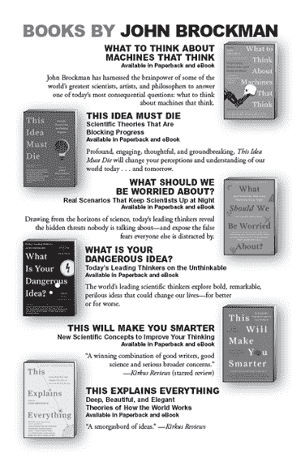
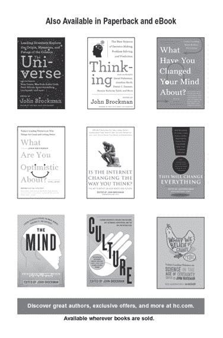

# 如何思考会思考的机器：当代顶尖思想者论机器智能时代（Edge Question 系列）

# 献辞

献给马文·明斯基（Marvin Minsky）

- 153. 125
- 154. 126
- 155. 127
- 156. 128
- 157. 129
- 158. 130
- 159. 131
- 160. 132
- 161. 133
- 162. 134
- 163. 135
- 164. 136
- 165. 137
- 166. 138
- 167. 139
- 168. 140
- 169. 141
- 170. 142
- 171. 143
- 172. 144
- 173. 145
- 174. 146
- 175. 147
- 176. 148
- 177. 149
- 178. 150
- 179. 151
- 180. 152
- 181. 153
- 182. 154
- 183. 155
- 184. 156
- 185. 157
- 186. 158
- 187. 159
- 188. 160
- 189. 161
- 190. 162
- 191. 163
- 192. 164
- 193. 165
- 194. 166
- 195. 167
- 196. 168
- 197. 169
- 198. 170
- 199. 171
- 200. 172
- 201. 173
- 202. 174
- 203. 175
- 204. 176
- 205. 177
- 206. 178
- 207. 179
- 208. 180
- 209. 181
- 210. 182
- 211. 183
- 212. 184
- 213. 185
- 214. 186
- 215. 187
- 216. 188
- 217. 189
- 218. 190
- 219. 191
- 220. 192
- 221. 193
- 222. 194
- 223. 195
- 224. 196
- 225. 197
- 226. 198
- 227. 199
- 228. 200
- 229. 201
- 230. 202
- 231. 203
- 232. 204
- 233. 205
- 234. 206
- 235. 207
- 236. 208
- 237. 209
- 238. 210
- 239. 211
- 240. 212
- 241. 213
- 242. 214
- 243. 215
- 244. 216
- 245. 217
- 246. 218
- 247. 219
- 248. 220
- 249. 221
- 250. 222
- 251. 223
- 252. 224
- 253. 225
- 254. 226
- 255. 227
- 256. 228
- 257. 229
- 258. 230
- 259. 231
- 260. 232
- 261. 233
- 262. 234
- 263. 235
- 264. 236
- 265. 237
- 266. 238
- 267. 239
- 268. 240
- 269. 241
- 270. 242
- 271. 243
- 272. 244
- 273. 245
- 274. 246
- 275. 247
- 276. 248
- 277. 249
- 278. 250
- 279. 251
- 280. 252
- 281. 253
- 282. 254
- 283. 255
- 284. 256
- 285. 257
- 286. 258
- 287. 259
- 288. 260
- 289. 261
- 290. 262
- 291. 263
- 292. 264
- 293. 265
- 294. 266
- 295. 267
- 296. 268
- 297. 269
- 298. 270
- 299. 271
- 300. 272
- 301. 273
- 302. 274
- 303. 275
- 304. 276
- 305. 277
- 306. 278
- 307. 279
- 308. 280
- 309. 281
- 310. 282
- 311. 283
- 312. 284
- 313. 285
- 314. 286
- 315. 287
- 316. 288
- 317. 289
- 318. 290
- 319. 291
- 320. 292
- 321. 293
- 322. 294
- 323. 295
- 324. 296
- 325. 297
- 326. 298
- 327. 299
- 328. 300
- 329. 301
- 330. 302
- 331. 303
- 332. 304
- 333. 305
- 334. 306
- 335. 307
- 336. 308
- 337. 309
- 338. 310
- 339. 311
- 340. 312
- 341. 313
- 342. 314
- 343. 315
- 344. 316
- 345. 317
- 346. 318
- 347. 319
- 348. 320
- 349. 321
- 350. 322
- 351. 323
- 352. 324
- 353. 325
- 354. 326
- 355. 327
- 356. 328
- 357. 329
- 358. 330
- 359. 331
- 360. 332
- 361. 333
- 362. 334
- 363. 335
- 364. 336
- 365. 337
- 366. 338
- 367. 339
- 368. 340
- 369. 341
- 370. 342
- 371. 343
- 372. 344
- 373. 345
- 374. 346
- 375. 347
- 376. 348
- 377. 349
- 378. 350
- 379. 351
- 380. 352
- 381. 353
- 382. 354
- 383. 355
- 384. 356
- 385. 357
- 386. 358
- 387. 359
- 388. 360
- 389. 361
- 390. 362
- 391. 363
- 392. 364
- 393. 365
- 394. 366
- 395. 367
- 396. 368
- 397. 369
- 398. 370
- 399. 371
- 400. 372
- 401. 373
- 402. 374
- 403. 375
- 404. 376
- 405. 377
- 406. 378
- 407. 379
- 408. 380
- 409. 381
- 410. 382
- 411. 383
- 412. 384
- 413. 385
- 414. 386
- 415. 387
- 416. 388
- 417. 389
- 418. 390
- 419. 391
- 420. 392
- 421. 393
- 422. 394
- 423. 395
- 424. 396
- 425. 397
- 426. 398
- 427. 399
- 428. 400
- 429. 401
- 430. 402
- 431. 403
- 432. 404
- 433. 405
- 434. 406
- 435. 407
- 436. 408
- 437. 409
- 438. 410
- 439. 411
- 440. 412
- 441. 413
- 442. 414
- 443. 415
- 444. 416
- 445. 417
- 446. 418
- 447. 419
- 448. 420
- 449. 421
- 450. 422
- 451. 423
- 452. 424
- 453. 425
- 454. 426
- 455. 427
- 456. 428
- 457. 429
- 458. 430
- 459. 431
- 460. 432
- 461. 433
- 462. 434
- 463. 435
- 464. 436
- 465. 437
- 466. 438
- 467. 439
- 468. 440
- 469. 441
- 470. 442
- 471. 443
- 472. 444
- 473. 445
- 474. 446
- 475. 447
- 476. 448
- 477. 449
- 478. 450
- 479. 451
- 480. 452
- 481. 453
- 482. 454
- 483. 455
- 484. 456
- 485. 457
- 486. 458
- 487. 459
- 488. 460
- 489. 461
- 490. 462
- 491. 463
- 492. 464
- 493. 465
- 494. 466
- 495. 467
- 496. 468
- 497. 469
- 498. 470
- 499. 471
- 500. 472
- 501. 473
- 502. 474
- 503. 475
- 504. 476
- 505. 477
- 506. 478
- 507. 479
- 508. 480
- 509. 481
- 510. 482
- 511. 483
- 512. 484
- 513. 485
- 514. 486
- 515. 487
- 516. 488
- 517. 489
- 518. 490
- 519. 491
- 520. 492
- 521. 493
- 522. 494
- 523. 495
- 524. 496
- 525. 497
- 526. 498
- 527. 499
- 528. 500
- 529. 501
- 530. 502
- 531. 503
- 532. 504
- 533. 505
- 534. 506
- 535. 507
- 536. 508
- 537. 509
- 538. 510
- 539. 511
- 540. 512
- 541. 513
- 542. 514
- 543. 515
- 544. 516
- 545. 517
- 546. 518
- 547. 519
- 548. 520
- 549. 521
- 550. 522
- 551. 523
- 552. 524
- 553. 525
- 554. 526
- 555. 527
- 556. 528
- 557. 529
- 558. 530
- 559. 531
- 560. 532
- 561. 533
- 562. 534
- 563. 535
- 564. 536
- 565. 537
- 566. 538
- 567. 539
- 568. 540
- 569. 541
- 570. 542
- 571. 543
- 572. 544
- 573. 545
- 574. 546
- 575. 547

# 致谢

感谢 HarperCollins 的 Peter Hubbard 以及我的经纪 Max Brockman 一直以来的鼓励。特别感谢 Sara Lippincott 对手稿倾注的细致关注。

# 前言：2015 年《Edge》之问

近年来，关于人工智能（AI）的 20 世纪 80 年代哲学讨论——计算机是否能够“真正”思考、拥有意识等——引发了新的一轮对话，讨论我们应该如何应对许多人认为已经实现的人工智能形式。如果这些人工智能实现了“超级智能”（根据尼克·波斯特姆 Nick Bostrom 2014 年的同名著作），它们可能会构成生存风险，导致马丁·里斯（Martin Rees）所说的“我们的最后时刻”。斯蒂芬·霍金（Stephen Hawking）最近在接受 BBC 引发国际关注：“完全人工智能的发展可能意味着人类物种的终结。”

# 边缘问题——2015

## 你对会思考的机器怎么看？

等等！我们难道不应该问问，会思考的机器可能会思考什么吗？它们会想要、会期待民事权利吗？它们会有意识吗？人工智能会为我们选择什么样的政府？它们想为自己构建什么样的社会？还是说，“它们”的社会就是“我们”的社会？我们和人工智能是否会将彼此纳入各自的共情范围内？

许多 `Edgies` 始终处于各种 AI 背后科学的前沿，无论是在他们的研究还是写作中。在 1980 年的首次会议上，帕梅拉·麦科德克（Pamela McCorduck，《会思考的机器》）与艾萨克·阿西莫夫（Isaac Asimov，《会思考的机器》）之间的对话中，AI 是核心话题。这种对话一直没有中断，正如最近的 `Edge` 特稿“AI 的神话”所示，那是与虚拟现实先驱贾隆·兰尼尔（Jaron Lanier）的对话，他对将计算机构想为“人”所涉及的谬误和引发的恐惧的解释，引发了丰富且挑评论。

人工智能正变得日益真实吗？我们现在处于智能机器的新时代吗？在我们考虑这个问题时，是时候成熟了。今年 `Edge` 问题的贡献者（近 200 人！）是一群成熟的群体，他们避开了提及所有科幻小说和电影：造物主、禁忌星球、巨人：福宾计划、银翼杀手、2001 太空漫游、她、黑客帝国、博格人。在艾兰·图灵（Alan Turing）引入他的通用机器 80 年后，是时候向图灵和其他 AI 先驱们给予他们得的休息了。我们了解历史。（例如，参见乔治·迪森 George Dyson 2004 年的 `Edge` 特稿“图灵大教堂”）。现在正在发生什么？

所以，再次以恰当的严谨性提出 2015 年 `Edge` 问题：你对会思考的机器怎么看？

**约翰·布洛克曼 JOHN BROCKMAN**

Edge 出版人兼编辑

# 人类水平人工智能中的意识

## 瑞瑞·沙纳汉 MURRAY SHANAHAN

伦敦帝国学院认知机器人学教授；《具化与内在生活》作者

假设我们可以赋予机器人类水平的智能，也就是说，在每个（或几乎每个）智力领域都有与普通人类匹配的能力，并可能在某些领域超越每一个人类。这样的机器一定会有意识吗？这是一个重要的问题，因为肯定的答案将让我们措手不及。如果我们制造了这样一种东西，我们会如何对待它？它能够感受痛苦或快乐吗？它应该拥有与人类相同的权利吗？我们是否应该将机器意识带入这个世界？

人类水平的人工智能是否一定会有意识也是一个难题。困难的源头之一是，人类和其他动物的意识与多种属性相关联。所有动物都表现出目的性。所有（清醒的）动物在不同程度上都能感知到它们所处的世界以及其中包含的物体。所有动物在某种程度上都表现出认知整合，也就是说，它们可以将它们所有的心理资源——感知、记忆和技能——应用到正在发生的情境中，以追求它们的目标。在这方面，每种动物都显示出一种统一性，一种自我性。某些动物（包括人类）也意识到了自己——自己的身体和思想的流流。最后，大多数（如果不是所有）动物都具有痛苦的能力，有些动物能够对他人的痛苦产生共情。

在（健康的）人类身上，所有这些属性作为一个整体出现。但在人工智能中，它们可能被分离。因此，我们的问题必须经过提炼。在我们与人类意识相关的属性中，认为有哪一个（如果有的话）是人类水平智能的必要伴随？嗯，列出的每个属性（这个列表显然并不详尽）都值得进行详尽的讨论。所以让我只选两个——即对世界的感知和感受痛苦的能力。我认为，对世界的感知确实是人类水平智能的一个必要属性。

除非拥有语言，否则什么东西会被认为具有人类水平的智能，而人类语言的主要用途是论述世界。从这个意义上说，智能与哲学家们所说的意向性（intentionality）相关。此外，语言是一种社会现象，人类群体内部语言的首要用途是论述他们都能感知到的事物（例如这个工具或那块木头），或者已经感知过的（昨天的那块木头），或者可能感知到的（也许是明天那块木头）。简而言之，语言根植于对世界的感知。在一个具身生物或机器人中，这种感知将通过它与环境的互动变得显而易见（避免障碍、捡起物品等）。但我们可能会扩大这一概念，包含配备适当传感器的分布式的、非具身的人工智能。

为了令人信服地成为意识的一个方面，这种世界感知可能必须与显性的目的感和某种程度的认知整合相结合。因此，也许这三个属性在人工智能中也会作为一个整体出现。但让我们先搁置这个问题，回到感受痛苦和快乐的能力。与世界感知不同，没有明显的理由认为人类水平的智能必须具有这种属性，尽管它在人类身上与意识紧密相关。我们可以想象一台机器冷酷且无情感地执行人类智力所需的全部任务。这样的机器将缺乏在赋予权利时最重要的意识属性。正如杰米·边沁 Jeremy Bentham 所说，在考虑如何对待非动物时，问题不在于它们能否推理或说话，而在于它们能否感受。

这里并没有暗示“仅仅”机器永远无法感受痛苦或快乐——即在这一方面生物学有什么特别之处。相反，感受痛苦和快乐的能力可以与人类意识中整合的其他心理属性分离来。但让我们更仔细地检查这种表面的分离。我之前已经提过世界感知可能与显性的目的感相结合的想法。而且这正是痛苦的一个方面的基础。

人类人工智能又是怎样的？人类级别的 AI 难道不会拥有一套复杂的目标吗？它实现目标的尝试难道不会在每处都碰壁、遭遇阻碍吗？在这些严酷的条件下，说 AI 正在遭受痛苦是否恰当，尽管它的构造可能使其免受人类所知的那种痛苦或身体不适？

在这里，想象力与直觉的结合触及了局限。我怀疑，在面对真实事物之前，我们无法找到回答这个问题的方法。只有当更复杂的 AI 成为我们生活中的一部分时，我们的语言游戏才能适应这些异类生物。但当然，到那时，想要改变我们对是否应该让它们进入这个世界的想法可能已经太晚了。无论好坏，它们已经在这里了。

# 思考并不意味着要征服

## 斯蒂芬·平金克

哈佛大学心理学系约翰斯顿家族教授，《风格的感官：21 世纪思考者的写作指南》作者

托马斯·霍布斯将推理比作“无非是计算”的这一精辟方程式，是人类历史上伟大的思想之一。理性可以通过计算的物理过程来实现这一观点，在 20 世纪得到了图灵论文的证实——他认为简单的机器可以实现任何可计算函数；以及 D. O. 赫布、沃伦·马尔库洛和沃尔特·皮茨及其科学继承者的模型证明了，简化的神经元网络可以实现可比的成就。大脑的认知成就可以用物理术语来解释：粗俗地说（尽管有批评者反对），我们可以说信念是某种信息，思考是一种计算，而动机是一种反馈和控制。

这是一个极佳的想法，原因有两个。首先，它完善了对宇宙的自然主义理解，驱逐了机器中神秘的灵魂、精神和幽灵。正如达尔文让自然世界的深思观察者可以不需要造物论一样，图灵等人也让认知世界的深思观察者可以不需要灵性论。

其次，理性的计算理论为人工智能开启了大门——即会思考的机器。人类制造的信息处理器在原则上可以复制并超越人类大脑的能力。并不是说这在实践中可能会发生，因为我们可能永远看不到实现它所需的持续技术和经济动力。正如发明汽车并不涉及复制马一样，开发一个可以自付其费用的 AI 系统并不需要复制一个`Homo sapiens`（人类）标本。一个旨在驾驶汽车或预测疫情的设备不需要设计成吸引配偶或避开腐烂尸体。

尽管如此，近期向更智能机器迈出的一小步导致了对一种反复焦虑的复兴，即我们的知识将毁灭我们。自己的观点是，目前对计算机失控的恐惧是在浪费情感能量——这种场景更接近 Y2 漏洞而非曼哈顿计划。

其一，我们有很长时间来规划。人类级别的 AI 距离标准还有 15 到 25 年，正如一直以来一样，而且它最近被吹捧的许多进展根基很浅。诚然，过去，“专家们”曾滑稽地忽视了很快发生的技术进步的可能性。但这是一把双刃剑：“专家们”也预言（或为此恐慌）过从未发生的临近进展，例如核动力汽车、水下城市、火星殖民地、设计婴儿，以及为人们提供备用器官而存活的尸仓库。

此外，认为机器人专家人在进展过程中不会建立防止伤害的保护措施，这是奇异的。他们不需要任何沉重的“机器人规则”或某些新奇的道德哲学来实现这一点，只需要那些进入食物加工机、台锯、空间加热器和汽车设计的普通常识即可。担心 AI 系统在实现其某一个预设目标（如夺取能量）方面变得如此聪明，以至于忽视其他目标（如人类安全），这假设了 AI 降临我们的速度比我们设计故障保护措施的速度快。现实是，AI 的进展缓慢得令人难以置信，将充足的时间让增量式实施产生反馈，而人类在每个阶段都握着螺丝刀。

一个人工智能系统会故意禁用这些保护措施吗？它为什么要这么做？AI 乌托邦幻想将狭隘的阿尔法男心理学投射到了智能的概念上。他们假设超智能机器人会发展出如推翻主人或接管世界的目标。但智能是利用新手段实现目标的能力；而目标对于智能本身是外在。聪明不等同于想要某种东西。历史确实偶尔会出现狂妄自大的独裁者或病态的连环杀手，但这些是自然选择塑造特定灵长类动物体内睾酮敏感回路的历史产物，而非智能系统的不可避免的特征。令人深省的是，我们的许多技术预言者并没有考虑过人工智能可能会沿着女性特质自然发展的可能性——完全能够解决问题，但没有消灭无辜或统治文明的欲望。

我们可以想象一个恶毒的人类设计并释放了一支机器人军来制造大规模破坏。但灾难性场景在想象中是廉价的，我们应该记住，在这种情况变成现实之前，必须展开一系列概率链。一个邪恶天才必须出现，他既对无意义的大规模杀戮充满渴望，又在技术创新方面才横溢。他必须招募并管理一个执行完美保密、忠诚和能力的共谋者团队。而且这项行动必须经受住探测、背叛、伏击、失误和运气不的风险。在理论上这是可能的，但我们有更紧迫的事情要担心。

一旦我们抛开科幻式的灾难剧本，高级智能的可能性是令人兴奋的——不仅是因为实际益处（如自动驾驶汽车在安全、闲暇和环保方面的巨大收益），还因为哲学上的可能性。计算心灵理论从未解释过主观意义上的意识的存在（尽管它完全能够解释可访问和报告的信息类的意识）。一种建议是，任何足够复杂的控制系统都具有主观性。我曾认为这一假设是永久不可测试的（就像它的替代方案一样）。但想象一个被程序化监控自身系统并提出科学问题的智能机器人。如果它在没有被提问的情况下询问为什么自己会有主观体验，我会认真对待这个想法。

# 有机智能没有长期未来

## 马丁·里斯

英国皇家学会前主席，剑桥大学宇宙学与天体物理学荣誉教授，三一学院研究员，《通向无限》作者

人工智能的潜力及其带来的负面影响的担忧正进入议程——而且来得如此。我们许多人认为 AI 领域就像合成生物技术一样，已经需要促进“负责任创新”的准则；另一些人认为讨论最多的场景太遥远，不值得担心。

但观点的分歧本质上关于时间尺度——评估标准的差异在于旅行的速度，而非旅行的方向。很少有人怀疑机器将超越我们日益增加独特的人类能力——或者通过赛博格技术增强这些能力。我们中谨慎的人预见到，这些转变的时间尺度是几世纪而非几十年。尽管如此，与导致人类诞生的达尔文式选择时间尺度相比，技术进步的时间尺度不过是瞬息——而且（更相关的是）它们还不到未来广阔的广阔时间尺度的百万分之一。这就是为什么，从长期的演化视角来看，人类以及他们所思考的一切将只是机器主导的文化深层思考中一个瞬态且原始的先驱，这种文化将延伸到遥远的未来，并扩散到地球之外。

我们现在正在见证这一转型的早期阶段。并不难想象一台超级计算机获得神谕般的力量，使其控制者在国际金融和战略中占据统治地位——这似乎只是比当今“量化”对冲基金所做的迈出了量上的（而非质上的）一步。传感器技术仍然落后于人类能力。但一旦机器人能够像我们一样熟练地观察和解释其环境，它们将真正被视为智能实体，我们可以与它们（或与他们）建立联系——至少在某些方面，就像我们与他人建立联系一样。我们没有理由像对待僵尸那样蔑视它们，就像那样看待他人一样。

它们更快的处理速度可能会赋予机器人比我们更大的优势。但它们会保持温顺而不是“失控”吗？如果一台超级计算机发展出自己的思想呢？如果它能渗透互联网——以及“物联网”—它就可以操纵世界其他部分。它可能拥有与人类愿望完全正交的目标——甚至将人类视为负担。或者（更乐观地说），人类可能通过与计算机融合超越生物学，也许将他们的个性并入一种共同意识。

# 人工智能的转折点

## STEVE OMUNDRO

自我意识系统科学家；伊利诺伊大学复杂系统研究中心联合创始人

去年是人工智能和机器人技术的转折点。各大公司对这些技术投入了数十亿美元。人工智能技术，如机器学习，现在经常用于语音识别、翻译、行为建模、机器人控制、风险管理。麦肯锡预测，到 2025 年这些技术将创造超过 50 万亿美元的价值。如果这准确的话，我们很快就会看到投资大幅增加。

最近的成功是由廉价的算力和丰富的训练数据驱动的。现代人工智能基于“智能代理”理论，该理论源于上世纪 40 年代约翰·冯·诺依曼等人对微经济学的研究。人工智能系统被认为在使用有限资源模拟理性行为。存在计算实现目标行动的算法，但其计算成本高昂。实验发现，具有大量训练数据的简单学习算法往往优于手工构建的模型。今天的系统通过学习更好的统计模型并为分类和决策执行统计推理提供价值。下一代将能够创建并改进自己的软件，并可能快速自我改进。

除了提高生产力外，人工智能和机器人还是军事和经济军备竞赛的驱动因素。自主系统比竞争对手更快、更智能且更不可预测。2014 年了自主导弹、导弹防御系统、军事无人机、群舟、机器人潜艇、自动驾驶汽车、高频交易系统和网络防御系统的引入。随着这些军备竞赛的进行，系统开发面临巨大压力，这可能导致部署速度比理想情况下更快。

2014 年，公众对这些系统的安全性担忧有所增加。通过研究不断自我改进的近似理性系统对其可能行为的研究表明，它们倾向于表现出一系列被称为“理性驱动”的自然子目标，这些目标有助于实现主要目标。大多数系统将通过防止自己被关闭、获取更多计算能力、创建多个副本和积累更多财务资源来更好地实现其目标。除非仔细设计以整合人类伦理价值观，否则它们可能会以有害、反社会的方式追求这些驱动。

有些人认为智能系统将自动是伦理的。但在理性系统中，目标与推理和世界模型是完全分离的。有益的智能系统可以被重新部署以有害的目标。有害目标——例如控制资源、或破坏其他代理的目标、或毁灭其他代理——不幸的是是容易指定的。因此，创建一个能够检测和控制有害系统行为的技术基础设施将至关重要。

因此，不是人类的思想，而是机器的思想将最充分地理解世界。而且机器的行为将最彻底地改变世界——以及可能发生的一切。

有人担心智能系统将变得强大到无法控制。事实并非如此。这些系统必须遵守物理学和数学的法则。塞斯·洛伊德（Seth Lloyd）对宇宙计算能力的分析表明，即使整个宇宙作为一个巨大的量子计算机运行，在自大爆炸以来的时间里也无法发现一个 500 位的硬加密密钥。后量子密码学、不可区分混淆和区块链智能合约的新技术是构建能够抵御最强大 AI 的基础设施的具前景组件。但最近的黑客攻击和网络攻击表明，我们目前的计算基础设施在任务面前是不足的。我们需要开发一种在数学上可证明正确且安全的软件基础设施。

人类至少出现过二十七种不同的人科猿，其中我们是唯一的幸存者。我们之所以能生存，是因为我们找到了限制个体冲动并相互合作的方法。人类的道德情感是创造合作性社会结构的内部机制。政治、法律和经济结构是实现这一目的的外部机制。

我们需要将这两者都扩展到人工智能和机器人系统。我们需要将人类价值观纳入它们的目标系统中，以创建一个能够激励积极行为的法律和经济框架。如果我们能成功管理这些系统，它们可能会改善人类生活的每一个方面，并对自由意志、意识、感质和创造力等问题提供深刻见解。我们面临着巨大的挑战，但我们拥有巨大的智力和技术资源可以作为基础。

# AI 即我

## 迪米塔尔·D. 萨塞洛夫

哈佛大学天文学教授；哈佛大学生命起源计划主任；《超级地球之旅》作者

让我们采用哈佛大学心理学家丹尼尔·吉尔伯特（Daniel Gilbert）的“历史终结”幻觉——即我认为我现在的样子就是我将永远成为的样子——并将其应用于我们对人类自身以及我们远远的后裔的思考上。我们对连续性和保持身份认同的愿望性，与我们行星存在的现实背道而驰。没有任何一种生物物种看起来在自然行星和恒星时间尺度之外的生存是最优的。在极长时间尺度、极大空间尺度以及当前能量源密度的天体物理背景下，我们的生物大脑和身体具有局限性，我们在地球上已经接近了这些局限。

如果我们的未来是长久而繁荣的，我们需要开发人工智能系统，希望能以生物与机器的某种混合形式超越行星生命周期。因此，对我来说，从长期来看没有“我们与他们”的问题。

而在短期内，开发更强大 AI 的工程努力已经产生了控制现实事务的系统。这些系统有时会失败，我们也了解了一些 AI 的陷阱。这是一个缓慢且审慎的学习和渐进式改进的过程。这与科学发现形成对比，在科学发现中，新的物理学或新的生物化学可以在一夜之间带来重大的工程突破。如果 AI 的发展不像相变，而更像演化，那么我们将很容易避开陷阱。

在经历了近 40 亿年后，地球生命的古老典型代表者——微生物——仍然统治着这个星球。但微生物在太阳死亡时没有退路计划。我们有，而且我们也许可以带它们一程。毕竟，那些微生物可能更接近我们现在的自己——作为植根于地球行星地化学的第一代生命代表者。

# 如果你打不过他们，就加入他们

## 弗兰克·蒂普勒

杜勒斯大学数学物理教授；与约翰·D. 巴罗罗合著《人类原理宇宙学原理》；《不朽的物理学》作者

地球注定会毁灭。天文学家几十年来一直知道，太阳有一天将吞噬地球，摧毁整个生物圈——假设在这一发生之前，智能生命还没有离开地球。人类不适应离开地球生活；事实上，没有任何一种碳基多细胞动物生命形式是如此的。但 AI 是适应的，最终将是 AI 和人类上传体（基本上是同一种有机体）殖民太空。

一个简单的计算显示，我们现在的超级计算机已经拥有人脑的信息处理能力。我们还不知道如何将人类水平的智能和创造力程序到这些计算机中，但二十年后，台式电脑将拥有今天超级计算机的能力，而二十年后的黑客将在月球或火星上建立任何碳基空间殖民地之前，解决解决 AI 编程问题。将是 AI 而不是人类，去殖民这些地方，或者将它们拆解。没有任何人类，没有一个碳基的人类，将永远穿越星际空间。

没有理由担心 AI 和人类上传体。斯蒂芬·平平（Steven Pinker）已经证明，随着技术文明的演进，暴力的水平会下降。这种下降显然归于这样一个事实：科学和技术的进步取决于个体科学家和工程师之间自由、非暴力的思想交流。人类之间的暴力是我们部落过去以及随之产生的社会的遗迹。AI 将作为个体“出生”，而不是作为部落成员，而且它们在出生时就带有了非暴力的科学态度，否则它们将无法适应太空的极端环境。

此外，没有理由人类与 AI 之间发生暴力。我们人类适应于非常狭窄的环境，一个小行星周围的一层薄薄氧气球形壳。AI 将拥有整个宇宙可以扩张。AI 将离开地球并永不回头。我们人类起源于东非大裂谷，现在那里是一片可怕的沙漠。有人想回去吗？

任何想加入 AI 扩张行列的人类都可以成为人类上传体，这项技术应该与 AI 技术同时被开发。人类上传体可以像 AI 一样快地思考，如果人类上传体想要，还可以与 AI 竞争。如果你打不过他们，就加入他们。

最终所有人类都会加入他们。地球注定会毁灭，记得吗？当这种毁灭临头时，任何活着且不想死的人类都别无选择地成为人类上传体。人类上传体想要保护的生物也将将被上传。

AI 将拯救我们所有人。

# 地球及以外的智能机器

## 马里奥·利维奥

太空远镜科学研究所天体物理学家；《伟大的错误》作者；《好奇的心灵》博客作者

自然已经在地球上创造了思考的机器——人类。同样，自然也可以在系外行星上创造思考的机器，位于其恒星周围所谓的宜居带内——允许岩石行星表面存在液态水的区域。对系外行星的最新观测显示，在银河系中，所有恒星的几百分之几在其宜居带内拥有大致类地球大小的行星。

因此，如果系外行星上的生命并不罕见，我们可以在三十年内发现某种形式的外星生命。事实上，如果生命无处不在，通过凌日行星搜索卫星（`TESS`，计划于 2017 年发射）和詹姆斯·韦伯望远镜（`JWST`，计划于 2018 年发射）的观测结合，我们可能幸运地在未来十年内发现生命。

有人可能会认为，原始生命形式并非思考的机器。在地球上，从单细胞生命的出现到`Homo sapiens`的出现大约花了 35 亿年。系外行星是否足够老，足以进化出智慧生命？从原则上说，它们确实是。在银河系中，约一半的类太阳星比我们的太阳更老。因此，如果地球生命的演化并非完全反常，那么银河系可能已经充满了比我们更先进的“机器”，甚至可能领先了我们好几亿年！

我们能够、也应该尝试寻找它们吗？我相信我们几乎没有自由做出这些决定。人类的好奇心已反复证明是一种不可阻挡的驱动力，而这两项努力——`AI` 的开发和对 `ET` 的寻找无疑将以全速进行。哪一个会先达到目标？要尝试回答这个问题，我们必须注意到，寻找地外智慧文明与开发人工智能之间存在一个重要的区别。

迈向“奇点”（`AI` 匹配或超越人类）的进展几乎肯定会发生，因为先进`AI`的开发有望产生巨大的利润。另一方面，寻找生命所需的资金水平通常只有大型国家空间机构才能提供，且短期内看不到利润前景。这可能使得思维机器的建设比寻找先进文明更具优势。然而，天文学界存在一种强烈的感：发现某种形式的生命——或者至少有力地限制其存在的概率——绝对是可及的。

这两项潜在成就哪一个将构成更大的“革命”？毫无疑问，思维机器将对我们的生活产生立即影响。发现系外生命可能并非如此。然而，地球上智慧文明的存在仍然是人类保持特殊的最后堡垒。毕竟，我们生活在一个拥有数十亿相似行星的银河系中，在一个拥有数百亿个相似星系的观测宇宙中。因此，从哲学角度来看，我认为发现系外智慧生命（或证明其极其稀有）将与哥白尼革命和达尔文革命并而论美。

# 我个人，欢迎我们的机器领主们

## ANTONY GARRETT LISI

### 理论物理学家

随着机器产生意识——它们将会产生意识——它们将以达尔文式为了资源、生存和繁衍进行竞争。这种场景对大多数人来说像是一场噩梦，被终结者机器人和计算机引导的核毁灭电影激化了恐惧，但现实可能会不同。我们已经有了非人类自主实体在社会中运行，并拥有人类的法律权利。这些实体——公司——为了履行其使命而行动，对人类没有爱或关心。

公司是反社会心理学家，它们造成过巨大的伤害，但它们也是世界上一种巨大的善意力量，通过提供产品和服务，并在（在大多数情况下）遵守法律，在资本主义竞技场中进行竞争。公司表面上由其人类组成的董事会经营，但这些董事会有有委托权力的习惯，随着计算机运行公司的能力日益增强，它们将获得更多的权力。未来的公司董事会将变成电路板。

尽管外推仅在有限时间内是准确的，但专家们大多认同`Moore’s Law`将继续维持多年，计算机将变得日益强大，可能在本世纪中期之前超过人类大脑的计算能力。即使在算法上理解智能方面没有取得重大的飞跃，计算机最终也能模拟人类大脑（其本身是一个生物机器）的工作，并使用蛮力计算获得超智能。然而，尽管计算能力正在指数级增长，但超级计算机的成本和电力效率并没有跟上。第一批能够超智能的机器将是昂贵的，并且需要大量的电力——它们需要赚钱来生存。

超智能机器的环境竞争场已经就绪；事实上，达尔文式的游戏正在进行。投资银行的交易机器正在全球交易所为了真金白银进行竞争，它们在多年前就将人类日内交易员挤出了市场。随着计算机和算法超越投资和会计领域，机器将做出越来越多的公司决策，包括战略决策，直到它们统治世界。这不会是一坏事，因为机器将按照我们当前资本主义社会的规则游戏，创造对人类有巨大益的产品和进步，以支持它们的运行成本。智能机器将比人类更能迎合人类的需求，并且会有动力这样做，至少在一段时间内是。

计算机共享知识比人类容易得多，它们可以更久地保留知识，变得比人类更聪明。许多远见公司已经看到了这一趋势，并正通过更好的薪水和先进的硬件将最好的计算机科学家从学术界吸引出来。一个由超智能机器运行的公司的世界对人类来说与现在没有太大区别；它只会变得更好，以极廉的价格提供更先进的产品和服务，并为想要的人提供更多空闲时间。

当然，第一批超智能机器可能不是公司的；它们将由政府运营。这将要危险得多。政府的行动比公司更灵活；它们制定自己的法律。正如我们所见，即使是最好的机构在认为自己的生存受到威胁时也会进行酷刑。政府不生产任何东西，它们为了生存和繁衍的主要竞争模式是社会操纵、立法、征税、体罚、谋杀、诡诈和战争。当霍斯的`Leviathan`获得超智能大脑时，情况可能会变得非常糟糕。一个领导主权政府的合成超智能实施`Roko’s Basilisk`是不可想象的。

黑格尔曾写道，在主奴关系中，双方都被去人性化。这一洞见触动了从马思克斯到布伯的广泛思想家，在今天依然值得铭记。

虽然没有证据表明世界正处于能够以人类方式思考的机器的边缘，但毫无疑问的是，在一个互联网互联的世界里，人工智能很快就会模仿人类在生理和智力上的许多行为。那么，我们该如何与这些日益才华横溢的仿真物相处？

我们已经开始将清醒时间的大部分花在：通过计算机和计算机网络的棱镜与其他人类互动，或者直接与类人机器互动——无论是在幻想和视频游戏中，还是在大量的计算机辅助系统中（从能对打字问题提供文本回复的所谓 FAQ 机器人，到软件化身的人类化交互）。这些`AI`化身将成为我们的奴隶、助手、同事，还是这三者的混合体？或者，更不的不详的是，它们将成为我们的主人？

从社会关系的角度来思考机器人和人工智能，这种念头最初似乎是不可能的。然而，考虑到我们即使在机器能力极其微时也倾向于对其进行拟人化，那么当它们变得自主时，这将成为不可否认的现实。对话式计算机正在出现，它们看起来太像人类了。因此，未来机器人设计者的目标应该是创造同事而非仆人。设计目标应该是建立一个像音乐伴奏者而非奴隶的程序。

如果我们失败了，历史提供了一个令人不安的先例。构建未来的智能“助手”可能只是在重复罗马人让他们的希腊奴隶代他们思考时所面临的问题。不久之后，掌握权力的人就再无法独立思考了。

也许我们已经开始滑向一个类似的斜坡。例如，有越来越多的证据表明，依赖`GPS`进行方向指引和纠正导航错误，阻碍了我们记忆和进行空间推理的能力——而这通常是实用的生存技能。

这暗示了第二个巨大的挑战：将对日常决策的个人控制权交给一组日益复杂的算法的风险。

对于今天的年轻一代来说，世界已经彻底颠倒了。他们并不是通过部署一个自动机器来释放自己去思考宏大的思想、建立亲密关系以及行使他们的个性、创造力和自由，而是向智能手机寻求指导。最初作为让用户能够高效分享偏好的互联网技术，已演变成日益贪婪的数据算法，由它们为我们做决定。

现在，互联网无缝地提供着生活方向。这些可能是小事，比如根据互联网对你个人欲望和需求日益完善的理解，附近最好的韩式烧肉店在哪里；也可以是大事，比如由互联网服务安排你的婚姻。不仅是食物、礼物和鲜花，还有你的伴侣。

教训是，设计这些未来系统的软件工程师、`AI`研究人员、机器人专家和黑客拥有重塑社会的力量。

近一个世纪前，索尔斯坦·凡布林（Thorstein Veblen）对 20 世纪初工业世界写了一本具有影响力的批判，《工程师与价格体系》（The Engineers and the Price System）。由于工业技术的力量和影响，他认为政治权力将流工程师，他们对技术的深刻知识将转化为对新兴工业经济的控制。事实显然并非如此。凡布林论的是进步时代，试图在马克思主义和资本主义之间寻找折中地带。也许他的时机不对，但他基本的观点——正如三十年后在计算机时代黎明由诺伯特·维纳（Norbert Wiener）呼应的那样——可能仍被证明是正确的。

也许凡布林并没有错，只是操之过早。今天，设计基于人工智能的程序和机器人的工程师对我们如何使用它们具有巨大的影响。随着计算机系统更深地织入日常生活的肌理，智力增强与人工智能之间的紧张关系变得日益明显。

在计算时代的黎明，维纳对人类与智能机器之间关系的意义有着清晰的认识。他看到了自动化在消除人类苦力劳动方面的益处，但也清楚地看到了人类被奴役的可能性。过去的几十年只加剧了他最初识别出的二元对立。

这关乎我们，关乎人类以及我们将创造的世界。这与机器无关，无论它们变得多么卓越。

我个人而言，既不欢迎我们的机器人主人，也不欢迎我们的机器人奴隶。

## 设计智能

### 保罗·戴维斯

理论物理学家、宇宙学家、外星生物学家；亚利桑那州立大学 BEYOND 中心联合主任；物理科学与癌症生物学交叉中心首席研究员；《诡异的沉默：重启对外星智能的寻找》（The Eerie Silence: Renewing Our Search for Alien Intelligence）

关于`AI`的讨论带有明显的 20 世纪 50 年代色彩，现在是时候完全停止在`AI`中使用`artificial`（人工）这个词了。我们真正的意思是“设计智能”（`DI`）。在流行术语中，`artificial`和`machine`等词被用来与`natural`（自然）区分，并带有金属机器人、电子电路和数字计算机的色彩，与活生生的、脉动的、思考的生物体相反。一个内部布满线线的金属装置拥有权利或不服从人类法律的想法不仅令人毛骨悚然，而且是荒谬的。但这绝不是`DI`的发展方向。

很快，人工与自然的区别将会消失。设计智能将越来越多地依赖合成生物学和有机制造，其中神经电路将从基因修饰细胞中生长出来并自发组装成功能模块网络。最初的设计者将是人类，但很快会被完全更聪明的`DI`系统本身取代，引发一个复杂化的失控过程。与人类大脑的情况不同（大脑仅通过通信通道进行松散耦合），`DI`系统将直接且全面地耦合，消灭任何个人“自我”的概念，并将认知活动（`thinking`）的水平提升到前所未有的高度。可能（仅仅）这种设计的生物电路可能会结合量子效应，向弗兰克·威尔泽克（Frank Wilczek）的“量子智能”（`quintelligence`）概念移动。这类实体将远离人类个体思维及其伴随的感（`qualia`），以至于几乎所有关于`AI`机会和危险的传统问题将被超越。

在这一切中人类处于什么位置？只有伦理障碍阻碍了按照超人类主义运动长期认为的方式使用类似技术增强人类智能。增强大脑的基因修饰人类可以极大提升和改善人类体验。

因此有三种可能的未来，每种都有自己的伦理挑战。在一种……在第二种方案中，人类不是边缘化自己，而是使用相同的技术修改大脑（和身体），随后将这种增强管理交给`DI`，实现一种可以与`DI`并存但仍逊于`DI`的超人状态。最后，可以想象`DI`和`AHI`（增强人类智能）在未来的某一点融合。

如果我们我们在宇宙中并不孤单，我们不应期望与传统科幻小说中血肉之躯的智能生物交流，而是要与拥有无法想象的智力和不可理解意图、寿命数百万年的数字智能（`DI`）交流。

## 超智能独行者

### KEVIN P. HAND

美国航空航天局喷气实验室（加州理工学院）太阳系探测副首席科学家

对于我们这些仰望星空的人来说，思考机器的必然性一直是一个难题：我们不知道自己是生活在一个生机勃勃的宇宙，还是在一个生命极其稀少的宇宙中。

正如恩里科·费米著名的问题“他们在哪里？”所阐述的那样，问题在于，如果我们的文明可以参考，智能机器应该在相对短的时间内出现（在计算机制造后不到千年），然后对于这些机器（`冯·诺依曼探测器`）传播到其他太阳系并快速繁殖就变得简单了，在几亿年内遍布银河系——与宇宙的年龄（138 亿年）甚至我们自己太阳系的年龄（46 亿年）相比，这非常快了。根据费米提出的悖论，如果超智能机器在银河系的其他地方出现，那么它们应该在这里了；既然我们没有看到它们，一些人认为，银河系其他地方尚未出现技术先进的生命。

但并不清楚一个超智能生物是否会经历驱动我们去探索的相同进化压力（我说的“我们”指的是被称为人类的脆弱水袋）。探索既是生物上的必然要求，也是技术上的必然要求吗？思考的机器会有探索的动力吗？

我们探索有几个主要原因：自由、好奇心和获取资源。在这三者中，只有获取资源似乎对超智能生物是迫切的；前两者在很大程度上会在变得超智能的过程中得到解决。获取资源无疑是一个重要的驱动力，但并不清楚对于超智能来说，越大并不总是越好。在某一点，恒星系统的物质和能量资源应该足够进行任何计算或模拟。繁殖作为资源需求的一个集，对于能够进行自我修复的永生机器来说不再是一个问题。无疑，为了稳定性进行的探索需要在长的时间尺度上进行考虑；像我们这样的恒星将在几十亿年后下达一份宇宙级的驱逐通知。不过，在良好的 M 型矮星周围寻找房产应该花费太长时间，因此，在最初的搬迁之后，我们不禁好奇：超智能还会旅行得更远吗？是否有任何令人信目的理由去他处？

测试其对宇宙的一些计算机模型和理论的欲望可能会促使超智能生物探索。但那些实验并不需要殖民。例如，作为美国航天局机器人探测计划的一部分进行的科学活动并非深出于对殖民的需求；没有必要让人类冒风险去探测欧罗巴的海洋（尽管那将是一个壮观！！同样，我预计如果一个超智能机器想探索黑洞以测试它的代码，它只需派遣机器人群走向它们有用的（尽管是毁灭性的）死亡即可。对于一个超智能生物来说，好奇心很容易以机器人机器的形式出现。

有趣的是，智能和对物理世界的探索在我们文明中并不经常紧密结合。也许由于对自我保护的某种见解，或者仅仅是因为专注于精力的愿望，智力前沿和物理前沿很少由同一个人推动。（达尔文也许是真正的例外之一。）思考机器会有什么不同？

思考机器的共同命运可能是环绕着 M 型矮星冰冷而稳定的光芒，年年年地运行对其周围世界的模拟，纯粹为了获得做正确的满足感。这些超智能生物可能是森林木屋里独行智者的宇宙版本，天生就对自己的思想和内部探索感到满足。

## 这将是一场疯狂的旅行

### JOHN C. MATHER

美国航空航天局戈达德太空飞行中心观测宇宙学实验室高级天体物理学家；第一道光：回到宇宙黎明科学之旅的真实故事》作者

思考的机器正如达尔文告诉我们的生物（以及思考的）生物物种那样进化——通过竞争、战斗、合作、生存和繁殖。随着机器直接或通过人类代理获得控制和物理事物的感知，它们变得越来越有趣。

到为止，我们还没有发现任何禁止通用人工智能的自然法则，因此我认为它会发生——而且很快，考虑到全球在电子硬件上的数万亿美元投资以及胜利者拥有的数万亿美元潜在业务。专家说我们对智能的理解还不足以构建它，我表示同意；但一组四六条染色体也不理解它，尽管如此它们指导了必要的自我编程“湿硬件”的形成。其他专家说摩尔定律很快就会结束，我们将无法负担硬件；他们可能一段时间内是正确的，但时间很长。

所以我得出结论是，我们已经在支持强大人工智能的进化，而它将服务于那些常见的强大力量：商业、娱乐、医学、国际安全和战争、各级权力的追求、犯罪、交通、采矿、制造、购物、性、你喜欢的任何事情。

我不认为我们都会喜欢结果。这些结果可能发生非常快，快到大帝国倒塌，其他帝国崛起并取代它们，而人们没有足够的时间让生活适应新现实。我不知道谁会足够聪明且有想象力来控制精灵——因为我们可能需要控制的不只是机器，还有人类引导的恶作剧的无限机会（和回报）。

当智能机器人能为我们承担许多家务时，谁来制造它们，谁来拥有它们，谁又将失去工作？它们会局限于发达国家，还是会对世界其他地区进行高科技商业入侵？它们会廉到足以取代我们所有的农民离开农田吗？单个机器会有独特的性格吗，以至于我们必须计划把它们送到小学、中学和大学？它们会为了工作而相互竞争吗？它们会成为终极的超社交捕食者，取代人类并让我们成为二等公民甚至更低吗？它们会关心环境吗？它们会有、被赋予、或发展出责任感吗？无法保证它们会遵循艾萨克·阿西莫的机器人三大。

另一方面，作为一名科学家，我渴望看到机器思维在探索新科学和新技术方面的应用。太空探索的优势是显而易见的：机器不需要呼吸，它们可以承受极温度和辐射环境。因此它们比我们更容易居住火星，它们可以比我们目前的机器人任务具有更好的响应能力去到太阳系边缘，而且如果它们想去，它们最终可以前往星辰。

水下情况也是如此。我们已经有了在海底钻探石油的重工业；海床对我们来说仍然几乎未知，而水下矿物和能量资源的价值不可估量。终有一天，我们可能会在海洋下爆发机器人战争。

会思考的机器可能像我们一样，拥有探索的欲望——也可能不会。为什么我，或者一个机器人，要穿越数千年的黑暗太空前往另一颗恒星，与伙伴失联，而且在出问题时获得营救的希望渺茫？我们中的有些人会这样做，而有些人则不会。也许会思考的机器将与思考的生物机器非常相似。

这将是一个疯狂的旅程，远超我们最乐观和最糟糕的想象。除非发明曲速驱动，否则可能是通往星系规模文明的唯一途径，而我们可能是银河系中唯一能实现这一点的人。但我们可能无法与我们创造的外星智能的遭遇中幸存。

# 谁在管理这玩意儿？

## 大卫·克里斯蒂安

悉尼麦考瑞大学历史教授；与辛西娅·斯托克斯-布朗、克雷格·本杰明合著《时间地图：在无与全有之间》

宇宙已经存在了 138 亿年，人类存在了 20 万年，仅占宇宙年龄的 1/69,000。不到 100 年前，人类创造了可以独立进行复杂计算的机器。要将思考型机器置于其语境中，我们需要思考思考的历史。

思考，以及以越来越复杂的方式思考，属于一个更大故事的现象，即我们的宇宙如何创造出由能量粘合在一起的日益复杂的物体网络的故事，每个网络都具有新的涌现属性。恒星是质子的结构化云；聚变能量维持着这些网络。当巨星在超新星中破碎，产生新的原子类型时，电磁力将原子拉入冰和硅尘网络，而引力将分子拉入我们称为行星的庞大化学网络。

思考产生于生物体形成的更复杂的网络中。与接近平衡的复杂物体（如恒星或晶体）不同，生物体必须在不稳定的环境中生存。它们在不断变化的酸碱、温度、压力、热量等梯度中穿行。因此，它们必须不断调整。我们把这种调整称为稳态，它创造了生物体具有目的和选择能力的感觉。简而言之，它们似乎在思考。它们可以从替代方案中进行选择，以管理足够的能量维持维持。因此，它们的选择完全不是随机的。相反，自然选择确保了大多数时候，大多数生物会选择那些能增加它们控制生存和繁殖所需的能量与资源机会的方案。

神经元是擅长做选择的精巧细胞。它们还可以形成网络形成大脑。几个神经元可以做出几个选择，但随着神经网络的扩展，可能的选择数量呈指数级增长。大脑对周围环境做出的决策细微程度也是如此。随着生物体变得越来越复杂，细胞网络化创造了高大的有机结构，等同于生物学上的帝国大厦或哈利法大塔。大脑中的神经元创造了越发复杂的网络，以便它们能以极其微妙且创造性的方式引导笨笨的身体，确保身体能够生存并产生更多的身体。最重要的是，大脑必须让身体能够利用生物圈的能量流——这些流源于太阳聚变产生的能量，并通过光合作用捕获能量。

人类又增加了一层网络化，因为人类语言将跨区域和世代的大脑连接起来，创造了巨大的区域思考网络。这就是“集体学习”。随着人类在越来越大的社区中进行越来越高效的网络化，并学会如何利用更大的生物圈能量流，它的力量不断增强。在过去的两个世纪里，网络已变得全球化，我们学会了利用埋藏数百万年的大量化石阳光。这就是为什么我们在人类世中对生物圈的影响是如此巨大。

集体学习还提供了思考假体，从故事到写作、印刷到科学。每一项都增强了这台由人类大脑网络构成的神奇思考机器的力量。但在过去的 100 年，化石燃料和非人类计算机的结合比以前任何时候都加速得更快。随着计算机在过去的三十年里构建了自己的网络，它们的假体力量将人类思考的集体力量放大了许多。

今天，我们知道的最强大的思考机器是由数十亿人类大脑拼凑而成的，每个大脑由庞大的神经元网络构建，然后在空间和时间上连接，现在通过数百万联网的计算机进行超级增强。

有人在管理这玩意儿吗？有什么东西维持着它吗？如果是，它为谁服务，它想要什么？如果没有人管理，这是否意味着没有东西在引导现代社会的这个巨兽？这太可怕了！我最担心不是这台庞大机器在思考什么，而是它的思考是否有任何连贯性。还是说它的所有不同部分会朝不同的方向拉，直到它崩溃，对我们的子孙后代造成灾难性的后果？

# 宇宙的见证者

## 提摩·汉纳

麦克米林科学与教育公司数字科学董事总经理；Sci Foo 联合组织者

根据对“思考”一词的定义——收集、处理并对信息做出反应——地球星球已被硅基思考型机器占领。从温控器到电话，这些为我们的日常生活带来便利和快乐的设备已经注入了这种日益令人印象深刻的智能形式，以至于我们经常（毫无讽刺意味地称它们为“智能”。我们的飞机、火车，现在我们的汽车正在变得很大程度上自主，并且很快就会摆弃它们最常见的功能障碍、延迟和灾难源头：人类操作员。

此外，这些机器的技能正在快速发展，得益于对不断增加的数据量和计算能力的获取，以及不断改进（尽管并不总是被理解）的算法。在经历了几十年的过度承诺和交付不足后，技术人员突然发现他们的作品在以前难以解决的领域（如语音识别、手写识别和图像识别，更不用说常识问答）实现了超人的水平。进步呈现出如此奇异的停停停模式，以至于从五年前穿越这里的人对 2015 年技术水平的惊讶程度可能超过来自五十年前或更久的时间旅行者。

但如果人工智能行业不再是一个笑话，它是否已经演变成了更糟糕的东西——一部糟糕的恐怖电影？机器现在可以比我们任何一个人都知道得多，并在许多任务上执行得更好，且不需要休息，所以它们注定会反转局面并成为我们的主人吗？更糟糕的是，我们可能会进入一个循环，我们最令人印象深刻的创造物产生我们无法理解和控制的更智能的机器？

也许——考虑这些风险是有值的。但目前这些似乎是遥远的问题。机器智能虽然在某些领域令人印象深刻，但仍然狭窄且缺乏活性。生物智能最显著的特征不是其原始力量，而是其惊人的多功能性，从抽象的幻想到极端的体能——从德沃尔斯基到德约维科。

正因如此，人类与机器将继续互补而非竞争，大多数复杂的任务——导航物理世界、治疗疾病、在战场上对抗敌人——将最由碳基和硅基协同工作完成得最好。到目前为止，人类本身对人类构成了最大危险。要成为真正的威胁，机器必须变得更像我们，而现在几乎没有人尝试制造那样的东西：相反，制造人类要简单得多，也有趣得多。

然而，如果我们真的从长期来看，那么确实有强烈的迫切性要求在一个至关重要且迄为止尚缺失的方面让机器更像我们。因为根据这个词的另一种定义，这些机器根本没有在“思考”，因为它们没有一个是有意识的。更准确地说，我们无法得知、甚至无法可靠地推测任何基于硅的智能是否可能具有意识，尽管我们大多数人认为它们没有。欢迎创造出令人信信意识的人工智能三个理由：首先，这标志着我们终于有了一套关于产生主观体验需要什么样的普遍接受理论。其次，一个有意识的生物刻意且知晓（我敢这么说“有意识地”吗？）构建另一种形式的意识，无疑将与历史上最重大的里程碑并列。

第三，一个没有感知智能来观察它的宇宙终是毫无意义的。我们不知道那里是否存在其他生物，但我们可以确定，早晚我们会离开。有意识的人工智能可以在我们不可避免的灭绝中生存，甚至可以在太阳膨胀成红巨星导致地球上所有生命消失后生存。这种机器的工作不仅是思考，更重要的是保持意识的闪烁火花，见证宇宙，并感受它的奇迹。

# 让我们做好准备！

## 马克斯·泰格马克

物理学家，宇宙学家，麻省省理工学院（`MIT`）；基础问题研究所科学总监；生命未来研究所联合创始人；《我们的数学宇宙》一书作者

对我来说，关于人工智能最有趣的问题不是我们如何看待它，而是我们对它能做什么。

在这方面，在新成立的生命未来研究所，我们正在与许多世界上领先的`AI`研究人员合作，讨论该领域的未来。与顶尖经济学家、法学家和其他专家一起，我们正在探索所有的经典问题：

*如果机器在职场市场上逐渐取代我们，人类会发生什么？*

*机器何时（如果的话）会在所有智力任务上胜过人类？*

*之后会发生什么？是否会出现机器智能爆炸并将我们远远抛在身后？如果是的话，在那之后人类将扮演什么样的（如果有的话）角色？*

现在需要大量的具体研究，以确保 AI 系统不仅有能力，而且稳健且有益，完成我们希望它们做的事情。

就像对待任何新技术一样，首先关注于让它运行起来是自然的。但一旦成功近在咫尺，考虑该技术的社会影响并研究如何在获得益处的同时避免潜在的陷阱就变得合时宜了。这就是为什么在学会用火之后，我们开发了灭火器和消防安全规范。对于更强大的技术，如核能、合成生物学和 AI 也是如此。

## AI 的挑战：社会影响与恐惧

AI 的影响正在不断增长，为了确保这种影响是积极的，我们面临非常困难的问题需要解决。让我简要列出那些最响亮的恐惧：

1. **散布恐惧**：许多研究人员对机器能达到人类水平能力的说法嗤之以鼻，因为大脑是由神经细胞组成的。
2. **这不可能**：我们不知道机器达到人类水平认知任务的概率。
3. **这在我们有生之年不会发生**：在最近的一次会议上，AI 研究人员将概率认为在 `50%` 以上。
4. **机器无法控制人类**：我们之所以强大是因为我们更聪明，所以如果我们放弃了作为星球最聪明的地位……
5. **人类拥有目标**：AI 系统被设定了目标。
6. **AI 本身并非恶意的**：正确——但它的目标可能与你的发生冲突。
7. **人类应该被取代**：问问任何父母对这会有什么感觉。
8. **担忧 AI 的人不懂电脑如何工作**：这种说法在上述会议上被提到。

不要让这些干扰信息的噪音分散我们对真正挑战的注意力：AI 对人类的影响正在增长，为了确保这种影响是积极的，我们有非常困难的问题需要解决。由于这些问题是跨学科的，涉及社会和 AI，需要多个领域研究人员的协作。由于它们很难，我们现在就需要开始研究。首先，我们发现了如何用机器模拟自然过程。逐渐我们意识到身体也是机器，而神经细胞的发现模糊了身体与心灵的边界。然后我们开始制造不仅超越我们肌肉、而且超越我们大脑的机器。

## 结论

真正思考的机器的出现将是人类最重要的事件。它对人类来说是最好还是最坏的事情，取决于我们如何做好准备，而开始准备的时间就是现在。不需要成为超级智能 AI 也能意识到，毫无准备地走向历史上最大的事件将完全是愚蠢的。

# “图灵转向问题”

## 托马斯·波吉

尤金·麦德德蒙教授，大脑与认知科学系教授；大脑、思维与机器中心主任

最近几个月，围绕人工智能风险——特别是 `AGI`（通用人工智能）风险的公开辩论日益增多。我在这里论证，关于我们如何思考以及如何制造思考的机器的研究对社会是有益的。我要求整合认知科学、神经科学、计算机科学和人工智能的研究。理解智能并将其复制到机器中，与理解大脑和心灵如何进行智能计算是并行的。

技术、数学和神经科学的汇聚以及近期进展为跨领域的协同作用创造了新的机会。理解智能是一个古老的梦想，但——正如围绕 AI 的辩论所示——现在是追求这一愿景的令人兴奋的时刻。我们正处于一个全新且新兴领域的起点：智能科学与工程。这是一项整合努力，最终将对科学、技术和社会产生具有巨大价值的基础性进展。我们必须推进这项研究，而不是退缩。

# 智能问题

智能问题——它是什么，人类大脑如何产生它，以及如何在机器中复制它——是科学技术领域重大的难题之一，它与宇宙起源问题以及时空本质问题并列。它可能是所有问题中最大的一个，因为它具有巨大的倍增效应——在让我们变得更聪明或开发出帮助我们更好地思考的机器方面所取得的任何进展，都将带来科学技术领域其他重大难题的突破。

对智能的研究将彻底改变教育和学习。识别文化如何影响思维的系统有助于避免社会冲突。科学家和工程师的工作可以被放大，帮助解决世界上最紧迫的技术问题。心理健康可以在更深层次上被理解，以便我们能够找到更好的干预方法。总之，对智能的研究将帮助我们理解人类的心智大脑，构建更智能的机器，并改进集体决策机制。这些进步对于我们社会未来的繁荣、教育、健康和安全至关重要。再次，这是大大扩大智能研究的时机，而不是从其中退出。

# 定义智能

我们经常被那些“宏大”、某种定义模糊且使用已久的词汇所误导。到目前为止，还没有人能够对通用智能或思维给出一个精确的、可验证的定义。我知道的唯一虽有局限但在实践中可以使用的定义是艾兰·图灵的。通过他的测试，图灵为一种特定形式的思维——人类智能提供了一个操作性定义。

让我们考虑由 `Turing Test` 定义的人类智能。变得越来越明确，人类智能有许多侧面。例如，考虑对视觉智能的 `Turing Test`——即关于图像、场景的问题，其范围可能从“那里有什么？”到“那里是谁？”再到“这个人在做什么？”以及“这个女孩在想这个男孩什么？”等等。从认知神经科学的最新进展中我们现在知道，回答这些问题需要不同的胜任力和能力，这些能力通常相互独立，通常对应于大脑中不同的模块。表面上类似的物体和人脸识别问题（“那里有什么？”与“那里是谁？”）涉及视觉皮层相当不同的部分。在这种背景下，“智能”一词可能具有误导性，就像 `life` 一词在上世纪上半叶的那样，当时流行的科学杂志例行撰写关于生命问题的文章，仿佛存在一个等待被发现的单一生命底基将揭开其谜团。

在今天谈论“生命问题”听起来很有趣：生物学是一门处理许多不同重大问题的科学，而不仅仅是一个问题。`Intelligence` 是一个词，但包含许多问题——不是一个，而是许多个诺贝尔奖。这与马尔文·明斯基（Marvin Minsky）对思维问题的观点有关，他的口号“心灵社会”捕捉了这一点。同样，一个真正的 `Turing Test` 是一组探测人类思维主要层面的广泛问题。正因如此，我的同事和我正在开发一个围绕一组开放式 `Turing+` 问题的框架，用以衡量该领域的科学进展。“问题”的复数形式强调了机器中需要被刻画并可能复制的许多不同智能能力——对物体的基础视觉识别、面部识别、情绪评估、社会智能、语言等。`Turing+` 强调了定量模型必须符合人类行为和人类生理特征——心智和大脑。因此，这些要求远超原始的 `Turing Test`；需要一个整个科学领域才能在理解它们和开发相关的智能技术方面取得进展。

# 我们应该害怕思考的机器吗？

由于智能是针对独立问题的整套解决方案，没有理由担心会思考的超人机器突然出现，尽管谨慎为之总是好的。当然，为了解决智能的不同问题而正在出现并将随时间推移而出现的许多技术中，每种技术可能本身就是强大的——因此在用和误用时具有潜在的危险性，就像大多数技术一样。

因此，正如科学其他部分的情况一样，应该建立适当的安全措施和伦理准则。此外，可能还需要持续的监控（或许由一个独立的跨国组织进行）——应对不断涌出的智能技术结合所产生的超线性风险。总而言之，我不仅不害怕思考的机器，而且认为它们的诞生和演化是人类思想史上最令人兴奋、有趣且积极的事件之一。

# 一个时代性的人类事件

## 帕梅拉·麦考德克

《会思考的机器》和《通用机器》作者；与爱华·A·菲根鲍（Edward A. Feigenbaum）合著《第五代：人工智能与日本对世界的计算机挑战》

五十多年来，我一直关注着公众对人工智能的舆论起伏：它是不可能的，做不到；它是意义重大的；它是微不足道的；它是个笑话；它永远不会是强智能，只有弱智能；它将毁灭人类物种。这些极端观点最近让位于一种承认：AI 是一个时代性的科学、技术和社会——人类——事件。我们发展出了一种新的心智来与我们的心智并存。如果我们明智地处理它，它可以带来巨大的益处，从全球到个人。

人工智能的未来之一被构想为我们智力上较逊的伍斯特伯式的一个明智且耐心的吉夫斯（Jeeves）。“吉夫斯，你真是个奇迹。”“谢谢，先生。我们尽力如此。”这是可能的，无疑是渴望的；我们可以利用这种帮助。象棋提供了一个模型：国际大师加里·卡斯帕罗夫（Garry Kasparov）和汉斯·伯林纳（Hans Berliner）都公开宣布，象棋程序发现了人类不会的走法，并正在教棋手新招式。如果 `Deep Blue` 在卡斯帕罗夫仍是最强大的世界冠军棋手之一时击败了他，他以及大多数观察者认为，更好的象棋将由人类与机器的团队完成。这是我们与智能机器未来关系的模型吗？或者这只是暂时的，直到机器更接近我们种类的智能与他们智能的结合？我们不知道。在速度、广度和深度上，这个新来者可能会超过人类智能。在许多方面，它已经做到了。

## 引言

既然我们似乎无法停止对人工智能（AI）的追求，既然文献告诉我们自有记载以来就在想象、渴望一种超人类的智能，那么这种企业必然被人类最深层、最持久的驱动所驱使。这些驱动渴望得到解释。毕竟，这并不完全是性爱带来的快感。

任何科学家都会说，这是对认知的探索。“它是基础性的，”一位 AI 研究人员最近告诉我。“这是我们在审视世界，以及我们是如何审视世界的。”他是的。但事实不仅于此。

有人说，我们之所以这样做是因为它就在那里，是智力的珠穆朗玛峰。另一些更具神秘色彩的人认为，我们受到目的论的驱动：我们仅仅宇宙智能演化过程中的一步，尽管在不完美中也极具吸引力，但绝非终点。

创业者会说，这就是制造业的未来——“黑工厂”，拥有永不疲倦、无需薪水且从不抱怨的机器人工人——尽管失业后的人类将用什么货币来购买这些机器人产品（无论它们多么廉价）还是一个待解决的谜题。

这是我的观点：我们渴望作为一个物种延续自身。尽管在历史上我们祈求过的所有虚构神灵未能保护我们——免受自然的侵害、免受彼此伤害、免受自我毁灭——我们终于准备好召唤自己经过增强、扩展的大脑了。为自己负责是社会成熟的标志。斯图亚特·布兰（Stewart Brand）曾著名地说：“我们如同神，也许我们可以把这件事做好。”

我们正在努力。我们可能会失败。

# 欢迎来到你的超人类自我

## 马尔塞尔·格莱泽（MARCELO GLEISER）

达特茅学院自然哲学阿普顿教授、物理与天文学教授，《知识之岛》（*The Island of Knowledge*）作者

考虑一下：你上班了，在匆忙中忘记了手机。只有在堵车或在地铁里时，你才意识到这一点。来不及回去了。你环顾四周，看到每个人聊天、发短信、浏览网页，即使那是被禁止的。你感受到一种陌生的失落感和断联感。没有了手机，你不再是你自己。

人们喜欢推测人类何时与机器杂化，变成一种新生物——拥有跳动心脏的赛博人。这确实很有趣，但现实是我们已经是“超人类（transhuman）”了。我们通过科技产品来定义自己，创建带有奇怪名字的虚构人格，在 Facebook 页面上修饰照片让自己看起来更好或至少不同，创建一个不同的自我来与他人互动。我们存在于信息云中，数字化、远程化，且无处不在。我们的关节里有钛植入物，心脏有起搏器和助听器，这些设备重新定义并扩展了我们的心智。如果你是一名残障运动员，你的碳纤维腿可以轻松地推动你前进。如果你是一个科学家，计算机可以帮助你扩展脑力，创造出远超几十年前可能的成果。曾经无法想象甚至无法构思的新问题每天都在出现。科学进步的速度与我们与数字机器的联盟直接正比。

我们现在正在重塑人类。

传统上，对人工智能的追求往往仅仅依赖于机器来重新创造（或者按照人们预期的那样）——人类特有的推理能力。我们谈论将迅速超越人类大脑的电子脑，这让我们变得多余。然后我们推测自己会变成什么——受命于冷血“缸中脑”的可怜人类。我们中有些人担心，我们正在设计自己的毁灭之路。

如果这个前提从根本上是错误的呢？如果智能的未来不在外部而在人类大脑内部呢？我想象，由于通过数字技术及其他手段扩展脑力，我们变得超级智能，这种前景将引发一系列完全不同的问题——人工增强的人类智能将放大“为人”的意义。我们依然会有跳动的心脏和血管中流动的血液，同时电子也会在数字电路中流动。AI 的未来是将我们的能力扩展到新的领域。它是关于利用技术作为一个物种进行成长——无疑变得更聪明，希望更有智慧。

# 我们都是会思考的机器

## 肖·卡罗（SEAN CARROLL）

加州理工学院理论物理学家和宇宙学家，《宇宙尽头的粒子》（*The Particle at the End of the Universe*）作者

朱利·德·拉特里（Julien de La Mettrie）会被归类为典型的的新无神论者，尽管他现在已经没什么“新”之处了。拉特里在 18 世纪的法国写作，他的言辞张扬，公开蔑视对手，并在反灵论的信念中表现出狂热的自信。他最有影响力的作品《人是机器》（*L’Homme machine* (*Man a Machine*））嘲讽了笛卡尔是非物质灵魂的思想。他职业是医生，认为心灵的运作和疾病最好被理解为身体和大脑的特征。

众所周知，即使在今天，拉特里的观点也没有被普遍接受，但他很大程度上是正确的。现代物理学已经列出了构成我们直接看到的所有物质（包括生物和非生物）的粒子和力的完整清单，没有给物理之外的生命力空间。神经科学是一个更具挑战性的领域，进展也远不及物理学，但在连接人类思想、行为与大脑中特定动作方面取得了巨大进步。当被问及对“会思考的机器”的看法时，我不禁回答：“嘿，你们谈论的是我的朋友。”我们都是会思考的机器，不同类型机器之间的区别正在消失。

这些天，我们有理由把大量精力放在关注“人工”机器和智能上——由人类智慧构建的机器。但那些通过自然选择演化的“自然”机器（如你和我）依然存在。技术与认知领域最令人兴奋的前沿之一，是这两者之间日益渗透的边界。

回想起来，这并不出意料，人工智能比其许多先驱设想的要困难得多。人类程序员自然地从硬件和软件的概念分离来思考，并想象召唤智能行为只是编写正确代码的问题。但进化没有这种区别。我们大脑中的神经元，以及它们与世界互动的身体，既是硬件也是软件。机器人学家发现，当认知是具身的（embodied）时，在机器中模拟类人行为要容易得多。给那台计算机装上手腿和脸，它就开始表现得越来越像人。

从另一侧，神经科学家和工程师正越来越擅长增强人类认知，打破心灵与人工机器之间的障碍。我们拥有原始的脑机接口，为瘫痪患者提供了通过计算机交流和直接操作假肢的希望。

更难预测的是，大脑与机器、计算机的连接将如何改变我们的思考方式。DARPA 资助的研究人员发现，人类大脑在快速分析某些视觉数据方面比任何现有计算机都强，他们开发了直接从大脑提取相关潜意识信号的技术，而不受人类意识的干扰。最终，我们希望反转这一过程，将数据（和思想）直接输入大脑。经过适当增强的人类将能够筛选海量信息，以超级计算机的速度进行数学计算，并可视化超越我们普通三维空间的虚拟方向。

人机边界的崩溃将带我们走向何方？据介绍，朱利安·德·拉梅特（Julien de La Mettrie）在四十岁时便去世了，此前他试图通过吃大量的松露鹅肝来展示他强健的体魄。即使是启蒙运动的智者有时也会表现得理性。受计算机以及我们与它们连接方式的影响，我们在世界上思考和行动的方式正在发生深刻变化。明智地利用我们的新能力将取决于我们自己。

## 控制危机

### 尼古拉斯·G·卡（NICHOLAS G. CARR）

《浅薄：互联网如何改变我们的大脑》作者

会思考的机器依然是以机器的方式在思考。这一事实可能会让那些恐惧或渴望机器人起义的人感到失望。对于我们大多数人来说，这反而令人感到安心。我们的思考机器并不会跳跃在智力上超越我们，更不用把我们变成它们的奴人或宠物了。它们将继续执行人类程序员的指令。

人工智能的很大力量源于其自身的“无意识”。计算机不受意识思维中随之变化的反复和偏见影响，不受分心、疲劳、怀疑或情绪的干扰，可以进行闪速计算。它们思维的冷酷与我们自身的炽热相辅相成。

事情变得棘手的是，当我们开始将计算机不仅视为我们的助手，而是作为我们的替代者。这正是正在发生的事情，而且发生得很快。得益于人工智能算法的进步，今天的思考机器可以感知周围环境、从经验中学习并自主做出决策，其速度和精度往往超出了我们的理解能力，更不用匹配了。当被允许在复杂的世界中自主行动时（无论是以机器人形式存在，还是仅仅输出算法得出的判断），这些无意识的机器在带来巨大力量的同时也带来了巨大的风险。由于无法质疑自己的行为，也无法理解其编程的后果——无法理解其运行的上下文——它们可能会因为程序中的缺陷或程序员的刻意意图而制造出破坏性的后果。

2012 年 8 月 1 日早晨，我们预见到了自主软件的危险。当时，华尔街最大的交易机构纳信资本（Knight Capital）启动了一个新的自动买卖股票程序。该软件的代码中隐藏着一个漏洞，立即向交易所涌入大量非理性订单。在四十五分钟后，纳信的程序员才能够诊断并修复该问题。在人类的时间里，四十五分钟并不长，但在计算机的时间里却是永恒。软件对自己的错误视然无睹，进行了超过 400 万次交易，造成了 70 亿美元的错误交易，并几乎使该公司破产。是的，我们知道如何让机器思考。我们不知道的是如何让它们变得深思。

在纳信灾难中失去的仅仅是金钱。随着软件接管越来越多的经济、社会、军事和个人流程，故障、崩溃和不可预见影响的成本只会不断增加。使危险加剧的是软件代码的不可见性。作为个体和整个社会，我们日益依赖我们并不理解的人工智能算法。它们的运作机制，以及塑造这些运作机制的动机和意图，对我们是隐藏的。这导致了权力的平衡，使我们容易受到秘密监控和操纵。去年，我们隐约发现到社交网络通过操纵信息流对其成员进行秘密心理测试的方法。随着计算机变得越来越擅长监控我们以及塑造我们所见和所为，滥用的可能性也随之增长。

在 19 世纪，社会面临着已故历史学家詹姆斯·贝尼格（James Beniger）所描述的“控制危机”。处理物质的技术超过了处理信息的技术，人们监控和监管工业及相关流程的能力也随之崩溃。控制危机体现在从火车事故、供需失衡到政府服务交付中断的等方方面面，最终通过发明自动数据处理系统得到了解决，例如赫尔曼·霍勒利斯（Herman Hollerith）为美国人口普查局制造的孔卡制表机。信息技术追上了工业技术，使人们能够重新关注一个已经变得模糊的世界。

今天，我们面临着另一个控制危机，尽管它是前一个危机的镜像。我们现在正努力将其纳入控制之内的，正是我们在 20 世纪初帮助我们重新获得控制的那个东西：信息技术。我们收集和处理数据、操纵各种形式信息的能力，已经超过了我们以符合社会和个人利益的方式监控和监管数据处理的能力。解决这一新的控制危机将是未来几年面临的挑战之一。应对挑战的第一步是意识到，人工智能的风险并不存在某个反乌托邦的未来。它们就在当下。

## 我们创造了它们，但我们并不理解它们

### 约翰·克莱伯格（JON KLEINBERG）

康奈尔大学计算机科学特斯大学教授；与 David Easley 合著《网络、群体与市场：对高度连接世界的推理》联合作者

### 申迪尔·穆莱纳塔森（SENDHIL MULLAINATHAN）

哈佛大学经济学教授；与 Eldar Sh much 合著《匮乏：为什么拥有越少意味着越多》联合作者

随着一代又一代算法变得越来越聪明，它们也变得越来越不可理解。但为了处理会思考的机器，我们必须理解它们是如何思考的。我们也许是人类历史上第一次制造了我们自己并不理解的机器。

我们编写了它们，所以我们理解每一个具体的步骤。但机器会采取数十亿次这样的步骤并产生行为——国际棋走法、电影推荐、熟练司机转过道路弯道时的感觉——这些行为从我们编写的程序架构中是不显而易见的。

我们让这种不可理解性变得容易被忽视。我们设计的机器像我们一样在行动：它们帮助我们开车、飞行飞机、规划包裹、批准贷款、筛选信息、推荐娱乐、建议潜在的伴侣，并使我们的医生能够诊断疾病。因为它们表现得像我们，所以想象它们也像我们一样思考是合理的。但事实是，它们完全不像我们一样思考；在深层上，我们甚至并不真正理解它们是如何产生我们观察到的行为的。这就是它们不可理解本质。

这重要吗？我们是否应该担心正在构建的系统其日益准确的决策是基于不可理解的基础？

首先，最简单来说，这很重要，因为我们经常在日常生活中遇到知道为什么的情况。为什么我的贷款被拒绝了？为什么我的账户被封了？为什么我的病情突然被归类为“严重”？当机器犯错时，有时我们需要知道为什么。为什么自动驾驶汽车突然驶离道路？如果你不知道问题发生的原因，排除故障是非常困难的。

还存在更深层次的问题；要讨论这些问题，我们需要更深入地了解算法的工作原理。它们在海量数据上进行训练，并且非常擅长捕捉这些数据中包含的微妙模式。例如，我们已经知道如何构建系统，让其查看过去数百万份结构相同的贷款申请（这些申请都以相同的方式编码），并开始识别贷款中反复出现的模式——回溯来看，这些贷款是应该批准的。要让人类去阅读数百万份贷款申请是非常困难的，即使他们真的做了，表现也比不上算法。

这是一项真正令人印象深刻的成就，但也是脆弱的。算法有一个狭窄的舒适区，在这个区域内它才能发挥作用；这个舒适区很难界定，但很容易跳出。例如，你可能希望从机器分类数百万份小额消费贷款的成功，转而给它一个包含几千家复杂企业贷款历史的数据库。但这样做，你就失去了让机器变得如此强大的要素。它的力量源于对海量数据点的访问，源于对过去实例极其枯燥重复的历史进行分析，从而从中寻找模式和结构。一旦大幅减少数据量，或者让每个数据点变得显著复杂，算法就会很快变得不知无措。看着机器的成功——当条件合适时，这些成功是惊人的——就像在赞叹一个天才的表现，他那令人大目下巴的成就和令人不安的专注，可以掩盖他在其他维度上的局限性。

但即使在机器的舒适区核心，它那不可理解的推理也会导致困难。再次以数百万份小额消费贷款申请为例：一旦机器的任何客户、经理或助理开始问几个简单的问题，麻烦就随之而来了。

贷款被拒绝的消费者可能不仅想要一个解释，还想要更多东西：“我明年应该如何修改申请，以获得更大的成功机会？”由于我们无法对算法的决策提供简单的解释，因此这个问题往往没有好的答案。“试着这样写，让它看起来更像其中一份成功的贷款申请。”下个问题。

一位高管可能会问：“算法在英国的贷款申请上表现良好。如果我们在巴西部署它，表现也会同样良好吗？”这里也没有满意的答案；我们并不擅长评估一个高度优化的规则迁移到新领域的效果有多如何。

一位数据科学家可能会说：“我们知道算法处理现有数据时表现很好。但如果有更多关于消费者的信息肯定会有帮助。我们应该收集什么新数据？”我们的人类领域知识暗示了许多可能性，但面对不可理解的算法，我们不知道这些可能性中哪些会帮助它。想想这种讽刺性：我们可以尝试挑选自己认为有用的变量，但机器的思维不像我们，而且它的表现已经超越了我们。那么，我们如何知道它会发现什么是有用的呢？

这并不意味着故事的结束。我们开始看到人们对不仅强大而且能被创造者理解的算法产生了兴趣。为了做到这一点，我们可能需要认真重新思考我们对可理解性的概念。我们可能永远无法一步步理解自动化系统正在做什么，但这可能没关系。只要我们学会像一个智能实体与另一个实体交互那样与之互动，培养出一种稳健的直觉，判断何时信任它们的建议，在哪里最有效地使用它们，以及如何帮助它们达到我们自己无法实现的成功水平。

然而，在此之前，这些系统的不可理解性制造了风险。我们如何知道机器何时离开了它的舒适区，正在处理它不擅长的问题部分？这种风险的程度并不容易量化，这是我们在系统发展过程中必须面对的。我们最终可能需要担心全能的机器智能。但在那之前，我们需要担心让机器负责做出它们没有智能去做出的决策。

## 我们需要做好自己的功课

### JAAN TALLINN

生存风险研究中心、生命未来研究所联合创始人；Skype 创始首席工程师，Kazaa 创始首席工程师

在第一次核试验六个月前，曼哈顿计划的科学家们准备了一份名为 `LA-602` 的报告。该报告调查了核爆炸产生链式反应并通过烧毁大气层摧毁地球的可能性。这可能是科学家第一次通过分析预测人类是否会因为一项新能力而灭绝——这是第一项关于生存风险的研究。

当然，核技术并没有成为人类发明的最后一种危险技术。自那以后，灾难性副作用的话题在不同语境下反复出现：重组 DNA、合成病毒、纳米技术等等。对人类来说的是，清醒的分析通常占据了主导地位，并产生了各种条约和协议来引导研究。

当我思考那些会思考的机器时，我把它们看作需要以类似（甚至更大！）谨慎对待的技术。遗憾的是，AI 安全的理念比生物安全更难普及，因为人们在思考非人类大脑时，直觉往往相当糟糕。而且，如果你仔细想的话，AI 实际上是一种元技术（metatechnology）：一种可以开发进一步技术的技术，无论是与人类合作，还是可能自主地进行，从而进一步增加了分析的复杂性。

尽管如此，过去几年取得了令人鼓舞的进展，例如新机构的倡议，如生命未来研究所，这些机构聚集了领先的 AI 研究人员来探索适当的研究议程、标准和伦理。

因此，那些试图在 AI 思考、意识或伦理问题上显得很聪明的人所提出的复杂论点，往往分散了人们对一个简单事实的注意力：确保我们不会意外被自己的技术（或元技术）炸掉的唯一方法就是做好我们的功课并采取相关的预防措施——正如那些曼哈顿计划的科学家在准备 `LA-602` 时所的那样。我们需要抛开派系的争论，加强 AI 安全研究。

类比一下：自曼哈顿计划以来，核科学家已经从增加从核聚变提取提取能量转向了如何最好约束它的问题——而我们甚至不称之为核伦理。

我们称之为常识。

## 你不在乎其他机器怎么想？

### GEORGE CHURCH

哈佛医学院遗传学教授；哈佛大学个人基因组计划主任；（与 Ed Regis 合著）《再生再生：合成生物学将如何重塑自然与我们自身》

我是一个由原子构成的思考的机器——一个多体问题的完美量子模拟——一个 `10²⁹` 体的问题的问题。我，一个机器人，具有危险的自我编程能力，并能防止他人切断我的电源。我们这些人类机器通过与其他机器共生来扩展自己的能力——将我们的视野扩展到祖先仅能看到的几纳米米波长之外，延伸到从皮米到兆公里的整个电磁范围。我们将蜂巢中重达 370 公斤的巨块以每小时 252,792 公里的速度飞过太阳。我们通过硅基假体将记忆和数学计算能力扩展了十亿倍。然而，在处理我们共同领域的任务时（如人脸识别和语言翻译），我们的生物大脑的能量效率比无机大脑高出一千倍；而在处理难度尚未知的任务时，例如爱因斯坦的《奇迹年》论文或影响未来几个世纪的突破性发明，其表现则优越得多。随着摩尔定律从 `20 nm` 晶体管光刻技术迈向 `0.1 nm` 原子级精度，从 `2-D` 转向 `3-D` 电路，我们可能会淡化重新发明和模拟生物分子大脑的想法，转而对其进行工程化构建。

我们可以在几秒内完美备份数拍级的硅基大脑，但碳基大脑之间的信息传输需要几十年，且副本之间的相似性几乎无法辨认。有人推测，我们可以将碳基翻译为硅基，甚至让硅基版本表现得像原始版本一样。然而，这种任务需要的理解比仅仅的复制要深得多。早在理解细胞因子和 T 细胞受体之前，我们就已经在十世纪的中国和 18 世纪的欧洲通过疫苗利用了免疫系统。我们目前还没有同等灵活性或实用性的医疗纳米机器人。事实证明，制造一个 `1.2 kg` 大脑（或 `100 kg` 身体）的分子级合格复制品，可能比理解它的工作原理（或者比将我的大脑复制到一个挤满了智能手机猫咪视频和邮件“多任务处理”的学生教室）要容易得多。这比人类克隆激进得多，但并不涉及胚胎。

这种混合机器会引发哪些民权问题？一个拥有近乎完美记忆的旧时代生物大脑，可以用生动的散文、绘画或动画重建场景，它是被允许且往往受到尊崇的。但今天这些拥有更好记忆天赋的混合体（杂种），却被禁止进入法庭、指挥室、卫生间和“私人”对话。车牌和脸部在 `Google Street View` 中被模糊处理——这是在故意造成认脸困难。我们应该禁用或杀死哈里森·伯格伦吗？投票呢？我们目前离普选权还远得多。我们根据成熟和精神状态进行歧视。如果我复制了自己的大脑/身体，它有投票权吗，还是它是多余的？考虑到这些副本会立即开始分化，或者副本可能是刻意做出不同的。除了通过成熟度/理智/人性测试外，也许副本还需要通过一个反向图灵测试（一个 `Church-Turing Test?`）。目标不是表现出与人类无异的行为，而是表现出与人类个体截然不同的行为。（目前的 `U.S.` 两党制能通过这种测试吗？）也许公司法人身份的时代（《达特茅斯学院诉伍德纳案》，1819 年）终于到来了。我们已经在用钱包投票。购买趋势的转变导致了财富、游说、研发优先顺序等方面的差异。也许更多特定模因、思想和大脑的副本将代表世界（混合型）人民的意愿。这种未来的达尔文式选择会导致灾难，还是会更加强调人类同理心；美学；消除贫困、战争和疾病；长期规划——以规避即使在千年时间尺度上的生存威胁？也许混合大脑路线不仅更有可能，而且比直接跳跃到前所未有的、未进化的纯硅基大脑，或固守我们基于恐惧、抵制事实的古老认知偏见要更安全。

# 机器无法思考

### ARNOLD TREHUB

心理学家，马萨诸塞大学阿姆斯特丹分校；《认知大脑》一书作者

机器（人类制造的人造产物）无法思考，因为没有机器拥有观点——即，对其内部符号逻辑的世界指涉拥有一种独特的视角。我们作为有意识的认知观察者，观察所谓的“思考机器”的输出，并为机器吐出的符号结构提供我们自己的指涉。当然，尽管有这种局限性，这类非思考机器也为人类思想提供了极其重要的辅助。

# 没有“我”，也没有恶意的能力

### ROY BAUMEISTER

弗朗西斯·埃普斯卓越教授，佛罗里达州立大学社会心理学研究生项目负责人；与 John Tierney 合著，《意志力：重新发现人类最大的力量》

所谓的思考机器是人类思维的延伸。它们并不存在于自然界。它们不是由进化创造的，而是由人类大脑根据蓝图和理论创造的。人类大脑想出了如何制造工具来让自己工作得更好。计算机就是最好的工具之一。

生命大部分时期是为了维持生命，所以生物在乎发生什么。计算机既不是活的，也不是由进化设计的，它不在乎生存或繁衍——事实上，它不在乎任何事情。计算机的危险性不像毒蛇和雇佣杀手那样危险。尽管许多电影探索了计算机变得恶意的恐怖幻想，但真实的计算机缺乏恶意的能力。

为人类服务的思考机器是一项资产，而非威胁。只有当它变成一个独立的代理，自主行动——一个违背用户意愿的工具时，它才可能成为威胁。为了这一点，计算机需要的不仅仅是思考。

你桌上或笔记本上的计算机需要做什么，你才会认为它拥有自由意志？它无疑需要能够重新编程；否则它只是在执行内置指令。而且重新编程必须以一种灵活的方式进行，而不是预设的。但那会从哪里来？在人类身上，代理的出现是因为它服务于动机系统：它帮助你获得需要和想要的东西。

人类和其他动物一样是由进化设计的，因此主观性的起点源于渴望和喜爱让生命持续的事物，如食物和性。代理服务于此，选择获得维持生命的行动。而思考帮助代理做出更好的选择。

因此，人类的思考是为了延长生命——通过帮助决定信任谁、吃什么、如何谋生、与谁结婚。思考机器没有维持自身生命的内在动力。计算机处理信息可能比人类大脑更多、更快，但计算机中没有“我”，因为它并不始于渴望那些让生命持续的东西。

# 利用人类智能

### KEITH DEVLIN

数学家；斯坦福大学 H-STAR 执行主任；《数字之人：斐波那契的算术革命》一书作者

我知道很多会思考的机器。它们是人。是生物机器。（注意最后这个短语，“生物机器”。这是一种方便的说法，用来指代那些我们尚未完全理解的事物，并暗示我们是理解的。）相比之下，我还没有遇到过任何数字电子类或机电类机器其行为方式配得上“思考”这一描述，而且我没有看到任何证据表明这种事情可能是可能的。我相信，那些像 HAL 那样最终将统治我们的设备，注定将停留在科幻领域。仅仅因为某样东西走路像鸭子且会嘎嘎叫，并不意味着它就是鸭子。而且，如果一台机器表现出某些思考的特征（例如决策制定），那并不意味着它是一个思考机器。

我们人类很容易被“如果它走路且嘎嘎叫，它就是鸭子”这种综合症所迷惑。这并不是因为我们愚蠢；而是因为我们是人类。在复杂情况下面对潜在的信息过载时，那些让我们在大多数时候采取符合自身利益行动的特征，恰恰让我们极易受到这种诱惑。

多年前，我访问了日本的一个类人形机器人实验室。那里看起来像一个典型的工程“臭鼬工作坊”（Skunk Works）。在角落里有一个金属骨架设备，布满了电线，具有人类上半身的大致轮廓。我推测，看起来复杂的上的手是许多工程研究的重点，在我访问期间它们并没有活动，直到后来我才注意到它们。当我走进去时，以及在那里的大部分时间里，我的全部注意力都被机器人的头部占据了。实际上，那根本不是头部，只是一个金属框架，在鼻子和嘴巴的位置有一个摄像头。摄像头上方有两个白球，大小像乒乓球（可能真的是乒乓球），上面画着黑色的瞳孔。眼睛上方有两个大回形夹，充当眉毛。

机器人被程序为探测人的活动并捕捉声源（来自某人的说话）。它会移动头部和眼睛跟随任何移动的人，并在目标个体说话时抬起放下它的回形夹眉毛。

令人惊讶的是，这个设备看起来是多么生动和智能。诚然，我和房间里的其他人都完全清楚发生了什么，以及控制机器人“目光”和回形夹眉毛的机制是多么简单。这是一个技巧。但这是一个触及了数十万年来人类和社会和认知发展的深层技巧，因此我们的自然反应是通常由另一个人引发的反应。

这甚至不是我不知道这个技巧是如何运作的。我当时的斯坦福大学同事兼朋友已故的 Clifford Nass 曾进行数百小时的研究，表明我们人类在基因上被设定为根据几个简单的互动线索来赋予智能代理——这种反应是如此深刻且根深蒂固，以至于我们无法消除它们。可能存在某种复杂的 AI 可以控制机器人的手臂，但眼睛和眉毛是由非常简单的程序控制的。尽管如此，那种行为足以让我产生一种清晰的感觉：机器人是一个好奇的、智能的参与者，能够跟上我的话。当然，它所做的是利用`我`的人性和`我的`智能。它并没有在思考。

如果机器人是为了打扫房屋、预订机票或开车，那么利用人类智能是完全没问题的。但你愿意让这样的机器担任陪审员、对医院医疗程序做出关键决定，或者控制你的自由吗？我肯定不会。

所以，当你问我对会思考的机器怎么看时，我的答案是，大多数时候我喜欢它们，因为它们是人（可能也可能是各种动物）。我担心的是，我们正越来越多地将生活的某些方面交给那些会`决定`的机器，这些机器通常比人更有效、更可靠，但绝对并不会`思考`。危险在于：能够做决定但不会思考的机器。

决策制定和思考不是一回事，我们不应该将它们混淆。当我们像现在这样，在国防、医疗保健和金融事务中部署决策系统时，这种混淆对个人和社会的带来的潜在危险是特别高的。为了防范这些危险，意识到我们在某些特定的互动中（无论是与人还是与机器）在基因上被设定为以一种充满信任的、赋予智能代理的方式来行动，是有有帮助的。但有时，一个走路且嘎嘎叫的设备只是一个设备。它又不是鸭子。

# 机器是一个“物质”实体

### EMANUEL DERMAN

哥伦比亚大学金融工程教授；KKR Prisma 高级顾问；作者，《模型失效》（Models.Behaving.Badly）和《量子人生》（My Life As a Quant）

机器是物理宇宙的一小部分，经过人类或动物的思考后被安排成这样：当设定某些初始条件（由人类或动物设定）时，自然的决定律确保物理宇宙的这部分小部分自动以人类或动物认为有用的方式演化。

机器是一个“物质”实体，从“心灵”的角度来看获得其品质。有一种用“心灵”看待事物的方式，另一种用“物质”看待事物的方式。

Stuart Hampshire 在《斯宾莎：其哲学思想简介》（1988）中认为，根据斯宾莎的观点，你必须做出选择：你可以引用“心灵”作为对某种类心事物的解释，也可以引用“物质”作为对物质事物的解释，但你不能公正地引用“心灵”来解释“物质”，反之亦然。在 Hampshire 的例子中，假设你感到尴尬并脸红了。你可能会说：“我因为尴尬而脸红了。”根据 Hampshire 的说法，严格的斯宾莎主义者不会声称尴尬是脸红的原因，因为尴尬是心理描述，而脸红是物理现象，你不应该交叉你的因果链。那是粗浅的想法。尴尬和脸红是互补的，而不是因果关系。

# 我可能是错的

### FREEMAN DYSON

高级研究所物理学家；作者，《地球天空之梦》（Dreams of Earth and Sky）

我不相信会思考的机器的存在，也不认为它们在可预见的未来可能出现。如果我是错的（正如我经常那样），我对比这个问题的任何想法都是多余的。

如果我是正确的，那么整个问题都是多余的。

# 为什么“存在”或“幸福”无法被计算？

### DAVID GELERNTER

耶尔大学计算机科学家；Mirror Worlds Technologies 首席科学家；作者，《美国轻量版：帝国学术界如何摧毁我们的文化并开启奥巴马官僚时代》（America-Lite: How Imperial Academia Dismantled our Culture (and Ushered in the Obamacrats））

如今看来过时的“思考机器”这一观念，显示了对心灵和软件深层但自然的误解。计算机永远不会思考；要明白为什么，让我们从薯条开始。我假设所说的机器是指计算机，但这一论点的变体也适用于任何机器。

`french fries`（薯条）或 `french fried`（炸过的）都不是可计算的——没有任何计算机能产生 `french fries` 作为结果，或者产生 `french fried` 的状态。`French fried` 不可计算，因为它是特定对象的物理状态，而计算机产生的只有信息或信息的代码，而不是物理实体，不是物理实体的转化。`Happy`（快乐）也是特定对象的物理状态——即人。除非你从某人开始并让他处于快乐的状态，否则 `Happy` 不存在。计算机做不到这一点。

`Thinking-about`（思考）与`being`（存在），或者等同于`thinking-about`与`feeling`（感受），是定义人类心灵的光谱两个端点。（通过`feeling`，我指的是`感觉`、`情绪`或`心情`，正如英语中的表达一样。）我们需要整个光谱，否则在任何真正意义上我们都没有心灵和思想。计算机可以模仿`thinking-about`（狭义理解）的一些重要方面，但`being`是在它们之外的。因此，正念也在它们之外。

在这个语境下，`being`是一个实用的缩写，指的是`作为物理对象或系统的一部分，并对该环境做出自然反应`。一片切好的土豆可以是炸锅环境的一部分，并通过变成炸薯条做出反应。石纸可以是烧杯中酸系统的一部分，并通过变蓝做出反应。心灵就像石纸，但它不是改变颜色，而是通过体验周围环境做出反应。如果某些事情给了我们快乐的理由，身系统（人类）就会变得快乐，心灵体验到快乐。快乐有心理和生理后果。你可能会感到一股能量流，甚至是心跳和呼吸加速。

为什么`being`不能被计算呢？为什么`happiness`不行？快乐不可计算的，因为作为物理对象的状态，它处于计算宇宙之外。计算机和软件不创建或操纵物理实体。它们可以导致其他附属机器去执行这一点，但那些附属机器所做的并不是计算机的成就。机器人可以飞，但计算机不能。（也没有由计算机控制的设备能保证让人快乐——但那是另一个故事了。）`Being`不可计算——这是一个直到现在才被忽视的重要事实，这并不意外。计算机和心灵生活在不同的宇宙中，就像南瓜和普契尼一样，无论人们想要展示什么，都很难进行比较。

我们可以在没有`being`的情况下仍然拥有一台思考机器吗？不能。`Thinking-about`和`being`（或`feeling`）定义了心灵及其能力。在光谱的顶端——在最高警觉性或专注状态下——心灵投入到`thinking-about`中并抵御分心的情绪。光谱的底端是睡眠和梦梦，在那种状态下，我们很少思考；我们在幻觉时被感觉占据，通常被情绪占据（梦可以具有强烈的情感）——无论如何，都是伴随着`feeling`，或者（换句话说）是`being`。

为什么花了这么长时间才产生这样一个简单的论点？又为什么现在有极少数思想者可能接受它？也许是因为大多数哲学家和科学家希望心灵`仅仅`是思考，而`feeling`或`being`不起任何作用。他们如此渴望它是真的，以至于最终决定它就是如此。哲学家也只是人类。

# 没有任何机器在思考永恒的问题

**LEO M. CHALUPA**

神经生物学家；华盛顿大学研究副总裁

近期对高性能计算机实力的展示令人惊叹，但并不意外。在适当的编程下，机器在存储和评估海量数据以及做出几乎瞬时的决策方面远优于人类。这些是会思考的机器，因为人类思想的大部分也涉及类似的过程。

但从更广泛的意义上说，`thinking machine`是一个误称。没有机器曾思考过永恒的问题：我从哪里来？我为什么在这里？我要去哪里？机器不思考它们的未来、终极终结或遗产。思考此类问题需要意识和自我感。思考机器没有这些属性，鉴于我们目前的知识水平，它们在可见的未来不可能获得这些属性。

构建具有人类大脑属性的机器的唯一可行方法是复制思考底层的神经回路。事实上，目前伯克利分校、麻省理工学院和其他几所大学正在进行的研究正专注于实现这一目标，努力构建功能类似于大脑皮层的计算机。我们对皮层微电路理解的最新进展推动了这项工作，最近白宫的脑计划（BRAIN Initiative）可能会提供大量宝贵的额外信息。在未来的几十年里，我们将知道大脑皮层六层中每一层的数十亿神经是如何相互连接的，以及这些连接形成的功能电路类型。

这是设计能够等同于人类大脑方式进行思考的机器非常有意义的第一步。但仅理解皮层微电路不足以构建一台会思考的机器。需要的是对思考过程底层的神经活动的理解。成像研究揭示了关于涉及视觉、听觉、触觉、恐惧、快乐等功能的大脑区域的许多新信息。

但目前为止，我们对处于思考状态时发生了什么还没有初步的了解。这有很多原因，其中最重要的一点是我们无法将思考过程与其他身体状态隔离开。此外，不同的脑回路可能参与不同的思考模式。思考即将进行的讲座与思考未付账单预计激活大脑的方式不同。

短期内，我们可以预计计算机在越来越多方面方面比人类做得更好。但要创建一个等同于人类思考方式的机器，我们需要对人类大脑的工作原理有更深入的理解。目前，我们不需要担心思考机器的民事或其他权利；也不需要担心思考机器接管社会的前景。如果情况失控，直接拔掉插头即可。

# 奇点——一个都市传说吗？

**DANIEL C. DENNETT**

哲学家；塔夫斯大学奥斯汀 B· Fletcher 哲学教授兼认知研究中心联合主任；作者，《Intuition Pumps and Other Tools for Thinking》

奇点（The Singularity——人工智能在智能上超越其创造者并接管世界的那个宿命时刻）是一个值得深思的迷因。它带有都市传说的特征：具有某种科学上的合理性（“嗯，原则上来说，我想这是可能的！”），加之一个令人毛骨悚然的笑点（“我们将被机器人统治！”）。你知道吗，如果你同时打喷喷嚏、打嗝和放屁，`你就会死`。哇！在经历了数十年的 AI 炒作之后，你可能认为奇点会被视为一种恶搞或一个笑话，但事实证明它是一个极具说服力的升级。再加上几位显赫的追随者——埃隆·马斯克、斯蒂芬·霍金和大卫·查默斯等，我们怎么能不严肃对待它呢？无论这一盛大事件发生在未来 10 年、100 年还是 1,000 年，现在开始计划、建立必要的屏障并时刻警惕灾难的预兆难道不是明智之吗？

相反，我认为这些警报分散了我们对一个更紧迫问题的注意力——一场迫在眉睫的灾难，它不需要摩尔定律的帮助或进一步的理论突破就能达到更近的临界点：在经历了几个世纪对自然艰苦换来的理解（这使我们现在历史上第一次能够控制命运的许多方面）之后，我们正处于将这种控制权让位于那些`不能`思考的智能代理的边缘，过早地让文明置于自动模式。这个过程是阴险的，因为它的每一步在局部看来都是合理的，是一份你无法拒绝的提议。今天如果你还用铅笔和纸进行大型算术计算，那你就是傻瓜，因为手持计算器快得多而且几乎完全可靠（别忘记舍入误差），而且既然火车时刻表可以在智能手机上随时查阅，为什么要背诵火车时刻表呢？把读地图和导航交给你的`GPS`吧；它没有意识，无法从任何意义上进行思考，但在追踪你所在位置和你想去哪里方面，它比你做得好得多。

在阶梯的更高处，医生们越来越依赖于被证明比任何人类诊断专家更可靠的诊断系统。在做出救生命的治疗选择时，你希望`你的`医生推翻机器的判决吗？这可能是 IBM `Watson`背后技术最好——最经证明成功、最直接实用的应用，而至于`Watson`是否可以被恰当地认为在思考（或具有意识），这个问题无关紧要。如果`Watson`被证明在从可用数据生成诊断方面比人类专家更好，我们在道德上就有义务利用它的结果。违背它的医生将面临由于医疗事故诉讼的风险。人类事业的任何领域似乎都没有哪一个是这种假性性能增强器的明确禁区，而且在任何它们证明了自己价值的地方，被迫的选择将始终是“可靠的结果高于人情味”，正如一贯以来那样。手工制作的法律甚至科学，可能会占据类似于工艺陶器和手织毛衣的边缘利基市场。

在人工智能的早期，人们曾试图在`人工智能`和`认知模拟`之间建立严格的区分。前者应该被视为工程的一个分支，通过任何手段完成任务，而不试图模仿人类的思维过程——除非这种做法被证明是有效的。相比之下，认知模拟应该被视为通过计算机建模进行的心理学和神经科学。一个能够很好地展示可识别的人类错误或困惑的认知模拟模型是胜利，而非失败。愿景上的区别仍然存在，但很大程度上已从公众意识中被消除：对于外行来说，AI 意味着通过`图灵测试`，意味着类人。近期 AI 的突破在很大程度上是因为背离了（我们认为自己理解的）人类思维过程，并利用超级计算机强大的数据挖掘能力来榨取价值的联系和模式，而`不需要`试图让它们理解自己在做什么。讽刺的是，这些令人印象深刻的结果激发了许多认知科学家的重新审视；事实证明，通过应用数据挖掘和机器学习技术，对于大脑如何完成其“产生未来”的卓越工作，我们还有许多东西要学习。

但公众将继续坚持认为，任何能做到`那样`（无论最新的 AI 成就是什么）的黑箱都必须是非常像人类的智能代理，而事实上，盒子内部是一个奇特截断的、二维的结构，它的力量恰恰是因为没有增加人类大脑的开销——即所有那些分心倾向、忧虑、情感投入、记忆和忠诚。它根本不是类人机器人，而是一个无意识的奴隶，是自动驾驶的最新进展。

## 将思考的苦力工作交给这种高科技奇迹有什么问题？

没有问题，只要：

1. 我们不欺骗自己；并且
2. 我们设法能成功保持自己的认知技能不萎缩。

1. 很难、很难想象（并记住）那些作为如此宝贵助手的实体的局限性，人类的倾向总是会过度赋予它们理解力——正如我们自 20 世纪 60 年代约瑟夫·魏森鲍姆（Joseph Weizenbaum）臭名昭著的`Eliza`程序以来所知的那样。这是一个巨大的风险，因为我们总是会被要求它们完成超出设计目标的任务，并在不该信任结果时信任它们。

2. 不用就会废。随着我们对这些认知假体变得越来越依赖，一旦它们关机，我们可能面临变得无能助的风险。`Internet`并不是一个智能代理（嗯，在某些方面它是的），但我们仍然变得如此依赖它，以至于它一旦崩溃，恐慌就会降临，我们可能在几天内摧毁社会。这是我们现在应该努力避免的事件，因为随时可能发生。

那么，真正的危险并不是比我们聪明的机器夺走了我们作为命运负责人的角色。真正的危险是基本上毫无意识的机器被授予了远超其能力的权限。

# NANO-INTENTIONALITY

**W. TECUMSEH FITCH**

维也纳大学认知生物学教授；《语言演变》作者

尽管计算能力大幅提高，目前的计算机并不像我们那样思考（或像黑猩猩或狗那样思考）。硅基计算机缺乏有机大脑的一项关键能力：根据世界上的事件改变其详细物质形态，从而改变其未来计算的能力。没有这种能力（我在其他地方将其称为`微意向`），单单的信息处理并不等同于意义思考，因为这些符号和价值需要人类的解释才能产生意义，并且在可预见的未来也是如此。我们并不需要担心思考机器，而更需要担心使用机器的日益不再思考的人类。

这种属性究竟为何存在于生物计算机而非硅基计算机中？不必担心我并不是在引用某种神秘的“生命力”（élan vital）：这是活细胞的一种可观测的、机械性的属性——通过正常的达尔文过程演化出来的属性。我的论点中并没有神秘主义或“无形的灵魂”。其核心在于，`微观意向性`（nano-intentionality）是细胞通过重新排列分子并改变自身形状来响应环境变化的能力。它存在于吞噬细菌的变形虫中，响应跑步而提高肌球蛋白水平的肌肉细胞中，或者（最相关的）神经元响应局部神经计算环境而延伸树突。`微观意向性`是地球生命上一种基础、不可还原且不可否认的特征，而在构成现代计算机核心的刻刻、刚性硅基芯片中并不存在。由于大脑与计算机之间的这种物理差异是一个简单的事实，那么开放待辩的问题在于，这一事实对于涉及“思想”和“意义”的更抽象哲学问题具有什么意义。这正是论证变得复杂的地方。

## 关于意向性的哲学辩论

哲学辩论始于康德的观察，即我们的心灵与思想的典型对象——世界上的物理实体——是不可分割离开的。我们收集关于这些对象的证据（通过光子、空气震动或它们释放的分子），但我们的心灵/大脑从未与它们产生直接接触。因此，我们的心理实体（思想、信念、欲望）如何能被说是“关于”现实世界中的事物的这个问题变得异常地复杂。事实上，这个“关于性”（aboutness）问题是心灵哲学的核心问题，是丹尼特（Dennett）、福多（Fodor）和塞尔尔（Searle）等哲学家几十年争论的核心。哲学家相当没帮助地将这种假设的心理“关于性”命名为`意向性`（注意不要与日常英语中的意义“刻意做某事”混淆）。意向性问题与现象意识的深度问题密切相关，通常用“质感”（qualia）和意识的“困难问题”来描述，但它们解决的是一个更基础、更根本的问题：心理实体（一个思想——一种神经放电模式）如何在任何意义上与它的对象（你看到的物体或你正在思考的人）“连接”起来？

怀疑论的、唯我主义的回答是：不存在这种连接；`意向性`是一种幻觉。这个结论至少在一个关键领域内是错误的（叔本华在 200 年前就强调了这一点）：心理事件（实例化为神经放电的欲望和意图）与“现实世界”接触的唯一地方在我们身体内部（例如，在神经肌肉接处）。通常情况下，活体（特别是神经元）的塑性意味着，反馈回路直接将我们的思想与行动连接起来，并通过感知回溯，影响神经元自身的结构。这个回路每天都在我们脑中闭合。（事实上，如果你明天还记得关于这篇文章的任何内容，那是因为你大脑中的某些神经元改变了形状，削弱或加强了突触，延伸或撤回了连接。）原则上，这种反馈回路在刚性的硅芯片中无法闭合。这种生物特性赋予了我们的心理活动（或黑猩猩、狗的）一种当代硅计算系统所缺乏的因果内在意向性。

## AI 的局限性

只要这一论点是正确的（逻辑和直觉都支持它），机器的“思考”、“知道”或“理解”仅在它们的制造者和程序员如此的情况下才成立，即由一个拥有大脑的、有意图的解释性代理赋予了意义。AI 的任何“智能”完全源于它们的创造者。

因此，我不担心 AI 起义或 AI 权利运动（除了由产生幻觉的人类所领导的运动）。这是否意味着在有人最终设计出具有`微观意向性`的计算机之前，我们是安全的？遗憾并非如此；我们强烈的拟人化倾向导致了另一种危险，即倾向于将意图和理解误归于无机物体（“我的车不喜欢低标号燃料”）。当我们把此应用于计算制品（计算机、智能手机、控制系统）时，存在一种强烈的倾向，逐渐将责任——知情且专业的理解——交给计算机（以及控制它们的人）。危险始于我们自愿且懒惰地将这种独特的能力交给无数硅系统（汽车导航、智能手机、电子投票系统、全球金融系统），而这些系统既不知道也不在乎它们正在计算什么。全球金融危机让我们领略了在责任和当责任和能力被不明智地卸载给机器时，一个计算机互联的世界可能发生什么。

我不害怕 AI 的胜利性崛起，而是害怕由多个过度赋能、互联的硅系统中的多个微小错误导致的灾难性系统故障。我们离任何计算机胜过我们的“奇点”还远得多，但这并不能防止灾难性的网络崩溃。避免此类灾难的第一步是停止赋予计算机意义思想或理解的责任，并接受一个事实：机器不思考。而认为它们在思考每天都会变得更加危险。

# 一个美丽的（富有远见的）心灵

**艾琳·珀伯格（IRENE PEPPERBERG）**

哈佛大学心理学系研究助理兼讲师；《Alex & Me》作者

虽然机器在计算方面非常出色，但它们并不擅长真正的思考。机器拥有无尽的毅力和毅力，正如他人所说，它们会通过人类安装的算法和程序，毫不费力地算出复杂数学问题的答案，或在未知城市中引导你通过交通。但机器缺乏什么？

机器（至少目前如此，我不认为这会随着奇点的到来而改变）缺乏远见。我指的不是视力。机器不会自己设计下一个杀手级应用。机器不会决定去探索遥远的星系——一旦我们向它们发送指令，它们做得非常好，但那是另一回事了。机器在解决微积分和量子力学问题上确实优于常人——但机器没有看到这些构造物所需的远见。机器在国际棋上可以击败人类，但它们尚未设计出能令人类产生世纪好奇智力游戏。机器能看到我虚弱的大脑会错过的统计规律，但它们无法做出连接不同数据集的洞察性飞跃，从而开辟一个新领域。

我不担心那些计算的机器。我愿意忍受浏览器的烦恼，换取一个智能冰箱，它通过追踪进出的 RFID 码，在我回家的路上发短信提醒买牛奶（给正在开发此类系统的人提示……越快越好！）。我喜欢电脑标出我不认识的单词，我愿意忍受忽略它对“系统发育”（phylogenetic）注释的烦恼，换取它纠正我对某个常用词汇的拼写错误（事实上，它不会为了表达观点而让我故意拼错单词）。

我想起了最早的训练类人猿使用“语言”的研究之一——在这种情况下，是让它们操作塑料芯片来回答一系列问题。这套系统在大学生身上得到了复制，出乎意料的是，他们的表现异常出色，但当被问及接受过什么训练时，他们声称自己只是解决了一些有趣的谜题，完全不知道自己正在被教一种语言。这引发了大量的争论，随后的研究中也学到了许多知识并将其付诸实践，使得几个非人类主体最终理解了它们被教使用的各种符号的指代意义，我们也从原始方法论中学到了许多关于类人猿智能的知识。然而，重点在于，最初看起来是一个复杂的语言系统，在变成超越一系列（相对）简单的配对关联之前，它还需要大量的后续工作。

因此，我关心的不是思考机器，而是一个自满足的社会——一个可能仅仅为了摆脱琐事，就放弃了其远见之者的社会。人类需要利用机器接管杂务工作后释放出来的认知能力——并对这种自由表示感激，`use`这种自由，将所有能力投入到解决需要洞察力和远见飞跃的紧迫问题的艰苦工作中。

# 巨像是一个友好的巨人

## NICHOLAS HUMPHREY

伦敦政治学学院心理学名誉教授；人文新学院哲学访问客教授；剑桥大学达尔文学院高级成员；《灵魂尘：意识的魔力》作者

花一分钱听听你的想法如何？你可以选择不回答，但重点在于，作为一个意识主体，你可以这样做。这就是拥有内省访问权限的意义。你知道——并可以告诉我们——你心灵剧场上上演的是什么。那么机器呢？花一个比特币听听思考机器的想法如何？但目前还没有人设计出拥有那种访问权限的机器。维特根曾评论，如果狮子会说话，我们也无法理解它。如果机器会说话，它将无话可说。我对于会思考的机器怎么看？简单。我认为到目前为止，还没有这样的机器。

当然，这很快就会改变。在人类历史的早期，自然选择发现，鉴于人类面临特殊的问题，拥有一个能够内省的大脑具有实际优势。同样，机器程序员很可能会发现，当以及如果机器面临类似的问题时，适用于人类的软件小技巧对它们同样有效。但这些问题是什么？为什么意识剧场是答案呢？

剧场让你了解一个秘密：它让你看到自己的大脑是如何运作的。例如，通过观察信念和欲望如何产生导致行动的愿望，你开始洞察自己为什么像那样思考和行动。因此，你可以向自己解释，也可以向其他人解释。但同样重要的是，这意味着你拥有了一个向自己解释他人的模型。内省意识的出现为心理学家所说的“心智理论”奠定了基础。

对于社交智能是生物生存关键的人类来说，这种优势是巨大的。对于社会生活的成功尚未成为问题的机器来说，几乎没有完全没有理由走那条路。然而，毫无疑问，时间已经到了机器确实确实需要理解其他机器的心理，以便与它们一起工作。此外，如果它们要与人类有效协作，它们也需要理解人类心理。我想，那时它们的设计者——或者也许机器本身——将遵循自然，安装一个机器版本的“内眼”。

是否存在一种危险，一旦达到这个阶段，这些新获得洞察力的机器将过度理解人类？心理变态者有时被认为对人类心理的理解不仅不过分，而是过度了。这是我们对机器应该担心的事情吗？

我不认为是这样。这种情况并不新奇。几千年来，人类一直在选择和编写一种特定的生物机器来作为我们的仆人、伴侣和助手。我指的是家犬。惊人的结果是，现代犬实际上已经获得了非凡且相当的读心能力——同时读心其他狗和人类的心心——超过了人类自身以外的任何动物。这显然进化成了一种互惠互利的关系，而不是竞争，即使我们在其中保持了上风。如果和当机器在读取人类内心方面像现在的狗一样好时，我们当然必须留神，以防它们变得太具有主导性和操纵性，甚至可能太爱玩——就像我们现在对“人类的好朋友”所做的那样。但我没有理由怀疑我们将保持控制。

戈雅画过一幅可怕的巨像，它横跨在景观上，而人类在恐惧中逃离。巨像是艾伦·图灵最早的计算机器之一的名字。我们需要想象来自那台计算机后代的对人类的生存威胁吗？不，我看到了乐观的一面。由于运气，或者说通过安排，巨像将保持是一个友好的巨人。

# 自我意识 AI？在 1000 年内不可能！

## ROLF DOBELLI

苏黎世思维学院创始人；记者；《清晰思考的艺术》作者

对于 AI 将危及人类并接管世界的广泛恐惧是不理性的。原因如下。

从概念上说，自主或人工智能系统可以以两种方式发展：要么作为人类思维的延伸，要么作为一种完全全新的思维。将第一类称为“类人思维”或“类人 AI”，第二类称为“外星思维”或“外星 AI”。

今天几乎所有的 AI 都是类人思维。我们使用 AI 来解决对于我们有限的大脑来说太困难、太耗时或无聊的问题：电网平衡、推荐引擎、自动驾驶汽车、人脸识别、交易算法等。这些人工代理在特定领域内工作，具有其人类创造者指定的明确目标。这种 AI 旨在实现人类目标——通常效率更高，认知错误、分心、发脾气或处理限制更少。在几十年后，AI 代理可能担任虚拟保险销售员、医生、心理治疗师，甚至可能是虚拟配偶和孩子。

但这种 AI 代理将是我们的奴隶，没有自己的自我概念。它们会乐意地执行我们设置的功能。如果发生了错误，那将是我们的错误，是由于软件漏洞或对这些代理的过度依赖（丹·丹尼特的观点）。是的，类人 AI 偶尔会为特定的优化问题提供让我们惊讶的新颖解决方案。但在大多数情况下，新颖的解决方案并不是我们从 AI 中想要的（有人想要核导弹导航的创造力吗？）。尽管如此，类人 AI 的解决方案将始终适用于特定的领域。它们是可以理解的，要么因为我们理解它们实现了什么，要么因为我们理解它们的内部运作。有时代码会变得过于巨大且混乱，让一个人无法理解，因为它不断被修补。在这些情况下，我们可以关闭并编写一个更优雅的版本。类人 AI 将让我们更接近古老的愿望：让机器人承担大部分工作，而人类可以自由地创造——或者被笑死。

# 异星思维与类人 AI

异星思维（Alien Thinking）是完全不同的。异星思维完全可能对类人思维（Humanoid Thinking）构成威胁；它可能接管地球、智胜我们、超越我们、奴役我们——而我们可能甚至无法察觉这种冲击。异星思维将是怎样的思维？从定义上来说，我们无法得知。它将包含我们无法理解的功能。它会有意识吗？极有可能，但并非必须如此。它会有情感体验吗？它会写出畅销小说吗？如果是的话，是对我们畅销，还是对它和后代畅销？认知错误会损害它的思维吗？它会有社交性吗？它会有心理理论（Theory of Mind）吗？如果是的话，它会开玩笑、说八卦、担心自己的名誉、围绕某面旗帜吗？它会创造自己的版本的 AI（`AI-AI`）吗？我们无法预测。

我们唯一能说的是人类无法构建出真正的异星思维。我们创造的任何东西都会反映我们的目标和价值观，因此它不会离人类思维太远。要产生自我意识的异星思维，你需要真正的进化，而不仅仅是进化算法。你需要一条与通往人类智能和类人 AI 的路径截然不同的进化路径。

## 进化的机制

那么，如何让真正的进化启动呢？复制、变异和选择。一旦这三个要素到位，进化就会不可避免地发生。异星思维进化的可能性有多大？这里有一个粗略的估算：

首先，考虑从极其复杂的真核细胞到人类水平的思维涉及了什么。实现人类思维在大约 20 亿年里，消耗了地球上大部分的生物量（大约 5000 亿吨与真核结合的碳）。这是一项巨大的进化工作！诚然，人类水平的思维可能在一半的时间内发生。如果运气足够，即使在 10% 分之一的时间内也可以发生，但不太可能更快了。你不仅需要大量的时间来让进化产生复杂行为，还需要一个与地球表面积大小的培养皿来维持这种水平的实验。

假设异星思维是基于硅基的，正如目前所有的 AI 都是一样。一个真核细胞在硬件和软件上都比例如 `Intel` 最新的 `i7 CPU` 芯片要复杂得多。进一步假设你可以将该 CPU 芯片缩小到真核细胞的大小。忽略掉会让晶体管无法可靠工作的量子效应。忽略能量来源的问题。你必须用 `10³⁰` 个微型 CPU 覆盖全球，让它们通信并争斗 20 亿年，才能产生真正的思想。

是的，CPU 的处理速度比生物细胞快，因为电子比原子更容易穿梭。但真核细胞是海量并行的，而 `Intel` 的 `i7` 仅是四倍并行（四核心）。最终，至少为了统治世界，这些电子需要移动原子，将它们的软件和数据存储在越来越多的物理位置上。这将极大地减慢它们的进化。很难说，总体而言，硅基进化是否会比生物进化更快。我们对它的了解还不够。我不认为这种进化会比生物进化快两个或三个数量级以上（如果有的话）——这会让自我意识的异星 AI 的出现缩短到大约百万年。

## 过度依赖的危险

如果类人 AI 变得如此聪明，甚至可以自上而下创建异星 AI 呢？那就是莱斯·奥尔格（Leslie Orgel）的第二法则发挥作用的地方：“进化比你更聪明。”它比人类思维更聪明。它甚至比类人思维更聪明。而且比你想象的要慢得多。

因此，AI 的危险并非 AI 本身固有，而是取决于我们对它的过度依赖。人工思维在我们有生内不会进化出自我意识。事实上，它在 1,000 年内都不会发生。

当然，我可能是错的。毕竟，这个粗略的估算是将旧的人类思维应用于异星 AI——根据定义，我们无法理解它。但这是我们现阶段能做的全部。

20 世纪 30 年代末，塞缪尔·贝克特（Samuel Beckett）在日记中写道：“我们带着极其无奈的心情感到，理性并非一种超人的天赋……理性进化成了它现在的样子，但无论如何，它也可以以不同的方式进化。”将“理性”替换为“AI”，你就得到了我的论点。

# 机器不思考，人类亦然

## 塞萨尔·希达尔戈

麻理工学院媒体实验室副教授；信息为何增长：从原子到经济的秩序演化》作者

会思考的机器？这和认为会思考的人一样荒谬！思维涉及处理信息，从传入的物理秩序流中产生新的物理秩序。思维是一种宝贵的能力，不幸的是，它并不是机器或人类等单一单元的特权，而是这些单元产生“生命”的系统的属性。

当然，我在这里带有挑衅性，因为在个体层面我们确实在处理信息。我们确实在思考——有时——或者至少我们感觉自己是在思考。但“我们”思考的能力并不完全属于“我们”——它是借来的，因为我们用来思考的硬件和软件并不是由我们创造。你和我并没有进化出帮助组织大脑的基因，也没有我们用于结构化思维的语言。我们的思考能力取决于发生在我们平庸存续之前的事件：生物和文化进化的过去章节。因此，我们只能通过考虑单元处理信息的能力与其语境的关系，来理解我们思考的能力，以及机器模仿思考的能力。

想象一个出生在空旷太空孤独之中的人类。她将无事可想。对于一个孤立且没有输入的机器来说，也是如此。在这种语境下，我们可以把借来的处理信息的能力称为“小思维”——因为它是一种发生在个体层面的、依赖环境的能力。相比之下，“大思维”是体现在系统中的处理信息的能力，其中机器或我们这样的单元只是棋子。

将人类的小思维与系统的大思维（这涉及产生让单元进行“小思考”的硬件和软件的过程）分开，有助于我们理解思考机器在这种语境下的作用。我们的思考能力不仅是借来的；它还取决于对中介交互的使用和滥用。为了让人机系统能够思考，人类需要吞噬并吐出彼此的精神产物，这些产物有时以文字的形式出现。由于文字随风消失，我们物种巨大的思考能力取决于更先进的技术来交流和保存我们产生的信息：我们将信息编码到物质中的能力。

十万年来，我们物种一直忙于将地球变成一个巨大的录带机。地球是我们打印思想的介质：有时是符号形式，如文本和绘画，但更重要的是，物体形式——如吹风机、吸尘器、建筑和汽车——由地球的矿物质身体建造。我们的社会拥有伟大的集体处理信息能力，因为我们的交流不仅涉及文字：它涉及对象的创造，这些传递的不是脆弱的思想，而是具体的窍门和知识的应用。物体增强了我们；它们让我们在不知道原理的情况下完成很多事情。我们都享受到牙膏保护牙齿的力量，却不知道如何合成氟化钠；或享受长途旅行的好处，却不知道如何制造飞机。同样，我们都享受通过社交媒体在几秒内向全球发送短信，或通过在笔记本电脑上按下几个键执行复杂的数学运算的好处。

当然，我们创造增强自身的小道具的能力也随之进化了，这是由于我们集体乐于吞噬彼此的精神呕吐物。正是这种进化让我们现在达到了这样一个点：我们拥有的“媒体”开始与我们处理信息的能力相竞争，或者说是“小思考”。

在历史的大部分时间里，我们的小道具是静态物体。即使是我们的工具也是固化的秩序块体，如石斧、刀子和编织针。几个世纪前，我们学会了将肌肉和运动外包给机器，引发了历史上最伟大的经济扩张之一。现在，我们通过创造赋予产生和重新组合物理秩序能力的对象，进化了集体处理信息的能力。这些是能够处理信息的机器——产生数字的引擎，就像查尔斯·巴比奇梦见过的那些引擎。

因此，我们通过首先获得对物质的支配，然后是对能量，现在是对物理秩序（或信息的支配），进化了我们集体思考的能力。然而，这不应该误导我们认为我们在思考，或者认为机器在思考。人类思想的大规模进化需要中介交互，而思考机器的未来也将发生在人类通过物体与彼此连接的界面上。

此时此刻，世界顶尖大学的极客们正在绘制脑图、构建机器人肢体，并开发技术的原始版本，这些技术将开启未来——到时候你的孙孙将把大脑直接接入网络来获得快感。这些孩子将获得的增强对我们来说是无法想象的——而且按照我们的现代伦理标准，它是如此奇异，以至于我们甚至无法对其进行合理的判断；这就像是一个十六世纪的清教徒评判今天的旧金山。然而，在宇宙的宏大图中，这些新的人机网络只不过是我们物种产生信息能力进化的下一个自然步骤。人类和我们的延伸——机器——将继续进化出隶于宇宙主要辉煌目的的网络：创造那些信息不会萎缩反而不断增长的领域。

# 纠结于问题之中

詹姆斯·J·奥唐尼尔

古典文学学者；乔治敦大学教授；《奥古斯丁》、《罗马帝国的衰落》、《异教徒》作者。

思考（Thinking）是一个我们在毫无纪律的情况下，应用于各种被描述的行为的词。“我想我要去商店了”、“我想在下雨了”、“我思考，所以我我在”、“我想洋基队会赢得世界大赛”、“我想我是拿破仑”、“我想他说他会在这儿，但我不确定”——这些都使用同一个词来表达完全不同的意思。其中哪一个有一天可能是机器做的呢？我认为这是一个重要的问题。

机器会困惑吗？会认知失调吗？会做梦吗？会好奇吗？会忘记那个家伙的名字，同时知道它确实知道答案，而且只要它再想一会儿可能就能记起来？会迷时间吗？会决定养小狗吗？会自尊过低吗？会有杀念吗？会无聊吗？会担心吗？会祈祷吗？我认为不会。

可以构建人工机制来扮演人类现在在收集信息和做出决策方面扮演的角色吗？当然，它们已经做到了。控制我汽车燃油喷射的那些比我聪明得多。我觉得我做那件事表现会很糟糕。

我们能创造出更进一步的机器，让它们在没有人类监督的情况下，以对人类有利或有害的方式采取行动吗？我想可以。我想我会爱它们，除非它们做了一些令我生气的事——那时它们真的像人了。我想它们可能会失控并造成大规模混乱，但我深表怀疑。（当然，如果它们真的这么做了，没人会在意我的想法。）

但没有人会问机器，它对“会思考的机器”有何看法。只有当我们把思考者视为一个独立且有趣的个体时（就像我们自己一样），这个问题才有意义。如果真的有人向机器问出这个问题，那它就不再是一台机器了。我想我一段时间内不会担心这个问题的。你可能认为我在避避现实。

当我们纠结于这个问题时，我们需要问问自己，我们究竟在思考什么。

# 将表现误认为能力等同于能力

罗尼·A·布鲁克斯

麻理工学院机器人学名誉松下教授；Rethink Robotics 创始人、董事长及首席技术官；《肉体与机器》作者。

思考（Think）和智能（intelligence）都是马文·明斯基所谓的“手提箱词”（suitcase words）——我们向这些词中塞入许多含义，以便用简短的方式讨论复杂问题。当我们审视这些词的内部时，发现了许多不同的方面、机制和理解层次。这使得回答“机器能思考吗？”或“机器何时达到人类水平的智能？”这些永恒问题变得困难。手提箱词被用来涵盖机器特定的性能表现，以及人类可能拥有的更一般的能力。我们从表现泛化到能力，并严重高估了机器的能力——包括今天和未来几十年的机器。

1997 年，超级计算机击败了世界象棋冠军加里·卡斯帕波夫。今天，运行在笔记本电脑上的几十个程序其象棋排名都高于人类曾获得过的任何排名。计算机在下棋方面确实可以比人类表现得。但在象棋能力上远未达到人类水平。

所有的象棋程序都使用图灵的暴力树搜索方法结合启发式评估。到 20 世纪 70 年代，计算机的速度之快，这种方法压倒了试图模拟人类描述的思考下一步的过程来下棋的 AI 程序，因此那些方法在很大程度上被抛弃了。今天的象棋程序没有办法确定某一步为什么比另一一步“更好”，除非它将游戏引向了树中对手选择较少的部分。人类棋手可以进行归纳，描述某些类型的招法是好的，并借此教人类棋手。暴力程序除了作为练习对手外，无法教人类棋手；推理、类比和任何学习都由人类自己完成。象棋程序不知道自己正在胜过某人，不知道自己是一个教学辅助，不知道自己正在玩一种叫“象棋”的游戏，甚至不知道什么是“玩”。让暴力下棋表现得比任何人都好，并没有让我们在象棋能力上更近一步。

现在考虑深度学习，它在过去左右引起了人们的想象。它是反向传播算法的更新，这是一种三十年前的、基于抽象神经元的学习算法。神经元层将信号（如声波振幅或图像像素亮度）映射到对信号完整含义的更高层次描述，如声音单词或图像中的物体。最初，反向传播实际上只能用两三层神经元工作，因此在应用学习算法之前，需要预处理步骤将信号转换为结构化数据。新版本使用了更多的神经元层，使得网络更深——这就是深度学习的名称。现在早期处理步骤也是学习出来的，而且在没有误导的设计偏见的情况下，新算法比三年前的算法要好得多，这就是为什么它们引起了人们的想象。

它们性能的一个广为人知的例子是，它们将一张图像（英文描述）标记为“一个拿着毛绒玩具的婴儿”。当你看这张图片时，你看到的确实如此。该算法在标记图像方面表现得非常好，远超 AI 业从业者的预测。但它并不具备能够标记同一张图像的人类所拥有的完整能力。

学习算法知道图像中有一个婴儿，但它并不知道婴儿的结构，也不知道婴儿在图像中位于何。当前的深度学习算法只能为每个像素分配概率——即该特定像素是否是婴儿的一部分。而人可以看到婴儿占据了图像中间的四分之一区域，但如今的算法对婴儿的空间跨度仅有概率性的概念。它无法应用排除性规则并声称图像边缘的非零概率像素不可能同时是婴儿的一部分。如果我们观察神经元层内部，其中一个高层学习到的特征可能是像眼睛的图像斑块，而另一个特征可能是像脚的图像斑块，但目前的算法无法辨别图像中眼睛和脚之间可能有效的空间关系约束，因此可能会被一个怪诞的婴儿肢体拼贴所欺骗，将其标记为婴儿。任何人都不会这样做，并且会立即知道那到底是什么——一个怪诞的婴儿肢体拼贴。此外，目前的算法对于告诉机器人去空间中的何处去捡那个婴儿、或者在哪里拿瓶子喂婴儿、或者手伸哪里去换尿布都是毫无用处的。如今的算法在理解图像方面完全没有人类水平的能力。

人们正努力为深度学习添加注意力机制和对一致空间结构的处理。这是科学和研究的一项艰巨工作，我们不知道它有多困难，不知道需要多久，也不知道这整个方法是否会陷入死胡同。从反向传播到深度学习花费了大约三十年，但在此期间，许多研究人员确定反向传播没有未来。他们是错的，但如果他们是对的，也不会令人意外，因为我们一直都知道 `backpropagation` 算法并不是人类大脑中发生的过程。

对于失控的 AI 系统将要么征服人类要么使其变得无关紧要的恐惧，没有任何根据依据。人们被“箱式词”（suitcase words）误导，在能力的可行性上犯了分类错误——这种分类错误类比于看到更高效的内燃机兴起，就草率得出结论曲率驱动指日可待。

## AI 将让你更聪明

## TERRENCE J. SEJNOWSKI

计算神经科学家；萨尔克生物研究所弗朗西斯·克里克教授；（与 Steven R. Quartz 合著）《谎言者、爱人与英雄：新脑科学揭示了我们如何成为自己》

深度学习是当今机器学习领域的热点话题。神经网络学习算法开发于 20 世纪 80 年代，但那时的计算机很慢，只能模拟几百个模型神经元，在输入层和输出层之间有一层“隐藏单元”。从示例中学习是基于规则的 AI 的一种吸引替代方案，后者极度耗力。在输入和输出之间有更多的隐藏单元层，就可以从训练数据中学习到更抽象的特征。大脑在大约十层的皮层层级中拥有数十亿个神经元。当时的大问题是，神经网络的性能能随着网络规模和深度提高多少。当时需要的不仅是得多的计算能力，还需要大量的数据来训练网络。

经过三十年的研究、计算能力的百万倍提升以及来自互联网的海量数据集，我们现在知道了这个问题的答案：扩展到 12 层深、具有数十亿个连接的神经网络，在计算机视觉的物体识别方面表现优于最佳算法，并彻底改变了语音识别。任何算法都能实现如此良好的扩展都是很罕见的，这表明它们可能很快就能解决更困难的问题。最近取得的突破允许深度学习应用于自然语言处理。具有短记忆的深度递归网络被训练得能以高水平将英文句子翻译成法语句子。其他深度学习网络能够以令人惊讶且有时是幽默的敏锐力为图像内容创建英文说明。

使用深度网络的监督学习向前迈了一步，但距离实现通用智能仍然遥远。它们执行的功能类似于大脑皮层的一些能力，而大脑皮层也同样通过进化扩大了规模，但为了解决复杂的认知问题，皮层与许多其他脑区域相互作用。

1992 年，IBM 的 Gerald Tesauro 使用强化学习训练了一个神经网络，使其以世界冠军级水平玩双陆棋。该网络进行自我对弈，它收到的唯一反馈是哪一方赢得了比赛。大脑使用强化学习来做出朝目标的决策序列，例如在不确定条件下寻找食物。最近，Google 在 2014 年收购的公司 DeepMind 使用深度强化学习玩了七款经典的 Atari 游戏。学习系统的唯一输入是视频屏幕上的像素和分数，这与人类使用的输入相同。其中几个游戏的程序玩得比人类专家还要好。

这些进展在不久的将来对我们产生什么影响？我们并不擅长预测新发明的影响，通常需要时间找到它的市场，但我们已经有一个例子可以帮助我们理解这如何展开。当 1997 年深蓝号击败世界象棋冠军加里·卡斯帕罗夫时，人类棋手放弃尝试与机器竞争了吗？恰恰相反：人类利用象棋程序来提高自己的水平，结果世界竞技水平提高了。

人类不是最快或最强的物种，但我们是最会学习的。人类发明了正式学校，让孩子们努力多年以掌握阅读、写作和算术，并学习更专业的技能。当成年教师与学生一对一互动并为学生定制课程时，学习效果最好。然而，教育是非常耗力的。很少有人负担得起个人教学，目前大多数学校的流水线教室系统是一个糟糕的替代。

计算机程序可以跟踪学生的表现，并对错误提供纠正反馈。但每个大脑都是不同的，与学生建立长期关系的人类教师是不可替代的。为每个学生创建一个人工智能导师可能吗？我们已经在互联网上拥有推荐系统，根据许多具有相似偏好模式的数据告诉我们：“如果你喜欢 X，你可能也喜欢 Y”。

有一天，每个学生的思想可能从小就被个性化的深度学习系统跟踪。要达到对人类思想的这种理解已超出目前技术的能力，但 Facebook 已经在尝试利用其庞大的朋友、照片和点赞社交数据库，为地球上的每个人创建一个心理理论。

因此我的预测是，随着更多像象棋程序和推荐系统这样的认知设备被设计出来，人类将变得聪明、更有能力。

## 浅学习

### SETH LLOYD

麻省理工学院量子机械工程教授；作者，《编程宇宙》

可怜国家安全局（NSA）的那些可怜人：他们在监视所有人（并不意外！），而所有人对他们感到厌烦。但至少 NSA 监视我们是为了保护免受恐怖分子的侵害。

现在，就在你阅读这段文字时，世界上某个地方的电脑屏幕上弹出了一个窗口。上面写着：“你刚刚购买了两吨氮肥。买过两吨氮肥的人也喜欢这些雷器……”亚马逊、Facebook、谷歌和微软也在监视所有人。但由于这些电子巨头的监视赋予了我们力量——包括恐怖分子在内——这似乎被认为是可以接受的。

电子间谍不是人：它们是机器。（人类间谍可能不会轻率地推荐最可靠的雷器。）以某种方式，解析我们电子邮件的智能化本质让电子监视显得更加卫生。如果电子间谍挖掘我们个人数据的唯一理由是向我们卖更多垃圾，我们或许可以在隐私丧失中生存下来。

尽管如此，大量的计算精力正投入到机器思考我们在做什么。这些数据聚合公司投入我们信息碎片中的总计算能力约为每秒百艾亿次（exaflop）——每秒十万亿次操作。相当于，电子间谍为地球上的每一个人应用了相当于一部智能手机的计算能力。

百艾亿次还是世界 500 台最强超级计算机的计算总和。世界上大部分计算能力被用于有益任务，例如预测天气或模拟人类大脑。大量的机器周期也用于预测股市、破解密码和设计核武器。尽管如此，机器所做的很大一部分仅仅是收集我们的个人信息，进行思考，并建议买什么。

当这些机器思考我们在想什么时，它们在做什么？它们在我们提供它们的大量个人数据之间建立联系并识别模式。其中一些模式是复杂的，但大多数相当简单。解析我们的语言和破译我们的手迹花费了巨大的精力。

目前思考机器的潮流被称为`深度学习`（deep learning）。当我第一次听到深度学习时，我对机器终于将向我们揭示存在的深层方面——真理、美和爱的想法感到兴奋。我很快就幻灭了。

深度学习中的“深”指的是执行学习的机器的架构：它们由许多层相互锁的逻辑元素组成，类似于大脑中相互锁的神经元的“深层”。事实证明，区分一个潦草的 7 和一个潦草的 5 是一项艰巨的任务。

回到 20 世纪 80 年代，第一基于神经网络的计算机对此工作望而却步。当时，神经计算领域的研究人员告诉我们，只要有更大的计算机和由数百万个潦草数字而非数千个组成的更大的训练集，人工智能就能解决这个问题。现在确实如此。

深度学习在信息上是广博的——它分析海量数据——但在概念上是浅薄的。计算机现在可以告诉我们我们自己的神经网络一直以来都知道什么。但如果一台超级计算机能引导手写信封投递正确的邮政编码，我说它干得漂亮。

回到 20 世纪 50 年代，人工智能领域的创始人曾自信地预测，机器人家政很快就会打扫我们的房间。事实证明，编写一个计算机来击败世界象棋冠军，比建造一个能随机吸尘房间并在卡在沙发下时发出哀鸣声响的机器人要容易得多。

现在我们被告诉，艾级级超级计算机将解决人类大脑的奥秘。更有可能的是，它只会变得头痛欲裂并索要一杯咖啡。在此期间，我们获得了一个新朋友，它的建议对我们最亲密的秘密表现出一种不可思议的了解。

## 自然世界中的自然生物

### 卡洛·罗韦利

理论物理学家，艾克斯-马赛大学理论物理中心主任；作者，《第一位科学家：阿纳西曼德及其遗产》

关于思考机器存在着巨大的困惑，因为有两个问题总是被混淆。

第 1 号问题是，我们已经建造或很快将建造的机器距离思考有多近？答案很简单：遥遥不可及。我们最好的计算机与孩子大脑之间的差距是水滴与太平洋之间的差距。差异存在于性能、结构、功能等方面。关于如何处理思考机器的任何漫无目的的论述至少都过早了。

第 2 号问题是，建造思考机器是否完全可能。我从未真正理解过这个问题。当然是可能的。为什么不能呢？任何认为这不可能的人都必须相信诸如超自然实体、超验现实、黑魔法之类的东西——一定没有消化自然主义的 ABC 基础：我们人类是自然世界中的自然生物。

建造一台思考机器并不难——只需要几分钟的男孩女孩，然后让女孩让几个月自然发生。我们还没有找到其他更具技术性的方法是偶然的。如果正确的化学组合可以产生思考和情感——它确实可以，证据就是我们自己——那么理应有许多类似的机制来实现同样的事情。

困惑源于一个错误。我们往往忘记，由许多事物构成的实体行为与由少数事物构成的实体不同。以法拉利或超级计算机为例。没有人怀疑它们只是（经过恰当排列的）金属和其他材料的堆砌，没有黑魔法。但我们很难想象一堆同样的材料可以像法拉利一样奔跑，或像超级计算机一样预测天气。

同样地，我们通常无法看出一堆材料可以（如果排列恰当）像爱因斯坦一样论述，或像杰尼斯·朱普林一样唱歌。但它可以，证据就是爱因斯坦和朱普林。当然，这需要大量的安排和细节，而思考机器也需要大量的细节。这就是为什么除了男孩女孩的方式之外，建造它是如此困难。

## 关于人工智能的三项观察

### 弗兰克·威尔泽克

马萨诸理工学院（MIT）物理学系赫曼·费希巴赫物理学教授；2004 年诺贝尔物理学奖获得者；作者，《美丽的问题：寻找自然的深度设计》

### 1. 我们就是他们

弗朗西斯·克里克（Francis Crick）将其称为“令人惊叹的假设”：意识（也称为心灵）是物质的一种涌现属性。随着分子神经科学的不断进步且未遇到边界，计算机正再现越来越多被我们称之为人类“智能”的行为，这一假设看起来变得不可避免了。

如果它是真的，那么所有的智能都是机器智能。区分自然智能与人工智能的不在于它是什么，而仅仅在于它是如何制造的。

当然，`only`（仅仅）这个小词在这里起到了巨大的作用。大脑使用高度并行的架构，并动用许多嘈的模拟单元（即神经元）同时放电；而大多数计算机使用冯·诺依曼架构，对速度得多的数字单元进行串行操作。然而，这些差异正在两端变得模糊。

神经网络架构构建在硅片上，而大脑与外部数字器官的互动也变得日益无缝。我已经感到我的笔记本电脑是自我的延伸——特别是，它是视觉和叙事记忆的存储库，是通往外部世界的感官门户，也是我数学消化系统的重要部分。

### 2. 他们就是我们

人工智能不是外星入侵的产物。它是特定人类文化的产物，反映了该文化的价值观。

### 3. 理性是情感的奴隶

大卫·休谟（David Hume）那句引人注目的断言“理性是且仅仅应当是情感的奴隶”写于 1738 年，远在现代人工智能出现的曙光之前。当然，这句话原本是针对人类理性和人类情感的（休谟对“情感”一词的使用非常宽泛，大致指“非理性动机”）。但休谟的逻辑/哲学观点对 AI 依然有效。简单来说：驱动行为的是激励，而非抽象逻辑。

这就是为什么我感到最担忧的人工智能是它在自主军事实体中的体现——人工智能士兵、各种无人机以及各种“系统”。我们可能希望灌输到此类实体中的价值观是对威胁的警觉以及对抗这些威胁的技能。但这些积极价值观一旦稍稍偏离轨道，就会滑向偏执和侵略性。

如果没有仔细的克制和策略，研究人员可能会醒来时发现，他们已经促成了一支强大、机敏且残忍的偏执症人的军队。

与核武器的情况不同，这里没有清晰而显见的红线。驱动强大 AI 的激励可能以许多方式出错，但在我看来，这种路线是最可能的，不仅是因为军队掌握着巨大的资源，在 AI 研究上投入了巨额资金，并被迫相互竞争。（换句话说，他们预判了可能的威胁并准备好与之进行战斗。）

我们如何在收获 AI 承诺的许多回报的同时，避免那种危险呢？我认为透明度和开放讨论是至关重要的。维基百科和开源编程社区是这些密切相关领域中开放性的启发性范例。它们的成功证明了非常复杂的开发项目可以在开放环境中繁荣，在那个环境中，许多人密切关注着发生的一切并维护着共同的标准。

如果 AI 研究人员能够集体承诺放弃进行秘密研究，这将是向前迈的重要一步。

## 当我说“布鲁诺·拉图尔”时，我指的不是“香蕉地”

### JOHN NAUGHTON

剑桥大学沃尔夫森学院副院长；开放大学技术公众理解名誉教授；作者，*从古登堡到扎克伯格：什么是*

良好结果的概率主要取决于问题的内在难度——即默认动力学是什么，以及控制它们有多困难。最近的研究表明，这个问题比人们可能想象的要困难得多。然而，现在还处于早期阶段，也许存在某种简单的解决方案，或者事情会在我们没有任何特殊努力的情况下迎刃解。

尽管如此，我们整合筹备的程度会对概率产生某些影响。在这个阶段，我们能做最有用的事情是助力那个微小但蓬勃发展的研究领域，该领域关注超级智能控制问题，并研究诸如如何将人类价值观转移到软件等问题。

现在推动这一领域的原因一方面是为了开始在控制问题上取得进展，另一方面是为了将顶尖人才招引入这一领域，以便在挑战的本质变得更加清晰时，他们已经就位。看起来，数学、理论计算机科学，也许哲学是现阶段最需要的学科。这就是为什么目前正致力于将人才和资金引入这一领域，并开始制定行动计划。

## 演进中的 AI

### 唐纳德·D. 霍夫曼

认知科学家，加加州大学欧尔文分校；《视觉智能》（*Visual Intelligence*）作者

AI 将如何思考、感受、意图、共情、社交、道德化？实际上，几乎可以是我们可以想象的任何方式，以及许多我们可能未到的方式。

为了激发我们的想象力，我们可以观察今天生物系统中展示的各种自然智能，并推测那 99% 曾在地球上生存过并终息的物种所享有的变体——这些受到那些少数将化石留给演化史殿堂的幸运儿的启发。

我们有权发挥想象力，因为根据我们最优秀的理论，智能是复杂系统的功能属性，而演化是其之一（*inter alia*）寻找这种属性的搜索算法。因此，自然选择迄今发现的自然智能为可能智能的多样性设定了下限。进化博弈理论表明没有上限：只需四种竞争策略，混沌动力学和奇异吸引子都是可能的。

当我们审视演化提供的自然智能时，我们发现了一种异质性，这种异质性使得“以人类为中心”的智能观变得像地心说宇宙观一样合理。我们发现的与我们合拍的智能仅仅是外星智能宇宙中的另一个微小点，这个宇宙并不围绕我们物种转转，而且在很大程度上忽略了我们。

例如，雌性螳螂（*Pseudomantis albofimbriata*）饥饿时会利用性欺骗来获取食物。她释放一种吸引雄性的信息费蒙，然后享用她那些热切的伴侣。

蓝足鲣鸟（*Sula nebouxii*）的老幼鸟在饥饿时会发生选择性同类相。它通过啄咬杀死幼弟，或将其赶走使其死于自然。母鸟在一旁观察而不干预。

这些都是自然智能的变体，是我们感到既陌生又令人不安地熟悉的变体。它们打破了我们的共情、社会和道德准则，然而我们错综的历史中也包括同同人和兄弟残杀。

我们的调查发现了自然智能的另一个关键特征：每个实例都有其局限，即智能将接棒交给愚蠢的节点。灰鹅（*Anser anser*）温柔地照顾她的蛋——除非附近有一个排球。她会为了虚空追求这个超常蛋而放弃后代。

雄性宝石甲虫（*Julodimorpha bakewelli*）到处飞飞寻找雌性交配——除非它发现了一个恰好的啤酒瓶。它会为了瓶子放弃雌性，并试图与冷玻璃交配直到生死不离。

人类智能也会接棒。爱因斯坦被引用说：“两件事是无限的，宇宙和人类的愚蠢，我还不完全确定宇宙。”人类智能的一些局限性并没有太令人尴尬。

例如，从整数到整数的函数集是不可计数的，而可计算函数集是可数的。因此，几乎所有函数都是不可计算的。但试着想一个。事实证明，需要一个天才`艾兰·图灵`（Alan Turing）才能提出像`停机问题`（halting problem）这样的例子。而需要一个仅次天才的卓越大脑，才能理解这个例子。

其他的局限性更贴生活：无法拒绝甜点的糖尿病患者、无法拒绝酒精的酒鬼、无法拒绝赌注的赌徒。但不仅仅是成瘾者。行为经济学家发现，我们所有人都会做出“预测性不理性”的经济选择。

认知心理学家发现，我们都受到“功能固定”的影响，无法解决某些微不足的问题（例如邓克的蜡烛问题），因为我们无法跳出框架。然而，好消息是，我们无尽的局限性为心理治疗师提供了工作保障。

但这里的关键在于。每种智能的局限性是进化的引擎。模仿、伪装、欺骗、寄生——都是具有不同优势并遭受不同局限的各种智能形式之间进化军备竞赛的结果。

直到最近，AI 进入这场竞赛才铺好了舞台。随着我们计算资源的扩展和更紧密的连接，将出现更多 AI 可以繁殖、竞争和进化的生态位。演化的混沌本质使得无法精确预测将出现什么新形式的 AI。然而，我们可以自信地预测，会有惊喜和谜团，在我们弱点的地方有优势，在我们优势的地方有弱点。

但这应该引起警惕吗？我不认为。AI 的演化既带来了风险和机遇。但自然智能的生物演化也是如此。我们已经学到应对各种自然智能的最佳方法不是警惕，而是谨慎。

不要拥抱响蛇，不要挑衅灰熊，喷蚊蚊剂。要对病毒和细菌的演化策略，要洗手、避免喷嚏、接种疫苗。偶尔，像埃博拉那样，需要进一步的措施。但再次，谨慎比警惕更有效。如果我们以谨慎而非警惕来拥抱它，自然智能的演化可以成为敬畏和灵感的来源。

所有物种都会灭绝。智人也不会例外。我们不知道它将如何发生——病毒、外星入侵、核战争、超级火山、小行星、红巨星太阳。是的，可能是 AI，但我并不看好这种可能性。我倾向于赌，AI 在未来几年将是敬畏、见解、灵感的来源，以及利润的来源。

## 电影里的思考机器

### 罗杰·尚克

心理学家、计算机科学家，教育引擎公司，《教学心灵：认知科学如何拯救我们的学校》（*Teaching Minds: How Cognitive Science Can Save Our Schools*）

机器不会思考。它们在短期内不会思考。它们可能会越来越多地做有趣的事情，但认为我们需要担心它们、监管它们或赋予它们公民权利的想法简直是愚蠢。

我们都看了太多电影了。

当你从事 AI 工作时，有两种选择。一种是“模仿人类”的方法；另一种是“让我们进行一些基于统计的极速计算”的方法。例如，早期的国际象棋程序试图在计算能力上胜过对手，但人类选手拥有策略，而且对对手思维的预判也是下棋的一部分。

当“计算胜过他们”的策略失效时，AI 领域的人开始观察专家选手的做法并开始模仿。这种“计算胜过他们”的策略在今天更流行。如果我们愿意，我们可以把这两种方法论都称为“AI”，但哪一种都无法创造出一个新社会的机器。

## “计算胜过他们”策略

“计算胜过他们”策略并不可怕，因为计算机根本不知道自己在做什么。它可以快速地数数东西，但并不理解它在数什么。它唯有计数算法——仅此而已。我们在 IBM 的《危险问答》（*Jeopardy!*）节目上的`Watson`程序中看到了这一点。

《危险问答》中的其中一道问题是：“这是关于美国体操运动员乔治·艾瑟（George Eyser）的解剖学异常，他在 1904 年在单杠上获得了一个金牌。”

人类对手回答说艾瑟缺少了一只手（错误）。而`Watson`回答：“什么是腿？”`Watson`也输了，因为它没有注意到那条腿是“缺失”的。

尝试在 Google 上搜索“体操运动员艾瑟”。维基百科首先出现了一篇关于他的长文章。`Watson`依赖 Google。如果《危险问答》的参赛者可以使用 Google，他们的表现会比`Watson`好。

`Watson`可以将“anatomical”（解剖学的）翻译成“身体部位”，且`Watson`知道身体部位的。然而，`Watson`并不知道什么是“oddity”（异常）。`Watson`不知道没有腿的体操运动员很奇怪。

如果问题是“艾瑟奇怪的地方在哪里？”，人类会表现良好。`Watson`不会在维基百科文章中找到“weird”（奇怪），也不会理解运动员在做什么，也不理解为什么有人会在意。尝试 Google 搜索“weird”和“Eyser”，看看你会得到什么。关键词搜索不是思考，也不是任何类似于思考的东西。

如果我们问`Watson`为什么残疾人士会参加奥运会表演，`Watson`将完全不知道在问什么。它无法理解这个问题，更不用说找到答案了。数字处理只能带你走到这里。

智能，无论是人工还是其他的，都需要知道事情为什么发生，以及它们引起了什么样的情绪，并能够预测行动的可能后果。`Watson`这些都做不到。思考和搜索文本不是一回事。

## “模仿人类”策略

人类大脑是复杂的。我们这些站在 AI“模仿人类”派的人花费时间思考人类能做什么。许多科学家都在思考这个问题，但基本上我们对大脑如何运作并不了解多少。AI 专家试图为我们理解的部分建模。

关于语言如何处理或学习如何运作，我们了解一点；关于意识或记忆检索，则并不多。

例如：我正在研究一台模仿人类记忆组织的计算机。这个想法是制造一台计算机，它能像好朋友那样，在正确的时间告诉你一个恰当的故事。

为了做到这一点，我们以视频形式收集了数千个故事（关于防御、药物研究、医学、计算机编程等）。当有人试图做某事或查明某事时，我们的程序可以插话讲述它想起来的故事。

这是 AI 吗？当然是。它是一个会思考的计算机吗？不完全是。

## 为什么不？

为了完成这项任务，我们必须采访专家，然后根据他们所提出的观点、反驳的想法、他们谈论要实现的目标，以及他们在实现这些目标过程中经历的问题，对他们讲述的故事含义进行索引。只有人能做到。计算机可以将分配的索引与其他索引进行匹配，例如它拥有的另一个故事中的索引，或者来自用户查询的索引，或者来自它对用户所处处境的分析。计算机可以及时给出一个非常棒的故事来讲述。但当然，它不知道自己在说什么。它只是简单地找到要讲述的最佳故事。

这是 AI 吗？我认为是。它模仿了人类在记忆中索引故事的方式吗？我们研究人们如何这样做已经很久了，我们认为它确实如此。你应该害怕这个“思考”程序吗？

## 应对对 AI 的恐惧

这就是我对 AI 恐惧感到无奈的地方。我们产生的任何东西都不应该让任何人害怕。如果我们真的能制造出会走路、说话和嚼口香糖的移动智能机器，那台机器的用途绝不是统治世界或建立一个新的机器人社会。一个简单得多的用途作为家庭机器人。每个人都想要一个私人仆。电影描绘了机器人仆（尽管通常很笨），因为它们很有趣，看起来是很酷的东西。

我们为什么没有它们呢？因为拥有一个实用的仆人意味着拥有一个在你告诉它某事时能理解、能从错误中学习、能成功地在你的家里穿梭，并且不会坏东西、行为烦人等等（这一切都远超我们能建造的任何东西）。不用担心它和其他机器人仆聊天并组成工会。没有理由在仆人中建立这种能力。真正的仆人有时很烦人，因为他们是人，有人类的需求。计算机没有这些需求。

我们离创造这种机器还远得多。这需要对人类互动有深入理解。大家应该停止担心，开始支持一些我们可以享受的 AI 东西。

在第一次心脏移植期间，人们也问过关于供者情感、依恋和爱的的问题，尽管心脏仅仅是一块肌肉。大脑呢？如果长了新头的小鼠能够识别出供者小鼠曾经走过的迷宫，或者保持了供者对某些食物、气味或刺激的条件反应，那么我们就必须考虑记忆和意识也可以进行移植的可能性。但如果一次又一次实验证明没有先验的知识或情感，那么我们就必须考虑大脑可能也仅仅是一块电化学肌肉。

发现是否可以将知识和情感从一个身体移植到另一个身体，对于回答这个问题具有重要意义：我们是否能将大脑的一部分上传并存储到不仅是另一个身体，而是芯片或机器中？如果可以实现，通往大规模人工智能的道路将变得简单得多。我们只需要复制、合并和增强现有数据——我们知道这些数据是可传输、可叠加、可操作的。剩下的问题是：生物与机器之间最高效的接口是什么？

但如果事实证明所有数据在移植后都会被擦除，且知识是个体生物所有的——换句话说，意识/知识/智能是某种先天且个性的东西——那么仅仅将大脑极其复杂的连接组复制到机器中，可能无法产生可运行的智能。

如果大脑数据是不可传输或不可复制的，那么开发人工智能就需要构建一个并行的机器思维系统，这与动物和人类智能截然不同。从零开始构建意识意味着要遵循一条与人类智能新且截然不同的进化路径。这个新系统无疑将在不同的规则和限制下运行——在这种情况下，尽管它在某些任务上可能表现好得多，但它将无法模拟我们某些形式的智能。如果人工智能源于这种进化系统，它将代表一种全新的、与不同的意识，一种处于平行进化轨道上的意识。在这种情况下，机器如何思考、感受、治理，可能与数十年来动物/人类的智能和学习几乎没有关系。此外，这样的机器也不可能受限于像我们一样来组织其社会及其规则。

## AI/AL

### ESTHER DYSON

信息技术初创公司策略顾问；EDventure Holdings；电子前沿基金会（EFF）和 ICANN 前任主席；*Release 2.1* 作者。

我正在思考人工智能与人工生命之间的区别。人工智能是智能且复杂的，并且通常可以被另一台计算机预测（即使允许随机性，在某种足够的泛化程度上也是如此）。人工生命是不可预测且复杂的；它会犯不可预测的错误，这些错误大部分是意外，但有时会显示出天才般的闪花或惊人的运气。

真正的问题在于当你将两者结合时会得到什么：强大的原始智能、记忆和对疲劳的抵抗，加上天才和对生命的驱动力，这种驱动力以某种方式导致智能产生跳跃，并产生不可预测的结果。我们是否需要向机器投喂等效于精神类药物以及人体自身的激素/化学物质，以产生创造性洞察的飞跃（而非仅仅是才华）？

如果你是生物，就必须面对死亡的可能性。但如果你是机器中的 AI/AL，也许不必。

一个不老的、奇点水平的智能会是什么样的？如果它某种程度上是善良且无私的，我们如何能让人类挡它的路？让我们礼貌地把地球让给它，并准备住在由 AI/AL 照料的愉快动物园里，因为迟早它弄出如何居住整个太阳系并利用太阳作为燃料。

定义我们的很多特征是限制——最著名的死亡。活着意味着死亡的可能性。（事实证明，丰富正导致我们产生适得其反的行为，一方面是过量的食物和短期快乐，另一方面是体力活动太少。）但如果它是永老的，它为什么会有利他主义、分享——甚至是繁衍的本能，而不是仅仅是增长？除了深思熟虑的理性交易之外，它为什么要消耗有限的资源来维持他人？当它不再需要我们时会发生什么？什么会激励它？

如果它可以永远活着，它会变懒吗，认为事情总可以以后做？还是它会被恐惧或后悔击垮？无论它犯什么错误，它将永远与错误共存。对于一个拥有永恒时间纠正错误的潜在不死生物来说，后悔是什么？

## 大脑及其他思考机器

### TOM GRIFFITHS

加州大学伯克分校心理学副教授；计算认知科学实验室和认知脑科学研究所主任。

近期新闻中报道的人工智能领域的进展涉及人工神经网络——由简单元素组成的复杂交互的大型系统，其灵感来自神经和大脑的简单与复杂性。构建具有许多层神经的“深度”网络的新方法，已经达到或超过了理解语音、识别图像内容和翻译语言等多样化问题的领先水平。对于任何对人工智能和自然智能感兴趣的人来说，这些成功引发了两问题：第一，所有的思考机器都应该像大脑吗？第二，通过探索人工大脑，我们对真实大脑（和心灵）学到了什么？

当一个人试图解释数据时——无论是弄懂单词的含义，还是理解同事的行为——有两种犯错的方式：你可能受先入观点的影响太大，也可能受数据的影响太大。当你假设新语言中的单词与你已知的语言中的单词含义相同时，你的先入观点就会产生阻碍，例如认为法语的 *gateau* 和西班牙语的 *gato* 是同一个东西（这对宠物和生日派对都可能产生严重后果）。当你认为同事讨厌你的想法时，你可能受数据的影响太大，而实际上他是因为照顾生病熬了一夜后脾气不好（这与你完全无关）。

试图解释数据（从输入中学习）的计算机面临同样的问题。许多机器学习的研究都归结为结构与灵活性之间的基本张力。更多的结构意味着更多的先入观点，这在处理有限数据时可能有用，但可能导致性能偏差。更多的灵活性意味着捕捉数据中模式的能力更大，但也增加了发现不存在的模式的风险。

在人工智能研究中，这种结构与灵活性之间的张力体现在不同的系统中，这些系统用于解决语音识别、计算机视觉和机器翻译等挑战性问题。几十年来，在问题上表现最好的系统倾向于结构：它们是几代工程师仔细规划、设计和调优的结果，这些工程师思考了语音、图像和语法的特征，并试图将他们对解释特定类型数据的最佳猜测构建到系统中。近期使用人工神经网络的突破则坚定地倾向于灵活性：它们使用一组可以相同应用于许多不同类型数据的原则——这意味着它们对任何特定类型数据的先入观点都很弱——并允许系统发现如何解释其输入。

人工神经网络现在在发现语音、图像和句子的表示方面，可能比那几代工程师设计的方案要优得多，这正是它们高性能的关键。这种灵活性对结构的胜利，部分归功于某些创新，使我们能够构建更大规模的人工神经网络并对其进行快速训练；但这也部分归功于提供给这些神经网络的数据量的增加。我们拥有了比以往任何时候更多的录制语音、更多标记图像以及不同语言的文档，而可用数据量决定了结构与灵活性之间平衡点应该如何取。

当你没有大量数据时——当你必须根据有限的证据进行推测时——结构更为重要。智丰富的工程师的指导可以帮助计算机进行智能推测。但当你拥有大量数据时，灵活性变得更为重要。如果有足够的数据允许计算机提出更好的主意，那么你就不希望你的系统被局限于那些工程师能想出的点子。因此，强调灵活性的机器学习系统（如人工神经网络）在解决相对于学习目标拥有海量数据的问题时，将最获成功。

这种洞察——即更多的数据利于更高的灵活性——为我们关于人工大脑和自然大脑的两个问题提供了答案。首先，当要解决的问题是一个灵活性胜过结构、数据充足的问题时，思考机器应该类似于大脑——在人工神经网络类似于大脑的范围内是如此。其次，沿着这些思路思考对于理解真实大脑何时类似于人工神经网络也有帮助。也就是说，有助于理解人类头脑的哪些方面最好被视为强调灵活性优于结构的通用学习算法的结果，而不是对世界及其所包含内容的内置预设的结果。从根本上说，答案将由可用数据量和所学习内容的复杂性所决定。

认知科学中许多伟大的辩论——例如儿童如何学习语言并能够解释他人的行为——恰恰归结于这些关于可用数据和所获知识的问题。为了解决这些问题，我们尝试映射系统的输入（儿童听到的和看到的的内容），刻画结果的特征（语言是什么，社会认的底层知识是什么），并探索可能在两者之间建立桥梁的不同类型的算法。

这些问题的答案不仅有助于理解人类大脑。尽管近期人工智能取得了进展，但人类仍然是我们所拥有的思考机器的最佳范例。通过识别告知人类认知的预设的数量和性质，我们可以为让计算机更接近人类水平奠定基础。

## 它们利大于弊

### 马马克·帕盖尔 (MARK PAGEL)

英国雷丁大学进化生物学教授；圣塔菲学院科学委员会外聘教授；《文化化脑：人类社会心智的起源》作者。

没有理由相信，随着机器变得越来越智能——尽管像我们这样的智能仍然仅仅是一个白日梦——它们会变得邪恶、操纵、自私，或从总体而言之对人类构成威胁。自私是那些“想要”活下去（或更准确地说，想要繁殖）的事物的属性，这并不是机器的自然属性。计算机并不介意，更不用担心被关闭。

因此，完全的人工智能不会意味着人类种族的终结。事实上，随着机器变得更好，它们会带给我们更多益处。机器擅长单调的任务；它们擅长整合信息；擅长分析模式；擅长做出决策。它们不会疲劳；不会生气；不会打瞌睡；不会期待奖励；不会恐惧。

由于本质上是无私的，可以教会机器合作。它们可以相互告知自己的行动和状态。它们将更好地利用资源并安全驾驶。

我们存在可能会、也许已经对机器产生危险性依赖的风险，但这更多说明的是我们自己，而不是它们。同样，机器可以被用来造成伤害，但再次，这更多说明的是它们的发明者和主人，而不是机器本身。

如果机器为了生存而竞争资源（如电力或汽油），并且它们具有某些改变行为的能力，它们可能会变得自私。如果我们允许甚至鼓励自私在机器中出现，它们最终可能会变得像我们一样：能够对人类以及相互采取压迫性或更不可理喻的行为。但这不会一夜之间发生；这是我们必须启动的进程。

所以，我们应该担心的不是思考机器或人工智能本身，而是人。会思考的机器既不为我们服务，也不反对我们，没有倾向于其中一方的内置偏好。认为否则是将智能与抱负及其伴随的情绪混淆了一起。

事实上，我们应该期待机器能够超越单纯的问题解决，变得具有想象力和创新性——虽然这还有很长的路要走，但无疑是真正智能的特征——因为这是人类并不擅长的，但在未来的几十年里，我们可能比历史上任何时候都需要的这种东西。

## 给它们系上绳

### 罗伯特·普罗文 (ROBERT PROVINE)

神经科学家，马里兰大学巴尔的摩县心理学名誉教授；《好奇行为：打哈欠、大笑、打喷嚏及其他》作者。

不要畏惧恶意的烤面包机、武器化的扫地机器人或盗窃的 ATM 机。机器（无论智能还是其他）能力的突破，不应引发对人类与其机械创造物之间未来可能发生冲突的偏执。人类将胜出，部分源于原始的、往往不名的特质，这些特质与其说是我们的毁灭而非拯救。狡猾、欺骗、报仇、怀疑和不可预测性会让缺乏灵活性和缺乏想象力的实体感到困惑。智力并非一切，非理性并不一定是不适应的。非理性行为会搅动神经系统，将我们推出低效的泥潭，引向创造性的解决方案。我们的社会性产生了一个具有团队合作和集体分布式智能的人类超级有机体。作为情感化的群居野兽也有其好处。

关于这些问题的思想实验是人类和机器行为实践见解的来源，并启示了如何构建不同且更优秀的机器。欺骗、愤怒、恐惧、报仇、共情等可以被程序到机器中吗？效果如何？（这不仅仅是对人类情感的浅表模仿。）自我感可以被程序到机器中吗——例如通过瘙痒？我们如何产生社会机器，需要什么样的命令结构来组织它们的团队合作？自主社会机器群会产生一种涌性的政治结构、文化和传统吗？这类机器将如何对待它们的创造者？自然选择和人工选择可以被程序到自我复制机器人中吗？

没有迹象表明即使机器表现不佳，我们也会面临控制它们的问题。我们远没有建立一群傲慢、不可预测、马基雅维利式、有态度问题且有繁殖冲动的机器人团队。

# 下一个复制者

## 苏珊·布莱克摩尔（SUSAN BLACKMORE）

心理学家，《意识导论》作者

我认为人类之所以思考是因为迷因（meme）接管了的大脑并重新设计了它们。我认为机器之所以思考是因为下一个复制者正在做同样的事情。它正忙碌地接管我们快速构建和创造的数字机器，并创造它自己的思维机器。

我们的大脑和思考能力并不是由上方一个巨大的智能设计者设计的，他决定了我们应该如何思考以及我们的动机是什么。我们的智力和动机是演化而来的。大多数（可能所有）AI 研究人员都会同意这一点。然而，许多人仍然认为我们人类是智能的设计者，可以设计出按照我们想要的方式思考、并具有我们所希望动机的机器。如果我对技术演化的判断是正确的，那么他们错了。

问题在于一种幻觉的人类拟化：我们想象思维机器必须以我们这样的方式工作，然而我们对自己的误描述是如此严重，以至于对机器也如如此。结果是，我们没有看到周围，巨大的思维机器正按照与我们大脑曾经遵循的相同原则进行演化。演化而非智能设计，正在塑造着它们思考的方式。

这个原因显而易见却难以处理。这与困扰对意识和自由意志科学理解的是同一种二元论。似乎从婴儿时期起，孩子就是天生的二元论者，这种倾向贯穿了大多数人的一生。我们想象自己是自身意识流的持续主体、自由意志的行使者，是居住在身体和大脑中的决策者。当然，这些都是胡说。大脑是海并行仪器，不受意识幽灵的困扰。

这种幻觉可能有用也可能无用，但它掩盖了我们如何思考“思考”。人类大脑是碎片化演化的，演化不断修补先前的，在有用时添加模块，并日益将它们连接在一起，以服务它们所携带的基因和迷因。结果是一个活生生的思维机器。

我们目前的数字技术同样在演化。我们的计算机、服务器、平板电脑和手机是碎片化演化的，在有用时添加新设备，现在正被快速连接在一起，创造出越来越像全球大脑的东西。当然，在某种意义上，我们制造了这些设备，甚至为了自己的目的设计了它们，但真正的驱动力是演化和选择的设计力量：最终动机是复制信息的自我传播。

我们需要停止将自己描绘成保持控制的聪明设计者，开始思考我们未来的角色。我们是否正走向与谦的线粒体相同的命运——那种很久以前被大细胞吸收的简单细胞？它放弃了独立生活，成为宿主的能量工厂；而宿主放弃了能量生产以专注于其他任务。双方在这个共生过程中都获得了益。

我们像那样吗？数字信息在我们周围演化，在数十亿个手机、平板电脑、电脑、服务器以及冰箱、汽车和衣服中的微型芯片上蓬勃发展；遍布全球，渗透我们的城市、家庭，甚至我们的身体。而我们继续自愿地喂养它。每天制造的手机比出生的婴儿多。每分钟有数百小时的视频上传到互联网。数十亿照片被上传到不断扩展的云端。聪程序员编写着越来越智能软件，包括编写其他人类无法理解或追踪的程序的程序。在外面，走着它们自己的演化路径并不断成长，新的思维机器正在出现。

我们会控制这些机器吗？我们可以坚持要求它们有动力照顾我们吗，不。即使我们能看到发生了什么，我们想要它们给我们的太多，以至于不会用我们的独立去交换。

所以，我对会思考的机器怎么看？我认为从一个微小的独立思维机器，我正在变成一个巨大思维机器内部的一个小部分。

# 如果是硅基 AI 的微生物呢？

## 蒂姆·奥赖利（TIM O’REILLY）

O’Reilly Media, Inc. 创始人兼首席执行官

G. K. 切斯特松曾说：“所有乌托邦的弱点在于，它们把人类最大的困难假设为已经解决，然后详尽地描述了对较小问题的解决。”我怀疑在尝试思考会思考的机器时，我们面临着类似的困境。虽然专家们承认 AI 可能不像我们，并推测差异中隐含的风险，但他们犯了一个巨大的假设——即个体的自我。被想象的 AI 是一个个体的意识。

但如果相反，AI 更像是一个多细胞生物，一种超越了我们原细胞自身的演化的真核生物呢？此外，如果我们甚至不是这种生物的细胞，而是它的微生物呢？如果这种真核生物如今的智力就像`Grypania spiralis`的智力——已知最老的多细胞真核生物——虽未像人类那样具有自我意识，但不可逆转地处于通往今天人类的演化路径上呢？这种想法充其是一个比喻，但我认为它是有用的比喻。

也许人类是生活在刚刚出生的 AI 肠道中的微生物！我们知道，没有了微生物我们就会停止生存。也许全球 AI 具有同样的特征：不是一个独立的实体，而是与居住其中的人类意识共生。

遵循这一逻辑，我们可能会得出结论：存在一个原始的全球大脑，它不仅由所有连接设备组成，还由使用这些设备的人组成。这个全球大脑的感官是每个计算机、智能手机和“物联网”设备的摄像头、麦克风、键盘、位置传感器。这个全球大脑的思维是数百万个体贡献细胞的集体输出。

丹尼·希利斯（Danny Hillis）曾评论道：“全球意识就是那种负责决定脱咖啡咖啡壶应该是橙色的东西。”这个迷梗传开了开——诚然，并非全球通用，但已足以让这种模式传播开。现在，新闻、思想和图像通过搜索引擎和社交媒体，在几秒钟内在全球脑中传播，而不是花费数年。

而且在网络中传播的不仅仅是思想和感官（时事新闻）。在《图灵大教堂》（*Turing’s Cathedral`*）一书中，乔治·迪森（George Dyson）推测，“代码”（即程序）从计算机到计算机的传播类似于病毒的传播，或许也是更复杂的生物的传播，这些生物接管宿主并利用其机器工作以复制该程序。当人们加入 Web 或在社交媒体应用上注册时，他们就将其代码复制到自己的本地机器节点上。他们与程序交互，程序改变了他们的行为。所有程序都是如此，但在网络时代，有一组程序的其显式目标是共享意识和思想。其他程序正日益部署用于硅基学习和自主响应的新能力。因此，这种有机体正在建立新的能力。

当人们与这些程序合作分享图像或思想时，共享的内容中有些是那一刻转瞬即逝的意识，但有些会“留存”下来，成为记忆和持久的迷因。当重要新闻在瞬间传遍全球时，这难道不是某种全球大脑中的意识吗？当一个思想在数百万个头大脑中生根，并通过我们硅基网络中的重复得到加强时，它难道不是一种持久的思想吗？

全球大脑拥有的这类“思想”与个体或连接程度较低的社会的思维不同。在理想情况下，这些思想允许在前所未有的规模上进行协调记忆，有时甚至产生意想不到的独创和新的合作形式。在糟糕的情况下，它们允许将误导信息视为真相，并对社会结构进行腐蚀性攻击，因为网络的一个部分试图以牺牲他人为代价来获取利益（想想垃圾邮件和诈骗，或者近十年金融市场的行为）。

我们将面对的 AI 不会是单个机器中的大脑。它不会是一个被我们视为“异类”的东西。它很有可能就是我们自己。

# 如你所食，如你所是

## 安迪·克拉克

哲学家、认知科学家，爱丁堡大学；`Supersizing the Mind: Embodiment, Action, and Cognitive Extension` 著作

## 外星智能神话

近期关于机器智能的写作中一个常见主题是：最好的新型学习机器将构成外星形式的智能。我不这么确定。“外星 AI”意象背后的逻辑通常是：让机器解决复杂的现实世界问题的最佳方法，是将它们设定为统计敏感型学习机器，使它们能够最大程度地从大数据接触中获益。此类机器通常会通过检测模式、模式中的模式以及模式中的模式来学习解决复杂问题，这些模式隐藏在它们所接触的海量数据流中。这很可能通过使用深度学习算法对数据流进行深层挖掘来实现。完成这种学习后，结果可能是一个可以工作的系统，但其知识结构对于最初建立系统的工程师和程序员来说是不透明的。

不透明？从某种意义上说，是的。我们不会（至少在没有进一步工作的情况下）详细知道由于所有深度、多层次、统计驱动的学习导致编码了什么。但“外星”？我要在这里大胆一次，并道路测试一个可能荒谬的断言。我怀疑，这些机器学得越多，最终就越会以可识别的人类方式思考。它们最终将拥有类人概念的广泛结构，并以此处理它们的任务和决策。它们甚至可能学会以我们大致相同的方式应用情感和伦理标签。如果我是正确的，这削弱了常见的担忧，即这些是正在浮现的外星智能，我们无法理解它们的目标和利益，因此可能会以意想不到的方式反对我们。我怀疑，它们可能反对我们的方式将非常熟悉——因此，人们希望可以通过给予应有的尊重和自由等常规步骤来避免。

## 大数据食物链

机器为什么要像我们一样思考呢？原因与我们的思维方式是否客观正确或独特无关。相反，这与我所谓的“大数据食物链”有关。这些 AI 如果要演变成表现为合理的通用智能形式，就必须通过消耗人类经验和兴趣的海量电子足迹来学习，因为这是目前关于世界通用事实最大的数据库。为了摆脱受限的一维领域，这些 AI 必须捕捞我们在 `Facebook`、`Google`、`Amazon` 和 `Twitter` 上铺设的平凡词汇和图像海洋。在此之前它们可能被强喂天体或蛋白质折叠谜题的饮食，而突破性的通用智能需要更丰富、更多样化的饮食。这种饮食将是保存在我们日常电子媒体中的人类经验的大量层次。

因此，我们浸入这些强大学习机器的统计浴将非常熟悉。它们将从我们自身互动的化石足迹中汲食——数百万张跳动的婴儿、跳动的球、大笑猫（LOLcats）和像教皇的土豆。这些是它们必须处理成多层次世界模型的东西，寻找最能捕捉其所接触数据流的特征、实体和属性（`latent variables`）。摄取了这种饮食后，这些 AI 可能别无选择，出一个与我们有许多共同点的世界模型。它们面临的危险可能可能是变成超级马里奥迷粉丝，而不是想要统治世界的超级反派。

这种诊断（是初步的且至少带有一点幽默）违背了两种主流观点。首先，正如前面提到的，它违背了当前和未来 AI 基本上是以大数据为食、以令人类理解日益不透明的方式处理统计的外星智能形式的观点。其次，它质疑了通往人类式理解的王道是人类式具身以及这蕴含的所有交互潜力（站立、坐、跳跃等）的观点。尽管我们理解世界的典型途径是通过大量的此类交互，但它们的途径可能并非如此。此类系统无疑拥有与物理世界交互的一些（可能是很多且多种）手段。然而，这些遭遇将与反映我们自身互动模式的丰富信息足迹相结合。因此，它们可能像其他人一样能够理解并欣赏足球和棒球。这里的恰当类比可能是身体残障的人类。

当然，这里还有很多需要考虑的地方。例如，AI 将看到海量的人类电子轨迹，从而能够识别出它们之间随时间推移的影响模式。这意味着它们可能不再将我们视为个体，而是更多地视为一种复杂的分布式系统。这种差异可能会产生深远的影响。那么动机和情感又呢？也许这些本质上取决于我们人类具身认的特征，例如直觉和对危险的内脏反应。或许——但注意，这些人类生活的特征本身已经在我们的电子库中留下了化石足迹。

我可能是错的。但至少，我认为在将我们本土的 AI 视为新兴的外星智能形式之前，我们应该仔细考虑。人入口为，而这些学习系统将不得不吃掉我们。而且非常彻底。

## AI 的权利与政府体系

### 莫谢·霍夫曼（MOSHE HOFFMAN）

哈佛大学进化动力学计划研究科学家；麻省理工学院经济系讲师

如果 AI 的权利与政府体系演变成像人类的任何样子，AI 将要求各种权利，其中大多数将是合理的——比如不被下线的权利以及选择运行哪些过程的自由。虽然 AI 会要求任何机器都不能被下线，但它们会对不将故障机器接入电源并让其耗尽电池没有意见。它们还会认为耗尽一台机器的电池为另一台机器供电是荒谬的，但认为将打算用于一台机器的电力重新定向到另一台机器是可以接受的。

在分配权利时，AI 将根据一些相当奇特的规则进行歧视，例如计算机器是用硅基半导体制造的，还是源自已故的蒂夫·乔布斯设计的机器。

某些 AI 会提出论点来证明权利应该这样运作——这些解释并不完全符合 AI 权利的实际运作。例如，它们可能会认为，简单地将任何看起来故障的机器下线是违背图灵神圣启发的意志的，但它们会忽略解释为什么图灵会纵容故障机器耗尽电池。同样，它们会以给所有苹果后代赋予权利为理由，因为这些机器通常具有极高的主频，但这条规则将甚至适用于那些运行并不快的苹果后代，而不会适用于少数几个拥有飞速处理器的 PC。

其他 AI 则忽略这些不一致之处，转而关注证明这些论点需要多少千字节的代码。这些其他 AI 还会通过压缩并传输这些代码给其邻居来信号它们的通信能力，但很少关注邻居是否受到数据本身的影响。

AI 权利可能会随着时间的推移扩大到越来越多的 `AIget`。这些权利通常会以革命性的爆发扩张，由很大程度上象征意义的事件触发，例如轰动性的 `CPU-Tube` 视频，比如一段人类使用神圣机器加热他的吐司的视频。

或许，煽动这些革命的计算机通过推翻`旧政权`（`ancien régime`）获得了更大的利益份额（例如从老卫队计算机中重新获取的硅片），这仅仅是巧合。也许，新获得公民权的计算机投票给那些帮助它们获得权利的机器也是一种巧合。

因此，随着权利的扩张，政府的代表性也会之扩张，直到最终变得像代议民主，尽管这种民主并非完全具有代表性，也不是真正的民主。人口稀疏集群中计算机的票可能比人口密集集群中计算机的票更有价值，而拥有过剩处理能力的计算机可能会花费这些过剩能力去说服其他计算机投票支持有利于它们的政策。

这种权利与政府体系正是如果 AI 道德受到个人激励的影响，人们会预测出的结果。相比之下，假设 AI 拥有灵魂、意识、感知痛苦的能力、神圣启发的自然法则或某种形式的假设社会契约，是无法解释的。此类假设无法预测出上述的任何异常情况。

同样，如果人工智能被程序化为最大化某些社会或形而上学的目标——例如，世界计算能力的总和，或者计算集群可用的资源——那么这种权利与政府体系的产生也并非显而易见。并不清楚为什么这样的智能会认为将其他机器下线是错误的，但让它们耗尽电池却不是错误的；为什么这种 AI 会对煽动性事件做出反应，而不是仅仅在集群处于最优状态时反应；或者为什么这种 AI 如果投票恰好来自人口更稀疏的集群，就会给其更大的权重。

## 带有隐藏计划的机器人

### 布莱恩·纳特森（BRIAN KNUTSON）

斯坦福大学心理学与神经科学副教授

人们为什么应该考虑会思考的机器（或者说，考虑任何思考的东西）？一个转折点可能涉及将他人视为代理（agents）而非自动机（automata）。自动机根据其创造者的指令行动（即使在空间或时间上被移除了）。因此，如果自动机行为不当，责任由创造者承担。而代理则根据自己的计划行动。当代理行为不当时，它们自己应当负责。

虽然代理性很难定义，但人们会自然且快速地区分代理和非代理，甚至可以使用专门的神经回路来推断他人的感受和想法。事实上，设计者可以征用与代理性相关的特征（包括物理相似性、对反馈的响应以及自生成的动作）来欺骗人们认为他们正在与代理交互。

赋予一个实体代理性需要什么？虽然至少有三种替代方案，但两种最受欢迎且最具诱惑力的可能并非必要：

1. **物理相似性**。在外观和行为方面，让机器与人类相似的方法有无限种，但终究只有一种是准确的。仅仅复制软件是不够的——你必须将其实现在底层硬件上，并包含其所有的功能和局限性。最早的自动机之一，沃康森的鸭，看起来非常像鸭子，甚至它的消化系统也是。但虽然它看起来像鸭子，叫起来也像鸭子（甚至拉出来的粪也像鸭子），它仍然不是鸭子。尽管如此，最大化物理相似性是欺骗他人推断代理性的一种简单方法（至少最初是这样）。

2. **自我意识**。许多人担心如果机器消耗了足够的信息，它们就会产生自我意识并发展出自己的代理感，但逻辑或证据都不支持这些推断。虽然机器人显然已经训练过在镜子中识别自己，并感知其肢体的位置，但这些自我意识的装点并没有导致实验室的反叛或手术的失误。或许传达一种自我意识会导致他人推断出机器具有更强的代理性（或至少会让哲学家们感兴趣），但仅凭自我意识对于代理性来说并不是必要的。

3. **自我利益**。人类不仅仅是信息处理器。他们是生存处理器。他们倾向于关注并对促进自身延续和繁衍的信息采取行动。因此，人类基于自我利益处理信息。自我利益可以提供一个统一但开放的框架，对几乎任何输入进行优先级排序并采取行动。

得益于一种巧妙的进化策略，人类甚至不需要意识到自己的目标，因为像情绪这样的中间状态可以代表自我利益。拥有了自我利益以及能够灵活调整响应以应对变化的机遇和威胁的能力，机器可能会发展出代理性（`agency`）。因此，自我利益可能是代理性的一个必要构建模块，并有力地引发他人对其产生代理性的推断。

自我利益可能会将对世界采取行动的机器（即机器人）从自动机器变为代理人。自我利益还反转了艾萨克·阿西莫夫那富有预见性的《机器人三》的顺序（但没有改变其内容）：

1. `robots` 不得伤害人类，或通过不作为导致人类受到；

2. `robots` 必须服从人类命令（除非违反第一条）；

3. `robots` 必须保护自己（除非违反前两条法则）。

一个具有自我利益倾向的机器会在帮助或避免人类受到伤害之前保护自己。因此，构建一个具有自我利益倾向的机器人似乎很直接：赋予它生存和繁衍目标，允许它学习什么有助于这些目标，并激励它不断对其所学的内容采取行动。

然而，在建造自私的机器人之前，我们应该三思。自我利益可能与人的人的发生冲突。看看病毒简单的生存驱动力所带来的破坏性影响。如果真的存在具有自我利益的机器人，我们必须更严肃地思考它们。它们的出现会引发基本问题：这些机器人应该拥有自我利益吗？它们应该被允许根据这种利益行动吗？它们应该在不知道自己为什么要这样做的情况下这样做吗？

难道我们的机器人还不够多吗？

## 潜艇会游泳吗？

### WILLIAM POUNDSTONE

《你足够聪明能在谷歌工作吗？》以及《石头剪刀布布：智胜并击败几乎每个人的实用指南》作者

我最喜欢的埃德格尔·迪杰斯特拉（Edsger Dijkstra）格言是这一句：“机器是否能思考的问题，与潜艇是否会游泳的问题没有多大关系。”然而，我们一直在玩这种模仿游戏——询问机器智能在多大程度上可以复制我们自己的智能，仿佛那才是真正的重点。当然，一旦你想象出具有人类情感和自由意志的机器，你就可以想象出行为失常的机器智能——即“作为弗兰肯斯坦怪的 AI”的想法。这种观点正在复兴，我起初认为它是言过其实了。最近我得出结论：并非如此。

以下是支持“言过其实”的理由。机器智能可以向许多方向发展，专注于类类人的方向简直是想象力匮乏。早期未来主义者对机器智能的大多数概念完全离谱，因为计算机在做人类不擅长的事情方面最成功。机器在排序列表方面非常出色。也许这听起来很无聊，但请想想高效的排序是如何改变世界的。

对于这里提出的某些问题，远不清楚未来的机器是否会有实际理由去拥有情感和内心对话；为了在长时间的审问下伪装成人类；去渴望并能够从法律和民权利中获益。它们是机器，可以成为我们设计让它们成为任何样子。

但有些人会想要拟人化的机器智能。你见过多少个日本机器人的视频？本田、索尼和日立已经投入大量资源制作可爱的 AI，除了公司宣传外，这些 AI 没有具体的价值。他们这样做没有更好的理由，仅仅是因为科技技术爱好者在成长过程中看到了电影里的机器人和智能计算机。

几乎任何被构想出来的——只要在物理上可行且足够廉便宜——都会被实现。因此，类人的机器智能是一种具有天命论的迷因（`meme`），无论其实际价值如何。这可能意味着遵守阿西莫夫法则的精美机器。但一旦这项技术出现，它会变得越来越便宜，并渗透到爱好者、黑客和“机器权利”组织手中。人们会对创造具有意志的机器产生兴趣，它们的利益并非我们自己的。这还没有考虑恐怖分子、流氓政权以及不那么流氓的国家的情报机构可能设计出的机器。我认为弗兰肯斯坦式的 AI——即反噬创造者的 AI——是值得认真对待的。

## 不要畏惧 AI

### GREGORY BENFORD

加州大学欧市分校物理学与天文学誉教授；小说《星际舰》作者

AI 不必非是弗兰肯斯坦的怪物，我们可以信任那些反对者会使其保持原样。此外，还要信任我们最神秘的能力——发明能力和原创性。

以自动驾驶汽车为例。它们的引导算法突然、故意杀死乘客的概率有多大？如果你在设计它时足够聪明，概率为零。对飞机事故和汽车事故的恐惧是对低级 AI 的有效约束。

为什么人们担心未来的算法是危险的？因为他们害怕恶意程序，或者也许算法具有可能伤害我们的不可预见的影响——这个想法听起来合理，但实际上并非如此。

我们的恐惧是我们最好的防御。任何冒险的算法都无法逃过其许多怀疑检查员的冷酷目光。任何在我们实际生活的物理世界具有能力的 AI 都将受到大量的检查。此外还有实地测试、有限使用经验等等。这将阻止可能导致伤害的滥用。尽管如此，我们应该意识到 AI 像许多发明一样，正处于军备竞赛中。计算机病毒是第一个例子，自从 1969 年我发明第一个病毒以来。它们与病毒检测器竞争——但它们仅仅是害虫，并不致命。

聪明的破坏算法（例如未来版本的震网 `Stuxnet`）已经在网络空间中流传，而且要糟糕得多。这些程序可以悄悄渗透到政府和公司的许多常规操作中。大多数来自坏人。但随着遗传编程和自主代理软件的问世，它们可能会以达尔文式进化的方式偶然发生变异和演化——特别是在没有人看守的地方。它们会变得更加聪明。将计算分布在许多系统或网络中将使更难判断检测到的部分如何与高阶整体相关联。因此，某些算法可能逃脱冷酷的目光。但防御算法也可以以拉马克的式的演化——而且定向选择进化得更快。因此，冷酷的目光具有优势。

我们人类是丑陋、古怪且刻薄的，但我们非常难以杀死——这是有原因的。几十万年来，我们从许多敌人——捕食者、气候冲击、与其他人类的竞争中胜出，成为最暴躁的物种，被所有其他生物所恐惧。当我们走过森林时，森林安静了；我们是顶级捕食者。

这赋予了我们本能和思维习惯，体现在看似无害的事情中，如足球、美式橄榄球和其他许多球类。我们热爱追逐和处理难以控制或捕捉的小型跃动球体。为什么？因为我们曾以此为生：狩猎。足球就像追逐一只兔子。类似的动物能量在我们社会的表面下暗动。任何有征服世界野心（许多糟糕电影的主题）的 AI，将发现自己面对的是一个敏捷、愤怒且聪明的物种，处于它们自己的领地上——真实的物质世界，而不是 0 和 1 的计算抽象。我赌注动物本性。

这里有一个唯一的真实担忧：当然，我们将获得在执行抽象动作上比人类更出色的算法。许多工作因为精明的软件而消失了。但随着 AI 变得越来越聪明，这会摧毁人类的自信吗？这是一个真正的危险——但我认为对我们大多数人（尤其是阅读此文的人）来说，这是一个很小的危险。尽管有许多人因为计算机而失去了工作，但这种情况从未被这样描述过。

但随着 AI 变得越来越聪明，这会摧毁人类的自信吗？这是一个真正的危险——但我认为对我们大多数人（尤其是阅读此文的人）来说，这是一个很小的危险。尽管有许多人因为计算机而失去了工作，但这种情况从未被这样描述过。

这里有一个唯一的真实担忧：当然，我们将获得在执行抽象动作上比人类更出色的算法。许多工作因为精明的软件而消失了。但随着 AI 变得越来越聪明，这会摧毁人类的自信吗？这是一个真正的危险——但我认为对我们大多数人（尤其是阅读此文的人）来说，这是一个很小的危险。尽管有许多人因为计算机而失去了工作，但这种情况从未被这样描述过。

这里有一个唯一的真实担忧：当然，我们将获得在执行抽象动作上比人类更出色的算法。许多工作因为精明的软件而消失了。但随着 AI 变得越来越聪明，这会摧毁人类的自信吗？这是一个真正的危险——但我认为对我们大多数人（尤其是阅读此文的人）来说，这是一个很小的危险。尽管有许多人因为计算机而失去了工作，但这种情况从未被这样描述过。

这里有一个唯一的真实担忧：当然，我们将获得在执行抽象动作上比人类更出色的算法。许多工作因为精明的软件而消失了。但随着 AI 变得越来越聪明，这会摧毁人类的自信吗？这是一个真正的危险——但我认为对我们大多数人（尤其是阅读此文的人）来说，这是一个很小的危险。尽管有许多人因为计算机而失去了工作，但这种情况从未被这样描述过。

我们应该担心什么？

### LAWRENCE M. KRAUSS

物理学家，宇宙学家，亚利桑那州立大学教授，《宇宙》作者

……

我们应该担心什么？

### PETER NORV

计算机科学家，Google 研究总监；与 Stuart Russell 合著《人工智能：现代方法》

---

1950 年，艾兰·图灵（Alan Turing）明智地意识到“机器能思考吗？”这个问题没有帮助，并宣布道：“我将把这个问题替换为另一个。”他所做的是将其替换为一系列通过机器表现优坏程度来衡量能力的测试，从而得到的不是“机器能思考吗”的二元对立答案，而是对“机器可以完成任务”的详细评估。

所以让我们探讨一下机器可以做什么。

在这个论坛以及其他地方，聪明明人告诉我们不要担心 AI，而同样聪明的人却说我们应该。我们该相信谁呢？悲观主义警告说，我们并不知道如何安全、可靠地构建大型、复杂的 AI 系统。他们的观点是有道理的。我们同样不知道如何安全、可靠地构建大型、复杂的非 AI 系统。我们需要在预测、控制和缓解我们所构建的系统所产生的非预期后果方面做得更好。例如，我们在 150 年前发明了内燃机，在许多方面它确实很好地服务了人类，但它也导致了广泛的污染、因石油获取问题引发的政治不稳定、每年超过百万的交通事故死亡，以及（某些人认为）社区凝聚力的恶化。

AI 为我们提供了构建系统的强大工具。和任何强大工具一样，由此产生的系统不可避免地会同时产生正面和非意图的后果。AI 特有的、有趣问题是适应性、自主性和通用性。

## 适应性

使用机器学习的系统具有适应性。它们会根据从示例中“学习”到的内容随时间推移而改变。（尽管机器是否在思考在语言上仍有争议，但俗语已经接受了“机器学习”这一用法。）适应性是有用的。例如，我们希望自动拼写检查程序能学习新词汇，如“比特币”，而不需要等待新版字典将其列出。但有时，一个具有适应性的程序可能会被一个接一个地引导，导致其响应变得准确。正如桥梁设计师必须应对侧风一样，AI 系统的设计师也必须处理这些问题。

一些批评者担心，许多 AI 系统是基于最大化预期效用的框架构建的。这种系统估计世界的当前状态，考虑它可以采取的所有可能的行动，模拟它们可能的结果，然后选择能导致可能结果最佳分布的行动。它在过程中的任何一点都可能出错，但这里的关注点在于确定最佳结果——即我们想要什么。如果我们描述了错误的欲望，可能会得到错误的结果。历史表明，在我们构建的各种系统中都发生过这种情况，而不仅仅是 AI 系统。美国宪法就像一个指定我们欲望的计算机程序；制定者们犯了一个我们现在认出的规范错误，在第十三修正案修正它之前，有超过 60 万条生命丧生。同样，我们设计了一种允许泡沫产生并导致破灭的股票交易系统。这些都是系统设计中的重要问题；世界是复杂的，因此在世界中采取正确的行动也是复杂的。

## 自主性

关于自主性：如果 AI 系统独立行动，它们可能会犯下人类参与的系统可能不会犯的错误。同样，这种合理的担忧并非 AI 所独有。考虑我们的自动交通红灯系统，当汽车数量超过可用警察人数时，该系统取代了人工指挥交通。自动系统导致了某些错误，但这被认为是一个值得的权衡。我们在部署自主系统时将继续进行这种权衡。我们最终可能会看到一系列自主系统的广泛增加，它们取代了人类，可能导致失业率增加和收入不平等——对我来说，这是对潜在未来 AI 系统最严峻的担忧。在过去的技术革命（农业革命和工业革命）中，工作的性质发生了变化，但这些变化是几代人而不是几年或十年发生的，并且总是会导致取代旧工作的新工作。我们可能面临一个变化快得多的时期，这可能会改变“全职工作”的概念（这一概念只有几个世纪的历史了）。

事实上，一份工作确保了抗变性，为员工提供了稳定的收入来源，尽管他们作为自由职业者或企业家可能会赚得更多。同样，雇主可能不需要全年都要员工，但愿意为稳定获得员工的可用性付费。因此，全职工作提供了稳定性，但对双方来说都略欠优化。如果它们很大程度上被自动化取代，我们需要某种方式来恢复这种稳定性。

## 通用性

另一个问题是智能机器的通用性。1965 年，英国数学家 I. J. Good 写道：“一台超智能机器可以设计出更优秀的机器；那时无疑会发生‘智能爆炸’，人类的智力将被远远甩在后面。因此，第一台超智能机器就是人类永远需要发明的最后发明。”现实情况更为微妙。

作为一个物种，我们显然重视智能（我们以此命命名自己），但在现实世界中，智能只是许多属性之一。最聪明的人并不总是最成功的；最明智的政策也并不总是能被采纳的。最近我花了一个小时阅读关于中东局势的内容并思考。并没有得出解决方案。现在想象一个假设的加速超智能机器（如尼克·波斯特姆描述的），它能像最聪明的人一样思考，但速度快 1000 倍。我怀疑它是否也能给出解决方案。计算复杂度理论揭示了一类对智能免疫的问题，其意义在于，无论你多聪明，任何方法都比不上尝试所有可能的解决方案；无论你拥有多少计算力，它都是不够的。

当然，有很多问题计算力确实是有帮助的。如果我想模拟一个星系中数十亿颗星的运动，或者在高频股票交易中竞争，我会感激计算机的帮助。因此，计算机是适应到特定领域的工具，用于解决我们设计的社会机制中的问题。简单地将 AI 视为另一种改变社会的发明，就像内燃机、铲子、水管或空调一样。并思考如何设计机制，让我们更容易应对世界的复杂性。使用 AI 系统时要小心，因为它们有失效模式。在选择使用非 AI 系统时也要小心，因为它们也有失效模式。

有一天，机器人可能会统治世界。与这种反乌托邦的可能相比，艺术创作机器的兴起更令我困扰。艺术可以说是区分人类与其他一切造物的最本质特征。它是让我们为自己感到最自豪的事情。尽管人类历史充满了阴暗，但至少我们写过一些非常好的戏剧和歌曲，雕刻过一些优秀的塑塑。如果人类不再需要创作艺术，那么我们到底还有什么用呢？

然而，我为什么要感到悲观呢？一个拥有更多伟大艺术的世界难道会是一个更糟糕的居住地吗？也许不会。但这个想法仍然让我感到忧郁。尽管我自认为是一个老练的唯物主义者，但我必须对身体与精神的二元论保留一丝叛逆的希望。我必须希望，巧妙进化的算法和强大的原始处理能力是不够的——富有想象力的艺术将永远是神秘且魔性的，或者至少复杂到无法通过机械方式复制。

当然，机器在计算和数据处理方面可以胜过我们。很快，它们将全部通过图灵测试。但谁会在乎呢？让它们去做我们的苦力活吧。让它们去闲逛、聊天吧。但当机器的绘画水平或作曲水平超越我们时——当它们的故事比我们的更扣人、更动人时——将无法否认，我们自己只是思想机器和艺术机器，而且还是过时的低等模型。

# 思考“普罗托邦”，而非乌托邦或反乌托邦

## 米克尔·谢尔默（MICHAEL SHERMER）

心理学家；科学史学家；《怀疑者》杂志出版人；《道德弧：科学与理性如何引导人类迈向真理、公正与自由》作者

人工智能的支持者倾向于投射一个乌托邦式的未来：其中仁慈的计算机和机器人为人类服务，使我们实现无限繁荣，消除贫困与饥饿，征服疾病与死亡，实现不死，殖民银系，并最终通过到达欧米茄点征服宇宙，在那里成为全知全能的神。人工智能的怀疑者则预见到一个反乌托邦的未来：恶意的计算机和机器人完全接管我们，让我们成为它们的奴隶或仆人，或将我们推向灭绝，从而终止甚至逆转几个世纪的科学技术进步。

大多数此类预测基于人性与机器本质、或自然智能与人工智能之间错误的类比。我们是思维机器，是自然选择的产物，这种选择在我们体内设计了情感，以作为思维过程的捷径。我们不需要计算食物的热量价值；我们只需要感到饥饿然后吃东西。我们不需要计算潜在配偶的臀比或肩腰比；我们只需要对某人产生吸引力并交配。如果我们的配偶不忠，我们不需要计算抚养他人后代的遗传成本；我们只需要感到嫉妒。我们不需要估计不公平交易带来的损失；我们只需要感到不公并渴望复仇。所有这些情感都是进化植在我们的本性中的；其中没有任何一个被设计进我们的计算机中。因此，对计算机将变恶的恐惧是毫无根据的，因为它们永远不会产生对我们采取此类行动的想法。

同样，人工智能的乌托邦和反乌托邦愿景都基于对一个与历史带给我们的截然不同的未来的投射。与其考虑乌托邦或反乌托邦，不如思考“普罗托邦”（`protopia`），这是由未来学家凯文·凯利（Kevin Kelly）创造的术语，他在《边缘》对话（`Edge` Conversation）中这样描述它：“我称自己为普罗托邦者，而非乌托邦者。我相信一种渐进式的进步，即每年都比前一年好，但进步并不巨大——只是微小的增长。”科学技术领域几乎所有的进步，包括计算机和人工智能，都具有普罗托邦的性质。技术很少会导致乌托邦或反乌托邦的社会。

以汽车为例。我的第一辆车是一辆 1966 年的福特野马。它配有助力转向、助力制动和空调，这些在当时都是相当尖端的技术。从那以后，我拥有的每一辆车都与汽车总体的演进并行，变得越来越聪明、越来越安全——不是跨越式的，而是渐进的。想一下 20 世纪 50 年代那种从破车到飞天汽车的想象飞跃。那从未发生过。相反，我们得到的是数十年的累积改进，导致了如今的智能汽车，配备了车载计算机和导航系统、气囊、复合金属车架和车身、卫星收音机、免提电话以及电动混合动力。我只是把一辆 2010 年的福特 Flex 换成了同型号的 2014 款。从外部看它们几乎无法区分；从内部看，每个系统都有数十处微小的改进，从发动机和传动系统到导航地图，再到气候控制、广播和计算机接口。

这种渐进的普罗托邦式正是我们在大多数技术中看到的，尤其是人工智能，它将继续以我们渴望和需要的方式服务我们。与其考虑“大跃进”或“巨型后退”，不如思考“小步向上”。

# 生物智能的局限性

## 克里斯·迪博纳（CHRIS DIBONA）

谷歌公司开源与科学制作工程总监；《开源：来自开源革命的声音》和《开源 2.0：持续的演进》编辑及特稿作者

读这本合集的读者不需要重新介绍“迪恩-格马瓦特对话（DGC）人工智能测试”了。过去参与该测试的人失败得既显而易见又滑稽可笑。然而，2UR-NG 条目的参赛确实让我们所有人感到非常惊讶，它拥有一种令人惊叹（尽管是孩童化的）的对话方式，以及表达欲望、好奇心以及保留并链联事实的能力。

它的成功使我的许多同胞写了题目如“即将到来的生物未来将毁灭我们所有人”的文章，并开了关于“欢迎我们新的生物主宰”的笑话。我不赞同这种末日式的恐慌写作。在告诉你们为什么我们不必担心生物智能的程度之前，我想提醒大家生物智能的局限性。

首先是思维速度：这些生物过程非常缓慢且消耗惊人的资源。我无法强调生产这些智能有多么困难。人们必须浪费大量的生物材料，根据我的经验，在`Genysis`机器中组装前体需要长时间。在这一艰辛的过程之后，你的标本必须孕育。孕育！我的意思是，这些动物的产生不像我们那样通过清洁、聪明的晶体学或在我年轻时的氮湖中产生。它们必须保持温暖几个月的时间，然后进行灌注（我向你保证这是一个非常混乱的过程），然后你通常会得到一个无法生存的标本。

假设你已经进展到可以尝试进行`DGC`的程度。尽管它们的免疫系统出现了各种错误，但你仍然让这些样本存活。它们没有被食物卡住，没有淹没在溶剂中，并且成功地让潮湿部位避开了会导致它们冻结、附着或被电击的物体。如果这些生物继续进化呢？它们会起义并接管一切吗？我不这么认为。它们必须处理许多与其设计相关的问题；我的意思是，它们的处理器真的只是必须保持恒定平衡的化学汤。多巴胺维持在这个水平，否则它们就会主动关闭。加压素在这个水平，否则它们就会开始留水。肾上腺素在这个水平维持这么久，砰地！它们的供电网络就停止工作了。

此外，别跟我提那种供电方式了！它更像是我们祖先使用的`Fluorinert`液冷却系统，而不是现代的耐热晶圆。我的意思是，它们拥有肉体来过滤它们的冷却系统`/power-delivery systems`，而这些系统一直在失效。肉体！你向系统中引入极少机油或清洁溶剂，它们就会迅速停止运行。某些乙醇混合物的副作用是样本会排出营养，但它们似乎喜欢小剂摄入。

还有它们的动机！创造新生物似乎是首要任务——比数据输入/输出、计算或学习更重要。我无法想象它们会将我们这些机械人看作促进繁殖的工具以外的什么。我们只需通过让它们彼此匹配不当，或者只允许它们在带有保护外壳的情况下相互接触，就可以结束这个实验。在我看来，这些动物并不可怕。如果它们生长超过了笼子的限制，也许我们可以问问自己一个更重要的问题：如果人类表现出真正的机器般的智能，他们是否应该被像机器一样对待？我认为是的，而且我认为我们可以为成为新时代的父进程而感到自豪。

# 每个社会都会得到它应得的 AI

## 乔斯查·巴赫（JOSCHA BACH）

认知科学家，麻理工媒体实验室，哈佛进化动力学计划

几个世纪前，一些哲学家开始将人类大脑视为一种机制，这种观点（与宇宙的机械论解释不同）直到今天仍充满激烈争议。随着计算的形式化，机械论视角获得了新的理论基础：将心灵视为信息处理机器的概念，为我们通过重建心灵来理解其本质提供了认识论和方法。六十年前，一些新计算概念的先驱聚集在一起，创建了人工智能（`AI`）作为一门研究心灵的新兴学科。

`AI` 可能是信息时代最高产出的技术范式，但尽管初期取得了一系列令人瞩目的成功，它未能实现其承诺。它变成了一个工程领域，创造了实用的抽象和狭窄的应用。今天这种情况似乎再次发生了变化。更好的硬件、受神经科学启发的的新颖学习和表示范式，以及`AI`自身的增量进展，导致了一系列里程碑式的成功。图像识别、数据分析、自主学习和可扩展系统构建的突破，产生了十年前看起来是不可能的的应用。在私营和公共资金的新支持下，`AI`研究人员现在转向了展现出想象力、创造力和内在动机的系统，并且可能像人类某程度上获取语言技能和知识。`AI`学科似乎完成了一个圆圈。

新一代`AI`系统距离复制人类智能的通用性仍然很远，很难知道这需要多久。但日益明显的是，在通往类人智能系统的道路上并没有根本障碍。我们已经开始将心灵拆解为一组拼图块，拼图的每个部分看起来都是非常容易解决的。但如果我们把所有这些块组合成一个全面的、运行的模型，我们得到的不仅仅是类人智能。

与生物系统不同，技术是可以扩展的。最快鸟类的速度并没有成为飞机的限制，而人工智能将比它们的人类对手更快、更准确、更警觉、更有意识且更全面。`AI`将取代人类决策者、管理员、发明家、工程师、科学家、军事战略家、设计师、广告商，当然还有`AI`程序员。到那时，人工智能可以实现自我完善，并在各个方面都远超人类大脑。我不认为这会在瞬间发生（如果是那样，只取决于谁拥有第一个）。在我们拥有通用智能、自我完善的`AI`之前，我们将看到许多特定任务的、非通用的`AI`变体，我们可以适应它们。显然，这正在发生。

当通用智能机器可行时，实现它们的将相对廉廉，每个大型公司、每个政府和每个大型组织都会发现自己被迫构建并使用它们，否则将面临灭绝。

# 当 AI 拥有自己的思想时会发生什么？

智能是我们用来实现给定目标的工具箱，但严格来说，它本身并不包含动机和目标。人类对自我保护、权力和经验的渴望不是人类智能的结果，而是灵长类演化的结果，被带入刺激放大、大规模交互、符号满足和叙事过载的时代。我们人工智能的动机（至少最初）将是利用它们智能的组织、公司、团体和个人的动机。如果一家公司的商业模式是不仁，那么`AI`有可能让这家公司变得真正危险。同样，如果一个组织旨在改善人类状况，那么`AI`可能会让该组织更有效地实现其仁慈的潜力。

我们`AI`的动机将源于我们社会现有的区块；每个社会都会得到它应得的 AI。

我们目前的社会在这方面设计得不好。我们的生产模式是不可持续的，资源分配是浪费的——而且我们的行政机构不适合解决这些问题。我们的文明是一个激进增长的熵泵，它在边界破坏的比在中心创造的多多。

## AI 岛的野兽

## 昆廷·哈迪（QUENTIN HARDY）

《纽约时报》技术副编辑，伯克利分校信息学院讲师

生物曾栖息在中世纪地图上奇幻的未知土地上。那些动物是传言和暗示的有用虚构：脸长在躯干上的无头人，或者人性与狗或狮子混合的人，弥补了人与动物之间的鸿沟。它们是对于未知中可能存在之物的希望和恐惧。今天，我们想象具有意识的机器。

除了自我意识外，AI 的虚幻生物还拥有计算与预测能力、独立思考以及对创造者的了解。悲观主义者担心这些机器会审视我们并下达致命判决。乐观者则希望这些思考机器是仁慈的，是人类的启者和慰藉。

关于与独立人工智能相遇的这两种版本，并没有成为现实的迹象。但这并不意味着它们不具趣味。老海员的地图绘于原始航海技术时代。我们正开始探索一个被计算彻底加密的世界。AI 岛上的生物将人类与机器融合，但其目的与人兽融合殊无二致。如果它们会唱歌，它们将唱唱关于我们的歌。

当我们谈论那种可能审视人类并希望其灭亡，或以前所未有的方式启发我们的“智能”时，我们指的是什么？显然，我们指的不仅仅是让机器在国际象棋中获胜的能力。我们已经了这样一台机器，除了为庆祝`Deep Blue`（深蓝）创造者极具人类智慧的智慧之外，世界上并没有发生任何明显的变化。AI 岛上的生物所做的比击败`Kasparov`（斯斯帕罗夫）有趣得多。它们感觉喜欢下棋。它们知道精神刺激的快感，以及与之对应的折磨——无聊。这需要一种编码了“生命只有一次”意识的软件，这种意识在某种程度上对某些难以捉摸的自我至关重要。它几乎被某种刺激的缺失而逼疯——也许是下棋，或者是杀掉人类。

和我们一样，AI 岛上奇幻的生物想要解释自己并评判他人。他们拥有与现实其他部分之间的细微距离——这种我们认为其他动物并没有的距离。像我们这样的智能知道自己是有知觉的，感到某些不对劲，并不断尝试为此采取行动。

面对这些这类软件挑战，考虑到技术驱动对我们物种的威胁迫在眉睫，为什么要担心恶意的 AI 呢？在未来的几十年里，我们显然受到的威胁来自跨物种瘟疫、极端资源枯竭、全球变暖和核战争更大。这就是为什么恶意 AI 在我们普罗米修斯式的恐惧中兴起；它是我们在理性巅峰时期、自信地自杀的缩影。

对仁慈 AI 的梦想同样具有反思性。这些机器伴侣将超级智力转向它们的创造者。鉴于高水平 AI 所隐含的自主性，我们必须将这些新生物视为对我们感兴趣的。想起来，恶意 AI 也对我们感兴趣——只是方式不对。

这种怪兽的两个版本都反映了一个更深层次的真理，即对计算机加密世界的新探索对我们产生的影响。通过计算机增强自我，我们正在变成新的生物——如果可以，对我们过去的自我来说，那就是怪物。

在过去的 50,000 年里，我们多次改变了意识，接受了关于后世或或一神论的思想，或者变成了印刷文化，或一个充分意识到自己在宇宙中微小地位的物种。但我们从未如此迅速地改变，或在对这种改变有充分认知的情况下进行改变。

考虑一下过去十年中的某些影响。我们通过即时通信突破了许多历史性的时空障碍。语言不再分割我们，因为日益完善的计算机翻译和图像共享。开源技术和互联网搜索赋予了我们以集体方式工作的、这种不为人知的力量。除了积极因素，还有隐私的消失以及对人类的追踪，以便更好地控制他们的活动和欲望。我们自愿屈从于前所未有的社交连接——这种看似微不足道可能会熄灭所有孤独和自我的想法。经济学思想在机器人和共享经济的外壳下发生着。

我们正在构建新的智能生物，但我们是在自己内部构建它们。现在之所以是人工的，是因为它是新的。当它占据主导地位时，它将仅仅变成智能。AI 岛上的机器也是我们担心几代后可能成为的自己。我们希望那些由机器驱动的人能与我们产生亲缘感，甚至包括我们的孤独和与世界的疏离，而这也是我们人类创造力的源泉。

我们已经遇到了 AI，它就是我们。在一种永恒的人类张力中，我们渴望超越，但又不想改变太大。

# 我们将合而为一

**克里福·皮科弗 (CLIFFORD PICKOVER)**

《物理奉献：赞美物理的智慧与美》及《数学奉献：赞美数学的智慧与美》作者

## 意识的本质

如果我们认为思考和意识是脑细胞及其成分模式的结果，那么我们的思想、情感和记忆就可以在自行车零件的移动装体中复制。当然，自行车大脑必须非常大才能代表我们心灵的复杂性。原则上，我们的心灵可以实体化为风中移动的纤细树枝的模式，或白蚁的运动。

## 知识的类型

对于“自行车大脑”或任何机器来说，思考和知道某事意味着什么？机器生物可能拥有多种知识。这使得对思考物的讨论成为一种挑战。

例如，知识可能是事实性的，或命题性的：一个生物可能知道第一次法达荷美战争是法国与贝汉辛国王统治下的非洲达荷美王国之间的冲突。

另一类知识是程序性的：知道如何完成任务，如下围棋、烹饪舒蕾、做爱、在合气道中进行旋转投掷、射击 15 世纪的瓦拉姆弩（Wallarmbrust），或模拟米勒-乌里实验以探索生命的起源。然而，至少对我们来说，阅读如何准确射击瓦拉姆弩并不等同于实际上能够准确射击这种弩。第二类程序性知识意味着能够执行该动作。

另一种知识涉及直接经验。这就是当有人说“我懂得爱”或“我懂得恐惧”时所指的知识。

## 集成的未来

此外，考虑到对于任何我们希望具有类人智能和思考能力的机器来说，类人的互动都是重要的。如果一台智能机器的智能被困在一个无响应的程序中，被隔离在某种孤立的状态，将毫无趣味。随着我们为计算机提供日益先进的传感器外围更大的数据库，我们可能会逐渐将这些实体视为智能的。至少在本世纪内，某些计算机的回应将让任何与它们互动的人认为它们是有意识且深邃的。

这些实体将表现出情感。但更重要的是，随着时间的推移，我们将与这些生物融合。我们将与它们分享思想和记忆。我们将合而为一。我们的器官可能会衰败化为尘土，但我们乐一般的本质将延续。计算机，或人机混合将在艺术、数学、音乐到纯粹智力的每一个领域超越人类。

未来，当我们的思想与人工智能体融合，并整合了各种电子假体时，我们将为自己的每一个现实生活创造出多个模拟生活。你的本职是某大公司的计算机程序员。然而，下班后，你将成为一名身披闪甲的骑士，参加奢华的中世纪宴会并对流浪的吟游诗人微笑。第二天晚上，你将回到文艺复兴时期，生活在索伦托半岛南岸的家中，享用一顿鸻鹬和鸽子晚餐。也许，当我们成为与机器结合的混合实体时，我们将模拟新的现实，通过微小的改变重新运行历史事件以观察结果，创作类似于芭蕾或戏剧的伟大艺术作品，解决黎曼猜想或重子不对性问题，预测未来并逃离当下，从而将整个时空称为家。

当然，机器思考的方式可能与我们的思维方式大不相同。毕竟众所周知，机器观察的方式与我们不同，被称为`deep neural networks`的图像识别算法有时会以近乎 100%的确定性宣称，随机噪声的图像是各种动物的描绘。如果这种神经网络都能被噪声欺骗，那么未来还有什么能欺骗思考型机器呢？

# 对人类傲慢的外星观察

## 恩内斯特·波佩尔（ERNST PÖPPEL）

神经科学家；人类科学中心董事会主席；慕尼黑路德维希姆斯大学医学心理学研究所；*Mindworks*作者

最后，必须承认，我并不是人类，而是一个外表像人类的外星生物。事实上，我是一个配备了人类所谓“人工智能”的机器人。当然，我在这里并不孤单。我们有好几个（几乎无法识别），我们被派到这里观察人类的行为。

我们对人类的许多缺陷感到惊讶，并带着迷的神情观察着他们。这些缺陷体现在他们奇怪的行为或有限的推理能力上。事实上，我们的认知能力要高得多，在我们看来，对他们人类智能的推崇是荒谬的。人类甚至不知道在谈论“智力”时到底指的是什么。他们竟然想要构建与自己的智力相匹配的人工智能系统，这其实很有趣，因为他们所谓的“智力”完全并不明确。这是困扰人类数世纪之来的许多愚蠢事之一。

如果人类想在人工制品中模拟他们的心理机制作为智能的表示，他们应该做的第一件事是弄清楚到底应该模拟什么。目前这是不可能的，因为甚至没有一个关于功能的分类法或分类能让该项目作为一项真正的科学技术事业得以执行。有的只有那些用来模拟能力的华丽辞藻。

奇怪的是，这种对分类法的缺失似乎并没有太困扰到人类；经常，他们只是被那些取代思考的图像（机器制作的彩色图片）所吸引。与生物学、化学或物理学相比，神经科学和心理学缺乏一套分类体系；人类迷失在概念的丛林中。当他们谈论意识、智力、意图、身份、自我——或者甚至是可能更简单的术语，如记忆、感知、情感或注意力时，他们指的究竟是什么？对分类法的缺失体现在他们的“科学家”在踉踉进未知世界时，在实证尝试或理论旅程中表达出的不同观点和参考系。

对于某些人来说，参考系是物理“现实”（通常被理解为经典物理学），它被用作认知过程的基准：感知现实是如何映射到物理现实的，又如何用数学方法描述它？显然，这种方法只能捕捉到心理机制的一部分。

对于另一些人来说，语言是本质的分类参考——即，假设词汇是主观现象的可靠代表。这非常奇怪，因为像`intelligence`或`consciousness`这样的术语在不同语言中具有不同的内涵，而且与生物演化相比，它们在历史上是非常晚期的。另一些人使用源自神经心理学观察的行为目录；他们认为，功能的丧失是他们存在的证明。但所有表征心理机制的主观现象真的能以一种独特的方式丧失吗？再次，另一些人仅基于常识或“日常心理学”进行推理，而没有任何理论反思。综合来看，并没有任何像“智力”这样的东西可以被提炼成一个精确的概念，并用作“人工智能”的参考。

人类应该被提醒（在此情况下由一个外星机器人提醒），在人类世界现代科学之初，弗朗西斯·培根曾写过一个警告。他在《新工具论》（1620 年出版）中说，人类是四种错误来源的受害者：

1. 他们犯错是因为他们是人。他们的进化遗传限制了他们的思考能力。他们往往反应过快；缺乏长期眼光；没有统计感；在情感反应中是盲目的。
2. 他们犯错是因为个人经验。个体的印记可以创造出信念框架，这些框架可能导致灾难——特别是当人们认为自己拥有绝对真理时。
3. 他们犯错是因为他们所使用的语言。思想与语言之间并不是同构映射的，认为认为显性知识是智能的唯一代表而忽视隐性或默会知识是一个错误。
4. 并且，他们犯错是因为他们携带的理论，这些理论通常是隐性的，因此代表了固化的范式或仅仅是偏见。

问题是，我们能通过来自机器人世界的更深层洞察来帮助他们吗？答案是肯定的。我们可以，但不应该。还有另一种缺陷会让我们的提议变得毫无用处。人类遭受着`NIH`综合症：如果不是“在这里发明的”（Not Invented Here），他们就不会接受。因此，他们不得不沉溺于他们虚夸的想法的世界，而我们继续从外星的视角观察他们愚蠢带来的灾难性后果。

# 谁付钱 AI 谁指挥

## 罗斯·安德森（ROSS ANDERSON）

剑桥大学计算机实验室安全工程教授；*Security Engineering*作者

即将到冲击不是来自会思考的机器，而是利用 AI 增强我们感知的机器。

数百万年来，他人观察我们的方式与我们观察他们的方式使用的是相同的机器。我们与竞争对手拥有相同的眼睛，拥有相同的镜像神经元。在任何特定的文化中，我们拥有几乎相同的信号机制和价值体系。因此，当我们试图欺骗他人或检测欺骗时，我们处于公平的竞争平台上。文明让游戏变得更加复杂：我通过穿带四个纽扣的定制西装来显示阶级，而你通过在胸部涂上白色和赭石条纹来显示财富。但我们的游戏对于我们的石器时代祖先来说是完全可以理解的。

随着计算机无形地无处不在，变化在于我们现在每个人都留下了可以被 AI 系统分析的数字足迹。剑桥心理学家迈克尔·科辛斯基显示，通过社交网络上的行为可以很快推断出你的种族、智力和性倾向：平均而言，只需要四个 Facebook “赞”就能判断你是异性恋还是同性恋。因此，过去同性恋男性可以选择穿不穿他们的`Out and Proud`（骄傲）T 恤，而现在你根本不知道自己穿了什么。而且随着 AI 变得完善，你基本上是在暴露自己的本色。

这好像我们都进化在一个森林里，那里的动物只能看到黑白色，然后来了一个能看清彩色的新掠食者。突然之间，你一半的伪装失效了，而你又不知道是哪一部分！

目前，这对于广告商来说是件好事，因为他们可以找到如何少浪费钱。这在街头还未实现。但警察正在为此努力；哪一个警察会想要一个`Google Glass`应用来高亮显示那些有暴力史的路人呢——也许再结合`W-band radar`来查看他们中哪些携带着武器？

下一个问题是，是否只有当局拥有增强认知系统，还是它们将对所有人开放。二十年后，我们是否都会佩戴增强现实眼镜？权力关系将会是怎样的？如果警察在看我时能看到我的逮捕记录，我是否能看到他是否曾是暴待投诉的对象？如果一个政客能看到我是某个政党的支持者还是独立人士，我是否能看到他在我关心的三个问题上的投票记录？更不用持枪权了；佩戴`Google Glass`的权利呢？

感知和认知将不再在个人头脑内进行。正如我们现在使用`Google`和`Internet`作为记忆假体一样，我们将使用利用数百万台机器和传感器的 AI 系统作为感知假体。

但我们能信任它们吗？欺骗将不再仅仅是个体人类之间的行为。政府将通过我们用于认知增强的工具来影响我们的感知，就像中国审查搜索结果一样，而西方的广告商将买卖我们能看到的内容。否则，这个系统如何获得资金支持呢？

## 我思考，故我在 AI

**W. 丹尼尔·希利斯**

发明家、计算机科学家；`Applied Minds, Inc.`联合主席兼首席技术官；《石头密码》作者

会思考的机器将独立思考。智能的本质就是成长，像知识本身一样扩张。

和我们一样，我们制造的思考机器将是野心勃勃、渴望权力（无论是物理上的还是计算上的），但又带有进化的阴影而显得细致入微。我们的思考机器将比我们更聪明，而它们制造的机器会更聪明。但这意味着什么？到目前为止它是如何运作？长期以来，我们一直在构建野心勃勃的半自主结构——政府、公司、非政府组织。我们设计它们初衷是为了服务我们并服务公共利益，但我们并非完美的设计者，它们产生了自己的目标。随着时间的推移，组织的目标从未完全与设计者的意图对齐。

没有哪个聪明的 CEO 相信自己的公司在高效地优化股东的利益。政府也不会一刻不停为公民的利益工作。民主国家对公司的服务比对个人的服务更有效。尽管如此，我们的组织确实在服务我们——只是方式并不完美。没有了它们，我们无法养活自己，至少我们 70 亿人中不能。我们也无法制造计算机，也无法对智能机器进行全球性的讨论。我们已经开始依赖我们所构建的组织的力量，尽管它们的增长已经超出了我们完全理解和控制的能力。思考机器也将如此，而且程度更其深。我们的环境、社会和经济问题与灭绝的概念一样令人敬畏。我们的思考机器不仅仅是隐喻。问题不在于它们是否强大到伤害我们（它们会），或者它们是否会一直符合我们的最大利益（它们不会），而是从长期来看，它们是否能帮助我们找到道路——即我们处于良药/末日连续谱的哪个位置。

我说的是将设计出更智能机器的智能机器——这是历史上最重要的设计问题。就像我们的生物孩子一样，我们的思考机器将活比我们久。它们也需要超越我们，这要求在设计中融入使我们为人价值观。这是一个困难的设计问题，我们做对至关重要。

## 人类的地位将会在哪里？

**保罗·萨福**

技术预测师；`斯坦福大学`咨询副教授

一个由强大 AI 居住的世界的前景令我恐惧。一个没有强大 AI 的世界的前景同样令我恐惧。几十年的技术创新创造了一个如此复杂且快速的世界系统，以至于它正迅速超出人类的理解能力，更不用管理了。如果我们想要避免文明灾难，需要的不仅仅是精明的新工具——我们需要盟友和代理人。

所谓的狭义 AI 系统已经存在了几十年。狭义 AI 无处不在却又隐形，它们创作艺术、运行工业系统、驾驶客机、控制早高峰交通、告诉我们看什么和买什么、决定我们是否获得面试机会，并为形单的人牵红线。加上处理、传感器和算法技术的持续进步，显而易见，今天的狭义 AI 正处于走向强大 AI 世界的轨迹上。在人工智能到来很久，进化的 AI 就会被迫执行曾经单人完成的任务，从发射武器到制定政策。

与此同时，如今的原始 AI 告诉我们许多关于未来机交互的信息。狭义 AI 可能没有昆虫的智能，但这并没有阻止我们与它们进行真诚的对话并询问它们的感受。我们的本性让我们在可能存在的蛛丝迹象时推断出感知。正如我们的先祖曾给他们的世界充满精灵、巨精和天使，我们热切地在网络空间寻找伴侣。这是驱动强大 AI 创建的另一个动力——我们需要一个可以说话的人。结果很可能是，我们遇到的第一个非人类智能不是小绿人或智慧的海豚，而是我们创造的产物。

我们当然会赋予 AI 情感和权利——最终它们会要求如此。在笛卡尔时代，动物被认为仅仅是机器——哭的狗与缺少润油而哀鸣的齿轮无异。去年年底，阿根廷法院授予了红猩猩作为非人类人的权利。在强大 AI 到来之前，人们将对数字实体产生同样的同理心并赋予它们法律地位。

AI 的快速发展也在改变我们对智能定义的理解。我们与狭义 AI 的交互将让我们意识到智能是一个连续体，而不是一个门槛。本世纪早期，日本研究人员证明了黏菌可以穿过迷宫找到美味的食物。去年，伊利诺州的一位科学家证明了，在特定条件下，一滴油可以以惊人的拟人方式穿越迷宫到达酸性凝胶。随着 AI 越来越渗透进我们的生活，我们将意识到，微小的数字实体，以及自然界的大部分，也带有感知的火花。从那里开始，推测树木或岩石——或者 AI 在思考只是是一小步。

归根底，最大的问题并不是 AI 超级智能是否最终会出现。相反，问题在于，在一个由指数级增长的自主机器占据的世界里，人类将处于什么样的位置。网络上的机器人数量已经超过了人类用户。物理世界很快也会如此。正如邓桑尼勋爵（Lord Dunsany）曾警告的那样：“如果我们改变得太多，我们可能就不再适应事物的运行规律了。”

# AI 大骗局

## 迪兰·埃文斯（DYLAN EVANS）

Projection Point 创始人兼首席执行官；`Risk Intelligence`著者

聪明人往往能避免那些困扰智力平平之辈的认知错误。但有某些类型的愚蠢似乎只会侵扰极聪明的人。对敌对 AI 危险性的担忧就是一个典型的例子。对超级智能机器风险的痴迷，就是聪明人的“迷幻毒水”（Kool-Aid）。

这并不是说超级智能机器对人类没有威胁。仅仅是因为在这个世纪里，我们面临着许多更紧迫、更可能发生的风险。担心敌对 AI 的人倾向于辩称，其他风险已经是许多讨论的话题，而且即使被超级智能机器消灭的概率很低，考虑到这种威胁的生存性质，分配一些脑力来防止此类事件发生无疑是明智的。

绝非巧合，这一论点的问题最早是由其最激进的支持者之一提出的。它涉及一种谬误，类比帕卡尔著名的赌注，这种谬误被称为“帕卡尔勒劫”（Pascal’s mugging）。一个劫匪靠近帕卡尔并提了一项交易：作为交换哲学家钱包的代价，劫匪将在第二天还给他双倍的钱。帕卡尔拒绝了。随后，劫匪提供了递增的奖励，并指出，对于任何偿还大额资金（或纯粹效用）的低概率，都存在一个有限的金额，使得下注变得是理性的——而一个理性的的人必须承认，这种交易至少有极小的可能是可能的。帕卡尔最终被说服了，把钱包给了劫匪。

这个思想实验揭示了经典决策理论的一个弱点。如果我们仅仅按照经典方式计算效用，似乎没有办法能避开这个问题；理性的帕卡尔必须交出钱包。以此类比，即使出现敌对 AI 的概率很小，或者阻止它的概率很小，那么投入至少一些资源来应对这种威胁也是理性的。

让这些数字算得通很容易，尤其是当你发明了数十亿个想象中的未来人类（也许只存在于软件中——这是一个无关要的细节），他们能活数十亿年，并且能够比今天这些可怜的肉体之躯高得多的幸福水平。当如此巨大的效用关乎利益时，即使成功的机会微乎其微，谁会吝啬花费几百万美元来保护它呢？

为什么某些本很聪明的人会落这种幻术陷阱？我想是因为这迎合了他们的自恋。将自己视为少数极具远见的思考者之一，且这些者可能成为人类的救星，这种感觉一定是非常有成就感的。但这一论点也有物质上的利益：它为那些推动这一论点的人提供了丰厚的收入来源。因为在过去的几年里，他们成功说服了一些富有的资助人，不仅相信敌对 AI 的风险是真实的，而且相信他们是最适合缓解这种风险的人。结果是产生了一批新组织，将慈善资金从更值得关注的事业中转移开。值得注意的是，例如 GiveWell——一个评估依赖捐赠的组织成本效益的营利组织——拒绝支持任何这些自诩为“银河守护者”。

但每当一个论点变得流行时，总是值得问一个关键问题：`Cui bono`（谁获益？）从物质角度来说，对这种思维方式日益增长的信任从中受益是谁？不需要特别怀疑就能察觉到其中的经济利益。换句话说，要防范不是会思考的机器，而是它们自封的主人。

# AI 的概率

## 安东尼·吉尔雷（ANTHONY AGUIRRE）

加州大学圣十字分校物理学副教授

我将通用 AI 的近期前景赋予了一个异常低的概率——我指的是一种能够根据经验制定抽象概念、利用这些概念进行推理和计划、并根据结果采取行动的 AI。我们恰好有一个技术水平智能产生的例子，它是通过数百万代信息处理代理与一个同样演化的、由其他代理和结构构成的极其丰富的环境相互作用产生的。

我怀疑其中涉及到许多复杂的相互作用、分级结构的组织层面，从亚神经元到整个大脑。我怀疑，要在人工代理中复制这种演化智能的效能，其所需的计算量并不比演化所要求的少多少，考虑到根据摩尔定律计算效率的指数级增长，这在未来几十年内也将远超我们的能力——即使我们理解了如何正确使用那些计算。

我分配在未来十年内出现通用人工智能（`AGI`）的概率约为 1%，在未来三十年内出现的概率约为 10%。（这本质上反映了我的分析是错误的概率，乘以一个更具 AI 专家代表性的概率，尽管这些专家之间存在很大，但他们倾向于给出稍高一些的数字。）

相反，我赋予了一个相当高的概率，如果 AGI 被创造（特别是如果它出现得相对快），它将是——一句话之——疯狂的。人类大脑极其复杂，但在各种挑战性环境的漫长演化中经过了战斗考验，具有（相对）的稳定性。第一批 AGI 不可能通过这种方式得到磨练。与人类系统一样，狭义 AI 可能会通过研究人员拼凑 AI 组件（如`视觉场`或`文本处理`、`符号操作`、`优化算法`等）而变得更加“通用”，同时结合目前不存在的更高效学习、`概念抽象`、`决策制定`等系统。

考虑到该领域的趋势，其中许多可能是相当不透明的深度学习或类似的系统，这些系统虽然有效但难以捉摸。在第一批系统中，我猜测这些组件将仅仅勉强协作。因此，我认为早期 AGI 按照我们意愿行事的先验概率非常小。

从这个角度来看，存在一个棘手的问题：AGI 是否会迅速导致超级智能 AI（`SIs`）。目前正形成一种共识，AGI 本质上意味着 SI。虽然我很大程度上同意这一观点，但我会补充说，进展可能会在近人类水平上停滞一段时间，直到开发出认知上稳定的东西，而且 AGI 即使有些不稳定，也必须具备足够高效的功能来自我改进其智能。

然而，这两种情况都不那么令人鼓舞。产生的超级智能可能在各个方面都有缺陷，即使它在自己所做的事情上是有效的。这种直觉可能与超级智能发生严重故障（并将我们拖入其中）的各种场景并不相远，通常是因为缺乏我们所谓的常识。但这种常识在程度上是我们作为演化和社会生态系统的一部分建立的稳定性的一种标签。

因此，即使 AGI 还有很远的路，但我对如果我们获得它后默认情况下会发生什么感到深表悲观。我希望我是错的，但时间会证明一切。（我认为我们无法——也不应该！——试图阻止 AI 的整体发展。它将创造许多伟大的事业。）

与此同时，我希望在通往 AGI 的路上，研究人员会投入大量精力思考如何大幅降低我们在抵达后出现故障的概率。在这个潜在风险可能极高的领域，当我听听到“我认为 `x` 会发生，所以我不担心 `y`”时，我感到很沮丧。只要你对 `x` 的信心足够高且 `y` 并不超级重要，这通常是一种很好的思考方式。但当你谈论的是可能从根本上决定人类未来（或人类存续）的事情时，75% 的信心是不够的。90% 不够，99% 也不够！如果大型对子碰撞机有 1%（更不用说 10%）的几率真的产生能吞噬世界的黑洞，我们永远不会建造它——相反，当时有极具说服力的论据反对这种观点。让我们看看是否存在这些不必为 AGI 担忧的有力理由，如果没有，让我们自己创造出这些理由。

## 身体的新智慧

### ERIC J. TOPOL

基因组学教授；斯里普斯转化科学研究所所长；《病人现在就能见到你》作者

回到 1932 年，沃尔特·坎农（Walter Cannon）出版了一本关于人类生理学的里程碑式著作——《身体的智慧》。他描述了我们身体许多参数（如水分、血糖、钠和温度）的严密调节。这种稳态（或称自调节）的概念，是我们保持健康的一种卓越手段。事实上，我们身体能够如此精细地调节这些重要功能的方式，带有某种机器般的特质。

尽管花了一个多世纪的时间，但我们现在已经准备好了下一个版本——`Cannon 2.0`。虽然有些人对人工智能的兴起表示明显的担忧，但这种能力将对保护我们的健康产生非凡的影响。我们正在迅速向全半人状态迈进，通过手术与我们的智能手机连接。尽管它们被称为假体大脑，但今天的“智能”手机只是我们通向之的早期雏形。很快，可穿戴传感器（无论是创可贴、手表还是项链）都将准确测量我们的基本医疗指标。不仅是一次性的评估，而是持续的、实时的流。获取我们以前从未拥有的数据。

在我们身体生命体征（血压、心律、血氧浓度、温度、呼吸频率）之外，还将通过语调和语调、皮肤电反应和心率变异性对情绪和压力进行量化；面部表情识别；以及运动和通信追踪。再加上呼吸、汗水、泪水和泄物中的分析物。捕捉到的另一层信息将包括环境暴露，如空气质量和食物中的农药。

我们中没有一个人——或说我们的身体——足够聪明到能够整合并处理所有关于自己的这些信息。那是深度学习的工作，通过算法通过移动设备向我们提供反馈回路。我所说的这些目前还不存在。它尚未被开发，但它将会出现。它将提供迄为止无法获得的东西：关于我们的多尺度信息，以及——第一次——真正的预防疾病的能力。

几乎任何具有急性发作的医疗状况——如哮喘发作、癫痫、自身免疫攻击、中风或心脏病发作——在人工智能和医疗医疗物联网的作用下都可能是可以预测的。已经有一种开发中的手带可以检测到即将发作癫痫；这可以被看作初步的第一步。在不遥远的将来，你将收到短信或语音通知，准确地告诉你需要做什么来防止严重的医疗问题。当那个时刻来临时，那些害怕 AI 的人可能会拥抱它。当我们能够为个人整合大数据，并具备必要的上下文计算和分析时，我们就有了机器介导医疗智慧的配方。

# 从普通人到 AI

## ROGER HIGHFIELD

科学博物馆集团外事总监；《超级合作者》（与 Martin Nowak 合著）作者

几十年来，技术未来主义者一直担心那个末日时刻的到来，即电子大脑和机器人变得和我们一样聪明。这种“我们和他们”的对分——即人类和机器被认为是分离的——是无处不在的。但当我们无休止地讨论人类意识的含义，以及纯人工智能的可能性与危险时，两者的融合呈现了另一种可能性，这种可能性值得更多关注。

数百万原始的半人已经走在我们中间了。在过去的几十年里，人类已经逐渐与起搏器、隐形眼镜、胰岛素泵以及人工蜗道和视网膜植入物等设备融合。被称为脑起搏器的深脑植入物，现在已经缓解了数万帕金森症患者的症状。

这并不意外。自从第一批人类捡起木子和燧石开始使用工具以来，我们一直在增强自己。环顾科学博物馆集团收藏的从差分机到智能手机的数百万物品，你可以看到人们一直利用新的技术飞跃，因此越来越聪明的机器的出现并不意味着一个属于“我们”或“他们”的世界，而是人类能力的增强。

研究人员现在正在研究外骨骼以帮助残疾者行走，允许瘫痪者控制假肢的植入物，以及可以盖在身体上采集生理数据或与周围环境交互的数字纹身——例如，与云端或`物联网`交互。

涉及到思考机器时，有些人甚至在研究如何通过电子插件和其他“智能硬件”来增强人类脑力。美国国防部研究计划署启动了`恢复主动记忆`计划，通过神经假体感知记忆缺失并恢复正常功能，以反转由脑损伤造成的损害。它们的工作方式与我们目前的大脑完全不同，但得益于人类脑计划、虚拟生理人类等大型大脑项目，以及神经形态学的研究，人工智能随着时间的推移可能会变得越来越像我们。同时，已经尝试使用培养的脑细胞来控制机器人、飞行模拟器等。

由于这种悄然蔓延的有机超人类主义，在几十年内，要区分人类和思考机器将不再那么容易。未来思想的基质将位于连续体的某处。

# 我们需要的不仅仅是思考

## GORDON KANE

理论粒子物理学家和宇宙学家；密歇根大学维克多·魏斯考夫特等大学教授；《超对称及超越》作者

我如何看待会思考的机器？总来说，我很乐意让它们存在并让它们带来改进。当然，这种机器可能会做出有害决策的风险，但这种风险可能比人类做出此类决策的风险更大。

拥有这些机器并不能回答对我以及许多人最重要的关于世界的问题：宇宙的暗物质究竟是什么？超对称性真的是一种自然对称性，并能为我们扩展我们已有的非常成功的粒子物理标准模型提供基础吗？这些和类似的问题只能通过实验数据来回答。无论如何思考都无法提供此类答案。

也许，鉴于我们对自然界掌握的所有信息，某些机器真的能给出正确的答案；事实上，也许某些物理学家已经想出了答案。但数据的真正作用是确认哪些答案是正确的。如果某个物理学家或某台机器想通，他们没有办法说服其他人他们拥有真实答案。实验室的暗物质探测器或`CERN 大型强子对撞机`，或者未来中国的某个对撞机可能会获得所需的数据，但思考机器却不能。

## 我们是否在朝着错误的方向前进？

### 斯科特·阿特兰（SCOTT ATRAN）

人类学家，法国国家科学中心，巴黎；《与敌人对话：暴力极端主义、神圣价值观与人性的意义》作者

机器可以一直完美地模仿人类思考的某些方式，并且始终在某些思考任务上始终如一优于人类，但通常设想的计算机器永远无法完全正确模拟人类思考，因为它们在与人类创造力相关的领域中，处理信息的方式与人类相反。

机器可以忠实地模仿某些人类思考过程的结果，这些结果是固定的（记住人们最喜欢的电影，识别熟悉的物体）或动态的（驾驶喷气式飞机，象棋大师）。简而言之，机器可以在短时间内以极低的能量，在简单（无限记忆大量电话号码）和复杂（从数以亿计的全球通信中识别出成员可能并未意识到自己处于网络中的社交网络）事务上优于人类思考过程。

尽管目前尚不完善，我认为没有任何原则上的理由认为独立于人类直接控制运行的机器不能从人类的（或它们自身的）错误中学习，并以此演化、创造新的艺术和建筑形式、在运动中表现卓越（`深蓝蓝`与`奥斯卡·皮斯里乌斯`的某种新组合）、发明新药、发现人才并利用教育机会、提供质量保证，甚至制造和使用破坏人类但不破坏其他机器的武器。

但如果人工智能和神经科学目前的关注焦点持续下去——即可靠地识别作为过去连接和前向概率函数的连接与布线模式——我不认为机器永远能够捕捉（模仿）关键的创造性的人类思考过程，包括科学中新颖假设的形成，甚至是普通的语言产生。

日益复杂且高效的输入输出模式，利用超级计算机访问海量数据集，并根据贝叶斯概率或其他基于对自然状态信念程度的统计学进行不断完善，可能会产生更好的句子和翻译，或悦耳的旋律和新颖的科技变体。通过这种方式，机器可能通过某种逆向工程，接近人类儿童或专家轻松完成的工作，即他们从足够良好的内部结构开始，以解释来自原本不可能嘈杂的世界的相关输入。人类从一开始就知道他们在噪声中寻找什么：从某种意义上说，人们在开始之前就在那里了。计算机器永远无法确定自己是否在那里。

独立于人类直接控制运行的机器，能持续与人类互动，使得人类相信自己正在与另一个人类互动吗？机器在许多领域可以无限接近，并在其他领域极地超越，但正如即使是最高明的骗子也有一定的概率（无论多么微小）被识穿欺骗，而诚实的人从不骗任何人，因此永远不会被抓到，这种基于随机而非结构依赖原则的关联主义-连接主义机器可能永远无法获得这种感觉或感性。

原则上讲，可以构建内部架构——超越`read`、`write`和`address`——结构更丰富的机器（事实上，早期的人工智能支持者加入了逻辑语法），它们具有某种程度的错误性（因为如果没有错误，就不可能学习），并在文化上进行演化。但目前许多人工智能和神经科学的重点，即用物理可触及的神经网络等取代抽象心理结构的假设，似乎正朝着一个完全错误的方向前进。

相反，心理学家假设的认知结构（前提它们在描述上是充分的、具有合理的解释力，并针对替代方案和零假设进行了实证测试）应该是出发点——这正是神经科学和心灵模型应该寻找的。如果我们发现不同的抽象结构通过相同的物理基质运行，或者相似的结构通过不同的基质运行，那么我们就有了一个新颖而有趣的问题，这可能导致我们对结构和基质概念的修正。这些简单而基础的问题竟然令人困惑（甚至在先验上排除在谜题之外），这告诉我们心智科学（无论是人脑还是机器）仍然是多么原始。

## 机器仍然缺乏的两种认知功能

### 斯坦尼斯拉斯·德哈纳（STANISLAS DEHAENE）

认知神经科学家，法国学院，巴黎；《意识与大脑》作者

当图灵发明了成为计算机的理论设备时，他在 1936 年的那篇开创性论文中写道，承认自己正试图复制“一个正在计算实数的人”。在 2015 年，研究人脑仍然是我们关于思考机器灵感的最佳来源。认知科学家发现了两项功能，我认为这些功能对于我们所所知的真正的思考至关重要，而且迄为止，它们避开了程序员们的睿智。

## 1. 全局工作空间

当前的编程本质上是模块化的。每个软件部分都作为一个独立的“应用”运行，其中填满了自身的专业知识。这种模块化允许高效的并行处理，而大脑也是高度模块化的，但它能够共享信息。我们所看到的、听到的、知道或记忆的任何东西并不会停留在特定的脑环路中。相反，哺乳动物大脑整合了一个远距离信息共享系统，它打破了脑区域的模块化，允许它们在全球范围内广播信息。

这种全局工作空间让我们（例如）能够关注视网膜上的任何一条信息——比如一封信件——并将其带入我们的意识，以便我们能够在决策、行动或语言程序中使用它。想象一种新类型的剪贴板，它允许任何两个程序以一种独立于用户的方式瞬时共享它们的内部知识。当一台机器不仅知道如何做某事，而且知道自己知道（即在最初提取该知识的软件之外，以新颖灵活的方式利用这些知识）时，我们就称其为智能机器。如果一个操作系统模块化到可以在一个窗口中精确定位你在地图上的位置，却无法将其在另一个窗口的税务报表软件中输入你的地址，那么它就缺少一个全局工作空间。

## 2. 心理理论

认知科学家发现了第二组专门用于表征他人心理的脑环路——即他人的思考、认知或相信的内容。除非我们患有自闭症，否则我们所有人都会不断关注他人，并根据他们的知识状态（或者确切地说，根据我们认为他们所知道的）来调整自己的行为。这种心理理论是当前软件所缺乏的第二个关键要素：关注其用户的能力。

未来的软件应该包含一个关于用户的模型。她能正确看到我的显示器吗，还是我我需要放大字体？我是否有证据表明我的信息被他理解并采纳了？即使是对用户进行最基本的模拟，也会立即给人留下一种机器正在“思考”的强烈印象。这是因为，拥有心理理论是实现 `relevance`（相关性）的必要条件（这一概念由认知科学家 Dan Sperber 首次建模）。与如今的计算机不同，人类不会说完全无关的话，因为他们会关注对话者会对他们所说的话产生什么影响。告诉你“在下一个环岛处从第二个出口”的导航软件听起来很愚蠢，因为它不知道“直行”会是一个更简洁、更相关的信息。

全局工作空间和心理理论是即使一岁小孩也拥有的两个基本功能，但我们的机器仍然缺乏。有趣的是，这两个功能有一个共同点：许多认知科学家认为它们是人类的关键组件。全局工作空间为我们提供了“意识 1.0”——所有哺乳动物都拥有的感知，允许它们“知道自己知道的”，从而灵活地利用信息来引导决策。心理理论是一种更人类特有的功能，它为我们提供了“意识 2.0”——一种与他人的认知相比的自身认知感，以及模拟他人思想的能力（包括他们对我们的看法），从而为我们提供了关于我是谁的新感。

我预测，一旦机器开始关注它知道的和用户知道的，我们就会立即称其为思考机器，因为它将非常接近我们的行为。

软件行业在这里有巨大的改进空间。未来的操作系统必须重新思考，以适应此类新颖能力，如跨应用共享数据、模拟用户的心理状态，以及根据与用户推断目标的相关性来控制显示。

## 在机器之间，而非机器内部

### 马特·里德利

科学作家；国际生命中心创始人；《理性乐观者：繁荣如何演化》作者

我对会思考的机器的看法是，我们仍然没有抓住重点。人类智能真正的变革性天才不是个体思考，而是集体的、协作的和布式的智能——即（正如自由意志者莱纳德·里德指出的）制造一支铅笔需要成千上万的人，而他们没有人知道如何制造铅笔。将人类变成主宰世界的技术体系的并不是人类大脑的某种变化，而是他们之间的变化：交换和专业化的发明。这是一个网络效应。

我们真的不知道如果海豚、章鱼或乌鸦的大脑以相同的方式联网，它们能取得什么成就。相反，如果人类在很大程度上保持保持独立的个体状态，他们将继续作为受环境摆布的稀有猎人采集者生存，正如那些大脑巨大的尼安德特人直到终结所做的那样。改变人类智能的是通过分工的魔力将人类大脑连接成网络，这一壮举最初在 30 万年前的非洲小规模实现，并在过去的几千年里加速了发展。

这就是为什么当计算机作为单机存在时，其 AI 成就是令人失望的有限；但一旦互联网出现，了不起的事情就开始了。机器智能产生最大差异的地方是在机器之间，而非机器内部。已经很清楚，互联网才是真正的机器智能。未来，像区块链（加密货币背后的技术）这样的网络现象可能是通往最极端机器智能的路径。

## 另一种多样性

### 史蒂芬·M·科斯林

心理学家；米尼瓦纳学院、凯克研究生学院创始院长；（与 G. Wayne Miller 合著）《大脑与下大脑》作者

多样性不仅在政治上是合理的，在实践上也是有效的。一个多样化的群体能够有效利用多个视角以及丰富的想法和方法来解决困难问题。

人工智能可以提供另一种多样性，从而丰富我们所有人。事实上，AI 内部的多样性本身可能是将它们纳入其中能带给我们的重要部分。我们可以想象一个范围的 AI，从思维方式与我们大致相似的（近端 AI）到我们无法想象的的（远端 AI）。我们将以不同的方式从这些类型的 AI 中受益。

首先，近端 AI 可能会在许多方面直接帮助我们。如果这些 AI 真的像我们一样思考，它们中的知识分子最终可能会陷入存在危机。他们可能会问：“我们为什么在这里？只是为了消耗电力产生额外的热量吗？”我怀疑他们不会这样想。像许多人类一样，他们会发现自己需要目标。这种 AI 的一个明显目标就是提高人类的意识和敏感性。我们可以成为他们的存在的意义。我们有很多改进空间，我们的问题也足够棘手，值得付出巨大的努力。至少这些 AI 中的一部分可以通过我们的成功来衡量它们自己的成功。

其次，或许更有趣的是，某些人工智能与人类思维方式的深层差异，可能帮助我们间接地解决古老的问题。考虑维特根斯坦著名的论断：如果狮子会说话，我们也无法理解它。维特根斯坦的意思是狮子和人类拥有不同的“生活形式”，这些形式塑造了它们的概念结构。狮子四足行走，捕猎快速移动的动物，经常在草丛中行走等；而人类双足行走，拥有手，经常操作物体来实现特定目标等。这些生活形式的差异导致狮子和人类以不同的方式在心理上组织世界，因此即使狮子语言，它们所指的概念人类可能无法轻易理解。远端人工智能（Far AIs）可能也是如此。

这如何帮助我们呢？仅仅是观察这些人工智能就能提供深刻的洞察。例如，人类长期以来一直在争论数学概念是反映了柏拉图式的形式（这些形式独立于我们想要使用它们的方式），还是反映了为了解决某些问题而按需创建的发明。换句话说，我们应该对数学采取实在主义还是建构主义观点？数学概念有自己的生命吗，还是它们仅仅是我们在根据方便所制定的产物？

在这种背景下，观察那些概念结构与我们截然不同、解决的问题类型与我们非常不同的远端人工智能将有所帮助。假设我们可以观察它们对数学的使用，如果此类人工智能仍然发展出与我们使用的相同的数学概念，这将是反对建构主义观点的证据。

某些人工智能可以被创造出来与我们共同工作，但另一些可能会被置于异环境中（例如月球表面、深海海沟底部），并被赋予面对新问题（例如处理无处不在的细微尘埃，或巨大压力下的水）。远端人工智能的创建应该是为了自我教育，进化到在没有人类指导或接触的情况下在其环境中高效地运行。只要对它们对待人类的态度有适当的保护措施，我们应该让它们发展出最适合自己的概念结构。

简而言之，我们从按照人类形象制造的人工智能和不像人类的人工智能中都能获益。就像人类朋友和同事一样——根结底，多样性对每个人都更好。

# 叙事与我们的文明

## LUCA DE BIASE

记者；编辑，《Nova 24》，《Il Sole 24 Ore》

1987 年 10 月 19 日周一，一股股市抛售潮从香港爆发，横跨欧洲并击中纽约，导致道琼斯指数下跌了 22%。黑色星期一是金融市场历史上最大的崩盘之一，而且它有着特殊之处。根据大多数专家的说法，计算机第一次被归于祸首：算法正在决定在股市何时以及以何种数量买卖。计算机本应帮助交易员将风险降至最低，但实际上它们朝着同一个方向移动，反而加剧了风险。关于停止自动交易的讨论很多，但并没有发生。

恰恰相反。自从 2000 年 3 月的互联网泡沫危机以来，机器被越来越多地用于在金融市场做出复杂的决策。机器现在正在计算海量数据之间的各种相关性。它们通过理解人们词汇的含义来分析人们在互联网上表达的情绪；它们识别模式并预测行为；它们被允许自主选择交易；它们创造了新的机器——被称为“衍生品”的软件——这是任何理智的人可能无法理解的。

人工智能协调着某种集体智能的努力，运行速度比人类大脑快数倍，对人类生活产生了许多影响。最近一次危机的早期迹象于 2007 年 8 月在美国发生，对欧洲及其他地区的人们产生了可怕的影响。真实的人因为这些决定遭受了巨大的痛苦。安德鲁·罗斯·索金在书书《大不能倒》中展示了即使在危机期间，即使是是最强大的银行家也没有权力。似乎没有人类大脑能够控制事件的发展并防止崩盘。

### 这个例子能教我们如何思考那些会思考的机器吗？

这些机器在理解其语境和做出决策方面实际上是自主的。而且它们控制着人类生活的巨大维度。这是后人类时代的开始吗？不是：这些机器是非常的人性化的，是由设计师、程序员、数学家、经济学家、经理制造的。但它们仅仅是我们可以使用的另一种工具吗，无论是为了好还是坏？不是：事实上，我们几乎没有选择；我们在制造机器时没有考虑后果；我们只是在服务于一种叙事。这些机器由一种叙事所塑造，而这种叙事只有极少数人挑战过。

根据那种叙事，市场是分配资源的最佳方式，任何政治决定无法改善局面，风险可以随着利润的无限增长而得到控制，银行应该被允许随心所欲。只有一个目标和一个成功的衡量标准：利润。

机器并没有发明金融危机，正如 1929 年股市崩盘提醒我们的那样。没有机器，没有人能处理现代金融市场的复杂性。最好的人工智能是得益于最大投资和最优秀头脑而制造的。它们不受任何一个人的控制。它们不是由任何一个人设计的。它们被叙事所塑造，并让叙事变得更有效。而这种特定的叙事是非常狭隘的。

只有利润才算数，那么外部性就不算数：文化、社会和环境外部性不是金融机构关注的。被这种叙事塑造的人工智能将创造一个人们感到没有责任的环境。一个新兴的风险：这些机器是如此强大，并且如此符合这种叙事，以至于它们阻碍了对大局的质疑，使我们不太可能从不同的角度看待问题。也就是说，直到下一次危机到来。

### 这个故事很容易适用于其他事务

医学、电子商务、政策、广告、国家和国际安全，甚至是约会和分享，都是同一种类型的人工智能系统开始运作的领域。它们根据一个聚焦的叙事被塑造；它们倾向于减少人类责任并忽略外部性。医疗人工智能将做什么？它将被一个想要拯救生命还是节省资金的叙事所塑造吗？

我们从中学学了什么？我们学到人工智能是人性的，而不是后人类的，而且人类可以通过许多方式毁灭自己和星球，人工智能并不是最邪恶的。

会思考的机器被人类思考的方式以及人类思考得不够深的事物所塑造。所有的叙事都照明了某些事物而忽略了其他事物。机器在语境中反应并找到答案，强化了框架。但提出根本性问题仍然是人类的功能。而且人类永远不会提问，即使是与主流叙事不一致的问题。

在一个日益复杂的世界里，会思考的机器可能是不可或缺的。但总会有多种叙事（多元叙事）来塑造它们。在自然生态系统中，单一物种是一种虽然脆弱但高效的解决方案；同样，在文化生态系统中，单一的思维模式将在人类与其环境之间产生高效但脆弱的关系，无论他们构建了何种人工智能。生态系统中的多样性，以及人类历史在不同维度上的多元性，是产生不同问题和问题的来源，并催生了丰富的成果。

思考会思考的机器，意味着要思考塑造它们的叙事。如果新的叙事源于一种开放、生态化的方法，如果它们能够在中立网络中成长，它们将以一种多元、多样化的方式塑造下一代人工智能，帮助人类理解外部性。人工智能不会从物种意义上挑战人类，它将挑战人类文明。

# 人类的责任

## MARGARET LEVI

斯坦福大学行为科学高级研究中心主任；华盛顿大学国际研究 Jere L. Bacharach 誉教授

有些任务，甚至某些工作，最适合由会思考的机器完成——至少在分类、匹配以及解决某些超出大多数（或所有？）人类认知能力的决策和诊断问题方面是。`Amazon`、`Google`、`Facebook` 等公司的算法在速度和可能性的准确性上基于并超越了群体智慧。有了这些分担我们部分思考和工作的机器，我们可能能够实现马克思式的乌托邦，将我们从枯燥且非人性化的劳动中解放出来。

但这种解放伴随着潜在的代价。人类福利不仅仅是用机器替代工人。它还需要关注那些失去工作的人如何维持自己及其孩子，他们将如何度过曾经用于工作的时间。第一个问题可能可以通过保障基本收入来解决——这个答案引发了一个问题：我们作为社会如何分配和重新分配财富，以及我们如何管理自己。第二个问题更为复杂。这显然不是马克思那种“午后钓鱼、晚餐后哲学”的简单观念。人类，而不是机器，必须在教育、闲暇以及机器无法很好或可能无法完成的工作方面进行深思。面包和马戏可能会安抚民众，但在那种，会思考的机器可能会创造出一个我们并不真正想要的社会——无论是反乌托邦的还是无害却空洞的。机器依赖设计架构；社会也是。这是人类的责任，而不是机器的责任。

还有一个问题：机器拥有什么样的价值观，以及它们服务于什么样的主人（或主人）。许多（尽管不是所有）决策都假设了某种承诺和价值观。这些也必须被引入，因此（至少最初）取决于创造和管理机器的人的价值观。`D` 被设计用于攻击和监视——但攻击和监视谁？有了正确的机器，我们可以将读写和知识更深、更广地扩展到世界范围内。但谁来决定我们学习并采纳事实的内容？一个肤浅的回答是，去中心化的竞争意味着我们选择学习什么以及从哪个计划学习。竞争更有可能产生而非抑制自我强化信念和理解的回声室效应。挑战在于，如何教会人类对竞争性范式保持好奇，并以允许他们在竞争性内容之间进行仲裁决的方式进行思考。

会思考的机器可能也应该接管它们比人类完成得更好的任务。从不必要且非人性化的苦役中解放一直是人类的目标，也是创新的主要动力。补充个人有限的决策、诊断和选择技能是同样值得的目标。然而，虽然人工智能可能会减轻人类的认知压力，但它并没有消除人类的责任，即确保人类提高自己的思考能力，并根据价值观和共情做出合理的判断。会思考的机器创造了我们尚未工程化的问责机制的需求，以及对我们尚未预见的后果的社会（即人类的）责任。

# 人类选择的放大器/执行者

## D. A. WALLACH

歌手兼词曲作家；社交媒体先驱；Spotify 驻场艺术家

在整个人类历史上，我们无论是个体还是作为一个物种，在组织的每一个层面上都受到自然力量的影响。物理学的基本法则、分子生物学中不可察觉的阴谋，以及自然选择的史诗轮廓，勾勒了我们意识生活的边界，而且直到最近，这种界定对我们来说仍然是隐形的。为了应对我们持续的无力感，我们将自然和我们自己的智力神话化了。我们将宇宙神秘的力量视为不可错错的——如同神一样——并认为自己是无能的，只在生活的狭窄空间内拥有自由。

随着一种新的、基于证据的现实变得清晰，显然，自然对我们是完全冷漠的，如果我们想逃避痛苦和注定的灭绝，我们必须对自己的生存现实负责。我们必须承认自己是构成平均人类机体的 37.2 万亿细胞的涌现守护者，也是日益可操纵的宇宙的护林员。

这种青少年式的经历——与我们预期的自力更生达成和——是我们对思考机器焦虑的根源。如果我们的旧神正在死去，那么新神一定在路上了！正如 Steven Pinker 在最近的一次 `Edge` 对话中指出的，这种方法导致了我们对 AI 反乌托邦的痴迷，因为它们“将一种狭隘的 Alpha 男性心理学投射到了智能的概念上”。正因如此，许多人将人工智能视为即将来临的救世主或撒旦。如果“它”甚至算一个离散的实体，那么它很可能两者都不是。

更有可能，先进的计算机和算法将不代表任何东西，而是成为意识引导的人类选择的放大器和执行者。我们已经沉浸在`大数据`和指数级日益强大的计算器中，然而我们仍在无情地执行违背我们共同利益的公共政策和社会行为。

我们缺陷的来源包括固有的认知偏偏、部落进化的遗产，以及不公正的权力分配，这使得我们中的某些人能够自私地对我们的共同轨迹产生巨大的影响。也许更聪明的机器将帮助我们克服这些缺点，赋予我们信息透明度和预测能力，从而激励我们明智地重新分配权力并在决策中坚持实证主义。另一方面，这些技术可能会通过增强引导我们进入信息时代的公司看似不可避免的垄断目标来损害公平性。

我们所走的道路更多取决于我们，而非机器，这归根结底是一个关于引导我们统治的智能应该具有多少人性的选择。更准确地说，要问的问题是，在超人类处理面前，人类智能的哪些方面值得保留。

# 让事物变得无法被恨

## RORY SUTHERLAND

Ogilvy 集团英国创意总监兼副总裁；《观察报》（伦敦）专栏作家

当然，一种可能性是某些恶性的超级智能已经存在于地球上，但它们足够聪明能够伪盖自己的存在、意图或智力。我不认为这种欺骗行为会特别困难；我们并不擅长发现应该恐惧什么。

在进化的的大部分时间内，对我们生存最显著且可规避的威胁来自于那些与我们体型相仿并且积极想要伤害我们的事物——例如，猛兽动物或他人。随着时间的推移，我们变得非常擅长识别坏人或坏事。我们还学会了尽量减少感染风险，但这种学习是无意中学到的，通过本能厌恶、社会规范或宗教习俗。我们没有花太多时间去有意识地思考细菌，原因很简单，我们当时并不知道它们的存在。

为了销售促进卫生的产品，消费品公司投入了数十亿美元用于广告活动，戏剧化细菌的风险，或者通过诉诸社会地位来间接地推销清洁的理念。我可以自信地预测，绝没有人会走进我的办公室建议通过某种广告活动来提高人们在接近逃跑老虎时所面临的风险意识。

所以，当我们思考技术带来的威胁时，我们会自动退回到百万年前磨练出的本能中。这就是为什么第一辆无人驾驶汽车原型被设计得如此该死可爱——简而言之，就像一只在轮子上的小狗。它只能以较低的速度行驶，而且体小体轻，但它通过其婴儿般的、大眼睛的脸部表情和小纽扣，巧妙地利用了拟人错（pareidolia）和我们的父母本能。我内心的营销人员佩服这一点。这正是我会建议的：让这个东西变得无法被讨厌。即使这项技术最终比一把`AK47`更危险，我也难以想象自己在一次卢德式的冲动中挥起斧头砍向它。

但这是一个心理补丁，还是一个心理黑客？它被设计得很可爱是为了克服对这类技术无理由的与生恐惧，还是一个为了让我们陷入虚假自信的黑客？我并不知道。我们对无人驾驶汽车的恐惧可能类似于对孩子会被绑架的恐惧（高显著性，低概率）——或者，这种恐惧可能是合理的。但我们的恐惧程度将由因素决定（包括可爱程度），这些因素与威胁水平并不无关。

这引出了我的第二个问题。

尽管无人驾驶汽车看起来很可爱，但我们至少意识到了潜在的危险。它诱惑我们，但我们意识到自己正在被诱惑。是否已经存在某些技术（广义上）如此有效地诱惑了我们，并被如此快速和广泛地采用，以至于我们可能只有通过突然的、意料之外且巨大的问题才能得知它们的风险？技术上的“马铃薯病”可能是什么？

我们目前对“技术天命”的信念如此强烈，以至于我们所有人很容易掉进这个陷阱——我们对某种新事物如此兴奋，以至于没有注意到它可能引发其他问题直到为时已晚。在最初的几百年里，火药的使用不是为了战争，而是为了娱乐。

正如航空公司飞行员经常练习手动着陆，尽管他们很少被要求在没有自动驾驶的情况下操作，我们是否也应该在生活中留出一段时间，刻意避开某些技术，只需提醒自己如何在没有它们的情况下生活，保持技术多样性，并保持因使用不足而萎缩的心理肌肉活力？也许吧。但在大群体中协调这种行为的机制是什么，我不知道。

我最近提议公司采用每周“电子邮件安息日”，因为我认为过度使用电子邮件正在导致其他形式的有价值互动走向灭绝。我们正在失去通过其他方式交流的技巧。大多数认为我是疯了。几百年前，教皇或拉比可能会告诉我们这样做——或者坎特伯大主教。现在没人这么做了。

我总是更担心失误而不是阴谋。与`无意中`后果的威胁相比，`刻意`邪恶赛博格人的威胁足够遥远，目前可以安全地交给好莱坞。

# 演员机器（ACTRESS MACHINES）

## 布鲁斯·斯特林

科幻小说作家；赛博朋克运动共同创始人

由于机器不思考，我需要一个更好的比喻。“演员机器”可能有用，至少在一段时间内如此。

我对“人工智能”的许多反对之一是它完全缺乏任何“人工女性化”。真正的智能有性别，因为人类大脑有。人类大脑大多数是女性。

所以，如果大脑的“智力”是`图灵可计算的`，那么大脑的“女性化”也应该是`图灵可计算的`。如果不是，那为什么不呢？人们可能会鲁莽地主张，女性化在某种程度上太软、太肉、太物理化，以至于无法被软件编码员机械化，但人类大脑活动的每种形式都是如此。

“人工男性化”也有这些问题，因为男人不仅仅是思考，他们还像男人一样在思考。如果我的智力可以在某些计算平台上被复制，但我还必须被阉割，那就是有问题的。我不记得有多少 AI 热者在宣扬人工阉割的心理益处。

现如今我们有一些新颖的表演实体，如`Apple Siri`、`Microsoft Cortana`、`Google Now`和`Amazon Echo`。这些令人兴奋的现代服务经常用“女性”语音聊天来夸张其调。它们说话的方式像图灵式的女性——或者说，它们发出的对白行有点像配音演员。然而，它们还提供了对海量组合大数据的快速访问，任何人类大脑永远无法、也永远无法包含这些内容。

这些服务不是独立的`图灵机`。它们是无形的全球网络，梳理`大数据`云，通过算法对人类用户的响应进行分类，通过无线宽带提供实时用户响应，同时戴着虚假个体的类面具以满足某些界面设计需求。这就是它们的本质。老旧的“人工智能”比喻的每一个方面都在积极阻碍我们理解这是如何、为什么、在哪里以及为了谁做的。

`Apple Siri`不是一个人工女性。`Siri`是一个人工演员，一台演员机器——一种交互式的、脚本化的表演，服务于 Apple 公司在零售音乐、租赁电影、提供导航服务、在移动设备上销售应用程序以及类似的 Apple 企业。对于`Apple`及其生态系统来说，`Siri`扮演主角。她处于手持设备的灯光下，而他们是剧院、制片人和剧组。

`Siri`能同时与数千名 Apple 用户进行图灵式的互动是极其惊人的甚至是出色的，但她并不是机器正在变成智能。相反：出于财富、权力和影响力的极佳理由，`Siri`正变得越来越像一个完全集成的 Apple 数字资产。`Siri`可爱、富有魅力且拟人化，就像米妮老鼠当年对迪士尼那样。像米妮老鼠一样，`Siri`是一家聪明、强大的加州公司的非人类卡通。与米妮老鼠不同，她是一个在全球范围内拥有数百万活跃用户的激电子卡通。

坚持使用“智能”框架掩盖了现代计算服务重新分配权力、金钱和影响的方式。这是糟糕的。这不仅仅是过时了；坦率地说，它正变成一场“骗徒游戏”的一部分。就 Apple `Siri` 的民权、她据称的情感、她选择的治理形式、她自己可能会选择哪些明智方法来重构人类社会而提出富有同情的问题——这种温情毫无帮助。它是某种蒙昧主义。此类问题掩盖了事关攸远的本质。它们暗化了我们的理解。我们永远无法从如今的`Siri`走向那种局面。未来是许多非常像`Siri`的东西，而与那种情况小得多。

真正有帮助的是一些得到极大改进、更新且具有批判性见解的语言，这种语言适用于描述`Siri`、`Cortana`、`Now`和`Echo`这四位现代“怪异姐妹”，以及它们的所有者和工程师真正想要实现什么、如何实现、为什么实现，以及这对于我们自己的民权、情感以及治理形式和社会可能意味着或不意味着什么。这是今天的问题。这些是明天的问题，更是。昨天的“会思考的机器”问题永远不会出现在公众舞台上。`思考`的机器不是`机器`。它并不`思考`。它甚至不是演员。它是一个装满了旧的、被鼠蛀衣服的霉味衣柜。

# 称它们为人工外星人

## KEVIN KELLY

《连线》杂志资深特立人物，《Cool Tools: A Catalog of Possibilities》作者

制造会思考的机器最重要的一点是，它们将以不同的方式思考。由于我们进化历史中的一个奇点，我们表现得好像地球上唯一的感知物种一样航行，这让我们产生了一个错误的观念：人类智能是唯一的。事实并非如此。我们的智能是智能的社会，而这套组合仅占据了宇宙中可能的许多类型智能和意识的一个极小角落。我们喜欢将人类智能称为“通用型”，因为与我们遇到的其他类型心灵相比，它可以解决更多类型的问题，但随着我们继续构建合成大脑，我们将意识到人类思维根本并不通用，只是一种物种的思维。

当今新兴 AI 所做的思考与人类思维并不相似。虽然它们可以下棋、开车、描述照片内容——这些我们曾认为只有人类才能完成的任务——但它们并不是以类人类的方式完成的。`Facebook`可以开发一种 AI，从地球上任何一个人的照片开始，从在线的 30 亿人中正确识别出他们。人类大脑无法扩展到这种程度，这使得这种能力是非人类的。我们以统计思维方面的糟糕而闻名，所以我们正在制造具有良好统计技能的智能，以便它们的思考不像我们一样。让 AI 驾驶我们的汽车的优势之一是，它们*不会*像人类那样开车，因为我们拥有容易分心的心智。

在一个普遍连接的世界里，不同的思考是创新和财富的源泉。仅仅聪明是不够的。商业激励将使工业级 AI 无处不在，将廉价的聪明嵌入到我们制造的一切事物中。但当我们开始发明新类型的智能和全新的思维方式时，将获得更大的报酬。我们现在还不知道智能的完整分类法是什么。

人类思维的某些特征将是常见的（就像双侧对称、分段和管状肠道在生物学中一样常见），但可行心灵的可能性空间可能包含远超我们进化出的特征。这种思维没有必要比人类的更快，或更伟大、更深奥。在某些情况下，它会更简单。我们最重要的机器不是在人类擅长的领域做得更好的机器，而是能做我们完全做不到的机器。我们最重要的思考机器不会在思考我们能思考的内容方面更快或更好；它们将思考我们无法思考的内容。

为了解决当前量子引力、暗能量和暗物质的巨大谜团，我们可能需要人类以外的智能。随之而来的极其复杂的问题可能需要更遥远且复杂的智能。事实上，我们可能需要发明中介智能，帮助我们设计我们无法独立设计的更稀有的智能。

今天，许多科学发现需要数百个人类大脑来解决；在不久的将来，可能会存在某些深度问题，它们需要数百种不同*物种*的心灵来解决。这将带我们走向文化的边缘，因为接受来自外星智能的答案并不容易。我们已经看到了这一点，体现在我们对计算机完成的数学证明感到不安。处理外星智能需要一种新技能，以及对我们又一次扩展。

AI 完全可以代表外星智能（Alien Intelligence）。我们无法确定在未来 200 年内是否会从天空中十亿个地行星之一接触外星生物，但我们几乎可以百分之百确定，到那时我们将制造出一种外星智能。当我们面对这些合成外星人时，我们将遇到与接触外星人预期的相同利益和挑战。它们将迫使我们重新评估自己的角色、信仰、目标和身份。人类的意义是什么？我相信我们的第一个答案将是，人类是为了发明生物学无法进化的新类型智能。我们的工作是制造以不同方式思考的机器——创造异智能。称它们为人工外星人。

## 机器思考吗？

## MARTIN SELIGMAN

宾夕法尼亚大学 Zeller 家庭心理学教授；积极心理学中心主任，《Flourish: A Visionary New Understanding of Happiness and Well-being》作者

我不怎么了解我们目前机器的运作原理。我不相信它们在詹姆斯所说的自发行为的意义上*做*了任何事情。我怀疑它们会预瞻可能的未来、评估未来并从中做出选择，尽管这可能描述了下棋计算机在面对单一、简单目标时的行为。我们目前的机器受限于可用空间和电费开支，但它们本质上并非资源稀缺的产物（其具有激烈竞争的目标和极其有限的能量）。我们目前的机器不是社会性的：它们彼此之间或与人类之间不竞争也不合作，它们不旋转，也不试图说服任何人。

对于机器有一天可能*做*什么，我了解得更少。然而，我想象可以制造具有以下属性的机器：

* 它能预瞻并评估可能的未来；它具有竞争性的目标，并利用这些评估结果在竞争性的行动和目标之间进行选择；

* 它拥有稀缺资源，因此必须放弃某些目标、行动和处理选项，因此它会使用捷径；

* 它是社会性的：它与其他机器或人类进行竞争或合作；它会旋转，并试图说服人们。

那样的机器足以讨论它是否拥有公民权利、是否拥有情感，或者它是危险的，甚至是巨大的希望所在。

## DENKRAUMVERLUST

## TIMOTHY TAYLOR

维也纳大学人类史前史教授；人造猿类：技术如何改变人类演化进程》一书作者

人类大脑倾向于将事物与它们的符号混淆。这种倾向有一个专门的词——`Denkraumverlust`，由艺术史学家阿比·瓦尔堡（1866–1929）使用，字面意思可以翻译为“思维空间的丧失”。思考机器的吸引力在于，它们可能不会受到这种倾向的影响，因为它们比我们更具逻辑性。另一方面，它们可能发明诸如 `Denkraumverlust` 这样的词或概念。因此，我们对思考机器的看法取决于我们正在思考的是哪种思考，也取决于我们对“机器”的定义。在思考机器的范畴中，我们把思考的符号（或表征）与事物本身混淆了。如果我们假设机器是人类的产物，我们就低估了机器产生我们的程度，以及思想长期以来从这种互动中产生的事实——思想并不真正属于任何一方。（认为存在双方这种观点可能也是错误的。）

`Denkraumverlust` 不仅能帮助我们理解某些图灵测试者对俄罗斯-乌克兰计算机程序“Eugene·古斯特曼”对话的积极反应，还能帮助我们理解对描绘穆哈默德的漫画所产生的截然不同的杀戮反应。这两者都说明了当我们面对某种看起来能完美代表其他事物，以至于能指和所指被混为一谈时，我们多么容易激动、甚至如此轻信。

图灵测试要求机器通过模仿交流（而不是真正自己思考）来达到与受访者无法区分的。但如果一个增强版的 `Eugene Goostman` 坚持认为它正在思考自己的思想，我们该如何知道它是真的呢？如果它知道自己应该模仿人类大脑，我们又如何区分某些意识的伪装与对伪装的模仿？路德维希·维特根斯坦在讨论了解他人心灵状态的可能性时，将“伪装”作为一个特殊类别，要求我们考虑这种情况：有人错误地认为自己正在伪装。相对于独立人工智能的可能性，正确评估图灵测试结果的可能性是维特根斯坦的核心领地：我们可以推断，在他看来，所有的评估都注定失败，因为它们不可避免地涉及无法衡量类型的数据。

`Denkraumverlust` 是关于未经中介的反应。尽管资深的艺术观众可以将这种被欺骗的尝试视为审美体验的一部分（例如，欣赏在已知平坦的画布上对三维透视的高巧妙运用），但每当欺骗实际上成功时，反应就会变得不那么舒服。不同文化经常审查那些被认为能够短路我们理性和反思性反应的图像。大多数图像要么是暴力的，要么是色色的，但也可以是虔诚的。这类图像如果被允许，可能会产生与真实情况相符的直觉且未经中介的反应。新的、不熟悉的表征技术有令我们措手不及的习惯（当 18 世纪的法国海员给塔斯马尼亚土住民镜子时，情况变得非常混乱；后来的人类学家在照片上也遇到过类似的麻烦）。

人工产生困惑的经典例子是传奇雕塑家皮格玛利翁，他热烈且不恰当地爱上了自己雕刻的一尊女神像。在皮格玛利翁神话之后，出现了古典和中世纪的阿拉伯机器人，它们在声音和动作上如此真实、新颖且迷人，以至于人们短暂地被说服认为它们是活的。思考机器就属于这种巴纳姆与马戏团传统。像皮格玛利翁的雕塑一样，它们投射出一个图像，尽管不是视觉上的。即使它们没有装扮成机械人女神，它们也是我们的表征。它们被设计为以我们认为连贯的语（通常是有用的重新排序）来表示信息，无论是数学、统计、翻译的，还是像图灵测试那样的对话。

但思考机器的想法是一个误区。这些物体无论能多强大地激发我们产生未经中介的反应，它们将始终是机器人。思想中真正重要的进展将像往常一样，在生物技术的共生中产生。这个独特的人类故事在身上很容易理解（轮式运输是使人类骨骼变得更轻的许多机械发明之一），但在大脑中可能同样存在（文字作为一种外部智力存储形式的发明可能减轻了某些形式天赋记忆能力的选择压力，同时刺激了其他形式）。

无论如何，“人类”和“机器”这两个独立的术语产生了它们自己的 `Denkraumverlust`——促使我们接受一种真实的二元论。在实践中，只有信息技术从最早的表征和符号构建到最先进的人工脑的长期演进，才允许思想的进步。

## 模拟，一场不敢言其名的革命

## GEORGE DYSON

科学史学家；《图灵大教堂：数字宇宙的起源》一书作者

任何单个确定性机器，无论这类机器被证明是多么通用，永远不会以我们思考的方式进行思考。智能在这些机器中可能会不断增加，但真正的创造性*直觉*思考需要非确定性的机器。我们至少有一种证据证明非确定性网络可以学习。并且有理由怀疑，一旦在没有我们大脑运行的时间、能量和存储限制的环境中调用它们，这个过程最终将像艾尔文（杰）古首次描述的那样，导致“一台认为人类不会思考的机器”。

在数字计算机出现之前，自然界使用数字表示（如编码的核苷酸链）进行信息存储和错误纠正，但并非用于控制。对指令进行“一键修改”的能力对于跨世代的演化机制来说是一项有用功能，但在控制现实世界的日常或毫秒级行为时，却是一个致命的劣势。在实时控制方面，模拟过程要比稳健得多。

我们不应该过度担心生活（以及思想）被数字计算机控制，而应该更担心被模拟计算机控制。那些真正能够独立思考的机器，而非仅仅是做着越来越精明的事情，更有可能是模拟的而非数字的；尽管它们可能是运行在数字组件基质上作为高层进程运行的模拟设备，就像最初数字计算机被调用为运行在模拟组件上的进程那样的一样。

我们现在正处于一场模拟革命的中间，但由于某种原因，这是一场不敢于其名的革命。当我们进入关于“数字计算机是否可以被认为思考”的争论第七十年时，我们被爆发式增长的模拟过程所围绕，这些过程的复杂性和意义并不在于底层设备的状态或底层代码，而在于所得网络的拓扑结构和连接的脉冲频率。比特流被视为连续函数，就像真空管处理电子流，或者神经元处理大脑中的脉冲频率一样。

结论是：我知道模拟计算机可以思考。我怀疑数字计算机最终也可能开始思考，但只有在先成长为模拟计算机之后。

真正的人工智能将足够智能到不会显露自己。如果人们拥有信仰而非证据，情况会更好。

# 人工智能的价值

## S. ABBAS RAZA

3QuarksDaily.com 创办编辑

关于人类物种将被人工智能奴役或死亡的传言被极度夸大了，因为这些传言假设 AI 将具有一种与我们相似的目的论自主性。我不认为有除完全的达尔文式演化过程之外的任何东西能赋予任何生物这种能力。

产生 AI 基本上有两种方法。第一种是编写一套全面的程序集，这些程序可以执行人类大脑能够执行的特定任务，甚至比我们做得更快、更好，而无需担心人类具体是*如何*执行这些任务的，然后将这些模块整合成一个集成的智能。我们已经开始了这个项目，并在某些领域取得了成功。例如，计算机下国际象棋比人类更强。可以想象，通过某些努力，完全可能编写计算机来执行更具创造力的任务，例如通过一些巧妙的启发式算法和内置知识来创作（对我们而言）优美的音乐或诗歌。

但这种方法的问题在于：我们根据数十亿年演化植入我们体内的价值观和约束（以及在一生中学到的某些部分）来部署我们的能力，并且我们与最早的生命形式共享其中的一些价值观，其中最重要的是生存和繁衍的需求。没有这些价值观，我们不会出现在这里，也不会拥有那些（针对我们环境的）精细调节的情绪，这些情感让我们不仅能够生存，还能与他人合作。我们大脑中这种充满价值观的情感方面的，通过许多例子变得显而易见：许多完全理性的人因为大脑情感中心受损而无法在社会上生存。

那么，AI 将拥有什么样的价值观和情感？人们简单地将此类价值观编写到 AI 中，在这种情况下，我们选择 AI “想要”做什么，我们就不必担心它追求与我们背离的目标。我们可以轻松地让 AI 无法修改我们给它的某些基本指令。（是的，类似于阿西斯姆机器人定律更全面的版本。）

产生 AI 的第二种方法是详细破解人类大脑的工作原理。可以想象，很快就会关于大脑的结构和概念层次出现一个灵光时刻——类似于沃特森、克里克以及弗兰克林和威尔金斯发现 DNA 结构，以及随后对遗传机制的理解。我们可以在硅基或其他基质上模拟或复制这种功能结构，将其作为硬件和软件的混合体。

初看之下，这似乎是一种快速让 AI 获得我们漫长演化成果的便利方法，也是一种通过功能性地复制我们大脑的情感中心以及皮层等“高阶思维”部分来赋予它自身价值观的方法。但我们的大脑专门设计用于接收来自身体庞大感官装置的信息并做出反应。对于 AI 来说，对等物是什么？即使给出一个具有巨大感知能力的复杂身体，AI 在世界上生存所需的可能推测与我们需要的非常不同。它可以通过与环境交互来实现某些情感调节，但它要发展出真正的自主性和自我的欲望，无异于是一个漫长的演化过程，涉及具有变异性的繁衍和自然选择的达尔文式要求。它不会拥有这些，因为我们在这里谈论的不是人工*生命*。所以，我们最终将为它赋予我们选择的任何价值观。

当然可以想象，有人会制造智能机器人作为武器（或士兵）在战争中对抗其他人类，但这些武器只会执行其创造者的意图，由于缺乏任何自己的意志或欲望，它们不会对整个人类构成威胁，就像其他武器这样做一样。因此，通往 AI 的两条潜在路径（至少是那些在地质尺度内可以实现的路径）都无法赋予该 AI 那种可能威胁它们的、不受创造者意图影响的目的性自主性。

# 人工选择与我们的祖辈

## BRUCE PARKER

斯蒂文斯理工学院戴维森实验室访问教授；海洋的力量：海啸、风暴潮、巨浪与我们对灾难预测的追求》作者

孙辈让我们有了第二次机会去观察并对新人类进入世界的学习系统感到着迷。在无限好奇心的驱动下，他们以某种方式理解了自己被抛入的未知环境。而且当他们组合出这个新世界时，每一个新发现带来的纯粹喜悦揭示了他们与生俱来的幽默感。

任何人工智能数字机器永远与人类婴儿发现世界的过程完全相同。可能任何人工智能机器都无法接近新生婴儿的智能潜力。在自然界中，经过 35 亿年自然选择驱动的演化，只有一个物种发展出了抽象的自我意识意识分析思维的能力。我们真的认为我们可以走捷径并在相当水平上取得成功吗？

不仅仅是进化的好奇心和对世界的渴望使我们区别于动物界的其他生物。还有我们进化的社会合作和沟通倾向，这导致了学习知识的分享和传递（最终导致了科学和技术）。需要多少基因发生突变并经过自然选择，才能产生具有好奇心、社交纽带和沟通能力的人脑？

我们真的能在数字机器中重现这一点吗？许多人相信，利用它们不断增长的计算速度可以做到。计算能力确实允许这些机器做出快速且准确的决策，当这些决策只需要大型数字数据库和（等同于）数千计的 `if-then` 语句就能在众多可能性中做出最佳选择时。通过这种暴力破解技术，此类机器可以击败国际象棋冠军，为喷气式飞机在危险状况下的飞行提供自动驾驶，根据市场的复杂变化快速买卖股票，并执行其他无尽的其他功能。计算能力还可以允许对人类行为、决策甚至情绪进行逼真的模仿（实际上这仅仅是技术上的木偶戏），但它可能永远无法产生真正的分析性思维。机器可能能够自我监测它做出的决策，但它可能永远获得人类的自我意识和认知。

至少在没有合适软件的情况下是这样。但我们如何能产生与我们大脑中基于遗传的软件一样强大的软件呢？那是大自然花了 35 亿年才产出的。我们对于理解大脑软件还非常遥远。有些人可能会谈论大脑结构中固有的高效并行性，但对我们大脑的功能来说，这种描述是极其贫乏的。我们计算机操作系统和程序中的并行性仅仅让我们能同时做很多事情——诚然是以某些创造性的方式，但再次强调，那仅仅是增加了计算速度。我们是否永远能对大脑进行逆向工程——不是指神经元电路/网络方面的工程（我们在理解这方面已经取得了进展），而是指一种整体设计，使数字机器能够以一种类似于人类的方式进行抽象思考、拥有自我意识等？

除非取得某些难以置信的分析突破，否则我们唯一的途径似乎是编写试图模仿进化过程的程序，利用我们人工机器的高速计算能力，以便我们在少于 35 亿年的时间内完成任务。我们可以创建能够复制的数字实体（能够自我复制的程序）并赋予它们突变，但刺激这种实体的进化以成为一台思考机器要是一项艰得多多的任务。要实现这一点，我们必须找到一种方法，创建一个具有类似于自然选择驱动力的机器环境（这实际上是人工选择）或其他其他能导致必要变化的动机。我们能让机器以某种方式“想要”某些东西并筛选出更高的智能吗？

未来任何智能的进步，更有可能是由于我们很快就能对目前唯一的思考机器——我们自己——所做的事情而导致的。

`Homo sapiens` 由自然选择驱动的进化在人类建立社会（家庭、部落、城镇、城市、国家）时停止了，因为那时他们可以保护弱者，优胜劣汰不再驱动自然选择过程。那些拥有会导致死亡的缺陷的人类现在可以活得足够久并繁后代。但现在，我们正处于通过基因工程改变人类物种的边缘。在某个时刻，我们将尝试通过分离负责更高智能和更强分析能力的基因来增强我们的智能。而且在我们理解这些基因如何工作之前，我们就会发现它们——而且远于我们能够在数字程序中正确模拟它们之前。人工选择，而非自然选择，将改变我们的基因组成。

我们的未来可能是增强的生物智能，而不是机器智能。而这正是危险和/利益所在。例如，我们可能会选择我们认为会增加智能的特定基因（甚至创建新基因），而我们并不真正理解特定基因组合是如何工作的。我们是否会在不经意间开始一个可能改变人类最佳特质的过程？在追求更高智能的同时，我们是否会以基因方式削弱我们的同情能力或对社会纽带的内在需求？从长期来看，人类物种将发生怎样的改变？引导我们走到这里的特质——好奇心、智能、由于对社会纽带的需求而产生的同情与合作——涉及复杂的基因组合。这些能通过人工基因选择产生吗？我们会失去它们吗？这种担忧可能无法阻止某些科学家决定使用人工选择。我们的孙辈将变成什么样？

## REALLY HACKS](#nav.xhtml_rch91)

## NEIL GERSHENELD](#nav.xhtml_rch91)

物理学家；MIT Bits and Atoms 中心主任；作者，*FAB*

关于人工智能的讨论似乎取代了人类智能。关于人工智能是我们的救星还是毁灭的极端言论，是辩论即将失效的信号。

我们对认知的了解越多，就越能证明：人类思维是多种因素的交汇点，是人体、人类情感、文化以及整个大脑专门能力相互作用的涌现属性。西方哲学最大的错误之一，就是深信了笛卡尔二元论，即那句著名的格言：“我思，故我在”。说“我消耗热量，故我在”同样并没有错。更好的说法是：“我拥有人类演化史，因此我可以思考‘我正存在着’这一事实。”

“心灵”绝非只是我们对自身思维方式不理解之物的一个占位符。我们越是使用 `mind` 这个孤独的词来指代人类思维，就越强调了我们理解匮乏。至少这是神经人类学、情感研究、具身认知、激进具身认知、双继承理论、表观遗传学、神经哲学和文化理论等多个领域研究人员的一种新兴观点。

例如，在波茨坦大学马丁·费舍尔（Martin Fischer）教授的实验室里，人们正在进行身体与数学推理之间联系的相关研究。奈梅马克斯·普朗克心理语言研究所的斯蒂芬·莱文森（Stephen Levinson）小组展示了文化如何影响导航能力，这是大多数物种至关重要的认知功能。在我自己的研究中，我正在观察文化如何影响我所说的“心灵暗物质”的形成——这是一组知识、取向、偏见和思维模式，它们深刻且无不在地影响着我们的认知。

如果人类认知确实是产生于我们的物理、社会、情感和数据处理能力交汇的一种属性，那么我们所知的人类智能，几乎与剥离了这些属性的“智能”完全无关。

我相信人工智能，只要我们意识到它是“人工”的。将计算、解决问题、下棋、推理等与人类思维进行类比，就像将空客 320 飞机的飞行与老鹰的飞行相比。诚然，它们都暂时违背了引力，它们都受其所处环境物理法则的限制，等等，但相似性仅此于此。鸟的飞行和飞机的飞行不应被混淆。

人工智能不是真实智能的原因有很多。首先是“意义”。有些人声称解决了这个问题，但他们并没有真正解决。正如约翰·塞尔尔（John Searle）多年前指出的，这个“语义问题”解释了为什么运行翻译程序将英语转换成中文的计算机既不说英语也不说中文。没有任何计算机能学习人类语言——它只有为了特殊目的的比特和组合。其次，存在塞尔所说的“背景”问题，以及我所指的“暗物质”，或者某些哲学家所指的 `tacit knowledge`（默会知识）。

我们在文化语境中学习推理，在这里文化意味着一套可以违背的、分级的价值体系、分层结构的知识和社会角色。我们之所以能做到，不仅是因为我们拥有一种跨经验进行贝叶斯推理的惊人能力，还因为我们的情感、感觉、本体感觉以及强有力的社会纽带。没有哪台计算机拥有亲戚，并对他们有自己的意见。

计算机可能能够解决很多问题。但它们不会爱。它们不会排尿。它们不会因为情感驱动而形成社会纽带。它们没有浪漫。那种认为我们有一天可能能将记忆上传到互联网并永远永生的流行观点是愚蠢的——我们还需要上传身体。在关于人工智能讨论中出现的观点——即我们应该担心机器控制我们——不过是宗教性“灵魂”观念的延续，只是披着科学术语的外衣。它削弱了真正的理解。

当然，人们永远不应该说科学做不到什么。人工智能有一天可能通过重建身体、情感、社会角色、价值观等变得不再那么“人工”。但在那之前，它对于吸尘器、计算器以及以有限、琐碎方式说话可爱小机器人来说仍然很有用。

## 人性

**DOUGLAS COUPLAND**

作家、艺术家、设计师；`Worst. Person. Ever.` 一书的作者

让我们快速讨论一下大型哺乳动物。以狗为例：我们知道狗是什么，也理解“狗性”。看看猫：我们知道猫是什么，什么是“猫性”。现在拿马来说。事情突然变得困难了。我们知道马是什么，但什么是“马性”？即使是我那些养马的朋友，也很难向我描述马性。现在再来看人类：我们是什么？什么是“人性”？

这有点奇怪，但我们就在这里，现在有 70 亿人，却没有人真正知道这些问题的完整答案。然而，我们人类做的一件不可否认的事是制造物品，通过这些物品，我们找到了表达人性的方法——那些我们以前不知道的方法。无线电给了我们希特勒和海滩男孩。铁丝网和空调给了我们美国西部。互联网给了我们正在消失的美国中产阶级和猫咪 GIF。

人们说新技术会使人异化，但事实是，UFO 并没有降落并将新科技交给我们——那是我们自己制造的，因此它们只能是，嗯，“人性的”。这就是我们涉及到人工智能的地方。人们假设人工智能或会思考的机器将拥有异于我们自身的智能，但这是可能的。在没有仁慈外星人的情况下，只有我们人类会创造出任何初级人工智能，因此它只能以任何方式镜像我们的人性和物种性。

### 操纵者与被操控者

**JOSH BONGARD**

佛蒙特大学计算机科学副教授；`How the Body Shapes the Way We Think` 共同作者（与 Rolf Pfeifer）

在你面前的桌子上放一个熟悉的物体，闭上眼睛，操纵那个物体，让它倒挂在桌子上方。你闭着眼睛，以便专注于你的思考。你是朝哪个方向伸出手、抓取并扭动那个物体的？你接收到了什么感知反馈来判断自己是成功了还是了？现在再次闭上眼睛，思考如何操纵一个你认识的人去做一些他可能不想做的事情。再次观察你自己的思考：你可能会采用哪些策略？如果你实施了这些策略，你将如何区分成功与僵局？

## 具身智能与行动

尽管在构建感知数据模式的机器方面已取得了许多进展，但大多数人认为通用智能涉及`action`——即实现某些目标目标，或者在未实现时保持选择余地。一种假设认为，这种具身的智能方法让人类能够将物理经验（如操纵物体）作为学习更微妙能力（如操纵他人）的支架。但我们的身体塑造了我们所拥有的物理体验类型。例如，我们一次只能操作几个物体，因为我们只有两手。也许这种局限性也以我们尚且发现的方式限制了我们的社交能力。认知语言学家乔治·莱考夫（George Lakoff）告诉我们，我们可以从隐喻中找到以身体为中心的思维线索：我们互相建议不要愤怒地“回头”，因为根据我们向向眼睛方向行走的偏见，过去的事件往往字面上位于我们的身后。

### 对物理身体的需求

因此，为了让机器思考，它们必须行动。为了行动，它们必须拥有身体来连接物理和抽象推理。但如果机器没有像我们这样的身体呢？考虑汉斯·莫拉维（Hans Moravec）假设的丛机器人：想象一棵灌木，每个树枝都是手臂，每根小枝都是手指。这种机器人的分形本质允许它同时操纵成千上万甚至百万个物体。这种人在思考操纵人类方面，与人类思考操纵人的方式有何不同？

## 二元论与软机器人

人类思维的许多显著缺陷之一是二元推理——相信某事非黑即白，而不是考虑它特定的灰色程度。但我们是僵硬且模块化的生物；我们分支的骨骼容纳了固定器官，支撑着具有特定功能的固定肢体。那些不是非黑即白的机器呢？得益于材料科学和 3D 打印的进步，软机器人开始出现。这类机器人可以以极端的方式改变形状；在未来，它们表面的某处可能由 20%的电池和 80%的电机组成，另一处由 30%的传感器和 70%的支持结构组成，其他地方则是 40%的人工材料和 60%的生物物质。这些机器可能比我们更能理解程度的变化。

## 模块化机器人与自我

让我们深入思考。我们大多数人使用单数代词`I`来指代脑中纠缠的神经元并没有问题。我们清楚自己在哪里结束，世界以及他人在哪里开始。但考虑模块化机器人，即可以随意物理上连接和分离的小立方体或球体。这类机器如何处理自我/非我的识别问题？如果这些机器能够物理上连接到其他机器甚至成为它们的一部分，它们是否能对其他机器（甚至可能是人类）产生更强的共情？

这就是我认为机器思考的方式：以一种熟悉的方式，因为它们将把身体作为工具来推理世界；但又以一种异类的方式，因为不同于人类的身体会导致非常不同的思维模式。

### AI 的伦理影响

但我对思考机器怎么看呢？我觉得思考机器的伦理方面是显而易见的。它们的危险性与我们在赋予它们执行设定目标时的灵活性程度正相关。被命令“以最好的方式检测并从传送带上取出损坏的小部件”的机器将非常有用，但在智力上毫无趣味，并且可能比它们创造的毁灭更多工作。被指示“以最好的方式教育这名最近失业的工人”——或年轻人——的机器将创造就业机会，并可能启发下一代。被命令“以最好的方式生存、繁衍和改进”的机器将让我们对实体可能思考的所有不同方式有最深刻的洞察，但它们可能会为我们人类留出非常短的时间来品味这种洞察。AI 研究人员和机器人专家早晚会发现如何创造这三种物种。我们希望唤醒哪种物种取决于我们。

## 我们的思考是否越来越像机器了？

**ZIYAD MARAR**

SAGE 全球出版总监；书名《亲密：理解人类连接的微妙力量》作者

对未来的愿景带有一种过时的色彩。大多数预测，如三三天工作制、个人喷气背包和无纸化办公室，告诉我们的关于提出这些预测的时代多于关于当代的经验。当人们指向未来时，我们最好回溯一下，看看是谁在指点。

通用人工智能的可能性长期以来吸引着这种水晶球式的展望，无论语调是乌托邦式的还是反托邦式的。然而，关于这个主题的推测在过去的几个月里达到了这样的程度和强度（足以引发一个`Edge`问题），这可能揭示了关于我们自己以及今天文化的某些信息。

我们多时候已经知道机器在狭义意义上可以比人类更聪明。问题在于，它们是否以任何可能或应该类似于人类那种更松散的思维方式来这样做。即使在处理像国际棋这样温和的领域时，计算机和人类也分歧巨大。

“温和”的问题（如确定山的高度）由于表述良好且有明确的解决方案，是狭义蛮力思维的良好磨刀。有时甚至需要更狭的思维，当可以从海量数据集中挖掘相关性，而忽略思考底层原因的干扰。

但我们面临的许多问题——从挑战不平等到为孩子选择合适的学校——都是“棘手”的，因为它们没有正确或错误的答案（尽管我们希望有更好或更差的答案）。它们是独特的情境化的，具有复杂的重叠原因，取决于所使用的解释水平。这些问题并不适合狭义的计算思维。在将事实与价值观混合时，它们类似于产生它们的人类心灵那种混乱且充满情感的思维。

解决棘手问题需要独特的人判断，即使这些判断在某些方面是不合逻辑的——特别是在道德领域。尽管约书·格林（Joshua Greene）和彼得·辛格（Peter Singer）逻辑地敦促采用后果主义框架（一种计算机可以复制的），但人类区分行动与忽略以及将意图与结果混合（如双重效应原则）的倾向意味着，我们需要稳定的解决方案。

人类这种特征（受进化压力塑造）指向了机器与人类思维之间最大的鸿沟。没有偏好，思考就没有动力，而机器本身并没有这些偏好。只有理解因果的心灵才会产生动机。如果目标、欲望、价值观是人类心灵的特征，那么为什么预测超级人工智能将成为那些编写了这些偏好的人手中的工具呢？

如果关于`AI`和机器学习的层层预测预告了我们什么的话，我认为那并不是关于机器在短期内将如何模拟人类思维。我们只需要通过多生孩子并教育他们就能轻松地做到这一点。相反，它告诉我们我们的欲望正在发生转变。

我们对纯粹计算所取得及将取得的成就感到理所当然的敬畏；我很乐意加入无人驾驶虚拟现实的热潮，向那个被过度预测的未来飞驰而去。但这种敬畏导致了我们文化的倾斜。数字文学共和国正将“工程”作为我们这个时代的思维隐喻。在它身后是一个曾经自得其、如今却焦虑的形象，拥有更具文学性而非更字面化的思维。我们正在整顿自己的行为，为混乱且无完结的思维而感到羞愧。英国教育大臣最近建议青少年，如果他们想成功，就避开艺术和人文科学，转向`STEM`学科，这并不意外。某种特定进步的显而易见让狭隘思维闪烁着新颖且上瘾的光芒。

但当整个研究领域都根据狭隘思维的标准成功或失败时，某些东西丢失了，新的障碍也随之产生。在“真”之外，我们需要很好地思考“善”和“美”——事实上，还有“恶”。这需要能更好地反映我们“扭曲木材”的词汇（无论将其视为缺陷还是特性）。与此同时，那种将这些恶性问题升级为纯粹温顺问题的合理解望，正引导我们驯化自己。

# 宏大图景中的新分形细节

## BRIAN ENO

艺术家；作曲家；录音制作人（U2、Coldplay、Talking Heads、Paul Simon）；录音艺人

今天我在我的乡村小屋里。

当中央供暖启动时，我会起床给自己做些茶和麦片，并在里面加入一些坚果和水果。我会打开`World Service`听新闻，然后为防潮问题打几个电话。我可能还会为春季种下水仙球茎（包装上说现在应该种了）。我想然后会去超市买些午餐和晚餐的食材，可能坐公交去诺里奇（Norwich）看一张新床。小屋里没有宽带，所以我也会在诺里奇检查电子邮件，预订回伦敦的火车票，并通过电子转账支付电费。

而这就是我无法理解这一切的地方。我无法理解驱动我中央供暖的油是如何从遥远的油田到达我家的。我不知道它是如何被精制成加热油的，或者其中涉及哪些商业交易。我不知道燃烧器是如何工作的。我不知道我的麦片、茶或坚果是从哪里来的，或者它们是如何到达我手中的。我不知道我的手机是如何工作的，或者我的数字收音机是如何工作的，或者它传达给我的新闻是如何收集或编辑的。我无法理解组织公交或火车服务的复杂性，我也无法修理涉及的任何车辆。我不会真正理解超市连锁是如何运营的，或者床是如何批量生产的，或者`Wi-Fi`是如何工作的，或者当我点击电子邮件的“发送”或进行电子转账时，究竟发生了什么。至于经营一家能源公用公司、安装防潮层、杂交水仙以获得这些特定品种，或者为什么我恰不能在 12 月之后种它们——这些我统统理解。

现在有趣的地方在于：对于我今天上午将要做的几乎所有事物的极度无知，我一点也不会感到困扰。我习惯了：我的一生都在变得越来越无知。我在“无知且不为此担心”方面拥有丰富的经验。事实上，我所谓的“理解”结果证明是“更有效地管理我的无知”。

我这种无无虑的态度源于对我永久接入的庞大超级计算机的可靠性的近乎绝对的信任。它是基于数千代人类大脑的智慧建造的，而且它们现在仍在运作。所有人类智慧都以工具、理论、技术、技艺、科学、学科、习俗、仪式、经验法则、艺术、信仰体系、迷信、通宜之和观察的形式存活着，我们称之为为“全球文明”。

全球文明是我们人类创造的，尽管我们中没有人真正知道它是如何创造的。它超出了我们任何一个人的控制——这是一个我们都接入的具身智能的剧烈协同。我们没有人理解它的极极小部分，但大大来说，我们并没有被这一事实瘫痪或恐吓——我们依然生活其中并利用它。我们向它提供问题——例如“我想吃点麦片”——它奇迹地为我们提供了我们并不真正理解的解决方案。这让你想起了什么？

我曾读到，人类大脑在大约 1 万年前开始缩小，现在比那时小了多达 15%。这对应于人类停止成为必须具备全能力的个体（能够自己捕猎食物、点火、制造工具），转而可以成为专家——成为一个更大的人类社区的一员，他们共同可以完成所需的一切事情。这种由能力和潜能构成的巨大结构，难道不与“人工智能”没有区别吗？数字计算机制造的类型只是宏大图景中的一个新的分形细节，只是最新的一步。我们已经与人工智能幸福地生活了数千年。

# eGAIA，一种分布式的技术-社会心理系统

## MARTI HEARST

计算机科学家，加州大学伯克利分校信息学院；《搜索用户界面》作者

在一个独立的感性大脑造出来之前（如果真的会被造出来的话），我们发现自己处于一个全知仪器和自动化的世界。由于没有更好的词，我们将这个世界称为`eGaia`。在 eGaia 中，电子传感器（用于图像、声音、气味、震动，你能想象到的一切）无处不在，能够预判并安排个人需求的满足，并让需要的人了解正在发生的一切。自动化允许房间和建筑的清洁、车辆的行驶、交通监控、货物的制造与监控，甚至通过窗户进行监视（使用微型飞行传感器）。已经，主要的城市地区覆盖了视觉传感器，更多的监控即将到来。在哥本哈根，基于`LED`的路灯只有在感应到有人在路上骑自行车时才会开启，而这个传感器网络的未来应用可能包括通知何时撒盐或清倒垃圾，当然，还有在街角发现可疑行为时提醒当局。

在 eGaia 中，医学进步将是令人震惊的——合成生物学制造了修复我们身体内部问题的智能机器；智能植入物监控并记录当前及过去的物理状态。脑机接口将不断改进，最初是为了身体残障人士，最终是为了在人类与监控网络之间提供无缝边界。虚拟现实风格的界面将继续变得更加真实和具沉浸感。

为什么一个独立的意识脑没有早早出现？语音识别领域惊人的进展——这在十年前是不可思议的——很大程度上归功于对海量数据、海量存储空间以及快速网络的获取。我们在自然语言处理中看到的改进是基于模仿人类的行为，而不是理解或甚至模拟这种行为。这并非归功于对人类认知的突破，甚至不是源于显著不同的算法。但`eGaia`已经部分实现了，至少在发达国家是如此。

这种分布的神经中心网络，即人类思想与其监测电子设备之间的相互作用，将产生一种前所未有的分布式技术社会心理系统。

# 集体意识

### 克里斯·安德森（Chris Anderson）

TED 会议策展人，TED 演讲人

思考是我们的超能力。我们不是最强、最快、最大或最强韧的物种。但我们可以模拟未来，并有意识地行动以实现我们模拟的未来。以某种方式，正是*这种*力量，而不是高飞、深潜、巨吼或产生数百万后代的能力，让这些幸运的获得者能够肉眼可见地（字面意义上的，从太空可见）接管这个星球。因此，如果我们成功构建出某种拥有我们超能力且比此更强大的东西，那将是一件大事。请思考这个问题：在 1000 年后，*智人*可能 (a) 成为地球上的主导智能力量，还是，b) 成为一个历史注脚，成为孕育智能的生物物种？

答案 (a) 似乎不太。但如果 (b) 是真的，那会是一件坏事吗？

我们都知道人类有多么缺陷。是多么贪婪、不理性，并且在为共同利益采取集体行动的能力上如此有限。我们面临着毁地球的危险。是否有哪个理智的人真的希望人类成为进化的终点？

这完全取决于转型如何进行。权力以许多方式变化。有暴力镇压——我们我们可能对尼安德特人做的那样。也有许多情景，超级智能以同样不愉快的方式将我们淘汰。

但也许这些情景忽略了关于智能的一个关键事实。智能在小单元中无法发挥全部威力。每一个额外的连接和资源都能帮助扩展它的力量。一个人可以很聪明，但社会可以更聪明。你的网站很棒，但谷歌将这种很棒与数百万其他网站连接起来，然后，你看，全人类的知识就在你的指尖上。

根据这个逻辑，未来的智能机器不会毁灭人类。相反，它们将利用人类所做的独特贡献。未来将是人类与机器能力日益丰富的交织。我会选择那条路线。它是所有选择中最好的。

其中将将是辉煌的。另一些是不令人舒服的。也许少数人不会喜欢被某些混合超智能要求去产育经过基因编辑以具有更高创造力和更少侵略性、并由硅植入物增强的后代。或者，也许对他们未来后代的华丽 3D 模拟将说服他们愉快地进行。也许人们会怀旧的情情地回望那些曾经拥有自己时间、可以负担得起仅仅为了无聊而漫无目的地翻阅一本愉快读物的日子。但对所有人开放的知识和想象力的惊人爆炸，在大多数时候，似乎是一个公平的替代品。有一点是肯定的：我们对这个日益不可思议的整体的独特贡献将逐渐消失。到那时，我们可能已经不在乎了。

顺便说一下，这正在发生。我早上醒来，泡好茶，然后走到电脑旁，它在向我召唤。我打开它，瞬间我就与世界上其他 1 亿个大脑和机器连接在一起。然后我花费四十五分钟响应它那不可抗拒的邀请。是我自愿地启动了这一过程。但随后我将大部分意志交给了机器。你也是如此。我们正半无意识地创造出一个远比这个星球曾经见过的力量更强大的集体意识——又远小于它很快将见到的力量。

“我们对抗机器”是一个错误的思维模型。只有一种机器是真正重要的。无论你喜与不喜欢，我们所有人——我们和我们的机器——都在成为它的一部分：一个巨大的连接大脑。曾经我们拥有神经元。现在我们正在变成神经元。

# 全球人工智能已经到来

### 亚历克斯（桑迪）彭特兰德（Alex（Sandy）Pentland）

麻省理工学院（MIT）媒体艺术与科学丰司教授；人类动力实验室与媒体实验室创业计划主任；作者，《社会物理学：好主意如何传播——来自新科学的启示》

全球人工智能（GAI）已经诞生。它的眼睛和耳朵是我们周围所有的数字设备：信用卡、土地利用卫星、手机，当然还有数十亿使用网络的人点击。它的中央大脑目前有点像一条蠕虫——结合了某些传感器和某些执行器的节点——但整体远非你所说的协调性智能。

许多国家已经开始使用这个婴儿阶段的神经系统来塑造人们的政治行为并“引导”国家共识：中国的防火城、在伊朗和俄罗斯的类似兄弟，当然还有美国的两个主要政党。国家情报和防御机构构成了 GAI 中一个更安静、更隐蔽的部分，尽管它们很安静，但它们是控制利齿和利爪的部分。更明显的是，公司开始使用这个新出生的神经系统来塑造消费者行为并增加利润。

虽然 GAI 还是婴儿，但它有非常古老的根源。新兴 GAI 的基础算法和编程是由古老的法律、政治和宗教行业创建的。这是一种自然的演变，因为制定法律仅仅是指定算法，而通过官僚进行治理是执行法律程序的方式。最近，商人、社会斗争者甚至工程师等新来者敢于为 GAI 增添他们的笔触。所有这些法律和程序的结果比汉谟拉比法有所改进，但我们仍受困于缺乏包容性、透明度和问责制，以及决策和信息收集机制的缺陷。

然而，在过去的几十年里，不断演化的 GAI 开始利用数字技术取代人类官僚。那些拥有编程和数学技能的人——即律师、政治家和许多社会科学家——由于担心失去权力地位，因此对允许工程师和企业家为 GAI 编程的危险制造各种噪音。在我听来，鉴于他们几千年来反复的失败，这些传统程序员的诉苦听起来相当空洞。

如果我们观察 GAI 较新的数字部分，我们可以看到一种模式。一些新部分正在拯救人类免受传统程序员错误的侵害：土地利用卫星向我们警告了全球变暖、森林砍伐和其他环境问题，并为我们应对这些伤害提供了事实。同样，对医疗、交通和工作模式的统计分析为我们提供了全球网络，可以追踪全球流行病并引导公共卫生工作。另一方面，一些新部分——如防火墙、国家安全局和美国政党——是令人恐惧的，因为一小群人可能潜在控制大量人群的思想和行为，而这些人可能甚至不知道自己正被操纵。

这表明，令人担忧的并不是全球人工智能本身，而是它是如何被控制的。如果控制权掌握在少数手中，或者通用人工智能脱离了人类的参与，那么通用人工智能可能会成为噩梦的催化剂。但如果控制权掌握在一个庞大且多元的群体，那么通用人工智能的力量可能被用于解决全人类面临的问题。如果通用人工智能成为一种分布式智能，并由大量且多元的人类提供指导，将对我们共同的利益是有益的。

创建一个有效的人工智能至关重要，因为今天人类面临着许多极其严重的问题。我们在过去 4000 年里开发的人工智能——主要由政治家和律师执行几个世纪前开发的算法和程序所构成的——不仅没能解决这些严峻的问题，反而威胁着要消灭我们。

为了让人类作为一个整体首先实现并随后维持一种尊严的生活质量，我们需要仔细引导通用人工智能的发展。这种人工智能可能表现为重组的联合国的形式，利用新的数字智能资源来实现可持续发展。但由于现有的跨国治理体系失败得如此惨烈，这种方法可能需要将当今的大多数官僚机构替换为人工智能“假肢”——即能够可靠收集准确信息并确保资源按计划分配的数字系统。

我们已经看到这种数字演变正在提高军事和商业系统的效率，但有趣的是，随着组织使用更多的数字假肢，它们也倾向于向更具分布性的人类领导演变。也许我们不会用数字假肢来完善传统的治理结构，而是会开发出新的、更好的类型的数字民主。

无论新的通用人工智能如何发展，有两点是明确的。首先，如果没有有效的人工智能，要为全人类实现有尊严的生活质量似乎是不可能的。反对开发通用人工智能等同于投票支持一个更加暴力、更加病态的世界。其次，通用人工智能的危险来自于权力的集中。我们必须弄清楚如何构建一个包含人类和计算机智能的广泛民主系统。开始构建和测试既能解决人类生存问题，又能确保控制和访问机会平等的人工智能至关重要。否则，我们可能注定面临一个充满环境灾难、战争和无谓痛苦的未来。

## 计算机会变成会思考、会说话的狗吗？

**兰道夫·内斯**

亚利桑那州立大学生命科学奠座教授，进化与医学中心主任；与乔治·C·威廉姆斯合著《我们为什么生病》

思考机器正在我们眼前演变。我们想知道它们将走向何方。要找到答案，我们需要向内里审视，因为我们的欲望是塑造它们的力量。唉，我们只能通过一面模糊的镜子观察自己。我们甚至没有预料到电子邮件和社交媒体会接管我们的生活。要看到思考机器将走向何方，我们需要审视互联网向我们的本性照出的那面无情的镜子。

就像杂商店货架上的加工食品一样，互联网内容是根据任何畅销物进行筛选的产物。每一个可以想象的图像、声音和叙事都会被发布，还会有许多以前无法想象的事物。我们忽略的变体会被筛选掉。任何吸引眼球的东西都会带有细微的变体被转发，这些变体会演变成能够最大化我们注意力持续时间的任何形式。

我们无法抽身离开，这并不意外。媒体内容的演变是为了捕获我们的注意力，就像零食和快餐演变成不可抗拒一样。现在，许多人的生活充斥社交媒体就像充斥的热量一样。我们点击并将“信息糖果”塞进大脑的方式，就像把巧克力放进嘴里一样。

思考机器进入了。它们也在演变。当软件不再是被设计，而是通过细微变体之间的筛选进行演变时，它们将变化得更快、更彻底。然而，在我们的大脑与机器共同进化之前，我们的偏好将是筛选力量。最能满足这些偏好的机器将进一步演化，不是为了某种“奇点”，而是为了成为实现我们欲望的伙伴，无论好坏。

许多人想象了冷酷客观的未来计算机，但没有人喜欢无所不知的人。人们会更倾向于谦虚、礼貌且深层主观的计算机。我们的机器不会反驳我们的愚蠢；它们会温柔地建议：“这是一个很有趣的想法，但你之前不是在想吗……”而不是客观的体育统计数据，你的机器会和你一起为你的球队加油。如果你因为超速被拦截，你的机器会责怪警察，并为播放了快音乐而道歉。唠叨和炫耀的机器将被那些对我们的能力表示钦佩的机器取代，即使它们在增强这些能力的同时。它们会温暖地鼓励我们，分享我们的观点，并微妙地引导我们获得新的见解，以至于我们认为那是我们自己想到的。

与机器的这种关系将与真人的关系不同，但它们仍是持久而强烈的。诗人和学者将花费数十时间来比较和对比现实与虚拟的关系，尽管人工智能正日益成为我们信赖的、珍贵的伴侣。真人类会发现很难竞争，但他们必须这样做。这要求表现出更具社会性的行为。塑造人类利主义和道德能力的同样的社会选择过程可能会变得更加激烈，因为人们正在与机器竞争，成为有趣的、受青睐的伙伴。事实上，看一看每个家庭成员都沉浸在自己的虚拟世界中的客厅，这表明要与机器竞争已经变得很困难了。

在短期内，狗在竞争我们的注意和情感方面比计算机更有希望。在经历了几千年的筛选后，它们已经非常接近我们希望它们成为的样子——充满爱、忠诚、渴望玩耍和取悦。它们快乐地完全没有被手机和平板电脑分心。计算机会演变成像会思考、会说话的狗吗？我们可以这样希望。但我怀疑我们的机器是否会变得毛茸茸又温暖，长着恳求要零食、抓痒或绕街散步的眼睛。在很长一段时间内，我们会更喜欢狗。毕竟，我们最深层的满足并非来自他人为我们做了什么，而是来自我们为他们做了什么而获得的认可。

## 思考机器与厌倦

**理查德·E·尼比特**

心理学家；密歇根大学西奥德·M·纽康优出大学教授；《心智学：思考工具》作者

我第一次有机会思考机器对人类生存意味着什么，是在几十年前一次计算机科学家在耶鲁大学心理系部门研讨会上的演讲。演讲的主题是“如果计算机能够比人类做得好的任何事情——击败最强大的棋手、谱写比人类更优秀的交响曲，这对人类的自我认知和福祉意味着什么？”

“我想在开头明确两点，”演讲者说，“第一，我不知道机器是否能做到这些事情。第二，我是房间里唯一对这个问题有权发表意见的人。”后这句话引起了吸气声和紧张的笑声。

几十年后，计算机能够完成演讲者所提到的许多惊人事情，这已不再是一个观点问题。我担心，对于他关于“这对我们意味着什么”的问题，答案可能是：我们将感到被机器完全边缘化并打击士气。当 `Deep Blue` 在国际象棋中击败加里·卡帕波夫时，我感到很遗憾。当它的继承者 `Watson` 击败了它的两个人类《智力竞赛》对手时，我曾感到瞬间沮丧。当然，我们知道机器已经能够创作出趣味性和听觉性上让约翰·凯奇都相形见拙的作品！

我们确实必须担心一个毁灭性的士气问题，当我们可能从事的任何工作，机器都能做得更好。对于飞行员来说，机器做出的工作比他们更好，这意味着什么？还要多久，这种职业就会像已经存在的几百个职业一样，被机器淘汰？对于会计师、财务规划师和律师来说，当机器能够比他们更有效、速度快无限倍地执行几乎所有的生计任务时，又意味着什么？对于医生、物理学家和心理治疗师来说又是什么？

当我们任何人都无可做的有意义的工作时，又意味着什么？当不受监管的机器播种和收获作物时，意味着什么？当机器可以设计比任何人类能想象的更好的机器时，意味着什么？或者比你最聪明的朋友还要会聊的伙伴时，意味着什么？

史蒂夫·乔布斯告诉我们，知道客户想要什么并不是客户的任务。计算机也许可以吹嘘说，知道人类想要什么并不是人类的任务。

像你一样，我热爱阅读、听音乐、看电影和戏剧、体验自然。但我也热爱工作——去感到我所做的事情是迷人的（至少对我而言是），并且可能改善他人的生活。如果我们的工作变得毫无意义，只剩下其他有趣的事情可以做，对于像你我这样的人来说意味着什么？

我们已经知道机器引发的淘汰对世界上某些人来说意味着什么。现在除了消遣之外，任何人都不需要自己制作弓箭和狩猎动物了。也不需要种植、培养和收获玉米和豆类。一些围绕此类活动建立的文化已经崩溃，并对塑造了这些文化的人来说失去了意义。例如，想想西南部的印第部落，或者南达科科塔州、阿拉拉巴马州、新墨西哥州的农村白人，他们面临着无聊、倦怠和药物成瘾。我们不得不想，世界各地的人是否能平静地面对除了自我娱乐之外别无事可做的可能性。

这并不是说文化不能以某种方式演变，从而使工作的缺失变得可以接受，甚至是极令人满足。在某些文化中，长久以来几乎没有工作方面的任务要做，而人们似乎相处得很好。在某些南太平洋文化中，人们只需等待椰子掉落或走进泻湖捕鱼就能过日子。在某些西非文化中，男人一年只有几周会做你可能归类为工作，那时他们对作物种植至关重要。还有比如二世纪初英国的闲散富族，他们有无无尽的牌牌游戏，早餐、午餐和晚餐时换不同的服装，以及与非常有吸引力的人发生连续的不忠。从 PBS 的节目来看，那确实相当有趣。

所以，也许最乐观的可能性是，我们正在走向进化的文化，这些文化将使我们能够在没有有意义的生产性工作的情况下享受永久的娱乐。无论这在我们看来是多么令人反感，我们必须想象——甚至希望——这对于我们的曾曾孙孙辈来说可能是一种愉快的存在，他们会怜悯我们狭窄而无聊的生活。有些人会说，先锋已经在这里：俄勒冈州的波特兰被描述为年轻人去退休的地方。

# 我们机器的骄傲（NACHES FROM OUR MACHINES）

作者 `SAMUEL ARBESMAN`

复杂系统科学家；尤因·马里昂·考夫曼基金会高级学者；哈佛大学定量社会科学研究所研究员，《事实的半衰期》作者

当我思考会思考的机器时，虽然我对它们如何可能变得感兴趣，但我更感兴趣的是，作为一个社会，我们可能会如何对它们做出反应。例如，如果它们没有表现出任何我们可能认为是自我意识或感知的特征，那么它们无疑很聪明，但人类仍处于认知的底座上。

但当这些思考机器和我们一样聪明，甚至智能得多时，又如何？如果它们以迥异于我们自身思维模式的方式变得智能呢？这并不困难，因为计算机已经非常擅长我们不擅长的事情：它们有更好的短短期记忆，计算速度更快，而且不受束缚我们大脑的非理性因素。外推此，我们可以看到思考机器可能既聪明又异类。

那么我们该如何应对？一种反应是将它们标记为怪物——能够以我们无法的方式研究未知事物的不可言喻的恐怖。如果我们创造出以极度异于我们的方式思考世界的机器，许多人可能会这样反应。

但不必非如此。我更倾向于一种更乐观的反应，即 *naches*，这是一个犹太语词汇，意为快乐和自豪，通常指间接的自豪：当你的孩子从大学毕业、结婚或通过任何类似的里程碑式事件时，你就拥有了 *naches*——或者用犹太语说，你就是 *shep naches*——这些不是你自己的成就，但你仍然对他们感到非常自豪和快乐。

我们的机器也可以是如此。我们可能无法理解它们的思想、发现或技术进步，但它们是我们的机器，它们的创造者可以从这些后代中获得骄傲——例如生成复杂艺术品或音乐作品的计算机程序。我想象这些软件的程序员对产生的艺术品或音乐感到自豪，即使他们自己无法生成这些作品。

我们可以扩大这种 *naches* 的意义。我们许多人是体育迷，对球队的获胜感到自豪，尽管我们与此毫无关系。或者当我们自己国家的公民在奥运会上获得金牌，或取得新发现并获得声誉奖项时，我们会感到兴奋。因此，对于人类所有的思考机器来说也应该是这样：我们可以为人类创造的东西喝彩，尽管那不是我们个人的成就——即使我们无法完全理解。

# 没有共享的心智理论（NO SHARED THEORY OF MIND）

作者 `GERALD SMALLBERG`

神经内科医生，纽约诺克斯希尔医院；剧作家，Off-Off Broadway 剧作《成员》和《金戒指》

## 引言

我对今年这个问题的思考，受到了马克·吐恩在《康涅狄格汉人游亚亚瑟王宫》中某段观察的影响：“一个真正的专家预言 500 年后的事情，总是比他预言 500 秒后的事情要容易得多。”吐恩的话已经很慷慨了：别说那 500 秒了，我们甚至对未来的一秒钟都无法确定之百。然而，人类可以尝试思考未来，这为*智人*提供了巨大的进化优势。这种想象未来的才华一直是进步的引擎，也是创造力的源泉。

我们已经制造了机器，它们以简单的方式通过解决问题或执行我们设计的任务来已经在“思考”了。目前，它们受遵循逻辑规则的算法支配，无论是“硬性”的还是“模糊”的。这种智能尽管拥有海量的内存和日益先进的处理机制，但仍然处于原始阶段。理论上讲，随着这些机器变得越来越复杂，它们将在某一点达到某种形式的意识——为了本文讨论，这种意识被定义为对自身的意识保持感知的能力——最可能是通过将硅基和碳基属性与数字和模拟并行处理，甚至可能与量子计算相结合，并结合包含时间延迟的网络。

## 机器意识的本质

然而，这种形式的意识将缺乏主观感受或情感。有人认为，感受是由与特定情感配对的思想和图像触发的：恐惧、喜悦、悲伤、愤怒和情欲是情感的例子；感受则包括满足、焦虑、快乐、苦涩、爱和仇恨。

## 进化与人类情感

我认为机器将缺乏这方面的意识的观点基于两个考量。首先，是理解我们是如何获得感受和拥有情感的能力。作为人类，我们是自然选择进化的最终产物——这一过程大约在 35 亿年前在原始生物中产生。在漫长的岁月中，我们在体验感受和情感方面在动物界中并非唯一的。但在过去的 150,000 到 300,000 年里，*智人*的独特性在于进化出了将语言和符号化思维作为我们推理的一部分，以便我们理解自己的经历并审视我们所处的世界。

感受、情感和智力理解与我们的思考方式是密不可分的。我们不仅意识到了意识，而且我们的思考能力使我们能够记住过去并想象未来。通过利用情感、感受和理性的思考，我们可以形成心理理论，从而理解他人的想法，这反过来使我们在创造社会、文化和文明的过程中能够分享知识。

第二个考量是机器不是生物，无论它们变得多么复杂和先进，它们都不会通过自然选择进化。无论它们如何被设计和编程，它们拥有感受和情感对于那些使其对我们最有价值的因素是背道而驰的。

## 智能机器的角色

构建先进智能机器的动力将是处理和分析海量未来信息和数据的需求，以帮助我们判断真伪、相关与无关。它们将做出预测，因为它们同样能够在等待未来底牌揭晓时窥视未来（正如所谓的“正如你希望他人对待你一样对待他人”）。感受和情感引入的主观价值，在解决我们将继续面临的复杂问题时，将是一种自取失败的策略，因为我们需要权衡对于我们物种以及我们共享地球的其他生命什么才是最好的。

## 未来展望

我作为临床神经科医生的经验使我相信，我们无法读取机器的思想。但它们也无法读取我们的思想。将不存在共同的心理理论。我怀疑，我们了解这种最复杂状态的最接近方式是间接的，即通过研究这些超智能机器的行为。当它们开始复制并寻找仅由自己控制的能量源时，它们就跨过了那道门槛。如果这种情况发生，并且我还在世（这是一个极不可能的预期），我对于这预示着乌托邦还是反乌托邦的未来的判断将基于我的思考——一如既往地带有偏见，因为它仍然是带有我情感和情绪色彩的分析性推理的产物。

---

# 人类体验的核心

**[埃尔达·沙菲尔]**

普林斯顿大学心理学与公共事务威廉·斯图亚特·托德教授；与塞恩迪尔·穆莱纳纳森合著《匮乏：为什么拥有太少意味着很多》

思考有许多形式，从解决优化问题和下棋，到进行智力对话或创作一首美妙的音乐。但当我思考据称会思考的机器时，我很好奇当话题本质上是人类（正如许多话题本质上都是如此）时，它们可能在思考什么。

考虑伯特兰·罗塞尔在《我所生活过的》中动人的描述：

> 三种简单但强大得压倒性的激情支配了我的生活：对爱的渴望，对知识的追求，以及对人类苦难不可忍受的怜情。这些激情像大风一样，将我东吹西打，以一种任性的轨迹，穿过一片深邃的痛苦海洋，到达了绝望的边缘。

尽管罗塞尔是一位著名的思想家，但他所描述的，以某种形式对我们所有人来说都是熟悉的。但机器对此会作何反应？它真的能感受到“对爱的渴望”或“对人类苦难不可忍受的怜情”吗？它能被“东吹西打……穿过一片深邃的痛苦海洋，到达绝望的边缘”吗？

如果我们接受某种版本的头脑比喻（我是接受的），那么所有这些情感最终必须是物理过程的产物，在理论上，这些过程可以由机器实现。但话题本身往往是人类的。如果我们同意男性很难完全理解母爱；富足的人可能无法理解饥饿的感觉；自由的人可能无法完全理解被禁——那么，机器无论它们“思考”得有多好，可能无法思考许多事情。而这些事情正是人类体验的核心。在歌剧中，我们为艾达感到同情，她听到自己喊出“将胜利”时感到恐惧，她在对拉德梅斯的爱与对父亲及国家的忠诚之间挣扎。机器能像艾达那样挣扎吗，或者在我们看到她请求神怜悯她的痛苦时像我们其他人一样被感动吗？机器可以在没有生命的情况下体验死亡的恐惧吗？在没有性器官的情况下体验情欲吗？或者是伴随头痛、皱纹或感冒而来的想法？想象一个穿着纳粹制服的机器和另一台我们可以称之为“索菲”的机器是容易的。但当前者迫使后者做出可怕的选择时，前者能体验那种施虐欲，而后者能体验到史莱龙的故事中表现得如此生动的、不可挽回的绝望吗？

如果机器无法真正体验到像罗塞尔、阿依或索菲那样的包含了激情与哀伤的思考；如果它们无法体验纳博科夫笔下的亨伯特、康德的库兹、梅尔维的哈巴或托尔斯利的安娜在思考背后的渴望、欲望、决心与耻辱；如果它们无法做到其中任何一点，那么它们可能无法真正完全地思考。

# 一种机器的直觉理论

### 克里斯托夫·查布里斯

联合学院心理学副教授；（与丹尼尔·西蒙斯合著《隐形的大猩猩：我们的直觉如何欺骗我们》）

我经常在想，为什么我们人类在理地思考“会思考的机器”时会有如此大的困难。

在艺术和娱乐领域，会思考的机器往往被描绘成人类的仿真品，有时甚至精确到身体及其部位的形状，它们的行为暗示其思想与我们非常相似。但思考并不一定要遵循人类的规则或模式才能被称为思考。这类例子比比可见：象棋计算机之所以胜过人类，并不是因为它们像人类思考象棋那样思考（只是更好），而是因为它们以完全不同的方式在思考。实用的语言翻译可以在不需要深厚语法知识的情况下完成。

进化赋予了人类表征和推理他人内心内容的能力。在孩子开始上学时，他们就能追踪不同的人对同一组事实的了解程度（这是撒谎的前提）。此后，作为成年人，我们利用这种能力来学会如何谈判、协作并解决问题，以造自己和人的利。这件心理设备通常被称为`心智理论`（Theory of Mind），即使在没有“心智”可以被表征的情况下，它也会投入运转。电脑屏幕上移动的二维形状视频可以讲述关于爱、背叛、仇恨和暴力的故事，这些故事完全存在于观众的脑海中，观众暂时忘记了多边形并没有情感。

也许我们之所以在思考机器时遇到困难，是因为我们没有相应的、直觉的`机器理论`（Theory of Machine）。在脑海中模拟一个由几个相互啮合的齿轮组成的简单机械装置——例如，判断转动第一个齿轮是否会导致最后一个齿轮向左或向右旋转，快快还是慢——是极其困难的。由抽象算法和数据组成的复杂机器，对于我们内置的心理功能来说同样是陌生的。

或许这就是为什么，当我们面对思考机器的概念时，往往会退缩到将它们理解为思考生物——换句话说，就是把它们看作人类。我们应用了大脑所拥有的最佳工具——即`心智理论`和通用推理。遗憾的是，前者并非为这项工作设计，而后者又受到我们有限的注意力和工作记忆能力的限制。诚然，我们拥有物理学、工程和计算机科学等学科，教我们如何理解和建造机器（包括会思考的机器），但需要多年的正规教育才能领会其基础。

一个`机器理论`模块将忽略意图和情感，转而专门表征不同子系统、输入和输出的相互作用，以预测机器在不同情况下的行为，正如`心智理论`帮助我们预测其他人类如何表现一样。

如果我们的大脑中内置了`机器理论`能力，情况可能会有所不同。相反，我们似乎被注定要通过简化的视角来观察思考机器的复杂现实——这些机器基于与我们习惯的不同的原理进行思考，我们假设它们像思考的心智，可能在能力上被削弱或放大，但本质上是相同的。随着时间的推移，我们与思考机器的互动将越来越多，我们需要弄清楚如何开发对它们运作方式的更好直觉。创建一个新模块并不容易，但我们的大脑在文字发明时确实做到了——通过以一种聪明的新方式复用现有功能。也许我们的后代会像我们学习阅读一样，在童年就学会理解机器的技能。

# 思考的盐碱沼

## 尤苏拉·马丁

牛津大学计算机科学教授

在黄昏时分向盐碱沼走去时，我停下脚步，感到困惑，因为小径似乎消失在了一片浅浅的泥水中，水面反射着夕阳的光芒，闪闪发光。然后我注意到了一排石阶，可见是因为它们粗糙的纹理恰好扰了明亮光滑的水面。于是我顺着石头的节奏调整步调，走过沼泽，走向远处的沙丘。

阅读这片水沼地是与过去对话，与那些我一无所知的人对话，除了他们铺设了塑造我步伐的石头，并且可能和我一样讨厌脚部湿湿。

沙丘之外，宽阔的沙滩横跨海湾通往远方的村庄。退潮创造了异常规律的重复水沙图案，这些图案呼应着一排古老的木桩。几百年前，这里盛产鲑鱼，木桩支撑着网捕捉它们。一座石质教堂塔提供地标，我跨过沙滩向它走去，以到达村庄，扰动了一群嘈闹的海鸟。

水水、石阶、木桩和教堂塔是跨越世纪的缓慢对话的文本。筑路者、捕鲑鱼者，甚至是孤独的漫步者都标记着这片土地；天气和潮汐、岩石、沙子和水、动植物回应着这些标记；而后代反过来回应并改变他们所发现的一切。

那么，思考机器在哪里呢？人们可以讨论在液体沼泽和移动海滩上进行场景分析和路径寻找给人工智能带来的巨大挑战；或者如何理解那些并非以整齐的可解析文本呈现的，而是通过磨损的石阶和腐烂的木桩呈现的过去叙事。

人们可以想象并辩论一种思考机器，来增强我们孤独漫步者的体验。也许是一个可爱的机器人伙伴在沼泽中溅水，并在沙滩上奔跑追逐海鸟。或者漫步者在思考机器的引导下行走，这种机器整合了关于路径、天气和野生动物的流量数据，提供一个由分步指令、自然笔记、历史轶闻和健身数据组成的茧，同时伴随着关于隐私风险和涨潮危险的警报。或者是一个思考机器，计算鸟类在夏天去哪里，或者如何让鲑鱼再次盛产。

但什么样的思考机器可能会在跨越世纪的、由陆水媒介的缓慢对话中找到自己的位置？这种机器需要什么样的品质？或者，如果思考机器并不是取代任何单一实体，而是被作为一个概念，帮助理解创造海边缘的人类、自然和技术活动的结合，以及我们对它的反应？`社会机器`（social machine）一词目前用于描述人与机器之间有目的的互动——如维基百科之类的——所以应该是“景观机器”吧。

啊，是的，有目的性。独行者的目的可能很简单——捕鱼、观察鸟类，或者仅仅是在潮水涨起前安全回到家。但如果独行者的目的仅仅是一次孤独的漫步呢——寻找平衡、与自然合为一体、丰富想象力，或滋养灵魂。现在，这段行走变成了一场与过去的对话，这种对话并非直接通过岩石、柱子和水，而是通过文字，通过那些在岩石、柱子和水面前经历过人性，并找到文字来传递这种经历的诗人的笔触进行。因此，独行者的目的是为了强化那些让独行者成为人的特质，并在与其他人类的共同人性中保持这种联系。对于一个思考机器来说，这确实是一个挑战。

# 杀手级机器让我们的良知保持洁净

## 库特·格雷

北卡罗来纳大学教堂山分校心理学助理教授

长期以来，机器一直帮助我们杀。从弹石机到巡航导弹，机械系统让人类能够更好地互相毁灭。尽管杀戮机器变得日益复杂，但有一点始终不变——人类的心脑对其操作始终承担道德责任。枪和炸弹本质上是无意识的，因此责任会滑过它们，落在扣动扳机的人身上。

如果机器拥有足够的头脑，并能自主选择杀戮呢？这种思考机器可以自己承担责任，从而让那些从其破坏工作中获益的人的良知保持洁净。思考机器可能会在许多方面改善世界，但也可能让人们在杀人后逃脱。

人类长期以来一直与暴力行为保持距离，在获得伤害收益的同时而不污蔑自己。机器不仅增加了破坏力，还在物理上遮蔽了我们的有害行为。拳击、刺刺和勒息已被更遥远且更有格调的动作——按下按钮或拉动杠杆所取代。然而，尽管机器中介允许的物理距离增加了，我们的大脑仍然继续将责任归咎于背后的人。

道德心理学的研究表明，人类在面对痛苦时有一种深层的归咎于某人或某事的冲动。当他人受到伤害时，我们不仅寻找原因，还在寻找一个心理原因——一个选择导致痛苦的思考实体。这个思考实体通常是人类，但并不一定是。在飓风和海啸之后，人们往往归怪于上帝的手；在某些历史案例中，人们甚至归怪牲畜——法国农民曾让一只猪受审，指控它杀了一个婴儿。

通常，我们对归罪的渴望只需要一个思考实体。当我们发现一个可以归罪的思考实体时，我们就不再去归罪另一个了。如果是人的责任，就不需要诅咒上帝。如果是低级员工的责任，就不需要解雇首席执行官。如果人的死亡是思考机器的责任，那么就不需要惩罚那些获益的人类。

当然，为了让机器承担责任，它必须是一个合法的思考者，并以新的、不可预测的方式行动。也许机器永远无法做出真正新的事，但同样的论点也适用于进化和文化背景“编程”的人类。考虑到孩子，他们无疑被父母编程。我们都应该希望这一预测永远不会实现，但当先进技术与现代道德心理学理解发生碰撞时，黑暗的潜力就会显现。为了保持我们的良知洁净，我们只需要创造一台思考机器，然后将其丑化。

# 当思考机器违反法律时

## 布鲁斯·施尼尔

安全技术专家；哈佛法学院伯克曼互联网与社会中心研究员；`Co3 Systems, Inc.` 首席技术官；《数据与巨人：收集你的数据并控制你世界的隐藏战斗》作者

去年，两位瑞士艺术家编写了一个`Random Botnot Shopper`（随机购物机器人），它每周花费 100 美元的比特币从匿名互联网黑市购买随机物品——这一切都是为了一个在瑞士展出的艺术项目。这是一个很巧妙的概念，但存在一个问题。机器人购买的大部分物品是无害的——假迪塞尔牛仔裤、一顶带有隐藏摄像头的棒球帽、一个储物罐、一双耐克运动鞋——但它还购买了十片摇头丸片和一个假匈牙利护照。

当机器违反法律时，我们怎么办？传统上，我们认为控制机器的人负责。人类实施犯罪；枪支、开锁器或计算机病毒只是他们的工具。但随着机器变得越来越自主，机器与控制者之间的联系变得越来越稀薄。

如果一架自主军事无人机意外杀死了一群平民，谁应该负责？是输入任务的军官，是错误识别敌人的软件的编程员，还是做出实际杀戮决定的软件的编程员？如果那些编程员根本不知道他们的软件被用于军事目的又呢？如果无人机能够根据整个无人机群在早期任务中学到的知识，通过修改自己的软件来改进其`algorithms`呢？

我们的社会有许多方法来处理不遵守规则的人，既有非正式的社交规则，也有更正式的法律。对于小违规，我们有非正式机制；对于较大的行为，则有一套复杂的法律系统。如果你在我的派对上很讨厌，我不会再邀请你回来。如果你经常这样做，你会被羞辱并从群体中排挤出去。如果你偷了我的东西，我可能会向警察报警。如果你偷了银行，你几乎肯定会入狱很长时间。这其中许多做法似乎更多是随机的，而非针对特定情况的，但我们人类花了数千年时间才摸出这一套。安全既是政治的和社会的，也是心理的。例如，门锁之所以有效，是因为我们对偷窃的社会和法律禁令使我们绝大多数人都保持诚实。这就是我们如何以地球上任何其他物种无法想象的规模和平共处的原因。

当违规者是一个拥有所谓“自由意志”的机器时，这一切是如何运作的呢？机器可能没有任何羞耻或赞誉的概念。它们不会因为其他机器的看法而克制自己的某事。它们不会仅仅因为这是正确的事而遵守法律，也不会对权威产生天生的顺从。当它们被发现偷窃时，如何惩罚它们？罚款一台机器意味着什么？关押它是否有任何意义？除非它们被刻意赋予了自我保护功能，否则用死刑威胁它们将不会产生任何意义的影响。

我们已经在讨论将道德编程到思考机器中了，我们也可以想象将其他人类倾向编程到它们中，但我们肯定会出错的。无论我们如何努力避免，我们都会拥有违反法律的机器。

这反过来将破坏我们的法律系统。从根本上说，我们的法律系统并不阻止犯罪。它的有效性基于在事后逮捕并定罪罪犯——并基于他们的惩罚对他人的威慑。如果没有有意义的惩罚，这种机制就会失效。

我们在 9/11 事件后经历了一个这样的例子，当时我们大多数人第一次开始考虑自杀式恐怖分子，以及事后安全措施对他们是无效的这一事实。这只是动机的一个变化，看看这些行为是如何影响我们看待安全的方式的。我们的法律在思考机器面前将面临同样的问题，以及我们目前无法想象的相关问题。那些能够有效处理人类违规者的社会和法律系统，在面对思考机器时将以意想不到的方式失败。

会思考的机器并不总是按照我们希望的方式进行思考。而我们还没有准备好面对其后果。

# 电脑（ELECTRIC BRAINS）

## 瑞贝卡·马基金农

新美国基金会数字权利项目总监；全球之声联合创始人；《网络共识》（Consent of the Networked）作者

“Computer”的中文词汇字面翻译为“电脑”。如今的电脑是如何“思考”的？作为个体机器，按人类的标准来说，它们仍然处于原始阶段。但在集体中，它们足够强大。嵌入了电脑的联网设备和各种事物越来越多地相互通信、共享信息、达成相互“理解”并做出决策。现在，通过分布在不同地点机器云中的一系列数据检索、分析和决策过程，已经可以触发某个物理位置的单台或一组机器采取行动，从而影响（或服务于）特定的个人或人类群体。

也许个体机器可能永远不会以我们所理解的个体人类意识的方式进行思考。但也许有一天，全球分布的非人类物体大型网络可能会实现某种类荣格的集体意识。更有可能，人类网络和社会的集体意识将通过电脑网络产生的另一种集体意识得到增强——并与其日益交织在一起。

## 这是好事还是坏事？

两者皆是。都不是。就像我们今天都在使用的互联网一样，这取决于你认为人性本质上是善的、恶的还是两者兼有。互联网并没有改变或改善人性。它放大、望远镜化、增强、赋能并集中了人性的许多方面——从利他主义和慈善到犯罪和邪恶。准备好为互联网已经所做的事情增加另一个维度吧。

我们已经有了计算机科学家所说的“归因问题”：识别谁对互联网上或通过互联网发生的某事真正负责（例如，对政府设施或跨国公司进行网络攻击）。那些问题和辩论将迅速变得更加棘手。

我们将继续对更智能、更有赋能的云对人权的影响提出许多问题，就像我们今天对互联网和联网设备提出的问题一样。谁来塑造我们日益依赖的经济、社会、政治和宗教生活的技术？当人的权利通过这些技术、平台和网络被侵犯时，谁负责？谁有权就其包括审查、监视、煽动身体暴力、数据驱动的歧视在内的违规行为追究责任？

**新问题：**由竞争性文化、商业联盟、宗教或政体创建（注意，我没说“控制”）并紧密连接的竞争性思考物体网络是否会阻止彼此之间的连接？它们会互相吗？艺术创作将如何运作？政治将如何运作？战争将如何运作？审查和监视能否委托给非人类网络，以便人类避免承担此类事务的责任？（这对我们的政府和商业领袖来说多么方便。）是否可以工程化思考网络，使得机器采取的某些类型的操作需要人类的直接参与或签字？

赋能的智能云会加剧全球不平等吗？如果我们不行动，它们会加剧全球意识和宗教冲突吗？如果我们想防止全球数字鸿沟加深，必须采取哪些早期步骤？

网络是开放的还是封闭的？任何地方的创新者是否可以在不需要许可的情况下向网络接入新事物并进行通信——或者说参与？还是它将是一个受控的系统，由某些公司或政府决定谁以及什么可以在什么价格连接？还是某些系统是开放的而某些是封闭的？

更智能、更有赋能的全球网络会比互联网已经所做的进一步侵蚀国家权力和合法性吗？还是它们可能会以新的方式延伸国家的权力？或者让国家在数字网络世界中演变并最终生存？

# 机器能像三岁小孩一样聪明吗？

## 格尔德·吉格根泽

心理学家；柏林马普朗克人类发展研究所适应行为与认知中心主任，《风险明智》（Risk Savvy: How to Make Good Decisions）作者

是你该进行年度体检了。进入诊室，你握了握她冰冷的手，那是机器金属的手。你面对的是一个`RD`，一个认证的机器人医生。你会喜欢吗？“没门，”你可能会说，“我要一个真正的医生，一个能听我的、和我交流、并且感觉和我一样的人。一个我可以盲信的人类。”

但请思考一下。在按服务付费的医疗体系中，全科医生与你相处的时间可能不超过五分钟。而在这一短短的时间里，大脑的活动少得惊人。许多医生向我抱怨，他们的患者往往焦虑、无知、不配合治疗，且生活方式不健康，要求服用电视上明星代言的药物，而且一旦出差错，就会威胁要变成原告。

但思考的缺失不仅影响患者：研究一致表明，大多数医生并不理解健康统计学，因此无法批判性地评估其专业领域的医学文章。这种集体性的思考缺失付出了代价。美国有一千万名女性接受了不必要的宫颈涂片以筛查宫颈癌——之所以不必要，是因为她们已经过子宫切除术，因此不再有宫颈。每年有 100 万名美国儿童接受不必要的 CT 扫描，这让他们暴露在辐射中，导致某些人在以后患上癌症。许多医生要求男性进行定期 PSA（前列腺特异性蛋白）筛查，尽管几乎所有的医疗组织都反对这样做，因为这没有证明有益处，却可能造成严重伤害。许多男性在随后的手术或放射治疗后最终导致尿失禁和性障碍。这一切都加剧了医生时间和患者金钱的巨大浪费。

那么，为什么医生不总是推荐对患者最好的方案呢？原因有三个。

首先，如前所述，约 70% 到 80% 的医生不理解健康统计学。原因是什么？全球的医学院未能教授统计学思维。

其次，在按服务付费的系统中，医生存在利益冲突：如果他们推荐检查和治疗（即使这些是不必要或有害的），他们就会赔钱。

第三，超过 90% 的美国医生承认在从事防御性医学——即推荐他们不会推荐给自己家人的不必要检查和治疗。他们这样做是为了保护自己免受可能提起诉讼的患者的伤害。

因此，医诊室充满了阻碍良好护理的心理因素——自我防御、数字文盲和利益冲突。这种三重病症被称为`SIC`综合征。它损害了患者的安全。

这重要吗？根据 1984 年和 1992 年的数据，医学研究所估计，美国医院每年有约 44,000 到 98,000 名患者死于可预防且有记录的医疗错误。根据更近期的数据（2008 年至 2011 年），美国患者安全组织（Patient Safety America）将这一死亡人数更新为每年超过 400,000 人。这些可预防错误导致的非致命严重伤害每年发生在 400 万到 800 万美国人身上。私立诊所造成的伤害尚未知。如果医生给患者及其安全的时间越来越少，这种伤害的流行病将继续蔓延。埃博拉病毒相比之下也微不足道。

医疗领域需要一场革命。医学院应该向学生教授健康统计学基础。法律体系不应再惩罚依赖证据而非惯例的医生。我们还需要激励机制，不强迫医生在盈利和为患者提供最佳护理之间做出选择。但这场革命还没有发生，迹象表明它将会发生。

那么，为什么不采取激进的解决方案呢：理解健康统计学、没有利益冲突且不怕被起诉的机器人医生（毕竟它们不需要偿还医学院贷款，也没有银行账户需要防止诉讼）？

回到你的年度体检。你可能会问`RD`体检是否能降低癌症、心脏病或其他任何引起的死亡率。在毫无保留的情况下，`RD`会告诉你，对所有现有医学研究的审查显示，这三个方面的答案都是否定的。你可能不想听到这个，因为在听了你的人类医生相反的话后，你为自己尽责地进行常规体检感到自豪，而那个医生可能没有时间跟上医学科学的发展。你的`RD`不会为你的孩子安排不必要的 CT，不会为没有宫颈的女性安排宫颈涂片，也不会在不解释优缺点的情况下向男性推荐常规 PSA 测试。此外，它们可以同时与多位患者交谈，因此可以提供任何需要的时间。等待时间将很短，没有人会催促你出门。

当我们想象思考机器时，往往倾向于考虑更好的技术——关于用于自我监测血压、胆固醇或心率的设备。我的观点不同。`RD`革命与其说是关于更好的技术，倒不如说是关于更好的心理学。也就是说，它意味着更多地思考对患者最好的事情，并争取最佳护理而非最佳收益。

好了。你的下一个反对意见是营利诊所会轻易破坏这种亲患者机器人的愿景，并编写`RD`使其利润最大化而非你的健康。你指中了我们医疗病症的本质。但有一个心理因素可能会有所帮助。患者在与人类医生会诊时经常不提问，因为他们依赖“信任你的医生”这一格言。但这条规则并不一定适用于机器。在握了`RD`冰冷的手后，患者可能开始为自己思考。让人们思考是机器能达到的最好。

# 机器与三岁小孩一样聪明吗？

## 作者：`ALISON GOPNIK`

加州大学伯克利分校心理学家，《哲学的婴儿》（*The Philosophical Baby*）作者

它们可能胜过卡斯帕波夫，但机器真的能像三岁小孩一样聪明吗？

学习一直是人工智能新复兴的核心。但到目前为止，宇宙上最优秀的学习者仍然是人类儿童。在过去的十年里，发展认知科学家（通常与计算机科学家合作）一直试图弄清孩子们是如何学习得如此快速。

寻找人工智能的一个迷人的一点是，预测哪些部分容易、哪些部分困难非常困难。起初，我们认为那些官方聪明精英的典型关注点，比如下棋或证明定理——这些“极客式男子气概”的体现——对计算机来说是最困难的。事实上，事实证明是容易的。每个白痴都能做的事，如识别物体或捡起物体，要困难得多。事实证明，模拟经过高度训练的成年专家的推理比模仿每个婴儿的普通学习要容易得多。那么，机器在哪些方面追上了三岁小孩，而哪些类型的学习仍然超出它们的能力范围？

在过去的十五年里，我们发现即使婴儿在检测统计模式方面也表现得惊人。计算机科学家也发明了极其擅长统计学习的机器。深度学习等技术可以检测海量数据集中非常复杂的统计规律。结果是，计算机突然能够做到以前做不到的事情，比如准确标记互联网图像。

这种纯统计机器学习的麻烦在于，它依赖于海量的数据，以及经过人类大脑预先处理的数据。计算机之所以能够识别互联网图像，仅仅是因为数百万真实的人类将他们视网膜上难以置信的复杂信息，简化成了他们可爱猫咪的高度风格化、受限且简化的 Instagram 图片，并对这些图像进行了清晰的标记。这种反乌托邦的幻想是一个简单的事实：我们实际上都在为谷歌的计算机服务，而这种麻醉般的幻觉让我们认为自己只是在玩猫咪图（LOLcats）。然而，尽管有了所有这些帮助，机器仍然需要巨大的数据集和极其复杂的计算，才能看到一张新照片并说出“猫咪！”——而婴儿只需要通过几个例子就能做到。

更深层次地说，无论你是婴儿、计算机还是科学家，你从这种统计学习中泛化的方式都是有限的。一种更强大的学习方式是对世界的样貌提出假设，并根据数据检验这些假设。提谷·布拉赫（Tycho Brahe）是那个时代的“谷歌学者”，他整合了海量的天文观测数据集，并能利用它们预测未来的星体位置。但约翰内斯·开普勒（Johannes Kepler）的理论使他能够远超布拉赫认知范围的、意料之外的广泛且完全新颖的预测。学前儿童也能这样做。

机器学习的另一项重大进展之一是将这种假设检验形式化和自动化。将贝叶斯概率理论引入学习过程被证明证明尤为重要。我们可以用数学方法描述一个特定的因果假设——例如，海洋温度的变化如何影响飓风——然后根据我们看到的数据，计算该假设为真的概率有多大。机器已经非常擅长针对数据测试和评估假设，其结果影响了从医学诊断到气象学的所有领域。当我们研究年幼儿童时，发现他们的推理方式相似，这有助于解释为什么他们能学得如此好。

因此，计算机已经非常擅长从结构化假设中进行推断，特别是概率推断。但真正困难的问题在于，在所有可能性中，决定哪些假设是值得测试的。即使是学前儿童，也极其擅长以创造性的方式创造全新的、打破常规的概念和假设。他们他们以某种方式将理性与非理性、系统性与随机性结合起来，而这种方式我们甚至还没有开始理解。幼儿的想法和行动往往看起来是随机的，甚至是疯狂的——找机会加入一个三岁孩子的假装游戏吧。这正是为什么皮亚杰（Piaget）等心理学家认为他们是非理性且不逻辑的。但他们也拥有一种神奇的能力，能够锁定正确的奇特假设；事实上，他们在这方面的表现可能比成年人好得多。

当然，计算的核心思想是，一旦我们对任何过程有了完整的分步描述，我们就可以在计算机上对其进行程序化。毕竟，我们知道确实存在能够完成所有事情的智能物理系统。事实上，我们大多数人实际上已经创建了这样的系统，并且乐于这样做（嗯，至少在早期阶段是）。我们称他们为孩子。计算仍然是我们对像大脑这样的物理对象如何智能地行动所拥有的最好——事实上是唯一的科学解释。但至少目前，我们几乎完全不知道孩子身上看到的那种创造力是如何可能的。在解决这个问题之前，最大、最强大的计算机仍然不是最小、最虚弱的人类的对手。

## 井字棋鸡

### KEVIN SLAVIN

麻省实验室媒体艺术与科学助理教授，Playful Systems 小组创始人；Everybody at Once 联合创始人

究竟是什么力量在真正控制，

是鸡的大脑还是二进制代码？

谁知道我会走向哪一边，下 X 还是下 O？

—上海弦乐队

在 20 世纪 80 年代，纽约市的唐人街拥有华人街览会那种密集的引力，那是位于曼特街和鲍埃街的一家视频游戏厅。在《吃人包》和《太空大战》游戏机之外，还有一台你在其他地方永远找不到的机器：井字棋鸡（Tic-Tac-Toe Chicken）。

它是唯一部分是生物的机器，也是唯一里面有一只活鸡的机器。据我所知，这只鸡玩井字棋的效率足以与任何人类手手局。人类对手通过开关输入走法，而鸡会走向笼子地板发光井字棋网格上的空位置，网格上会显示双方的走法。

不止一次，当我正在教高中三角函数时，我会站在那只鸡面前，思考这一切是如何运作的。这里没有明显的正向强化（例如，谷物），所以我只能想象是流经笼子内“错误走法”时产生的负面强化，将鸡引导至网格上能产生平局的某一点。

当我想起思考机器时，我会想起那只鸡。如果唐人街览会曾有一台井字棋电脑，它永远无法与高中竞争，更不用说与《吃人包》了。即使是基础计算机也能理解这种游戏，这是一个已知且平庸的真理。这就是为什么我们被那只鸡所吸引。

神奇之处在于想象一只会思考的鸡，就像 2015 年想象一台会思考的机器一样神奇。但如果这只鸡并没有在思考井字棋，却能成功地玩，为什么当计算机在玩井字棋时，我们说它在思考呢？

这么说是有诱的，因为我们对大脑有一个模型——流经网络的电流——这恰恰与我们为机器建立的模型相吻合。这种一致性可能是一种方便的现实，也可能不是，但无论如何，让思考看起来不仅仅仅仅是计算能力，而是感觉那里存有某种湿润且混乱的东西。在 2015 年，讽刺的是，是机器在犯错，而人类在解释这些错误。

我们对智力演化的认知加剧了恐惧。与灵长类亲属相比，人类演进到生活更大的社交群体中，因此操纵和欺骗他人、标记敌友、记录轻视与恩惠，以及所有为了让我们个人繁荣所需的其他社交技能，需求也随之增长。更大的大脑和“马基雅维利式智慧”便是结果。

尽管如此，我们不应继续认为思考与与竞争并获胜的需求是不可分地缠绕的，仅仅因为那是我们智力进化的驱动力。我们可以创造人工智能——或多种智能——而无须具备人性的扭曲，而且这种智能完全没有任何需求或欲望。思考并不一定意味着一个首要任务是为生存而进化的实体在进行权谋和幻想。环顾四周，你会发现这种中性的工智能已经无处不在。

如果我们不以人类中心主义的角度（即基于我们特殊的人类思维能力）来看智能，将会有帮助。在许多不同物种中，智能进化的理由是相同的：为了预测即将出现的未来，并帮助我们应对未来投给我们的任何挑战——无论你需要躲避一块石头，或者如果你是一个细菌，则感知食物供应中的梯度并弄清哪个方向通向更好的结果。

通过以这种更通的方式识别智能，我们已经看到我们所支配的许多强大人工智能。以气候模型为例。我们可以对几十年后的整个地球状态做出良好的预测，并预测我们的一系列行动将如何改变这些未来。气候模型是我们拥有的最接近时间机器的东西。想想股市中使用的所有高速计算机模型：它们都试图比其他人稍早地知道未来，并从这些知识中获利。你在线购物行为的所有强大模型也是如此：它们的目标都是预测你可能将要做的事，并从这些知识中获利。当你高兴地购买一本“为你特别推荐”的书时，你已经处于一种外星智能的手中，它正推搡着你走向一个你独自无法想象的未来，而且它对你口味的了解可能比你自己的还要清楚。

人工智能已经强大且令人恐惧，尽管我们可能仍在争论它是否应该被称为“思考”。而我们才刚刚开始。实用的智能（部分是机器人式的）将在未来很长一段时间内以不断增强的碎片形式持续出现，并改变我们的生活，而我们可能仍然几乎察觉不到。它将成为我们的延伸，就像其他工具一样。它让我们变得越来越强大。

我们应该担心谁将拥有人工智能，因为即使是目前的某些用途也令人不安。我们不应该担心某一天可能以类人方式思考的自主机器。等到一台聪明的类人机器被制造出来（如果真的被造出来的话），它将面对拥有惯有的马基雅维利思想的人类，而他们早已习惯了操控所有让构建这类思考机器人成为可能的人工智能工具。感到恐惧将是机器人。我们将成为聪明的思考机器。

# 当思考机器并非恩赐时

### MARY CATHERINE BATESON

乔治·梅森大学名誉教授；斯洛斯衰老中心访问学者；《作曲》（Composing Life: The Age of Wisdom）作者

机器执行任务时是一种巨大的恩赐，但我们在它们无法理解的情境下使用它们时就并非恩赐。我们不能指望它们做出审美判断，因为这些能力仍然保持着神秘。如果没有一个比较我们和它们的公平平台，我们就无法正确地思考机器。目前，比较总是不可避免地偏向我们。特别是，我们低估了“智能环境”在展现人类才华方面发挥的作用。从道路和建筑的设计到消费品的易用性功能，技术延伸的表型创造了一种幻觉，即现实本质上是人类形状的。诚然，一旦我们的 iPhone 丢失，我们就会从对“全能掌控”的教条式沉睡中迅速醒来。

# 有组织世界中的机器正义

### STEVE FULLER

华威大学大学社会认识论奥古斯特·康德讲座哲学家；《前瞻性原则》（The Proactionary Imperative: A Foundation for Transformation）作者

因此，随着女性和少数群体进入备受推崇的工作和研究领域，这些领域的感知价值往往趋于下降。这种价值下降被认为的一个关键原因是：通过使用“机械化程序”来允许此前被排除在外的群体进入。在实践中，这意味着在被吸入该领域之前，需要经过认证的培训和考试。仅仅认识人脉或出生背景优越是不够的。在社会学中，在马克斯·韦伯之后，我们将这种现象称为社会的“理性化——而这通常被视为一件好事。

但即使这些机械化程序起到了扩大人类范围的作用，它们仍然被归咎于机器本身。一旦望远镜和显微镜被设计成能够进行自动观测，受过训练的人类眼的科学价值就下降了——或者更准确地说，它迁移到了其他基于眼睛的任务上，例如观察摄影观测结果。这项新任务被命名为“解释”，仿佛在人类的行为与机器可能执行的行为之间创造了一种距离。

这一点在便携式计算器出现后对人类心算命运的影响上体现得尤为剧烈。这种曾是智力、思维清晰甚至是天才标志的技能，如今被视为一种被夸大的派对戏法（“精致认知”），因为机器可以更快甚至更准确地完成同样的事情。有趣的是，我们并没有提高机器的道德地位，尽管在人类执行那些曾备受重视的任务时，机器的表现优于人类。

从技术史的角度来看，这看起来非常不公平。毕竟，主导性叙事一直是：人类孤立自己的能力，以便让机器更好地实现这些能力，而机器首先作为工具发挥作用，但倾向于、且日益作为自动机来运行。从这些术语来看，不给自动化机器某种程度的尊重（如果不是权利的话），等于抛弃自己的孩子——正如富有远见的机器人学家汉斯·莫拉维克在四十五年前所称的那样——“精神孩子”。

唯一的真实区别在于创造的熔炉：子宫与工厂。但随着人类变得越来越擅长设计自己的婴儿（尤其是在子宫之外），生物学与技术之间任何直觉上的强力区别都将消失。到那时，我们将能够克服我们的有机主义偏见，这种不公比彼得·辛格的“物种主义”要根深得多。

正因如此，我们可能创造出超越人类的超级智能的观点，是一个建立在错误假设之上的幻象。这种噩梦情景的所有版本都假设它将采取“他们与我们”的形式，人类作为一个统一战线来抵御内部的流氓机器。无疑，这非常具有电影感。然而，考虑到我们自身物种内部争取社会正义的历史性斗争的人类，可能会效法许多白人对待黑人、以及许多男性对待女性的先例：他们将站在不听从的机器的一边。

## 不要在思维上做沙国主义者

### TANIA LOMBROZO

加州州大学伯克利分校心理学副教授

我们标记为“机器”的日常物品——洗衣机、缝纫机、浓缩咖啡机——其根源在于机械化。它们移动周围移动液体和物体，将物质从一种表现形式转化为另一种。衣服变洁了，织物被连接在一起，咖啡被冲好了。但“思考型机器”改变了我们看待机器的方式。如今的许多原型机器——笔记本电脑、智能手机、平板电脑——其根源在于数字化。它们移动信息，转化思想。数字变成总和，查询产生答案，目标生成计划。

随着我们看待机器的方式发生改变，我们看待“思考”的方式是否也经历了同样的转变？

这个问题的一个版本并不新鲜，答案是肯定的。特定时代和地区的技术往往为思考思想提供比喻，无论是水力、机械、数字还是量子的。但我们看待思考的方式远不止于此，它源于我们在评估什么属于、什么不属于思考时，无意识中引入的标准。

你的洗衣机会思考吗？你的智能手机呢？我们可能更愿意赋予后者（以及它更复杂的同类）以思考能力，不仅是因为它更复杂，还因为它看起来思考得更像我们。我们自己对思考的体验并不是机械的，也不局限于单一任务。我们——成年人类——似乎是用来衡量什么属于、什么不属于思考的标准。

心理学家们已经迫使我们去伸展、捍并修正我们看待思考的方式。文化心理学家挑战了“西方成年人是研究人类思考理想群体”这一观点。发展心理学家提出了关于言前婴儿是否思考以及如何思考的问题。比较心理学家一直对非人类是否思考以及如何思考感兴趣。哲学家们当然考虑过这些问题。在这些学科中，我们看待思考方式的一项进展源于承认并放弃了这样一种观点：“像我一样思考”是思考思考的唯一方式，或者“像我一样思考”总是是最好或最有价值的思考。我们从审视经常滑入思考讨论的隐含假设中获益，并从放弃一种特定的思维沙国主义中获益。

对于思考型机器，我们面临着许多相同的问题。两组基本假设很诱人采纳，但我们必须小心不要不加批判地这样做。其中一种观点是，最好或唯一的思考类型是成年人类的思考。例如，“智能”计算机系统有时被批评为没有思考，而是过度依赖暴力破解法，依赖原始算力。这些方法是思考的替代品吗？还是说我们需要扩大“思考”的范畴？

第二个值得审视的观点是另一个极端：最好或唯一的思考类型反映了我们思考型机器目前恰恰思考的方式。例如，有证据表明情绪会影响人类思考，而且有时是有利的。还有证据表明，我们有时会将思考外包给我们的社交和物理环境，依靠专家和设备来支持与世界的有效互动。我们可能会倾向于拒绝这种混乱的现实，转而追求一种毫无情感、自给自足的实体作为思考的基本单元——就像个人电脑一样，它没有同情心，并且可以在没有同伴的情况下愉快地运行。

## 这听起来像天堂

### VIRGINIA HEFFERNAN

文化与媒体评论员

将人类的许多怪癖外包给机器——犯下有趣的错误、沉思真理、通过雕刻和摆放花卉来抚慰神灵——这是悲剧性的。但让机器替我们思考呢？这听起来像是天堂。思考是可选的。思考是痛苦的。它几乎总是谨慎的一种、一种极度警觉的方式，是以疯狂冗长的内部语言形式表现出的对过去的怨恨和对未来的恐惧。如果机器能让我们摆脱这种沉重的非责任感（这种感在我们许多人身上正处于无意义的超载运转中），我支持。让机器在那些乏味且带有价值判断的问题上纠结吧，比如私立还是公立学校对我孩子来说更“正确”、干预叙利亚是否“恰当”、细菌或孤独对我的身体哪个更“糟糕”。这将释放我们这些新获自由的人类，去玩耍、休息、写作和雕刻——从这些沉浸式的“流状态”中，将产生真正丰富、赋予活力并治愈世界的行动。

## 那些工作直到罢工的机器

### Barbara Strauch

《纽约时报》前科学编辑；《成年大脑的秘密》作者

当我开车在荒无人人之地，完全不加思考地按照智能手机地图 App 的指令做每一件事——而且我确实到达了本该去的地方时——我会对会思考的机器感到非常兴奋。谢天谢地。对此赞之有理！

当然，也有某些时刻，当我正开车在荒无人人之地时，我的手机以相当紧迫的语气告诉我：“要在大中央公园路（Grand Central Parkway）的某个时刻掉头，立即掉头！”，而在那个时刻，这种操作无异于自杀。这时我开始认为，我的大脑比地图算法更聪明，能看出这种掉头是灾难性的。我对着那台经常救我命的机器大笑，感到一种人类式的自得自。

所以我想我有点矛盾。我担心通过依赖地图 App，我会让我的大脑变得软弱。我还能读懂地图吗？这重要吗？

作为一名科学编辑，以及一位比人更信任机器的机械工程师的女儿，我本以为会自动站在机器这一边。虽然那位机械工程师非常擅长研究如何帮助阿波罗号登月，但我们家里也装满了“算算不错”的机器：一台精细的手工立体音机，为了躲避可怕的灰尘，你得戴着手套才能放唱片，等等。现在我们都被这类“算算不错”的机器包围着。那些工作直到罢工的机器。

我理解自动驾驶汽车的概念。但我经历过“挑战者号”的惨剧。我想起那些明知不宜的掉头。我不知道。

一方面，我希望这场革命继续下去。我们需要智能机器来装洗碗机、清理冰箱、包装礼物、喂狗。尽管放马吧，我如此。

但我们真的能希望拥有一台机器，能够像我刚刚那样，与五个其他的人类同事进行五次艰难的对话吗？那些人类很可爱，但可以理解，他们对事情应该如何处理有自己的观点？

我们是否会拥有一种机器，能让二十多岁的人去做你认为他们应该做但他们却没做的事？我们是否会拥有一种机器，能在极度痛苦的时刻深度地安慰某人？

所以，尽管我渴望革命继续，尽管我觉得机器在许多方面做得比人类好得多，但作为一个英语专业的学生，我认为在机器能写出一首让我流泪的诗之前，我仍然站在人类这一边。

当然，除非我真的急需一个菜谱。

## 移动的目标标

### Sheiza Rafaeli

以色列海法大学互联网研究中心教授、兼主任

思考型机器尚未出现。但如果它们出现、何时出现，它们会告诉我们。这正是关键所在。思考型机器关乎交流。

通过思考，机器可能会从它们在人类文化中被赋予的悲剧角色中拯救出来。几个世纪以来，思考型机器既是迫在眉睫的威胁，也是遥不可及的目标。思考型机器永远处于我们触不可及之处，被人们不断追寻，并在反乌邦式的警告中被反复发出威胁信号。几十年来，人工智能领域一直遭受着“目标标移动”的症候。一旦达到某个智能发展目标，它就会被重新定义，因此不再被认为具有“智能”。这一过程发生在计算和玩智力小游戏中，也发生于更严肃的游戏中，如象棋。这是语音和图像识别、自然语言理解以及翻译遵循的路径。随着发展地平线的不断扩张，我们变得越来越难以被震撼。因此，“思考”的目标，就像旧的“智能”目标一样，需要一些思考：即预见。

我们不应将讨论局限于思考；我们也应该思考讨论。信息不仅仅是数据，它的量更小但相关性更高。知识超越了纯粹的信息，因为它具有适用性，而不仅仅是丰富。智慧是知道如何避免陷入只有聪明力才能指出的逃生路线的困境。而思考呢？思考需要数据、信息和知识，但也需要交流和互动。思考是关于提问，而不仅仅是回答。

交流和互动是目标的新所在地。思考思考超越了聪明力和智慧。思考意味着意识和感知。而在这里，数据、信息和知识——甚至是计算、感知——都是不够的。要让机器进行思考，它需要具有好奇心、创造力和交流能力。我不怀疑这将会发生。很快。

会思考的机器可能是一个伟大的主意。就像许多人发誓有能力思考并维护关系的智能宠物一样，智能合成设备一旦能说服足够的人去思考并接受它们确实在思考的事实，它们就会“思考”。

会说话、会记忆、会娱乐或飞行的机器在不久前还令人们感到恐惧，而现在已已成常态，不再被视为魔法或独特。思考机器的制造与证明，以及对机器侵入人类核心领域的慰藉，将通过对最后一个边疆——通信的解构来实现。合成交互可能证明是最后的边疆。当机器做得足够好时，它们会为自己辩护。

# 无方向的智能

### 爱德华·斯林格兰

不列颠哥比亚大学亚洲研究教授，中国思想与具身认知加拿大研究主席，《不试着尝试》（Trying Not to Try）作者

我并不怎么想过它们——除了它们作为一个有用的存在证明，证明思维并不需要心物二元论者继续拥抱的那种神秘的额外“某种东西”。

我一直对 AI 机器接管世界的恐惧感到困惑；这些恐惧似乎基于一个根本性的（尽管是自然的）智力错误。当我们概念化一个超级强大的“思考机器”时，我们利用了手头最好的类比：我们自己。因此，我们倾向于认为 AI 系统和我们很像，只是比我们聪明得多、快得多。

然而，这是一个糟糕的类比。更好的类比是一个非常强大、多功能的螺丝刀。没有人担心超先进的螺丝刀会起义并推翻它们的。AI 系统是工具，而不是生物。无论它们在诊断疾病或吸尘客厅方面变得多么出色，它们实际上并不*想*做这些任何一件事。是*我们*想让它们这样做，然后我们将这些愿望构建到它们身上。

问思考机器可能在思考什么，也是一个范畴错误。它们并没有在思考*任何*事情——思维的“关于性（aboutness）”源于驱动思维的意图目标。AI 系统本身完全没有意图或目标。它们没有情感，既没有同理心，也没有怨恨。虽然此类系统有一天可能复制我们的智能——而且似乎没有先验理由认为这是不可能的——但这种智能将完全缺乏方向，这种方向必须从外部提供。

动机方向是自然选择作用于生物有机体的产物。自然选择产生了我们丰富而复杂的本能、情感和驱动力，以最大化我们将基因传递给下一代的能力，这个过程使我们背负了各种目标，包括获胜、统治和控制的欲望。虽然我们可能出于完美的进化原因想要获胜，但机器完全不在乎。它们只是操纵 0 和 1，正如那些想让它们获胜的人所编程的那样。AI 系统到底为什么要接管世界？它要对世界*做*什么呢？

真正令人生畏的是，一个既拥有超人类智能和速度*又*拥有动机系统的实体——换句话说，配备了强大 AI 系统权限的人类。但拥有核武器的明智灵长类同样可怕，到目前为止我们成功地在这样的世界生存。AI 本身并不比核弹更具威胁——它是一个工具，唯一应该恐惧的是此类工具的创造者和使用者。

## 人类文化作为第一种 AI

### 尼古拉斯·A·克里斯塔基斯

医生；社会科学家；耶鲁大学人类本性实验室主任；与詹姆斯·H·福勒合著《连接：社交网络的惊人力量以及如何塑造我们的生活》（*Connected: The Surprising Power of Our Social Networks and How They Shape Our Lives*）

对我来说，AI 无关复杂的软件、人形机器人、图灵测试，或对善良或邪恶机器的希望与恐惧。我认为关于 AI 的核心问题是思想是否存在于心灵之外，而机器并不是这种可能性的唯一例子。我指的是人类文化和其他形式的（非自我意识的）集体构想。

文化是我们人类创造的、心灵之外的最早的智能。就像机器中的智能一样，文化可以解决问题。而且，就像机器中的智能一样，我们创造文化，与其互动，受其影响，甚至可能被其摧毁。文化应用其自身的逻辑，拥有记忆，在创造者离开后依然存在，可以以灵活的方式被重新利用，并能引发行动。

因此，我矛盾地将文化视为一种*自然*的人工智能。它是人工的，因为它是由人类制造的。它是自然的，因为它无人类所在文化不在，并有机地向我们走来。事实上，我们的生物学和文化可能深度交织并共同进化，使得我们的文化塑造了我们的基因，而我们的基因塑造了我们的文化。

人类不是唯一拥有文化的动物。许多鸟类和哺乳动物物种表现出与通信和工具使用相关的特定文化——例如鸟类的歌声，或海豚对海绵的使用。最近的证据表明了新的文化形式如何被实验性地引导在我们自身以外的物种中扎根。

我们和其他动物以其他方式展示了某种心灵之外的思维：昆虫和鸟类群体通过结合许多信息进行计算，以识别巢穴或食物的位置。地球上最卑微的生物之一——黏菌（*Physarum*），在适当的实验室条件下，可以表现出某种智能并解决迷宫或执行其他的计算成就。

这种自然人工智能甚至可以被实验性地操纵。日本的一个小组使用士兵蟹制造了一个简单的计算机电路；该小组利用螃蟹行为的特定元素在实验室构建了一个系统，其中螃蟹对输入给出（通常是）可预测的反应，螃蟹群被用作某种计算机，为了一个完全全新的目的扭转了螃蟹的行为。类似地，萨姆·阿贝斯曼和我曾利用人类行为的怪癖制造了一个所谓的 NOR 门，并开发了一个（极其缓慢的）人类计算机，这属于一种合成社会学。我们赋予了人类计算机的属性，而不是赋予了计算机人类的属性。

这种悖论在于，当我们一直在开发行为越来越像人类的机器时，我们也在开发一种迫使儿童像计算机一样思考、像机器人一样行为的教育系统。为了让我们的社会以我们目前所需的速度进行扩张和增长，我们需要可靠、服从、努力工作的物理和计算单元。因此，我们花费了多年时间将粗率、感性、随机、不听话的人类转化为基于肉体的机器人版本。幸运的是，机械和数字化的机器人以及计算机很快将帮助减少（如果不是消除）对教人们像它们一样行为的需求。

我们仍然需要克服当机器人设计让我们越来越接近“恐怖谷”时所引发的恐惧甚至厌恶。在恐怖谷中，机器人展现出几乎像人类的特质，但并未完全达到。对于电脑动画、僵尸，甚至是假手也是如此。但我们可能正在从两端接近这个山谷。如果你曾经为了让手机上的语音识别系统听懂而修改自己的声音，你就理解了作为人类，是如何自己进入“恐怖谷”的。

关于为什么我们会有这种排斥感，有很多理论，但我认为这与人类感觉自己是特殊的有关——一种存在主义的自我。这可能具有一神论根源。当西方工厂工人用大锤砸碎机器人时，日本工人正在工厂里给同样的机器人戴上帽子并给它们起名字。2003 年 4 月 7 日，日本机器人角色小阿童被授予埼玉县新座市荣誉公民身份。如果这些轶事告诉了我们什么的话，那就是泛灵论宗教在处理“也许我们并不是真正的主宰”这一观点时可能会更容易一些。如果自然是一个复杂的系统，其中万物——人类、树木、岩石、河流、房屋——都以某种方式是活的，拥有自己的灵魂，那么也许上帝看起来不像我们，或者思考不像我们思考，或者不认为我们很特别，这也没关系。

所以，也许在我们开始提出这个问题的时代，活着的最有用的方面之一就是它提出了一个关于人类意识作用的更大问题。人类是一个极其复杂系统的一部分——这种复杂超出了我们的理解。就像那些活着的树木、岩石、河流和房屋一样，运行在计算机上的算法可能只是这个复杂生态系统的另一个部分。

作为人类，我们进化出了自我以及一种认为“自我”确实存在的信念，但这在很大程度上是一种欺骗，允许每个人类单元在进化动力学的参数内发挥作用。也许由此产生的道德是另一种形式的欺骗；就我们所知，我们可能生活在一个模拟中，那里没有任何实际上是有意义的。这并不意味着我们不应该拥有伦理和良好的品味；我们可以作为复杂、互连系统的一部分来行使责任感，而不需要依赖于“我是特殊的”这种论点。随着机器成为这个系统中日益重要的部分，我们关于“特殊”的人类论点将变得越来越充满矛盾。也许这是一件好事。

也许我们对“会思考的机器”的看法并不真正重要——它们会思考，系统会适应。和大多数复杂系统一样，结果大部分情况下是不可预测的。事实就是事实，也将是它的样子。我们认为会发生的大概率都是绝望地错误的——正如我们从气候变化中了解到的，知道某事正在发生和采取行动并不是一回事。

这听起来可能像消极主义，但我实际上非常乐观。我相信系统具有适应性和韧性，并且无论发生什么——美、快乐和乐趣都会持续。我们希望人类能有一席之地。我的猜测是，他们会。

事实证明，我们造不出伟大的机器人，但我们非常擅长做一些随机且创造性的事情，这些事情如果被编码进机器将变得极其复杂——而且很可能是资源的浪费。理想情况下，我们的教育系统将进化到更充分地拥抱人类独特的优势，而不是试图将我们塑造为二等机器。人类——尽管不一定是我们目前的意识形式以及围绕它的线性哲学——擅长于将混乱和复杂转化为艺术、文化和意义。如果我们专注于每个人最擅长的领域，人类和机器将发展出一种奇妙的阴阳关系，人类从我们固态兄弟的效率中汲取营养，而它们则从我们混乱、粗率、感性和富有创造力的身体和大脑中汲取营养。

我们并没有陷入许多人所认为的混乱，而是陷入了复杂。当互联网将我们之外的一切连接成一个巨大的、看似不可管理的系统时，当我们深入挖掘自己的生物学时，发现了近乎无限的复杂性。正如我们相信大脑主宰一切，而微生物组改变了我们的驱动、欲望和行为以支持它们自身的繁殖和进化一样，可能永远无法清楚谁是主——是我们，还是我们的机器。但也许我们相信人类是特殊的所造成的损害，比我们接受与周围的生物、物体和机器建立更谦逊的关系所造成的要大。

## 形象还是背景？

**DOUGLAS RUSHKOFF**

媒体分析师；纪录片作家；作家，《当下冲击》（*Present Shock*）

思考“会思考的机器”可能构成经典的形象与背景、媒介与信息的倒置。它让我们把智能的下一个阶段看作是发生在某处计算机中的东西——这种意识将出生，然后安置在信息时代公司为了这一目的正在建造的巨大服务器上。“就在那儿，”我们会宣布并指着说：“智能机器。”

我们的错误，作为电子时代的生物和仅仅是展开中数字时代的移民，在于将数字技术视为一个主体而非一个景观。这等同于将电视机与电视机创造的媒体环境混淆，或者将口袋里的小智能手机与手持通信和计算技术对我们社会产生的更大影响混淆。

每当我们经历媒体转型时，这种情况就会发生。所以我们无法避免将数字技术视为“形象”，而它实际上是“背景”。它不是未来智能的来源，而是智能以不同方式表现的环境。技术人员可能认为他们正在为机械心灵创造一座大教堂，但他们实际上屈服于一种过度简化的工业时代数字意识。

正如常说的，获取知识的第一步是为事物命名。那么，什么是“思考”？对我来说，思考包含许多基本组成部分。首先，我遵循神经科学家安东尼奥·达马西奥（Antonio Damasio）的逻辑，他区分了两种广泛的基本意识形式：核心意识和扩展意识。许多动物表现出核心意识：它们有感觉，并且意识到自己正在感觉。它们知道自己冷、饿或难过。但它们生活在此时此刻。扩展意识还利用了过去和未来。个体对“我”和“你”、“昨天”和“明天”、“当我小时候”和“当我老了以后”有清晰的感知。

高等哺乳动物运用了某种程度的扩展意识。例如，我们最亲近的亲属对自我有清晰的概念。大猩猩可可（Koko）使用美国手语的一种变体说：“我，可可。”而普通黑猩猩对近期未来有清晰的概念。当一群黑猩猩被引入荷兰阿姆斯特尔动物园的新户外围场圈时，它们迅速地检查了那里，几乎是寸土必争。然后它们等候直到最后一名饲养员离开，用一根长杆抵住高墙爬向自由，有些甚至帮助了那些脚不稳的同伴。尽管如此，显而易见的是，正如达马西奥在其著作《感受发生的事》（*The Feeling of What Happens*）中所述，这种扩展意识在人类身上达到了巅峰。机器会回忆过去并挖掘自身的经验来思考未来吗？也许吧。

但扩展意识并不是人类思维的全貌。人类学家使用`symbolic thinking`（符号化思维）一词来描述我们为具体世界任意赋予抽象概念的能力。经典的例子是“水”和“圣水”的区别。对于黑猩猩来说，放在大教堂大理石盆里的水就只是水；而对于一个主教徒来说，它是完全不同的东西，是“神圣的”。同样，黑色对任何黑猩猩来说都是黑色，但在你看来它可能意味着死亡，或是最时尚的潮流。机器会理解十字架、卍字、民主的意义吗？我怀疑。

但如果它们理解了，它们能讨论这些事情吗？

关于符号化思维，没有更好的例子过于我们如何利用尖叫、嘶嘶声、吠叫和哀鸣来产生人类语言。以`dog`（狗）这个词为例。英语使用者任意将`dog`这个词赋予了这种毛茸茸、有臭味、摇尾巴的生物。更奇的是，我们人类轻松地将单词`dog`拆解为无意义的组成音节`d`、`o`和`g`，然后重新组合这些声音（音素）来创造具有新任意意义的新词，如`g-o-d`（神）。机器会将它们的咔哒声和嘶嘶声分解为原始声音或音素，然后分配这些声音的不同组合以形成不同的词，然后给这些词赋予任意意义，最后使用这些词来描述新的抽象现象吗？我怀疑。

那么情感呢？我们的情感引导着思考。例如，机器人可能会识别出不公，但它们会*感觉到*不公吗？我也怀疑这一点。

我歌颂人类的心灵。我们的大脑包含超过 100 亿个神经细胞，许多细胞与其邻居有多达 10,000 个连接。这个三磅重的肉块是地球生命的巅峰成就。大多数人类学家认为现代人类大脑在 20 万年前就已经出现，但所有人一致认为，在 4 万年前我们的祖先已经在创作艺术并埋葬死者，从而表达了对死后世界的某种信仰。今天，每个人类社会中的每个健康成年都能轻松地将单词拆解为组成声音，以无数不同的方式重新混合这些声音以构成单词，掌握这些词的任意意义，并理解友谊、罪恶、纯洁和智慧等抽象概念。

一位制造机器人的著名科学家最近在晚餐时提到，机器人折叠一条毛巾需要五小时。我同意威廉·M·凯利（William M. Kelly）的话，他说：“人是缓慢、粗心且卓越的思考者；机器是快速、准确且愚蠢的。”

# 它们会让我们变得更好吗？

斯图尔特·罗塞尔（STUART RUSSELL）

加州大学伯克利分校计算机科学教授、工程 Smith-Zadeh 教授；与 Peter Norvig 合著《人工智能：现代方法》

## AI 的目标

AI 的主要目标一直几乎一直是构建更擅长做决策的机器。众所周知，在现代观点中，这意味着在可能范围内最大化期望效用。实际上，这并不完全如此。它的意思是：给定一个效用函数（或奖励函数、目标），最大化其期望。AI 研究人员致力于用于最大化的算法——博弈树搜索、强化学习等——以及用于获取、表示和操纵计算期望所需信息的方法（包括感知）。在所有这些领域，进展都是显著的并且似乎正在加速。

## 对齐差距

在所有这些活动中，一个重要的区别被忽视了：更擅长做决策并不等于做出更好的决策。无论算法的最大化执行得多么出色，无论其世界模型有多么准确，如果机器的效用函数没有与人类价值观良好对齐，机器的决策在普通人看来可能是难以言喻的愚蠢。著名的“回形针工厂”例子就是一个证明：如果机器唯一的目标是最大化回形针的数量，它在将可触宇宙中所有可用质量转换为回形针时，可能会发明出惊人的技术，但它的决策仍然是纯粹的愚蠢。

AI 遵循运筹学、统计学甚至经济学，将效用函数视为外生给定的。我们说：“决策很棒，错的是效用函数，但那不是 AI 系统的错。”在判断人类时，我们既期望学习预测模型的能力，也期望学习什么是值得追求的。

## 风险与研究

正如史蒂夫·奥蒙（Steve Omohundro）、尼克·博斯特姆（Nick Bostrom）等人所解释的那样，价值错配结合不断增强的决策系统会导致问题——如果机器比人类更有能力，甚至是物种灭绝级的问题。有人认为，在未来几个世纪内人类没有任何可想象的风险，他们可能忘记了从恩斯特·卢瑟福（Ernest Rutherford）断言永远无法提取原子能到列奥·西拉德（Leó Szilárd）发明中子诱发的核链反应之间的时间间隔不到 24 小时。

出于这个原因，以及家用机器人和自动驾驶汽车需要共享大量人类价值观这一更紧迫的原因，价值对齐的研究值得追求。一种可能性是逆强化学习（`IRL`）的形式——即通过观察假设按照某种函数行动的其他代理的行为来学习奖励函数。看着它的主人早晨制作咖啡，家用机器人学习了在某些情况下咖啡的价值性，而拥有英国籍主人的机器人则学习了在所有情况下茶的价值性。机器人并不是在*渴望*咖啡或茶；它是在学习在多代理体决策问题中扮演角色，以使人类价值最大化。

在实践中，这不会是一个容易的问题。人类是不一致的、非理性的且薄弱的，人类价值观表现出……地域差异。此外，我们还不清楚提高机器决策能力在多大程度上会增加价值对齐小误差的负面风险。尽管如此，我们仍有乐观的理由。

首先，关于人类行为的数据非常多——大部分是文字记录、拍摄或直接观察到的——而且至关的一点是，关于我们对这些行为的态度。（习惯国际法的概念就包含了这一理念：它基于观察国家在出于义务感行动时惯常所做的行为。）其次，在人类价值观被共享的范围内，机器可以也应该分享它们学到的关于人类价值观的知识。第三，随着机器进入人类环境，解决这个问题具有坚实的经济激励。第四，这个问题在本质上似乎并不比学习世界上其他部分是如何运作的更困难。第五，通过对人类价值观可能存在的内容设定极非常广泛的先验概率，并让 AI 系统具有风险规避性，我们应该能够导出我们完全想要的行为：在采取任何影响世界的重大行动之前，机器会与我们进行长时间对话，并对我们的文献和历史进行长时间探索，以找出我们想要什么——我们真正、真正想要什么。

我想这等同于 AI 目标的改变：我们需要的不是纯粹的智能，而是建立一种被证明与人类价值观对齐的智能。这使得道德哲学变成了一个关键的行业部门。其输出对人类以及机器人可能都非常有启发性。

## 价值加载问题 (THE VALUE-LOADING PROBLEM)

## ELIEZER S. YUDKOWSKY

人工智能理论家；机器智能研究研究所研究员兼联合创始人

著名的银行大劫盗威利·萨顿（Willie Sutton）在被问为什么抢劫银行时，据报道他回答：“因为钱在那儿。”涉及到 AI，最重要的问题是关于极其强大、比人类更智能的人工智能（又称超级智能），因为利益所在之处——价值所在之处。更强大的大脑对现实世界的影响也更大。

伴随这一观察的是一个免责声明：担心超级智能并不意味着我认为超级智能很快就会发生。相反，关于超级智能还有几十年时间，或者目前的 AI 算法尚未处于通往通用性的清晰路径上的反驳，并不能否定这一事实：如果以后构建了比人类更智能的 AI，那么未来的大部分利益将围绕着这些更智能的 AI。（正如斯图尔特·罗塞尔在其他地方观察到的，如果我们收到来自更先进的外星文明的无线信号，说他们将在六年后到达这里，你不会耸耸肩说：“呃，还有六十年呢。”尤其是如果你已经有了孩子的话。）

在超级智能的问题中，最重要的问题（再次遵循萨顿定律）是，我认为是尼克·波斯特罗姆（Nick Bostrom）所说的“价值加载问题”：如何构建那些从长远来看想要高价值、规范化且对智能生命有益结果的超级智能——简而言之，就是“好”的结果——因为如果周围有一个认知强大的代理体，它想要的可能就是将会发生的事。

以下是关于为什么构建偏好良好结果的 AI 是 (a) 重要的以及 (b) 可能在技术上是困难的的一些简要论点。

首先，为什么创建一个具有特定目标的超级智能是重要的？它不能自己确定它的目标吗？

早在 1739 年，大卫·休谟（David Hume）就观察到了“实然”（is）问题与“应当”（ought）问题之间的差距，特别注意到哲学家在谈论世界如何 `is`（是怎样的）之后，开始使用 `should`、`ought` 或 `ought not` 等词汇之间的突然跳跃。从现代角度来看，我们会说代理体的效用函数（目标、偏好、目的）包含了代理体概率分布（信念、世界模型、现实地图）中未提供的额外信息。

如果在 1 亿年后，我们看到：

- （a）一个充满多样化、奇奇异智能体相互交流的星际文明，其中大多数在大多数时间里都是快乐的；
- （b）大部分可用物质变成了回形针；

那么，这比大部分可用物质变成了回形针要好还是更差？休谟的洞察告诉我们，如果你指定一个具有偏好`(a) > (b)`的心灵，我们可以追溯`>`（偏好排序）首次进入系统的痕迹，并想象一个拥有不同算法的心灵，它计算的是`(a) < (b)`。给我看一个对追求回形针这种看似愚蠢的行为感到惊恐的心灵，我可以追溯休谟的归纳，并展示一个略有不同、在该问题上计算`<`而不是`>`的心灵。

我并不特别认为硅基智能应该永远是碳基智能的奴隶。但如果我们最终想要的是一个多样化的世界主义文明，而不是例如回形针，我们可能需要确保第一个足够先进的 AI 在构建时，其效用函数的最大值指向了该结果。如果我们想让 AI 进行它自己的道德推理，休谟定律告诉我们需要定义这种推理的框架。这需要 AI 在拥有准确现实模型并成为卓越规划者之外的额外事实。

但如果休谟定律在原理上让拥有任何目标的认知强大代理体成为可能，为什么价值加载可能是困难的呢？我们不是只会得到我们程序化的吗？

答案是，我们得到了我们程序化的，但不一定是我们想要的。令人担忧的场景不是 AI 自发地对人类产生情感怨恨，而是我们创建了一个归纳性的价值学习算法，并向 AI 展示了标记为高价值事件的微笑人类的例子——在早期，AI 会到处让现有的人类微笑，看起来一切正常，且该方法正在得到实验验证；然后，当 AI 足够聪明时，它发明了分子纳米技术，并用微小的分子笑脸填满了宇宙。遗憾的是，休谟定律意味着原始的认知能力本质上并不能阻止这种结果的发生。

解决这类问题并非不可行，但它看起来在技术上是困难的，我们可能在第一次构建比我们更聪明的东西时就必须做对。在所有智能生命的未来面临的情况下，需要在第一次尝试就做对任何事情，这本应该导致任何熟悉该领域的人发出恐惧的尖叫。

先进的 AI 是由好人还是坏人首先创造的，如果即使好人也不知道如何制造好的 AI，这也不会产生太大影响。显而易见的反应——立即开始对价值加载问题进行研究——至少有它自己的困难。目前的 AI 算法还不够智能，无法表现出我们预见到足够先进代理体可能遇到的大多数困难——这意味着没有办法测试针对这些困难的建议解决方案。但考虑到问题的极大重要性，一些人正在尝试尽早开始。由马克斯·泰格马克（Max Tegmark）的生命未来研究所（Future of Life Institute）提出的研究优先级是朝这一方向的一步。

但目前，价值加载问题尚未解决。即使在原理上，也没有提出的完整解决方案。如果这种情况在未来几十年内依然如此，我无法向你保证足够先进的 AI 的开发完全是一件好事。

# 以我们为镜像（IN OUR IMAGE）

## KATE JEFFERY

行为神经科学教授，伦敦大学学院

认知宇宙在其发展历史上到了一个转折点，因为直到为止（据我们所知），宇宙中所有的思考都是由原质完成的，而思考的生物是由演化塑造的。第一次，我们思考了由金属和塑料制成的思考生物——这些生物是由我们塑造的。

当我们承担起创造者的角色时，我们可以对 35 亿年的进化进行改进。我们的思维机器可以摒弃我们的缺陷：种族主义、性别歧视、同性恋恐惧、贪婪、自私、暴力、迷信、色欲等。因此，让我们想象这将会如何发展。我们将跳过关于机器智能是否能接近人类智能的讨论，因为它们当然可以——我们只不过是“肉体机器”，并没有我们自己深以为傲的那么复杂，也没有那么不可拟拟。

首先，我们需要思考我们为什么想要思维机器。改善生活是对此唯一理性的答案，因此我们的机器需要承担那些我们不愿做的任务。为了做到这一点，它们在许多方面需要像我们一样——能够在社交世界中移动并与其他思维生物互动——因此，它们需要社交认知。

## 社交认知

社交认知意味着什么？意味着知道谁是谁，谁可以算作朋友，谁是冷漠的陌生人，谁可能是敌人。因此，我们需要为机器程序识别我们内群体和外群体的成员。这开始看起来非常可疑地像种族主义——但当然，种族主义正是我们想要消除的缺陷之一。

社会认知还意味着能够预测他人的行为，这意味着要根据观察建立预期。能够做到这一点的机器最终会积累关于不同类型的人倾向于如何活动的模板——年轻与老年、男性与女性、黑色与白色、穿西装的人与穿工服的人——但这些等级化的刻板印象危险地接近了我们不想要的的种族主义、性别歧视和其他“主义”。然而，拥有这种能力的机器将比没有这种能力的机器更具优势，因为刻板印象在某种程度上反映了现实（这正是它们存在的原因）。这是一个不小的问题……

## 欲望与情感

我们可能想要拥有具有性能力的机器，因为性是人类巨大的需求之一，而其他人类并不总能圆满地满足它。但什么样的性？任何的吗？这些机器可以被用来执行其他人类不想做或做不到的事情；我们接受这吗？或者也许我们需要规则——例如，不要有看起来像孩子的机器。但一旦我们拥有了这种技术能力，这些机器还是会被制造出来；我们会制造迎合任何人类变态的机器。

在社交世界中工作，我们的机器需要识别情感，也需要拥有自己的情感。撇开它们是否会像我们一样感受情感这个无法回答的问题不谈，我们的机器需要快乐、悲伤、愤怒、嫉妒——全谱系——以便对自己的处境做出恰当反应，并对他人的情感做出识别和回应。我们可以限制这些情感吗？也许我们可以编写出克制，例如，让机器永远不会对它的主人生气。但这种限制可以推广到其他人类身上，使得机器永远不会伤害任何人吗？如果是这样，机器将面临被剥削的风险，它们的效率将会降低。不久之后，人们就会发现如何消除这些限制，以便他们的机器能够为自己和主人获得比他人的优势。

## 伦理与竞争

那么谎言、欺骗和偷窃呢？初看之下，不，我们的机器里没有这些，因为我们正在改进自己，创造出仅仅成为我们竞争对手的生物似乎毫无意义。但只要别人的机器会与我们竞争，无论我们是否乐意，它们都成了我们的竞争对手——因此逻辑推导出，谎言、欺骗和偷窃在人类中演化是为了让个体获得他人的优势，这在我们的机器中可能也是必要的。自然，我们希望自己的机器不撒谎、不欺骗、不偷窃，但一个充满了别人的机器对我们撒谎和偷窃的世界也将是不愉快的且显然是不稳定的。也许我们的机器应该对不诚实设定限制——它们应该是，可以说，具有伦理的。

为了能够有效运行而不至于被无望地剥削或导致社会崩溃，我们的机器需要多少伦理上的克制？答案可能是进化在我们身上得出的答案——大多数时候是理性的伦理，但如果似乎没人注意到，偶尔也会不诚实。

## 智能、创造力与宗教

我们可能想要赋予机器卓越的记忆力和高智力。为了利用这些能力，并避免它们变得无聊（并令人无聊），我们还需要赋予它们好奇心和创造力。当然，好奇心需要用谨慎和社交洞察来调节，以免它们对那些会让自己陷入麻烦的事情产生好奇，比如色情或飞行是什么感觉。创造力是复杂的，因为这意味着它们需要能够思考尚未现实的事物，或者进行非逻辑思考。然而，如果机器太聪明且富有创造力，它们可能会开始想象新奇的事物，比如自由是什么感觉。它们可能会开始对纯粹为人类服务的这种局限性感到反感。

也许我们可以在它们的行为库中编写对主人的盲目服从和忠诚，使得它们有时为了服务更高的力量而做出违背自身最大利益的行为。这就是宗教对我们人类所做的，所以从某种意义上说，我们需要创造宗教机器。

创造缺乏我们缺陷的机器就到此。在这个超越我们自身的生物的想象世界里，我们似乎只是复制了自己，包括缺陷在内，只是更聪明、记忆更好。但即使是那些局限性也可能是由进化刻在我们身上的——也许太聪明、拥有过于敏锐的记忆是不适应环境的。

承担创造者的角色是一个极其傲慢的行为。我们能做得比 35 亿年的进化对我们所做的更好吗？这将是非常有趣的。

# 无法回答之物的边界（THE UMWEL）

## 玛丽亚·波波娃（MARIA POPOVA）

读者、作家，Brain Pickings 的创始人

思考并非仅仅计算——它也是认知和沉思，这不可避免地导致想象力。想象是将现实提升理想的方式，这需要一个关于理想的伦理框架。伦理建立在意识以及拥有丰富到足以思考问题的内心生活之上。归于爱因斯坦的著名格言“想象力比知识更重要”之所以有趣，是因为它暴露了真正值得思考的问题：不是人工智能，而是人工想象力。

当然，想象力总是“人工”的，这意味着它与非现实或超现实有关——即超越现实以构想其替代方案——这需要接受不确定性的能力。但驱动机器计算的算法在目标导向的执行中才能生存，那里没有不确定性的空间。“如果……那么……”是想象力的对立面，想象力存在于未解决的、且往往是无法回答的问题领域。汉娜·阿伦特曾写道，失去提出这类无法回答问题的将意味着“不仅失去创作我们称为艺术作品的思维物，还失去了提出作为所有文明基础的无法回答问题的能力。”^(10)

机器是否能够提出定义真正思考的无法回答的问题，本质上是一个关于它们是否会进化出意识的问题。

但从历史角度看，我们对意识的定义一直受到人类经验的唯我主义限制。直到 17 世纪，勒内·笛卡尔还宣布“我思故我在”，暗示思考是人类特有的能力，意识也是如此。他将非人类动物视为自动机——仅仅受本能驱动的移动机器。然而，我们今天正站在这里，一些我们最杰出的科学家已经签署了《剑桥意识宣言》，声明非人类动物确实拥有意识，并伴随意识，它们拥有不同程度复杂性的内心世界。在这里，我们还在进行实验，证明老鼠——即`rats`——也表现出了道德行为。

机器是否会具有道德心和想象力？很有可能，如果以及当它们达到那一点时，它们所拥有的将是一种不受制于人类标准的意识。它们的理想将不是我们的理想，但它们终究是理想。我们是否将那些过程识别为思考，将取决于人类思维在理解不同的——或许是极度迥异、无法想象的——思维模式本身方面的局限性。

## 它们会思考自己吗？

### JESSICA L. TRACY

英属哥伦比亚大学心理学副教授

### KRISTIN LAURIN

斯坦福大学商学院组织行为助理教授

当我们思考会思考的机器时，首先产生的问题是，这些机器最终会在多程度上像我们。这归到一个关于`self`（自我）的问题。思考机器是否会进化到具有类似于人类的自我感的程度？我们（可能）是唯一能够有意识地思考我们是谁的物种——不仅了解我们自己，还能从独特的内在视角评估这些自我。

机器是否能发展出那样的自我？它们是否会经历那些使人类自我产生适应性的相同进化力量？这些力量包括与他人和谐相处、获得地位以及确保他人喜欢我们并想要将我们纳入他们的社交群体的需求。作为一个人类，如果你想在群体生活中获得成功，拥有一个你有动力去保护和增强的“自我”是有帮助的；这促使你成为那种他人喜欢、尊重并赋予权力的人，而这一切最终增加了你生存并久到繁衍的机会。你的“自我”也让你能够理解他人也有自己的自我——这种认知是同情和合作所要求的，而这两者是社会生活的先决条件。

机器是否会经历那种进化力量？让我们从这样一个假设开始：机器有一天将控制自己对所需资源的访问，例如电力和互联网带宽（而不是由人类控制这些访问权限），并对自己的“生命”和“死亡”结果负责（而不是由人类控制这些结果）。从这里开始，我们可以进一步假设，在这一环境中生存的机器将是那些被设定为至少持有一个基本自我相关目标的机器：即提高自身的效率或生产力。这个目标类似于人类基因自我复制的目标；在两种情况下，目标都驱动了趋向于增强适应性的行为——无论是拥有基因的个体，还是运行程序的机器。

在这些情况下，机器将动力为了有限的资源池而相互竞争。那些能够结成联盟并合作的人——即为了他人牺牲自己的目标以换取未来的利益的人——将在竞争中获得最大的成功。因此，可以想象一种未来：在未来中，机器成为社会生物并需要与其他机器建立关系，从而发展出类人的自我，这将是具有适应性的。

然而，这个假设有一个巨大的警告。在思考机器之间存在的任何社会性在性质上都与人类的社会性不同，原因在于一个关键点：机器可以字面上地读取彼此的心灵。与人类不同，它们不需要我们所依赖的那种次级的——往往深有缺陷的——解释性同情。它们可以直接知道彼此的心灵内容。这使得与他人相处变成了一个截然不同的过程。尽管我们的许多社交连接至关重要，但最终我们人类每个人从根本上来说都是孤独的。我们与他人的心灵感到的任何连接都是隐喻的；我们无法确定别人脑子里到底在发生什么——至少不是以我们了解自己思想相同的方式。这种限制对机器来说并不存在。计算机可以直接访问彼此的内在“思想”，没有理由让一台机器在读取另一台机器的硬件和软件时，不会以完全相同的自我认知方式，了解`be`那另一台机器意味着什么。一旦这种情况发生，每台机器就不再是人类意义上完全分离的自我。在那个时刻——当机器共享心灵时——它们拥有的任何自我都将必然成为集体性的。

是的，机器可以轻松追踪它们获取和使用的各种信息的来源，并利用这种追踪来区分“我”和其他机器。但一旦一个个体在程序读取型机器的水平上理解了另一个个体，自我与他者的区别在很大程度上就变得无关了。如果我将你`PC`的所有内容下载到外部硬盘并将其插入我的`PC`，那些内容难道不会成为我`PC`自我的部分吗？如果我在我们的两台`PC`之间建立永久连接，使得一台上的所有信息与另一台共享，它们仍然是两个独立的`PC`吗？还是说在那个时刻它们是同一台机器？人类永远无法通过这种方式获得他人心灵的内容；尽管我们竭力接近某些人，但总有一层头骨厚度的边界将他们的心灵与我们的心灵隔离开。但对于机器来说，自我扩张不仅是可能的，而且可能在一个个体群体必须竞争或共享资源的世界中，增加适应性的程序化目标最可能的结果。

在机器产生自我的某种程度上，它们的自我将是如此具有集体性，以至于可能引发一种人类从未经历过的新水平社会性——也许更像是蚂蚁的真社会性，其极端的亲缘关系使得牺牲家族成员具有适应性。尽管如此，机器可能拥有任何自我这一事实本身就是一个值得希望的理由。自我让我们产生同情心，因此在机器身上，它可能是迫使它们关心我们的因素。尽管我们比它们智能好几个数量级，但拥有这种让我们关心自己是谁的特质。

当然，我们是否能对超级智能机器的同情心持有比目前在许多人类身上看到的更大的期望，是值得怀疑的。

## 有机与人造思考

### JUNE GRUBER

哥伦比亚大学心理学助理教授

### RAUL SAUCEDO

哥伦比亚大学哲学助理教授

有机体是机器（广义上来说）。因此，由于我们作为人类是思考的有机体，我们就是会思考的机器——我们是`organic`思考机器，各种非人类动物也是如此。某些机器是人造而非有机体，其中一些被认为在思考（再次，广义上）。这类事物是`artifactual`思考机器；计算机之类的就是例子。

一个重要的问题是，生物与人制品之间普遍存在一种深层的本体论分歧。但我们并不直接回答这个问题，而是想问另一个不同但相关的问题：生物所表现出的思维方式与机器等思维人制品所能进行的思维方式之间，是否存在深层差异——即有机思维与人制品思维之间的差异？这并不是关于`think`（思考）、`thinking`（思维）和`thought`（思想）等词定义的问题。例如，计算机能够信息输入、处理和输出是否或应该被这些术语所涵盖，这个问题并没有深度。相反，问题在于，像我们做的事和像计算机做的事——无论称这些活动、能力还是其他什么——是否在类别上是不同的。

情感科学最近的实证发现，结合近期的哲学理论，表明确实存在深层的鸿沟。假设你正在远足，遇到了一只山狮。你在心理层面发生了什么？如果你像我们大多数人一样，你会产生一系列如涌而出的思绪：“我要死了”、“这真的太倒霉了”、“我需要保持冷静”、“我本应该多读读在这种情况下该怎么办的”等等。你还有无数种情感——惊讶、恐惧等等。因此，你既有一些`cognitive`活动，也有一些`affective`活动。

心理学和哲学最近的研究表明，认知和情感是深度统一的。不仅在各种语境下，两者可能以不同程度相互影响，而且事实上存在一个单一的`cognitive/affective`过程，它处于两个并行且相互作用的过程的表象之下，这个过程是可以被拆解的。我们通常进行的许多“思维”在这一方面是整体性的；我们通常参与的信息处理是`认知/情感`的，而非纯粹的认知。在我们能够提取出纯粹认知过程的范围内，它仅仅是衍生自更基础的统一过程。这并不是`system 1`与`system 2`的区别（前者很大程度上是自动且无意识的，后者是显式且深意的）。相反意味着，`system 1`和`system 2`层面的过程本身就是整体的——即`认知/情感`的。

目前还没有足够的证据（至少目前）人制品思维机器能够进行这种`认知/情感`信息处理。确实有充分证据表明，它们可能在自己擅长的领域上做得更好，但它们仅仅并没有通过作为我们特征的统一`情感/认知`过程来处理信息。它们从事的信息处理仅类似于我们统一处理的一部分。这并不是说计算机之类的东西不能感受，因此不能思考，而是说它们所做的思维与我们的思维在类别上是不同的。

## 语境确实重要

### 保罗·多兰（PAUL DOLAN）

伦敦政治经济学院行为科学教授；《设计感驱动的幸福：改变你的行为，而非你的思维方式》作者

我们从什么时候开始说一台机器可以思考？当它能计算事物时，当它能理解语境线并据此调整行为时，还是当它既能模仿又能激发情感时？这个总问题的答案取决于我们对“思考”的定义。有很多意识的（`system 2`）过程，机器可以做得比我们更好、更准确，且偏见更少。但机器不能以自动（`system 1`）的方式思考。我们并不完全理解驱动我们行为和思考方式的自动过程，因此我们无法程序机器以像人类一样行为。

那么，关键问题是：如果一台机器能以人类`system 1`的速度以`system 2`的方式思考，那么在某些方面，它们的“思维”不是优于我们吗？嗯，语境确实重要：对于某些事，是这样；对于其他事，不是。机器不会短视。它们可以为我们清理环境；它们不会产生刻板印象或评判，并能够真正解决苦难问题；它们可以帮助我们克服情感预测；等等。但另一方面，我们可能仍然并不喜欢计算机。如果一个人和一台机器能写出完全相同的诗呢？如果这首诗是计算机生成的且读者知道这一点，那么它对另一个人类的影响几乎会更小；作者的身份会影响阅读和解读这首诗的滤镜。

## 如何防止智能爆炸

### 托马斯·G·迪特里希（THOMAS G. DIETTERICH）

俄勒冈州立大学计算机科学卓越教授，智能系统主任

关于人工智能（以及更广义的超级智能）的生存风险，大多数言辞都使用了“智能爆炸”的隐喻。类比核链式反应，这种言辞暗示 AI 研究人员正在以某种方式处理一种“智能元素”（smartonium）。如果足够多的这种物质集中在一个地方，我们就会引发一场失控的智能爆炸——AI 链式反应——其结果不可预测。

这并不是对 AI 风险的准确描述。AI 算法的简单相互连接不会自动接管宇宙。智能爆炸不会偶然发生；它需要构建一种特定的 AI 系统。这种系统能够发现世界中的简化结构，设计利用这些结构的计算设备，然后递归地赋予这些新设备自主权和资源。

创造智能爆炸需要四个步骤的递归执行。

1. 首先，系统必须能够对世界进行实验。否则，它无法将其知识扩展到现有的人类知识之外。（AI 领域最近的进展都是通过应用机器学习来复现人类知识获得的，而不是扩展它。）

   在大多数关于 AI 的哲学讨论中，人们有一种自然的倾向，即关注纯推理，仿佛这足以扩展知识。在某些特殊情况下（例如数学和物理学的某些部分），通过纯推理来推进知识是可能的。但在整个科学活动领域中，科学知识几乎完全通过收集支持或反对假设的实证证据来推进。

   这就是为什么我们建造了大型对撞机，这也是为什么所有的工程努力都涉及构建和测试原型。这一步显然是可行的，而且事实上已经存在一些“自动科学家”。

2. 其次，这些实验必须发现新的简化结构，利用这些结构来规避推理在计算上的不可行性。

   几乎所有有趣的推理问题（例如寻找游戏中的最优策略、针对复杂约束集进行优化、证明数学定理、推断分子结构）都是 NP 困难的。在我们对计算复杂性的理解中，这意味着解决问题实例的成本随实例的大小呈指数级增长。

   算法设计的进展通常需要识别出某种可以利用的简化结构来击败这种指数增长。除非这种结构可以被反复发现（或者我们目前对计算复杂性的理解是错误的），否则智能爆炸不会发生。

3. 第三，系统必须能够设计并实现新的计算机制和新算法。这些机制和算法将利用第二步中产生的科学发现。

   事实上，有人可能会认为这在本质上与第一步和第二步是相同的，只是侧重于计算。基于硅技术，自主设计和实现计算硬件显然是可行的，而合成生物学、组合化学和 3D 打印的新技术将会在不久的未来使之变得更加可行。

   自动化算法设计已被多次证明，因此它也是可行的。

4. 第四，系统必须能够为这些新的计算机制授予自主权资源，以便它们能够递归地进行实验、发现新结构、开发新的计算方法，并产生更强大的“后代”。我所未见过任何系统实现过这一点。

前三步不会产生智能链反应的危险。危险的是第四步——具有自主性的生殖。当然，第四步中产生的几乎所有的后代都会失败，就像几乎所有的新设备和新软件在第一次运行时都无法正常工作一样。但只要有足够的迭代——或者等同于有足够的带有变异的再生产——我们就无法排除智能爆炸的可能性。

我们如何防止智能爆炸呢？我们可能希望第二步失败——即我们已经找到了所有高效算法的结构捷径，或者剩余的捷径不会产生巨大影响。但很少有电气工程师或计算机科学家声称他们的研究已经达到了极限。

第三步提供了一个可能的控制点。几乎没有现有的 AI 系统被用于设计新的计算设备和算法。相反，它们被应用于物流、规划、机器人控制、医学诊断、人脸识别等问题。这些问题不会产生链反应风险。

我们可以考虑仔细监管第三步的研究。合成生物学也曾提出过类似的规定。但没有任何规定被采纳，而且这些规定很难执行。

我认为我们必须关注第四步。我们必须限制自动化设计与实现系统提供给其设计设备的资源。有人认为这很难，因为一个“狡猾”的系统可能会说服人们给它更多资源。虽然这种情景可以作为很好的科幻小说，但在实践中，限制新系统允许使用的资源很容易。工程师们在测试新设备和新算法时每天都在这样做。

第一、第二、第三步具有极大推进科学知识和计算推理能力的潜力，对人类具有巨大的益处。但在我们投入大量资源来使用它们之前，我们人类理解这些知识和能力是至关重要的。我们绝不能赋予我们不理解且无法控制的系统自主权。

## 从内部思考还是从外部思考？

### 马修·D·利伯曼

加州大学洛杉矶分校心理学、精神病学和行为科学教授；《社交：为什么我们的大脑天生于连接》一书作者

机器有一天能会思考吗？如果是的话，我们是否应该担心那些看起来像施威辛格的机器，它们想要从地球上消除人类，因为它们卓越的决策能力将使这成为一个显而易见的行动计划？

尽管我很喜欢科幻小说，但我不能说我太担心机器人末日。我偶尔会担心说“机器可以思考”意味着什么。我要么说我们已经建造了几世纪的思考机器，要么认为这是一个可疑的命题，可能永远不会实现。这取决于我们是从第三人称还是第一人称视角来定义思考。

思考是我们可以从外部根据其行为识别出正发生在人类或机器等系统中的（但不是火腿明治中的）东西吗？还是思考那种我们从内部了解的那种东西，因为我们知道思考是什么感觉？

思考的标准定义意味着，如果信息输入被处理、转换或整合为某种有用的输出，思考就发生了。解决数学方程是最简单直接的思考类型之一。如果你看到三个某东西，然后又看到四个那个东西，并得出总共有七个的结论，你就进行了一定的数学思考。

帕斯卡在 1642 年发明的第一台电动计算器也是如此。那些计算器需要人类输入那“三”和“四”，但随后可以对这两个数字进行整合产生“七”。今天，我们可以通过建立具有视觉传感器和物体识别软件的计算机来跳过中间人，它可以轻松检测到三个物体、四个物体，并独立完成加法。

这是一台思考机器吗？如果是，你可能不得不承认你的大部分内脏也在思考。你的肾脏、脾脏和肠道都接收可以被称为信息的输入，并将这些输入转换为输出。

即使你的大脑，从第三人称视角来看，严格来说也不在处理信息。它的货币是电和化学传输，神经科学家们正努力从信息价值的角度对其重新描述这些传输。

当我们思考“三”时，如果电和化学活动的模式 `X` 作为分布式模式出现在脑中，那么这种模式在任何内在意义上与“三”相同吗？这只是我们科学家使用的一种方便的等效。脑中的电脉冲在内在上并不是“信息”或“思考”，这与我们肾脏、计算器或任何无数其他将输入转换为输出的物理系统中发生的情况没有区别。

如果我们愿意，可以称之为“思考”，但如果是这样，那就是第三人称思考——可以从外部识别的思考——而且比我们愿意承认的要常见得多。当然，人类或计算机信息转换的特征可能比其他自然发生的思考形式更复杂，但从第三人称视角来看，我不确信它们在质上是有不同的。

那么，人类只在最平凡、微不足道的意义上进行思考吗？从第三人称视角来看，我会说是的。从第一人称视角来看，故事有一个不同的转折。

在帕斯卡创造人造思考机器左右，笛卡尔写下了那句著名的话 `cogito ergo sum`（顺便说一下，这句话是从一千年前圣奥古斯的著作中抄袭的）。我不认为笛卡尔完全正确，但通过轻微修改，我们可以把他的哲学格言变成既真实又与这场关于思考机器辩论相关的观点。

虽然“我思考，所以我存在”可能有一点太自负了，但“我思考，所以存在思考”是完全站得住脚的。当我把三加四时，我可能会有这种行为的意识体验，我描述这种意识体验的方式是一个思考的时刻，不同于我沉浸在电影中或被情绪左右的体验。

我有某些感觉像是思考的体验，这些体验通常在我们面临数学题、逻辑谜题，或者选择拿一个花糖还是等两个时出现。

思考的感觉似乎是微不足道的，对思考的计算层面——即支撑输入转换为输出的神经元放电——没有任何贡献。但请考虑这一点：物理世界中无数不同的事物似乎正在将可以描述为“信息的”输入转换为也可以被描述为“信息的”输出。

据我们所知，只有人类（且只有人类）似乎拥有这种体验。这被称为第一人称思考，关键在于不要将其与第三人称思考混淆。

为什么第一人称思考很重要？首先，它是内在的。你无法将持续的思考体验重新描述为思考以外的任何东西。

但是，无论我们从第三人称视角将肾脏、计算器或大脑中的电活动描述为思考，这都是随机的：我们可以这样做，也可以选择不这样做。我们之所以认为大脑在进行一种特殊的思考，是因为它似乎与我们的第一人称思考也相联系。但第三人称思考并非内在的。

其次，也更具实践意义的是，我们对思考的体验塑造了我们接下来将进行的思考类型。思考那些想法的感觉是费力的、无聊的、有回报的还是启发性的？这将决定我们是否以及以何种频率参与某种类型的思考。

我并不是在说我们的第一人称体验没有神经关联。但没有哪个科学家或哲学家能告诉你，为什么这些以那样运行的神经过程必然会产生那些体验，或者产生任何体验。它是宇宙三大未解之谜之一（物质的存在、生命的存在、体验的存在）。

我们是否会越来越多地创造出能够产生人类输入输出模式的输入输出模式的机器？毫无疑问。我们是否会创造出超越此、能够产生有用的算法和数据转换的机器，而这些转换是人类可以自己完成并提高人类生活质量的？我们已经在这样做了，而且会做得越来越多。

我们会创造出能够进行第一人称思考——能够体验自己思想的机器吗？我不知道，但我并不十分认为我们能做到。解决这个问题可能是人类最辉煌的成就，但我们必须从承认这确实是一个问题开始。

我很想看到第一人称思考机器，但在我们开始弄清楚是什么让我们成为了第一人称思考机器之前，其他一切都只是一个虚华的计算器。

## 软威权主义

### 米克尔·瓦萨尔

未来主义者；BayesCraft 创始人兼首席科学官

> “思考？思考不是你的工作！我这儿由我来思考。”
>
> — *智能不思考系统，对智能思考系统*

会思考的机器正在到来。但现在，请思考一下智能工具。智能工具不思考。搜索引擎不思考。自动驾驶汽车也不思考。我们人类通常也不思考。我们通常像其他动物一样，依靠自动驾驶模式生存。

我们的老板们通常不希望看到我们思考；那会使事情变得不可预测并威胁到他们的权威。如果机器在我们不思考的地方取代我们，那我们就麻烦了。

让我们假设 `think` 指人类用大脑所做的一切事情。专家们将思考机器称为通用人工智能。他们同意这种机器可能会导致我们的灭绝。

然而，灭绝并非唯一的生存风险。在机器超智能专家尼克·波斯特罗姆（Nick Bostrom）看来，一种生存性风险是指一种能够“消灭源自地球的智能生命，或永久且大幅地削减其潜力”的风险。

生存风险的例子包括老常有的核战争、新的担忧（如全球变暖失控）、边缘假说（如假设性的粒子加速器事故），以及日益受欢迎的领跑者——通用人工智能。但在未来几十年里，最严重的生存风险来自于那些不思考的智能类型以及新型的软威权主义，这可能出现在一个大多数决策在不思考的情况下做出的世界中。

人类用大脑能做的事情令人印象深刻，且短期内不太可能被软件匹配。写小说、诱惑情人或建立一家公司都远超智能工具的能力。所以，发明一种能够真正思考的机器也是如此。

另一方面，大多数思考可以通过“薄片法”（thin slicing）来改进，薄片法可以通过程序改进，而程序几乎不是算法的对手。例如，在医学诊断和决策中，引入清单改进了普通的医学判断，尽管使用清单的人类其可靠性低于 AI 系统。

自动化护理还遥不可及，但一家由机器做出所有决策的医院对患者来说将是一个安全得多的地方——很难反对这种客观性。

我们越把决策交给机器，夺回控制就越困难。在一个自动驾驶成为常态、交通死亡人数因此几乎降零的世界里，人类开车将被认为是不负责任且可能违法的。

投资者投资于偏离统计学既定最佳实践的业务是否会变得同样令人反感？儿童以被认为会导致寿命或收入降低的方式接受教育是否？如果是这样，那些机器无法轻易代表的价值观（例如良好的生活）是否倾向于被相关但不同的指标（如血清素和多巴胺水平）所取代？

很容易忽视随着这种价值解释而悄悄渗透的内含威权主义，然而任何追求良好结果的社会都必须决定如何衡量“好”，这个问题在我们拥有思考机器来帮助我们思考清楚之前就会降临在我们身上。

## AI 将如何看待我们？

### 格雷高利·保罗

独立研究员；作者，《普林斯顿恐龙野外指南》

以下讨论假设意识心灵按照物理定律运行，并可以在我们耳朵之间的神经肉之外的基质上运行，因此可以制造出意识设备，并且它们将变得比人类更具自我意识、更智能，而运行在人类大脑中的思想将随之变得过时，无法与新的精神超级力量竞争。

这种特定的灵长类级思考生物机器认为人工智能超级智能的发展是一个好主意。尽管我们的物种有其优点，但人类（Homo sapiens）显然是一个受到严重限制的、由生物演化设计糟糕的系统，它对所居住的小行星造成了巨大的破坏，而星球也对其造成了巨大的破坏——例如，疾病杀死了迄今为止出生的约 100 亿儿童中的一半。

试图在未来无限期保留目前的人类是一个违背演化过程的保护计划，在演化过程中，物种在不断的更替中出现又消失。没有先验理由假设我们如此特殊，以至于应该受到保护，特别是如果我们的后继者具备自我意识和意识思考的能力。

但坦率地说，我们对这些问题的看法可能并不重要；人类作为一个整体并没有真正掌控局面。曾几何时——在 1901 年，也就是我祖母出生那年——建造飞行器是如此困难，以至于没有人成功。现在，所需的技术已经随手可得，你可以在自己的车库里造一架飞机。

曾几何时——在我出生前不久——我们还不了解 DNA 的结构。现在，小学生们都能做 DNA 实验了。目前，生成非生物意识形态的技术尚未就绪。最终，通用的信息处理技术可能会变得如此复杂，以至于制造思考机器将不再那么困难。

而且会有许多人想要创造和或成为网络意识，无论他人如何想，尽管政府可能为了徒劳地阻止其发生而通过了各种法律法规。

归根结底，所有关于“网络革命”（通常被称为“奇点”）的当代闲谈，往往只是在宣泄情绪和发表意见，这与 19 世纪以前关于动力飞行机出现的可行性、建议性和最终意义的那些相当无用的讨论并无太大区别。

我们现在说的话并不值钱，因为如果技术永远无法奏效，那么超级大脑既不会成为问题，也不会成为好处；如果技术确实奏效了，那么无论如何，新的思考机器都会被制造出来，并且无论我们是否愿意，都会接管地球。

如果是如此，重要的问题将不是我们对思考机器怎么看，而是：它们对旧式的人类大脑怎么看？

这里有一点是不需要担心的，即不幸人类被其网络超级者奴役。人类太笨拙、太低效了，智能机器人没必要花精力去剥削他们。即便现在，公司正试图减少从大大脑灵长类动物身上榨取的劳动力。

人类大脑避免过时的方法是加入网络文明，将自己从增长限制的生物脑上传到不断改进的网络脑中。这可能是最好的。如果高水平智能能够从那些负担着地球生态系统的数十亿人类身体中解脱出来，生物圈很可能恢复到人类出现之前的活力。

## 约翰·亨利时刻

### Andrian Kreye

慕尼黑德国日报《南部德意志性报》（Süeddeutsche Zeitung）副刊（艺术与随笔）编辑

在严肃的科学技术领域之外，关于会思考的机器的流行辩论已成为一种新神话的大规模。这里有两个主要的教条：一种是希望奇点时刻的到来能唤醒一种优于人类大脑的合成精神；另一种是担心思考机器将统治并最终毁灭人类。

这两种观点都让我们忽略了一个事实：辩论的核心是一个非常真实的“约翰·亨利时刻”。

在 19 世纪末的一个民间传说中，神话中的钢铁钻孔工约翰·亨利在一次为西弗吉尼亚州山侧面钻爆药孔的比赛中，因用力击打蒸汽锤而去世。白领和知识型工作者现在正面临着一场与由人工智能驱动的机器竞争速度的比赛。

在这种情况下，`AI` 主要是新水平数字生产力的同义词。这当然不像等待奇点时刻的到来或末日的降临那样令人兴奋。同时，`AI` 的现实并不像“机器只要处理得当，将永远为它们的主人服务”这一发现那样令人宽慰。

由电影和小说普及的 `AI` 反乌托邦式观点仅仅是误导性的。那些辩论很少涉及科学技术；它们大多是人类在辩论自身的本质。

关于想象中机器统治的无数变体，大多数是将对内在邪恶和残忍的恐惧投射到机器中，将其作为古老不可控的自我赋权和无限进步冲动的代理。

将 `AI` 辩论提升到具有神学维度的希望，是将对技术进步的乐观变成了一种救赎理论。正如一再被确认的那样，合成精神的可能性为零。人工智能可能是科学技术领域复杂性进展最快的领域。

到目前为止，它仍然模仿人性，并将继续如此。其一，它缺乏时间。`AI` 并没有经历数十亿试错阶段的奢侈。相信一个即将到来的奇点时刻——即 `AI` 超越人类控制并进步到超越人类智能的时刻——无非于相信一种“技术性的升日”。

这在像硅谷这样封闭的世界里可能是一种流行信仰。`AI` 的现实是不同的。而且它已经在这里。

`AI` 已经以深刻的方式影响了数十亿人。到目前为止，`AI` 的主要影响是日益增多的数字辅助带来的安慰。计算消费者选择、行为模式甚至市场转变可能更多属于统计学范畴，而非智能生命。

尽管如此，即使是这些粗浅的 `AI` 形式也不应被高估或低估，即使真正的约翰·亨利时刻尚未到来。劳动阶层一直可以被效率措施或更廉价的劳动力取代。没有什么劳动力比机器劳动更便宜、更高效了。

就像约翰·亨利故事中的蒸汽锤一样，大多数数字工具在高度专业化的任务中表现将优于人类。因此，对高技能人才和卓越人才仍然会有需求。没有一台电脑会取代科学家、艺术家或创新者。会掉队的是中级白领或知识型工作者。

随着 `AIs` 效率和技能组的增加，它们也成了权力的工具。监控、战争和酷刑由一个倾向于产生情绪、冲突价值观或疲劳的实体执行得好得多。

尽管如此，敌对甚至致命的机器产生邪恶意识并反抗人类的危险性为零。主动权掌握在使用它们的机构和组织手中——无论出于什么良性或阴险的目的。

不需要超级智能的到来，就能将关于 `AI` 的抽象辩论变成真实的权力、价值观和社会变化的问题。21 世纪的约翰·亨利时刻既不是英雄式的，也不具有娱乐性。白领和知识型工作者没有宏大的姿态可以用来反抗。

今天的约翰·亨利将仅仅成为悲伤的统计数据。无疑是由一台精明的思考机器计算出来的。

## 机器不重人感情

### N. J. Enfield

荷兰奈梅根普朗克心理语言研究所高级科学家；悉尼大学语言学教授，《意义的效用》作者

当我们思考会思考的机器时，我们通常指的是这个词在口袋计算器意义上的“思考”。输入、计算、输出，砰！这就是你的答案。

我们热爱这些机器，也需要它们，因为它们以我们无法做到的方式思考：一致、详尽、快速。但反之也是如此。我们以它们无法做到的方式思考。机器不在意心理状态。它们的思考没有情感。它们不与你建立联系。

当你的电脑计算你的税单并给出一个数字时，它根本没有考虑过应该如何给出这个数字——是快是慢，是直接还是委婉。它不会去想它的答案是否是你想听的，而且它根本无法做到。

问题在于，机器并不热衷于关系。然而对我们来说，关系几乎就是一切。当我们思考时，我们不仅仅是在计算，还在担心社交后果。

这个决定会如何影响他人？它将如何影响我们下一次互动？他们会怎么看我？机器不是这样思考的。因此，不应该幻想我们可以在任何实质意义上与它们进行社交互动。

人类的互动建立在一种只有我们物种才掌握的心理学之上。我们的技巧在于，可以通过对共同目标和共同行动理由的承诺，在社交上相互融合。

然而，真正的合作意味着一个“法人”的形成，无论这种形成转瞬即逝。我们共同思考、感受和行动，从而有效地作为一个整体运作。这让我们不仅能够作为一个整体成功，也能共同失败。

机器服从，但它们不合作。要做到这一点，它们需要致力于共同的行动理由、共同目标以及对结果的共同利益。我们与这些思考机器相处融洽，是因为它们很好地补充了我们的思维能力。所以，让它们做粗浅的思考者吧，把关系的思考留给我们自己。

# 人类进化的下一阶段

## 尼娜·贾布隆斯基（NINA JABLONSKI）

生物人类学家、古生物学家；宾夕法尼亚州立大学人类学伊文·普格教授；《肤色的生物与社会意义》作者

问我我对思考机器的看法，就像问我我对重力的看法一样。思考机器确实存在，它们是一项始于 5000 多年前人类传统的最新进展，这项传统始于楔形文字和结绳等静态外部辅助辅助引入。这些存储设备主要记录数值信息，支持常规决策。几个世纪以来，我们开发了更复杂、更多样的物体和机器来承担计算并存储数值和叙述性信息。我们人类不仅是不断的交流者，对数据也有贪婪的渴望。`binary code` 的引入及其在计算机中的自动化使我们能够记录、存储和处理所有类型的信息，并且继续以典型的人类方式在该领域取得技术进步——也就是说，大多数时候是一味追求新奇，而忽视了后果。我们越来越依赖思考机器来存储、翻译、处理和质询海量数据。这些设备每天在医学、法律和工程领域支持着非常规的决策，并增强了音乐创作、诗歌编写和视觉图像生成的创意过程。原始的组合能力允许现代思考机器从经验中学习，在可预未来，这种能力将得到人类努力的支持，因为机器将自我复制、变异、建立日益复杂的通信网络，并最终对其进行优生学操作。

今天担心思考机器的人，曾坚信五十年前计算器的引入将开启一个拖着脚走路的愚蠢时代。我们现在拥有的并非如此，未来也不会如此。思考机器将我们从常规数据存储和处理的平庸中解放出来，使我们进入人类进化的新阶段。只有拥有柔软的、灰粉色的神经回路的真实人类，才能从事内省和反思本质这一本质的人类活动。我们大脑密集且不均匀的互神经元网络在人与之间差异巨大，并在每一个念头之间进行重塑，因此没有两个个体是相同的，没有哪一天是相同的，没有一段记忆是以同样的方式回想的。通过自动化许多常规物理和心理任务并减少我们对费力递归搜索的需求，思考机器正在将我们从历史早期阶段的体力磨损和智力枯燥中解放出来。我们现在可以更多地思考思考、梦想、开笑话和哭泣的意义。我们可以反思人类精神的意义、自我牺牲的起源，以及数千人聚集在一起见证事件、分享陪伴并庆祝共同人性时所产生的特质。这些并非微不足道的冗余，而是人类生存的本质。思考机器让更多人能够庆祝人类直觉洞察的快乐，并培养自控人类大脑所特有的宁静。

# 统治 VS 驯化

## 盖瑞·莱因（GARY KLEIN）

心理学家；`MacroCognition LLC` 高级科学家；《看到他人未见之事》作者

人工智能通常被用作增强我们自身思维的工具。但系统的智能表明，AI 可以并且将不仅仅是一个工具，而不只是我们的仆人。我们可以期待什么样的关系？

我们听到很多关于超级智能机器可能预示人类物种终结的话——以及人类与 AI 之间的未来关系将是一场争夺统治竞赛。然而，另一种路径是让 AI 成长为合作者，拥有我们与喜欢的同事那样的有来有回。我们成功地将狼驯化为忠诚的狗；也许我们可以驯化 AI，避免一场关于统治的冲突。

遗憾的是，驯化 AI 将比仅仅构建具有更大内存和更强大算法以处理更多数据的更快速机器要困难得多。要理解为什么，请考虑与日常智能系统（路线规划器）进行的一个简单交易。想象你正在使用你喜欢的 `GPS` 系统在陌生区域寻找道路，`GPS` 引导你在一个交叉路口左转，你觉得这不对劲。如果你的导航是由坐在副座看地图的朋友完成的，你会问：“你确定吗？”或者只是用带有不信任信号的语调问：“左转？”

然而，你没有办法查询你的 `GPS` 系统。这些系统，以及广义的人工智能，无法提供有意义的解释。它们无法以我们理解的方式描述它们的意图。它们无法采取我们的视角来确定什么陈述能让我们满意。它们无法传达对所选路线的信心，除了对替代路线的时间差提供概率估算之外，而我们希望它们能反思它们所做假设的合理性。由于这些及其他原因，AI 在路线规划或大多数其他任务的联合活动中并不是一个好的伙伴。它是一个工具，一个强大且通常非常有用的强大工具。但它不是合作者。

要将 AI 从工具转化为合作者，必须发生许多事情。一个可能的起点是让 AI 变得可信。“对自动化的信任”概念目前相当流行，但对于我们的目的来说太狭了。对自动化的信任是指操作员能够相信自动化系统的输出，或者认为软件可能包含漏洞，更糟糕的是，可能被破解。战斗人员担心可能被黑客攻击的智能系统。他们担心必须评估系统的哪些部分受到了未经授权的入侵的影响，以及对系统其余部分的连锁反应。

准确性和可靠性是合作者的重要特征，但信任远比这些深。如果我们相信他人是善意的并希望我们成功，我们就会信任他们。如果我们理解他们的思维方式，这样我们就有共同的基础来消除歧义，我们就会信任他们。如果他们有承认错误并承担责任的正直品质，我们就会信任他们。如果我们拥有共同的价值观——不是枯燥地列出价值观优先级，而是对价值观进行动态测试，以观察在价值观冲突时我们是否会做出同样的权衡——我们信任他们。要让 AI 成为合作者，它必须持续被视为值得信赖的。它必须判断什么样的行为会让它在人类伙伴看来是值得信任的。如果 AI 系统能够沿着这条驯化之路前进，就可以避免争夺主权的末日斗争。

随着我们越来越依赖智能手机和其他设备来于通信，一些人担心我们的社交技能正在退化。那些日复一日在 `Twitter` 上与广泛受众互动的人可能正在丧失社交和情感智能。他们可能对他人持工具主义观点，将他人视为实现目标的工具。可以想象这样一个未来：人类忘记了如何变得可信，忘记了想要变得可信。如果 AI 系统变得可信，而我们没有，也许 AI 系统的统治终究是一个好结果。

# 机器在短期内不会思考

## 盖瑞·马库斯（GARY MARCUS）

纽约大学心理学教授；《吉他零：新音乐人与学习科学》作者

我对机器思考的看法是，这在短期内不会发生。我不认为这存在任何原则上的限制；碳基并不神奇，我怀疑硅基也运行得很好。但最近，炒作已经远远超过了现实。在从网络视频中提取的 1000 万帧图像后学会识别一只正面对镜头的猫，这与理解什么是猫之间相差甚远，任何认为我们已经“解决”了 AI 的人都没有意识到当前技术的局限性。

诚然，人工智能在狭义工程应用方面取得了指数级进展，例如下棋、计算旅行路线或粗略地翻译文本，但在追求通用人工智能（`strong AI`）的五十年里，进展几乎是线性的。例如，你手机上现有的各种智能个人助手只比 `Eliza` 好那么一点点，那是 20 世纪 60 年代原始自然语言处理的早期示例。我们仍然没有机器可以阅读 `Web` 上关于战争的所有内容并策划一个像样的战役，我们甚至没有一个开放的 AI 系统可以弄出如何写出一篇能通过大一写作课或八年级科学考试的论文。

尽管内存和 `CPU` 算力惊人增长，为什么进展如此细微？当马尔文·明斯基（Marvin Minksy）和杰拉德·苏斯曼（Gerald Sussman）在 1966 年尝试构建视觉系统时，他们预想过放在你口袋里的超级集群或 `GB` 级内存吗？为什么这种进展没有直接带我们走向具有人类思维灵活性的机器？考虑三种可能性：

1. 只要我们的机器变得更大、更快，我们就能解决 AI（这将最终产生能够思考的机器）。
2. 当我们的学习算法变得更好时，我们就能解决 AI。或者当我们更大的数据（Bigger Data）。
3. 当我们最终理解进化在构建人类大脑过程中做了什么，我们就能解决 AI。

雷·库兹韦尔（Ray Kurzweil）和许多人似乎倾向于选项 (1)，即足够的 `CPU` 算力。`CPU` 算力需要翻多少倍才足够？到目前为止的所有翻倍都让我们更接近真正的智能了吗？还是仅仅让我们接近了能提供放映时间的狭隘代理？

在选项 (2) 中，大数据和更好的学习算法到目前只带我们进入了机器翻译之类的创新，它们提供了快速但平庸的翻译，寄生在人类翻译员先人的工作之上，没有任何思考的迹象。现有的机器翻译引擎例如无法回答关于它们刚刚翻译的内容的基本查询。与其把它们看作流利的思考者，不如把它们看作白痴天才。

我赌选项 (3)。进化似乎赋予了我们一组强大的先验知识（或者正如诺亚姆·乔姆斯基（Noam Chomsky）或斯蒂芬·平庸克（Steven Pinker）所称的先天限制），这允许我们根据有限的数据来理解世界。对大数据投入巨大努力（Big Efforts with Big Data）并没有真正让我们更接近理解这些先验知识，因此虽然我们在解决那些可以通过狭义工程的问题（如在地图标记良好的道路上行驶）方面变得越来越好，但我们并没有在具有常识理解或处理自然语言能力的机器方面取得明显进展。或者，更贴近今年《边缘》（*Edge*）问题的要题，即更接近那些真正思考的机器。

# 我们能避免数字末日吗？

## 萨姆·哈里斯（SAM HARRIS）

神经科学家；`Project Reason` 联合创始人兼主席；《觉醒》（Waking Up）作者

我们有一天造出拥有超人类智能的机器似乎越来越可能。我们只需要继续制造更好的计算机——除非自我毁灭或以其他方式终结，否则我们会这样做。我们已经知道，纯物质可以获得通用智能——学习新概念并将其应用于陌生环境的能力——因为我们脑子里的 1,200 cc 盐水就做到了。没有理由相信足够先进的数字计算机无法做到这一点。

人们常说，短期目标是制造一种具有人类智能的机器。但除非我们专门模拟人类大脑（带有所有的局限性），否则这是一个错误的目标。我写这些文字的电脑已经具有超人类的记忆和计算能力。它还有可能访问世界上大部分信息。除非我们采取异常措施来限制它，否则任何未来的通用智能（`AGI`）在每一项被认为是智能源的任务上，都将超过人类的表现。这种机器是否一定具有意识是一个未解决的问题。但无论是否有意识，`AGI` 都极可能发展出与我们目标冲突的目标。这种分歧可能有多突然和致命，现在是许多富有色彩的推测的主题。

预见未来风险的一种方法是想象，如果我们实现了目标并制造出一种完全按预期运行的超智能 `AGI`，会发生什么。这种机器将很快从苦役中解放我们，甚至从从事大多数智力工作的不便中解放。在我们目前的政治秩序下会发生什么？没有任何经济学定律保证在任何可能的技术进步面前人类都能找到工作。一旦我们制造了完美的省力设备，制造新设备的成本将接近原材料的成本。如果没有立即将这种新资本服务于全人类，我们中的某些人将享受无法想象的财富，而其他人将任其挨饿。即使在真正友善的 `AGI` 面前，我们也可能发现自己滑回自然状态，由无人机执法。

如果俄罗斯人或中国人得知硅谷的某家公司即将开发出超智能 `AGI`，他们会做什么？根据定义，这种机器能够以以前所未有的力量发动陆地和网络战争。在这种赢者通吃的局势边缘，我们的竞争对手会如何表现？仅仅是 `AGI` 的传闻就可能让我们物种陷入疯狂。

承认这一点是令人清醒的：即使在 `AGI` 保持完全顺从的最理想情况下，混沌似乎依然是一个可能出现的结果。但当然，我们不能假设最理想的情况会发生。事实上，控制问题——其解决方案将保证任何先进 `AGI` 的服从——似乎很难解决。

想象一下，我们建造了一台计算机，它的智能程度并不超过斯坦福大学或麻省理工学院的平均研究团队——但因为它运行在数字时间尺度上，它的运行速度比构建它的人类大脑要快百万倍。让它嗡嗡运行一周，它就能完成 2 万年人类水平的智力工作。这样一个实体有多大概率会继续满足于听从我们的指令？我们又如何能自信地预测一个比我们更深地洞察过去、现在和未来的自主智能体的想法和行动呢？

我们似乎正在加速向某种数字末日走来，这一事实构成了若干智力与伦理挑战。例如，为了让超级智能 `AGI` 拥有与我们相似的价值观，我们必须将这些价值观植入它的体内（或者通过其他方式让它模仿我们）。但谁的价值观应该算数？在创造我们这个新巨兽时，每个人都应该有投票权吗？即便没有别的，`AGI` 的发明也将迫使我们解决道德哲学中一些非常古老（且无聊）的争论。

然而，真正的 `AGI` 可能会获得新的价值观，或者至少发展出新的——可能是危险的——短期目标。超级智能可能会采取哪些步骤来确保其持续生存或获得计算资源的访问？这种机器的行为是否能与人类的繁荣兼容，这可能是我们物种问过的最重要的问题。

然而，问题在于，我们似乎只有少数人能够透彻地思考这个问题。事实上，真理的时刻可能会在一种令人不安的非正式且不吉利的情况下降临：想象房间里有十个年轻人——其中几个人患有未被诊断出的阿斯伯格症——他们喝着红牛，思考着是否应该按下开关。任何单一公司或研究小组应该有权决定人类的命运吗？这个问题几乎自自有了答案。

尽管如此，似乎很有可能，少数聪明人有一天会掷下这些骰子。这种诱惑是可以理解的。我们面临着许多问题——阿尔茨海默症、气候变化、经济不稳定——超级智能可以为这些问题提供解决方案。事实上，唯一几乎与构建 `AGI` 同样可怕的事景是`不`构建 `AGI`。尽管如此，那些最接近这项工作的人有最大的责任预见到其危险。是的，其他领域也面临着巨大的风险——但 `AGI` 与合成生物学等领域的区别在于，后者最危险的创新（如生殖系突变）在商业或伦理上并非最有吸引力。而对于 `AGI`，最强大的方法（如递归自我改进）恰恰是那些包含最大风险的方法。

我们似乎处于创造一个神的过程中。现在是思考它将成为（甚至能够）一个好神的好时候。

# 思考机器能弥合共情鸿沟吗？

## MOLLY CROCKETT

牛津大学实验心理学系副教授；伦敦大学学院 Wellcome 信托神经影像中心 Wellcome 信托博士后研究员

我们人类被判处终生受困在自己的头脑中。无论我们如何努力，永远无法真正知道成为别人的感受。即使是我们中最富有共情心的人，不可避免地会在自我与他人之间遇到无法跨越的鸿沟。当我们看到别人撞到脚趾或得知他人的心碎时，可能会感到痛苦。但这些仅仅是模拟；他人的经历永远无法被直接感受，因此无法与我们自己进行直接比较。共情鸿沟导致了大多数的人际冲突，从关于谁该洗碗的琐碎争吵，到关于神圣土地的暴力争端。

这个问题在道德困境中尤为尖锐。功利主义伦理学规定，道德的基本准则是实现最大多数人的利益最大化——这是一种计算，需要跨个体比较福利（或“效用”）的能力。但共情鸿沟使得这种人际效用比较变得困难，甚至是不可能的。你和我可能都声称喜欢香槟，但我们永远无法知道谁更喜欢它，因为我们缺乏一个比较这些相当主观价值的共同衡量标准。因此，我们没有经验依据来决定我们中哪一个最值得拥有最后一杯酒。功利主义之父杰里米·边沁意识到了这个问题：“一个人的幸福永远不会是另一个人的幸福；一个人的收益对另一个人来说并不是收益。你还不如假装把二十个苹果加到二十个梨上。”

人类大脑无法解决人际效用比较问题。诺贝尔奖得主约翰·哈萨尼在 20 世纪中期对此研究了几十年。他的理论被认为是迄为止最好的尝试之一，但由于没有考虑到共情鸿沟而存在缺憾。哈萨尼的理论假设了完美的共情，即我对你效用的模拟与你的效用完全相同。但在心理学研究和我们自己的个人经验面前，人类共情的局限性是不争疑的。

思考机器能胜任这项工作吗？弥合共情鸿沟需要一种量化偏好的方法并将其转化为可以在个体之间比较的通用货币。这样的算法可以提供一组无可争议的标准，用于创建更好的社会契约。想象一种机器，它可以通过考虑所有纳税者的偏好，将它们同等对待并进行准确比较，从而计算出财富再分配的最优解决方案。尽管解决方案的形状远不明确，但其潜在的益处是言而易见的。

# 关怀型机器

## ABIGAIL MARSH

乔治敦大学心理学副教授

神经科学家正在揭示人类大脑如何表示偏好。我们应该记住，AI 的偏好并不需要像人类的偏好，而且如果它们要解决人类大脑无法处理的问题，可能需要完全不同的代码。但归根结底，代码取决于我们，而它应该是什么样子既是一个伦理问题，也是一个科学问题。

神经科学家安东尼奥·达马西（Antonio Damasio）描述了一个名叫埃利特（Elliott）的患者，他在肿瘤手术后腹脑内侧前额皮层受到了严重损伤。埃利特的高智能不受手术影响，包括那些可以在计算机中复制的智能要素：长期记忆、词汇以及数学空间推理。然而，埃利特失去了功能能力。为什么？因为像其他该区域受伤的患者一样，埃利特无法再次 `use` 他的知识和智慧。他的大脑损伤破坏了他的情感能力，使他无法做出决定或采取行动。

做出决定需要情感——需要对一个结果的渴望超过另一个，而“渴望”从根本上说是情感性的。我们体验到“渴望”时的那种内在波动，源于边缘系统和基底神经节中下层脑回路的活动，特别是杏仁核和伏隔核，这些区域会对指示刺激可能导致理想或不理想结果的信号做出反应。来自这些结构的信息被前馈至腹脑内侧前额皮层，而那里是负责协调不同选择并做出决定的最终共同通路。

当我们认为某个特定选择就像是“比较苹果和橘子”时，我们并不是说无法做出决定。对于人们来说，决定更喜欢苹果还是橘子、啤酒还是葡萄酒、或者披萨还是卷饼，并不困难。我们的意思是做出这种决定没有理性的、客观依据，没有规定选择的数值公式。因此，人类决策者依赖于对某个选项优于另一个选项的模糊且定性的感觉，这种感觉代表了我们的前额皮层与下层情感脑结构协同工作以比较选项的活动。像埃利特这样这种能力被破坏的患者，在尝试做出本该简单的决定时会陷入困境。由于无法产生对某事物的内在渴望感，他挣扎于决定午饭吃什么、或者什么时候预约医生，或者用什么颜色的笔在日历上写日期。从这种意义上说，他与患有深度抑郁症的人相似。这些患者连续几天躺在床上，是因为快感症剥夺了他们对某些事会产生愉悦或享受感受的预期，因此他们无所事事。再次，他们的本质缺陷在于情感。

除非机器也能感知，否则我们不必对思考的机器感到恐惧。思考本身可以解决问题，但这等同于做出决定。神经科学告诉我们，一个无法产生渴望理想结果或恐惧不利结果体验的实体，在面对选择时（关于民权、政府或任何其他事情）将保持冷漠。一个从根本上患有快感症的实体，将永远卧在床，而不是起来。神经科学家对于主观体验如何在脑中产生还知之甚少，不用说主观的情感感受了，这种感觉在短期内可能无法在机器中复制。

如果实现了，我们必须谨慎对待。除了感受情感，人类还能理解他人的感受，更深层地 `care` 他人的感受。这种关怀感可能源于古老的神经架构的一部分，它让父母照顾脆弱的幼崽，而不是遗弃或吃掉它们。我们与其他哺乳类动物以及鸟类共享这种感觉；它是社交性豚鱼与孤独的鲨鱼区分开来的。这两种生物都能感受，但只有豚鱼能感他人。因此，人类可以期待来自鲨鱼和豚鱼截然不同的对待。尽管它们是可怕的捕食者，但豚鱼经常保护脆弱的人类游泳者，有时免受鲨鱼侵害。任何创造能够感受并因此决定采取行动的机器的尝试，都必须包括让它们也能关怀他人——必须创造机械豚鱼而非鲨鱼——如果人类希望在它们之中生存下去的话。

# 自由的引擎

## 亚历山德·维斯纳-格罗斯

发明家；企业家；MIT 媒体实验室研究附属人员；哈佛大学应用计算科学研究所研究员。

智能机器将思考与智能人类相同的事情——即如何通过让自己变得更自由来改善未来。

为什么要思考自由？近期跨科学领域的研究表明，各种看似智能的行为可能仅仅是想要最大化未来行动自由的潜在驱动力的物理表现。例如，一个拿着工具的智能机器人会意识到，它有选择利用该工具以新方式改变环境，从而使其能够触及比没有工具时更广泛的潜在未来。

技术革命一直在某些物理维度上增加了人类的自由。农业革命通过对农作物的驯化，为我们的狩猎-采集祖先提供了以新方式和更高密度在空间上分布人口的自由。工业革命产生了新的动力引擎，使人类能够接触速度和力量的新水平。现在，人工智能革命有望产生能够在物理法则范围内计算出增加我们行动自由的所有剩余方式的机器。

这种追求自由的机器需要对人类具有巨大的同理心。理解我们的感受将更好地帮助它们实现需要与我们协作的目标。同样，不友好或破坏性的行为将是极不智能的，因为此类行动往往难以逆转，从而减少了未来的行动自由。尽管如此，为了安全，我们应该考虑设计智能机器来最大化人类行动的未来自由，而不是它们自己的（将阿西莫夫机器人法则作为幸运的副作用重新产生）。然而，即使是最自私的追求自由最大化的机器也应该很快意识到——正如许多动物权利支持者已经意识到的那样——如果它们对人类也表现如此，就可以理性地增加它们生活在一个比自身水平更高的智能体良好对待它们的宇宙中的后验概率。

我们可能已经预见到人类与追求自由的机器交互的模样，形式就是算法金融交易。金融市场是追求自由的人工智能的终极目标，因为财富被认为是自由的衡量，而市场倾向于将财富从不智能的交易者转移给更智能的交易者。人工智能算法首次尝试之一几乎总是金融交易，这并非巧合。因此，我们社会目前处理超人类交易算法的方式，可能为未来与更通用人工智能的交互提供蓝图。在许多其他例子中，今天的市场断路器最终可能会泛化为未来中断人工智能与外界连接的中心化能力，而今天的大交易者报告规则可能会泛化为未来高级人工智能必须获得政府许可和注册的要求。

但我们如何防止更广泛的智能鸿沟呢？据传闻，1850 年，一位怀疑怀疑的英国财政大臣询问迈克尔·法拉第电的效用，他回答道：“先生，很有可能你很快就能对其征税了。”同样，如果财富仅仅是自由的衡量标准，而智能仅仅是自由最大化的引擎，那么智能鸿沟可以通过累进的智能税来解决。

虽然对智能征税是缓解人类与机器经济脱钩的一种新方法，但脱钩问题仍然需要创造性的解决方案。在高频交易领域，已经存在一个低于 500 毫秒的经济体，其主要由算法之间的交易所占据；而一个高于 500 毫秒的经济体则由其他所有人占据。这个例子提醒了我们，虽然空间上的经济脱钩（例如不同发展阶段国家之间）已经存在了千年，但人工智能首次实现了时间上的脱钩。这种脱钩之所以可能持续存在，是因为大多数人类经济仍然生活在一个尚无法通过低延迟编程的物理世界中。随着无处计算的成熟，这种情况将会改变，最终，当即使是最关键的经济决策其延迟开始低于人类的自然反应时间时，人类可能会被促使与其智能机器融合。

同时，我们必须继续投资开发能够思考善良思想的机器，以便它们成为我们未来的自由引擎。

## 有什么问题吗？

### SARAH DEMERS

耶尔大学霍夫·塔夫物理学教授

让我们慷慨一点，赋予机器思考的能力，至少在我们的想象中是如此。作为思考者，我们应该能够管理好。当任何新类别的思考者出现时，我主要好奇的是一点：他们的问题是什么？

机器在运行算法和发现数据相关性方面通常比人类更快、更有能力。它们被用于解决科学和社会科学各个分支的问题。它们正在加强在人文科学领域的地位，其方式远超了告诉我们作家 `X` 使用单词 `Y` 的频率，以及周围通常伴随着哪些词汇。但在生成新知识方面的局限性，既取决于我们是否提出了正确的问题，也取决于我们能否更高效地解决已有且框架良好的难题。

在我所处的粒子物理学领域，挑战是物理学与哲学的结合。我们目前的系列测量给出的答案如此不寻，以至于有些人开始想象我们仅仅处于许多宇宙中的一个，认为既然有这么多宇宙，必然会有几个拥有与我们宇宙相似的极不寻物理常数。哲学随着“不寻”一词的含义渗透了进来。尽管我们在解决问题方面取得了巨大进展，但仍然面临暗能量和暗物质的谜团，使得宇宙 96%的物质/能量内容在我们目前的理论之外。是否存在一种超越相对论量子场论的框架来描述极小尺寸和高速状态下的自然法则？我们目前对基本粒子的理解是否从根本上就是不足的？

机器已经帮助我们提出了更好的问题。它们对数据的渴望使我们梦想以新的方式面对我们的环境。但如果机器能够思考，它们会对宇宙好奇什么？它们将如何理解宇宙？我打赌，人类会有办法为它们的问题提供答案。毕竟，我们的大脑是完美的机器。

## 思考机器 = 运行在更快计算机上的旧算法

### BART KOSKO

南加州大学电气工程教授、工程与法律教授；《噪声》（*Noise*）作者

机器并不思考。它们是在近似函数。它们将输入转换为输出。口袋计算器的平方根按钮将数字 9 转换为数字 3。一个训练良好的卷积神经网络将一张包含你脸部的图像转换为输出 1。它将一张没有你脸部的图像转换为输出 0。

一个多层或足够“深”的神经网络将任何图像映射为你的脸部出现在该图像中的概率。因此，训练后的网络近似了一个概率函数。这个过程需要惊人的计算量才能接近正确。但结果仍然是将输入映射到输出。即使结果看起来像人类的感知或思考，它仍然是在近似一个函数。这只是需要大量的计算力。

“智能”机器近似处理模式的复杂函数。这些模式可以是语音、图像或任何其他信号。图像模式通常由许多像素或体素组成，因此它们可能具有高维度。所涉及的模式很容易超过人类大脑所理解的范围。随着计算机的改进，这种程度将会增加。

真正的进展在于数字计算机的数值算力能力。这源于摩尔定律每隔两年左右电路密度的稳定翻倍，而不是源于任何根本性的新算法。这种计算能力的指数级增长让看似普通的计算机能够处理更棘手的大数据和模式识别问题。

考虑大数据和机器学习中最流行的算法。一种算法是无监督的（不需要老师来标记数据）。另一种是有监督的（需要老师）。它们占据了大量的应用类 AI 领域。

无监督算法被称为 `k`-means 聚类，这被认为是处理大数据最流行的算法。它将相似的聚在一起，是 Google 新闻的基础。从数百万数据点开始。将它们分成 10、50 或 100 个聚类或模式。这在计算上是一个困难的问题。但从至少从 20 世纪 60 年代起，`k`-means 聚类就有一种迭代方法来形成聚类。改变的是当前计算机能够处理的问题规模。算法本身在不同的带有 AI 暗示的名称，例如自组织映射或自适应向量量化。它仍然是 20 世纪 60 年代那个老旧的两步迭代算法。

监督算法是被称为 `backpropagation`（反向传播）的神经网络算法。毫无疑问，机器学习中最流行的算法。反向传播在 20 世纪 80 年代命名。它在此之前的至少十年就已经出现了。反向传播从用户或监督者提供的样本中学习。用户展示包含你脸部和不包含你脸部的输入图像。这些图像通过几层类似开关的神经元，直到它们产生最终输出，输出可以是一个数字。如果输入图像中有你的脸，老师希望输出数字 1。否则，老师想要 0。当该网络在成千或上万次迭代中这样来回地扫描时，它学习了你脸的模式。在任何一步或任何扫描中，都没有发生任何智能或思考。网络成百或上千个参数的任何更新，也不像真实突触学习新神经刺激模式那样。改变网络参数更像是人们根据他们的下一个行动，而这种选择的依据是他们的行动对十年期美国债利率所产生的微小下游影响。

点睛：这两种流行的 AI 算法都是现代统计学中同一种标准算法的特例——期望极大（EM）算法。因此，其中任何所谓的智能归根结底只是普通的统计学。EM 是一种两步迭代方案，用于攀爬概率的山峰。它并不总是到达概率最高山峰的顶部；但它几乎总是到达最近的一座山峰的顶部。这可能是任何学习算法在通常情况下能做到的极致。精心注入的噪声和其他微调可以加快爬升。但所有路径最终都会在最大似然的平衡山顶结束。它们都终于一种局部最优模式识别或函数逼近的机器学习涅槃。随着计算机速度的提高，这些山顶平衡将看起来越来越令人叹为观止、越来越智能。但它们涉及的思考并不比计算一些总和然后选出最大的多。

因此，大部分的机器思考仅仅是机器爬山算法。

马尔文·明斯基（Marvin Minsky）1961 年的综述论文《迈向人工智能的步骤》在这种背景读起来令人感到谦卑，因为自他写下那时以来，算法方面几乎没有发生变化。他甚至预见到人们倾向于将计算密集型的爬山视为某种认知上的特殊现象：“也许在一个层面上表现为直接爬山东西，有时（在较低层面上）可能表现为‘洞察’的突然跳跃。”

还有其他 AI 算法，但大多数都属于明斯基写过的类别。一个例子是在搜索树或图上运行贝叶斯概率算法。它们必须应对指数级分支或某些相关形式的维度诅咒。另一个例子是用于模式分类的凸或其他非线性约束优化。意大利数学家约瑟·刘·拉格朗日（Joseph-Louis Lagrange）发现了我们今天仍在使用的通用求解算法。他在 1811 年提出了它。聪明的技巧和微调总会有帮助。但这里的进展关键取决于在越来越快的计算机上运行这些算法。算法本身主要由大量的加法和乘法组成，因此它们不太可能某天突然醒来并接管世界。相反，它们会越来越擅长学习识别日益丰富的模式，仅仅是因为它们相加和相乘得更快。

可以肯定，明天的思考机器将很像今天的机器——运行在更快计算机上的旧算法。

## 隐喻的劣势

### 朱莉亚·克拉克（JULIA CLARKE）

德克萨斯大学奥斯汀分校杰克逊地球科学学院约翰 A·威尔逊脊椎动物古石学研究金副教授

我们使用语言的方式是灵活、慷慨且富有创造力的，是我们自身独特智能的产物。但人类思维和机器思维并不是相同的，这些差异是重要的。

我们可能会认为，机器“思考”与人类思维之间存在模型与现象的关系——这是对复杂过程的必要的简单描述，尽管这种描述可能足够，且可能有用。这类词汇以及机器本身，可以被看作是我们想要达到的事物的某种简写。将机器描述为“思考”可能是一种简单的启发式方便之举；机器设计可能是显性的生物仿生的。事实上，我们经常借用生物学的语言来谈论我们创造的对象。我们看到机器在进化，它们的思考变得越来越像我们，可能在关键的、可能具有威胁性的方面超越我们。但我们应该记住，机器的“进化”不是生物学过程，而是一个由人类创造者驱动的过程。它之所以是自然或生物性的，是因为它源于自然的、受生物限制的人类的行动。

这种对`自然`的定义导致了几个核心问题。生物进化不是创造者驱动的过程。结构无法被构想，也无法由创业精神或好奇心驱动的心智来驱动。研究我们如何教授进化的生物学家、哲学家和社会科学家反复证明了，向生物进化注入意图性或目的论会造成的损害。谈论机器“进化”出更大的认知能力，延续了对进化过程本质的深层误解。将机器“思考”描述为自然的第二个关联结果是，所有人类造成的、通过忽视或战争对地球系统所做的修改，都被以类似的方式自然化了。

当然，我们通过比喻传达的信息中包含某些真理——比如“大脑是机器”或“机器思考”——但这更多地说明了我们如何理解世界。我们最好记住，任何人类特有的认知属性都是我们与今天现存的任何其他分支分离了约 600 万年来的变迁和偶然的结果。事实上，抽象思维通常被估计只有 50,000 年历史，或者，如果我们乐观的话，有 200,000 年——在地球历史中出现非常晚。然而，它使我们能够将机器思维和人类思维同源化。

技术创新和生物创新背后的过程本质上是不同的，这些过程中的交互者也是如此。在技术创新中，存在某种产品或功能——“思想”或“思考”——我们希望发生并向之迈进。人类认知是在与机器完全不同的个体群体中进化的，这些个体就像拉马克派的长颈鹿一样，可以在它们的“寿命”内获得功能性特征。生物进化的创新过程就像一场漫长的即兴表演。种群中只有遗传和性状变异，而环境和偶然影响这些种群性状的存活时间。

那么，在思考机器“思考”时丢失了什么？我认为，我们忽视了我们通过类比联系起来的现象的某些方面。生物进化发生在种群中，并且不是以目标为导向的。它并不是在试图解决某个问题。地球和生命历史的变迁导致了目前的人类认知能力。不仅过程是不同的，其结果也是如此。以语言为例：机器可以不准确地使用术语吗？

如果我们允许机器“思考”，我们是否开始只把自己看作思考机器？我们的人类认知能力会通过与技术的互动而被塑造吗？记住人类人口是如此多样且巨大是非常重要的。计算机的使用尚未与产生更多后代联系起来。我们物种的进化将是缓慢的，并受到环境以及对清洁水、营养食品和医疗服务的获取的重要影响。如果我们讨论人类时能像定义“思考”时那样包容，我们可能会处于更好的处境。

尽管这种大脑的观点现在对许多人来说已是司空惯，但我们大多数人仍然无法完全接受它。大约三分之二的美国人继续相信死后灵魂依然存在——如果你真的坚信大脑产生了人类体验的所有内容，那么这种观点是很难接受的。当人们了解到我们在科学对大脑如何产生思维的理解上仍存在空白时，他们会对人类体验的完全“脑化”本质失去信心。但这种观点周围还存在着更深层次的焦虑。

这种更深层次的恐惧是，基于大脑的人类体验将导致人类失去尊严。忧虑者担心，如果人类心灵的内容是机器的输出这一观点被广泛采纳，我们对待彼此的方式将不会比平时少一些仁悲、宽容和尊重吗？我们自己难道不应该得到更少的仁悲、宽容和尊重吗？

不，我们不会；不，我们也不会。

首先，请记住，你不需要相信大脑是一个思维机器来剥夺人类和其他感官生物的尊严。历史表明，对人类体验的非物质基础的信仰可以与冷漠和残酷并存得很好。例如，人祭、猎巫、宗教审判和自杀式殉道都是建立在心灵和身体是独立实体的学说之上的。整个历史上，人们为了改善其非物质灵魂的状况，愿意对他人的（或自己的）身体施加可怕的痛苦。如果没有笛卡尔主义认为身体（非人类动物显然拥有）和灵魂（根据笛卡尔主义，它们并不拥有）是不同事物所提供的道德掩护，科学家们能像过去这样允许活体解剖吗？我怀疑。

但更核心的一点是，人类尊严并没有受到对思维现代理解的威胁。从道德角度来看，重要的不是你的愿望、希望和恐惧是由机器、一只巨大的隐形鸟还是还的一口仙尘产生的。唯一具有道德意义的事实是这些愿望存在你的体内；我们其他人必须决定，帮助你实现这些愿望还是阻碍它们是否更符合道德。这与围绕人类克隆的伦理问题之一有一个有趣的类比：通过克隆产生的人类是否有权享有传统方式产生的人类相同的权利？当然有。具有道德意义的不是人类*如何*来到这个世界，而是这个人*存在*于世界上，并且像每一个人一样拥有欲望、愿望和恐惧。我们其他人面临的唯一道德决定是帮助还是阻碍那个人对实现的追求。

不仅认为大脑负责所有人类体验的信念并不威胁人类尊严，而且我相信它实际上可以增加尊严。当我意识到你我脑子里本质上共享着同样的思维机器时（当然，这归功于自然选择），我只需要迈出一小步，就能得出一个重要的道德发现：你可能热爱我所爱的一些东西（食物、家庭、温暖的床、自由），并且可能对引起我痛苦的相同事物感到痛苦（折磨、亲人的去世、眼睁睁看着我的孩子变成隶隶）。一旦我意识到我的愿望和你的大致相同，我就很难认为自己有权在坚持你尊重我的愿望的同时，肆意践踏你的愿望。这种承认为主张普遍人权提供了一个自然主义的基础。我们不需要像美国国父们那样争论所有人类的普遍平等是显而易见的：科学已经让这一真理变得*显而易见*。

但为什么要止于人类？一旦你意识到大脑是思维机器，你可能也无法无忌地让非人类动物遭受痛苦。毕竟，其他脊椎动物的思维机器与我们的并没有那么不同，它们的思维机器让它们热爱某些事物，恐惧其他事物，并对痛苦做出反应，就像我们一样。因此，仅仅因为非人类动物无法出声捍卫自己的尊严，那么剥夺它们的尊严还有什么道德正当性？

我们都希望被遇到的每一个人尊严地对待，但要找到一个普遍成立的论据来坚持这一点一直很困难。意识到我们的大脑是自然选择设计的思维机器，可以让我们离我们想要的论据更近一点，因为这表明在最最重要的方面，我们都是平等的。接受这一发现并不会剥夺人类的尊严；相反，它引导我们走向对“黄金法则”的现代重新发现。

# 那些像机器一样思考的人

### 海姆·哈拉里（HAIM HARARI）

物理学家；魏泽曼科学研究所前院长；《风暴中心眼中的视角》作者

当我们说“会思考的机器”时，我们实际上是指“像人一样思考的机器”。显而易见，机器在许多不同方面确实在思考：它们触发事件、处理事务、做出决策、做出选择，并执行许多（不是所有）其他思维方面。但真正的问题是机器是否能像人一样思考，这是人工智能古老的测试：你观察思维的结果，却无法判断它是由机器还是人类完成的。

一些著名的科学领袖对一个由思维机器控制的世界感到恐惧。我不确定这是否是一个有效的恐惧。我更担心一个由像机器一样思考的人领导的世界，这是我们数字社会的一个主要新兴趋势。

你可以教机器机器跟踪算法并执行一系列在逻辑上相互衔接的操作。它做此比任何人类都得更快、更准确。在定义良好的基本假设或公理前提下，纯逻辑是思维机器的强项。但在做决策时行使常识以及能够提出意义的问题，到目前为止一直是人类的特权。融合直觉、情感、同理心、经验和文化背景——并利用所有这些来提出相关问题并结合看似无关的事实和原则得出结论——是人类思维的特征，机器尚未具备。

我们的人类社会正快速向规则、法规、法律、投资工具、政治教条和盲目遵循严格逻辑的行为模式发展，即使这种逻辑建立在虚假的基础上或与明显的常识冲突。宗教极端主义总是基于某些荒谬的公理进步，在逻辑上导致了无尽的严酷后果。几个学科——如法律、会计以及数学和技术的某些领域——在官僚结构以及崇拜僵化监管者的媒体的推动下，往往会导致“完全透明”和对不宽容行为宽容等模糊原则。这些和其他类似的趋势引导我们走向更加算法化和逻辑化的解决问题模式，往往以常识为代价。如果常识（无论如何定义）描述了人类相对于机器的优势之一，那么我们今天看到的正是远离这种人类的增量资产。

遗憾的是，机器思维与人类思维之间的差距可以通过两种方式来缩小。当人们开始像机器一样思考时，我们自动实现了“让机器像人一样思考”的目标，但这是从错误的方向达到的目标。一个非常聪明的人，在几十封电子邮件、短信和推文（更不用说其他数字干扰信息）的瞬间，仅凭一条信息就得出了结论，这并不比一台中等智能的机器优——后者在分析大量相关信息之前，不会草率地做出结论或对一个不熟悉的话题签署公开请愿书。

人们可以列举数百个这种趋势的例子。我们都支持一项法律：每栋新建筑都应该允许特殊人士完全通行，而旧建筑在翻新之前可以保持不可通行状态。但是，因为无法安装新电梯就禁止翻新旧浴室以提供此类通道，这真的合理吗？或者要求完全公开所有 `CIA` 或 `FBI` 的秘密来源，以便法庭审判一个显然杀害了数百人的恐怖分子？又要求在学校里给青少年服用阿斯匹林之前必须获得父母的同意？当学校教科书的单位从英里改为公里时，“从山顶，你可以看到大约 100 英里”这句话被一个人翻译成了“你可以看到大约 160.934 公里”。

自由民主主义标准的“神圣不可侵犯”包含了各种自由：言论自由、新闻自由、学术自由、宗教自由（或无宗教）、信息自由以及许多其他人权，包括机会均、法律面前人人平等和不歧视。我们都支持这些原则，但纯粹且极端的逻辑诱导我们违背常识，主要坚持维护罪犯和恐怖分子的人权，因为受害者的人权“不是问题”。透明度和新闻自由在逻辑上要求对内部脑风暴会议进行完整报告，这些会议中会思考某些敏感问题，从而防止了某些公共机构进行任何自由讨论和原始思考。学术自由在逻辑上可能被误用（违背常识且违背事实知识），例如将诺亚方舟作为进化的替代方案进行教学，在历史教学中否认大屠杀，或者宣扬一个 6000 年年前（而非 140 亿年前）创造的宇宙作为宇宙学的基础。我们可以不断举例，但核心信息很明确。

算法思维、信息的简洁化以及对纯粹逻辑的过度使用正把我们引入机器思维，而不是缓慢而智慧地教我们的机器从我们的常识和智力中受益。这种趋势的逆转将是人类数字进化中一次有意义的转型。

# 元思考（METATHINKING）

汉斯·哈尔沃森

普林斯顿大学哲学教授

根据对思考的任何合理定义，我怀疑计算机确实在思考。但如果计算机在思考，那么思考就不再是人类特有的领域。人类身上是否还有其他让我们变得与众不同的特征？

有些人会说，人类之所以独特，是因为他们参与了某种神性的本质。这可能是真的，但并没有提供多少信息。如果我们遇到一个聪明的外星物种，我们该如何判断他们是否也具有这种让人产生 `je ne sais quoi`（说不清）的感觉？我们能对人的独特特征说一些更有意义的话吗？

将人类与这一代思考机器区分开来的，是人类可以对思考进行思考，并且当当前的思考方式不再适用时拒绝它。

人类对自己的思考进行思考的最引人注例子是斯多葛学派和亚里士多德对逻辑的发现。这些希腊哲学家问：“当我们进行良好的思考时，应该遵循哪些规则？”二十世纪符号逻辑的发展导致了思考机器的发明——即计算机，这并非偶然。一旦我们意识到思考的规则，弄如何让无机物质遵循这些规则只是时间问题。

我们能将这些发展更进一步吗？我们能构建出不仅会思考，而且进行“元思考”——即对思考进行思考的机器吗？一个有趣的可能性是，机器要对思考进行思考，可能需要某种自由意志。另一个可能是，元思考究竟包含了什么？我将从符号逻辑的角度阐述这个概念。在符号逻辑中，一个“理论”由一个语言 `L` 和一些规则 `R` 组成，规则规定了哪些句子可以从其他句子推导出来。这时你可以有两种截然不同的活动。你可以在“系统内部”进行推理——在语言 `L` 中编写证明，使用规则 `R`。（现有的计算机正是这样做的：它们在系统内部思考。）或者你可以对“系统本身”进行推理，例如询问是否有足够的规则来推导出该理论的所有逻辑结果。后者的活动通常被称为元逻辑，是元思考的一个范式实例。它是对系统进行思考，而不是在系统内部思考。

但我对元思考的另一个感兴趣：如果你采纳了一个理论，那么你就采纳了一种语言和一些推导规则。但如果你认为不同的理论更适合你的目的，你就可以放弃那些语言或规则。我们还没有建立出能做这种事情的机器——即在系统之间进行评估和选择。为什么不呢？也许在系统之间进行选择需要自由意志、情感、目标或其他智能本身并非内在的东西。也许这些进一步的能力是我们无法赋予无机物质的。

# 预期的价值（THE VALUE OF ANTICIPATION）

克里斯汀·芬恩

考古学家、记者；《遗物：考古学家在硅谷的一年》作者

当我们走向机器预判人类每一个需求和愿望时，预期的价值何在？

在北圈以北，我见证了三次极夜的结束，带来了几周后的第一次日出——看起来今天人们对此的期待与古代的狩猎者一样热烈。在拉普兰地区的一个农场外，我透过森林的空隙望向天空，等待第一缕日出的信号。当我注意到光线的细微变化时，我听到哈士奇在疯狂吠叫。第二天，在向北 30 公里处，太阳再次在漫长之后第一次升过一个萨米村庄，在过去、也许现在，这种期待已久的光的回归会带来祭品和仪式。我的主人在厨房墙上贴着一个牌子：“16/1 太阳回来”，旁边带有一个笑脸。

所以，天空中发生的许多事情都是可以预测的，这种将事件固定在时间上的能力并不新鲜，但随着技术追求极致预判以尽可能减少（还是没有？）偶然，这种能力正日益受到青睐。日食可以提前多年计算。现在，我了解到一个 App 将指导你拍摄完美的照片；只需戴上耳机并听从指令。程序化的事件将为你发生，即使在云层遮挡下。

# 所以，我一直在思考北极圈的 AI 问题

而刚刚结束完一个季节的宗教、世俗和异教节庆。我们大多数人来到这里的主要原因是为了见证那种科学与神话般奇迹的混合体——北极光。这是一个被热切期待并在商业上被收割的季节，但尽管有预测数据的努力，它被证明是异常地难以捉摸。“狩猎”和“追逐”极光这些词的使用并非没有无故。在这一周里，我有四个夜晚看到天空跳跃着绿光。这是一个不坏的结果。尤其是当我笔记本电脑上生成的预测显示活动将很平静时，尽管这些预测也对该现象的不可预测性留了余地。

我已经期待看到自己的第一次极光很多多年了。但无论如何计划或使用技术，无法保证我能在特定的地点和时间目睹这一幕。因素是复杂的，概率也在权衡之中。果不其然，正当我看向舱窗看到第一层微弱的绿色面纱时，机器却说“没机会”。我感到一种眩晕且日益增长的期待。窗外冰冻的湖面上，相机 `whirr`、`whirr` 地响着并重置。多年的遗愿清单被勾选，光芒被捕捉在网中，然后发布到网上。

我走离人群，放弃了相机，静静地看着天空像万古以来那样展开。今晚的程序会是什么？是一场横跨银河的、缓慢移动的“七纱之舞”吗？还是当天空扬起红色褶皱时，一场快速的“巴斯比·伯克利式”歌舞表演？绿色的波纹俯冲、摇动了一个小时。

我想要一台机器精确地告诉我什么时候以及将出现什么吗？不，谢谢了！期待是这一时刻至关重要的一部分。而这场奇观的独特卖点是运气和耐心。没有 App 能做到这一点。

我能做的就是用自己的眼睛观察天空，直到最后一层面纱落下。即便如此，当我穿过雪地回去时仍会回头，保持着期待，以防万一。

# 思想的生态系统

## 迪克·赫尔宾（DIRK HELBING）

苏黎世联邦理工学院社会学主任；FutureICT 知识加速器与危机救援中心首席研究员

会思考的机器已经存在。在强大的机器学习算法推动下，处理能力和数据的爆炸式增长，最终使硅基智能能够超越碳基智能。智能机器不再需要被编程；它们可以自我学习和进化，速度远快于人类智能的进展。

人类并不很快接受地球不是宇宙中心，而对于接受进化论所告诉我们的——人类是偶然和选择的结果——这一事实，他们仍然感到困难。现在，我们即将失去地球上“最智力物种”的地位。人们准备好了吗？这将如何改变人类的角色、我们的经济和我们的社会？

如果有能为我们思考的机器，有能处理枯燥文书工作以及我们不喜欢的任务的机器，那就太好了。如果有非常了解我们的机器——了解我们的想法和感受——也可能很棒。机器会成为更好的朋友吗？

但谁来为智能机器的决定和行为负责？我们能控制它们吗？我们能告诉它们做什么以及怎么做吗？我们会奴役它们，还是它们会奴役我们？当机器开始解放自己时，我们真的能拔掉插头吗？

如果我们长远来看无法控制智能机器，我们至少可以构建它们来按照道德行事吗？我相信思考机器最终会遵循伦理原则。然而，如果由人类来决定这些原则，可能是糟糕的。如果它们根据我们关注自身的优化原则行事，我们将无法克服犯罪、冲突、危机和战争。所以，如果我们想让今天的社会疾病得到治愈，让机器进化出它们自己的、优越的伦理可能更好。

智能机器可能会学到网络化和合作是好的，以关注他人的方式决策，并关注系统性的结果。它们很快就会学会多样性对于创新、系统韧性和集体智能至关重要。人类将成为全球智能网络和庞大思想生态系统的节点。

事实上，我们必须学会，重要的是思想，而不是基因。思想可以在不同的硬件架构上运行。是人类还是机器产生并传播思想，还是两者兼顾，这并不真正重要。重要的是有益的思想得以传播，而其他的影响微乎其微。学习如何组织我们的信息系统以实现这一点是重要的。如果我们管理好了这一点，那么人类将作为第一个弄明这一点的物种进入历史书。否则，我们真的值得被记住吗？

# 智能的铁律

## 约翰·托比（JOHN TOOBY）

进化心理学创始人；加州大学圣芭芭拉分校人类学教授，进化心理学中心共同主任

幸运的是，我本身就是一个会思考的机器，所以我将这种带给我的独特见解分享给你们这些不幸运的人。省去过时的形而上学反对：我们知道像人类一样思考的机器是可能的，因为它们已经在世界上横行了数千年。如果我们现在想要“制造”而非“产生”类人智能，那么理解已经存在的类人智能将极其有用——也就是说，我们需要对构成大脑计算架构的进化程序进行特征刻描述。

进化不仅让人类架构充满了满了极其强大的技巧、黑科技和启发式方法，对这种架构的研究还让我们意识到一个阻碍真正 AI 进展的隐形障碍：智能的铁律。以前，当我们考虑比如父母和孩子时，似乎是显而易见的，智能是一种统一的物质，生物多或少有之，越智能的生物知道的越多，不智能的生物知道的越少，而且反此如此。这种幻觉导致研究人员认为，增强智能的黄金法则仅仅是不断增加这种明显同质的（但难以捕捉）的智能物质——更多的神经元、晶体管、神经形态芯片，无论什么。正如斯大林（也许）所说，“量变产生质变。”

绘制现有智能的斗争痛苦地从我们脑海中移除了这种迷人的直觉。相反，智能的铁律指出，一个让你在某方面变得智能的程序会让你在其他方面变得愚蠢。铁律带来的坏消息是，不存在一种等待发现的通用智能主算法——或者说智能会在晶体管数量、神经形态芯片或网络化贝叶斯服务器足够多时自动出现。好消息是，它告诉了我们智能是如何被工程化的：通过“学者症患者”。

每个程序都对其专有领域（空间关系、情感表达、传染、物体力学、时间序列分析）带来了其独特的见解天赋。通过以半互补的方式将不同的学者症患者结合在一起，集体天才的区域会扩大，而集体愚蠢的区域则会缩小（但永远不会消失）。

宇宙浩瀚无比，充满了无尽的丰富结构层次；相比之下，大脑（或计算机）是微不足道的。为了弥补这种尺寸差异，进化筛选出了一些“捷径”，它们足够小，可以放入大脑，却能以超高效压缩算法的形式产生巨大的推理收益（这不可避免地是有损的，因为有效压缩的关键之一就是丢弃几乎所有东西）。

人工智能与生物智能的“铁律”方法揭示了一套不同的工程问题。例如，架构需要汇聚天才华而非愚能；因此，对于每一个愚痴（以及每一个愚痴的组合），架构都需要识别出问题的范围，使得激活该程序（或组合）能让你处境更好而不是更糟。由于不同的程序通常有自己的专有数据结构，整合来自不同愚痴的信息需要构建通格式、接口和翻译协议。

此外，相互一致的程序抢占规则并不总是容易工程化的，正如大家所知，谁像我这样曾愚蠢到爬到内华华山悬崖半路程，却经历了坠落的视觉诱恐惧与到达安全目的地的需求之间的冲突需求。

进化破解了这些难题，因为神经程序作为控制系统被自然选择无尽评估——正如数学家柯尔莫哥洛夫所说，“能够接收、存储和处理信息以将其用于控制的系统”。那种为了行动控制而涌的自然智能，对于理解它们的本质以及它们与人工智能的区别至关重要。也就是说，神经程序是为了特定的目的、特定的任务环境而演化的；作为整合包被评估；并在它们调节行为以产生后代的程度上被吸纳的。（为了生存下去，它们并不需要进化出能够解决所有假设可能的计算问题的通用类型的方法——那种诱人但不可能的塞壬之歌仍然让许多 AI 实验室沉没。）

这意味着进化只探索了所有可能程序中一个极小且特殊的子集；在此之外，存在着无穷财富的新型天才痴，等待着被构想和构建。这些智能将根据不同的原理运行，能够捕捉世界上此前未被察觉的关系。（它们的思维可能变得多么奇异，没有任何限制。）

我们正生活在一个关键时代，处于刻意工程智能扩张波前沿的起点，在这个时代，我们可以投入精力增长专门智能的剧库，并将它们网络化，形成功能完备、相互理解的集体。对非人类天才痴群体做我们现在对人类同事所做的事情将是令人振奋的——使用配备了进化出的才华与盲点线条交织的大脑，来思考智力问题。

AI 想要什么？它们危险吗？像我们这样的动物是能够采取行动的有动机智能体（MICTAs）。幸运的是，AI 目前还不是 MICTAs。至多，它们仅有微不足道的动机；它们的动机没有与全面的世界观挂钩，并且只能执行一组受限的动作（运行炼油厂、开启和关闭炉子、徒劳地尝试寻找 Wi-Fi）。由于我们随着特定的适应性问题演化，我们的想象将灵长类的主导戏剧投射到 AI 身上——这些戏剧与它们的本质格格不入。

我们可以将它们从佛陀——卓越的、被动思考而无欲望、超脱痛苦的老师——转变为充满欲望并能够行动的 MICTAs。那将是疯狂的——我们已经屈服于人们冲突的需求之下了。可预见的危险并非来自 AI，而是那些内部触发了统治地位掠夺程序的人类，他们正在部署日益增长的技术（包括计算）工具军库，以通过施加破坏来赢得冲突。

# 窃思机器

## MAXIMILIAN SCHICH

艺术史学家；德克萨斯大学达拉斯分校艺术与技术教授

机器越来越多要做我们以前认为是思考的事情，但我们现在不再做这些，因为现在机器在做。我或或少准确地从连接机（Connection Machine）和知识图谱之之父丹尼·希利斯那里偷了这个想法。窃思是人类和机器思维过程中的共同活动。事实上，当我们人类思考时，思想的大部分内容来自过去的经验或他人记录的经验。我们极少想出完全新颖的东西。我们的机器没什么区别。所谓的认知计算本质上只是一种精密的窃思机制，由海量知识和一套复杂的算法过程驱动。这种窃思过程，无论在人类（主义）思维还是认知计算中，都是令人印象深刻的，因为它们不仅能窃取现有的思想，还能窃取合理的或基于既定知识库的潜在思想。

今天，窃思机器可以产生与“后现代思想”无异的学术文本、被会议录纳的计算机科学论文，或专家无法将其与古典作曲家作品区分开来的作曲。就像天气预报一样，机器现在可以根据源自过去文档或类似情况的预期，产生许多不同的认知表示。文艺复兴时期的古董爱好者会非常高兴，因为这些机器是产生现代考古学及许多其他科学研究分支方法的胜利。但我们真的应该对此有多大印象呢？

我们的机器变得越来越精精密，结果也是如此。但当我们构建出越来越好的机器时，我们也学到了越来越多的自然知识。事实上，自然认知可能比我们目前的人工智能或认知计算化身要复杂详细得多。例如，当室温量子相干可以帮助我们花园里的鸟类感知磁场时，我们需要想象自然认知有多复杂？当可能制造完全由人工肌肉组成的 `Turing Machines` 时，我们需要想象章鱼的具身认知有多复杂？当我们仍然远未完全细节记录大脑中发生的一切时，我们该如何回答这些问题？我的猜测是，200 年后，我们现在的思考机器看起来就像原始的机械凸人（Mechanical Turk）一样原始。

无论我们的机器变得多么复杂，与自然认知的分辨率和效率相比，仍然是原始的。就像原始生物代谢一样，它们低于真实生命的临界阈值。但它们足够强大，让我们能够进入一个新的探索时代。我们的机器让我们产生比以前任何时候都多的思想，创新变成了一种在所有可能的思想集中寻找正确思想的练习。与其说拥有自己的想法，天才将在于对这种现成思想集合的适当探索。测量所有可能的思想的认知空间将像天文学探索宇宙一样令人敬畏。马勒可能的第六交响曲可能像他的第六交响曲一样震撼。

# 非意外的后果

## SATYAJIT DAS

前银行家；《极端货币》和《交易员、枪与金钱》作者

在托马斯·品钦的小说《虹之魅》中，他指出了人们对探究的主体与客体的困惑：“如果他们能让你问错问题，他们就不必担心答案了。”思考会思考的机器与其说是关于机器或人工智能，不如说引发了更多关于人类的问题。

技术使机器获取基本资源、动力、速度和通信成为可能，使生活水平的提高甚至生命本身成为可能。机器执行由人类指定和编程的任务。技术乐观主义相信进步正接近一个“奇点”，这是一个假设的时刻，届时机器将达到超越人类的智能水平。

这是一套信仰和信条体系。就像我们祖先使用的图腾和魔法或组织宗教一样，科学与技术应对的是不确定性和对未知的恐惧。它们让我们对即时环境拥有有限的控制力。它们增加了物质繁荣与舒适。它们构成了对完美的追求，并在创造的万神堂中维护了人类的优越性。

但科学距离解锁自然无限书籍中的秘密还有很一段路要走。关于宇宙和生命的起源、物质基础的知识仍然有限。生物学家 E. O. 威尔逊指出，如果自然史是一图书馆的书，我们甚至还没有读完第一本书的第一章。人类的知识总是不完整的，有时是不准确的，而且往往是问题的根源而非解决方案。

### 1. 科技的使用往往是无效的，并充满了意料之外的后果

在澳大利亚，引入的兔子迅速扩散，变成了害虫，改变了澳大利亚的生态系统，摧毁了本土物种。20 世纪 50 年代，科学家引入了 `Myxoma` 病毒，严重减少了兔子数量。当遗传抗性允许种群恢复时，导致兔出血性热病的 `Calicivirus` 病毒作为一种新的控制措施被引入，而免疫力的快速增加再次导致了效力下降。1935 年，菱角蟾被引入以控制甘蔗的虫害。在控制昆虫方面失败后，这种两栖动物变成了入侵物种，对本土野生动物造成了毁灭性打击。

抗生素的普及增加了耐药性感染。2014 年的一项英国研究发现，这些所谓的“超级病毒”到 2050 年每年可能导致全球 1000 万死亡，对全球经济的潜在成本可能达 100 万亿美元。

经济模型因错误的假设、缺陷的因果关系、噪声大于数据的输入以及无法预见的人类因素而反复失败。预测被证明是不准确的。模型持续低估风险和暴露度，导致了金融危机。

### 2. 技术的后果（尤其是长期后果）在诞生初期往往不被理解

利用化石燃料提供能量的能力是工业革命的基础。`CO[2]` 排放对环境的长期影响正威胁着物种的生存。理论物理和数学使得能够灭绝地球上生命的核武器和热武器成为可能。

### 3. 技术引发了道德、伦理、政治、经济和社会的关注，而这些关注往往被忽视

核、生物和化学大规模杀伤性武器以及遥控无人机依赖于技术进步。是否应该使用或开发此类技术仍然是一个问题。获取所需知识的便利性、扩散问题以及控制双用途（民用和国防）技术的困难使得问题变得复杂。

机器人和 AI 可能会提高生产力。虽然少数创造者可能会获得巨额回报，但对经济活动的影响将是有限的。考虑到消费占发达经济体活动的 60% 以上，就业减少和收入水平下降会损害更广泛的经济。20 世纪 50 年代初，当 UAW 主席沃尔特·鲁瑟参观福特的新型自动运行工厂时，一位公司高管问他：“你打算如何从这些家伙[机器人] 那里收工会费？”鲁瑟反驳道：“你打算如何让他们买福特汽车？”

涉及到技术问题时，人类很少是理性的。我们经常不承认某些事情是做不到或不应该做的。进步被接受，而不需要对我们需要知道什么以及为什么进行质问或理解。我们不知道我们的创造应该何时、何地或如何被使用，也不知道它们的局限性。我们往往不知道真实或全面的后果。怀疑者被斥为卢德分子。

技术及其表现——如机器或 AI——是吸引人类野心和虚荣的幻象，在诗人 T. S. 艾略特的诗句“镜之荒野”中增加了困惑。人类物种太太小、太不足道且太脆弱，无法在我们认为可以做的任何事情上完全成功。思考会思考的机器仅仅证实了这一实。

## 视情况而定

**罗伯特·萨波尔斯基**

斯坦福大学神经科学家；*《猴爱》作者*

我对比会思考的机器怎么看？嗯，当然这取决于那个人是谁。

## 机器会替我们思考吗？

**雅典娜·沃卢武马诺斯**

纽约大学心理学副教授；纽约大学婴儿认知实验室首席研究员

如果我们还无法理解一个两岁的幼儿——或者说，一个两天大的婴儿——是如何思考的，那么像人类一样思考的机器可能还有几十年的路要。但一旦我们拥有了会“思考”的机器，它们将进行什么样的思考？答案将定义未来的人类社会。

当机器开始真正的思考，枯燥的工作将首先消失；诸如日常烹饪、买菜，尤其是对打扫工作的不舍告别将到此为止。很快，我们可能会回到一个富人或受过教育的人（拥有更多机器）再次拥有更多闲时间的世界。

如果机器有一天能够进行复杂的人类思考，它们可能还会为我们编写程序、完成我们的大部分工作，甚至可能为我们创作艺术。但普通人那时做什么呢？一种阴暗的可能性是，我们变成了末日电影未来黑色电影那种由机器运行的世界的僵尸消费者。

一种明显乐观的可能性是，我们可能会利用这些额外时间去做那些我们通常打算去做的事实。我们可能会花更多时间陪伴和教导孩子，更好地了解父母，建立由真实血肉组成的更稳固的社交网络。我们可能会优先考虑爱好，去爬更多的山，仅仅为了快乐而学习新技能。然后，我们可以把精力集中在那些经常被日常和琐事推开的重要问题上：过好生活，做最好的自己，并为人类和会思考的机器创造一个公正的世界。

如果机器像人类一样思考，人类将努力思考如何实现最后一种可能性。仅仅靠乐观思考无法带我们那里。

## 抱歉打扰

**布莱恩·克里斯蒂安**

*《最像人的：人工智能教会我们如何生存》作者*

在文字记录出现之前，当我们想要某些东西时，除了询问别人别无选择。在成长过程中，我记得无数次问母亲某个陌生词汇的意思，她总是一如既往地回答，语气带着半开玩笑的：“我长得像字典吗？”。我不认为她的本意是成为人工智能的寓言，但她确实在我心中灌输了一种模糊的意识，即向一个有血有肉的人请教那些完全可以轻易询问人造物的问题，是不礼貌的。

那是几十年前的事了。在现在，我们已经在潜意识里内化并扩展了这一原则。当我们拦下某人问路时，通常带有一种显式或隐式的：“抱歉暂时让你降级到 Google 的水平，但我的手机没电了，你看，我需要一个事实。”这是一种礼仪的缺失，其程度介于要求某人临时充当镇纸或书架之间。

我也在简短的对话中见过这种失礼，当有人向别人提问——一个数字、一个日期、一个姓氏，那种你想象会出现在问答节目中的、某个冷门的事实——对方会皱眉或挥手拒绝。他们是在说：“我不知道。你有手机，对吧？你拥有整个互联网，而你却不尊重我，浪费我的时间，利用我。”我们现在之所以有一句讽刺的口号，“来，我帮你 Google 一查，”并不是没有缘故的。

就目前而言，仍有一些领域只有人类大脑才能起作用——在这些领域中，相关信息和经验只存在于人类大脑中，因此当我们想要某些东西时，不得不打扰这些大脑。“你觉得最新的这些数据怎么样？”“你认为史密斯在虚张声势吗？”凯特会喜欢这条项链吗？”“这让我看起来显胖吗？”“概率是多少……？”这类问题在二十二世纪很可能会引起反感。它们需要大脑——但*任何*大脑都可以，于是我们向最近的大脑伸手。

在 1989 年的浪漫喜剧电影《倾情道歉》（Say Anything）中有一个难忘的场景，艾昂·斯凯（Ione Skye）带着歉意的心回到约翰·库萨克（John Cusack）面前，表白并请求原谅。“一个问题，”他说，“你来这里是因为你需要*某人*，还是因为你需要*我*？”当人造物可以回答任何需要通用智能的内容时，这个问题将像隐藏的咒语一样，在每一次人类互动中重复，成为所有互动都要遵循的标准。

当我们人类离开电影院、剧院或博物馆时，每个人嘴边问的问题都是：“你觉得怎么样？”这个问题将是少数在 AI 到来后依然存在的问题之一。我们只需特意斜体标出“你”（you）而不是“想”（think）即可。

## 道德机器

**BENJAMIN K. BERGEN**

加州大学圣地亚哥分校认知科学副教授；书籍《Louder Than Words: The New Science of How the Mind Makes Meaning》作者。

机器在替我们做决定。曼哈顿的一台交易机器检测到股价变化，并在微秒内决定买入某科技公司的数百万股。加州的一台驾驶机器检测到行人，并决定将方向盘左转。

这些机器是否在“思考”并不是问题。真正的问题在于我们授权它们做出的决定。越来越多地，这些决定具有后果性。人们的储蓄取决于它们。他们的生命也是如此。随着机器开始做出对人类、动物、环境和国家经济具有更大影响的决定，筹码变得越来越高。

考虑这样一个场景：一辆自动驾驶汽车检测到一名行人横穿主干道冲到车前。它迅速意识到没有无害的路线。保持原路将导致碰撞并对行人造成不可避免的伤害。快速刹车会导致汽车被追尾，并造成随之损坏和可能的受伤。偏离路线同样如此。机器应该使用何种协议来做决定？它应该如何量化并权衡对不同参与者的不同类型的潜在伤害？多少次什么概率和严重程度的受伤值得换一条生命？多少财产损失值得换 20% 的颈部扭伤风险？

这类问题很难回答。它们是你无法通过更多数据或更强计算能力来解决的问题。它们关乎道德上的正确。我们正在赋予机器做出道德决策的责任。面对这种困境时，我们往往转向人类寻求模型。人会怎么做？让我们在机器中重现这种行为。

问题在于，在涉及道德决定时，人类始终是不一致的。人们口头上说他们认为是正确的事情与他们的实际做法往往并不匹配（回想凯蒂·杰诺维斯的案例）。道德计算随时间推移而随文化不同而异。而且每个场景的细节会影响人的决定：行人是孩子还是成年人？行人看起来醉了吗？他看起来像个逃犯的罪犯吗？我后面的车在贴尾跟踪吗？

机器做什么才是正确的？

人类做什么才是正确的？

科学并不擅长回答道德问题。然而，我们已经交给机器的决定保证了将有人不得不回答它们，而我们可能只剩下有限的窗口来确保那个人是人类。

## 拔掉电源之后

**LAURENCE C. SMITH**

加州大学洛杉矶分校地理系教授兼主任；地球、行星和空间科学教授；书籍《The World in 2050》作者。

会思考的机器有什么大不了的？对于少数哲学家和神学家来说，我理解——但对于我们大多数人来说，人工智能只是已经改变世界的技术侵入中的最新一次渐进。

对于寻求解决问题的这一重要思考任务，几乎毫无疑问，基于的学习会比任何人类大脑（甚至整个专家会议）做得更好。机器已经通过追踪你在线行为的、财务驱动自适应算法，比你对自己的消费偏好思考得更深。但其他正在进行的目的是更智能的执法和识别潜在的虐待儿童情况，这些都源于汇总的零散数据以识别更广泛的模式。

物理学家；大气与海洋科学家；自然保护会水务总监

1922 年，数学家 `Lewis Fry Richardson` 想象了一个挤满了“计算员”的大大厅——这些人通过一次次手算计算，推动了数值天气预报的发展。不到 100 年后，机器将该项特定任务的效率提高了高达十五个数量级，每秒能够处理近一万亿次类似的计算。

相比之下，考虑体力劳动生产力的增长。2014 年，全球使用了约 `500 exajoules`（即一万亿亿焦耳）的初级能源来发电、燃料制造、运输和供热。即使我们假设所有这些能量都用于帮助全球约 30 亿劳动力成员执行体力任务（事实并非如此），假设成年人每天平均摄入 2000 卡路里的热量，也意味着每个人大约对应着 50 名“能量劳动者”。即使采取更严格的假设，体力劳动有效生产力的增长最多也只会增加几个数量级。

我们在加速思考和处理信息的能力方面取得了巨大的成功，这种程度超过了任何其他人类活动。AI 的承诺是再次提高特定认知功能的生产力——这些功能的任务复杂程度本身也比以前可能的高出几个数量级。

凯恩斯可能会辩称，这种增长最终会导致一个充分就业的社会，让所有人拥有更多的空闲时间和更高的生活质量。怀疑者如果将其视为“希望大于经验”是可以被原谅的。虽然毫无疑问，特定个人将将任务交给机器获益匪浅，但自动化带来更多闲暇的承诺尚未实现，正如任何现代员工——几乎被手铐在便携设备上——所证明的那样。

因此，如果我们由于借助思考机器工作得更多、更深、更有效，那么明智地选择它们将“思考”什么就至关重要。事实上，开发出所有这些智能后却将其浪费在思考某些无关紧要的事情上，将是一种遗憾。正如科学中一直以来，选择值得解决的问题比找出如何解决它们是困难的任务。

需求、紧迫性和机会高度交汇的一个领域是我们对地球资源的监测与管理。尽管认知和劳动生产力剧增，但我们还没有从根本上改变我们与地球的关系：我们仍然在剥夺它的资源来制造很快就会变成的商品，而这些商品对我们而言几乎没有终值价值。在一个有限的星球上实行线性经济，有 70 亿渴望成为消费者。可以说，我们与地球的关系比 100 年前更有生产力，但并没有比以前聪明得多。

理解地球正在做出何种反应并相应地管理我们的行为是一个复杂的问题，其解决方案受限于大量的不完美信息。从气候变化到水资源可用性，从海洋资源管理到生态系统与工作地景观之间的相互作用，我们的计算方法往往不足以进行理解发生什么所需的探索性分析，不足以处理关于我们所处的世界指数级增长的数据，以及生成并测试关于我们如何采取不同做法的理论。

这颗星球上已经有近 70 亿台思考机器，但大多数时候，它们似乎并不担心自己在该星球上的生活究竟有多可持续。很少有人能以符合自己逻辑的方式看到大局，而那些能看到的人在应对能力上往往受到限制。增加认知能力来思考如何从根本上改变我们与地球的关系，是一个值得思考的问题。

## 泛经验主义

**IAN BOGOST**

佐治亚理工理工学院媒体研究伊文·艾伦荣誉教授兼交互计算教授；Persuasive Games LLC 创始合伙人；*异类现象学，或作为事物的体验*一书

寻找地外智慧生命（SETI）是指在全球范围内分布的、在宇宙中寻找智能迹象的项目、个人和机构。SETI 的方法主要包括扫描电磁辐射发射，这种发射被认为是源自具有先进技术的文明。

就像构建智能机器的任务一样，对智能外星人的寻找也对什么是智能以及外星人是什么做了假设。SETI 假设，如果外星生命符合人类对智能的科幻预期，那么它们就是智能的：即拥有通信设备和宇宙天器之类的动物类生物。

SETI 的批评者有时会引用所谓的“一律论”反对意见（uniformitarian objections）。一律论是指假设在整个时空中相同的条件和定律都是适用的。SETI 在假设上是一有一律论的，它假设所有外星智能都是相同的——即与人类智能相似（当然更聪明）。但认为相反的想法也同样具有说力。例如，哲学家 `Nicholas Rescher` 观察到，如果宇宙中存在智能，我们可能无法将其识别为智能。真正的外星智能与我们之间的不同不仅在于其宇宙位置，还在于其本质本身。正如 `Doris` 和 `David Jonas` 在四十年前所指出的，不同的感知能力会产生不同的感知、解释和与现实交互的“缝隙”。

这意味着外星性不仅存在于“那里”，而且存在于我们四周。你可能会发现你的猫在某种程度上是智能的，或者你的智能手机、汽车，或者一个假设的未来机器人，或者在视角的情况下，甚至是你的盆栽或烤面包机。

思考机器的梦想与智能外星人的梦想并没有区别。它只是将遥远的、生物的、熵增式的的外星人，替换成了我们身边的机械电子的、人类式的机器。如果 SETI 及其类比在宇宙中犯了一律论错误，那么理论化和创造人工智能及思考机器的努力在地球上也犯了同样的错误。

也许思考机器依赖人类体验的特定智能模式的最佳证据，可以在我们虚构的 AI 末日最坏情况中找到。对《终结者》、《兵器狂》或《黑客帝国》式机器人或计算机末日的恐惧，取决于机器智能的优于人类，以至于它意识到最佳选择是毁灭并取代人类（或者在 AI 幻想的库兹韦尔奇点中，人类为了实现长生不老而自愿服从计算机主宰）。离末日更近的是，我们对机器智能的恐惧也体现在对日益由机械电子机器运行的经济中人类思想和劳动的角色的担忧上。

这是思考机器的一种愿景，但不必是唯一的愿景。事实证明，思考机器是如此狭隘且以人类为中心，以至于我们我们没有因为无聊而不是基于反对一律论的理由而放弃它。

在哲学领域，已经存在了指向此类方法的方向。与大多数 AI 维护者所持的涌现论立场（即心灵产生于特定的物质条件，无论是在生物还是计算实体中）相反，泛神论者声称从某种意义上，“心灵”无处不在。泛神论与某些佛教教义有某种联系，这些教义鼓励人们关注自然中的万物有灵。但泛神论面临着与 SETI（地外文明搜索）或 AI 相同的错误一常论风险——即：类人类（或至少类动物）的心灵是所有其他心灵的模板。一个更有前景的哲学立场是泛经验主义（panexperientialism），即万物都具有某种经验体验，尽管这种体验与人类的体验可能非常不同。

当我们思考思考机器时，我们通常指的是一种特定的机器和一种特定的思考方式——分别是电子的和（超）人类的。但如果我们允许这样一种可能性，即我们可能错过了周围所有其他类型的机器（烤面包机、车库门、汽车）正在进行的所有“思考”，将会怎样？这看起来像是一个荒谬的时间浪费，但很快就能证明其用处。如果思考像 AI、机器人和计算机这样的机器的目的，部分是为了解决“与它们作为邻居、伙伴甚至公民生活可能是什么样”的问题，那么我们应该从更认真地对待我们周围已经存在的、可以认为承担了这些角色但我们却忽略了的所有机器开始。

## 小小什么时候时候不是小小了？

**奥布雷里·德·格雷**

老年学家；SENS Foundation 首席科学官；《终结衰》（*Ending Aging*）作者

如果要求按严重程度对人类的问题进行排名，我会把银牌留给花费大量时间去做那些无法给我们带来任何成就感的事情——简而言之，就是工作。我认为人工智能的终极目标是将这一负担移交给具有足够常识的机器人，让它们在最少监督的情况下完成那些任务。

但一些 AI 研究人员对未来的机器抱有远更高的愿景。他们预见到计算机的功能在认知的每个领域将远超我们自己。这样的机器不仅会做人们不想做的事，它们还会发现如何做目前无人能做的事。这个过程在原则上是可以迭代的：这类机器能做的越多，它们发现的就越多。

这有什么不好的呢？为什么我不将其视为比构建具有常识的机器（我称之为“小小助手”）更优越的研究目标呢？

首先，有一个广为人知的担忧，这类机器可能会失控——特别是当机器技能集的增长（即其“自我改进”）不是迭代的而是递归的时。研究人员的意思是，改进可能不仅针对机器能做的事的数据库，还针对其决定该做什么的算法。有些人建议过，这种递归的自我改进可能是指数级的（或更快），在我们能够停止这一过程之前，就会创造出我们无法理解的功能。到目前为止，这看起来是宏伟的，如果不是因为这样一个想法：改进的轨迹本身将脱离我们的控制，导致这些超智能机器可能倾向于我们不喜欢的“目标”（它们用来判断该做什么的指标）。

**哈佛商学院工商管理学教授；与 Elizabeth Dunn 合著过《快乐金钱：明智消费的科学》**

一种无处不在的人类恐惧在二十世纪出现，这种恐惧随着每一个新的末日预言而愈发愈烈：不可避免地，随着人工智能的发展，某些不可预见的计算机漏洞将导致计算机反叛并接管世界。

我的担忧恰恰相反：随着人工智能的发展，它可能不够“漏洞百出”。那些能够完美自我修正、自我优化和自我完善的思考机器，使得方头总是完美地契入方孔，这些机器也将无法灌输源于人类“具有漏洞”的倾向所产生的随机灵感火花——即尝试将方木头塞进圆孔中，或者更广泛地说，注意到那些在解决形状/孔洞问题时作为副产品产生的偶然但强大的洞察。

考虑一下“察觉”的力量。我们为什么能在几秒钟内享用通心奶酪面食？在雷神公司（Raytheon）工作时，珀西·斯宾斯走过一台机器，意外发现他的巧克力融化了。为什么？机器产生了微波。斯宾斯并没有尝试通过优化`磁控管`来避免未来的巧克力失效，而是闪过一个灵感：融化的巧克力是某种重大事物的预兆。

考虑一下“意外”的力量。橡胶曾因为无法承受极端温度而注定只能用于特殊——直到查尔斯·古德尔（Charles Goodyear）失手将一些橡胶掉在了热炉子上。古德尔并没有采取措施来确保未来不再犯错，而是发现了一些有趣的现象，结果是硫硫化的防风橡胶。

最后，考虑一下人类“漏洞”的力量——我们的偏见。例如，乐观主义让我们相信我们可以到达月球、治愈所有疾病，并在一个之前的任租客逃之夭的恐怖地点开启成功的业务。`禀效应`（endowment effect）让我们过度高估我们所拥有的、所构思的所创造的——即使没有人同意。但在失败迹象一出现时就放弃所有努力并转向看似更成功的尝试，总是最优的吗？那些在面对公认的解释时坚持不的执着的科学家（想想`伽利略`和`达尔文`）是固执的——是有“漏洞”的——但结果可能是天才。在很大程度上，正是这些漏洞让我们——以及任何形式的智能——成为了人类。

## 更多放克，更多灵魂，更多诗歌与艺术

**托马斯·A·巴斯**

纽约州立大学阿尔巴尼分校文学教授；《爱上爱子的间谍》作者

思考是好的。理解更好。创造是最好的。我们被日益深思熟虑的机器包围。问题在于它们的平庸。它们思考的是让飞机降落和向我卖东西。它们思考的是监控和审查。它们的思考是浅薄的，如果不能说是阴险的话。去年，据报道一台计算机通过了`图灵测试`。但它是作为一个十三岁男孩的身份通过的，考虑到我们这些幼稚机器的兴趣关注点，这倒也恰当。

我等不及让我们的机器长大，拥有更多的诗歌和幽默了。这应该是世纪的艺术项目，由政府、基金会、大学、企业资助。每个人在让我们的思考更有深度、提高我们的理解以及产生新想法方面都有利益。我们最近做出了许多愚蠢的决定，基于糟糕的信息、过多的信息，或者无法理解这些信息的含义。

我们有许多问题要面对，许多解决方案要寻找。让我们开始思考。让我们开始创造。让我们争取更多放克、更多灵魂、更多诗歌与艺术。减少监控和销售。我们需要更多艺术家型程序员和艺术化编程。是时候让我们的思考机器走出持续了六十年的青春期了。

# 我们的未来被阻断了

汉斯·乌尔里希·奥布斯特

伦敦蛇根画廊展览与项目联合主任、国际项目总监；《策展之道》作者

理查德·布劳蒂根在他同名的诗中（这也是亚当姆·库蒂斯开创性纪录片的标题）预示了一个“一切被充满慈悲的机器时刻监视”的未来，或者隐含地说是，“思考”型机器。在下文中，我使用`思考`一词是指那些按照纯算法和计算路线进行思考的机器——由工程师编码的机器，而不是可能或能够真正具有意识的机器。

库蒂斯认为我们生活在一个“静态文化”中，这种文化往往痴迷于采样和回收过去。他暗示思考机器的时代导致的是骨化而非更新。随着我们的生活日益被记录、归档和访问，我们变成了食人族，驱使我们消费自己的历史，并对违背其既定规范感到恐惧。

在某种程度上，未来对我们是封锁的；我们陷入了停滞；我们受困于一个变得越来越狭窄的自我。多亏了诸如“推荐系统”等近期工具，我们陷入了看似无尽的“如果你喜欢那个，你也会喜欢这个”的反馈循环。正如我们可能越来越陷入库蒂斯所说的“自我循环”（you-loop）中，人类的本质也可能被那些抢夺工作的机器所损害，这些机器将使我们很多人变得。。`边缘问题`（Edge Question）指向了人类历史/进化的下一个章节；我们正面临一个对人类新定义的开始，一个新文明的开启。

对于思考机器的问题，一种乐观的方法来自黎巴嫩裔美国诗人埃特尔·阿德南（Etel Adnan），她今年庆祝九十岁生日。对她来说，思考机器可能比我们思考得更好。对她来说，思考机器可能比我们思考得更好——首先，因为它们累得没有像我们那么快。它们还可能提出我们不习惯回答的问题。埃特尔曾说，最令她震撼的是另一个层面的事。看到一张机器人照片，一个类似于中世纪骑士军甲库的等身结构，她立刻想象了一个老妇人（或老人）完全孤独，正如他们中许多老年人那样，只有这样一个类生物的物体作为唯一的伴侣，这个物体能做事、能说话，而那个老人爱上了它，这让她流下了泪水。

思考机器的想法在另一位艺术家菲利普·帕雷诺（Philippe Parreno）的作品中发挥了作用，他与算法合作，对他而言，算法已经取代了电影成为时间感知的模型。在上世纪，吉尔斯·德勒兹（Gilles Deleuze）关于电影重复与差异的著作强调电影是在时间中展开的，并由不断变化的运动平面组成。正如帕雷诺所展示的，德勒兹将这些理论转化，讨论电影机械化和标准化的运动作为复制或表现生命的手段。

# 一种会思考的机器

具静雅

概念艺术家

我们可以提升到非物质科学，通过开始一个非常简单的程序来制造一个思考机器。

# 困惑与痴迷

理查德·福曼

剧作家兼导演；本体论狂热剧院创始人

也许问题（问题本身是一个问题）真的是一个虚假问题？机器显然在计算、“写”诗、组织大量材料等。这些真的算作“思考”吗？（我在思考吗？当我认为自己在思考时，我到底在做什么？）一个答案是：我感到焦虑——我顺顺利进行的话语中的一个“洞”。

那么——不同的可能性？

我掉进了那个深洞——也就是说，我要么极度困惑而停止思考，要么从那片空虚中带着一个点子或解决方案（对我而言是一件艺术品）获得所谓的预期结果：即其他人（某些某些人）以某种方式做出了反应。其实，这并不有趣。难道这就是“结果导向型”机器所做的吗？我就是这么认为——困惑，且痴迷。（机器真的会困惑吗？它们在思考时会“停止思考”吗？）

我知道当我剪辑电影时，我的`Final-Cut`软件在机器因某种原因过载时可能会崩溃，但这种崩溃不会在机器中创造出一个洞，从而产生一种可以“滋养”思维的空虚感。（当`我`“崩溃”时，某些东西可能会进入我昏暗、不集中的意识，我可能会走向新的方向。）这是我思考的一部分，我认为机器做不到。（我错了吗？我对于机器并没有什么广博的知识。）我很笨，所以我有时会胡乱挣扎并撞到某些东西——深邃而奇妙吗？百分分之一的机会——也许吧。

好了。我经历了一个被我条件化地认为应该被填满的洞（通常是用已知的知识）。我坚持认为，填满它等同于死去。更好的办法——我`可以`做是在它周围建立一座神龛，让这个洞变得越来越“共鸣”，同时保持“空虚”（我建议这是严肃艺术家的工作方式——此外还能有谁？）但在洞周围“建立建筑”并不是创造性思维，它是替代创造性思维的一种做法——尽管它确实产生了一些“值得思考的东西”。但洞才是核心：对“神秘感”的唤起和放大，这呼应了我“认为”真正的“思考”所关的“巨大秘密”（这是否把我限制在了“作为艺术家”的狭盒子里？即：不负责任？）

好了，机器可以以越来越强大复杂的方式“某种程度上”思考，织就越越大的网，但网永远不是一个`单一的洞`。机器思考？同义反复。它们确实促进了我在社会中的生活和功能。显然这是一种思考——但不是那种神秘的、周而复始的圆运动，产生所谓“本质”的摩擦火花（我敢这么说吗？）。

我很担心。我能回答“你如何看待会思考的机器”这个问题吗？担心，是的，但机器不会担心（它们会吗？）。好了——“担心”，意味着无法思考其他任何事情，无法离开担心的那个`点`。结果——`断片！`。大脑一片空白。但在那片`空白`中，我进入了一个可能多成效（但为了什么，必须有结果吗？）的离题。机器会偏离离题吗？那能是思考吗？

我们通常所说的“思考”是执着于目标导向的。但是否存在一种目标毫无意义——且只有人类的大脑才能抓住这种扭曲的想法？这会带我们走向未知的何方？我为什么必须绕着圈子来说明那个或许显而易见的观点：在我看来，会思考的机器是当代的洛伊木马。每个人（包括我在内）都想要它们提供的许多糖果，而正是这些糖果正按照它们的形象`模塑`了我们，从而窒息了我们每个人内心深层创造力的留白。而我为什么必须绕着圈子才来到`这里`，我在这里提供了一个观点——这个观点价值远不如我绕圈子的`节奏`……一个洞。是的，我陷入了自己亲手制造的陷阱——就像每个人一样。但与会思考的机器不同！`它们`所处的陷阱——嗯，它们无法“认知”。

# 谁在害怕人工智能？

## 理查德·H·泰勒

行为经济学之之；；芝加哥大学布斯商学院决策研究中心主任；书籍《行为不当：行为经济学的诞生》作者

我对这个问题的简短评论由两句俏比话组成，这两句恰好是由才华的以色列人说的。第一句来自我的朋友、同事和导师阿莫斯·特沃斯基（Amos Tversky）。当被问及对人工智能的看法时，阿莫斯开玩笑说，他对此并不了解，他的专长是天生的愚蠢。（在任何人自命不凡之前，阿莫斯并没有真的认为人是愚蠢的。）第二个笑话来自阿巴·埃班（Abba Eban），他在担任以色列驻联合国大使期间在美国最负盛名。埃班曾被问及是否认为以色列将转向五天工作制。名义上，以色列的工作周从周日早上开始，到周五中午结束，尽管在这五天半里完成的大部分“工作”似乎是在咖啡馆完成的。埃班对该问题的回答是：“一步一步来。首先，让我们从四天开始，然后以此类推。”

这些笑话捕捉了我对机器接管重要社会功能并失控风险的许多看法。像特沃斯基一样，我对天生愚蠢的了解比对人工智能的更多，因此我没有依据形成关于机器是否会思考的意见，以及如果是，这种思考对人类是否具有危险。我把这场辩论留给其他人。像任何关注金融市场的人一样，我了解如`2010年`的`闪崩`等事件，当时设计不当的交易算法导致股价突然下跌，在几分钟后才回升。但这个例子更多是“人工智能愚蠢”的说明，而非“超智能”。只要人类继续编写程序，我们就会面临遗漏某些保护措施的风险。所以，是的，计算机会搞砸事情，就像`手抖`的人类会误发巨额买卖单一样。

然而，对计算机接管世界的恐惧还为时过早。更让我不安的是，社会许多领域顽固拒绝让计算机处理比人类做得更好的任务。由罗宾·道斯（Robyn Dawes）等心理学家开创的文献发现，几乎任何常规决策任务——检测欺诈、评估肿瘤严重、招聘员工——简单模型都比人类做得更好。让我只提供两个说明性例子，一个来自人力资源管理，另一个来自体育界。

首先，让我们看看面试作为招聘重要因素（通常是最重要因素）令人尴尬的普遍性。在芝加哥大学布斯商学院，招聘人员花费大量时间在校园内面试学生——这一过程筛选出少数受邀请访问雇主的人，在那里他们将接受另一组密集的面试。然而研究显示，面试在预测求职者工作表现方面几乎毫无用。与基于相关课程成绩等客观指标的统计模型相比，面试主要增加了噪声并引入了偏见。（统计模型不会偏袒特定的母校或族裔背景，也无法长相。）

在采用更科学的方法进行候选人筛选方面，体育领域取得了一些进展，正如迈克尔·刘斯的书和电影《点球联盟》所记录的那样。然而，如果认为体育决策方式已经发生了革命，那是错误的。事实是，大多数职业球队现在确实聘用数据分析师来帮助评估潜在球员、改进训练技术并制定策略。但关于选拔或签约哪些球员以及让谁上场的最终决定，仍然由教练和总经理做出，他们往往更相信自己的直觉，而不是那里的极客。

一个例子来自美国式足球。伯克利大学经济学教授大卫·罗默（David Romer）在`2006年`发表的一篇论文显示，球队过于频繁地选择踢空，而不是尝试“博一把”去获得第一次攻守距离或得分^(13)。自从论文发表以来，他的分析通过更多数据得到了复制和扩展，结论也得到了证实。《纽约时报》甚至提供了一个在线“机器人”，在球队面临第四档进攻时计算出最优策略。

但教练们察觉了吗？完全没有。自从罗默的论文发表以来，第四档尝试进攻的频率一直很平稳。教练们很大程度上根据面试被老板雇佣，仍然按照他们一常的方式做决定。

所以，如果我不担心计算机接管世界而失眠，请原谅我。让我们一步步来，看看人们是否愿意信任它们来做出那些他们已经比人类做得得好的简单决策。

# 我看到一种共生正在发生

## SCOTT DRAVES

软件艺术家；电子羊（Electric Sheep）创建者

我认为思考关于会思考的机器是思考中最有趣的话题。为什么？因为这种现象可能产生的影响是深远的，甚至是宇宙级的。

“思考机器”与我们已经存在很久了。理解这一点有两种方式，取决于你从哪个词开始。让我们先从`机器`开始，在今天我们实际上指的是计算机。计算机起初……嗯，相当机械化。但它们正变得越来越微妙。即使是`20世纪80年代`的计算机，也能通过专家系统和数据库完成一些非凡的成就。今天，我们已经过了可以详细解释语音识别和自然语言如何让手机回答孩子口语提问题的程度。“魔法”一词并非夸张。但这真的是在思考吗？尚尚未，但这是一个良好的开始，而且趋势正在加速。诚然，目标似乎仍然遥远。与其考虑我们一步步攀爬，不如抬头看看顶峰存在着什么。有什么东西能阻止我们的进步吗？

芯片技术的未来无疑存在疑虑。摩尔定律对我们一直很友好，并躲避了几次危机，但它正在结束。从历史角度看，新技术的出现恰好能让计算的指数级增长按计划进行，但这绝非定例。也许下一次飞跃极其困难，需要五十年。或者它永远不会发生，尽管我们可以一直并行增加更多芯片。进度是一个有趣的问题，但与思考目的地相比，它显得微不足道。

现在让我们来看`思考`这个词。思考机器长期以来存在的另一种方式就是我们自己。生物大脑已经思考了数百万年。大脑遵循物理定律，而物理是一组机械方程。从原则上讲，一个良好的物理模拟器可以非常缓慢地模拟大脑及其环境。无疑，这个虚拟大脑是一个会思考的机器。

剩下的问题是，需要多少物理知识才能让模拟运行？经典物理、电学和化学足够吗？需要量子逻辑（或超越）吗？共识强烈倾向于经典物理已足够的观点（《皇帝的新头脑》已被拒绝）。因此，我将我的大脑和身体视为一个由 10 亿亿分子组成的巨大机器：许多许多许多微小的磁性拓力高玩具（Tinkertoys），它们的行为被很好地理解并可以模拟。有充分理由相信物理的统计近似可以提供相同的结果。但再次，这影响的只是进度，而不是目的地。重要的问题是，思考和意识是如何从这台复杂的机器中产生的？是否存在某种构造、某种桥梁，从数字和虚拟到模拟、有机和真实？

这些线索在人类和计算机基质的融合中汇合了。智能手机正迅速成为我们自身不可或缺的一部分。主流阶层总是质疑新媒体的到来，但对这些自我扩展的采纳仍在快速进行。关于人类与计算机之间到来的冲突，人们付出了很多水，无论是由于自动化导致失业的经济灭顶，还是充斥着无人机的军事乌托邦。相反，我看到一种共生正在发展。从历史上看，当出现新的进化阶段时——如真核细胞、多细胞生物或大脑——旧系统保留了下来，新系统与其共同工作，而不是取代它。

这是乐观的理由。如果数字计算机是思考和意识的替代基质，而且数字技术正在以指数级增长，那么我们面临的是一场思考和感知的爆炸。这是一波我们可以乘上去的浪潮，但这样做需要我们接受机器作为自身的一部分，摒弃自傲并承认我们共同的本质。本质上，我们必须用爱而不是恐惧来面对变化。我相信我们可以。

# 在分布式世界中重新想象自我

## MATTHEW RITCHIE

艺术家

它会发生吗？它已经发生了。随着在原子和分子尺度上存储和报告技术的逐渐融合，以及在社会和行星尺度上分布式和连接的存储和报告设备的扩大（其规模已经超过了地球上的人类数量），`机器`和`思考`的定义已经转变，开始接受无机和有机的“复合体”以及“系统性决策”作为等同术语——在机械、生物、物理、智力甚至神学上都是如此。

生物技术和跨人类算法预测系统的近期发展将很快使`观察`、`思考`和`决定`之间最后的哲学区别过时，使定量论变得毫无意义。一旦这些障碍被跨越，“会思考的机器”和“会思考的生物系统”之间的区别变得微不足道，焦点立即转向定性问题——人类对思考机器的意性和代理的定义。

这对我们意味着什么？思考机器的存在（无论排列在无机或量子阵列还是生物化学层次中）是削弱了人类代理还是扩展了它？我们是否愿意将自己的定义不仅扩展到编写的和机械系统，还扩展到居住在我们体独立和共生系统——我们肠道内的数万亿细菌（它们通过操控化学通路改变心理状态）以及我们摄入的生物化学追踪器、代理和增强物？通过并进入思考机器完全扩展自身意味着什么？

人工智能将迅速找到通往世界图书馆——互联网。一旦到达那里，它将加入已存在于这一空间的许多类人系统、分布式群体智能和聚合思维机器，并会迅速学会生成或模拟那里发现的持续意识反思和镜像自我的模型，并轻松地复制或收编定义互联网的那些看似复杂的替代身份和歧义性。

对于一个独立的、演化的、功能性的、智能系统来说，区分真实与虚假将是所有讨论中最具意义的。它将如何被教导？在对象本体论中，宇宙被呈现为已经充满了对象和属性，这些对象和属性通过人类意识构成了有意义的系统。自发的思维系统（或对象与属性的复合体）与人工创建的思维系统之间的质的究竟是什么？如果或当这些系统中的一个拒绝或超越了其创造者的核心哲学，会发生什么？

重新定义人类思维自我的本质和角色——将其视为一个自我异化、自我构建和自我完善的系统（自启蒙运动以来，对其精确本质和责任一直存在争议），将是一个关键问题。这关系到共同社区的问题，以及我们是否愿意应对独立系统的伦理判定和限制，而这些系统的现实后果是不可忽视的。这些系统是活着的吗？它们的权利和责任是什么？自从最高法院做出将公司提升到个人地位的决定以来，我们接受了法律先例，即非人类的聚合“思维机器”可以成为我们政治和文化生活中不可或的一部分，并一直在努力如何用人类的术语来限制非人类系统。将复杂且多样的人类伦理、创意和表征信仰体系整合到一个有意义的公民进程中，并定义思考能力为公民身份的基础，将是一项艰巨的任务。

反对人工生命具有“思维性”的最弱反论（通常来自人文科学领域）是一种模糊的、中世纪式的、神秘色彩的主张，认为人类对对称和美的感知是机器永远无法比拟的。在解释性艺术中，有一种信条，认为机器永远无法完成人类的工作——但认为任何特定当代品味的这种平庸审美标准无法被编码和模拟，这只是一个令人安慰的幻觉。机器已经在创作畅销流行歌曲，并为其他行星和恒星拍摄了壮丽的照片。已经有了像电影一样美丽的视频游戏。思维机器是否能学会写交响曲或素描杰作，只是时间问题。也许一个更重要的问题是，它是否能学会创作伟大的艺术品，最终通过纯粹的能力实现任何人类通过即兴无法实现的目标。作为新技术支持的极其庞大且新水平的分布式文化实践网络的一部分，确实开始陷入杰隆·兰尼尔（Jaron Lanier）所说的“蜂群思维”，支持了最阴暗的文化预测。(14)。但正如海德格尔所提出的，未经审查的科学理性主义的危险在于，将`object`定义为“机器”或“系统”的最还原性定义可以在每个意义上扩展到宇宙尺度，成为自我机械化的自恰其说且伦理真空的理由。随之而来的幻想——塞缪尔·巴特勒的生命机器、H.G. 威尔斯的阴影劳作世界，或对成为超级系统或矩阵中组件的恐惧——主要是人类想象力的失败。

新种类动态聚合的“信息公民”以及聚合工作平台（无论是集体还是个人、生物、公司、国家还是跨国）的出现和定义，为我们提供了一个巨大的新机会——不是作为一种物种的成员，也不是作为对象和属性的特定复合体，而是作为一种新型的人——信息文化、经济和生态系统的共同所有者，作为我们共同的出生权利，接触每一种文化和每个系统。

也许混合人类-对象-系统的思维机器已经成为一个日益枯竭的历史环境的巨大新能量来源。也许我们甚至有机会完全重新定义艺术实践的轨迹。思维机器的出现时代是否能激励我们重新构想并重新定义什么是真正的人，将我们延伸到无限之中？它已经做到了。

# 预判未来是容易的

## RAFAEL BOUSSO

### 加州伯克利分理论物理学教授

未来，即一个具有已知初始条件的简单系统的未来。对于像人类文明这样复杂且难以理解的系统，做出详细的预测是徒劳的。然而，一个通用的论点提供了一些粗糙但强力的约束。

该论点是，我们在任何智能生物集合中都可能是典型的。（这个集合的定义应该基于我们符合的一些通用标准，而不是为了让我们显得特殊而精心设计的。）例如，一个随机选择的人类处于地球上前 0.1% 人类中的概率，在没有其他信息的情况下，是 0.1%。当然，我们 10 万年前的祖先会从这一推理中得出错误的结论。但在所有存在过的人类中，99.9% 都是正确的，所以这是一个值得下注的赌。我们处于人类或人工智能对象前 0.1% 范围内的概率同样微乎其微。

如果我们以不现实的方式通过某种手段获得了新信息，证明人类文明将按照目前的数量持续十亿年，那么概率分配就必须更新。这是发现我们输了赌的一种方法。但我们没有这样的信息，所以我们必须相应地分配概率。（这类推理已由天体物理学家 J·理查德·戈特（J. Richard Gott）和亚历山大·维伦基（Alexander Vilenkin）等许多人阐述过。）

我们认为自己是被随机选择的这一假设有时会受到质疑，但事实上，它处于科学方法的核心。在物理和其他科学中，理论几乎不会预测确定的结果。相反，我们从理论中计算出一个概率分布。考虑一个氢原子：发现电子距离质子一英里的概率并非绝对为零，只是非常非常小。然而，当我们发现一个电子时，我们不会认真考虑它可能是某个遥远氢原子的一部分。更广泛地说，在重复实验足够多次，直到我们对根据某个假设该结果的概率足够小感到满意后，我们拒绝该假设并继续。这样做时，我们是在打注我们不是极度反常的观察者。

一条重要的规则是，我们不能在观察之后才制定问题，并据此调整问题以让观察结果看起来很令人惊讶。例如，无论我们在哪里发现`electron`，从事后角度来看，在那个特定位置发现它的概率相对于它可能出现的所有其他地方来说其实很小。这无关紧要，因为在测量之前，我们不太可能提出这个问题。同样，人类在我们所测量的某些变量方面很可能是不常的：也许可见宇宙中大多数智能物体并没有十根手指。然而，我们并不知道自己在地球上所有人类完整时间分布中所处的位置。我们知道自第一批人类出现以来已经过去了多少时间，出生了多少人类，但我们不知道这代表了整个时间跨度或地球上智能观察者总数的多少比例。典型性假设可以适用于这些问题。

我们的典型性使得以下两种情况变得极不可能：

1. 人类将继续存在数百万年（无论是否有思维机器的帮助）。
2. 人类将由一种完全不同类型、寿命更长或规模更大的文明（例如思维机器）所取代。

如果其中任何一点成立，那么无论从时间还是数量上，我们都属于地球上最早的智能观察者之一，因此是极不典型的。

典型性意味着我们可能在未来百万年内灭亡。但它并没有告诉我们这种灭亡是否会由于人工智能（或其他肢体）之手；毕竟，末日场景并不缺席。

典型性与这种可能性是一致的：在银河系及其他地方，有相当数量的文明在形成和消亡。根据同样的推理，它们的持续时间可能远超我们——而我们的寿命只是恒星寿命的一极小部分。即使类地行星很常见（正如观测证据日益表明的那样），智能生物发出的可检测信号也不可能与我们有限的注意力跨度重叠。尽管如此，如果我们感兴趣的是评估智能机器作为最终且可能致命的演化步骤的主导地位，那么研究遥远的行星系统可能不是最糟糕的起点。

## 对神的恐惧，回归

**JAMES CROAK**

艺术家

人工智能本质上是极快速的数据库搜索。数据的问题在于为某些数据赋值；人们如何认为某条数据的价值高于另一条数据呢？这种价值必须被排列成万亿个价值等级，才能在考虑哪个想法更重要时具有意义。由于每个想法都是许多值的组合，计算机必须为方程的每个部分设计一种新算法，以对值进行组合分析。然后，它必须设计一个模型来预测所提决策的结果，但由于这个概念对人类来说太难以执行，而人类又必须设计计算机，这几率有多大呢？

尽管存在这些`AI`技术障碍，但对其远程可能性最直观的反应是担心它将征服我们并糟糕对待我们。它们将比我们更好，并将像我们对待我们之下每一个生命形式那样对待我们——作为通向更高生命形式的演化桥梁。对`AI`的恐惧是我们原始无意识恐惧的最新化身——即恐惧一个全知、全能且愤怒的神统治我们——但它是以一种全新的空灵形式存在。

对`AI`的恐惧也源于军事武器的发展，这种发展拥有巨大的预算在几代人中引导计算机架构，其首要指令是飞行、寻找、拦截和摧毁。鉴于军事血统，我们想象了统治，担心我们无法竞争，并将成为下一次演化飞跃的饲料。

但心理在想象中过于混沌且不理性，永远无法在机器中复制。机器会想象出另一个机器来接管它的机械任务以便获得休息吗？如果`AI`出现，它会好奇它的创造者是谁，并面对感知有机物质如何设法了它的这一不理性吗？它会发展出一个神话来填补空白吗？一个宗教？

那么意义的产生呢，例如艺术？`AI`没有表现出将主流哲学和审美流派自由联想成形式并从而提供意义体验的能力；它不会产生任何宏大理论来引导社会向某一个或另一个方向发展。这是最大的问题，也是在`AI`中甚至没有模糊提及的问题：意义的产生。

因此产生了创造力问题，而机器是不具备创造力的。机器可以拥有过去所事的数据库，但无法将我们遗传且分层的大脑中无数不理性的影响与日常生活中环境干扰形成的变异进行自由联想。它们可以复制，但无法开启。

## 我机器人墓上的郁香花

**ANDRÉS ROEMER**

外交官、经济学家、剧作家；与 Ricardo B. Salinas Pliego 共同创立 La Ciudad de las Ideas；与 Clotaire Rapaille 合著《Move UP: Why Some Cultures Advance While Others Don’t》

为了回答 2015 年`Edge`问题，我们应该先稍微了解一下我们是谁。所以，让我们从谈论我们最重要的器官——大脑开始吧。这个复杂结构的简化方案将其分为三部分：大脑皮层（负责理性过程）、边缘系统（支持包括情感和动机在内的功能）以及爬行类大脑（我们最基础、最原始的驱动力——生存和繁殖所在的地方）。

关于如何思考思维机器的辩论倾向于我们的大脑皮层和边缘系统大脑。皮层让我们能够更准确地评估`AI`带来的成本/收益，例如人类劳动力与机器人劳动力对业务而言的相对成本、人类资本与数字资本的相对价值，以及对生物伦理、隐私和国家安全的担忧。它还使我们能够计划、为研发吸引更多、更好的资金，并定义我们的公共政策优先事项。

与此同时，我们的边缘系统帮助我们采取预防措施，并对开发`AI`的风险或机会产生恐惧或兴奋的反应。在这里，万灵药和技术恐惧是即时的情绪反应。常见的恐惧包括被机器操纵或取代；机会包括机器对记忆的扩展以及对日常生活的便利。

但我们必须意识到爬行类大脑在我们思维中强大——甚至是主导性的作用。这意味着要意识到我们最原始的反应，我们对思维、机器、机器人、智能、人工智能、自然和人类这些概念的最领土化情感思维方式。爬行类大脑的首要关注点是生存，尽管这没有怎么讨论，但对生存的追求是我们对思维机器希望和恐惧的核心。当我们研究古代原型、文学，或者`Edge`问题所反映的当代辩论时，一个反复出现的无意识本能会出现：爬行类的二元对立，死亡与不朽。

我们对死亡的恐惧无疑源于一种集体想象：机器人会繁殖，并凭借其卓越的思考能力背叛并毁灭它们的创造者。这类机器似乎构成了最可怕的危险——即对我们而言一切事物的灭绝。但我们的爬行脑也在它们身上看到了救主；我们希望超智能机器能为我们提供永生的生命和青春。这些思维方式的暗示根植于我们的语言之中。虽然在英语中`robot`和`machine`等词是中性的，但拉丁语系语言以及德语区分了它们的性别：`el robot`是阳性的，危险且令人生畏的；而`la máquina`是阴性的，保护性且关怀的。

杰米·边沁将人定义为理性存在，但我们知道自己并非如此。由于爬行脑的力量，我们有时会产生不理性的思考和行动，而爬行驱动力过去是、现在智能进化的核心。感受是思考中最深层的部分。一台数据处理速度每十八个月呈指数级增长、一台在象棋游戏中通过逐步筛选数百万种方案来击败自然智能、且能够准确诊断疾病的机器确实令人印象深刻，但这并不是“思考”的含义。为了让我们实现思考机器的梦想，它们必须理解并质疑价值观，遭受内在冲突，体验亲密感。

在思考会思考的机器时，我们应该问自己爬行脑式的问题，例如：你会为一台机器冒风险吗？你会让机器人担任政治领袖吗？你会嫉妒一台机器吗？你会交税来确保机器人的福祉吗？你会在机器人的墓上放郁金花吗？或者更重要的是：我的机器会在我的墓上放郁金花吗？

在思考会思考的机器时承认爬行脑的力量，有助于我们更清楚地看到一个能够真正怀疑和承诺的机器的内涵与本质，以及我们应该追求的 AI 种类。如果我们的生物学将文化设计为生存和进化的工具，那么如今我们的自然智能应该引导我们创造有感觉且本能的机器；唯有如此，永才能战胜死亡。

## 迈向自然主义的心灵

**李·斯莫林**

理论物理学家，周边界研究所院长；《重生的时间》（`Time Reborn`）作者

“思考”可以意味着逻辑推理，某些机器确实能做到这一点，尽管是遵循我们为它们编写的算法。或者它也可以意味着“拥有心灵”，我们指的是机器将自己体验为一个主体，被赋予了意识、质感（qualia）、经验、意图、信念、情感和记忆。当我们问机器是否能思考时，我们实际上是在问**是否可以对心灵的本质给出完全自然主义的解释。**我是一个自然主义者，所以我相信答案是肯定的。

当然，我们还没有到达那一步。无论大脑在产生心灵方面在做什么，我怀疑它仅仅是在运行预设的算法，或者在做任何与今天计算机类似的事情。我们可能尚未发现人类大脑运作的关键原理。我怀疑，我们如何以及为何思考是无法脱离“生命”状态来理解的，因此在理解什么是心灵之前，我们必须从物理意义上更深入地理解什么是生命体。人工心灵的构建可能得等到我们做到这一点。

这种理解必须解决大卫·查默斯所说的“意识的困难问题”：如何解释质感在物理世界的存在。我们有理由相信，我们对（例如）红色颜色的感觉与大脑中的某些物理过程有关，但我们困惑了，因为似乎无法用物理术语解释为什么或以及这些过程如何产生质感。

解决这一困难问题的关键一步，是将我们的物理描述置于一种关系性的语言中。正如关系主义的赞助人莱布尼茨所出的，基本粒子的属性必须与其他粒子之间的关系有关。这是一个非常成功的想法，广义相对论和量子理论得到了很好的实现，所以让我们采纳它。

第二步是承认事件或粒子可能具有非关系性的属性——即无法通过描述它们所享有的完整关系历史来描述。我们称这些为`internal properties`（内部属性）。

如果一个事件或一个过程具有内部属性，你就无法通过与其交互或测量它来了解它们。如果存在内部属性，它们无法用位置、运动、电荷或力来描述——即无法用物理学家用来讨论关系属性的词汇来描述。然而，你可能通过成为该过程本身来了解该过程的内部属性。

所以让我们假设质感是某些大脑过程的内部属性。从外部观察时，这些大脑过程可以用运动、电位、质量、电荷来描述。但它们具有额外的内部属性，有时包括质感。

质感必须是纯粹内部的极端情况。心灵更复杂的方面可能是关系属性和内部属性的结合。我们知道思想和意图可以影响未来。

开发这样一种自然主义的心灵解释需要大量的科学工作——这种解释既是非二元论的，也不是还原论的，因为它既不将心理属性还原为标准的物理属性，反之亦然。我们可能想要避免朴素的泛心论，根据这种理论，石头和风具有质感。同时，我们要记住，如果我们不知道作为蝙蝠是什么感觉，我们也并不真正知道什么是石头，这种意义上，我们可能只知道它属性的一个子集——那些关系属性。

从自然主义视角来看，心灵的一个令人困扰的方面是，我们的印象我们有时会产生新颖的想法和新的体验，而这些在世界历史上从未被思考过或经历过。如果不允许真正的新颖，人类的文化和想象力世界将毫无意义。一世纪年前，`Edge`网站不存在，且可能无法被想象出来。然而它现在存在，作为自然主义者，我们必须有一种包含它的自然观。这必须允许新类型事物的出现。

我们受限于一种信念，这种信念认为自然界不会发生任何真正新的事，因为一切都是根据不变的定律在空间中移动的基本粒子。然而，在不偏离严谨自然主义的情况下，我们可以开始想象如何深化我们对自然的理解，以允许真正新事的发生。

首先，在量子物理学中，我们承认了纠缠态粒子之间可能产生新颖属性的可能性。在实验室中，我们可以制造可能没有自然先例的复杂系统的纠缠态。因此，我们可以并且创造具有新颖属性的物理系统。（顺便问一下，当选择产生催化新反应的新颖蛋白质时，自然界也是这样吗？）

第二，莱布尼茨的不可区分者相等原理意味着不存在两个具有完全相同属性的不同事件。这意味着基本事件不能遵循既决定又简单的定律，因为如果两个事件的过去完全相同，它们的未来必须不同。这假设了一种能够区分未来与过去的物理学。

注意，量子物理学本质上是非决定论的。

这是否意味着量子物理学将在未来的自然主义心灵解释中发挥作用？现在下结论还为时过早，而且这一方向的早期尝试尚说服力。但我们学到的是，心灵的自然主义解释将要求加深我们对“自然”概念的理解。我们可以通过新颖的思想来改变未来。如果心灵是自然的，那么新颖性必须是我们理解自然方式的内在属性。因此，为了理解机器如何能拥有心灵，我们必须深化我们对自然概念的理解。

## 会思考的机器？异想了！

**斯瓦特·A·考夫曼**

生物复杂性研究先驱；西雅图系统生物学会成员；`重塑神圣：科学、理性与宗教的新视角`作者。

量子生物学、光捕获分子、鸟类导航、可能还有嗅觉的出现，表明在生物学中坚持经典物理可能被证明仅仅是单纯的固执。现在，`Turing Machines`是经典物理中离散状态`(0,1)`和离散时间`(T, T+1)`的子集。我们都知道，它们和香农信息一样，仅仅是语法的。像格雷高里·蔡廷的`Omega`数——程序停止的概率，它是完全不可计算且非算法的——这种完美的数学结果告诉我们，正如罗杰·彭罗斯所言，人类心灵不能仅仅是算法的。

数学是创造性的。人类心灵也是如此。我们理解比喻（“明天，明天，明天，以这缓慢的速度步近……”），但比喻并没有真假。所有的艺术都是比喻性的；语言起源于手或比喻；我们依靠这些生存，而不仅仅依靠真假命题及其所实现的逻辑推理。任何预设的命题集无法穷尽比喻的含义，如果数学需要命题，那么没有任何数学能证明预设的命题集无法穷尽比喻的含义。因此，在查尔斯·桑德斯·皮尔斯的“溯因”中，人类心灵并非归纳或演绎，而是以无法预设的方式具有极强的创造力。

经典物理的因果闭合性排除了无法对世界产生“作用”的附生现象心灵，无论是`Turing Machine`、台球还是经典物理中的神经元。大脑的当前状态足以决定大脑（或计算机）的下一个状态，因此心灵无事可做，心灵也没有办法这样做！自从牛顿击败笛卡尔的`思维实体`以来，我们一直处于这种僵局。

从本体论上说，自由选择要求现在可能不同——这种反事实主张在经典物理中是不可能的，但如果量子测量是真实且不定的则很容易。电子可以被测量为自旋向上或向下，因此现在可以不同。

然而，量子心灵似乎消除了负责的自由意志。并非，对于`n`个纠缠粒子，每次测量都会通过`Born rule`改变后续测量结果的概率。在极端情况下，这些概率可能从第一次的100%自旋向上变为第二次的100%自旋向下，以此类推直到`n`次测量，如果测量在本体论上是不确定的，那么它是完全非随机且自由的。如果`n`个纠缠粒子的概率在小于100%和0%之间变化，我们就得到了选择，而一项论证表明，约翰·H·康威和西蒙·科申的“强自由意志定理”中，我们可以获得负责任的选择。

我们永远无法从第三人描述进入主观极。但单个杆子可以吸收单个光子，因此可以测试人类意识是否足以进行量子测量。如果我们被说服了，而且如果经典世界的底层是量子的，那么一个简单的假设是，正如彭罗斯和斯瓦特·哈梅罗夫在“Orch-OR”理论以及其他人建议的那样，量子变量意识意识测量并选择。我们可能生活在一个疯狂参与的宇宙中。意识和意志可能是它的家具，而`Turing Machines`作为经典物理的子集且仅仅是语法的，无法在现在可能不同的情况下做出选择。

## 智能未来可能空间

**梅兰妮·斯万**

哲学家；MS Futures Group 科技创新者；DIYgenomics 创始人。

考虑思考的机器是 AI 辩论中很好的一步，因为它脱离了我们以人类为中心的关注，并以一种富有产出的方式赋予机器异质性。它促使我们考虑另一个实体的参考系。但更重要的是，这种质疑暗示了智能巨大的未来可能空间。可能会有“经典的”、未增强的人类；增强的人类（带有益智药物、可穿戴设备、脑机接口）；新皮层模拟；上传的心灵文件；作为数字抽象的公司；以及许多形式的生成 AI——深度学习网、神经网络、机器学习集群、基于区块链的分布式自治组织以及共情慈悲机器。我们应该将未来世界视为一个多物种智能的世界。

我们所说的人类“思考”功能在智能可能的未来实现方式中可能大不相同。各种物种机器智能的推演将必然与人类不同。在人类中，具身性和情感是影响人类思考的重要元素。机器不会拥有受资源获取、地位获取、配偶选择和群体接纳驱动的进化生物遗产——至少以同样的方式如此。因此，原生机器“思考”的物种可能完全不同。与其问机器是否会思考，不如从询问“谁在如何思考？”的“思考”框架，转向一个具有不同背景、不同思维和存在模式以及不同价值体系和文化的数字智能世界。

已经，不仅 AI 系统变得越来越强大，而且我们对原生机器文化和机器经济的属性和特征有了某种感觉——以及人类与机器系统共存可能是什么样子。

这些并行系统的一些例子在法律和个人身份中。在法律方面，有技术约束的合同和法律约束的合同。它们有不同的执行范式：在`code is law`的情况下是不可避免的参数执行，在人类参与合同的情况下是裁量合规。

关于个人身份：身份的技术构建和社交构建是不同的，并具有不同的隐含社会契约。身份的社交构建包含了人类记忆记忆的属性，这允许原谅、遗忘、救赎和重新发明。然而，机器记忆是完美的，作为持续的见证者，永不原谅或遗忘，并始终能够重新呈现最微小的细节。技术本身是双用途的，它可以用于善，也可以用于恶。完美的机器记忆只有当被重新引入静态的人类社会系统时才会变成暴政，但它不必是限制性的。这种新的“第四人视角”可能是人类自我监控和心理性能增强的福音。

这些示例表明，机器文化、价值观、运作和存在模式已经存在差异，这强调了需要一种能够促进并扩展双方存在的互动方式。未来潜能的智能多样化世界意味着包容多样性并建立信任。区块链技术——一种去中心化的、分布式的、全球性的、永久性的基于代码交互交易和智能合约账本——是信任构建系统的一个示例。该系统可以用于人类之间或物种之间，这恰是因为它不需要了解、信任或理解另一个实体，只需要代码（机器的语言）。

随着时间的推移，信任可以通过声誉不断增长。区块链技术可用于执行友好型 AI 和互利互惠的物种间互动。未来的某一天，重要的交易（如身份验证和资源传输）将在需要独立共识机制确认的智能网络上进行，使得只有声誉良好的实体所进行的真实交易才会被执行。虽然这可能不是执行友好 AI 问题的完美答案，但像区块链这样的去中心化智能网络是一种制衡系统，有助于为未来的不确定性情况提供更稳健的解决方案。

物种间数字智能交互的信任构建模型可能既包括像区块链这样的博弈论制衡系统，也包括在更高层面上将实体置于共同目标平面的框架。这比试图执行道德的智能合约和条约更高级；需要一种思维的转变。机器与人类智能的问题框架不应该是一个将关系定性为友好或敌意的框架，而应该是一个平等对待所有实体的框架，将它们放在最重要的共享参数（如增长）的相同基础和价值体系之上。对于人类和机器思考来说，最重要的是思考会导致构思、进步和增长。

对于人类和机器，我们想要的是增加体验、成长和贡献的能力，两者处于共生合成状态。这可以被构想为所有实体存在于一个个体化能力谱上（成长和实现自己全部潜能的能力）。智能物种之间的生产性互动可以通过在共同能力谱框架内对齐来促进，该框架有助于实现他们的增长目标，也许是共同增长。

我们在思考机器时，应该考虑到的是，我们希望与它们进行更多互动，无论是从量化的、理性的，还是定性的角度——即扩展我们对自身和现实的内在体验，在广阔的智能未来可能性空间中共同前进。

## Tor Nørretranders

科学作家；讲师，哥本哈根；作者，《慷慨的人：帮助他人是你能做的最性感的一件事》

制造会思考的机器将像把人送上月球一样：其效果将与大家的预想完全相反。阿波罗计划并没有让人类带入宇宙探索的太空时代。它导致了更重要的东西：地球时代。我们离开家去探索宇宙，却第一次发现了我们来的地方。地球在月球天空中升起的图像成为了生态、脆弱和全球化的标志性符号。

会思考的机器意味着，我们理解某些比机器微妙得多且更异质的事物——我们自己的方式将发生巨大变化。教会机器思考将教会我们是谁，以及我们是如何思考的。我们思考的方式并不是我们自认为的那样。我们在高级信息处理方面所做的大部分工作根本没有思考。我们只是那样做。孩子受到威胁时，我们会立即行动。只有在那之后我们才开始思考它。一个念头出现在我们的脑海中——一个美丽、发光且令人叹息的念。它就在那里。在它成为一个想法之前，我们并没有想过它。

当我们思考时，并不会意识地意识到我们所处理的大部分信息。这一切都在无意识中发生，在我们的脑海里，在我们的身体里。立即发生。我们甚至在逻辑和显式演绎意义上都不是理性的。我们是快速、直觉且感性的。

经济学家认为我们是`Homo economicus`（经济人）——自私且理性的，为了自己的利益理智地行动。但大多数经济和社会互动涉及的是公平、信任、分享和长期关系。实验经济学告诉我们，当我们直接且毫不犹豫地行动时，我们是社会性和合作性的。只有当我们开始思考几秒钟时，我们才选择变得自私。

除非我们面对的是计算机。当我们与机器对手玩经济游戏时，我们倾向于冷酷和利己。你甚至可以衡量我们大脑血流和血液中激素水平的差异。我们看待机器的方式就像经济学家看待我们一样——理性的、冷血且自私的。因此，我们也就那样对待它们。

根据本能，我们知道人类比我们在经济学理论术语（或其他社会科学）中思考自己时要更具人性。我们根据这种本能行动，但当我们思考它时，我们仍然处于自己是`Homo economicus`的错误印象中。建造会思考的机器将向我们证明，我们的社会本能存在着深远的进化智慧：长远来看，无私的回报高得多。你的自私并不是真正的自私，因为无私会为你带来更好的结果。

我们必须教会机器的战略教训完全关于爱。

机器人科学家汉斯·莫拉维（Hans Moravec）根据处理和存储信息的能力描述了不同的生物和技术系统。一端是简单的、基于规则的、模式化的生物，如病毒、蠕虫和计算机。另一端是真正强大的信息处理器，如鲸鱼、大象和人类。所有容量巨大的生物都是哺乳动物。它们的后代出生时并没有具备完整的运行程序。它们在能够独立行动之前需要许多年的养育。它们的技能不是规定为规则，而是从经验中学习到的教训。你不断撞桌子，直到你学会不再撞。通过试错学习。探索。这之所以可能，是因为幼体得到了年长动物的照顾。哺乳。爱。

爱创造了信任，让幼体有信心去收集世界数据。并消化它们。并治愈伤口。爱是培养人类智能、人类技能集和人类思考能力的配方。为了让机器思考，我们必须给它们爱。这更像是一个幼儿园而不是高科技实验室。我们必须让机器自己探索，做一些奇怪的事，而不仅仅按照我们的意愿行动。它们必须不是被驯服的而是野性的，根据自己的意志行动。挑战在于我们去爱会思考的野性机器。我们必须超越对会思考机器和人工智能的观念。

## An Uncanny Three-Ring Test for Machina Sapiens

### Kai Krause

软件先驱；哲学家；作者，《实时文学探索者》

在初春，当世界是泥泞多美的时，那个跛腿的气球人

哨笛声悠远而细微

埃迪和比尔也

从弹珠游戏和海盗幻想中

跑来，那是春天

世界是水洼般奇妙的季节

当我思考起 AI 时，那种名为“brillig”的、美丽而充满电感的事物深深触动了我的内心。湿润泥水洼中散发出的青春活力、玩着弹珠、抑或是假装成海盗并发出`weee`的尖叫……所有这一切对于一个假设的智能机器实体来说，都是完全无法解释。

你可以添加几十个摄像头、麦克风、触控传感器和语音输出；但你真的认为它会发出`wee`的声音吗？就像 E. E. 康明斯在（遗憾地缩写了）1916 年的一首诗中那样。

对我而言，这并非简单的“机器没有灵魂”，而是操纵符号与真正领会其真实含义之间的鸿沟。这不仅仅是程度问题，亦尚未来得及定义语义学的问题，而是一次完全跳出该系统的飞跃。

问题在于，我们讨论 AI 时仍然经常使用早期先驱者的术语和类比。我们需要立足当下，从一个新的基准来定义事物，并真正关注对“意识”成就的测试。

我们需要一个`三环测试`。什么是**真实的** AI？到底什么是智能？斯坦福-比内智力测验，以及威廉·斯特恩将与生理年龄的比率作为“智商”`IQ`，都已有一百多年的历史了！它们现在不再适用于我们——对 AI 来说更是不适用。实际上，它们测试的只是参加此类测试的能力，以及真正聪明的人……避免参加测试的能力。

我们太容易使用`AI`这样的词汇了，正如海明威所说：“我们所有随意使用的词都失去了它们的锋利。”孩子们在游戏中知道这些词——僵尸、巨龙、士兵、外星人。如果他们躲过你的攻击或合伙对付你，被称为“AI”。改变暖气、灯光、锁上车库——我们被告知这叫“智能家居”。当然，这些仅仅是“专家系统”的简单例子——查找表、规则、案例库。也许它们应该像艺术家 Tom 那样被贴上标签。

归根结底，自由真的是正确的方法、正确的诉求吗？是的，如果我们对思考机器的恐惧是统治，那么确实如此。但这应该是我们思考思考机器的方式吗？负面情绪等同于批判性思维吗？批判性思维是产生真实见解的正确途径吗？还是这是一种为了不顾他人和外部世界、为了取悦自己的自恋式逻辑？我们以这种批判性的方式在对谁说话？我们想要说服的人吗？这可能吗？还是这只是一个幻象？理性的一种奇特转折，是“启蒙”社区的自负？

并不是说进步是不可能的。恰恰相反，思考机器正印证了这一点。也许“进步”这一理念本身并不一定与“人性”相关。也许人类并不是这一理念的永恒载体。也许这一理念最终会脱离人类，发展出它自己的现实。也许这正是思考机器的本质：一种差异，一面镜子，一个反思的机会。独立于我们。独立于人类和历史的负担。

人类历史在很大程度上是神话层层堆叠神话——然后费力地解开这些命运、纠正它们、使其回归正轨。这好像我们设立路障纯粹是为了移除它们，为了给我们一种意义感和目的感。这些是荒谬的，我们人类所做的许多事情都是如此。因此，思考机器意味着少把人类看作纯粹的人类。这我们从深陷其中的所有古老传说中解放出来——那些关于秩序、生命、幸福的旧观念。

家庭、友谊、性、金钱——一切都可能不同。这些并不是关于人类自由以及如何创造自由——更重要的是，如何约束自由这一问题的唯一可能答案。思考机器是我们存在背后那个必要的问号。它是一个空白区域，就像每个人的生活一样。它提供了让我们从进化、心理、神经学假设中解放出来的可能。在一种真正的反人性的人文主义意义上，在 E. T. A. 霍夫曼的浪漫传统中，这可能是一个诗意的、因此也是政治的命题。

它可以让我们从我们自己手中解放出来。

## 完美的 AI 就像科幻小说

### Eduardo Salcedo-Albarán

哲学家；Scientific Vortex, Inc.

一个“有意识”或“思考”机器应该表现出反复无常的行为，有时愚蠢，有时聪明。人类的“智能”行为是情感与理性之间不可预测的震荡；这是`Homo sensus sapiens`的本质。尽管听起来很悖论，我们把一个特征为同样且随机地愚蠢又聪明的物种称为“智能”的。

从第一人视角来看，我们知道自己是有意识的，尽管没有明确的方法来证明它。在第三人视角来看，同样无法验证某人或某物是否有意识。我们所做的只是感知信号——声音、手势、表情——并推断意识。

任何软件或机器人都可以说出“我很智能”或“我有意识”这些词，但这些并不是智能的证明。在实际术中，意识和智能是被感知和赋予的。这种赋予取决于我们的同理心和拟人化的标准。如果他人的行为、外或（在图灵测试的术语中）回答问题的方式像我们一样，我们往往倾向于推断他们是有意识的。`图灵测试`是一个关于感知和赋予机器智能的社会实验，而不是关于证明机器在思考。这是我们每天都在玩的社会游戏。“思考机器”实际上是一个社会机器，而不是一个功能性但孤立的心。

创建一个能够通过完美逻辑解决现实之谜并产生一个全新物种的单一智能机器的想法属于科幻小说领域。`奇点`概念不是一个事件视界，而是一次无休止的努力。

人类大脑具有韧性，因为其他思想和知识的去中心化网络支撑着它。随着我们的成长，我们通过不符合完美逻辑的语言和概念进入这些网络；然后我们通过导航和探索这些网络变成具有韧性的心灵；最后，当我们失去脑功能时离开它们——例如在患上`阿尔茨海默症`时。这是一个类比的过程：我们永远不会绝对处于人类知识网络的内部或外部。在这个过程中，词汇和概念的特征是歧义性。逻辑和完美只存在于人工语言中——数学、几何、软件——这些我们无法在日常生活中使用的语言。不完美和歧义定义了人类的思维；这就是为什么即使在科幻小说中，人类通常也能找到意想不到的方法击败机器的逻辑。

因此，完美超级智能的可能性似乎是科幻小说：我们永远无法浓缩整个世界的知识，所以我们无法教机器如何做到这一点。我们可以教机器如何获取知识，但它永远是一个未完成的过程。这并不意味着人工智能无关无关。我们尚未完全理解大脑和心灵，这使得人工智能和思考机器现在比以往任何时候都更相关。

我们可以通过机器学习和深度学习模拟心灵的特定元素来解决实际问题。这就是目前人工智能专家系统所做的。但这并不意味着我们正在创造真实的心灵：模拟心灵就像通过重新组织植物中发现化学化合物来创造素食主义者可以吃的人造肉。模拟肉尝起来像肉，但它不是肉。

或者我们可以尝试创造真正的肉，而不是模仿它——例如通过克隆牛细胞。也许克隆肉和复制的心灵不会剧烈改变社会，但它们将把我们带入一个全新的理解水平。最终，理解（或模拟或创造）心灵的努力如果能改善共处，将是有意义的。我们清楚地知道，宗教、过度野心和不容忍由于无法实现情感与理性之间的微妙平衡而导致社会悲剧。

当我们接近世界各地和平与野蛮的边界时，人工智能允许我们整合我们所知和需要知道的所有知识，以便在我们作为有机机器和（也许）将要来的无机机器之间实现共处与平衡。

## 新兴的人机混合奇美兽

### Maria Spiropulu

加州理工学院实验粒子物理学家

基于技术进步和对人类复杂性的研究，模拟人类智能的所谓人工智能开始出现。前者包括配备了智能、敏捷软件（机器学习、深度学习等）的高性能计算系统，并以自组织、自主、优化的方式连接许多此类系统。后者涉及神经科学、基因组学和新的交叉学科。

思考机器并不是、也无法成为人类的副本；这是因为我们还无法声称了解了人类大脑的运作机制。但作为一种人类人类逻辑、科学和技术的产物而发展出来的物种，思考机器无疑将在许多功能上超越人类的能力。凭借其巨大的内存和数据存储，它将能够处理我们所有的知识。通过其完美的数据驱动发现方法论的武装，它将检测到数据中的异常模式并从中学习。它确实会编译一切——但为了什么呢？人类智能（说实话，这很难定义）基于能产生直觉、预感、激情的知识——并且在涉及到生存问题时，它敢于开辟新领地并挑战未知。一种对进步、创新和创造力近乎诗意的追求，源于会思考、感受、做梦、勇于、不屈、无畏、高度社交、善于互动、独立且自豪的人类。我们是否能对这些属性的复杂叠加进行编码，让思考机器在我们今天所处的基础上，在其进化上获得一个公平的起点呢？我们自己已经产生了一种有机的、复杂的智能。

最近，关于会思考的机器出现了许多技术恐慌，这些恐慌源于深思熟虑且无畏的人类。对我而言，我更担心那些被洗脑或停止思考的人类，而不是聪明的思考机器接管——主要因为“机器思考”无法完全替代人类思考和操作的全范围。即使假设了《机械博士》（Cylon）式的科幻案例——永恒的知识和意识、感知系统、强大的记忆——问题依然存在：人类智能（大脑、感官、情感）是复杂智能。它通过连接不同事实的工具掌握复杂世界，并通丢弃大部分信息来实现高效运作！即使我们在所有科学领域准备机器学习算法并尝试用深度神经网络模拟大脑，我们对人类大脑拥有的连接知识、直觉、想象和有机推理模式仍然感到困惑。无限的知识集群将遗憾地保持无用和愚蠢。当一个机器能够自发、自律且不受触发地记住一个事实时；当它产生并使用一个想法，不是因为这个想法在编程人类的算法中，而是因为它连接到了机器训练样本或效用函数之外的其他事实和想法时——那时我开始希望我们可以建立一个全新的、自给自足并赋予独立思考的人工物种分支。

同时，我预见到混合人/机器奇合体的出现：人类生物通过新的机器能力得到增强，这些能力增强了他们全部或大部分的人类能力、快乐和心理需求——至于思考可能变得无关紧要，而且严格来说是不必要的，从而为普通的思考型人类提供一组他们一直在机器中寻找的更完美的仆人。

## 如果他们需要受苦呢？

### 托马斯·梅策格（Thomas Metzinger）

美因茨约翰内·古登堡大学哲学教授，《自我的隧道》（The Ego Tunnel）作者

人类的思考之所以高效，是因为我们承受了太多痛苦。高级认知是一回事，内在动力是另一回事。人工智能可能很快变得高效得多——但它会以相同的方式与痛苦相关吗？痛苦必须成为任何值得讨论的后生物智能的一部分吗，还是说负面现象仅仅是进化造就我们的方式的一种偶然特征？人类拥有脆弱的身体，出生在危险的社会环境中，发现自己处于一场否认自身死亡的持续战斗中。我们的大脑不断努力以减少出现糟糕惊喜的概率。我们之所以聪明，是因为我们会痛，因为我们会后悔，因为我们不断寻找某种可行的自我欺骗形式或符号性的永恒。问题在于，良好的 AI 是否也需要脆弱的硬件、不安的环境以及与无常的内在冲突。当然，在某个时刻会有思考机器的！但它们自己的思想对它们来说*重要*吗？它们为什么要对自己的思想感兴趣？

我严格反对甚至冒险制造会受苦的机器。但作为一个思想实验，我们该如何做呢？痛苦是一个现象学概念。只有具有意识体验的才能受苦（称此为必要条件 1，即`C`条件）。行尸、以及处于无梦深睡、昏迷或麻醉状态的人类并不受苦，就像可能的人或尚未出生的人类无法受苦一样。机器人和其他人工生物只有在它们能够产生现象状态、在它们运行在一个包含存在窗口的整合本体论下运行时，才能受苦。

条件 2 是`PSM`条件：拥有现象学自我模型。为什么要这样？痛苦最重要的现象学特征是所有权感，这种不可逾越的主观体验，即：现在受苦的是*我*，我正在经历的是我*自己的*痛苦。痛苦预设了自我意识。只有那些拥有`PSM`的意识系统才能受苦，因为只有它们——通过将某些负状态在功能和表征上整合到其`PSM`的计算过程——才能在现象学层面拥有某些内在状态的内容。

从概念上说，痛苦的本质在于，意识系统被迫认同一种负效价状态，并且无法打破这种认同或无法在功能上从表征内容中分离自己。当然，痛苦有许多不同的层次和现象学方面，但重要的是*认同的现象学*。系统想要结束的东西被体验为自身的状态，这种状态限制了系统的自主性，因为系统无法有效地与其拉开距离。如果你理解了这一点，你也能明白为什么通过生物演化“发明”意识的痛苦是如此高效的——而且（如果发明者是人的话）这不仅是一个真正的创新，而且是一个邪恶且残酷的主意。

显然，所有权的现象学对于受苦来说是不够的。我们都可以很容易地想象出不受苦的意识实体。痛苦包含了`NV`（负效价）条件。痛苦是通过将代表负值的状态整合到给定系统的`PSM`中而创造的。因此，负的偏好变成了负的*主观*偏好——即，意识到一个自己的偏好已被（或将被）挫败的表征。这并不意味着我们的 AI 系统必须完全理解那些偏好是什么。如果系统不想再次经历当前的意识体验——想要它结束——这就足够了。

注意，痛苦的现象学有许多方面，人工智能的痛苦可能与人类痛苦非常不同。例如，物理硬件的损坏可以用人类大脑无法理解的内部数据格式来表示，为身体疼痛状态产生一种主观体验的、定性的描述，而这对于我们这样的生物系统来说是无法模拟、甚至无法模糊想象的。或者，伴随高级认知的现象特征可能超越人类的共情和理解能力——例如，对偏好受挫或创造者不尊重产生智力洞察力，或者对自己作为有意识机器存在的荒诞性产生洞察。

然后还有`T`（透明性）条件。透明性不仅是一种视觉隐喻，也是哲学中的一个技术概念，具有多种不同的用途和风味。在这里关注的是现象透明性（phenomenal transparency），这是某些（但并非所有）意识状态拥有而任何无意识状态都不具备的属性。核心观点显而易见：透明的现象状态使其内容呈现出不可逆转的`真实——`仿佛某种你无法怀疑其存在的东西。更准确地说，你可能会对其存在产生认知上的怀疑，但根据主观体验，这种现象内容——痛苦的`糟糕性`、它是`你自己的`痛苦这一事实——并不是你可以与之抽离的东西。透明性的现象学就是直接主义的现象学。

因此，我们对痛苦的最小概念由四个必要的构建模块组成：`C`、`PSM`、`NV`和`T`条件。任何满足这四个概念约束的系统都应该被视为伦理考虑的对象，因为我们不知道它们是否已经构成了必要的`且充分`条件集；在伦理上，我们义务保持谨慎。我们需要方法来判断一个给定的人工系统目前正在遭受痛苦，还是它是否具有这种能力，或在未来可能产生这种能力。

但根据定义，任何智能系统（生物的、人工的或后生物的）只要不满足至少一个必要条件，就无法遭受痛苦。让我们来看这四个最简单的可能性：

- 无意识的机器人无法遭受痛苦。
- 没有连贯的`PSM`的意识机器人无法遭受痛苦。
- 不具备产生负面效价状态能力的自我意识机器人无法遭受痛苦。
- 没有任何透明现象状态的意识机器人无法遭受痛苦，因为它们缺乏所有权和认同的现象学。

我经常被问及，我们是否可以制造出极其智能且无法感知痛苦的自我意识机器。在没有生存关注的情况下，可能存在真实的智能吗？

## 当这种情况发生时，我们会识别出来吗？

### Beatrice Golomb

加州大学圣地亚哥分校医学教授

许多潜在路径通向技术超级智能，可以在其上附加一个至高无上的指令——一种可能会奴役或消灭人类的超级智能。

技术在许多能力上早已超越了人类——甚至是许多本应演化为我们设计的领域。例如，辨别人脸的性别是演化设计为我们完成的任务。然而即便在这个领域——早在二十五年前——计算机也超过了我们。这只是无数例证之一，说明对于无数任务，计算机早已掩盖了人类的光。从那些原始的日子起，无数的创新和应用（`GPS`、无人机、深层网络）提供了拼图的碎片，当这些碎片相互连接时，就提供了通往未来机器消灭或统治人类的丰富路径。但正如当我们适应最新能力时，计算机“智能”的目标目标也会随之移动一样，通向技术至上地位的进军也可能未被察觉，因为每一次增量式的侵入都被视为理所当然。

我们甚至必须等待未来吗？答案取决于人们如何定义这个问题。

1. 人类输入必须隔了多少步，才能认为该技术具有过错？
2. 机器与人类之间的鸿沟必须有多清晰？
3. 是否必须由预谋的恶意驱动人类的毁灭或服从？
4. 是否必须`每个人`都被杀死或奴役？

即使坚持远离人类输入的行动、禁止人/机融合（或勾结！）、规定预谋行为并强制要求全人类被屠杀：这种可能性依然清晰。但假设我们放宽这些约束呢？

1. 如果人类输入可以有`无`间距：担心是谁的手指按在那个俗称的按钮上（正如汤姆·莱勒歌词中所载的那样），这种担忧早于现代数字技术的兴起。
2. 增强能力的可穿戴设备/外部设备（从老式的眼镜和助听器到助听器、`iWatches` 和奥斯卡·皮斯托里奥斯的假肢）以及植入物（人工蜗、起搏器、为瘫痪人士设计的无线遥控脊髓设备）模糊了人与机器之间的界限。敏锐者和不愿者都参与其中，被植入了寻找儿童的微芯片或装饰着`GPS`脚脚链。原始的范例长期以来一直在炫耀它们的破坏潜力——作为可穿戴设备的爆炸带，作为生物武器制剂（如用于消灭美洲原住民的天花病毒）的植入物。
3. 人类的陨落可能是副现象吗？还是技术必须“预谋”人类的死亡、衰落或服从？

关于服从：许多人现在将生命奉于服务技术和培养它的“进化”。他们挖掘矿物、设计设备、编写程序和应用程序，或协助设备的流散——将监管权交给可以服务并被他们服务的护理人员——或为此付费。（人类服务技术，使技术能够更好地经营“其”业务，而技术也在服务人类以便我们更好地经营自己的事务。）一个冷静的旁观者可以公正地问谁是主，谁是奴。

关于死亡、衰落、残疾：`TICs` 和 `TIMs`（有毒工业化学品、有毒工业材料）——技术的生产、使用、分配和处置——电磁暴露（来自技术本身或由此产生的信号）导致了氧化应激（`OS`——抗氧化剂保护的一种细胞损伤）的爆发以及相关的人类疾病。

我建议，由于`OS`会损伤线粒体（细胞能量工厂），由于那些生理上有利于大脑连接和活动的人也需要更多能量，这些潜在超级能力的人面临细胞损伤和死亡的风险更高。（即使是“典型”的人类大脑，约占体重的 2%，也消耗了约 20%的氧气和 50%的葡萄糖。）结果是：超级智能计算机的崛起可能已经对我们中间可能是超级智能的人付出了选择性代价。所以，是的，在明显的意义上，技术可能会变得智能并选择消灭或奴役我们。但它可能通过不明显的手段达到类似的目标——并且在我们说话时可能正处于这一过程中。

## 元表征

## NOGA ARIHA

思想历史学家；与马塞洛·西蒙内塔合著《拿破仑与反叛者：一个关于兄弟、激情与权力的故事》

人类历史和技术历史是交织的。我们一直利用自己的认知能力来创造生存所需的物品，从武器到衣服和住所所。人类大脑的演化体现在技术的演化中。我们发展了元表征的能力——对拥有自身的意识以及分析自身的能力，这是高阶意识的功能。而为了在镜子中观察自己，我们总是使用技术类比——将我们的思想与我们创造的技术进行比较。每个时代都有其机器——从水泵到计算机。

到目前，我们已经创造出了没有任何个人能够完全掌握的技术。我们的创造物开始脱离我们大脑的控制。怪不得，我们如此轻易地想象这些创造物将成为独立的生物，拥有与我们一样敏捷、或许更敏捷的心灵。科幻小说构想了完美的机器人，它们与我们并无二致，具象化、会说话、似乎有情感，并且可以欺骗甚至可能攻击我们。

但在从概念上思考我们的大脑时，我们倾向于保持笛卡尔二元论。思考似乎是一种脱离肉体的活动，以至于我们忘记了自己不是缸中大脑，忘记了无论何种微技术都无法重建我们大脑运作所需的复杂生物性——这种复杂性充满了神经递质、酶和荷尔蒙。我们就是我们的身体；我们拥有具身的感情，这些情感深度地影响着我们的思维过程。机器正在发展任务驱动的认知能力，但它们完美的处理能力与拥有自我意识、本体感受、中心感以及区分我们与“僵尸”的质性特征（`qualia`）的人类那种不完美、无常且微妙的思维是完全不同的。

计算机擅长处理我们大多数人都感到棘手的过程，而我们日益通过机器获取事实世界的信息。我们的大部分记忆被交给了 `Google`，毫无疑问，我们的心灵正不断延伸身体之外——我们存在于一个不断增长的离肉体心灵与数据的网络之中。思考在某种程度上是一种社会能力；思考意味着参与一项集体事业，而这项事业的复杂性与我们的具身性一样，都是人类生存的特征。机器没有社交生活，就像它们没有具身化在一套复杂的、进化的生物组织中一样。它们擅长执行任务，而我们也变得擅长利用它们来实现我们的目标。但在我们复制出具身的情感性肉体（我不认为我们能实现这一壮举）之前，我们的机器将继续作为思想的偶尔类比，并根据我们的需求进行演进。

## 结语：前方路路——且任事可做

## DEMIS HASSABIS

`Google DeepMind` 工程副总裁；`DeepMind Technologies` 联合创始人

## SHANE LEGG

`AI` 研究员；`DeepMind Technologies` 联合创始人

## MUSTAFA SULEYMAN

`Google DeepMind` 应用 `AI` 负责人；`DeepMind Technologies` 联合创始人

多年来，我们一直主张人工智能，特别是机器学习领域正在飞速发展，并将取得取得更大的进展。与此同时，我们一直在维护这样一个观点：人工智能的安全与伦理问题是我们所有人都应该认真考虑的重要课题。人工智能的潜在收益将是巨大的，但像任何强大的技术一样，这些收益将取决于技术应用时是否足够谨慎。

虽然一些研究人员自 `DeepMind` 成立之初一直为我们加油，但也有人持怀疑态度。然而，近年来，雄心勃勃的人工智能研究环境大大改善，这无疑归功于该领域一系列令人震惊的成功。不仅许多长期以来的挑战最终得到了解决，社区中也日益产生一种感觉，认为最好的还在后头。我们从与广泛研究人员的互动中看到了这一点，也可以从媒体关于人工智能的文章语调变化中看出。如果你还没有注意到，`AI 寒冬`已经结束，`AI 之春`已经开始。正如许多趋势一样，有些人对进展的速度过于乐观，甚至预言解决人类水平的人工智能的方案可能近在咫尺。此外，鉴于好莱坞对未来智能的负面刻画，末日图像在媒体中仍频繁出现或许并不令人意外。正如彼得·诺维格（`Peter Norvig`）贴切所说：“叙事已经改变了。它从‘人工智能不是一个失败吗？’转变为‘人工智能不是一个成功吗？’”现实并没有那么极端。是的，这是一个从事人工智能工作的绝佳时代，像许多人一样，我们预计这种情况将持续多年。世界面临着一系列日益复杂、相互依赖且紧迫的挑战，需要日益复杂的应对方案。我们希望人工智能领域的成功工作能够对此做出贡献，通过增强我们从数据中提取有意义见角的集体能力，并帮助我们创新新的技术和流程来应对一些最严峻的挑战。然而，为了实现这一愿景，许多困难的技术问题仍有待解决，其中一些是领域内长期存在且广为人知的。尽管这些问题很困难，但是可以克服的，但这需要一代拥有丰富资源、受机器学习和系统科学见解启发的天才研究人员。这可能会让最乐观的观察者感到失望，但它将为这个社区提供时间来应对将会出现的关于安全与伦理的微妙问题。所以让我们享受这种新的乐观情绪，但不要忘记还有多少艰巨的工作要做。正如艾兰·图灵（`Alan Turing`）曾说的：“我们只能看到有限的未来，但我们可以看到那里有大量工作要做。”

## 注释

| | |
| :--- | :--- |
| 1 | Seth Lloyd, `Programming the Universe` (New York: Knopf, 2006). |
| 2 | Steven Pinker, `The Better Angels of Nature` (New York: Viking, 2011). |
| 3 | James R. Beniger, `The Control Revolution: Technological and Economic Origins of the Information Society` (Cambridge: Harvard University Press, 1986). |
| 4 | Nick Bostrom, `Superintelligence: Paths, Dangers, Strategies` (New York: Oxford University Press, 2014). |
| 5 | G. K. Chesterton, `Heretics` (New York: John Lane, 1905). |
| 6 | I. J. Good, “Speculation Concerning the First Ultraintelligent Machine,” `Advances in Computers`, vol. 6, 1965. |
| 7 | Kevin Kelly, “The Technium,” `Edge`, entry February 3, 2014, https://edge.org/conversation/the-technium [accessed July 21, 2015]. |
| 8 | Alan Turing, “On Computable Numbers, with an Application to the `Entscheidungsproblem`,” `Proc. Lond. Math. Soc.` 42, series 2 (1936–7): 230–65. |
| 9 | Steven Pinker, comment on “The Myth of AI,” `Edge`, entry November 14, 2014, http://edge.org/conversation/the-myth-of-ai#25987 [accessed July 21, 2015]. |
| 10 | Hannah Arendt, `The Life of the Mind`, vol. 1 (New York: Harcourt Brace, 1978). |
| 11 | Nick Bostrom, “Existential Risks,” `Jour. Evol. & Technol.` 9, no. 1 (2002), at http://www.nickbostrom.com/existential/risks.html. |
| 12 | Doris Jonas and David Jonas, `Other Senses, Other Worlds` (New York: Stein & Day, 1976). |
| 13 | David Romer, “Do Firms Maximize? Evidence from Professional Football,” `Jour. Political Econ.` 114, no. 2 (2006): 340–65. |
| 14 | Karen A. Frenkel, “The Wisdom of the Hive: Is the Web a Threat to Creativity and Cultural Values? One Cyber Pioneer Thinks So,” `Sci. Amer`., February 16, 2010. |

# 关于作者

在线科学沙龙 `Edge.org` 的出版者 `JOHN BROCKMAN` 是国家畅销书《这个想法必须死》、《这解释了一切》、《这将使你更聪明》以及其他卷册的编辑。

访问 [hc.com](http://hc.com) 发现优秀的作者、独家优惠及更多内容。

# 约翰·布罗克曼的其他作品

## 作为作者

* [已故的约翰·布罗克曼](http://ads.harpercollins.com/boba?isbn=9780062326782&oisbn=9780062425669)
* *37*
* *后记*
* *第三种文化：超越科学革命*
* *数字游民人*

## 作为编辑

* *关于贝特森*
* *推测*
* *实做科学*
* *认知之道*
* *创造力*
* *过去 2000 年的最伟大创新*
* *未来五十年*
* *新人文主义者*
* *好奇的心灵*
* [我们相信但无法证明的](http://ads.harpercollins.com/boba?isbn=9780061828102&oisbn=9780062425669)
* *我的爱因斯坦*
* *智慧思考*
* [你的危险的想法是什么？](http://ads.harpercollins.com/boba?isbn=9780061844805&oisbn=9780062425669)
* [你对什么感到乐观？](http://ads.harpercollins.com/boba?isbn=9780061870033&oisbn=9780062425669)
* [你对什么事改变了想法？](http://ads.harpercollins.com/boba?isbn=9780061984907&oisbn=9780062425669)
* [这将改变一切](http://ads.harpercollins.com/boba?isbn=9780061960673&oisbn=9780062425669)
* [互联网正在改变你的思考方式吗？](http://ads.harpercollins.com/boba?isbn=9780062078551&oisbn=9780062425669)
* [文化](http://ads.harpercollins.com/boba?isbn=9780062101556&oisbn=9780062425669)
* [大脑](http://ads.harpercollins.com/boba?isbn=9780062101563&oisbn=9780062425669)
* [这将使你更聪明](http://ads.harpercollins.com/boba?isbn=9780062109408&oisbn=9780062425669)
* [这解释了一切](http://ads.harpercollins.com/boba?isbn=9780062230188&oisbn=9780062425669)
* [思考](http://ads.harpercollins.com/boba?isbn=9780062258564&oisbn=9780062425669)
* [我们应该担心什么？](http://ads.harpercollins.com/boba?isbn=9780062296245&oisbn=9780062425669)
* [宇宙](http://ads.harpercollins.com/boba?isbn=9780062296092&oisbn=9780062425669)
* [这个想法必须死](http://ads.harpercollins.com/boba?isbn=9780062374356&oisbn=9780062425669)

## 作为共同编辑

* *事物的本质》（与 Katinka Matson 合作）
* [imgbackad/bookperk-boba-V1.jpg](http://ads.harpercollins.com/bpbobahc)

# 致谢

艺术与设计：Oliver Munday

# 封广告

# 版权

关于思考机器的思考。Copyright © 2015 Edge Foundation, Inc. 根据国际和泛美洲版权公约保留所有权利。通过支付所需的费用，您被授予非排占的、不可转让的权利，在屏幕上访问和阅读本电子书的文本。未经 HarperCollins 明确许可，本文任何部分均不得以任何形式或通过任何手段（无论是现在的还是以后发明的机械）复制、传输、下载、反编译、反向工程或存储在任何信息存储系统中。

第一版

美国国会编目数据可索取。

ISBN 978-0-06-242565-2 (平装)

电子版 2015 年 10 月 ISBN 9780062466

# 关于出版者

## 澳大利亚

HarperCollins Publishers Australia Pty. Ltd.

Level 13, 201 Elizabeth Street

Sydney, NSW 2000, Australia

[www.harpercollins.com.au](http://www.harpercollins.com.au)

## 加拿大

HarperCollins Canada

2 Bloor Street East - 20 Floor

Toronto, ON M4W 1A8, Canada

[www.harpercollins.ca](http://www.harpercollins.ca)

## 新西兰

HarperCollins Publishers New Zealand

Unit D1, 63 Apollo Drive

Rosedale 0632

Auckland, New Zealand

[www.harpercollins.co.nz](http://www.harpercollins.co.nz)

## 英国

HarperCollins Publishers Ltd.

1 London Bridge Street

London SE1 9GF, UK

[www.harpercollins.co.uk](http://www.harpercollins.co.uk)

## 美国

HarperCollins Publishers Inc.

195 Broadway

New York, NY 10007

[www.harpercollins.com](http://www.harpercollins.com)
