# iPhone 开发者 的 Windows Phone 7 (Developer's Library)


## 商标

本书中提及的所有已知为商标或服务标志的术语均已适当大写。培生教育公司无法证实该信息的准确性。本书中术语的使用不应被视为影响任何商标或服务标志的有效性。

## 警告与免责声明

已尽一切努力使本书尽可能完整和准确，但不暗示任何保证或适用性。所提供的信息基于“按原样”原则。作者和出版商对因本书所含信息而产生的任何损失或损害，不向任何人或实体承担任何责任。

## 批量销售

培生为批量购买或特殊销售的大宗订单提供优惠折扣。如需更多信息，请联系：

**美国企业与政府销售部**

**1-800-382-3419**

**corpsales@pearsontechgroup.com**

如需美国以外的销售，请联系：

**国际销售部**

**+1-317-581-3793**

**international@pearsontechgroup.com**

## 主编

**主编**

Greg Wiegand

**执行编辑**

Neil Rowe

**开发编辑**

Mark Renfrow

**责任编辑**

Kristy Hart

**项目编辑**

Jovana San

Nicolas-Shirley

和 Elaine Wiley

**文字编辑**

Barbara Hacha

**索引编制员**

Lisa Stumpf

**校对员**

Seth Kerney

**技术编辑**

Bruce Johnson

Nate Dudek

**出版协调员**

Cindy Teeters

**封面设计师**

Gary Adair

**高级排版员**

Gloria Schurick

我想把本书献给我生命中的女性：

Angelica、Isabella 和 Jerrah。

每个优秀的男人背后都有一个更优秀的女人；每个优秀的作者背后都有一个有着圣人般耐心和永不停歇的咖啡机的女人。

## 5 渲染与视图系统基础 51

### UIKit 视图系统回顾 51

### 在 iOS 中显示图形与渲染 52

### XAML 和 Silverlight 简介 53

### Silverlight 布局与渲染简介 55

### 两遍式原则：测量与排列 55

## 6 从 Xcode 到 Visual Studio 59

### Xcode 与 iOS 应用程序开发 59

### Visual Studio 2010 入门 62

### Visual Studio 2010 简介 63

## 7 Expression Blend 简介 69

### Apple 的 Interface Builder 概述 69

### Expression Blend 简介 72

### Blend 教程——使用视觉状态 76

## 8 使用基本 UI 元素 83

### 使用基本控件 83

### 使用文本块 84

### 使用文本框接受用户输入 86

### 使用按钮 88

### 接受其他形式的用户输入 91

### 显示图像 93

### 使用基本列表框 94

### 执行基本动画 97

### Silverlight 布局简介 100

### 在画布上绘图 100

### 使用 StackPanel 101

### 使用 Grid 控件 101

## 9 使用高级 UI 元素 105

### 从导航栏迁移 105

### 使用 Silverlight 导航系统 107

### 用动画为导航事件增色 111

### 从标签栏应用程序迁移 115

### 使用 Pivot 控件 115

### 使用 Panorama 应用程序 118

### 使用应用程序栏 120

## 10 使用硬件和设备服务 125

### 设备能力回顾 125

### 使用启动器 127

### 使用保存电话号码任务 128

### 使用保存电子邮件地址任务 129

### 使用搜索任务 130

### 启动网页浏览器 131

### 启动媒体播放器 131

### 启动电话应用程序 132

### 发送短信 132

### 撰写电子邮件 133

### 使用选择器 133

### 使用电话号码选择器任务 134

### 使用电子邮件地址选择器任务 134

### 在设备上选择或拍摄照片 135

### 使用硬件服务与传感器 136

### 控制振动 136

### 访问收音机调谐器 137

### 使用加速度计 138

### 使用 GPS 141

## 11 应用程序磁贴简介 145

### 什么是磁贴？ 145

### 创建你的第一个磁贴 147

### 使用磁贴计划 148

### 使用远程背景图像 151

## 12 使用推送通知 153

### Apple 推送通知服务（APNS）回顾 153

### WP7 推送通知概述 155

### 使用 Toast 通知 156

### 使用原始通知 162

### 使用磁贴通知 165

## 13 手机执行模型 169

### iOS 4 上的多任务处理 169

### 手机执行模型简介 171

### 应用程序生命周期演练 171

### 管理应用程序和页面状态 175

## 14 手机本地存储 181

### iPhone 上的 Core Data 181

### 使用 WP7 读写本地数据 184

### 独立存储入门 185

### 构建基于存储的数据绑定应用程序 186

## 15 构建智能客户端 197

### 使用 RESTful 服务 197

### 为什么 LINQ to XML 会成为你的新挚友 198

### 使用 WCF 服务 204

## 16 关注点分离 207

### MVC 简史 208

### MVVM 简介 211

### 在 WP7 中使用 MVVM Light 212

### 构建视图模型 213

### 是的，但它能融合吗？ 218

### 使用命令 220

### 使用 MVVM Light 发送消息 223

### 看，没有代码隐藏！ 225

### 使用服务提供程序 227

### AutoMapper 230

## 17 单元测试与 TDD 233

### 什么是测试驱动开发？ 233

### 红、绿、重构 234

### 模拟与存根 235

### 单元测试 iOS 应用程序 237

### 逻辑测试 238

### 应用程序测试 239

### 单元测试 Windows Phone 7 应用程序 239

### 使用 nUnit 240

### 使用 Silverlight 单元测试框架 241

### 模拟与存根 246

### 准备、执行、断言 248

### 重构。再来一次。 250

## 18 构建互联社交游戏 253

### 互联移动游戏平台的功能 254

### 大厅与配对系统 254

### 排行榜与成就 255

### 回合制游戏玩法 256

### 实时多人游戏 257

### Apple Game Center 与 GameKit API 概览 257

### 成就 257

### 排行榜 258

### 网络 API 258

### 游戏内语音聊天 259

### WP7 的连接游戏选项 259

### 大厅和匹配器 259

### 排行榜和成就 261

### 回合制游戏玩法 263

### 实时多人游戏 264

## 19 保护 WP7 应用程序 267

### 什么是安全应用程序？ 267

### 傻瓜与他的钱 268

### WP7 默认安全 269

### 保护数据 270

### 保护知识产权 275

## 20 调试与故障排除 279

### 调试和调优 iOS 应用程序 279

### 调试 101 280

### 调试 Windows Phone 7 应用程序 281

### 使用断点 281

### 日志记录和 `Debug` 类 284

### 使用静态分析 285

## 21 部署应用程序到 Marketplace 289

### 介绍僵尸末日训练师 289

### 注册并部署到测试设备 292

### 为提交准备应用程序 294

### 向 Marketplace 提交应用 296

### 使用移动广告 SDK 赚钱 300

## 索引 301

## 关于作者

Kevin Hoffman（康涅狄格州温莎）是一名企业程序员，拥有 Windows Phone 7/Windows Mobile 和 Apple iPhone 平台的丰富经验。目前担任 Oakleaf Waste Management 的首席系统架构师，专注于移动和云开发。他撰写 *The .NET Addict's Blog*，曾担任 *iPhone Developer's Journal* 的主编，两次在苹果全球开发者大会上发表演讲，并著有和合著多本书，包括 *WPF Control Development Unleashed: Building Advanced User Experiences* 和 *ASP.NET 4 Unleashed.*

## 致谢

感谢 Pearson 公司的员工，特别是 Neil Rowe，他对啤酒有无可挑剔的品味，多年来竟然还能忍受我。

## 我们想听听你的意见！

作为本书的读者，你是我们最重要的批评者和评论家。我们重视你的意见，想知道我们做得对的地方、可以做得更好的地方、你希望我们出版的领域，以及你愿意提供的任何其他建议。

你可以直接通过电子邮件或写信给我，让我知道你喜欢或不喜欢这本书的内容——以及我们可以如何让我们的书籍更出色。

请注意，我无法就与本书主题相关的技术问题提供帮助，并且由于收到的邮件数量庞大，我可能无法回复每一条消息。

写信时，请务必包含本书的标题和作者，以及你的姓名和电话或电子邮件地址。我会仔细审阅你的评论，并与本书的作者和编辑分享。

电子邮件：feedback@samspublishing.com

邮寄地址：Neil Rowe

执行编辑

Sams Publishing

800 East 96th Street

Indianapolis, IN 46240 USA

## 读者服务

访问我们的网站并在 `informit.com/register` 注册本书，以便方便地获取本书可能提供的任何更新、下载或勘误信息。

## 引言

> 二十年后，你会因为那些你没有做的事情而感到更多的失望，而不是那些你做了的事情。所以解开缆绳。驶离安全的港湾。让贸易风充满你的帆。探索。梦想。发现。
> 
> 马克·吐温

本章为你提供本书内容的简要介绍，以及写作风格的见解，如何最好地阅读本书等。希望在阅读完本引言后，你会知道是否想继续阅读本书，还是跳过它，去书店的另一区寻找《暮光之城》系列的最新书籍。

我知道一本关于移动设备编程的书很难与陷入爱情的忧郁吸血鬼竞争，但本书包含大量极其优秀的信息。这不仅仅是一本参考指南。除了所有代码示例、iOS 与 WP7 的比较和教程外，我还尽可能根据我在两个平台上构建应用程序的经验提供见解。如果你眯起眼睛、交叉双眼阅读，你可能会学到一些有用的模式、技巧或窍门。如果你坚持读到最后，你甚至可能会学会如何在僵尸末日中生存，或者至少学会如何编写一些软件来帮助你和你的 Windows Phone 在末日中幸存。

### 你是谁，为什么我应该关心？

我写移动应用程序已经很长时间了。我写的第一个真正移动应用程序是在 PalmOS Symbol 条码阅读器上运行的应用程序，可供仓库人员扫描货架上的产品。一旦重新插入工作站（如果你在想我是否真的老到 Wi-Fi 之前，你是对的，而且不，我的车里没有 8 轨播放器），应用程序就会检查维护危险材料库存水平的库存系统。

在 PalmOS 服役后，我在 PocketPC/Windows CE 领域花费了一些时间，为各种形状和尺寸的设备编写应用程序，甚至在平板电脑流行和时髦之前就编写了平板电脑应用程序。最近我使用 .NET Compact Framework 为 Windows Mobile 编写代码。最终 iPhone 问世，我开始为 iPhone 编写代码，显然我从此对为 Windows Phone 7 构建应用程序上瘾了。

除了为移动平台编写代码外，在过去 10 年里，我一直在撰写和合著关于 .NET Framework 各方面的书籍，自 .NET 1.0 发布给公众之前就开始了。我连续两年在苹果全球开发者大会（WWDC）上发言。第一次我比较了使用 Windows Presentation Foundation（WPF）构建应用程序的开发者体验与使用 Cocoa 在 Mac 上进行桌面应用程序开发的体验。第二年，我比较了 .NET Compact Framework 与 iPhone SDK 的首个版本。

我是一个语言爱好者，无论这种语言是告诉计算机该做什么还是与人类交谈。多年来我涉猎西班牙语、印地语、日语，并探索了 Ruby、Python、Pascal、Delphi、VB、VB .NET、C、C++、Objective-C、C#、Java、Haskel、Scheme 等编程语言，以及我可能忘记的许多其他语言。

帮助开发者比较和对比相似平台并学习令人惊叹的新技术是我的天性；这是我谋生的方式，也是我下班回家后为乐的方式，现在也是我写这本书的方式。让我放慢脚步，做我喜欢的事情更少，就像让我只吃半个花生酱杯子蛋糕一样，显然是一个完全荒谬的要求。

### 为什么我应该阅读这本书？

到现在你可能已经明白，这本书提供了 Windows Phone 7（WP7）开发的入门介绍。与其他一些 WP7 入门书籍相比，这本书的特点是采取了更整体的方法，并包含有关“其他人”如何做事的信息和比较——在这种情况下，“其他人”是指 iPhone 开发者。

如果你编写过 iPhone 或 iPad 应用程序，考虑过编写 iPhone 应用程序，触摸过 iPhone，或只是看过 iPhone 广告，你就是本书的目标读者。事实上，即使你不知道 iPhone 是什么（你躲在什么石头下？），你仍然可以使用本书学习构建 WP7 应用程序所需的内容。

如果你更感兴趣的是构建有用的应用程序，而不是学习 500 种打印“hello world”的不同方法，这本书适合你。如果你想要有用的建议以及通过整个 WP7 SDK 并了解其与 iOS SDK 关系的逐步进展，这本书适合你。

如果你想构建移动应用程序，你的最终目标是将这些应用程序发布到 Windows Phone 应用程序 Marketplace，这本书适合你。最后，如果你是一个目前既能阅读又能呼吸的人类，这本书适合你。

使用本书不需要任何特定编程语言或平台的先前知识。你将被逐步介绍 C# 编程语言、Silverlight 框架，以及用于构建用户界面的可扩展应用程序标记语言（XAML）；在适用时，你会看到这些新概念与 iOS 编程的比较如何相关。随着新概念的引入，你将获得将它们融入功能应用程序所需的工具和背景信息。

### 本书内容？

正如你现在可能已经猜到的，本书首先会遇到一个介绍。然后本书带你游览 Windows Phone 7 编程环境，同时提供与 iOS 编程环境的比较。即使你不是 iPhone 程序员，这些比较也提供了关于移动设备编程的一般有用信息和见解。以下是本书各章的分解。

本书早期我会大量比较 iOS 环境（尤其是 Objective-C 编程语言）与 Windows Phone 7 环境。这是为了帮助 iPhone 开发者过渡到 WP7 编程世界。随着本书的进展，平台分歧并走上各自独特的道路，我会做更详细的比较，并在必要时或当它给我一个讲一个好故事的借口时才提及 iOS 概念。

#### 第 2 章：C# 和 Objective-C，远亲

本章为你提供 C# 编程语言的介绍以及支持该语言的 .NET Framework 的基础知识。我还比较了 Objective-C 编程的一些基本原则与 C# 编程，包括这些语言的相似之处、不同之处以及它们的来源。

#### 第 3 章：面向对象编程

现在我们已经为用 C# 编写代码建立了基本的语言基础，我带你游览 C# 面向对象编程的一些基础知识。本章讨论封装、成员、继承、契约和接口等概念，并说明这些概念如何在 Objective-C 和 C# 中实现。

#### 第 4 章：事件驱动编程

本章涵盖面向对象编程中一个极其重要的概念，也是 Silverlight 基于用户界面的更重要概念：事件。在本章中我介绍代码如何被通知某些重要事情发生的方式

在这里，我将其与 iOS 中非常流行的“委托模式”进行了比较和对照。这是应用开发真正的具体细节开始的地方。

#### 第5章：渲染与视图系统基础

尽管我们中的一些程序员希望能够完全不借助任何用户界面来完成所有事情，但我们必须承认，有用户在与我们的应用程序交互，而用户需要看到应用程序。本章介绍 Silverlight 如何从我们编写的 XAML 标记和代码，转变为完整渲染、可交互的用户界面。你在本章获得的知识将随着本书的深入，帮助你创建丰富、有吸引力的用户界面。

#### 第6章：从 Xcode 到 Visual Studio

本章将全面介绍集成开发环境（IDE）。Xcode 是一款强大的工具，早在第一款 iPhone 应用诞生之前，它就已经出现在 Mac 上；而 Visual Studio 的历史也比 Windows Phone 或其前身 Windows Mobile 悠久得多。开发人员对 IDE 的熟悉程度和使用舒适度，直接决定了其在该平台上构建应用程序的效率。本章将提供你在 Visual Studio 2010 中高效工作所需的信息，并指出 Visual Studio 与 Xcode 之间的一些关键异同。

#### 第7章：Expression Blend 简介

本章将工具讨论从纯代码领域带入设计师领域，介绍微软的 Expression Blend 工具。在微软发布 Blend 之前，它可能是我最不会认为会拥有优秀设计工具的公司之一。然而，Expression Blend 绝对是一款令人难以置信的工具，在能干的设计师甚至天赋平平的开发人员手中，也能创建出令人惊叹的用户界面。除了介绍 Blend 之外，本章还提供了与苹果设计工具 Interface Builder 的一些对比。

#### 第8章：使用基本 UI 元素

本章将带你初步浏览工具箱中的工具，这些工具使你能够构建基本的用户界面。你将学习使用 XAML（Silverlight 和 Windows Phone 7 使用的声明式 UI 标记语言）和代码的技巧与技术。你将构建几个基本 UI，并观看 WP7 SDK 附带的所有基本控件的演示。

#### 第9章：使用高级 UI 元素

本章以你在上一章学到的内容为基础，介绍新的控件以及使用控件的新技术，包括动画、透视变换、导航等等。

#### 第10章：使用硬件和设备服务


如果没有大量硬件和系统服务让智能手机变得“智能”，它就算不上真正的智能手机。本章将向你展示如何使用手机的所有“智能”功能，包括加速度计、GPS 定位、与照片、联系人、电子邮件、短信等的交互，甚至包括如何控制所有 Windows Phone 7 设备上内置的 FM 收音机。

## 第11章：应用程序磁贴简介

应用程序磁贴是当你向上滑开背景图像后，出现在手机开始屏幕上的大图标。本章将教你为这些磁贴创建图像所需的一切知识，包括构建计划以更换磁贴图像、更改磁贴计数等等。

## 第12章：使用推送通知

推送通知为 iOS 和 Windows Phone 7 应用程序的开发人员提供了巨大的能力和灵活性。它们允许你向应用的运行实例发送原始数据通知，发送“Toast”通知，甚至可以动态更改应用磁贴的图像和计数。本章将向你展示构建推送通知应用程序所需的一切，包括引导你完成一个演示应用，该应用演示如何构建一个随僵尸末日当前状态更新的应用程序磁贴（我说过你将学会使用 WP7 在僵尸灾难中幸存，这可不是开玩笑）。

## 第13章：手机执行模型

现在你已经对构建用户界面、使用推送通知、处理应用程序磁贴以及系统级功能和智能手机硬件有了些许了解，本章将概述手机执行模型。在本章中，你将了解当用户按下“返回”按钮离开应用与按下“主页”按钮时会发生什么、在应用多次调用之间保留信息的技术，以及什么是“墓碑”以及如何使用它。

## 第14章：手机上的本地存储

iPhone、iPod Touch 和 iPad 都可以使用 `Core Data`，这是一种用于 iOS 的、面向关系数据库的对象关系映射 API。Windows Phone 7 没有这样的 ORM 工具，但在手机上存储和检索数据有大量可选方案，这些方案在很多情况下非常简单，开发人员甚至不会因为没有 `Core Data` 这样的 ORM 而感到缺了什么。

## 第15章：构建智能客户端

现在你已经知道如何在 WP7 设备上本地存储和检索数据，本章将讨论构建“智能客户端”的精妙之处。智能客户端通常是指那些在本地存储数据、同时与 Web 服务同步数据来增强其功能的应用程序。本章将向你展示访问 Web 服务、发出 Web 请求，甚至解析常见 Web 服务数据格式（如 Google Data（YouTube 源）、RSS、Twitter 等）所需的全部知识。在本章中，你将构建一个应用程序，显示用户最新上传的 YouTube 视频，跟踪用户的 Twitter 信息源，从 RSS 源下载博客文章数据，并在嵌入式浏览器控件中显示博客文章文本。

## 第16章：关注点分离

当你读到本书这里时，你应该已经掌握了大量的语法和基础知识。你已经熟悉 Visual Studio 和 Windows Phone 7，开始摸到门道了，但你也注意到，随着示例代码变得越来越复杂，代码开始难以阅读，而且你觉得它在生产环境中可能难以维护。本章介绍了 Model-View-ViewModel（MVVM）概念，以及关注点分离和良好的编程实践如何帮助你的应用程序免于被自身的复杂性所扼杀。

## 第17章：单元测试与测试驱动开发（TDD）

如果你将关注点分离（MVVM）一章的经验教训铭记于心，你就走上了构建可测试应用程序的正确道路。本章将向你展示如何创建自动化单元测试、如何运行这些测试，并介绍测试驱动开发（TDD）背后的概念，以及如何将这些全部应用到 WP7 应用程序的开发生命周期中。

## 第18章：构建互联社交游戏

从 Apple App Store 下载的一些最受欢迎的应用程序类型是休闲游戏体验或带有趣味元素的社交应用。换句话说，不是硬核、高预算的 3D 游戏体验，而是专门针对“快速进出”这一移动形态设计的有趣应用。本章包含大量游戏理论、设计考量、建议和模式，如果你打算为 WP7 构建社交互联应用或游戏，应予以考虑。本章还包含对 WP7 的 Xbox Live 与 iOS 的 `GameCenter` 和 `GameKit` 之间的概述和比较。

## 第19章：保护 WP7 应用程序的安全

安全性实际上几乎是每个应用程序的重要组成部分，并且不仅限于简单的用户名和密码登录功能。本章包含大量关于如何保护应用程序的各种方式，以及为这些安全类型所必须付出的权衡取舍。其中深入介绍了数据加密，以及实现此类安全的最佳（和最差）方式。

## 第20章：调试与疑难解答

当然，你肯定从未编写过含有 bug、性能不佳或以不可预测方式运行的应用程序。不过，我相信你认识某个遇到过这些问题的人，本章可以帮助你的“朋友”调试并排查他的应用程序。本章包含使用调试器、使用断点的教程，甚至还有静态分析和代码指标的概述。

## 第21章：将应用程序部署到 Marketplace

恭喜你，你已经读完了整本书，没有放弃，也没有回到书店的《暮光之城》专区去读恋爱中的吸血鬼。相反，你坚持了下来，并学到了大量关于构建 Windows Phone 7 应用程序的知识。现在，你已经自行出发，构建了自己的应用程序，并准备将它提交到 Marketplace，赚取数百万美元并一举成名。本章包含你需要了解的所有内容：在设备上测试应用、注册成为开发者，以及将应用提交到 Marketplace。

## 总结

所以，你正站在书店里（或坐在家中最喜欢的椅子上），已经读完了对本书内容的预览。在阅读本书时，我强烈建议你身边放一份 Visual Studio，这样你可以随时放下书本，输入一段示例代码，然后开始摆弄代码，看看会发生什么。无论我写的任何章节多么专业，它们都无法替代亲自动手实践这个老办法。所以，继续读下去，尽可能多动手尝试，享受这本书吧！

## C# 和 Objective-C：二表亲再远一层

> *我总是打电话给我表妹，因为我们很亲近。*

> *我们几乎就像姐妹一样，而且我们也很亲近，因为我们的妈妈是姐妹。*

>

> Britney Spears

本章为您提供了 iPhone 和 Windows Phone 7 开发中涉及的两种编程语言的比较：Objective-C 和 C#。您可以看到这些语言在何处相似、在何处不同，以及它们如何支持各自平台的复杂应用程序开发框架。

本章的第一部分讨论了每种语言的起源。随后本章将继续介绍 C# 的一些最基本概念，以及这些概念如何适用于 iPhone 开发者。

### Objective-C 的起源

Objective-C 的血统比其年轻的对应语言 C# 追溯得更远。在 1980 年代，Brad Cox 和 Tom Love 经营一家名为 Stepstone 的公司。在这家公司期间，Brad Cox 试图将他所认为的 Smalltalk 编程语言的最佳特性与 C 的实用性和强大功能融合起来。他通过修改标准 C 编译器来添加 Smalltalk 语言的一些特性来实现这一点。

他的第一个可工作原型名为 OOPC，全称是 Object-Oriented Programming in C。Love 和 Cox 成立了一家新公司 Productivity Products International，并在 1986 年 Cox 发表了 Objective-C 编程语言的第一个权威描述。

1988 年，NeXT（史蒂夫·乔布斯离开苹果后创立的公司）从 Stepstone 获得了 Objective-C 的使用许可，并制作了自己的 Objective-C 编译器。最终，NeXT 停止尝试制造硬件，并专注于其定制的软件开发环境，其中包括 NeXTStep 以及其所基于的开放标准 OpenStep。

苹果在 1996 年收购 NeXT 后，在其新的操作系统 Mac OS X 中使用了 OpenStep。这次收购使苹果获得了 Objective-C 开发工具 Project Builder，以及 UI 设计工具 Interface Builder。

最终 Xcode 取代了 Project Builder，而 Xcode 和 Interface Builder 在其历史中都经历了巨大的发展。今天，Xcode 和 Interface Builder（自第 4 版起已成为 Xcode 的集成部分）可用于使用 Objective-C 编程语言构建 Mac 应用程序以及 iPhone、iPod Touch 和 iPad 应用程序。

### Note

Xcode 也可以用于构建其他语言的应用程序。例如，您可以使用 Xcode 使用 Ruby 编程语言为 Mac 构建 Cocoa 应用程序。然而，对于本书的其余部分，我们将仅关注 Xcode 在使用 Objective-C 进行 iOS 开发方面的功能和特性。

### C# 的起源

早在 2000 年和 2001 年，微软正努力构建一个作为其组件服务运行时 COM+ 的继任者的新运行时。在构建这个新运行时时，微软发现它所构建的运行时解决的问题比它试图用 COM+ 修复的问题更多，最终被重新利用并更名为通用语言运行时（CLR）。在寻找解决困扰 COM（组件对象模型，一种基于二进制的紧密耦合的应用程序组合模型）的“DLL 地狱”问题的方法时，微软构建了范围更广的东西。

这个运行时是一个托管环境，可作为为 CLR 构建的任何语言编写的托管代码的主机。这些语言包括 Visual Basic .NET、IronPython、IronRuby，当然还有 C#。

2001 年，我使用命令行编译器（当时还是 beta 版）编写 C# 代码，并开始了我第一本 .NET 技术出版物的工作。我坚信 C#，以及 .NET 总体上，将改变开发人员编写软件的方式，因此我全身心投入学习这个强大的新框架。

C# 编程语言设计背后的首席架构师是 Anders Hejlsberg，他还深度参与了其他流行编程语言的设计，包括 Turbo Pascal 和 Delphi。

C# 的第一个版本于 2002 年 1 月发布，而该语言的最新版本 4.0 于 2010 年 4 月与 Visual Studio 2010 的发布同时发布。

Silverlight 是使 Windows Phone 7 应用程序开发成为可能的框架之一，最初于 2007 年发布，在此之前曾短暂被称为“WPF/E”，即“WPF Everywhere”。Silverlight 是本书中用于应用程序开发的框架，是 .NET Framework 的跨平台子集，以及最初随 WPF（Windows Presentation Foundation）一起提供的 UI 功能。

Silverlight 和 XNA 是 Windows Phone 7 开发者可用的两种不同的应用程序开发框架，两者都位于 .NET Framework 和 CLR 之上，允许开发人员用 C# 为任一环境编写代码。Silverlight 是一个使用熟悉的控件层次结构概念来构建应用程序的框架，而 XNA 用于游戏，是围绕“游戏循环”概念构建的引擎。

### 语言基础

本节将带您了解两种语言的一些基础知识，例如核心语法差异以及方法调用与消息传递的讨论。第 3 章“面向对象编程”在这一章的基础上进一步展开，并提供了两种语言面向对象编程技术的比较。

#### 核心语法

首先，让我们看一些您可能在典型的 iPhone 应用程序中会找到的基本 Objective-C。清单 2.1 显示了一些示例 Objective-C 代码，对于 iOS 开发者来说应该很熟悉。

**清单 2.1 从 URL 获取图像的示例 Objective-C 代码**

```objectivec
NSString* urlString = @"http://www.site.com/images/pic.png";

NSData* imageData = [[NSData alloc] initWithContentsOfURL:
    [NSURL URLWithString:urlString]];

UIImage* image = [[UIImage alloc] initWithData:imageData];
[imageView setImage:image];
[imageData release];
[image release];
```

清单 2.2 显示了一些您可能在 Windows Phone 7 应用程序中会找到的基本 C#。尽管两种语言的工作方式和语法存在相当多的差异，但对于至少对 C 派生语言有基本了解的程序员来说，两者都很容易阅读。

**清单 2.2 从 URL 获取图像的示例 C# 代码**

```csharp
WebClient wc = new WebClient();
wc.OpenReadCompleted +=
    new OpenReadCompletedEventHandler(wc_OpenReadCompleted);

wc.OpenReadAsync(new Uri("http://www.site.com/images/pic.png",
                UriKind.Absolute));
...

void wc_OpenReadCompleted(object sender, OpenReadCompletedEventArgs e)
{
    StreamResourceInfo sri =
        new StreamResourceInfo(e.Result as Stream, null);
    BitmapImage imgsrc = new BitmapImage();
    imgsrc.SetSource(sri.Stream);
    MyImageControl.Source = imgsrc;
}
```

如果这些代码示例目前看起来令人困惑也不用担心；等到您读完本书的结尾时，以上所有内容对您来说都会像第二天性一样。

从前两个代码清单中，您应该能够相当快地看到 C# 和 Objective-C 在何处相似以及在何处不同。需要牢记的最重要区别之一是，虽然 Objective-C 是 C 的超集并且可以编译任何 ANSI C 代码，但 C# 是一种托管语言，仅与 C 类似并受 C++ 启发（尽管您可能听说过 C# 受 Java 启发的传言）。这意味着 C 中存在的函数在 C# 中是不可能的。C# 中的任何可执行代码都必须在类内部发生（我们将在下一章讨论 OOP）。

核心语法的另一个关键区别是，在 Objective-C 中，如同在 C 和 C++ 中一样，有头文件（`.h` 文件）和代码实现文件（在 C 中为 `.c` 文件；在 Objective-C 中为 `.m` 文件）。C# 不在头文件和实现之间分离代码，所有代码都位于 C#（`.cs`）文件中。

在核心层面，它们共享以下核心语法相似性：

- 成员的类型声明遵循相同的 C 风格语法（例如，`int x; double y;`）。
- 两者都使用分号作为可执行语句分隔符。
- 两者都使用花括号（`{` 和 `}`）来标记代码块的开始和结束。
- 两者都可轻松集成到第三方项目中。
- 两者共享许多循环关键字和语法，例如 `for`、`while` 等。

随着本书的深入，你会看到越来越多C#和Objective-C的不同之处，以及UI框架（分别是Silverlight和Cocoa Touch/UIKit）的显著差异。

另一个需要记住的语法差异是布尔语句求值，这常常让许多没有准备的Objective-C开发者感到恼火。在C（因此也包括Objective-C）中，任何求值为非零的表达式，包括负数，都被视为真。C#并非如此，你会看到地道的C#代码中很少（如果有的话）会出现没有逻辑运算符的if语句，专门为了避免这种混淆。

例如，以下Objective-C代码片段因其C血统而相当常见：

```
if (memberVariable)
{
    // do something, knowing that memberVariable is not null/non-zero
}
```

而同样的求值在地道的C#中很少出现，通常写成这样：

```
if (memberVariable == null)
{
    // do something, knowing that memberVariable is null
}
```

或者，为了测试 `null`（或空）字符串，你经常会看到如下代码：

```
if ((memberVariable == null) || (memberVariable == string.Empty))
{
    // do something, knowing that memberVariable is null or empty
}
```

在这段代码中，C#利用了逻辑短路特性，因此如果第一个条件就能使整个语句为真，第二个条件就不会被求值。换句话说，如果 `memberVariable` 为 `null`，代码永远不会尝试将其与 `string.Empty` 进行比较。

C#还有可空基本类型的概念。简而言之，你可以有可空整数或可空小数。这对Objective-C程序员来说可能有些奇怪，但这种构造时不时会派上用场，尤其是在与数据库通信或转换来自不同来源的数据时。

下面几行代码演示了如何声明可空基本类型，以及如何测试这些类型是否已被赋值：

```
int? nullableInt;
Nullable<decimal> nullableDecimal;

// do something to the variables
if (nullableInt.HasValue)
{
    // do something, knowing that the value isn't null
}
```

在C#中，测试值是否为 `null` 通常比Objective-C中的等效操作要棘手一些，因此C#程序员出于习惯通常会编写非常明确的逻辑语句。

#### 方法调用与消息传递

当我们开始讨论Objective-C中的消息传递和C#中的方法调用时，这才是真正看到语言间根本差异的地方。

在Objective-C中，要让对象为你做一些工作，你必须向它发送消息。这种消息传递概念可以直接追溯到Objective-C的Smalltalk血统。

从概念上讲，消息传递是一种比调用方法耦合性低得多的让对象执行任务的方式。在C#中调用方法时，你是在那个特定时间执行一段特定的代码，通过调用与你所调用签名匹配的任何方法。

为了表示你在Objective-C中发送消息，你需要将消息的目标和该消息的所有参数放在方括号（`[` 和 `]`）中，如下面的代码片段所示：

```
[car accelerateTo:65 inUnits:MPH withLightsOn:NO];
```


在这个例子中，`car`对象接收了`accelerateTo:inUnits:withLightsOn`消息。有趣的是，Objective-C运行时不需要在编译时知道该对象是否会响应此消息。当然，如果对象看起来不会响应，Xcode会出现警告，但这不会阻止代码编译。实际上，在Objective-C中，你可以添加对象在运行时响应的消息。从这个意义上说，Objective-C比C#更具动态性。

相同的操作，如果用C#方法调用来完成，看起来会像这样：

```
car.Accelerate(65, SpeedUnits.MPH, false);
```

与Objective-C不同，这种方法调用在编译时是静态检查的。如果编译时不存在与此签名匹配的方法，构建将失败。C#有一些动态扩展可以使这种区别变得模糊，但这超出了本书的范围。

这两种方式都比较易读，不过我绝对认为，Objective-C的消息传递语法在优秀开发者手中，可以产生更易读、自文档化的代码。

在你灰心并开始认为C#可能无法胜任构建应用程序的任务之前，C# 4.0（无论在WP7 SDK内部还是外部）引入了一个新的但很少使用的特性：命名参数。这允许开发者以C#风格调用方法，但仍然可以以一种让Objective-C开发者感到舒适的方式标记参数。你可以像这样重写之前的方法调用：

```
car.Accelerate(mph:65, units:SpeedUnits.MPH, lightsOn:false);
```

在这个方法调用的版本中，更容易准确判断传递了什么给方法以及方法期望什么。仅通过使用命名参数，你的代码就变得更容易阅读，而更容易阅读的代码也更容易维护。

## 关于约定和命名参数的说明

我强烈建议计划为两种环境编写代码的开发者在编写WP7代码时养成使用命名参数的习惯。这将使iOS和WP7开发之间的上下文切换不那么刺眼，并且实际上会促进一种良好的实践，使你的代码尽可能自文档化。简而言之，只对最简单、最明显的方法跳过命名参数。相信我，当你把WP7项目搁置四周去处理iOS项目，然后回到一个连一个命名参数都没有的WP7项目时，你会想用一把生锈的钝器捅自己。所以，省得跑急诊室，拥抱命名参数吧。

## 内存管理

每当iOS和.NET开发者共处一室，气氛通常会在很长一段时间内保持文明且轻松。然后有人提到iPhone没有垃圾回收。这时，牛排刀、弹弓和USB火箭发射器就会亮出来，战争随之开始。移动设备上的内存管理是一个极其重要的话题——对iOS或WP7应用开发者来说同样重要，无论运行时是否有垃圾回收器。

本节讨论引用计数——iOS设备上的内存管理系统——以及垃圾回收，即WP7设备上的内存管理系统。即使你是经验丰富的.NET开发者，我也强烈建议你通读本节，因为你会看到，即使在垃圾回收环境中，也可能导致与内存相关的应用程序崩溃。

### 引用计数与对象所有权

引用计数是Objective-C中已分配内存对象被释放的方式。任何iOS开发者的核心技能之一就是牢牢掌握retain/release计数。

对于阅读此内容但不知道retain和release含义的读者，它们是发送给对象以增加或减少引用计数的消息。当一个对象想要取得另一个对象的所有权（向系统表示在它明确表示处理完毕之前，不希望该对象从内存中释放）时，它会发送`retain`消息。当它处理完另一个对象时，会发送`release`消息，并且按照良好实践，变量会被设置为`nil`（在Objective-C中称为`nil`，在C#中称为`null`）。

当你的代码向对象发送`release`方法，结果导致对象的引用计数达到零时，该对象就可以被释放了。当它的引用计数达到零时，它将从内存中移除。

这种特殊的内存管理方式解决了这样一个经典问题：两个对象在内存中处理同一份数据，其中一个对象在另一个对象完成之前就处理完毕并释放了那块内存。有了引用计数，两个对象都可以安全地处理数据，并且除非共享对象的引用计数达到零，否则两者都不会释放已分配的内存。

iOS中引用计数的一个大问题是，很快会变得难以跟踪哪些代码一直在保留你的对象，哪些代码在释放。内存泄漏是太常见的事情：对象被分配和保留却从未释放，要么在应用程序生命周期内一直占用同一块内存，要么更糟——不断消耗越来越多内存，直到应用程序崩溃。如果循环中存在内存泄漏，应用程序很可能会在某个时刻崩溃。

幸运的是，iOS开发SDK附带的工具包括用于追踪内存泄漏和失控分配的工具，通过练习，iOS开发者可以相当熟练地查找并消除内存泄漏。

iOS开发者经常花费大量时间查找和消除由retain/release循环引起的问题，这正是前面提到的持刀酒吧斗殴的原因。iOS开发者常常认为C#开发者懒惰或编写低效代码，因为他们的代码是垃圾回收的。C#开发者常常认为iOS开发者一切都在“走弯路”，因为他们手动管理引用计数。

### 垃圾回收

C#免除了开发者手动维护引用计数的负担。当你在C#中编写实例化类的代码（你将在下一章了解更多关于使用C#类的知识）时，你会使用`new`关键字。当你的代码处理完一个对象后，很多时候你可以让指向该对象的变量超出作用域，垃圾回收器最终会处理该对象。请注意“最终”这个词，因为它在下一节关于终结的内容中很重要。

C#使用托管堆。这与Objective-C中堆内存的管理方式不同。托管堆上的分配成本明显快于典型的C运行时堆。权衡发生在垃圾回收行为上。在我们理解垃圾回收期间发生的事情之前，我们需要理解运行时如何区分好内存和垃圾内存。

在Objective-C中，程序员通过手动将对象的保留计数递减到零来告诉运行时什么是垃圾，这将自动从内存中释放该对象。

CLR（以及通过它，C#）做的事情叫做*根计数*。每当你在托管堆上使用强引用创建一个对象（作用域内的一个变量包含指向该新对象的指针）时，运行时会跟踪该实例化。在内存中，它维护着一个对象根的图。因此，你可能有一个`Car`对象，其中包含一个指向`Wheel`对象的成员变量，而`Wheel`对象又包含一个指向`Brakepad`对象的成员变量，依此类推。CLR知道从`Car`对象到`Brakepad`对象存在一条根路径。

如果在应用程序运行时，变量`myBrakePad`（它曾持有对`BrakePad`类实例的引用）被设为`null`，那么`myBrakePad`变量曾经指向的对象就会成为孤立对象。换句话说，不再有从任何“存活”对象到该新孤立对象的根路径。这意味着该对象将被垃圾回收，*但不一定立即进行。*

在它选择的时间（一种过于复杂且超出本章范围的算法），CLR的垃圾收集器会遍历托管堆。在此过程中，它会发现`BrakePad`类的实例正孤零零地躺在那里没有任何根（没有“存活”对象直接或间接引用该对象）。这时垃圾收集器会决定最终释放与该对象关联的内存。

## Garbage Collection in Depth

如果你真的想了解CLR中针对Silverlight或桌面和服务器运行时垃圾收集器的工作原理的来龙去脉，你应该查阅以下书籍：*Essential .NET, Volume I - The Common Language Runtime*，作者Don Box和Chris Sells。这是一本较老的书，但它对垃圾收集器工作原理的介绍是无与伦比的。

我认为在这里暂停一下，让这些内容沉淀下来是合适的；C和C++程序员在这个阶段常常会非常困惑，因为这与他们习惯的内存释放方式不同。这也为下一节关于终结化的内容提供了很好的引子。

CLR中的垃圾收集是一个异步过程，完全独立于应用程序正在执行的操作。会尽一切努力推迟垃圾收集事件，直到合适的、最好是空闲的时刻。然而，如果堆已满，CLR将执行一次垃圾收集（GC）遍历。GC遍历对应用程序本身要求极高，在GC遍历期间性能可能会大幅下降。

我之所以提到这一点并如此强调，是因为在用.NET构建桌面应用程序，甚至Silverlight应用程序（它们仍然运行在桌面处理器和桌面内存上）时，开发人员常常忘记垃圾收集器的存在。事情只是正常工作，而且通常工作得相当好，所以很少有人会停下来思考优化内存使用的问题。对于移动开发者来说，这变得更加重要，因为一次特别长且耗费的GC遍历可能会导致你的应用卡住并在几秒钟内停止响应。

下面的列表包含了一些你在构建WP7应用程序时应牢记在心的事项，以使其尽可能对GC友好：

- 移动应用程序的一个简单规则：不要持有不需要的内存。不要在不需要时创建任何实例的实例。如果你来自桌面开发的世界，“对象很便宜”，这个习惯可能特别难以打破。

- 大数据很容易分配，垃圾回收却很慢。务必确保你没有保留对应用程序当前不需要的东西的引用。所说的“大”不仅仅指字节大小，我指的是图复杂度。如果你有一个对象指向另一个对象，再指向另一个对象，等等，这会增加需要跟踪的根的数量，并在该对象被收集时增加在收集遍历期间需要遍历的根路径的数量。

- 尽量将抖动降到最低：不要在一个循环中实例化一堆东西，然后将它们的引用设为`null`，然后再实例化更多东西。所说的“抖动”是指在短时间内产生大量孤立对象。一次包含几千个小对象的GC遍历可能与一次针对大型对象图的GC遍历一样耗费。

- 分析你的应用。Visual Studio内提供了一系列工具（超出本书范围，但该主题的参考资料和书籍比比皆是），可让你分析你的应用程序以及应用程序的堆性能。你甚至可以观察收集遍历发生的时机。不要跳过这一步。你可以在初始开发和原型设计阶段推迟它，但不要将应用推送到市场，除非你知道你的应用与堆相处融洽。

## Cleaning Up After Yourself—Object Finalization

终结化与垃圾收集的执行直接相关。在C++等语言中，对象是通过所谓的确定性终结化来释放的。所有这一切真正意味着的是，当你“释放”或“释放分配”一个对象时，它就消失了。它在那个确切的时间点消失，并且在内存被回收之前还会调用一个名为终结器的清理方法。这不是CLR和C#的工作方式。

当一个对象超出作用域，或指向该对象的变量被设为`null`时，该对象最终将被垃圾回收。你绝对无法保证对象何时会被释放，也无法保证其释放的顺序。

C#开发者经常利用一个名为`IDisposable`的接口（有关接口和类的更多内容将在下一章讨论）。当一个对象实现此接口时，意味着其`Dispose()`方法将在垃圾收集器回收该对象的内存之前由运行时调用。这给了你的对象一个机会，在爸爸发现它把乐高散落一地之前清理它造成的混乱。

我不会在本书记载太多关于构建可释放对象的细节，除非在举例说明其他示例时适当提及。如果你好奇所有这些是如何工作的，以及C#语言本身的其他详细机制，你可能想买一本*C# 4.0 Unleashed*，作者Bart De Smet。

## Finalization Order

运行时不保证标记为可释放的对象的终结化顺序。回到具有指向轮子对象的指针的汽车对象，而轮子对象又具有指向制动片对象的指针，你无法保证制动片对象会在轮子对象之前被释放。你甚至无法保证汽车对象会被最后释放。

如果你编写在对象被释放时执行的代码（记住，在被标记为收集之后某个任意时间），该代码绝不能访问也将被释放的成员变量，因为这样做可能会“重新唤醒”成员变量，短路收集过程，并阻止对象被收集，从而造成只有iPhone开发者才能真正欣赏的内存泄漏。看吧，有托管堆并不意味着你不能因内存问题而崩溃你的应用。

## Summary

在本章中，你了解了C#核心语法的样子，以及Objective-C和C#来历的一些良好背景。本章讨论了这两种语言在最低层级上的相似之处和不同之处。

在下一章中，我们将继续语言比较的讨论，看看这两种语言如何处理各种面向对象编程概念，并谈谈乍一看可能令人困惑的术语。

This page intentionally left blank

## Object-Oriented Programming

> Certainly not every good program is object-oriented, and not every object-oriented program is good.
>
> Bjarne Stroustrup

本章将介绍面向对象编程（OOP）的一些核心概念，以及它们如何应用于iPhone和Windows Phone 7编程。无论你计划编写何种类型的应用程序，或计划在哪个平台上编写它，你都需要利用并理解一些基本的面向对象原则和概念。

大多数开发人员已经熟悉继承、契约（接口）编程、成员、方法、封装等概念。然而，这些概念在不同平台上的实现甚至术语都各不相同。本章将帮助澄清这些问题，并向你展示OOP的核心原则如何在iOS和WP7中实现。

## Why OOP?

如果你正在阅读这本书，你可能不需要被说服面向对象编程是一件好事。然而，正如本章中Bjarne Stroustrup的引语所优雅地指出的那样——并非所有OOP都是好事。像任何工具一样，如果使用不当，它会让任何出于好意的项目变得一团糟。

我们创建类是为了将逻辑相关的数据和行为分组，所有这些都旨在执行特定任务。当这些类被正确编写时，它们体现了OOP的好处：提高重用性并创建可测试、可靠、可预测的应用程序，易于构建、易于维护、易于更改。

在移动设备上，我们有类封装了各种事物的信息和行为，从读取GPS坐标，到显示文本，到接受输入。如果没有一套精心设计的类来抽象设备的各种功能，我们将无法快速可靠地为该设备生产软件。

对于我们构建的应用程序和编写的代码也是如此。没有我们自己创建可重用类的能力，即使是为移动应用程序编写的相对较少量的代码也无法维护，也无法按时按预算交付应用程序。

## 构建一个类

在本章的其余部分，我们将构建一个功能逐步增强的类。目标是带你逐步了解为iPhone和Windows Phone 7设计和构建一个功能齐全的类的过程，以便你可以进行比较和对照，并将你现有的iPhone技能（如果有的话）映射到C#中创建类的方式。

为了演示类的创建，我们需要一些我们想要建模的行为和数据。在本章的其余部分，我们将致力于一个可能出现在游戏中的类。因为我们是遵循那些更懂行的人建议的好程序员，这个类将只建模行为、逻辑和数据封装，而与UI无关。简而言之，这个类是一个纯模型，而不是视图。

我们作为起点要构建的类是一个建模了假设移动游戏中可参与战斗的对象的逻辑、数据封装和行为的类。我们将把这个类称为`Combatant`。

首先，我们将创建一个空类。在列表3.1和3.2中，分别可以看到Objective-C头文件（`.h`）和实现文件（`.m`）的代码。列表3.3以C#显示了同一个（完全空的，到目前为止完全无用的）类。

### Listing 3.1 Combatant.h

```
@interface Combatant : NSObject {

}

@end
```

在前面的代码中，你可以看到在用Xcode模板创建空类后，Objective-C头文件的内容。这里其实没什么可看的。在学习C#时需要记住的重要一点是，C#类不会将代码分离到头文件和实现文件中。

### Listing 3.2 Combatant.m

```
#import "Combatant.h"

@implementation Combatant

@end
```

前面的代码是Objective-C类的实现文件。所有实际的实现代码都放在这里，而头文件用于让引用该类的其他代码知道该类的行为以及它公开的数据。

### Listing 3.3 Combatant.cs

```
using System;

namespace Chapter3
{
    public class Combatant
    {
    }
}
```

最后，列表3.3显示了用C#实现的同一个空类。如果你通过向WP7项目添加一个类来创建自己的空类，你可能注意到有一大堆额外的`using`语句。为了清晰起见，我已从列表3.3中删除了它们。这里没什么可看的，我们还没有进入有趣的部分。本节的目的是帮助你理解iOS和C#中类在磁盘上的存储方式有何不同，我们将在本章中逐步进行更多OOP对比。

## 封装数据

任何类能做的最重要的事情之一就是封装数据。这是面向对象编程最初使用的主要原因之一。

数据封装涉及几个关键概念，每个编程语言实现方式不同：

- 存储成员变量

- 为访问这些变量提供包装器

- 为成员变量添加作用域和安全性（例如，只读）

Objective-C在早期对大多数现代编程语言所称的属性支持有限，但现在已拥有与C#相媲美的完整而强大的数据封装功能。

最能看到数据封装实际效果的方法是查看包含成员变量的代码。在接下来的几个代码列表中，我们将向`Combatant`类添加成员变量，以建模游戏引擎可能需要的战斗员的一些属性，例如生命值、护甲等级、伤害等级以及其他一些细节。

列表3.4显示了我们如何在iOS应用程序的头文件中声明属性。

### Listing 3.4 Combatant.h with Member Variables

```
@interface Combatant : NSObject {
}

@property(nonatomic, assign) int maxHitPoints;
@property(nonatomic, assign) int currentHitPoints;
@property(nonatomic, assign) int armorClass;
@property(nonatomic, assign) int damageClass;
@property(nonatomic, retain) NSString *combatantName;
```

这对大多数iOS开发者来说应该相当熟悉。我们有一些基于`int`的属性来存储诸如生命值和护甲等级之类的值，还有一个字符串属性用于存储战斗员名称。使用`@property`语法，我们可以指定`combatantName`属性的自动生成的访问器将自动保留该字符串。在C#中，我们不需要像在Objective-C中那样担心保留字符串以防止意外释放。列表3.5显示了自动合成列表3.4中声明的属性的getter和setter访问器的实现。

### Listing 3.5 Combatant.m with Member Variables


```
#import "Combatant.h"

@implementation Combatant
@synthesize maxHitPoints, currentHitPoints, armorClass, damageClass, combatantName;
@end
```

在实现（`.m`）文件中，我使用 `@synthesize` 关键字指示 Xcode 应该为这些属性自动生成访问器。Xcode 如何做到这一点由头文件中 `@property` 声明中的信息控制。如果我愿意，我可以手动覆盖此自动生成过程并为特定属性提供自己的访问器，甚至替换 get 或 set 访问器。

列表 3.6 显示了包含属性 get 和 set 访问器自动实现的 `Combatant` 类的 C# 版本。

### Listing 3.6 Combatant.cs with Member Variables

```
using System;
using System.Net;
using System.Windows;

namespace Chapter3
{
    public class Combatant
    {
        public int MaxHitpoints { get; set; }
        public int CurrentHitPoints { get; set; }
        public int ArmorClass { get; set; }
        public int DamageClass { get; set; }
        public string Name { get; set; }
        public Point Location { get; set; }

        public int HitPointPercent
        {
            get
            {
                double pct =
                    (double)CurrentHitPoints / (double)MaxHitpoints;
                return (int)Math.Floor(pct * 100);
            }
        }
    }
}
```

列表 3.6 显示了使用 C# 中可用的快捷语法的基本 `Combatant` 类，其中包含多个公共属性。此快捷语法允许开发人员将 get 和 set 实现留空。当这些访问器留空时，编译器将自动生成一个私有成员变量来支持公共属性并代表开发人员完成所有必要的管道工作。这种“自动属性”在 iOS 中也可用。

每个属性名称前面的 `public` 关键字表示该属性对任何程序集中的任何类都可见且可访问。如果关键字改为 `internal`，则属性仅对该程序集内的其他类可用。最后，`private` 关键字表示只有该类可以访问这些成员。你将在本章后面学习 `protected` 关键字，当我们进入继承和对象层次结构时。

最后一个属性 `HitPointPercent` 显示了如何创建基于其他属性动态计算其值的只读属性。这再次展示了数据封装的另一个例子，因为它允许开发人员将计算的复杂性隐藏在简单的属性后面。在此示例中它是一个简单的百分比计算，但你可以想象这种技术在建模具有非常详细规则和逻辑的复杂业务对象时会有多方便。还请注意，我们必须将除法计算中的每个整数值类型转换为浮点值；否则，`/` 运算符将假定为整数除法并返回 0 而不是分数值。

## 添加行为

现在你已经有了一个封装数据的类，接下来要为其添加行为。类中的行为以方法的形式添加，这些方法是在类实例的范围内执行的函数。

在 Objective-C 中，方法的签名通常定义在头文件（`.h`）中，实现定义在实现文件（`.m`）中。而在 C# 中，方法直接定义在类上，不需要使用头文件来暴露方法签名。

我们想要添加到 `Combatant` 类的行为包括攻击另一个战斗单位和移动。清单 3.7 到 3.9 展示了如何向类添加方法以赋予其行为。一个很好的通用规则是：将成员（或属性）视为模型上的名词，而行为（或方法）则应视为模型上的动词。

### 清单 3.7 带行为的 Combatant.h

```
@interface Combatant : NSObject {
}

- (void)attack:(Combatant *)target;

@property(nonatomic, assign) int maxHitPoints;
@property(nonatomic, assign) int currentHitPoints;
@property(nonatomic, assign) int armorClass;
@property(nonatomic, assign) int damageClass;
@property(nonatomic, retain) NSString *combatantName;
```

清单 3.7 展示了 `Combatant` 类的头文件，包括属性声明以及 `Attack` 方法的签名。

### 清单 3.8 带行为的 Combatant.m

```
#import "Combatant.h"

@implementation Combatant
@synthesize maxHitPoints, currentHitPoints, armorClass, damageClass, combatantName;

- (void)attack:(Combatant *)target
{
    // obviously this should be more complicated...
    target.currentHitPoints -= rand() % 20;
}
@end
```

清单 3.8 展示了 `Attack` 方法的 Objective-C 实现。该方法操作另一个战斗单位的实例，从而对目标造成伤害。这里需要重点记住的是，在清单 3.8 的 Objective-C 代码和清单 3.9 的 C# 代码中，两个类都使用封装好的访问器来操作其他对象，而不是直接修改内部变量。

### 清单 3.9 带行为的 Combatant.cs

```
using System;
using System.Net;
using System.Windows;
using System.Diagnostics;

namespace Chapter3
{
    public class Combatant
    {
        public int MaxHitpoints { get; set; }
        public int CurrentHitPoints { get; internal set; }
        public int ArmorClass { get; set; }
        public int DamageClass { get; set; }
        public string Name { get; set; }
        public Point Location { get; private set; }

        public int HitPointPercent
        {
            get
            {
                double pct =
                    (double)CurrentHitPoints / (double)MaxHitpoints;
                return (int)Math.Floor(pct * 100);
            }
        }

        public void MoveTo(Point newLocation)
        {
            this.Location = newLocation;
            Debug.WriteLine("Combatant {0} just moved to ({1},{2})",
                this.Name,
                this.Location.X,
                this.Location.Y);
        }

        public void Attack(Combatant target)
        {
            Random r = new Random();
            // obviously oversimplified algorithm...
```

```
int damage =
    (this.DamageClass - target.ArmorClass) * r.Next(20);
    target.CurrentHitPoints -= damage;
}
}
}
```

在清单 3.9 中，一些类成员的访问修饰符做了少量更改，同时我们有了 `Attack` 和 `MoveTo` 方法的实现。你可能注意到，`CurrentHitPoints` 属性的 set 访问器现在使用了 `internal` 访问修饰符。这意味着只有与 `Combatant` 位于同一程序集中的类才能修改该属性。这允许你的“游戏引擎”自由调整战斗单位的生命值，但禁止核心引擎之外的代码直接修改该数据。这迫使所有对生命值的更改都必须经过授权的路径进行。

此外，`Location` 属性现在使用了 `private` 访问修饰符。这意味着只有 `Combatant` 类本身才能修改自己的位置。这迫使对战斗单位位置的修改必须通过 `MoveTo` 方法进行，而 `MoveTo` 是移动战斗单位唯一可接受的方式。

我在这里提到这些，是因为 C# 在方法和成员的访问修饰符控制上比 Objective-C 精细得多，让你能够更严格地控制哪些代码可以或不可以影响某些数据。虽然这看似是一个无关紧要的细节，但当你在编写供其他开发者使用的代码时，它变得极其重要。通过防止对成员变量和属性的意外修改，可以消除一整类“意外副作用”的 bug。

## 继承

在本章的这部分，我们将了解如何使用继承来创建原始 `Combatant` 类的专用派生类。例如，我们可能想要创建一种无法移动的特殊战斗单位，比如自动炮塔或固定大炮。另一种我们可能想创建的是因为速度极快而获得额外攻击机会的战斗单位。最后，我们可能想要创建一些完全特殊的东西，比如一个每次攻击最多只能造成 1 点伤害的醉汉攻击者。

图 3.1 展示了我们想要从现有 `Combatant` 类创建的类层次结构图。如你所见，我们要创建三个新类：

- `ReallyDangerousCombatant`
- `StationaryCombatant`
- `DrunkenCombatant`

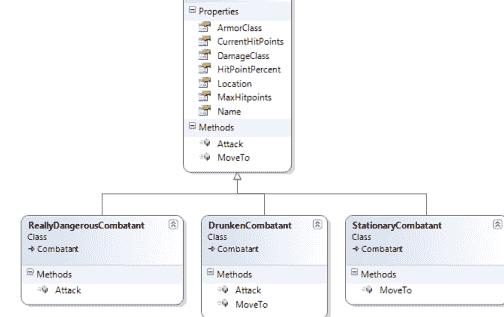

图 3.1 类继承层次结构图。

在 C# 或 Objective-C 中构建这些类都非常简单。C# 在继承类型可以做什么和看到什么方面提供了更精细的控制，因此我们会比在 Objective-C 中更频繁地使用访问修饰符。

在清单 3.10 和 3.11 中，我展示了一个用 Objective-C 编写的示例派生类 `ReallyDangerousCombatant`，它能造成双倍伤害。这是继承的最基本形式——创建一个子类，提供超越父类的行为。

### 清单 3.10 ReallyDangerousCombatant.h

```
#import "Combatant.h"

@interface ReallyDangerousCombatant : Combatant {
}
@end
```

下面是“真正危险”战斗单位的实现：

### 清单 3.11 ReallyDangerousCombatant.m

```
#import "ReallyDangerousCombatant.h"

@implementation ReallyDangerousCombatant

- (void)attack:(Combatant *)target
{
    [super attack:target];
    target.currentHitPoints -= 12;
}
```

在清单 3.11 中，你可以看到这个真正危险的战斗单位首先让其父类（由 `super` 关键字指示）攻击目标，然后自己对目标造成额外的伤害。由于继承层次结构，这个真正危险的实现总是会比普通战斗单位多造成 12 点伤害。

为了节省篇幅并将更多时间集中在这些类的 C# 实现上，我不会列出 `DrunkenCombatant.h`、`DrunkenCombatant.m`、`StationaryCombatant.h` 和 `StationaryCombatant.m` 的清单。接下来的三个清单展示了新派生类的 C# 实现。

### 清单 3.12 ReallyDangerousCombatant.cs

```
namespace Chapter3
{
    public class ReallyDangerousCombatant : Combatant
    {
        public override void Attack(Combatant target)
        {
            base.Attack(target);

            // attack again for good measure!
            base.Attack(target);
        }
    }
}
```

清单 3.13 展示了如何使用继承和子类来创建一个醉得根本无法赢得战斗、并且在游戏命令它移动时移动得异常困难的战斗单位：

### 清单 3.13 DrunkenCombatant.cs

```
using System;
using System.Windows;

namespace Chapter3
{
    public class DrunkenCombatant : Combatant
    {
        public override void Attack(Combatant target)
        {
            target.CurrentHitPoints -= 1; // never do any real damage
        }

        public override void MoveTo(Point newLocation)
        {
            Random r = new Random();
```

```
Point realLocation =
    new Point(r.NextDouble() * 30, r.NextDouble() * 30);

    this.Location = realLocation;
}
}
}
```

现在让我们看看如何使用继承来创建一个完全拒绝移动的战斗单位（例如静止的炮塔）：

### Listing 3.14 StationaryCombatant.cs

```
using System.Windows;

namespace Chapter3
{
    public class StationaryCombatant : Combatant
    {
        public override void MoveTo(Point newLocation)
        {
            // do nothing
        }
    }
}
```

无论游戏引擎多少次要求这个战斗单位移动，它都不会做出任何响应。

## 继承与基于数据的切换

只要平台或语言支持 OOP，这个争论至今仍在继续。拿 `StationaryCombatant` 举例。我们所做的是构建一个子类，使得每当它被要求移动时，它就简单地拒绝。另一种替代方案可能是创建一个名为 `IsStationary` 的布尔属性。然后基类可以在其 `Move` 方法中检查 `IsStationary` 属性的状态。这避免了为静止对象创建整个子类的需要。

乍一看，这似乎是一个更简单的解决方案。但这是一条滑坡的顶端。很快，你的简单基类就变成了一个装满属性和数据的垃圾车——一个庞大的存储箱，存放着可能仅被该对象 1% 实例使用的信息。这只是麻烦的开始。

现在你的简单 `Move` 方法变得复杂且充满了巨大的 if 语句。在许多情况下，逻辑可能会嵌套，几乎无法阅读。当有人要修改你的 `Move` 方法时，它可能会破坏你类的专门实例的功能（例如 `IsStationary` 为 true 的 `Combatant`）。这些巨大的 if 语句违反了多种设计模式，但为了在本章中保持简单，我不会在这里介绍它们的名字或定义。

总结一下：如果可以用继承和接口（下一节讨论）解决你的特化问题，那通常比用过量的属性和逻辑填充单个“臃肿大师”类要干净、更易维护且更可靠。

## 使用契约编程

契约与类实现不同。契约仅定义特定类的要求；它实际上并不控制类的实现。继续以战斗单位的类比：`Combatant` 基类定义了所有子类的可继承行为。`Combatant` 契约定义了任何想自称战斗单位的类必须实现的行为和数据。

让我们在假设我们仍在构建游戏引擎的情况下通过一个示例来说明。如果我们采用直接的继承层次结构，我们可能会限制可以建模的交互类型。假设单继承（这是 Objective-C 和 C# 的情况），任何可以通过 `Attack` 方法对玩家造成伤害的东西都必须继承自 `Combatant`。这给我们带来了一个问题：对于具有独特继承层次结构但不能继承自 `Combatant` 的复杂无生命物体怎么办？

假设玩家走过一条小巷，被一辆汽车撞到。本游戏中的车辆可能需要自己的继承层次结构，可能从 `Vehicle` 或 `MovingObject` 这样的基类开始。鉴于我们没有多继承的能力，我们如何允许非战斗对象对玩家造成伤害，而又不破坏 `Combatant` 对象层次结构？答案是契约。


契约在 Objective-C 中称为协议，在 C# 中称为接口，但它们服务于相同的目的。契约定义了特定类必须实现的最少一组必需属性或方法。它们不对继承层次结构施加任何限制。这里至关重要的是要记住，两个具有完全不同继承层次结构的类可以实现相同的接口。

那么让我们看看 `Combatant` 类。`Attack` 方法做了两件事（这可能给了我们一个可以开始重构的线索）：它计算出要对对手造成多少伤害，然后要求另一个战斗单位承受该伤害。如果我们取出实际承受伤害的功能并使其成为名为 `ITakesDamage` 的接口的要求，我们就可以在游戏引擎中获得真正的灵活性。这个接口要求任何实现该接口的东西都必须实现一个名为 `TakeDamage` 的方法。

`Listing 3.15` 显示了 C# 中的 `ITakesDamage` 接口，`Listing 3.16` 显示了重构后的新 `Combatant` 类，将造成伤害的关注点分离出来以满足接口要求。

### Listing 3.15  ITakesDamage.cs

```
namespace Chapter3
{
    public interface ITakesDamage
    {
        void TakeDamage(int hitPoints);
    }
}
```

`Listing 3.16` 显示了重构 `Combatant` 类以实现该接口。

### Listing 3.16  Combatant.cs (Refactored to Implement ITakesDamage)

```
using System;
using System.Net;
using System.Windows;
using System.Diagnostics;

namespace Chapter3
{
    public class Combatant : ITakesDamage
    {
        public int MaxHitpoints { get; set; }
        public int CurrentHitPoints { get; private set; }
        public int ArmorClass { get; set; }
        public int DamageClass { get; set; }
        public string Name { get; set; }
        public Point Location { get; protected set; }

        public Combatant()
        {
            this.CurrentHitPoints = this.MaxHitpoints;
        }

        public int HitPointPercent
        {
            get
            {
                double pct =
                    (double)CurrentHitPoints / (double)MaxHitpoints;
                return (int)Math.Floor(pct * 100);
            }
        }

        public virtual void MoveTo(Point newLocation)
        {
            this.Location = newLocation;
            Debug.WriteLine("Combatant {0} just moved to ({1},{2})",
                this.Name,
                this.Location.X,
                this.Location.Y);
        }

        public virtual void Attack(Combatant target)
        {
            Random r = new Random();
            int damage =
                (this.DamageClass - target.ArmorClass) * r.Next(20);
            target.TakeDamage(damage);
        }

        public void TakeDamage(int hitPoints)
        {
            this.CurrentHitPoints -= hitPoints;
        }
    }
}
```

`Combatant` 类上的新 `Attack` 方法现在确定要造成的伤害量，然后调用 `TakeDamage` 方法来影响目标。现在 `Combatant` 类不再是游戏中唯一可以被伤害的东西（任何实现 `ITakesDamage` 的东西现在都可以被伤害），我们可以创建像 `PincushionTarget`（`Listing 3.17` 所示）这样的类，它可以被玩家伤害但不是战斗单位。

### Listing 3.17  PincushionTarget.cs

```
public class PincushionTarget : ITakesDamage
{
    void TakeDamage(int hitPoints)
    {
        // take points out of pincushion target
    }
}
```

作为参考，`Listing 3.18` 显示了 Objective-C 中协议定义可能的样子。Objective-C 不使用大写“I”前缀命名约定，而是使用“Protocol”作为后缀。为了在 Objective-C 中实现类似的目标，我们将创建一个名为 `TakesDamageProtocol` 的协议，如 `Listing 3.18` 所示。我展示这个是因为协议在 iOS 和 UIKit 中被广泛使用，因此了解这些模式如何转化为 C# 模式非常有用。

### Listing 3.18  TakesDamageProtocol.h

```
@protocol TakesDamageProtocol
- (void)takeDamage:(int)hitPoints;
@end
```

## 命名空间与命名约定

在阅读本章中的示例时，你可能已经注意到 C# 类始终存在于命名空间中。C# 中的命名空间专门设计用于避免命名冲突以及帮助组织逻辑上相关的类、枚举和结构层次。

在 Objective-C 中以及 Apple 的所有库中，无论是 iPhone 还是传统 Mac 开发，你都不会看到命名空间。Objective-C 决定不支持命名空间的概念（许多 OOP 语言包括 C# 和 C++ 都提供命名空间）。相反，Apple 选择了一种标准，即属于特定家族、用途、产品或公司的类都以所有大写的两个字母前缀开头。

例如，由 Kevin Hoffman 编写的战斗单位类实际上可能被称为 `KHCombatant` 而不是简单的 `Combatant`。此外，由 Exclaim Computing 公司编写的同一类可能写成 `ECCombatant` 或 `XCCombatant`。

iOS 应用中的命名冲突很少见，因为你只有在使用包含与你类名相同名称的类库、框架或类时才会遇到这些冲突。这种情况下命名冲突的罕见机会通常通过使用两个字母前缀命名约定来消除。

## 扩展他人的类

本章的最后一个主题是我想介绍的，即在没有这些类的源代码的情况下扩展由其他开发人员或公司编写的类的能力。请记住，在 iOS 和 C# 中，对第三方类的扩展只能访问你的代码通常可以访问的类成员和方法。换句话说，你不能使用类扩展来规避围绕私有或受保护成员的封装方法。

C# 为我们提供了一种称为静态扩展的机制，这大致类似于 Objective-C 世界中的类别概念。当对特定类的静态扩展处于当前代码块的作用域内时，该代码块可以像这些方法实际上属于原始类一样调用扩展类上的方法。

假设我们没有编写 `Combatant` 类，并且它是密封的，我们无法从它继承。我们希望能够向 `Combatant` 类添加一个方法，使对象以方形移动，就像在跳方形舞一样。也许这种效果是一个自定义法术，可以施加在我们的战斗单位上，让它们产生不可抗拒的想去跳欢乐舞的冲动。

我们可以使用第 3.19 节中的代码来实现对 `Combatant` 类的此自定义扩展。

## Listing 3.19 CombatantSquareDancingExtension.cs

```
using System;
using System.Net;
using System.Windows;
using System.Windows.Controls;
using System.Windows.Documents;
using System.Windows.Ink;
using System.Windows.Input;
using System.Windows.Media;
using System.Windows.Media.Animation;
using System.Windows.Shapes;

namespace Chapter3
{
    public static class CombatantSquareDancingExtension
    {
        public static void SquareDance(this Combatant dancer)
        {
            Point origin = dancer.Location;
            Point step1 = new Point(origin.X, origin.Y - 1); // move forward
            Point step2 = new Point(step1.X - 1, step1.Y); // move left
            Point step3 = new Point(step2.X, step2.Y + 1); // move back
            Point step4 = new Point(step3.X + 1, step3.Y); // move right
        }
    }
}
```

尽管在构建扩展类时使用命名约定并没有硬性规定，我喜欢遵循一个简单的命名方案：`[OriginalClass][ExtensionDescription]Extension`。后缀 `Extension` 的存在立刻告诉我以及任何查看此类的其他开发人员，它本身并不是一个完整的类；相反，它为其他某个类提供额外的功能。被扩展的类是扩展类名称的第一部分。因此，在我们的示例中，一个通过提供方形舞蹈功能来扩展 `Combatant` 类的类将被命名为 `CombatantSquareDancingExtension`。

如果第 3.19 节中的代码在作用域内，那么调用任何直接或通过继承属于 `Combatant` 类型的对象的 `SquareDance` 方法应该是完全合法的（并且可能很有趣）。

## Summary

在本章中，你对面向对象编程（OOP）的一些核心概念以及它们如何应用于使用 Objective-C 和 C# 分别构建 iOS 和 Windows Phone 7 应用程序的任务，有了一个简要概述。

对于编程时间很长的你们来说，这些概念中的一些可能显得很基础，但关键在于向你介绍在 C# 等面向对象编程语言中日常编程所需的语法。随着你继续阅读本书的其余部分，我们将大量使用封装、继承、属性、方法、接口和扩展等概念，如果你现在对这些概念没有牢固的掌握，本书的其余部分将很难阅读。

如果你读完本章后感觉自己现在对如何在 C# 中编写 OOP 代码有了相当不错的理解，你就已经做好了深入 Windows Phone 7 应用程序构建世界并继续阅读本书的准备。

此页 intentionally left blank

## Event-Driven Programming

> 以光速传输，本星球上的所有事件都是同时发生的。在信息的电环境中，所有事件都是同时发生的，事件之间没有时间或空间的分隔。

> Marshall McLuhan

本章提供了对现代编程框架中一个经常被低估方面的概述：事件。在许多情况下，将 Objective-C 与 C# 进行比较时，存在细微的语言差异，而核心概念保持不变。

本章向你概述了真正的事件驱动编程是什么，如何在 Objective-C 中实现这种编程，以及最后，如何在 Windows Phone 7 应用程序的上下文中在 C# 中实现同类型的编程。

## What Is Event-Driven Programming?

事件驱动编程的主题是 Objective-C 和 C# 在核心、根本层面上差异很大的一个领域。事件不仅仅是一个单一的东西。当某个重要事件发生时，通常需要三条信息来对该事件做出适当反应：

- 发送事件的对象——该对象知道有人对发生的事件感兴趣，并负责将该事件分发给所有订阅者。
- 事件本身——发送者需要告诉接收者到底发生了什么，并提供足够的上下文。
- 事件订阅者或接收者——就 C# 而言，如果树在森林中倒下而没有事件订阅者被告知此事，那么什么也没发生。当事件发生时，对该事件感兴趣的对象会被告知，并会被提供前两条信息：事件发送者和有关事件本身的上下文信息。

当你阅读本章时，你将看到 Objective-C 的“委托模式”是如何使用以及它与 .NET Framework 主张的发布-订阅事件驱动模型有何关系。

C# 世界中新手和老手之间另一个常见的误解是，事件仅适用于用户界面。例如，大多数程序员可以告诉你，当你用手指点击按钮或向输入控件提交文本时，会生成事件。然而，太多程序员不知道事件在应用程序的所有层级中使用时既有用又强大，而不仅仅是 UI。你将在我们讨论异步编程和与外部服务通信时看到事件驱动编程对于 WP7 是多么至关重要且必不可少的极其强大的示例。

## Using the Delegate Pattern in Objective-C

Objective-C 不像 C# 那样使用事件，这在程序员试图将他们从 iPhone 开发中获得的技能与 .NET Framework 或 WP7 开发相关联时常常成为困惑的来源。

在 iOS（以及使用 Objective-C 的几乎所有其他基于 Mac 的开发中）几乎完全使用所谓的委托模式来进行事件驱动编程。该模式的工作方式如下：

如果一个类需要通知另一个类某事，或从另一个类获取信息，则将对该对象的引用存储为委托。此委托不像 C# 委托（大致类似于 C 函数指针）。相反，此委托更像是该词在字典中的定义：该类将功能委托给另一个类。

例如，iOS 编程中最常见的控件类型之一是 `UITableView`。该控件以垂直行的形式显示数据。这些行中的各个单元格可以高度自定义，但无论控件如何自定义，它仍然以相同的方式执行某些核心功能。

而不是让其他类将数据推送到表格视图中，表格视图会请求数据。这允许表格视图保持自己的优化，以便它只请求它知道将要渲染到屏幕上（或很快将要渲染）的那些数据。除了将数据源委托给另一个类之外，`UITableView` 还将响应用户事件的方法委托给另一个类，例如当一行被选中、当视图状态更改为编辑模式时，等等。甚至还有一些方法被委托给其他类，用于告诉表格视图有多少组、应为分组使用的样式，以及为每个正在渲染的行向视图提供自定义单元格。

对于熟悉 .NET 编程的人来说，这种模式可能看起来完全相反。.NET 程序员，尤其是习惯于 Windows Forms 或 ASP.NET 编程的程序员，习惯于自己收集数据，然后通过某种数据绑定机制将数据填充到控件中。控制器作为被动参与者，仅在 UI 控件需要时才被调用的概念往往显得非常奇怪。

然而，对 C# 开发人员来说可能看起来多么奇怪，这种模式非常强大，并且对 iOS 来说效果非常好。每种类型的委托都需要公开一组特定的方法（其中一些是可选的，这是一个非常重要的点），以便使用委托的类可以确保所有委托的功能都已提供。

委托与执行委托的类之间的协议非常经常以协议的形式明确定义。例如，`UITableViewController` 类是一个方便的控制器，预先配备以符合 `UITableView` 控件所需的两种不同协议：`UITableViewDelegate`（处理控件内发生的事件的协议）和 `UITableViewDataSource`（定义委托必须如何为表格视图提供行、单元格、组和其他数据的协议）。

表 4.1 显示了定义 `UITableView` 控件与应用程序之间通信的两个委托协议中的一些方法。正如你将在本章后面看到的那样，这种模式与 Silverlight 控件在 Windows Phone 7 应用程序中与应用程序通信的方式非常不同。

## Table 4.1 Some Delegate Methods for iOS Table View Controllers

| Protocol | Method | Description |

|---|---|---|

| `UITableViewDelegate` | `tableView:willSelectRowAtIndexPath:` | 用于在选择行之前执行操作 |

| `UITableViewDelegate` | `tableView:didSelectRowAtIndexPath:` | 在用户选择一行后被调用 |

| `UITableViewDataSource` | `tableView:cellForRowAtIndexPath:` | 返回一个配置好的单元格，由表格视图在适当的位置渲染 |

| `UITableViewDataSource` | `numberOfSectionsInTableView:` | 返回视图中节组的数目 |

| `UITableViewDataSource` | `tableView:numberOfRowsInSection:` | 返回给定节中的行数 |


在查看委托模式时，这里需要记住的重要一点是，与传统的 C# 数据绑定模式相比，它通常看起来是反向的或被动的。这是对的，但委托模式完成的工作远不止数据绑定——它将逻辑上相关的操作捆绑在一起，用协议定义它们，然后允许任何类用数据或其他参数为任何控件提供数据。

如果使用得当，委托模式可以促成高度内聚的应用程序，具有非常明确的边界，并且 UI、模型和控制器之间松散耦合。熟悉 Mac 和 iOS 编程的开发者会知道，模型-视图-控制器 的概念在整个框架中根深蒂固。

正如你在下一节中将会看到的，C# 事件的运作方式完全不同，因为它们解决的是不同的问题。

## 在 C# 中使用事件

委托是一个符合特定协议的类，并同意为另一个类执行一组逻辑相关的行为，而事件是某个值得提及的细粒度活动的单次发生。为了进一步区分委托模式和 C# 事件，iOS 在同一时间只有一个委托（尽管可以在运行时动态切换），而事件可以同时有多个订阅者，并且可以同时通知所有订阅者相同的事件。

在符合习惯的 C# 中，你很少会看到人们使用委托模式（尽管它完全可行，并且在与接口配对时往往非常优雅）。相反，事件作为对象上可供消费者订阅的端点公开。

让我们继续上一章中 `Combatants` 的示例，在 `Combatant` 上公开一些事件，使游戏引擎更灵活、更具响应性。我们可能想要公开的几个事件如下：

- 当 `Combatant` 被击中时
- 当 `Combatant` 击中另一个敌人时
- 当 `Combatant` 死亡时

游戏引擎可以订阅这些事件，以便在这些事件发生时执行特定操作。例如，当 `Combatant` 死亡时，游戏引擎可以向所有连接的玩家广播一条消息，指出某个战斗者已死亡以及谁是杀手。如果你曾经玩过多人战斗游戏，这种模式应该很熟悉；我们大多数人都见过屏幕底部滚动的消息，显示伙伴刚刚踩到地雷或被狙击手击中面部。

清单 4.1 显示了一个新的 `Combatant` 类（简化为仅包含与演示事件和 C# 委托相关的部分）。它公开了前面讨论的三个事件，并包含用于调用这些事件的包装方法。你会在 C# 代码中经常看到这种模式，因为每次事件通知都需要通过检查是否有订阅者来保护。当你订阅 Silverlight 的 UI 事件时，这类样板工作会自动为你处理。

### 清单 4.1 `Combatant.cs`（显示事件）

```
using System;
using System.Net;
using System.Windows;
using System.Windows.Controls;
using System.Windows.Documents;
using System.Windows.Ink;
using System.Windows.Input;
using System.Windows.Media;
using System.Windows.Media.Animation;
using System.Windows.Shapes;

namespace WindowsPhoneApplication1
{
    public delegate void DidGetKilledDelegate(
        Combatant killer, Combatant target);

    public delegate void DidHitTargetDelegate(
        Combatant attacker, Combatant target, int hitPoints);

    public class Combatant
    {
        public event DidGetKilledDelegate OnGotKilled;
        public event DidHitTargetDelegate OnHitCombatant;
        public event DidHitTargetDelegate OnHitByCombatant;

        public int HitPoints { get; set; }
        public string Name { get; set; }

        public void Attack(Combatant target)
        {
            // obviously this would be algorithm-based in a real game
            bool didHit = true;
            int hitPoints = 42;

            if (didHit)
            {
                NotifyHitCombatant(target, hitPoints);
            }
        }

        public void TakeDamage(Combatant attacker, int hitPoints)
        {
            this.HitPoints -= hitPoints;
            NotifyHitByCombatant(attacker, hitPoints);
            if (this.HitPoints <= 0)
            {
                NotifyGotKilled(attacker);
            }
        }

        private void NotifyHitByCombatant(Combatant attacker, int hitPoints)
        {
            if (OnHitByCombatant != null)
            {
                OnHitByCombatant(attacker, this, hitPoints);
            }
        }

        private void NotifyGotKilled(Combatant attacker)
        {
            if (OnGotKilled != null)
            {
                OnGotKilled(attacker, this);
            }
        }

        private void NotifyHitCombatant(Combatant target, int hitPoints)
        {
            if (OnHitCombatant != null)
            {
                OnHitCombatant(this, target, hitPoints);
            }
        }
    }
}
```

清单 4.1 中的代码展示了一些有趣的东西。首先重申了我之前提到的关于事件是向多个订阅者广播关于单次重要发生的信号的内容。这与委托模式大不相同。

接下来，你可能已经注意到 C# 有一个名为 `delegate` 的关键字。这与你在 Objective-C 中熟悉的委托不同。这个 `delegate` 大致类似于 C 中的函数指针。清单 4.1 中的 `delegate` 关键字将方法签名分配给一个命名类型。例如，方法签名

```
void (Combatant killer, Combatant target)
```

被分配给一个命名类型（它是 `delegate` 类型的后代）叫做 `DidGetKilledDelegate`。在类型名称末尾加上后缀 `Delegate` 是我偏好的命名约定，我认为它有助于使代码尽可能自文档化。

因此，现在你有了发布事件的代码（清单 4.1），让我们看一些消费事件的代码。在这种情况下，我们将编写一个几乎没有功能的游戏引擎的存根。它充当工厂来创建 `Combatant` 实例，并在实例化后订阅它们所有的事件。清单 4.2 显示了这个游戏引擎类的实现以及响应各种战斗者事件而被调用的方法的实现。

### 清单 4.2 `GameEngine.cs`

```
using System;
using System.Net;
using System.Windows;
using System.Windows.Controls;
using System.Windows.Documents;
using System.Windows.Ink;
using System.Windows.Input;
using System.Windows.Media;
using System.Windows.Media.Animation;
using System.Windows.Shapes;
using System.Diagnostics;

namespace WindowsPhoneApplication1
{
    public static class GameEngine
    {
        public static Combatant CreateCombatant()
        {
            Combatant c = new Combatant();
            c.OnGotKilled += new DidGetKilledDelegate(c_OnGotKilled);
            c.OnHitByCombatant +=
                new DidHitTargetDelegate(c_OnHitByCombatant);
            c.OnHitCombatant +=
                new DidHitTargetDelegate(c_OnHitCombatant);

            return c;
        }

        static void c_OnHitCombatant(
            Combatant attacker, Combatant target, int hitPoints)
        {
            BroadCast(attacker.Name + " hit " +
                target.Name + " for " + hitPoints.ToString() +
                " hitpoints.");
        }

        static void c_OnHitByCombatant(
            Combatant attacker, Combatant target, int hitPoints)
        {
            BroadCast(target.Name + " was hit for " +
                hitPoints.ToString() + " by " + attacker.Name);
        }

        static void c_OnGotKilled(Combatant killer, Combatant target)
        {
            BroadCast(killer.Name + " killed " + target.Name +
                "! OH NOEZ!!1ONE");
        }

        static void BroadCast(string msg)
        {
            // ordinarily there would be network code here
            // to broadcast to the entire game
            Debug.WriteLine("[Game]: " + msg);
        }
    }
}
```

清单 4.2 显示了 C# 类如何订阅由另一个类发布的事件。请注意，`+=` 运算符通常用于向现有数字添加或就地字符串连接，也用于将订阅者委托的实例添加到事件的订阅者列表中。同样，你可以使用 `-=` 运算符从事件的订阅者列表中移除该委托实例。然而，有一件事你不能做，那就是移除你没有添加的订阅者。换句话说，由两位不同开发者编写的两段不同代码，即使订阅了同一个事件，也不能修改彼此的事件订阅。

## 全局事件和 NSNotifications

到目前为止，我们已经看到了如何在典型的发布-订阅模式中处理事件。然而，如果你仔细查看清单 4.2 中的代码，你会注意到代码所订阅的事件是由具有局部作用域的对象公开的。换句话说，我们只能订阅（并接收来自）我们的代码可以“看到”的那些对象的事件。如何将事件广播到整个应用程序中，以便任何对象无论作用域或对象生命周期如何都可以订阅，这并不明显。

iOS 对此问题有一个非常强大的解决方案。`NSNotificationCenter` 类是一个静态（全局作用域）类，它公开了一个名为 `defaultCenter` 的单例属性。该属性充当强大的发布和订阅机制的中心。任何对象都可以通过全局通知中心发布通知，任何对象都可以监听由通知中心发布的通知。通知可以具有唯一的（字符串）标识符，以便对象可以仅订阅某些类型的通知。

此通知中心功能使用两个简单操作：添加观察者（订阅）和发布通知（发布）。

几个非常重要（且通常是底层）的事件通过通知中心发布。例如，当 iPhone 旋转时，当前运行应用的默认通知中心会发布一个通知。你的应用可以直接监听该通知（不推荐），也可以让 UIKit 框架替你监听，并围绕 UI 旋转的概念提供更高层次的抽象，以处理方向变化。

如果你想在 C# 中实现类似的功能，其实非常简单。此外，一些辅助工具包和框架（例如我们将在本书后面讨论的一些 MVVM 实现）已经包含了发布和订阅全局通知的功能。

在 C# 应用程序中实现全局通知的一种超快速且简单的方法是使用公开静态事件的静态类。为此，我们将向 `GameEngine` 对象添加几个静态事件，用于指示游戏开始、暂停和结束的时间。任何对象，无论其生命周期或作用域如何，都可以订阅这些事件并执行响应的代码。修改后的 `GameEngine` 对象如代码清单 4.3 所示。

### 代码清单 4.3 `GameEngine.cs`（包含静态事件）


```csharp
using System;
using System.Net;
using System.Windows;
using System.Windows.Controls;
using System.Windows.Documents;
using System.Windows.Ink;
using System.Windows.Input;
using System.Windows.Media;
using System.Windows.Media.Animation;
using System.Windows.Shapes;
using System.Diagnostics;

namespace WindowsPhoneApplication1
{
    public delegate void OnGameStartedDelegate(DateTime startTime);
    public delegate void OnGamePausedDelegate();
    public delegate void OnGameFinishedDelegate();

    public static class GameEngine
    {
        public static void Start()
        {
            if (OnGameStarted != null)
                OnGameStarted(DateTime.Now);
        }

        public static void Stop()
        {
            if (OnGameFinished != null)
                OnGameFinished();
        }

        public static void Pause()
        {
            if (OnGamePaused != null)
                OnGamePaused();
        }

        public static void Resume()
        {
            if (OnGameResumed != null)
                OnGameResumed(DateTime.Now);
        }

        public static Combatant CreateCombatant()
        {
            Combatant c = new Combatant();
            c.OnGotKilled += new DidGetKilledDelegate(c_OnGotKilled);
            c.OnHitByCombatant +=
                new DidHitTargetDelegate(c_OnHitByCombatant);
            c.OnHitCombatant +=
                new DidHitTargetDelegate(c_OnHitCombatant);

            return c;
        }

        static void c_OnHitCombatant(
            Combatant attacker, Combatant target, int hitPoints)
        {
            BroadCast(attacker.Name + " hit " + target.Name +
                " for " + hitPoints.ToString() + " hitpoints.");
        }

        static void c_OnHitByCombatant(Combatant attacker,
            Combatant target, int hitPoints)
        {
            BroadCast(target.Name + " was hit for " +
                hitPoints.ToString() + " by " + attacker.Name);
        }

        static void c_OnGotKilled(Combatant killer, Combatant target)
        {
            BroadCast(killer.Name + " killed " + target.Name +
                "! OH NOEZ!!1ONE");
        }

        static void BroadCast(string msg)
        {
            // ordinarily there would be network code here
            // to broadcast to the entire game

            Debug.WriteLine("[Game]: " + msg);
        }

        public static event OnGameStartedDelegate OnGameStarted;
        public static event OnGameFinishedDelegate OnGameFinished;
        public static event OnGamePausedDelegate OnGamePaused;
        public static event Action<DateTime> OnGameResumed;
    }
}
```

此时，代码清单 4.3 中的代码看起来应该相当直观。游戏引擎上新增了一些方法，用于触发各种事件，如 `Start`、`Stop`、`Pause` 和 `Resume`。在清单末尾，你可以看到我声明的四个新事件。

如果你仔细看，会注意到我声明 `OnGameResumed` 事件的方式有些不同。我没有像之前的代码清单那样使用在命名空间顶部声明的强类型委托，而是利用了 C# 中的一些简写特性，例如泛型和称为 `Action<T>` 的泛型类型。

泛型允许类由创建实例的代码与特定类型关联，而不是由类本身关联。例如，我不使用 `List` 类的实例来创建可为任意类型的对象列表，而是通过创建 `List<Combatant>` 实例来创建战斗者列表。泛型允许我在实例化类时向类提供一个或多个类型参数。如果你想了解更多关于泛型以及 C# 语言本身的其他底层细节，不妨阅读 Bart De Smet 所著的《C# 4.0 Unleashed》。

最后这个事件声明的第二个改动是使用了 `Action<DateTime>`。`Action<T>` 类是一个泛型类，为具有 void 返回类型的委托提供了一种简写方式。如你所见，在事件声明前写一次 `Action<DateTime>`，比创建自定义委托类型然后使用它来声明事件要易读得多。每当你看到 `Action<T>`，你都可以在脑海中将它理解为“一个接受类型为 T 的参数并返回 void 的委托”。此外，Action 还有接受多个参数的变体，以适应事件处理程序中更多的参数。

## 警惕静态类和属性

尽管我向你展示了使用静态类和事件属性是在应用程序中提供全局事件通知系统的一种方式，但你对这个建议必须持保留态度。

C# 应用程序使用垃圾回收机制。这意味着有一个后台进程会随着你制造垃圾而清理它们，释放分配给孤立或不再处于作用域内的对象的内存。静态类及其公开的属性永远不会离开作用域。这意味着它们永远不会成为孤立对象，分配给它们的内存也永远不会被回收。

简而言之，如果可以为任何目的（事件或其他）避免使用静态类和属性，那就尽量避免。在为类创建一堆用于全局通知的静态事件之前，请确保这样做是必要的。如果你可以使用局部作用域的事件处理，那就改用局部方式；这样内存占用会更小，垃圾回收周期也会更快。

## 小结

在本章中，你从 iOS 和 Windows Phone 7 两个角度简要了解了事件驱动编程。

在 iOS（以及 Mac 上的 Cocoa）开发中，委托模式被广泛使用，允许对象通过称为协议的已知且约定的契约相互通信。委托模式用于各种场景，从响应用户事件调用方法到向不同类型的控件提供数据，开发者在构建自己的自定义框架时也可以使用它。委托模式的典型特征是被动性：不是将数据和功能推送给控件，而是控件在需要时被动地请求数据和功能。即使你在 WP7 开发中从不使用这种模式，你也应该了解并尊重它，因为它支持了众多开发特性，使 iPhone 编程如此引人注目且强大。

随后，本章从讨论委托模式转向讨论 C# 中如何处理事件。你了解了如何公开事件属性、如何发布事件以及如何订阅这些事件。最后，你看到了如何利用静态类和事件属性来公开全局事件。

凭借你在上一章学到的面向对象编程知识，加上本章的事件编程知识，你应该已经准备好开始编写你的第一个 WP7 应用程序了。

## 渲染与视图系统基础

> 绘画是供人观看而非感受的诗，而诗歌是供人感受而非观看的画。
>
> 列奥纳多·达·芬奇

本章概述了 iOS 和 Windows Phone 7 平台上底层控件渲染系统的工作方式。本章不是关于控件本身（本书后面会有大量章节介绍控件）。相反，本章回顾了 UIKit 视图系统，包括对坐标系、点与像素等内容的简要讨论。

接下来，本章从底层视角向你介绍 Silverlight。你将看到 Silverlight 如何组合声明性 UI 元素，然后将它们渲染到屏幕上，并允许用户与这些控件交互。

拥有这种视图渲染系统内部机制的底层知识现在可能看起来并不那么有用，但当你真正开始撸起袖子编写一些严肃的 WP7 应用程序和控件时，你会庆幸自己对这些幕后机制及其与典型 iOS 应用程序运行方式的关系有基本的了解。

如果你做过任何 iPhone 编程，你就会知道用户看到的一切都是分层处理的。可以把它想象成一叠牌。牌堆的最底部是桌面。这就是 `UIWindow`。虽然从技术上讲你可以拥有多个 `UIWindow`，但在任何给定时间，只有一个窗口会显示给用户。

窗口尽管是一个对象，但它没有任何视觉方面。与典型的桌面窗口不同，没有关闭按钮，没有最小化按钮，没有上下文菜单，甚至没有标题栏。

iOS 中的每个视觉控件都直接或间接继承自 `UIView`，甚至 `UIWindow` 也是如此。将视图想象成卡片。这些卡片中的每一个都被放置在桌子上（在 `UIWindow` 的子视图列表内）。新放置在桌子上的卡片可以放置在任何方向的任何位置。这意味着新卡片可以覆盖旧卡片，也可以存在而不会遮挡它们下面的任何其他视图（卡片）。

现在你将处理用户生成的事件，例如触摸、滑动和双击。

开发人员在谈论渲染系统时，经常倾向于将布局引擎和渲染引擎的概念混为一谈。在 Silverlight 中，布局和渲染是两种不同的活动，我们真的应该避免将它们组合成一个“包办一切”的引擎。

而 iOS UI 中的一切都可以追溯到某种 `UIView`，Silverlight 用户界面的所有视觉组件都派生自 `UIElement` 类。这个基类构成了 Windows Phone 7 应用程序中用户几乎能看到的一切的类层次结构的顶端。就在 `UIElement` 层级，对象具有动画属性的开端，能够检测用户与元素的交互，以及能够被测量和排列的能力。

### 两遍口诀：Measure 和 Arrange

理解 Silverlight 控件布局的双遍方法是构建任何比简单的“Hello World”应用程序更复杂的 UI 的关键。

下面这句话可能是你在尝试弄清楚你的 UI 将如何渲染时需要记住的最重要规则：Silverlight 从最内层元素向外、最底层元素向上进行渲染；先测量然后排列。

树中每个 UI 元素都是按我提到的顺序进行测量的（最内层元素向外、最底层元素向上）。通过调用其 `Measure` 方法来询问它们所需的尺寸。当此方法被调用时，UI 元素应更新其 `DesiredSize` 属性。

`measure-arrange` 过程的最终结果取决于执行该过程的布局容器类型不同而不同。

例如，`Grid` 控件中包含的元素是根据列和行定义所定义的行列布局以及 UI 元素分配到特定行和列的方式进行布局的。`StackPanel` 中包含的元素是按顺序布局的，可以是水平或垂直方向。`Border` 中包含的单个元素（它本身也可以是一个布局面板） simply 出现在边框包围之下。

无论父面板使用何种布局机制，`measure-arrange` 过程的调用方式都是一样的。

回顾一下，`Measure` 阶段是确定每个元素的期望大小的地方，而 `Arrange` 阶段是确定每个子元素大小和位置的最终阶段。

请看下面的 XAML（如果现在还不太明白也没关系；随着你阅读本书的进展就会明白了）。请特别注意子元素出现的顺序以及每个元素如何在父面板中嵌套。图 5.1 显示了这些元素是如何被测量然后排列以产生丰富的显示效果。

```
<Grid x:Name="ContentPanel" Grid.Row="1" Margin="12,0,12,0">
<Border BorderBrush="AliceBlue" BorderThickness="2">
    <StackPanel>
        <TextBlock Text="Hello"/>
        <TextBlock Text="World"/>
        <StackPanel Orientation="Horizontal">
            <TextBlock Foreground="Yellow" Text="Hello "/>
            <TextBlock Foreground="Yellow" Text=" World"/>
        </StackPanel>
        <Grid>
            <Grid.ColumnDefinitions>
                <ColumnDefinition Width="150"/>
                <ColumnDefinition Width="200"/>
            </Grid.ColumnDefinitions>
            <Grid.RowDefinitions>
                <RowDefinition Height="150"/>
                <RowDefinition Height="*"/>
            </Grid.RowDefinitions>
            <Button Grid.Row="0" Grid.Column="0">
                <TextBlock Text="Button"/>
            </Button>
            <Button Grid.Row="0" Grid.Column="1">
                <StackPanel>
                    <TextBlock Text="Other Button"/>
                    <TextBlock Text="hi"/>
                </StackPanel>
            </Button>
        </Grid>
    </StackPanel>
</Border>
</Grid>
```

```
<TextBlock Text="Goodbye World"/>
</StackPanel>
</Border>
</Grid>
```

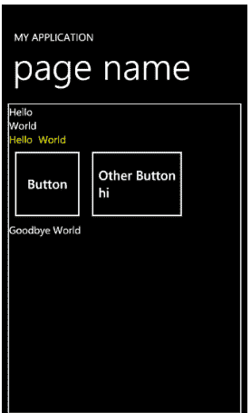

图 5.1 嵌套的布局面板。

在前面的示例中，最外层的元素是一个 `Grid`。在该 `Grid` 内部，我们有一个 `Border`。在该 `Border` 内部是一个 `StackPanel`，包含多个子控件，包括其他 `StackPanel`、`Grid` 和一个 `TextBlock`。图 5.1 显示了所有这些嵌套布局面板是如何被测量和排列以产生输出的。还值得注意的是，你可以将一个 `Button` 的内容设置为一个 `StackPanel`，而 `StackPanel` 可以包含多个子元素。随着你在本书中的进展，你会看到更多使用 Silverlight 和 XAML 以及控件可以做到的技巧和令人惊叹的事情，但就本章而言，这里需要注意的重要一点是 `measure-and-arrange` 过程是如何在布局面板上使用以以统一、可预测的方式产生输出。

## 摘要

在本章中，我对 Silverlight 中使用的布局和渲染系统进行了简要介绍。刻意简短，本章提供的信息足以让你准备好开始构建功能齐全的 Silverlight 用户界面。了解 Silverlight 布局面板的递归、层次结构特性，将在很大程度上帮助你将来构建出色的用户界面，并在阅读本书时有所帮助。

## 从 Xcode 到 Visual Studio

> *工具通常比机器更简单；它通常用手使用，而机器经常由动物或蒸汽动力驱动。*
>
> Charles Babbage

本章全部都是关于工具的。无论我们是否愿意承认，开发人员都无法在没有 Xcode、Visual Studio、Eclipse 或其他众多 IDE 等现代工具的帮助下生产应用程序。

本章涵盖了用于开发 iOS 应用程序的 IDE Xcode，以及用于构建 Windows Phone 7 应用程序的 IDE Visual Studio。

开发人员需要了解有关 Visual Studio 的一些基本知识，以便他们能够在该环境中顺畅高效地移动并编写应用程序，而不会让工具阻碍他们。除了 Visual Studio 2010 的概览外，我还提供了 Xcode 及其基础知识的高层次概述。

### Xcode 和 iOS 应用程序开发


Xcode 是开发人员用于构建 Mac 桌面应用程序以及 iOS 应用程序的 IDE。它是一个极其可配置的工具，允许你更改从窗口布局、是否在单个窗口中进行所有编辑、颜色以及数百种其他首选项等一切内容。

Xcode 项目的主要输出可以在 Targets 文件夹下找到。当你使用 Xcode 构建应用程序时，该应用程序就是一个目标。每个目标都由一堆源代码文件、静态链接库和作为项目一部分引用的 Frameworks 组成。例如，如果你要构建一个使用 Core Data 在手机上持久化数据的 iOS 应用程序，你必须将 `CoreData.framework` 添加到 Xcode 项目的 Frameworks 配置中。

# 第 6 章 从 Xcode 到 Visual Studio

为了进一步增加新开发人员的强大功能、功能和潜在困惑，一个 Xcode 项目可以有多个目标。事实上，开发人员会为单元测试创建目标（我将在后面的章节中再次提到单元测试），一个非常常见的场景是使用单个 Xcode 项目为 iPhone 和 iPad 生产不同的目标。这是因为 iPad 的 UI 与 iPhone 的 UI 截然不同（并且包含 iPhone 上不存在的控件）。开发人员会构建不同的 UI，但在同一个 Xcode 项目中共享相同的控制器和后端代码。

Xcode UI 就像任何其他 IDE，如 Eclipse、MonoDevelop 或 Visual Studio。图 6.1 所示的布局（我个人偏好）中，视图左侧是一个导航窗格。该窗格显示了主节点，即项目根节点。双击它（在屏幕截图中称为 `FortuneBuilders`，因为那是我当时正在处理的项目的名称）会弹出项目设置对话框。在项目节点下方，你有一堆文件夹，其中一些是由 Xcode 为你创建的。iOS 开发人员熟悉的一件事是，Xcode 中的文件夹结构不一定与磁盘上的文件夹结构相匹配。位于 `Classes` 文件夹中的文件通常与位于 `Controllers` 目录中的文件一起坐在主项目目录中。这经常让熟悉 Visual Studio 的开发人员感到困惑，因为 Visual Studio 确实具有项目文件夹与磁盘文件夹之间 1:1 的映射。

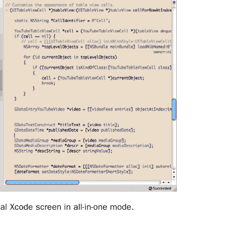

图 6.1 所示窗口的右侧是代码编辑器。在此窗口顶部，有时会出现一个单独的导航窗格，我已通过使用 `Shift+Command+E` 宏将其隐藏。配色方案是我个人偏好，而不是 Xcode 默认设置。因为开发人员通常对 IDE 中的语法高亮颜色非常挑剔，所以我想让你看到 Xcode 可以被制作成模仿几乎任何开发人员最喜欢的颜色和字体。

如果你好奇的话，屏幕截图中你看到的代码来自一个表视图控制器，该控制器显示通过访问特定 YouTube 用户上传视频的 Google 数据源下载的 YouTube 视频列表。屏幕截图中的代码显示了一些用于打开 Google 数据源信息并填充从 Interface Builder 文件加载的自定义表视图单元所需的代码。我们将在下一章讨论 Interface Builder 和 Microsoft 的设计工具 Expression Blend。

当你想运行应用程序时，你可以选择希望应用程序运行的环境。你可以选择 Debug 或 Release 模式，应用程序将在设备上运行还是在模拟器中运行，甚至在哪个特定基础 SDK 下运行应用程序。这给了你极大的灵活性，可以快速轻松地在你计划支持的所有可能环境下运行应用程序。图 6.2 显示了在 iOS 4.0 模拟器下运行应用程序时的样子。

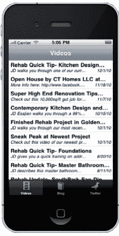

图 6.2 在 iOS 4 模拟器中运行的 iOS 应用程序。

## 开始使用 Visual Studio 2010

你开始构建 Windows Phone 7 应用程序所需的第一件事并不是开发工具——而是 Windows。

对于微软开发者来说，提醒这一点可能显得奇怪，但许多 iOS 和 Android 开发者可能甚至没有一台 PC，而且即使有，许多 Android 开发者可能运行的是 Linux 的变种而不是 Windows。

幸运的是，对于 Apple 开发者来说，通过使用 VMWare Fusion 和 Parallels 等工具，你可以在 Mac 上运行一个完全功能齐全（并且有许可）的 Windows 副本，让你能够并排使用 Xcode 和 Visual Studio。

在你获得 Windows 副本并准备下载 Windows Phone 7 开发工具后，打开浏览器访问 `http://createmsdn.com`。这是 App Hub，微软版的 Apple iOS Dev Center，你可以在 `http://developer.apple.com/devcenter/ios` 找到它。

此 App Hub 有多种用途，包括作为文档、博客汇总、视频、培训的起点，以及进入 Marketplace 和其他开发者活动。要开始下载工具，请点击页面左上角的 Download the Free Tools—Get Started Now 链接。

开发者工具的完整安装包包含 Visual Studio 2010 的免费 Express 版。此 IDE 包含你构建 Windows Phone 7 应用程序所需的一切。如果你已经因为进行其他 .NET 开发而拥有完整的 Visual Studio 版本，下载完整安装包只会将 WP7 工具添加到你现有的 Visual Studio 安装中。

以下是免费开发者工具下载中包含的内容：

- Visual Studio 2010 Express—这是精简版、免费版的 Visual Studio 2010。它包含你编写、编辑、编译、调试和打包 WP7 应用程序所需的一切。
- Windows Phone 模拟器—此独立工具允许你调试 WP7 应用程序，包括使用断点、跟踪日志等。
- Silverlight（定制 WP7 版）—需要一个特殊的 Silverlight 版本来运行我们在本书中将要构建的类型的 WP7 应用程序。
- XNA Game Studio 4.0—如果你计划构建图形密集型应用程序，XNA Studio 是你的首选工具。这就是开发者用来构建 Xbox 应用程序的同一工具。
- Microsoft Expression Blend for Windows Phone—这是一个 Silverlight 设计工具，允许你图形化设计用户界面。
- .NET Framework v4.0—这是使所有 Windows Phone 7、Silverlight 和 XNA 魔法成为可能的底层运行时。

下载工具后，打开 Visual Studio 并四处查看一下以确保它能正常工作。在你对工具稍微熟悉一些后，继续下一节并阅读更多关于 Visual Studio 2010 的内容。

## Visual Studio 2010 简介

Visual Studio 已经存在相当一段时间了；今天，开发者使用它来构建 Windows Phone 7 应用程序、Windows Forms 或 Windows Presentation Foundation（WPF）中的桌面应用程序、ASP.NET 或 Silverlight 的 Web 应用程序，以及大量其他项目类型——甚至是用函数式编程语言如 F# 编写的应用程序。简而言之，Visual Studio 不仅仅是一个 WP7 开发工具。它几乎可以构建任何东西，如果你愿意，甚至可以配置它在早上为你冲咖啡。（不幸的是这只是个玩笑；我反复尝试让我的编译器也为我提供咖啡的尝试都以悲惨的失败告终。）

像这样的工具的优点是它可以做任何事情，而且通常做得非常出色。像这样的工具的缺点是，一个什么都能做的工具往往难以使用或令人困惑。希望本章这一节能消除 Visual Studio 的一些困惑，让你对你将用来构建大量令人难以置信的 WP7 应用程序的工具感到舒适。

图 6.3 显示了一个典型的 Visual Studio 屏幕，可能与你立即从模板创建 Windows Phone 7 应用程序后看到的屏幕非常接近。它显示了分割的 XAML 和设计视图，以及在你完成本书后会变得非常熟悉的 Visual Studio 的其他部分。

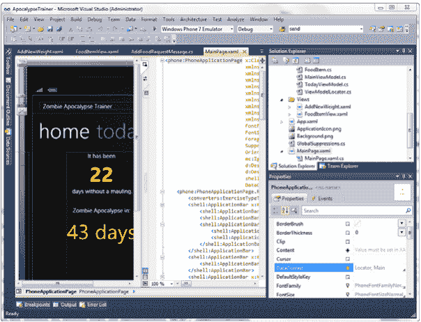

图 6.3 一个 Visual Studio 屏幕。

当你查看图 6.3 的左上角时，你会看到一系列以 `AddNewWeight.xaml` 开头的标签。这些都是你打开的文件，包括 C# 文件和 XAML 文件以及 Visual Studio 可以编辑的任何其他内容。如果打开的文件多于标签中可以显示的数量（这通常在我打开 Visual Studio 后几分钟内就会发生），代码编辑器窗口的右上角会出现一个向下箭头。点击它会显示所有打开文件的完整列表。

代码编辑器视图右侧是解决方案资源管理器。此视图大致类似于图 6.1 中 Xcode UI 中左侧显示的组织器树。在这里你可以查看解决方案中的所有项目以及每个解决方案中的文件和文件夹。正如我之前提到的，当你在项目中创建一个新文件夹时，它会在磁盘上创建该文件夹。这在 Xcode 中并不总是如此。

解决方案资源管理器下方是属性窗口。有时此窗口会被关闭，因此要再次打开它，请点击顶部菜单栏的 View 菜单并选择 Properties Window。如果属性窗口在点击时可见，它会使窗口消失。

如果你在左侧查看代码编辑器窗口下方，你会看到另一系列标签。这些是当前隐藏或折叠的停靠窗口。在图 6.3 的情况下，隐藏的窗口是断点、输出和错误列表。随着你继续开发并学习使用 Visual Studio 的更多功能，你会在此区域看到更多窗口出现。

如果你点击其中一个停靠的折叠窗口，它会向上扩展并在过程中覆盖部分代码编辑器窗口，如图 6.4 所示。

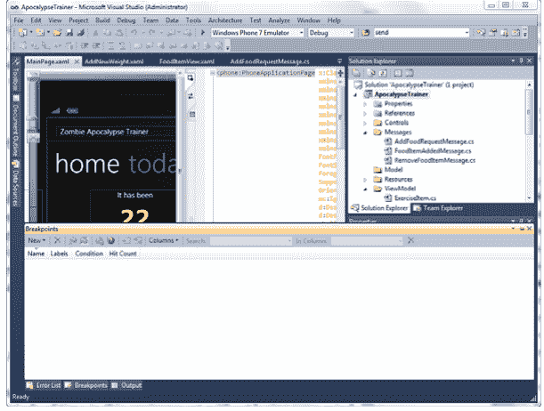

图 6.4 扩展的断点窗口，覆盖的代码窗口。

点击窗口右上角的图钉图标可切换窗口是否自动隐藏。在此情况下点击一次会导致窗口从前台移动并与代码编辑器窗口合并，推动代码视图向上以为停靠的断点窗口腾出空间。你会注意到，如图 6.5 所示，输出窗口也跟着来了，现在是断点和输出的停靠窗口中的一个标签，而错误列表窗口仍处于下方自动隐藏模式。

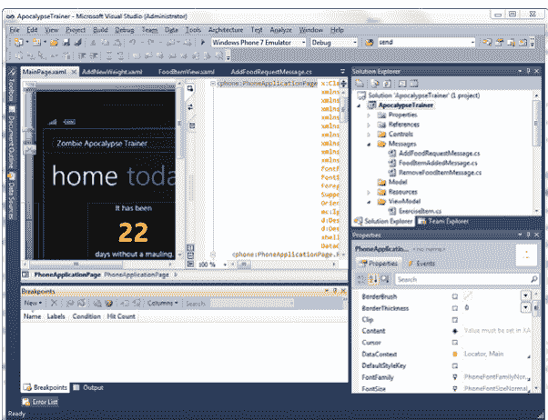

图 6.5 切换断点窗口的自动隐藏。

学习如何在 Visual Studio 中管理窗口对于你在这种环境中长时间编写代码而不发疯的能力至关重要。你拥有的窗口越多，正在处理的文件越多，保持组织并将窗口和文件放在你喜欢的位置就变得越重要。

Visual Studio 极其可配置；事实上，它可能比 Xcode 更可配置。例如，看看图 6.6 中的屏幕截图，我将解决方案资源管理器移到了左侧，自动隐藏了所有次要窗口并将它们推到底部，并提供了一个非常以代码为中心的视图。如果我需要任何次要窗口，我可以点击其标签，窗口就会弹出。如果我再次点击自动隐藏按钮，窗口将重新与主窗口合并。

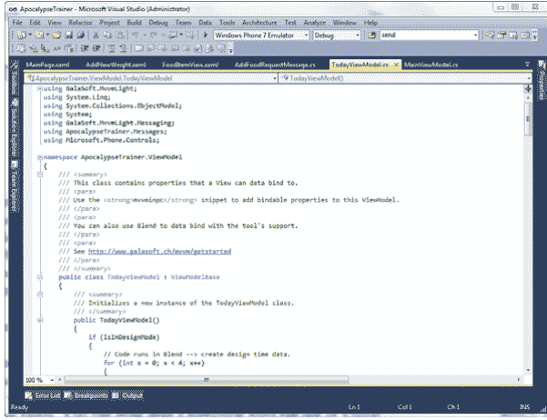

图 6.6 以代码为中心的优化布局。

最后，如果你点击并按住任何窗口的标签开始拖动，你会看到图 6.7 中显示的停靠快捷图标。这使你能够非常轻松地确定你希望窗口出现的位置以及如何为你自己的个人喜好布局。你甚至可以将特定文件的标签从 Visual Studio 完全拖出，使其成为独立的编辑窗口。

最后但并非最不重要的是位于所有内容之上的工具栏。此工具栏最常用的功能很可能就是你在图 6.7 中看到的播放按钮，它位于 Windows Phone 7 模拟器的部署目标和 Debug 的构建配置旁边。在这里你可以选择是否要在设备上运行应用程序还是在模拟器上运行，以及是否要在 Debug 或 Release 模式下运行应用程序。点击播放按钮（或使用 `F5` 快捷键）使用这些首选项启动调试会话。

在讨论 Visual Studio 的这一点上，我开始进入细节和琐碎的东西，我认为这只会分散你构建 Windows Phone 7 应用程序的最终目标。如果你想了解更多关于 Visual Studio 的信息，我强烈推荐你购买 Mike Snell 和 Lars Powers 合著的 Visual Studio 2010 Unleashed。这本书将为你提供关于 Visual Studio 的一切所需知识（甚至更多！）。如果你不想阅读它并且不想减慢你的 WP7 学习速度，你可以在构建 Windows Phone 7 应用程序时遇到不理解的 Visual Studio 部分时，翻到感兴趣的章节部分。

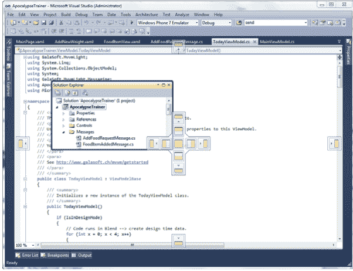

图 6.7 停靠目标快捷方式图标。

## 小结

开发者的 IDE 就像机械师的工具箱。它不仅仅是一把扳手或一把螺丝刀，而是构建应用程序所需的一切。因此，开发者将绝大部分开发时间都花在 IDE 前。

正因为如此，IDE 的创造者们花费了大量时间，努力确保他们的工具快速、高效，而且最重要的是易于使用。Visual Studio 和 Xcode 是目前用于构建移动应用程序的两款最强大的 IDE。在许多方面它们很相似，但也有许多根本性的差异。我希望你从本章中得到的收获是：这两款 IDE 都具有极高的可配置性和灵活性，无论你喜欢怎样的设置方式，都应该能够让它们按照让你感到舒适的方式布局你的环境。

随着你阅读本书的深入，Visual Studio 将成为你最好的伙伴。你将使用它编写 XAML、编写 C#、调试、性能分析、运行应用程序、构建应用程序，甚至为部署到应用商店做好准备。现在花点时间从代码中抽身出来，熟悉一下这个工具，将会对后续阅读本书大有裨益。

本页有意留白

# 介绍 Expression Blend

> 我认为设计涵盖的远不止美学。设计从根本上说更为丰富。设计就是可用性，是信息架构，是无障碍访问。这一切都是设计。
> 
> 马克·波尔顿

本章将向你介绍微软的交互设计工具 Expression Blend。我首先概述 Interface Builder——iOS 开发者常用来构建用户界面的应用程序。接着，我将逐步讲解 Expression Blend——它的用途、主要特性，以及它在形式和功能上与 Interface Builder 有何不同。

在上一章中，我们学习了 Visual Studio 及其功能，它让你能够编写代码、编译和运行应用程序。本章则重点介绍设计工具、如何使用它们，以及更重要的是，何时应该使用它们。

## Apple Interface Builder 概述

Interface Builder（IB）已经存在很长时间了，Mac 开发者多年来一直使用它来为桌面 Cocoa 应用程序构建视图层级。随着初代 iPhone SDK 的发布，Interface Builder 的任务是让开发者能够以接近所见即所得（WYSIWYG）的方式操控用户界面。

在深入描述 IB 的工作原理之前，我想先花一小段介绍一下历史背景。许多人认为初代 iPhone 发布时也同时推出了第一版 SDK。但实际情况并非如此。当 iPhone 1.0 首次发布时，“SDK”其实是 Safari。那时没有 App Store，没有应用商店，也没有 Objective-C SDK。开发者能做的只是构建 Web 应用程序，利用巧妙的 JavaScript、HTML 和 CSS 技巧，让这些 Web 应用看起来和用起来像 iPhone 应用。时至今日，许多网站在 iOS 设备访问时仍会呈现带有“iPhone 风格”的界面。一年之后，iPhone SDK 发布了。这个 SDK 包含 Xcode，并支持在模拟器上运行应用以及将应用上传到 App Store。然而，这个 SDK 并不包含 Interface Builder。更确切地说，Interface Builder 无法用于 iPhone SDK 项目。直到几个月后，iPhone SDK 的修订版才加入了对 Interface Builder 的支持。我们真该庆幸微软在其 v1 产品中发布了两个设计器——Expression Blend 和 VS2010 内嵌的设计器，这两者共享了大量代码。

Interface Builder 正如其名：一个用于构建界面的工具。如图 7.1 所示，它能很好地让你预估应用运行时会渲染出的用户界面。还要记住，旧版本的 Xcode 和 Interface Builder 是独立的工具，而从版本 4 及更高版本开始，Xcode 和“以前被称为 Interface Builder 的可视化设计器”就合二为一了。

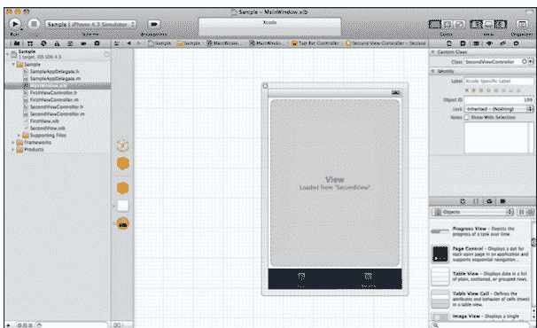

图 7.1 使用 Xcode 4 设计器构建用户界面。

当然，问题在于 IB 在设计时展示的 UI 只是一个粗略的预估。例如，当你使用 `TableViewController` 并试图设置一个使用自定义单元格显示项目列表的 UI 时，IB 无法把所有内容合并到一个设计界面中。请看图 7.2，它展示了一个典型的开发者如何利用 IB 为 `TableViewController` 装配自定义表格视图单元格。你无法看到单元格在表格中的样子，只能在一个单独的窗口中分别查看单元格，而 IB 为表格本身提供了一个“模拟”的 UI。正如你将在本书后面的第 16 章“关注点分离”中看到的，在 WP7 和 Visual Studio 中，你不仅可以在设计时看到自定义列表框，甚至可以提供示例数据，在设计时将控件绑定到这些数据上，从而获得最终渲染效果的非常精确的预览。

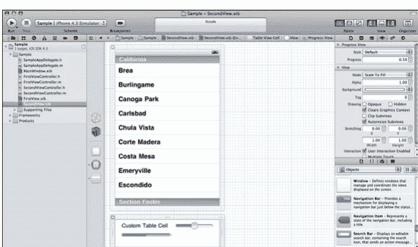

图 7.2 在 Xcode/Interface Builder 中使用 `TableViewController` 进行处理。

从核心来看，Interface Builder 获取对象层级（例如包含视图控制器和子视图的视图层级）的配置，并将该信息存储在一个名为 `nib` 的特殊文件中（不过这种文件更现代的等价形式是扩展名为 `XIB` 的 XML 文件，但由于 `nib` 更容易发音，所以仍然这么称呼）。


通过 Interface Builder 设置主窗口的配置，你是在指定该窗口在应用程序启动后应该处于的状态。当应用程序请求主窗口的引用时，它会读取`XIB`文件中的所有信息，并用其创建一个全新的窗口对象实例。这种模式在应用程序中一直延续下去，每当需要 UI 对象时都会如此，包括像图 7.2 中那样的自定义表格视图单元格。

这与设计者在 Silverlight 应用中的工作方式不同，因为 Interface Builder 实际上只是创建数据文件。这些数据文件由 Interface Builder 写入，应用在运行时读取这些文件以生成对象实例。Silverlight 应用则使用`XAML`作为标记语言来描述应发生的实例化。这是一个微妙但重要的区别。`XAML`是一种实例化语言。它使用`XML`来描述应实例化的对象以及这些对象中应设置的属性。

这是一个微妙但重要的区别，因为在 iOS 中，有些东西需要有一个正在运行的实时应用才能渲染，这就是为什么 Interface Builder 往往只提供“模拟”的 UI，比如假的导航栏、标签栏等等。iOS 开发者何时需要编写纯`Objective-C`、何时需要在 Interface Builder 中构建 UI，常常令人困惑，而如果这种划分出错，后果可能非常严重。一些经验丰富的 iPhone 开发者很少使用 IB，通常只在别无选择时才使用。另一些 iPhone 开发者则采用 IB 优先的方式，尽可能在 Interface Builder 中构建一切，直到实在无法回避时才编写自定义`Objective-C`代码。正如你将在第 16 章关于 MVVM（Model，View，ViewModel——一种构建用户界面时分离关注点的模式）中看到的，由于一切都可以用`XAML`表示（甚至包括 UI 所绑定的对象），你可以在 Expression Blend 或 Visual Studio 中获得最终 UI 几乎完全一致的副本，而无需使用模拟元素。

在 Microsoft 的开发环境中，`XAML`被视为“一等公民”。iOS 开发者从不查看 IB 使用的序列化格式，他们要么使用`Objective-C`，要么使用设计器的点选式 UI。Microsoft 开发者则一直在使用`XAML`，而且正如你将在本书截图中看到的，许多开发者经常直接输入`XAML`，并实时观察标记对 UI 产生的即时效果。

## Expression Blend 简介

当我第一次听说微软正在开发一款`XAML`设计工具，能够帮助开发者构建惊艳的 UI、引导他们创建复杂的动画等等时，我有些怀疑。事实上，我的反应大致是：“微软？做设计工具？不可思议！”

多年过去我认识到，第一印象（尤其是那些被偏见和单纯无知所蒙蔽，而不是基于真实印象形成的判断）往往是错误的。我决定给 Expression Blend 一个机会。顺带提一句，我并不是设计师。我没有数字设计技能，更喜欢铅笔的舒适和形态，而不是鼠标。我与 Photoshop 一直合不来，而且我总是用记事本（或其他文本编辑器）编写`HTML`。我也几乎完全在 Visual Studio 的文本编辑器中编写`XAML`，甚至移除了设计视图，只在运行应用后才看到最终成品。我一直是那种你可能认为与 Blend 这类设计工具的目标用户截然相反的人。我拼命抗拒它，像躲避瘟疫一样。我打算固执地拒绝接受这个闪亮的新工具，不管代价如何。但那是在我尝试它之前。

从核心来看，Blend 所做的一切就是为你提供一个基于`XAML`编辑器之上的强大 UI。你使用所有控件、小部件、旋钮、托盘和面板所做的所有花哨操作，最终都会归结为对项目中`XAML`（偶尔还有`C#`）的操控。有趣的是，与我过去使用那些会生成标记的设计工具（是的，说的就是你，FrontPage）的经验不同，Blend 实际上减少了构建 UI 所需的时间，而且——令人震惊的是——它确实能生成干净的`XAML`。如果你想花几分钟浏览一些在线教程来熟悉 Expression Blend，我推荐你看看这个网址：`http://expression.microsoft.com/en-us/cc184874.aspx`。如果你想要一份关于使用 Expression Blend 构建 Silverlight 4 应用程序的完整参考（其中绝大部分内容仍然适用于 WP7 开发），可以参阅 Victor Gaudioso 所著的《Expression Blend 4 with Silverlight》。

当你第一次看到 Expression Blend，就像图 7.3 所示的截图一样，可能会有点不知所措。你们中那些使用过像 Adobe Photoshop 这样工具的人会几乎立刻认出设计工具的核心元素。对于像我这样的开发者，我们倾向于对 Photoshop 这样的设计工具投掷大蒜和圣水，习惯这个应用程序花了一点时间。

随着我在本节以及本章教程中的进展，我可能会谈论视觉控件和其他你还不熟悉的东西。别担心，顺其自然就好；本章中我用 Blend 做的一切都将在后面的章节中用`C#`和`XAML`详细解释，包括库存控件、面板、构建自定义控件以及动画系统。

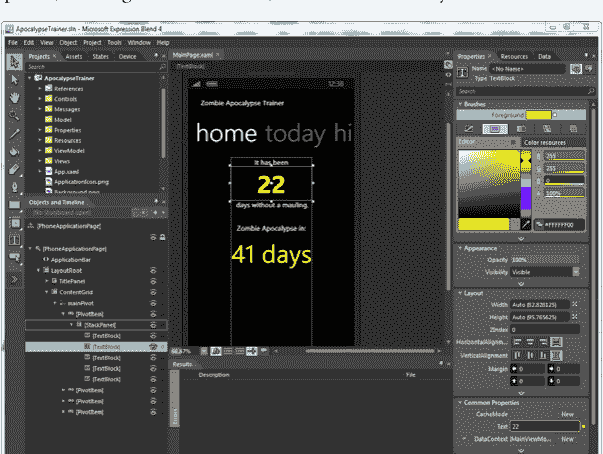

图 7.3 打开 VS 解决方案后 Expression Blend 的界面。

你可以直接从开始菜单启动 Expression Blend，或者在 Visual Studio 中打开一个 WP7 应用程序时，点击 Project，Open in Expression Blend 来启动它并已设置为你当前的 Visual Studio 项目。在左侧第一个面板中，你会看到一个名为 Projects 的选项卡。这个树应该看起来非常类似于 Visual Studio Solution Explorer。这为你的解决方案提供了一个基于文件系统的视图。当你在此视图中双击一个`XAML`文件时，它将出现在中间的设计视图中。

第一个面板下方是 Objects and Timeline 视图。它提供了当前`XAML`文件内部发现的对象的层次视图。正如你在图 7.3 和 7.4 的截图中看到的，根对象是`PhoneApplicationPage`的一个实例，其中包含一个`TitlePanel`和一个`ContentGrid`，而在该`ContentGrid`内部有一个名为`mainPivot`的`Pivot`控件。此视图中的项目在这些元素尚未分配名称时显示为其数据类型。

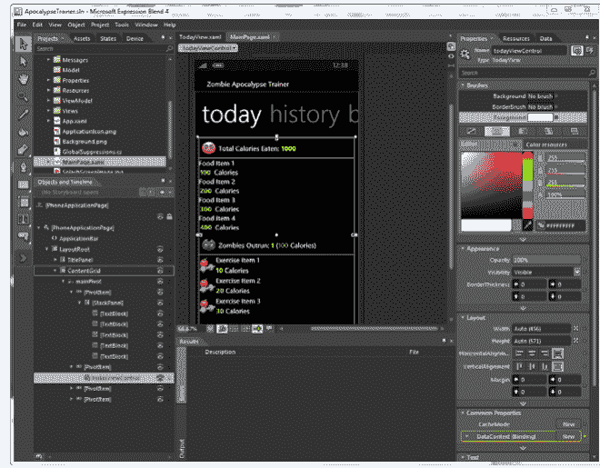

图 7.4 直接在设计器中编辑不同的`Pivot`项。

图 7.4 显示了你如何快速轻松地使用 Objects and Timeline 视图直接导航到想要编辑的项目。在这种情况下，我们正在编辑`Pivot`控件内的一个`PivotItem`。要在纯`XAML`文本视图中执行此操作，你必须滚动浏览所有`XML`内容，寻找想要编辑的控件。Objects and Timeline 面板可以节省大量时间。

在屏幕右侧，如图 7.3 或 7.4 所示，你可以看到一堆编辑面板。第一个是 Properties 窗口，允许你编辑控件的属性。请注意，每当属性可以设置为`Brush`类型时，Blend Properties 窗口都会为你提供一个漂亮的`Brush`编辑工具。你可以快速使用此工具将背景设置为透明、纯色，甚至渐变。再次，使用 Blend 设置`Brush`属性比手工操作容易得多。

Properties 窗口和选择工具可以做数百种不同的事情。在图 7.4 中，你可以看到我的控件周围的选择高亮显示的各个关键点上都有小锁图标。我可以轻松使用这些小锁来设置我的控件在父控件内如何自动调整大小，或者将高度和宽度设置为固定数字。可能性不是无限的，但熟悉 Expression Blend 及其功能并具有一点创造力的开发人员或设计师确实可以创造出令人惊叹的用户体验。

Expression Blend 的另一个我非常喜欢的功能是使用注释的能力。注释使团队能够对特定 UI 元素留下评论，以便其他团队成员可以看到并相应地做出回应。例如，在图 7.5 中，我在 Blend UI 中直接给我的团队成员留了一张小便签，抱怨我不喜欢的一些 UI 元素。

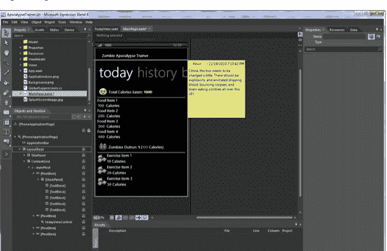

图 7.5 使用注释记笔记并与团队共享。

此注释的存在会修改底层`XAML`以包含以下新的`XAML`命名空间：

```
xmlns:Anno="http://schemas.microsoft.com/expression/blend/extensions/annotations/2008"
```

此外，注释会作为依赖属性添加一个元素添加到我当时引用的目标控件中，如下所示的`XAML`对应于图 7.5 中的便签：

```
<Anno:AnnotationManager.Annotations>
    <Anno:Annotation AuthorInitials="K" Author="Kevin" Left="496" SerialNumber="1" Top="137" Timestamp="12/20/2010 00:12:01" Text="I think this box needs to be changed a little. There should be explosions, and animated dripping blood, bouncing corpses, and brain-eating zombies all over this UI!!"/>
</Anno:AnnotationManager.Annotations>
```

如果我的团队中的另一位人员从我们的源代码控制库中检出代码（包括带注释的`XAML`），他就可以看到我的反馈并做出回应（希望不要使用粗言秽语）。这里有一个需要注意的地方是，我发现这些注释的存在在 WP7 项目中会导致内置的 Visual Studio 设计表面偶尔出现卡顿，无法渲染 UI。这不会影响应用程序是否能正常运行，但可能会很烦人。我建议除非你和你的团队计划使用 Blend 作为主要的设计表面，并且设计表面在 Visual Studio 中关闭或使用最少，否则不要使用注释。

## Blend 教程——使用视觉状态

在本章的这一部分，我将带你通过一个简单的 Blend 教程，从一个新的 WP7 应用程序开始。这应该能让你熟悉该应用程序，并希望能教你一些关于 Silverlight 控件中经常被低估的功能的知识：视觉状态管理器。

视觉状态顾名思义，是控件可以处于的不同状态。这些状态是视觉的，因为最终用户可以在视觉上区分这些状态。库存控件自带一组内置状态，但你也可以在控件级别甚至页面级别创建自己的状态。

例如，标准的`Button`控件已经定义了多个状态，包括：`Normal`、`MouseOver`、`Pressed`和`Disabled`。别担心`MouseOver`，那是 WP7 实际上在底层是 Silverlight 的遗留问题，而桌面版 Silverlight 支持鼠标移动。在 Windows Phone 7 设备上，没有手指手势可以模拟鼠标悬停移动，因为设备在你实际点击屏幕之前不知道你的手指在哪里。

这些视觉状态真正令人惊叹的地方在于，你不仅可以为每个状态提供自己的样式，还可以控制这些状态之间的转换。如果你愿意，你可以让按钮在`Normal`和`Disabled`状态之间旋转，使按钮翻转并弹跳一点，并在转换到`Disabled`状态时做一点“死亡”动画。虽然可能没有太多这种事情的用途，但知道你可以在不编写自己的自定义`Button`控件的情况下做到这一点，可以非常方便。

在本教程中，我们将制作一个按钮，其`Pressed`状态具有不同的样式。在标准的 WP7 应用程序中，按钮样式要么是白底黑字，要么是黑底白字。当你按下（点击）按钮时，它会反转这种样式。例如，如果你的 UI 配置为“深色”模式，按钮的正常状态是白底黑字，当你点击它时，它会翻转为黑底白字。我希望点击我的按钮时切换到绿色背景颜色。

开始时，在 Visual Studio 中创建一个新的 WP7 项目。在 Visual Studio 中，点击 File 菜单项；然后点击 New，Project。从这里，点击左侧的 Silverlight for Windows Phone 类别，并确保右侧选择了 Windows Phone Application。输入项目的名称，然后点击 OK。

创建项目后，单击“项目”>“在 Expression Blend 中打开”菜单项。如果加载 Blend 需要几秒钟，别担心。第一次启动 Blend 可能会很慢，即使是在配备了高速硬盘的高性能计算机上也是如此。

接下来，我们需要添加一个按钮。单击最左侧工具栏中朝右的 V 形图标（看起来像两个大于号：>>）以展开“资产”窗格。转到左侧的“类别”部分，单击“面板”。单击并按住`StackPanel`图标，然后将鼠标指针拖到名为`ContentPanel`的`Grid`控件上。松开鼠标后，一个`StackPanel`就会被添加到该`Grid`中。接下来，在这个`StackPanel`内创建一个按钮。为此，请确保`StackPanel`处于选中状态，然后双击左侧工具栏上的“按钮”快捷方式。请务必在编辑器右侧的“属性”窗格中设置名称，为该按钮命名。

现在右键单击该按钮（可以在“对象和时间线”窗格中，也可以直接在设计图面上的按钮视觉对象上操作），然后选择“编辑模板”；接着左键单击“编辑副本”。在出现创建样式资源的提示时，单击“确定”。这样你就能以可视化方式编辑控件的模板。

现在切换到顶部窗格中的“状态”选项卡（该窗格通常默认选中“项目”选项卡）。在“对象和时间线”窗格中，为当前控件模板选择`ButtonBackground`。然后你会看到此控件所有预置的可视状态，如图 7.6 所示。

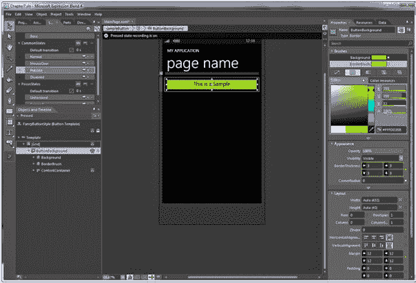

图 7.6 更改内置控件的可视状态。

单击“按下（`Pressed`）状态”，你会看到一条消息，提示 Blend 正在为“按下”状态录制属性。这意味着，在你为此状态录制期间，对控件或其任何嵌套属性所做的任何更改，都会被保存为该可视状态的一部分。现在，我们可以在此状态下更改按钮的`Background`和`BorderBrush`属性，而不影响“正常”或“禁用”状态下这些属性。

此时，你可以保存工作成果，并单击“项目”>“运行”或按 F5 键来运行应用程序。运行应用程序将启动 Windows Phone 7 模拟器。该模拟器能让你非常接近地预览应用程序在实际设备上的外观和行为。

开机后第一次启动应用程序时，WP7 模拟器需要一些时间才能启动。完成初始启动后，你可以在各调试会话之间让它一直保持运行。这样能缩短启动应用程序调试所需的时间。

模拟器进行几秒钟初始化后，你的应用程序就会出现。由于默认的`Button`控件会在用户点击时自动进入“按下”状态，因此你无需自己编写相关基础代码。因为我们刚刚设置了该可视状态的样式，新按钮现在会在被点击时变成绿色，并带有橙色边框。

当你试用完这个新按钮后，看一下`MainPage.xaml`中新建资源字典顶部的`XAML`（你可以返回 Visual Studio，双击该文件来查看此`XAML`）：


```
<Style x:Key="FancyButtonStyle" TargetType="Button">
<Setter Property="Background" Value="Transparent"/>
<Setter Property="BorderBrush"
Value="{StaticResource PhoneForegroundBrush}"/>
<Setter Property="Foreground"
Value="{StaticResource PhoneForegroundBrush}"/>
<Setter Property="BorderThickness"
Value="{StaticResource PhoneBorderThickness}"/>
<Setter Property="FontFamily"
Value="{StaticResource PhoneFontFamilySemiBold}"/>
<Setter Property="FontSize"
Value="{StaticResource PhoneFontSizeMediumLarge}"/>
<Setter Property="Padding" Value="10,3,10,5"/>
<Setter Property="Template">
<Setter.Value>
<ControlTemplate TargetType="Button">
<Grid Background="Transparent">
<VisualStateManager.VisualStateGroups>
<VisualStateGroup x:Name="CommonStates">
<VisualState x:Name="Normal"/>
<VisualState x:Name="MouseOver"/>
<VisualState x:Name="Pressed">
<Storyboard>
<ObjectAnimationUsingKeyFrames
Storyboard.TargetProperty="Foreground"
Storyboard.TargetName="ContentContainer">
<DiscreteObjectKeyframe KeyTime="0"
Value="{StaticResource PhoneBackgroundBrush}"/>
</ObjectAnimationUsingKeyFrames>
<ColorAnimation Duration="0" To="#FF001BFF"
    Storyboard.TargetProperty=
    "(Border.BorderBrush).(SolidColorBrush.Color)"
    Storyboard.TargetName="ButtonBackground" d:IsOptimized="True"/>
<ColorAnimation Duration="0" To="#FFFFC700"
    Storyboard.TargetProperty=
    "(Border.Background).(SolidColorBrush.Color)"
    Storyboard.TargetName="ButtonBackground" d:IsOptimized="True"/>
</Storyboard>
</VisualState>
<VisualState x:Name="Disabled">
    <Storyboard>
        <ObjectAnimationUsingKeyFrames
            Storyboard.TargetProperty="Foreground"
            Storyboard.TargetName="ContentContainer">
            <DiscreteObjectKeyFrame KeyTime="0"
                Value="{StaticResource PhoneDisabledBrush}"/>
        </ObjectAnimationUsingKeyFrames>
    </Storyboard>
</VisualState>
</VisualStateGroup>
</VisualStateManager.VisualStateGroups>
<Border x:Name="ButtonBackground"
    BorderThickness="{TemplateBinding BorderThickness}" CornerRadius="0"
    Margin="{StaticResource PhoneTouchTargetOverhang}" Background="Black">
<Border.BorderBrush>
    <SolidColorBrush Color="{StaticResource PhoneForegroundColor}"/>
</Border.BorderBrush>
<ContentControl x:Name="ContentContainer"
    ContentTemplate="{TemplateBinding ContentTemplate}"
    Content="{TemplateBinding Content}"
    Foreground="{TemplateBinding Foreground}"
    HorizontalContentAlignment=
    "{TemplateBinding HorizontalContentAlignment}"
    Padding="{TemplateBinding Padding}"
    VerticalContentAlignment="{TemplateBinding VerticalContentAlignment}"/>
</Border>
</Grid>
</ControlTemplate>
</Setter.Value>
</Setter>
```

浏览这段 XAML，你会看到新按钮样式的所有可视状态，还会看到我们已经修改了“按下”状态。尤其值得注意的一点是，按钮所有属性的更改都发生在动画情节提要中。

# 第 7 章 Expression Blend 简介

开发者一旦花几秒钟思考“不同可视状态之间的切换全都由动画平滑完成”这一事实，就会开始看到这个框架的威力。

这意味着，当 Silverlight 对象从一个可视状态转换到另一个可视状态时，它会借助一个动画情节提要来完成转换。你可以控制切换到新状态所需的时间，以及切换所带来的任何特殊效果。

尽管我对使用可视化设计工具相当抵触，但我必须承认，手动输入所有这些可视状态管理内容，即使只是为了简单的属性更改，也会很快让人厌烦。我深信要使用最适合工作的工具，而且我知道在 Blend 中处理可视状态绝对是最佳选择。

这里有一点值得思考的内容，同时给你布置一个任务，让你自己用 Blend 探索：内置控件自带各自的可视状态，不同的用户交互会让控件在各可视状态之间切换。页面只是另一种类型的控件。这意味着页面也可以有可视状态，你还可以创建自己的自定义可视状态。

在为 iPad 和 iPhone 构建 UI 时，最大的痛点之一就是处理屏幕旋转。确保用户界面在横屏和竖屏之间旋转时依然美观，是一个既困难又费时的过程，尤其是当你考虑到用户旋转手机或 iPad 时，常常需要手动为视图编写属性更改代码。如果你将可视状态命名为“portrait（竖屏）”和“landscape（横屏）”或“portraitup（竖屏朝上）”等，会怎样？现在，你在 Blend 中只需要把设计图面旋转到正确的方向，并在该特定可视状态的录制模式下，相应地移动和调整所有控件。接下来，每当设备方向发生变化时，你都需要通过编程方式让页面转换可视状态。

下面是一些你可以在 `MainPage.xaml.cs` 中重写的代码，它将以编程方式让页面从当前可视状态转换到新状态，并调用任何自定义动画、布局更改、颜色更改以及你想要执行的任何其他操作。另外请记住，所有这些更改都可以在带时间控制的动画情节提要中完成。

```
protected override void OnOrientationChanged(OrientationChangedEventArgs e)
{
    // if you have 4 states instead of 2
    // PortraitUp, PortraitDown, LandscapeLeft, LandscapeDown
    // VisualStateManager.GoToState(this, e.Orientation.ToString(), true);
    // if you just have Portrait or Landscape
    string orientation = (e.Orientation & PageOrientation.Portrait) != 0
        ? "Portrait" : "Landscape";
    VisualStateManager.GoToState(this, orientation, true);
    base.OnOrientationChanged(e);
}
```

现在花点时间回到你在整个教程中一直在 Blend 里处理的那个项目。去探索、点击、试着把东西弄坏。尽情摆弄你找到的所有窗格、面板和属性。我强烈建议你把各种东西都折腾个遍，直到你感到完全彻底地迷失、不知所措。正是在这个时刻，你可以退后一步，继续阅读本书其余章节。当你一路读下去，你脑中那些模糊不清的地方，以及你对 Blend、XAML、C# 和 WP7 的疑问，最终都会得到解答，你会豁然开朗。我发现，在学习新技术时，先经历这种一头扎进去、却全然迷失的初始体验，有助于指导我今后的学习。它会让日后那些“灵光一闪”的时刻更加难忘，也让我更长久地记住那些信息。

## 总结

本章概述了 Apple 为 Xcode 提供的设计工具 Interface Builder。接着，我将 Interface Builder 与 Microsoft 的设计工具 Expression Blend 做了比较。我们学习了 Blend 的基本操作方法、如何使用 Blend 创建 Windows Phone 7 应用程序，最后还通过一个教程演练了如何从 Blend 和 Visual Studio 中使用视觉状态（visual states）和 Visual State Manager。

至此，你应该已经对使用 Expression Blend 和 Visual Studio 构建 WP7 应用程序的画面和体验有了很好的认识。你可能有很多疑问，而且本章里使用的很多控件可能看起来不太容易理解。这是好事。你的好奇心会推动你继续阅读本书其余章节，并且随着你对 WP7 编程的深入，这些新信息也会更加深刻地印入你的脑海。

此页有意留白

# 使用基本 UI 元素

> 公众对糟糕设计的熟悉程度，更甚于对优秀设计的熟悉程度。
>
> 实际上，公众已经被环境塑造成了偏爱糟糕设计，因为那正是他们日常所接触的东西。
>
> 新事物令人不安，旧事物令人安心。
>
> ——保罗·兰德

本章概述了 Windows Phone 7 开发者可用的基本 UI 构建块，并将它们与 iOS 开发者可能已经熟悉的构建块联系起来。iOS 开发者应特别注意关于布局和面板的小节，因为流式面板和自动调整网格这类东西在 iOS 中根本不存在；如果运用得当，它们可以帮你省去大量辛苦的工作。

读完本章时，你应该能对自己可用的基本 UI 武器库有清晰的认识，足以击败你的敌人——空白的绘图图面。你将学习显示文本、提示用户输入文本、显示按钮并响应按钮点击、布局面板、图像，甚至基本动画。这些都会为你继续阅读本书其余章节、构建更有吸引力也更复杂的应用程序打下坚实基础。

## 使用基本控件

下一节将带你游览 Windows Phone 7 上 Silverlight UI 的基本构建块。这些基础控件都可以直接使用，且在其基本形态下已经相当强大；但正如你将在后面章节看到的，通过模板、继承和其他自定义方式，这些构建块可以变成令人难以置信的控件，创造出惊艳的用户界面。

不要因为这些控件很“基础”就认为应该跳过本节。iOS 开发者都知道基础控件的内在价值，也明白通过继承和定制它们，可以让一个平淡无奇的 UI 变成一个令人眼前一亮的 UI，并让应用在 App Store 中获得重点推荐。

## 使用文本块

构建用户界面时，你最常做的事情之一就是显示文本。无论这些文本是数据绑定并来自 Web 服务的，还是显示问候语的静态文本，渲染文本的基本构建块都是 `TextBlock` 控件。

虽然我知道你可以使用 Expression Blend 来操作 UI，把这些控件以可视化方式拖到设计图面上，但我坚信了解让一切正常运转的底层机制也很重要。因此，除非明确要求使用 Expression Blend，或者它能大幅简化某项任务，否则我都会展示构建控件所需的 XAML，而不是如何在 Expression Blend 中配置它的截图。

要开始操作，你可以跟着做：在 Visual Studio 2010 中创建自己的 Windows Phone 7 项目，并把它命名为 `BasicControls`。要创建 Windows Phone 7 项目，请从“Silverlight for Windows Phone”模板类别中选择“Windows Phone 应用程序”项目模板。

### 注意

> 每当我提到 Visual Studio 2010，或简称为 Visual Studio 时，我指的是以下两者之一：许多开发者在下载 WP7 SDK 之前可能就已经装在电脑上的 Visual Studio 2010 完整开发版；或者，当你在之前从未安装过 Visual Studio 2010 的电脑上安装 WP7 SDK 时，所获得的 WP7 专用 Visual Studio 2010“精简”版。在本书中，除非另有差异说明，否则你可以假定所有对 Visual Studio 的引用都同样适用于这两个产品。例如，当你要构建面向服务的后端来支持 WP7 应用时，某些功能可能需要你安装完整版 Visual Studio 2010。

创建好空应用后，你会看到 `MainPage.xaml` 文件里已经为你创建了几个 `TextBlock`。我只是把它们的文本改了一下，如代码清单 8.1 所示。

### 代码清单 8.1：XAML 中的文本块

```
<TextBlock x:Name="ApplicationTitle"
    Text="SAMPLE APPLICATION"
    Style="{StaticResource PhoneTextNormalStyle}"/>
<TextBlock x:Name="PageTitle"
    Text="This is a test"
    Margin="9,-7,0,0"
    Style="{StaticResource PhoneTextTitle1Style}"/>
```

以声明方式使用这些控件之所以如此简单，原因之一就是你只需输入几个字母，就能为控件添加事件处理程序。在配置 `PageTitle` 这个 `TextBlock` 的 `Margin` 属性的代码行后面按 Enter。当你开始输入（输入字母 M）时，就会出现一个下拉框，其中列出与你正在输入内容相对应的可能补全项。你要找的事件是 `MouseLeftButtonUp`。在 `MouseLeftButtonUp` 后面输入等号（=），然后按 Tab。这会自动在 XAML 页面的代码隐藏文件中创建一段代码，用来响应 `MouseLeftButtonUp`（本质上是一次单击结束）事件。

按 F7 查看代码隐藏文件。修改你的代码，使 `MainPage` 类与代码清单 8.2 中定义的一致。

### 代码清单 8.2：响应 TextBlock 上的单击

```
namespace BasicControls
{
    public partial class MainPage : PhoneApplicationPage
    {
        // Constructor
        public MainPage()
        {
            InitializeComponent();
        }

        private void PageTitle_MouseLeftButtonUp(
            object sender, MouseButtonEventArgs e)
        {
            MessageBox.Show("You tapped the page title, " +
                (sender as TextBlock).Text);
        }
    }
}
```

上面的代码展示了如何创建一个简单的事件处理程序，让应用在用户点击页面标题时执行一些代码。几乎所有控件都可以被点击，包括你可能想不到的控件，例如 `TextBlock`。我们在 C# 中使用 `as` 关键字将 `sender` 对象类型转换为 `TextBlock` 对象，以便访问它的 `Text` 属性。

`MessageBox` 类是一个静态类，它提供了一些方法，用于在其他用户界面元素之上显示模态框。对于 iOS 开发者来说，用途几乎相同的控件是 `UIAlertView`，你可以用以下代码调用它：

```
UIAlertView *alert = [[UIAlertView alloc] initWithTitle:@"Alert" message:@"You tapped the page title."
```

```
delegate:self
cancelButtonTitle:@"Cancel"
otherButtonTitles:nil] autorelease];
[alert show];
```

然后你可能会提供自己的委托代码来响应警报视图上各种按钮的按下。正如你所见，对于标准警报消息，`MessageBox` 类更容易、更简单使用。

图 8.1 说明了当你点击此应用程序标题时会发生什么。


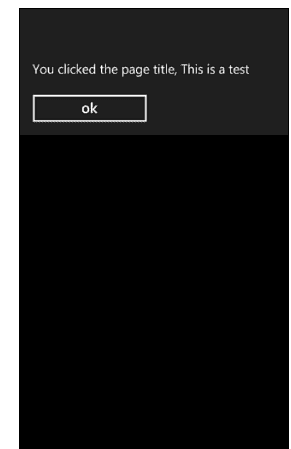

图 8.1 响应点击 TextBlock 而显示的消息框。

随着你阅读本书的进展，你将看到使用看似基本且原始的 `TextBlock` 控件可以做各种事情。请记住，你可以设置几乎任何控件的各个方面，包括渲染颜色，甚至可以创建附加到任何视觉元素的自定义特效。

## 使用 TextBoxes 接受用户输入

大多数应用程序并不是只读显示。在某个时候，你很可能不得不打破常规，实际上向用户请求一些输入，无论你喜不喜欢。为此，你需要一个 `TextBox`。顾名思义，`TextBox` 是一个用户可以在其中提供文本的框。

用户通过两种方式之一来完成此操作。第一种，在所有 Windows Phone 7 设备上都可用，是通过使用屏幕上的软键盘。当用户点击 `TextBox` 区域内时，键盘会出现，允许用户通过点击虚拟键来输入文本。第二种方法是通过实际的硬件键盘，只有在用户购买了带物理键盘的手机时才可用。在 Windows Phone 7 发布时，几家厂商都有滑出式键盘，其中一家甚至有滑出式扬声器（但只有触摸屏键盘）。

无论用户是在真实键盘还是虚拟触摸屏键盘上输入，`TextBox` 控件都以相同的方式接受输入，并使开发人员免于编写自定义代码来处理这两种情况。

在 `Listing 8.1` 中的最后一个 `TextBlock` 下方添加来自 `Listing 8.3` 的 XAML 代码，以创建一个新的标签和一个用于输入文本的文本框。

### Listing 8.3 Adding a Label and TextBox

```
<TextBlock x:Name="ApplicationTitle"
    Text="SAMPLE APPLICATION"
    Style="{StaticResource PhoneTextNormalStyle}"/>
<TextBlock x:Name="PageTitle"
    Text="This is a test"
    Margin="9,-7,0,0"
    MouseLeftButtonUp="PageTitle_MouseLeftButtonUp"
    Style="{StaticResource PhoneTextTitle1Style}"/>

<TextBlock x:Name="SampleLabel"
    Text="Enter some text:" />
<TextBox x:Name="SampleTextBox" />
```

现在将页面标题的“单击”事件处理程序代码更改为 `Listing 8.4` 中显示的代码，并且出现的模态对话框将包含用户在文本框中提供的文本，而不是页面的固定标题。

### Listing 8.4 Reading Text Property of a TextBox

```
namespace BasicControls
{
    public partial class MainPage : PhoneApplicationPage
    {
        // Constructor
        public MainPage()
        {
            InitializeComponent();
        }

        private void PageTitle_MouseLeftButtonUp(object sender,
            MouseButtonEventArgs e)
        {
            MessageBox.Show("You tapped the page title, " +
SampleTextBox.Text );
    }
}
}
```

在前面的代码列表中，我们正在访问 `SampleTextBox` 控件上的 `Text` 属性，该属性包含用户输入到该控件中的文本（如果有）。你可以用文本框做更多的事情，但这应该足以激发你对 Windows Phone 用户输入的兴趣。

再次运行示例项目，并在点击页面标题之前在文本框中输入一些内容。当你点击页面标题时，你应该会在模态弹出窗口中看到你在框中输入的任何文本。

## 使用按钮

按钮是任何用户界面的必备部分。它们为你的手指提供了漂亮、易于点击的目标。我们使用按钮来触发操作的发生。一般来说，你可以将按钮视为用户界面的动词等价物。当需要完成某事时，你点击按钮来完成它。当然，这只是一个例子，有很多用户界面的例子，按钮被更具创造性地使用，甚至根本不使用。

如果尚未打开，请启动 Visual Studio 并调出我们在本章中一直处理的项目。打开 `MainPage.xaml` 文件并滚动到你在 `Listing 8.3` 中添加的最后一个控件。添加 `Listing 8.5` 中显示的按钮。

### Listing 8.5 Adding Buttons to the Page

```
<Button x:Name="TestButtonOne">
    <TextBlock Text="Zombies are your friends" />
</Button>
<Button x:Name="TestButtonTwo" Click="TestButtonTwo_Click">
    <Border BorderBrush="Yellow" BorderThickness="3" CornerRadius="15">
        <TextBlock Margin="5,5,5,5" Text="Some Text"></TextBlock>
    </Border>
</Button>
```

第一个按钮不言自明。它有一个名称，并且有一个以 `TextBlock` 形式的子内容。这是你遇到的第一个模板化控件示例，随着你阅读本书的进展，你会看到数百个这样的示例。无论按钮的子内容是什么，它都被封装在使按钮成为按钮的功能中——响应鼠标点击（或在 WP7 的情况下是手指点击）的能力。

下一个按钮（名为 `TestButtonTwo`）更有趣一些。该按钮的第一个子元素是 `Border` 控件。`Border` 控件正如其名称所示——它用可配置的边框包裹其包含的任何子内容。在我们的例子中，我们用一个 3 点厚的黄色边框包裹了子内容，并且边框的

```
MessageBox.Show("You tapped the page title, " +
    SampleTextBox.Text);
}

private void TestButtonTwo_Click(object sender,
    RoutedEventArgs e)
{
    MessageBox.Show(
        "You tapped the button with nested controls!");
}
}
```

值得指出的一点是，iOS 中的 `UIButton` 控件具有非常相似的功能。虽然 WP7 按钮的默认行为是显示为带有边框的正方形，边框围绕子控件，但 `UIButton` 更具目的性。它包含一个名为 `buttonType` 的属性，控制按钮的核心行为，可以是以下值之一：`UIButtonTypeCustom`、`UIButtonTypeRoundedRect`、`UIButtonTypeDetailDisclosure`、`UIButtonTypeInfoLight`、`UIButtonTypeInfoDark` 或 `UIButtonTypeContactAdd`。这些不同按钮类型的用途对于任何 iOS 开发者甚至任何精通 iPhone 的用户来说都应该相当不言自明。

## SDK 设计的哲学差异

WP7 和 iOS 中按钮的默认实现是 SDK 设计哲学在 WP7 和 iOS 之间、以及在更大范围内 .NET Framework 和 Cocoa 之间不同的经典示例。iOS SDK 附带的 UI 控件都是目的驱动的。它们使以非常 iPhone 风格的外观和感觉完成特定任务变得非常容易。iOS SDK 的主要目标是尽可能消除你在构建一个外观和行为与大多数库存应用程序完全相同的应用程序时遇到的障碍。因此，如果你想要一个带圆角的按钮或一个带有浅色图标的信息按钮（两者在核心操作系统中大量出现），你几乎不需要做任何工作。然而，如果你想在 iOS 中创建一个具有自定义视觉效果的自定义按钮，自定义视觉效果位于边界框内，你需要做很多工作。

相反，.NET Framework 的目标，特别是 Windows Phone 7 的 Silverlight，是让你能够使用任何和所有可能的用户界面。这是广度与深度的争论。iOS 在极其目的驱动的控件背后隐藏了定制的复杂性，这些控件通常能让你比在 Silverlight 中更快地达到 80% 的进度。然而，最后的 20%，即通常发生定制和调整的地方，在 iOS 中可能是一种令人沮丧、令人紧张、令人抓狂的体验，而在 Silverlight 中，整个 100% 的开发过程通常需要相同的努力水平。

没有一种 SDK 设计是唯一正确或错误的，但两者显然是为不同的受众和不同的目的而构建的。Silverlight 使使用你的 UI 做令人惊叹的事情与做平凡的事情一样容易，而 iOS 使平凡的事情几乎自动化，并将节省的精力转移到定制领域。

## 接受其他形式的用户输入

按钮和文本框并非用户与应用交互的唯一方式，WP7 SDK 还提供了其他开箱即用的控件。本节将介绍一些新控件，它们提供了更丰富、更灵活的用户输入接受方式，例如：

- 复选框（Checkbox）——iOS 中没有功能对应的原生 UIKit 复选框控件。
- 单选按钮（RadioButton）——在 iOS 中，`UISegmentedControl` 通常提供类似功能。
- 密码框（PasswordBox）——在 iOS 中，将 `UITextField` 控件的 `secureTextEntry` 属性设置为 `YES` 即可提供几乎相同的功能。
- 滑块（Slider）——在 iOS 中，`UISlider` 控件提供此功能，但 iOS 滑块难以自定义，且始终水平显示；而 WP7 滑块可以轻松自定义，并且无需自定义即可垂直显示。
- 超链接按钮（HyperlinkButton）——在 iOS 中实现此功能最简单的方法是创建一个可点击的标签，并为其设置样式使其看起来像超链接（例如蓝色、带下划线的文本）。

打开本章一直在使用的 `MainPage.xaml` 文件，将清单 8.7 中的代码添加到页面中，位于之前示例中控件的下方。我删除了一些不必要的控件，以便为新 UI 元素腾出空间（如图 8.3 所示）。

### 清单 8.7 添加新的用户输入元素

```
<CheckBox x:Name="checkBoxOne" />
<RadioButton x:Name="ChoiceOne" GroupName="DefaultGroup">
    <TextBlock Text="Radio One" />
</RadioButton>
<RadioButton GroupName="DefaultGroup">
    <TextBlock Text="Radio Two" />
</RadioButton>
<Slider x:Name="SliderOne" Minimum="0" Maximum="100" Value="20" />
<HyperlinkButton x:Name="hyperLinkButtonOne" Click="hyperLinkButtonOne_Click" Content="hyperlink!!" />
<PasswordBox x:Name="PasswordBox" />
```

添加的第一个控件是复选框，它非常简单。复选框允许用户指定布尔值，例如是否启用某个特定偏好，或者关于某些数据的特定陈述是否为真。

接下来添加的是两个单选按钮。它们允许用户在有限的可用选项集中进行选择。当用户选中组内的一个单选按钮时，其他所有按钮的状态都会被清除。若要指示哪些按钮属于同一组，只需为它们的 `GroupName` 属性分配相同的字符串即可。在上述代码中，我们将两个单选按钮的 `GroupName` 属性都赋值为 `DefaultGroup`。

屏幕上可以同时容纳任意多个单选按钮组，只要空间允许（或者你的审美和设计感允许）。

接下来我们添加了一个滑块，它允许用户在任意最小值和最大值之间“滑动”一个值指示器。你可以使用滑块控件提示用户选择音量级别、在策略游戏中为特定对象分配资源，甚至选择用户想要购买某物的数量。尽管滑块很简单，但它是一个强大且通用的控件，可应用于多种场景。

接下来是 `HyperlinkButton`。顾名思义，该控件向用户显示一些类似于浏览器中可点击超链接的文本。点击该链接时，它可以使用 `NavigateUri` 属性将用户导航到特定页面（Silverlight 页面，而非网页），也可以在 `Click` 事件中执行自定义逻辑。

最后是 `PasswordBox` 控件。该控件的功能与 `TextBox` 控件完全相同，区别在于用户输入每个字符片刻后，该字符会被替换为圆点。这种模式和风格对于网页浏览器、iPhone 和许多其他移动设备的用户来说应该非常熟悉，用户应该能轻松识别该控件的用途。但是，不要将此控件误认为内置安全机制。该控件所做的只是隐藏密码的显示；你的代码仍然可以访问此文本框的内容，并且没有自动加密。你需要自行编写密码安全代码。本书后面将介绍一些保护 WP7 应用程序的技巧和方法。

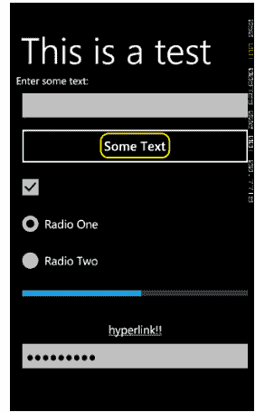

图 8.3 更多的用户输入元素。

## 显示图像

为应用增添趣味的最简单方法之一就是使用图像。在 UI 中精心使用小而精致的图像，甚至在 UI 中间使用大图像，都能为应用增色不少，并且往往是使你的应用超越竞争对手的因素。

在 iOS 中使用图像时，开发者通常使用 `UIImageView` 类。此类派生自 `UIView`，其唯一用途就是显示图像。同样，Windows Phone 7 开发者可以使用 Silverlight 的 `Image` 控件，无论通过编程方式还是通过 XAML 标记，该控件都非常易于使用。

以下代码展示了一个完全通过 XAML 配置的基本图像控件。

```
<Grid x:Name="myGrid" Width="150" Height="150" Background="White">
    <Image x:Name="myImage"
        Source="/images/SuperAwesomeScreen.jpg" Stretch="Fill" />
</Grid>
```

暂时不必担心 `Grid` 元素，我们稍后会介绍它。在上述代码中，`Image` 控件被配置为以 `Fill` 拉伸模式显示名为 `SuperAwesomeScreen.jpg` 的 JPEG 图像。

图像的拉伸模式可以设置为 `None`、`Fill`、`Uniform` 或 `UniformToFill`。无拉伸意味着图像将按其文件的原始尺寸显示。`Fill` 拉伸模式意味着图像将扩展，以填满其所在的任何布局容器。在上述代码中，父级网格是 150×150，因此无论图像原始尺寸如何，都会缩放至该尺寸。使用 `Fill` 模式时，图像的长宽比不会保持，因此常常会扭曲原始图像。若要即使在缩放后仍保持高度和宽度之间的比例，请使用 `Uniform` 拉伸模式。此模式会将图像尽量拉伸至新尺寸，同时仍然保持原始长宽比。最后，`UniformToFill` 拉伸模式类似于 `Uniform`，但它允许裁剪部分图像，以更好地适配父容器。除了 `Stretch` 属性之外，你还可以控制图像的其他多个方面，例如 `Width`、`Height` 和 `Clip`，`Clip` 可用于赋予图像非矩形形状。

在本章一直使用的同一个 `MainPage.xaml` 文件中，将以下 `Image` 元素添加到 `StackPanel` 中第一个 `TextBlock` 控件的上方。

```
<Image x:Name="sampleImage" />
```

就这样。`Stretch` 属性的默认模式是 `Uniform`，这对我们的目的来说已经足够。现在转到 XAML 的代码隐藏文件，将超链接按钮的 `Click` 事件的实现改为以下内容：

```
private void hyperLinkButtonOne_Click(object sender, RoutedEventArgs e)
{
    sampleImage.Source = new BitmapImage(
        new Uri("success.jpg", UriKind.RelativeOrAbsolute));
}
```

当此代码执行时，它将告诉 `Image` 控件它有一个新的源。这将导致 `Image` 控件立即根据新内容重新绘制自身。`success.jpg` 文件包含在随本章附带的示例代码中，可以在图 8.4 中看到。

尽管这个示例看起来可能很简单，但这只是图像功能应用冰山一角。了解图像的源和其他属性可以在运行时完全更改，这为各种强大的功能铺平了道路，例如从互联网或应用服务器下载和缓存图像，甚至即时创建图像、显示它们，并将它们上传到应用服务器。对于图像，唯一的限制可能就是你的想象力。

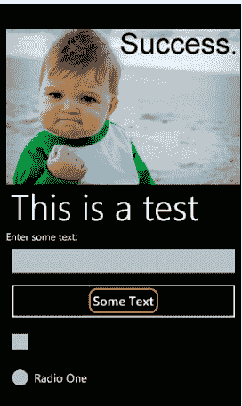

图 8.4 使用 Image 控件。

## 使用基本列表框

到目前为止，我们一直在处理与单个信息相关的控件，例如单张图像、单个文本框或单个按钮。列表框控件使我们能够定义模板，这些模板将用于呈现列表中的项目。该控件内置了滚动浏览项目的能力（包括显示一个

`scrollbar` at the appropriate times) and to respond to the selection of items, including changing their appearance when selected. Basically, it’s everything you would expect from a list control.


To see this in action, right-click the Chapter 8 Basic Controls project and add a new portrait Windows Phone 7 page to the project; call it `ListBoxPage.xaml`. After the second `TextBlock` that is part of the default page, add the following code snippet to the page:

```
<ListBox x:Name="myList">
    <ListBox.ItemTemplate>
        <DataTemplate>
            <StackPanel Orientation="Horizontal">
                <Image Source="pistol_bullet.png"/>
                <TextBlock Height="30" Text="{Binding}" Margin="10,10,10,10" />
            </StackPanel>
        </DataTemplate>
    </ListBox.ItemTemplate>
</ListBox>
```

There are a couple of new things in here. I’m actually showing you a little bit about data binding before I even get to that chapter!

At first we define a `ListBox` element and give it a name (`myList`). Next, we define an Item Template for the list box and place a data template within that. Templating and binding are topics covered later in the book, but for now you can think of a template as a piece of markup that is applied to each item as it is bound to a CLR object. We will also cover the `StackPanel` control in the next section of this chapter.

Open up the code-behind for this page and place the following code into the constructor:

```
public partial class ListBoxPage : PhoneApplicationPage
{
    public ListBoxPage()
    {
        InitializeComponent();

        List<string> dummyData = new List<string>()
        {
            "Al",
            "Bob",
            "John",
            "Steve",
            "Ringo",
            "Zappo"
        };

        myList.ItemsSource = dummyData;
    }
}
```

This code creates a list of strings and then sets that as the `ItemsSource` of the list box. The list box will take this list of strings, merge that with the data template we provided, and produce a screen that looks something like what you see in Figure 8.5.

To get your application to display this page, modify the code for the hyperlink button’s click event to navigate to the new page, as shown here:

```
private void hyperLinkButtonOne_Click(object sender, RoutedEventArgs e)
{
    sampleImage.Source = new BitmapImage(
        new Uri("success.jpg", UriKind.RelativeOrAbsolute));
    this.NavigationService.Navigate(
        new Uri("/ListBoxPage.xaml", UriKind.Relative));
}
```

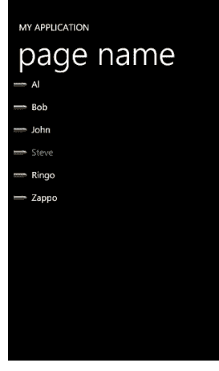

Figure 8.5 Displaying the contents of a list box.

As you will see as we progress throughout the book, list boxes are far more powerful than just displaying simple lists of data. Through the use of templates and styles, you can create some amazing experiences using just a “simple” list box.

For example, one of my favorite demos to give at presentations is to illustrate turning a list box into a radar screen by turning the item container into a canvas and plotting the data-bound objects into the radar field with icons, all without creating a single custom control and using facilities available within just the list box control.

## Performing Basic Animations

Although you can certainly create compelling user interfaces without any animation, today’s typical smartphone users demand more from their apps. They want things to rotate, spin, bounce, jiggle, and do so in a smooth, subtle way that gives them animated feedback to let them know when the application is doing something, as well as to make the application look and feel good.

As you progress throughout this book you will see more animations and, if you want to dive into animations in depth, I suggest you pick up a copy of Silverlight 4 Unleashed, by Laurent Bugnion. Although some subtle differences exist in Silverlight versions between the full and mobile versions, this book will give you a great deal of information on how animation works.

To whet your appetite for animations, open up the `ListBoxPage.xaml` file you worked with in the previous section. Comment out the list box (highlight the control from begin tag to end tag and press Ctrl+K, and then Ctrl+C; this will wrap the entire block in HTML-style comments) and change the XAML so that it looks like the code in Listing 8.8.

### Listing 8.8 `ListBoxPage.xaml`, Modified for Animation

```
<phone:PhoneApplicationPage
    x:Class="BasicControls.ListBoxPage"
    xmlns="http://schemas.microsoft.com/winfx/2006/xaml/presentation"
    xmlns:x="http://schemas.microsoft.com/winfx/2006/xaml"
    xmlns:phone="
    clr-namespace:Microsoft.Phone.Controls;assembly=Microsoft.Phone"
    xmlns:shell=
    "clr-namespace:Microsoft.Phone.Shell;assembly=Microsoft.Phone"
    xmlns:d="http://schemas.microsoft.com/expression/blend/2008"
    xmlns:mc="http://schemas.openxmlformats.org/markup-compatibility/2006"
    FontFamily="{StaticResource PhoneFontFamilyNormal}"
    FontSize="{StaticResource PhoneFontSizeNormal}"
    Foreground="{StaticResource PhoneForegroundBrush}"
    SupportedOrientations="Portrait" Orientation="Portrait"
    mc:Ignorable="d" d:DesignHeight="768" d:DesignWidth="480"
    shell:SystemTray.IsVisible="True">
    <phone:PhoneApplicationPage.Resources>
        <Storyboard x:Name="buttonStoryboard">
            <DoubleAnimation Storyboard.TargetProperty="(Canvas.Top)"
                Storyboard.TargetName="animateButton"
                From="10" To="200" Duration="0:0:5"/>
            <DoubleAnimation Storyboard.TargetProperty="(Canvas.Left)"
                Storyboard.TargetName="animateButton"
                From="10" To="200" AutoReverse="true"
                RepeatBehavior="Forever"
                Duration="0:0:1"/>

</Storyboard>
</phone:PhoneApplicationPage.Resources>

<Grid x:Name="LayoutRoot" Background="Transparent">
    <Grid.RowDefinitions>
        <RowDefinition Height="Auto"/>
        <RowDefinition Height="*"/>
    </Grid.RowDefinitions>

    <StackPanel
        x:Name="TitlePanel" Grid.Row="0" Margin="12,17,0,28">
        <TextBlock x:Name="ApplicationTitle"
Text="MY APPLICATION" Style="{StaticResource PhoneTextNormalStyle}"/>
        <TextBlock x:Name="PageTitle" Text="page name"
Margin="9,-7,0,0" Style="{StaticResource PhoneTextTitle1Style}"/>
        <!-- <ListBox x:Name="myList">
            <ListBox.ItemTemplate>
                <DataTemplate>
                    <StackPanel Orientation="Horizontal">
                        <Image Source="pistol_bullet.png"/>
                        <TextBlock Height="30" Text="{Binding}"
                            Margin="10,10,10,10" />
                    </StackPanel>
                </DataTemplate>
            </ListBox.ItemTemplate>
        </ListBox>-->
        <Canvas Width="300" Height="500">
            <Button Canvas.Top="10"
                Canvas.Left="10"
                x:Name="animateButton"
                Click="animateButton_Click">
                <TextBlock Text="Click to Animate"/>
            </Button>
        </Canvas>
        <TextBlock x:Name="buttonPosition" Text="(none)"/>
    </StackPanel>

    <Grid x:Name="ContentPanel" Grid.Row="1"
        Margin="12,0,12,0"></Grid>
</Grid>
</phone:PhoneApplicationPage>
```

At this point, your app won’t compile, so resist the urge to click Build. We still need to write a few more lines of code.

I’ve highlighted in bold a `Storyboard` object that I added to the page’s resource dictionary. Don’t worry if this doesn’t make much sense now, it will become clearer as you start writing more complex applications and progress through the book.

This storyboard contains two animations that will both start at the same time when the storyboard is started. If you are familiar with iOS and Cocoa development, you can think of the storyboard much like an animation context. For example, in iOS to perform a set of animations simultaneously, you first call the `beginAnimations:` method of the `UIView` class. After configuring all the animations you want to perform, as well as options like duration and easing curve, you call the `commitAnimations:` method of the `UIView` class.


For Windows Phone 7 Silverlight animations, the `storyboard` serves as the aggregator for related animations. In this case, we are going to animate the `Canvas.Top` property from 10 to 200 over the course of 5 seconds. At the same time, we animate the target button’s `Canvas.Left` property from 10 to 200, but for this property we will reverse the animation and continue indefinitely. This will have the effect of moving the target button horizontally across the screen and back again forever.

After you’ve modified your XAML according to the code in Listing 8.8, add the following method to the `ListBoxPage.xaml.cs` file:

```
private void animateButton_Click(object sender, RoutedEventArgs e)
{
    if (buttonStoryboard.GetCurrentState() == ClockState.Stopped)
        buttonStoryboard.Begin();

    double top = (double)animateButton.GetValue(Canvas.TopProperty);
    double left = (double)animateButton.GetValue(Canvas.LeftProperty);

    buttonPosition.Text = string.Format("{0},{1}", top, left);
}
```

## Dependency Properties

If you look carefully at how the Button is positioned within the Canvas, you’ll see that it sets properties called `Canvas.Top` and `Canvas.Left`. The button itself does not have a `Top` or a `Left` property because those properties make sense only when the button is a child control of a Canvas. To keep controls from being littered with these situational properties (among many other reasons), dependency properties were created.

When you want to place a control somewhere within a Grid, you set the `Grid.Row` and `Grid.Column` properties on that control. These properties belong to the `Grid` class, but can be set on any object residing within a grid. These properties can also notify subscribers when they change and can be animated by Silverlight’s animation sub-system. You see this when you look at the code that displays the current values of the `Canvas.Top` and `Canvas.Left` properties in the code for the animation button’s `Click` event. Even though a background thread is constantly changing the value of the control’s position within a Canvas, you can still read those values through the dependency property system.

> 有关依赖属性及其工作原理的更多信息，您可以查阅《WPF Unleashed》或《Silverlight Unleashed》。了解这些是如何工作的以及如何发挥其强大功能，将使您成为针对移动设备和桌面均极其高效的 Silverlight 开发者。

现在运行应用程序并导航到列表框页面。点击按钮时它会开始移动。持续点击按钮，随着它缓慢向下移动。每当按钮在移动时您点击它，它都会在您点击的精确时刻报告其在父画布内的当前位置，即使有一个完全独立的后台线程正在执行动画。

## Silverlight 中的布局简介

在本章中迄今为止，您已经看到了几种类型的布局控件。本章的这一部分将提供有关每种类型布局控件的用途、它们的工作方式以及您如何在应用程序中使用它们的更多细节。

布局是 Silverlight 相对于 iOS 具有明显优势的一个领域。iOS 不提供像 `StackPanel` 或 `Grid` 那样的低级、灵活的布局面板控件。`UIView` 本身就像 WP7 `Canvas` 一样——子视图基于其坐标以固定位置放置在父视图内。iOS 中也没有 `Grid` 控件；最接近的做法是创建表格视图控制器（我们将在后面的章节中讨论各种 WP7 对 Table View Controller 的替代方案，以及自定义单元格的细分）。作为 iOS 开发者，在您开始使用 Silverlight 的高级布局功能后，您很可能会很快上瘾于拥有如此强大的功能。

## 在 Canvas 上绘图

从之前的代码示例中您可能已经猜到了，`Canvas` 控件提供了一个固定位置的布局面板。面板内的任何子控件在其 `Canvas` 中都有一个固定位置，由 `Canvas.Top` 和 `Canvas.Left` 依赖属性指示。

您按如下方式在 XAML 中定义 `Canvas`：

```
<Canvas x:Name="myCanvas" Width="300" Height="400">
    <TextBlock Text="This is inside a Canvas"
        Canvas.Top="40" Canvas.Left="100" />
</Canvas>
```

正如本章前面提到的，您并不局限于使用普通的 `Canvas`。您可以在其他布局面板内嵌套 `Canvas`，也可在画布内托管其他布局面板。您还可以做一些创新性的事情，例如将列表框的布局面板从默认更改为 `Canvas`，以便列表项以固定、绝对位置呈现。

## 使用 StackPanel

顾名思义，`StackPanel` 是一个将子元素按堆栈排列的布局面板，可以是水平或垂直排列。您无需指定哪些控件以何种顺序出现，也无需指定任何坐标。

唯一需要注意的是子控件在 `StackPanel` 内的出现顺序。堆栈面板的第一个子元素将是面板中首先出现的一个。请看以下堆栈面板定义：

```
<StackPanel Orientation="Vertical">
    <Button>
        <TextBlock Text="Button 1"/>
    </Button>
    <Button>
        <TextBlock Text="Button 2"/>
    </Button>
    <Button>
        <TextBlock Text="Button 3"/>
    </Button>
    <Button>
        <TextBlock Text="Button 4"/>
    </Button>
</StackPanel>
```

默认情况下，`StackPanel` 会垂直渲染其子元素，每个新的子元素都放置在其前一个同级元素下方。要使 `StackPanel` 内的元素水平渲染，请将堆栈面板的 `Orientation` 属性更改为 `Horizontal`。

与 `Canvas` 一样，通过在彼此之间、在 `Canvas` 内或在 `Grids` 内嵌套多个 `StackPanels`，您可以获得非常不错且非常强大的结果。

## 使用 Grid 控件

`Grid` 控件是一个极其强大的布局面板。我不会在这里详细介绍 `Grid` 的各种细节和细微差别，因为您可以在 Microsoft 的 MSDN 文档或您喜爱的 Silverlight 书籍中在线获得详尽的细节。以下是简单的 `Grid` 定义：

```
<!--ContentPanel - place additional content here-->
<Grid x:Name="ContentPanel" Grid.Row="1" Margin="12,0,12,0" Background="AliceBlue">
    <Grid.ColumnDefinitions>
        <ColumnDefinition Width="200"/>
        <ColumnDefinition Width="200"/>
        <ColumnDefinition Width="55"/>
    </Grid.ColumnDefinitions>
    <Grid.RowDefinitions>
```

```
<RowDefinition Height="60"/>
<RowDefinition Height="75"/>
<RowDefinition Height="75"/>
</Grid.RowDefinitions>
<Border Grid.Row="0" Grid.Column="0" BorderBrush="DarkGreen" BorderThickness="0,0,0,4" Background="BlanchedAlmond">
    <TextBlock TextAlignment="Center" VerticalAlignment="Center" Foreground="DarkGreen" FontWeight="Bold" Text="Account Number"/>
</Border>
<Border Grid.Row="0" Grid.Column="1" BorderBrush="DarkGreen" BorderThickness="0,0,0,4" Background="BlanchedAlmond">
    <TextBlock TextAlignment="Center" VerticalAlignment="Center" Foreground="DarkGreen" FontWeight="Bold" Text="Account Name"/>
</Border>
<Border Grid.Row="0" Grid.Column="2" BorderBrush="DarkGreen" BorderThickness="0,0,0,4" Background="BlanchedAlmond">
    <TextBlock TextAlignment="Center" VerticalAlignment="Center" Foreground="DarkGreen" FontWeight="Bold" Text="?"/>
</Border>
<!-- actual rows -->
<Border Grid.Row="1" Grid.Column="0" BorderBrush="Black" BorderThickness="0,0,1,1">
    <TextBlock TextAlignment="Center" VerticalAlignment="Center" Foreground="Black" Text="ACT00001"/>
</Border>
<Border Grid.Row="1" Grid.Column="1" BorderBrush="Black" BorderThickness="0,0,1,1">
    <TextBlock TextAlignment="Center" VerticalAlignment="Center" Foreground="Black" Text="Account 1"/>
</Border>
<Border Grid.Row="1" Grid.Column="3" BorderBrush="Black" BorderThickness="0,0,1,1">
    <CheckBox IsChecked="True" Background="Transparent" />
</Border>
<Border Grid.Row="2" Grid.Column="0" BorderBrush="Black" BorderThickness="0,0,1,1">
    <TextBlock TextAlignment="Center" VerticalAlignment="Center" Foreground="Black" Text="ACT00002"/>
</Border>
```

```
<Border Grid.Row="2" Grid.Column="1" BorderBrush="Black"
    BorderThickness="0,0,1,1">
    <TextBlock TextAlignment="Center" VerticalAlignment="Center"
        Foreground="Black"
        Text="Account 2"/>
</Border>
<Border Grid.Row="2" Grid.Column="3" BorderBrush="Black"
    BorderThickness="0,0,1,1">
    <CheckBox IsChecked="False" Background="Transparent"/>
</Border>
</Grid>
```

前面的代码生成了一个看起来像图 8.6 所示的显示。

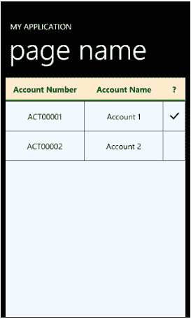

图 8.6 在网格中显示控件。

## 导航到测试和草稿页面

正如本章中多次看到的那样，Silverlight 开发者在进行快速原型设计时常见的做法是创建一个新的空白页面来尝试某件事。他们可能会使用这个新的空白页面来查看他们想要编写的控件的想法、想要使用的样式、数据绑定模板或任何其他内容。

本章前面您看到我们修改了一个超链接，以便我们可以导航到我们的实验页面。虽然这对于一本书来说可行，但在实际场景中通常很丑陋且繁琐。我喜欢这样做：

- 首先，在您的项目中创建一个新文件夹并将其命名为 `Playground`。在此文件夹中创建新的 WP7 测试页面。现在，而不是通过在真实 UI 中散布指向所有测试页面的链接来破坏您的真实 UI，您可以修改您的应用程序，使其在启动时直接进入您的测试页面。
- 在解决方案资源管理器中展开项目下方的 `Properties` 节点。双击文件 `WMAppManifest.xml`。查找名为 `DefaultTask` 的 XML 元素。在这里您会看到一个名为 `NavigationPage` 的属性。将其从 `MainPage.xaml` 更改为 `/Playground/Whatever.xaml`。下次启动应用程序时，它将直接加载到您的测试页面，而不会破坏您的真实 UI。
- 当您对在 `Playground` 文件夹中处理的页面的 XAML 标记感到满意时，您可以将其复制并粘贴到您的真实 UI 中。

如果您以前使用过 HTML 表格，那么您已经对 `Grid` 控件的工作原理有了相当好的起点。它基于简单的列和行原则运行。您可以添加属于单个列的子元素、跨越多个列、跨越单个列内的多行，等等。

棘手的部分是 `Grid` 没有动态的行数。换句话说，如果您有三个行定义并尝试添加一个行值为 3 的控件（请记住，行和列都从索引 0 开始），该控件将不会出现。您不能在没有适当行定义的情况下添加元素。

这是重要区别，因为熟悉 Silverlight 的开发者，尤其是熟悉 iOS `UITableViewController`（及其控制的表格视图）的开发者，往往期望网格能够动态生成行。虽然您可以以编程方式操作网格以向其添加行，但这与列表框不同，列表框期望在运行时显示未知数量的行。奇怪的是，对于寻找电子表格风格的数据显示的人来说，常采用的技巧是使用列表框，其中每一行都生成一个固定大小的网格。

## 总结

本章为您提供了 Windows Phone 7 开发者可用的各种原始控件的快速概览，并将其与 iOS 开发者可用的一些类似产品进行了比较。在某些情况下，例如动态布局面板，我们涵盖了 iOS 中不可用的控件。

我故意避免对任何一个控件进行过多的细节介绍，因为本章的重点是为您提供 Windows Phone 7 SDK 通过 Silverlight 访问的基本功能的全景视图。

使用文本框、文本块、按钮、布局面板、图像，甚至基本的动画，您已经在通往编写强大的 WP7 应用程序的道路上迈出了良好的开端，而我们才刚刚触及这个令人难以置信的 SDK 的表面。

# 使用高级 UI 元素

> *形式追随功能——这已被误解。*
> 
> *形式与功能应合二为一，融为一体。*
> 
> 弗兰克·劳埃德·赖特

本章专门聚焦于将你对某些类型应用和应用组件的知识从 iOS 迁移到 Windows Phone 7。即使你不是 iOS 开发者，你也可能会了解到这些各种应用组件在 iPhone 上的外观。

在构建 iOS 应用时，你会看到一些类型的应用组件被反复使用，以至于这些组件在几乎任何 iOS 应用中都立刻可以被识别出来，无论它们被定制了多少。


导航栏在如此多的应用中使用，以至于几乎很难找到一个不使用它的应用。接下来，本章将介绍标签栏应用的使用方式，以及如何将标签栏应用迁移以具有相同的功能但使用原生的 WP7 UI 元素。最后，本章将介绍在 iOS SDK 中 arguably 最常用的控制器：表格视图控制器。本章的最后一部分将介绍开发人员希望将表格视图控制器应用迁移到 Windows Phone 7 时可用的各种选项。

## 从导航栏迁移

使用导航控制器构建 iOS 应用对几乎任何 iOS 开发者来说都几乎是第二天性。不仅 Xcode 附带了内置的用于构建导航应用的模板，而且 Interface Builder（或 v4+ 中的 Xcode）使得向任何界面添加导航控制器变得非常容易。

导航控制器的目的是使浏览屏幕层次结构变得容易。该控制器带有内置设施，可为每个视图提供标题、后退按钮，甚至控制“旋钮”如编辑按钮，可通知 UI 的其他部分从只读模式切换到视图模式。

正如我在本书中多次所说，iOS SDK 是目的驱动的。导航控制器就是一个明显的例子。苹果希望使浏览屏幕的体验顺畅，更重要的是，保持一致。任何使用过 iPhone 的人都了解这种一致性，因为导航控制器的无处不在及其一致的外观和感觉使得后退（或“向上”层级）、向下钻取或更改屏幕状态几乎成为本能。

Windows Phone 7 SDK 中没有导航控制器的直接对应物，但一些控件和一个完整的导航子系统使得自行构建可导航的 UI 变得相当容易。首先我们将看看 Silverlight 导航系统（可在常规和 WP7 版本的 Silverlight 中使用），然后我们将看看一些可能的方式，我们可以在此系统之上放置一个漂亮易用的 UI，甚至考虑一些我们不希望使用导航 UI 的场景。

图 9.1 是 FB Investor iPhone 应用的屏幕截图，该应用跟踪 FortuneBuilders 团队成员的活动。在此屏幕截图顶部，你可以看到一个导航控制器。这些控制器通常有一个视图表现为这个顶部栏。栏的中间部分保留用于层次结构中当前视图的标题，左侧在有可返回的视图时保持为空，如图 9.2 所示。

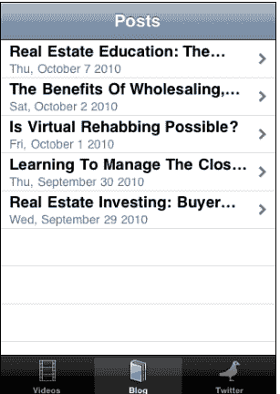

图 9.1   iOS 导航控制器位于层级顶部。

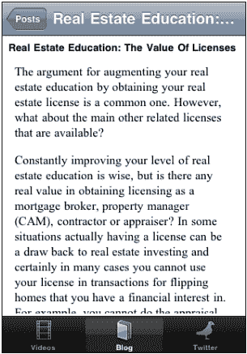

图 9.2 iOS 导航控制器位于层级中间。

图 9.2 显示了一个 iOS 导航控制器，它至少在视图树或层次结构中处于一层深度。你可以通过后退按钮的标题看到点击它将带你返回到标题为 Posts 的视图，而当前视图是显示博客文章内容的视图。

接下来的几节将向你展示如何使用 Silverlight 在 Windows Phone 7 上实现这种功能（尽管 UI 不完全相同）。

## 使用 Silverlight 导航系统

Silverlight 导航系统是通过单个对象公开的 API，即 `NavigationService` 对象，它是 `Page` 对象的属性。它在用户浏览应用时维护一个基本的导航轨迹。

`CanGoForward` 和 `CanGoBackward` 属性为开发者提供了一种基本的方式来查询用户的导航历史。如果任一属性为 `true`，则可以分别调用 `GoForward()` 和 `GoBack()` 方法。如果你尝试在无法向该方向导航时调用任一方法，将会抛出异常。为了安全并避免抛出不必要的异常，请始终在执行实际导航前检查这些属性的值。要将用户从一个页面移动到另一个页面，请使用 `Navigate()` 方法。

尽管这可能看起来像一个简单的概念，但看到它实际运行有助于了解一切如何工作。为此，创建一个新的 Windows Phone 应用，这将创建一个纵向的主页面。在 `MainPage.xaml` 上，添加一个名为 `navigateButton` 的新按钮。以下代码片段显示了此按钮的 `Click` 事件处理程序：

```
private void navigateButton_Click(object sender, RoutedEventArgs e)
{
    NavigationService.Navigate(new Uri("/Page1.xaml", UriKind.Relative));
}
```

此代码会立即将用户从 `MainPage.xaml` 导航到 `Page1.xaml`。用户源自 `MainPage.xaml` 的事实将被存储在导航系统中。当用户登陆 `Page1.xaml` 页面时，NavigationSystem 的 `CanGoBack` 布尔属性将为 `true`。此外，当从 `Page1.xaml` 调用 NavigationSystem 对象的 `GoBack()` 方法时，用户将被发送回 `MainPage.xaml`。

你可以通过向项目添加一个新纵向页面来看到这一点（保留默认名称 `Page1`）。在该页面上，添加一个按钮并将其 `Click` 处理程序设置为以下内容：

```
private void backButton_Click(object sender, RoutedEventArgs e)
{
    if (NavigationService.CanGoBack)
        NavigationService.GoBack();
}
```

注意我们在调用 `GoBack()` 方法之前检查是否可能进行向后导航。你也可以使用布尔属性 `CanGoBack` 和 `CanGoForward` 来激活或停用你自己的导航栏控件的各个部分。

### WP7 无向前移动

> 无论你何时尝试或如何尝试，你都永远无法在 Windows Phone 7 上通过导航层次结构向前移动。尽管 WP7 的 Silverlight 版本可能与桌面版本几乎相同，但仍存在一些差异，而这就是其中之一。桌面版 Silverlight 允许用户向前和向后，而在 WP7 上，`CanGoForward` 属性永远不会为 `true`，而 `GoForward()` 方法将始终抛出异常。

实际导航只是系统的一小部分。真正的工作在于页面本身以及它们如何响应构造、导航和激活。在 iOS 应用中，开发者通常对将要导航到的视图控制器的实例化有明确的控制。这意味着开发者也对该对象的生命周期有明确的控制。

使用 Silverlight 导航系统，这些页面的生命周期和激活周期可能并不立即明显。你需要知道何时以及在何处放置将在页面首次创建时、加载时以及用户导航到页面时执行的代码。未能注意这些可能会导致从性能问题到内存问题甚至更糟——你的应用崩溃。

## 使用页面构造函数

每个页面对象仍然只是一个 C# 对象，因此具有常规构造函数。当你为 WP7 应用创建一个新页面对象时，它带有调用 `InitializeComponent()` 方法的构造函数。它看起来像以下片段中的代码：

```
public partial class Page1 : PhoneApplicationPage
{
    public Page1()
    {
        InitializeComponent();
    }
}
```

`InitializeComponent()` 方法调用由 XAML 标记生成的代码，根据你在设计表面看到的标记配置一切。无需深入细节了解该方法内部发生的事情，关键是要记住，直到调用此方法后，你在用户界面中定义的对象才可用供你使用。简而言之，不要在 `InitializeComponent()` 方法调用之前在构造函数中创建任何初始化代码。

页面构造函数的棘手之处在于它们只在非常特定的时间被调用。应用的默认（第一个）登陆页面的构造函数在应用启动时被调用。其他页面的构造函数除非你手动实例化页面或用户通过对 `NavigationService` 对象的 `Navigate()` 调用导航到页面，否则不会被调用。

在应用运行过程中，页面可能在某个时刻被从内存中移除。我将在后面的章节中介绍 tombstoning 和多任务处理的话题，但现在请记住，页面在构造函数被调用后可能不会永远留在内存中，并且如果应用从之前的挂起状态“唤醒”，其构造函数可能会被多次调用。

我提到这一点的原因是人们经常养成懒惰的习惯，假设构造函数是绝对的，因此他们在其中获取所需的数据，然后假设该数据将永远存在。

## 使用页面加载事件

依赖构造函数进行初始化代码的一个问题是构造函数被调用的频率非常低且时间往往不可预测。`Page` 的 `Loaded` 事件恰如其名，每当页面被加载时就会被调用。

`Loaded` 事件是一个低级事件，你会在 Silverlight 中的大多数 UI 元素上找到它，包括形状、按钮、边框、文本块等。你应该将页面 `Loaded` 事件在导航期间被调用视为一种副作用。即使你可能看到加载和导航之间存在 1:1 的对应关系，也不要将它们视为相同。除了导航之外，还有更多方式可以加载页面，因此可能会有意想不到的时机在你的页面上触发 `Loaded` 事件。因此，除非你对此进行了防护，或者你正是利用了这一事实，否则不要在此处放置初始化代码。

要利用 `Loaded` 事件，你需要在 `Page` 的构造函数中订阅它（在调用 `InitializeComponent()` 之后！），如下所示：

```
public Page1()
{
    InitializeComponent();
    this.Loaded += new RoutedEventHandler(Page1_Loaded);
}
```

```
void Page1_Loaded(object sender, RoutedEventArgs e)
{
    // do something important.
    Debug.WriteLine("Page1 was loaded.");
}
```

在现有的导航示例中尝试这段代码。观察调试输出窗口中何时出现“Page1 was loaded.”这一短语。你会看到每次导航到该页面时它都会出现（即使你使用后退按钮返回到该页面）。这里的小 caveat 是，有时你的代码可能会做一些足够棘手的事情，导致 `Loaded` 事件在你不期望时触发。

## 使用 OnNavigatedTo 方法

当你真的想将代码与导航事件关联时，最好的做法是重写 `OnNavigatedTo` 方法。此方法属于 WP7 `Page` 对象的一部分，因此你无需订阅事件；只需重写该方法并在其中放置你的代码即可。此外，还有 `OnNavigatedFrom` 方法和 `OnNavigatingFrom` 方法。下表描述了何时调用这些方法。

| Method | Description |
|---|---|
| `OnNavigatedTo` | 当页面已被导航到时。請注意，这是在目标页面的 `Loaded` 事件触发之前调用的。 |
| `OnNavigatedFrom` | 当用户离开当前页面转而前往另一页面后调用。 |
| `OnNavigatingFrom` | 当用户触发离开当前页面的导航操作但在实际导航到新目标之前调用。 |

将以下重写方法添加到 `Page1.xaml.cs` 文件中并运行应用程序，在 `MainPage.xaml` 和 `Page1.xaml` 之间来回导航。密切关注 `Debug` 输出窗口以及何时调用这些方法。

```
protected override void OnNavigatedTo(
System.Windows.Navigation.NavigationEventArgs e)
{
    System.Diagnostics.Debug.WriteLine("Navigated to page1.");
}
```

```
protected override void OnNavigatingFrom(
    System.Windows.Navigation.NavigatingCancelEventArgs e)
{
    System.Diagnostics.Debug.WriteLine("NavigatING from page1.");
}
```

```
protected override void OnNavigatedFrom(
    System.Windows.Navigation.NavigationEventArgs e)
{
    System.Diagnostics.Debug.WriteLine("Navigated From page1.");
}
```

## 使用动画增强导航事件

iOS 导航控制器及其所有组件所提供的众多“免费”功能之一就是——移动部件。当你将另一个控制器“推”到导航控制器上时，整个 UI 会向左滑动，露出新控制器的视图层次结构从右侧滑入。

正如你所知，iOS SDK 使利用默认的外观和感觉变得非常容易，而其他一切则稍微困难一些。对于 Windows Phone 7，我们可以轻松访问几乎任何类型的动画效果，并将其绑定到导航事件以创建我们自己的动画过渡。

为了看看我们可以为导航事件配置哪些动画，我将修改 `MainPage` 类，以便当你导航到 `Page1` 时，页面的整个 UI 会像打开的门一样向你摆动，露出下方 `Page1` 的 UI。当用户导航回 `MainPage` 时，同一扇门会“关上”，再次隐藏 `Page1` 的 UI。这种特定的样式非常适合主-细节视图之间的过渡。在你完成本示例的跟随后，尝试调整时序和其他选项，如网格透明度和旋转角度——可能性无穷无尽。

Listing 9.1 显示了修改后的 `MainPage.xaml`。请特别注意新的 storyboards 以及 `Grid` 控件的一个新添加项，属于 `Grid.Transform` 元素的 `PlaneTransform` 元素。这突出了 Silverlight 独特的能力，即在无需让开发者在 3D 引擎中渲染整个 UI 的情况下提供 2D 元素的 3D 变换。

### Listing 9.1 `MainPage.xaml`—Animated Page Transitions


```
<phone:PhoneApplicationPage
    x:Class="NavigationBars.MainPage"
    xmlns="http://schemas.microsoft.com/winfx/2006/xaml/presentation"
    xmlns:x="http://schemas.microsoft.com/winfx/2006/xaml"
    xmlns:phone="
        clr-namespace:Microsoft.Phone.Controls;assembly=Microsoft.Phone"
    xmlns:shell=
        "clr-namespace:Microsoft.Phone.Shell;assembly=Microsoft.Phone"
    xmlns:d="http://schemas.microsoft.com/expression/blend/2008"
    xmlns:mc="http://schemas.openxmlformats.org/markup-compatibility/2006"
    mc:Ignorable="d" d:DesignWidth="480" d:DesignHeight="768"
    FontFamily="{StaticResource PhoneFontFamilyNormal}"
    FontSize="{StaticResource PhoneFontSizeNormal}"
    Foreground="{StaticResource PhoneForegroundBrush}"
    SupportedOrientations="Portrait" Orientation="Portrait"
    shell:SystemTray.IsVisible="True">
    <phone:PhoneApplicationPage.Resources>
        <Storyboard x:Name="openDoorStoryBoard">
            <DoubleAnimation Storyboard.TargetName="gridPlaneProjection"
                             Storyboard.TargetProperty="RotationY"
                             From="0"
                             To="90"
                             Duration="0:0:1"/>
        </Storyboard>
        <Storyboard x:Name="closeDoorStoryBoard">
            <DoubleAnimation Storyboard.TargetName="gridPlaneProjection"
                             Storyboard.TargetProperty="RotationY"
                             From="90"
                             To="0"
                             Duration="0:0:1"/>
        </Storyboard>
    </phone:PhoneApplicationPage.Resources>

    <!--LayoutRoot is the root grid where all page content is placed-->
    <Grid x:Name="LayoutRoot" Background="Transparent">
        <Grid.Projection>
            <PlaneProjection
                x:Name="gridPlaneProjection" CenterOfRotationX="0.0"/>
        </Grid.Projection>
        <Grid.RowDefinitions>
            <RowDefinition Height="Auto"/>
            <RowDefinition Height="*"/>
        </Grid.RowDefinitions>

        <StackPanel x:Name="TitlePanel" Grid.Row="0" Margin="12,17,0,28">
```

```
<TextBlock x:Name="ApplicationTitle"
Text="MY APPLICATION"
Style="{StaticResource PhoneTextNormalStyle}"/>
<TextBlock x:Name="PageTitle"
Text="Main Page"
Margin="9,-7,0,0"
Style="{StaticResource PhoneTextTitleStyle}"/>
</StackPanel>
<!--ContentPanel - place additional content here-->
<Grid x:Name="ContentPanel" Grid.Row="1" Margin="12,0,0,0">
<StackPanel>
<Button
x:Name="navigateButton"
Click="navigateButton_Click" Height="75">
<TextBlock Text="Click to Navigate to Page 1" />
</Button>
</StackPanel>
</Grid>
</phone:PhoneApplicationPage>
```

## 从导航栏迁移

现在修改 `MainPage.xaml.cs`，使其看起来像 `Listing 9.2` 所示的代码。

### Listing 9.2 MainPage.xaml.cs—Animated Page Transitions

```
public partial class MainPage : PhoneApplicationPage
{
	// Constructor
	public MainPage()
	{
		InitializeComponent();
	}
	private void navigateButton_Click(object sender, RoutedEventArgs e)
	{
		openDoorStoryboard.Completed +=
			(s, ev) =>
			{
				NavigationService.Navigate(
					new Uri("/Page1.xaml", UriKind.Relative));
			};
		openDoorStoryboard.Begin();
	}
	protected override void OnNavigatedTo(
		System.Windows.Navigation.NavigationEventArgs e)
	{
	}
}
```

```
{
    // if the door isn't "open", don't shut it.
    if (gridPlaneProjection.RotationY == 90)
        closeDoorStoryBoard.Begin();
    }
}
```

现在尝试运行应用程序，观察 `MainPage.xaml` 中的网格如何摆动开，然后在摆动完成后导航到 `Page1`。动画被允许完成，因为我们在动画完成之前不执行实际导航，而是通过订阅 `Completed` 事件的匿名委托来实现。像这样使用 lambda `=>` 语法使用的匿名委托类似于 Mac 上 Cocoa 中 Blocks 的使用以及 iOS SDK 的更新版本中的使用。如果你在 iOS SDK 中使用了一些基于新 Blocks 的方法调用，语法应该看起来相当熟悉。

在进入下一节之前，尝试调整 3D 透视变换的配置以改变 UI 的出现和重新出现方式。`PlaneTransform` 的 `CenterOfRotationX`、`CenterOfRotationY` 和 `CenterOfRotationZ` 属性的默认值均为 `0.5`，将旋转置于 UI 元素的中心。通过将 `CenterOfRotationX` 值移至 `0.0`，当动画围绕 X 轴旋转 UI 元素时，它会在对象的最左侧进行旋转。如果我们将相同的旋转中心设置为 `1.0`，旋转将在对象的最右侧发生，并且我们必须更改旋转角度以保持门打开的外观。

## 关于 Storyboards 和 Double Animations 的说明

在迪士尼或皮克斯或任何其他动画公司的员工坐下来开始制作流畅的动画之前，他们需要制作通常称为 storyboard 的东西。

在传统意义上，storyboard 是一块大板子挂在墙上，动画师和其他工作人员在上面绘制电影中所有角色将如何行动。它通常看起来像一本漫画书，展示了说明动画流程的各个关键帧。关于 storyboards 的另一个重要点是，在任何给定时间，多个角色和对象可以在许多方向上移动。你很少会看到一部制作精良的卡通片，其中场景中的一切都绝对静止，而只有一个角色在移动。

在 Silverlight 和 Windows Phone 7 的意义上，storyboard 是一组动画，它们将并行开始。我说“开始”，因为由 storyboard 启动的动画可能不会在同一时间结束。

把你的 XAML 中的各种 UI 元素想象成场景中的角色或演员。在这个场景中，你的演员将以一种为观众使用你的应用程序的人产生令人愉悦且信息丰富的动作片段的方式移动。

故事板让你可以精确地规划出哪些元素会移动、移动速度有多快、移动到哪里等等。

故事板中包含的动画可以是任何内容，从简单的动画——将一个属性从源值更改为目标值，到复杂的动画，例如关键帧动画，在其中你指定属性在特定时间标记处的值应为多少。

我在前面的示例中使用的动画是双精度动画，它们在特定时间内将类型为 double 的属性从源值动画到目标值。

## 从 Tab Bar 应用迁移

在 iOS 应用中，标签栏控件是一个极其常见的控件，在 App Store 中的数千个应用中都会出现。此控件的目的是将应用划分为类别，或为应用特定功能提供快速、快捷方式式的访问。当标签数超过单条栏可显示的数量时，会出现“更多”按钮，将用户带到显示剩余标签列表的表格视图。点击任意标签都会启动与该特定标签关联的视图控制器。

尽管 Windows Phone 7 没有 Tab Bar 控件的完全复制品，但 WP7 开发者有大量选项可以构建服务于与 Tab Bar 控件相同目的的 UI。这些包括 `Pivot` 控件、`Panorama` 控件以及 `Application Bar` 控件。以下各节分别介绍这些控件以及它们如何支持“类似标签栏”的功能。

## 使用 Pivot 控件

`Pivot` 控件是一个功能强大的控件，但也同样易于使用。`Pivot` 有一个标题，然后是一系列 `PivotItem` 子控件。每个 `PivotItem` 控件都包含一个 XAML 视觉元素层次结构，可以是列表框、按钮或你喜欢的任何内容。

当 `Pivot` 控件首次出现时，第一个 pivot 项可见，并且第二个 pivot 项的标题在 `Pivot` 控件顶部第一个标题旁边可见。点击第二个 pivot 项的标题将使焦点从第一个 pivot 项枢转或滑动到第二个 pivot 项。这会一直持续到最后一个 pivot 项，在那里第一个 pivot 项的标题会出现，使你能够在无需担心使用返回按钮的情况下连续浏览项目。

你会在 Outlook for WP7 中看到 `Pivot` 控件被广泛使用。你可以在邮件的不同视图之间“枢转”，并且在你的应用中使用时，你可以在信息的不同类别或应用功能的不同区域之间枢转。

要查看 `Pivot` 控件的实际效果，你可以使用现成的 Pivot Application WP7 模板。打开 Visual Studio 并创建一个新项目。选择 Pivot Application 模板然后运行它。你应该会看到一个类似于图 9.3 的屏幕。

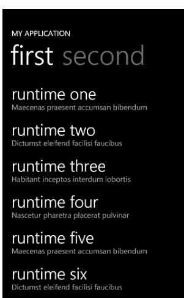

图 9.3 使用 Pivot 控件。

点击单词“second”以查看 `Pivot` 控件滑动，使第一个 pivot 项的内容移开，第二个 pivot 项的内容滑入视图。清单 9.3 显示了 `Pivot` 控件的 XAML。正如你所见，它相当直接，并且 `Pivot` 控件在代表你完成大量工作。

### 清单 9.3 Pivot 控件应用模板中的 MainPage.xaml

```
<controls:Pivot Title="MY APPLICATION">
    <!--Pivot item one-->
    <controls:PivotItem Header="first">
        <!--Double line list with text wrapping-->
        <ListBox x:Name="FirstListBox" Margin="0,0,-12,0"
            ItemsSource="{Binding Items}">
            <ListBox.ItemTemplate>
                <DataTemplate>
                    <StackPanel Margin="0,0,0,17" Width="432">
```

```
<TextBlock Text="{Binding LineOne}"
    TextWrapping="Wrap"
    Style="{StaticResource PhoneTextExtraLargeStyle}"/>
    <TextBlock Text="{Binding LineTwo}"
    TextWrapping="Wrap" Margin="12,-6,12,0"
    Style="{StaticResource PhoneTextSubtleStyle}"/>
    </StackPanel>
    </DataTemplate>
    </ListBox.ItemTemplate>
</ListBox>
</controls:PivotItem>
<!--Pivot item two-->
<controls:PivotItem Header="second">
    <!--Triple line list no text wrapping-->
    <ListBox x:Name="SecondListBox"
        Margin="0,0,-12,0" ItemsSource="{Binding Items}">
        <ListBox.ItemTemplate>
            <DataTemplate>
                <StackPanel Margin="0,0,0,17">
                    <TextBlock Text="{Binding LineOne}"
                    TextWrapping="NoWrap" Margin="12,0,0,0"
                    Style="{StaticResource PhoneTextExtraLargeStyle}"/>
                    <TextBlock Text="{Binding LineThree}"
                    TextWrapping="NoWrap" Margin="12,-6,0,0"
                    Style="{StaticResource PhoneTextSubtleStyle}"/>
                </StackPanel>
            </DataTemplate>
        </ListBox.ItemTemplate>
    </ListBox>
</controls:PivotItem>
</controls:Pivot>
```

使用此控件令人惊讶地容易。只需创建一个新的 `Pivot` 控件，然后定义你希望用户能够在其中枢转的面板即可。`Pivot` 可用于从复杂的业务应用到社交应用，甚至休闲游戏场景的一切。

尝试使用此控件，看看仅使用 `Pivot` 控件和上一章中讨论的原始 Silverlight 控件，你能制作出什么样的引人注目的 UI。你可能会对自己能完成多少感到惊讶。

## 使用全景应用

`Pivot` 控件将项目从你的视线中滑出并将新项目滑入固定背景之上，而 `Panorama` 控件则是一个更流畅的控件。与点击附近项目的标题不同，你只需滑动即可将附近项目带入视图。这创造了漂亮的视差滚动效果，用户可以看到背景移动并看到新项目进入视图。

在许多情况下，你可以使用 `Panorama` 或 `Pivot` 在应用中提供相同的功能；这两个控件之间有几个区别因素。在 `Pivot` 控件中，你点击项目名称以将项目内容带入视图，而 `Panorama` 需要滑动手势才能将下一个项目带入视图。`Pivot` 控件更常用于每个元素的 UI 结构与其同伴大致相似的情况。正如你在翻阅 WP7 手机上的各种中心时所看到的，尤其是音乐区域，`Panorama` 控件为用户提供了更松散、更流畅的体验。你可以使用 `Panorama` 在数据驱动视图、丰富图形内容或手机提供的任何其他内容之间翻转。

需要记住的关键区别因素是，`Pivot` 控件可用于在不会让用户感到别扭的情况下在完全不相关的应用功能区域之间切换。当使用 `Panorama` 控件时，用户在滑动时有一种印象，即他们正在扩展原始视图，浏览越来越多的内容，所有内容都具有相似的目的或逻辑关系。这就是为什么全景图在整个手机中用于“中心”UI 模式。


换句话说，如果你使用标签栏在应用中分隔完全不同的功能区域，`Pivot`控件是逻辑选择。另一方面，如果你使用标签栏为逻辑相关的功能提供视觉分割，那么`Panorama`就是你UI的自然选择。

要查看`Panorama`控件的实际效果，请打开`Visual Studio`并创建一个新的`WP7`应用，选择`Panorama Application`模板。这将创建一个默认的`Panorama`实现，具有漂亮的背景图像、标题和两个可滑动的项目。请记住，如果你滑动超过最后一个项目，`Panorama`会环绕，第一个项目将进入视图。

图 9.4 显示了使用库存`Panorama Application`项目模板创建的应用运行时的外观。

与`Pivot`控件一样，`Panorama`控件的内容分为单独的子项，每个子项都提供虚拟全景体验的一部分。清单 9.4 中的代码显示了`Panorama`应用的库存项目模板中的默认`XAML`。

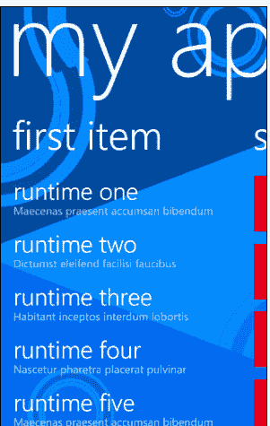

图9.4 使用`Panorama`控件。

## 清单9.4 全景应用程序的`MainPage.xaml`

```
<controls:Panorama Title="my application">
<controls:Panorama.Background>
    <ImageBrush ImageSource="PanoramaBackground.png"/>
</controls:Panorama.Background>
<!--Panorama item one-->
<controls:PanoramaItem Header="first item">
    <!--Double line list with text wrapping-->
    <ListBox Margin="0,0,-12,0" ItemsSource="{Binding Items}">
        <ListBox.ItemTemplate>
            <DataTemplate>
                <StackPanel Margin="0,0,0,17" Width="432">
                    <TextBlock Text="{Binding LineOne}"
                        TextWrapping="Wrap"
                        Style="{StaticResource PhoneTextExtraLargeStyle}"/>
                    <TextBlock Text="{Binding LineTwo}"
                        TextWrapping="Wrap" Margin="12,-6,12,0"
                        Style="{StaticResource PhoneTextSubtleStyle}"/>
                </StackPanel>
            </DataTemplate>
        </ListBox.ItemTemplate>
    </ListBox>
```

```
</ListBox>
</controls:PanoramaItem>
<!--Panorama item two-->
<!--Use "Orientation="Horizontal"" to enable a panel that lays out horizontally-->
<controls:PanoramaItem Header="second item">
    <!--Double line list with image placeholder and text wrapping-->
    <ListBox Margin="0,0,-12,0" ItemsSource="{Binding Items}">
        <ListBox.ItemTemplate>
            <DataTemplate>
                <StackPanel Orientation="Horizontal" Margin="0,0,0,17">
                    <!--Replace rectangle with image-->
                    <Rectangle Height="100" Width="100" Fill="#FF5001b" Margin="12,0,9,0"/>
                    <StackPanel Width="311">
                        <TextBlock Text="{Binding LineOne}" TextWrapping="Wrap" Style="{StaticResource PhoneTextExtraLargeStyle}"/>
                        <TextBlock Text="{Binding LineTwo}" TextWrapping="Wrap" Margin="12,-6,12,0" Style="{StaticResource PhoneTextSubtleStyle}"/>
                    </StackPanel>
                </StackPanel>
            </DataTemplate>
        </ListBox.ItemTemplate>
    </ListBox>
</controls:PanoramaItem>
</controls:Panorama>
```

如同你对`Pivot`控件所做的那样，拿这个现成的应用程序模板并进行实验。创建一系列带有各种不同UI的全景项，看看它的外观以及对用户滑动手势的反应。尝试更换背景图片，看看仅通过使用有趣的背景图片就能创造出怎样的体验。关键是不断调试，直到你非常熟悉`Pivot`和`Panorama`控件为止，因为这是iOS开发者将选项卡栏功能从iPhone迁移到Windows Phone 7的两种主要方式。

## 使用应用程序栏

作为Windows Phone 7开发者，你可以使用的另一个控件是应用程序栏。乍一看，你可能会认为它的用途直接对应选项卡栏，但请注意，应用程序栏远不仅仅是选项卡栏的替代品。

应用程序栏位于UI的底部（或侧面，取决于手机方向），提供几个可以点击以执行某些任务的图标。此外，当项目数量超过当前屏幕可显示范围时，会出现一个省略号选项。点击它，会弹出额外的菜单项。到目前为止听起来有点像选项卡栏，对吧？并不尽然。

你可以拥有显示在每个页面底部的全局应用程序栏，也可以为应用程序中的每个页面设置特定的应用程序栏。更好的是，你可以根据任意数量的因素在运行时动态更改当前活动的应用程序栏。在iOS中，你基本上只能使用在应用程序启动时或设计时配置的选项卡栏。选项卡栏在iOS UI中扮演着非常“家长式”的控制角色，而WP7中的应用程序栏几乎就像一个上下文菜单，如果以特定方式进行配置，可以提供“类似选项卡栏”的功能。需要记住的关键是，应用程序栏极其强大，远比iOS的选项卡栏灵活。

要看看应用程序栏实际运行效果，请将以下`XAML`代码行添加到你想使用的任意`MainPage.xaml`的底部（`Panoramic`或`Pivot`除外，这两者都不应与应用程序栏结合使用）。

```
<phone:PhoneApplicationPage.ApplicationBar>
<shell:ApplicationBar IsVisible="True" IsMenuEnabled="True">
<shell:ApplicationBarIconButton IconUri="/Images/appbar.feature.email.rest.png"
Text="Button 1"/>
<shell:ApplicationBarIconButton IconUri="/Images/appbar.feature.search.rest.png"
Text="Button 2"/>
<shell:ApplicationBarIconButton IconUri="/Images/appbar.feature.settings.rest.png"
Text="Button 2"/>
<shell:ApplicationBarIconButton IconUri="/Images/appbar.feature.video.rest.png"
Text="Button 2"/>
<shell:ApplicationBar.MenuItems>
<shell:ApplicationBarMenuItem Text="MenuItem 1"/>
<shell:ApplicationBarMenuItem Text="MenuItem 2"/>
</shell:ApplicationBar.MenuItems>
</shell:ApplicationBar>
</phone:PhoneApplicationPage.ApplicationBar>
```

上述代码中的应用程序栏定义了四个带标题标签的不同图标按钮和两个额外的菜单项。如图9.5和图9.6中的屏幕截图所示，当你点击省略号并展开应用程序栏时，这些菜单项会出现。

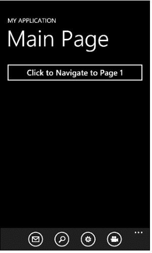

图9.5 应用程序栏默认状态。

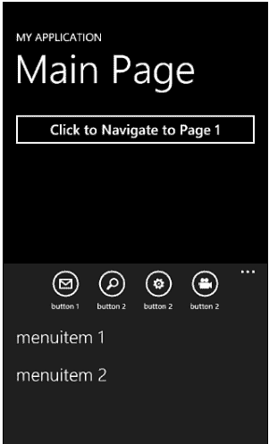

图9.6 应用程序栏展开菜单项后的状态。

每个按钮和菜单项都可以在其`click`事件上附加事件处理程序，允许你执行所需的任何逻辑，甚至导航到不同的页面。

每个页面还有一个`ApplicationBar`属性，你可以随时设置它。这让你可以根据上下文或应用程序中的任何其他活动，以编程方式交换应用程序栏。这比标准的iOS选项卡栏控件提供了更强大的功能和灵活性。

## 总结

采用新平台时最困难的任务之一是将你现有的所有技能映射到新环境中。你需要学习新语言、新术语、新模式、新实践，并养成新习惯。

本章为你提供了iOS技能与一些最常见UI模式（导航栏和选项卡栏）的基本映射。这些用户界面元素出现在App Store中绝大多数应用程序中。

利用本章的信息，你现在应该很清楚如何将构建iOS导航和选项卡栏应用程序的技能，映射到在Windows Phone 7上使用像应用程序栏这样强大的控件来构建新颖且引人入胜的`Pivot`和`Panorama`应用程序。

此页有意留空

## 使用硬件和设备服务

> *是硬件让机器变快，是软件让快的机器变慢。*
>
> 克雷格·布鲁斯

本章概述了Windows Phone 7的设备和整体系统能力。到目前为止，你已经了解了如何创建自己的用户界面，并学习了一些构建简单Windows Phone 7应用程序的基本技术。

开发者喜欢构建智能手机应用程序的最大原因之一，以及人们喜欢拥有智能手机的主要原因，是它们确实很智能。如果没有打电话、存储联系人、打开网页、播放视频或听音乐的能力，智能手机几乎没什么吸引力，而这些设备上的应用程序则更没有吸引力。

本章将带你了解iOS设备的各种系统功能，并为你介绍Windows Phone 7设备上类似（甚至全新）功能的演练。读完本章后，你将知道如何利用作为WP7开发者可用的所有共享服务、启动器、选择器和设备传感器。结合你之前阅读的信息以及这些新信息，你将很快能够构建出令人惊叹的WP7应用程序。

## 设备功能回顾

当iPhone首次问世时，它在许多方面都是同类设备中的第一款。然而，它当然不是第一款也不是最强大的智能手机。有些人可能会争辩说

并不是因为它是最容易使用或最具普适吸引力的，而是除多点触控之外，设备的物理能力在智能手机上已经存在一段时间了。

由于 iPhone、Android 设备、BlackBerry 以及甚至 Windows Mobile（不要与 Windows Phone 7 混淆）设备的惊人流行度，消费者对这些手机功能的需求达到了历史最高水平。现在不拍照的设备往往被认为损坏了或“残缺”。智能手机用户嗤之以鼻于拥有不播放视频、音乐、不运行应用以及不执行其他几项功能的手机，而仅仅几年前的这些功能还会被认为是科幻的东西。

下面的列表描述了现代智能手机提供的功能和服务。随着我逐项介绍，我会指出 iPhone 或 Windows Phone 7 在这些方面有所不同、相似的地方，以及开发者访问这些功能的方式可能有所不同。例如，某些智能手机可能具有某项功能，但可能不允许开发者访问它。其他设备可能允许开发者访问，但仅限于启动器形式（以系统应用启动且开发者无法进行底层 API 干预）。最后，一些系统功能可能以丰富的 API 形式公开，开发者可以直接操作。

- 地址簿/联系人——iOS 已通过 API 公开了对底层联系人列表的访问。Windows Phone 7 允许用户通过选择器选择联系人电子邮件和电话号码，以及将电子邮件和电话号码保存到新的或现有联系人中。

- 短信——iPhone 和 Windows Phone 7 设备都具有非常丰富的 SMS 功能，包括发送和接收附加在这些消息上的图片的能力。在两个平台上，开发者都可以以编程方式访问发送短信的功能。

- 电话——显然，两个平台都具有拨打电话的能力。要在 iPhone 上发起新的电话呼叫，你需要指示应用程序打开带有“tel:”前缀的 URL。我们将在本章后面介绍如何在 Windows Phone 7 中发起电话呼叫。

- 位置/GPS——iPhone 和 Windows Phone 7 设备都具有接收 GPS 信号的能力。如今，没有 GPS 的智能手机根本不算很智能。这从大量基于位置的应用中可见一斑，从增强现实到帮助你找到当前位置两英里范围内最好的奶酪薯条盘的应用。

- 加速度计——智能手机中的加速度计测量三个不同轴上的当前加速度量。这些传感器可用于从将手机变成视频游戏的转向盘到让你摇动手机在最喜欢的桌游中掷骰子等各种用途。iPhone 和 Windows Phone 7 都配备了采样率非常高的加速度计，可实现各种应用。

- **多媒体**——在多媒体方面，没有人能否认 iTunes 的市场主导地位，因此 iPhone 包含丰富的多媒体体验也就不足为奇了。基于微软在 Zune 及其后 Zune HD 上开始的工作，微软也在其操作系统中内置了丰富的媒体播放功能。

- **消息（电子邮件）**——两个设备都具有丰富的电子邮件功能，尽管微软 Exchange for Windows Phone 7 中提供的功能列表建立在微软构建企业邮件服务器的历史之上。

- **照片**——拍照能力因设备而异。较旧的 iPhone 具有较低分辨率的摄像头；较新的 iPhone 具有拍摄视频的能力，而 WP7 手机的摄像头分辨率和功能因制造商和型号而异。

- **地图**——iOS 设备使用 Google Maps 及其底层 API 来提供地图服务并将其与机载 GPS 设备集成。Windows Phone 7 不出所料地使用 Bing Maps 服务及其 API。

- **日历**——iOS 通过强大的 API 公开了对底层日历的访问。在本书撰写之时，Windows Phone 7 SDK 未提供对手机上存储的日历事件的此类访问。

- **搜索（网页、本地和新闻）**——在 iOS 设备上，你可以滑动主屏幕将其移开（在第一页向右滑动），这会显示一个搜索框，允许你搜索应用程序、数据、电子邮件和联系人。Windows Phone 7 更进一步，允许你使用相同的界面搜索手机、本地搜索（通过 Bing 搜索和手机 GPS 的组合）、搜索网页和搜索新闻。你可以以编程方式调出 WP7 搜索界面。

- **网页浏览**——iOS 设备上的网页用户界面由移动版 Safari 提供，该浏览器基于名为 WebKit 的开源浏览器框架，而 Windows Phone 7 设备上则由移动版 Internet Explorer（IE9 与自定义功能的混合体）承担此角色。两个平台上的两个浏览器都可以由应用程序以编程方式激活。

## 使用启动器

随着我们手掌大小的设备拥有如此强大的功能，也带来了巨大的责任。如果设备制造商或操作系统创建者给予我们开发者对设备及其硬件的每一个细节的无限制访问，我们必然会创建出可能对蜂窝网络造成各种破坏的应用。为了保护蜂窝服务提供商的网络完整性并确保所有应用程序尽可能友好地协同工作，有时开发者只能获得对系统资源的有限访问。

在这些情况下，我们有一个选择是使用启动器。启动器使我们能够调用各种系统级功能，但使用的是厂商控制的 UI，并且以防篡改的方式进行。例如，与其给予开发者直接操作外拨呼叫的能力（这将为恶意开发者创造一个充满恶作剧的巨型糖果派对），我们必须改用启动器。我们可以为该启动器提供想要拨打的电话号码或联系人，但最终手机对拨打对象和拨打时间拥有最终决定权。

### 使用保存电话号码任务

虽然某些启动器允许应用程序启动各种系统进程，但其他启动器允许应用程序将数据保存到系统范围的资源，如联系人。其中一个启动器就是 `SavePhoneNumber` 任务。通过此任务，你可以告诉它你想保存一个电话号码，然后手机会弹出一个对话框，提示用户选择一个联系人（或创建一个新联系人）来分配该电话号码。

下面的代码创建了 `SavePhoneNumber` 任务的一个实例并调用 `Show` 方法以调出对话框，然后引导用户完成保存电话号码到联系人的过程（或取消该操作）。

```
SavePhoneNumberTask phoneSave = new SavePhoneNumberTask();
phoneSave.PhoneNumber = "8675309";
phoneSave.Completed += (s, e) =>
{ MessageBox.Show("Phone number task complete."); };
phoneSave.Show();
```

图 10.1 显示了提示用户输入新电话号码的屏幕，图 10.2 显示了通过 `SavePhoneNumberTask` 创建新联系人后的屏幕。

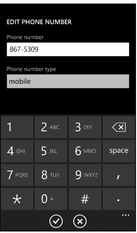


图 10.1 `SavePhoneNumber` 任务，提示用户输入号码。

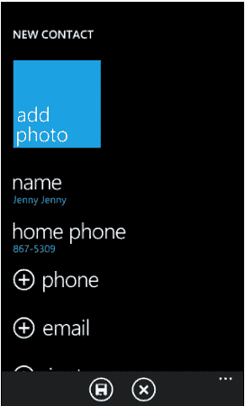

图 10.2 通过 `SavePhoneNumberTask` 创建的新联系人。

### 使用保存电子邮件地址任务

与 `SavePhoneNumber` 任务类似，`SaveEmailAddress` 任务允许你的应用程序触发一个对话框，提示用户将电子邮件地址添加到联系人或创建一个新的联系人。

你可以看到下面的代码尝试将电子邮件地址“big.moe@somedomain.com”保存到手机的其中一个联系人中。如果任务成功（以 `TaskResult.OK` 枚举值表示），应用程序可以处理该事件。同样，应用程序也可以检测到用户按下了取消或任务因其他原因失败。

```
SaveEmailAddressTask saveEmail = new SaveEmailAddressTask();
saveEmail.Email = "big.moe@somedomain.com";
saveEmail.Completed += (s, e) =>
{
    if (e.TaskResult == TaskResult.OK)
    {
        MessageBox.Show("Email Address Saved.");
    }
    else
        MessageBox.Show("Email Address Not Saved.");
};
saveEmail.Show();
```

## 启动电话应用

如本节开头所述，Windows Phone 7 不允许你编写的任何应用程序直接访问电话功能。这是为了防止蜂窝网络（及其使用者）被滥用。折衷方案是允许你的应用程序向手机建议一个它想拨打的电话。随后会弹出一个对话框，用户必须确认才能拨打电话，如图 10.5 所示。

```
PhoneCallTask phoneCall = new PhoneCallTask();
phoneCall.DisplayName = "Jenny";
phoneCall.PhoneNumber = "8675309";
phoneCall.Show();
```

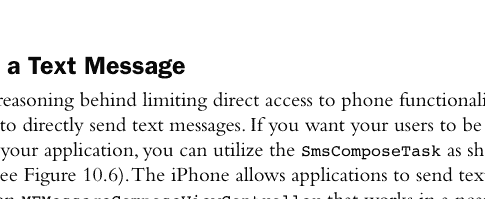

图 10.5 使用 `PhoneCallTask` 拨打电话。

## 发送短信

限制直接访问电话功能的理由同样也使我们无法直接发送短信。如果你希望用户能从你的应用程序中发送短信，可以按以下代码所示使用 `SmsComposeTask`（见图 10.6）。iPhone 允许应用程序通过 `MFMessageComposeViewController` 发送文本消息，其工作方式几乎完全相同。

```
SmsComposeTask newSms = new SmsComposeTask();
newSms.To = "Jenny Jenny";
newSms.Body = "Who can I turn to?";
newSms.Show();
```

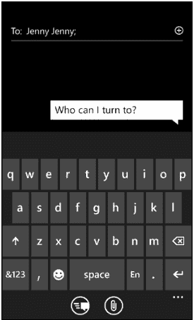

图 10.6 使用 `SmsComposeTask` 发送短信。

## 撰写电子邮件

如果 Windows Phone 7 设备至少配置了一个邮件账户，就可以通过编程方式创建电子邮件。同样，由于你访问的是系统级服务，用户必须在发送电子邮件前提供最终确认。

要从你的应用程序中创建新的电子邮件，请按如下方式使用 `EmailComposeTask`。

```
EmailComposeTask newEmail = new EmailComposeTask();
newEmail.To = "Jenny Jenny";
newEmail.Subject = "I got it";
newEmail.Body =
@"For a good time, for a good time call....";
newEmail.Show();
```

## 使用选择器

出于与设备不允许开发人员直接操作数据和系统级服务相同的原因，开发人员常常被禁止查询或读取详细的底层信息。这既是为了保护消费者，也是为了保护设备制造商和移动运营商。为了能够向消费者、运营商和设备制造商保证关于数据安全和隔离的规则与法律义务已经得到满足，Windows Phone 7（以及 iOS）不能允许开发人员破解系统数据库并自由浏览。

折衷方案是使用选择器。每当应用程序想要允许用户在系统上定位某种信息时，选择器会提供一个标准的用户界面，该界面要求最终用户在信息提供给应用程序之前进行确认。本节将带你快速了解 Windows Phone 7 中可用的一些选择器。

## 使用电话号码选择器任务

顾名思义，电话号码选择器任务允许你的用户从手机存储的联系人中选择一个电话号码。它可能与允许用户发起电话呼叫的启动器配合使用。你的应用程序偶尔可能需要提示用户从手机存储的联系人中选择一个电话号码，而该选择器任务正好提供了这一功能。

为此，请如下所示使用 `PhoneNumberChooserTask`：

```
PhoneNumberChooserTask phoneChooser = new PhoneNumberChooserTask();
phoneChooser.Completed += (s, e) =>
{
    if (e.TaskResult == TaskResult.OK)
    {
        MessageBox.Show("You picked " + e.PhoneNumber);
    }
    else
        MessageBox.Show("You didn’t pick anyone");
};
phoneChooser.Show();
```

## 使用电子邮件地址选择器任务

要提示用户从现有联系人中选择一个电子邮件地址（该地址会以字符串形式返回给你的应用程序），请如下所示使用 `EmailAddressChooserTask`：

```
EmailAddressChooserTask emailChooser = new EmailAddressChooserTask();
emailChooser.Completed += (s, e) =>
{
    if (e.TaskResult == TaskResult.OK)
    {
        MessageBox.Show("You picked email: " + e.Email);
    }
    else
```

```
MessageBox.Show("You didn't pick anyone.");
};
emailChooser.Show();
```

## 在设备上选择或拍摄照片

要提示用户从手机照片库中选择一张图片，可以使用 `PhotoChooserTask`。此任务带有一个名为 `ShowCamera` 的选项，它让用户在你的应用程序请求照片时可以选择拍摄一张新照片。例如，费用报告应用程序可能会提示用户提供照片，用户既可以调出之前拍摄的收据照片，也可以拍摄一张新照片。无论图像的原始来源是什么，用户选择的图片都会通过事件参数的 `ChosenPhoto` 属性提供给应用程序。

```
PhotoChooserTask photoChooser = new PhotoChooserTask();
photoChooser.ShowCamera = true;
photoChooser.Completed += (s, e) =>
{
    if (e.TaskResult == TaskResult.OK)
    {
        BitmapImage bmp = new BitmapImage();
        bmp.SetSource(e.ChosenPhoto);
        targetImage.Source = bmp;
    }
};
photoChooser.Show();
```

上述代码将 `ChosenPhoto` 属性（它是一个流）转换为 `BitmapImage`，然后可以将其设置为 `Image` 控件（在 XAML 中声明为 `<Image/>`）的源。图 10.7 显示了用户在选择相机媒体库中的图片时可能看到的示例屏幕。在此图像的底部，你可以看到一个相机图标。点击该图标将调出手机内置相机的拍摄屏幕。


## 使用硬件服务和传感器

到目前为止，你已经了解了如何使用“软”服务，例如选择器和启动器。这些设施允许你的应用程序以安全的方式与系统级数据和服务交互，在没有用户明确同意的情况下，绝不允许你的应用程序执行、查看或修改任何内容。

下一部分将带你了解一些实际硬件服务的用法，例如加速度计、手机振动控制器、FM 收音机调谐器，当然还有 GPS。

### 控制振动

Windows Phone 7 设备具有振动功能。大多数现代手机都提供振动选项，而不是播放响亮的铃声，以使设备在公共场合不那么引人注意。近年来，这已成为一种福音，因为拥有手机的人数已大大超过没有手机的人。

Windows Phone 7 SDK 中一个不错的功能是，你的应用程序可以启动和停止手机的振动。这使你能够在发生重要事情时振动手机，例如收到消息或游戏中的玩家得分。

要使用此功能，你需要确保项目引用了 `Microsoft.Devices` 程序集。如果还没有此引用，请在项目资源管理器中右键单击 `References` 节点，单击 `Add Reference`，然后选择 `Microsoft.Devices` 库。然后在任何你想振动的页面顶部添加以下代码行：

```
using Microsoft.Devices;
```

现在添加以下代码来启动振动（并持续振动指定的时间）：

```
VibrateController.Default.Start(TimeSpan.FromSeconds(1));
```

如果想随时强制停止振动，可调用 `Stop` 方法，如下所示：

```
VibrateController.Default.Stop();
```

### 访问收音机调谐器

在这个互联网广播、卫星广播以及数百种通过蜂窝数据网络或 Wi-Fi 将音乐流式传输到移动设备的方式的时代，你可能会想：“FM 收音机？那是什么？”

无论你是否同意这一决定，Windows Phone 7 设备都能够支持 FM 收音机调谐器，并且 Windows Phone 7 SDK 能够控制此调谐器。

下面的代码将打开收音机，将其调谐到 96.5，并以 RSSI 单位报告无线电信号强度。如果你在本章还没有尝试过任何其他代码示例，我强烈建议你在模拟器中试一试这个。如果你期待模拟器报告说此设备上的 FM 收音机已被禁用，那你就更有理由亲自运行这个示例了。说真的，去输入并运行它吧。等你回来时，这本书还会在这里。

请记住，你的项目需要引用 `Microsoft.Devices` 程序集，以下代码才能正常工作：

```
try
{
    FMRadio radio = Microsoft.Devices.Radio.FMRadio.Instance;
    radio.Frequency = 96.5;
    radio.PowerMode = RadioPowerMode.On;
    Debug.WriteLine("Radio signal strength : {0}", radio.SignalStrength);
}
catch (RadioDisabledException rde)
{
    MessageBox.Show("the radio is not available on this device.");
}
```

## 关于 Try/Catch 的说明

如果你查看 FM 收音机代码示例，并且发现 `try` 和 `catch` 关键字的用法有点陌生，不用担心。这是 C# 的异常处理系统。`try` 块中的代码会尝试执行。如果发生了运行时未预期的情况（异常），`catch` 块中的代码就会执行，让你能够安全地处理错误，而不会导致应用程序崩溃。

需要记住的重要一点是，如果你的代码未能“捕获”发生的异常，应用程序唯一的办法就是崩溃。如果这发生在用户花了好钱购买的生产环境应用程序中，客户是不会满意的。

将代码放在 `try/catch` 块中会带来轻微的性能开销，以换取对该代码进行意外故障保护。作为一般规则，你应该使用 `if` 语句和其他测试来检查用户输入错误、边界情况和其他可预测的故障。你应该仅将 `try/catch` 块用作防止应用程序崩溃的最后手段。

## 使用加速度计

只有少数现代智能手机配备了加速度计。加速度计测量在三个方向上的加速度力：X、Y 和 Z。这些分别对应“法向”，即指向地球中心的向下方向（重力拉力的方向，更常被称为“向下”），左右加速度，以及前后加速度。左右、前后方向都是相对于法向确定的（记住，对我们这些非物理学类型的人来说，那就是“向下”）。

加速度计可用于一些无聊的技巧，例如让你用手机慢慢清空一杯酒；有趣的事情，例如提供“摇晃”动作来洗牌；完全沉浸式的类似操纵杆的控制（例如通过像转动方向盘一样移动手机来驾驶汽车）；甚至高端用途，例如将手机放在汽车里，猛踩油门，并记录你的 0–60 时间。根据个人经验，最后这种用途很可能是迄今为止我最喜欢的加速度计用途。

加速度计通过加速度计监视器上的三个属性报告三个方向的加速度力：X、Y 和 Z。你如何解释这些值超出了本书的范围，因为这些通常需要平滑、聚合和不同的采样率才能产生所需的结果。然而，要获取这些值并激活加速度计，你可以在 Windows Phone 7 应用程序中按如下方式创建一个 XAML 页面。（你可以在第 10.1 节清单中看到，你可以创建一个按钮和几个文本块来存储值。）

### Listing 10.1 MainPage.xaml.cs, Using the Accelerometer Sensor

```
using System;
using System.Collections.Generic;
using System.Linq;
using System.Net;
using System.Windows;
using System.Windows.Controls;
using System.Windows.Documents;
using System.Windows.Input;
using System.Windows.Media;
using System.Windows.Media.Animation;
using System.Windows.Shapes;
using Microsoft.Phone.Controls;
using Microsoft.Devices.Sensors;

namespace AccelerometerDemo
{
public partial class MainPage : PhoneApplicationPage
{
    private Accelerometer accel;

    // Constructor
    public MainPage()
    {
        InitializeComponent();
    }

    private void startAccelButton_Click(object sender, RoutedEventArgs e)
    {
        if (accel == null)
        {
            accel = new Accelerometer();
            accel.ReadingChanged +=
                new EventHandler<AccelerometerReadingEventArgs>(
                accel_ReadingChanged);
            try
            {
                accelerometerStatusText.Text = "Accelerometer starting.";
                accel.Start();
            }
            catch (AccelerometerFailedException ex)
            {
                accelerometerStatusText.Text = "Accelerometer error.";
            }
        }
        else
        {
            try
            {
                accel.Stop();
                accel = null;
accelerometerStatusText.Text = "Accelerometer Stopped.";
}
catch (AccelerometerFailedException ex)
{
    accelerometerStatusText.Text =
        "Error stopping Accelerometer.";
}
}
}

void accel_ReadingChanged(object sender,
    AccelerometerReadingEventArgs e)
{
    Deployment.Current.Dispatcher.BeginInvoke(
        () => HandleNewReading(e));
}

void HandleNewReading(AccelerometerReadingEventArgs e)
{
    xText.Text = e.X.ToString();
    yText.Text = e.Y.ToString();
    zText.Text = e.Z.ToString();
}
}
}
```

在讨论代码之前，我应该在这里指出，除非你添加对 `Microsoft.Devices.Sensors` 程序集的引用，否则此应用程序将无法编译。


如果你没有用 C#、Silverlight 或 WPF 编写过代码，其中一些内容可能会对你来说很新。在`MainPage.xaml`中声明了一个名为`startAccelButton`的按钮。第一次点击此按钮时，它会启动加速度计监控。第二次点击时，它会停止监控。

每次监视器报告变化时（这会根据其采样率发生，即每秒固定的次数），都会调用`accel_ReadingChanged`方法。

这里我们做的事情有点不同。我们正在调用`Deployment.Current.Dispatcher`对象的`BeginInvoke`方法。原因是此事件由后台线程在后台触发。只有主线程上的代码才能更改 UI 对象。换句话说，如果我们尝试直接从后台线程设置三个文本块的`Text`属性，将会抛出异常并且文本永远不会更改。

为了避免这种情况，我们需要让更改文本块的代码在前台线程上执行。iOS 开发者应该对这个概念非常熟悉，事实上，Silverlight 和 WPF 开发者也经常遇到这个问题。

如果我们要在 iOS 应用程序中将此更改转发到前台线程，我们的代码可能如下所示：

```
[self performSelectorOnMainThread:@selector(handleNewReading)
    withObject:e
    waitUntilDone:false];
```

请记住，在你会在 iOS 应用程序中使用`performSelectorOnMainThread:withObject:waitUntilDone:`的情况下，在 Windows Phone 7 上你需要使用`Deployment.Current.Dispatcher.BeginInvoke( ... )`。

## 使用 GPS

基于位置的应用程序非常受欢迎。它们可用于从能够在当前位置“签到”、查看朋友在哪里以及查找附近的餐馆或加油站；一直到高级用途，例如地图、逐向导航，以及业余爱好活动如地理藏宝。

GPS 通过使用极其精确的时钟、计时、一组卫星和一些数学来三角测量设备的位置来工作。值得庆幸的是，开发人员不必太担心 GPS 坐标是如何获得的——只需要知道这些坐标是可用的。GPS 坐标使用纬度、经度和海拔来表示设备在地球上的任何位置。

要了解其工作原理，请创建一个具有用于启动和停止 GPS 监控的按钮以及几个文本块来报告纬度、经度和海拔的新应用程序。确保从此项目中添加对`System.Device`程序集的引用。

修改你的`MainPage.xaml.cs`，使其看起来像第 10.2 节清单中所示。

### Listing 10.2 `MainPage.xaml.cs`, Using the Location Monitoring API

```csharp
using System;
using System.Collections.Generic;
using System.Linq;
using System.Net;
using System.Windows;
using System.Windows.Controls;
using System.Windows.Documents;
using System.Windows.Input;
using System.Windows.Media;
using System.Windows.Media.Animation;
using System.Windows.Shapes;
using Microsoft.Phone.Controls;
using System.Device.Location;

namespace Location
{
    public partial class MainPage : PhoneApplicationPage
    {
        GeoCoordinateWatcher watcher;

        // Constructor
        public MainPage()
        {
            InitializeComponent();

            stopLocationButton.IsEnabled = false;
        }

        private void startLocationButton_Click(object sender,
            RoutedEventArgs e)
        {
            if (watcher == null)
            {
                watcher =
                    new GeoCoordinateWatcher(GeoPositionAccuracy.High);
                watcher.MovementThreshold = 20; // compensate for noise
                watcher.StatusChanged +=
                    new EventHandler<GeoPositionStatusChangedEventArgs>(
                        watcher_StatusChanged);
                watcher.PositionChanged +=
                    new EventHandler<
                        GeoPositionChangedEventArgs<GeoCoordinate>>(
                            watcher_PositionChanged);
                watcher.Start();
            }
        }

        void watcher_PositionChanged(object sender,
            GeoPositionChangedEventArgs<GeoCoordinate> e)
        {
            latitudeText.Text =
                e.Position.Location.Latitude.ToString("0.000");
            longitudeText.Text =
                e.Position.Location.Longitude.ToString("0.000");
            altitudeText.Text =
                e.Position.Location.Altitude.ToString("00000.00");
        }

        void watcher_StatusChanged(object sender,
            GeoPositionStatusChangedEventArgs e)
        {
            switch (e.Status)
{
    case GeoPositionStatus.Disabled:
        if (watcher.Permission ==
            GeoPositionPermission.Denied)
        {
            watcherStatus.Text =
                "Application is not allowed to use location services.";
        }
        else
        {
            watcherStatus.Text =
                "Location services not working properly.";
        }
        break;
    case GeoPositionStatus.Initializing:
        startLocationButton.IsEnabled = false;
        watcherStatus.Text = "Initializing...";
        break;
    case GeoPositionStatus.NoData:
        stopLocationButton.IsEnabled = true;
        watcherStatus.Text = "Active, but no location data.";
        break;
    case GeoPositionStatus.Ready:
        watcherStatus.Text = "Location data is available.";
        stopLocationButton.IsEnabled = true;
        break;
    }
}

private void stopLocationButton_Click(object sender,
    RoutedEventArgs e)
{
    watcher.Stop();
    watcherStatus.Text = "(not monitoring GPS)";
}
```

如果你在模拟器中运行它，你不会得到任何有用的信息，尽管当你点击开始按钮时它仍会报告 GPS 监视器处于活动状态。要看到实际效果，你需要在具有清晰 GPS 信号的应用程序上运行它。提示：不要从地下防空洞、掩体或密封地下室尝试此操作。

### Summary

本章首先概述了大多数现代智能手机提供的常见系统服务，包括 iPhone 和 Windows Phone 7。随后，我们浏览了 Windows Phone 7 应用程序可用的选择器和启动器。最后，我们通过探索应用程序可用的一些硬件服务结束了本章，例如加速度计、GPS，甚至 FM 收音机调谐器。

如果你一直从头阅读到这里，你现在应该对 Windows Phone 7 应用程序的能力和功能有非常好的理解，如何利用这些功能，以及如何使用 WP7 Silverlight 用户界面元素向用户呈现它们。

## Introduction to Application Tiles

> *想象力比知识更重要。因为知识是有限的，而想象力概括着世界的一切，推动着进步，给人类带来进化。*

>

> Albert Einstein

本章虽然简短，但为 Windows Phone 7 编程应用程序磁贴提供了有用的介绍。Windows Phone 7 应用程序磁贴的概念与 iPhone 或 iPad 上的某些概念之间不存在直接对应关系。在阅读本章时，你将看到应用程序磁贴所扮演的角色，它们如何涵盖 iOS 中存在的多个功能领域，以及它们如何提供 iOS 中不存在的一些功能。

本章还概述了如何在不使用推送通知的情况下操作这些磁贴，推送通知是下一章的主题。最后，在本章末尾，我将向你展示如何在服务器上做一些花哨的技巧，以绕过磁贴的一些限制，并在不发送任何推送通知的情况下创建令人难以置信的引人注目的磁贴。

### What Is a Tile?

当你解锁或打开 Windows Phone 7 设备并滑动主屏幕后，你看到的第一件事就是一组磁贴。此集合可滚动，通常应包含你最常用的应用程序。如图 11.1 所示，微软为你提供了一些开箱即用的磁贴，用于处理电话、联系人（包括 Facebook 等社交网络）、消息、电子邮件、图片、游戏（Xbox Live）和 Internet Explorer 等事项。

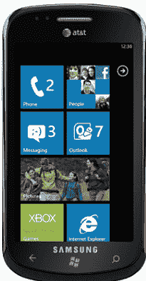

图 11.1 充满应用程序磁贴的主屏幕。

这些磁贴主要有两个目的。第一个是为你提供一个易于点击的目标来启动你最常用的应用程序。你可以将其视为在桌面或系统托盘上（或 Mac OS X 上的 Dock）为应用程序创建快捷方式的移动等价物。其次，这些磁贴提供有意义的摘要信息，你可以利用它来决定是否要启动应用程序。

例如，电话磁贴显示你错过了多少通电话或等待的语音邮件数量。消息磁贴告诉你有多少条未读短信。Outlook 磁贴告诉你有多少封未读电子邮件。如果这些磁贴上的信息发生变化，你可以使用易于阅读的磁贴表面来决定是否要启动应用程序。另一个示例可能是天气磁贴，在代表当前天气条件的背景图像上显示当前温度。这为你提供了关于天气的最重要信息，如果你想要详细信息，可以点击磁贴启动完整的天气应用程序。

你在图 11.1 中看不到的是，非微软开发人员编写的应用程序磁贴（那可能就是你）可以有一个背景图像和一个叠加在背景图像上的数字徽章。这使你的磁贴能够通知用户应用程序内的项目可能需要他们的关注。下一节将向你展示如何创建自己的磁贴，并讨论使用它们时的一些限制和怪癖。

### Creating Your First Tile

磁贴很容易创建。事实上，开发人员无需做任何事情来创建它们，因为创建磁贴完全取决于最终用户。开发人员需要做的就是告诉应用程序清单，如果用户为开发人员的应用程序创建磁贴，应该使用哪个背景图像和标题文本。

要了解其工作原理，请创建一个新的 Windows Phone 7 应用程序。在解决方案资源管理器中右键单击项目并选择属性。向下扫描属性页到最后几项，你将看到应用程序的磁贴属性定义位置。你可以选择背景图像（默认 WP7 应用程序模板已为你提供了一个）和磁贴的标题文本。你在此处提供的文本必须足够短，以便显示在磁贴底部。将文本更改为你喜欢的任何内容，然后运行应用程序。

在模拟器中运行应用程序时，点击开始（飞行窗口）按钮。现在转到应用程序列表（屏幕右上角的右箭头）。在你刚刚创建的应用程序标题上左键单击并按住。你将看到两个选项，如图 11.2 所示：Pin to Start 和 Uninstall。

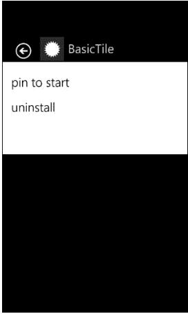

图 11.2 按住应用程序上的手指/按钮。

如果在提示时选择 Pin to Start，模拟器会将你带回主屏幕，在那里你会看到你的磁贴。如果你没有安装任何其他磁贴，你的屏幕可能看起来像图 11.3 中的那样。

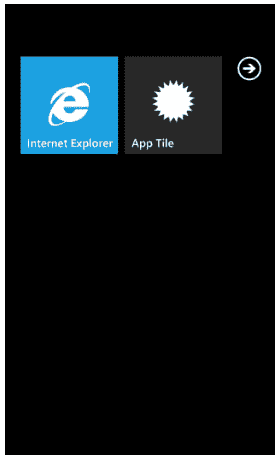

现在当用户解锁设备时，他们会看到你应用程序的一个漂亮的大磁贴。他们可以点击此磁贴启动应用程序，也可以通过使用右箭头并在出现的列表中点击应用程序标题手动启动应用程序。

随新应用程序模板提供的默认背景是一个 173x173 24 位 PNG 文件。在为应用程序创建自己的背景图像时，你必须遵守此约定。主屏幕磁贴（至少由普通非微软开发人员创建的磁贴）始终为相同大小，并且大小不得超过 80KB。

### Working with Tile Schedules

许多应用程序会很满意将磁贴表面仅用作大型图标；一个用于品牌展示和超大手指点击目标的地方。然而，根据你编写的应用程序类型，你可能想要做更多的事情。你可能想要使你的应用程序磁贴具有一定的动态性。请注意我在这里说“一定程度”，因为我们将在下一章讨论推送通知时谈论如何使你的磁贴更加动态。

磁贴计划受手机本身的控制。你可以创建一个磁贴计划实例，该实例将导致你的应用程序磁贴更新一次、每周一次、每天一次或每小时一次。您还可以设置最大出现次数。这使您可以每天更新一次应用程序磁贴连续三天，以及其他有趣的组合。

要每天更新应用程序磁贴直到应用程序被移除，您可以按如下方式创建计划：

```
ShellTileSchedule schedule = new ShellTileSchedule();
schedule.Interval = UpdateInterval.EveryDay;
schedule.Recurrence = UpdateRecurrence.Interval;
schedule.RemoteImageUri = new
    Uri("//www.myserver.com/myapp/tile.png");
schedule.Start();
```

前面的代码将每天把应用程序的背景磁贴更改为`www.myserver.com/myapp/tile.png`上的图像。这一天中的具体时间由手机决定。如果在更新应该发生时手机被锁定或屏幕关闭，则更新将在下次激活手机屏幕时立即发生。

接下来您需要注意的是`RemoteImageUri`属性。这个属性并不是随便使用“remote”这个词。您不能指定在应用程序 XAP 文件中部署的图像的 URI（iPhone 开发者应将 XAP 文件视为功能上等同于 Bundles）。简而言之，如果您计划更新应用程序磁贴的背景图像，无论您计划如何更新该图像，您都需要将该图像存储在公开可用的服务器上。

您可能会认为这些背景图像的限制有点过于严格。然而，请记住，几乎无限数量的开发者会有可以作为磁贴固定的应用程序。如果允许这些磁贴以开发者想要的速度更新，不仅磁贴屏幕的整体用户体验会下降到彻底混乱的地步，而且手机的资源（包括电池寿命！）也会被耗尽，试图跟上这些快速刷新的磁贴。通过强制执行这些固定的间隔类型并要求磁贴图像可通过公共互联网访问，Microsoft 确保每个人的磁贴都能与其他所有磁贴和谐共处。

即使有这些限制，您仍然可以对磁贴更新计划做一些创造性的事情。例如，您可以使用对按钮点击的即时计划更改，允许用户个性化其磁贴的背景图像。

假设您为手机编写了一个游戏。在这个游戏中，通过玩家的操作，玩家可以变得善良或邪恶。为了在应用程序磁贴上指示玩家当前是善良还是邪恶，您可以创建一个立即运行的计划，并将背景图像更改为善良或邪恶的背景。

以下代码片段展示了如何创建两个不同的运行一次、立即执行的计划，从而更改应用程序磁贴的背景图像：

```csharp
private void buttonGood_Click(object sender, RoutedEventArgs e)
{
    ShellTileSchedule schedule = new ShellTileSchedule();
```


```
schedule.Recurrence = UpdateRecurrence.Onetime;
schedule.StartTime = DateTime.Now.AddMinutes(1);
schedule.RemoteImageUri = new Uri("//localhost/good.png");
schedule.Start();
}
```

```
private void buttonEvil_Click(object sender, RoutedEventArgs e)
{
    ShellTileSchedule schedule = new ShellTileSchedule();
    schedule.Recurrence = UpdateRecurrence.Onetime;
    schedule.StartTime = DateTime.Now.AddMinutes(1);
    schedule.RemoteImageUri = new Uri("//localhost/evil.png");
    schedule.Start();
}
```

此代码块未显示 `using` 语句，但值得指出的是 `ShellTileSchedule` 类是 `Microsoft.Phone.Shell` 命名空间的一部分，如果文件顶部没有该 `using` 语句，前面的代码将无法编译。如果您使用代码下载而不是边打边写，就不必担心这个问题。

计划在到期时执行后，应用程序磁贴将更改为反映玩家对善恶的当前倾向。图 11.4 显示了我点击应用程序内的“我很邪恶”按钮然后退出应用程序后应用程序磁贴的样子。

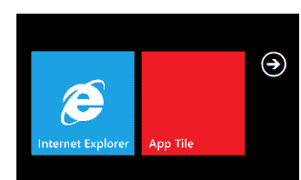

图 11.4 由磁贴计划修改后的应用程序磁贴。

## 关于磁贴计划的注意事项

在您使用磁贴及其计划时，需要记住的一件事是，计划并不精确。为了防止手机在更新磁贴背景图像时消耗过多资源，有一个一小时的计时器负责执行计划。这意味着即使您的计划设置为立即运行，在模拟器中也可能需要长达 60 分钟才会实际运行。如果您绝对需要磁贴比每小时更新更频繁，您将需要使用推送通知，这将在下一章中解释。为了调试您的计划更改，您将花费大量时间坐着等待。在测试计划之前，请确保您有咖啡和附近可以做的事情。

## 使用远程背景图像

到目前为止，您可能仍在抱怨（或更糟，我知道程序员会怎样），您对磁贴图像的控制不够。从我们迄今为止看到的情况来看，唯一可以为磁贴背景图像添加动态性的方式是通过使用磁贴计划。即使您有磁贴计划，背景图像也仅限于位于互联网上的静态图像——还是这样吗？

正如一位著名的、匿名的猫讨厌者曾经说过：“剥猫皮的方法不止一种。”关键概念是，虽然指向磁贴背景图像的 `URI` 在计划执行时可能需要固定，但该图像的实际内容可以由服务器按需生成。

为了了解这可能如何工作，让我们举几个“击败系统”的例子。换句话说，如何在 Windows Phone 7 SDK 不允许您直接在手机上执行的情况下创建动态应用程序磁贴背景。

最简单的例子之一可能是天气应用程序。当您运行完整的天气应用程序时，您会获得各种动画内容，包括雷达图和风速风向。但对于天气应用程序的磁贴，您希望在显示天气状况类型的背景上显示当前温度。如果您看过 Windows 7 桌面天气小部件，甚至 OS X Dashboard 的天气小部件，这个概念应该相当熟悉。

由于指向远程图像背景的 `URI` 不能更改（除非您丢弃旧的更新计划并像之前的善恶示例中那样用新的更新它），一种变通方法可能是使用指示用户邮政编码的 `URI`。例如，您可以将远程 `URI` 指向 `http://www.myapp.com/weather/90210.png`。然后服务器，无论是 ASP.NET、PHP、Ruby、Java 还是其他任何框架，都可以从 `URI` 中提取邮政编码并使用它来动态渲染包含当前温度和天气状况的图像。

另一个更接近我 Windows Phone 上可能有的选项是僵尸末日监控。假设僵尸末日已经开始，而您作为数字连接的消费者，需要跟踪谁在战争中获胜。为此，您已下载并安装了一个具有每小时更新一次的磁贴的应用程序。每个小时图像都会更改并显示人类和僵尸的当前世界人口。要实现这一点，您只需要一个 `URL`（例如 `http://www.myapp.com/us_vs_them.png`），该 `URL` 在服务器上定期生成，并将该图像的缓存版本提供给每个请求它的移动设备。

正如您所见，只需要一点创造力和一些服务器端编程的知识，您就可以创建动态、有吸引力、视觉上令人愉悦的磁贴图像。虽然您无法实现随附手机中 People 和 Xbox Live 磁贴所看到的自定义动画效果，但通过巧妙使用计划（或推送通知）和服务器生成的图像，您可以非常接近。

## Summary

iOS 没有等同于应用磁贴的概念。iOS 中的应用图标具有徽章计数，会在应用图标上方叠加显示一个小小的白底红字数字。这种功能与应用磁贴可以在图像上方显示计数的方式相似（你将在下一章看到如何实现这一点）。

iOS 应用图标与 Windows Phone 7 应用磁贴之间的相似之处到此为止。Windows Phone 7 磁贴的背景图像可以根据计划更新或响应推送通知。这些计划非常灵活，可以从每小时一次到为期六周的每周一次不等。

本章为您提供了用户通过将应用固定到开始区域来创建这些磁贴的基本概述。此外，我还带您了解了使用和操作磁贴计划的过程。最后，我讨论了一些服务器端技术，您可以使用这些技术来规避应用磁贴动态特性方面的一些限制。本章为您提供了良好的基础，以便您在下一章中通过学习如何使用推送通知操作这些磁贴来扩展您对应用磁贴的了解。

## Using Push Notifications

> *沟通中最大的问题是以为沟通已经发生了。*
>
> 乔治· Bernard·肖

本章为您介绍了推送通知及其在 Windows Phone 7 设备上的实现。*推送通知* 是一种功能，允许托管在公共互联网上（或如人们现在喜欢称呼的那样“云端”）的服务器直接向安装在移动设备上的应用程序发送消息，通常即使这些应用程序当前未运行或未处于活动状态也是如此。

微软和苹果之间推送通知的底层实现在细节上差异很大，但总体目标是相同的。推送通知允许您的应用程序在云端信息发生变化时保持最新，而无需您的应用程序浪费大量带宽和其他资源不断轮询远程 `URL` 并询问：“有什么新内容吗？” 这种行为对服务器来说就像后座上的孩子不断大喊“我们到了吗？” 对司机一样令人厌烦。有时服务器只想大喊：“我到了会告诉你的！” 推送通知允许服务器做到这一点，而一个快乐的服务器就是一个好的服务器。

本章为您提供了开始向 Windows Phone 7 应用程序发送推送通知所需的所有信息，以及比较和对比苹果推送通知服务（APNS）体验的信息。

## Review of Apple Push Notification Services (APNS)

当推送通知最初向 iPhone 开发者提供时，它们被誉为多任务处理在手机上不可用的答案的解决方案。即使 iOS 4 引入了一种形式的<|message|>多任务处理，推送通知的重要性也丝毫不减。

顺便提一下，对开发者来说特别重要的一点是，推送通知在 iOS 模拟器中不起作用。换句话说，如果没有配置测试设备，您就无法测试推送通知。

## WP7 Push Notifications Overview

对于 Windows Phone 7 开发来说，注册、发送和接收推送通知的过程要容易得多。这主要是因为没有证书。任何做过大量证书工作的人，尤其是如果他在多台机器上工作的人，可能今天的头发比开始处理这些证书之前要少得多。

当您的 WP7 应用程序启动时，它会与微软的通知后端通信，以获取微软所称的通知通道。此通知通道具有唯一的 `URI`。每个 WP7 设备上的每个应用程序与通知后端通信时都会获得唯一的通知通道 `URI`。当您的服务（是的，您仍然需要在互联网上有一个能够向设备发送通知的服务）发送通知时，它会直接将其发送到应用程序在获取通知通道时获得的 `URI`。监听此 `URI` 的微软代码随后会安全地将推送通知发送到设备。

我喜欢这种发送推送通知方法的众多原因之一是，微软能够在无需开发人员在应用程序中手工编写证书加载和签名方法的情况下确保通知传输的各个方面。确实涉及证书和安全传输，但它们由微软代表您完成。我喜欢 WP7 推送通知的另一点是它们在模拟器中有效。这意味着您可以在无需连接设备或从网络门户配置证书的情况下调试、测试和完善您的推送通知代码。这也意味着我可以在我的应用程序中实现推送通知，然后将代码交给团队中的另一名成员在不同的机器上测试，而无需我在团队工作站之间导出私钥，事情就能正常工作。

图 12.1 显示了推送通知系统的高级概述。该图取自微软关于 WP7 推送通知的在线文档，可在 `http://msdn.microsoft.com/en-us/library/ff402558(v=VS.92).aspx` 上找到。

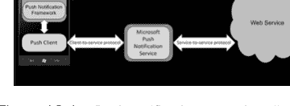

图 12.1 推送通知概述图（Microsoft）。

## Using Toast Notifications

在本章的其余部分，我将使用一个需要推送通知功能的应用示例作为前提。假设一下，僵尸末日确实已经到来。您需要了解行尸走肉战争的胜负情况，因此您已为手机下载了“我们对他们”应用程序。现在，当我们从不死者手中夺回城市时，您可以保持最新信息，或者不幸的是，当人类城市落入僵尸瘟疫之手时，您也可以获得通知。

您可以使用三种类型的推送通知来构建 WP7 应用程序：toast、tile 和 raw。在本节中，我将向您展示如何发送 toast 通知。我将构建“我们对他们”应用程序，一个我将用作人类抵抗组织 IT 部门运行的服务器的 Web 服务，以及一个 Windows Presentation Foundation（WPF）应用程序，我们将使用它作为控制台来发送通知，以模拟可能由完整的僵尸末日规划程序（ZAPP 简称，当然）自动发送的通知。您不必了解如何编写 Web 服务或 WPF 应用程序；我会将该代码保持在最低限度，以便我们可以集中精力在设备上为推送通知做好准备和响应所需的工作。

首先，让我们创建一个名为 `Us_vs_Them` 的新 WP7 应用程序项目，放在我称为 `Chapter12` 的解决方案中。在做任何其他事情之前，展开解决方案资源管理器下项目中的 Properties 节点。双击 `WMAppManifest.xml` 文件。在 `App` 元素内部，请确保为 Publisher 和 Author 属性提供有意义的值。如果没有这些，您就无法发送任何类型的推送通知。

为您的应用程序准备推送通知的第一件事是它需要与微软服务器通信并获取一个通知通道。此通知通道具有唯一的 `URI`，将由您的云应用程序（在我们的例子中，是一个 WPF 测试工具）用于发送通知。

在您的应用程序获得通知通道后，它就可以将该通道绑定到不同类型的通知。它始终能够响应原始通知，但您需要编写几行代码将通道绑定到 toast 和 tile 通知。就本章这一部分而言，我们暂时不会将通道绑定到磁贴。

首先，打开 `App.xaml.cs` 并在 `RootFrame` 属性声明下方添加以下代码行。如果在键入 `HttpNotificationChannel` 后按 Ctrl+句点（.），Visual Studio 会自动在文件顶部添加相应的 `using` 语句：

```
public HttpNotificationChannel NotificationChannel
{ get; private set; }
private const string NOTIFY_CHANNEL_NAME = "us_vs_them_channel";
private const string NOTIFY_SERVICE_NAME =
"www.usversusthemsampleapp.com";
```

接下来，在你看到的每个 WP7 应用程序中对 `InitializePhoneApplication()` 的调用之后，添加你自己的对 `InitializeNotifications` 的调用。`InitializeNotifications` 的代码以及其所依赖的所有方法都显示在清单 12.1 中。

## Listing 12.1 Preparing App.xaml for Push Notifications

```
private void InitializeNotifications()
{
    NotificationChannel =
        HttpNotificationChannel.Find(NOTIFY_CHANNEL_NAME);

    if (NotificationChannel == null)
    {
        NotificationChannel = new
            HttpNotificationChannel(NOTIFY_CHANNEL_NAME,
                                    NOTIFY_SERVICE_NAME);

        SetupDelegates();

        NotificationChannel.Open();
    }
    else
    {
        SetupDelegates();

        Debug.WriteLine("Found existing channel at {0}",
            NotificationChannel.ChannelUri.ToString());
    }

    SubscribeToNotifications();
    if (NotificationChannel.ChannelUri != null)
    {
        RegisterNotificationChannelWithService(
            NotificationChannel.ChannelUri.ToString());
    }
}

private void SubscribeToNotifications()
{
    // Cannot receive toasts without binding our notification channel
    // to toasts. If we receive a toast and we have not bound our channel
    // to those toasts, a very hard to debug exception will occur.
    if (NotificationChannel.IsShellToastBound == true)
    {
        Debug.WriteLine("Already bound to Toast notification");
    }
    else
    {
```

```
Debug.WriteLine("Registering to Toast Notifications");
NotificationChannel.BindToShellToast();
}
}
```


```csharp
private void SetupDelegates()
{
    NotificationChannel.ChannelUriUpdated +=
        new EventHandler<NotificationChannelUriEventArgs>(
            NotificationChannel_ChannelUriUpdated);
    NotificationChannel.HttpNotificationReceived +=
        new EventHandler<HttpNotificationEventArgs>(
            NotificationChannel_HttpNotificationReceived);
    NotificationChannel.ShellToastNotificationReceived +=
        new EventHandler<NotificationEventArgs>(
            NotificationChannel_ShellToastNotificationReceived);
    NotificationChannel.ErrorOccurred +=
        new EventHandler<NotificationChannelErrorEventArgs>(
            NotificationChannel_ErrorOccurred);
}

void NotificationChannel_ErrorOccurred(object sender,
    NotificationChannelErrorEventArgs e)
{
    throw new NotImplementedException();
}

void NotificationChannel_ShellToastNotificationReceived(object sender,
    NotificationEventArgs e)
{
    throw new NotImplementedException();
}

void NotificationChannel_HttpNotificationReceived(object sender,
    HttpNotificationEventArgs e)
{
    throw new NotImplementedException();
}

void NotificationChannel_ChannelUriUpdated(object sender,
    NotificationChannelUriEventArgs e)
{
    Debug.WriteLine("Channel URI updated " + e.ChannelUri.ToString());
    RegisterNotificationChannelWithService(e.ChannelUri.ToString());
}

private void RegisterNotificationChannelWithService(string channelUri)
{
```

```csharp
// proxy to my home-grown channel URI registration service
NotificationService.NotificationsClient client =
    new NotificationService.NotificationsClient();
client.RegisterChannelAsync(channelUri);
client.RegisterChannelCompleted +=
    new EventHandler<System.ComponentModel.AsyncCompletedEventArgs>(
        client_RegisterChannelCompleted);
}
```

```csharp
void client_RegisterChannelCompleted(object sender,
    System.ComponentModel.AsyncCompletedEventArgs e)
{
    if (e.Error == null)
    {
        Debug.WriteLine(
            "Registered channel URI with notification service.");
    }
}
```

在前面的代码中，`NotificationService.NotificationsClient` 类是通过向我作为本项目一部分编写的 WCF 服务添加服务引用而创建的。所有这些在可下载的代码示例中都已为你处理好，但了解这些组件的来源是有帮助的。

应用程序需要做的第一件事是查看是否已按我们为应用程序指定的名称注册了通知通道。`HttpNotificationChannel.Find()` 方法执行此任务，并隐藏了 Microsoft 在内部跟踪所有应用程序的所有通知通道的复杂性。

如果应用程序找不到现有通道，它将使用 `HttpNotificationChannel` 构造函数创建一个新通道，然后打开此新通道。此时代码知道，无论是新创建还是先前创建，我们创建的 `NotificationChannel` 属性现在都保存了一个有效的通知通道实例。

接下来，我们调用 `SetupDelegates()` 方法。此方法将一堆事件处理程序附加到各种事件，例如 `ChannelUriUpdated`、`HttpNotificationReceived`、`ShellToastNotificationReceived` 和 `ErrorOccurred`。

有了事件处理程序，我们就可以执行设置应用程序以接收 toast 的最后一步：绑定。绑定将特定通知通道与任何交付机制关联，例如 toast 通知或磁贴通知。在我们的例子中，对于应用程序的这个第一个版本，`SubscribeToNotifications` 方法仅绑定到 toast 通知。

此时应用程序已拥有以下所有内容：

- 一个具有有效 `ChannelUri` 的有效 `HttpNotificationChannel` 实例
- 分配给通道上的所有重要事件的事件处理程序
- 通知通道与 toast 或磁贴等通知类型之间的绑定

应用程序现在已准备好接收推送通知。当然，棘手的部分是实际发送它们。根据个人经验，我编写了几个接收推送通知的 iPhone 应用程序，并与许多推送启用应用程序的开发人员交谈，我可以告诉你，这部分通常是 iOS 开发人员开始皱眉的地方。他们的血压升高，压力水平上升，并开始像吃糖果一样吃抗酸药。不可否认，将推送通知发送到 iPhone 是一个非常脆弱的过程。它不一定困难，但有数百个微小的活动部件，如果其中任何一个不在完全正确的位置，一切都无法工作。

值得庆幸的是，Windows Phone 7 上的过程更容易。驻留在云中的你编写的应用程序可以使用作为通过构造或 `Find` 静态方法返回的 `HttpNotificationChannel` 实例一部分的通道 URI 向特定设备发送推送通知。此 URL 看起来会像以下示例：

```
http://sn1.notify.live.net/throttledthirdparty/01.00/
AAEMRpKul9RgTzIGrBGVOqKvAgAAAAADAQAAAAQUZm52OjIzOEQ2NDJDRkI5MEVFMEQ
```

获得此 URL 后，你可以从你的应用程序或服务向此 URL 发送 HTTP POST。对于 toast 通知，发送到此 URL 的 XML 有效负载如下所示：

```xml
<?xml version="1.0" encoding="utf-8"?>
<wp:Notification xmlns:wp="WPNotification">
    <wp:Toast>
        <wp:Text1>Toast message 1</wp:Text1>
        <wp:Text2>Toast message 2</wp:Text2>
    </wp:Toast>
</wp:Notification>
```

关于如何创建这些 XML 消息，有大量文档——你的服务需要发送哪些自定义头来传递 toast、磁贴或原始通知。有关如何使用 C# 传递推送通知的详细信息，请参阅 MSDN 文档 http://msdn.microsoft.com/en-us/library/ff402545(v=VS.92).aspx。

随本章提供的代码包含一个完整的解决方案，其中包含一个 WPF 测试工具应用程序。使用此工具（称为 UsVsThemConsole），你可以向如图 12.2 所示的示例应用程序发送 toast 通知。

这是一个不错的开始，但就我们目前的代码而言，应用程序将无法正确处理在应用程序在前台运行时发送的 toast 通知。为了确保我们处理这种情况，请将 `ShellToastNotificationReceived` 事件处理程序更改为以下代码：

```csharp
void NotificationChannel_ShellToastNotificationReceived(
    object sender, NotificationEventArgs e)
{
    string title = e.Collection.Values.First();
    string message =
```

```csharp
e.Collection.Values.Skip(1).FirstOrDefault() ?? string.Empty;
Deployment.Current.Dispatcher.BeginInvoke(
() => MessageBox.Show(message, title, MessageBoxButton.OK));
}
```

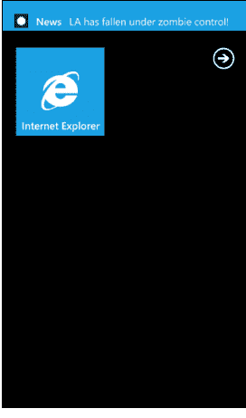

Figure 12.2 Receiving a sample toast notification.

这段代码打开了传入的 toast 通知，然后用其内容显示一个消息框。再次注意，我们使用了当前部署调度器的 BeginInvoke 方法。这是因为我们需要将由于后台线程更改而产生的任何 UI 更改转发到前台 UI 线程。图 12.3 显示了在收到 toast 通知后样本消息框的外观。

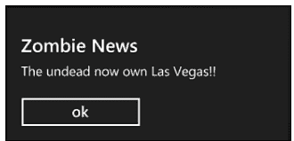

Figure 12.3 Getting a toast notification with application running.

## Using Raw Notifications

发送给 WP7 应用的原始通知就是原始的。当服务器或服务发送原始通知时，它发送的是二进制数据的 blob。该数据不需要符合任何特定的形状或大小，只要发送数据的服务器和接收数据的 WP7 应用能够就该形状达成一致即可。这对于 C# 二进制序列化来说是一个理想的情况。正如你在代码示例中看到的，Silverlight 在 WP7 上没有可用的 XML 序列化，因此我们只能使用 WCF DataContractSerializer 类进行二进制序列化，这是将原始数据转换为应用可用的东西的最简单选择。

在查看代码之前，还有一件值得指出的事情是，原始通知只能发送给当前在前台运行的应用。当你发送 toast 通知时，如果应用未运行，它会被发送到开始屏幕。如果应用正在运行，toast 通知会通过事件处理程序直接发送到应用。如果原始通知发送给当前不在前台运行的应用，该通知将被丢弃，就像它从未发生过一样。

因此，在推送通知中，一个非常常见的设计模式是告诉注册服务应用何时正在运行以及应用何时关闭。这让注册服务知道应用何时可以接收原始通知，而瓦片更新和 toast 则可以在任何时候接收。

以下代码处理原始 HTTP 通知的接收：

```csharp
void NotificationChannel_HttpNotificationReceived(object sender,
    HttpNotificationEventArgs e)
{
    if (e.Notification.Body != null && e.Notification.Headers != null)
    {
        // Thanks to Daniel Vaughn (WP7 Unleashed by SAMS Press)
        // for this tidbit on having to remove nulls from the serialized
        // data contract sent from the push app/service
        using (BinaryReader reader =
            new BinaryReader(e.Notification.Body))
        {
            byte[] bodyBytes =
                reader.ReadBytes((int)e.Notification.Body.Length);

            int lengthWithoutNulls = bodyBytes.Length;
            for (int i = bodyBytes.Length - 1;
                i >= 0 && bodyBytes[i] == '\0';
                i--, lengthWithoutNulls--)
            {
                /* Intentionally left blank. */
            }

            byte[] cleanedBytes = new byte[lengthWithoutNulls];
            Array.Copy(bodyBytes, cleanedBytes, lengthWithoutNulls);
```

```csharp
DataContractSerializer ser =
    new DataContractSerializer(typeof(ZombiePopulationPayload));
using (MemoryStream stream = new MemoryStream(cleanedBytes))
{
    ZombiePopulationPayload zombiePopulation =
        (ZombiePopulationPayload)ser.ReadObject(stream);
    Deployment.Current.Dispatcher.BeginInvoke(
        () =>
            MessageBox.Show(
                string.Format("Us:{0} Them:{1}",
                    zombiePopulation.Humans,
                    zombiePopulation.Zombies),
                "Population Update", MessageBoxButton.OK)
        );
    }
}
```

当我们运行代码并发送原始通知时，对该通知的响应看起来与图 12.4 中的对话框类似。 （完整的通知示例，包括注册服务和推送通知模拟器，可在本书随附代码中第 12 章解决方案中找到。）

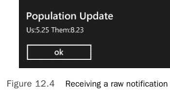

Figure 12.4 Receiving a raw notification with custom data.

代码首先做的第一件事是打开 e.Notification.Body 中包含的流。通知工具发送的二进制数据（它取代了云中的服务器）被 WP7 推送通知基础设施用末尾的一堆 null 填充，因此我们需要做的下一件事是在尝试将二进制反序列化为 C# 类之前去掉所有多余的 null。Sams Publishing 出版的《WP7 Unleashed》的作者 Daniel Vaughan 最近发表了一篇博文说明了这一现象。

在二进制数据准备好并去掉多余的 null 之后，它就可以使用 DataContractSerializer 类转换为类。最后，有一个完整的 ZombiePopulationPayload 类实例，我们可以使用 Dispatcher 将 MessageBox 显示请求转发到前台线程。

如果你好奇服务器端方面的内容，以下代码将向 Microsoft 的推送通知基础设施发送原始通知（此代码也包含在章节中）：


```csharp
private void sendRawButton_Click(object sender, RoutedEventArgs e)
{
    ZombiePopulationPayload zombiePopulation =
        new ZombiePopulationPayload() { Humans = 5.25m, Zombies = 8.23m };
    DataContractSerializer ser =
        new DataContractSerializer(typeof(ZombiePopulationPayload));
    MemoryStream ms = new MemoryStream();
    ser.WriteObject(ms, zombiePopulation);
    ms.Seek(0, SeekOrigin.Begin);
    byte[] zombieBytes = ms.GetBuffer();

    // instantiate proxy to our custom notification registry svc
    NotificationService.NotificationsClient client =
        new NotificationService.NotificationsClient();
    string[] uris = client.GetRegisteredChannels();

    Console.WriteLine("About to send raw data to the following URIs:");

    foreach (string uri in uris)
    {
        HttpWebRequest sendNotificationRequest =
            (HttpWebRequest)WebRequest.Create(uri);

        sendNotificationRequest.Method = "POST";
        sendNotificationRequest.Headers.Add("X-NotificationClass", "3");

        sendNotificationRequest.ContentLength = zombieBytes.Length;

        using (Stream requestStream =
            sendNotificationRequest.GetRequestStream())
        {
            requestStream.Write(zombieBytes, 0, zombieBytes.Length);
        }

        HttpWebResponse response =
            (HttpWebResponse)sendNotificationRequest.GetResponse();
        // Troubleshooting information returned by WP7 push server
        string notificationStatus =
            response.Headers["X-NotificationStatus"];
        string notificationChannelStatus =
            response.Headers["X-SubscriptionStatus"];
```

以下代码向已注册的通知通道 URL 发送 XML 有效负载，以更改应用的瓦片图像、徽章计数和标题文本：

```csharp
private void SendTile(string[] uriTargets, string backgroundImage,
    int count, string title)
{
    Console.WriteLine("About to send tile to the following URIs:");

    foreach (string uri in uriTargets)
    {
        Console.WriteLine(uri);
        HttpWebRequest sendNotificationRequest =
            (HttpWebRequest)WebRequest.Create(uri);

        sendNotificationRequest.Method = "POST";
        sendNotificationRequest.ContentType = "text/xml";
        sendNotificationRequest.Headers.Add("X-WindowsPhone-Target",
            "token");
        sendNotificationRequest.Headers.Add("X-NotificationClass", "1");

        string payloadString =
            string.Format("<?xml version=\"1.0\" encoding=\"utf-8\"?>" +
                "<wp:Notification xmlns:wp=\"WPNotification\">" +
                "<wp:Tile>" +
                "<wp:BackgroundImage>{0}</wp:BackgroundImage>" +
                "<wp:Count>{1}</wp:Count>" +
                "<wp:Title>{2}</wp:Title>" +
                "</wp:Tile>" +
                "</wp:Notification>", backgroundImage,
                count.ToString(), title);

        byte[] notificationMessage =
            System.Text.UTF8Encoding.UTF8.GetBytes(payloadString);
        sendNotificationRequest.ContentLength =
            notificationMessage.Length;

        using (Stream requestStream =
            sendNotificationRequest.GetRequestStream())
        {
            requestStream.Write(notificationMessage, 0,
                notificationMessage.Length);
        }

        // Sends the notification and gets the response.
        HttpWebResponse response =
            (HttpWebResponse)sendNotificationRequest.GetResponse();
        string notificationStatus =
```

response.Headers["X-NotificationStatus"];

string notificationChannelStatus =

    response.Headers["X-SubscriptionStatus"];

string deviceConnectionStatus =

    response.Headers["X-DeviceConnectionStatus"];

}

关于推送通知，还有最后一点需要说明，这更像是一种设计模式而非其他。如果你一直密切关注示例（或者你已经查看了代码下载），你可能会注意到，每当应用程序启动时，它都会将其通知渠道 URL 发送到注册服务。此信息的发送不附带任何其他标识信息。这意味着服务将无法区分新注册和重复注册。此外，如果你的应用程序需要向不同的应用程序发送不同的通知，而不是单一的群播广播，那么本章迄今为止展示的模型将无法工作。

在这种情况下，我建议在应用程序首次启动时创建一个应用程序 ID。只要应用程序安装在用户设备上，此 ID 将保持不变并伴随该应用程序。每次应用程序从微软的推送通知基础设施获取通知渠道 URI 后，它都会将该 URI 以及应用程序的恒定 ID 发送到注册服务器。这不仅防止同一应用程序注册多个通知渠道 URI，还允许单个应用程序成为特定推送通知的目标。在本书后面，你将看到如何将应用程序配置、设置和用户数据（例如应用程序 GUID）存储在称为独立存储（isolated storage）的机制中。在此之前，请记住，本章展示的服务注册表仅足以支持演示代码，绝非你应该在生产应用程序中模仿的设计。

## 总结

在当今智能手机时代，典型用户希望真正使用手机的时间尽可能少，除非他们是在玩游戏、读书等。用户已经习惯于定制化提醒，他们期望手机在发生值得注意的重要事情时通知他们——无论是收到了电子邮件、朋友在他们最喜欢的社交网络的墙上留言，还是在末日期间僵尸占领了附近的小镇。

本章为你提供了信息、工具和示例代码，帮助你开始构建自己的应用程序，这些应用程序可以支持磁贴更新、Toast 通知，甚至发送包含特定应用数据的任意原始二进制负载，例如股票价格更新或僵尸数量变化。

随着你继续阅读本书的其余部分，你将基于这些知识继续构建，并将推送通知纳入你的工具箱，其中充满构建强大、引人注目、高度参与的应用的技术。

此页有意留空

# 手机执行模型

> *智力成长应从出生开始，直到死亡才停止。*
>
> 阿尔伯特·爱因斯坦

本章概述了 Windows Phone 执行模型，并解释了 iPhone 和 Windows Phone 7 如何处理多任务，或者至少尽可能接近真正多任务。本章第一部分回顾了 iPhone 的各种多任务处理能力，以及开发者被允许参与这些功能的程度。

本章其余部分讨论 Windows Phone 应用程序的应用生命周期，也称为*Windows Phone 执行模型*。你将学习如何利用瞬态和持久应用程序状态、应用程序激活、墓碑化（tombstoning）以及更多内容。

## iOS 4 上的多任务处理

随着第四代 iPhone 和 iOS 4 的发布，期待已久的“多任务处理”终于到来。我将“多任务处理”一词加上引号的原因是，无论炒作怎么说，它都不是桌面应用程序开发者所习惯的那种多任务处理。

手机上确实有一些功能是真正的多任务，但日常 iPhone 开发者被允许访问多任务和后台功能的程度仍然有限。

以下是用户和开发者在 iPhone 4 上体验多任务处理的简要列表：

- **后台音频** — 用户已经熟悉在后台播放音乐的同时执行其他任务的体验。iPhone 4 将此功能扩展到非 Apple 应用程序，允许你的应用程序在用户退出后继续播放音频。

- **VoIP** — 与后台音频类似，IP 语音（VoIP）应用程序可以在用户使用另一个应用程序时接收呼叫。事实上，即使手机被锁定且前台没有运行任何应用程序，用户也可以接收 VoIP 呼叫。

- **定位/GPS** — 无论是在 iPhone 还是 Windows Phone 7 上，从硬件获取准确的 GPS 坐标有时可能需要一段时间。iPhone 4 允许应用程序在后台继续监控位置。

- **推送通知** — 上一章深入探讨了推送通知在 Windows Phone 7 上的工作原理。推送通知提供了一种优雅的方式，让用户随时了解重要事件，而无需让应用程序一直在前台运行。

- **本地通知** — iPhone 4 现在允许为特定应用程序安排事件和闹钟，而不仅仅是闹钟功能。虽然这不是真正的多任务处理，但它也提供了一种优雅的方式来交付某些解决方案，而无需应用程序在后台持续运行。

- **快速应用切换** — iPhone 4 支持快速应用切换，允许用户离开一个应用程序后直接回到他们离开时的位置，而无需重新加载应用。正如你将在本章后面看到的，Windows Phone 7 也广泛使用了类似的功能。

- **任务完成** — 如果你的 iPhone 应用程序正在执行某项不应被中断的关键操作（以免数据丢失或损坏），iOS 4 现在允许应用程序在用户退出时在后台完成重要任务。

正如你所看到的，尽管有很多巧妙而高效的方法可以在不消耗电池或让应用程序持续在后台运行的情况下完成工作，但开发者对桌面程序员所理解的真正多任务处理的访问权限非常有限。然而，如果你花一点时间思考应用程序的设计，就可以在不需要“真正”多任务的情况下创建一些非常引人注目的功能。

## 手机执行模型简介

当你使用台式电脑时，可以通过多种方式与应用程序进程交互。通常，你启动一个应用程序进程，与应用程序交互，然后关闭应用程序。在当今的现代计算机和操作系统上，人们通常会启动多个应用程序，并让它们一直运行直到关闭电脑。在如今的笔记本电脑上，许多人甚至不再关机——他们只是合上盖子，下次想继续工作时再打开盖子。他们期望一切看起来都像合上盖子时那样。

所有应用程序都在计算机上运行，只需点击窗口或使用热键（如 Windows 上的 Alt+Tab）即可访问，这样的想法并不新鲜。事实上，这种情况非常普遍，人们期望应用程序看起来与它们失去焦点时完全一样。

这种特定模式在手机上并不适用。移动设备的内存和 CPU 资源有限，无法让一堆应用程序同时运行。事实上，Windows Phone 7 在任何给定时间只允许运行单个应用程序。

手机一次只能运行一个活动应用程序，但这并不意味着用户无法获得丰富的体验，即应用程序能够记住用户启动另一个应用程序时它们正在做什么。应用程序可以保存瞬态状态，例如当新应用程序启动时用户已在文本框中输入的内容；它们还可以保存持久状态，顾名思义，持久状态会在多次启动之间保持不变。

这就是应用生命周期发挥作用的地方。Windows Phone 7 应用程序在以下情况下会收到充分警告：当页面即将被导航离开时、当应用程序作为新实例启动，或当它从之前挂起（墓碑化）的实例重新激活时，以及当应用程序将因某个其他应用程序（如电话呼叫）进入前台而被停用时。

下一部分将带你了解 Windows Phone 7 应用生命周期中的各个阶段和事件。读完本部分后，你将对 WP7 如何弥补单应用限制有透彻的理解，并且如果应用程序编写得当，最终用户将永远不会注意到这一限制。

## 应用生命周期演练

与只能通过启动全新实例来启动的桌面应用程序不同，Windows Phone 7 应用程序具有多个入口点和出口点，每一个都会对应用程序、其运行状态以及应用程序在内存中保存的数据产生不同的影响。以下各节描述了 Windows Phone 7 应用生命周期中的各个阶段，以及用户通常如何进入和退出这些阶段。图 13.1 展示了 WP7 应用生命周期中各阶段之间转换的示例。

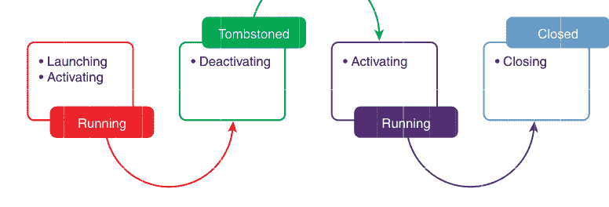

### 图 13.1 示例应用程序状态和转换。

以下是一份你需要熟悉以理解手机执行模型的术语列表：

- 向后导航——前后导航不仅仅内置于网页浏览器模型中，它也是用户在 Windows Phone 中导航的方式。当用户点击后退按钮时，他们会进入应用程序内的上一页。在应用程序的主页上点击后退按钮会退出应用程序。再次点击后退会将用户带到前一个应用程序的最后一页，以此类推。需要注意的是，WP7 设备上没有前进按钮；只有后退、主页和搜索。

- 墓碑化——这是指当用户离开你的应用程序时，你的应用程序进程已被终止。有关你应用程序的状态信息由操作系统维护（保留时间由操作系统决定），并在应用程序恢复时交还给应用程序（如果愿意继续墓碑类比的话，就是“挖出来”）。

- 页面状态——这是指应用程序中特定页面的视觉状态。

- 应用程序状态——这是指应用程序当前的内存中状态。此状态与特定页面无关。

- 临时状态——这是指自应用程序上次激活以来发生的状态数据。这可能是最近从网络服务下载的信息，或因用户交互而更改的其他信息。

- 持久数据——这是由应用程序的所有实例共享的数据，无论是由启动还是激活创建的。经典示例是应用程序设置以及用户在使用应用程序时创建的、他们期望永久保存的数据。

### 启动

当应用程序是通过除用户按下后退按钮以恢复先前运行的实例之外的任何方式启动时，应用程序被视为处于“已启动”状态。这可能发生在用户点击应用程序的磁贴或已安装应用程序列表中的图标或名称时。此外，如果用户点击活动的 toast 通知，也会触发应用程序启动。

无论应用程序如何启动，启动时都会创建一个全新的应用程序实例。这意味着它不会保留来自应用程序先前实例的任何临时状态。Launching 事件在此阶段触发，允许你编写在此阶段执行的自定义代码。

在此事件期间不应访问此自定义代码的隔离存储，因为此时用户尚未看到 UI，而从隔离存储读取文件可能会进一步延迟 UI 的出现，并给用户留下性能不佳或反应迟缓的印象。最后，每个应用程序只有 10 秒时间完成启动阶段。如果应用程序在 10 秒内未变得响应，WP7 将终止该进程。

即使可能有一些来自先前运行实例的剩余状态可能已存储在某处并可供应用程序使用，在启动后也不应使用。启动意味着应用程序的新实例，用户应期望每次启动应用程序时都是一个新实例，无论制造商如何。

### 运行

在应用程序完成启动阶段并且你在 Launching 事件中编写的任何自定义代码完成后，应用程序处于运行阶段。这就是大多数开发者在思考应用程序状态时所习惯的。有进程在运行；开发者存储在内存中的变量是安全且可访问的。

在运行期间，如果应用程序需要使数据持久化以供将来实例使用，它可以将该数据存储在隔离存储中，最好是在应用程序空闲时进行，以避免在存储大量数据时产生迟缓的 UI。另一个选项是逐步将小块数据存储到隔离存储中，而不是进行一次巨大的写入操作。

### 激活


当用户通过后退按钮返回到先前被墓碑化的应用程序，或因其他原因（如启动器、选择器、电话呼叫等）接管了前台时，该应用程序将被重新激活。

当应用程序从墓碑化状态唤醒时，`Activated`事件将被触发。此事件很特殊，因为它为应用程序提供了访问先前存储的状态数据的权限。如果在停用过程中，应用程序代码将可序列化对象存储在特殊的`state`字典中，则在激活时该字典会再次提供给应用程序。如果处理得当，用户甚至不会知道应用程序的进程在中间被关闭。

在`Activated`事件中，应用程序代码可以访问`PhoneApplicationService`类的`State`属性，以恢复在停用过程中保存的数据。与`Launching`事件处理程序一样，应用程序不应在此事件期间进行网络调用或从隔离存储进行长时间的读取操作，因为这样做可能会延长应用程序的启动时间，使UI过长时间无法出现，并且如果超过10秒，可能会完全阻止应用程序加载。

## 停用

当应用程序在前台运行时并且被另一个应用程序取代（因为一次只能有一个应用程序在前台运行），原始应用程序将被停用。当用户按下开始按钮时、当启动器或选择器接管前台时，以及当空闲超时导致锁屏启动时，应用程序可能会被停用。

当应用程序被停用时，`Deactivated`事件将被触发。这是开发者需要了解并正确处理的非常重要事件。在此事件期间，你的应用程序可以将临时数据存储在`PhoneApplicationService`类的`State`属性中。这可能是网络服务查询的最新结果，或自应用程序启动以来创建或下载的其他信息。除了将临时数据存储在`state`字典中以便在后续激活期间检索外，你还希望确保将任何持久数据存储在隔离存储中。仅仅因为应用程序被停用并不意味着它总会被重新激活。如果资源限制达到，或堆栈上等待再次激活的应用程序太多，你的应用程序可能会被关闭，并且其所有临时状态将被清除。

你的应用程序也有很小的几率在未被墓碑化时被停用。这可能发生在用户按下开始按钮停用应用程序，然后在操作系统有机会终止原始进程之前迅速点击后退按钮重新激活应用程序时。因此，你希望避免在`Deactivated`事件期间销毁任何数据或清除任何可能重要的内存中数据。

## 关闭

如果应用程序在未有其他应用程序占据前台的情况下被终止，例如当用户多次点击后退按钮以离开应用程序的主页时，应用程序处于关闭状态并且`Closing`事件被触发。

在`Closing`事件期间，应用程序应将任何持久数据保存到隔离存储中。没有必要将临时信息存储在`State`字典中，因为应用程序是被终止，而不是被停用或墓碑化。下一次应用程序变得活跃，无论如何，它都将是全新实例的启动结果，并且没有临时状态需要恢复。

## 墓碑化

到目前为止，在本章中你已经多次看到我使用“tombstoned（墓碑化）”这个术语；我想确保墓碑化的应用程序状态在这里得到特别说明。

如你所知，失去前台位置的应用程序会被停用。这个被停用的应用程序有机会在字典中保存临时状态。应用程序被停用但尚未被墓碑化的时间通常很短。如果应用程序在停用后没有被迅速重新激活，那么它就会被墓碑化。这意味着应用程序进程将被终止，但该应用程序的临时状态以及有关原始进程的一些其他信息会保留下来（也就是所谓的墓碑）。

当一个被墓碑化的应用程序被重新激活时，会创建该应用程序进程的一个新实例，但不会引发`Launching`事件，而是引发`Activated`事件，并且墓碑上留存的信息会被用来将应用程序恢复到停用之前的状态。

## 管理应用程序和页面状态

在本节的其余部分，我们将把到目前为止讨论的关于激活、停用、墓碑化和启动的信息充分利用起来。我们将利用这些信息构建一个与手机执行模型（Phone Execution Model）良好配合的应用程序，以提供无缝的用户体验。这个示例应用程序非常简单，只是将上次应用程序退出时的日期和时间存储在`PhoneApplicationService`的状态字典中。从现在开始，在本书的其余部分，我将把这个状态字典称为“墓碑状态”，因为后者比前者更容易阅读，也更容易说出口。

尽管这个应用程序很简单，但其中一些内容可能会带来非常宝贵的经验。首先，我没有把读写墓碑状态的代码放在`App.xaml.cs`的全局`Activated`和`Deactivated`事件中，而是把墓碑状态代码放在单个页面的`OnNavigatedTo`和`OnNavigatedFrom`事件中。

我喜欢这样做有几个原因。首先，如果你所有的临时状态“加载和恢复”代码都存在于应用程序级别，你就无法真正知道哪些内容在作用域内、哪些不在。为什么你需要为一个甚至还没有实例化的页面尝试保存临时状态呢？其次，如果你想在从墓碑状态恢复后对GUI产生可见的影响，那么由会受到状态恢复影响的页面来尽可能靠近GUI完成这些更新，会容易得多。

选择权在你手中，两种方案各有道理。决定如何以及何时使用墓碑状态是一个架构决策，对于你编写的每个应用程序都会有所不同；没有一条放之四海而皆准的固定配方能告诉你该怎么做。不过，你的应用程序必须遵守一些规则。

起初，你可能会想把整个视图模型对象（在许多情况下是一个深度嵌套的对象层次结构）塞进墓碑状态字典。尽管你可能很想这样做，但这样做不仅不可能，而且不是一个好主意。你只能在状态字典中存储基本数据类型。即使你能在状态字典中存储复杂的对象图，你也不会想这样做。那不是墓碑状态的用途。使用以下准则来确定是否应该将某个值存储在墓碑状态中：

你想要存储在墓碑状态中的值，是不是一个需要花费大量时间生成但可以存储为基本数据类型的值？你想要存储在墓碑状态中的值，是不是一个出于设计目的无法永久存储在磁盘上，但只需几个基本数据类型就能存储的值？如果这两个问题的答案有一个为“是”，那么你的应用程序就很有可能会从使用墓碑状态中获益。

我能想到的应该使用墓碑状态的最佳示例之一，可能就是位置感知应用程序。当应用程序启动时，它使用手机的GPS获取当前位置，然后将Bing Maps控件以该位置为中心。如果不使用墓碑状态，当用户短暂退出应用程序然后返回时，应用程序将重新获取GPS位置，这可能需要很长时间。通过将当前经度和纬度值缓存到墓碑状态字典中，你可以为用户提供更好的体验。这样，当你的应用程序被激活时，你可以让Bing地图以缓存的位置为中心，而无需重新获取位置。

要创建这个示例，请创建一个名为`ExecutionModelTest`的新WP7应用程序，并向主页面添加一个文本框控件。将`MainPage.xaml.cs`的代码隐藏文件修改为与清单13.1中显示的代码一致。

### 清单13.1 在激活和停用期间使用墓碑状态

```
using System;
using System.Collections.Generic;
using System.Linq;
using System.Net;
using System.Windows;
using System.Windows.Controls;
using System.Windows.Documents;
using System.Windows.Input;
using System.Windows.Media;
using System.Windows.Media.Animation;
using System.Windows.Shapes;
using Microsoft.Phone.Controls;
using System.Threading;
using Microsoft.Phone.Shell;
using System.Diagnostics;

namespace ExecutionModelTest
{
public partial class MainPage : PhoneApplicationPage
{
private ViewModel vm;

// Constructor
public MainPage()
{
    InitializeComponent();

    vm = new ViewModel();
    this.DataContext = vm;
}

protected override void OnNavigatedTo(
    System.Windows.Navigation.NavigationEventArgs e)
{
    base.OnNavigatedTo(e);

    if (PhoneApplicationService.Current.StartupMode ==
        StartupMode.Activate)
    {
        IDictionary<string, object> state =
            PhoneApplicationService.Current.State;

        if (state.ContainsKey("LastLaunchDate"))
        {
            Deployment.Current.Dispatcher.BeginInvoke(() =>
            {
                vm.LastLaunchDate =
                    (DateTime)state["LastLaunchDate"];
            });
        }
        else
        {
            Deployment.Current.Dispatcher.BeginInvoke(() =>
            {
                vm.LastLaunchDate = DateTime.MinValue;
            });
        }
    }
}

protected override void OnNavigatedFrom(
    System.Windows.Navigation.NavigationEventArgs e)
{
    base.OnNavigatedFrom(e);

    IDictionary<string, object> state =
        PhoneApplicationService.Current.State;

    Debug.WriteLine(
        "storing value in tombstone state.");
    state["LastLaunchDate"] = DateTime.Now;
}
}
}
```

上述代码中引用的`ViewModel`类是一个简单的类，只包含一个属性。当该属性发生变化时，它会触发`PropertyChanged`事件，从而通知绑定了数据的WP7 Silverlight GUI值已更改。这个数据绑定的GUI包含前面提到的文本框，该文本框绑定到以下视图模型中的`LastLaunchDate`属性：

```
using System;
using System.Net;
using System.Windows;
using System.Windows.Controls;
using System.Windows.Documents;
using System.Windows.Ink;
using System.Windows.Input;
using System.Windows.Media;
using System.Windows.Media.Animation;
using System.Windows.Shapes;
using System.ComponentModel;

namespace ExecutionModelTest
{
    public class ViewModel : INotifyPropertyChanged
    {
        private DateTime lastLaunchDate;

        public DateTime LastLaunchDate
        {
            get
            {
                return lastLaunchDate;
            }
            set
            {
                lastLaunchDate = value;
                NotifyPropertyChanged("LastLaunchDate");
            }
        }
    }

    private void NotifyPropertyChanged(string propName)
{
    if (PropertyChanged != null)
        PropertyChanged(this,
            new PropertyChangedEventArgs(propName));
    }
    public event PropertyChangedEventHandler PropertyChanged;
}
}
```

在你输入完代码（或执行随书附带的代码）后，启动应用程序。注意，当你首次启动应用程序时，文本框中的值等于`DateTime.MinValue`。点击模拟器上的“开始”按钮，然后一秒钟后按下“返回”按钮。如果一切顺利，你会短暂地看到一个显示“正在恢复（Resuming）”的屏幕。这个屏幕会在应用程序被墓碑化并正在重新激活时出现。谢天谢地，这正是我们想要测试的场景。“正在恢复”屏幕消失后，应用程序会重新出现。这一次，应用程序不再显示`DateTime.MinValue`，而是显示模拟器在上次应用程序退出时所知道的日期和时间。

关于使用墓碑状态，你最后需要知道的是，它非常难以调试。如果你的代码在应用程序被激活时执行，并且在尝试从墓碑状态字典中读取值时出了问题，那么很有可能会出现这样的情况：调试会话直接停止，模拟器卡在“正在恢复”屏幕上。下次启动应用程序时，由于之前的崩溃，模拟器甚至可能需要完全重启操作系统。简而言之，请在激活/停用事件处理程序之外测试你的墓碑状态操作代码（或者更好的是，编写单元测试，我将在本书后面部分介绍），这样在将其放入难以调试的事件处理程序之前，你可以确保它能正常工作。

## 小结

本章带你简要了解了手机执行模型。多任务处理是大多数桌面用户视为理所当然的功能。事实上，我们太习以为常，以至于手机制造商不遗余力地让他们的应用程序看起来像是在多任务运行，即使它们只是在以一种高效的方式假装多任务。

iPhone和Windows Phone 7设备都是这样进行多任务处理的。尽管至少在撰写本文时，iPhone可以在后台做一些Windows Phone 7做不到的事情，但两款设备上的多任务处理非常相似。本章向你展示了WP7应用程序是如何工作的，并带你了解了WP7应用程序生命周期中的各种事件和重要阶段。你学习了激活、停用、启动、关闭，以及“墓碑化”的含义。

掌握了这些知识，了解了当用户点击开始按钮、返回按钮，或者从磁贴或菜单启动你的应用程序时，底层真正发生了什么，你将能够更好地开发出流畅、无缝的用户体验，并达到WP7用户期望的表现。

此页有意留白。

## 手机上的本地存储

> *数据是宝贵的东西，它将比系统本身更持久。*
>
> 蒂姆·伯纳斯-李

在本章中，你将了解Windows Phone 7存储和检索本地隔离数据的能力。我们首先介绍iPhone上的同等能力Core Data，并讨论为什么WP7不需要这个框架。在整个章节中，你将看到如何使用隔离存储来处理持久化数据的示例，以及一个维护自身数据的真实应用示例。

### iPhone上的Core Data

`Core Data`长期以来一直是Apple开发者工具箱中宝贵的一部分，在第一部iPhone售出之前就已存在。`Core Data`是一个广泛的框架，不仅仅是在数据库前面提供了一层门面。

`Core Data`为数据存储提供了良好的逻辑抽象。作为开发者，你定义实体、属于这些实体的属性，并定义其他实体之间的关系。与其他低级数据建模工具不同，你不需要创建外键，也不需要将某个表的ID列映射到另一个表的ID列。`Core Data`的设计界面（如图14.1所示）允许在更高的层次上进行建模（许多人认为它更简单、更好）。

正如你从图中看到的，`Core Data`支持一系列强大的功能，包括对象继承、多对多关系、多对一关系、查找等。许多开发者真正喜欢`Core Data`的一点是，在上面的图中你看不到任何主键，也看不到为了建立Monsters与Sighting实体实例之间的“sightings”关系而可能需要的任何内部ID。

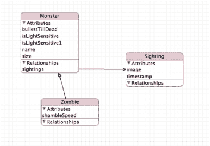

图14.1 Core Data设计界面。

`Core Data`的另一个特性是能够生成Objective-C类，这些类作为底层数据库（iPhone上的sqlite；Mac上可以是mySQL或其他数据库）与应用程序之间的中间层，如图14.2所示。

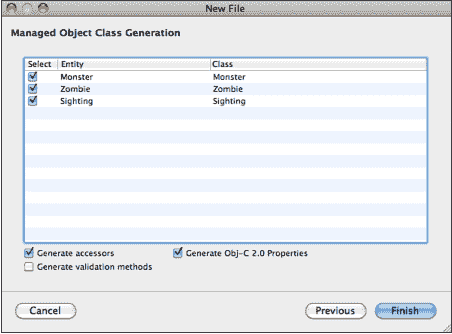

图14.2 从Core Data模型生成Objective-C类。

清单14.1显示了一些由`Core Data`模型生成的类（.h和.m文件）。

#### 清单14.1 Core Data生成的Objective-C类


```objc
//
//  Monster.h
//  SampleCoreData
//
//  Created by Kevin Hoffman on 11/17/10.
//  Copyright 2010 Kevin Hoffman. All rights reserved.
//

#import <CoreData/CoreData.h>

@class Sighting;

@interface Monster : NSManagedObject
{
}

@property (nonatomic, retain) NSNumber * size;
@property (nonatomic, retain) NSNumber * bulletsTillDead;
@property (nonatomic, retain) NSNumber * isLightSensitive;
@property (nonatomic, retain) NSString * name;
@property (nonatomic, retain) Sighting * sightings;

@end

//
//  Monster.m
//  SampleCoreData
//
//  Created by Kevin Hoffman on 11/17/10.
//  Copyright 2010 Kevin Hoffman. All rights reserved.
//

#import "Monster.h"

#import "Sighting.h"

@implementation Monster

@dynamic size;
@dynamic bulletsTillDead;
@dynamic isLightSensitive;
@dynamic name;
@dynamic sightings;

@end

//
//  Zombie.h
//  SampleCoreData
//
//  Created by Kevin Hoffman on 11/17/10.
// Copyright 2010 Kevin Hoffman. All rights reserved.
//

#import <CoreData/CoreData.h>
#import "Monster.h"

@interface Zombie : Monster
{
}

@property (nonatomic, retain) UNKNOWN_TYPE shambleSpeed;
@end
```

我为什么要向你展示所有这些关于 Core Data 的精彩内容？主要是因为从我个人的角度来说，我是 Core Data 的忠实粉丝，并且在我发布到 App Store 的应用程序中广泛使用了它。

Windows Phone 7 上没有与 Core Data 直接对应的东西。第一次听到这个消息时，我的第一反应是跳出窗外，当场结束一切，但回过神来之后，我评估了一些开发者在开发 Windows Phone 7 应用程序时可以使用的工具：

- WCF 的数据协定序列化器——快速轻松地以文件友好的格式对完整的 C# 对象图进行序列化和反序列化。

- LINQ——一种丰富的、集成在语言中的查询引擎，它使 Core Data 的许多 ORM（对象关系映射）功能在 WP7 中变得不再必要。

- 隔离存储——一个强大、安全、沙盒化的可重用存储区域，分配给每个应用程序，使开发者能够访问轻量级文件存储。

考虑到这一点，本章的其余部分将专门说明如何在手机上存储和检索数据，并讨论你可能不希望使用本地数据的几个原因；我们还将讨论混合方法，如智能客户端，这些将在下一章中介绍。希望到本章结束时，你会得出与我相同的结论：尽管 Core Data 很好，但 WP7 不需要类似的框架，因为可用的工具本身已经能很好地完成这项工作。

## 使用 WP7 读写本地数据

在下一节中，我将介绍隔离存储的基础知识，然后带你完成一个示例，该示例使用隔离存储在应用程序的多次执行之间持久化数据。无论你存储的数据量有多少，你都应该始终意识到与隔离存储交互是一个相对缓慢的过程。因此，你应该尽量安排好 I/O 操作的时间，使其对整体用户体验的影响最小。此外，你可能希望避免使用单个文件和“一个类统治一切”式的方法来处理数据。虽然这可能会让你稍微省事一些，但副作用是每次发生更改时都会不必要地写入大量数据。为了弥补这一点，一种技术是为你应用程序的每个逻辑区域使用一个文件和一个对象图（对象实例的层次结构）。这样，当你将数据写入磁盘时，你只写入最近更改的数据。

### 隔离存储入门

隔离存储是一个受配额限制的、隔离的沙盒环境，允许应用程序在不给操作系统带来风险的情况下创建文件。它通过确保这些文件只能通过 API 访问而不能直接访问，并确保这些文件的物理存储是以安全方式进行的，来防止应用程序访问其他应用程序的隔离存储区域。

与隔离存储交互的主要类是 `IsolatedStorageFile` 类。尽管类名以“file”结尾，但它实际上是一个容器，能够容纳文件和目录并提供对它们的访问。它是一个接口，通过它你可以查找文件、打开文件、创建文件等。以下是该类的一些更重要的属性和方法：

- `AvailableFreeSpace`——此属性表示当前应用程序在隔离存储中可用的空间量。

- `Quota`——此属性表示应用程序在隔离存储中可消耗的最大空间量。

- `CreateDirectory`——此方法在隔离存储区中创建一个目录。

- `CreateFile`——在隔离存储区中创建一个新文件。

- `DeleteDirectory`——删除一个目录及其内容。

- `DirectoryExists`——返回一个布尔值，指示特定目录（或子目录）是否存在。

- `FileExists`——返回一个布尔值，指示给定文件名是否存在于隔离存储区中。

- `GetDirectoryNames`——返回隔离存储区中的目录名列表。

- `GetFileNames`——返回隔离存储区根目录或给定子目录中的文件名列表。

- `GetUserStoreForApplication`——最常调用的方法之一，此方法返回一个用户范围的隔离存储实例。

- `OpenFile`——从隔离存储中打开一个文件。你可以配置要打开的文件的模式和访问级别。

- `Remove`——移除整个隔离存储范围及其所有内容。

```csharp
using System.Runtime.Serialization;

namespace IsolatedStorageDemo
{
    public static class IsoStoreHelper
    {
        public static void WriteGraphToFile<T>(string filename,
            T sourceObject)
        {
            using (IsolatedStorageFile isf =
                IsolatedStorageFile.GetUserStoreForApplication())
            {
                using (IsolatedStorageFileStream stream =
                    new IsolatedStorageFileStream(filename,
                        FileMode.Create, isf))
                {
                    DataContractSerializer dcs =
                        new DataContractSerializer(typeof(T));
                    dcs.WriteObject(stream, sourceObject);
                    stream.Close();
                }
            }
        }

        public static T ReadGraphFromFile<T>(string filename)
            where T:class
        {
            T result = null;
            using (IsolatedStorageFile isf =
                IsolatedStorageFile.GetUserStoreForApplication())
            {
                using (IsolatedStorageFileStream stream =
                    new IsolatedStorageFileStream(filename,
                        FileMode.OpenOrCreate, isf))
                {
                    if (stream.Length > 0)
                    {
                        DataContractSerializer dcs =
                            new DataContractSerializer(typeof(T));
                        result = dcs.ReadObject(stream) as T;
                    }
                }
            }
            return result;
        }
    }
}
```

```csharp
using System.Runtime.Serialization;

namespace IsolatedStorageDemo.Models
{
    [DataContract]
    public class Customer
    {
        [DataMember]
        public string Name { get; set; }
        [DataMember]
        public string Description { get; set; }
    }
}
```

`AppData` 和 `Customer` 类仅用作存储和检索数据的手段。用户与之交互的是视图模型，如清单 14.4 所示。视图模型可能包含看起来与我们的数据协定类相似的数据，但它也包含非常特定于 UI 的功能，例如一个名为 `IsSelected` 的属性，我们将使用它来更改列表框中项的背景颜色。这个视图模型实际上是从 Visual Studio 的“Databound Windows Phone Application（数据绑定 Windows Phone 应用程序）”模板附带的视图模型中借用（好吧，勉强算是拼凑）而来的。

#### 清单 14.4 `MainViewModel.cs` 和 `ItemViewModel.cs`

```
using System;
using System.ComponentModel;
using System.Collections.Generic;
using System.Collections.ObjectModel;
using IsolatedStorageDemo.Models;

namespace IsolatedStorageDemo
{
    public class MainViewModel
    {
        public MainViewModel()
        {
            this.Items = new ObservableCollection<ItemViewModel>();
        }

        public ObservableCollection<ItemViewModel> Items
        {
            get; private set;
        }

        public bool IsDataLoaded
        {
            get; private set;
        }
    }

    public class ItemViewModel : INotifyPropertyChanged
    {
        public ItemViewModel()
        {
            this.IsSelected = false;
        }

        public bool IsSelected { get; set; }

        public event PropertyChangedEventHandler PropertyChanged;

        public void OnPropertyChanged(string propertyName)
        {
            if (PropertyChanged != null)
            {
                PropertyChanged(this, new PropertyChangedEventArgs(propertyName));
            }
        }
    }
}
```

# 第14章 手机上的本地存储

```
get;
private set;
}
public void LoadData()
{
	LoadFromIso();
	this.IsDataLoaded = true;
}
public void LoadFromIso()
{
	AppData appData =
	IsoStoreHelper.ReadGraphFromFile<AppData>(
	"appdata.dat", () =>
	{
		AppData seed = new AppData()
		{
			Customers = new Customer[] {
				new Customer { Name = "First Customer",
					Description = "This is the first customer" } }
		};
		return seed;
	});
	this.Items.Clear();
	foreach (Customer cust in appData.Customers)
	{
		this.Items.Add(new ItemViewModel { Name = cust.Name,
			Description = cust.Description });
	}
}
public void SaveToIso()
{
	AppData data = new AppData();
	List<Customer> customerList = new List<Customer>();
	foreach (ItemViewModel itemView in this.Items)
	{
		customerList.Add(new Customer { Name = itemView.Name,
			Description = itemView.Description });
	}
	data.Customers = customerList.ToArray();
	IsoStoreHelper.WriteGraphToFile("appdata.dat", data);
}
```

```
}

using System;
using System.ComponentModel;

namespace IsolatedStorageDemo
{
    public class ItemViewModel : INotifyPropertyChanged
    {
        private string _name;
        public string Name
        {
            get
            {
                return _name;
            }
            set
            {
                if (value != _name)
                {
                    _name = value;
                    NotifyPropertyChanged("Name");
                }
            }
        }

        private string _description;
        public string Description
        {
            get
            {
                return _description;
            }
            set
            {
                if (value != _description)
                {
                    _description = value;
                    NotifyPropertyChanged("Description");
                }
            }
        }

        private bool _isSelected;
        public bool IsSelected
        {
```


```
get
{
    return _isSelected;
}
set
{
    _isSelected = value;
    NotifyPropertyChanged("IsSelected");
}
}

public event PropertyChangedEventHandler PropertyChanged;
private void NotifyPropertyChanged(String propertyName)
{
    PropertyChangedEventHandler handler = PropertyChanged;
    if (null != handler)
    {
        handler(this, new PropertyChangedEventArgs(propertyName));
    }
}
}
```

现在我们有了一个可从独立存储加载并写入的数据模型，也有了专为 Silverlight 数据绑定定制的视图模型，唯一缺失的就是一个将这些整合在一起的 UI。清单 14.5 包含了用于搭建列表框以显示视图模型中客户的 XAML。此外，它还包含一个带有按钮的应用程序栏，我们可以用它来添加和删除客户。每次添加或删除客户时，我们都会将视图模型转换为数据模型，并将其保存到独立存储中。当应用程序启动时，视图模型会尝试从独立存储中已保存的数据重新构建自身。

## 清单 14.5 MainPage.xaml

```
<phone:PhoneApplicationPage
    x:Class="IsolatedStorageDemo.MainPage"

    ...namespace stuff removed for clarity ...
    d:DataContext="{d:DesignData SampleData/MainViewModelSampleData.xaml}"
    FontFamily="{StaticResource PhoneFontFamilyNormal}"
    FontSize="{StaticResource PhoneFontSizeNormal}"
    Foreground="{StaticResource PhoneForegroundBrush}"
    SupportedOrientations="Portrait" Orientation="Portrait"
    xmlns:my="clr-namespace:IsolatedStorageDemo.Converters"
    shell:SystemTray.IsVisible="True">
<phone:PhoneApplicationPage.Resources>
```

```
<my:SelectedColorConverter x:Key="colorConverter"/>
</phone:PhoneApplicationPage.Resources>

<Grid x:Name="LayoutRoot" Background="Transparent">
    <Grid.RowDefinitions>
        <RowDefinition Height="Auto"/>
        <RowDefinition Height="*"/>
    </Grid.RowDefinitions>

    <StackPanel x:Name="TitlePanel" Grid.Row="0" Margin="12,17,0,28">
        <TextBlock x:Name="ApplicationTitle"
                   Text="Iso Store App"
                   Style="{StaticResource PhoneTextNormalStyle}"/>
        <TextBlock x:Name="PageTitle"
                   Text="Customers" Margin="9,-7,0,0"
                   Style="{StaticResource PhoneTextTitle1Style}"/>
    </StackPanel>

    <Grid x:Name="ContentPanel" Grid.Row="1" Margin="12,0,12,0">
        <ListBox x:Name="MainListBox" Margin="0,0,-12,0"
                 ItemsSource="{Binding Items}"
                 SelectionChanged="MainListBox_SelectionChanged">
            <ListBox.ItemTemplate>
                <DataTemplate>
                    <StackPanel Margin="0,0,0,17" Width="432"
                                Background="{Binding Path=IsSelected,
                                          Converter={StaticResource colorConverter}}">
                        <TextBlock Text="{Binding Name}"
                                   TextWrapping="Wrap"
                                   Style="{StaticResource PhoneTextExtraLargeStyle}"/>
                        <TextBlock Text="{Binding Description}"
                                   TextWrapping="Wrap" Margin="12,-6,12,0"
                                   Style="{StaticResource PhoneTextSubtleStyle}"/>
                    </StackPanel>
                </DataTemplate>
            </ListBox.ItemTemplate>
        </ListBox>
    </Grid>
</Grid>

<phone:PhoneApplicationPage.ApplicationBar>
    <shell:ApplicationBar IsVisible="True" IsMenuEnabled="false">
        <shell:ApplicationBarIconButton x:Name="appBarAddButton"
                                        IconUri="/Images/appbar.add.rest.png"
                                        Text="Add" Click="appBarAddButton_Click"/>
    </shell:ApplicationBar>
</phone:PhoneApplicationPage.ApplicationBar>
```

```
<shell:ApplicationBarIconButton x:Name="appBarDelButton"
    IconUri="/Images/appbar.delete.rest.png"
    Text="Delete" Click="appBarDelButton_Click"/>
</shell:ApplicationBar>
</phone:PhoneApplicationPage.ApplicationBar>
</phone:PhoneApplicationPage>
```

最后，这里给出了清单14.6中所示主页面的代码隐藏文件。

## 清单14.6 MainPage.xaml.cs

```
using System;
using System.Windows;
using System.Windows.Controls;
using Microsoft.Phone.Controls;

namespace IsolatedStorageDemo
{
    public partial class MainPage : PhoneApplicationPage
    {
        // Constructor
        public MainPage()
        {
            InitializeComponent();

            DataContext = App.ViewModel;
            this.Loaded += new RoutedEventHandler(MainPage_Loaded);
        }

        private void MainListBox_SelectionChanged(object sender,
            SelectionChangedEventArgs e)
        {
            // If selected index is -1 (no selection) do nothing
            if (MainListBox.SelectedIndex == -1)
                return;

            (e.AddedItems[0] as ItemViewModel).IsSelected = true;
            if ((e.RemovedItems != null) && (e.RemovedItems.Count > 0))
            {
                (e.RemovedItems[0] as ItemViewModel).IsSelected = false;
            }
        }

        private void MainPage_Loaded(object sender, RoutedEventArgs e)
        {
            if (!App.ViewModel.IsDataLoaded)
```

```
{
	App.ViewModel.LoadData();
}
```

```
private void appBarAddButton_Click(object sender, EventArgs e)
{
	Random r = new Random();
	ItemViewModel newItem = new ItemViewModel { Name = "Customer " + r.Next(5, 100).ToString(),
		Description = "Newly Created Customer" };
	App.ViewModel.Items.Add(newItem);
	App.ViewModel.SaveToIso();
}
```

```
private void appBarDelButton_Click(object sender, EventArgs e)
{
	MessageBoxResult result = MessageBox.Show("Delete " + App.ViewModel.Items[MainListBox.SelectedIndex].Name + "?",
		"Confirm", MessageBoxButton.OKCancel);
	if (result == MessageBoxResult.OK)
	{
		App.ViewModel.Items.RemoveAt(MainListBox.SelectedIndex);
	}
	App.ViewModel.SaveToIso();
}
```

当你运行此示例时（本章源代码清单中未包含一些编译所需文件，你可以从本书的代码下载中获取），你得到的结果将与图14.3类似。

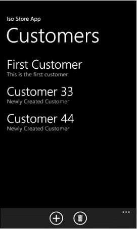

图14.3 运行独立存储示例。

## 总结

本章首先讨论了iPhone上Core Data的一些功能。由于Core Data与WP7之间不存在直接对应关系，因此本章重点介绍使用独立存储在磁盘上存储和检索整个对象层次结构的能力。

结合独立存储、WCF数据协定序列化器和LINQ对内存数据执行运行时查询，你的应用程序几乎可以相对轻松地管理任何类型的数据。本章向你展示了如何使用独立存储来实现这一点。在下一章中，你将了解如何通过构建智能客户端来处理远程数据。

# 构建智能客户端

> *如果Facebook是一个国家，那么它现在将是世界上人口第六多的国家。*
>
> InsideFacebook.com

本章概述了移动设备上最强大的应用程序类型之一——智能客户端。庞大而单一的桌面应用程序的日子已经屈指可数。即使是现代桌面上的应用程序，也经常与Internet上的服务通信，以获取补充信息、研究、查找甚至进行复杂计算。

智能客户端是一种利用宿主环境硬件的应用程序。它能够使用GPS、加速度计、高清视频、音频，当然还有网络设备。这些应用程序可以是任何类型，从休闲游戏到天气应用，再到Netflix、Flixster、Facebook、Twitter等应用。尽管所有这些应用程序都是完全安装的WP7应用程序，但真正的工作是在其他地方完成的，真正的数据存储在云端。除了一些小众应用外，如今的手机用户往往甚至懒得安装那些与周围世界（通过Internet、GPS、Wi-Fi等）没有任何联系的应用程序。

本章讨论的正是这种模型，向你展示如何利用WP7的网络和存储能力来构建与平台无关的RESTful服务通信的应用程序，以及与基于.NET的应用服务器上的Windows Communication Foundation（WCF）服务通信的应用程序。

## 使用RESTful服务

REST是REpresentational State Transfer（表述性状态转移）的缩写。为了尽快进入代码演示，我们快速概括一下：这归结为将Web视为资源的集合。每个资源都有一个唯一资源标识符(URI)。通过使用标准HTTP词汇表（如GET、PUT、DELETE和POST）中的动词，并将URI作为名词使用，我们可以构建一种词汇表，从而能够操作和查询资源，无论这些资源托管在哪个底层平台上。

假设你有一个名为Users的资源集合，暴露在`http://my.server.com/Users`这样的URI上。按照典型的REST假设，向该URI发出HTTP GET请求应该返回该集合的某种表示（几乎总是XML，通常是“feed”形式，虽然近来JSON已成为流行的替代方案）。按照惯例，向`http://my.server.com/Users/bob`发送HTTP GET应返回属于资源集合“Users”的、名为“bob”的资源表示。向同一URI发送HTTP PUT将用你发送的表示替换服务器上“bob”的表示。假设你有权限，向该URI发送HTTP DELETE将删除名为“bob”的资源。

有关RESTful架构的完整讨论，请参阅`http://en.wikipedia.org/wiki/Representational_State_Transfer`上的维基百科详细条目。许多书籍讨论了在不同语言中实现RESTful服务的各种方法。其中一本书是Jon Flanders所著的《RESTful .NET》（ISBN: 0596519206）。如果你喜欢Ruby，Ben Scofield编写的《Practical REST on Rails 2 Projects》也是一本优秀的指南。

无需深入思考就能开始意识到这种服务暴露方式的一些好处。与使用某人固定的远程过程调用（RPC）风格接口（在其中调用专有方法）不同，你只是在使用Internet本身的基本词汇。RESTful服务迅速流行起来，尤其是在那些希望尽可能轻松使用并广泛提供其信息和API的社交网站中。

## 为什么LINQ to XML是你新的好朋友

与RESTful服务通信包括两部分。第一部分是HTTP通信，你的代码需要能够使用标准HTTP方法（如GET和POST）发送有效负载。（PUT和DELETE经常被省略，以允许更广泛的客户端消费，但这是上述关于RESTful服务的书籍中更适合讨论的主题。）

与RESTful服务通信的第二部分是能够读写有效负载或资源。在大多数情况下，该有效负载以XML表示——要么是符合某种自定义架构的XML，要么是Atom或RSS等feed类型的XML。

这就是为什么LINQ to XML是你新的好朋友。LINQ to XML将允许你的C#代码快速高效地处理任何XML文档（无论是本地获取还是从Web获取），对其进行处理、查询，并将其转换为可用的视图模型数据，同时这种处理方式也易于其他开发人员阅读和理解。

你需要与RESTful服务通信的第一个类是`WebClient`类。尽管完整版本的.NET Framework中提供了更强大的替代方案，但`WebClient`是Silverlight开发人员可用于进行web的常用类。

请求。（其他类也能进行网络访问，但 `WebClient` 可能是进行 Web 服务调用最简单、最易用的类。）

使用简单的 HTTP GET 从网站拉取数据再简单不过了。`DownloadStringAsync` 方法正如其名——它在后台以异步方式将特定 URI 的内容作为单个字符串下载；下载完成后，会引发一个事件并触发你的代码来处理响应，如下面的代码所示：


```
public void LoadStuff()
{
    WebClient wc = new WebClient();
    wc.DownloadStringAsync(
        new Uri("http://my.server.com/stuff"));
    wc.DownloadStringCompleted +=
        new DownloadStringCompletedEventHandler(wc_DownloadStringCompleted);
}
void wc_DownloadStringCompleted(object sender,
        DownloadStringCompletedEventArgs e)
{
    StringReader sr = new StringReader(e.Result);
    var reader = XmlReader.Create(sr);
    var document = XDocument.Load(reader);
    // Process the XML document
}
```

最常见的 Web 活动之一就是通过简单的 HTTP GET 来检索数据。然而，智能客户端也会向 RESTful 服务发送数据。假设我们的 WP7 应用程序通过 HTTP POST 向 RESTful 服务提交一个新的 Customer。为此，我们需要对 Web 请求进行更细粒度的控制。我们需要设置内容类型（此处为“text/xml”），需要将 HTTP 方法改为 POST，还需要将 XML 负载转换为字节流，以便放入 HTTP POST 的正文中。这听起来可能很复杂，但将下面的代码与在 iOS 上执行类似操作所需的代码相比，你应该庆幸在 WP7 上它是如此简单。

首先，我们将使用 `HttpWebRequest` 类，它让我们在构建请求时能够进行细粒度的控制：

```
private void foo_Click(object sender, RoutedEventArgs e)
{
    HttpWebRequest request = (HttpWebRequest)
        WebRequest.Create(
            "http://localhost/Chapter15ServiceHost/RESTfulService.svc/
UploadedCustomers");
    request.ContentType = "text/xml";
    request.Method = "POST";
    request.BeginGetRequestStream(
        new AsyncCallback(GetRequestStreamCallback), request);
}
```

这是三步异步操作序列中的第一步。当 `BeginRequestStream` 调用完成时，它会调用我们的回调（如果你喜欢这类术语的话，其他语言称之为 completion 或 monad）。接下来展示的就是这个回调，它通过将 XML 文档转换为字节数组来构建请求正文，然后异步执行请求：

```
void GetRequestStreamCallback(IAsyncResult result)
{
    HttpWebRequest request = (HttpWebRequest)result.AsyncState;
    Stream postStream = request.EndGetRequestStream(result);

    string xmlPayload =
        "<?xml version=\"1.0\" encoding=\"utf-8\"?>" +
        "<Customer xmlns:xsd=\"http://www.w3.org/2001/XMLSchema\" xmlns:xsi=\"http://www.w3.org/2001/XMLSchema-instance\">" +
        "<FirstName>Foo</FirstName>" +
        "<LastName>Johnson</LastName>" +
        "<Address>" +
            "<Line1>1 Fake St</Line1>" +
            "<City>FakeVille</City>" +
            "<State>PA</State>" +
            "<Zip>90210</Zip>" +
        "</Address>" +
        "</Customer>";
    byte[] payloadBytes = Encoding.UTF8.GetBytes(xmlPayload);
    postStream.Write(payloadBytes, 0, payloadBytes.Length);
    postStream.Close();
    request.BeginGetResponse(
        new AsyncCallback(GetResponseCallback), request);
}
```

链条中的下一步是由响应完成触发的异步回调。该响应可能是错误，也可能是成功。要知晓结果，只能通过下面的回调代码：

```
void GetResponseCallback(IAsyncResult result)
{
    HttpWebRequest request = (HttpWebRequest)result.AsyncState;
    HttpWebResponse response =
        (HttpWebResponse)request.EndGetResponse(result);
    Stream responseStream = response.GetResponseStream();
    StreamReader streamReader = new StreamReader(responseStream);
    string responseString = streamReader.ReadToEnd();
    Debug.WriteLine(responseString);
    responseStream.Close();
    streamReader.Close();
    response.Close();
}
```

如果你习惯于用最喜欢的桌面编程语言发起简单的、只有 10 行的 Web 服务请求，先别急着评判。这种方式看起来不同，并不代表它不好。事实上，在 WP7 上以这种方式（我称之为“非常异步”，也有人称之为“离谱的异步”）使用了一段时间 Web 服务之后，我反而越来越喜欢它了。

在上述每一步中，都可以显示进度条或其他网络活动的视觉指示。如果你使用 WP7 设备已有一段时间，无疑会对大多数网络活动期间出现的“滑动圆点”感到熟悉。它们是一种微妙的指示，表明后台正在进行某些网络活动，而界面不会被巨大的转轮或其他突兀的“请稍候”或进度指示器弄得杂乱无章。

除了能够向用户提供视觉反馈之外，上述每一步也是非常合理的错误捕获位置。多花一点额外的时间和谨慎，以这种方式实现 RESTful Web 服务客户端，你就能给用户带来快速、不突兀的网络访问体验，这种体验贯穿于微软所有预装 WP7 应用程序的用户体验之中。

现在你已经了解了如何发起简单的 HTTP GET 请求，也了解了如何通过 HTTP POST 发送 XML 负载，接下来让我们看看解析一些最流行格式（Twitter、YouTube 和 RSS 源）的数据是多么容易。

首先，让我们看看解析某个用户最近 10 条推文有多么容易（此 API 访问不需要身份验证；如需进行更复杂的 Twitter 操作，你需要一个开发者密钥）：

```
public void LoadTweets()
{
    WebClient wcTweets = new WebClient();
    wcTweets.DownloadStringAsync(new
    Uri("http://api.twitter.com/1/statuses/user_timeline.xml?screen_name=ckindel"));
    wcTweets.DownloadStringCompleted +=
        new DownloadStringCompletedEventHandler(
            wcTweets_DownloadStringCompleted);
}
void wcTweets_DownloadStringCompleted(object sender,
    DownloadStringCompletedEventArgs e)
{
    StringReader sr = new StringReader(e.Result);
    var reader = XmlReader.Create(sr);
    var document = XDocument.Load(reader);

    var tweets =
        from tweet in document.Descendants("status")
        select tweet;
```

```
App.ViewModel.Tweets.Clear();
foreach (var tweet in tweets)
{
    Tweet newTweet = new Tweet
    {
        Text = (string)tweet.Element("text"),
        CreatedAt = DateTime.ParseExact(
            (string)tweet.Element("created_at"),
            "ddd MMM dd HH:mm:ss zz00 yyyy", null)
    };
    App.ViewModel.Tweets.Add(newTweet);
}
TweetsLoaded = true;
```

这段代码遍历用户 `ckindel`（Charlie Kindel 是微软 Windows Phone 7 开发者生态系统部门的一名总经理）的状态更新列表，并将其转换为视图模型形式，以便我们绑定 UI。本章示例应用程序的 UI 如图 15.1 所示。

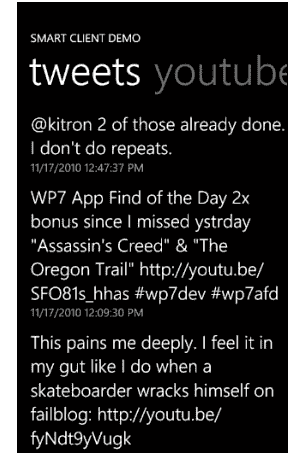

图 15.1 智能客户端应用程序的截图。

现在，我们来筛选某个用户 YouTube 上传视频的 Google Data feed：

```
public void LoadVideos()
{
    WebClient wc = new WebClient();
    wc.DownloadStringAsync(new Uri("http://gdata.youtube.com/feeds/api/users/thecrochetdude/uploads"));
    wc.DownloadStringCompleted += new DownloadStringCompletedEventHandler(wc_DownloadStringCompleted);
    this.VideosLoaded = true;
}
void wc_DownloadStringCompleted(object sender, DownloadStringCompletedEventArgs e)
{
    StringReader sr = new StringReader(e.Result);
    var reader = XmlReader.Create(sr);
    var document = XDocument.Load(reader);

    XNamespace atom = "http://www.w3.org/2005/Atom";
    var entries =
        from entry in document.Descendants(atom + "entry")
        select entry;

    App.ViewModel.Videos.Clear();
    foreach (var entry in entries)
    {
        App.ViewModel.Videos.Add(new VideoViewModel
        { Title = (string)entry.Element(atom + "title"),
          Description = (string)entry.Element(atom+"content") });
        //Debug.WriteLine(entry.ToString());
        //Debug.WriteLine("Author: " + (string)entry.Element(atom + "author").Element(atom + "name"));
    }
    VideosLoaded = true;
}
```

下面是非常相似的代码（我省略了 `WebClient` 部分；现在你应该已经对这部分代码相当熟悉了），用于将 RSS 源转换为视图模型对象的实例：

```
void wcBlog_DownloadStringCompleted(object sender, DownloadStringCompletedEventArgs e)
{
    StringReader sr = new StringReader(e.Result);
    var reader = XmlReader.Create(sr);
    var document = XDocument.Load(reader);

    var posts =
```

```csharp
from item in document.Descendants("item")
select item;

App.ViewModel.BlogPosts.Clear();
foreach (var post in posts)
{
    BlogViewModel blogpost = new BlogViewModel
    {
        Title = (string)post.Element("title"),
        Description = (string)post.Element("description"),
        PublishDate = DateTime.Parse((string)post.Element("pubDate"))
    };
    App.ViewModel.BlogPosts.Add(blogpost);
}
BlogLoaded = true;
```

如你所见，使用 RESTful Web 服务所需的代码量非常少——无论是 Twitter、YouTube、RSS 还是你自己的自定义服务。Windows Phone 7 让你的应用程序能够快速、轻松、高效且异步地与 Web 服务对话，这样你可以在不影响用户体验的前提下进行通信。

作为读者练习，从本章随附代码的示例应用程序中获取代码，并扩展推文的透视项（pivot item），使其从 Web 获取源用户的 Twitter 头像，并将其显示在页面顶部。作为提示，我在几章之前向你展示了如何将 `Image` 控件的内容动态设置为字节数组。学习新技术不在于记忆语法，而在于将不同的技术组合起来，创造出令人惊叹的应用程序。本章我给你的代码可以成为一些非常酷的应用的催化剂；你所需要的只是一点想象力和耐心。

## 使用 WCF 服务

如果你有幸同时在编写智能客户端应用程序的客户端和服务端，你可能会想要放弃使用传统的 RESTful 服务。虽然 RESTful 架构很优雅，而且非常适合提供跨平台功能，不会产生任何语言或平台特定的依赖，但有时还有更实用的选择。在同时构建服务器和 Windows Phone 7 应用程序的情况下，如果你使用 .NET 和 WCF 构建服务器，你可能会希望使用服务引用而不是原始 HTTP 消息来使用 WCF 服务。我将讨论的所有功能在 iPhone 和 iOS 上完全不可用。对于那些将 Microsoft 后端暴露给移动设备的人来说，这极大地提高了生产力并节省了时间。

响应 WCF 服务调用异步完成的代码如下所示：

```
void client_GetSomeStringCompleted(object sender,
    RegularServiceReference.GetSomeStringCompletedEventArgs e)
{
    Debug.WriteLine("Received reply from service:\n" + e.Result);
}
```

尽管此服务调用的返回值和输入参数是简单的字符串，但你几乎可以发送和接收任意复杂的 C# 对象。只要 WCF 知道如何序列化和反序列化该类，它就能生成客户端代理或客户端包装器，来完成在原始 HTTP 负载和客户端包装对象之间的繁重转换工作。

你还可以在不添加服务引用、也不使用生成的代理的情况下，调用远程 WCF 服务上的方法。这是通过一个名为 `ChannelFactory` 的 WCF 类完成的，但该类及其相关主题最好由专门介绍 WCF 的书籍来处理。有关 WCF 的更多信息，请参阅 Juval Lowy 所著的 *WCF 服务编程*。

## 总结

移动应用程序很少存在于真空中。尽管有一些非常流行且值得注意的例外，但在大多数情况下，移动应用程序需要以某种方式利用网络资源。无论是下载最新的天气信息、股票报价，还是与私有托管数据库通信，移动应用程序如果没有网络资源，往往什么都不是。


本章向你对如何构建联网的 Windows Phone 7 应用程序进行了概述。无论你是使用`WebClient`或`HttpWebRequest`类与 RESTful 服务通信，还是使用生成的 WCF 客户端代理，与网络资源交换数据都是简单、容易且高效的。现在你的 WP7 工具箱中已经有了网络功能，你可以创建用户喜爱并会反复使用的出色应用程序。

## 关注点分离

> *建筑是艺术之母。*
>
> *没有我们自己的建筑，我们就没有自己文明的灵魂。*
>
> 弗兰克·劳埃德·赖特

本章是本书几章以来一直在铺垫的内容的高潮。当你一路阅读本书、查看源代码并运行示例时，希望有几件事一直在你脑海中浮现。

首先，希望你一直喜欢这些代码示例，并在此过程中有所学习。其次，你敏锐的开发者思维可能会这样想：

这对于简单的“hello world”应用来说固然很好，但这一切在真正的生产级应用中是怎样的呢？我如何创建优雅、可测试、简单、易于维护的代码来解决实际问题？我如何才能避免困扰着大多数真正规模应用的不可避免的意大利面条式代码？

如果你一直在想类似的问题，那么本章应该会让你非常开心。我的疯狂是有方法的。在本书开头，我通过简单粗糙的代码示例阐述了简单的概念，帮助你入门。随着本书的推进，示例变得越来越复杂，你可能已经注意到，在上一章中，我特意将数据模型与视图模型分离开来。在下一章，你将学习单元测试和测试驱动开发（TDD）。

本章将架构和设计模式的高层讨论与其中一种模式的开源实现演练相结合。我们将研究 MVC 模式如何应用于 iOS 应用程序开发，并看到如何利用该模式的一种改编来帮助您构建出色的 WP7 应用程序，并以可扩展、可测试、可维护的方式进行。

## MVC 简史

在当今的软件开发世界中，去年还是全新的技术常常被视为“老派”，而操场上所有时髦的孩子都停止使用旧东西，转而使用最新的 SDK、语言或框架。

信不信由你，模型-视图-控制器（MVC）架构模式自 1979 年以来就存在了。没错，你们当中有些读者可能比这个模式还年轻（这让我觉得自己更老了，我保留在后续章节中称你们为“毛头小子”的权利）。

MVC 于 1979 年由施乐帕洛阿尔托研究中心（Xerox PARC）Smalltalk 团队的一名成员首次描述。鉴于这个基本的事实，对于任何 Objective-C（一种受 Smalltalk 启发的语言）程序员来说，Apple 在其框架（如 Cocoa 和 iOS）中广泛使用——并且经常要求使用——MVC 模式，就不足为奇了。

MVC 模式的核心是关注点分离的愿望。大多数开发人员都经历过试图解开过于紧密耦合代码的噩梦。这经常发生在应用程序已经发布到生产环境并且运行正常之后。然后有人希望应用程序做一些在最初发布时没有人计划过的事情。

当开发人员掀起引擎盖，俯视应用程序的引擎时，他们看到的东西令他们恐惧。一切都紧密依赖着其他一切。他们不能更改一段代码而不重写另一段代码。一个稍显简单的更改，也会在复杂性以及潜在的时间和资源消耗方面变得如同地狱。更糟糕的是，代码在编写时没有考虑单元测试，因此没有一种自动化、可靠的方法来知道新功能是否破坏了先前正常工作的功能。由于模块之间相互依赖、紧密耦合，开发人员甚至无法隔离测试他们的代码。

MVC 并不是那种撒上魔法仙尘就能解决所有这些问题的解决方案。它只是众多模式中的一种，其主要目标是关注点分离，以提供更敏捷、灵活、松耦合但仍高度内聚的应用程序。再说一次，使用 MVC 并不能保证成功，就像使用锤子并不能保证你不会砸到自己的拇指一样。

我将对 MVC 进行详细描述，既因为它是 iPhone 上的主要开发模式，也因为理解 MVC 的工作原理将有助于理解我们将要使用的变体 MVVM 的工作原理。

MVC 的设计工作方式是通过在应用程序中明确分配角色和职责，将这些职责归为三个不同的类别：

- 模型——模型负责领域数据。这不仅包括存储信息，还包括状态维护以及对状态变化观察者的通知。视图和控制器都可以是状态变化信息的观察者或订阅者。
- 视图——视图负责以交互形式渲染模型。视图负责促进用户交互的处理，但它不直接响应用户交互。
- Controller—控制器负责响应用户输入并据此操作模型。你可能会认为视图负责此事，但这种区分很重要。如果视图渲染了一个其状态绑定到模型的按钮，视图只是促成了用户触摸屏幕的行为，而控制器则执行对这次触摸的响应代码。

这些三个角色的交互示例如图 16.1 所示。

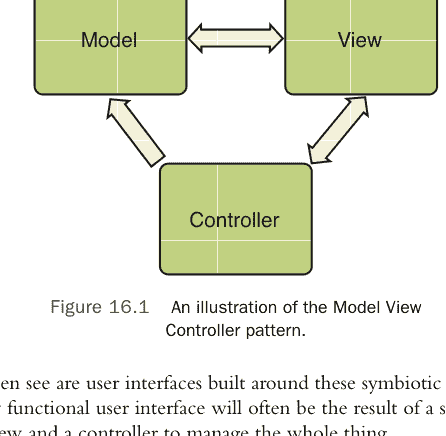

你经常会看到围绕这些共生 MVC 三元组的构建的用户界面。一个完全功能的用户界面往往是由一个小型模型、一个单一目的的视图以及一个管理整体的控制器共同构成的。

如果你查看图 16.1 中的图表，你可能会注意到模型和视图之间存在双向关系。这种关系通常通过数据绑定来实现。

如果你做过任何 iOS 编程，你可能知道数据绑定，至少在 Mac OS X 桌面程序员习惯的意义上，是不可用的。相反，控制器承担了更积极的角色，并且经常被用来强制将数据喂给模型，同时也强制将信息注入视图。这种实现方式——控制器直接操作视图和模型，而模型和视图之间几乎没有或根本没有直接通信——通常被称为被动视图模式（见图 16.2）。这实际上是 MVC 模式，只是控制器充当模型到视图通信的中介。

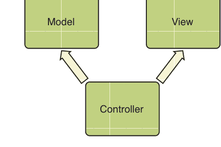

图 16.2 MVC 的被动视图替代形式。

想象一下这如何适用于典型的 iOS 开发场景。最常用的控制器之一是 `UITableViewController`。该控制器在其内部包含对视图层次结构的引用，对于所有目的而言，它承担了前面图表中视图的角色。iOS 和 Cocoa 都大量使用委托模式。与其让控制器引用一个包含大量属性的模型对象以便读取来操作视图，控制器反而维护一个单一的引用，称为 delegate，指向必须公开某些方法的对象。

当与视图的特定用户交互需要视图没有的数据时，控制器处理此输入（记住视图只是促成输入；它不处理输入）。如果控制器需要它尚不具备的东西（例如特定行/组的 `UITableViewCell` 实例），它可以向委托对象发送消息（调用其方法）。在这种情况下，委托对象充当模型的角色。

MVC 纯粹主义者经常对这个特定例子嗤之以鼻，因为 `UITableViewController` 有能力成为自己的委托。这意味着控制器提供了自己的模型，对许多人来说，这种行为近乎冒犯。

到目前为止，在本书中你看到我在许多示例应用程序中创建了一个名为 `ViewModels` 或 `Models` 的文件夹。我之所以这样做，是因为即使对于最简单的应用程序，一点关注点分离也大有裨益。我一直在非正式地引向本章，尽量保持控制器、视图及其对应模型尽可能分离。

在本章下一节，你将了解一种称为 MVVM 的 MVC 变体。我们将使用该模式的开源实现来构建一个具有清晰线条、性感曲线和分离关注点的应用程序。

## 介绍 MVVM

为了解释从 MVC 到 MVVM 的演进，我将与你分享一个轶事。我正在开发我做过的最复杂、最深入的应用程序之一。它有一个高速、实时、流式后端，不断地向 UI 推送信息，有时也接收用户的输入。我与 Pavan Podila 一起工作（有些人可能通过他的部落名字 Dances with Xaml 知道他）。我们都是 MVC 模式的忠实粉丝，并且在共同开发模型时，他构建了一个惊人的 UI，我构建了一个同样惊人的后端。这真是一个美妙的东西。

直到我们尝试真实场景。

这时，愉快的协同开始瓦解。随着我后端需要更多功能，我开始向模型添加更多属性。因为我尽可能遵循我长期使用的 MVC 模式，我把尽可能多的“控制器性”（这是一个技术术语，说真的）保留在控制器中。我没有在模型上放置任何与状态维护、操作或通知无关的方法。Pavan 迅速向模型添加了他为实现 WPF 魔法所需的属性。我们很快意识到，我的后端被他的 UI 特定建模所破坏，他的 UI 被与我的后端实现相关的实现细节所破坏。更糟的是，我们俩都彻底滥用了控制器，让它做各种自然界从未打算让控制器做的事情。即使我们用 MVC 分离了一些关注点，这也不够好。

我们的问题在于，我们没有早点意识到，一个同时提供“可绑定性”（另一个技术术语，指对象专门设计为绑定到 Silverlight GUI）和持久性的单一模型是不合适的。我们需要拆分这些角色。不是坚持 MVC，我们将功能从控制器中分离出来，创建了一个后端 Model 和一个前端 ViewModel。

ViewModel 上有属性，表示诸如切换开关的状态、绑定视图状态、转换信息以及需要三四个后端属性才能表示的自定义数据聚合。Model 对象是纯持久性，数据“在电线上看起来像什么”。

这种新的关注点分离是 Model-View-ViewModel（MVVM）模式的实现。在此模式中，视图通过命令和双向数据绑定与视图模型通信。视图模型通过消息向视图报告重要的状态变化。视图模型可以与模型对话（我们的就是这样），视图如果需要，也可以直接与底层模型交互。

这种交互模式如图 16.3 所示，它是对 Laurent Bugnion 开源实现的 MVVM 的特定倾向的说明。

在接下来的章节中，我将逐步介绍一个利用开源 MVVM 框架构建的应用程序的实现。MVVM 只是一种模式，但该框架提供了一些非常有用的类，使得在构建 WP7 应用程序时更容易保持关注点分离。

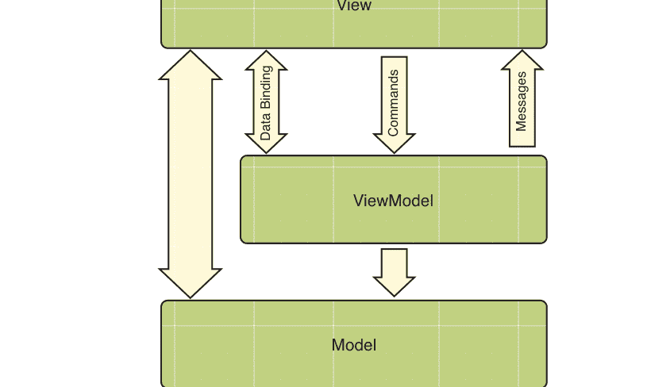

## 使用 MVVM Light for WP7

在继续本章这一节之前，我必须把功劳归于功劳所在。我了解 MVVM 并不是因为我对该模式感兴趣，而是更多因为 Laurent Bugnion 对该模式的实现，MVVM Light，一个可用于 WPF、Silverlight 和 Windows Phone 7 的开源产品。如果你想了解有关 Silverlight 的知识，请在 Twitter 上关注此人（@LBugnion）或访问他的博客 http://blog.galasoft.ch。更好的是，去买他的书《Silverlight 4 Unleashed》。

在本章下一节中，你需要一些东西才能跟上。因为示例代码的长度和复杂性，我建议你先通读这一节，不要尝试输入任何内容。完成这一节后，打开示例代码并试玩它；运行示例应用程序，看看一切如何作为一个整体应用程序协同工作。

与 MVVM Light 配合使用的第一件事就是工具包本身。安装说明可能因本书写作时间和你阅读时而有所不同。阅读它，所以你需要遵循 MVVM Light 网站上的安装说明。你可以从 http://www.galasoft.ch/mvvm/getstarted 下载该库并找到文档和安装说明。在此网址你会找到指向安装说明、视频、文档以及下载库的链接。

在继续本章的其余部分之前，请确保你能够创建一个新的 MVVM Light (WP7) 应用程序，并且它能够编译并运行。当我坐在这里撰写本书时，MVVM Light 并没有自动安装实用程序。你需要解压模板和二进制文件并将它们放在适当的目录中。

为了展示 MVVM Light 的强大功能，我将带你逐步构建一个示例应用程序。这与之前章节中的示例有点不同，因为 MVVM Light 是一个提供支持架构原则的代码库。为了让它发挥作用，我们需要构建一个完整的应用程序。展示微小的孤立片段而不展示它们如何真正改善应用程序质量是没有意义的。

这个示例应用程序名为 Mnemuse，是为小说作家准备的工具。该工具允许作家从其 Windows Phone 7 设备存储和浏览角色、地点、场景、灵感、情节线、章节组织等。这让他们确信自己永远不会丢失重要想法，也永远不会忘记某个特定角色的头发颜色。注意，在本书撰写时，该应用纯粹是演示用途，并未在任何应用市场上架。

我们可以用非 MVVM 的方式构建这个应用程序。我可以创建一堆 XAML 页面并用直接的数据操作代码填满代码后置。我可以将孤立存储（或 Web 服务）I/O 放在直接由 UI 控件激活的位置。我甚至可以让一个页面实例化其他页面，并让主页面手动实例化并向详情页面馈送数据。最终用户可能永远不会知道我偷工减料了，也不会知道我的应用程序耦合紧密或无法测试。说实话，我可以这样做，并且就用户而言应用程序可能运行得相当不错，我甚至可能从该应用赚很多钱。

但我早上会尊重自己吗？不会。

因此我们将以 MVVM 的方式来做。

首先，我将创建一个新的 MVVM Light (WP7) 项目。当你这样做时，你会得到一个 `MainPage.xaml`，就像任何其他 WP7 应用程序一样。但你也会得到一个 `ViewModel` 文件夹，在该文件夹中有一个名为 `MainViewModel` 的类。通常视图（在我看来可以是页面或用户控件）与视图模型之间存在 1:1 的对应关系。视图模型是我们将要查看的该应用程序的第一个方面。

## Building a View Model

为视图模型提供代码支持是 MVVM Light 库的主要任务之一。随着开发人员在学习过程中不断进步，他们厌倦了构建产生意大利面条代码的应用程序，并希望获得更简洁、更优雅的东西。开发人员通常会自然地朝 MVVM 方向漂移。

MVVM 采用过程中的一个常见障碍是弄清楚如何管理视图模型的生命周期。有时开发人员会创建一个静态类来存储对所有视图模型的引用，以便在需要时这些模型会存在。接下来发生的事情通常是开发人员决定 MVVM 并不是一个好主意的地方：他们尝试在 XAML 视图与其静态视图模型之间建立绑定，结果变得很丑陋。让它工作所产生的行为往往比开发人员最初试图避免的意大利面条代码还要多。

引入 `ViewModelLocator`。这是由 MVVM Light 项目模板为我们提供的类。对于应用程序中的每个视图模型，该类维护一个静态属性，该属性保存该视图模型单例实例的引用。此外，还有非静态属性专门设计用于允许 XAML 绑定。这解决了试图保持视图代码“纯净”时最痛苦的方面之一，即有一个中央实用程序类（如果你喜欢模式标签，可以将其视为工厂）负责视图模型的实例化、绑定公开和生命周期管理。

在我们的示例应用程序中，主页面显示书籍列表，因为能够只在一次思考一本书的虚构作者实在是罕见。所以我们不仅需要我们的主视图模型来维护书籍列表，而且我们希望这个视图模型能够使用 `ViewModelLocator` 类进行绑定和定位。

要在 `ViewModelLocator` 类中设置新的视图模型，我首先在实例构造函数中添加一个类似 `CreateMain()` 的方法调用。你将为每个视图模型在此处放置一个这样的调用。

首先你会看到 `MainStatic` 属性，它提供了视图模型的单例实例：

``` 
public static MainViewModel MainStatic
{
    get
    {
        if (_main == null)
        {
            CreateMain();
        }
        return _main;
    }
}
```

这里 `_main` 变量是一个私有静态成员。接下来我们有引用静态成员的非静态成员，用于支持数据绑定。

``` 
[System.Diagnostics.CodeAnalysis.SuppressMessage("Microsoft.Performance", "CA1822:MarkMembersAsStatic", Justification = "This non-static member is needed for data binding purposes.")]
public MainViewModel Main
{
    get
    {
        return MainStatic;
    }
}
```

接下来，按惯例我们有一个名为 `ClearMain()` 的方法来清理我们的主视图模型。使用此方法来释放视图模型可能正在使用的任何资源。在我的例子中，我在 `_main` 上调用 `Cleanup()` 方法，这是所有视图模型都具有的方法，然后将 `_main` 设置为 `null`。`CreateMain()` 方法只是实例化主视图模型的新实例。请记住，你绝不能在定位器类中直接操作视图模型。定位器类纯粹是生命周期管理器和数据绑定促进者。所有真正的初始化代码都在视图模型本身内进行。这让我来到了清单 16.1，我的书籍页面的 `MainViewModel` 类。

### Listing 16.1 `MainViewModel.cs`

``` 
using GalaSoft.MvvmLight;
using System.Collections.ObjectModel;
using GalaSoft.MvvmLight.Command;
using System.Windows;
using GalaSoft.MvvmLight.Messaging;
using Mnemuse.Messages;
using System.Threading;
using GalaSoft.MvvmLight.Threading;
using Microsoft.Phone.Controls;
using System;

namespace Mnemuse.ViewModel
{
    public class MainViewModel : ViewModelBase
    {
        private ObservableCollection<Book> books;
        private Book selectedBook;

        #region Singular Properties
        public string ApplicationTitle
        {
            get
            {
                return "Mnemuse";
            }
        }

        public string PageName
```


```
{
    get
    {
        return "Books";
    }
}

public string Welcome
{
    get
    {
        return "Welcome to MVVM Light";
    }
}

#endregion

public ObservableCollection<Book> Books
{
    get
    {
        return books;
    }
    set
    {
        books = value;
        RaisePropertyChanged("Books");
    }
}

/// <summary>
/// Initializes a new instance of the MainViewModel class.
/// </summary>
public MainViewModel()
{
    Books = new ObservableCollection<Book>();

    if (IsInDesignMode)
    {
        // Code runs in Blend -> create design time data.
        for (int x = 1; x < 6; x++)
        {
            Book b = new Book
            { Title = "Book " + x.ToString(),
              Description = "This is book " + x.ToString() };
            Books.Add(b);
        }
    }
```
```
}
}
else
{
    // Code runs "for real"
}
}
/////public override void Cleanup()
/////{ 
/////    // Clean up if needed
/////
/////    base.Cleanup();
/////}
}
}
```

现在我们有了视图模型，我们需要将视图绑定到它。过去（你知道，大约在第 8 章左右的美好时光），我曾在代码后置中以编程方式设置视图的 `DataContext`。虽然这种做法肯定能完成工作，而且很多人喜欢这样做，但我更喜欢以声明方式完成所有操作，并仅在最后手段时使用代码。因此，请看一下我的 `MainPage.xaml` 标记的顶部：

```
<phone:PhoneApplicationPage x:Class="Mnemuse.MainPage"
    xmlns="http://schemas.microsoft.com/winfx/2006/xaml/presentation"
    xmlns:x="http://schemas.microsoft.com/winfx/2006/xaml"
    xmlns:phone="clr-namespace:Microsoft.Phone.Controls;assembly=Microsoft.Phone"
    xmlns:shell="clr-namespace:Microsoft.Phone.Shell;assembly=Microsoft.Phone"
    xmlns:d="http://schemas.microsoft.com/expression/blend/2008"
    xmlns:mc="http://schemas.openxmlformats.org/markup-compatibility/2006"
    FontFamily="{StaticResource PhoneFontFamilyNormal}"
    FontSize="{StaticResource PhoneFontSizeNormal}"
    Foreground="{StaticResource PhoneForegroundBrush}"
    SupportedOrientations="Portrait"
    Orientation="Portrait"
    mc:Ignorable="d"
    d:DesignWidth="480"
    d:DesignHeight="696"
    shell:SystemTray.IsVisible="True"
    DataContext="{Binding Main, Source={StaticResource Locator}}">
```

这里的关键行是绑定表达式 `{Binding Main, Source={StaticResource Locator}}`。这一行声明了我希望整个视图的数据上下文被设置为 `Locator` 对象上的 `Main` 属性，而 `Locator` 是一个全局资源。`MVVM Light` 项目模板在我们的 `App.xaml` 文件中放置了一些代码，声明了 `ViewModelLocator` 类的一个实例作为全局资源：

```
<Application.Resources>
    <vm:ViewModelLocator x:Key="Locator"
        d:IsDataSource="True" />
</Application.Resources>
```

现在我们有了视图模型定位器，并且我们的视图的数据上下文已被设置为视图模型的一个实例（记住，即使它是一个实例属性，它仍然指向一个静态单例），我们可以将一些 UI 绑定到视图模型，如下所示：

```
<TextBlock x:Name="ApplicationTitle"
    Text="{Binding ApplicationTitle}"
    Style="{StaticResource PhoneTextNormalStyle}" />
<TextBlock x:Name="PageTitle"
    Text="{Binding PageName}"
    Margin="-3,-8,0,0"
    Style="{StaticResource PhoneTextTitle1Style}" />
```

我们采用 MVVM 的第一阶段已经完成：使用视图模型。此时许多开发人员和许多架构师会坐下来思考：这次旅行真的有必要吗？

答案是否定的。也是否定的。正如我之前提到的，你可以以意大利面条式的风格搭建所有这些东西，也可以在代码后置中完成所有操作。到目前为止，我们所做的只是为我们的应用程序提供使用视图模型的方式。到目前为止你还没有看到任何真正的益处，因为你以前见过数据绑定，而且对你来说不应该有什么新意。接下来的是 `MVVM Light` 工具包的功能以及采用 MVVM 的好处，这些好处可能会（我不是开玩笑）永远改变你编写应用程序的方式。

## 是的，但它会混合吗？

熟悉为 iPhone 和 iPad 构建应用程序的开发人员对这个问题非常熟悉：设计表面几乎从未反映出准确的实时运行应用程序的表示。这取决于个人开发人员，但通常 Interface Builder 的设计表面体验与运行时体验完全不同（尤其是在处理具有自定义渲染的自定义视图时），开发人员完全跳过 IB 并在代码中完成所有操作。

对于 Silverlight、WPF 和 Windows Phone 7 应用程序来说，在某种程度上也是如此。很容易构建一个对设计工具极不友好的应用程序，以至于开发人员忽略了设计工具的存在，他们以“记事本方式”手工在 Visual Studio 中输入 XAML 来构建所有 UI。

设计工具排斥的解药存在，其名称是 MVVM。能够使用设计工具构建 UI 的最大问题是它们与底层数据模型缺乏合作和集成。通常，设计师并不关心（也不访问）由来自 Web 服务代理的 C# 类等生成的数据模型，因此，如果你的 UI 紧密耦合到服务代理类，那么在 Blend 等工具中使用你的 UI 就会变得非常困难。

在列表 16.1 中，你可能已经注意到 `MainViewModel` 类构造函数中的一行代码看起来像这样：

```
if (IsInDesignMode)
```

这个属性（由 `MVVM Light` 方便地为我们提供）使我们视图模型构造函数的能够创建一些虚拟数据。Blend 遵循数据绑定的链条并在设计时执行我们视图模型中的构造函数。通过与 MVVM 良好配合，我们的视图模型可以为诸如内置 Visual Studio 设计器和 Blend 等设计工具提供示例数据，我们（或更好的是专业设计师）可以使用这些数据来构建令人难以置信的用户界面。我将在本章后面介绍另一种技术，使用服务提供者，这甚至可以从视图模型的构造函数中隐藏 `if` 语句，使我们的代码更加干净——谁不喜欢干净的代码呢？图 16.4 显示了我们的主页面在 Blend 中的屏幕截图。请注意，程序生成的數據正在设计表面上显示。

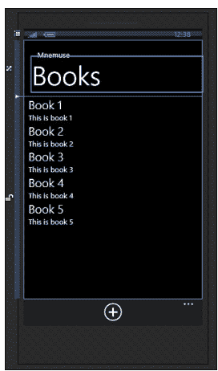

图 16.4 一个绑定到视图模型的视图在 Blend 中呈现。

## 第 16 章 分离你的关注点

现在我们有了视图、视图模型，甚至视图和视图模型之间的数据绑定，我们想要添加一些交互性。在某个时刻，用户将不得不与我们的应用程序交互。当他们这样做时，我们希望对该交互做出响应并执行一些代码。

在非 MVVM 应用程序中，我们可能会将响应用户交互的所有代码放在视图页面的代码后置中（例如，`MainPage.xaml.cs`）。虽然这本身并没有什么问题，但这种做法会导致代码难以测试（你将在下一章看到），难以维护，并且通常不够灵活，也不够干净。确实，有时需要代码后置代码，但正如我提到的，我喜欢在最后可能的时刻之前以声明方式完成所有操作。

我想向你展示的交互性是能够从列表中删除一本书的能力。为此，我们将使用 Silverlight/WP7 Toolkit 中提供的控件，你可以在 Codeplex 上找到它，网址为 http://silverlight.codeplex.com。该控件是 `ContextMenu` 控件。

```
<DataTemplate x:Key="bookItemTemplate">
<StackPanel Width="480">
<toolkit:ContextMenuService.ContextMenu>
<toolkit:ContextMenu>
<toolkit:MenuItem Header="delete book" Command="{Binding RemoveBookCommand}" />
</toolkit:ContextMenu>
</toolkit:ContextMenuService.ContextMenu>
<TextBlock Text="{Binding Title}" Style="{StaticResource PhoneTextLargeStyle}"/>
<TextBlock Text="{Binding Description}" Style="{StaticResource PhoneTextNormalStyle}"/>
</StackPanel>
</DataTemplate>
```

每本书都将由一个包含几项的堆栈面板表示，包括标题和描述的文本块。这很直接。这里的新控件是上下文菜单。菜单内有一个菜单项。乐趣从这里开始。

与其看到你在本书中到目前为止看到的典型的“单击”事件处理程序，现在有一个命令。更好的是，这个命令是视图模型上的一个属性。命令本质上只是包含对可执行代码的引用的对象的实例。它们提供了一种将用户界面元素绑定到代码的方法。

在不需要将该代码紧密耦合到代码后置的情况下执行。换句话说，随着命令成为视图模型的一部分，该代码现在是共享的并存储在视图模型本身上。这使得代码更容易找到，更容易维护，提供了一个单一的执行点（而不是你在代码后置实现中通常看到的多个潜在入口点），甚至可以被重用视图模型的不同视图重用。

让我们看看我们在视图模型上添加以支持删除书籍的命令属性。如果你的大脑已经校准到 MVVM 的思维方式，你可能已经在问自己：这个命令是在 `Main` 视图模型上还是在 `Book` 视图模型上？答案是在 `Book` 视图模型上。这是因为此数据模板绑定到一本书的列表，而这些书中的每一个都是 `Book` 视图模型的一个实例。

### Listing 16.2 Book.cs

```
using System;
using System.Net;
using System.Windows;
using System.Windows.Controls;
using System.Windows.Documents;
using System.Windows.Ink;
using System.Windows.Input;
using System.Windows.Media;
using System.Windows.Media.Animation;
using System.Windows.Shapes;
using GalaSoft.MvvmLight;
using GalaSoft.MvvmLight.Command;
using GalaSoft.MvvmLight.Messaging;
using Mnemuse.Messages;

namespace Mnemuse.ViewModel
{
public class Book : ViewModelBase
{
    private string title;
    private string description;

    public Book()
        : base()
    {
        InitializeCommands();
    }

    public RelayCommand RemoveBookCommand { get; private set; }
```

```
public string Title
{
    get
    {
        return title;
    }
    set
    {
        title = value;
        RaisePropertyChanged("Title");
    }
}

public string Description
{
    get
    {
        return description;
    }
    set
    {
        description = value;
        RaisePropertyChanged("Description");
    }
}

private void InitializeCommands()
{
    // when someone uses a context menu to delete THIS book,
    // broadcast a message so any affected viewmodels
    // can handle it (e.g the global book list)
    RemoveBookCommand = new RelayCommand(
        () =>
            Messenger.Default.Send<RemoveBookMessage>(
                new RemoveBookMessage(this)));
}
}
```

`RelayCommand` 是 `MVVM Light` 框架自带的一个类。该类为在命令执行时将被执行的代码提供了一个包装器。此外，它还为用于确定命令是否可执行而将被执行的代码提供了一个包装器。当你将普通按钮绑定到命令时，它们会运行 `RelayCommand` 中返回 true 或 false 的自定义代码。当代码返回 false 时，按钮将被禁用。

总而言之，命令提供了一种将 UI 元素以声明方式绑定到代码块的可重用包装器的方式。这些命令可以使用 Blend 或 Visual Studio 2010 的设计器绑定，也可以通过手工输入 XAML 来绑定。再次强调，我喜欢尽可能保持声明性，因此我非常喜欢在可能的情况下使用命令来响应 UI 事件。

WP7 中有一个地方与命令不兼容：应用程序栏。应用程序栏控件不是真正的 Silverlight 控件，尽管人们努力让它们看起来像真正的控件，但它们的行为与 Silverlight 控件的行为不同。这是因为应用程序栏存在于应用程序主框架之外，并且可以根据应用栏的不透明度设置来缩小或扩展应用程序。对于应用程序栏菜单项，你仍然需要响应单击事件。然而，这并不意味着你必须在代码隐藏中直接嵌入代码；你可以将该单击转发给一个命令。在下面的代码中，我将应用栏上的 Add 按钮的单击转发给一个向主视图模型添加书籍的命令：

```
private void addBookButton_Click(object sender, System.EventArgs e)
{
    var vm = DataContext as MainViewModel;
    if (vm != null)
    {
        vm.AddBookCommand.Execute(null);
    }
}
```

最后，在 Listing 16.2 的底部，你可能注意到了 `Messenger.Default.Send` 代码。巧合的是，这引出了我的下一个主题：消息传递。

## 使用 MVVM Light 发送消息

在尝试保持关注点清晰分离时，最难做到的事情之一就是避免对依赖对象进行直接方法调用。这之所以成为问题，是因为每次你这样做时，你就在应用程序的两层之间串起了一根意大利面条，最终，这根意大利面条变得如此难以解开（而不破坏），以至于维护应用程序的唯一方法就是不断在上面堆放更多的肉丸。

消息传递是保持关注点清晰分离的另一种方式，同时确保 MVVM 应用程序中的所有参与者都遵守脚本。消息传递（也被称为“pub/sub”或许多人所说的“pub sub”）允许应用程序的组件在重要事情发生时进行广告宣传，而无需提前知道需要做出什么响应。这将执行值得注意事件的应用程序部分与响应它们的应用程序部分解耦。

在 Listing 16.2 中，你看到了创建 `RemoveBookCommand` 对象实例的以下代码：


```
RemoveBookCommand = new RelayCommand(
    () => Messenger.Default.Send<RemoveBookMessage>(
        new RemoveBookMessage(this));
```

在这段代码中，我的意思是每次执行 `RemoveBookCommand` 时（无论如何或为何执行），当前视图模型（`Book`）都会向所有订阅者发送一条消息，表明有一本书已被标记为删除。

为什么不确保 `Book` 视图模型的每个实例都有对 `MainView` 模型的引用？这样，书就可以直接从列表中删除自己。这种模式的问题在于它违反了 MVVM 开发的“不要向上查找”原则，并且意味着每当我们希望任何其他视图模型对书籍的删除做出响应时，我们都必须将该代码放在 `Book` 视图模型中，而不是放在适当的视图模型中。

## 不要向上查找

> Jesse Liberty 关于 MVVM 开发有一个非常流行的名言，简单地说就是“不要向上查找”。在构建视图模型时牢记这一点，将有助于指导你构建更好的 MVVM 架构。简而言之，永远不要从视图模型中引用“更高”级别的任何东西。这意味着你的视图模型不应该能够直接引用父视图模型，也不应 ever 对与该视图关联的视图页面（XAML）有直接引用。在我们的例子中，`Book` 视图模型永远不应该引用 `MainViewModel`。

与其维护对主视图模型的直接引用并直接操作书籍列表，我们改为发布一条消息（`RemoveBookMessage`）。无论它在应用程序中的位置如何，订阅该消息的任何视图模型在消息发送时都会被告知此消息。

以下代码来自 `MainViewModel` 中的构造函数，展示了我们如何订阅书籍删除消息并在不违反两个视图模型之间的分离的情况下执行最终的书籍删除：

```
Messenger.Default.Register<RemoveBookMessage>(this, RemoveBook);
```

然后 `RemoveBook` 方法的实现执行实际的视图模型操作：

```
public void RemoveBook(RemoveBookMessage removeMessage)
{
    DeleteBookFromList(removeMessage.Book);
}
```

值得在此指出的是，到目前为止我们所操作的东西仅限于视图模型。当我们进入服务提供者主题时，你将看到我们如何干净优雅地将此视图模型连接到一个支持或持久化存储。

## 看，代码隐藏都没有！

使用消息传递可以做的另一件事是将其与属性更改通知结合起来。这允许你自动通知其他视图模型属性何时更改，本质上将标准属性更改通知系统的范围扩展到 MVVM Light 的消息“总线”。

为了向你展示如何做到这一点，我将带你了解一个解决方案，该方案解决了需要在应用程序中保持关注点清晰分离时出现的经典问题：页面之间的转换。对于我们的示例应用程序，当用户点击一本书时，他们将被带到另一个页面。该页面包含一个 pivot 视图，让用户可以翻阅该书的角色、地点、情节、灵感和场景。

当点击项目时应由视图模型处理而不是代码隐藏处理时，你如何从一个页面转换到另一个页面？直接从主页面实例化详情页面并导航到它是否违反了关注点分离？这场争论可能还会持续数百年，但我个人的观点是，如果我能避免页面之间的直接耦合，我就会这样做。

看看我列表框声明的 XAML：

```
<ListBox x:Name="bookListBox"
ItemsSource="{Binding Books}"
ItemTemplate="{StaticResource bookItemTemplate}"
SelectedItem="{Binding Path=SelectedBook, Mode=TwoWay}">
</ListBox>
```

我在这里所做的是将列表框的 `SelectedItem` 属性绑定到我在视图模型中称为 `SelectedBook` 的属性。此绑定是双向的，因此我可以通过从代码更改值来影响 UI，或者 UI 可以在用户点击项目时影响我的代码。以下是我的 `SelectedBook` 属性的定义：

```
public Book SelectedBook
{
    get
    {
        return selectedBook;
    }
    set
    {
        var oldValue = selectedBook;
        if (oldValue == value) return;
        selectedBook = value;
        // broadcast this to all listening viewmodels, not just bound UI
        RaisePropertyChanged("SelectedBook", oldValue, selectedBook, true);
        this.SelectedBook = null;
    }
}
```

// clear this so user can hit back and re-tap same item

}

}

“get” 访问器在这里相当直接。在 setter 中我捕获了所选项目的值发生变化，但新值与旧值相同这一条件。这可以避免发布不需要发布的事件。接下来，我使用 MVVM Light 的 `RaisePropertyChanged` 方法的重载来触发消息发送，通知任何感兴趣的视图模型此特定属性已更改。接下来我将 `SelectedBook` 属性（由于双向绑定，这反过来会将列表框上的 `SelectedItem` 属性设置为 null）设置为 null。这允许用户在点击返回按钮返回到图书详情页后重新选择同一本书。如果不清除它，用户每次点击返回按钮进入详情页时就必须点击另一本书。

那么哪个视图模型应该响应此消息？在示例应用程序中，我将在 `CharactersViewModel` 类中订阅此消息。这是因为角色视图是图书详情 pivot 中的第一个视图。我可以让图书 pivot 视图模型监听此消息，但我实际上并没有为 pivot 本身创建视图模型。相反，我将 pivot 用作一个空壳，用于在多个视图（及其对应的视图模型）之间提供导航。如果你查看本章相关的 Mnemuse 源代码，你会看到它是如何工作的。

以下是角色视图模型中监听当前所选图书变化的代码。首先，我们注册消息并在收到此消息时调用 `LoadCharactersFromBook` 方法：

```
Messenger.Default.Register<PropertyChangedMessage<Book>>(
    this,
    (action) => DispatcherHelper.CheckBeginInvokeOnUI(
        () => { if (action.NewValue != null)
            LoadCharactersFromBook(action.NewValue); }));
```

以下是 `LoadCharactersFromBook` 方法的实现：

```
private void LoadCharactersFromBook(Book b)
{
    if (b == lastBook) return;
    lastBook = b;

    PhoneApplicationFrame frame =
        (PhoneApplicationFrame)App.Current.RootVisual;
    if (!frame.CurrentSource.ToString().Contains("BookPivotView.xaml"))
        frame.Navigate(new Uri("/BookPivotView.xaml", UriKind.Relative));

    Debug.WriteLine("Loading characters from book '" + b.Title + "'");
    Characters.Clear();
    for (int x = 0; x < 5; x++)
{
    Character c =
        new Character
        { Name = b.Title + " character " + (x + 1).ToString() };
    Characters.Add(c);
}
}
```

首先会检查正在加载的图书是否与视图模型上次加载的图书相同。如果相同，则方法会取消。这可以防止应用程序在从列表中间删除一本书时意外导航到详情视图（试着注释掉这个保护子句，看看它如何影响应用程序的行为）。

接下来你会看到我们在获取手机应用程序框架的引用。如果应用程序当前不在图书 pivot 视图页面上，这段代码会导航到它。最后，有一些代码用于用一些虚拟数据填充角色列表，我们之后需要将其替换为来自服务提供者的真实数据。

这，纯属偶然，引出了我的下一个主题：服务提供者。

## 使用服务提供者

顾名思义，服务提供者确实提供了服务。从编程和模式的角度来看，服务提供者是对特定功能逻辑分组的抽象。在 MVVM 应用程序中使用服务提供者的一个原因是处理数据持久化。在这种情况下，我希望基于接口的服务提供者，这样我以后可以轻松地将其替换为其他东西。例如，我第一个服务提供者的实现将是与隔离存储通信并处理模型数据的实现。将来我可能想将其替换为与 Web 服务通信的服务提供者。更远的将来，我可能想编写一个服务提供者，它与 Web 服务通信，并在应用程序无法建立网络连接的偶尔时间内，将 Web 服务查询的本地缓存保存在持久的隔离存储中。

我首先要做的是为我的服务提供者定义一个接口：

```
using System;
using System.Collections.Generic;
using System.Linq;
using System.Text;

namespace Mnemeuse.Model
{
    public interface IMnemeuseServiceProvider
    {
        void SaveCharacters(Guid bookId,
        IEnumerable<Character> characters);
        IEnumerable<Character> LoadCharacters(Guid bookId);

        void SaveBooks(IEnumerable<Book> books);
        IEnumerable<Book> LoadBooks();
    }
}
```

目前这是一个相当简单的接口，但将来会扩展。它负责保存角色、加载角色、保存图书和加载图书。接下来是此接口的具体实现。请注意，此服务提供者仅操作 `Model` 命名空间中的对象——它不知道任何关于视图模型或视图模型对象的信息，这是有意为之的。

```
using System;
using System.Net;
using System.Windows;
using System.Windows.Controls;
using System.Windows.Documents;
using System.Windows.Ink;
using System.Windows.Input;
using System.Windows.Media;
using System.Windows.Media.Animation;
using System.Windows.Shapes;
using System.Collections.Generic;

namespace Mnemuse.Model
{
public class MnemuseServiceProvider : IMnemeuseServiceProvider
{

    public void SaveCharacters(Guid bookId,
        IEnumerable<Character> characters)
    {
        IsoStoreHelper.WriteGraphToFile(
            bookId.ToString() + "-chars.dat", characters);
    }

    public IEnumerable<Character> LoadCharacters(Guid bookId)
    {
        return IsoStoreHelper.ReadGraphFromFile<Character[]>(
            bookId.ToString() + "-chars.dat");
    }

    public void SaveBooks(IEnumerable<Book> books)
    {
        IsoStoreHelper.WriteGraphToFile("books.dat", books);
    }

    public IEnumerable<Book> LoadBooks()
    {
        return IsoStoreHelper.ReadGraphFromFile<Book[]>("books.dat");
    }
}
}
```

还记得我们在几章前编写的 `IsoStoreHelper` 类吗？它对于我们服务提供者的实现非常有用。现在我们有了服务提供者，我们需要确保每个视图模型都能获得对该服务提供者的正确引用，而不会违反任何关注点分离。这听起来像是 `ViewModelLocator` 类的理想工作，它负责创建新的视图模型实例。我修改了这个类，使其在每个视图模型构造函数中传递一个服务提供者实例的引用（这意味着我也修改了视图模型构造函数，使其期望 `IMnemuseServiceProvider` 类型的对象作为构造函数参数）。

为了使用此服务提供者，让我们修改 `MainViewModel` 类中的 `AddBookToList()` 方法以包含对服务提供者的调用。这将在图书列表每次更改时将其持久化到隔离存储中。

```
private void AddBookToList()
{
    Random r = new Random();
    Book b = new Book {
        Title = "Book " + r.Next(1, 100).ToString(),
        Description = "This is a new Book",
        ID = Guid.NewGuid()
    };
    Books.Add(b);
    serviceProvider.SaveBooks(this.Books.ToModelArray());
}
```

注意对 `ToModelArray()` 方法的调用，它似乎是 `Books` 属性中可观察集合的一部分。为了避免通过向自定义类添加自定义方法来在模型和视图模型域之间进行转换而违反关注点分离，我创建了一些静态扩展，用于在模型和视图模型域之间转换。

```
public static class BookExtensions
{
    public static Book[] ToModelArray(
        this ObservableCollection<ViewModel.Book> sourceBooks)
    {
        List<Book> bookList = new List<Book>();
        if (sourceBooks != null)
        {
            foreach (ViewModel.Book book in sourceBooks)
            bookList.Add(new Book
            {
                Title = book.Title,
                Description = book.Description,
                ID = book.ID
            });
        }
        return bookList.ToArray();
    }
}
```

```
ID = book.ID,
Description = book.Description,
Title = book.Title
});
}
return bookList.ToArray();
}
```

```
public static ViewModel.Book[] ToViewModel(
this IEnumerable<Book> sourceBooks)
{
List<ViewModel.Book> bookList = new List<ViewModel.Book>();
if (sourceBooks != null)
{
foreach (Book book in sourceBooks)
bookList.Add(new ViewModel.Book
{
ID = book.ID,
Title = book.Title,
Description = book.Description });
}
return bookList.ToArray();
}
```

尽管这些扩展不是它们所扩展的类型的一部分，但当扩展处于作用域内时，看起来它们是这些类的方法。这使我能够在不破坏模型或视图模型对象的情况下在模型和视图模型域之间进行转换；我可以在与任一域都分离的类中完成转换。

## The AutoMapper


CodePlex 上有一个项目是“映射器模式”的实现。该类本质上在属性名称和数据类型匹配时自动在域模型之间进行转换。你还可以定义自定义映射规则以帮助从一种对象类型映射到另一种对象类型。例如，我们可以使用此 automapper 将 `ViewModel.Book` 映射到 `Model.Book` 实例，而不是使用我之前编写的静态扩展。目前，我的模型足够简单，我觉得没有必要使用 automapper。然而，如果复杂度上升，我可能需要获取它。幸运的是，Jay Kimble 的 SkyDrive 上提供了 WP7 端口。你可以在这里阅读他的博文：http://jaykimble.net/my-library-port-releasing-continues-automapper-and-castlecore-for-wp7.aspx。我已为此创建了一个 tinyurl，以防你不想输入前面的那个：http://tinyurl.com/automapper-wp7。

现在我们已修改视图模型以将书籍列表保存到隔离存储中，我们需要修改它以便在视图模型定位器创建视图模型时从隔离存储中读取。我在 `MainViewModel` 类中添加了一个名为 `LoadBooks()` 的方法，该方法通过服务提供程序从隔离存储中读取书籍，使用静态扩展从模型转换到视图模型域，然后相应地填充视图模型。由于视图模型是数据绑定的，它会立即看到这些新加载的数据。

```csharp
private void LoadBooks()
{
    Books.Clear();
    IEnumerable<Book> books = serviceProvider.LoadBooks().ToViewModel();
    foreach (Book b in books)
        Books.Add(b);
}
```

我强烈建议你打开本章的 Menmuse 代码示例。尝试在主视图（书籍）和详细信息视图（绑定了字符视图模型的 pivot 页面）之间导航。创建书籍、删除书籍、退出应用程序并返回应用程序。这将帮助你了解 MVVM 的各个部分如何协同工作，帮助你构建更有序、更简洁、结构更好的应用程序。

作为用户练习，使对服务提供程序的调用异步，并在调用服务提供程序时打开一个“无限”进度条。为此，你可以使用回调模式（类似于委托模式或 iPhone 开发人员的完成块）来在服务提供程序完成后调用代码，这将关闭“忙”指示器。忙指示器可以绑定到视图模型属性，因此你所需要做的就是切换 `IsBusy` 属性的布尔值，以便让用户知道数据操作正在进行中。

## Summary

在任何语言、任何平台、任何设备上构建“hello world”示例相对容易。将你从构建数十个“hello world”应用程序中学到的语法知识应用到构建一个能够经受现实世界开发生命周期的考验并能够承受由设计师和开发人员组成的多人开发团队严苛要求的、结构良好的应用程序中，这是一项艰巨的任务。

本章为你提供了 Model–View–View–Model 模式的概述，以及它与传统和 iOS MVC 实现的不同之处。使用适用于 Windows Phone 7 的 MVVM Light 工具包，你可以在不创建复杂、难以阅读和维护的代码的情况下构建一些相当复杂的应用程序。通过保持关注点分离，确保每个应用程序组件都有明确定义的角色和职责，并使用一些轻量级工具和控件，你就走上了创建能够经受 WP7 Marketplace 用户需求考验的应用程序的道路。在下一章中，我们将研究如何自动化测试并为使用 MVVM 编写的应用程序创建单元测试。

## Unit Testing and TDD

> *糟糕质量的苦涩在人们忘记按时交付的甜蜜之后仍然存在很久。*
>
> Anonymous

本章为你提供了单元测试和测试驱动开发（TDD）概念的概述。在上一章中，我们开始研究摆脱简单演示应用程序的世界并创建生产就绪、高质量、复杂应用程序所需的内容。

在本章中，我们将迈出下一步。现在我们已经开始以分离关注点的方式编写代码，我们将更进一步，编写可测试的代码。正如你在本章中会看到的，我们将通过编写单元测试并探索 TDD 概念来实现这一点。你将看到一些工具和框架，允许你为 Windows Phone 7 应用程序编写单元测试，并将其与 iOS 应用程序的单元测试体验进行比较。

完成本章并在进入下一章之前，你应该对 WP7 应用程序单元测试的想法、概念和实现感到自如。希望你能足够兴奋和受启发，以便在下次开始编写应用程序或模块时尝试一些自己的 TDD。

### What Is Test-Driven Development?

测试驱动开发是一种软件开发实践，正如其名称所示，它采用了许多短的开发周期，这些周期以创建测试开始（即由测试驱动）。概念是编写一开始就会失败的自动化测试。然后你编写代码使这些测试通过。然而，实践中，TDD 并非完全如此

建议是这个阶段大约需要 30 秒，并且代码应该只有大约 5 行左右。

### Green

现在你已经有一个失败的测试，花上另外 30 秒编写少量代码。这少量代码应该使测试通过，即使你知道它是以低效的方式、糟糕的架构或“代码异味”或其他某种需要改进的方式通过的。关键是让测试通过，即使你硬编码值。这部分需要一些适应，尤其是对于习惯于在编写任何代码之前花几周时间提前弄清楚代码应该是什么样子的老牌“瀑布”开发人员来说。这里的绿色指的是你的自动化测试工具报告所有测试通过的绿色指示灯。

### Refactor

现在你有一个通过的测试，你应该有一种自信感。这种自信来自于你确切知道，如果你对代码进行更改并且灯保持绿色，你就不会搞砸任何东西。放下键盘，看看你编写的代码。如果你看到改进的空间——可以去掉的硬编码内容、可“松动”的依赖项或其他可以修复的“代码异味”，就大胆去做吧。诀窍是进行小的、迭代的更改，同时保持灯为绿色。如果你在重构期间让灯变红，并且你真的在拥抱 TDD 生活方式，你应该会感到心跳加速，就像好莱坞黑客被迫在枪口下攻破防火墙，否则就会失去家人。简而言之，你会病态地沉迷于不惜一切代价保持灯为绿色。这可能很好，但也可能不好——要警惕只为让测试通过而“作弊”的欲望。

有关敏捷开发、TDD 和红/绿/重构循环的更多有用提示，请查看 James Shore 的博客或他的书 *The Art of Agile Development*。当你经常在日常开发中使用这种模式时，它就像一种生物反馈系统，随着时间的推移，深深植入你的灵魂中，既有对 TDD 的热爱，也有对红色这种颜色的苦涩仇恨。

### Mocks and Stubs

单元测试中最难理解的部分之一就是“单元”这个词。当人们开始测试时，他们会编写测试，确实，这些测试有时会工作，并且有时会显示绿色。问题是，开发人员并没有在隔离中测试代码。他们不是在进行单元测试，而是在进行集成测试。

例如，如果你测试一个类，而该类由于你的测试而进行 Web 服务、数据库或磁盘 I/O 调用，这就不是单元测试。这是一个集成测试，并且该测试本身不能被认为是隔离的。

这通常是开发人员举起双手并感到非常沮丧的地方。“我无法在不调用数据库的情况下测试我的代码！”他们喊道。“我无法在不调用“我们得调用Web服务！”他们恳求道。“根本无法孤立地测试这段代码！”他们抱怨道。这些实际上都是对编写单元测试尝试的非常有建设性的回应。当你听到自己说这些话时，你就知道需要进行一些重构了。你需要重构代码，使其变得可模拟（mockable）。

可模拟的类是与依赖项松散耦合的类。在理想情况下，所有依赖功能都由符合接口或契约的类执行。在更理想的情况下，这些依赖的实现会在运行时通过构造函数、属性，或在许多情况下通过控制反转（IoC）框架（如`Castle Windsor`或`Microsoft Unity`）提供给类。

IoC框架的工作是查看一个类，找出所有依赖项（符合配置文件中引用的接口的属性或构造函数参数），并注入该依赖的适当实现。这些框架通常可以配置为在运行时注入真实实现，在测试时注入模拟实现。

因为，在撰写本书时，由于Windows Phone 7在反射方面的限制，我无法让依赖注入或控制反转框架在其上正常工作，所以我们不得不以老式方式创建模拟：编写它们。

假设你想为一个名为`TaxHandler`的类创建单元测试。该类接受一个产品的库存量单位（SKU）和投递邮政编码，并返回一个十进制数，表示该商品应收取的销售税。

作为第一反应，我们可能会创建一个名为`TaxHandler`的类。在这个类内部，包含一个名为`InventoryClient`的Web服务代理，它与库存服务通信以获取完整的定价信息。此外，另一个名为`TaxClient`的Web服务代理与公司的内部税务服务通信，获取特定邮政编码的销售税率。`TaxHandler`类在`ComputeTax`方法中调用这两个客户端，该方法接收产品SKU和邮政编码作为参数。

当我们为这个应用编写单元测试时，我们可能会手动去弄清楚邮政编码90210的销售税率，计算出价格99.99美元产品的税额，然后运行`ComputeTax`方法。我们的断言是返回值与预期值匹配。作为优秀的小开发人员，我们随后会再写两个测试：一个验证错误的值不会匹配实际输出（例如，我们故意将预期设置错误并断言失败，从而创建一个通过的测试），另一个测试使用完全伪造的参数，如无效的邮政编码。我们在这里的断言是会抛出异常。当该异常被抛出时，我们的测试通过。

我们运行测试，稍等片刻后，得到绿灯。那么问题出在哪里？我们得到了绿灯，所以根据“红灯、绿灯、重构”规则应该没问题，对吧？错。每次执行这个测试，我们都在向两个不同的Web服务发出两次网络调用。我们测试`ComputeTax`方法的目的不是测试Web服务，而只是测试`ComputeTax`方法是否使用我们指定的参数调用了这些Web服务。这起初有点难以接受。单元测试的目的是*孤立地*（例如，作为一个单元）测试每小段代码。我们必须假设另一套单元测试已经证明了每个Web服务都按预期工作。因此，我们需要模拟这些客户端，以便我们的单元测试不会离开逻辑区域，更不用说跨越整个应用程序层级了。

如果我们修改`TaxHandler`类的构造函数，使其不再创建具体的Web服务客户端代理实例，而是接受实现契约的对象实例，会怎么样？这些契约可以对应Web服务的功能，但它们只是契约。现在实现由使用`TaxHandler`类的客户端决定。在我们的例子中，客户端要么是真实应用程序，要么是一套单元测试。

所以，在C#中，我们可能会将构造函数改为这样：

```csharp
public TaxHandler(ITaxService taxService, IStockService stockService)
{
    this.TaxService = taxService;
    this.StockService = stockService;
}
```

现在，当客户端代码调用`ComputeTax`方法时，`TaxHandler`类将调用实现契约的对象上的方法。`TaxHandler`类与支持它的应用程序层的物理实现之间将不会有任何紧密耦合。

无论我们使用依赖注入框架来自动提供受配置控制的这些对象实例，还是我们的测试方法定义这些契约自己的实现，最终结果都是一样的：我们现在可以单独测试`ComputeTax`方法，并验证它是否按我们预期的方式工作——它会调用两次Web服务，并返回一个聚合结果的结果。

本章稍后我将向你展示更多的测试实现，并逐步讲解更多重构紧密耦合类的示例，以便将其依赖项剥离出来，使我们能够进行隔离测试。当我们想要测试像前一章中创建的视图模型类时，这尤其有用。

## 单元测试iOS应用程序

在iPhone开发的早期，Xcode中随附的用于桌面Mac开发的单元测试框架`SenTest`在iPhone上无法正常工作。然而，随着iOS SDK的更新版本，单元测试功能已直接内置于Xcode中，适用于你的任何iOS项目。幸运的是，你无需安装任何额外软件，也无需进行任何额外配置。正如你将在本章后面看到的，在单元测试领域，微软有点“初版病”（v1-itis），其工具的第一个版本在TDD和单元测试的内置支持方面还不够成熟。

Xcode中的单元测试支持基于开源单元测试框架`SenTestingKit`。该框架具有类和命令行工具，可帮助你构建自动化测试，并理想情况下在iOS应用中拥抱TDD。

你可以在iOS中编写两种不同类型的单元测试：逻辑测试或应用程序测试。通常，你可以将逻辑测试视为我们可能认为的传统单元测试，而应用程序测试则可视为集成测试或UI自动化测试。

### 逻辑测试

要在你的iOS应用程序中设置逻辑测试，你需要创建一个新目标。我喜欢在目标名称末尾加上后缀“Test”（或者更好的是“LogicTest”），这样我可以快速轻松地确定目标的用途，而无需依赖备忘单。过去，我遇到过Xcode应用有太多不同目标的情况，我不得不在附近放一张纸，说明每个目标及其用途。如果你作为iOS开发者遇到这种情况，要知道如果你继续走这条路，你可能会在时空结构本身撕裂一个洞。

创建逻辑测试目标包后，将其设置为活动目标。接下来，通过选择“文件”、“新建文件”菜单选项，并从可用模板中选择“iOS”、“Cocoa Touch Class”、“Objective-C测试用例类”来创建一个新文件。无论我是为iOS还是WP7编写测试，我都更喜欢为单个目标类使用单个测试类。换句话说，如果我有一个名为`Porsche`的类并且想测试它，我会创建一个名为`PorscheTests`或`PorscheLogicTests`的单个测试类。清空类头文件，使其包含一个空接口，如下所示：

```objc
#import <SenTestingKit/SenTestingKit.h>
#import <UIKit/UIKit.h>

@interface PorscheLogicTests : SenTestCase {
}
@end
```

接下来，清空实现，只保留一个通过的测试方法，如下所示：

```objc
#import "PorscheLogicTests.h"

@implementation PorscheLogicTests
- (void) testPassesAlways {
    STAssertTrue(TRUE, @"This test always passes.");
}
@end
```

当你编译活动目标（你的逻辑测试目标）时，如果你的任何单元测试失败，编译将失败；如果你的任何单元测试通过，编译将成功。这是一个非常重要的区别，因为这些测试是在构建时执行的。任何

在这些测试期间，你的代码所依赖的运行时功能将不可用。为此，你需要编写应用程序测试。

我向你展示这些的原因是，如果你已经熟悉iOS上的逻辑单元测试，那么当我们开始编写Windows Phone 7测试时，你不会觉得有什么不同。如果你以前从未见过iOS代码，这是一个很好的例子，说明这两个环境在基于经过时间验证的标准（如自动化测试）方面有共同之处。

在developer.apple.com网站上可以找到在iOS中设置逻辑测试所需的全部信息。

### 应用程序测试

构建一套应用程序测试类似于构建逻辑测试。区别在于，你不是创建一个在构建时执行测试的新目标，而是创建应用程序目标的一个克隆。在这个克隆的应用程序目标中，你插入应用程序测试。当你的目标克隆在已连接的设备或模拟器上运行时，这些测试将在运行时执行。这使你的测试能够运行在逻辑测试无法使用的依赖项之上，例如硬件、操作系统设施以及其他运行时设施（如可用的UI）。我不会深入介绍如何创建应用程序测试包，因为Apple在其开发者网站上对过程进行了出色的文档记录，而且毕竟这是一本WP7书籍。

在这个直接取自Apple文档的示例中，你可以看到应用程序测试可以访问你的应用程序运行副本所能访问的一切：

```objc
#import "MyAppTests.h"

@implementation LogicTests
- (void) testAppDelegate {
    id app_delegate = [[UIApplication sharedApplication] delegate];
    STAssertNotNil(app_delegate, @"Cannot find the application delegate.");
}
@end
```

## 单元测试 Windows Phone 7 应用程序

在撰写本书时，Visual Studio 2010 中对 Windows Phone 7 单元测试的原生工具支持完全不存在。然而，我是在开发工具的第一个非测试版发布时撰写本书的，而 Silverlight 本身也没有任何 Visual Studio 2010 的原生单元测试工具。你必须使用一个需要从 CodePlex 下载的开源工具包。

鉴于Apple将单元测试框架直接集成到其iOS开发工具中的速度，我不得不假设Microsoft也会采取类似的做法。越多开发者使用Silverlight作为他们在Windows Phone 7上的主要开发框架，对更好集成的单元测试工具的需求就越大。所以

下次你见到Microsoft布道师或产品组经理时，一定要向他们大声抱怨他们在Windows Phone 7上单元测试能力的糟糕状况。

然而，单元测试仍然是可能的，而且相对无痛，取决于你采用的方法。下一节将引导你了解在Windows Phone 7上实现单元测试的各种方法。我还提供了我推荐的方法（至少是我在写这本书时根据可用工具所推荐的方法）。

### 使用 nUnit

目前互联网上有几份指南解释了让nUnit在Windows Phone 7上工作的各种方法。一般来说，你要做的是：

- 下载 nUnit 2.5.5 库的 Silverlight 3 移植版。
- 下载 Silverlight 单元测试框架，它是完整 Silverlight（不是 WP7！）版本的 Silverlight 工具包的一部分，可从 silverlight.codeplex.com 获取。
- 创建一个新的 Silverlight 单元测试应用程序，并将框架目标从 Silverlight 4 降低到 Silverlight 3。
- 添加对 nUnit 程序集的 Silverlight 3 移植版本的引用。
- 从 Silverlight 单元测试框架中添加对 WP7 应用程序的引用。
- 有趣的地方来了：卸载 Silverlight 项目，编辑 `.csproj` 文件，并手动编辑 `ProjectTypeGuids` XML 元素，以便 VS2010 允许引用 WP7 项目和类库。


## 对 Silverlight 单元测试框架的元数据配置进行调整

- 对 `Silverlight` 单元测试框架的元数据配置进行一些调整，以便它执行 `nUnit` 测试而不是 `Microsoft Test (MSTest)` 测试。

- 如果你设法完成了所有这些而没有搞砸任何事情，理论上你可以使用 `nUnit` 对你的 `Silverlight` 应用程序执行测试。然而，这并不总是那么容易，而且像 `GalaSoft` 的 `MVVM Light` 框架这样的引用的存在只会使事情进一步复杂化。

由于这最后一个原因，以及许多其他原因，我不建议你费心尝试让 `nUnit` 测试在 `Windows Phone 7` 上工作。我是 `nUnit` 测试框架的忠实粉丝，总的来说，我更喜欢它而不是 `MSTest` 框架。然而，目前还没有适用于 `Windows Phone 7` 的工具和集成支持。

我不喜欢这种方法的另一件事是，测试执行环境是一个真正的 `Silverlight` 环境。尽管对 `Visual Studio` 项目进行了各种 `hack` 式修改，但你编写的测试仍有可能尝试做一些在 `Windows Phone 7` 应用程序中不可能做的事情，而你的测试仍然会通过。我更倾向于在真正的 `WP7` 环境中执行我的单元测试，我将在下一节中展示这一点。

如果在你购买并阅读本书时，`WP7` 上对 `nUnit` 的原生支持已经变得更好、更易用，并且更深入地集成到 `Visual Studio` 中，那么请随意将其作为你选择的测试框架。

## 使用 Silverlight 单元测试框架

正如我在讨论使用 `nUnit` 在 `Windows Phone 7` 上进行单元测试时所提到的，在撰写本书时，单元测试与原生工具和 `IDE` 的集成几乎不存在。让 `Silverlight` 单元测试在 `Windows Phone 7` 上工作感觉有点“`hack`”风格。然而，如果你对 `TDD` 或自动化单元测试有任何兴趣，这是值得的。我们也可以放心，未来单元测试体验只会变得更好。

要开始，你需要一个 `Silverlight 3` 版本的 `Silverlight` 工具包，可在 `http://silverlight.codeplex.com` 获取。如果你今天去那里，你会找到 `Silverlight 4` 工具包和用于 `Windows Phone 7` 的 `Silverlight` 工具包。`Silverlight 4` 工具包与 `Windows Phone 7` 不兼容（你不能从 `WP7` 项目添加对 `SL4` 程序集的引用），而 `Windows Phone 7` 工具包不包含 `Silverlight` 单元测试框架。这就是事情开始感觉有点 `hack` 式的地方。

如果你不想在互联网上搜寻包含 `Silverlight` 单元测试框架的预编译 `Silverlight 3` 二进制文件，你可以使用我在本章附带的代码示例中包含的那些。这些是预构建的 `SL3` 程序集，你可以从 `Windows Phone 7` 应用程序中引用它们。考虑到这一点，让我们开始测试吧。

首先，你需要一个计划测试的应用程序。在本章的其余部分，我将继续使用 `Mnemuse` 应用程序，因为它已经是一个 `MVVM` 应用程序，理论上应该比传统应用程序更容易测试。其次，你需要一个将包含测试的应用程序。

如果你以前在 `Visual Studio 2010` 中做过任何单元测试，或者使用过 `nUnit` 测试运行器，这看起来可能会很别扭。如果你以前在 `iOS` 中做过单元测试，这应该感觉像是为应用程序测试创建一个新的应用程序目标。原因是 `Visual Studio 2010` 中没有用于显示测试结果的 `UI`，也没有集成的测试运行器。简而言之，我们需要一个 `WP7` 应用程序来执行我们的测试并显示结果。幸运的是，该 `UI` 的 `99.9%` 来自 `Silverlight` 单元测试框架，并且与 `Windows Phone 7` 兼容。

现在，你的 `Visual Studio 2010` 解决方案中有两个应用程序——一个是你的真实应用的 `WP7` 应用，另一个是你的测试应用的 `WP7` 应用——你需要向测试应用添加一些引用：

- 对你的真实应用程序的引用（在我们的例子中，这是 `Mnemuse` 项目）。
- 对 `Microsoft.Silverlight.Testing` 的引用（这来自 `SL` 单元测试框架，通常被亲切地称为 `SLUT`）。
- 对 `Microsoft.VisualStudio.QualityTools.UnitTesting.Silverlight` 的引用（同样来自 `v3 SLUT` 二进制文件）。
- 对 `GalaSoft.MvvmLight.Extras.WP7` 的引用。
- 对 `GalaSoft.MvvmLight.WP7` 的引用。

有了这些引用，你现在需要用于显示测试执行结果的 `UI`。幸运的是，`Silverlight` 单元测试框架的 `UI` 比

在测试项目中新建一个名为 `Tests` 的子文件夹（如果你觉得这有些多余，我们稍后还会需要其他文件夹）。在该文件夹中，放入一个名为 `EmptyTest` 的测试类，包含清单 17.2 所示的代码。

### 清单 17.2 EmptyTest.cs

```
using Microsoft.VisualStudio.TestTools.UnitTesting;
using Microsoft.Silverlight.Testing;

namespace Mnemuse.Tests.Tests
{
[TestClass]
public class EmptyTest : SilverlightTest
{
    /// <summary>
    /// This method tests the actual test harness to make sure we
    /// always get a green light when there are no tests in the system.
    /// </summary>
    [TestMethod]
    [Description(
"This is a dummy test that will always pass. If this fails, test framework is broken.")]
    [Tag("framework")]
    public void AlwaysTrue()
    {
        Mnemuse.ViewModel.Book b =
            new ViewModel.Book(); // make sure we can see our target app!
        Assert.IsTrue(true);
    }
}
}
```

你首先应该注意到，该测试类继承自基类 `SilverlightTest`。对于像这样的空测试来说，这并不是完全必要的，但当我们开始编写具有一定复杂度的测试时，使用这个基类就变得更加重要了。

接下来你会看到 `TestMethod` 特性。凡是用此特性修饰的方法都可以供测试执行工具使用。我们还为该方法提供了描述，然后使用 `Tag` 特性提供了一个标签。测试执行工具允许我们运行匹配特定标签或标签集合的所有测试。如果我们只想在特定时间运行选定的测试套件，而不是运行所有可见测试，这就很方便了。

最后，我在测试应用程序中创建了视图模型的一个实例，只是为了证明我们可以不受限制地访问该项目。如果创建该实例时抛出异常，我们就会知道测试工具的“管道”存在一些问题，需要在继续任何其他测试之前修复它。最后，我们只需断言 `true` 的值是 `true`。这应该总是产生一个“绿色”（通过）的测试，如图 17.1 所示。

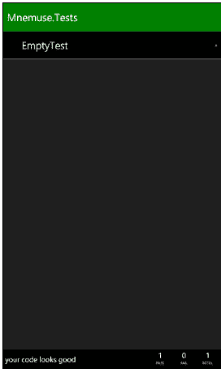

图 17.1 `SLUT WP7` 测试工具 `UI` 中显示的一个通过（passing）的测试

现在我们已经确信单元测试框架配置运行正常，测试执行 `UI` 也能正常工作，让我们编写一个更复杂的单元测试。如果我们一直坚持做 `TDD`，那么可能编写的一个测试是：只要在单本书上执行 `RemoveBookCommand` 命令，该执行就会导致发送 `RemoveBookMessage`。

这可能看起来像一个很容易编写的测试，但我们需要考虑消息是异步发送的。我们需要能够断言消息确实被发送了。但如果消息在后台发送，我们该怎么做呢？答案是我们的单元测试需要订阅该消息。接下来的问题就变成了如何将该消息的异步接收与单元测试的执行关联起来。幸运的是，`Silverlight` 单元测试框架提供了一个非常方便的特性，我们可以专门用它来修饰方法：`Asynchronous`。

在 `Tests` 文件夹中创建一个名为 `BookTest` 的新测试类，并让代码看起来如清单 17.3 所示。

### 清单 17.3 BookTest.cs——异步单元测试

```
using Microsoft.Silverlight.Testing;
using Microsoft.VisualStudio.TestTools.UnitTesting;
using GalaSoft.MvvmLight.Messaging;
using Mnemuse.Messages;
using Mnemuse.ViewModel;

using System.Diagnostics;

namespace Mnemuse.Tests.Tests
{
[TestClass]
public class BookTest : SilverlightTest
{
    [ClassInitialize]
    public void Init()
    {
    }

    [TestMethod]
    [Asynchronous]
    public void RemoveCommandExecuteSendsMessage()
    {
        Messenger.Default.Register<RemoveBookMessage>(this,
            (m) => {
                Debug.WriteLine(
                    "Received book removal message from Book view model.");
                EnqueueTestComplete();
            });
        Book b = new Book();
        b.RemoveBookCommand.Execute(null);
    }

    [ClassCleanup]
    public void Cleanup()
    {
    }
}
}
```

这里的关键是 `EnqueueTestComplete` 方法。没有这个调用的异步测试方法永远不会结束，而永不结束的测试就是失败的测试。我们的测试代码一收到 `RemoveBookMessage` 就调用这个方法。因为当时我们的测试代码是唯一发送消息的代码，所以我们知道 `Book` 模型通过了测试，因为我们执行了 `RemoveBookCommand`，并因此异步收到了一条 `RemoveBookMessage` 实例。

如果我们想在单元测试中更彻底一点，可以确保收到的移除消息包含我们为测试创建的那本书：

```
[TestMethod]
[Asynchronous]
public void RemoveCommandExecuteSendsMessage()
{
```

```csharp

Book b = new Book();

Messenger.Default.Register<RemoveBookMessage>(this,

(m) => {

Debug.WriteLine(

"Received book removal message from Book view model.");

Assert.AreEqual(b, m.Book);

EnqueueTestComplete();

});

b.RemoveBookCommand.Execute(null);

}

```
```

## 模拟与存根

我们现在是快乐的开发者，内心充满自信与喜悦，这股自信和喜悦只能来自构建出了一套 `100%` 通过（绿色）结果的测试。带着这股新获得的自信，我们投入下一个视图模型：`MainViewModel`。`MainViewModel` 由 `ViewModelLocator` 创建和维护。我希望我的视图模型测试尽可能贴近应用程序运行时的真实情况，因此我想从 `ViewModelLocator` 类中获取 `MainViewModel` 的测试实例。

我在测试方面已经有过一些经历，所以我知道服务提供程序是一个依赖项，它会彻底破坏我在隔离环境中进行测试的能力。我将需要创建一个虚拟的服务提供程序，供我的视图模型在测试期间使用。我需要它主要有两个原因：第一，从视图模型中移除对底层持久化机制的依赖（该机制可能是 Web 服务，而不是隔离存储）；第二，保证服务提供程序方法调用返回的值是可预测的。这些可预测的值让我在断言时可以拿来比较。

因此，我的服务提供程序是针对接口构建的。这样我就可以创建一个模拟服务提供程序，如清单 17.4 所示。

### 清单 17.4 MockMnemoserviceProvider.cs

```
```csharp

using System;

using Mnemos.Model;

using System.Collections.Generic;

namespace Mnemos.Tests.Mocks

{

	public class MockMnemosServiceProvider : IMnemosServiceProvider

	{

		private List<Book> bookList;

		private List<Character> characterList;

		public MockMnemosServiceProvider()

	}

```
```

```
[ClassInitialize]
public void Init()
{
    dummyProvider = new MockMnemuseServiceProvider();
    ViewModelLocator.CreateMain();
    main = ViewModelLocator.MainStatic;
}

[ClassCleanup]
public void Cleanup()
{
    main.Cleanup();
    main = null;
}

[TestMethod]
[Description(
"Verifies that executing the AddBookCommand adds a book to book list")]
public void AddCommandExecuteAddsBook()
{
    // Arrange
    int oldBookCount = main.Books.Count;

    // Act
    main.AddBookCommand.Execute(null);

    // Assert
    Assert.AreEqual(oldBookCount + 1, main.Books.Count);
}
}
```

这一切看起来都很直接。看看 `AddCommandExecuteAddsBook` 方法的代码，我们可以看到这条“口诀”的三个步骤。在 `arrange` 步骤中，我们对视图模型中当前存储的书籍数量做一次快照。然后通过执行 `AddBookCommand` 来 `act`。最后，我们 `assert`：在动作完成后，列表中的书籍比开始时多了一本。

这似乎没问题，但这时有什么东西让我后脖颈的汗毛竖了起来，而且不是我的猫在朝我呼吸。我创建了虚拟服务提供程序；我创建并初始化了视图模型；我安排了、行动了、也断言了。

哦，不。

我没有任何办法告诉视图模型去使用那个虚拟服务提供程序！我知道每当视图模型添加一本书时，服务提供程序就会被调用以保存书籍的模型。这可能（碰巧）对隔离存储有效，但如果我改用 Web 服务，我的测试很快就会变得棘手。这就是为什么测试周期被称为“红、绿、重构”，而不是“红、绿，完成”。

## 重构。再次。

幸运的是，我们不需要做太多事情就能让它工作。我们只需要在 `ViewModelLocator` 类上的 `ServiceProvider` 属性上添加一个公共 `setter` 即可。这将使我们能够提供自己的服务提供程序实现，以便在调用 `ViewModelLocator` 类的 `CreateMain()` 方法时，`MainViewModel` 类将获得适当的服务提供程序实例。

以下是新的 `ServiceProvider` 属性：

```
public static IMnemuseServiceProvider ServiceProvider
{
    get
    {
        if (serviceProvider == null)
            serviceProvider = new MnemuseServiceProvider();
        return serviceProvider;
    }
    set
    {
        serviceProvider = value;
    }
}
```

然后我们修改测试类上的 `Init()` 方法，以确保 `ViewModelLocator` 类使用虚拟服务提供程序：

```
[ClassInitialize]
public void Init()
{
    dummyProvider = new MockMnemuseServiceProvider();
    ViewModelLocator.ServiceProvider = dummyProvider;
    ViewModelLocator.CreateMain();
    main = ViewModelLocator.MainStatic;
}
```

现在我们可以运行我们的测试应用程序，看看是否最终完全变绿。如图 17.2 所示，我们的单元测试确实达到了 `100%` 的通过率。我们现在可以继续使用 `TDD` 来为我们的视图模型添加新功能和功能，以及创建额外的单元测试来测试可能已经编写的功能。这确保了从现在开始，我们可以确信新的代码添加不会破坏以前正常工作的代码。


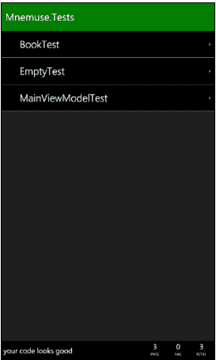

图 17.2 所有测试均为绿色。

## 摘要

开发人员对单元测试的意见差异很大。一些开发人员认为，与对应用程序进行实际的、手动的、物理测试相比，这完全是浪费时间。其他开发人员会这样做，但只是因为他们的老板让他们这样做。还有一些开发人员对单元测试极其热情，不会在单元测试尽可能接近 100% 代码覆盖率之前让 QA 看到他们应用程序的运行版本。

我并不是要对你说教是否应该进行单元测试或测试驱动开发。本章为您提供了如何在 `Windows Phone 7` 上进行 TDD 和单元测试的概述，并将这种体验与 `iPhone` 世界中单元测试工作原理的一个小样本进行了比较。使用 `Visual Studio 2010` 进行 `Windows Phone 7` 的单元测试仍然是一种早期体验，改进空间很大。然而，不要让这阻止你去做它。构建可单元测试的应用程序不仅仅使其可测试。正如你在本章的最后一次重构会话中所看到的那样，在使一个类可测试的过程中，你经常会找到可以使其变得更好、耦合更松散、更内聚等的方法。

现在你已经具备了创建应用程序、创建视图模型并识别可以保持应用程序关注点分离的区域的能力，你就可以继续阅读接下来的几章，包括安全、社交网络和游戏，以及将应用程序部署到 `Marketplace`。

本页特意留空

## 构建连接

### 社交游戏

> *只要玩。享受乐趣。享受游戏。*
>
> Michael Jordan

本章揭示了在移动设备上休闲游戏这一经常被忽视的领域。当开发人员想到移动游戏时，他们通常会想到 `iOS` 设备（如 `iPhone` 和 `iPad`）的 `OpenGL ES` 游戏，或者他们会想到 `Windows Phone 7` 上的 `Direct3D` 通过 `XNA` 开发工具包。本章的目标是提醒你，除了采用高制作、渲染引擎类型的游戏之外，还有更多游戏选择。更注重游戏玩法、社区和连接性而非图形是有很多好处的。

当今最受欢迎的许多移动游戏之所以受欢迎，更是因为其社交方面和纯粹简单的游戏玩法，而不是因为其图形（尽管让游戏看起来不错当然不会有什么坏处）。

本章讨论了当今现代移动游戏平台（如 `Windows Phone 7`、`iPhone` 和 `iPad`）上可用的连接、社交游戏功能。在讨论这些功能之后，我将谈谈 `Apple` 游戏工具包中可用的功能，以及你作为 `Windows Phone 7` 开发人员如何实现这些功能。读完本章后，你应该对 `Windows Phone 7` 在构建以社区为导向的游戏体验方面的能力、好处和缺点有一个很好的了解。如果你想知道如何使用 `Windows Phone 7` 上的 `Direct3D` 构建街机风格的快速 2D 或 3D 游戏，你需要购买一本关于 `XNA Game Studio 4.0` 的书籍。`XNA Game Studio` 超出了本书的范围。

如果你对为 `Windows Phone 7` 创建游戏或了解移动游戏总体上没有兴趣，请随意跳过本章。然后，当你意识到你确实想了解移动游戏时，请随时回来阅读。本章既是关于游戏理论和概念，也是关于游戏开发。

## 连接移动游戏平台的功能

在下一节中，我想花一点时间谈谈移动游戏平台功能。在我直接比较 `iOS` 和 `Windows Phone 7` 之前，我想确保你确切地知道我在比较什么以及为什么。要做到这一点，我将花一点时间谈谈我认为对现代、连接、高社交游戏平台至关重要的功能。请记住，我并不是在比较仅出现在高端图形移动游戏平台（如 `Nintendo DS` 或 `Sony PSP`）上的功能，而只是启用多人游戏和社交功能（如合作、竞争、排行榜、成就等）的功能。

### 大厅和匹配器

许多多人游戏需要某种方式让玩家找到彼此。这是因为并非所有游戏都允许你与站在你旁边的人一起玩。不仅可能，而且这种情况变得越来越普遍，即你的游戏中的其他玩家位于不同的位置、时区甚至国家。

这些游戏需要某种方式来确定玩家是谁以及他们使用什么设备。通常，这些游戏的玩家数量有限，游戏会话是临时的。换句话说，这些游戏发生的游戏世界不是持久的。你可能会看到玩家参与策略游戏的比赛、国际象棋的单次会话，或战斗或军事模拟游戏的特定多人任务的游戏。

在小型玩家群体聚在一起并参与短暂游戏会话的多人游戏中，通常在某个服务器上运行的一段软件负责将这些玩家组合在一起并促进多人会话的启动和结束。这些软件代理通常被称为大厅或匹配器。

总之，这些代理通常负责以下全部或部分工作：

- 根据任何数量的过滤器定位玩家，包括地理位置、游戏偏好、相对技能水平、游戏的锁定或解锁部分的状态等
- 在玩家分组后促进玩家之间的通信
- 促进玩家从大厅过渡到正在运行的游戏实例
- 处理玩家从终止的游戏实例转换回大厅

在 `Xbox 360` 等游戏机上玩游戏时，这些大厅通常包含有关当前正在加载的地图或游戏会话的统计数据或信息的丰富显示。此外，如果系统允许游戏中进行语音通信（`Xbox 360` 和 `iOS GameCenter` 游戏都具有此功能），玩家通常可以在等待大厅时进行通信以制定策略、谈论即将到来的僵尸末日或讨论最新的天气变化。

无论你是在自己的服务器上编写大厅代码、编写托管在第三方上的大厅代码，还是你的游戏框架代表你提供大厅设施，瞬态多人游戏会话很少能在没有某种大厅或匹配代理的情况下实现。

### 排行榜和成就

当你停下来思考一些创造最难忘、最上瘾、最常玩的游戏玩法的元素时，这些元素通常可以归结为两个核心功能：*进度* 和 *竞争*。

移动设备本质上与通常连接到极大电视和极响环绕声系统的带控制器的游戏机不同。典型的移动游戏玩家希望在无聊或空闲几分钟时拿出手机，在玩游戏时度过这段时间。当现实生活来电时，他们希望把手机放回口袋，继续生活。因此，你的游戏需要促使人们回到游戏中，在他们最初购买游戏后长时间继续玩下去。

游戏开发者让玩家不断回来寻求更多的一种方式是通过 *进度*。无论是通过冒险让英雄获得经验值、等级、金币和战利品，还是通过积累击杀数或胜利等统计数据，玩家都渴望进步。他们喜欢有某种有形的证明（有形的程度取决于便携设备中的一堆字节）来证明他们的努力——他们的游戏技能提升得到了某种回报。

展示玩家进度的另一种方式是通过奖励系统。具有这些功能的游戏变得越来越受欢迎。`Facebook` 上布满了基于奖励的游戏，人们早已记不清游戏的原始情节，只是纯粹为了尽可能多地收集奖励。游戏可以为完成需要大量努力、时间、探索或只是运气的事情颁发徽章、成就或奖项。玩家喜欢当他们看到自己积累的奖项收藏时所感受到的成就感。

随着玩家在经验、分数、等级方面增长并积累大量成就，他们可以将自己的进度与认识的朋友以及全世界进行比较。这就是排行榜的用武之地。跟踪各个类别中顶级玩家的游戏会激励玩家不断回来玩更多，希望最终他们的名字能出现在全球排行榜之一上。名声是许多游戏玩家的一个巨大动力，无论这种名声是比同事更好还是比全世界更好。

与大厅和匹配代理一样，一些游戏平台预装了用于操纵成就和排行榜的 API，而另一些则要求你自行维护。无论你是自行构建成就和排行榜，还是使用游戏开发平台提供的成就和排行榜，都不要低估进度和竞争所能为一款本已很棒的游戏带来的上瘾式重玩价值。

### 基于回合的游戏玩法

当我们想到多人游戏时，我们的脑海往往会浮现出玩家们激烈地踢、打、射击或与对手得分的场景。虽然这确实是一种常见的游戏类型，但在移动设备上，这通常并不是进行多人游戏最流行的方式。

在移动设备上，网络连接容易出现短暂中断。如果你乘坐的火车驶入隧道，如果你走进电梯，或站在钢桥下，你可能会失去蜂窝数据连接。如果你正在玩一款高速、快节奏的多人动作游戏，这种连接中断会迅速让你对整个游戏体验感到厌恶，因为你眼睁睁地看着你的角色因延迟而惨死。有一类多人游戏更适合那些会随机出现较差甚至无连接的移动设备：回合制游戏。

想想国际象棋、跳棋、战舰、围棋或连连看等简单游戏。这些游戏都是回合制游戏。从偶尔联网的移动设备上来看，这些类型的游戏在针对典型智能手机用户外出生活方式进行定制时可以非常有趣。

与其坐在一起下棋，两人可以进行一场可能持续数天或数周的长线国际象棋对局。当你的对手落子时，你的智能手机可以收到推送通知，让你知道对手已落子。这让你可以立即落子，也可以把手机放下稍后再落子。这是一种非常松散、休闲的游戏风格，非常适合作为多人手机游戏。这些类型的游戏通常也很容易在 `Silverlight` 或 `Apple` 的 `UIKit` 等 UI 框架中构建，而 `Direct3D` 和 `OpenGL ES` 等图形密集型框架对于这种类型的游戏玩法来说通常是过度设计。

我曾在与朋友共进晚餐时，他的手机震动了。他拿出来，点了几下，然后又把手机放回口袋。当我问他是不是什么重要事情（以为可能是办公室打来的），他回答说：“不，有人刚攻击了我的基地。我派了一些部队去处理。 你要拿纳乔吗？”那一刻，我真正爱上了在移动设备上进行的长线、回合制游戏的想法。

从开发角度来看，这些游戏具有很大的潜力，因为可以用非常少的服务器基础设施来创建这些回合制游戏。在你成功找到比赛的其他玩家之后（参见前面关于大厅和匹配器的章节），就可以通过巧妙使用推送通知和点对点状态同步技术来管理其余的游戏玩法。此外，一场比赛的状态通常占用很少的存储空间，因此少量的基础设施通常可以托管大量长线、回合制游戏。

### 实时多人游戏

对于这种类型的游戏，“实时”指的是玩家操作与操作发生之间几乎没有延迟。此外，实时游戏中的所有玩家通常都存在于同一个虚拟世界中。例如，在 `MMORPG`（大型多人在线角色扮演游戏）中，世界各地的玩家可能会组队击败一只巨龙。

在另一种类型的游戏中，三到四个玩家可能会在同一张地图上进行实时战略游戏竞争，指挥单位攻击、防御、采集并建造以取得胜利。游戏中的其他玩家可以立即对玩家移动做出反应，共享游戏状态的变化会实时反映在每个玩家的设备上。

这类游戏通常是网络资源的重度消耗者。根据游戏的玩法，缓慢或间歇性的网络连接可能意味着死亡与胜利之间的区别。因此，玩家通常选择通过更可靠的 `Wi-Fi` 网络来玩这些游戏。

## Apple 的 Game Center 和 GameKit API 概述

现在我们已经概述了一些与移动设备上的休闲和社会化游戏相关的基本术语和概念，本章的这一部分提供了 `Apple` 为其 `iOS` 开发者提供的内容概述。如果你是 `iOS` 开发者，其中一些内容应该看起来很熟悉。对于 `Windows Phone 7` 开发者来说，了解 `iOS` 开发者开箱即用的设施可能会有所帮助，这些设施用于实现社交、竞争、协作和休闲游戏玩法。

`Game Center` 是 `Apple` 的 `Xbox Live` 的粗略等价物（重点在于粗略，正如你在阅读本章其余部分时会学到的那样）。它为玩家提供了一套围绕其 `iTunes` 身份的核心服务。使用 `iTunes` 身份是完全合理的，因为大多数 `iPhone` 和 `iPad` 用户都有一个用于购买应用程序和音乐的 `iTunes` 账户。

通过 `Game Center`，玩家可以建立好友列表、查看排行榜，并找到与之一起玩 `Game Center` 启用游戏的朋友。使应用程序启用 `Game Center` 的过程，至少从 `AppStore` 的角度来看，涉及在 `iTunes Connect` 中勾选一个复选框，表明该应用程序已启用 `Game Center`。

### 成就

成就（或徽章、奖励，或你想怎么称呼都可以）是给予玩家在游戏中完成特定任务的解锁奖励。这些任务可以是任何内容，从杀死一定数量的敌人，以一种壮观的方式死亡，或在地图上找到一个隐藏区域。

`GameKit` 的一部分 API 允许你查询玩家在你的游戏中已解锁的成就列表。你也可以以编程方式授予或撤销成就。你在游戏中可能拥有的成就列表，包括这些成就的文化本地化描述，都可以通过登录 `iTunes Connect` 门户并修改应用程序的 `Game Center` 设置来定义。要解锁一个成就，只需将该成就的唯一 ID 传递给 `GameKit` API 中的适当方法即可。

`GameKit` API 是隔离的。这意味着你受限于 API，只能读取和写入与你的应用程序相关的数据。你无法查询来自其他应用程序的成就列表，也没有全局成就列表。这种观点与经典的 `Xbox Live` 观点不同，在 `Xbox Live` 中，你可以通过查看游戏的个人资料来浏览每个游戏中每个解锁的成就的列表。

### 排行榜

排行榜，也可通过 `iTunes Connect` 配置，允许你的应用程序跟踪玩家的统计数据并使其在全球范围内可用。运行你的应用程序的任何设备都可以访问全局排行榜。你需要做的只是为特定玩家的个人资料设置数值，排行榜配置就会完成其余工作。

你可以按击杀数、经验值、等级或任何其他可表示为某个数字的任意值对玩家进行排名。同样，排行榜被沙盒化到你的应用程序中，因此你的代码只能访问属于你的应用程序的排行榜。你的应用可以以编程方式访问排行榜以提供自定义或主题化的 UI，或启动标准的 `Game Center` 排行榜 UI。

### 网络 API

仅仅提供对排行榜和成就的无限制访问，就使使用 `GameKit` 编写 `Game Center` 游戏成为一个极具吸引力的提议。再加上 `GameKit` 还附带一套强大的网络 API，`Game Center` 游戏就成为独立开发者以及在许多情况下商业游戏开发者的几乎不可抗拒的目标。

`GameKit` API 提供了通过多种方式查找好友和其他附近玩家的能力。首先，应用程序可以使用 `Apple` 提供的标准 UI 对话框通过 `蓝牙` 或本地 `Wi-Fi` 网络查找附近的玩家。如果这还不够，游戏可以使用游戏开发者编写的自定义服务或 `Apple` 提供的全球服务来查找已连接的好友，无论这些好友通过何种方式连接。

进入游戏后，`GameKit` 为开发者提供了以编程方式暂停游戏会话的能力。他们还可以向单个玩家或所有连接的玩家发送包含任意数据的消息，从而促进直接和广播数据。

这意味着，`Game Center` 的游戏开发者可以创建一款多人游戏，让朋友们在世界任何地方一起游玩，*无需编写任何服务器代码，也无需承担在云端搭建游戏服务器的费用*。当然，一些规模更大、更复杂的游戏可能需要自己的自定义游戏服务器，但基础功能已经免费提供给 `Game Center` 开发者这一事实，使其成为一个极具吸引力的平台。

## 游戏内语音聊天

无需了解任何音频录制、转码或网络语音（`VoIP`）方面的知识，开发者就可以在 `Game Center` 游戏已有的游戏数据通信渠道之上添加音频聊天频道。

例如，如果你正在 `Game Center` 上构建一款战舰类游戏，你可以为玩家提供在游戏过程中实时交谈的能力，同时利用 `GameKit` API 发送游戏数据消息，以传输玩家每回合的操作。你甚至可以邀请更多人作为观察者加入游戏，他们可以参与聊天频道、观看游戏进程，但并不实际参与游戏。所有这些功能都是 `Game Center` 开发者基础开发工具包的一部分，而且这些功能都不要求游戏开发者自行托管游戏服务器。

## WP7 的联网游戏选项

以下章节介绍了可供 `Windows Phone 7` 开发者使用的设施，用于构建休闲、社交和联网游戏体验。请记住，在本书编写时，`Windows Phone 7` SDK 还是一款 1.0 版本的产品，而 `Game Center` 是在 `iPhone` 平台经历第三次重大版本发布之后才引入的。在前三个发布版本中，开发者不得不在 `iPhone` 上“自行打造”游戏体验；在许多情况下，开发者也不得不在最初的 `Windows Phone 7` SDK 上做同样的事情。请记住，随着 `Windows Phone 7` 的下一个计划中的重大版本发布（代号“`Mango`”）的到来，游戏开发将获得更多机会和设施。

### 大厅与匹配系统

从代码的角度来看，大厅和匹配系统可以归结为两大任务：状态管理和玩家分组。

服务器上需要存储的状态是当前已连接并运行游戏的玩家列表。大厅代码不需要关心离线玩家，因为他们既无法进入大厅，也无法加入游戏。有些大厅系统还会显示好友的状态，包括那些离线的好友。

玩家分组可以像随机选择玩家并将他们分组一样简单，也可以像考虑相对技能水平、该游戏中的游戏历史、游戏风格偏好、难度偏好、地理位置、网络速度，甚至网络质量（如果网络经常损坏或丢弃数据包，高速网络也不一定好用）一样复杂。匹配服务器中所涉及的代码和逻辑远远超出了本书的讨论范围。

然而，如果你要编写自己的匹配服务器，你可能会从一个 `WCF`（`Windows Communication Foundation`）服务开始，该服务实现类似清单 18.1 中所示的接口。

#### 清单18.1 IHypotheticalLobbyService

```
using System;
using System.Collections.Generic;
using System.Linq;
using System.Text;
using System.ServiceModel;

namespace ConsoleApplication1
{
[ServiceContract]
public interface IHypotheticalLobbyService
{
    [OperationContract]
    void JoinLobby(string playerId);

    [OperationContract]
    void LeaveLobby(string playerId);

    [OperationContract]
    Player[] FindPotentialPlayers(string playerId);

    [OperationContract]
    void AddToTeam(string teamId, string playerId);

    [OperationContract]
    GameProfile TeamStartGame(string teamId);

    [OperationContract]
    void TeamQuitGame(string teamId);
}
}
```

请记住，这只是一个随机示例，用以说明一些基本概念，绝不应被用作真实游戏大厅服务的模型。

`Windows Phone 7` 的 SDK 中并未内置任何大厅或匹配功能。`XNA Development Studio` 提供了对借用 `Xbox Live` 大厅和匹配功能的抽象层的访问；但是，你需要成为完整的 `Xbox Live` 合作伙伴才能使用这些代码。成为 `Xbox Live` 合作伙伴需要你已经为某个成熟且公认的平台发布过游戏，并且已经正式向微软申请了这种合作伙伴关系。我将在下一节关于排行榜和成就的内容中讨论这种思维方式背后的一些原因。

## 排行榜与成就


几乎所有类型的游戏玩家，从最硬核的到最休闲的，都喜欢成就。进度和竞争是游戏玩法中两大强大的激励因素，而成就恰恰大量提供了这两者。

Xbox Live 以其成就系统和 Xbox Live 玩家分数（`Gamerscore`）闻名于世，该分数是一个全球性分数，会随着玩家参与越来越多的 Xbox Live 游戏而累积。随着玩家在每个游戏中达成里程碑，他们会获得成就，每个成就都值一定数量的分数，这些分数会添加到玩家的总体玩家分数中。

这让玩家在解锁更新、更稀有且更难获得的成就时获得成就感。他们还可以通过自己的玩家分数以及尝试解锁比其他人更多成就的方式，与朋友以及世界其他地区的玩家竞争。

如前所述，你不能简单地打开 `Visual Studio` 并开始编写针对 Xbox Live 成就系统的代码，无论你是用 `XNA` 还是 `Silverlight` 编写代码。要想对 `XBL` 成就做任何事情，你都需要成为 `XBL` 合作伙伴，并与微软建立关系。这与 `Game Center` 的做法完全相反——在 `Game Center` 中，你只需要勾选一个支持 `Game Center` 的框，然后通过一个 Web 门户创建游戏中所有可解锁成就的列表。

然而，这种看似疯狂的做法自有其道理。考虑一下：玩家分数是全局性的。你在任何 Xbox Live 游戏中通过解锁成就获得的每一分，都会立即添加到你的全局玩家分数中。每个 Xbox Live 玩家都有一个理论上相同的上限玩家分数（即所有 Xbox Live 游戏中所有成就的分数的总和）。如果有人创建了一款 Xbox Live 游戏，其中解锁成就的难度异常容易，或者更糟糕的是，这些成就的分数值异常巨大，那么实际上这会降低玩家分数（`Gamerscore`）点的价值。

这样想吧：Xbox Live 就像旧西部的淘金热。每个人都在玩游戏，随着时间的推移，他们发现了黄金（玩家分数点和成就）。黄金的价值与其流通量相关。这就是为什么黄金的价值多年来一直在上涨。如果我持有两块金条，它们是我辛苦流汗劳作三年才获得的，而有人突然发现了一条金矿比人们能开采的还要多的河床，那么我三年挖矿所花费的时间就变得毫无价值，因为现在只需五分钟路程就能到这个新发现的河床获得同样多的黄金。面对这一发现，我会举起双手，认定挖矿不再值得我花时间。我可能会退出淘金生意，开办自己的木偶戏，或者成为一名牙医。

再这样想：你刚刚花了四个星期忽略你的家人、朋友和个人卫生，只为获得 Kevin Hoffman 的《Zombie Apocalypse Fitness and Checkers Extravaganza》（最新最受欢迎的 Xbox Live 游戏）中的所有 200 个成就。如果某人获得了对成就系统的无限制访问权限，他会花几周时间创建一款新游戏——“Joe Cheater 的 Achieve-o-Rama”。在这款游戏中，成就只需几秒钟就能找到，而且每个成就值一千玩家分数点。

微软认识到，玩家分数和成就的相互价值在 Xbox Live 内部就像一个独立的经济体。如果有人做出一款游戏，能以某种方式降低成就和玩家分数的价值，现有玩家就会生气，甚至可能退出。新玩家会发现玩游戏几乎没有什么动力，因为赚取积分太容易，不再有获得新成就和积分的满足感。

简而言之，如果微软允许随意的游戏开发者访问 Xbox Live 成就，那就相当于允许任何人干预 Xbox Live 的经济体系。这样做的话，微软会破坏其庞大而忠诚的用户群的体验。许多人没有意识到，Xbox Live 目前是世界上最大的社交网络之一（按某些定义来说）。

如果每款游戏都可以拥有自己沙盒化的成就和积分经济体系，其规模和相对完成难度不必与全球标准挂钩，那么微软或许就能提供类似 `Game Center` 这样的集中式成就系统。

## WP7 上 Xbox Live 的未来

如前所述，如果微软能够将 Xbox Live 资源的使用沙盒化，使游戏能够拥有自己的本地成就经济，而不会像“真正的”Xbox Live 游戏那样影响全局玩家分数，那么理论上它有可能提供类似于 Apple 的 `Game Center` 所提供的 API。`Game Center` 之所以能够提供排行榜和成就 API 这样的功能，是因为这些 API 的使用绝不会贬低在其他游戏中解锁成就所需的努力。我可以在一个 `Game Center` 游戏中花 20 分钟解锁 20 个成就，而在另一个游戏中花 200 小时只解锁 4 个。由于这些游戏不共享排行榜，也没有共同的奖励供需关系，每款游戏都能自成一体地保持可玩性，而且两款游戏都不会因为其他游戏出现在网络上面而受到影响。微软是否会为移动设备实现沙盒化的成就和排行榜，只有时间才能证明。但如果你想要这类功能（如果你在读这一章，你很可能想要），那就大胆发声：写博客、发推文，与当地的微软开发者布道师交流，让你的声音被听到。让他们知道，当你在考虑是否为 `WP7` 平台构建游戏时，这对你来说有多么重要。

## 基于回合的游戏玩法

除了由 `XBL` 合作伙伴编写的 Xbox Live 游戏可用的网络功能外，Windows Phone 7 上构建网络游戏并没有开箱即用的设施。

要构建一个回合制游戏服务器，你基本上需要维护所有正在运行游戏的状态（可能在数据库中）。每个游戏通常由对所有玩家可见的共享游戏状态组成，以及当前参与此游戏的玩家列表。如果游戏是一个长期运行的游戏，可以由玩家不时随意推进，每当他们有机会时进行一次回合，你需要确保游戏是持久的，并且你有足够的存储来支持你认为需要支持的任意数量并发游戏的共享状态。

一个极其简单的中央回合制游戏服务的接口，用 `WCF` 编写，可能看起来像清单 18.2 所示的那样。该契约假设游戏是由单独的大厅服务启动和拆除的，因此所有操作都采用一个 `GUID` 来指示正在运行（并且是持久的）游戏的唯一 ID。还要记住，这是一个完全牵强的例子。良好移动多人游戏设计背后的理论和实践超出了本书的范围。

### Listing 18.2 ITurnBasedGameService

```
using System;
using System.Collections.Generic;
using System.Linq;
using System.Text;
using System.ServiceModel;

namespace ConsoleApplication1
{
[ServiceContract]
public interface ITurnBasedGameService
{
    [OperationContract]
    TurnResult TakeTurn(Guid gameId, string playerId, TurnAction turn);

    [OperationContract]
    GameState GetGameState(Guid gameId);

    [OperationContract]
    Player[] GetPlayers(Guid gameId);

    [OperationContract]
    void SendMessage(Guid gameId, string fromPlayerId,
        string toPlayerId, string text);

    [OperationContract]
    void Broadcast(Guid gameId, string fromPlayerId, string text);
}
}
```

本示例中的 `TurnAction` 类只是标识进行回合的玩家的意图。服务器是最终裁定者，判断移动是否可以进行，它拥有最终决定权，如果移动存在问题，可以拒绝该移动。

```
using System;
using System.Collections.Generic;
using System.Linq;
using System.Text;
using System.Runtime.Serialization;

namespace ConsoleApplication1
{
[DataContract]
public class TurnAction
{
    [DataMember]
    public int DestinationRow { get; set; }

    [DataMember]
    public int DestinationColumn { get; set; }

    [DataMember]
    public int GamePieceId { get; set; }
}
}
```

再次记住，这是 `WP7` SDK 的第一个版本，很可能 Xbox Live 或其他隔离游戏网络的多人游戏开箱即用设施会随着时间的推移而改进。如果你采用我 `MVVM` 章节中的一些建议，并使用“服务提供商”模式执行与游戏后端的所有交互，你的 `WP7` 代码应该很好地隔离于游戏平台的任何未来变化，即使你最终放弃自建服务器，转而在未来将游戏运行在微软的基础设施上。

## 实时多人游戏

实时多人游戏的网络需求与回合制游戏大不相同。通过使用推送通知和服务器重型的后端架构，回合制游戏甚至可以在应用程序未运行时继续进行。

实时游戏通常需要使用低级网络资源，例如套接字（尤其是 `UDP` 类型），以从服务器获取大量流式更新，这些更新可能包括附近怪物不断变化的位置等内容，以及诸如“心跳”脉冲等状态更新，定期向客户端更新角色的健康状况和其他状态。此外，随着角色移动并与环境交互，一股信息流需要从客户端应用程序向外流动，以便服务器可以将你如何操纵和与环境交互的信息与从所有其他附近玩家接收到的信息进行汇总。

这种类型的游戏不仅在服务器端难以实现（并且通常需要庞大的基础设施），而且在客户端也往往非常难以实现。

Windows Phone 7 不提供通过其 `Silverlight` SDK 访问任何形式的 `TCP` 或 `UDP` 套接字。这意味着，除了求助于 Xbox Live 和前面提到的与微软的合作伙伴关系之外，你能获得的唯一类型多人游戏将是消费 Web 服务。在大多数情况下，Web 服务的延迟非常高，使用这些服务的最高效方式是更少地发送大负载。这与许多实时多人游戏的操作方式完全相反，后者发送极其频繁的更新，携带少量信息。

我在这里没有什么可以说的话能让这种刺痛感减轻。确实有几种架构和设计可以让你使用 Web 服务、`Silverlight` 和 Windows Phone 7 网络堆栈（有限如它）来创建“接近”实时多人游戏。这种类型游戏的设计通常包含一个单一的、持久的游戏世界，但这是一个不需要快速更新的游戏世界。换句话说，玩家在共享世界中采取的行动不需要其他玩家的立即行动。像这样的游戏可能是玩家在策略游戏中缓慢建立帝国的游戏，但游戏的设计使得玩家不需要立即（即在几秒钟内）行动来响应其他玩家的行为。

记住，每种类型的移动游戏平台都有其最佳游戏设计。如果你设想的游戏设计需要访问 `UDP` 套接字来流式传输位置变化、攻击、心跳等爆发，Windows Phone 7 可能不是你应该使用的平台。考虑设备的能力和尤其是智能手机最常见的使用模式（快速进出、休闲、偶尔连接）。有了这个认识，你应该能够构建一款休闲游戏，满足大量智能手机用户，并且在未来，随着你的游戏和 `WP7` 平台的发展，能够利用更多网络资源。

## 总结

Windows Phone 7 在本书撰写时是一个 v1 产品。这意味着微软必须优先考虑平台上可用的功能列表。快速可靠的电子邮件、网页浏览、应用程序市场、丰富的多媒体和体面的摄像头都是 v1 产品中必须具备的功能。

我们中的一些人可能会争辩说，像 `Game Center` 和 `GameKit` 这样丰富的游戏平台 SDK 应该在 v1 产品中可用，但一切都归结于建立坚实的基础并实现智能手机功能 *需求* 的功能，然后逐步实现 `WP7` 开发者 *想要* 的功能。

Windows Phone 7 可能没有与苹果 `Game Center` 以及驱动其在移动设备上的 `GameKit` API 相同的开箱即用功能集。然而，`WP7` 拥有功能强大且易于使用的 Web 服务 API，并且如你所见，拥有构建精美、强大且流畅 UI 的丰富能力，可用于商业或娱乐。

如果你采用前几章中关于测试应用程序实践和使用 `MVVM` 构建松耦合应用程序的建议，你可以使用服务提供商模式等模式来封装你在产品 v1 中对游戏服务和后端的实现。然后，随着微软为我们这些不是 Xbox Live 合作伙伴的人开发更多功能到 `WP7` SDK 中，你将能够快速轻松地适应这些功能，甚至可能淘汰你在云中运行的基础设施和资源，这些资源曾用于支持你的游戏 v1。在 Windows Phone 7 的下一个主要版本中，微软已表示将允许 `Silverlight` 应用程序利用 Xbox Live 库，为休闲和独立游戏开发者提供更广泛的潜力。

本章的目标是激励你创建基于 `Silverlight` 的 Windows Phone 7 游戏。虽然诸如成就、排行榜和点对点网络 API 等社交、连接、多人功能可能今天不可用，但没有任何东西阻止你现在构建一款优秀的休闲游戏，并在微软扩展 SDK 时添加这些社交功能，或自行构建并在未来用微软的实现替换你的实现。

## Securing WP7 Applications

> 安全在很大程度上是一种迷信。它既不存在于自然界中，也不会被人类整体所体验。回避危险从长远来看并不比直接暴露更安全。生活要么是一场大胆的冒险，要么一无所有。

> 

> 海伦·凯勒

本章涵盖了日益重要的安全主题。智能手机应用的用户，尤其是将智能手机用于工作的用户，既期望也要求手机及其上运行的应用是安全的。

不幸的是，消费者和开发者对安全的定义往往不同。更令人困惑的是，设备制造商对开发者将如何保护其应用有某些期望，而开发者则对设备制造商将如何维护设备、平台和操作系统的安全有期望。

在本章中，我试图澄清围绕安全应用、设备和应用平台定义的一些模糊之处。此外，我将向您展示 Windows Phone 7 平台内置的一些安全功能，并通过一些代码示例带您了解如何加密应用数据以实现安全存储。

## What Is a Secure Application?

安全更多是关于感知而非现实。事实是，给定足够的时间、资源和动机，在大多数情况下，窃贼最终将能够从你的应用中得到他们想要的东西。

安全应用是指对用户就该应用中包含的信息的安全性做出某些保证的应用。此外，安全应用也是指如果它落入坏人之手，也不会因其自身的源代码而泄露任何商业秘密或敏感信息的应用。

构建安全应用的真正诀窍不一定是让它们安全。诀窍是让它们安全，同时仍提供良好的用户体验。我发现用户与你的应用交互的便捷程度与该应用的安全级别之间存在反比关系。在该曲线的正中间有一个甜蜜点，你拥有足够的实用安全，同时仍提供引人入胜、愉悦且无缝的用户体验。在此点之后添加更多安全级别通常需要巨大的编码努力却几乎看不出效果，而从此点移除安全则常常会为了用户体验几乎不可察觉的改善而危及整个应用的安全。

关于对安全进行增量更改会极大地影响可用性的一个例子是 `CAPTCHAs`。`CAPTCHAs` 是我们在网站上经常看到的提示，要求我们输入图像中看到的字符。其中一些对人类来说相当容易阅读，我毫不费力就能满足网站要求我不是机器人的要求。然而，一些网站认为 `CAPTCHAs` 对字符识别软件来说太容易解读了，于是他们使图像中的字符扭曲和失真，并在此基础上创建哈希效果以进一步挫败“机器人”读取这些字符的尝试。问题是这些字符现在变得难以阅读，以至于我经常让网站确信我确实是机器人，仅仅因为我无法阅读 `CAPTCHAs`。有些网站允许你收听 `CAPTCHAs`，但我发现音频录音甚至更难解读。在我看来，这就是药品防儿童开启盖的数字形式。在某个时候，某种程度的安全会让你的合法用户感到厌烦，远超过它阻止非法用户的作用。许多形式的软件复制保护，包括多媒体文件的数字版权管理，常常对真正购买该商品的人比对盗版商品的人更令人厌烦。你绝对不想做的事就是惹恼你的用户。

故事的寓意是这样的：如果你想制作一个安全的应用，就让它安全到足以满足你的用户，不要多一滴。你实施的每一点超出*实用*和*可接受*范围的安全措施，都会表现为对用户的烦扰，而非安慰。不同行业和类型的不同应用将有不同的“甜蜜点”，但花时间和精力为你的应用找到合适的点是完全值得的。

## A Fool and His Money

托马斯·塔瑟，英国农民和作家，曾说过，“傻子和他的钱很快就会分开。”我对这句话有自己的版本，“傻子和他的钱很快就会分开，因为傻子把他的保险箱留着没锁。”

安全、网络犯罪和加密的世界充满了极其复杂的主题、概念和算法。面对大量既能启发又能混淆开发者的资料，学习安全可能是一项艰巨的任务。

为了简化事情并给你一个在思考自己应用安全时可以携带的心理图像，请考虑以下寓言：

你有一份非常有价值的文件，其中包含各种账号和其他信息，如果被错误的人使用，可能会造成很大危害。你把这份文件放在汽车的手套箱里并锁上车门。乘客上下车，尽管他们随意尝试打开手套箱，但没有人看到你的文件。你的朋友想借你的车，你担心她可以打开手套箱看到私人文件。与其简单地告诉朋友她不能借车，因为里面有敏感文件，你就把代客钥匙给朋友。这把钥匙可以操作点火和后备箱，但打不开手套箱。朋友归还汽车后，你检查敏感文件是否仍然安全无恙。随着时间的推移，你理所当然地认为敏感文件安全地安放在车内。有一天你下车一分钟去买咖啡。你把钥匙留在点火开关上，汽车被偷了。窃贼完全对你的敏感文件不感兴趣，却偶然发现它并最终认识到它的真正价值。你把文件锁在手套箱里、把代客钥匙给朋友的所有努力都白费了，因为你把钥匙留在点火开关上。

> 傻子和他的数据很快就会分开，因为他把钥匙留在点火开关上。

这个类比引出了保护敏感数据最重要的规则之一：永远、永远不要将敏感数据和解锁该数据的机制存储在同一物理介质上。如果你的敏感数据在手套箱里，就永远不要把钥匙留在车里。如果你的敏感数据在密码保险箱内，就永远不要把该保险箱的密码写在便签上留在同一栋房子里。如果你锁上房子并期望它保持锁着，就不要把备用钥匙藏在前门旁的花盆下。如果你把加密数据放在 `windows phone` 上，就永远不要把加密密钥存储在你的 `windows phone` 上。永远不要。

## WP7 Secure by Default

开箱即用，Windows Phone 7 平台内置的一系列功能为开发者和用户提供了安心保障。它们包括以下内容：

- 应用经过测试、数字签名，并通过 `Marketplace` 安全安装到 `WP7` 设备上。这意味着像今天困扰桌面平台那样的恶意应用无法进入设备。


- SSL 可用于与后端服务安全通信。这让开发者和用户安心知道，传输到设备和从设备传输的敏感信息无法被中间任何恶意应用“窃听”。

- 应用在安全沙箱中运行，具有私有、无法访问的隔离存储文件。你的应用存储在隔离存储中的数据只能由你的应用读取。

- 可以使用 Exchange 策略要求手机强制设置 PIN 锁定码，并启用设备的远程擦除功能。这有助于确保在企业环境中使用 WP7 设备的员工的手机都有密码保护，一旦手机丢失或被盗，就可以远程擦除。

在大多数现代桌面操作系统中，你都会找到某种管理加密密钥的机制。Mac OS X 有一个名为“钥匙串”（Keychain）的应用程序。这个应用程序充当一个保险库，可以存储加密密钥和证书（证书中包含密钥对）。就像存放重要文件的手套箱一样，钥匙串应用程序就像是另一个手套箱，里面放着打开真正手套箱的钥匙。Microsoft Windows 有一个证书存储区，其用途与此相同。这两个设施都可以通过安全的 API 以编程方式访问。

使用这些 API，你的应用程序可以生成随机密钥，将其存储在这些安全存储库中的某一个中，然后自由地使用该密钥来加密和解密数据（本章下一节将讨论加密）。这些存储库让你的应用程序能够安全地访问密钥，同时不会让其他任何人（或任何应用程序）看到它们。

Windows Phone 7 上没有这种类型的密钥存储库。平台没有提供安全的方式让你安全地存储和使用加密密钥。在下一节关于数据保护的内容中，我将讨论在没有密钥存储设施帮助的情况下，你仍然可以在 Windows Phone 7 设备上安全保护数据的一些方法。

## 保护数据

对于许多最常见的应用场景，Windows Phone 7 已经提供的安全性可能完全足够。考虑到有人偷走你的某个用户的手机，然后设法劫持它（使其与 Zune 以及文件系统周围的安全机制解耦，就像 iPhone 可以“越狱”一样），然后找到你应用程序的独立存储文件，这种可能性相对较小，因此许多开发者完全接受这种风险水平。这可能是因为他们的应用程序存储的数据并不敏感，或者他们的用户愿意接受这种对个人信息的风险水平。

另一方面，一些开发者和用户可能无法接受这种风险水平。这可能是因为用户绝对坚持要求从物理上不可能让他人破坏他们的信息，或者因为应用程序的类型有合规性法规规定了数据保护标准，例如存储患者医疗信息的应用程序。

那么，我们如何保护 Windows Phone 7 设备上的数据呢？我们已经知道，不能像桌面操作系统那样，使用某种平台级密钥存储服务来安全地存储设备上的加密密钥。此外，回顾本章前面提到的数据安全规则，我们知道不能将密钥与密钥所保护的数据存储在同一个物理介质中。换句话说，我不能把加密密钥放在独立存储中。如果我的加密密钥和加密后的数据都在独立存储中，那么我加密数据的所有努力就全部白费了。这相当于把备用钥匙放在房子前面的花盆下面。如果小偷站在你家外面寻找进入的方法，小偷会找到你的备用钥匙。如果黑客拿到了你的独立存储文件，黑客就会找到你的加密密钥。

一种选择可能是为应用程序分配一个全局唯一标识符（GUID）。然后，当应用程序需要访问数据时，它使用这个 GUID 向 Web 服务发起 SSL 调用，并取回加密密钥。这种情况有两个问题。第一个问题是，你必须想办法保护 Web 服务调用，使黑客无法从你的应用程序中获取 GUID（记住，如果黑客能看到你的独立存储，他们就能看到这个 ID）并自己发起 Web 服务调用。第二个问题是，这是一种我称为“猜球游戏式安全”（shell game security）的安全类型。你实际上并没有增加一层安全性，你只是把真正的安全方法藏在三个杯子中的一个下面。如果黑客进入了手机，并因此进入了你的独立存储文件，这种间接层可能只会让他多花几分钟时间。你必须问问自己，让黑客慢上几分钟是否值得花费数天或数周的开发工作。通常不值得。

用户体验与安全之间的收益递减曲线也适用于产品上市时间。安全功能的构建非常耗时，而且往往难以实现，你应该始终问自己，某个特定功能是否值得花费时间，尤其是当它可能实际上并不能防止入侵时。这就好比花几个月时间亲手在院子周围建一道栅栏来保护你的房子——只不过这道栅栏只有两英尺高。

我将展示的代码示例会要求用户输入密码。这个密码随后将成为用于加密和解密独立存储中应用程序数据的密钥。我把这种密钥存储机制称为“肉密钥”（meat key），就像一把只能在“肉空间”（meatspace）中找到的钥匙一样（所谓“肉空间”，是指人类栖居的宇宙区域，与互联网相对）。请随意使用这个术语，我不会收取版税。有些人称其为“密码”，但当这些密码专门用于加密目的时，我更喜欢称其为“肉密钥”。

这里有一个明确的权衡：我们通过要求用户每次启动应用程序时输入密码，牺牲了一点用户体验。请记住，我们不能为了方便而存储该密码，因为那正是“花盆下的钥匙”的老问题。只有在你的应用程序必须具有这种安全级别，或者你的应用程序的用户要求这种安全性时，才应该进行这种权衡。如果这是他们自己的想法，他们就不太可能抱怨必须输入密码。如果他们选择把密码写在便利贴上贴在手机上，那是他们的问题——不是你的问题。

在下一个示例应用程序中，我们将创建一个包含几个控件的单页。首先，我们需要一个文本框来输入要加密的数据，然后再加两个文本框——分别用于输入密码和盐。

密码和盐都是适用于生成加密密钥的概念。详细解释什么是盐以及它如何应用于密码学超出了本书的范围。现在，你可以把盐视为一种为加密密钥（即我们所说的密码）提供更多唯一性的方式。如图 19.1 所示，应用程序 UI 会提示用户输入密码、盐以及一些要加密的数据。很可能你的最终用户不知道什么是盐。因此，我经常在 UI 中将密码标记为“用户名”，将盐标记为“密码”。用户名和密码是大多数用户熟悉的概念，但普通公众中熟悉盐与加密密钥相关概念的人少得惊人。

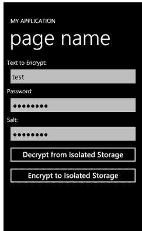

图 19.1 加密演示应用程序。

清单 19.1 展示了 `MainPage.xaml.cs` 的代码隐藏文件，即驱动加密示例的代码。你可能首先注意到的是 `AesManaged` 类的使用。这个类是可供 Windows Phone 7 应用程序使用的几种加密服务提供程序之一。这个类为开发者提供了对对称加密的访问。对称加密是指用于加密数据的密钥与用于解密数据的密钥相同。与之相对的是非对称加密，通常也称为公钥/私钥加密。这是因为在非对称加密中，使用私钥加密数据，而使用公钥解密数据。由于我们的应用程序使用单个“肉密钥”，该密钥由用户输入密码和盐（用更友好的术语来说，即用户名和密码）生成，因此我们将使用对称加密。

你可能注意到的下一件事是一个命名晦涩的类 `Rfc2898DeriveBytes`。这个类专门用于从密码和盐中派生加密密钥，正如你从这个类的构造函数参数中可以看到的那样。然后，通过从某个……获取字节来设置 `AesManaged` 类的 `Key` 和 `IV`（初始化向量）属性。

`Rfc2898DeriveBytes`的实例。密钥和`IV`的具体大小是微软的建议。同样，如果你想更深入地探讨为什么这些值是这样的，请查看微软MSDN文档中关于加密和安全性的部分，或者查阅你最喜欢的加密算法书籍。

接下来你会看到我使用了`cryptoStream`类。这个类的构造函数接受一个流（在我们的例子中是内存流）、一个加密器或解密器，以及最后的一个枚举值，指示该流是为读取还是写入而打开。这是一个极其方便的类，因为一旦你有了`cryptoStream`，它会自动为你处理加密或解密。写入加密流的数据会自动由加密提供程序处理。正如你在清单19.1中看到的，我们使用`AesManaged`类的`CreateEncryptor()`和`CreateDecryptor()`方法来创建流，这些流会对写入流的数据进行加密或解密。

最后，你可能会看到我们在隔离存储章节中介绍过的内容。我们使用`IsolatedStorageSettings`类来读写应用程序设置。在这种情况下，该设置是加密的，因此即使应用程序和手机被攻破，黑客获取的数据如果没有密码和盐值（它们没有存储在设备上的任何位置）也将毫无用处。你不一定非要用这个类，你可以使用`IsolatedStorageFile`类以加密格式读写整个对象图层次结构，确保模型中的每一块数据都安全。

### 清单 19.1 `MainPage.xaml.cs` 加密和解密数据

```
using System;
using System.Windows;
using Microsoft.Phone.Controls;
using System.Security.Cryptography;
using System.IO;
using System.Text;
using System.IO.IsolatedStorage;

namespace EncryptionSample
{
  public partial class MainPage : PhoneApplicationPage
  {
    // Constructor
    public MainPage()
    {
      InitializeComponent();
    }

    private AesManaged GetAesWithKey(string password, string salt)
    {
      AesManaged aes = new AesManaged();
      Rfc2898DeriveBytes keySource =
        new Rfc2898DeriveBytes(password, Encoding.UTF8.GetBytes(salt));
    }
  }
}
```

```
aes.Key = keySource.GetBytes(aes.KeySize / 8);
aes.IV = keySource.GetBytes(aes.BlockSize / 8);
return aes;
}

private string EncryptString(string secretText,
    string password, string salt)
{
    AesManaged aes = GetAesWithKey(password, salt);
    MemoryStream ms = new MemoryStream();

    CryptoStream cs = new CryptoStream(ms,
        aes.CreateEncryptor(), CryptoStreamMode.Write);
    byte[] secretBytes = Encoding.UTF8.GetBytes(secretText);
    cs.Write(secretBytes, 0, secretBytes.Length);
    cs.FlushFinalBlock();
    byte[] encryptedBytes = ms.ToArray();
    ms.Close();
    cs.Close();
    return Convert.ToBase64String(encryptedBytes);
}

private string DecryptString(string encryptedText,
    string password, string salt)
{
    AesManaged aes = GetAesWithKey(password, salt);
    MemoryStream ms = new MemoryStream();
    CryptoStream cs = new CryptoStream(ms,
        aes.CreateDecryptor(), CryptoStreamMode.Write);
    byte[] secretBytes = Convert.FromBase64String(encryptedText);
    cs.Write(secretBytes, 0, secretBytes.Length);
    cs.FlushFinalBlock();
    byte[] decryptedBytes = ms.ToArray();
    return Encoding.UTF8.GetString(
        decryptedBytes, 0, decryptedBytes.Length);
}

private void decryptButton_Click(object sender, RoutedEventArgs e)
{
    if (!IsolatedStorageSettings.ApplicationSettings.
        Contains("secret"))
        MessageBox.Show(
"You haven’t stored a secret string in isolated storage yet.");
    else
    {
        string encrypted =
```

反汇编工具非常强大，它们能生成与你在构建应用程序时最初编写的代码几乎完全相同的C#代码。先别惊慌，请记住Windows Phone 7环境是一个安全的环境，人们能够做到这一点的可能性很小。然而，这并非不可能，所以我们需要考虑这种可能性。

如果你忽略了我的建议，即绝不要将加密密钥与加密数据存储在同一个物理介质上，那么你可能已经把加密密钥硬编码为某个类中的一组常量。如果有人查看你代码的反汇编版本，即使他们还没有完全还原成C#形式，他们也能轻易识别出加密密钥，然后他们就能访问运行你的应用程序的任何设备上的任何人的数据。此时，你就等于交出了知识产权，因为你一直在应用程序的每个实例中使用相同的加密密钥。

如果你的应用程序提供了某种专有算法呢？你的应用程序深处隐藏着一些指令，这些指令耗费了你的工程师多年的心血，也是人们购买你的应用程序的主要原因——因为他们在其他地方得不到这种算法。现在假设一台运行你的应用程序的设备被篡改、解锁，并且你的应用程序被反汇编。盗贼可以毫不费力地逆向工程你的算法，要么将其公开，使你的应用完全贬值，要么基于你曾经的专有代码发布一个做同样事情的竞争应用。

有一些工具可以帮助阻止将你的应用程序二进制文件逆向工程回代码的工具，但它们真正做的只是让盗贼的工作变得更加困难。这些工具并不能完全阻止入侵。在这种情况下，你需要回想本章前面提到的内容——你需要权衡实施一个只能减缓盗贼动作而不是完全阻止盗贼的安全功能的开发成本。这些工具被称为混淆器，其中许多使用起来非常简单，通常只需很少甚至不需要时间即可生效。其中一款与微软建立了合作伙伴关系的工具是Dotfuscator Windows Phone Edition。该工具的制造商Preemptive Solutions还提供监控和分析服务，让你深入了解你的应用在市场中的表现。Dotfuscator可以做很多令人惊叹的事情，包括混淆控制流、重命名、加密字符串等等。一个足够复杂的算法，隐藏在商业级混淆工具之下，并安全地部署在Windows Phone 7上，被发现的可能性很小。

然而，如果你仍然对自己高度敏感的专有算法可能被发现而忧心忡忡，你需要考虑我每天都遵循的另一条安全规则：如果你真的想保护门后面的东西，那就确保当有人破门而入时，门后面什么也没有。

如果你完全无法接受这种微乎其微的可能性——有人能从设备上拷贝你的应用程序，反汇编它，绕过你的混淆，并逆向工程出你应用中的代码——那么你还有另一个选择：将专有算法的执行推迟到服务器端。如果出于合规原因或纯粹的多疑，你不能将算法放在交付到设备的代码中，你可以调用服务器上的Web服务来执行敏感代码。这样一来，你就完全掌控了不能落入坏人之手的敏感代码。同样，与所有安全决策一样，你需要权衡这种架构带来的好处与需要设备具备连接才能执行某些功能的缺点，以及维护云端服务器的成本等等。

## 小结

安全对每个人都很重要，但程度各不相同。一个用户在安全方面的需求很少与另一个用户相同。安全可以由监管机构、合规法规和委员会强制执行，也可以由你组织内的业务人员强制执行，或者来自你对自己小型独立应用程序安全程度的看法。

在将安全构建到你的应用程序中时，最重要的事情是权衡实施成本与所获得的入侵防范程度。在完成这一步之后，再权衡安全功能对用户体验造成的负面影响与为应用程序增加的相对安全程度。在构建安全功能时，你需要权衡所有这些因素，因为如果不这样做，你可能会因过度安全而惹恼用户，或因无效或缺失的安全而失去用户。

本章向你展示了如何加密和解密敏感信息，如何通过网络传输敏感信息（其机制在前面章节中讨论过），以及一些保护知识产权免受不希望的入侵者窥视的可能性。希望读完本章后，你已对自己想在应用程序中实现的安全程度和方式有了清晰的认识，并知道自己打算如何着手实现。

This page intentionally left blank

## 调试与故障排除

> *调试代码的难度是编写代码本身的两倍。因此，如果你尽可能巧妙地编写代码，那么按照定义，你就聪明不到足以调试它。*
>
> Brian W. Kernighan

本章讨论调试、故障排除以及分析你的应用程序。这是应用程序开发中最重要的步骤之一，却常常被忽视。测试应用程序并不在所有单元测试通过后就停止。你需要确保应用程序运行顺畅且高效，尤其是在移动设备上，它不会滥用资源。滥用移动设备资源的应用程序甚至不会被允许进入 Marketplace。

本章将向你展示如何调试应用程序以排查和解决问题，并介绍开发人员可用的其他工具，例如静态分析和代码剖析。

### 调试和调优 iOS 应用程序

如果你编写过任何 iOS 应用程序，本章的这一部分内容（理想情况下）对你来说应该非常熟悉。Xcode，Apple 的开发环境，建立在名为 `gdb` 的开源调试工具之上，`gdb` 代表 GNU Debugger，是 GNU 项目的一部分。有关 `gdb` 的更多信息，网络上有大量信息、文档和培训材料。

因人而异，但大多数开发人员将大部分时间花在调试器中。他们运行应用程序，拨弄测试，希望不会出问题，如果调试会话没有中断，开发人员就会很高兴。

如果出现问题，你需要弄清楚发生了什么。对于 iOS 应用程序来说，这可能特别棘手。由于引用计数内存管理，你经常会在应用程序的某个地方遇到模糊的错误，而这些错误是由应用程序完全不同区域的内存管理不当引起的。


这就是为什么除了标准的调试能力、设置和命中断点、查看堆栈跟踪和对象变量之外，Apple 还提供了记录应用程序运行时内存性能的能力。你可以监视各种场景，其中大多数超出了本书的范围。最大、最常用的检测是内存泄漏。从 `Xcode` 直接启动的分析工具将监控内存分配，它可以发现孤立对象和你在管理内存时犯的错误。需要一段时间才能习惯这个工具，但在你掌握它之后，你会想知道自己以前如何在没有它的情况下编写应用程序。

如果你足够聪明，还可以编写单元测试，确保在调用正在测试的某个库函数之前和之后，特定对象的引用计数完全相同。这并不能保证无缺陷、无崩溃的应用程序，但至少在运行泄漏检测工具之前，它会让你对某个方法不会泄漏内存分配更有信心。

与大多数 iOS 主题一样，如果你对调试、故障排除以及发布到 `App Store` 的应用程序肯定需要做的其他低级改进感到好奇，请查看 Aaron Hillegass 所著的 `iPhone Programming: The Big Nerd Ranch Guide`。我个人认为这本书是开始 iPhone 编程的权威圣经。

## 调试 101

我调试应用程序时一直使用的座右铭是：不要只是让它崩溃，要让它有成效地崩溃。与许多开发人员可能认为的相反，调试会话的目的不是从头到尾不中断。开发人员在测试自己的代码时，往往会无意识地避开自己不确定的应用程序区域。当你调试应用程序时，无论是 iPhone、`Windows Phone 7` 还是 Commodore 64，你都应该始终尝试破坏它。如果你保留了良好的跟踪日志并设置了合适的断点，在调试器下破坏应用程序应该能为你提供修复该错误所需的信息。修复完一个后，再尝试再次破坏它。当你用你知道的每一种方法尝试破坏应用程序而它都无法破坏时，你就完成了。然后，你把它交给别人来破坏。我一直信奉的另一个座右铭是：永远不要让你的客户为你找到错误。

客户发现的每一个你没有发现的错误，都是你盔甲上的一个缺口，是你与客户群的声誉受损。在 Facebook、电子邮件以及跨多设备、桌面和移动平台的社交网络的今天，一个客户对你的应用程序的问题很快就会变成所有人的问题。在客户之前找到你的错误，花点额外的时间。

此外，你需要确保你的应用程序能正确处理异常。`Windows Phone 7` 应用程序提交给 `Marketplace` 的指南明确指出，如果应用程序在认证过程中 ever 崩溃，并且没有向用户提供有关应用程序刚刚遇到的问题的友好、有意义的信息，应用程序将被拒绝。因此，你不仅需要尽可能多地找到自己的错误，而且你的应用程序需要能够承受意外的错误条件，并处理用户、设备和蜂窝网络可能抛出的各种情况。

## 调试 Windows Phone 7 应用程序

调试 `Windows Phone 7` 应用程序与使用 `Visual Studio 2010` 调试任何其他应用程序非常相似。如果你一直在按照本书的流程进行并运行代码示例，你已经看到了在尝试调试 WP7 应用程序时启动的设备模拟器。应用程序在模拟器内运行，同时调试器附加到应用程序的进程。

这使你能够设置和命中断点，并在应用程序执行的几乎任何点停止、暂停和恢复应用程序。这让你可以看到事情是否按预期发生，并让你检查变量和其他数据的值，以帮助你弄清楚事情出乎意料时出了什么问题。

## 使用断点

在最简单的场景中，开发人员可以选择调试器应在其中“中断”的代码行（应用程序的执行会停止，然后等待开发人员）。在断点处，所有执行上下文信息都可用，因此你可以查看变量中包含的值和调用执行堆栈。你可以选择向前推进一行代码，你可以“进入”方法调用进行调试，让你跟随执行深入兔子洞。你甚至可以将指示当前执行行的指针向上拖动，以将应用程序“倒回”到特定点。开发人员可以用一个基本断点做的事情之多令人惊讶，但它变得更好了。

以下是你可以用断点做的一些更高级的事情的列表：

- `Location`—这就是你在 `Visual Studio` 中点击代码列表左侧边距或“托盘”时通常定义的内容。在设置了断点的某个位置，该托盘会出现一个红色的“停止标志”指示器。
- `Condition`—你可以指定一个布尔表达式，用于确定断点是否停止应用程序的执行。这对于在代码中反复使用但只想在满足某些条件时停止执行的方法非常有用。
- `Hit Count`—除了条件表达式之外，你还可以定义命中次数。这将允许你的断点被命中“count-1”次。当命中次数达到限制时，执行将停止。换句话说，如果你将命中次数设置为 10，应用程序将在代码行恰好第十次执行时中断，在该行设置了断点。这在你想要测试 `for` 或 `while` 循环中的第 n 次执行时非常有用。
- `Process and Thread Filter`—你可以使用 `ProcessId`、`ProcessName`、`MachineName`、`ThreadName` 或 `ThreadId` 等变量的组合来限制断点，使其仅在特定进程或线程中断。过滤器子句接受布尔运算符，如 `|`、`&` 等，以便对断点的配置进行非常精细的控制。
- `Labeling`—对于 WP7 应用程序可能并不常见，但我知道当我构建大型企业应用程序套件时，我最终可能会得到一个 `VS2010` 解决方案，其中 literally 有数百个断点。在那个混乱中导航有时是一项繁琐的工作，并且能够为断点分配任意标签（你 Web2.0 的人可以把这些想成标签）。
- `Execution When Hit`—好像其他断点选项还不够，你可以在断点命中时运行宏或显示自定义文本。请记住所有这些选项都是累积的，因此你可以拥有进程过滤器、条件表达式、命中次数，并在断点命中时打印自定义文本。如果你决定打印自定义文本，你可以使用几个宏来打印有关执行上下文的信息，例如：`$ADDRESS`、`$CALLSTACK`、`$PID`、`$TID`、`$FUNCTION`、`$TNAME` 等等。如果你选择运行宏，该宏将是 `Visual Studio 2010` 可全局使用的宏之一，你可以从下拉框中选择宏。

我喜欢用断点做的一件事是使用“命中时执行”中的自定义打印文本。此外，我会勾选 `Continue Execution` 框。这使我能够在调试日志中打印一些信息（我们将在下一节更详细地讨论），而无需编写执行该打印的代码。这样，当我想停止打印该调试信息时，我可以删除断点，而无需注释掉或删除代码。

在你手边任何随机的项目上试试这个（包括本书中的任何示例）。找到你知道经常执行的代码位置并在那里设置断点。将其设置为“命中时”继续执行并打印自定义文本。接受 `Visual Studio` 为你设置的默认文本是可以的。如果你想更花哨一些，你可以将要在自定义文本中显示的任何值用大括号括起来，如图 20.1 所示，每次断点命中时都会打印 `Pivot` 控件中当前选择的索引。


图20.1 命中断点时打印自定义文本。

你可能会注意到，在你按照图20.1所示对标准断点进行修改并调试应用程序后，左侧的“红球”形状会变成菱形，这表明该断点不仅仅是让执行停在该行，还有更多功能。作为附加技巧，我经常给所有“打印调试”断点打上相同的标签，以便以后能找到并停用它们。另一个有用的提示：停用断点而不是删除断点。这样你可以在需要时重新启用它们。这对于像之前提到的在调试会话期间打印有价值信息的断点尤其方便。

当我在自己的一个应用程序中启用此断点运行应用程序时，我会在“调试输出”窗口中看到类似下面的消息，并且当我在活动的 `Pivot` 面板之间点击时，执行不会停止：

```
Function: ApocalypseTrainer.MainPage.mainPivot_SelectionChanged(object, System.Windows.Controls.SelectionChangedEventArgs), Selected Index: 1
Function: ApocalypseTrainer.MainPage.mainPivot_SelectionChanged(object, System.Windows.Controls.SelectionChangedEventArgs), Selected Index: 2
Function: ApocalypseTrainer.MainPage.mainPivot_SelectionChanged(object, System.Windows.Controls.SelectionChangedEventArgs), Selected Index: 3
Function: ApocalypseTrainer.MainPage.mainPivot_SelectionChanged(object, System.Windows.Controls.SelectionChangedEventArgs), Selected Index: 0
Function: ApocalypseTrainer.MainPage.mainPivot_SelectionChanged(object, System.Windows.Controls.SelectionChangedEventArgs), Selected Index: 1
```

在 `Visual Studio 2010` 中，如果单击“调试”菜单并将鼠标悬停在“窗口”选项上，你会看到三个额外的选项：“断点”、“输出”和“即时”。

单击“断点”选项通常会将断点窗口停靠到 IDE 底部，但根据你的选项设置，它也可能显示为浮动窗口。

此窗口显示解决方案中的所有断点、它们的标签、条件和命中计数。还记得我提到过，我经常使用“标签”功能将所有调试打印断点分组在一起吗？如果我使用类似于“debugprint”的标签，我可以通过在搜索框中输入“debugprint”并按 Enter 来搜索所有带有该标签的断点。当这些结果显示在窗口中时，我只需单击一个按钮即可启用或禁用所有这些断点，而不必在数十个项目的数百个文件中寻找我的所有断点。

在继续下一节之前，我强烈建议你花些时间练习使用断点。断点是 `VS2010` 中一个经常被忽视的功能。大多数开发人员知道如何总是在单行代码上停止执行，但也有同样多的开发人员忘记了断点还可以做许多其他事情。

## 日志记录与 Debug 类

你已经了解了如何使用一种特殊类型的断点将信息打印到调试日志中。在本节中，我将介绍一些用于在排查应用程序问题时记录其他重要运行时数据的技术（以及 WP7 特有的限制）。

如果你编写过任何 iOS（或 Mac）应用程序，你一定会熟悉 `NSLog` 函数。iOS 开发人员广泛使用此函数来跟踪应用程序中流动的重要信息、事件和数据。他们使用它来确保其代码所处理的数据的假设是正确的，并在开发应用程序时打印出有用的信息。

在 `Windows Phone 7` 中，与 `NSLog` 函数等价的是 `Debug.WriteLine` 方法。你使用此方法的方式与使用 `NSLog` 非常相似——将你认为重要的任何信息转储到调试日志中。

有 `Visual Studio 2010` 使用经验的 Windows 和 Web 开发人员可能会有些失望地发现，`Debug` 类上的方法数量有限，而且 `Trace` 类完全缺失。不管出于什么原因，在 WP7 中，没有一种开箱即用的方法可以将信息跟踪到文本文件中，而在使用 `VS2010` 的桌面或服务器平台上是有这种方法的。

实际上，无论你是在代码中大量使用 `Debug.WriteLine` 语句，还是使用我之前介绍的断点技术，都纯属个人偏好。我个人更喜欢使用断点技术，因为它允许我在不必删除或注释掉代码的情况下切换不同类型的输出。此外，当我准备通过 `Marketplace` 提交应用程序以进行生产认证时，我不必担心查找所有 `Debug.WriteLine` 语句并将其删除。另一方面，如果大量断点让你感到困扰，你可能会更倾向于使用 `Debug.WriteLine`。

## 使用静态分析

到目前为止，你一直很勤奋，一直在创建单元测试以确保代码按预期工作。你一直在调试代码，发现了各种讨厌的小问题，但也设法解决了所有这些错误。你靠在椅背上，认为自己已经准备好将杰作上传到应用程序 `Marketplace`。但是等等，还有更多！

在 `Windows Phone 7` 开发人员工具箱中，还有另一个工具可以帮助你将应用程序代码打磨成一把精雕细刻的刀刃（也许是一把 Ginsu 刀？）。微软根据多年的经验和开发人员反馈，制定了一套广泛的规则、建议和警告信号。这套规范性指导已直接集成到 `Visual Studio 2010` 内置的静态代码分析工具中。换句话说，`VS2010` 可以深入你的代码，指出一些非常常见的问题，甚至可以推荐你可能能够修复它们的方法。

例如，静态分析工具可以跟踪代码中的方法调用和属性访问器，并发现你可能意外成为“意外后果法则”受害者的地方。这里一种非常常见的情况是，代码调用某个属性访问器，然后属性访问器又调用其他函数，而该函数可以在子类中被重写。这创建了一个模糊区域，使得大量代码可能因为你编写的一个简单属性设置而潜在执行。一个不了解你原始意图的开发人员可能会过来重写该方法，而你们双方可能都不会立即注意到由此产生的后果。值得庆幸的是，`VS2010` 静态分析工具意识到了这一点以及其他数千种可能的“陷阱”。

图20.2 显示了在 `Windows Phone 7` 应用程序项目上运行代码分析后的样子。要触发代码分析，你只需右键单击项目并选择“运行代码分析”。这将生成应用程序，然后对编译后的代码执行分析。


图20.2 示例项目上代码分析的结果。

在图20.2中，你可以看到有几个地方静态分析工具警告我，应该检查调用执行链是否存在意外后果。在其中一种情况下，我确实想要那些后果，而且我很固执，老板又在对我大喊大叫，我还需要赶回家玩 Xbox，所以我想抑制该警告，而不是想方设法重构代码来避免该警告。

有几种不同的方法可以抑制这些警告。首先，在列表中突出显示该警告，然后右键单击它。当选择“抑制消息”选项时，你可以选择“在源代码中”或在项目抑制文件中抑制该消息。

如果选择在源代码中抑制消息，这将会在违反触发警告的静态分析规则的代码块范围内创建一个特性。下次运行代码分析时，此警告消息将不会出现。

就个人而言，我认为在源代码中散布仅适用于生成时且仅在代码分析期间有效的特性很难看。幸运的是，我可以选择在项目抑制文件中抑制静态分析警告。如果我选择此选项，则会在名为 `GlobalSuppressions.cs` 的文件中创建一个特性。

### 清单20.1 GlobalSuppressions.cs

```
// This file is used by Code Analysis to maintain SuppressMessage
// attributes that are applied to this project.
// Project-level suppressions either have no target or are given
// a specific target and scoped to a namespace, type, member, etc.
//
// To add a suppression to this file, right-click the message in the
// Error List, point to "Suppress Message(s)", and click
// "In Project Suppression File".
// You do not need to add suppressions to this file manually.

[assembly: System.Diagnostics.CodeAnalysis.SuppressMessage(
"Microsoft.Usage",
"CA2214:DoNotCallOverridableMethodsInConstructors",
Scope = "member",
Target = "ApocalypseTrainer.ViewModel.FoodItem.#ctor()")]
```

我开玩笑说为了微不足道的理由而抑制静态分析警告，但事实是，在抑制警告之前，你应该花一点时间弄清楚该警告出现的原因以及与该警告相关的问题。每个代码分析警告都有一个唯一的编号（例如前面示例中的 `CA2214`）。如果你不确定静态分析工具为什么警告你，请将该编号输入到您最常用的搜索引擎中，看看是否有任何结果。我一直很惊喜地发现，我可以在网上找到很多关于某些 CA 规则和警告的详细信息。

还有一种分析会生成汇总代码的指标。这种类型的分析会深入检查编译后的代码，并计算诸如“可维护性指数”等统计数据，该指数基于诸如“圈复杂度”、“继承深度”、“类耦合”以及代码行数等其他值。

圈复杂度（也称为条件复杂度）是用于衡量软件程序复杂度的指标。它衡量源代码特定块中独立路径的数量。圈复杂度值为 1 表示从代码块的开头到结尾只有一种方式。如果你在圈复杂度为 1 的代码中引入一个 `if/else` 块，它将变为 2，表示你可以通过 `if` 部分或 `else` 部分完成该块。应用程序的圈复杂度越大，编写单元测试就越困难，开发人员必须手动执行的测试数量就越多，以覆盖所有代码。随着应用程序的增长，这种复杂度会自然增长，但你应该密切关注它，并可能通过提供更线性的代码路径来找到降低这种复杂度的方法。图 20.3 显示了静态分析运行的一些示例输出。


图 20.3 生成的代码分析指标。

继承深度顾名思义，指类在继承层次结构中的深度。静态分析工具会为应用程序中的类评分，以指示继承深度。一般来说，类在继承层次结构中越深，其行为就越难以预测，设计也越复杂。其中一些需要持保留态度，因为在你开始编写自己的自定义控件之前，控制层次结构通常就很深了。然而，如果你的视图模型类的深度为 8，你可能需要考虑重构以稍微 flatten 你的继承树。图 20.3 显示了代码指标窗口的输出，包括继承深度排名、圈复杂度评分和类耦合值。


类耦合是指一个类依赖于其他类的数量。假设我构建了一个类，它有两个属性，每个属性都是不同的类。这个类现在具有类耦合值 2（静态分析工具在确定此指标时会忽略内置的 .NET 类型）。普遍的共识是，类的类耦合值越高，该类就越不稳定。换句话说，类耦合值高的类在代码更改后出现故障的可能性远大于类耦合值低的类。MVVM，正如你在该章节中所见，是专门设计用来让你以最少的类耦合构建强大的用户界面的。另一个需要记住的提示是，如果你将类类型属性转换为接口类型属性（允许通过 Unity 或 Castle Windsor 等工具轻松模拟或依赖注入），这将降低类耦合指标。

## Summary

在下一章深入讲解如何将应用程序提交到 Marketplace 之前，我想确保向你介绍 Windows Phone 7 开发人员可用于调试、跟踪、故障排除，甚至分析代码以寻找改进区域的工具。

软件开发生命周期中一个不幸的事实是，无论你多快完成应用程序的主要功能，在此之后打磨、改进、调整和重构应用程序都需要很长时间。了解如何使用静态分析工具、调试器、断点以及本章介绍的其他技术，将有助于将你的应用程序从一个不错的应用提升为坚如磐石、稳定可靠的应用程序，更有可能通过认证流程。

只要记住，调试的目的不是无错误地执行；而是为了找到错误以便修复它们。尝试以尽可能多的方式破坏你的应用程序，并使用本章和前几章中的技术来查找和修复这些错误。然后你就可以准备好将应用程序提交到 Marketplace，希望赚取大量金钱。

## Deploying Applications to the Marketplace

> 安全地翻倍你的钱的方法是把它折叠一次放进口袋。
> 
> Frank Hubbard

本章全部关于将应用程序部署到 Marketplace。你已经编写了应用程序的代码，并且为你所创造的东西感到自豪。你有一个好的应用程序图标、一个磁贴图标，并且掌握了关注点分离的技术（可能使用 MVVM）。你已使用单元测试测试了应用程序，并对其进行了调试和静态分析。你已将代码交给朋友或同事让他们运行应用程序——他们都很喜欢。你准备好将应用提交到商店并开始赚取巨额金钱。

在本章中，你将看到一个实践演练，从你对应用程序的速度、稳定性、可靠性和符合所有认证要求感到满意的点，到它已上传到 Marketplace 并且你可以开始收款的点。

为此，我将向你介绍一个我编写的名为 `Zombie Apocalypse Trainer` 的示例应用程序，有趣的是，它属于 Marketplace 的健康和健身类别。我将逐步展示我如何将此应用程序带入整个部署和认证流程，包括将其部署到测试设备以确保一切正常工作。

### Introducing Zombie Apocalypse Trainer

`Zombie Apocalypse Trainer` 是标准卡路里跟踪应用程序的一种新变体。与通过羞辱人们的饮食习惯日志来激励人们减肥和跟踪卡路里不同，此应用程序给人们新的动力：避免被成群的吸脑不死族杀死。

该应用程序要求你设定一个目标体重和希望达到该体重的日期。这基本上就是僵尸末日——成败在此一举。如果你在目标日期前没有达到目标体重，应用程序会认为你太超重而无法避免被捕获，你将死于缓慢而痛苦的死亡，被僵尸吃掉你的大脑。

以下是我在 Marketplace 中打算使用的应用程序描述：

你准备好迎接僵尸末日了吗？当街道上充满狂暴的食脑不死族时，你能跑得过它们吗？使用此应用程序跟踪你燃烧的卡路里、摄入的卡路里和体重日志。只需告诉应用你认为僵尸末日何时会到来，然后开始跟踪你的进度。

从技术角度来看，Apocalypse Trainer 是一个标准的 `Silverlight WP7` 应用程序，使用本书前面讨论的 `MVVM Light` 框架构建。我使用前面章节中讨论的单元测试技术测试了该应用程序。它有三个核心视图模型：`Main`、`Today` 和 `History`。

`Main` 视图模型包含为其提供有用信息的所需所有信息，例如距离末日剩余的天数以及你没有被撕咬的时间（没有超过卡路里预算）。

`Today` 视图模型包含你今天摄入的食物项目列表和你今天进行的锻炼列表。这与底层持久化介质不同，后者包含自你安装应用程序以来所有食物和锻炼的列表。记住，视图模型专门设计用于支持 UI 呈现用户想要看到的内容，而不一定是数据在磁盘上（或数据库或 Web 服务等）的样子。

`History` 视图模型包含体重日志——自你安装应用程序以来称重记录的历史记录。当你在应用程序中导航时，会出现对话框，允许你创建新数据。这些是 WP7 页面，使用视图模型定位器绑定到单独的视图模型（再次，这都是我们在 MVVM 章节中讨论的内容）。当用户在对话框上点击确认按钮以创建新信息时，会使用 `MVVM Light` 的消息框架发送一条消息。持有将要添加新项目的集合的视图模型已订阅此消息，并响应消息，将适当项目添加到集合中。

每当视图模型中的数据发生变化时，视图模型都会要求其下属数据服务使更改永久化。在 `Zombie Apocalypse Trainer` 的情况下，持久化介质是隔离存储。我使用在整本书中多次使用的 `IsoStoreHelper` 类来在隔离存储中读写对象图。

当我将信息存储在隔离存储中时，我有三个独立的文件：体重历史、锻炼历史和食物历史。我这样做的原因是这三种类型的视图模型永远不会在同一个屏幕上创建，也永远不会相互关联。这最小化了每个屏幕的隔离存储读写次数。为了将数据模型对象转换为视图模型对象，我使用了 C# 类扩展来将一种对象类型转换为另一种对象类型。此外，我还使用了 LINQ 查询来过滤数据服务中的数据数组，在加载视图模型时只包含当前天的数据。

这种模式允许我对应用程序记录的整个信息历史进行计算和分析（例如确定当前“无被袭击天数”连击的长度），但视图模型只向用户显示该信息的一个子集。今天屏幕永远不会显示今天记录之外的更多数据，而主屏幕只返回自上次袭击以来的天数的汇总信息。

以下是我在 `Today` 视图模型中用来从数据模型获取历史信息并将其转换为视图模型中用于渲染的子集的一些代码：

```
var todayFood =
    from FoodRecord foodRecord in DataService.FoodHistory.FoodRecords
    where foodRecord.RecordDate.Date == DateTime.Now.Date
    orderby foodRecord.RecordDate ascending
    select foodRecord;
this.FoodItems.Clear();
foreach (FoodRecord fr in todayFood)
{
    this.FoodItems.Add(fr.ToViewModel());
}
```

在这种情况下，`DataService` 是一个属性，包含我编写的用于与隔离存储中的三个底层文件通信的帮助对象实例。该服务还负责计算自上次袭击以来的天数。由于视图模型只能看到今天，这自然就成为数据服务的工作范围，而数据服务可以看到应用程序自安装之日起的历史记录。

`ToViewModel()` 方法是另一个类上的扩展方法。我这样做是为了让 Model 也不知道如何从一个对象转换到另一个对象，但我仍然能够做到。这只是一个选项；其他选项包括使用 codeplex 上的 `AutoMapper` 类，尽管在我编写此应用程序时，我找不到适用于 WP7 的可靠移植版本。

如果你想了解更多关于我如何构建此应用程序的信息，欢迎访问我的博客 `http://www.kotancode.com`，在那里我将分享关于 WP7 开发的一般故事，以及我在构建 Apocalypse Trainer 应用程序时的经历。

## 注册和部署到测试设备

在你能做任何与 Marketplace 相关的事情之前，包括在真实手机上测试你的应用程序，你需要一个 `App Hub` 开发者账户。此账户是你创建和发布 Windows Phone 7 或 Xbox Live 应用程序时的发布者资料。

你需要做的第一件事是前往 `http://create.msdn.com` 并注册一个账户。此账户将链接到你的 `Windows Live ID`，因此如果你有多个 `Windows Live ID`，请确保将其链接到正确的 ID。

图 21.1 显示了账户创建的第一步。在此步骤中，你选择你的原籍国以及你是创建个人账户、公司账户还是学生（`DreamSpark`）账户。


图 21.1 创建 App Hub 账户。

在你指定想要的账户类型后，你需要指定你的个人信息和账户详情，如图 21.2 所示。我已将一些字段留空以保护我的隐私，但你需要提供一个有效的电子邮件地址（你会收到一封要求验证此电子邮件地址的邮件，所以请确保它是一个可用的地址）、至少一个电话号码以及你的家庭地址。别担心，这些信息不会对购买你应用程序的人开放。


图 21.2 为 App Hub 账户提供额外信息。

在你指定个人详情后，你将被要求支付开发者账户会员费。目前为每年 99 美元，这将允许你提交无限数量的付费应用程序和五个免费应用程序（超过五款免费应用限制后，每款应用会收取额外费用）。

在你完成流程后，你最终会到达第 4 步，账户确认。在此之后一段时间（可能从几个小时到一天），你会收到一封电子邮件，其中包含填写调查问卷的说明。此调查问卷会询问一些非常详细的问题，包括你向其汇款的债权人的姓名以及其他理论上只有你才知道的信息。此调查问卷来自一家名为 `GeoTrust` 的公司，该公司负责验证开发者账户的合法性。在你通过 `GeoTrust` 认证流程之前，你无法向 Marketplace 提交应用程序，因此请务必仔细阅读说明并认真回答所有问题。

对我来说，整个 `GeoTrust` 流程大约花了 24 小时，虽然我听说它可能需要更少的时间；我也听说过一些人因调查问卷出现问题而花了好几天才理清混乱的情况。

在你的账户获得认证并被视为有效后，你可以注册多达五个开发者设备。为此，请将设备插入并确保你的 `Zune` 同步和与设备的连接正常工作。

接下来，运行随 WP7 开发者工具提供的开发者注册应用程序。此应用程序已为你安装为开始菜单上的快捷方式。如果你找不到它（并且你正在运行 Windows 7），请打开开始菜单并在搜索框中输入“registration”。自动完成列表应过滤到一个名为 `Windows Phone Developer Registration` 的应用程序。当你启动应用程序时，你会看到一个类似于图 21.3 所示的屏幕。


图 21.3 注册设备进行测试。

在你为测试注册设备后，进入 `Visual Studio 2010`，并在调试工具栏中将活动目标从 `Windows Phone 7 Emulator` 更改为 `Windows Phone 7 Device` 并开始调试会话。你需要确保手机仍插入，并且如果设备上有 PIN 码锁，在尝试部署应用程序之前已将其解锁。

`Visual Studio 2010` 在主屏幕当前被 PIN 码锁锁定时不会将应用程序（调试或发布）部署到 WP7 设备。务必在尝试部署前先解锁设备。

## 为提交准备你的应用程序

在你能将应用程序部署到 Marketplace 之前，你需要确保一些细节已处理妥当。首先，你需要确保 `WMAppManifest.xml` 文件已用你的发布者信息、应用程序标题等适当填充。以下是我的 `Zombie Apocalypse Trainer` 应用程序的 `WMAppManifest.xml` 文件：

```
<?xml version="1.0" encoding="utf-8"?>
<Deployment
xmlns="http://schemas.microsoft.com/windowsphone/2009/deployment"
AppPlatformVersion="7.0">
<App xmlns="" ProductID="{ac5b5d62-573c-4134-b290-0ad4f678ad7f}"
Title="Apocalypse Trainer"
RuntimeType="Silverlight" Version="1.0.0.0" Genre="apps.normal"
Author="Kevin Hoffman"
Description="Track your fitness progress as the Zombie Apocalypse
approaches! Will you survive?"
Publisher="Kevin Hoffman">
<IconPath IsRelative="true"
IsResource="false">ApplicationIcon.png</IconPath>
<Capabilities>
<Capability Name="ID_CAP_NETWORKING" />
<Capability Name="ID_CAP_LOCATION" />
<Capability Name="ID_CAP_SENSORS" />
<Capability Name="ID_CAP_MICROPHONE" />
<Capability Name="ID_CAP_MEDIALIB" />
<Capability Name="ID_CAP_GAMERSERVICES" />
<Capability Name="ID_CAP_PHONEDIALER" />
<Capability Name="ID_CAP_PUSH_NOTIFICATION" />
<Capability Name="ID_CAP_WEBBROWSERCOMPONENT" />
</Capabilities>
<Tasks>
<DefaultTask Name="_default" NavigationPage="MainPage.xaml" />
</Tasks>
<Tokens>
<PrimaryToken TokenID="ApocalypseTrainerToken"
TaskName="_default">
<TemplateType5>
<BackgroundImageURI IsRelative="true"
IsResource="false">Background.png</BackgroundImageURI>
<Count>0</Count>
<Title>Apocalypse Trainer</Title>
</TemplateType5>
</PrimaryToken>
</Tokens>
</App>
</Deployment>
```

认证流程会重写其中大部分信息，但这里的基本信息是应用程序标题、作者姓名、发布者姓名以及指向艺术作品如 `Background.png` 和 `ApplicationIcon.png` 的链接。

你可能会以为这个清单（manifest）会控制应用固定到开始屏幕或出现在已安装应用列表中时显示的名称，但事实并非如此。安装后手机上显示的应用标题，是由 `Properties` 文件夹中 `AssemblyInfo.cs` 文件里的单个属性控制的。下面是我在 `AssemblyInfo.cs` 文件中该属性的样子：

```
[assembly: AssemblyTitle("Apocalypse Trainer")]
```

还要确保在该文件中设置产品名称和版权信息：

```
[assembly: AssemblyProduct("Apocalypse Trainer")]
[assembly: AssemblyCopyright("Copyright © Kevin Hoffman 2010")]
```

完成这些设置后，请构建并清理你的应用程序，然后将其部署到一台真正的 Windows Phone 7 设备上。观察你的应用在已安装应用列表中以及固定到开始屏幕时的外观。反复调整和修改各项清单与应用设置及属性，直到应用呈现出你完全满意的效果。只有在这些调整全部完成之后，你才应该考虑将应用上传到 Marketplace。

## 向 Marketplace 提交应用

现在，你或许认为自己已经准备好向 Marketplace 提交应用了。你已从所有能想到的角度测试并调试了应用，包括在真实的 Windows Phone 上运行应用。如果你还没有在真实的 Windows Phone 上运行过应用，那么你需要回到本章前一节。在真实设备上测试应用是无可替代的。为了确保应用在由微软测试和认证时不会出现意外，你真的需要在真实设备上进行测试。

假设你的应用已经准备就绪，你可以通过将其上传到 Marketplace 来启动认证流程。首先，访问 `App Hub`（`http://create.msdn.com`）。使用与你的开发者账户关联的 Live ID 登录，然后点击“Submit for Windows Phone 7”按钮来提交一个新的应用。确保在此过程中使用 `Internet Explorer`。我知道在当今这个 HTML5 和高度浏览器兼容的时代，这听起来很滑稽，但我在尝试使用 `Chrome` 进行第二步时确实遭遇了彻底失败。当我切换到 `Internet Explorer` 后，一切才正常工作。

应用提交的第一步界面如图 21.4 所示。

在这一步，你必须提供应用的相关信息，包括名称、版本号、目标平台以及应用包本身。应用包是位于 VS2010 项目目录下 `Release` 目录中的 `XAP` 文件。这里还有一些自由文本输入框，用于填写你的开发者备注和供认证测试人员阅读的说明。

第二步涉及应用描述和分类。在这里，你需要提供应用的详细描述（如图 21.5 所示）、类别、子类别以及其他一些信息。


图 21.4 应用上传第一步


图 21.5 应用上传第二步


### 第三步应用图片资源

在第三步（如图 21.6 所示）中，你需要提供应用图片资源。你需要提供一张 `173x173` 像素（`96 DPI`）的 PNG 作为大型应用磁贴，一张 `99x99` 像素的 PNG 作为小型应用磁贴，一张 `200x200` 像素的图片用于在 PC 上查看 Marketplace 中的应用，以及至少一张 `480x800` 像素的截图。在图 21.6 中，你可以看到我提供了所有最低要求的内容，还额外加了几张截图。


图 21.6 上传应用图片资源

请记住，要从模拟器获取真正的 `480x800` 像素截图，你需要将模拟器设置为全尺寸（Full Size）显示。在我的笔记本电脑上（完整的 `1080p` 屏幕），这会占据屏幕的很大一部分，所以你需要提前做好准备，提供足够的屏幕空间来显示全部 `800` 个垂直像素。在提交过程中，此步骤会拒绝尺寸不正确的图片。

在提供了应用图片资源、描述、类别和实际的 XAP 包之后，你需要提供定价信息（如图 21.7 所示）。在这里，你需要指明你的应用是否支持试用模式，应用是否可在原属国家之外分发，以及你计划收取多少费用。请注意，应用价格是一个下拉框，而不是自由文本输入框。这意味着你只能使用一组固定的价格，以保证整个 Marketplace 的一致性。付费应用的最低价格是 `99` 美分。

最后，当你完成所有应用详情的填写后，你的仪表板会显示所有应用及其状态。从图 21.8 中可以看出，在我截取这张截图时，我的应用已经准备好进行测试。

图 21.7 设置应用定价

图 21.8 应用认证状态

此外，你可以在图 21.8 中看到一条警告消息，表明我的付款信息不完整。事实上，我已经提供了银行账户信息，微软可以将我计划通过大批《末日训练师》粉丝下载该应用而获得的数百万收入存入其中。问题在于，微软需要大约 `24` 小时来验证银行路由号码、账户和地址信息。在验证完成后，付款信息警告就会从你的仪表板中消失。

就是这样——到这里，你就可以随时提交了。假设你的应用通过认证，它要么会自动部署到 Marketplace，要么，如果你选择不自动部署，你可以自行选择准确的时间手动部署。（你可以在 App Hub 上找到最新的认证要求列表；我没有在本书中列出这些要求，因为在我写作期间它们改变了四次。）

每当你想要发布包含缺陷修复或新功能的新版本应用时，你需要回到 App Hub，上传新版应用，并经历我前面所描述流程的一个略微精简的版本。你应用的现有用户将能够使用手机上的 Marketplace 应用来下载你的应用新版本。

## 使用移动广告 SDK 赚钱

如果你打算发布免费应用，希望获得更多下载量，但仍然希望以某种方式从应用中获取收入，你可能会考虑使用移动广告 SDK。你可以从微软以下面的 URL 下载该 SDK（我擅自生成了一个短链接，方便你阅读时直接输入）：`http://tinyurl.com/wp7adsdk`。

要使用移动广告 SDK，你需要先在 `http://pubcenter.microsoft.com` 注册微软 pubCenter（同样，在这个网站上你不能使用 Chrome，需要使用 IE）。这个网站用于将你的开发者 ID 与广告配置关联起来，并提供关键字和其他广告定向信息。与苹果的 iAds SDK 非常相似，所有寻找潜在广告商、洽谈费率和付款的繁琐工作都已由平台代为处理。你只需要使用 SDK 在应用中展示广告，并假设你的应用能足够频繁地被启动，你就会开始根据展示次数和用户点击应用内广告时产生的“点击跳转”事件获得付款。

如果你正在寻找如何在应用中使用 SDK 的信息，你需要先安装 SDK。它自带帮助文件，其中包含大量教程和其他信息，教你如何配置 pubCenter 账户以及编写让应用参与广告所需的代码。

## 本章小结

本章概述了为提交应用到 Marketplace 而需要做的准备工作。在你的应用准备就绪之后，本章带你逐步完成了向 Marketplace 提交真实应用的过程，并说明了提交所需的信息。

通读整本书后，无论你是否是 iOS 开发者，你现在都应该非常牢固地掌握了构建、测试、排查、部署和销售 Windows Phone 7 应用所需的信息。我希望你能像我一样感受到为 Windows Phone 7 开发的惊人体验，我也期待看到你一定会构建出的精彩应用。

## A

`accel_ReadingChanged` 方法，140

`accelerometers`，加速度计，126，138-141

`accepting user input`，接受用户输入，91-92

`accessing radio tuners`，访问收音机调谐器，137-138

`achievements` 成就

- `connected gaming options, Windows Phone 7 applications`，联网游戏选项，Windows Phone 7 应用，261-262
- `connected mobile gaming platforms`，联网移动游戏平台，255-256
- `Game Center (Apple)`，Game Center（Apple），257-258

`act`，执行，248

`activating Windows Phone Execution Model`，激活 Windows Phone 执行模型，173-174

`AddBookToList()` 方法，229

`Adding a Label and TextBox`，添加标签和文本框，87

`adding behaviors to classes`，向类添加行为，26-28

`Adding Buttons to the Page`，向页面添加按钮，88

`Adding New User Input Elements`，添加新的用户输入元素，91

`address books`，地址簿，126

`AesManaged` 类，272

`animation, navigation events`，动画，导航事件，111-115

`animations`，动画，97-99

- `double animations`，双重动画，114-115
- `storyboards`，故事板，99

`annotations, Expression Blend`，注释，Expression Blend，75

`APIs, networking with Game Center`，与 Game Center 网络相关的 API，258-259

`APNS (Apple Push Notification Services)`，APNS（Apple 推送通知服务），153-155

`App Hub developer accounts`，App Hub 开发者账户，292-293

`AppData and Customer Data Model Classes`，AppData 和客户数据模型类，188-189

`AppData` 类，188-189

`Apple, Game Center. See Game Center (Apple)`，Apple，Game Center。参见 Game Center（Apple）

`Apple Push Notification Services (APNS)`，Apple 推送通知服务（APNS），153-155

## B

`application bar, migrating from tab bar applications`，从标签栏应用迁移的应用栏，120-123

`application life cycle, Windows Phone Execution Model`，应用生命周期，Windows Phone 执行模型，171-172

- `activating`，激活，173-174
- `closing`，关闭，174
- `deactivating`，停用，174
- `launching`，启动，172-173
- `running`，运行中，173
- `tombstoned`，墓碑状态，175

`application testing iOS applications`，iOS 应用测试，239

`applications. See also secure applications`，应用程序。另见安全应用程序

- `prepping for submissions`，准备提交，294-296
- `secure applications`，安全应用程序，267-269
- `protecting data`，保护数据，270-275
- `storage-backed databound applications`，基于存储的数据绑定应用程序，186-196
- `submitting to Marketplace`，提交到 Marketplace，296-300
- `Zombie Apocalypse Trainer. See Zombie Apocalypse Trainer`，僵尸末日训练师。参见 Zombie Apocalypse Trainer

`arrange`，安排，248

`arrange, act, assert, unit testing, Windows Phone 7 applications`，安排、执行、断言，Windows Phone 7 应用单元测试，248-249

`assert`，断言，248

`Attack` 方法，27，34

`auto-hide, toggling in Visual Studio 2010`，在 Visual Studio 2010 中切换自动隐藏，65

`AutoMapper`，AutoMapper，MVVM Light，230-231

`AvailableFreeSpace`，可用剩余空间，185

`background audio`，后台音频，170

`BeginRequestStream`，BeginRequestStream，200

`behaviors, adding to classes`，行为，向类添加，26-28

`bindability`，可绑定性，211

`Book.cs`，Book.cs，221-222

`BookTest.cs—Asynchronous Unit Testing`，BookTest.cs—异步单元测试，244-245

## C

`breakpoints, debugging, Windows Phone 7 applications`，断点，调试，Windows Phone 7 应用，281-284

`buttons`，按钮，88-90

`C#`

- `core syntax`，核心语法，11-14
- `events`，事件，42-46
- `garbage collection`，垃圾回收，16
- `IDisposeable`，IDisposeable，18
- `origins of`，起源，10-11
- `static extensions`，静态扩展，35

`calendars`，日历，127

`cameras`，相机，127

`CanGoBackward`，可后退，107-108

`CanGoForward`，可前进，107-108

`Canvas, Silverlight`，Canvas，Silverlight，100

`capabilities of smartphones`，智能手机功能，125-127

`CAPTCHAs`，验证码，268

`CharactersViewModel` 类，226

`checkboxes`，复选框，91

`choosers`，选择器，133-134

- `email address chooser task`，电子邮件地址选择器任务，134-135
- `phone number chooser task`，电话号码选择器任务，134
- `PhotoChooserTask`，PhotoChooserTask，135-136

`class coupling`，类耦合，288

`classes`，类

- `adding behaviors`，添加行为，26-28
- `AesManaged class`，AesManaged 类，272
- `AppData class`，AppData 类，188-189
- `building`，构建，22-23
- `contracts`，契约，32-35
- `Customer class`，Customer 类，188-189
- `encapsulating data`，封装数据，23-25
- `IsoStoreHelper` 类，186-188
- `MessageBox` 类，85
- `namespaces versus naming conventions`，命名空间与命名约定，35
- `RelayCommand`，RelayCommand，222
- `TurnAction` 类，264
- `UIElement` 类，55
- `ViewModel` 类，178

`closing Windows Phone Execution Model`，关闭 Windows Phone 执行模型，174

`CLR`

- `garbage collection`，垃圾回收，17
- `root counting`，根计数，17

`code listings`，代码清单

`Adding a Label and TextBox`，添加标签和文本框，87

`Adding Buttons to the Page`，向页面添加按钮，88

`Adding New User Input Elements`，添加新的用户输入元素，91

`AppData and Customer Data Model Classes`，AppData 和客户数据模型类，188-189

`Book.cs`，Book.cs，221-222

`BookTest.cs—Asynchronous Unit Testing`，BookTest.cs—异步单元测试，244-245

`Code Responding to a Button Click`，响应按钮点击的代码，89-90

`Combatant.cs`，Combatant.cs，23

`Combatant.cs (Refactored to Implement IDoesDamage)`，Combatant.cs（重构以实现 IDoesDamage），33-34

`Combatant.cs (Showing Events)`，Combatant.cs（显示事件），43-44

`Combatant.cs with Behavior`，带行为的 Combatant.cs，27

`Combatant.cs with Member Variables`，带成员变量的 Combatant.cs，24-25

`combatant.h`，combatant.h，22

`Combatant.h with Behavior`，带行为的 Combatant.h，26

`Combatant.h with Member Variables`，带成员变量的 Combatant.h，24

`Combatant.m`，Combatant.m，22

`Combatant.m with Behavior`，带行为的 Combatant.m，26

`Combatant.m with Member Variables`，带成员变量的 Combatant.m，24

`CombatantSquareDancingExtension.cs`，CombatantSquareDancingExtension.cs，36

`DrunkenCombatant.cs`，DrunkenCombatant.cs，30-31

`EmptyTest.cs`，EmptyTest.cs，243

`GameEngine.cs`，GameEngine.cs，45-46

`GameEngine.cs (with Static Events)`，GameEngine.cs（带静态事件），47-49

`GlobalSuppressions.cs`，GlobalSuppressions.cs，286

`IHypotheticalLobbyService`，IHypotheticalLobbyService，260

`The IsoStoreHelper Class`，IsoStoreHelper 类，186-188

`ITakesDamage.cs`，ITakesDamage.cs，33

`ITurnBasedGameService`，ITurnBasedGameService，263-264

`ListBoxPge.xaml, Modified for Animation`，ListBoxPge.xaml，修改用于动画，97-98

`MainPage.xaml`，MainPage.xaml，192-194

`MainPage.xaml for the Panorama Application`，全景应用的 MainPage.xaml，119-120

`MainPage.xaml from the Pivot Control Application Template`，来自 Pivot 控制应用模板的 MainPage.xaml，116-117

`MainPage.xaml—Animated Page Transitions`，MainPage.xaml—动画页面转换，112-113

`MainPage.xaml.cs`，MainPage.xaml.cs，194-195

`MainPage.xaml.cs, Using the Accelerometer Sensor`，MainPage.xaml.cs，使用加速度传感器，138-140

`MainPage.xaml.cs, Using the Location Monitoring API`，MainPage.xaml.cs，使用位置监控 API，141-143

`MainPage.xaml.cs—Animated Page Transitions`，MainPage.xaml.cs—动画页面转换，113-114

`MainPage.xaml.cs—Injecting the SLUT Harness UI`，MainPage.xaml.cs—注入 SLUT 测试架 UI，242

`MainViewModel.cs`，MainViewModel.cs，215-217

`MainViewModel.cs and ItemViewModel.cs`，MainViewModel.cs 和 ItemViewModel.cs，189-192

`MainViewModelTest.cs—Arrange, Act, Assert`，MainViewModelTest.cs—安排、执行、断言，248-249


`MockMnemuseServiceProvider.cs`，`MockMnemuseServiceProvider.cs`，246-247

`PincushionTarget.cs`，`PincushionTarget.cs`，34

Preparing App.xaml for Push Notifications，为推送通知准备 App.xaml，157-159

Reading Text Property of a TextBox，读取 TextBox 的文本属性，87-88

`ReallyDangerousCombatant.h`，`ReallyDangerousCombatant.h`，29

`ReallyDangerousCombatant.m`，`ReallyDangerousCombatant.m`，29

`ReallyDangerousCombatants.cs`，`ReallyDangerousCombatants.cs`，30

Responding to a Single Tap on a TextBlock，响应 TextBlock 的单击，85

`StationaryCombatant.cs`，`StationaryCombatant.cs`，31

`TakesDamageProtocol.h`，`TakesDamageProtocol.h`，22-35

Text Blocks in XAML，XAML 中的文本块，84

Using Tombstone State during Activation and Deactivation，在激活和停用期间使用墓碑状态，176-178

Code Responding to a Button Click，响应按钮点击的代码，89-90

`Combatant.cs`，`Combatant.cs`，23

`Combatant.cs` (Refactored to Implement IDoesDamage)，`Combatant.cs`（重构以实现 IDoesDamage），33-34

`Combatant.cs` (Showing Events)，`Combatant.cs`（显示事件），43-44

`Combatant.cs` with Behavior，带行为的 `Combatant.cs`，27

`Combatant.cs` with Member Variables，带成员变量的 `Combatant.cs`，24-25

`combatant.h`，`combatant.h`，22

`Combatant.h` with Behavior，带行为的 `Combatant.h`，26

`Combatant.h` with Member Variables，带成员变量的 `Combatant.h`，24

`Combatant.m`，`Combatant.m`，22

`Combatant.m` with Behavior，带行为的 `Combatant.m`，26

`Combatant.m` with Member Variables，带成员变量的 `Combatant.m`，24

commands, MVVM Light，命令，MVVM Light，220-223

composing email messages，撰写电子邮件，133

condition, breakpoints，条件，断点，281

connected mobile gaming platforms, lobbies and matchmakers，联网移动游戏平台，大厅和匹配器，254-255

connected gaming options, Windows Phone 7 applications，联网游戏选项，Windows Phone 7 应用，259

- leaderboards and achievements，排行榜和成就，261-262

- lobbies and matchmakers，大厅和匹配器，259-261

- real-time multiplayer gaming，实时多人游戏，264-265

- turn-based game play，回合制游戏，263-264

connected mobile gaming platforms，联网移动游戏平台，254

- leaderboards and achievements，排行榜和成就，255-256

- real-time multiplayer gaming，实时多人游戏，257

- turn-based game play，回合制游戏，256-257

constructors，构造函数，109

consuming WCF services, smart clients，消费 WCF 服务，智能客户端，204-206

contracts，契约，32-35

controlling vibration，控制振动，136-137

controls，控件，83-84

- buttons，按钮，88-90

- list box control，列表框控件，94-96

- text blocks，文本块，84-86

Core Data，Core Data，181-184

- generating from Objective-C classes，从 Objective-C 类生成，182

core syntax，核心语法

- C#，C#，11-14

- Objective-C，Objective-C，11-14

Cox, Brad，Cox，Brad，9

`CreateDirectory`，`CreateDirectory`，185

`CreateFile`，`CreateFile`，185

`CryptoStream`，`CryptoStream`，273

`Customer` class，`Customer` 类，188-189

cyclomatic complexity，圈复杂度，287

## D

data，数据

- encapsulating，封装，23-25

- protecting，保护，270-275

Data Contract Serializer (WCF)，数据契约序列化器（WCF），184

`DataContext`，`DataContext`，217

`DataService`，`DataService`，291

## E

deactivating Windows Phone Execution Model，停用 Windows Phone 执行模型，174

debugging，调试，280-281

- iOS applications，iOS 应用，279-280

- logging，日志记录，284

- Windows Phone 7 applications，Windows Phone 7 应用，281

  - breakpoints，断点，281-284

  - logging，日志记录，284

`Debug.WriteLine` 方法，`Debug.WriteLine` 方法，284

`defaultCenter`，`defaultCenter`，46

delegate methods, iOS Table View Controllers，委托方法，iOS 表视图控制器，41

delegate pattern, Objective-C，委托模式，Objective-C，40-42

`DeleteDirectory`，`DeleteDirectory`，185

dependency properties，依赖属性，99

deploying test devices，部署测试设备，292-294

depth of inheritance，继承深度，287

displaying graphics in iOS，在 iOS 中显示图形，52-53

displaying images，显示图像，93-94

docking target shortcut icons, Visual Studio 2010，停靠目标快捷图标，Visual Studio 2010，66-67

double animations，双重动画，114-115

`DownloadStringAsync` 方法，`DownloadStringAsync` 方法，199

`drawRect:` 方法，`drawRect:` 方法，52

`DrunkenCombatant.cs`，`DrunkenCombatant.cs`，30-31

earning money with Mobile Advertising SDK，使用 Mobile Advertising SDK 赚钱，300

email address chooser task，电子邮件地址选择器任务，134-135

email messages, composing，电子邮件，撰写，133

`EmptyTest.cs`，`EmptyTest.cs`，243

encapsulating data, classes，封装数据，类，23-25

encryption，加密，272

`EnqueueTestComplete` 方法，`EnqueueTestComplete` 方法，245

Evans, Eric，Evans，Eric，234

event-driven programming，事件驱动编程

- defined，定义，39-40

- global events，全局事件，46-50

- NSNotifications，NSNotifications，46-50

- Objective-C (delegate pattern)，Objective-C（委托模式），40-42

events, C#，事件，C#，42-46

exchange policies，交换策略，270

execution when hit, breakpoints，命中时执行，断点，282

expanding windows in Visual Studio 2010，在 Visual Studio 2010 中展开窗口，64

Expression Blend，Expression Blend，72-76

- annotations，注释，75

- launching，启动，73

- visual states，视觉状态，76-81

extending classes，扩展类，35-37

## F

Facebook, games, achievements，Facebook，游戏，成就，255

fast app switching，快速应用切换，170

`FileExists`，`FileExists`，185

finalization, object finalization，终结，对象终结，18-19

free developer tools download, Visual Studio 2010，免费开发者工具下载，Visual Studio 2010，62

## G

Game Center (Apple)，Game Center（Apple），257

- achievements，成就，257-258

- in-game voice chat，游戏内语音聊天，259

- leaderboards，排行榜，258

- networking APIs，网络 API，258-259

Game Center Leaderboard UI，Game Center 排行榜 UI，258

`GameEngine.cs`，`GameEngine.cs`，45-46

`GameEngine.cs` (with Static Events)，`GameEngine.cs`（带静态事件），47-49

GameKit API，GameKit API，258

- networking，网络，258-259

games，游戏，253

- connected mobile gaming platforms. See mobile games，联网移动游戏平台。参见移动游戏

## Gamescore, 261

垃圾回收

  CLR, 17

  内存管理, 16–18

从 Core Data 生成 Objective-C 类, 182

泛型, 49

GeoTrust, 293

`GetDirectoryNames`, 185

`GetFileNames`, 185

`GetUserStoreForApplication`, 185

全局事件, 事件驱动编程, 46-50

全局唯一 ID (GUID), 271

`GlobalSuppressions.cs`, 286

GPS, 126, 141-143

图形, 在 iOS 中显示, 52-53

绿色, 235

Grid Control, 104

Silverlight, 101-103

GUID (全局唯一 ID), 271

## H

层次结构, 类图, 29

Hillegass, Aaron, 280

History view model, Zombie Apocalypse Trainer, 290

命中计数, 断点, 282

`HitPointPercent`, 25

HTTP 通信, RESTful 服务, 198

HTTP GET, 198-199

HTTP POST, 199

`HttpNotificationChannel`, 159-160

`HyperlinkButton`, 91

## I

`IDisposable`, C#, 18

`IHypotheticalLobbyService`, 260

图像控件, 94

图像, 显示, 93-94

图像, 远程背景图像 (tiles), 151

游戏内语音聊天, Game Center (Apple), 259

继承, 28-32, 287

  与基于数据的切换对比, 31-32

`InitializeComponent()` 方法, 109

知识产权, 保护, 275-277

Interface Builder (IB), 69-72

  TableViewController, 70-71

iOS

显示图形, 52-53

渲染, 52-53

iOS 4 模拟器, 61

iOS 4, 多任务, 169-170

iOS 应用程序开发, Xcode 与, 59-61

iOS 应用程序

调试, 279-280

调优, 279-280

单元测试, 237-238

应用程序测试, 239

逻辑测试, 238-239

iOS 渲染引擎, 53

iOS Table View Controllers, 委托方法, 41

隔离存储, 184-186

`IsoStoreHelper` 类, 186-188

`IsoStoreHelper` 类, 186-188

`IsoStoreHelper` 类, 229

`ITakesDamage.cs`, 33

iTunes Connect, 258

Mango, 259

映射器模式, 230-231

地图, 127

Marketplace, 提交应用程序到, 296-300

匹配器

Windows Phone 7 的连接游戏选项, 259-261

连接的移动游戏平台, 254-255

Measure, 55

meat keys, 271

媒体播放器, 启动, 131

内存管理, 15

垃圾回收, 16-18

对象所有权, 15-16

引用计数, 15-16

消息传递, 14-15

`MessageBox` 类, 85

消息, 使用 MVVM Light 发送, 223-224

消息传递 (电子邮件), 127

方法调用, 14-15

Microsoft Expression Blend for Windows Phone, 62

Microsoft.Devices, 137

迁移

从导航栏迁移, 105-107

Silverlight 导航系统, 107-108

从标签栏应用程序迁移, 115

应用程序栏, 120-123

全景应用程序, 118-120

Pivot 控件, 115-117

Mobile Advertising SDK, 300

移动游戏, 253

连接的移动游戏平台, 254

排行榜和成就, 255-256

大厅和匹配器, 254-255

实时多人游戏, 257

回合制游戏玩法, 256-257

Game Center (Apple). 参见 Game Center (Apple)

`MockMnemuseServiceProvider.cs`, 246-247

模拟

测试驱动开发 (TDD), 235-237

单元测试, Windows Phone 7 应用程序, 246-248

Model View Controller. 参见 MVC (Model View Controller)

Model-View-View-Model. 参见 MVVM (Model-View-View-Model)

Moq, 248

多媒体, 127

多人游戏, 大厅和匹配器, 254-255

iOS 4 上的多任务, 169-170

MVC (Model View Controller), 208-210

Passive View 模式, 209-210

MVVM (Model-View-View-Model), 211

MVVM Light, 212-213

AutoMapper, 230

混合, 218-219

构建视图模型, 213-218

命令, 220-223

属性更改通知, 208-227

发送消息, 223-224

服务提供程序, 227-230

## N

命名参数, 15

命名空间与命名约定, 35

命名冲突, 35

## O

## P

命名约定与命名空间, 35

导航

  到草稿页面, 103-104

  到测试和草稿页面, 103-104

导航栏, 从中迁移, 105-107

  Silverlight 导航系统, 107-108

对象终结, 18-19

对象所有权, 内存管理, 15-16

Objective-C, 23

  核心语法, 11-14

  事件驱动编程, 委托模式, 40-42

  垃圾回收, 16-17

  从 Core Data 生成类, 182

  起源, 9-10

  协议, 32

OOP (面向对象编程), 21-22

OO PC (C 语言中的面向对象编程), 9

`OpenFile`, 185

页面构造函数, Silverlight 导航系统, 109


Page Loaded 事件, Silverlight 导航系统, 109-110

页面状态, 管理, 175-179

保护

数据, 270-275

知识产权, 275-277

协议, 32

`public` 关键字, 25

推送通知, 153, 170

APNS (Apple Push Notification Services), 153–155

原始通知, 162–165

瓦片通知, 165–167

烤面包通知, 156–161

Windows Phone 7, 155

## Q

Quartz, 53

Quota, 185

## R

收音机调谐器, 访问, 137-138

`RadioButton`, 91

原始通知, 162-165

`ReadGraphFromFile`, 186

读取 TextBox 的文本属性, 87-88

`ReallyDangerousCombatant.h`, 29

`ReallyDangerousCombatant.m`, 29

`ReallyDangerousCombatants.cs`, 30

实时多人游戏

连接的移动游戏平台, 257

Windows Phone 7 应用程序的连接游戏选项, 264–265

红色, 234-235

红色, 绿色, 重构, 测试驱动开发 (TDD), 234-235

重构, 235

单元测试, Windows Phone 7 应用程序, 250–251

引用计数, 内存管理, 15-16

注册测试设备, 292-294

`RelayCommand`, 222

远程背景图像, tiles, 151

`RemoteImageUri` 属性, 149

`Remove`, 185

iOS 中的渲染, 52-53

响应 TextBlock 上的单次点击, 85

RESTful 服务, 197-198

LINQ to XML, 198-204

root counting, 17

旋转, 用户界面, 80

运行 Windows Phone 执行模型, 173

## S

`SaveEmailAddress` 任务, 129

`SavePhoneNumber` 任务, 128-129

草稿页面, 导航到, 103-104

SDK, 69

SDK 设计, 90

搜索任务, 130-131

搜索, 127

安全应用程序, 267-269

加密, 272

保护, 知识产权, 275–277

保护数据, 270–275

Windows Phone 7, 269–270

`SelectedBook` 属性, 225

`SelectedItem` 属性, 225

发送

消息, MVVM Light, 223–224

文本消息, 132–133

服务提供程序, MVVM Light, 227-230

`ServiceProvider` 属性, 250

`SetupDelegates()` 方法, 159

Silverlight, 11, 53-55, 62

Grid Control, 104

布局, 55-57, 100

Grid Control, 101-103

在 Canvas 上绘制, 100

StackPanel, 101

嵌套布局面板, 57

导航到测试和草稿页面, 103-104

控件布局的两遍方法, 55-57

单元测试, Windows Phone 7 应用程序, 241-246

Silverlight 导航系统, 107-108

`OnNavigatedTo` 方法, 110-111

页面构造函数, 109

Page Loaded 事件, 109-110

Silverlight Unit Framework, 241-246

滑块, 91-92

智能客户端应用程序, 202

智能客户端, 197

消费 WCF 服务, 204-206

RESTful 服务. 参见 RESTful 服务

智能手机, 能力, 125-127

Solution Explorer, Visual Studio 2010, 64

SSL, 269

StackPanel, Silverlight, 101

静态分析, 285-288

静态扩展, C#, 35

`StationaryCombatant.cs`, 31

Stepstone, 9

基于存储的绑定应用程序构建, 186-196

故事板, 114-115

动画, 99

提交, 为应用程序准备提交, 294-296

提交应用程序, 到 Marketplace, 296-300

`SubscribeToNotifications` 方法, 159

切换与继承, 31-32

## T

标签栏应用程序, 从中迁移, 115

应用程序栏, 120-123

全景应用程序, 118-120

Pivot 控件, 115-117

TableViewController, Interface Builder (IB), 70-71

`TakesDamageProtocol.h`, 22-35

目标快捷图标, 在 Visual Studio 2010 中停靠, 66-67

任务完成, 170

TDD. 参见 测试驱动开发 (TDD)

测试设备

部署, 292-294

注册, 292-294

测试消息, 126

测试页面, 导航到, 103-104

测试驱动开发 (TDD), 233-234

模拟和存根, 235-237

红色, 绿色, 重构, 234-235

`TestMethod` 属性, 243

文本块, 84-86

XAML 中的文本块, 84

文本框, 接受用户输入, 86-88

文本消息, 发送, 132-133

瓦片通知, 165-167

瓦片计划, 148-150

瓦片, 145-146

创建, 147-148

远程背景图像, 151

瓦片计划, 148-150

烤面包通知, 156-161

## U

Today 视图模型, Zombie Apocalypse Trainer, 290-291

切换自动隐藏, Visual Studio 2010, 65

墓碑状态, 175

墓碑化, Windows Phone 执行模型, 175

`ToModelArray()` 方法, 229

`ToViewModel()` 方法, 291

调优 iOS 应用程序, 279-280

`TurnAction` 类, 264

回合制游戏玩法

Windows Phone 7 应用程序的连接游戏选项, 263-264

连接的移动游戏平台, 256-257

Tusser, Thomas, 268

控件布局的两遍方法, Silverlight, 55-57

`UIElement` 类, 55

UIKit 视图系统, 51-52

在 iOS 中显示图形和渲染, 52-53

`UITableViewController`, 210

单元测试

iOS 应用程序, 237-238

应用程序测试, 239

逻辑测试, 238-239

Windows Phone 7 应用程序, 239-240

安排, 执行, 断言, 248-249

模拟和存根, 246-248

nUnit, 240

重构, 250-251

Silverlight, 241-246

URI (唯一资源标识符), 198

用户体验 (UX), 268

用户输入

接受, 91-92

使用文本框接受, 86-88

用户界面, 旋转, 80

激活和停用期间使用墓碑状态, 176-178

UX (用户体验), 268

## V

振动, 控制, 136-137

视图模型, 在 MVVM Light 中构建, 213-218

`ViewModel` 类, 178

`ViewModelLocator`, 214, 218

视觉状态, Expression Blend, 76-81

Visual Studio 2010, 62-66

停靠目标快捷图标, 66-67

免费开发者工具下载, 62

Solution Explorer, 64

切换自动隐藏, 65

窗口, 展开, 64

Visual Studio 2010 Express, 62

VoIP, 170

## W

WCF 服务, 消费, 204-206

网页浏览器, 启动, 131

网页浏览, 127

窗口, 在 Visual Studio 2010 中展开, 64

Windows Phone 7

无向前移动, 108

推送通知, 概述, 155

安全应用程序, 269-270

## Windows Phone 7 应用

- 连接游戏选项，259
- 排行榜和成就，261-262
- 大厅和匹配器，259-261
- 实时多人游戏，264-265
- 基于回合的游戏玩法，263-264
- 调试，281
  - 断点，281-284
  - 日志记录，284
- 单元测试，239-240
  - 安排、执行、断言，248-249
  - 模拟和存根，246-248
  - NUnit，240
  - 重构，250-251
  - Silverlight，241-246

## Windows Phone 模拟器，62

## Windows Phone 执行模型，171

- 应用生命周期，171-172
  - 激活，173-174
  - 关闭，174
  - 非激活，174
  - 启动，172-173
  - 运行，173
  - 墓碑化，175
- 管理应用和页面状态，175-179
- iOS 4 上的多任务处理，169-170

## WriteGraphToFile，186

## X

- XAML，53-55，72
  - 文本块，84
- Xbox Live，261-262
- Xcode，10
  - iOS 应用开发与，59-61
- Xcode UI，60
- XML，RESTful 服务，198
- XNA Game Studio 4.0，62

## Y–Z

- 僵尸末日训练师，289-291

iOS 开发正在迅速发展。Addison-Wesley Professional、Prentice Hall 和 Sams 的资源也在不断发展。

从入门 iPhone 和 iPad 应用开发，到提升应用用户体验，再到精通 Cocoa，我们正在更新和出版您需要的图书，并在您需要时以您想要的格式提供！


## 开发人员图书馆

编程专业人士的必备参考


### 其他开发人员图书馆图书

| TITLE | AUTHOR | ISBN-13 |
|-------|--------|---------|
| The Object-Oriented Thought Process | Matt Weisfeld | 978-0-672-33016-2 |
| Python Essential Reference | David M. Beazley | 978-0-672-32978-4 |
| Cocoa Programming Developer's Handbook | David Chisnall | 978-0-321-63963-9 |
| PHP & MySQL Web Development, Fourth Edition | Luke Welling / Laura Thomson | 978-0-672-32916-6 |

Developer’s Library 书籍可在大多数零售和在线书店购买。如需更多信息或直接订购，请访问我们的在线书店 informit.com/store

Developer’s Library 所有图书的在线版可通过 Safari Books Online 在 safari.informit.com 按订阅方式获取

## 加入 INFORMIT 联盟团队！


### 您喜爱我们的图书

您也喜欢与同事和朋友分享……为什么不通过此来赚取一些 $$ 呢！

如果您拥有网站、博客，甚至是 Facebook 页面，您可以通过在页面上放置 InformIT 链接来开始赚钱。

每当访客点击这些链接并在 informit.com 上完成购买时，您即可获得所有销售额的佣金*！

您为我们网站带来的每笔销售都会为您带来佣金。您只需发布您想要的图书链接，数量不限，其余的我们会处理。

### 申请并开始！

申请快速简便。

了解更多信息请访问：

http://www.informit.com/affiliates/

*适用于 www.informit.com 上所有图书、电子书和视频销售


