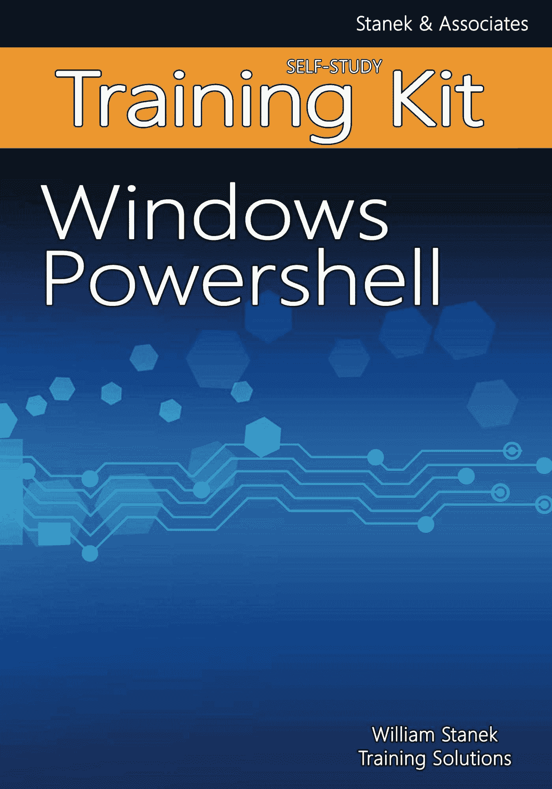
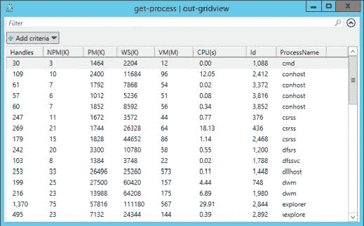
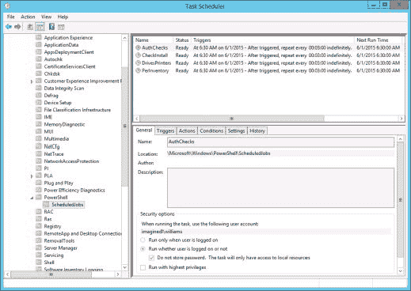
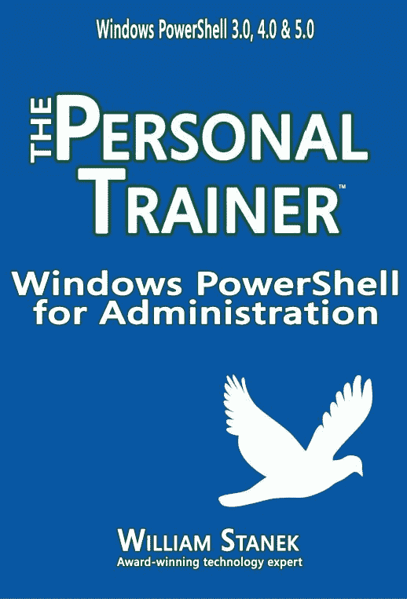

# Windows PowerShell 自学训练套件：Stanek and Associates 解决方案



版权 © 2015 William Stanek

保留所有权利。未经出版者明确书面许可，不得以任何形式或通过任何手段对本书的任何进行复制、存储或传输。

美国

“Personal Trainer” 和 “Stanek & Associates” 是 William Stanek 的商标。所有其他标记均为其各自所有者的财产。

书中使用的公司、组织、人物和其他命名元素的示例名称均为虚构。不意与任何真实的公司、组织、人物或其他命名元素有任何关联，也不应推断出任何关联。

本书表达了作者的观点和意见。书中包含的信息不提供任何明示、法定或暗示的保证。作者、出版者、转销商或分销商均不对因本书直接或间接造成或可能造成的任何损害承担责任。

封面设计：Creative Designs Ltd.

编辑开发：Andover Publishing Solutions

技术评审：L & L Technical Content Services

你可以通过电子邮件至 williamstanek@aol.com 向作者提供有关本书的反馈。请使用书名作为主题行。

- 配置 PowerShell 控制台
- 操作命令历史
- 操作 Cmdlet 和脚本
- 使用 Cmdlet
- 理解 Cmdlet 名称
- 获取关于 Cmdlet 的信息
- 使用 Cmdlet 参数
- 使用外部命令
- 使用脚本
- 理解执行策略
- 理解脚本签名
- 创建和使用自签名证书
- 指定身份验证信息
- 操作帮助文档
- 访问帮助文件
- 创建中央帮助文件夹
- 第 2 章：充分利用 Windows PowerShell
- 初始化环境
- 传递启动参数
- 调用 Windows PowerShell
- 使用 `-Command` 运行命令
- 使用 `-File` 运行脚本
- 使用嵌套控制台
- 理解命令输入、解析和输出
- 基础行编辑
- 解析工作原理
- 解析赋值的值
- 解析异常
- 解析的输出
- 写入和格式化输出
- 使用格式化 Cmdlet
- 指定输出格式
- 配合格式化器使用管道
- 指定要显示的属性
- 分组和排序
- 写入输出流
- 显式写入输出
- 使用其他输出流
- 渲染和完成输出
- 重定向输入、输出和错误
- 第 3 章：管理你的 Windows PowerShell 环境
- 使用配置文件
- 创建配置文件
- 理解执行顺序
- 操作命令路径
- 管理命令路径
- 管理文件扩展名和文件关联
- 导航 Windows PowerShell 扩展
- 操作 Windows PowerShell 扩展
- 使用 Snap-in
- Snap-in 基础
- PowerShell Core 命令
- 添加和删除 Snap-in

# 检查加载项（Snap-in）的可用性

# 使用提供程序（Providers）

## 导航提供程序驱动

## 管理提供程序

# 使用提供程序驱动

## 设置工作位置

## 使用模块

### 模块基础知识

### 使用模块

### 获取和安装模块

### 导入模块

# 第 4 章：使用会话和远程控制

## 启用远程命令

## 远程基础

## 配置远程

## 域之间以及工作组内的连接

## 创建 HTTPS 其他监听器

## 执行远程命令

## 理解远程执行

## 远程标准命令

## 调用远程命令

## 建立 PowerShell 会话

## 调用会话

## 理解远程执行和对象序列化

## 断开会话

## 重新连接会话

## 通过 PowerShell Web Access 连接

## 建立 CIM 会话

## 在没有 WinRM 的情况下远程工作

# 第 5 章：使用后台作业和计划作业

## 创建后台作业

## 使用后台作业

### 在交互会话中启动作业

## 非交互式运行作业

## 创建计划作业

## 定义作业触发器

### 在启动或登录时运行作业

### 每天或每周运行作业

### 创建运行一次或重复运行的作业

## 设置作业选项

### 理解作业选项参数

## 使用作业选项

## 注册并运行计划作业

## 修改和删除计划作业

# 第 6 章：导航 Windows PowerShell 核心结构

## 使用表达式和运算符

### 算术、分组和赋值运算符

### 比较运算符

### 其他运算符

## 使用变量和值

### 变量基础知识

### 分配和转换数据类型

### 管理作用域

### 自动变量、偏好变量和环境变量

## 使用字符串

### 单引号和双引号字符串

### 转义代码和通配符

### 多行字符串

### 字符串运算符

## 使用数组和集合

### 创建和使用一维数组

### 使用类型转换结构（Cast）

### 分配和移除值

### 在数组中使用类型

### 使用多维数组

# 第 7 章：精通别名和函数

## 创建和使用别名

## 使用内置别名

## 创建别名

## 导入和导出别名

## 创建和使用函数

## 创建函数

## 使用扩展函数

## 使用过滤函数

## 深入研究函数

## 检查函数定义

## 使用内置函数

# 第 8 章：征服 COM、WMI、CMI、.NET 和对象

## 对象基础知识

## 理解对象

## 对象方法和属性

## 对象类型

## 深入研究对象

## 使用 COM 和 .NET Framework 对象

## 创建和使用 COM 对象

## 使用 .NET Framework 类和对象

## 执行 WMI 查询

# 关于作者

# 目录

# 引言

## 本书关于什么？

## 我需要知道什么？

## 本书是如何组织的？

## 本书使用了哪些约定？

# 其他资源

# 第 1 章：使用脚本管理计算机

## 从配置文件（Profiles）中获取更多

## 创建脚本

## 脚本中的常见元素

## 使用注释和初始化语句

## 使用条件语句

### If、Else 和 If…Else…Else

### Switch

## 使用控制循环

# 第 2 章：安装角色、角色服务和功能

## 服务器管理器基础

## 服务器命令

## 检查已安装的角色、角色服务和功能

## 安装角色、角色服务和功能

## 添加角色、角色服务和功能

## 处理配置错误和其他问题

## 卸载角色、角色服务和功能

## 移除角色、角色服务和功能

## 处理移除错误和其他问题

# 第 3 章：Windows 系统清单与评估

## 获取基本系统信息

## 确定当前用户、域和计算机名称

## 确定和设置日期与时间

# 指定身份验证凭据

# 检查系统配置与工作环境

## 确定 Windows 更新和服务包

## 获取详细系统信息

## 确定可用用户和组组

## 评估系统硬件

## 检查固件版本和状态

## 检查物理内存和处理器

## 检查硬盘和分区

## 检查和管理设备驱动

## 深入探索

# 第 4 章：管理文件系统

## 操作 PowerShell 驱动器、目录和文件

### 添加和删除 PowerShell 驱动器

### 创建和管理目录及文件

### 复制目录和文件

### 移动目录和文件

### 重命名目录和文件

## 删除目录和文件

## 处理文件内容

## 管理文件内容的命令

## 读取和写入文件内容

# 第 5 章：配置安全权限和审计

## 操作安全描述符的命令

### 获取和设置安全描述符

### 操作规则

### 配置文件和目录权限

### 设置基本权限

### 设置特殊权限

### 获取所有权

### 配置文件和目录审计

# 第 6 章：管理和保护注册表

## 理解注册表项和值

### 浏览注册表

### 管理注册表项和值

### 创建注册表项和值

### 复制注册表项和值

### 移动注册表项和值

### 重命名注册表项和值

### 删除注册表项和值

### 比较注册表项

### 查看和管理注册表安全设置

### 获取和设置注册表安全描述符

### 操作访问规则

### 配置注册表权限

### 获取注册表项的所有权

### 审计注册表

# 第 7 章：管理 Windows 事件日志

## 操作事件日志

### 查看和过滤事件日志

### 设置日志选项

### 存档和清除事件日志

### 向事件日志写入自定义事件

### 创建并保存查询

# 第 8 章：管理系统服务

## 查看已配置的服务

### 启动、停止和暂停服务

### 配置服务启动

### 管理登录和恢复模式

### 配置服务登录

### 配置服务恢复

### 深入服务管理

# 第 9 章：管理计算机账户

## 管理计算机的命令

### 重命名计算机账户

### 将计算机加入域

### 将计算机加入工作组

### 将计算机从域和工作组移除

### 管理计算机的重启和关机

# 第 10 章：创建和使用系统检查点

## 配置系统还原的命令

### 启用和禁用系统还原

### 创建和使用检查点

### 从还原点恢复

# 第 11 章：精细调整系统性能

## 理解系统和用户进程

### 检查运行进程

### 过滤进程输出

当 PowerShell 读取此命令时，它会提示你输入用户名和密码，然后将提供的凭据存储在 `$cred` 变量中。需要指出，显示凭据提示仅仅是因为你输入了 `Get-Credential`。

你也可以指定要在特定域中使用特定用户的凭据。在以下示例中，你请求 `DevD` 域中 `TestUser` 账户的凭据：

```powershell
$cred = get-credential –credential devd\testuser
```

`Credential` 对象具有你可以操作的 `UserName` 和 `Password` 属性。虽然用户名是以普通字符串存储的，但密码是以安全的加密字符串存储的。了解这一点后，你可以如下所示引用存储在 `$cred` 中的用户名和密码：

```powershell
$user = $cred.username
$password = $cred.password
```

## 使用帮助文档

在本章较早的“使用 cmdlet”部分，我引入了 `Get-Help`。在 Windows PowerShell 3.0 及更高版本中，标准安装中不包含帮助文件，Windows PowerShell 默认显示自动生成的帮助信息。如果你想使用完整的帮助文档，必须在线访问帮助文件或将更新的帮助文件下载到计算机。

## 访问帮助文件

在本地工作而非远程会话时，你可以在每次使用 `Get-Help` 时添加 `–Online` 参数，在 TechNet Library 中在线查看 cmdlet 的帮助文件，例如：

```powershell
get-help new-variable –online
```

如果计算机没有连接互联网，或者你正在远程会话中工作，你将无法获取在线帮助，而是需要依赖已安装在计算机上的帮助文件。要下载并安装帮助文件，请在提升的 PowerShell 提示符中输入以下命令：

```powershell
update-help
```

当你运行 `Update-Help` 而不指定参数时，Windows PowerShell 会尝试连接互联网并从网站下载帮助文件。当计算机连接互联网且连接未被防火墙规则或 Internet 设置拦截时，这些操作才能成功。

建议从管理员提示符运行 `Update-Help` 作为最佳实践，但并非强制要求。默认情况下，`Update-Help` 会下载并安装计算机可用模块以及远程会话模块的帮助文件。如果之前已安装帮助文件，`Update-Help` 只更新自安装以来修改过的帮助文件。然而，如果你以标准权限运行 `Update-Help`，它将不会下载或安装 PowerShell 安装目录中的模块。因此，为了确保安装并更新所有可用模块，必须以管理员身份运行 Windows PowerShell。

## 创建中央帮助文件夹

与其在多个计算机上下载和安装帮助文件，或者在计算机连接互联网的情况下，你可能希望为组织指定一个中央帮助位置，然后根据需要从该位置安装帮助文件。从中央位置安装和使用帮助文件有两个步骤：

1. 你使用 `Save-Help` 下载帮助文件并保存到指定的文件夹或网络共享中。
2. 你使用 `Update-Help` 从中央位置安装帮助文件。

在使用 `Save-Help` 时，你使用 `–DestinationPath` 参数指定目标路径，例如：

```powershell
Save-Help –DestinationPath C:\HelpFiles
```

或：

```powershell
Save-Help –DestinationPath \\Server54\PS_Help
```

只要目标路径存在且你拥有该位置的写入权限，你就能保存帮助文件。在这些情况下，`Save-Help` 在 PowerShell 4.0 及更高版本中的工作方式如下：

1. 你当前登录的计算机上的 PowerShell 模块以及当前远程会话中的模块决定了将使用哪些帮助文件。当你运行 `Save-Help` 时，`Save-Help` 会识别当前计算机和当前会话中安装的所有 PowerShell 模块。
2. 接下来，如果目标文件夹之前曾保存过帮助文件，`Save-Help` 会检查目标文件夹中帮助文件的版本。如果适用于相应的 PowerShell 模块有新的帮助文件，`Save-Help` 将下载新的帮助文件并将其保存到目标文件夹中。

### 世界

当你在远程会话中工作时，`Save-Help` 在 PowerShell 3.0 和 PowerShell 4.0 中的工作方式存在重要差异。在 PowerShell 3.0 中，用于通过 URL 识别在线帮助文件位置的 `HelpInfoUri` 属性在远程操作时不会被保留。因此，`Save-Help` 仅适用于安装在本地计算机上的模块，而不适用于远程会话中的模块。相反，在 PowerShell 4.0 中，`HelpInfoUri` 属性在远程操作时会被保留。因此，`Save-Help` 能够返回安装在远程计算机上的模块的帮助文件位置，从而允许你保存安装在远程计算机上的模块的帮助文件。

通常，你需要传递凭据来更新帮助文件。使用 `-Credential` 参数执行此操作。在以下示例中，你指定使用 `ImaginedL` 域中的 `WilliamS` 账户执行更新任务：

```powershell
Save-Help -DestinationPath \\Server54\PS_Help -Credential ImaginedL\Williams
```

运行该命令时，系统会提示输入 `WilliamS` 账户的密码。然后使用该账户的凭据写入目标路径。

一旦将帮助文件保存到中央位置，就可以将帮助文件写入组织中的任何计算机，从而使帮助文件在本地可用。要实现这一点，运行 `Update-Help` 并使用 `-SourcePath` 参数指定帮助文件的源位置，例如：

```powershell
Update-Help -SourcePath \\Server54\PS_Help -Credential ImaginedL\Williams
```

帮助文件是特定语言的。`Update-Help` 和 `Save-Help` 为管理计算机上配置的所有语言和区域创建特定语言的文件。因此，如果你的管理计算机的“区域和语言”（Region And Language）设置将当前区域指定为 `US English`（美国英语），则帮助命令默认将创建并使用美国英语帮助文件。

当你在一个使用不同语言、区域或两者都部署计算机的企业环境中工作时，需要注意的是，当保存帮助文件的语言或文化设置与你管理计算机的语言和文化设置不同时，可能会出现问题。例如，如果保存帮助文件时将当前区域设置为 `US English`，但你正在使用的计算机当前区域设置为 `UK English`（英国英语），则你将无法从源位置检索该区域的帮助文件。一种简单的变通方法是使用配置了相应语言和文化的计算机将帮助文件保存到中央共享中。

# 第 2 章：充分利用 Windows PowerShell

Windows PowerShell 提供了一个用于处理命令和脚本的高效环境。正如第 1 章“Windows PowerShell 基础”中所讨论的，你可以在命令行中运行许多类型的命令，包括内置 cmdlet（命令命令）、Windows 实用程序和带有命令行扩展的应用程序。无论来源如何，你将使用的每个命令都遵循相同的语法规则。这些规则规定，命令由命令名称后跟任何必需或可选参数组成。参数（包括参数、参数值和其他命令文本）还可以使用管道来组合命令，并使用重定向来指定输入、输出和错误的源。

当你在 PowerShell 中执行命令时，你会启动一系列类似于下面的事件：

1. 在单行中链式或分组的多个命令会被拆分为单独的执行单元。执行单元内的值会被拆分为一系列称为标记（tokens）的段。
2. 对每个标记都会进行解析，将命令与值分离，并将值评估为某种对象类型，例如 `String`（字符串）或 `Boolean`（布尔值）。命令文本中的变量会在解析过程中根据情况替换为它们的实际值。
3. 然后处理各个命令。如果命令名称包含文件路径，PowerShell 将使用该路径查找命令。如果在指定位置找不到命令，PowerShell 将返回错误。
4. 如果命令名称没有指定文件路径，PowerShell 将尝试在内部解析命令名称。匹配成功意味着你引用了可以立即执行的内置命令（包括命令或函数的别名）。如果没有找到匹配项，PowerShell 将在命令路径中搜索匹配的命令可执行文件。如果在这些位置中都找不到该命令，PowerShell 将返回错误。因为 PowerShell 默认不查找当前目录，你必须显式指定当前目录。
5. 如果找到了命令，则使用任何指定的参数执行命令，包括指定要使用的输入。命令输出和任何错误都将写入指定的目的地。


如你所见，许多因素都会影响命令的执行，包括命令路径设置、重定向技术以及命令是否链式或分组。在本章中，我将描述并展示这种命令执行拆解的示例，帮助你充分利用 PowerShell。不过，在深入这些讨论之前，让我们查看启动 PowerShell 的特殊考虑，并检查配置文件（profiles）和控制台文件（console files）的概念。

## 初始化环境

Windows PowerShell 提供了一个动态的可扩展的执行环境。你可以通过多种方式初始化 PowerShell 环境，包括向 `Powershell.exe` 传递启动参数、使用自定义配置文件、使用控制台文件或这三者的任何组合。你还可以通过多种方式扩展 PowerShell 环境，包括安装提供程序（providers）和注册加载项（snap-ins），正如第 3 章“管理你的 Windows PowerShell 环境”所述的。

### 传递启动参数

当你使用标准用户权限而非管理员权限启动 PowerShell 时，你将无法执行许多管理任务。要以管理员权限启动 PowerShell，你必须按照第 1 章所述以提升的管理员模式运行 PowerShell 控制台。

当你从起始屏幕或开始菜单运行 PowerShell 时，无法传递参数。但是，当你使用搜索框、运行对话框或在打开的命令行窗口中输入 `powershell` PowerShell 时，可以向 PowerShell 传递参数，包括控制 PowerShell 工作方式的开关和执行附加命令的参数。例如，可以使用启动命令 `powershell -nologo` 以无标志模式启动 PowerShell（关闭标志幅）。默认情况下，当你通过命令行启动 PowerShell 并运行命令时，PowerShell 会初始化、运行命令然后退出。如果你希望 PowerShell 执行命令后不终止，请输入 `powershell /noexit` 后跟命令。

## 2-1 PowerShell 语法

```powershell
powershell[.exe] [-PSConsoleFile FileName | -Version VersionNum]
  [-NoLogo] [-NoExit] [-NoProfile] [-NonInteractive] [-Sta]
  [-InputFormat {Text | XML}] [-OutputFormat {Text | XML}]
[-WindowsStyle Style] [-EncodedCommand Base64EncodedCommand]
[-File ScriptFilePath] [-ExecutionPolicy PolicySetting]
[-Command CommandText]
```

### 表 2-1 PowerShell 启动参数

| 参数 | 说明 |
| --- | --- |
| `–Command` | 指定要执行的命令文本，就像在 PowerShell 提示符中输入一样。 |
| `–EncodedCommand` | 指定要执行的 base64 编码命令文本。 |
| `–ExecutionPolicy` | 设置控制会话的默认执行策略。 |
| `–File` | 设置要执行的脚本文件的名称。 |
| `–InputFormat` | 设置发送到 PowerShell 的数据格式，可以是文本字符串或序列化 XML。默认格式为 XML。有效值为 `text` 和 `XML`。 |
| `-Mta` | 以多线程模式启动 PowerShell。 |
| `–NoExit` | 在运行启动命令后不退出。当通过命令行提示符（`cmd.exe`）运行 PowerShell 命令或脚本时，此参数非常有用。 |
| `–NoLogo` | 启动 PowerShell 控制台但不显示版权横幅。 |
| `–Noninteractive` | 以非交互模式启动 PowerShell 控制台。在此模式下，PowerShell 不会向用户提供交互式提示符。 |
| `–NoProfile` | 告诉 PowerShell 控制台不要加载当前用户的配置文件（Profile）。 |
| `–OutputFormat` | 设置输出格式，可以是文本字符串或序列化 XML。默认格式为文本。有效值为 `text` 和 `XML`。 |
| `–PSConsoleFile` | 加载指定的 Windows PowerShell 控制台文件。控制台文件以 `.psc1` 结尾，可用于确保特定的程序集（snap-in）扩展已加载并可用。你可以使用 Windows PowerShell 中的 `Export-Console` 创建控制台文件。 |
| `–Sta` | 以单线程模式启动 PowerShell。这是默认设置。 |
| `–Version` | 设置用于兼容性的 Windows PowerShell 版本，例如 `1.0`。 |
| `–WindowStyle` | 设置窗口样式为普通（Normal）、最小化（Minimized）、最大化（Maximized）或隐藏（Hidden）。默认值为 Normal。 |

**提示**：如果你希望 PowerShell 始终带有特定参数启动，可以修改启动 PowerShell 的快捷方式。例如，如果任务栏上有一个 Windows PowerShell 的快捷方式，你可以右键点击此快捷方式并选择“属性”，显示快捷方式的属性对话框。在“快捷方式”选项卡上，你可以通过在现有值后添加所需的参数和任何相关参数值来编辑“目标”属性，然后点击“确定”保存更改。例如，在 `powershell.exe` 的完整路径之后，你可以添加 `–NoLogo` 以便始终启动 PowerShell 时不显示标准横幅。

## 调用 Windows PowerShell

尽管你大多数时候是在使用 PowerShell 控制台或 PowerShell 应用程序，但有时你可能希望从 Windows 命令行（`cmd.exe`）环境或批处理脚本调用 PowerShell 来运行 cmdlet。要这样做，你需要使用 `–Command` 参数。通常情况下，你还希望通过 `–NoLogo` 参数隐藏 Windows PowerShell 标志，并使用 `–NoProfile` 参数停止配置文件的执行。例如，在命令行提示符或批处理脚本中，你可以通过以下命令通过 PowerShell 获取运行进程的列表：

```powershell
powershell –nologo –noprofile –command get-process
```

当你输入此命令时，Windows 命令行提示符会像运行其他外部程序一样运行 PowerShell，传递你使用的参数和参数值，并在执行完成后退出 PowerShell。如果你希望命令行运行 PowerShell 命令并在执行后留在 PowerShell 中，可以像下面的示例所示添加 `–NoExit` 参数：

```powershell
powershell –noexit –command get-process
```

## 使用 `–Command` 运行命令

由于 `–Command` 是你从命令行提示符或批处理脚本调用 PowerShell 时最常用的参数，让我们仔细查看它的所有使用方法。如果你输入 `–""` 作为命令，则命令文本将从标准输入读取。你还可以使用管道（piping）和重定向技术来处理命令的输出。然而，请记住，在命令之后输入的任何字符都将被解释为命令参数。因此，为了编写一个包含管道或重定向的命令，必须用双引号将命令文本括起来。以下示例获取当前运行进程的信息并按进程 ID 进行排序：

```powershell
powershell –nologo –noprofile –command "get-process | sort-object Id"
```

### 现实世界

大多数命令生成的输出可以重定向到另一个命令作为输入。要实现这一点，你需要使用称为“管道”的技术，其中一个命令的输出作为下一个命令的输入。随后，你可以看到管道的一般语法如下：

```
Command1 | Command2
```

其中管道 `|` 将 `Command1` 的输出重定向到 `Command2` 的输入。但你也可以通过这种语法多次重定向输出：

```
Command1 | Command2 | Command3
```

通常，如果一个 cmdlet 接受来自另一个 cmdlet 的输入，该 cmdlet 将具有一个 `–InputObject` 参数，你可以将输出管道到该 cmdlet。

Windows PowerShell 还支持脚本块（script blocks）。脚本块是一系列顺序执行的命令。脚本块用大括号 `{}` 括起来。虽然你可以直接在 PowerShell 提示符中使用大括号脚本块，但在运行 `Powershell.exe` 时，结果将以序列化 XML 而不是对象返回。例如，如果你已经在 PowerShell 提示符中并想运行一系列命令，你可以用大括号括起命令并用分号分隔，如下例所示：

```powershell
powershell –command {get-service; get-process}
```

虽然这种技术在已经在 PowerShell 提示符中时有效，但当你想从命令行提示符运行 PowerShell 时，它不起作用。解决方法是使用以下格式：

```
"& {CommandText}"
```

在这里，双引号表示字符串，而 `&` 是一个调用运算符，会导致命令被执行。当你写了一个运行命令的字符串后，你通常可以在命令行提示符或 PowerShell 提示符处运行它。例如，尽管你不能在命令行提示符输入 `powershell -command {get-service; get-process}`，但你可以在命令行提示符输入：

```powershell
powershell –command "& {get-service; get-process}"
```

在这里你将代码块作为字符串传递给 PowerShell 进行解析和执行。PowerShell 执行 `Get-Service` 并显示结果，然后执行 `Get-Process` 并显示结果。如果你希望有一种适用于字符串、多命令、命令行提示符或 PowerShell 提示符的通用语法，你应该使用这种语法。

## 使用 `–File` 运行脚本

当你使用 Windows 命令行并想要运行 PowerShell 脚本时，你也可以使用管道和重定向技术来处理命令的输出。然而，你不再使用 `–Command` 参数，而是使用 `–File` 参数来指定要运行的脚本。如下例所示，`–File` 参数后紧跟要运行脚本的路径：

```powershell
powershell –nologo –noprofile –file c:\scripts\run_all.ps1
```

如果脚本在当前目录下，只需输入脚本名称：

```powershell
powershell –nologo –noprofile –file run_all.ps1
```

如果路径名称包含空格，你必须用双引号将路径括起来，如下所示：

```powershell
powershell –nologo –noprofile –file "c:\data\current scripts\run_all.ps1"
```

## 真实世界

你可以根据是从任务栏快捷方式还是命令提示符启动 PowerShell 来指定参数。当从任务栏启动 PowerShell 时，可以通过编辑快捷方式来指定你每次在操作 PowerShell 时都希望使用的参数。请按照以下步骤操作：

1. 在任务栏上，右键点击该快捷方式，然后选择 `Properties`（属性）。
2. 在 `Properties` 对话框中，默认选中 `Shortcut`（快捷方式）选项卡上的 `Target`（目标）项。
3. 在不按其他键的情况下，按 `Right arrow`（右方向键）。这将插入光标置于 PowerShell 完整路径的末尾。输入一个空格，然后输入你的参数和参数值。
4. 点击 `OK` 保存设置。如果你操作错误或不再希望使用参数，请重复此过程并删除你添加的任何参数和值。

## 使用嵌套控制台

有时，你可能希望为 PowerShell 控制台使用不同的环境设置或参数，然后在不退出控制窗口的情况下返回原始设置。要实现这一点，你可以使用名为“嵌套”的技术。通过嵌套，你可以在另一个 PowerShell 控制台内部启动一个 PowerShell 控制台。

与命令行 shell 不同，嵌套控制台会在新的工作环境中打开，并且不会从当前控制台继承其环境设置。你可以在这个独立的控制台环境中工作，并执行命令和脚本。当你输入 `exit` 关闭嵌套控制台实例时，你将返回到上一个控制台，之前的环境设置将得到恢复。

## 理解命令输入、解析和输出

正如你在本章和第 1 章的示例所示，在 PowerShell 提示符处输入命令是一个相当直接的过程。最基本的方法就是直接输入命令文本并按回车键。当你按回车键时，PowerShell 会处理并解析命令文本。

### 基础行编辑

PowerShell 控制台包含针对当前行的的一些基本编辑功能。表 2-2 列出了编辑键。或者，输入 `get-history` 来列出命令历史中的所有命令，或输入 `clear-history` 清空命令历史。`Get-History` 按命令编号列出命令，你可以将其传递给 `Invoke-History` 以运行命令历史中的特定编号命令。在例例中，你运行命令 35：

```
invoke-history 35
```

### 表 2-2 基础编辑键

| 键 | 用途 |
| --- | --- |
| ` ` | 按反引号键插入换行符，或作为转义字符以产生字面字符。你也可以在管道（`&#124;`）字符处断行。 |
| `Alt+Space+E` | 显示包含标记、复制、粘贴、全选、滚动和查找选项的编辑快捷键菜单。然后你可以按 `K` 标记、按 `Y` 复制、按 `P` 粘贴、按 `S` 全选、按 `L` 滚动屏幕缓冲区，或按 `F` 在屏幕缓冲区中搜索文本。要将屏幕缓冲区复制到剪贴板，按 `Alt+Space+E+S` 然后按 `Alt+Space+E+Y`。 |
| `Alt+F7` | 清空命令历史。 |
| `Ctrl+C` | 按 `Ctrl+C` 退出子提示符或终止执行。 |
| `Ctrl+End` | 按 `Ctrl+End` 删除光标所在行之后的所有字符。 |
| `Ctrl+Left arrow / Ctrl+Right arrow` | 按 `Ctrl+Left arrow` 或 `Ctrl+Right arrow` 一次向左或向右移动一个单词。 |
| `Ctrl+S` | 按 `Ctrl+S` 暂停或恢复输出显示。 |
| `Delete / Backspace` | 按 `Delete` 删除光标下的字符，或按 `Backspace` 键删除光标左侧的字符。 |
| `Esc` | 按 `Esc` 键清空当前行。 |
| `F1` | 将光标向命令行向右移动一个字符。在行尾，从你上一条命令的文本中插入一个字符。 |
| `F2` | 通过复制你上一条命令行直到你输入的字符为止，创建一个新的命令行。 |
| `F3` | 使用你上一条命令行的内容补全命令行，从当前光标位置到行尾。 |
| `F4` | 从你当前的命令行中删除字符，从当前光标位置直到你输入的字符为止。 |
| `F5` | 向后扫描你的命令历史。 |
| `F7` | 显示一个带有你命令历史的弹出窗口，并允许你选择命令。使用方向键滚动列表。按 `Enter` 选择要运行的命令，或按 `Right arrow` 键将文本放置在命令行上。 |
| `F8` | 使用你输入的文本向后扫描你的命令历史，查找与你目前在命令行上输入的文本匹配的命令。 |
| `F9` | 运行命令历史中的特定编号命令。当你按 `F7` 时会列出命令编号。 |
| `Home / End` | 按 `Home` 或 `End` 移动到行的开头或结尾。 |
| `Insert` | 按 `Insert` 在插入模式和覆盖模式之间切换。 |
| `Left / Right arrow keys` | 按 `Left` 或 `Right arrow` 键在当前行上向左或向右移动光标。 |
| `Page Up / Page Down` | 按 `Page Up` 或 `Page Down` 键访问命令历史中的第一个或最后一个命令。 |
| `Right-click` | 如果禁用 `QuickEdit`，则显示包含标记、复制、粘贴、全选、滚动和查找选项的编辑快捷键菜单。要将屏幕缓冲区复制到剪贴板，右键点击、选择并按 `Enter`。 |
| `Tab / Shift+Tab` | 按 `Tab` 或 `Shift+Tab` 访问制表扩展，详见“创建和使用函数”。 |
| `Up / Down arrow keys` | 按 `Up` 或 `Down arrow` 键向前或向后扫描命令历史，详见“处理命令历史”。 |
| `Windows key+R` 然后 `powershell` | 运行 PowerShell。如果你安装了多个版本的 PowerShell 或正在使用 64 位计算机，将运行第一个遇到的版本。 |

### 真实世界

你可以根据是从任务栏快捷方式还是命令提示符启动 PowerShell 来指定参数。当从任务栏启动 PowerShell 时，可以通过编辑快捷方式来指定你每次在操作 PowerShell 时都希望使用的参数。请按照以下步骤操作：

1. 在任务栏上，右键点击该快捷方式，然后选择 `Properties`（属性）。
2. 在 `Properties` 对话框中，默认选中 `Shortcut`（快捷方式）选项卡上的 `Target`（目标）项。
3. 在不按其他键的情况下，按 `Right arrow`（右方向键）。这将插入光标置于 PowerShell 完整路径的末尾。输入一个空格，然后输入你的参数和参数值。
4. 点击 `OK` 保存设置。如果你操作错误或不再希望使用参数，请重复此过程并删除你添加的任何参数和值。

## 使用嵌套控制台


有时，你可能希望为`PowerShell`控制台使用不同的环境设置或参数，然后在不退出控制窗口的情况下返回原始设置。要实现这一点，你可以使用名为“嵌套”的技术。通过嵌套，你可以在另一个`PowerShell`控制台内部启动一个`PowerShell`控制台。

与命令行 shell 不同，嵌套控制台会在新的工作环境中打开，并且不会从当前控制台继承其环境设置。你可以在这个独立的控制台环境中工作，并执行命令和脚本。当你输入`exit`关闭嵌套控制台实例时，你将返回到上一个控制台，之前的环境设置将得到恢复。

# 理解命令输入、解析和输出

正如你在本章和第 1 章的示例所示，在`PowerShell`提示符处输入命令是一个相当直接的过程。最基本的方法就是直接输入命令文本并按回车键。当你按回车键时，`PowerShell`会处理并解析命令文本。

## 基础行编辑

`PowerShell`控制台包含针对当前行的一些基本编辑功能。表 2-2 列出了编辑键。或者，输入`get-history`来列出命令历史中的所有命令，或输入`clear-history`清空命令历史。`Get-History`按命令编号列出命令，你可以将其传递给`Invoke-History`以运行命令历史中的特定编号命令。在例例中，你运行命令 35：

```powershell
invoke-history 35
```

### 表 2-2 基础编辑键

| 键 | 用途 |
| --- | --- |
| `` ` `` | 按反引号键插入换行符，或作为转义字符以产生字面字符。你也可以在管道（`|`）字符处断行。 |
| `Alt+Space+E` | 显示包含标记、复制、粘贴、全选、滚动和查找选项的编辑快捷键菜单。然后你可以按`K`标记、按`Y`复制、按`P`粘贴、按`S`全选、按`L`滚动屏幕缓冲区，或按`F`在屏幕缓冲区中搜索文本。要将屏幕缓冲区复制到剪贴板，按`Alt+Space+E+S`然后按`Alt+Space+E+Y`。 |
| `Alt+F7` | 清空命令历史。 |
| `Ctrl+C` | 按`Ctrl+C`退出子提示符或终止执行。 |
| `Ctrl+End` | 按`Ctrl+End`删除光标所在行之后的所有字符。 |
| `Ctrl+Left arrow / Ctrl+Right arrow` | 按`Ctrl+Left arrow`或`Ctrl+Right arrow`一次向左或向右移动一个单词。 |
| `Ctrl+S` | 按`Ctrl+S`暂停或恢复输出显示。 |
| `Delete / Backspace` | 按`Delete`删除光标下的字符，或按`Backspace`键删除光标左侧的字符。 |
| `Esc` | 按`Esc`键清空当前行。 |
| `F1` | 将光标向命令行向右移动一个字符。在行尾，从你上一条命令的文本中插入一个字符。 |
| `F2` | 通过复制你上一条命令行直到你输入的字符为止，创建一个新的命令行。 |
| `F3` | 使用你上一条命令行的内容补全命令行，从当前光标位置到行尾。 |
| `F4` | 从你当前的命令行中删除字符，从当前光标位置直到你输入的字符为止。 |
| `F5` | 向后扫描你的命令历史。 |
| `F7` | 显示一个带有你命令历史的弹出窗口，并允许你选择命令。使用方向键滚动列表。按`Enter`选择要运行的命令，或按`Right arrow`键将文本放置在命令行上。 |
| `F8` | 使用你输入的文本向后扫描你的命令历史，查找与你目前在命令行上输入的文本匹配的命令。 |
| `F9` | 运行命令历史中的特定编号命令。当你按`F7`时会列出命令编号。 |
| `Home / End` | 按`Home`或`End`移动到行的开头或结尾。 |
| `Insert` | 按`Insert`在插入模式和覆盖模式之间切换。 |
| `Left / Right arrow keys` | 按`Left`或`Right arrow`键在当前行上向左或向右移动光标。 |
| `Page Up / Page Down` | 按`Page Up`或`Page Down`键访问命令历史中的第一个或最后一个命令。 |
| `Right-click` | 如果禁用`QuickEdit`，则显示包含标记、复制、粘贴、全选、滚动和查找选项的编辑快捷键菜单。要将屏幕缓冲区复制到剪贴板，右键点击、选择并按`Enter`。 |
| `Tab / Shift+Tab` | 按`Tab`或`Shift+Tab`访问制表扩展，详见“创建和使用函数”。 |
| `Up / Down arrow keys` | 按`Up`或`Down arrow`键向前或向后扫描命令历史，详见“处理命令历史”。 |
| `Windows key+R`然后`powershell` | 运行`PowerShell`。如果你安装了多个版本的`PowerShell`或正在使用 64 位计算机，将运行第一个遇到的版本。 |

真实世界复制和粘贴的方式在`PowerShell`控制台中取决于`QuickEdit`模式的启用或禁用。当`QuickEdit`启用时，通过拖动鼠标并按`Enter`复制，然后通过点击鼠标粘贴。当你拖动鼠标选择要复制的文本时，要小心暂停；否则`PowerShell`将从剪贴板粘贴。当`QuickEdit`禁用时，通过右键点击、选择标记、拖动鼠标选择文本并按`Enter`复制。

## 解析如何工作

除了之前在“传递启动参数”中讨论的处理模式外，`PowerShell`还有解析模式。不要混淆处理模式与解析模式。处理模式控制`PowerShell`如何处理命令。解析模式控制`PowerShell`如何解析命令行中的每个值。

`PowerShell`将命令行拆分为执行单元和令牌。执行单元包括从行开始的第一个字符到分号或行尾的所有内容。令牌是执行单元中的值。了解了这些，你可以：

- 使用分号在单行内输入多个命令。
- 按回车键标记执行单元的结束。

`PowerShell`解析值的方式由解析执行单元时遇到的第一个令牌决定。

- **表达式模式（Expression mode）**：当执行单元中遇到的第一个标记不是`cmdlet`、关键字、别名、函数或外部实用程序的名称时，`PowerShell`会使用表达式模式。`PowerShell`将表达式求值为数值值或字符串。字符字符串型值必须包含在引号中，而不带引号的数字被视为数值值（而不是一串串字符）。
- **命令模式（Command mode）**：当执行单元中遇到的第一个标记是`cmdlet`、关键字、别名、函数或外部实用程序的名称时，`PowerShell`会使用命令模式。`PowerShell`会调用命令标记。命令标记后的值被处理为可扩展字符串，除非它们以表示变量、数组、字符串或子表达式开始的特殊字符开头。这些特殊字符包括`$`、`@`、`‘`、`“`和`(`，当遇到这些字符时，该值将使用表达式模式进行处理。记住这些规则，你可以发现以下情况成立：
  - 如果你在`PowerShell`提示符处输入`5+5`，`PowerShell`将`5+5`解释为一个待求值的表达式，并显示结果为`10`。
  - 如果你在`PowerShell`提示符处输入`Write-Host 5+5`，`PowerShell`将`5+5`解释为`Write-Host`的参数并显示`5+5`。
  - 如果你在`PowerShell`提示符处输入`Write-Host (5+5)`，`PowerShell`将`(5+5)`解释为一个待求值的表达式，然后将其传递给`Write-Host`。结果是`PowerShell`显示`10`。

## 解析赋值值

在`PowerShell`中，变量定义以美元符号（`$`）开始，随后是你正在定义的变量名称。要给变量赋值，你使用等号（`=`）然后指定你想要的值。创建变量后，你可以通过变量名来引用或显示变量的值。

此后，如果你在`PowerShell`提示符处输入`$a = 5+5`，`PowerShell`将`5+5`解释为一个待求值的表达式，并将结果赋值给变量`a`。结果是，当你通过以下方式将`$a`的值写入到`PowerShell`提示符时：

```powershell
$a
```

或者输入：

```powershell
Write-Host $a
```

输出为：

```text
10
```

另一方面，假定你定义了一个名为`$a`的变量并给它赋值一个字符串值，例如：

```powershell
$a = "This is a string."
```

在这里，赋值给`$a`的值被视为字面量字符串，该字符串在表达式模式下处理。你之所以知道这一点是因为当你通过以下方式将`$a`的值写入到`PowerShell`提示符时：

```powershell
$a
```

或者输入：

```powershell
Write-Host $a
```

输出为：

```text
This is a string.
```

然而，有时你可能想强制`PowerShell`使用命令模式解释字符串面量表达式。为了了解原因，请考虑以下示例：

```powershell
$a = "Get-Process"
```

如果你通过以下方式将`$a`的值写入到`PowerShell`提示符时：

```powershell
$a
```

输出为：

```text
Get-Process
```

这是因为赋值给`$a`的值被视为字面量字符串，该字符串在表达式模式下处理。然而，你可能希望`PowerShell`实际运行`Get-Process` `cmdlet`。要实现此，你需要`PowerShell`解析字符串并确定它包含一个应该在命令模式下处理的标记。你可以在引用变量`$a`时使用`&`运算符来实现这一点，例所示：

```powershell
&$a
```

由于`PowerShell`在命令模式下处理字符串，`Get-Process`被视为命令标记，调用了`Get-Process` `cmdlet`，输出了当前运行的进程。这种技术可以用于任何赋值给字符串变量的`cmdlet`、关键字、别名、函数或外部实用程序名称。然而，如果你想在命令名称之外添加值（例如参数），或使用多个命令或管道，你必须用大括号而不是引号括你的命令或多个命令。这表示一个脚本块（script block）。示例所示：

```powershell
$a = {get-eventlog -newest 25 -logname application}
```

赋值给`$a`的值被视为特殊字符串，该字符串在表达式模式下处理。你之所以知道这一点是因为当你将`$a`的值写入到`PowerShell`提示符时，输出为：

```text
get-eventlog -newest 25 -logname system
```

你可以使用以下命令强制`PowerShell`解析脚本块的内容：

```powershell
&$a
```

`PowerShell`然后将解析脚本块中的每个标记。结果将与输入命令文本时相同。

## 解析异常

当你在命令行上输入表达式的一部分但未完成该表达式时，`PowerShell`会显示`>>`子提示符，表示它正在等待你完成该表达式。例如，如果你输入`Write-Host (`并按回车，`PowerShell`会显示`>>`子提示符并等待你完成表达式。此时你必须通过输入任何其他所需的文本（例如`5+5)`）来完成命令行，然后按回车。随后，你必须再次按回车（不输入任何额外文本）以退出子提示符并返回。`PowerShell`然后会将此输入解释为一个完成的执行单元。

如果你想有意地将命令文本跨越多行输入，可以使用反引号字符（`` ` ``）。当你复制长命令行并将其粘贴到`PowerShell`控制台中以便运行它们时，这种技术非常方便。工作原理如下：

1. 输入命令文本的一部分，然后输入`` ` ``。当你按回车时，`PowerShell`会显示`>>`子提示符。
2. 输入命令文本的下一部分。然后输入`` ` ``表示你想在下一行继续命令文本，或按回车标记命令文本的结束。
3. 当你最终在不使用反引号的情况下按回车标记行结束（且你已关闭所有表达式）时，`PowerShell`将解析该文本。

示例和部分输出：

```powershell
get-eventlog -newest 25 `
-logname system

Index  EntryType  Source             InstanceID Message
-----  ----  ----------  ---------  ---------  -----------
258248 Information  Service Control    10734860 240  Event ID ‘10734860’...
258247 Information  Service Control    10734860 227  Event ID ‘10734860’...
```

如果你的命令文本使用了管道（`|`）字符，你也可以在管道处断行并在下一行继续，如下例所示：

```powershell
get-process |
sort-object Id

Handles  NPM(K)  PM(K)  WS(K) VM(M)  CPU(s) Id ProcessName
-------  ------  -----  ----- -----      ------ -----------
0        0       0      24      0      0    0 Idle
710      0       0      12904    20     4    4 System
28       1       360    816      4     5    516 smss
666      6       1872   5212     94     9    592 csrss
```

## 解析输出

在解析命令和值之后，`PowerShell`返回输出。与命令提示符（`Cmd.exe`）不同，你在`PowerShell`中运行的内置命令返回输出对象。对象是表示项目的数据点。对象具有特定的数据类型，例如`String`、`Boolean`或`Numeric`，并具有方法和属性。对象方法允许你对对象所代表的项目执行操作。对象属性存储有关对象所代表的项目的信息。当你使用`PowerShell`时，你可以使用对象的属性和属性来采取特定操作并处理数据。

当你在管道（pipeline）中组合命令时，这些命令以对象的形式相互传递信息。当第一个命令运行时，它会将一个或多个对象沿管道传递给第二个命令。第二个命令从第一个命令处接收对象，处理这些对象，然后显示输出，或将新的或修改后的对象传递给管道中的下一个命令。此过程一直持续，直到管道中的所有命令运行完毕，并显示最后一个命令的输出。因为你无法读取对象，`PowerShell`会将对象转换为文本以便在屏幕上输出。你可以通过许多方式对此输出进行处理。

# 输出的写入与格式

尽管`PowerShell`读取和写入对象，但与对象相关的各种值在`cmdlet`（`cmdlet`）执行过程的最后阶段会被转换为文本。当输出被写入控制台时，该输出被称为写入了标准输出流。`PowerShell`也支持其他输出流。不过，在描述这些输出流之前，我将先解释输出默认是如何进行格式化的。

## 使用格式化 cmdlet

当你与外部工具和程序一起工作时，由这些工具和程序决定输出的格式化方式。对于`PowerShell`的`cmdlet`，`PowerShell`会调用指定的格式化`cmdlet`来为你格式化输出。格式化程序决定显示输出的哪些属性，以及它们是以列表还是表格的形式显示。格式化程序根据正在显示的数据类型做出此判断。字符串和对象的处理方式是不同的。

**注意**：格式化`cmdlet`负责安排要显示的数据，但并不会实际显示它们。接下来讨论的输出`cmdlet`负责显示输出。

### 指定输出格式

你可以使用以下格式化`cmdlet`之一来显式指定输出格式：

- `Format-List`：将输出格式化为属性列表。默认情况下，对象的所有属性都会被格式化，每个属性单独占一行。使用`-Properties`按名称指定要显示的属性。以逗号分隔的列表形式输入属性名称。根据需要使用通配符（如`*`）匹配任何值。

```powershell
Format-List [[-Property] PropertyName] [-DisplayError] [-Expand String] [-Force] [-GroupBy Object] [-InputObject Object] [-ShowError] [-View String]
```

- `Format-Table`：将输出格式化为表格，每列显示对象的选定属性。对象类型决定了默认布局和显示的属性。使用`-AutoSize`根据数据宽度自动调整列宽和列数。使用`-HideTableHeaders`忽略列标题。使用`-Wrap`将超出列宽的文本显示在下一行。

```powershell
Format-Table [[-Property] PropertyName] [-AutoSize] [-DisplayError] [-Expand String] [-Force] [-GroupBy Object] [-HideTableHeaders] [-InputObject Object] [-ShowError] [-View String] [-Wrap]
```

- `Format-Wide`：将输出格式化为多列表格，但每个对象只显示一个属性。使用`-AutoSize`根据数据宽度自动调整列宽和列数。使用`-Columns`指定显示的列数。

```powershell
Format-Wide [[-Property] PropertyName] [-AutoSize] [-Column NumColumns] [-DisplayError] [-Expand String] [-Force] [-GroupBy Object] [-InputObject Object] [-ShowError] [-View String]
```


- `Format-Custom`：使用预定义的备替视图格式化输出。你可以通过查看 Windows PowerShell 目录下的 `format.PS1XML` 文件来确定备替视图。要在新的 `.PS1XML` 文件创建自己的视图，请使用 `Update-FormatData` cmdlet 将其添加到 Windows PowerShell。使用 `-Depth` 指定要显示的列数。

```powershell
Format-Custom [[-Property] PropertyName] [-Depth Num] [-DisplayError] [-Expand String] [-Force] [-GroupBy Object] [-InputObject Object] [-ShowError] [-View String]
```

在使用上述格式化 cmdlet 时，你可能还想使用这些 cmdlet：

- `Group-Object`：对具有指定属性的相同值的对象进行分组。对象按顺序分组，因此如果值没有排序，你将无法得到想要的结果。使用 `-CaseSensitive` 使用区分大小敏感的分组，而不是默认不区分大小敏感的分组。使用 `-NoElement` 忽略组成员的名称（例如如果你按扩展名对文件分组，则忽略文件名）。

```powershell
Group-Object [[-Property] PropertyName] [-AsHashTable] [-AsString] [-CaseSensitive] [-Culture String] [-InputObject Object] [-NoElement]
```

- `Sort-Object`：根据对象属性的值升序对对象进行排序。使用 `-Descending` 进行反排序。使用 `-CaseSensitive` 使用区分大小敏感的排序，而不是默认不区分大小敏感的排序。使用 `-Unique` 去除重复并返回指定集合中的唯一成员。

```powershell
Sort-Object [[-Property] PropertyName] [-CaseSensitive] [-Culture String] [-Descending] [-InputObject Object] [-Unique]
```

### 在格式化中使用管道

要更改任何 cmdlet 的输出格式，请使用管道操作符（`|`）将命令的输出发送给格式化程序。例如，`Get-Service` cmdlet 的默认格式是一个表格，显示 `Status`、`Name` 和 `DisplayName` 属性的值，如下命令和示例输出所示：

```powershell
get-service

Status   Name               DisplayName
------   ----               -----------
Stopped  AD                 Active Web Services
Stopped  ALG                Application Gateway
Stopped  AppSvc             Application Helper
Stopped  AppIDSvc           Application Identity
Stopped  Appinfo            Application Information
Stopped  Appmt             Application Management
Stopped  AppReadiness       Application Readiness
Stopped  AppXSvc            Application Deployment
```

`Format-Wide` 将输出格式化为多列表格，但每个对象只显示一个属性。以下命令将 `Get-Service` 输出发送到 `Format-Wide`：

```powershell
get-service | format-wide -3
ADWS     AeLookupSvc
AppSvc  AppIDSvc
Appmt   AppReadiness
AppXSvc Audiosrv
```

结果是服务数据被格式化为多列。已知服务名称，你可以通过列出每个属性的值来检查服务。例如，以下命令获取 `WinRM` 的详细信息：

```powershell
get-service winrm | format-list
Name           : WinRM
DisplayName    : Windows Management
Status         : Stopped
DependentOn    : {RPCSS, HTTP}
CanAndContinue: False
CanStop        : False
ServiceType    : Win32ShareProcess
```

在这种格式下，数据以列表而非表格形式出现，包含了之前的输出省略的服务信息。

### 指定显示的属性

在使用任何格式化 cmdlet 时，你可以使用 `-Properties` 参数按名称指定属性。你可以使用通配符（如 `*`）匹配任何值。例如，要显示 `winlogon` 进程的所有属性，输入：

```powershell
get-process winlogon | format-list -property *
```

```text
Name           : winlogon
Handles        : 168
VM             : 5672960
WS             : 6262784
PM             : 1384448
NPM            : 8288
Path           : C:\Windows\system32\winlogon.exe
```

- 公司: Microsoft Corporation
- CPU: 0.40625
- 文件版本: 6.3.9600.16384
- 产品版本: 6.3.9600.16384
- 描述: Windows 登录应用程序
- 产品: Microsoft Windows 操作系统
- ID: 496
- 优先级类: 高
- 句柄数: 168
- 工作集: 6262784
- 分页内存大小: 1384448
- 私有内存大小: 1384448
- 虚拟内存大小: 56729600

要查看对象的所有属性，可以将命令输出输出到 `Get-Member` cmdlet。例如，要查看服务对象的所有属性，请输入：

```powershell
get-service | get-member -membertype *property
```

TypeName：`System.ServiceProcess.ServiceController`

| 属性 | 成员类型 | 定义 |
| :--- | :--- | :--- |
| Name | AliasProperty | `Name = ServiceName` |
| RequiredServices | AliasProperty | `RequiredServices = ServicesDependedOn` |
| CanPauseAndContinue | Property | `bool CanPauseAndContinue {get;}` |
| CanShutdown | Property | `bool CanShutdown {get;}` |
| CanStop | Property | `bool CanStop {get;}` |
| Container | Property | `System.ComponentModel.IContainer Container {get;}` |
| DependentServices | Property | `System.ServiceProcess.ServiceController[] DependentServices {get;}` |
| DisplayName | Property | `string DisplayName {get;set;}` |
| MachineName | Property | `string MachineName {get;set;}` |
| ServiceHandle | Property | `System.Runtime.InteropServices.SafeHandle ServiceHandle {get;}` |
| ServiceName | Property | `string ServiceName {get;set;}` |
| ServicesDependedOn | Property | `System.ServiceProcess.ServiceController[] ServicesDependedOn {get;}` |
| ServiceType | Property | `System.ServiceProcess.ServiceType {get;}` |
| Site | Property | `System.ComponentModel.ISite Site {get;set;}` |
| Status | Property | `System.ServiceProcess.ServiceController Status {get;}` |

由于这些属性都存在 `Get-Service` 为每个服务检索的对象中，你可以使用 `-Property` 参数显示其中任何或所有属性。例如，以下命令使用 `Format-Table` 仅显示每个服务的 `Name`、`ServiceType` 和 `ServicesDependedOn` 属性：

```powershell
get-service | format-table Name, ServiceType, ServicesDependedOn
```

| 名称 | 状态 | 依赖的服务 |
| :--- | :--- | :--- |
| ADWS | 停止 | `Win32Process {}` |
| LookupSvc | 停止 | `Win32Process {}` |
| ALG | 停止 | `Win32Process {}` |
| AppHostSvc | 运行 | `Win32Process {}` |
| AppIDSvc | 停止 | `Win32Process {RpcSs, CryptSvc}` |
| Appinfo | 运行 | `Win32Process {RpcSs, ProfSvc}` |
| AppMgmt | 停止 | `Win32Process {}` |
| AppReadiness | 停止 | `Win32Process {}` |
| AppXSvc | 停止 | `Win32Process {rpcss}` |

### 分组与排序

除了对输出进行格式化显示外，你可能希望对对象进行分组和排序。所有的格式化 cmdlet 都包含 `-GroupBy` 参数，允许你根据指定的属性对输出进行分组。

使用 `-GroupBy` 参数产生的结果与将输出发送到 `Group-Object` 然后发送到格式化 cmdlet 相同。然而，这些技术无法生成你所需的输出，因为这些方法在每次遇到指定属性的新值时都会生成新的表头。例如，使用 `Get-Service` cmdlet，你可以通过以下命令按状态（如 `运行` 或 `停止`）对服务进行分组：

```powershell
get-service | format-list –groupby status
```

状态：停止

名称：WinRM

显示名称：Windows 管理 (WS-Management)

状态：停止

依赖的服务：{}

依赖的服务：{RPCSS, HTTP}

可以暂停并继续：否

可以关闭：否

可以停止：否

服务类型：Win32ShareProcess

状态：运行

名称：Wlansvc

显示名称：WLAN 自动配置

状态：运行

依赖的服务：{}

依赖的服务：{Eaphost, RpcSs, Ndisuio, nativewifip}

可以暂停并继续：否

可以关闭：是

可以停止：是

服务类型：Win32ShareProcess

当你使用 `Group-Object` 并按状态分组时，你会得到完全不同的结果：

```powershell
get-service | group-object status
```

| 计数 | 名称 | 组 |
| :--- | :--- | :--- |
| 68 | 停止 | `{System.ServiceProcess.ServiceController}` |
| 89 | 运行 | `{System.ServiceProcess.ServiceController}` |

虽然两种输出都很有用，但都没有生成你按顺序查看所有停止和已启动的服务的结果。解决方法是先对对象进行排序，然后进行分组。你使用 `Sort-Object` cmdlet 对对象进行排序。`Sort-Object` 支持按单个属性或多个属性排序。你可以使用 `-Property` 参数指定要排序的属性，并用逗号分隔多个属性。例如，如果你想按状态和名称进行排序，可以使用以下命令：

```powershell
get-service | sort-object status, name | format-table –groupby status
```

| 状态 | 名称 | 显示名称 |
| :--- | :--- | :--- |
| 停止 | ADWS | Web 服务 |
| 停止 | LookupSvc | 体验 |
| 停止 | ALG | 网关服务 |
| 停止 | AppIDSvc | 身份 |
| 停止 | AppMgmt | 管理 |
| 停止 | AppReadiness | 部署 (AppXS) |
| 运行 | AppHostSvc | 辅助服务 |
| 运行 | Appinfo | 信息 |
| ... | |

默认情况下，属性是升序排序的。你可以使用 `-Descending` 参数按降序排序。例如，使用 `Get-Process` cmdlet 对工作集进行降序排序可以帮助你识别占用资源最多的进程。该命令为：

```powershell
get-process | sort-object ws –descending
```

| 句柄 | NPM(K) | PM(K) | WS(K) | VM(M) | CPU(s) | ID | 进程名称 |
| :--- | :--- | :--- | :--- | :--- | :--- | :--- | :--- |
| 1434 | 93 | 268752 | 285920 | 681 | 51.39 | 1972 | powershell |
| 527 | 48 | 123184 | 142892 | 788 | 8.77 | 2648 | ServerManager |
| 980 | 103 | 113112 | 140340 | 1335 | 22.30 | 3020 | mmc |
| 1376 | 76 | 58204 | 111476 | 568 | 29.78 | 2844 | explorer |
| 371 | 25 | 89964 | 105580 | 580 | 1.97 | 3460 | wsmprovhost |
| 561 | 45 | 104328 | 102364 | 748 | 12.73 | 3540 | ServerManager |
| 1252 | 69 | 36092 | 88760 | 434 | 9.50 | 3344 | explorer |

处理 `NPM(K)` `PM(K)` `WS(K)` `VM(M)` `CPU(s)` `Id` `ProcessName`

```text
-------  ------  -----  -----  ----- -----  -- -----------
  199    20     13896   60528 148    0.69    1980 dwm
1376    76     58204  111476 568   29.78   2844 explorer
  980    103     113112  140340 1335   22.30   3020 mmc
  1434    93     268752  285920 681   51.39   1972 powershell
  527    48     123184  142892788    8.77    2648 ServerManager
  652    27     37452   45184 157    2.63    1960 svchost
  371    25     89964   105580 580    1.97    3460 wsmprovhost
```

在输出中，你只会看到每个进程第一次出现。然而，这并不能让你完整了解运行了多少进程以及这些进程正在使用哪些资源。

## 写入输出流

Windows PowerShell 支持多种用于写入不同输出流的 `Write` 类的 cmdlet。关于这些 cmdlet，需要了解的第一点是，它们实际上并不会渲染输出。它们只是将输出通过管道（发送）到指定的输出流。虽然某些输出流会修改输出的格式，但实际渲染和最终确定输出的任务属于下一节中讨论的 `Output` 类的 cmdlet。

可用的输出流包括：

- 标准输出流
- 详细信息消息流（Verbose）
- 警告消息流
- 调试消息流（Debugging）
- 错误流

### 显式写入输出

你可以使用以下输出 cmdlet 之一显式地写入输出：

- `Write-Host`：写入标准输出流，并允许你设置文本的背景颜色前景颜色。默认情况下，写入的任何文本都会以换行符结束。使用 `-NoNewLine` 在不插入换行符的情况下写入文本。使用 `-Separator` 指定要在显示的对象之间输出的字符串。使用 `-Object` 指定要显示的对象或字符串字面量。


```powershell
Write-Host [[-Object] Object] [-BackgroundColor Color] [-ForegroundColor Color] [-NoNewline] [-Separator Object]
```

- `Write-Output`：将指定的对象通过管道发送下一个命令或在控制台中显示。由于 `Write-Output` 接受输入对象，你可以将对象传递给它，它反过来会根据情况将对象传递给下一个命令或控制台。

```powershell
Write-Output [[-InputObject] Object] [-NoEnumerate]
```

使用 `Write-Host` 的主要原因是利用它提供的格式选项，其中包括替代文本和背景颜色。你使用 `-BackgroundColor` 参数来设置输出文本的背景颜色，使用 `-ForegroundColor` 参数设置文本颜色。可用的颜色有：

- Black（黑色）、DarkBlue（深蓝色）、DarkGreen（深绿色）、DarkCyan（深青色）
- DarkRed（深红色）、DarkMagenta（深洋红色）、DarkYellow（深黄色）、Gray（灰色）
- DarkGray（深灰色）、Blue（蓝色）、Green（绿色）、Cyan（青色）
- Red（红色）、Magenta（洋红色）、Yellow（黄色）、White（白色）

在下面的示例中，你指定了要在黄色背景上使用黑色文本：

```powershell
write-host –backgroundcolor yellow –foregroundcolor black "This is text!"
```

这是文本！

注意：`Write-Host` cmdlet 将输出写入托管 PowerShell 的应用程序。通常，这是 PowerShell 控制台（`powershell.exe`）或 PowerShell 应用程序（`powershell_ise.exe`）。其他应用程序也可以托管 PowerShell 引擎，这些应用程序可能会不同的方式处理 `Write-Host` 输出。这意味着，只有在你知道将使用哪个托管应用程序以及该应用程序将如何处理 `Write-Host` 输出时，才应该使用 `Write-Host`。

`Write-Output` cmdlet 也写入标准输出流。与不接受输入对象的 `Write-Host` 不同，`Write-Output` 接受对象作为输入。然而，`Write-Output` 的目的仅仅是将指定的对象发送到管道中的下一个命令。如果该命令是管道中的最后一个，则对象将显示在控制台上。

使用 `Write-Output` 的一种情况是你想显式说明你正在向输出的内容。

```powershell
get-process | write-output
```

### 使用其他输出流

当你需要处理标准输出以外的流时，使用以下 cmdlet：

- `Write-Debug`：从脚本或命令向控制台写入调试消息。默认情况下，调试消息不在控制台中显示，也不会导致执行停止。你可以使用 `-Debug` 参数（所有 cmdlet 通用）或 `$DebugPreference` 变量显示调试消息。`-Debug` 参数会覆盖当前命令 `$DebugPreference` 变量的值。

```powershell
Write-Debug [-message] DebugMessage
```

- `Write-Error`：从脚本或命令向控制台写入错误消息。默认情况下，错误消息显示在控制台上，但不会导致执行停止。使用 `-ErrorAction` 参数（所有 cmdlet 通用）或 `$ErrorPreference` 变量，你可以修改行为。`-ErrorAction` 参数会覆盖当前命令 `$ErrorPreference` 变量的值。

```powershell
Write-Error [-Message] String [-ErrorId String] [-TargetObject Object] [-Exception Exception]
```

- `Write-Warning`：从脚本或命令向控制台写入警告消息。默认情况下，警告消息显示在控制台上，但不会导致执行停止。使用 `-WarningAction` 参数（所有 cmdlet 通用）或 `$WarningPreference` 变量，你可以修改行为。`-WarningAction` 参数会覆盖当前命令 `$WarningPreference` 变量的值。

```powershell
Write-Warning [-message] WarningMessage
```

- `Write-Verbose`：从脚本或命令向控制台写入详细信息消息。默认情况下，详细信息不在控制台中显示，也不会导致执行停止。你可以使用 `-Verbose` 参数（所有 cmdlet 通用）或 `$VerbosePreference` 变量显示详细信息。`-Verbose` 参数会覆盖当前命令 `$VerbosePreference` 变量的值。

```powershell
Write-Verbose [-message] VerboseMessage
```

更多信息：接受 `$true` 或 `$false` 值的参数被称为开关参数（switch parameter）。通常情况下，对于任何开关参数，你只需指定参数名称即可表示你想将参数设置为 `$true`。然而，如果你不想使用某个参数或选项，则必须显式地将该参数或选项设置为 `$false`。

## 渲染和完成输出

无论你是输入单个 cmdlet、通过管道将输出发送到其他 cmdlet，还是显式地格式化输出，解析和显示输出的最后部分都是对输出 cmdlet 的隐藏后台调用。默认情况下，作为执行过程的最后部分，PowerShell 会调用默认输出 cmdlet，该 cmdlet 通常是 `Out-Host` cmdlet。

你可以通过将输出发送到以下输出 cmdlet 之一来显式指定要使用的输出 cmdlet：

- `Out-File`：将输出发送到文件。你必须指定输出文件的路径。如果输出文件已存在，你可以使用 `-Force` 参数覆盖它，或使用 `-Append` 参数将输出添加到文件中。你可以使用 `Out-File` 代替在下一节中讨论的标准重定向技术。

```powershell
Out-File [-FilePath] String [[-Encoding] String]
```

```powershell
[AddtlParams]
```

```powershell
Out-File [[-Encoding] String] -LiteralPath String
```

```powershell
[AddtlParams]
```

```powershell
AddtlParams=
[-Append] [-Force] [-InputObject SObject] [-NoClobber]
[-Width NumChars]
```

- `Out-GridView`：将输出发送到网格视图窗口并在交互式表中显示。网格视图窗口支持排序、分组、复制和过滤。

```powershell
Out-GridView [-InputObject Object] [-Title WindowTitle]
[-Wait | -PassThru | -OutputMode Mode]
```

- `Out-Host`：将输出发送到命令行。添加 `-Paging` 参数可以显示一页输出（类似于在命令 shell 中使用 `More` 命令）。

```powershell
Out-Host [-InputObject Object] [-Paging]
```

- `Out-Null`：将输出发送到空端口。这会删除输出而不显示它，对于你不需要的输出非常有用。

```powershell
Out-Null [-InputObject Object]
```

- `Out-Printer`：将输出发送到默认打印机或命名打印机。使用 `-Name` 参数指定要使用的打印机的 UNC 路径，例如 `-Name “\\PrintServer85\LaserP45"`。

```powershell
Out-Printer [[-Name] String] [-InputObject Object]
```

- `Out-String`：将所有对象的输出转换为单个字符串，然后将结果发送到控制台。使用 `-Stream` 参数单独发送每个对象的字符串。使用 `-Width` 参数指定每行输出中显示的字符数。任何额外的字符都会被截断。默认宽度为 80 个字符。

```powershell
Out-String [-InputObject Object] [-Width NumChars] [-Stream]
```

所有这些 cmdlet 都接受输入对象，这意味着你可以将对象管道传输给它们。以下示例将应用程序日志中的事件写入 `C:\logs\app\current.txt` 文件：

```powershell
get-eventlog –newest 10 –logname application | out-file –filepath c:\logs\app\current.txt
```

所有这些 cmdlet 也接受对象作为输入。以下示例在网格视图窗口中显示当前运行的进程：

```powershell
$p = get-process; $p | out-gridview
```

图 2-1 显示了网格视图中的命令输出。在这里，你将 `Get-Process` 的结果存储在变量 `$p` 中。接下来，你使用管道字符将变量 `$p` 发送到 `Out-GridView`。

你也可以直接将 `Get-Process` 的输出发送到 `Out-GridView` 来实现相同的结果，如示例所示：

```powershell
get-process | out-gridview
```



图 2-1 命令输出显示在网格视图。

## 关于重定向输入、输出和错误的更多

默认情况下，命令从 PowerShell 调用时指定的参数获取输入，然后将输出（包括错误）发送到标准控制台窗口。然而，有时你可能想从另一个源获取输入，或将输出发送到文件或其他输出设备（例如打印机）。你可能希望将错误重定向到文件，而不是在控制台窗口中显示。除了之前讨论的输出 cmdlet 外，你还可以表 2-3 引入并在随后的示例中讨论的技术来执行这些和其他重定向任务。

### 表 2-3 输入、输出和错误的重定向技术

| 重定向技术 | 说明 |
| --- | --- |
| `command1 \| command2` | 将第一个命令的输出作为第二个命令的输入。 |
| `command > [path]filename` | 将输出发送到命名文件，必要时创建文件，如果已存在则覆盖它。 |
| `command >> [path]filename` | 如果文件存在，则将输出添加到命名文件中，否则创建文件然后写入。 |
| `command 2> [path]filename` | 创建命名文件并将任何错误输出发送到其中。如果文件存在，则会被覆盖。 |
| `command 2>> [path]filename` | 如果文件存在，则将错误添加到命名文件中，否则创建文件然后写入。 |
| `command 2>&1` | 将错误输出发送到标准输出相同的目的地。 |

管道是主要的重定向技术，你将在本章中找到它的示例。另一种命令重定向技术是将输出发送到文件。你可以使用 `Out-File` cmdlet 实现此。你也可以使用 `>` 创建或覆盖命名文件，或使用 `>>` 追加到命名文件。例如，如果你想将运行进程的当前状态写入文件，可以使用以下命令：

```powershell
get-process > processes.txt
```

遗憾的是，如果当前目录存在相同文件，此命令将覆盖该文件并创建一个。如果你想将此信息追加到现有文件而不是覆盖它，请将命令文本改为：

```powershell
get-process >> processes.txt
```

# 使用配置文件

PowerShell 脚本和配置文件以 `.ps1` 文件扩展名结尾。通常情况下，当你操作 Windows PowerShell 时，配置文件始终会被加载，但也有一些特定的例外。例如，在测试脚本时，你可能希望在不加载配置的情况下调用 PowerShell 并运行脚本。这样做有助于确保你编写的脚本是正确的，并且没有使用任何特定于配置设置。

你使用配置文件来存储频繁使用的元素，包括：

- **别名 (Aliases)**：别名是命令、函数、脚本、文件、可执行文件或其他命令元素的备用名称。在创建别名后，你可以使用该别名作为按键快捷方式或友好名称来调用相关的命令元素。例如，`gsv` 是 `Get-Service` 的别名。你不需要输入 `get-service winrm` 来获取有关 WinRM 服务的信息，只需输入 `gsv winrm`。在 PowerShell 提示符上输入 `get-alias` 可以列出所有可用的别名。

    ```powershell
    Get-Alias [[-Name] Strings] [-Exclude Strings] [-Scope String]
    Get-Alias [[-Definition] Strings] [-Exclude Strings] [-Scope String]
    ```

- **函数 (Functions)**：函数是一组具命的 PowerShell 命令。当你通过名称调用函数时，这组命令的执行方式就像你在命令行中手动输入了每条命令一样。例如，你可以创建一个函数来检查计算机上的关键进程和服务并生成报告。通过将该函数添加到配置文件中，你就可以随时通过在 PowerShell 提示符上输入函数名称来运行该函数。在 PowerShell 提示符上输入 `get-childitem function:` 可以列出所有可用的函数。

    ```powershell
    Get-ChildItem [[-Path] Strings] [[-Filter] Strings] [AddtlParams]
    Get-ChildItem [[-Filter] String] -LiteralPath Strings [AddtlParams]
    Get-ChildItem [-Attributes FileAttributes] [-Directory] [-File] [-Force] [-Hidden] [-ReadOnly] [-System] [-UseTransaction [{$True|$False}]]
    AddtlParams= [-Exclude Strings] [-Force] [-Include Strings] [-Name] [-Recurse] [-UseTransaction [{$True|$False}]]
    ```

- **变量 (Variables)**：变量是值的占位符。除了操作系统的环境变量外，PowerShell 还支持自动变量、偏好变量和用户创建变量。要在提示符或脚本中引用变量，必须在变量名前加上美元符号（`$`）。例如，要引用主目录变量，必须输入 `$home`。在 PowerShell 提示符上输入 `get-variable` 可以列出所有可用的变量。

    ```powershell
    Get-Variable [[-Name] Strings] [-Exclude Strings] [-Include Strings] [-Scope String] [-ValueOnly]
    ```

**注意**：你的脚本和命令文本可以使用任何可用变量。自动变量是固定的，用于存储状态信息。偏好变量是可以更改的，用于存储 PowerShell 配置设置的工作值。默认情况下，你创建的变量仅存在于当前会话并在退出或关闭会话时丢失。要维护用户创建的变量，你必须将其存储在配置文件中。有关变量的详细信息，请参见第 6 章“导航核心 PowerShell 结构”中的“处理变量和值”。

**提示**：你只需在 PowerShell 提示符上输入自动变量或偏好变量名称即可查看其值。例如，要查看 `$home` 变量的当前值，请在 PowerShell 提示符上输入 `$home`。环境变量的访问方式略有不同。你必须引用 `$env:` 然后是变量名。例如，要显示 `%ComputerName%` 变量的值，必须输入 `$env:computername`。

## 创建配置文件

可以使用标准文本编辑器创建配置文件。只需输入定义你要使用的别名、函数、变量或其他元素的命令文本，然后将文件以适当的文件保存到计算机上适当的位置即可。这意味着你可以使用以下技术来创建配置文件：

1. 在记事本或其他任何文本编辑器中，输入要使用的别名、函数、变量以及任何其他命令元素的命令文本。
2. 使用适用于配置文件的适当文件名和扩展名保存文件，例如 `Profile.ps1`。
3. 将配置文件复制到适当的位置，例如名为 `$pshome` 的文件夹。

当你操作 PowerShell 控制台和 PowerShell 应用程序时，有六种类型的需要了解。表 3-1 总结了这些配置文件。`$home` 和 `$pshome` 是自动变量。`$home` 变量存储当前用户的主目录。`$pshome` 变量存储 PowerShell 的安装目录。

### 表 3-1 常见的 PowerShell 配置文件

| 配置文件类型 | 描述 |
| --- | --- |
| 当前用户，PowerShell 控制台 | 针对当前用户上下文的特定用户配置文件，仅适用于 PowerShell 控制台。目录：`$home\[My ]Documents\WindowsPowerShell` 名称：`profile.ps1` |
| 当前用户，PowerShell ISE | 针对当前用户上下文的特定用户配置文件，仅适用于 PowerShell 应用程序。目录：`$home\[My ]Documents\WindowsPowerShell` 名称：`Microsoft.PowerShellISE_profile.ps1` |
| 当前用户，所有主机 | 针对当前用户上下文的特定配置文件，同时适用于 PowerShell 控制台和 PowerShell 应用程序。目录：`$home\[My ]Documents` 名称：`profile.ps1` |


| 所有用户，PowerShell 控制台 | 适用于所有用户但特定于 PowerShell 控制台的配置文件。目录：`$pshome` 名称：`Microsoft.PowerShell_profile.ps1` |
| --- | --- |
| 所有用户，PowerShell ISE | 适用于所有用户但特定于 PowerShell 应用程序的配置文件。目录：`$pshome` 名称：`Microsoft.PowerShellISE_profile.ps1` |
| 所有用户，所有主机 | 适用于所有用户的 PowerShell 控制台和 PowerShell 应用程序的配置文件。目录：`$pshome` 名称：`profile.ps1` |

当 PowerShell 启动时，PowerShell 在指定位置查找配置文件并按以下顺序运行配置文件：

1. 所有用户，所有主机配置文件
2. 所有用户，PowerShell 或 ISE 配置文件（适用情况）
3. 当前用户，所有主机配置文件
4. 当前用户，PowerShell 或 ISE 配置文件（适用情况）

文件的执行顺序决定了冲突的优先级。每发生冲突时，最后写入的值胜出。随后，在当前用户 PowerShell 配置文件或当前用户 ISE 配置文件定义的别名优先级高于任何其他配置文件中的冲突项。

提示：由于 PowerShell 每天只下载一次模块帮助文件，你可以将 `Update-Help` 添加到配置文件中，而无需担心重复下载特定模块的帮助文件。请注意，如果你的组织有一个帮助文件的中央保存位置，只有当新的帮助文件被下载并保存到该位置时，更新才可用。

## 4. 脚本

PowerShell 会查找扩展名为 `.ps1` 的脚本。如果找到了 PowerShell 脚本，将执行该脚本。

## 5. 外部命令和文件

PowerShell 会根据命令名称查找外部命令、非 PowerShell 脚本和实用工具。如果在 `PATH` 环境变量指定的目录中找到了外部命令或实用工具，则会采取相应的操作。如果你输入一个文件名，PowerShell 将使用文件关联来判断是否有辅助应用程序可以打开该文件。

由于执行顺序的原因，与你可能认为相反，当你输入 `dir` 并按回车键获取当前目录列表时，你运行的并不是 Windows 命令行（`cmd.exe`）内置的 `dir` 命令。相反，当你在 PowerShell 提示符下输入 `dir` 时，你实际上运行的是 PowerShell 命令。该命令被称为 `Get-ChildItem`。为什么会发生这种情况？虽然 PowerShell 会将命令传递给 Windows 命令行，但只有在没有 PowerShell 命令或 PowerShell 命令的别名可用时才会这样做。由于 `dir` 是 `Get-ChildItem` 的注册别名，当你输入 `dir` 时，你实际上运行的是 `Get-ChildItem`。

## 处理命令路径

Windows 操作系统使用命令路径来定位可执行文件。Windows 认为的可执行文件类型由可执行文件的扩展名决定。你也可以通过文件关联将文件扩展名映射到特定的应用程序。

### 管理命令路径

你可以通过显示 `PATH` 环境变量的值来查看可执行文件的当前命令路径。执行此操作，打开 PowerShell 控制台，单独用一行输入 `$env:path`，然后按回车键。结果应该类似于：

```
C:\Windows\System32;C:\Windows;C:\Windows\System32\Wbem;
C:\Windows\System32\WindowsPowerShell\v1.0\
```

注意：观察使用分号（`;`）分隔各个路径。PowerShell 使用分号来确定一个文件路径的结束和另一个路径的开始。

命令路径在登录时使用系统和用户环境变量（即 `%PATH%` 变量）设置。路径列表中目录的顺序表示 PowerShell 在搜索可执行文件时使用的顺序。在上例中，PowerShell 按照以下顺序搜索：

1. `C:\Windows\System32`
2. `C:\Windows`
3. `C:\Windows\System32\Wbem`
4. `C:\Windows\System32\PowerShell\v1.0`

你可以使用 `SETX` 命令在系统环境中永久更改命令路径。例如，如果你为脚本或应用程序使用了特定目录，你可能想要更新路径信息。你可以通过 `SETX` 命令将特定路径添加到现有路径中，例如使用 `setx PATH "%PATH%;C:\Scripts"`。

注意：观察引号和分号的使用。引号对于确保将 `%PATH%;C:\Scripts` 读取为 `SETX` 命令的第二个参数是必要的。正如前面提到的，分号用于指定一个文件路径的结束和另一个路径的开始。由于命令路径是在打开 PowerShell 控制台时设置的，因此你必须退出控制台并打开一个新的控制台来加载新路径。如果你不想退出控制台，可以按照第 1 章“Windows PowerShell 基础”中“使用外部命令”部分的讨论，为控制台更新 `PATH` 环境变量。

在此示例中，目录 `C:\Scripts` 被追加到了现有的命令路径中，之前列出的示例路径将被修改为：

```
C:\Windows\System32;C:\Windows;C:\Windows\System32\Wbem;C:\Windows\System32\PowerShell\v1.0;C:\Scripts
```

不要忘记 Windows 使用的搜索顺序。由于路径是顺序搜索的，`C:\Scripts` 目录将是最后一个被搜索的。这有时会减慢脚本的执行。为了帮助 Windows 更快找到你的脚本，你可能希望 `C:\Scripts` 是第一个被搜索的目录。在这种情况下，你可以使用以下命令设置命令路径：

```
setx PATH "C:\Scripts;%PATH%"
```

设置命令路径时要小心。很容易不小心覆盖所有的路径信息。例如，如果你在设置路径时不指定 `%PATH%` 环境变量，你将删除所有其他路径信息。确保你可以轻松重新创建命令路径的一种方法是在文件中保留一份命令路径的副本。要将当前命令路径写入文件，请输入 `$env:path > orig_path.txt`。请记住，如果你使用的是标准控制台而不是管理员控制台，你将无法写入到安全的系统位置。在这种情况下，你可以写入你有访问权限的子目录或你的个人配置文件。要将命令路径写入 PowerShell 控制台，请输入 `$env:path`。现在你就有了一个包含原始命令路径列表列表的文件。

### 管理文件扩展名和文件关联

文件扩展名允许你通过在 PowerShell 提示符下仅输入命令名称来执行外部命令。使用了两种类型的文件扩展名：

- **可执行文件的扩展名**：可执行文件由 `%PATHEXT%` 环境变量定义。你可以通过在命令行输入 `$env:pathext` 来查看当前设置。默认设置为 `.COM;.EXE;.BAT;.CMD;.VBS;.VBE;.JS;.JSE;.WSF;.WSH;.MSC;.CPL`。通过此设置，命令行知道哪些文件是可执行文件，哪些文件不是，因此你不需要在命令行中指定文件扩展名。
- **应用程序的扩展名**：应用程序的文件扩展名被称为文件关联。文件关联使你能够通过双击打开文档、电子表格或其他应用程序文件。注意：观察到你通过命令行壳调用 `ASSOC` 和 `FTYPE`。这是因为它们是命令行壳的内部命令。

对于可执行文件，文件扩展名的顺序设置了命令行按每个目录使用的搜索顺序。因此，如果命令路径中的某个目录有多个与提供的命令名称匹配的可执行文件，则会在执行 `.exe` 文件之前执行 `.com` 文件，依此类推。

系统上的每个已知文件扩展名都有对应的文件关联和文件类型——即使是可执行文件的扩展也是如此。在大多数情况下，文件类型是不带点的扩展名文本，后跟关键字 `file`，例如 `cmdfile`、`exefile` 或 `batfile`。文件关联指定传递的第一个参数是命令名称，其他参数应传递给应用程序。

你可以使用 `ASSOC` 和 `FTYPE` 命令查询已知扩展名的文件类型和文件关联。要查找关联，请输入 `cmd /c assoc` 后跟带点的文件扩展名。`ASSOC` 命令的输出是文件类型。因此，如果你输入 `cmd /c ftype association`（其中 `association` 是 `ASSOC` 命令的输出），你将看到文件类型映射。例如，如果你输入 `cmd /c assoc .exe` 查看 `.exe` 可执行文件的文件关联，然后你输入 `cmd /c ftype exefile` 查看文件类型映射。

```
exefile="%1" %*
```

因此，当你运行 `.exe` 文件时，Windows 知道第一个值是你想要运行的命令，你提供的任何其他内容都是要传递的参数。

提示：`TipFile` 关联和类型在 Windows 注册表中维护，并可以分别使用 `ASSOC` 和 `FTYPE` 命令进行设置。要创建文件关联，输入 `cmd /c assoc` 后接扩展名设置，例如 `cmd /c assoc .pl=perlfile`。要创建文件类型，请设置文件类型映射，包括如何使用随命令名提供的参数，例如 `cmd /c ftype perlfile=C:\Perl\Bin\Perl.exe “%1” %*.`。

# 导航 Windows PowerShell 扩展

在 Windows PowerShell 中，`cmdlet` 和函数模块提供了基本功能。模块有两种形式：使用基于 `C#` 和 `.NET` 框架的托管代码程序集编写的，以及使用非托管代码程序集（例如使用 `C++` 编写）编写的。

Windows PowerShell 可以通过几种不同的方式进行扩展。通常，扩展以 PowerShell 载项（snap-ins）的形式存在，它们将 PowerShell 提供程序添加到工作环境中。提供程序暴露的数据显示在你可以浏览的驱动器中。

## 使用 Windows PowerShell 扩展

你将用于处理 Windows PowerShell 载项、提供程序和驱动器的 cmdlet 包括：

- `Add-PSSnapin` 将一个或多个已注册的载项添加到当前会话。添加载项后，你可以在当前会话中使用该载项支持的 cmdlet 和提供程序。

  ```
  Add-PSSnapin [-Name] Strings [-PassThru]
  ```

- `Export-Console` 将当前会话中 PowerShell 载项的名称导出到 PowerShell 控制台文件（`.psc1`）。你可以使用 `PowerShell.exe` 的 `-PSConsoleFile` 参数将控制台文件中的载项添加到未来的会话。

  ```
  Export-Console [[-Path] String] [-NoClobber] [-Force]
  ```

- `Get-Module` 获取模块信息。以下示例显示的第一种语法获取计算机上导入并在当前会话中可用的模块信息。第二种语法获取你可以使用的可用模块信息。

  ```
  Get-Module [[-FullyQualifiedName] Strings] [[-Name] Strings] [-All] [-Refresh] [-ListAvailable]
  Get-Module [[-Name] Strings] [-CimNamespace String] [-CimResourceUri ResourceUri] [-ListAvailable] [-Refresh] -CimSession CimSession
  Get-Module [[-FullyQualifiedName] Strings] [[-Name] Strings] [-ListAvailable] [-Refresh] -PSSession PSSession
  ```

- `Get-PSProvider` 获取计算机上安装并在当前会话中可用的所有或指定的提供程序的信息。按名称、功能和驱动器列出提供程序。

  ```
  Get-PSProvider [[-PSProvider] Strings]
  ```

- `Get-PSSnapin` 获取已添加到当前会话或在系统上注册的载项的对象。载项按检测顺序列出。你可以使用 Microsoft `.NET Framework` 2.0 包含的 `InstallUtil` 工具注册载项。

  ```
  Get-PSSnapin [[-Name] Strings] [-Registered]
  ```

- `Import-Module` 将一个或多个可用模块导入到当前会话。添加模块后，你可以在当前会话中使用该模块支持的 cmdlet 和函数。

  ```
  Import-Module [-Name] Strings [AddtlParams] [AddtlParams2]
  Import-Module [-Assembly] Assemblies [AddtlParams]
  ```

要从当前会话删除 Windows PowerShell snap-in，请使用 `Remove-PSSnapin` 从会话中移除 snap-in。基本语法是在 `Remove-PSSnapin` 之后跟随要删除的 snap-in 名称，例如 `Remove-PSSnapin ADRMS.PS.ADMIN`。虽然被移除的 snap-in 仍然加载，但它支持的提供程序和命令（cmdlets）不再可用。

### 检查 Snap-in 的可用性

在执行管理任务或为以后创建脚本时，你可能希望在尝试使用其功能之前确保特定的 PowerShell snap-in 可用。实现此点的简单方法是仅在 snap-in 可用时尝试执行操作或运行脚本。考虑以下示例：

```powershell
if (get-pssnapin -name ADRMS.PS.Admin -erroraction silentlycontinue)
{
  # 如果 snap-in 可用则执行代码。
} else {
  # 如果 snap-in 不可用则执行代码。
}
```

在这里，当 `ADRMS.PS.Admin` snap-in 可用时，括号中的语句求值为 True，并执行相关脚本块中的任何代码。当 `ADRMS.PS.Admin` snap-in 不可用时，括号中的语句求值为 False，并执行 Else 语句中的任何代码。请注意，我将 `-ErrorAction` 参数设置为 `SilentlyContinue`，这样如果找不到 snap-in，错误信息就不会被写入输出中。

提示：相同的技术也可用于提供程序（providers）和模块（modules）。

### 使用提供程序

提供程序暴露的数据显示在驱动器中，你可以像浏览硬盘一样浏览它，允许你查看、搜索和管理相关数据。要列出所有可用提供程序，请输入 `Get-PSProvider`。表 3-2 列出了内置提供程序。请与每个提供程序相关的驱动器。

#### 表 3-2 内置 PowerShell 提供程序

| 提供程序 | 输出的数据与驱动器 |
| --- | --- |
| Alias | Windows PowerShell 别名（`Alias`） |
| Certificate | 数字签名的 X509 证书（`Cert`） |
| Environment | Windows 环境变量（`Env`） |
| FileSystem | 文件系统驱动器、目录和文件（`C`、`D`、`E`、…） |
| Function | Windows PowerShell 函数（`Function`） |
| Registry | Windows 注册表（`HKLM`、`HKCU`） |
| Variable | Windows PowerShell 变量（`Variable`） |
| WSMan | WS-Management（`WSMan`） |

PowerShell 包含一组特定的命令（cmdlets），专门用于管理提供程序暴露的数据存储中的项。你以相同的方式使用这些命令来管理提供程序为你提供的所有类型的数据。表 3-3 提供了这些命令的概述。

#### 表 3-3 用于处理数据存储的命令

| 命令 | 说明 |
| --- | --- |
| `Get-PSDrive` | 获取当前控制台中的所有或指定的 PowerShell 驱动器。这包括计算机上的逻辑驱动器、映射到网络共享的驱动器以及 Windows PowerShell 提供程序暴露的驱动器。`Get-PSDrive` 不获取在打开 PowerShell 后添加或创建的 Windows 映射驱动器。然而，你可以使用 `New-PSDrive` 映射驱动器，这些驱动器将是用的。<br><br>`Get-PSDrive [[-Name]Strings] [-PSProviderStrings] [-ScopeString] [-UseTransaction]`<br>`Get-PSDrive [[-LiteralName]Strings] [-PSProviderStrings] [-ScopeString] [-UseTransaction]` |
| `New-PSDrive` | 创建一个映射到数据存储中位置的 PowerShell 驱动器，可以包括共享网络文件夹、本地目录或注册表项。该驱动器仅在当前 PowerShell 控制台中可用。<br><br>`New-PSDrive [-Name]String[-PSProvider]String[-Root]String [-CredentialCredential] [-DescriptionString] [-ScopeString] [-UseTransaction]` |


| `Remove-PSDrive` | 移除你添加到当前控制会话的 PowerShell 驱动器。你无法删除通过其他方法创建的 Windows 驱动器或映射网络驱动器。`Remove-PSDrive [[-Name]Strings[-Force] [-PSProviderStrings] [-ScopeString] [-UseTransaction]` `Remove-PSDrive [[-LiteralName]Strings[-Force] [-PSProviderStrings] [-ScopeString] [-UseTransaction]` |
| --- | --- |
| `Get-ChildItem` | 获取一个多个指定位置的项和子项。`Get-ChildItem [[-Path]Strings] [[-Filter]String] [AddtlParams]` `Get-ChildItem [[-Filter]String] [-LiteralPath]Strings [AddtlParams]` `Get-ChildItem [-Attributes FileAttribs] [-Directory] [-File] [-Force] [-Hidden] [-ReadOnly] [-System] [-UseTransaction]` `AddtlParams=[-ExcludeStrings] [-Force] [-IncludeStrings] [-Name] [-Recurse] [-UseTransaction]` |
| `Get-Item` | 获取指定位置的项。`Get-Item [[-LiteralPath] | [-Path]]Strings [AddtlParams]` `AddtlParams=[-CredentialCredential] [-ExcludeStrings] [-FilterString] [-Force] [-IncludeStrings] [-UseTransaction]` |
| `New-Item` | 创建新项。`New-Item [-Path]Strings [AddtlParams]` `New-Item -NameString [AddtlParams]` `AddtlParams=[-CredentialCredential] [-Force] [-ItemTypeString] [-ValueObject] [-UseTransaction]` |
| `Set-Item` | 将项的值更改为命令中指定的值。`Set-Item [-Path]Strings[[-Value]Object] [AddtlParams]` `Set-Item [[-Value]Object] –LiteralPath` |
| `Remove-Item` | 删除指定的项。`Remove-Item [-Path]Strings [AddtlParams]` `Remove-Item –LiteralPathStrings [AddtlParams]`（注：原文存在格式问题，已修正） |
| `Move-Item` | 将项从一个位置移动到另一个位置。`Move-Item [-Path]Strings[[-Destination]String] [AddtlParams]` `Move-Item [[-Destination]String] –LiteralPathStrings [AddtlParams]` |
| `Rename-Item` | 重命名 Windows PowerShell 命名空间中的项。`Rename-Item [-Path]String[-NewName]String [AddtlParams]` `Rename-Item [-NewName]String -LiteralPath]` |
| `Copy-Item` | 从一个位置复制项到另一个位置。`Copy-Item [-Path]Strings[[-Destination]String] [AddtlParams]` `Copy-Item [[-Destination]String] –LiteralPathStrings [AddtlParams]` |
| `Clear-Item` | 删除项的内容但不删除项本身。`Clear-Item [-Path]Strings [AddtlParams]` `Clear-Item –LiteralPathStrings [AddtlParams]` `AddtlParams=[-CredentialCredential] [-ExcludeStrings] [-FilterString] [-Force] [-IncludeStrings] [-UseTransaction]` |
| `Clear-ItemProperty` | 删除属性的值但不删除属性。`Clear-ItemProperty [-Path]Strings [-Name] String [AddtlParams]` `Clear-ItemProperty [-Name] String–LiteralPathStrings [AddtlParams]` `AddtlParams=[-CredentialCredential] [-ExcludeStrings] [-FilterString] [-Force] [-IncludeStrings] [-PassThru] [-UseTransaction]` |
| `Copy-ItemProperty` | 从指定位置复制属性和值到另一个位置。`Copy-ItemProperty [-Path]Strings[-Destination]String[-Name]String [AddtlParams]` `Copy-ItemProperty [-Destination]String[-Name]String–LiteralPathStrings [AddtlParams]` `AddtlParams=[-CredentialCredential] [-ExcludeStrings] [-FilterString] [-Force] [-IncludeStrings] [-PassThru] [-UseTransaction]` |
| `Get-ItemProperty` | 获取指定项的属性。`Get-ItemProperty [-Path]Strings [[-Name]Strings] [AddtlParams]` `Get-ItemProperty [[-Name]String] –LiteralPathStrings [AddtlParams]` `[-Credential]` `[-ExcludeStrings]` `[-FilterString]` `[-IncludeStrings]` `[-UseTransaction]` |
| `Move-ItemProperty` | 将属性从一个位置移动到另一个位置。`Move-ItemProperty [-Path]Strings[-Destination]String[-Name]Strings [AddtlParams]` `Move-ItemProperty [-Destination]String[-Name]Strings–LiteralPathStrings [AddtlParams]` `AddtlParams=` `[-Credential]` `[-ExcludeStrings]` `[-FilterString]` `[-Force]` `[-IncludeStrings]` `[-PassThru]` `[-UseTransaction]` |
| `New-ItemProperty` | 为项目创建属性并设置其值。`New-ItemProperty [-Path]Strings[-Name]String [AddtlParams]` `New-ItemProperty [-Name]String–LiteralPathStrings [AddtlParams]` `AddtlParams=` `[-Credential]` `[-ExcludeStrings]` `[-FilterString]` `[-Force]` `[-IncludeStrings]` `[-ValueObject]` `[-UseTransaction]` |
| `Remove-ItemProperty` | 从项目中删除指定的属性及其值。`Remove-ItemProperty [-Path]Strings[-Name]Strings [AddtlParams]` `Remove-ItemProperty [-Name]Strings–LiteralPathStrings [AddtlParams]` `AddtlParams=` `[-Credential]` `[-ExcludeStrings]` `[-FilterString]` `[-Force]` `[-IncludeStrings]` `[-UseTransaction]` |
| `Rename-ItemProperty` | 重命名项目的指定属性。`Rename-ItemProperty [-Path]String[-Name]String[-NewName]String [AddtlParams]` `Rename -ItemProperty [-Name]String[-NewName]String–LiteralPathString [AddtlParams]` `AddtlParams=` `[-Credential]` `[-ExcludeStrings]` `[-FilterString]` `[-Force]` `[-IncludeStrings]` `[-PassThru]` `[-UseTransaction]` |
| `Set-ItemProperty` | 创建或更改项目指定属性的值。`Set-ItemProperty [-Path]Strings[-Name]String[-Value]Object [AddtlParams]` `Set-ItemProperty [-Path]Strings-InputObjectObject [AddtlParams]` `Set-ItemProperty -InputObjectObject -LiteralPathStrings [AddtlParams]` `Set-ItemProperty [-Name]String[-Value]Object -LiteralPathStrings [AddtlParams]` `AddtlParams=` `[-Credential]` `[-ExcludeStrings]` `[-FilterString]` `[-Force]` `[-IncludeStrings]` `[-PassThru]` `[-UseTransaction]` |

### 导航提供程序驱动器

提供程序提供了数据的一致访问。除了内置命令程序（cmdlets）外，提供程序还可以：

- 拥有专门为相关数据设计的自定义命令程序。
- 为内置命令程序添加“动态参数”，这些参数仅在配合提供程序数据使用该命令程序时可用。

与每个提供程序关联的驱动器列在 `Get-PSProvider` 的默认显示列表中，但你可以使用 `Get-PSDrive` 命令获取更多关于提供程序驱动器的信息。例如，`Registry` 提供程序使 `HKEY_LOCAL_MACHINE` 根键作为 `HKLM` 驱动器可用。要查找 `HKLM` 驱动器的所有属性，请输入以下命令：

```bash
get-psdrive hklm | format-list *
```

你可以像处理文件系统驱动器数据一样查看和导航提供程序驱动器中的数据。要查看提供程序驱动器的内容，请使用 `Get-Item` 或 `Get-ChildItem` 命令。输入驱动器名称后跟冒号（`:`）。例如，要查看 `Function` 驱动器的内容，输入：

```bash
get-childitem function:
```

你可以通过在路径中包含驱动器名称，从另一个驱动器查看并管理任何驱动器的数据。例如，从另一个驱动器查看 `HKLM` 驱动器中的 `HKLM\Software` 注册表项，输入：

```bash
get-childitem hklm:\software
```

使用 `Set-Location` 命令进入驱动器。指定驱动器路径时记住冒号。例如，要切换到 `Function` 驱动器的根目录，输入 `set-location function:.`。然后，要查看 `Function` 驱动器的内容，输入 `get-childitem`。

你可以像导航硬盘一样导航提供程序驱动器。如果数据按项目中的层级结构排列，使用反斜杠（`\`）来指示子项目。基本语法为：

```bash
Set-location drive:\location\child-location\...
```

例如，要将位置更改到 `HKLM:\Software`，输入 `set-location hklm:\software`。

你可以使用相对引用（`.`）来导航驱动器。点（`.`）表示当前位置。例如，如果你在 `C:\System32` 目录下并想列出文件和文件夹，可以使用：

```bash
get-childitem .\
```

## 管理提供程序

PowerShell 提供程序以包的形式封装。当加载提供程序时，提供程序可以添加仅在使用该命令程序时可用的动态参数。例如，`Certificate` 驱动器为 `Get-Item` 或 `Get-ChildItem` 添加了 `-Encoding` 参数。

虽然无法删除程序，但可以使用 `Remove-PSS` 命令来卸载提供程序。驱动器中的数据不受影响。

通常，在尝试操作其功能之前，你可能想要确保特定的提供程序是可用的。最简单的方法是考虑以下示例：

```powershell
if (get-psprovider wsman -erroraction silentlycontinue) {
# 提供程序可用时执行的代码
} else {
# 提供程序不可用时执行的代码
}
```

在这里，当 `WSMan` 提供程序可用，括号中的表达式为 `True`，并执行块中的代码。当 `WSMan` 提供程序不可用时，括号中的表达式为 `False`，并执行 `else` 语句中的代码。注意将 `-ErrorAction` 设置为 `SilentlyContinue`，这样在找不到提供程序时就不会向输出写入错误。

### 操作驱动器

在使用驱动器时，你可能还需要管理内容、配置位置并处理路径。表 3-4 提供了执行相关任务的命令程序概述。

表 3-4：操作驱动器的命令程序

| 命令程序 | 说明 |
| --- | --- |
| `Add-Content` | 向项目添加内容，例如向文件添加单词。`Add-Content [-Path]Strings [-Value]Objects [AddtlParams]` `Add-Content [-Value]Objects-LiteralPathStrings [AddtlParams]` `Add-Content [-Encoding {Unknown \| String \| Unicode \| Byte \| BigEndianUnicode \| UTF8 \| UTF7 \| UTF32 \| Ascii \| Default \| Oem}] [-Force] [-Stream String] [-UseTransaction]AddtlParams=` `[-Credential]` `[-ExcludeStrings]` `[-FilterString]` `[-Force]` `[-IncludeStrings]` `[-PassThru]` `[-UseTransaction]` |
| `Clear-Content` | 删除项目的内容，例如从文件中删除文本，但不删除项目。`Clear-Content [-Path]Strings [AddtlParams]` `Clear-Content -LiteralPathStrings [AddtlParams]` `AddtlParams=` `[-Credential]` `[-ExcludeStrings]` `[-FilterString]` `[-Force]` `[-IncludeStrings]` `[-UseTransaction]` |
| `Get-Content` | 获取指定位置项目的内容。`Get-Content [-Path]Strings [AddtlParams]` `Get-Content -LiteralPathStrings [AddtlParams]` `Get-Content [-DelimiterString] [-Encoding {Unknown \| String \| Unicode \| Byte \| BigEndianUnicode \| UTF8 \| UTF7 \| UTF32 \| Ascii \| Default \| Oem}] [-Force] [-Stream String] [-Wait] [-UseTransaction]AddtlParams=` `[-Credential]` `[-ExcludeStrings]` `[-FilterString]` `[-Force]` `[-IncludeStrings]` `[-ReadCount Count]` `[-TotalCount Count]` `[-UseTransaction]` |

| Command | Description |
| :--- | :--- |


| 命令 | 描述 |
| :--- | :--- |
| `Set-Content` | 将内容写入项或用新内容替换项中的内容。<br>`Set-Content [-Path]Strings [-Value]Objects [AddtlParams]`<br>`Set-Content [-Value]Objects-LiteralPathStrings [AddtlParams]`<br>`Set-Content [-Encoding {Unknown \| String \| Unicode \| Byte \| BigEndianUnicode \| UTF8 \| UTF7 \| UTF32 \| Ascii \| Default \| Oem}] [-Force]`<br>`[-Raw] [-Stream String] [-Wait] [-UseTransaction]`<br>`AddtlParams=`<br>`[-CredentialCredential] [-ExcludeStrings] [-FilterString] [-Force]`<br>`[-IncludeStrings] [-PassThru] [-UseTransaction]` |
| `Get-Location` | 获取当前工作位置的信息。<br>`Get-Location [-PSDriveStrings] [-PSProviderStrings] [-UseTransaction]`<br>`Get-Location [-Stack] [-StackNameStrings] [-UseTransaction]` |
| `Set-Location` | 将当前工作位置设置为指定位置。<br>`Set-Location [[-Path]String] [-PassThru] [-UseTransaction]`<br>`Set-Location [-PassThru] -LiteralPath]String [-UseTransaction]`<br>`Set-Location [-PassThru] [-StackNameString] [-UseTransaction]` |
| `Push-Location` | 将当前位置添加到位置列表（“栈”）的顶部。<br>`Push-Location [[-Path]String] [-PassThru] [-StackNameString] [-UseTransaction]`<br>`Push-Location [-LiteralPath]String] [-PassThru] [-StackNameString] [-UseTransaction]` |
| `Pop-Location` | 将当前位置更改为最近推入栈的位置。<br>`Pop-Location [-PassThru] [-StackNameString] [-UseTransaction]` |
| `Join-Path` | 将路径和子路径合并为单一路径。提供程序提供路径分隔符。<br>`Join-Path [-Path]Strings [-ChildPath]String [-CredentialCredential] [-Resolve] [-UseTransaction]` |
| `Convert-Path` | 将路径从 Windows PowerShell 转换为 Windows PowerShell 提供程序路径。<br>`Convert-Path [-Path]Strings [-UseTransaction]`<br>`Convert-Path -LiteralPathStrings [-UseTransaction]` |
| `Split-Path` | 返回路径的指定部分。<br>`Split-Path -LiteralPathStrings [-CredentialCredential] [-Resolve] [-UseTransaction]`<br>`Split-Path [-Path]Strings [AddtlParams]`<br>`AddtlParams=`<br>`[-CredentialCredential] [-IsAbsolute \| -Leaf \| -Parent \| -NoQualifier \| -Qualifier]`<br>`[-Resolve] [-UseTransaction]` |
| `Test-Path` | 确定路径的所有元素是否存在。<br>`Test-Path [-Path]Strings [AddtlParams]`<br>`Test-Path –LiteralPathStrings [AddtlParams]`<br>`Test-Path [-NewerThan DateTime] [-OlderThan DateTime]`<br>`AddtlParams=`<br>`[-CredentialCredential] [-ExcludeStrings] [-FilterString] [-IncludeStrings]`<br>`[-IsValid] [-PathType {<Any> \| <Container> \| <Leaf>}] [-UseTransaction]` |
| `Resolve-Path` | 解析路径中的通配符字符并显示路径的内容。<br>`Resolve-Path [-Path]Strings [-CredentialCredential] [AddtlParams]`<br>`Resolve-Path –LiteralPathStrings [AddtlParams]`<br>`AddtlParams=[-CredentialCredential] [-Relative] [-UseTransaction]` |

## 设置工作位置

当前选择的提供器驱动器决定了你正在操作的数据存储单元。默认数据存储单元是文件系统，文件系统中的默认路径（在大多数情况下）是当前登录用户的配置目录。

当前工作位置是指当你没有为受命令影响的项或位置提供显式路径时，Windows PowerShell 所使用的位置。通常，这是通过 `FileSystem` 提供器访问的硬盘上的某个目录。除非显式提供了另一个路径，否则所有命令都从此工作位置进行处理。

即使驱动器不是当前驱动器，PowerShell 也会跟踪每个驱动器的当前工作位置。这允许你仅通过引用另一个位置的驱动器从当前工作位置访问项。例如，假设你的当前工作位置是 `C:\Scripts\PowerShell`。然后你使用以下命令将当前工作位置更改为 HKLM 驱动器：

```powershell
Set-Location HKLM:
```

尽管你现在位于 HKLM 驱动器，但你仍然可以使用 `C` 驱动器访问 `C:\Scripts\PowerShell` 目录中的项，如下例所示：

```powershell
Get-ChildItem C:
```

PowerShell 保留了 `C` 驱动器的当前工作位置为 `C:\Scripts\PowerShell` 目录的信息，因此它从该目录检索项。运行以下命令的结果将是相同的：

```powershell
Get-ChildItem C:\Scripts\PowerShell
```

你可以使用 `Get-Location` 命令来确定当前工作位置，并可以使用 `Set-Location` 命令设置当前工作位置。例如，以下命令将当前工作位置设置为 C 驱动器的 Scripts 目录：

```powershell
Set-Location c:\scripts
```

在设置当前工作位置后，你只需在命令中包含驱动器名称（后跟冒号）即可访问其他驱动器的项，如下例所示：

```powershell
Get-ChildItem HKLM:\software
```

示例获取了注册表中的 HKLM 软件容器。

使用特殊字符表示当前工作位置和父位置。表示当前位置使用单点 `.`。表示父位置使用双点 `..`。例如，以下命令指定当前位置下的 PowerShell：

```powershell
Get-ChildItem .\PowerShell
```

如果当前工作位置是 `C:\Scripts`，此命令返回 `C:\Scripts\PowerShell` 中的所有项。然而，如果你使用双点，如下所示：

```powershell
Get-ChildItem ..
```

在这种情况下，PowerShell 将双点视为 C 驱动器，因此返回 `C:\Data`。

以斜杠开头的路径标识驱动器根路径。例如，如果你的工作位置是 `C:\Scripts\PowerShell`，驱动器根为 `C`。因此，以下命令列出 `C:\Data` 的所有项：

```powershell
Get-ChildItem \Data
```

如果在提供容器或项名称时不指定起始驱动器名称、斜杠或点，则假设该容器或项位于当前位置。例如，如果你的工作位置是 `C:\Scripts`，以下命令返回 `C:\Scripts` 中的所有项：

```powershell
Get-ChildItem PowerShell
```

如果你指定的是文件名而不是目录名，只要该文件位于当前位置，PowerShell 就会返回该文件的详细。如果文件不可，PowerShell 将报错。

## 使用模块

Windows PowerShell 模块是自包含的可重用执行单元，可以包括：

- 通过 `.PSM1` 文件提供的脚本函数。
- 通过 `.PSD1` 文件提供的编译后的 .NET 程序集。
- 通过 `.DLL` 文件提供的 PowerShell 程序集。
- 通过 `.PSXML` 文件描述的自定义视图和数据类型。

### 模块基础

大多数模块都有相关的程序集、程序集、自定义视图和自定义数据类型。在定义所包含程序集的 `.PSD1` 文件中，你会发现一个定义模块属性的关联数组，如下例和表 3-5 所示。

```powershell
@{
    GUID = '41486F7D-842F-40F1-ACE4-8405F9C2ED9B'
    Author="Microsoft Corporation"
    CompanyName="Microsoft Corporation"
    Copyright="© Microsoft Corporation. All rights reserved."
    ModuleVersion = '2.0.0.0'
    PowerShellVersion = '3.0'
    FormatsToProcess = 'Storage.format.ps1xml'
    TypesToProcess = 'Storage.types.ps1xml'
}
```

`NestedModules = @('Disk.cdxml', 'DiskImage.cdxml', 'Partition.cdxml', 'VirtualDisk.cdxml', 'PhysicalDisk.cdxml', 'StorageEnclosure.cdxml', 'StorageNode.cdxml', 'StoragePool.cdxml', 'ResiliencySetting.cdxml', 'StorageProvider.cdxml', 'StorageSubSystem.cdxml', 'Volume.cdxml', 'StorageSetting.cdxml', 'MaskingSet.cdxml','InitiatorId.cdxml','InitiatorPort.cdxml','TargetPort.cdxml','TargetPortal.cdxml', 'StorageCmdlets.cdxml', 'OffloadDataTransferSetting.cdxml', 'StorageJob.cdxml', 'StorageTier.cdxml', 'FileIntegrity.cdxml', 'StorageReliabilityCounter.cdxml', 'FileStorageTier.cdxml' )`

### 表 3-5 模块常用属性

| 属性 | 描述 |
| :--- | :--- |
| Author, CompanyName, Copyright | 提供模块作者和版权信息。 |
| CLRVersion | 模块所需的 .NET Framework 通用语言运行时 (CLR) 版本。 |
| CmdletsToExport | 模块支持的命令程序 (Cmdlets)。 |
| Description | 模块的描述名称。 |
| FormatsToProcess | 模块加载的 `FORMAT.PS1XML` 文件列表，用于为模块命令程序创建自定义视图。 |
| GUID | 模块的全局唯一标识符 (GUID)。 |
| ModuleVersion | 模块的版本和修订次数。 |
| NestedModules | 模块加载的加载项 (snap-ins)、.NET 程序集或两者列表。 |
| PowerShellVersion | 模块所需的 PowerShell 版本。必须安装指定的版本或更高版本才能运行该模块。 |
| RequiredAssemblies | 运行该模块必须加载的 .NET 程序集列表。 |
| TypesToProcess | 模块加载的 `TYPES.PS1XML` 文件列表，用于为模块命令程序创建自定义数据类型。 |

## 使用模块

虽然 PowerShell 包含一个 `New-Module` 命令行用于从脚本块创建动态模块，但你更经常使用 `Get-Module`、`Import-Module` 和 `Remove-Module` 来处理现有的模块。你可以通过输入 `get-module -listavailable` 来列出可用模块。然而，这将以列表格式给你提供每个模块的完整定义。查找可用模块更好的方法是根据名称、路径和描述进行查找：

```powershell
get-module -listavailable | format-list name, path, description
```

你也可以仅通过名称和描述查找它们：

```bash
get-module -listavailable | format-table name, description
```

如果你想确定特定模块的可用性，请输入以下命令：

```bash
get-module -listavailable [-name] ModuleNames
```

其中 `ModuleNames` 是要检查的模块号分隔列表。你可以带有或不带关联的文件扩展输入模块名称，并使用 `*` 等通配符。注意，当你使用 `–ListAvailable` 参数时，`Name` 参数是对位置敏感的，允许你使用以下方式指定模块：

```bash
get-module –listavailable –name ModuleNames
```

或：

```bash
get-module –listavailable ModuleNames
```

这是一个示例：

```bash
get-module –listavailable –name networkloadbalancingclusters
```

## 获取和安装模块

PowerShell 中可用的核心模块取决于你运行的 Windows 版本以及已安装的组件。可用模块的组件在需要时注册在操作系统中，但默认情况下（大多数情况下）不会添加到你的 PowerShell 会话中。此外，定义函数并包含 `.PSM1` 文件的模块需要设置执行策略，以便运行签名的脚本。

只有已安装的模块才可用。Windows 和 Windows Server 包含一些预装模块。大多数其他模块作为系统配置的一部分安装的。例如，当你在服务器管理器 (Server Manager) 中添加角色或功能时，服务器管理器会安装与这些角色或功能相关的 PowerShell 模块。在你的管理计算机上安装“远程服务器管理工具” (RSAT) 功能也将为你选择选择安装的工具安装 PowerShell 模块。

你并不一定需要在管理计算机上安装模块才能使用它们。当你从管理计算机连接到远程计算机时，安装在远程计算机上的模块通常会隐式导入到会话中。这允许你使用这些模块来管理远程计算机。

**注意**：如果你的组织有内部开发的模块，你可能希望在特定计算机上安装模块以配合这些模块。在这里，模块通常存储在文件夹中，你可以将这些文件夹从一台计算机复制到另一台计算机来安装模块。关键是确保将文件夹及其内容复制到 `$env:PSModulePath` 变量指定的路径。`$env:PSModulePath` 决定了 PowerShell 搜索模块的路径。

## 导入模块

从 PowerShell 3.0 开始，安装的模块在第一次使用模块中的命令时会自动导入。由于此，你就不需要像以前那样显式地导入模块了。例如，当你运行 `Get-Alias` 命令程序时，PowerShell 会导入 `Micrsoft.PowerShell.Utility` 模块，使得该模块中的所有命令程序都可用，而无需再次导入模块。

模块在以下情况下也会被导入：

- 当使用 `Get-Help` 获取命令帮助时。
- 当使用 `Get-Command` 获取命令时。

由于通配符 `*` 执行的是搜索而非实际使用命令，因此当你配合 `Get-Help` 使用 `*` 时，模块不会被导入。其他需要注意的限制：

- 只有存储在 `$env:PSModulePath` 指定位置的模块会自动导入。其他位置的模块不会自动导入。
- 只有作为文件夹交付的模块会自动导入。由文件组成（如 `.DLL` 或 `.PSM1` 文件）的模块不会自动导入。
- 使用提供程序的命令可能不会导致模块被导入。如果是这样，提供程序将不可用。
- `$PSModuleAutoloadPreference` 变量可以配置启用、禁用和配置自动导入。如果禁用了自动导入，你必须显式导入模块。

你可以使用 `Import-Module` 命令程序将可用模块显式导入到当前会话中。基本语法是在 `Import-Module` 之后跟随模块名称。例如，要导入 `WebAdministration` 模块，输入 `import-module webadministration`。导入模块后，其提供程序、命令程序、函数和其他功能在控制台会话中均可用。


**注意**：有几个显式导入模块而不是让 PowerShell 隐式导入模块的原因。其中一个原因仅仅是为了确保你想使用的模块在当前会话中可用。此外，如果你想确保模块的命令不会替换现有命令，你可能希望使用`Import-Module`的`-Prefix`或`-NoClobber`参数。

如果你将必要的`Import-Module`命令添加到相关的配置文件中，就可以确保你想要的模块在可用时始终加载。要查找已导入的模块或验证额外的模块是否已导入，请输入以下命令：

```bash
get-module | format-table name, description
```

输出中的任何模块都已导入并可用。

要从当前会话中移除模块，使用`Remove-Module`命令程序。基本语法是在`Remove-Module`之后跟随模块名称。例如，要从当前会话中移除`WebAdministration`模块，输入`remove-module webadministration`。该模块仍然加载，但它支持的提供程序、命令程序和其他功能不再可用。

你通常希望在尝试使用某个模块的功能之前，确保该模块已经导入。在接下来的示例中，当`WebAdministration`模块可用时，括号中的语句求值为 True，并且会执行相关脚本块中的任何代码：

```powershell
if (get-module -name WebAdministration -erroraction silentlycontinue)
{
  # 如果模块可用，则执行代码。
} else {
  # 如果模块不可用，则执行代码。
}
```

如前所示，你可以添加`Else`子句来定义备选操作。与之前一样，我将`-ErrorAction`参数设置为`SilentlyContinue`，这样如果模块没有导入，错误信息就不会被写入输出内容中。

# 第 4 章：使用会话和远程管理


Windows PowerShell 支持命令的远程执行和远程会话。当你进行远程工作时，你在管理计算机的 Windows PowerShell 中输入命令，但在其中一个或多台远程计算机上执行这些命令。

## 启用远程命令

Windows PowerShell 3.0 和 Windows PowerShell 4.0 中的远程访问通过以下方式实现：

- 使用 PowerShell 远程管理功能的 PowerShell 会话。
- 使用通用信息模型 (CIM) 会话，它们默认使用 PowerShell 远程管理功能（但也可以使用 DCOM）。
- PowerShell Web Access，它允许你连接到运行在 IIS 上的 Web 网关应用程序，由该程序反过来执行你的远程命令。

**注意**：若要进行远程工作，你的计算机和远程计算机必须经过正确配置。单个 cmdlet 提供了对远程计算机的访问。在这里，你使用这些 cmdlet 的`-ComputerName`参数，这些 cmdlet 通过分布式组件对象 (DCOM) 连接到远程机器，并将结果返回给本地机器。例如，当你使用`Get-Process`的`-ComputerName`参数来检查远程计算机上的进程时，`Get-Process`使用`DCOM`而不是标准的 PowerShell 远程管理功能与远程计算机通信。例外是与会相关的命令以及`Invoke-Command`，它们始终使用隐式创建的会话或显式创建的会话。通过会话，PowerShell 远程管理按照在本节所述的方式工作。

**实际应用**：PowerShell Web Access 是 Windows Server 2012 及更高版本的一个功能。尽管你会听到说 PowerShell Web Access 允许你通过浏览器连接到远程计算机，但从技术上讲，这并不准确。通过 PowerShell Web Access，你使用远程服务器 HTTP 或 HTTPS 终点的 URI 地址建立到远程服务器的连接。这些连接是通过标准的网络流量 TCP 端口建立的（默认 HTTP 使用 80 端口，HTTPS 使用 443 端口），但它们不是通过浏览器建立的。

## 远程管理基础

当你使用许多 cmdlet 的`-ComputerName`参数时，这些 cmdlet 通过分布式组件对象 (DCOM) 连接到远程机器。由于`DCOM`在动态端口上使用`RPC`调用，你可能无法通过防火墙管理远程计算机。例如，当尝试通过未配置允许`DCOM`流量的防火墙进行远程工作时，你会得到“RPC server is not available”错误且无法连接。虽然管理员可以配置防火墙来允许此类流量，但这通常需要使用安全性较低的配置。

相比之下，标准的 PowerShell 远程管理使用 WS-Management (WSMan) 协议和 Windows 远程管理 (WinRM) 服务。当你使用`WSMan`时，PowerShell 远程管理将你的本地 PowerShell 会话与远程计算机上的 PowerShell 会话连接起来。你在本地会话中输入的命令会被发送到远程计算机，在远程计算机本地执行，然后将结果返回到你的本地 PowerShell 会话。由于所有操作都在相同的框架内运行，只要你知道如何使用 PowerShell 建立远程会话，就可以确保能够稳定地与远程计算机工作。

与使用标准应用程序进行远程管理相比，PowerShell 远程管理具有显著优势。一个优势是所有标准通信和所有安全通信各使用一个 TCP 端口（默认分别为 5985 和 5986）。因此，当你通过防火墙连接到远程计算机时，只需要开放这些 TCP 端口即可建立连接。另一个显著优势是，你可以从单个控制台同时与多个远程计算机工作。要做到这一点，你只需与想要操作的计算机建立会话，然后在该会话的上下文中执行命令。

## 配置远程管理

在任何你想要远程管理的计算机上，都必须正确配置`WinRM`。你可以通过以下步骤验证`WinRM`的可用性并通过`WinRM`配置 PowerShell 远程管理：

1. 右键点击 Windows PowerShell 快捷方式并选择“以管理员身份运行”，以管理员身份启动 Windows PowerShell。
2. `WinRM`服务默认配置为手动启动。你必须将启动类型更改为`Automatic`并在每台你想要工作的计算机上启动该服务。在 PowerShell 提示符下，可以使用以下命令验证`WinRM`服务正在运行：

   ```powershell
   get-service winrm
   ```

   如后续示例所示，输出中的`Status`属性值应为`Running`：

   ```text
   Status    Name               DisplayName
   ------    ----               -----------
   Running  WinRM             Windows Remote Management
   ```

3. 要通过`WinRM`配置 Windows PowerShell 远程管理，输入以下命令：

   ```powershell
   Enable-PSRemoting -force
   ```

你可以使用`Test-WsMan`来验证远程计算机是否配置正确，并确定可用的`WSMan`版本。

## 域和工作组之间的连接

在许多情况下，你将能够与其他域的远程计算机进行工作。然而，如果远程计算机不在受信任域中，远程计算机可能无法验证你的凭据。为了启用身份验证，你需要将远程计算机添加到信任主机列表中。

你有多种方法可以修改信任主机列表。第一种方法是使用`WinRM`命令行工具并使用以下语法替换现有的信任主机列表：

```bash
winrm s winrm/client @{TrustedHosts="RemoteComputer"}'
```

其中`RemoteComputer`是远程计算机的名称或 IP 地址，例如：

```bash
winrm s winrm/client @{TrustedHosts="CorpServer56"}'
```

或者：

```bash
winrm s winrm/client @{TrustedHosts="192.168.10.80"}'
```

要确认计算机已添加到`TrustHosts`列表，输入`winrm g winrm/client`显示详情。

另一种指定信任主机的方法是使用`Set-Item`和`WSMan:`程序来修改`TrustedHosts`列表。与替换信任主机列表的工具不同，`WSMan:`程序会将你指定的值添加到现有列表，这让你更容易指定多个信任主机。基本语法为：

```powershell
Set-Item -Path WSMan:\localhost\Client\TrustedHosts –Value 'RemoteComputer'
```

其中`RemoteComputer`是远程计算机的名称，例如：

```powershell
Set-Item -Path WSMan:\localhost\Client\TrustedHosts –Value 'MailServer12'
```

**注意**：通常，系统会提示你确认要修改`TrustedHosts`列表。按 Y 确认。要跳过此消息，请使用`-Force`参数。另请注意，你可以这样设置值是因为`WSMan:`程序通过自动将`-Concatenate`设置为`$true`，将值添加到现有值中。

如果你想知道哪些主机受信任，可以通过以下命令列出信任主机：

```powershell
Get-Item -Path WSMan:\localhost\Client\TrustedHosts |fl name, value
```

当你在工作组中使用计算机时（例如从工作组访问域计算机或反之亦然），你必须使用`HTTPS`作为传输方式，或将远程机器添加到`TrustedHosts`配置设置中。如果你无法连接到远程主机，请在远程主机上运行以下命令，验证远程主机上的服务正在运行并接受请求：

```text
winrm quickconfig
```

此命令会分析并配置`WinRM`服务。如果`WinRM`服务设置正确，你将看到类似下面的输出：

WinRM 服务已在此机器上运行。

此计算机已为远程管理设置了 WinRM。

如果`WinRM`服务未设置正确，你将看到类似下面的输出，并需要对多个提示做出肯定响应。当此过程完成时，`WinRM`将被正确设置。

WinRM 快速配置

正在运行命令 "Set-WSManQuickConfig" 以通过 Windows 远程管理 (WinRM) 服务启用此计算机的远程管理。

这包括：

1. 启动或重启（如果已启动）`WinRM`服务。
2. 将`WinRM`服务的启动类型设置为自动。
3. 创建监听器以接受任何 IP 地址上的请求。
4. 为 WS-Management 流量启用 Windows 防火墙入站规则异常（仅限 http）。

是否继续？

[Y] 是 [A] 全是 [N] 否 [L] 全否 [S] 暂停 [?] 帮助 (默认为 "Y"): Y

WinRM 已更新以接收请求。

WinRM 服务类型已更改。

WinRM 已更新用于远程管理。

在`HTTP://*`上创建了 WinRM 监听器，以接受此机器上任何 IP 的 WS-Man 请求。

已启用 WinRM 防火墙异常。

确认

你确定要执行此操作吗？

正在目标 "Name: microsoft.powershell SDDL: O:NSG:BAD:P(A;;GA;;;BA)(A;;GA;;;RM)S:P(AU;FA;GA;;;WD)(AU;SA;GXGW;;;WD)." 上执行操作 "Set-PSSessionConfiguration"。这允许选定的用户在本文计算机上远程运行 Windows PowerShell 命令。

[Y] 是 [A] 全是 [N] 否 [L] 否 [S] 挂 [?] 帮助 (默认为 "Y"): Y

## 创建 HTTPS 和其他监听器

默认情况下，`WinRM QuickConfig`会在远程主机上创建一个 HTTP 监听器，但不会创建 HTTPS 监听器。如果你想对远程主机建立`HTTPS`连接，你需要执行以下操作：

1. 为远程计算机获取 SSL 证书，并确保证书中的通用名称 (CN) 条目与你正在使用的标识符匹配。
2. 将远程计算机的 SSL 证书安装到你正在使用的管理计算机的证书存储中（而不是用户的证书存储）。
3. 在远程计算机上，使用`New-WSManInstance`为`WSMan`添加 HTTPS 监听器。

要为`WSMan`创建 HTTPS 监听器，你需要远程计算机 SSL 证书的指纹值（thumbprint）。获取此值的方法之一是访问`Cert:`提供程序并列出证书指纹，如下所示：

```powershell
Get-ChildItem -Path cert:\LocalMachine -Recurse | select Subject, FriendlyName, Thumbprint | fl
```

获取证书指纹后，你可以使用`New-WSManInstance`在远程计算机上创建 HTTPS 监听器，例如：

```powershell
$thumbprint = "XXX-XXXX-XX-XXXX-XX"
New-WSManInstance -ResourceURI winrm/config/Listener -SelectorSet @{Transport='HTTPS', Address="IP:192.168.10.34"} -ValueSet @{Hostname="Server12.Imaginedlands.com", CertificateThumbprint=$thumprint}
```

在这里，你为`Server12`创建了 HTTPS 监听器。如前所述，`WinRM`端口`5985`用于 HTTP，端口`5986`用于 HTTPS。虽然你可以配置备用监听端口，但在创建新的监听端口之前，必须删除当前的监听端口，如下：

```powershell
winrm delete winrm/config/listener?Address=*+Transport=HTTP
winrm create winrm/config/listener?Address=*+Transport=HTTP @{Port="5999"}
```

注意：由于端口更改适用于运行的所有计算机和会话，因此只有在 IT 策略或防火墙设置要求时才更改监听端口。

通常，要使用 PowerShell 远程功能，你必须通过右键点击 Windows PowerShell 快捷方式并选择“以管理员身份运行”来启动 Windows PowerShell。当从另一个程序（如命令提示符`cmd.exe`）启动 PowerShell 时，必须以管理员身份启动该程序。

## 执行远程命令

你可以使用 Windows PowerShell 远程功能在远程计算机上运行 cmdlet（命令 get）和外部程序。例如，你可以运行任何环境变量`PATH`（`$env:path`）可访问的内置 cmdlet 和外部程序。然而，由于 PowerShell 作为网络服务或本地服务运行，你无法使用 PowerShell 打开远程计算机上任何程序的用户界面。如果你尝试启动一个带有图形界面的程序，程序进程将启动但命令无法完成，在程序结束或你按下 Ctrl+C 之前，PowerShell 提示符不会返回。

## 理解远程执行

当你提交远程命令时，命令将跨网络传输到指定远程计算机上的 Windows PowerShell 客户端，并在远程计算机上的 Windows PowerShell 客户端中运行。命令结果将返回本地计算机。

每当你使用 PowerShell 远程功能，请记住以下几点：

- 你必须通过右键点击 Windows PowerShell 快捷方式并选择“以管理员身份运行”来启动 Windows PowerShell。当从另一个程序（如`cmd.exe`）启动 PowerShell 时，必须以管理员身份启动该程序。
- 当前用户必须是远程计算机上管理员组的成员，或者能够提供管理员凭据。当你连接到远程计算机时，PowerShell 使用你的用户名和密码凭据登录远程计算机。凭据是加密的。
- 当你远程工作时，你会使用多个 Windows PowerShell 实例：本地实例和多个远程实例。通常，在本地实例中，本地计算机的策略和配置文件有效。在远程实例中，远程计算机的策略和配置文件有效。这意味着本地配置文件中的 cmdlet、别名、函数、偏好和其他项并不适用于远程命令。为了确保远程命令可以使用本地配置文件中的 cmdlet、别名、函数、偏好和其他项，你需要将本地配置文件复制到每个远程计算机。
- 虽然你可以在远程计算机上执行命令，但执行命令所需的所有文件、目录和附加资源必须存在于远程计算机上。此外，你的用户账户必须有权限连接远程计算机、运行 Windows PowerShell 以及访问远程计算机上的文件、目录和其他资源。
- 远程会话的功能取决于远程计算机上 PowerShell 的版本。例如，如果你连接到安装了 PowerShell 3.0 的远程计算机，即使你的本地上可用，你也无法使用 PowerShell 4.0 的功能。

## 用于远程的标准命令

除非你使用 CIM 会话，否则你用于远程的 cmdlet 包括：

- `Connect-PSSession`：重新连接到一个或多个已断开的 PowerShell 会话。你可以使用`Connect-PSSession`连接任何有效的断开会话，包括在其他会话或其他计算机上启动的会话、故意断开的会话（例如使用`Disconnect-PSSession` cmdlet），以及无意断开的会话（例如在运行`Invoke-Command` cmdlet 时因网络中断）。当你在 PowerShell 控制台或 PowerShell 应用程序中创建会话时，会实例化会话对象。对于你连接的每个远程计算机都会创建一个会话对象。只要会话对象有效且你拥有适当的凭据，就可以使用这些对象重新连接到会话。


- `Disconnect-PSSession`：断开 PowerShell 会话。你只能断开打开的非交互式会话，这意味着你可以断开通过 `New-PSSession` 启动的会话，但不能断开通过 `Enter-PSSession` 启动的会话。此外，你无法断开已关闭或损坏的会话。

- `Enter-PSSession`：与单个远程计算机启动交互会话。在会话期间，你可以运行命令，就像直接在远程计算机上打字一样。你一次只能有一个交互式会话。通常，你使用 `-ComputerName` 参数指定远程计算机的名称。然而，你也可以使用之前通过 `New-PSSession` 创建的会话进行交互。

- `Exit-PSSession`：结束交互会话并断开与远程计算机的连接。你也可以输入 `exit` 来结束交互会话。其效果与使用 `Exit-PSSession` 相同。

- `Export-PSSession`：从打开的会话获取 cmdlet、函数、别名和其他命令类型，并将其保存到 Windows PowerShell 脚本模块文件（`.psm1`）中。当你想要使用该脚本模块中的命令时，使用 `Add-Module` cmdlet 将命令添加到本地会话以便使用。要导出命令，首先使用 `New-PSSession` 连接到包含你想要导出的命令的会话。然后使用 `Export-PSSession` 导出命令。默认情况下，`Export-PSSession` 导出所有命令，会话中已存在的命令除外。但是，你可以使用 `-PSSnapin`、`-CommandName` 和 `-CommandType` 参数来指定要导出的命令。

- `Get-PSSession`：获取在当前会话中创建的 PowerShell 会话（PSSessions）。如果没有参数，此 cmdlet 返回所有可用的 PSSessions。你可以使用 `Get-PSSession` 的参数获取连接到特定计算机的会话，或通过它们的名称、ID 或实例 ID 识别会话。对于计算机，输入 NetBIOS 名称、IP 地址或完全限定域名。要指定本地计算机，输入计算机名称、`localhost` 或点号（`.`）。对于 ID，输入一个唯一标识当前会话中 PSSession 的整数值。可以使用 `-Name` 参数为 PSSessions 分配友好名称。你可以使用通配符引用这些友好名称。要查找 PSSessions 的名称和 ID，请不带参数地使用 `Get-PSSession`。实例 ID 是一个 GUID，用于唯一标识一个 PSSession，即使你在 PowerShell 中运行了多个会话也是如此。实例 ID 存储在表示 PSSession 的 `RemoteRunspaceInfo` 对象的 `RemoteRunspaceID` 中。要查找当前会话中 PSSessions 的 `InstanceID`，输入 `get-pssession | Format-Table Name, ComputerName, RemoteRunspaceId`。

- `Import-PSSession`：从打开的会话将 cmdlet、别名、函数和其他命令类型导入到管理计算机上的当前会话。你可以导入任何 `Get-Command` 在其他会话中可以找到命令。要导入命令，首先使用 `New-PSSession` 连接到要导入的会话。然后使用 `Import-PSSession` 导入命令。默认情况下，`Import-PSSession` 导入所有命令，当前会话中存在的命令除外。要覆盖现有命令，请使用 `-AllowClobber` 参数。PowerShell 将导入的命令添加到仅存在于会话中的临时模块中，并返回一个表示该模块的对象。你可以像使用会话中的任何命令一样使用导入的命令，但命令的导入部分实际上是在其导入的会话中运行的。由于导入命令的运行时间可能比本地命令长，`Import-PSSession` 为每个导入的命令添加了 `-AsJob` 参数。该参数允许你作为 PowerShell 后台作业运行该命令。

- `Invoke-Command`：在本地计算机或一个或多个远程计算机上运行命令，并返回命令的所有输出（包括错误）。使用 `-ComputerName` 参数在远程计算机上运行单个命令。要运行一组共享数据的相关命令，可以在远程计算机上创建一个 PowerShell 会话（PSSession），然后使用 `Invoke-Command` 的 `-Session` 参数在 PSSession 中运行命令，或使用 `-InDisconnectedSession` 参数在不与远程会话保持持久连接的情况下运行命令。

- `New-PSSession`：在本地或远程计算机上创建 PowerShell 会话（PSSession）。当你创建 `PSSession` 时，Windows PowerShell 会建立到远程计算机的持久连接，你可以使用 `PSSession` 直接与计算机交互。

- `Receive-PSSession`：获取在已断开的 PowerShell 会话中运行的命令的结果。`Receive-PSSession` 连接到会话，恢复任何挂起的命令，并获取会话中运行的命令的结果。你可以配合 `Connect-PSSession` 命令使用 `Receive-PSSession`。`Receive-PSSession` 可以连接到任何断开或重新连接的会话，包括在其他会话或其他计算机上启动的会话、故意断开的会话（例如使用 `Disconnect-PSSession` cmdlet），以及无意断开的会话（例如在运行 `Invoke-Command` cmdlet 时因网络中断）。如果你使用 `Receive-PSSession` 连接到一个没有运行或挂起的会话，`Receive-PSSession` 将连接到会话但不返回任何输出。

- `Remove-PSSession`：关闭一个或多个 PowerShell 会话并释放会话使用的资源。在完成会话后删除它们是最佳实践。

## 调用远程命令

在远程计算机上运行命令的一种方法是使用 `Invoke-Command` cmdlet。通过此 cmdlet，你可以执行以下操作：

- 在隐式创建的 PowerShell 会话、显式创建的 PowerShell 会话、断开会话或后台作业中运行。
- 使用 `-ComputerName` 参数通过 DNS 名称、NetBIOS 名称或 IP 地址指定要操作的远程计算机。
- 在处理多个远程计算机时，用逗号分隔每个计算机名称或 IP 地址。
- 将要执行的命令或命令封装在大括号中（这表示脚本块），并使用 `-ScriptBlock` 参数指定要运行的命令或命令。

例如，你可以单行输入以下命令来远程运行 `Get-Process` 命令：

```powershell
invoke-command -computername Server43, Server27, Server82 -scriptblock {get-process}
```

在这里，你正在打开到 `Server43`、`Server27` 和 `Server82` 的临时会话，并运行 `Get-Process` 命令。在每个远程计算机上执行命令的结果将作为返回到本地计算机。如果临时会话中断（例如由于网络或断电），PowerShell 会为断开会话创建一个后台作业，这使得重新连接、恢复执行和获取结果变得更加容易。

## 更多信息

尽管你使用的是隐式创建会话，但该会话的工作方式与标准 PowerShell 会话相似。正如“理解远程执行和对象序列化”中所讨论的，这意味着 PowerShell 通过 WSMan 进行连接，结果使用 XML 进行序列化，并通过 WSMan 传回本地计算机，然后在本地上进行反序列化。

默认情况下，`Invoke-Command` 以你的用户名和凭据身份运行。使用 `-Credential` 参数可以通过 `UserName` 或 `Domain\UserName` 语法指定备凭据。系统将提示你输入密码。

## 实际应用

当你连接到运行 Windows 或 Windows Server 的远程计算机时，默认起始位置是当前用户的主目录，该目录存储在环境变量 `%HomePath%`（`$env:homepath`）和 Windows PowerShell 变量 `$home` 中。

当你使用 `Invoke-Command` 时，该 cmdlet 返回一个包含生成数据的计算机名称的对象。远程计算机名称存储在 `PSComputerName` 属性中。通常情况下，默认显示 `PSComputerName` 属性。你可以使用 `-HideComputerName` 参数来隐藏 `PSComputerName` 属性。

如果未显示 `PSComputerName` 属性且你想查看源计算机名称，请使用 `Format-Table` cmdlet 将 `PSComputerName` 属性添加到输出中，如下例所示：

```powershell
$procs = invoke-command -script {get-process | sort-object -property Name} -computername Server56, Server42, Server27
&$procs | format-table Name, Handles, WS, CPU, PSComputerName –auto
```

```text
Name             Handles      WS       CPU PSComputerName
----             -------     --      --- --------------
acrotray          52  3948544         0 Server56
AlertService     139  7532544         Server56
csrss             594 20463616         Server56
csrss             655 5283840         Server56
CtHelper         96  6705152  0.078125 Server56
acrotray          43  3948234         0 Server42
AlertService     136 7532244         Server42
csrss             528 20463755         Server42
csrss             644 5283567         Server42
CtHelper         95  6705576  0.067885 Server42
acrotray          55  3967544         0 Server27
AlertService     141 756662         Server27
csrss             590 204342         Server27
csrss             654 524340         Server27
CtHelper         92 6705231Server27
```

注意：需要指出，由于对象经过了序列化和反序列化，对象的方法是不可用的。虽然这在任何 WSMan 连接中都会发生，但在使用 DCOM 时不会发生。

PowerShell 包含一个每命令节流功能，该功能允许你限制为某个命令建立的并发远程连接数。通常情况下，取决于 cmdlet，默认值为 32 或 50 个并发连接。你可以使用 `-ThrottleLimit` 参数为命令设置自定义限制。请记住，节流功能适用于每个命令，而不是整个会话。如果你在多个会话中并发运行一个命令，则并发连接数是所有并发连接之和。请记住，尽管 PowerShell 可以管理数百个远程连接，但你能够发送的远程命令数量可能限于计算机及其建立和维护网络连接的能力。为了给远程管理提供更多保护，你可以使用 `Invoke-Command` 的 `-UseSSL` 参数。像本地运行的命令一样，你可以通过 `Ctrl+S` 或 `Ctrl+C` 暂停或终止远程命令。

实际应用：当本地计算机不在域时，可以使用 PowerShell 远程功能。为了测试和开发，你可以使用远程功能连接到同一台计算机并创建会话。PowerShell 远程功能的工作与连接到远程计算机相同。

要在工作组中的计算机上运行远程命令，你可能需要更改管理计算机和目标计算机上的 Windows 安全设置。在目标计算机（即你想连接的计算机）上，必须使用 `Enable-PSRemoting -Force` 允许对计算机的远程访问。在你的管理计算机（即你工作的计算机）上，必须运行 `Enable-PSRemoting` 或执行以下操作：确保 `WSRM` 服务已启动，并启用本地账户过滤策略，确保 `HKLM\SOFTWARE\Windows\CurrentVersion\Policies\System` 中的 `LocalAccountFilterPolicy` 注册表项设置为 1。

你可以通过输入 `Get-Service WinRM` 来判断 `WSRM` 服务是否运行。可以通过输入 `Test-WSMan -Auth default` 检查安装的 `WSRM` 版本。输入 `Get-PSSessionConfiguration` 可以检查 PowerShell 的远程配置。

## 建立 PowerShell 会话

Windows PowerShell 支持本地和远程会话。会话是一个为命令建立公共工作环境的运行空间（runspace）。会话中的命令可以共享数据。创建会话后，你可以使用 `Enter-PSSession` 交互式地工作，也可以使用 `Invoke-Command` 对会话调用命令。当你完成会话后，可以断开连接以释放会话使用的资源。

## 调用会话

使用 `New-PSSession` cmdlet，可以建立会话以与要操作的计算机建立连接。除非你使用 `-ComputerName` 参数指定一个或多个计算机的名称，否则 PowerShell 假设你正在为本地计算机创建会话。使用 `New-PSSession` 时，必须配合 `Invoke-Command` 的 `-Session` 参数在会话中运行命令。例如，你可以通过以下命令建立会话：

```powershell
$s = New-PSSession -ComputerName Server24
```

在这里，`$s` 是一个存储会话对象的变量。由于使用了 `-ComputerName` 参数，PowerShell 知道你正在创建一个远程会话。PowerShell 与指定的计算机建立持久连接。如下例所示，使用 `-Session` 参数在命名的会话中运行命令：

```powershell
invoke-command -session $s -scriptblock {get-process}
```

在这里，你使用 `Invoke-Command` 在 `$s` 会话中运行 `Get-Process`。由于会话连接到远程计算机，命令将在远程计算机上运行。

创建会话后，可以通过返回的对象来控制会话。如果你想获取特定远程计算机上的会话信息，可以使用 `Get-PSSession`。例如，你可以输入 `get-pssession -ComputerName Server24 | fl`。你将看到该计算机上远程会话的详细信息及其状态，如下：

```text
ComputerName         : CorpServer134
ConfigurationName    : Microsoft.PowerShell
InstanceId           :
Id                   : 2
Name                 : IT
Availability          : Available
ApplicationPrivateData : {DebugMode, DebugStop, PSVersionTable, DebugBreakpointCount}
Runspace             : System.Management.Automation.RemoteRunspace
State                : Opened
IdleTimeout          : 7200000
OutputBufferingMode  : Block
DisconnectedOn       :
ExpiresOn             :
```

从输出可以看出，会话被分配了会话 ID 2。该 ID 也可以用于操作或获取会话信息。例如，如果你输入 `get-pssession -id 2 | fl`，将获得相同的信息。

注意，会话也可以通过调用会话时指定的名称进行控制。使用 `-Name` 参数设置名称。如果你没有为会话指定名称，通常会根据会话 ID 分配默认名称。例如，如果会话 ID 为 `11`，则自动分配的名称通常为 `Session11`。

`Get-PSSession` 的输出提供了处理会话有用的额外信息，包括：

- `ConfigurationName`：指定会话的类型，这对于区分 PowerShell 会话和 CIM 会话非常重要。PowerShell 会话被列为 `Microsoft.PowerShell`。
- `Availability`：指定会话相对于当前 PowerShell 窗口的可用性。显示为 `Available` 的会话是在当前窗口创建的。显示为其他值的会话不是在当前窗口创建的。通常，`None` 表示会话不可用，`Busy` 表示会话在另一个窗口或另一台计算机上活动中。
- `State`：指定会话的状态。显示为 `Opened` 的会话是在当前窗口创建的并处于激活状态。显示为 `Broken` 的会话被无意中断开了。显示为 `Disconnected` 的会话是被有意断开的。

尽管前面的示例是在单台计算机上运行的，但你同样轻松与多台计算机建立会话。只需建立会话并以逗号分隔的列表列出所有计算机名称，例如：


```powershell
$s = New-PSSession –ComputerName Server24, Server37, Server92
```

默认情况下，使用你当前的凭据来建立连接。然而，你可能还需要使用 `-Credential` 参数指定具有执行远程管理权限的用户帐户。

你可以通过两种方式之一提供备用凭据。你可以：

- 传递 `Credential` 对象以提供身份验证所需的信息。`Credential` 对象具有 `UserName` 和 `Password` 属性。虽然用户名存储为普通字符串，但密码存储为安全的加密字符串。
- 指定具有执行该操作权限的用户帐户。在你指定了用户名后，PowerShell 会显示用户密码的提示。在出现提示时，输入密码然后点击确定。

**现实世界：** 使用凭据时，可以用多种格式提供用户名。如果你在域中工作，并且凭据对话框中已经显示了正确的域，则无需在用户名中指定域。然而，如果你在域中工作但未设置域，则应使用 `Domain\UserName` 格式提供所需的域和用户信息，例如对于在 `ImaginedL` 域中工作的用户 `WilliamS`，使用 `ImaginedL\WilliamS`。此外，如果你想使用本地计算机帐户而不是域帐户，可以使用 `ComputerName\UserName` 格式指定本地计算机帐户，例如对于 `PC29` 上的本地用户 `TomG`，使用 `PC29\TomG`。

要查看如何使用 `-Credential` 参数，请考虑以下示例：

```powershell
$t = New-PSSession –ComputerName Server24, Server45, Server36
–Credential Cpandl\WilliamS
```

在这里，你与 `Server24`、`Server45` 和 `Server36` 建立了会话，并指定了你的域和用户名。结果，当你使用 `Invoke-Command` 在 `$t` 会话中运行命令时，这些将在将在这些凭据在每台远程计算机上运行。注意，虽然这是一个单一会话，但每台计算机上的每个运行空间（runspace）都是独立的。

扩展这个想法，你同样可以轻松从文本文件中获取远程计算机列表。在此示例中，`servers.txt` 包含逗号分隔的计算机列表：

```powershell
$ses = get-content c:\test\servers.txt | new-pssession
–credential cpandl\williams
```

在这里，`Servers.txt` 文件的内容被传递给 `New-PSSession`。结果，`ses` 会话与文件中列出的所有计算机都建立。通常，名称是以逗号分隔的列表提供的，例如：

`Server14, Server87, Server21`

有时，你可能想在远程计算机上执行应用程序或外部实用程序，如下所示：

```powershell
$comp = get-content c:\computers.txt
$s = new-pssession -computername $comp
invoke-command -session $s { powercfg.exe –energy }
```

在这里，`C:\Computers.txt` 是包含要检查的远程计算机列表的文件路径。在每台计算机上，你运行带有 `-Energy` 参数的 `PowerCfg`。这将在访问计算机的用户帐户的默认目录中生成一个 `Energy-Report.html` 文件。能量报告提供了电源配置设置的详细信息以及导致电源管理无法正常工作的问题。如果你不想从每台计算机上检索报告，可以将报告写入共享位置，并根据计算机名称命名报告，如下例所示所示：

```powershell
$comp = get-content c:\computers.txt
$s = new-pssession -computername $comp
invoke-command -session $s { powercfg.exe –energy –output "\\fileserver72\reports\$env:computername.html" }
```

在这里，你将报告写入 `\\fileserver72\reports` 共享，并使用 `ComputerName` 环境变量的值来命名文件。注意，当你使用 PowerShell 并引用应用程序和外部实用程序时，必须指定 `.exe` 后缀。

当你在本地使用 Windows PowerShell 时，你操作的是实时 .NET Framework 对象，这些对象与实际的程序或组件相关。当你调用实时对象的方法或更改其属性时，更改会影响实际的程序或组件。而且，当程序或组件的属性发生变化时，代表它们的对象的属性也会随之变化。

由于实时对象无法通过网络传输，Windows PowerShell 会对远程命令中发送的对象进行序列化。这意味着它将每个对象转换为一系列 XML 约束语言（CLiXML）数据元素以便传输。当 Windows PowerShell 接收到序列化文件时，它会将 XML 转换为反序列化对象类型。虽然反序列化对象是程序或组件在执行时属性的准确记录，但它不再与原始组件直接关联，且方法会被移除，因为它们不再有效。此外，由 `Invoke-Command` 击词符返回的序列化对象具有额外的属性，可以帮助你确定命令的源头。

**注意**：你可以使用 `Export-Clixml` 创建基于 XML 的对象表示并将其存储在文件中。存储在文件中的对象是序列化的。要导入 CLiXML 文件并创建反序列化对象，你可以使用 `Import-CLixml`。

## 断开连接

在 PowerShell 3.0 及更高版本中，节点可以断开并重新连接。虽然断电或临时网络中断可能会无意中断开会话，但你可以通过 `Disconnect-PSSession` 有意地断开会话。或者，你可以带有 `-InDisconnectedSession` 参数运行 `Invoke-Command` 以在断开状态下运行命令。

当你断开会话时，会话中运行的任何命令或脚本将继续运行，稍后你可以重新连接到会话并在离开的地方继续。如果你被无意断开，也可以重新连接到会话。

由于你只能断开打开的非交互式会话，你可以断开通过 `New-PSSession` 的会话，但无法断开通过 `Enter-PSSession` 的会话。此外，你无法断开已关闭或损坏的会话，或其他在 PowerShell 窗口或其他用户启动的会话。

你可以使用对象、ID 或名称来断开会话。在以下示例中，你创建一个会话，与远程计算机进行操作，然后断开会话：

```powershell
$s = new-pssession –computername corpserver74
invoke-command -session $s { get-process }
. . .
disconnect-pssession –session $s
```

你只能断开处于 `Opened` 状态的会话。要同时断开所有打开的会话，请输入以下命令：

```powershell
Get-PSSession | Disconnect-PSSession
```

由于你无法断开已经断开或损坏的会话，如果任何会话处于这些状态，PowerShell 将显示错误。为了避免这些错误，你可以使用过滤器指定只想断开 `Opened` 会话。这是一个示例：

```powershell
get-pssession | where {$_.state -eq "Opened"} | disconnect-pssession
```

在这里，`Get-PSSession` 列出所有当前会话，然后你使用 `Where-Object` 击词符过滤输出，使得只有 `State` 属性设置为 `Opened` 的会话通过管道并断开连接。

会话在断开时被认为是空闲的，即使命令正在运行。默认情况下，会话在关闭之前可以空闲 7200000 毫秒（2 小时）。使用 `-IdleTimeoutSec` 指定不同的超时时间，最多可 12 小时。在以下示例中，超时时间设置为 8 小时（60 秒 x 60 x 8）：

```powershell
disconnect-pssession –session $s –idletimeout 60*60*8
```

**实际应用**：输出缓冲模式决定命令在会话断开时是否继续运行。断开会话的默认输出缓冲模式为 `Block`，这意味着当输出缓冲区满时命令执行将暂停，直到会话重新连接才会再次恢复。或者，你可以将输出缓冲模式设置为 `Drop`，这将确保输出缓冲区满时命令继续执行。然而，使用 `Drop` 时，随着新输出的保存，旧输出默认会被丢弃。为了防止这种情况，请命令输出重定向到文件。

## 重新连接会话

要连接到任何断开的会话（包括在其他会话或其他计算机上启动的、有意断开的以及无意断开的会话），你有多种选择。你可以使用 `Connect-PSSession` 或 `Receive-PSSession`。

连接会话和接收会话之间的区别细微但很重要。当你连接会话时，你重新连接到该会话并能够开始与连接该会话的远程计算机协作。当你接收连接时，你重新连接到会话，恢复任何挂起的命令，并获取会话中运行命令的结果。

无论你是使用 `Connect-PSSession` 还是 `Receive-PSSession` 重新连接会话，都需要标识想要连接的会话。如果你使用同一台计算机和同一个 PowerShell 窗口，可以输入 `Get-PSSession` 按 ID 和名称列出会话，然后重新连接会话，如下示例所示：

```powershell
connect-pssession –session $s
connect-pssession –id 2
connect-pssession –name CheckServerTasks
```

如果你使用不同的计算机或 PowerShell 窗口，需要使用 `Get-PSSession` 的 `-ComputerName` 参数来列出远程计算机上的会话，然后重新连接到会话。考虑以下示例和示例输出：

```powershell
Get-PSSession –ComputerName Server24, Server45, Server36 –Credential Cpandl\WilliamS
```

```text
Id Name  ComputerName  State  ConfigurationName  Availability

-- ----  ------------  -----  -----------------  ------------

2  Task  Server24 Disconnected Microsoft.PowerShell    None

3  Session12 Server45 Opened     Microsoft.PowerShell Available

4  Clnr  Server36 Broken      Microsoft.PowerShell    None

5  SChks Server36 Disconnected Microsoft.PowerShell    Busy
```

在这里，你发现每个服务器都有活动会话。虽然会话 ID 是在本地计算机上生成的，但会话名称是在创建会话时自动分配或由用户指定的。注意 `ComputerName` 标识远程计算机，`State` 指定会话的状态为 `Opened`、`Disconnected` 或 `Broken`。`Opened` 的连接已经在当前窗口中激活。

你可以重新连接断开和损坏的会话，前提是会话未激活（忙碌）。但请确保使用名称而不是本地生成的 ID。例如，你可以使用以下命令重新连接到 `Server24 Task` 会话：

```powershell
connect-pssession –computername server24 –name task
```

然而，你不能使用本地生成的会话 ID 连接到 `Task` 会话。为什么？因为会话 ID 是本地生成的，与 `Server74` 上的会话 ID 不匹配。

PowerShell 还允许你同时重新连接多个会话。考虑以下示例和示例输出：

```powershell
Get-PSSession –ComputerName Server74, Server38, Server45 –Credential Cpandl\WilliamS
```

```text
Id Name  ComputerName  State  ConfigurationName  Availability

-- ----  ------------  -----  -----------------  ------------

8  Session14 Server74 Disconnected Microsoft.PowerShell    None

9  Session18 Server38 Broken      Microsoft.PowerShell    None

10 SChks  Server45   Disconnected Microsoft.PowerShell    None
```

在这里，你有三个可以连接的不同服务器会话。如果你想重新连接这些会话以继续操作服务器，最简单的方法是输入：

```powershell
Get-PSSession –ComputerName Server74, Server38, Server45 –Credential Cpandl\WilliamS | Connect-PSSession
```

或者：

```powershell
$s = Get-PSSession –ComputerName Server74, Server38, Server45 –Credential Cpandl\WilliamS | Connect-PSSession
```

在这里，你获取在远程计算机上创建的会话，并使用 `Connect-PSSession` 重新连接这些会话。

注意 `Connect-PSSession` 对有效且活动的会话无效。如果服务器上有已打开或断开但正忙的会话，这些会话将不会重新连接。

一旦重新连接了会话，就可以通过 ID 和名称在当前 PowerShell 窗口中访问这些会话。如果你没有直接将会话分配给变量，则在使用 `Invoke-Command` 处理会话之前需要先进行分配。输入 `Get-PSSession` 获取有关会话的信息，然后使用（有效的）本地分配的 ID 或会话名称将会话分配给会话变量，例如：

```powershell
$session = get-pssession –id 2, 3, 12
```

在这里，你将本地 ID 为 2、3 和 12 的会话对象存储在 `$session` 变量中。然后你可以使用 `$session` 变量向所有三台远程计算机传递命令，例如：

```powershell
$session = get-pssession –id 2, 3, 12
invoke-command -session $session { get-eventlog system | where {$_.entrytype -eq "Error"} }
```

当你完全完成一个会话时，应该使用 `Remove-PSSession` 将其移除。移除会话会停止正在运行的命令或脚本，结束会话并释放会话使用的资源。

## 通过 PowerShell Web Access 连接

PowerShell Web Access 允许你连接到运行在 IIS 上的 Web 网关应用程序，该程序反过来会在指定的远程计算机上执行你的命令。PowerShell Web Access 最常用的实现是结合 Exchange 服务器和 Exchange Online。

通过 PowerShell Web Access，你可以使用相关 HTTP 或 HTTPS 终点的 URI 地址建立到远程计算机的连接。这些连接通过 TCP 端口 80（HTTP）和 TCP 端口 443（HTTPS）。

在建立到 HTTP 或 HTTPS 终点的连接并访问 PowerShell 之前，你需要知道：

- 配置名称（Configuration name），即你用于操作远程计算机时使用的命名上下文。对于标准 PowerShell，这是 `Windows.PowerShell`。对于 Exchange 服务器和 Exchange Online，这是 `Microsoft.Exchange`。
- 连接 URI，即远程计算机上 PowerShell Web Access 的 URL，例如 `http://server37.imaginedlands.com/PowerShell/`。
- 要使用的身份验证方法。在 Windows 工作组和域中，你通常使用 Kerberos 身份验证。对于 Exchange Online，你通常使用基本验证（Basic authentication）。

当你的管理计算机加入你想要工作的域时，可以使用 HTTP 或 HTTPS 配合 Kerberos 身份验证来建立 PowerShell 会话。请记住，使用 Kerberos 身份验证时，必须使用服务器名称或服务器的完全限定域名，而不能使用 IP 地址，如下例所示：

```powershell
$Session = New-PSSession -ConfigurationName Windows.PowerShell -ConnectionUri http://Server24.imaginedlands.com/PowerShell/ -AllowRedirection -Authentication Kerberos
```

在这里，你使用 `–AllowRedirection` 参数来指定允许重定向，如果 URI 被接收服务器重定向，则需要此设置。你使用带有 Kerberos 身份验证的 HTTP 连接到 `Server24`。使用 Kerberos 身份验证将使用你的当前凭据来建立会话。如有需要，你可以传递备用凭据，例所示：


```bash
$Cred = Get-Credential
$Session = New-PSSession -ConfigurationName Windows.PowerShell -ConnectionUri http://Server24.imaginedlands.com/PowerShell/ -AllowRedirection -Authentication Kerberos -Credential $Cred
```

在这里，当 PowerShell 执行`Get-Credential`时，会提示你输入用户名和密码。该凭据随后存储在`$Cred`变量中。当 PowerShell 在`Server24`上创建远程会话时，凭据将通过`–Credential`参数传递。

如果你想使用 Kerberos 以外的身份验证机制，或者你的计算机未连接到你想要工作的域，你可能需要使用 HTTPS 作为传输（或者必须将目标服务器添加到 WinRM 的`TrustedHosts`配置设置中，并且在客户端配置中启用 HTTP）。你还必须显式地使用`–Credential`参数传递凭据，例如：

```bash
$Cred = Get-Credential
$Session = New-PSSession -ConfigurationName Microsoft.Exchange -ConnectionUri https://server17.imaginedlands.com/PowerShell/ -AllowRedirection -Authentication Negotiate -Credential $Cred
```

现实世界（real world）通常要通过 HTTPS 工作，远程计算机必须拥有 SSL 证书。无论你使用 Kerberos 还是其他身份验证机制，该证书必须包含与你使用的标识符匹配的通用名称（CN）。你必须将远程计算机的 SSL 证书安装在你使用的管理计算机的证书存储中（而不是用户的证书存储）。最后，你必须确保远程计算机具有用于 WSMan 的 HTTPS 监听器。如果你不这样配置 PowerShell，将无法通过 HTTPS 连接。

在与服务器建立会话后，你可以使用`Import-PSSession`命令将服务器端会话导入客户端会话中。基本语法为：

`Import-PSSession [-Session] Session [-AllowClobber] [-CommandType CommandTypes] [-Module Modules] [-Prefix Noun]`

对于`Import-PSSession`，你通常希望使用`-AllowClobber`参数指定 PowerShell 可以临时覆盖本地命令，如下：

```bash
Import-PSSession $Session -AllowClobber
```

在这里，你导入会话并覆盖本地命令。通过覆盖本地命令，你可以确保运行的任何命令都在远程计算机上执行。

当你导入会话时，PowerShell 会创建一个隐式远程模块，你不再需要使用`Invoke-Command`在远程计算机上执行命令。通过这种方式，使用`Import-PSSession`导入 PowerShell 会话与使用`Enter-PSSession`进入会话相似。

临时覆盖命令被称为“遮蔽”（shadowing）。只要远程会话有效，命令就会保持遮蔽状态并隐式地在远程计算机上执行。然而，如果连接中断，命令将按预期在远程机器上执行。

# 简介

Windows PowerShell 3.0 及更高版本支持通用信息模型（CIM）。CIM 允许你使用 XML 为计算机系统、网络、应用程序和服务定义管理信息，然后使用这些管理定义在不同类型的计算机（包括运行非 Windows 操作系统的计算机）之间交换信息。

目前，CIM 模块只能定义在特殊的 XML 文件中，称为 Cmdlet 定义 XML（CDXML）文件。CDXML 文件中的 Cmdlet 和其他功能使用非托管代码程序集定义。CIM 模块可以利用 CIM 类、CIM .NET 框架、CIM 管理 cmdlet 以及 WMI 提供程序。

在 Windows 和 Windows Server 中，对 CIM 的支持在`CimCmdlets`模块中实现。如果你输入`get-command –module cimcmdlets`，你会发现该模块包含以下 cmdlet：

- `Export-BinaryMiLog`
- `Get-CimAssociatedInstance`
- `Get-CimClass`
- `Get-CimInstance`
- `Get-CimSession`
- `Import-BinaryMiLog`
- `Invoke-CimMethod`
- `New-CimInstance`
- `New-CimSession`
- `New-CimSessionOption`
- `Register-CimIndicationEvent`
- `Remove-CimInstance`
- `Remove-CimSession`
- `Set-CimInstance`

CDXML 文件指定了 Windows PowerShell cmdlet 与 CIM 类操作及方法之间的映射。CIM cmdlet 调用 CIM 对象管理器（CIMOM）服务器（例如 Windows 中的 WMI）来管理远程计算机。

只要远程计算机或设备支持 CIM 并具有兼容的 CIMOM，你就可以使用 Windows PowerShell 远程操作该计算机或设备。这意味着你不仅可以使用`CimCmdlets`管理 Windows 8 或更高版本以及 Windows Server 2012 或更高版本，还可以使用`CimCmdlets`管理早期版本的 Windows 和非 Windows。

## 使用 CIM 会话

你使用`New-CimSession`创建一个或多个远程计算机会话，如下所示：

```powershell
$s = New-CimSession –ComputerName Server41, Server13, Server39
```

然而，如果计算机或设备没有 Windows 管理框架，则无法使用依赖 Windows 远程管理（WinRM）的标准方法建立 CIM 会话。在这种情况下，必须使用分布式组件对象模型（DCOM）协议建立会话。此外，由于 CIM 会话没有实现在 PowerShell 2.0，如果你要操作安装了 PowerShell 2.0 的计算机，也必须使用 DCOM。

要用 DCOM 代替 WinRM，创建会话时必须传递一个设置了`Protocol`的`CimSessionOption`对象，例如：

```powershell
$sopt = New-CimSessionOption –Protocol DCOM
$s = New-CimSession –ComputerName Server41, Server13, Server39 –SessionOption $sopt
```

在这里，第一个命令创建一个`CimSessionOption`对象并将协议设置为 DCOM，第二个命令使用该选项创建一个 CIM 会话。

一旦建立了远程 CIM 会话，你就可以使用 CIM 相关的 cmdlet 操作远程系统和设备。某些 cmdlet（如`Get-Module`）也带有你可以使用的 CIM 相关参数。

在示例中，你使用`Get-CimInstance`检查远程计算机上`Win32_Processor`对象的属性：

```powershell
Get-CimInstance –ClassName Win32_Processor –CimSession $s |fl
```

在这里，你使用`-CimSession`参数指定要操作的 CIM 会话，并列出每个计算机上`Win32_Processor`对象的属性，以便确定它们的处理器类型。你也可以同样轻松检查`Win32_OperatingSystem`、`Win32_ComputerSystem`或会话中任何 CIM 对象的属性。

由于 Windows 管理工具（WMI）用于管理 Windows 资源和组件，它是在 Windows 上实现 CIM 标准的 CIMOM 服务器，因此你也可以使用 CIM cmdlet 操作 MI 对象。CIM cmdlet 显示默认命名空间（`root/cimv2`）中的实例和类，除非你指定另一个命名空间。例如，如果你输入`get-cimclass`而不指定其他命名空间，将看到`root/cimv2`命名空间中的所有类。

> **提示**：MI 对象的操作在第 8 章“攻克 COM、WMI、CMI、.NET 和对象”中有详细介绍。在管理远程计算机时，你可能会发现使用 CIM cmdlet 比使用 WMI cmdlet 更简单。这是因为 CIM cmdlet 使得发现和操作 Windows 资源及组件变得更容易。使用 CIM 的额外优势是效率。当你建立一个持久会话时，你在该会话的范围内工作，计算机不需要反复建立、配置和移除连接。

当你完成 CIM 操作后，使用`Remove-CimSession`关闭会话以释放使用的资源。示例如下：

```powershell
Remove-CimSession $s
```

# 在没有 WinRM 的情况下远程操作

某些 cmdlet 具有`-ComputerName`参数，允许你在不使用 Windows PowerShell 远程的情况下操作远程计算机。这意味着你可以在任何运行 Windows PowerShell 的计算机上使用该 cmdlet，即使该计算机未配置 Windows PowerShell 远程功能。这些 cmdlet 包括：

- `Get-WinEvent`、`Get-HotFix`、`Get-Counter`
- `Get-EventLog`、`Clear-EventLog`、`Write-EventLog`、`Limit-EventLog`
- `Show-EventLog`、`New-EventLog`、`Remove-EventLog`
- `Get-WmiObject`、`Get-Process`、`Get-Service`
- `Restart-Computer`、`Stop-Computer`、`Add-Computer`、`Rename-Computer`

由于这些 cmdlet 不使用远程功能，你可以通过在`-ComputerName`参数中指定一个或多个远程计算机名称来操作域内的远程计算机。但策略和设置必须允许远程连接，且你仍需要正确的凭据。以下命令在`PrintServer35`和`FileSync17`上运行`Get-WinEvent`：

```powershell
get-winevent –computername printserver35, fileserver17
```

当你使用`-ComputerName`参数时，这些 cmdlet 返回生成数据的计算机名称存储在`MachineName`属性中。通常不会显示`MachineName`属性。下面的示例显示了如何使用`Format-Table`添加`MachineName`属性：

```powershell
$procs = {get-process -computername Server6, Server4, Server27 | sort-object Name}
&$procs | format-table Handles, WS, CPU, MachineName -auto
```

你可以通过输入以下命令`get-help * -parameter ComputerName`来获取所有带有`-ComputerName`参数的 cmdlet 完整列表。要确定特定 cmdlet 的`-ComputerName`参数是否需要 Windows PowerShell 远程调用，可以通过输入`get-help CmdletName -parameter ComputerName`来显示参数描述，其中`CmdletName`是该 cmdlet 的实际名称，例如：

```powershell
get-help Restart-Computer -parameter ComputerName
```

通常情况下，如果参数不需要远程调用，系统会明确指出。例如，输出通常会具体说明：

此参数不依赖于 Windows PowerShell 远程调用。即使你的计算机未配置运行远程命令，也可以使用`–ComputerName`参数。

# 第 5 章：使用后台作业和计划作业


当你与计算机交道时，通常希望在后台或按定期、计划的基础上执行例行任务。为了实现这一点，PowerShell 为你提供了几种选项，包括允许你将命令作为作业运行，以及允许你通过任务计划程序服务调度命令运行。

## 创建后台作业

PowerShell 支持本地和远程后台作业。后台作业是你异步运行且不与其交互的命令。当你启动后台作业时，命令提示符会立即返回，你可以在作业运行期间继续在会话中工作，即使作业运行长时间。

## 使用后台作业

PowerShell 默认在本地计算机上运行后台作业。你可以通过以下方式在远程计算机上运行后台作业：

- 与远程计算机建立交互式会话并在交互会话中启动作业。这种方法允许你像在本地计算机上一样处理后台作业。
- 在远程计算机上运行后台作业并将结果返回给本地计算机。这种方法允许你从你的计算机上收集并维护后台作业的结果。
- 在远程计算机上运行后台作业并将结果维护在远程计算机上。这种方法有助于确保作业数据是安全的。

PowerShell 有几条用于处理后台作业的命令。这些命令包括：

- `Get-Job`：获取表示在当前会话中启动的后台作业的对象。如果不带参数，`Get-Job` 返回当前会话中作业列表返回的作业对象不包含作业结果。要获取结果，请使用`Receive-Job` cmdlet。你可以使用`Get-Job`的参数根据命令文本、名称、ID 或实例 ID 获取后台作业。对于命令文本，输入带有通配符的命令或命令部分。对于 ID，输入一个在当前会话中唯一标识作业的整数值。对于名称，输入之前分配给作业的友好名称。实例 ID 是一个 GUID，可以唯一标识一个作业，即使你在 PowerShell 中运行了多个作业。要查找作业的名称、ID 或实例 ID，请使用不带参数的`Get-Jobs`。你可以使用`-State`参数仅获取指定状态的作业。有效值为`NotStarted`、`Running`、`Completed`、`Stopped`、`Failed`和`Blocked`。使用`-Before`或`-After`参数获取在指定日期之前或之后完成的作业。
- `Receive-Job`：获取当前会话中启动的 PowerShell 后台作业的输出和错误。你可以获取所有作业的结果，或通过名称、ID、实例 ID、计算机名称、位置或会话识别作业，或者通过输入作业对象来识别。默认情况下，作业结果在接收后会被删除，但你可以使用`-Keep`参数保存结果以便再次接收。要删除作业结果，请在不带`--Keep`参数的情况下再次接收它们、关闭会话或使用`Remove-Job` cmdlet 从会话中删除作业。
- `Remove-Job`：删除通过使用`Start-Job`或 cmdlet 的`-AsJob`参数启动的 PowerShell 后台作业。如果不带参数或参数值，`Remove-Job`无效。你可以根据命令、名称、ID、实例 ID 或状态删除所有作业或选定的作业，或通过将作业对象传递给`Remove-Job`。在删除运行中的作业之前，你应该使用`Stop-Job`停止作业。如果你尝试删除正在运行的作业，`Remove-Job`将失败。你可以使用`-Force`参数删除运行中的作业。如果不删除后台作业，作业将保留在全局作业缓存中直到你关闭会话。
- `Start-Job`：在本地计算机上启动 Windows PowerShell 后台作业。要在远程计算机上运行后台作业，可以使用支持后台作业的 cmdlet 的`-AsJob`参数，或使用`Invoke-Command` cmdlet 在远程计算机上运行`Start-Job`命令。当你启动 Windows PowerShell 后台作业时，作业会启动，但结果不会立即出现。相反，命令返回一个表示后台作业的对象。作业对象包含有关作业的有用信息，但不包含结果。这种方法允许你在作业运行期间继续工作。
- `Stop-Job`：停止正在进行中的 PowerShell 后台作业。你可以根据名称、ID、实例 ID 或状态停止所有作业或选定的作业，或通过将作业对象传递给`Stop-Job`。当你停止后台作业时，PowerShell 会完成该作业队列中等待的所有任务，然后结束作业。在你停止作业后，不会有新任务被添加到队列中。`Stop-Job`不删除后台作业。要删除作业，请使用`Remove-Job`。
- `Wait-Job`：等待 PowerShell 后台作业完成后再显示命令提示符。你可以等待特定的后台作业完成，也可以等待所有后台作业完成。使用`-Timeout`参数设置作业的最大等待时间。当作业命令完成后，`Wait-Job`显示提示符并返回作业对象以便将其传递给其他命令。使用`-Any`参数在任何作业完成时显示提示符。默认情况下，`Wait-Job`等待指定作业完成。

某些 cmdlet 可以使用`-AsJob`参数自动作为后台作业运行。你可以通过输入以下命令`get-help * -parameter AsJob`获取所有带有`-AsJob`参数的 cmdlet 完整列表。这些 cmdlet 包括：

- `Invoke-Command`：在本地和远程计算机上运行。
- `Invoke-WmiMethod`：调用 Windows 管理规范（WMI）方法。


`Test-Connection`：向一个或多个计算机发送 Internet Control Protocol (ICMP) Echo 请求包（ping）。

`Restart-Computer`：重启本地和远程计算机上的操作系统。

`Stop-Computer`：停止本地和远程计算机。

后台作业的工作原理如下：

1. 你使用 `Start-Job` 或 cmdlet 的 `-AsJob` 参数启动后台作业。
2. 作业启动，但结果不会立即出现。相反，命令返回一个表示后台作业的对象。
3. 根据需要，你处理该作业对象。作业对象包含有关作业的有用信息，但不包含结果。这种方法允许你在作业运行期间继续工作。
4. 要查看在会话中启动的作业的结果，你使用 `Receive-Job`。你可以通过名称、ID、实例 ID、计算机名称、位置或会话识别作业，或者通过向 `Receive-Job` 输入作业对象。在你接收作业后，作业结果会被删除（除非你使用了 `-Keep` 参数）。

### 在交互会话中启动作业

你可以在任何交互式会话中启动后台作业。无论你是在本地计算机还是远程计算机上工作，启动后台作业的步骤几乎相同。当你在本地计算机上工作时，所有操作都在本地计算机上进行。当你在远程计算机上工作时，所有操作都在远程计算机上进行。

你可以使用 `Enter-PSSession` cmdlet 与远程计算机建立交互式会话。使用 `–ComputerName` 参数指定远程计算机的名称，例如所示：

```powershell
enter-pssession -computername filesvr32
```

注意：稍后要结束交互式会话，请输入 `exit-psession`。

你使用 `Start-Job` cmdlet 在本地或远程会话中启动后台作业。你可以使用 `–ScriptBlock` 参数引用脚本块，或使用 `–FilePath` 参数引用本地脚本。

以下命令运行一个后台作业，用于获取 `System`、`Application` 和 `Security` 日志中的事件。由于 `Start-Job` 返回一个表示作业的对象，此命令将作业对象保存存在 `$job` 变量中。请以单行输入该命令：

```powershell
$job = start-job -scriptblock {$share = "\\FileServer85\logs";
$logs = "system","application","security";
foreach ($log in $logs) { $filename =
"$env:computername".ToUpper() + "$log" + "log" +
(get-date -format yyyyMMdd) + ".log";
Get-EventLog $log | set-content $share\$filename; }
}
```

或者使用反引号来换行延续，如下所示：

```powershell
$job = start-job -scriptblock {$share = "\\FileServer85\logs"; `
$logs = "system","application","security"; `
foreach ($log in $logs) { `
$filename = "$env:computername".ToUpper() + "$log" + "log" + `
(get-date -format yyyyMMdd) + ".log"; `
Get-EventLog $log | set-content $share\$filename; } `
}
```

或者，你也可以将命令存储为本地计算机上的脚本，然后如后续示例所示，使用 `–FilePath` 参数引用本地脚本。

### 命令行

```powershell
$job = start-job -filepath c:\scripts\eventlogs.ps1
```

### Eventlogs.ps1 源码

```powershell
$share = "\\FileServer85\logs"
$logs = "system","application","security"
foreach ($log in $logs) {
  $filename = "$env:computername".ToUpper() + "$log" + "log" + `
(get-date -format yyyyMMdd) + ".log"
  Get-EventLog $log | set-content $share\$filename
}
```

该脚本必须位于本地计算机上或本地计算机可以访问的目录中。当你使用 `FilePath` 时，Windows PowerShell 将指定脚本文件的内容转换为脚本块，并将脚本块作为后台作业运行。

在作业运行期间，你可以继续工作并运行其他命令，包括其他后台作业。但是，你必须保持交互式会话开启直到作业完成。否则，作业将被中断，结果也将丢失。

**注意**：你不必将 `Job` 对象存储在变量中。然而，这样做可以更容易处理 `Job` 对象。但如果你确实使用了变量并运行了多个作业，请确保将返回的 `Job` 对象存储在不同的变量中，例如 `$job1`、`$job2` 和 `$job3`。

你使用 `Get-Job` cmdlet 执行操作：

- 查询作业是否已完成。
- 显示传递给作业的命令。
- 获取作业信息以便对它们进行操作。

你可以获取所有作业，或通过名称、ID、实例 ID、计算机名、位置或会话识别作业，或者通过输入作业对象。PowerShell 会自动为作业分配顺序 ID 和名称。你运行的第一个作业 ID 为 `1`，名称为 `Job1`；运行的第二个作业 ID 为 `2`，名称为 `Job2`，依此类推。你也可以在启动作业时使用 `–Name` 参数为作业命名。在下面的示例中，你创建了一个名为 `Logs` 的作业：

```powershell
start-job -filepath c:\scripts\eventlogs.ps1 –name Logs
```

然后你可以像下面的示例和示例输出所示，使用 `Get-Job` 和 `–Name` 参数获取此作业的信息：

```powershell
get-job –name Logs

Id  Name  State   HasMoreData  Location   Command
--  ----  -----   -----------  --------  -------
1   Logs  Failed  False       filesvr32  $share = "\\FileServer...
```

由于此作业运行失败，你不一定能接收到它的输出或错误结果。然而，你可以仔细查看作业信息。要获取更详细的信息，你需要按照此示例和示例输出所示以列表格式输出输出：

```powershell
get-job –name logs | format-list
```

```text
HasMoreData  : False
StatusMessage : 
Location      : filesvr32
Command      : $share = "\\FileServer85\logs"; $logs = "system", "application","security"; foreach ($log in $logs) {
$filename = "$env:computername".ToUpper() + "$log" + "log" + (get-date -format yyyyMMdd) + ".log";
Get-EventLog $log | set-content $share\$filename; }
```

在以下示例中，我们创建一个包含三个远程计算机的非交互式 PowerShell 会话，然后使用 `Invoke-Command` 运行一个后台作业，以获取系统、应用程序和安全日志中的事件。这与之前创建的作业相同，只是现在作业在 `–ComputerName` 参数中列出的所有计算机上运行。请按单行输入命令：

```powershell
$s = new-pssession -computername fileserver34, dataserver18
Invoke-command –session $s -asjob -scriptblock {$share = "\\FileServer85\logs";
$logs = "system","application","security";
foreach ($log in $logs) {
  $filename = "$env:computername".ToUpper() + "$log" + "log" + (get-date -format yyyyMMdd) + ".log";
  Get-EventLog $log | set-content $share\$filename; }
}
```

或者使用反引号（back apostrophe）如此处所示换行：

```powershell
$s = new-pssession -computername fileserver34, dataserver18 `
Invoke-command –session $s `
-asjob -scriptblock {$share = "\\FileServer85\logs"; `
$logs = "system","application","security"; `
foreach ($log in $logs) { `
$filename = "$env:computername".ToUpper() + "$log" + "log" + `
(get-date -format yyyyMMdd) + ".log"; `
Get-EventLog $log | set-content $share\$filename; } `
}
```

或者，你可以将命令存储为本地计算机上的一个脚本，然后按照后续示例所示使用 `–FilePath` 参数引用本地脚本。

### 命令行

```powershell
$s = new-pssession -computername fileserver34, dataserver18
Invoke-command –session $s -asjob -filepath c:\scripts\eventlogs.ps1
```

### Eventlogs.ps1 源码

```powershell
$share = "\\FileServer85\logs"
$logs = "system","application","security"
foreach ($log in $logs) {
  $filename = "$env:computername".ToUpper() + "$log" + "log" + (get-date -format yyyyMMdd) + ".log"
  Get-EventLog $log | set-content $share\$filename
}
```

脚本必须位于本地计算机上或本地计算机可以访问的目录中。与之前一样，当你使用 `FilePath` 时，Windows PowerShell 会将指定脚本的内容转换为脚本块（script block）并将该脚本块作为后台作业运行。

现在，你不一定需要通过非交互式会话运行 `Invoke-Command`。然而，这样做的好处是你现在可以处理会话中运行的作业对象。例如，要获取所有三台计算机上作业的信息，你可以输入以下命令：

```powershell
get-job
```

要接收作业结果，输入此命令：

```powershell
receive-job -keep
```

或者，如果你想将结果保存到本地计算机上的文件，可以输入以下内容：

```powershell
receive-job > c:\logs\mylog.txt
```

这种技术的变体是使用 `Invoke-Command` 命令行来运行 `Start-Job` 命令行。这种技术允许你在多台计算机上运行后台作业，并将结果保留在远程计算机上。其工作原理如下：

1. 你使用不带 `–AsJob` 参数的 `Invoke-Command` 来运行 `Start-Job` 命令行。
2. 在每台远程计算机上创建一个作业对象。
3. 作业中的命令在每台远程计算机上分别运行。
4. 作业结果在每台远程计算机上分别维护。
5. 你分别处理每台远程计算机上的作业对象和结果。

在这里，你使用 `Invoke-Command` 在三台计算机上启动作业并将作业对象存储在变量 `$j` 中：

```powershell
$s = new-pssession -computername fileserver34, dataserver18
$j = invoke-command –session $s {start-job –filepath c:\scripts\elogs.ps1}
```

同样，你不一定需要通过非交互式会话运行 `Invoke-Command`。这样做的好处是你现在可以通过会话处理在所有三台计算机上运行的作业对象。例如，要获取所有三台计算机上作业的信息，你可以输入以下命令：

```powershell
invoke-command -session $s -scriptblock {get-job}
```

或者，由于你将作业对象存储在变量 `$j` 中，你也可以输入：

```powershell
$j
```

要接收作业结果，输入此命令：

```powershell
invoke-command -session $s -scriptblock { param($j) receive-job –job $j -keep} –argumentlist $j
```

或者，如果你想将结果保存到每台远程计算机上的文件，可以执行以下操作：

```powershell
invoke-command -session $s -command {param($j) receive-job –job $j > c:\logs\mylog.txt} –argumentlist $j
```

在这两个示例中，你都使用 `Invoke-Command` 在 `$s` 中的每个会话中运行 `Receive-Job` 命令。由于 `$j` 是本地变量，脚本块使用 `param` 关键字在命令中声明该变量，并使用 `ArgumentList` 参数提供 `$j` 的值。

## 创建计划作业

在 PowerShell 中，你还可以创建计划作业，它们结合了后台作业和任务计划程序的特性。由于计划作业的命令行包含 `PSScheduledJob` 模块中，你可以输入 `get-command –module psscheduledjob` 来列出所有命令行。你可以使用这些命令来创建、编辑和修改计划作业。

计划作业依赖任务计划服务来监控系统状态和时钟。该服务必须运行并配置良好，计划作业才能工作。与后台作业一样，计划作业在后台异步运行。创建计划作业需要：

1. 定义一个多个触发器。你使用 `New-JobTrigger` 创建触发器。使用 `Get-JobTrigger`、`Add-JobTrigger`、`Enable-JobTrigger`、`Disable-JobTrigger`、`Set-JobTrigger` 和 `Remove-JobTrigger` 管理触发器对象。
2. 设置相应的选项。你使用 `New-JobOption` 创建选项。使用 `Get-ScheduledJobOption` 和 `Set-JobOption` 管理选项对象。
3. 注册并运行计划作业。你使用 `Register-ScheduledJob` 注册并运行计划作业。使用 `Get-ScheduledJob`、`Set-ScheduledJob`、`Enable-ScheduledJob`、`Disable-ScheduledJob` 和 `Unregister-ScheduledJob` 管理计划作业对象。

后续章节将讨论这些步骤。在开始之前，请记住，在注册计划作业时，可以直接指定触发器和选项，也可以先创建相关对象并在注册时传递它们。

## 定义触发器

你使用 `New-JobTrigger` 命令行创建作业触发器。由于该命令行返回一个对象，你通常将其存储在变量中，然后在注册计划作业时传递它。作业触发器指定了作业开始和结束的情况。你可以根据计划启动作业，也可以根据计算机启动和用户登录启动作业。由于基于启动和登录的触发器最容易定义，我们先查看这些。

### 在启动或登录时运行

要创建一个基于计算机启动的触发器，使用 `–AtStartup` 参数。基本语法为：

`New-JobTrigger -AtStartup [-RandomDelay HH:MM:SS]`

其中 `–RandomDelay` 设置随机延迟的最大间隔。在以下示例中，你创建一个在启动时运行且随机延迟长达 30 分钟的触发器：

`$tr = New-JobTrigger -AtStartup –RandomDelay 00:30:00`

注意 当许多用户或计算机可能运行资源密集型作业时，为作业设置随机延迟是一种最佳实践。由于所有作业触发器都可以使用随机延迟，我在本章的其他语法示例中不会包含 `–RandomDelay` 参数。

更多信息：时间相关的值使用 `TimeSpan` 对象或 PowerShell 可以自动转换为 `TimeSpan` 对象的字符串来设置。在语法示例中，我通常使用缩写语法 `HH:MM:SS`，它设置时间跨度中的小时、分钟和秒。完整语法 `DD.HH:MM:SS` 允许你设置天值。例如，`1.00:00:00` 指定持续为 1 天的时间跨度，而 `2.00:00:00` 设置持续为 2 天的时间跨度。

要创建一个基于用户登录的作业触发器，你可以使用 `-AtLogon` 参数。基本语法为：

```powershell
New-JobTrigger -AtLogon [-User [Domain\]UserName]
```


其中`-User`是可选参数，用于指定触发计划作业的用户。对于工作组和家庭组，用户可以通过登录名来识别，例如`WilliamS`。对于域，用户应通过`Domain\UserName`格式的登录名来识别，例如`ImaginedL\WilliamS`。若要指定多个用户，请在以逗号分隔的列表中输入用户名。要将触发器应用于所有用户，请输入`*`或直接省略`-User`参数。在下面的示例中，你创建了一个仅适用于`WilliamS`的触发器，并将作业触发器对象存储在变量`$tr`中：

```powershell
$tr = New-JobTrigger -AtLogon –User ImaginedL\WilliamS
```

要确认此作业触发器的设置，请输入以下命令：

```powershell
$tr | fl
```

输出结果显示了存储在变量`$tr`中的作业触发器对象的属性。你可以使用`Set-JobTrigger`修改作业触发器。

### 每天或每周运行作业

除了启动或登录时运行的作业外，你还可以创建每天或每周运行的作业。基于每天运行计划的作业触发器的基本语法为：

```powershell
New-JobTrigger -Daily [-DaysInterval Int] -At DateTime
```

其中，`-DaysInterval`指定计划运行间隔的天数，`-At`指定启动作业的日期和时间。请记住以下点：

- 使用`-DaysInterval`时，默认值为 1，意味着计划作业应该每天运行。如果你指定任何其他值，该值将决定计划运行间隔的天数。例如，值为 2 表示作业应每隔一天运行一次，值为 3 表示作业每隔三天运行一次，依此类推。
- 使用`-At`时，你可以使用`DateTime`对象或任何可以转换为`DateTime`对象的字符串。虽然像“2/15/2015 4:50 AM”或“Feb 15, 2015 4:50”这样的字符串设置了精确的日期和时间，但你可以使用部分值，如“3:30 PM”或“4/18”。当你只指定时间时，命令会使用当前日期创建触发器。当你只指定日期时，命令会在指定的凌晨 12:00:00 运行一个触发器。

在下面的示例中，你创建一个从 2015 年 3 月 2 日凌晨 3:00:00 开始每隔一天运行一次的触发器：

```powershell
$eodt = New-JobTrigger –Daily –DaysInterval 2 –At "March 2, 2015 3:00:00 AM"
```

当你创建具有每周运行计划的作业时，使用`-WeeksInterval`指定运行间隔的周数，并使用`-DaysOfWeek`指定运行的星期几，基本语法如下：

```powershell
New-JobTrigger -Weekly [-WeeksInterval Int] -At DateTime
-DaysOfWeek Day1, Day2, …
```

使用`-WeeksInterval`时，默认值为 1，意味着计划作业应该每周运行一次。如果你指定任何其他值，该值将决定运行间隔的周数。例如，间隔为 2 表示作业应每隔一周运行一次，间隔为 3 表示作业每隔三周运行一次，依此类推。

使用`-DaysOfWeek`时，你输入日期名称（如`Monday`）或整数值 0 到 6（其中 0 代表星期日）。如果有多个运行日，每个日期名称或值之间必须用逗号分隔，如下例所示，该作业在每周的周一和周四运行：

```powershell
$etwt = New-JobTrigger –Weekly –WeeksInterval 1 –DaysOfWeek Monday, Thursday –At "June 5, 2015 5:00:00 AM"
```

需要指出的是，如果你将日期名称括在引号，每个日期名称必须单独指定，例如：

`"Tuesday", "Friday"`

### 创建运行一次或重复运行的作业

除了能够创建每天或每周运行的计划作业外，你还可以创建运行一次且可选地在特定时间间隔（例如每小时）重复运行的计划作业。基本语法为：

```powershell
New-JobTrigger -Once [-RepeatIndefinitely] [-RepetitionDuration DD.HH:MM:SS] [–RepetitionInterval HH:MM:SS] –At DateTime
```

默认情况下，运行一次（Run Once）的作业不重复。如果你想让作业重复，必须使用`-RepeatIndefinitely`允许作业触发器重复而无需设置重复持续时间，或者你必须为重复作业指定允许的持续时间。例如，要允许作业运行并持续 24 小时，可以设置作业持续时间参数。对于重复作业，你必须指定重复间隔。例如，如果你想让作业每小时运行一次，可以将`-RepetitionInterval`设置为`01:00`。

在下面的示例中，你创建一个从 2015 年 6 月 1 日上午 6:30 开始每隔 3 小时运行一次的无限循环触发器：

```powershell
$tr = New-JobTrigger –Once –RepeatIndefinitely –RepetitionInterval 03:00 –At "June 1, 2015 6:30 AM"
```

与其无限运行作业，你可能希望作业运行一段时间，例如 24 小时。在下面的示例中，你创建一个每 2 小时运行一次的触发器，持续 24 小时：

```powershell
$tr = New-JobTrigger –Once –RepetitionDuration 24:00:00 –RepetitionInterval 02
```

## 设置作业选项

你使用`New-ScheduledJobOption`命令来创建作业选项。由于该命令返回一个对象，你通常将其存储在变量中，然后在注册作业时传递。

### 理解作业选项参数

作业选项有助于限定作业启动或停止的条件。你可以使用选项唤醒计算机以运行作业、指定在网络连接不可用时运行作业，以及指定在交流电源可用时运行作业。

你还可以根据处理器的空闲时间来启动、停止和重启作业。例如，你可能希望作业仅在处理器空闲至少 5 分钟后启动，在处理器不再空闲时停止，并在再次空闲时重启。

你使用以下参数指定选项：

- `-ContinueIfGoingBattery`：指定当计算机切换到电池电源时，运行中的作业继续运行。
- `-DoNotAllowDemandStart`：指定用户无法手动启动作业。因此，作业只能按照定义的计划运行。
- `-HideInTaskScheduler`：在任务计划程序中将作业创建隐藏任务。由于用户可以在任务计划程序中显示隐藏任务，这并不能防止用户查看计划作业。
- `-IdleDuration HH:MM:SS`：指定作业启动前计算机必须空闲多久。默认值为 10 分钟（`00:10:00`）。
- `-IdleTimeout HH:MM:SS`：指定作业等待计算机空闲的时间。默认值为 1 小时（`01:00:00`）。如果在计算机空闲之前超时，作业将不在预定的计划运行时间运行。
- `-MultipleInstancePolicy PolicyType`：决定当另一个作业实例正在运行时，任务计划程序如何处理启动新作业实例的请求。你可以使用的策略类型值为`IgnoreNew`、`Parallel`、`Queue`和`StopExisting`。由于`IgnoreNew`是默认值，当前运行的作业实例将继续执行，启动该作业新实例的请求将被忽略。
- `-RequireNetwork`：仅在计算机具有有效且可用网络连接时运行任务。如果网络不可用，则任务不会在预定的运行时间执行。在下一次预定的运行时间，`Task Scheduler`将再次评估网络连接状态并决定任务是否应该运行。
- `-RestartOnIdleResume`：如果你使用了`-StopIfGoingOffIdle`，可以使用此参数指定计算机在再次进入空闲状态时重启计划任务。
- `-RunElevated`：以提升的管理员权限运行任务。如果你使用此选项，还应该使用特定的凭据调度任务，并且这些凭据必须具有适当的管理员权限。
- `-StartIfIdle`：如果计算机空闲时间已达到`IdleDuration`指定的时间，且`IdleTimeout`尚未超时，则启动任务。
- `-StartIfOnBattery`：如果计算机使用电池供电，则启动任务。
- `-StopIfGoingOffIdle`：如果任务运行期间计算机变为活动状态，则停止任务。当计算机被用户使用时，即变为活动状态。默认情况下，在计算机变为活动状态时暂停的任务会在计算机再次进入空闲时恢复。如果你不希望发生这种情况，请将`-RestartOnIdleResume`设置为`$False`。
- `-WakeToRun`：在预定的开始时间将计算机从休眠或睡眠状态唤醒，以便运行任务。如果你不使用此参数，`Task Scheduler`将不会唤醒计算机。

使用这些选项，`New-ScheduledJobOption`的基本语法为：

```bash
New-ScheduledJobOption [-ContinueIfGoingOnBattery] [-DoNotAllowDemandStart] [-HideInTaskScheduler] [-IdleDuration HH:MM:SS] [-IdleTimeout HH:MM:SS] [-MultipleInstancePolicy PolicyType] [-RequireNetwork] [-RestartOnIdleResume] [-RunElevated] [-StartIfIdle] [-StartIfOnBattery] [-StopIfGoingOffIdle] [-WakeToRun]
```

### 使用任务选项

默认情况下，使用`Register-ScheduledJob`创建的任务：

- 可以由用户手动启动。
- 显示在`Task Scheduler`。
- 以创建任务的用户的标准权限运行。
- 仅在计算机接通交流电源时启动，并在计算机切换到电池供电时停止。
- 无论计算机是否有网络连接或处于空闲状态都会运行。
- 如果计算机处于睡眠或休眠状态，则不运行。
- 一次只允许一个任务实例运行。

如果你想让任务以不同的选项运行，必须在创建任务时指定这些选项，或者传递一个带有所需选项的`Scheduled Job Option`对象。

- 使用`-DoNotAllowDemandStart`防止用户手动启动任务。
- 使用`-HideInTaskScheduler`创建隐藏任务而非标准任务。
- 使用`-RunElevated`以提升的管理员权限运行任务，而不是创建任务的用户的标准权限。
- 使用`-StartIfOnBattery`允许任务在计算机使用电池供电时启动，并使用`-ContinueIfGoingOnBattery`允许任务在运行期间计算机从交流电源切换到电池供电时继续运行。
- 使用`-WakeToRun`允许`Task Scheduler`唤醒计算机运行任务。

然而，并非所有选项都是简单的开关参数。为了控制任务的多个实例，你必须使用`-MultipleInstancePolicy`指定要使用的策略类型。虽然默认策略`IgnoreNew`只是简单忽略任何启动当前运行任务的另一个实例的请求，但其他策略类型提供了更多控制。其他选项为：

- `Parallel`：使用`Parallel`，`Task Scheduler`允许多个任务实例同时运行。
- `Queue`：使用`Queue`，`Task Scheduler`将额外的运行任务请求放入队列，并在当前实例运行完成后逐一执行。
- `StopExisting`：使用`StopExisting`，`Task Scheduler`会停止当前运行的实例并启动任务的新实例。

在以下示例中，你定义了任务选项，允许多个任务实例同时运行，并确保任务无论电源状态如何运行：

```bash
$opts = New-ScheduledJobOption -MultipleInstancePolicy Parallel -StartIfOnBattery -ContinueIfGoingOnBattery
```

要确认这些任务选项，请输入以下命令：

```bash
$opts | fl
```

生成的输出显示了存储在变量`$opts`中的`Scheduled Job Option`对象的属性。你可以使用`Set-ScheduledJobOption`修改任务选项。

如果你希望任务无论计算机是空闲还是活动都运行，你只需要接受默认的任务选项。要仅在计算机空闲时启动任务，使用`-StartIfIdle`并可选地指定空闲持续时间和空闲超时。如果计算机停止空闲，添加`-StopIfGoingOffIdle`。当计算机恢复空闲状态时重启已停止的任务，必须添加`-RestartOnIdleResume`。与其单独使用这些参数，它们通常一起使用，以确保计划任务在空闲时按预期工作，如下例所示：

```bash
$joptions = New-ScheduledJobOption –StartIfIdle -StopIfGoingOffIdle -RestartOnIdleResume
```

在这里，你定义的任务选项是仅当计算机空闲了 10 分钟且`Task Scheduler`等待计算机进入空闲状态未超过 1 小时时启动任务。如果计算机停止空闲，`Task Scheduler`将停止任务，并等待计算机恢复空闲状态后再重启任务。使用`-IdleDuration`和`-IdleTimeout`参数可以覆盖默认的空闲持续时间和超时。

## 注册和运行计划任务

在定义任务触发器和选项之后，你使用`Register-ScheduledJob`创建任务并将其注册到`Task Scheduler`。计算机上配置当前的任务可以通过`Task Scheduler`应用程序访问，该程序为`Task Scheduler`服务以及已注册在`Task Scheduler Library`中的任务提供了图形化界面。

在 Windows 桌面上，你可以在“计算机管理”中访问`Task Scheduler`应用程序。在 Windows 服务器上，在“服务器管理器”的工具菜单中选择“任务计划程序”来打开`Task Scheduler`应用程序。如图 5-1 所示，使用`PowerShell`注册的任务显示在`Task Scheduler Library`的`Microsoft\Windows\PowerShell\ScheduledJobs`下。



图 5-1 任务计划程序中的计划任务。

指定计划任务执行的命令有两种选项。你可以使用脚本块和以下基本语法指定要运行的命令：

```bash
Register-ScheduledJob [-Name] JobName [-ScriptBlock] { ScriptBlock } [-Credential Credential] [-RunNow] [-ScheduledJobOption Options] [-Trigger Triggers]
```

或者可以使用以下基本语法指定脚本的全路径：

```bash
Register-ScheduledJob [-Name] JobName [-FilePath] FilePath [-Credential Credential] [-RunNow] [-ScheduledJobOption Options] [-Trigger Triggers]
```

对于脚本块，大括号`{ }`表示运行命令块的开始和结束，你使用分号指定一个命令的结束和另一个命令的开始，例如：

```powershell
$tr = New-JobTrigger –Weekly –WeeksInterval 4 –DaysOfWeek Tuesday, Thursday –At "June 5, 2015 5:00:00 AM"
$opts = New-ScheduledJobOption –StartIfOnBattery -ContinueIfGoingOnBattery -RunElevated
Register-ScheduledJob -Name SysChecks -ScriptBlock { get-process > ./processes.txt; get-eventlog system > ./events.txt} -ScheduledJobOption $opts –Trigger $tr
```

对于脚本，你必须指定要运行脚本的完整路径。可以是本地路径，例如：

```bash
Register-ScheduledJob -Name SysChecks –FilePath D:\Scripts\SysChecks.ps1 -ScheduledJobOption $opts –Trigger $tr
```

或者是运行进程用户可用的 UNC 路径，例如：

```bash
Register-ScheduledJob -Name SysChecks –FilePath \\Server48\Scripts\SysChecks.ps1 –ScheduledJobOption $opts –Trigger $tr
```

当你与远程计算机一起工作时，可以使用`Invoke-Command`创建会话并注册计划任务。如下例所示，所使用的技术与之前讨论的技巧类似：


```bash
$cred = Get-Credential
$ses = New-PSSession -ComputerName (Get-Content .\Computers.txt) -Credential $cred
invoke-command -session $s { $tr = New-JobTrigger –Daily –DaysInterval 2 –At "March 31, 2015 5:00:00 AM"; $opt = New-ScheduledJobOption –StopIfGoingOffIdle –StartIfIdle -RestartOnIdleResume; Register-ScheduledJob -Name SysChecks -FilePath "\\Server33\Scripts\CheckSys.ps1" -ScheduledJobOption $opts –Trigger $tr}
```

在这里，你与`Computers.txt`文件中列出的计算机建立了 PowerShell 会话，然后对这些每台远程计算机执行调用执行命令，以便在这些计算机上创建一个名为`SysChecks`的计划任务。由于任务是在远程计算机上创建的，你必须访问远程计算机来检查任务状态并查看任何相关结果。需要注意的是，你应该使用在远程计算机上调用的命令来定义任务触发器和任务选项。如果你不这样做，这些对象将无法在那些计算机上供你使用。

调用命令的替代方案是创建一个 PowerShell 会话然后导入该会话。然后你可以直接与远程计算机交互，如下例所示：

```bash
$cred = Get-Credential
$ses = New-PSSession -ComputerName (Get-Content .\Computers.txt) -Credential $cred
Import-PSSession –Session $ses -AllowClobber
$tr = New-JobTrigger –Daily –DaysInterval 2 –At "March 31, 2015 5:00:00 AM"
$opt = New-ScheduledJobOption –StopIfGoingOffIdle –StartIfIdle -RestartOnIdleResume
Register-ScheduledJob -Name SysChecks –FilePath "\\Server33\Scripts\CheckSys.ps1" –ScheduledJobOption $opts –Trigger $tr
```

## 修改和删除计划任务

创建计划任务后，你通常需要对其进行管理，这意味着：

- 使用`Get-ScheduledJob`查看计划任务。
- 使用`Disable-ScheduledJob`在临时不需要任务时禁用任务。
- 使用`Enable-ScheduledJob`启用之前禁用的任务。
- 使用`Set-ScheduledJob`修改任务设置。
- 使用`Unregister-ScheduledJob`不再不再计划任务。

**注意**：你只能操作由当前用户创建的计划任务。你无法操作由其他用户创建的任务，或任务计划程序中提供的任何其他计划任务。

**更多信息**：操作其他用户在 PowerShell 中创建的任务的唯一方法是使用该用户的凭据。尽管如此，如果你需要删除由其他用户创建的任务且没有相应的凭据，只要你有管理员权限，你可以在任务计划程序应用程序中删除这些任务。在任务计划程序中，导航到任务计划程序库下的`Microsoft\Windows\PowerShell\ScheduledJobs`。选择你想要删除的任务，然后按 Delete 键。当提示确认此操作时，选择“是”。

任务计划程序还允许你使用“操作”面板来删除任务。在“操作”面板中，确保你没有选择“删除文件夹”（它列在 ScheduledJobs 下，且很可能是第一个删除选项）。相反，选择“所选项目”下的“删除”选项。

`Get-ScheduledJob`返回有关在计算机上计划的任务的信息。如果你在不带选项的情况下输入命令，将列出你通过 PowerShell 计划的所有任务的信息。如果你添加`-Name`或`-Id`参数，可以根据名称或 ID 数字获取特定任务的信息。

由于`Get-ScheduledJob`没有`-ComputerName`参数，你只能查看有关你已连接的计算机上的任务信息。因此，如果你在远程会话中工作，`Get-ScheduledJob`将返回你在远程会话中连接的计算机的信息。否则，`Get-ScheduledJob`只返回本地计算机上的任务信息。

`Enable-ScheduledJob`、`Disable-ScheduledJob`和`Unregister-ScheduledJob`的工作方式与`Get-ScheduledJob`非常相似。添加`-Name`或`-Id`参数来指定你通过名称或 ID 数字要操作的任务。在本例中，你启用了之前由当前用户注册并禁用的`HTasks`计划任务：

```bash
Enable-ScheduledJob HTasks
```

如果你不通过名称或 ID 数字指定任务，可能会意外修改由当前用户创建的所有任务。考虑以下示例：

```bash
Get-ScheduledJob | Enable-ScheduledJob
```

在这里，你启用了之前由当前用户注册并禁的所有计划任务。请记住，如果你在远程会话中工作，这些命令将修改你在远程会话中连接的计算机上定义的任务。否则，这些命令将修改本地计算机上的任务。

# 第 6 章：导航核心 Windows PowerShell

## PowerShell 结构


第 6 章 导航核心 Windows PowerShell 结构。

任何编程语言的核心结构决定了你可以利用可用选项做什么以及你如何使用该编程语言。Windows PowerShell 的核心语言是 C#，PowerShell 的核心结构包括：

- 表达式和操作符
- 变量、值和数据类型
- 字符串、数组和集合

当你处理 Windows PowerShell 时，会使用这些核心结构。你需要仔细阅读本章以了解核心机制，并确定如何让 PowerShell 工作。由于在本章中详细讨论了这些核心机制，在后续章节中使用它们时将不再重复这些讨论。

# 使用表达式和操作符

在 PowerShell 中，表达式是一个计算等式并返回结果的计算。PowerShell 支持许多表达式，包括算术表达式（返回数值）、赋值表达式（分配或设置值）和比较表达式（比较值）。

操作符是表达式中的元素，告诉 PowerShell 如何执行计算。你在表达式中使用操作符来执行数学运算、赋值和比较值。常见的操作符类型是算术操作符、赋值操作符和比较操作符。Windows PowerShell 还支持一种用于正则表达式、逻辑操作符和类型操作符的扩展操作符。

## 算术、分组和赋值操作符

Windows PowerShell 支持标准的算术操作符。这些运算符总结在表 6-1 中。

### 表 6-1 PowerShell 中的算术运算符

| 运算符 | 操作与用法 |
| --- | --- |
| `+` | 加法。对于数字，返回和。对于字符串，返回合并字符串。对于数组，返回合并数组。示例：`3 + 4` |
| `/` | 除法。对于数字，返回商。不适用于字符串或数组。示例：`5 / 2` |
| `%` | 取模。对于数字，返回除法的余数。不适用于字符串或数组。示例：`5 % 2` |
| `*` | 乘法。对于数字，返回乘积。对于字符串，按指定的次数将字符串自身自身。对于数组，按指定的次数将数组自身自身。示例：`6 * 3` |
| `–` | 减法、取反。对于数字，返回差。不适用于字符串或数组。示例：`3 – 2` |

表 6-2 列出了`PowerShell`中可赋值运算符。赋值运算符将一个或多个值分配给变量，并可以在赋值之前对值执行数值操作。`PowerShell`支持两种你可能不熟悉的特殊赋值运算符：递增运算符（`++`）和递减运算符（`--`）。这些运算符提供了一种快速对变量、属性或数组元素的值加减 1 方法。

### 表 6-2 Windows PowerShell 赋值运算符

| 运算符 | 操作与用法 |
| --- | --- |
| `=` | 赋值。示例：`$a = 7`。含义：`$a = 7`。 |
| `+=` | 加到当前值上。示例：`$g += $h`。含义：`$g = $g + $h`。 |
| `-=` | 从当前值减去。示例：`$g –= $h`。含义：`$g = $g – $h`。 |
| `*=` | 乘以当前值。示例：`$g *= $h`。含义：`$g = $g * $h`。 |
| `/=` | 除以当前值。示例：`$g /= $h`。含义：`$g = $g / $h`。 |
| `%=` | 取当前值的模。示例：`$g %= $h`。含义：`$g = $g % $h`。 |
| `++` | 递增 1。示例：`$g++` 或 `++$g`。含义：`$g = $g + 1`。 |
| `--` | 递减 1。示例：`$g--` 或 `--$g`。含义：`$g = $g – 1`。 |

如表 6-1 和 6-2 所示，`PowerShell`的算术运算符和赋值运算符有一些惊喜。尽管如此，仍有一些值得注意。在`PowerShell`中，你使用`Modulus`函数确定余数。在示例中，`$Remainder`被设置为 0（零）：

```powershell
$Remainder = 12 % 4
```

然而，通过以下表达式，`$Remainder`被设置为 1：

```powershell
$Remainder = 10 % 3
```

你可以使用`–`运算符对值取反。在以下示例中，`$Answer`被设置为 –15：

```powershell
$Answer = -5 * 3
```

命令扩展和执行运算符将一组元素组合在一起。分组运算符在下面的列表和示例中：

- `&`：用于调用脚本块或命令、函数的名称。

```powershell
$a = {Get-Process –id 0}
&$a

Handles NPM(K) PM(K) WS(K) VM(M) CPU(s) Id ProcessName
------- ------ ----- ----- ----- ------ -- -----------
      0      0     0      24     0             0 Idle
```

- `( )`：用于对表达式运算符分组。它返回表达式的结果。

```powershell
$a = (5 + 4) * 2; $a
18
```

- `$$( )`：用于分组语句集合。执行分组后的命令，然后返回结果。

```powershell
$($p= "win*"; get-process $p)
Handles NPM(K) PM(K) WS(K) VM(M) CPU(s) Id ProcessName
------- ------ ----- ----- ----- ----- ------ -- -----------
     106      4   1448    4092    46          636 wininit
     145      4   2360    6536    56          780 winlogon
```

- `@( )`：用于分组语句集合，执行它们并将结果插入数组中。

```powershell
@(get-date;$env:computername;$env:logonserver)
Friday, February 12, 2014 9:01:49 AM
CORSERVER34
\\CORDC92
```

**注意**：数组只是存储系列值的数据结构。你将在“处理数组和集合”部分学习更多关于数组的知识。

如果你混合使用运算符，`PowerShell`将按照你在学校学到的优先级顺序进行计算。例如，方程中的乘法和除法会在加减法之前执行，这意味着：

`5 + 4 * 2`输出 13

以及

`10 / 10 + 6`输出 7

表 6-3 显示了算术运算符的优先级顺序。如表所示，分组总是第一个评估，然后`PowerShell`确定是否有任何值被递增或递减。接下来，`PowerShell`设置正负值。然后，`PowerShell`在执行任何模运算之前执行乘法和除法。最后，`PowerShell`执行加减法，然后根据情况分配结果。

### 表 6-3 Windows PowerShell 运算符优先级

| 顺序 | 操作 |
| --- | --- |
| 1 | 分组`( ) { }` |
| 2 | 递增`++`、递减`--` |
| 3 | 一元`+ -` |
| 4 | 乘法`*`、除法`/` |
| 5 | 余数`%` |
| 6 | 加法`+`、减法`–` |
| 7 | 赋值`=` |

Windows PowerShell 的趣味之一是它支持数据存储概念：

- 千字节 (KB)
- 兆字节 (MB)
- 吉字节 (GB)
- 太字节 (TB)
- 拍字节 (PB)

了解这些后，你可以在提示符处进行一些简单的计算。例如，如果你正在将一个使用 1 TB 存储的驱动器备份到蓝光 DVD，你可能想知道需要多少张双层蓝光 DVD，你只需输入以下内容即可：

```bash
1TB / 50GB
```

答案是`20.48`。

在以下示例中，你列出了`C:\Data`目录下所有大于 100 MB 的文件：

```powershell
Get-Item C:\Data\* | Where-Object {$_.length -gt 100MB}
```

### 比较运算符

当你使用运算符时，`PowerShell`会执行比较。表 6-4 列出了这些运算符。

### 表 6-4 Windows PowerShell 比较运算符

| 运算符 | 操作 |
| --- | --- |
| `-eq` | 等于。`$g`等于`$h`吗？ |
| `-ne` | 不等于。`$g`不等于`$h`吗？ |
| `-lt` | 小于。`$g`小于`$h`吗？ |
| `-gt` | 大于。`$g`大于`$h`吗？ |
| `-le` | 小于或等于。`$g`小于等于`$h`吗？ |
| `-ge` | 大于或等于。`$g`大于等于`$h`吗？ |
| `-contains` | 包含。`$g`包含`$h`吗？ |
| `-notcontains` | 不包含。`$g`不包含`$h`吗？ |
| `-like` | 像。`$g`像`$h`吗？ |
| `-notlike` | 不像。`$g`不像`$h`吗？ |
| `-match` | 匹配。`$g`匹配表达式`$h`吗？ |
| `-notmatch` | 不匹配。`$g`不匹配表达式`$h`吗？ |
| `-replace` | 替换。将所有的`$h`替换。 |

大多数比较运算符返回一个布尔值，指示是否找到了匹配。在以下示例和输出中，我们评估`$a`是否等于`$b`，由于值不同，输出为 False：

```powershell
$a = 5
$b = 6
$a -eq $b
False
```

在以下示例和输出中，我们评估`$a`是否不等于`$b`，由于值不同，输出为 True：

```powershell
$a = 5
$b = 6
$a -ne $b
True
```

当你处理数组和集合时，`-eq`、`-ne`、`-lt`、`-gt`、`-le`和`-ge`运算符会返回所有匹配的值。例如，`-eq`运算符检查数组是否包含相同的值。如果是，输出将显示所有相同的值，如该示例和输出所示：

```powershell
$a = "iexplorer", "iexplorer", "powershell"; $b = "iexplorer"
$a -eq $b
iexplorer
iexplorer
```

同样，当你处理数组和集合时，`-ne`运算符检查数组是否包含该特定值以外的值。如果是，输出将显示不同的值，如该示例和输出所示：

```powershell
$a = "svchost", "iexplorer", "powershell"; $b = "iexplorer"
$a -ne $b
svchost
powershell
```

`$a –ne $b`

`svchost`

`powershell`

你可以对字符串、数组和集合使用`–contains`和`–notcontains`运算符。这些运算符用于判断是否存在与某个值完全相同的匹配项。在下面的示例中，你检查`$a`是否包含对`winlogon`的匹配项：

```powershell
$a = "svchost", "iexplorer", "powershell"
$a –contains "winlogon"
False
```

`–like`、`–notlike`、`–match`和`–notmatch`运算符用于模式匹配。通过`–like`和`–notlike`，你可以使用通配符来判断一个值是否类似于或不类似于另一个值。在下面的示例中，你检查`$a`是否包含对`*host`的匹配项：

```powershell
$a = "svchost"
$a –like "*host"
True
```

在其他章节的示例中，我使用了全通配符（`*`）来匹配字符串的一部分。PowerShell 还支持其他几种通配符，包括`?`和`[ ]`。表 6-5 总结了这些通配符及其用途。

### 表 6-5 Windows PowerShell 中的通配符

| 通配符 | 描述与用法 |
| --- | --- |


| `*` | 匹配零或多个字符。`help *-alias`、`export-alias`、`import-alias`、`get-alias`、`new-alias`、`set-alias` |
| `?` | 匹配指定位置上的恰好一个字符。`help ??port-alias`、`export-alias`、`import-alias` |
| `[ ]` | 匹配指定字符范围内的一个字符。`help [a-z]e[t-w]`、`get-alias`、`new-alias`、`set-alias` |
| `[ ]` | 匹配指定字符子集中的一个字符。`help [efg]et-alias`、`get-alias` |

当你处理数组和集合时，`–like` 和 `–notlike` 运算符会返回所有匹配给定表达式的值。下面的示例返回了两个类似于 4 的值：

```powershell
1,1,2,3,4,5,5,6,3,4 -like 4
4
4
```

下面的示例返回了五个不类似于 4 的值：

```powershell
2,3,4,5,5,6,4 -notlike 4
2
3
5
5
6
```

通过 `–match` 和 `–notmatch`，你可以使用正则表达式来判断一个值包含或不包含某个表达式的匹配项。你可以将正则表达式视为一组扩展的通配符。在下面的示例中，你检查 `$a` 是否包含字母 s、t 或 u：

```powershell
$a = "svchost"
$a –match "[stu]"
True
```

表 6-6 显示了你可以与正则表达式一起使用的字符。表中的每个用法示例求值结果均为真。当你使用 .NET Framework 正则表达式时，还可以添加 .NET Framework 限定符来更严格地控制被视为匹配的内容。

### 表 6-6 用于正则表达式的字符

| 字符 | 描述与用法 |
| --- | --- |
| `[chars]` | 匹配原始值中任意位置精确字符。“powershell” `–match` “er” |
| `.` | 匹配任意单个字符。“svchost” `–match` “s…..t” |
| `[value]` | 匹配括号内至少一个字符。“get” `–match` “g[aeiou]t” |
| `[range]` | 匹配范围内的至少一个字符。使用连字符 (`-`) 指定连续的字符块。“out” `–match` “[o-r]ut” |
| `[^]` | 匹配除括号内以外的任意字符。“bell” `–match` “[^tuv]ell” |
| `^` | 匹配开头字符。“powershell” `–match` “^po” |
| `$` | 匹配结尾字符。“powershell” `–match` “ell$” |
| `*` | 匹配字符串中的任意模式。“powershell” `–match` “p*” |
| `?` | 匹配字符串中的单个字符。“powershell” `–match` “powershel?” |
| `+` | 匹配前述字符的重复实例。“zbzbzb” `–match` “zb+” |
| `\` | 将紧随其后的字符作为字面字符匹配。例如，当 `\` 跟在双引号之前时，PowerShell 会将双引号解释为一个字符，而不是字符串分隔符。“Shell$” `–match` “Shell\$” |
| .NET REGEX |  |
| `\p{name}` | 匹配由 `{name}` 指定的命名字符类中的任意字符。支持的名称是 Unicode 组和块范围——例如 Ll、Nd、Z、IsGreek 和 IsBoxDrawing。“abcd” `–match` “\p{Ll}+” |
| `\P{name}` | 匹配不包含在 `{name}` 指定组和块范围内的文本。1234 `–match` “\P{Ll}+” |
| `\w` | 匹配任意单词字符。等于 Unicode 字符类别 `[\p{Ll} \p{Lu}\p{Lt}\p{Lo}\p{Nd}\p{Pc}]`。如果使用 ECMAScript 选项指定了符合 ECMAScript 标准的行为，`\w` 等于 `[a-zA-Z_0-9]`。abcd defg” `–match` “\w+” |
| `\W` | 匹配任意非单词字符。等于 Unicode 类别 `[^\p{Ll}\p{Lu}\p{Lt} \p{Lo}\p{Nd}\p{Pc}]`。abcd defg” `–match` “\W+” |
| `\s` | 匹配任意空白字符。等于 Unicode 字符类别 `[\f\n\r\t\v\x85\p{Z}]`。abcd defg” `–match` “\s+” |
| `\S` | 匹配任意非空格字符。等于 Unicode 类别 `[^\p{Ll}\p{Lu}\p{Lt} \p{Lo}\p{Nd}\p{Pc}]`。abcd defg” `–match` “\S+” |
| `\d` | 匹配任意数字。等于 Unicode 类别 `[0-9]`。“abc” `–match` “\d” |
| `\D` | 匹配任意非数字。等于 Unicode 类别 `[⁰-9]`。“abc” `–match` “\D” |

| 运算符 | 说明 |
| :--- | :--- |
| `-is` | 对象相等性：仅当输入是指定的 .NET Framework 类型的实例时返回 True。`(get-date) -is [datetime]` 返回 True |
| `-isnot` | 对象不相等性：仅当输入不是指定的 .NET Framework 类型的实例时返回 True。`(get-date) -isnot [datetime]` 返回 False |
| `-as` | 对象转换：将输入转换为指定的 .NET Framework 类型。`"3/31/17" -as [datetime]` 返回 2017 年 3 月 31 日星期三凌晨 12:00:00 |
| `,` | 数组构造函数：从逗号分隔的值创建数组。`$a = 1,2,4,6,4,2` |
| `..` | 范围运算符：建立一个取值范围。`$a = 2..24` |
| `-band` | 二进制与：执行二位与运算。– |
| `-bor` | 二进制或：执行二位或运算。– |
| `-bnot` | 二进制非：执行二位取反运算。– |
| `-bxor` | 二进制异或：执行二位异或运算。– |

你应该学习的一个运算符是特殊运算符 `Is`。你使用 `Is` 根据对象的 .NET Framework 类型来比较对象。如果对象的类型相同，则比较结果为 True。如果对象的类型不同，则比较结果为 False。

表 6-8 显示了所有可用运算符的扩展优先级顺序。该优先级顺序考虑了所有可能的运算符组合，并定义了求值顺序。

### 表 6-8 Windows PowerShell 中扩展的运算符优先级

| 顺序 | 操作 |
| :--- | :--- |
| 1 | 分组 `( ) { }` |
| 2 | 命令行扩展 `@ $` |
| 3 | 非 `!` |
| 4 | 通配符扩展 `[ ]` |
| 5 | 点源 `.` |
| 6 | 调用 `&` |
| 7 | 递增 `++`、递减 `--` |
| 8 | 一元 `+`、`–` |
| 9 | 乘法 `*`、除法 `/` |
| 10 | 余数 `%` |
| 11 | 加法 `+`、减法 `–` |
| 12 | 比较运算符 |
| 13 | `-and`、`-or` |
| 14 | 管道 `|` |
| 15 | 重定向 `>`、`>>` |
| 16 | 赋值 `=` |

# 变量与值的处理

变量是值的占位符。值可以是字符串、数字或对象。你稍后只需通过引用变量名即可访问这些信息。对于存储对象（来自命令输出）的变量，你可以将存储的信息沿管道传递给其他命令，就像它是原始命令的输出一样。

你的脚本和命令文本可以使用任何可用变量。默认情况下，你创建的变量仅存在于当前会话中，并在退出或关闭会话时丢失。为了保留你的变量，必须将它们存储在配置文件（profile）中。关于配置文件的详细信息，请参阅第 3 章“管理你的 PowerShell 环境”。

在脚本中，如果配置不需要硬编码，你应该考虑使用变量来表示这些信息，因为这使脚本更容易于更新和维护。此外，你应该尝试在脚本开始的一个地方定义变量，以便于查找和维护变量。

PowerShell 支持四类变量：自动变量、偏好变量、环境变量和用户创建变量。与命令行不同（变量值存储为文本字符串），PowerShell 将值存储为文本字符串或对象。从技术上讲，字符串也是一种对象，你将在本章稍后的“处理字符串”部分学习更多关于字符串的知识。

## 变量基础

可以使用以下 cmdlet 来处理变量：

- `Get-Variable`：按名称和值列出当前会话中设置的所有或指定的变量。

  ```powershell
  Get-Variable [[-Name] VarNames] [AddtlParams]
  AddtlParams=
  [-Scope String] [-Exclude Strings] [-Include Strings] [-ValueOnly]
  ```

- `New-Variable`：创建一个新变量。

  ```powershell
  New-Variable [[-Value] Object] [-Name] VarName [AddtlParams]
  AddtlParams=
  [-Description String] [-Force] [-Option None | ReadOnly | Constant | Private | AllScope] [-PassThru] [-Scope String] [-Visibility Public | Private]
  ```

- `Set-Variable`：创建新变量或更改现有变量的定义。

  ```powershell
  Set-Variable [[-Value] Object] [-Name] VarNames [AddtlParams]
  AddtlParams=
  [-Description String] [-Exclude Strings] [-Force] [-Include Strings] [-Option None | ReadOnly | Constant | Private | AllScope] [-PassThru] [-Scope String] [-Visibility Public | Private]
  ```

- `Remove-Variable`：移除变量及其值。使用 `-Force` 参数删除只读变量。

  ```powershell
  Remove-Variable [-Name] VarNames[AddtlParams]
  AddtlParams=
  [-Scope String] [-Force] [-Exclude Strings] [-Include Strings]
  ```

- `Clear-Variable`：删除变量的值。变量的值将被设置为 NULL。

  ```powershell
  Clear-Variable [-Force]
  ```

无论变量是什么类型，你都可以通过使用 `$` 来引用变量。表 6-9 变量语法：

| 语法 | 说明 |
| :--- | :--- |
| `$myVar = "Value"` | 定义一个标准名称的变量，以 `$` 开头。 |
| `${myVar} = "Value"` | 定义一个包含大括号的非标准名称变量。 |
| `[type] $myVar = "Value"` | 定义一个强类型变量，确保变量仅包含指定类型的数据。 |
| `$SCOPE:$myVar = "Value"` | 定义一个特定范围的变量。 |
| `New-Item Variable:\myVar -Value Value` | 使用变量提供程序创建一个新变量。 |
| `Get-Item Variable:\myVar` | 使用变量提供程序或 `Get-Variable` 命令获取变量。 |
| `${path\filename.ext}` | 使用 `Get-Content` 和 `Set-Content` 语法定义变量。 |

要定义变量，必须使用赋值运算符 (`=`) 为变量分配名称和值。标准变量名不区分大小写，可以包含字母数字（a-z、A-Z、0-9）和下划线 (`_`)。根据这些规则，以下所有都是有效且独立的变量：

```powershell
$myString = "String 1"
$myVar = "String 2"
$myObjects = "String 3"
$s = "String 4"
```

变量可以包含特殊字符的非标准名称，例如破折号、点、冒号和括号，但你必须用大括号 `{}` 包含非标准变量名。将变量名括在大括号中会强制 PowerShell 按字面意思解释变量名。遵循这些规则，以下都是有效且独立的变量：

```powershell
${my.var} = "String 1"
${my-var} = "String 2"
${my:var} = "String 3"
${my(var)} = "String 4"
```

要引用包含大括号的变量名，你必须将变量名括在大括号中，并使用反引号（` `）来强制 PowerShell 在大括号作为变量名的一部分使用时按字面解释大括号。例如，你可以通过输入以下代码创建一个名为 `my{var}string` 且值为 `String 5` 的变量：

```powershell
${my`{var`}string} = "String 5"
```

在之前的示例中，我们为变量分配了字符串值，但你同样容易地分配数值、数组和对象值。数值值是以数字而非字符串输入的值。数组是用于存储相同类型数据项的数据结构。存储在数组中的值可以使用逗号分隔，或使用范围运算符 (`..`) 初始化。通过将命令 `get`（cmdlet）的输出赋值给变量可以获取对象集合。考虑以下示例：

```powershell
$myFirstNumber = 10
$mySecondNumber = 500
$myFirstArray = 0,1,2,3,4,8,13,21
$mySecondArray = 1..9
$myString = "Hello!"
$myObjectCollection1 = get-service
$myObjectCollection2 = get-process –name svchost
```

在这里，你创建了变量来存储整数值、值数组、字符串和对象集合。然后，你可以像处理原始值一样处理变量中存储的值。例如，你可以通过输入以下内容计算 `$myObjectCollection1` 中存储的服务对象的数量：

```powershell
$myObjectCollection1.Count
```

你甚至可以根据状态对服务对象进行排序，并通过输入以下命令显示排序后的输出：

```powershell
$myObjectCollection1 | sort-object –property status
```

你不限于这些数据类型的值。你可以将任何 .NET Framework 数据类型分配值，包括表 6-10 中列出的常用数据类型。

### 表 6-10 数据类型别名

| 数据类型别名 | 数据类型 |
| --- | --- |
| `[adsi]` | 一个活动目录服务接口 (ADSI) 对象 |
| `[array]` | 值数组 |
| `[bool]` | 布尔值 (True/False) |
| `[byte]` | 0 到 255 范围 8 位无符号整数 |
| `[char]` | 一个 16 位 Unicode 字符 |
| `[datetime]` | 日期/时间值 |
| `[decimal]` | 128 位十进制值 |
| `[double]` | 双精度 64 位浮点数 |
| `[float]` | 单精度 32 位浮点数 |
| `[hashtable]` | 在哈希表对象中定义的关联数组 |
| `[int]` | 32 位符号整数 |
| `[long]` | 64 位符号整数 |
| `[psobject]` | 可以封装任何基对象的通用对象类型 |
| `[regex]` | 正则表达式 |
| `[scriptblock]` | 一系列命令 |
| `[single]` | 单精度 32 位浮点数 |
| `[string]` | 带有 Unicode 字符的固定长度字符串值 |
| `[wmi]` | Windows 管理体系结构 (WMI) 对象 |
| `[xml]` | 一个 XML 对象 |

要引用包含括号的变量名，你必须将变量名括在大括号中，并使用反引号（` `）来强制 PowerShell 在大括号作为变量名的一部分使用时按字面解释大括号。例如，你可以通过输入以下代码创建一个名为 `my{var}string` 且值为 `String 5` 的变量：

```powershell
${my`{var`}string} = "String 5"
```

此错误发生的原因是 PowerShell 无法将字符串值转换为数值。然而，在其他情况下，PowerShell 会静默地转换值类型。考虑以下示例：

```powershell
$myNumber = "William"
$myNumber += 52
```

在这里，你创建了一个变量并赋值了一个字符串值。接下来，你尝试使用递增运算符 (`+=`) 将数值 `52` 添加到现有的字符串值。这导致 PowerShell 静默地将数值转换为字符串，结果是 `$myNumber` 的值被设置为“William52”。

在创建变量时，可以使用之前表 6-10 中列出的任何数据类型别名来指定值类型。每当你在 PowerShell 中声明数据类型时，这些数据类型别名的使用方式都是相同的。

在以下示例中，你将数据类型声明为 32 位整数，指定变量名为 `$myNumber`，并赋值数值为 `10`：

```powershell
[int]$myNumber = 10
```


这创建了一个强类型变量，并确保该变量只能包含你声明的类型的数据。如果在赋值时 PowerShell 无法将数据强制转换为该类型，它将抛出错误。有关数据类型的更多信息，请参阅第 8 章中的“对象类型”部分。

要显式地将数字赋值为长整数或小数，你可以分别使用后缀 `L` 和 `D`。以下是示例：

```powershell
$myLongInt = 52432424L
$myDecimal = 2.2425D
```

Windows PowerShell 还支持科学计数法。例如：

```powershell
$mathPi = 3141592653e-9
```

将 `$mathPi` 的值设置为 `3.141592653`。

**提示**：在 Windows PowerShell 中，你可以通过 `[System.Math]` 类的静态属性引用数学常量 `Pi` 和 `E`。`[System.Math]::Pi` 等于 `3.14159265358979`。`[System.Math]::E` 等于 `2.71828182845905`。

你可以使用 `0x` 前缀输入十六进制数，PowerShell 将十六进制数存储为整数。如果你输入以下语句：

```powershell
$ErrorCode = 0xAEB4
```

PowerShell 会转换十六进制值 `AEB4`，并将该值存储为 `44724`。

PowerShell 不原生支持其他进制。然而，你可以使用 .NET Framework 中的 `[Convert]` 类来执行许多类型的数据转换。`[Convert]` 类支持表 6-12 所示的静态转换方法。

### 表 6-12 `[Convert]` 类常用的静态方法

| 静态方法 | 描述 |
| --- | --- |
| `ToBase64CharArray()` | 将值转换为 base64 字符数组 |
| `ToBase64String()` | 将值转换为 base64 字符串 |
| `ToBoolean()` | 将值转换为布尔 |
| `ToByte()` | 将值转换为 8 位无符号整数 |
| `ToChar()` | 将值转换为 Unicode 16 位字符 |
| `ToDateTime()` | 将值转换为日期时间值 |
| `ToDecimal()` | 将值转换为小数 |
| `ToDouble()` | 将值转换为双精度 64 位浮点数 |
| `ToInt16()` | 将值转换为 16 位整数 |
| `ToInt32()` | 将值转换为 32 位整数 |
| `ToInt64()` | 将值转换为 64 位整数 |
| `ToSByte()` | 将值转换为 8 位有符号整数 |
| `ToSingle()` | 将值转换为单精度 32 位浮点数 |
| `ToString()` | 将值转换为字符串 |
| `ToUInt16()` | 将值转换为 16 位无符号整数 |
| `ToUInt32()` | 将值转换为 32 位无符号整数 |
| `ToUInt64()` | 将值转换为 64 位无符号整数 |

你可以使用 `[Convert]` 类方法在二进制、八进制、十进制和十六进制值之间进行转换。以下示例将二进制值转换为 32 位整数：

```powershell
$myBinary = [Convert]::ToInt32("1011111011110001", 2)
```

结果是 `48881`。以下示例将八进制值转换为 32 位整数：

```powershell
$myOctal = [Convert]::ToInt32("7452", 8)
```

结果是 `3882`。以下示例将十六进制值转换为 32 位整数：

```powershell
$myHex = [Convert]::ToInt32("FEA07E", 16)
```

结果是 `16687230`。你可以同样轻松地将整数值转换为二进制、八进制或十六进制。以下示例取值 `16687230` 并将其转换为包含十六进制值的字符串：

```powershell
$myString = [Convert]::ToString(16687230, 16)
```

结果是“FEA07E”。

尽管 PowerShell 可以在某些变量类型之间进行转换，但你有时可能希望强制 PowerShell 将变量值视为字符串而不是其他数据类型。要实现这一点，你可以使用 `ToString()` 方法将变量值转换为字符串。这适用于……

表 6-14 概述了 `String` 对象的实例方法和属性。在 PowerShell 中处理值时，你经常会用到 `String` 对象。

### 表 6-14 `String` 对象的常用实例方法和属性

| 实例成员 | 说明与用法 |
| --- | --- |
| `Length` | 返回字符串的字符长度。`$s.Length` |
| `Contains()` | 如果 `string1` 包含 `string2`，则返回 True。`$s.Contains("string2")` |
| `EndsWith()` | 如果 `string1` 以 `string2` 结尾，则返回 True。`$s.EndsWith("string2")` |
| `Insert()` | 在指定的字符位置将 `string2` 插入 `string1`。`$s.Insert(0,"string2")` `$s.Insert($s.Length,"string2")` |
| `Remove()` | 根据起始位置和长度从 `string1` 删除字符。如果没有提供长度，则删除起始位置之后的所有字符。`$s.Remove(5,3)` `$s.Remove(5)` |
| `Replace()` | 将字符串中出现的 `substr1` 替换为 `substr2` 值。`$s.Replace("this","that")` |
| `StartsWith()` | 如果 `string1` 以 `string2` 开头，则返回 True。`$s.StartsWith("string2")` |
| `SubString()` | 根据起始位置和长度从 `string1` 获取子字符串。如果没有提供长度，则返回起始位置之后的所有字符。`$s.Substring(3,5)` `$s.Substring(3)` |
| `ToLower()` | 将字符串转换为小写字母。`$s.ToLower()` |
| `ToString()` | 将对象转换为字符串。`$s.ToString()` |
| `ToUpper()` | 将字符串转换为大写字母。`$s.ToUpper()` |

## 管理变量作用域

变量的作用域决定了它的逻辑边界。你可以将变量作用域设置为全局（global）、本地（local）、脚本（script）或私有（private）。作用域存在逻辑层级结构，作用域信息按以下顺序向下访问：

`global > script/local > private`

由此，你可以看到本地和脚本作用域可以从全局作用域读取信息，但全局作用域无法读取本地或脚本作用域。此外，私有作用域可以从更高级的作用域读取信息，但其他作用域无法读取私有作用域的内容。

真实世界的作用域同样适用于别名、函数、PowerShell 驱动器以及变量。你可以将全局作用域视为父作用域或根作用域，将脚本视为全局作用域的子作用域。子作用域始终可以从父作用域读取信息。从技术上说，父作用域中的变量、别名和函数并不是子作用域的一部分。子作用域不会继承父作用域的变量、别名或函数。然而，子作用域可以查看父作用域的变量、别名或函数，并且可以通过显式指定父作用域来更改父作用域中的这些项。

脚本的默认作用域是脚本作用域，仅对该脚本有效。函数的默认作用域是本地作用域，仅对该函数有效，即使该函数定义在脚本中。

无论你处理的是变量、别名、函数还是 PowerShell 驱动器，作用域的工作原理都是相同的。你包含在作用域中的项在创建它的作用域以及任何子作用域中都是可见的，除非你显式将其设为私有。特定作用域中的项只能在该作用域中被更改，除非你显式指定了不同的作用域。如果你在子作用域中创建一个项，且该项已存在于另一个作用域，则在子作用域中无法访问原始项，但它不会在原始（父）作用域中被覆盖或更改。

你可以通过运行脚本或函数、定义脚本块、创建本地或远程会话或启动 PowerShell 新实例来创建新的作用域。当你通过脚本、函数、脚本块或实例嵌套创建新作用域时，该作用域是原始（父）作用域的子作用域。然而，当你创建一个新会话时，会话不是原始作用域的子作用域。会话从自己的全局作用域开始，该全局作用域与原始作用域独立。

你可以显式或隐式地设置变量的作用域。你通过在变量名前添加 `Global`、`Local`、`Script` 或 `Private` 关键字前缀来显式设置作用域。以下示例创建了一个全局变量：

```powershell
$Global:myVar = 55
```

每当你在提示符、脚本或函数中定义变量时，你都会隐式地设置作用域。具有隐式作用域的变量位于其定义的作用域中。

默认作用域是当前作用域，并如下方式确定：

- 在 PowerShell 提示符处交互式定义时为全局 (Global)
- 在脚本中函数或脚本块之外定义时为脚本 (Script)
- 在函数、脚本块或任何地方定义为本地 (Local)

全局作用域适用于整个 PowerShell 实例。由于全局作用域中定义的数据会被所有子作用域继承，这意味着你运行的任何命令、函数或脚本都可以使用全局作用域中定义的变量。

全局作用域不在 PowerShell 实例之间共享。对于 PowerShell 控制台，这意味着你在一个控制台中定义的变量在另一个控制台中是不可用的（除非你在该控制台会话中定义了它们）。对于 PowerShell 应用程序，这意味着你在一个标签页中定义的变量在另一个标签页中不可用（除非你在该标签页会话中定义了它们）。

本地作用域每次运行函数、脚本或过滤器运行时都会创建。本地作用域可以从全局作用域读取信息，但只有通过显式声明，它才能更改全局信息。在函数、脚本或过滤器运行结束后，相关的本地作用域会被丢弃。

要进一步了解作用域，请考虑以下示例和输出：

```powershell
function numservices {$serv = get-service}
write-host "The number of services is: `t" $serv.count
```

服务数量为：0

在这里，`$serv` 在 `numservices` 函数内部创建。结果是，当你运行函数时创建了一个本地变量。当你尝试在全局作用域中访问该变量时，它没有值。相比之下，如果你显式将变量声明为全局，就可以在全局作用域访问它，如下所示：

```powershell
function numservices {$Global:serv = get-service}
numservices
write-host "The number of services is: `t" $serv.count
```

服务数量为：16

脚本作用域每次运行脚本时创建。脚本中的命令在脚本作用域中运行；对于这些命令来说，脚本作用域就是本地作用域。由于脚本中的函数在自己的本地作用域中运行，脚本本身无法访问其设置的变量。为了解决这个问题，你可以显式设置脚本函数中定义变量的作用域，如下所示：

```powershell
function numservices {$Script:serv1 = get-service}
numservices
write-host "The number of services is: `t" $serv1.count
```

通常情况下，当函数或脚本运行结束，相关的作用域及其所有信息都会被丢弃。然而，你可以使用点源（dot sourcing）告诉 PowerShell 将函数或脚本的作用域加载到调用父作用域中，而不是为函数或脚本创建新的本地作用域。要这样做，只需在运行函数或脚本时在其名称前加一个点（`.`），如下所示：

```powershell
. c:\scripts\runtasks.ps1
```

你可以使用的最后作用域类型是私有作用域。你必须显式创建私有项。由于私有作用域中的任何信息对任何其他作用域（包括子作用域）都是不可见的，因此私有变量仅在创建它的作用域可用。以下示例和输出显示了这一点：

```powershell
function numservices {$Private:serv = get-service}
write-host "The number of services is: `t" $serv.count
```

```powershell
&{write-host "Again, the number of services is: `t" $serv.count}
```

`numservices`

服务的数量为：164

再次，服务的数量为：

在这里，你创建了一个带有私有变量的函数，然后在函数内部定义了一个脚本块（script block）。在函数内部，你可以访问该私有变量，这就是为什么调用函数时可以写入服务的数量。由于脚本块会在自己的局部作用域中运行，你无法在脚本块中访问该私有变量。这就是为什么在调用函数时无法从块内部写入服务的数量。

## 自动、偏好和环境变量

除了用户创建的变量外，PowerShell 还支持自动变量、偏好变量和环境变量。自动变量是固定的，用于存储状态信息。偏好变量是可以更改的，用于存储 PowerShell 配置设置的工作值。环境变量存储当前用户和操作系统的工作环境。

表 6-15 列出了 PowerShell 中常见的自动变量。在使用 PowerShell 时，你将使用其中许多变量，特别是 `$_`、`$Args`、`$Error`、`$Input` 和 `$MyInvocation`。

### 表 6-15 Windows PowerShell 常见自动变量

| 自动变量 | 说明 |
| --- | --- |
| `$$` | 存储 PowerShell 会话接收到的最后一行中的最后一个令牌（token）。 |
| `$?` | 存储上次操作的执行状态：如果上次操作成功则为 TRUE，如果失败则为 FALSE。 |
| `$^` | 存储会话接收到的最后一行中的第一个令牌。 |
| `$_` | 存储管道对象集中的当前对象。在对管道中的每个对象或所选对象执行操作的命令中使用此变量。 |
| `$Args` | 存储传递给函数、脚本或脚本块的未声明参数、参数值或两者兼者的数组。 |
| `$ConsoleFileName` | 存储会话中最近使用的控制台文件 (`.psc1`) 的路径。 |
| `$Error` | 存储表示最新错误的错误对象数组。`$Error[0]` 引用数组最近的错误。 |
| `$ExecutionContext` | 存储一个代表 Windows PowerShell 主机执行上下文的 `EngineIntrinsics` 对象。 |
| `$False` | 存储 FALSE。它可以代替字符串“false”。 |
| `$ForEach` | 存储 `ForEach-Object` 循环的枚举器。 |
| `$Home` | 存储用户主目录的完整路径。 |
| `$Host` | 存储代表当前主机应用程序的对象。 |
| `$Input` | 存储传递给函数或脚本块的输入。`$Input` 变量对大小写敏感。当 `Process` 块完成后，`$Input` 的值为 NULL。如果函数没有 `Process` 块，则 `$Input` 的值在 `End` 块可用，并存储了所有输入函数的输入。 |
| `$LastExitCode` | 存储运行的最后一个 Windows 程序的退出代码。 |
| `$Matches` | 存储使用 `-Match` 运算符时匹配到的任何字符串值的哈希表。 |
| `$MyInvocation` | 存储一个包含当前命令信息的对象，包括脚本的运行路径和文件名。 |
| `$NestedPromptLevel` | 存储当前的提示层级。值 0（零）表示原始提示层级。进入嵌套层级时值增加，退出嵌套层级时值减少。 |
| `$NULL` | 存储 NULL 或空值。它可以代替字符串“NULL”。 |
| `$PID` | 存储托管当前 Windows PowerShell 会话的进程标识 (PID)。 |
| `$Profile` | 存储当前用户和当前主机应用程序的 Windows PowerShell 配置文件的完整路径。 |
| `$PSBoundParameters` | 存储活动参数及其当前值的哈希表。 |
| `$PsCulture` | 存储操作系统中当前使用的文化设置名称。 |
| `$PSDebugContext` | 存储关于调试环境的信息（如果适用）。否则，它存储一个 NULL 值。 |
| `$PsHome` | 存储 Windows PowerShell 安装目录的完整路径。 |
| `$PsUICulture` | 存储操作系统中当前使用的用户界面 (UI) 文化名称。 |
| `$PsVersionTable` | 存储包含以下项的只读哈希表：`PSVersion`（Windows PowerShell 版本号）、`BuildVersion`（当前版本的生成号）、`CLRVersion`（公共语言运行的版本）和 `PSCompatibleVersions`（与当前版本兼容的 Windows PowerShell 版本）。 |
| `$Pwd` | 存储一个表示当前工作目录完整路径的路径对象。 |
| `$ShellID` | 存储当前 shell 的标识符。 |
| `$This` | 在脚本块中定义脚本属性或脚本方法。引用正在被扩展的对象。 |
| `$True` | 存储 TRUE。它可以代替字符串“true”。 |

你使用 `$_` 配合 `Where-Object` 插件对管道中的每个对象或所选对象执行操作。基本语法是：

```powershell
where-object {$_.PropertyName –ComparisonOp "Value"}
```


其中 `PropertyName` 是要检查的属性名称，`-ComparisonOp` 指定要执行的比较类型，`Value` 设置要比较的值——例如：

```powershell
where-object {$_.Name –match "svchost"}
```

你可以使用正则表达式来扩展此示例，例如：

```powershell
where-object {$_.Name –match "^s.*"}
```

另一个方便自动变量是 `$Args`。你可以通过存储在该变量中的数组来访问命令行参数——例如：

```powershell
$argCount = $args.Count
$firstArg = $args[0]
$secondArg = $args[1]
$lastArg = $args[$args.Count -1]
```

在这里，你使用 `$args.Count` 来确定命令行中传递参数的数量。使用 `$args[0]` 获取第一个参数，使用 `$args[1]` 获取第二个参数，并使用 `$args[$args.Count -1]` 获取最后一个参数。

通过管道传递给函数或脚本块的数据存储在 `$Input` 变量中。该变量是一个 .NET Framework 枚举器。通过枚举器，你可以访问输入流，但不能像访问数组那样访问任意元素。在处理输入流之后，你必须在 `$Input` 枚举器上调用 `Reset()` 方法才能再次处理元素。访问输入流的一种方法是在 `ForEach` 循环中，例如：

```powershell
foreach($element in $input) { "The input was: `t $element" }
```

或者你可以将输入元素存储在数组中，例如：

```powershell
$iArray = @($input)
```

你可以使用 `$MyInvocation` 访问运行脚本时的上下文信息。在脚本中，你可以通过 `$MyInvocation.MyCommand` 访问当前命令的详细信息。要访问脚本的路径和文件名，请使用 `$MyInvocation.MyCommand.Path`。使用 `$MyInvocation.MyCommand.Name` 识别函数名称。使用 `$MyInvocation.ScriptName` 显示脚本名称。

表 6-16 常用偏好变量的摘要。当你使用这些变量自定义 PowerShell 的工作方式时，应该对它们熟悉。这些变量中的一些之前在第 2 章“充分利用 Windows PowerShell”的“向输出流写入”部分中讨论过。

### 表 6-16 Windows PowerShell 常用偏好变量

| 偏好变量 | 描述与默认值 |
| --- | --- |
| `$ConfirmPreference` | 控制 cmdlet 操作在执行前是否向用户请求确认。可选值为 `High`（高风险的操作将确认）、`Medium`（中或高风险的操作将确认）、`Low`（低、中或高风险的操作将确认）或 `None`（不确认任何操作；使用 `Confirm` 参数请求确认）。`High` |
| `$DebugPreference` | 控制 PowerShell 如何响应调试消息。`SilentlyContinue` |
| `$ErrorActionPreference` | 控制 PowerShell 如何响应不停止 cmdlet 处理的错误。`Continue` |
| `$ErrorView` | 控制 PowerShell 中错误消息的显示格式。可选值为 `NormalView`（详细的常规视图）或 `CategoryView`（精简视图）。`NormalView` |
| `$FormatEnumerationLimit` | 控制在分组显示中包含多少个枚举项。可选值为 `Integers.4` |
| `$LogCommandHealthEvent` | 控制是否将命令初始化和处理中的错误及异常写入 PowerShell 事件日志。可选值为 `$true`（记录）或 `$false`（不记录）。`$false` |
| `$LogCommandLifecycleEvent` | 控制 PowerShell 是否记录命令和命令管道的启动与停止以及命令发现中的安全异常。可选值为 `$true`（记录）或 `$false`（不记录）。`$false` |
| `$LogEngineHealthEvent` | 控制 PowerShell 是否记录会话的错误和失败。可选值为 `$true`（记录）或 `$false`（不记录）。`$true` |
| `$LogEngineLifecycleEvent` | 控制 PowerShell 是否记录会话的打开和关闭。可选值为 `$true`（记录）或 `$false`（不记录）。`$true` |
| `$LogProviderHealthEvent` | 控制 PowerShell 是否记录提供程序错误，例如读写错误、查找错误和调用错误。可选值为 `$true`（记录）或 `$false`（不记录）。默认值：`$true` |
| `$LogProviderLifecycleEvent` | 控制 PowerShell 是否记录添加和删除 PowerShell 提供程序。可选值为 `$true`（记录）或 `$false`（不记录）。默认值：`$true` |
| `$MaximumAliasCount` | 指定 PowerShell 会话中允许多少个别名。有效值为 `1024–32768`。使用 `(get-alias).count` 计数别名。默认值：`4096` |
| `$MaximumDriveCount` | 指定会话中允许多少个 PowerShell 驱动器。这包括文件系统驱动器以及由提供程序暴露并显示为驱动器的数据存储。有效值为 `1024–32768`。使用 `(get-psdrive).count` 计数驱动器。默认值：`4096` |
| `$MaximumErrorCount` | 指定会话错误历史中保存了多少个错误。有效值为 `256–32768`。表示每个保留错误的对象存储在 `$Error` 自动变量中。使用 `$Error.count` 计数错误。默认值：`256` |
| `$MaximumFunctionCount` | 指定给定会话中允许多少个函数。有效值为 `1024–32768`。使用 `(get-childitem function:).count` 计数函数。默认值：`4096` |
| `$MaximumHistoryCount` | 指定当前会话命令历史中保存了多少条命令。有效值为 `1–32768`。使用 `(get-history).count` 计数保存的命令。默认值：`4096` |
| `$MaximumVariableCount` | 指定会话中允许多少个变量，包括自动变量、偏好变量和用户创建的变量。有效值为 `1024–32768`。使用 `(get-variable).count` 计数变量。默认值：`4096` |
| `$OFS` | 设置输出分隔符。它决定了当数组转换为字符串时分隔数组元素的字符。可选值为任何字符串，例如 `+`。默认值：` "` |
| `$OutputEncoding` | 设置 PowerShell 向其他应用程序发送文本时使用的字符编码方法。可选值为 `ASCIIEncoding`、`SBCCodePageEncoding`、`UTF7Encoding`、`UTF8Encoding`、`UTF32Encoding` 和 `UnicodeEncoding`。默认值：`ASCIIEncoding` |
| `$ProgressPreference` | 指定 PowerShell 如何响应 `Write-Progress` 生成的进度更新。可选值为 `Stop`（显示错误并停止执行）、`Inquire`（询问是否继续）、`Continue`（显示进度条并继续）以及 `SilentlyContinue`（执行命令但不显示进度条）。默认值：`Continue` |
| `$PSDefaultParameterValues` | 允许为任何 cmdlet 的参数指定默认值。详情请查看 `about_Parameters_Default_Values` |
| `$PSEmailServer` | 指定消息的默认电子邮件服务器。 |
| `$PSModuleAutoLoadingPreference` | 控制是否自动加载 PowerShell 模块。默认情况下，模块会自动加载。如果你指定 `None`，则必须手动使用 `Import-Module` 加载。默认值：`All` |
| `$PSSessionApplication` | 指定通过 HTTP 端点识别远程计算机时使用的默认应用程序。Internet 信息服务 (IIS) 默认转发请求到 WSMAN。默认值：`WSMAN` |
| `$PSSessionConfigurationName` | 指定远程会话的默认会话配置。该值必须是 WinRM 自定义远程会话表中与运行会话的可执行文件及会话资源 URI 相关的名称。默认值：`Microsoft.PowerShell` |
| `$PSSessionOption` | 设置会话偏好选项以覆盖系统默认值。 |
| `$VerbosePreference` | 控制 PowerShell 如何响应详细消息。默认值：`SilentlyContinue` |
| `$WarningPreference` | 控制 PowerShell 如何响应警告消息。默认值：`Continue` |
| `$WhatIfPreference` | 指定是否对支持的每个命令自动启用 `-WhatIf` 参数。当启用 `-WhatIf` 时，cmdlet 会报告命令的预期效果，但不会执行该命令。有效值为 `0`（禁用）和 `1`（启用）。默认值：`$false`。 |

你只需通过在 PowerShell 提示符中输入它们的名称即可查看自动变量和偏好变量的值。例如，要查看 `$pshome` 变量的当前值，可以在 PowerShell 提示符中输入 `$pshome`。虽然你不能更改自动变量的值，但可以更改偏好变量的值。要做到这一点，你可以使用与用户创建的变量相同的基本赋值语法。例如，如果你想将 `$WarningPreference` 设置为 `SilentlyContinue`，可以通过输入以下命令来实现：

```bash
$warningpreference = "silentlycontinue"
```

对于环境变量，你必须在环境提供程序的上下文中进行操作。实现此操作的一种方法是引用 `$env:` 提供程序驱动器，然后引用变量名，例如：

```bash
$env:logonserver
```

你也可以相对于 `env:` 提供程序驱动器获取或设置位置。例如，如果你像此示例所示将位置设置为 `env:` 提供程序驱动器：

```bash
set-location env:
```

PowerShell 提示符将变为：

`PS Env:\>`

然后你就可以处理任何或所有的环境变量。要列出所有环境变量，你输入以下命令：

```bash
get-childitem
```

要列出特定的环境变量，你使用 `Get-ChildItem` 并使用通配符输入变量名或变量名的一部分，例如：

```bash
get-childitem userdomain
get-childitem user*
```

当你完成对环境提供程序的操作后，可以通过输入 `set-location` 和驱动器标识符返回你之前使用的文件系统驱动器，例如：

```bash
set-location c:
```

处理环境提供程序的另一种方法是使用 `Get-Item` cmdlet 来检查其路径值。如果你这样做，就不需要切换到环境提供程序驱动器了。例如，无论你正在使用哪个提供程序驱动器，都可以输入以下命令来列出所有环境变量：

```bash
get-item -path env:*
```

你也可以通过名称获取环境变量：

```bash
get-item -path env:username
```

或者你可以使用通配符获取它：

```bash
get-item -path env:user*
```

你可以使用 `Set-Item` cmdlet 更改环境变量。基本语法是：

```bash
set-item –path env:VariableName –value NewValue
```

其中 `VariableName` 是要更改的环境变量名，`NewValue` 设置所需的值，例如：

```bash
set-item –path env:homedrive –value D:
```

你也可以使用简单赋值更改环境变量的值，例如：

```bash
$env:homedrive = D:
```

当你使用任一技术更改环境变量时，更改仅对当前话有效。要永久更改环境变量，你可以使用 `Setx` 命令行实用。

# 处理字符串

虽然我们在之前的某些示例中使用过字符串，但我们还没有真正讨论过字符串究竟是什么、不是什么。字符串是一系列字母数字或非字母数字。PowerShell 对字符串有若干解析规则，这些规则修改了处理值的方式。你需要很好地理解字符串是如何解析的，才能在 PowerShell 中成功，无论你是在 PowerShell 提示符处输入命令还是使用 PowerShell 脚本。

### 单引号和双引号字符串

你使用引号来表示字面字符串表达式的开始和结束。你可以将字符串封装在单引号（`‘ ’`）或双引号（`“ ”`）中。然而，PowerShell 对单引号和双引号字符串内的值的解析方式不同。

当你将字符串封装在单引号中时，字符串将按照你输入的内容传递给命令。不会执行任何替换。考虑下面的示例和输出：

```bash
$varA = 200
Write-Host 'The value of $varA is $varA.'
```

此命令的输出是：

`The value $varA is $varA.`

同样，单引号字符串中的表达式不会被求值。它们被解释为字面量——例如：

`'The value of $(2+3) is 5.'`

此命令的输出是：

`The value of $(2+3) is 5.`

当你将字符串封装在双引号中时，以美元符号（`$`）开头的变量名在字符串传递给命令处理之前会被替换为变量的值。考虑以下示例：

```bash
$varA = 200
Write-Host "The value of $varA is $varA."
```

此命令的输出是：

`The value 200 is 200.`

为了防止双引号字符串中变量值的替换，请使用反引号字符（`` ` ``），它既作为转义字符也作为行连续字符。考虑以下示例：

```bash
$varA = 200
Write-Host "The value of `$varA is $varA."
```

在这里，跟在第一个变量引用之前的反引号阻止了 Windows PowerShell 将变量名替换为其值。这意味着输出是：

`The value $varA is 200.`

此外，在双引号字符串中，表达式会被求值，结果会被插入字符串中。考虑以下示例：

```bash
"The value of $(100+100) is 200."
```

此命令的输出是：

`The value of 200 is 200.`

你可以在单引号字符串中显示双引号，例如：

`'He said, "Bob"'`

或者：

`"He said, 'Bob'"`

你也可以在单引号字符串中包含单引号，只需使用另一个单引号，例如：

`'He won''t go to the store.'`

最后，你可以使用反引号（`` ` ``）字符强制 PowerShell 以字面量解释单引号（`"`），例如：

```powershell
`"
```

### 转义代码和通配符

在之前的几个示例中，我们使用反引号（`` ` ``）作为转义字符，强制 PowerShell 以字面量解释单引号、双引号或变量。当转义字符位于单引号或双引号之前时，PowerShell 将单引号或双引号解释为普通字符，而不是字符串分隔符。当转义字符位于变量之前时，它可以防止值被替换。

在字符串内部，转义字符还可以指示特殊字符。要查看如何在字符串中使用制表符，请查看以下示例和输出：

```bash
$s = "Please specify the computer name `t []"
$c = read-host $s
write-host "You entered: `t $c"
```

请指定计算机名称：server5

你输入了：server5

在这里，你创建一个带有制表符的字符串。然后将用户的输入存储在变量中供以后使用，然后使用 `Write-Host` cmdlet 显示一个带有制表符和用户输入值的字符串。

### 表 6-17 PowerShell 中的转义代码

| 转义代码 | 含义 |
| --- | --- |
| `` `' `` | 单引号 |
| `` `" `` | 双引号 |
| `` `0 `` | 空字符 |
| `` `a `` | 警报（向计算机扬声器发送蜂鸣或哔声） |
| `` `b `` | 退格 |
| `` `f `` | 换页（用于打印输出） |
| `` `n `` | 换行 |
| `` `r `` | 回车 |
| `` `t `` | 水平制表符（八个空格） |


| ` ```v ` | 垂直制表符（用于打印输出） |

通常处理字符串时需要匹配字符串的一部分以获得所需结果。为了这样做，你使用之前在表 6-5 中列出的通配符。当你处理字符范围和子集时，请记住字符可以位于这些范围：

- `[a 到 z]` 或 `[A 到 Z]` 用于字母字符
- `[0-9]` 用于数字字符

通常情况下，PowerShell 在匹配字符时是不区分大小写的。因此，在大多数情况下，无论你使用大写还是小写字母，这些范围的解释都是相同的——例如：

- `[a-c]` 和 `[A-C]` 是相同的。
- `[abc]` 和 `[ABC]` 是相同的。

然而，当你使用正则表达式时，PowerShell 有时执行区分大小写的匹配。正如你在之前的示例中所看到的，当你想要对字符串进行模式匹配时，通配符非常有用，特别是当你将字符串值传递给 `cmdlet` 参数时。虽然某些 `cmdlet` 参数支持在值中传递通配符，但并非所有的都支持，你需要使用 `–Full` 帮助详情来确认参数是否支持通配符。例如，如果你输入 `get-help get-alias –full`，你会看到 `Get-Alias` `cmdlet` 的完整帮助详情，如下例中的部分所示：

```text
NAME

    Get-Alias

SYNOPSIS

    Gets the aliases for the current session.

SYNTAX

    Get-Alias [-Exclude <string[]>] [-Name <string[]>]

    [-Scope <string>] [<CommonParameters>]

    Get-Alias [-Definition <String[]>] [-Exclude <String[]>]

    [-Scope <String>] [<CommonParameter>]

DETAILED DESCRIPTION

    The Get-Alias cmdlet gets the aliases (alternate names for commands and executable files) in the current session.

PARAMETERS

    -Definition <string[]>

        Gets the aliases for the specified item. Enter the name of a cmdlet, function, script, file, or executable file.

        Required?                   false

        Position?                   named

        Default value

        Accept pipeline input?      false

        Accept wildcard characters?  true
```

在这里，你知道 `–Definition` 参数接受在值中传递通配符，因为 `Accept WildCard Characters` 被设置为 True。如果参数不接受通配符，`Accept WildCard Characters` 则设置为 False。

### 多行字符串

当你想要一个字符串包含多行时，在字符串值的前后分别加上 `@`。这种字符串被称为“在此字符串”（here-string），单引号和双引号也适用于相同的规则。考虑以下示例和示例输出：

```powershell
$myString = @"

=========================

$env:computername

=========================

"@

write-host $myString
```

```text
=========================

EngPC85

=========================
```

数据字符串是另一种多行字符串。PowerShell 支持数据字符串主要用于脚本国际化，因为数据字符串通过隔离可能翻译成其他语言的字符串，使其更容易分离数据和代码。然而，并没有理由不将数据字符串用于其他用途，而且它们比其他类型的字符串要灵活得多。这主要是因为数据字符串是通过变量名引用的，并且可以包含编程逻辑。

数据字符串的基本语法为：

```powershell
DATA StringName {

  StringText

}
```

其中 `StringName` 设置数据字符串的变量名，`StringText` 可以包含以下内容：一个或多个单引号字符串、双引号字符串、在此字符串或它们的任何组合。请注意，`DATA` 关键字是不区分大小写的，这意味着你可以使用 `DATA`、`data` 甚至 `Data` 来表示数据字符串的开始。

以下示例声明了一个名为 `MyValues` 的数据字符串：

```powershell
DATA MyValues {

  "This is a data string."

  "You can use data strings in many different ways."

}
```

你通过名称来使用或引用 `MyValues` 字符串。要在提示符处显示数据字符串的内容，请输入以下命令：

```powershell
Write-Host $MyValues
```

你也可以输入：

```powershell
$MyValues
```

数据字符串的扩展语法为：

```powershell
DATA StringName [-supportedCommand CmdletNames] {

  PermittedContent

}
```

在这里，`CmdletName` 提供你在数据字符串中使用的逗号分隔的 `cmdlet` 列表，而 `PermittedContent` 包含以下任何元素：

- 字符串和字符串字面量
- 任何 PowerShell 运算符（`–match` 除外）
- `If`、`Else` 和 `ElseIf` 语句
- 特定的自动变量，包括 `$PsCulture`、`$PsUICulture`、`$True`、`$False` 和 `$Null`
- 用分号、注释和管道分隔的语句

向数据字符串添加 `cmdlet` 和编程元素使其工作非常类似于函数，在许多情况下，你会发现直接使用函数比将数据字符串当作函数处理要简单。更多信息，请参阅第 6 章“精通别名和函数”中的“创建和使用函数”部分。

包含受限元素（如变量或子表达式）的字符串必须封装在单引号字符串或在此字符串中，这样变量就不会被扩展，子表达式也不会执行。你唯一不需要声明为支持的 `cmdlet` 是 `ConvertFrom-StringData`。`ConvertFrom-StringData` 将包含 name=value 对的字符串转换为关联数组。

以下示例显示了如何配合字符串使用数据字符串：

```powershell
DATA DisplayNotes {

  Note = This appears to be the wrong syntax.

  Note2 = There is a value missing.

  Note3 = Cannot connect at this time.

}
```

在此示例中，你创建了一个名为 `DisplayNotes` 的数据字符串，并使用 `ConvertFrom-StringData` 创建关联数组。例如，使用在此字符串：

```powershell
$string = @'

Note1 = This appears to be the wrong syntax.

Note2 = There is a value missing.

Note3 = Cannot connect at this time.

'@

$strArray = $string | convertfrom-stringdata
```

在此示例定义的在此字符串将值发送到 `convertfrom-stringdata`。该命令将结果保存在变量 `$strArray` 中，你可以使用之前讨论的技术来访问字符串。要显示第一个字符串，使用 `$DisplayNotes.Note1`；显示第二个字符串，使用 `$DisplayNotes.Note2`；显示第三个字符串，使用 `$DisplayNotes.Note3`。要显示所有注释，只需输入 `$DisplayNotes`。

### 字符串运算符

你常用的字符串操作是赋值和拼接。正如你在之前的示例所示，你使用等号为字符串赋值，例如：

```powershell
$myString = "This is a String."
```

拼接是将字符串相加的技术术语。正如你在本章前面的“比较运算符”中所学的，你可以在字符串和数组上使用许多运算符。这些包括 `–eq`、`–ne`、`–lt`、`–gt`、`–le`、`–ge`、`–like`、`–notlike`、`–match`、`–notmatch`、`–contains`、`–notcontains` 和 `–replace`。

你还可以使用以下特殊运算符：

- `=` 为变量赋值字符串值
- `+` 拼接字符串
- `*` 重复字符串若干次
- `–Join` 通过带分隔符或不带分隔符连接字符串
- `–Split` 根据空格或指定的分隔符分割字符串
- `–f` 使用扩展格式语法格式化字符串

字符串拼接的标准运算符是 `+` 运算符。使用 `+` 运算符，你可以如下拼接字符串：

```powershell
$streetAdd = "123 Main St."

$cityState = "Anywhere, NY"

$zipCode = "12345"

$custAddress = $streetAdd + " " + $cityState + " " + $zipCode
```

```text
$custAddress

123 Main St. Anywhere, NY 12345
```

有时，你可能还想将存储在变量中的字符串添加到你正在显示的输出中。你可以简单通过将包含字符串的变量作为双引号输出字符串的一部分来引用，如下所示：

```powershell
$company = "XYZ Company"

Write-Host "The company is: $company"
```

```text
The company is: XYZ Company
```

数组的拼接与字符串的拼接非常相似。使用 `+` 运算符，你可以将数组相加，如下示例所示：

```powershell
$array1 = "PC85", "PC25", "PC92"

$array2 = "SERVER41", "SERVER32", "SERVER87"

$joinedArray = $array1 + $array2

$joinedArray
```

```text
PC85
PC25
PC92
SERVER41
SERVER32
SERVER87
```

当你想要重复字符串中的字符或数组中的值指定的次数时，字符串和数组的乘法非常有用。例如，如果你有一个包含 `+` 字符的字符串，你可能想创建一个由 80 个 `+` 字符组成的字符串，用作输出中的分割线。你可以按照下面的示例和示例输出这样做：

```powershell
$separator = "+"

$sepLine = $separator * 60

$sepLine
```

```text
++++++++++++++++++++++++++++++++++++++++++++++++++++++++++++++
```

你分别使用 `-Join` 和 `-Split` 运算符来连接和分割字符串。连接字符串的基本语法为：

- `-Join (String1, String2, String3 …)`
- `String1, String2, String3 … -Join "Delimiter"`

第一种语法简单地将字符串集合连接在一起。第二种语法在连接字符串集合的同时指定了用在它们之间的分隔符。要查看如何在不使用分隔符的情况下连接字符串，请参考以下示例和示例输出：

```powershell
$a = -join ("abc", "def", "ghi")

$a
```

```text
abcdefghi
```

要查看如何使用分隔符连接字符串，请参考以下示例和示例输出：

```powershell
$a = "abc", "def", "ghi" –join ":"

$a
```

```text
abc:def:ghi
```

分割字符串的基本语法为：

- `-Split String`
- `String -Split "Delimiter" [,MaxSubStrings]`

使用第一种语法，你可以使用单词之间的空格作为分隔符来分割字符串。要查看如何如何操作，请参考以下示例和示例输出：

```powershell
$a = "abc def ghi"

-Split $a
```

```text
abc
def
ghi
```

你也可以像此示例所示根据分隔符分割字符串：

```powershell
$a = "jkl:mno:pqr"

$a -Split ":"
```

```text
jkl
mno
pqr
```

你使用 `-f` 运算符使用扩展格式语法来格式化字符串。使用这种语法，你可以精确指定你想要如何格式化一系列数字、字母或字母数字值。

基本结构是在 `-f` 运算符的左侧指定所需的格式，并在右侧的逗号分隔的列表中指定要格式化的值，如下示例所示：

`'FormatingInstructions' –f "Value1", "Value2", "Value3", …`

在格式指令中，`{0}` 代表第一个值，`{1}` 代表第二个值，以此此类推。知道这一点，你可以使用格式指令来修改值的顺序、将值转换为不同的格式，或者两者兼顾。在下面的示例和示例输出中，我们反转了输出中值的顺序：

```powershell
'{2} {1} {0}' -f "Monday", "Tuesday", "Wednesday"
```

```text
Wednesday Tuesday Monday
```

你不局限于正向或反向顺序。你可以控制输出顺序，并指定任何所需的顺序，例如：

```powershell
'{2} {0} {1}' -f "Cloudy", "Sunny", "Rainy"
```

```text
Rainy Cloudy Sunny
```

格式指令的数量必须与要格式化的值数量完全匹配。否则，值将被省略，如果这是你的意图，那是没问题的。在下面的示例中，我们省略了第二个值：

```powershell
'{0} {2}' -f "Server15", "Server16", "Server17"
```


`Server15` `Server17`

对于每个单独的格式指令，你都可以添加表 6-18 列出的转换指示符之一。每个格式说明符提供的用法示例之后是输出。

### 表 6-18 用于格式化的转换指示符

| 格式说明符 | 说明与用法 |
| --- | --- |
| `:c` 或 `:C` | 将数字格式转换为货币格式（基于计算机的区域设置）。`'0:c}' –f 145.50` -> `$145.50` |
| `:e` 或 `:E` | 转换为科学（指数）计数法。添加数字值来指定精度（小数点后的数字位数）。`'0:e4}' –f [Math]::Pi` -> `3.1416e+000` |
| `:f` 或 `:F` | 转换为固定点计数法。添加数字值来指定精度（小数点后的数字位数）。`'0:f4}' –f [Math]::Pi` -> `3.1426` |
| `:g` 或 `:G` | 转换为最紧凑的表示法（固定点或科学计数法）。添加数字值来指定有效位数。`'0:g3}' –f [Math]::Pi` -> `3.14` |
| `:n` 或 `:N` | 转换为带分隔符的数字法。添加数字值来指定精度（小数点后的数字位数）。`'0:n3}' –f [Math]::Pi` -> `3,142` |
| `:p` 或 `:P` | 转换为百分比格式。添加数字值来指定精度（小数点后的数字位数）。`'0:p2}' –f [Math]::Pi` -> `314.16%` |
| `:r` 或 `:R` | 转换为科学格式。添加数字值来指定精度（小数点后的数字位数）。`'0:r2}' –f 100` -> `10` |
| `:x` 或 `:X` | 转换为十六进制格式。添加数字值来指定精度（小数点后的数字位数）。`'0:x2}' –f 255` -> `0ff` |
| `:h` 或 `:H` | 转换为八进制格式。添加数字值来指定精度（小数点后的数字位数）。`'0:h3}' –f 255` -> `377` |
| `:b` 或 `:B` | 转换为二进制格式。添加数字值来指定精度（小数点后的数字位数）。`'0:b4}' –f 10` -> `1010` |
| `:c` 或 `:C` | 转换为罗马数字格式。添加数字值来指定精度（小数点后的数字位数）。`'0:c2}' –f 10` -> `X` |
| `:d` 或 `:D` | 转换为整数格式。添加数字值来指定精度（小数点后的数字位数）。`'0:d4}' –f 5` -> `0005` |
| `:g` 或 `:G` | 转换为最紧凑的表示法（固定点或科学计数法）。`'0:g3}' –f 123.456` -> `123` |
| `:f` 或 `:F` | 转换为固定点计数法。添加数字值来指定精度（小数点后的数字位数）。`'0:f2}' –f 123.456` -> `123.46` |
| `:e` 或 `:E` | 转换为科学（指数）计数法。添加数字值来指定精度（小数点后的数字位数）。`'0:e2}' –f 123.456` -> `1.23e+02` |
| `:n` 或 `:N` | 转换为带分隔符的数字法。添加数字值来指定精度（小数点后的数字位数）。`'0:n2}' –f 1234.567` -> `1,234.57` |
| `:p` 或 `:P` | 转换为百分比格式。添加数字值来指定精度（小数点后的数字位数）。`'0:p2}' –f 0.123456` -> `12.35%` |
| `:r` 或 `:R` | 转换为倒数格式。添加数字值来指定精度（小数点后的数字位数）。`'0:r2}' –f 123.456` -> `123` |
| `:x` 或 `:X` | 转换为十六进制格式。添加数字值来指定精度（小数点后的数字位数）。`'0:x2}' –f 255` -> `ff` |
| `:h` 或 `:H` | 转换为八进制格式。添加数字值来指定精度（小数点后的数字位数）。`'0:h3}' –f 255` -> `377` |
| `:b` 或 `:B` | 转换为二进制格式。添加数字值来指定精度（小数点后的数字位数）。`'0:b4}' –f 10` -> `1010` |
| `:c` 或 `:C` | 转换为罗马数字格式。添加数字值来指定精度（小数点后的数字位数）。`'0:c2}' –f 10` -> `X` |
| `:d` 或 `:D` | 转换为整数格式。添加数字值来指定精度（小数点后的数字位数）。`'0:d4}' –f 5` -> `0005` |

## 处理数组与集合

在 PowerShell 中，“数组”和“集合”这两个术语是互换的。数组是存储一系列值的数据结构。使用数组，你可以将一组数据组合在一起，并不关心数据的类型。例如，你可以将数字、字符串或对象分组成数组。

你最常用的数组类型是一维数组。一维数组像一列数据，二维数组像具有行和列的电子表格，三维数组（3-D）像一个网格。数组中的元素是有索引的，可以通过引用它们的索引位置来访问。对于一维数组，你通过指定单个索引值来访问元素。如果你想，也可以创建多个维的数组。对于多维数组，你通过指定多个索引值来访问元素。

注意：PowerShell 还支持关联数组（键值对）。更多信息请参见本章前面的“多行字符串”部分。

### 创建和使用一维数组

Windows 有多种处理数组的运算符。你最常用的是逗号。你使用逗号分隔一维数组中的元素。这种类型数组的基本语法是

`$VarName = Element1, Element2, Element3, …`

其中 `VarName` 是存储数组的变量，`Element1` 是数组中的第一个项目，`Element2` 是第二个，以此此类推。

下面的示例创建了一个数字数组：

```powershell
$myArray = 2, 4, 6, 8, 10, 12, 14
```

你同样很容易创建一个字符串数组，例如：

```powershell
$myStringArray = "This", "That", "Why", "When", "How", "Where"
```

你通过将索引位置传递给 `[ ]` 运算符来访问数组中的元素。PowerShell 从零开始对数组元素编号。这意味着第一个元素的索引位置为 0，第二个元素为 1，以此此类推。基本语法是

`$VarName[Index]`

其中 `VarName` 是存储数组的变量，`Index` 是你想要处理的索引位置。知道这一点，你可以如下所示返回 `$myStringArray` 的第一个元素：

```powershell
$myStringArray[0]
```

`This`

你可以通过多种方式对索引操作。你可以使用索引值 `-1` 来引用数组的最后一个元素，使用 `-2` 引用倒数第二个元素，依此类推。此示例返回数组中的最后一个元素：

```powershell
$myStringArray[-1]
```

同时，你还可以使用范围运算符（`..`）访问数组中的元素范围。以下示例返回了元素 1、2 和 3：

```powershell
$myStringArray[0..2]
```

通过混合这些技术，你可以以不同的方式处理数组。例如，以下语句返回数组中的最后一个、第一个和第二个元素：

```powershell
$myStringArray[-1..1]
```

此示例从最后一个元素开始反向遍历数组，从最后一个元素到倒数第二个元素，再到倒数第三个元素：

```powershell
$myStringArray[-1..-3]
```

然而，要同时返回一系列元素和一个范围，你必须使用 `+` 运算符将序列和范围分开。以下示例返回了元素 1、元素 2 以及元素 4 到 6：

```powershell
$myStringArray[0,1+3..5]
```

使用 `Length` 属性，你可以确定数组中的元素数量。例如，输入 `$myArray.Length` 会返回值 `7`。在访问数组元素时你也可以使用 `Length` 属性。以下示例返回元素 5 到 6：

```powershell
$myStringArray[4..($myArray.Length-1)]
```

## 使用类型转换数组结构

创建数组的另一种方法是使用数组类型转换结构。基本语法为

```powershell
$VarName = @(Element1, Element2, Element3, …)
```

其中 `VarName` 是存储数组的变量，`Element1` 是数组中的第一个项，`Element2` 是第二个项，依此类推。

以下示例创建了一个数字数组：

```powershell
$myArray = @(3, 6, 9, 12, 15, 18, 21)
```

类型转换数组语法的优势在于，如果你使用分号代替逗号来分隔值，PowerShell 会将每个值视为命令文本。这意味着 PowerShell 将像你在提示符中手动输入那样执行该值，然后存储结果。考虑以下示例：

```powershell
$myArray = @(14; "This"; get-process)
```

如下所示和示例输出所示，第一个元素被创建为整数：

```powershell
$myArray[0].gettype()
```

```text
IsPublic IsSerial Name                   BaseType
-------- -------- ----                   --------
True      True     Int32               System.ValueType
```

第二个元素被创建为字符串：

```powershell
$myArray[1].gettype()
```

```text
IsPublic IsSerial Name                   BaseType
-------- -------- ----                   --------
True      True     String             System.Object
```

第三个元素被创建为 `Process` 对象的集合：

```powershell
$myArray[2].gettype()
```

```text
IsPublic IsSerial Name      BaseType
-------- -------- ----      --------
True      False    Process      System.ComponentModel.Component
```

## 赋值和移除值

创建数组后，你可以通过简单的赋值来更改数组的值。例如，如果你定义了以下数组，

```powershell
$myArray = @(3, 6, 9, 12, 15, 18, 21)
```

你可以使用以下赋值语句更改 `$myArray` 中第二个元素的值：

```powershell
$myArray[1] = 27
```

你还可以使用 `SetValue()` 方法更改数组中的值。语法为

```powershell
$VarName.SetValue(NewValue,IndexPos)
```

其中 `VarName` 是存储数组的变量，`NewValue` 是你想要赋值的新值，而 `IndexPos` 是要更改的值的索引位置。之后，你可以使用以下赋值语句更改 `$myArray` 中第一个元素的值：

```powershell
$myArray.SetValue(52,0)
```

要向现有数组添加元素，你可以使用 `+=` 运算符分配一个新值。例如，要向 `$myArray` 追加一个值为 `75` 的元素，你输入以下命令：

```powershell
$myArray += 75
```

PowerShell 不允许你轻松地更改数组中的元素，但你可以从 `$myArray` 创建一个新数组。例如，要创建一个数组的子集，你输入：

```powershell
$myNewArray = 0..($myArray.Length-1)
```

你可以使用 `+` 运算符将多个数组合并为一个。以下示例创建了三个数组：

```powershell
$array1 = 1,2
$array2 = 3,4
$array3 = 5,6
```

在这里，你有一个包含你想存储在数组中的列的表格：

```powershell
$myArray = $array1 + $array2 + $array3
```

## 使用严格类型

有时当你处理数组时，你可能希望确保它是带类型的。你可以声明类型：

* `[int32[]]` 创建一个整数数组
* `[bool[]]` 创建一个布尔值数组
* `[object[]]` 创建一个对象数组

例如，如果你尝试将值更改为字符串，会得到错误：

```powershell
$myArray[0] = "Kansas"
```

```text
At line:1
+ $myArray[0] = "Kansas"
~~~~~~~~~~~~~~~~~~~~
无法将字符串 "Kansas" 转换为类型 "Int32"。
```

## 使用多维数组

多维数组支持多个索引位置的数组。对于二维数组，你创建一个包含行和列的表格。先访问行索引，然后是列索引，这些可以视为 x 坐标和 y 坐标。

考虑以下示例：

| Index | Columns 0, 1, 2 |
| --- | --- | --- | --- |
| Row 0 | Red | Green | Blue |
| Row 1 | Washington | Ohio | Florida |
| Row 2 | Ocean | Lake | Stream |
| Row 3 | Sky | Clouds | Rain |

PowerShell 将两个或更多维的数组视为对象。因此，你必须先创建并填充数组。创建二维数组的语法为

```powershell
$VarName = new-object 'object[,]' numRows,numColumns
```

其中 `VarName` 是存储数组的变量，`object[,]` 指定创建一个二维数组，`numRows` 设置行，`numColumns` 设置列。

以下示例创建了一个 4 行 3 列的数组：

```powershell
$myArray = new-object 'object[,]' 4,3
```

创建数组后，你可以根据行列索引填充每个值，如示例所示：

```powershell
$myArray[0,0] = "Red"
$myArray[0,1] = "Green"
$myArray[0,2] = "Blue"
$myArray[1,0] = "Washington"
$myArray[1,1] = "Ohio"
$myArray[1,2] = "Florida"
$myArray[2,0] = "Ocean"
$myArray[2,1] = "Lake"
$myArray[2,2] = "Stream"
$myArray[3,0] = "Sky"
$myArray[3,1] = "Clouds"
$myArray[3,2] = "Rain"
```

填充数组后，你可以返回行/列位置的值，例如

```powershell
$myArray[0,1]
```

`Green`

创建三个或更多维度的数组工作原理非常相似。不同在于你必须适应维度。创建三维数组的语法如下：

```powershell
$VarName = new-object 'object[,,]' numX,numY,numZ
```

其中 `VarName` 是存储数组的变量，`object[,,]` 指定你正在创建一个三维数组，而 `numX`、`numY` 和 `numZ` 设置 X、Y 和 Z 网格坐标。

接下来的示例创建了一个 5 行、5 列和 3 层的数组：

```powershell
$a = new-object 'object[,,]' 5,5,3
```

此数组类似于 3 张表，每张表有 5 行 5 列，并堆叠在一起。知道这一点，你可以为 0, 0, 0 坐标设置值：

```powershell
$a[0,0,0] = "Texas"
```

在本文编写时，PowerShell 支持多达 17 维，你可以使用 16 个逗号用于 `object[]` 构造函数，然后输入 17 个坐标值来创建一个 17 维数组，例如所示：

```powershell
$myHugeArray = new-object 'object[,,,,,,,,,,,,,,,,]' 5,5,5,5,3,3,3,3,3,3,3,3,3,3,3,4,4
```


如果你创建了如此巨大的数组，请确保在完成后将其删除以释放内存。

# 第 7 章：精通别名和函数

除了上一章讨论的核心结构外，你会在每当使用 Windows PowerShell 时遇到许多其他基本元素。这些包括：

- 别名 (Aliases)
- 函数 (Functions)
- 对象 (Objects)

你将在本章学习如何使用别名和函数，并在下一章学习对象。每当你使用 Windows PowerShell 时，你都会使用这些基本元素来帮助你用更少的工作完成更多，并帮助你使用 PowerShell 执行任何想象到的管理任务。由于本章的讨论与之前的章节紧密相关，在继续之前你应该先阅读那些章节。

## 创建和使用别名

PowerShell 别名为命令、函数、脚本、文件、可执行文件和其他命令元素提供了替代名称。PowerShell 许多映射到命令的默认别名，你也可以创建自己的别名。

别名的设计是为了减少按键次数，每个命令可以有多个别名。例如，`ls` 也是 `Get-ChildItem` 的别名。在 UNIX 环境中，`ls` 用于列出目录的内容，事实上 `Get-ChildItem` 的输出更类似于 UNIX 的 `ls` 而 Windows 的 `dir`。

## 使用内置别名

表 7-1 显示了一些默认别名。尽管许多许多默认别名，但你会最频繁地使用这些。

表 7-1 常用别名

| ALIAS | ASSOCIATED CMDLET |
| --- | --- |
| clear, cls | Clear-Host |
| Diff | Compare-Object |
| cp, copy | Copy-Item |
| Epal | Export-Alias |
| Epcsv | Export-Csv |
| Foreach | ForEach-Object |
| Fl | Format-List |
| Ft | Format-Table |
| Fw | Format-Wide |
| Gal | Get-Alias |
| ls, dir | Get-ChildItem |
| Gcm | Get-Command |
| cat, type | Get-Content |
| h, history | Get-History |
| gl, pwd | Get-Location |
| gps, ps | Get-Process |
| Gsv | Get-Service |
| Gv | Get-Variable |
| Group | Group-Object |
| Ipal | Import-Alias |
| Ipcsv | Import-Csv |
| R | Invoke-History |
| Ni | New-Item |
| Mount | New-MshDrive |
| Nv | New-Variable |
| rd, rm, rmdir, del, erase | Remove-Item |
| Rv | Remove-Variable |
| Sal | Set-Alias |
| sl, cd, chdir | Set-Location |
| sv, set | Set-Variable |
| Sort | Sort-Object |
| Sasv | Start-Service |
| Sleep | Start-Sleep |
| spps, kill | Stop-Process |
| Spsv | Stop-Service |
| write, echo | Write-Output |

表 7-2 列出了存在于 Windows 命令行 (`cmd.exe`) 内部且没有独立可执行文件的命令。每个内部命令后都跟有一个简要描述。由于 cmdlet 的行为与这些命令不同，你必须确切知道你正在执行什么。出于如此，当默认别名阻止使用该命令时，我也提供了一种标记。你可以在 PowerShell 提示符或 PowerShell 脚本中运行 Windows 命令行内部命令。要这样做，请使用适当的参数调用命令行，然后跟上要执行的内部命令名称。通常，你会想要使用 `/c` 参数，它告诉命令行执行指定的命令然后终止。例如，如果你想使用内部的 `dir` 命令，可以在 PowerShell 提示符中输入以下内容：

```cmd
cmd /c dir
```

表 7-2 Windows 命令行内部命令

| Name | Description |
| --- | --- |
| assoc | 显示或修改当前文件扩展关联。 |
| break | 设置调试设置断点。 |
| call | 调用过程或另一个脚本。 |
| cd (chdir) | 显示当前目录或更改位置。 |
| cls | 清除命令行窗口并清除缓冲区。 |
| color | 设置命令行窗口的文本和背景颜色。 |
| copy | 将文件从一个位置复制到另一个位置。 |
| date | 显示或设置系统日期。 |
| del (erase) | 删除指定的文件。 |
| dir | 列出子目录和文件。 |
| echo | 显示字符串；设置回显状态。 |
| endlocal | 结束变量局部。 |
| exit | 退出命令行。 |
| for | 为文件中的每个文件运行指定的命令。 |
| ftype | 显示当前文件类型，或修改用于关联的文件类型。 |
| goto | 将命令解释器引导到脚本中的标签行。 |
| if | 执行条件执行命令。 |
| md (mkdir) | 在当前或指定目录创建子目录。 |
| mklink | 为文件或目录创建符号链接或硬链接。 |
| move | 将文件从源目录移动到目标目录。它也可以用于重命名目录。 |
| path | 显示或设置操作系统搜索可执行文件和脚本时使用的路径。 |
| pause | 暂停处理批处理文件并等待键盘输入。 |
| popd | 将 PUSHD 保存的目录变为当前目录。 |
| prompt | 设置命令提示符的文本。 |
| pushd | 保存当前目录位置然后可选切换到指定的目录。 |
| rd (rmdir) | 移除目录或及其子目录。 |
| rem | 在批处理脚本或 Config.sys 设置注释。 |
| ren (rename) | 重命名文件。 |
| set | 显示环境变量，或为当前命令行设置临时变量。 |
| setlocal | 标记批处理脚本中变量局部开始。 |
| shift | 移动批处理脚本中替换参数的位置。 |
| start | 启动单独窗口运行指定的程序或命令。 |
| time | 显示或设置系统时间。 |
| title | 设置命令行窗口的标题。 |
| type | 显示文本文件的内容。 |
| verify | 使操作系统在向磁盘写入文件后验证。 |
| vol | 显示磁盘的卷标和序列号。 |

以下 `cmdlets` 可用于处理别名（aliases）：

- `Get-Alias`: 根据名称和定义列出当前会话中设置的所有或指定的别名。

```powershell
Get-Alias [[-Name | -Definition] Strings] [AddtlParams]
```

`AddtlParams` = `[-Exclude Strings] [-Scope String]`

- `New-Alias`: 创建一个新的别名。

```powershell
New-Alias [-Description String] [-Name] String [-Value] String [AddtlParams]
```

`AddtlParams` = `[-Force] [-PassThru] [-Scope String] [-Option None | ReadOnly | Constant | Private | AllScope]`

- `Set-Alias`: 创建一个新的别名，或更改现有别名的定义。

```powershell
Set-Alias [-Description String] [-Name] String [-Value] String [AddtlParams]
```

`AddtlParams` = `[-Force] [-PassThru] [-Scope String] [-Option None | ReadOnly | Constant | Private | AllScope]`

- `Export-Alias`: 将 PowerShell 控制台中当前正在使用的所有别名导出到别名文件中。这包括内置别名以及您创建的别名。

```powershell
Export-Alias [-Append] [-As Csv | Script] [-Path] String [AddtlParams]
```

`AddtlParams` = `[-Description String] [-Force] [-NoClobber] [-PassThru] [-Scope String] [[-Name] Strings]`

- `Import-Alias`: 将别名文件导入到 PowerShell 控制台中。随后这些别名可以在该 PowerShell 会话中使用。您在每次打开 PowerShell 控制台时必须重新加载别名。

```powershell
Import-Alias [-Path] String [AddtlParams]
```

`AddtlParams` = `[-PassThru] [-Force] [-Scope String]`

如前所述，您可以使用 `Get-Alias` cmdlet 列出所有可用的别名。要获取特定的别名，请使用 `Get-Alias` cmdlet 的 `-Name` 参数。例如，要获取以“a”开头的别名，请使用以下命令：

```powershell
get-alias -name a*
```

要根据值获取别名，请使用 `-Definition` 参数。例如，要获取 `Remove-Item` cmdlet 的别名，请输入以下命令：

```powershell
get-alias -definition Remove-Item
```

您可以使用 `New-Alias` cmdlet 或 `Set-Alias` cmdlet 创建别名。它们之间的主要区别是：`New-Alias` 仅在不存在同名别名时才创建别名，而 `Set-Alias` 会用您提供的新关联覆盖现有别名。基本语法为：

```powershell
set-alias –name AliasName –value CommandName
```

其中 `AliasName` 是您想要使用或修改的别名，`CommandName` 是您想要与别名关联的 cmdlet。以下示例为计算机管理（Computer Management）创建了一个名为 `cmcm` 别名：

```powershell
set-alias -name cm -value c:\windows\system32\compmgmt.msc
```

由于 `-Name` 和 `-Value` 参数是位置敏感的，您可以按顺序传递相关值，而无需指定参数名称，如下例所示：

```powershell
set-alias cm c:\windows\system32\compmgmt.msc
```

### 更多信息

有时，您可能想使用 `-Option` 参数设置别名的可选属性。有效值为 `None`、`ReadOnly`、`Constant`、`Private` 和 `AllScope`。默认值 `None` 不设置任何选项。当您使用 `ReadOnly` 时，指定除非使用 `-Force` 参数否则无法更改别名。`Constant` 指定即使使用 `-Force` 参数也无法更改别名。`Private` 指定别名仅在 `-Scope` 参数指定的的作用范围内可用。`AllScope` 指定该别名在所有作用范围内都可用。

您可以像使用完整命令名称一样，配合任何适用参数使用别名。如果您始终想使用某些启动参数、外部实用程序或应用程序，您也可以将它们定义为别名的一部分。执行此操作，如例所示将值包含在双引号中：

```powershell
set-alias cm "c:\windows\system32\compmgmt.msc /computer=engpc57"
```

然而，您无法以此方式为 cmdlet 定义启动参数。例如，您可以为 `Get-Service` 创建一个 `gs` 别名，但您无法创建一个如下定义的别名：`get-service –name winrm`。解决方法是创建一个包含该命令的函数，正如本章稍后“创建和使用函数”部分所讨论的。

## 导入和导出别名

通常，您通过在配置文件中输入相关命令来保存想要使用的别名。如果您在 PowerShell 会话中创建了多个别名并想保存这些别名，也可以使用 `Export-Alias` cmdlet 来实现。该 cmdlet 将 PowerShell 控制台中当前使用的所有别名导出到别名文件中。您可以将别名导出为逗号分隔的值列表，或导出为 PowerShell 脚本中的 `Set-Alias` 命令列表。

`Export-Alias` 的基本语法为：

```powershell
export-alias –path AliasFileName
```

其中 `AliasFileName` 是要创建的别名文件的完整路径，例如：

```powershell
export-alias –path myaliases.csv
```

默认输出格式是逗号分隔的值列表。您可以使用 `-As` 参数将输出格式设置为包含 `Set-Alias` 命令的脚本，如下例所示：

```powershell
export-alias –as script –path myaliases.ps1
```

您可以使用的其他参数包括：

- `-Append`：将输出写入现有文件的末尾，而不是按照默认设置覆盖文件。
- `-Force`：如果设置了只读属性，则强制覆盖现有别名文件。
- `-Noclobber`：防止自动覆盖现有别名。

`Import-Alias` cmdlet 将别名文件导入到 PowerShell 控制台中。`Import-Alias` 的基本语法为：

```powershell
Import-Alias [-Path] String
```

其中 `Path` 是要创建的别名文件的完整路径，例如：

```powershell
import-alias –path c:\powershell\myaliases.csv
```

## 创建和使用函数

Windows PowerShell 函数是有名的命令集，可以接受来自管道的输入。当您通过名称调用函数时，相关命令的运行方式就像您在命令行输入它们一样。通常，您通过在配置文件中输入相关命令来保存经常使用的函数。您也可以将函数添加到脚本中。

## 创建函数

要创建函数，输入单词 `function` 后后跟一个函数名称。输入您的命令文本，并将其封装在花括号 `{}` 中。例如，以下命令创建了 `getwinrm` 函数。该函数代表 `get-service –name winrm` 命令：

```powershell
function getwinrm {get-service -name winrm}
```

大括号 `{}` 创建了函数使用的代码块。您现在可以输入 `getwinrm` 代替命令。您甚至可以为 `getwinrm` 函数创建别名。例如，您可以使用以下命令为 `getwinrm` 函数创建一个 `gr` 别名：

```powershell
new-alias gr getwinrm
```

由于函数使用代码块，您可以创建包含多个命令的函数。函数还象使用管道、重定向和其他编码技术。例如，您可以使用管道来格式化 `Get-Service` 的输出，如下例所示：

```powershell
function getwinrm {get-service -name winrm | format-list}
```

函数非常强大，因为您可以为它们定义参数并使用参数名称传递值。在函数中使用参数的基本语法为：

```powershell
function FunctionName {

  param ($Parameter1Name, $Parameter2Name, ...)

  Commands

}
```

其中 `FunctionName` 设置函数名称，`$Parameter1Name` 设置第一个参数的名称，`$Parameter2Name` 设置第二个参数的名称，以此此类推。考虑以下示例：

```powershell
function ss {param ($status) get-service | where { $_.status -eq $status}}
```

此行代码定义了一个带有 `status` 参数的 `ss` 函数。`ss` 函数检查计算机上所有配置的服务，并使用 `Where-Object` cmdlet 返回具有指定状态的服务格式化列表。要获取所有状态为停止（Stopped）的服务列表，请输入：

```powershell
ss –status stopped
```

要获取所有状态为运行（Running）的服务列表，请输入：

```powershell
ss –status running
```

由于参数名称是可选的，你也可以直接指定要检查的值，例如：

```powershell
ss stopped
```

或

```powershell
ss running
```

请记住，函数是在它们自己的局部作用范围内运行的。在函数中创建的项（例如变量）仅存在于函数作用范围内。此外，如果函数是脚本的一部分，则该函数仅对脚本内的语句可用。这意味着脚本中的函数默认在命令提示符下是不可用的。当你在全局作用域定义函数时，你可以在脚本、函数和命令行中使用该函数。

要为函数设置作用域，只需在函数名称前加上所需的作用域即可。此示例将函数的作用域设置为全局：

```powershell
function global:getwinrm {get-service -name winrm}
```

## 使用扩展函数

现在你已经了解了基础知识，让我们来看看函数的扩展语法：

```powershell
function $FunctionName {

  param ($Parameter1Name, $Parameter2Name, ...)

  Begin {

    <一次性预处理命令>

  }

  Process{

    <对每个对象执行的命令>

  }

  End{

    <一次性后处理命令>

  }

}
```


在扩展语法中，你可以添加 `Begin`、`Process` 和 `End` 代码块，使函数的行为完全像 `cmdlet`。`Begin` 块是可选的，用于指定一次性预处理命令。`Begin` 块中的语句在函数评估管道中的任何对象之前执行。这意味着此时没有可用的管道对象。

如果你想处理输入，则需要 `Process` 块。在基础语法中，`Process` 块是隐式的。但当你使用其他可选块并想要处理输入时，必须显式声明 `Process` 块。`Process` 块中的语句会为管道中的每个对象执行一次。

`End` 块是可选的，用于指定一次性后处理命令。`End` 块中的语句在函数评估完管道中的所有对象后执行。与 `Begin` 块一样，这意味着此时没有可用的管道对象。

以下示例使用了 `Begin`、`Process` 和 `End` 代码块：

```powershell
function scheck {
  param ($status)

  Begin {
    Write-Warning "############### Services on $env:computername"
  }

  Process {
    get-service | where { $_.status -eq $status}
  }

  End {
    Write-Warning "############################################"
  }
}
```

如果你在提示符处定义此函数或在脚本中使用它，可以通过输入 `scheck stopped` 返回所有状态为 Stopped（停止）的服务列表。

要返回所有状态为 Running（运行）的服务列表，你需要输入 `scheck –status running`。

## 使用过滤函数

过滤器是一种在管道中的每个对象上运行的函数。你可以将过滤器认为是一个所有语句都位于 `Process` 块中的函数。

过滤器的基础语法为：

```powershell
filter FilterName {
  param ($Parameter1Name, $Parameter2Name, ...)

  Commands 
}
```

其中 `FilterName` 设置过滤器的名称，`$Parameter1Name` 设置第一个参数的名称，`$Parameter2Name` 设置第二个参数的名称，以此类推。

过滤器的威力在于它一次处理一个管道对象。这使得过滤器非常适合处理大量数据并返回管道数据的适当子集。与函数一样，你可以为过滤器指定作用域。只需在函数名称前加上所需的作用域即可。

当你处理过滤器时，通常会使用自动变量 `$_` 来对管道中的当前对象进行操作，如下例所示：

```powershell
filter Name { $_.Name }
```

在这里，你定义了一个过滤器，输出发送到过滤器的任何对象的 `Name` 属性。例如，如果如下所示将 `Get-PSDrive` 的输出通过管道传递给函数：

`get-psdrive | name`

过滤器将返回每个可用 `PSDrive` 的名称。由于过滤器本质上是一个只带有 `Process` 块的函数，以下函数的作用与之前定义的过滤器相同：

```powershell
function Name {
  Process { $_.Name }
}
```

## 深入研究函数

你可以通过许多方式扩展我们之前讨论的函数概念。例如，你可以通过如示例所示分配初始值来为参数设置默认值：

```powershell
function ss {param ($status = "stopped") get-service | where { $_.status -eq $status} }
```

现在，`Status` 参数默认设置为 Stopped。你可以通过指定不同的值来覆盖默认值。

在创建函数时，可以使用表 6-10 中列出的任何数据类型别名来指定参数值类型。当你在 PowerShell 中声明数据类型时，这些数据类型别名的使用方式是相同的。

在以下示例中，你创建了一个函数来动态设置 PowerShell 窗口大小：

```powershell
function set-windowsize {
  param([int]$width=$host.ui.rawui.windowsize.width,
  [int]$height=$host.ui.rawui.windowsize.height)

  $size=New-Object System.Management.Automation.Host.Size($width,$height);
  $host.ui.rawui.WindowSize=$size
}
```

该函数定义了两个参数：`width` 和 `$height`。这两个参数都定义为 32 位整数值。因此，当你调用函数时，PowerShell 期望参数为此格式。如果你传递其他格式的值，PowerShell 会尝试将你提供的值转换为正确的格式。

```powershell
Write-Warning "############################################"
}

}

scheck
```

## 检查函数定义

如果需要，你可以通过函数 `provider drive` 对函数进行操作。例如，如本示例所示，如果你将位置设置为函数：`provider drive`

`set-location` 函数：

PowerShell 提示符将变为：

`PS Function:\>`

然后你可以操作任何函数或所有函数。要按名称和定义列出所有函数，你只需输入：

`get-childitem`

要按名称和定义列出特定函数，你使用 `Get-ChildItem` 并输入函数名称或带有通配符的函数名称部分，例如：

`get-childitem get-filehash`

`get-childitem *filehash`

当你完成对函数：`provider drive` 操作后，可以通过输入 `set-location` 和驱动器标识符返回你之前使用的文件系统驱动器，例如：

`set-location c:`

另一种操作函数：`provider drive` 的方法是使用 `Get-Item` 别 `cmdlet` 来检查其定义。如果你这样做，就不需要切换到函数：`provider drive`。例如，无论你正在操作哪个提供程序驱动器，都可以输入以下命令来列出所有函数：

`get-item -path function:*`

你也可以通过名称获取函数：

`get-item -path function:prompt`

或者你可以通过通配符获取它：

`get-item -path function:pr*`

## 使用内置函数

表 7-3 显示了常用的默认函数。如你所见，大多数默认函数的创建是为了允许你访问驱动器和文件路径，且这些定义与实际函数中设置的定义。对于其他函数，在可能的情况下，定义显示了函数的核心命令文本。

### 表 7-3 常用默认函数

| 函数名称 | 定义与目的 |
| --- | --- |
| `A:, B:, C:, D:, E:, F:, G:, H:, I:, J:, K:, L:, M:, N:, O:, P:, Q:, R:, S:, T:, U:, V:, W:, X:, Y:, Z:` | `Set-LocationDriveLetter`，其中 `DriveLetter` 是你想要访问的驱动器字母。允许你更改到特定的驱动器字母。因此，你不再需要输入 `Set-Location C:`，只需输入 `C:.`。 |
| `CD..` | `Set-Location ..` 允许你返回上一级目录。因此，你不再需要输入 `Set-Location ..`，只需输入 `CD...`。 |
| `CD\` | `Set-Location \` 允许你转到当前驱动器的根目录。因此，你不再需要输入 `Set-Location \`，只需输入 `CD\.`。 |
| `Clear-Host` | `$space = New-Object System.Management.Automation.Host.BufferCell$space.Character = ‘ ‘` 清除 PowerShell 控制台的历史缓冲区。因此，你不再需要调用主机运行空间并清除缓冲区，只需输入 `Clear-Host`。 |
| `Help` | `Get-help | More` 获取 `cmdlet` 的帮助文本并逐页显示。因此，你不再需要输入 `get-help CmdletName| More`，只需输入 `Help CmdletName`。 |
| `Mkdir` | `New-Item –pathPath–nameName –type directory` 在指定的路径上创建指定名称的目录。因此，你不再需要使用 `New-Item` 在命名路径中创建目录，只需输入 `mkdir DirName`。 |
| `More` | `| More` 逐页显示文件内容或输出。因此，你不再需要输入 `CommandText| More`，只需输入 `More CommandText`。 |
| `Prompt` | `$(if (test-path variable:/ PSDebugContext) { ‘[DBG]: ‘ } else { ‘’ }) + ‘PS ‘ + $(Get-Location) + $(if ($nestedpromptlevel –ge 1) { ‘>>’ }) + ‘> ‘` 显示 PowerShell 提示符。默认情况下，提示符显示 PS、空格，然后当前目录。当你没有正确结束行且 PowerShell 正在等待更多输入以完成命令输入时，提示符变为 `>>`。 |
| `TabExpansion2` | 命令和参数名称的 Tab 扩展。当你输入名称值的一部分时，按 Tab 键进行扩展。 |

练习使用这些函数，因为它们为许多常见任务提供了方便的快捷方式，特别是 `Prompt` 和 `TabExpansion` 函数。默认情况下，提示符显示 PS、空格然后是当前目录。此外，当你没有正确结束行且 PowerShell 正在等待更多输入以完成命令输入时，提示符变为 `>>`。在调试模式下，提示符会变为 `[DBG]:`。

你可以创建自己的 `Prompt` 函数。如果你这样做，你的 `Prompt` 函数将简单覆盖并取代默认提示符函数。例如，如果你想让提示符显示日期而不是当前位置，你可以将 `Prompt` 函数定义为：

```powershell
function prompt {"$(get-date)> "}
```

或者显示计算机名称，将提示符定义为：

```powershell
function prompt {"PS [$env:computername]> "}
```

为了保持提示符的原始行为，请复制原始定义然后进行修改以满足你的需求。原始提示符是使用以下单行代码创建的：

```powershell
function prompt { $(if (test-path variable:/PSDebugContext) { '[DBG]: ' } else { '' }) + 'PS ' + $(Get-Location) + $(if ($nestedpromptlevel -ge 1) { '>>' }) + '> ' }
```

所有对象都具有类型、状态和行为。类型提供了关于对象所代表内容的详细信息。例如，代表系统进程的对象是一个 `Process` 对象。对象的状态涉及数据元素及其关联的值。对象对这些元素和值的所有了解都描述了对象的状态。与对象关联的数据元素存储在属性（properties）中。

对象的行为取决于对象对其所代表的项可以执行的操作。在面向对象的术语中，这种构造被称为方法（method）。方法属于它所属的对象类，当你需要对对象执行特定操作时，就会使用该方法。例如，`Process` 对象包含一个停止进程的方法。你可以使用该方法来停止对象所代表的进程的执行。

将这些结合起来，你可以看到对象的状态取决于对象所知的内容，而对象的行为取决于对象可以执行的操作。对象将属性和相关方法封装成一个可识别的单元。因此，对象易于重用、更新和维护。

对象类封装了对象。单个类可以用于实例化多个对象。这意味着你可以拥有许多该类的活动对象或实例。通过将对象封装在类结构中，你可以按类型对一组对象分组。例如，当你在 PowerShell 提示符中输入 `get-process` 时，PowerShell 会返回一个代表计算机上正在运行的所有处理对象的集合。尽管所有对象都在一个集合中一起返回，但每个对象都是独立的，保留了自己的状态和行为。

PowerShell 支持几十种对象类型。当你在管道（pipeline）中组合命令时，这些命令以对象的形式向彼此传递信息。当第一个命令运行时，它会将一个或多个特定类的对象沿着管道传递给第二个命令。第二个命令接收来自第一个命令的对象集合，处理这些对象，然后显示输出或将新的或修改的对象传递给管道中的下一个命令。这种持续一直持续，直到管道中的所有命令运行并显示最终命令的输出。

你可以通过将输出发送到 `Get-Member` `cmdlet` 来检查任何对象的属性和方法。例如，系统进程和服务分别由 `Process` 和 `Service` 对象表示。要确定 `Process` 对象的属性和方法，你输入 `get-process | get-member`。要确定 `Service` 对象的属性和方法，你输入 `get-service | get-member`。在这两种情况下，管道字符（`|`）都会将第一个 `cmdlet` 的输出发送到 `Get-Member` `cmdlet`，而 `Get-Member` 会为你显示对象类的正式类型以及其成员的完整列表，如下例和示例输出所示：

```powershell
get-service | get-member

  TypeName: System.ServiceProcess.ServiceController

Name                 MemberType     Definition

----                 ----------     ----------

Name                 AliasProperty Name = ServiceName

Disposed             Event         System.EventHandler Disposed

Close                Method        System.Void Close()

. . .

CanPauseAndContinue   Property      System.Boolean CanPauseAndCo

. . .

Status               Property      System.ServiceProcess.Service
```

**提示**：默认情况下，`Get-Member` `cmdlet` 不显示对象类的静态方法和静态属性。要获取对象类的静态成员，输入 `get-member –static`。例如，要获取 `ServiceProcess` 对象的静态成员，你需要输入 `get-service | get-member –static`。

在输出中，注意 `Service` 对象的每个方面按成员类型列出。当你通过添加 `-MemberType` 参数过滤你想要看到的元素时，你可以更好地理解可用信息的列表。`-MemberType` 的允许值包括：

- `AliasProperty`、`CodeProperty`、`NoteProperty`、`ParameterizedProperty`、`Property`、`PropertySet`、`ScriptProperty`、`CodeMethod`、`MemberSet`、`Method` 和 `ScriptMethod`，用于检查特定类型的元素。
- `Properties`，用于检查所有属性相关的元素。
- `Methods`，用于检查所有方法相关的元素。
- `All`，用于检查所有属性和方法（默认）。

当你使用 `Get-Member` 检查对象时，请注意别名属性（alias properties）。属性别名与其他别名的工作方式相同。它们是你在处理对象时可以作为快捷方式使用的友好名称。虽然 `Service` 对象只有一个别名属性（`Name`），但大多数著名的对象都有多个别名属性。例如，`Process` 对象具有如下示例和示例输出所示的别名属性：

```powershell
get-process | get-member

  TypeName: System.Diagnostics.Process

Name                 MemberType     Definition

----                 ----------     ----------

Handles             AliasProperty Handles = Handlecount

Name                 AliasProperty Name = ProcessName

NPM                  AliasProperty NPM = ProcessName

PM                   AliasProperty PM = PagedMemory

VM                   AliasProperty VM = VirtualMemory

WS                   AliasProperty WS = WorkingSet
```


## 对象方法和属性

某些方法和属性仅与对象的实际实例有关，这就是为什么它们被称为实例方法（instance methods）和实例属性（instance properties）。实例（instance）一词仅仅是对象的另一个说法。

你通常希望通过存储对象的变量引用对象的方法和属性。要查看它是如何工作的，请考虑以下示例：

```powershell
$myString = "THIS IS A TEST!"
```

在这里，你将一个字符串存储在名为 `$myString` 的变量中。在 PowerShell 中，字符串表示为 `String` 对象。`String` 对象有一个 `Length` 属性，存储字符串的长度。因此，你可以通过输入以下命令确定之前创建的字符串的长度：

```powershell
$myString.Length
```

在这个示例中，字符串的长度为 15 个字符，因此输出为 15。

虽然 `String` 对象只有一个属性，但它们拥有许多方法，包括 `ToUpper()` 和 `ToLower()`。你使用 `ToUpper()` 方法可以将字符串中的所有字符以大写字母显示。你使用 `ToLower()` 方法可以将字符串中的所有字符以小写字母显示。例如，要将之前创建的字符串更改“this is a test!”，你需要输入以下命令：

```bash
$myString.ToLower()
```

从这些示例中，你可以看到通过在表示对象的变量名和属性名之间放置一个点（`.`）来访问对象的属性，如下所示：

```bash
$ObjectName.PropertyName

$ObjectName.PropertyName = Value
```

你还可以看到，通过在表示对象的变量名和方法名之间放置一个点（`.`）来访问对象的方法，例如：

```bash
$ObjectName.MethodName()
```

由于方法会对对象执行操作，因此你通常需要在方法调用中传递参数值。在方法调用中传递参数的语法为：

```bash
$ObjectName.MethodName(parameter1, parameter2, …)
```

到为止，我们讨论的处理方法和属性的技术都是针对对象的实际实例的。然而，你并不总是要操作对象的实体实例。有时，你可能希望直接操作适用于整个特定 .NET Framework 类类型的静态方法和静态属性。

.NET Framework 包含了广泛的类类型。通常，.NET Framework 类名始终包含在括号中。类类型名称示例包括 `[System.Datetime]`（用于处理日期和时间）和 `[System.Diagnostics.Process]`（用于处理系统进程）。然而，PowerShell 会自动在类型名前加上 `System.`，因此你也可以使用 `[Datetime]` 处理日期和时间，使用 `[Diagnostics.Process]` 处理系统进程。

当你操作一个对象类时，.NET Framework 类的静态方法和静态属性总是可用的。但是，如果你尝试用 `Get-Member` 命令行来显示它们，除非你同时也使用 `-Static` 参数，否则你将看不到它们，例如：

```powershell
[System.Datetime] | get-member -Static
```

要访问 .NET Framework 类的静态属性，通过在括号括的类名和属性名之间放置两个冒号（`::`），如下所示：

```bash
[ClassName]::PropertyName

[ClassName]::PropertyName = Value
```

在此示例中，你使用 `[System.Datetime]` 类的静态属性来显示当前日期和时间：

```powershell
[System.Datetime]::Now

Monday, February 15, 2017 11:05:22 PM
```

要访问 .NET Framework 类的静态方法，通过在括号括的类名和方法名之间放置两个冒号（`::`），例如：

```bash
[ClassName]::MethodName()
```

在调用静态方法时传递参数的语法为：

```bash
[ClassName]::MethodName(parameter1, parameter2, …)
```

在此示例中，你使用 `[System.Diagnostics.Process]` 类的静态方法来显示关于进程的信息：

```powershell
[System.Diagnostics.Process]::GetProcessById(0)

Handles NPM(K) PM(K) WS(K) VM(M) CPU(s) Id ProcessName

------- ------ ----- ----- ----- ------ -- -----------

      0      0     0      24     0     64.22    0 Idle
```

## 对象类型

默认情况下，PowerShell 使用的所有对象类型都定义在 `$pshome` 目录下的 `.ps1xml` 文件中。默认的格式和类型文件包含以下内容：

- `Certificate.Format.ps1xml`: 为证书对象和 X.509 证书提供格式指南
- `Diagnostics.Format.ps1xml`: 为你在 PowerShell 中处理性能计数器和诊断程序时创建的对象提供格式指南
- `DotNetTypes.Format.ps1xml`: 为其他格式文件中未涵盖 .NET Framework 对象提供格式指南，包括 `CultureInfo`、`FileVersionInfo` 和 `EventLogEntry` 对象
- `FileSystem.Format.ps1xml`: 为文件系统对象提供格式指南
- `GetEvent.Types.ps1xml`: 为事件日志配置、事件日志记录和性能计数器提供格式指南
- `Help.Format.ps1xml`: 为 PowerShell 用于显示帮助文件内容的视图提供格式指南
- `PowerShellCore.Format.ps1xml`: 为由 PowerShell 核心命令行工具创建的对象提供格式指南
- `PowerShellTrace.Format.ps1xml`: 当你在 PowerShell 中执行跟踪时，为 `PSTraceSource` 对象提供格式指南
- `Registry.Format.ps1xml`: 为 `Registry` 对象提供格式指南
- `Types.ps1xml`: 为 `System` 对象提供格式指南
- `WSMan.Format.ps1xml`: 为你在 PowerShell 中处理 WS 管理配置时创建的对象提供格式指南

PowerShell 通过使用一种通用对象来实现自动类型化，该对象具有动态声明其类型、动态添加成员以及通过一致的抽象层与其他对象进行交互的能力。这个对象就是 `PSObject`。`PSObject` 可以封装任何基础对象，无论是系统对象、`WMI` 对象、组件对象模型 (COM) 对象还是活动目录服务接口 (ADSI) 对象。

通过作为基础对象的包装器，`PSObject` 可用于扩展对象。虽然 PowerShell 只返回 `PSBase`、`PSExtended` 和 `PSEypeNames` 视图，但你可以使用点符号来访问备用视图。在以下示例中，你获取了一个 `Win32_Process` 对象：

```powershell
$pr = Get-WmiObject Win32_Process | where-object { $_.ProcessName -eq "winlogon.exe" }
```

如果你随后在 PowerShell 提示符下输入 `$pr`，你会看到来自 `PSObject`、`PSExtended` 和 `PSTypeNames` 视图的该进程信息。你可以访问 `PSBase` 视图来暴露基础对象的成员，如下所示：

```bash
$pr.PSBase
```

由于有时你可能需要自己扩展对象，你可以使用自定义的 `.ps1xml` 文件或使用 `Add-Member` 命令行工具来实现。你可能想要使用的三种常用扩展是：

- `ScriptProperty`: 为类型添加属性，包括基于计算的属性
- `AliasProperty`: 为属性定义一个别名
- `ScriptMethod`: 为对象定义一个要执行的操作

在自定义的 `.ps1xml` 文件中，你可以使用 XML 元素定义这些扩展，并且 `$pshome` 目录中提供了许多示例。这些扩展也可以在提示符或脚本中动态添加。例如，`ScriptProperty` 是一种对象成员，它使用代码块来处理或提取与对象相关的信息。基本语法为：

```bash
$ObjectName | add-member -membertype scriptproperty -name Name -value {CodeBlock}
```

由于 `-Name` 和 `-Value` 参数是对位置敏感的，因此你不需要显式指定它们。基于此，请考虑以下示例和示例输出：

```powershell
$proc = get-process powershell;

$proc | add-member -Type scriptproperty "UpTime" {return ((date) - ($this.starttime))}
```

```powershell
$proc | select Name, @{name='Uptime'; Expression={"{0:n0}" -f $_.UpTime.TotalMinutes}};
```

| Name | Uptime |
| ---- | ------ |
| powershell | 242 |

在这里，你获取了计算机上运行的任何 `Powershell.exe` 进程的对象。然后，你使用 `Add-Member` 专用 cmdlet 通过添加 `ScriptProperty` 来扩展标准进程对象。`ScriptProperty` 中定义的脚本块用于计算进程运行的时间。接着，你获取进程对象并对其输出进行格式化，以包含进程名称和新的 `Uptime` 属性。使用正则表达式，你将 `Uptime` 属性的输出值转换为分钟值。结果所示。

你没有注意到的现象是：当你第一次给 `$proc` 赋值时，你添加了一个进程对象集合。随后，你又生成了第二个进程对象集合，因为你使用 `Add-Member` 专用 cmdlet 将原始的 `Process` 对象封装在一个新的 `PSObject` 实例中，该实例包含了你定义的新属性。

虽然 `ScriptProperty` 扩展了对象，但 `AliasProperty` 只是让操作对象变得更容易。为了了解这一点，让我们使用 `Get-PSDrive` 专用 cmdlet 访问 `C:` 盘，然后创建一个新的 `PSDriveInfo` 对象，以便我们可以访问有关 `C:` 盘的信息。这是一个示例：

```powershell
$myDrive = get-psdrive C

$myDriveInfo = New-Object System.IO.DriveInfo $myDrive
```

现在你有了一个可以操作的对象，只需输入 `$myDriveInfo` 即可显示有关 `C:` 盘的信息。你看到的输出提供了关于驱动器、状态、大小和可用空间的信息，类似于下所示：

| Name | : |
| :--- | :--- |
| Name | C:\ |
| DriveType | Fixed |
| DriveFormat | NTFS |
| IsReady | True |
| AvailableFreeSpace | 302748798976 |
| TotalFreeSpace | 302748798976 |
| TotalSize | 490580373504 |
| RootDirectory | C:\ |
| VolumeLabel | OS |

尽管默认格式是列表，但你也可以以表格格式查看信息，例如当你处理多个驱动器时。当你输入 `$myDriveInfo | format-table –property *` 时，你得到的输出并不美观（除非你的控制台窗口非常宽）。为了清理输出，你可能为属性创建别名，例如 `AvailableFreeSpace`、`TotalFreeSpace` 和 `RootDirectory`。你也可以使用 `Add-Member` 专用 cmdlet 来实现此。基本语法为：

```powershell
$ObjectName | add-member -membertype aliasproperty -name AliasName -value PropertyName
```

其中 `ObjectName` 是你正在操作的对象名称，`AliasName` 是属性的新别名，`PropertyName` 是属性的原始名称，例如：

```powershell
$myDriveInfo | add-member -membertype aliasproperty -name Free -value AvailableFreeSpace

$myDriveInfo | add-member -membertype aliasproperty -name Format -value DriveFormat
```

你可以像访问任何其他属性一样访问别名属性。例如，要显示 `AvailableFreeSpace` 属性的值，你可以输入：

`$myDriveInfo.AvailableFreeSpace`

或者：

`$myDriveInfo.Free`

你也可以在格式化输出中使用别名属性。以下命令和示例输出是一个示例：

```powershell
$myDriveInfo | format-table –property Name, Free, Format
```

| Name | Free | Format |
| ---- | ---- | ------ |
| C:\ | 302748483584 | NTFS |

你使用 `ScriptMethod` 扩展为对象定义额外的方法。基本语法为：

```powershell
$ObjectName | add-member -membertype scriptmethod -name Name -value {CodeBlock}
```

由于 `-Name` 和 `-Value` 参数是对位置敏感的，所以你不需要指定它们。了解这一点后，考虑以下示例：

```powershell
$myDrive = get-psdrive C

$myDrive | add-member -membertype scriptmethod -name Remove -value {
    $force = [bool]$args[0];

    if ($force) {$this | Remove-PSDrive}
    else {$this | Remove-PSDrive -Confirm}
}
```

在这里，你为 `PSDrive` 对象定义了一个 `Remove` 方法。如果你在不带任何参数的情况下调用该方法，PowerShell 将提示你确认是否要从当前会话中删除驱动器。如果你调用该方法并传递 `$true` 或 `0`（零）作为第一个参数，PowerShell 将从当前会话中删除该驱动器。

## 深入研究对象

为了更深入研究对象，让我们看看 `$host` 对象。正如第一章“Windows 基础”中“配置 Windows 控制台属性”节所讨论的，你可以使用 PowerShell 控制台的属性框来指定选项、布局和颜色。`$host` 对象还让你能够访问底层界面，该界面可以是 PowerShell 控制台，可以是 PowerShell 应用程序。

要查看 `$host` 对象的当前设置，请输入以下内容：

```powershell
$host.ui.rawui | format-list –property *
```


输出将类似于：

| Property | |
| :--- | :--- |
| ForegroundColor | DarkYellow |
| BackgroundColor | DarkMagenta |
| CursorPosition | 0,1050 |
| WindowPosition | 0,1001 |
| CursorSize | 25 |
| BufferSize | 120,3000 |
| WindowSize | 120,50 |
| MaxWindowSize | 120,95 |
| MaxPhysicalWindowSize | 240,95 |
| KeyAvailable | False |
| WindowTitle | Windows PowerShell |

在输出中，你看到了许多属性，包括以下属性：

- `ForegroundColor`，设置提示符和文本的颜色
- `BackgroundColor`，设置窗口的背景颜色
- `WindowTitle`，设置 PowerShell 窗口的名称

要操作 PowerShell 窗口，你必须获取 `$host` 对象的引用。最简单的方法是将 `$host` 对象存储在变量中，例如：

`$myHostWin = $host.ui.rawui`

获取对象引用后，你可以通过可用属性和方法来操作该对象。你可以将前景或背景颜色设置为以下任何默认颜色值：

- `Black`、`DarkBlue`、`DarkGreen`、`DarkCyan`
- `DarkRed`、`DarkMagenta`、`DarkYellow`、`Gray`
- `DarkGray`、`Blue`、`Green`、`Cyan`
- `Red`、`Magenta`、`Yellow`、`White`

要执行此操作，使用属性名和所需值来引用主机窗口对象，例如：

`$myHostWin.ForegroundColor = "White"`

或者：

`$myHostWin.BackgroundColor = "DarkGray"`

同样，你可以使用 `WindowTitle` 属性来指定窗口标题。这是一个示例：

`$myHostWin.WindowTitle = "PowerShell on $env.computername"`

在这里，你根据计算机名称的值设置了窗口标题。因此，如果你登录到 TechPC32，窗口标题将设置为 `PowerShell on TechPC32`。

回看 `$host` 对象属性的输出值。若干属性具有用逗号分隔的值。这告诉你该值是子属性的数组。要查看属性的子属性，你可以单独检查该属性并将输出格式化为列表。例如，要检查 `CursorPosition` 的子属性，你可以输入以下命令：

```powershell
$host.ui.rawui.CursorPosition | format-list –property *
```

输出将类似于：

```text
X : 0
Y : 2999
```

这告诉你 `CursorPosition` 属性有两个子属性：`X` 和 `Y`。你通过如示例所示扩展点表示法来引用属性的子属性：

`$host.ui.rawui.CursorPosition.X`

或者：

`$host.ui.rawui.CursorPosition.Y`

如果你继续检查属性的子属性，你会发现 `CursorPosition` 和 `WindowPosition` 都具有 `X` 和 `Y` 子属性。你还会发现 `BufferSize`、`WindowSize`、`MaxWindowSize` 和 `MaxPhysicalWindowSize` 具有 `Width` 和 `Height` 属性。

在了解了子属性的内容之后，你可以像检查标准属性的值一样来检查它们的值。然而，在这种情况下，子属性不能直接设置；你必须使用 `New-Object` 命令创建一个 `$host` 对象的实例，然后修改该对象实例的属性。

这意味着你必须首先如所示获取 `$host` 对象的引用：

```powershell
$myHost = $host.ui.rawui
```

然后，你创建一个新的对象实例，并如所示在新的实例上设置所需的子属性：

```powershell
$myHostWindowSize = New-Object System.Management.Automation.Host.Size(150,100)
```

在这个示例中，你动态设置了宿主机窗口大小。传递的第一个值是期望的宽度。第二个值是期望的高度。

# 与 COM 和 .NET Framework 对象工作

组件对象模型（COM）和 `.NET Framework` 是你在 PowerShell 中经常使用的两个对象模型。尽管许多应用程序通过 COM 提供脚本和管理对象，但 `.NET Framework` 甚至 PowerShell 命令行也正变得越来越流行。

## 创建和使用 COM 对象

你可以使用 `New-Object` 命令行创建 COM 对象的实例。基本语法为：

```bash
New-Object [-Set AssocArray] [-Strict] [-ComObject] String
```

在创建对象时，将 `-ComObject` 参数设置为对象的程序化标识符（ProgID）。大多数著名的 COM 对象都可以在 PowerShell 中使用，包括用于 Windows 脚本主机（WSH）的对象。下面的示例在你的桌面上创建一个快捷方式：

```powershell
$spath = "$Home\Desktop\PowerShellHome.lnk"

$WshShell = New-Object -ComObject WScript.Shell

$scut = $WshShell.CreateShortcut($spath)

$scut.TargetPath = $PSHome

$scut.Save()
```

这个快捷方式名为 PowerShellHome，它链接到 `$PSHome` 目录。

**提示**：连接到 COM 对象后，你可以使用 Tab 扩展来查看可用选项。例如，如果 `$a` 是你的对象，输入 `$a.`，然后按 Tab 或 Shift+Tab 来浏览可用的方法和属性。

除了 WSH 之外，还有许多其他 COM 对象可以使用。表 8-1 按其 ProgID 列出了其中一些对象。

### 表 8-1 用于 Windows PowerShell 的常用 COM 对象

| ProgID | 说明 |
| --- | --- |
| `Access.Application` | 访问 Microsoft Office Access |
| `CEnroll.Cenroll` | 访问证书注册服务 |
| `Excel.Application` | 访问 Microsoft Office Excel |
| `Excel.Sheet` | 访问 Excel 中的工作表 |
| `HNetCfg.FwMgr` | 访问 Windows 防火墙 |
| `InternetExplorer.Application` | 访问 Internet Explorer |
| `MAPI.Session` | 访问消息编程接口（MAPI）会话 |
| `Microsoft.Update.AutoUpdate` | 访问 Microsoft Update 的自动更新计划 |
| `Microsoft.Update.Installer` | 允许从 Microsoft Update 安装更新 |
| `Microsoft.Update.Searches` | 允许从 Microsoft Update 搜索更新 |
| `Microsoft.Update.Session` | 访问 Microsoft Update 的更新历史 |
| `Microsoft.Update.SystemInfo` | 访问 Microsoft Update 的系统信息 |
| `Outlook.Application` | 访问 Microsoft Office Outlook |
| `OutlookExpress.MessageList` | 在 Microsoft Office Outlook Express 中实现电子邮件自动化 |
| `PowerPoint.Application` | 访问 Microsoft Office PowerPoint |
| `Publisher.Application` | 访问 Microsoft Office Publisher |
| `SAPI.SpVoice` | 访问 Microsoft 语音编程接口（API） |
| `Scripting.FileSystemObject` | 访问计算机的文件系统 |
| `SharePoint.OpenDocuments` | 访问 Microsoft SharePoint 服务 |
| `Shell.Application` | 访问文件资源管理器外壳 |
| `Shell.LocalMachine` | 访问本地计算机上 Windows 外壳的信息 |
| `SQLDMO.SQLServer` | 访问 Microsoft SQL Server 的管理功能 |
| `WMPlayer.OCX` | 访问 Windows Media 播放器 |
| `Word.Application` | 访问 Microsoft Office Word |
| `Word.Document` | 访问 Word 中的文档 |

为了向你展示处理 COM 对象有多么简单，我将通过文件资源管理器、Internet Explorer 和 Excel 完成一系列基础示例。下面的示例创建一个文件资源管理器外壳实例，然后使用其 `windows()` 方法显示所有打开的文件资源管理器和 Internet Explorer 实例的位置名称：

```powershell
$shell = new-object -comobject shell.application

$shell.windows() | select-object locationname
```

**数据：**

- 此电脑
- 网络

通过将输出管道到 `Select-Object LocationName`，你显示了每个 shell 对象的 `LocationName` 属性的值。文件资源管理器窗口按名称或文件夹列出，例如计算机或网络。Internet Explorer 窗口按网页标题列出。对于 Internet Explorer 11 及更高版本，你还可以获得标签窗口中打开的每个页面的列表。你可以获得有关文件资源管理器和 Internet Explorer 的详情，因为这两个应用程序都使用文件资源管理器外壳。

如果你想知道每个 shell 对象可用的所有属性，请将输出管道到 `Select-Object`，而不指定要显示的属性，如此示例和示例输出所示：

```powershell
$shell = new-object -comobject shell.application

$shell.windows() | select-object
```

**示例输出：**

```text
Application         : System.__ComObject
Parent              : System.__ComObject
Container           : System.__ComObject
Document             : mshtml.Document
Level               : True
Type                : System.__ComObject
Top                 : 959
Left                 : 95
Width               : 961
Height              : 169
LocationName        : Windows: Home
LocationURL         : http://www.williamstanek.com/
Busy                : False
Name                : Windows Explorer
HWND                : 85418
FullName            : C:\Program Files\Internet
Path                : C:\Program Files\Internet
Visible             : True
StatusBar           : True
StatusText          : True
ToolBar             : True
MenuBar             : True
FullScreen           : True
ReadyState          : 4
Offline             : False
Silent              : False
RegisterAsBrowser   : False
RegisterAsDropTarget: True
TheaterMode         : False
AddressBar          : True
Resizable           : True
```

#### 实际世界

由于包装器的行为可能与普通 COM 对象的行为不同，`New-Object` 有一个 `-Strict` 参数来向你发出警告。当你使用此标志时，PowerShell 会显示一条消息，告诉你没有在使用标准的 COM 对象。然而，COM 对象仍然被创建了。

下面的示例打开 Internet Explorer 访问 `www.williamstanek.com`：

```powershell
$iexp = new-object -comobject "InternetExplorer.Application"

$iexp.navigate("www.williamstanek.com")

$iexp.visible = $true
```

在这里，你为 Internet Explorer 创建了一个新的 COM 对象。新对象具有与之前列出的 shell 窗口相同的属性。你使用 `Navigate()` 方法设置浏览位置，并使用 `Visible` 属性显示窗口。要查看你可以工作的所有方法和属性，请运行示例并输入 `$iexp | get-member`。你可以像示例所示调用列出的任何方法。你可以修改获取和设置的属性。

下面的示例访问 Microsoft 语音 API 并与你交流：

```powershell
$v = new-object -comobject "SAPI.SPVoice"

$v.speak("Well, hello there. How are you?")
```

在这里，你为语音 API 创建了一个新的 COM 对象。你使用 `Speak()` 方法进行说话。

```powershell
$a = New-Object -comobject "Excel.Application"

$a.Visible = $True

$wb = $a.workbooks.add()

$ws = $wb.worksheets.item(1)

$ws.cells.item(1,1) = "Computer Name"

$ws.cells.item(1,2) = "Location"

$ws.cells.item(1,3) = "OS Type"

$ws.cells.item(2,1) = "TechPC84"

$ws.cells.item(2,2) = "5th Floor"

$ws.cells.item(2,3) = "Windows 8.1"

$a.activeworkbook.saveas("c:\data\myws.xls")
```


在这里，你创建了一个新的 Excel COM 对象，然后通过设置 `Visible` 属性显示 Excel 窗口。当你实例化 Excel 对象时，你有许多可用的方法和属性来处理 Excel 应用程序，以及若干个代表工作簿、工作表和单个表格单元格的相关子对象。若要查看 Excel 对象属性的默认值，输入示例并输入 `$a`。若要查看用于处理顶层 Excel 应用程序对象的方法和属性，输入 `$a | get-member`。

创建 Excel 对象后，你使用 `Workbooks` 对象的 `Add()` 方法向应用程序窗口添加一个工作簿。这会创建一个 `Workbook` 对象，它也拥有方法、属性，以及一个相关的 `Worksheets` 对象数组。若要查看 `Workbook` 对象属性的默认值，输入 `$wb`。若要查看用于处理 `Workbook` 对象的方法和属性，输入 `$wb | get-member`。

接下来，你指定要处理刚刚创建的工作簿中的第一个工作表。你通过使用 `Worksheets` 对象数组的 `Item()` 方法来实现这一点。这会创建一个 `Worksheet` 对象，它也拥有方法、属性，以及一个相关的 `Cells` 对象数组。若要查看 `Worksheet` 对象属性的默认值，输入 `$ws`。若要查看用于处理 `Worksheet` 对象的方法和属性，输入 `$ws | get-member`。

一旦创建了工作表，你就可以向工作表中添加数据。你通过使用 `Cells` 对象数组的 `Item()` 方法来实现。当你调用 `Item()` 方法时，你需要指定要写入的单元格的列和行位置，然后指定你想要的值。若要查看 `Cells` 对象属性的默认值，输入 `$ws.cells`。若要查看处理 `Cells` 对象的方法和属性，输入 `$ws.cells | get-member`。

单个表格单元格由 `Cell` 对象表示。若要查看第 1 行第 1 列单元格属性的默认值，输入 `$ws.cells.item(1,1)`。若要查看第 1 行第 1 列 `Cell` 对象的方法和属性，输入 `$ws.cells.item(1,1) | get-member`。

## 使用 .NET Framework 类和对象

.NET Framework 与 PowerShell 的集成非常紧密，以至于很难在谈论 PowerShell 时不提到 .NET。在本章及其他章节中，我们已经使用了 .NET 类和 .NET 对象。

实例化并使用 .NET Framework 对象的一种方法是对静态类进行直接调用。要做到这一点，请将类名括在方括号中，插入两个冒号，然后添加方法或属性调用。这与我们之前用于处理 `[System.Datetime]`、`[System.Math]` 以及其他类实例时使用的技术相同。

以下示例创建了 `[System.Environment]` 类的实例并获取当前目录：

```powershell
[system.environment]::CurrentDirectory

C:\data\scripts\myscripts
```

提示：你可以使用 Tab 键补全来查看 .NET Framework 类的静态成员。在括号中输入类名，输入 `::`，然后按 Tab 或 Shift+Tab 浏览可用的方法和属性。

你还可以使用 `New-Object` cmdlet 创建 .NET Framework 对象实例的引用。基本语法为：

```powershell
New-Object [-Set AssocArray] [-TypePath Strings] [[-ArgumentList] Objects] [-TypeName] String
```

以下示例通过 `System.Diagnostic.Eventlog` 对象为应用程序日志创建一个引用对象：

```powershell
$log = new-object -type system.diagnostics.eventlog -argumentlist application
```

```text
Max(K) Retain OverflowAction      Entries Name

------ ------ --------------         ------- ----

20,480      0 OverwriteAsNeeded         45,061 application
```

提示：在连接到 .NET Framework 类实例后，你可以使用 Tab 键补全来查看实例成员。例如，如果你将对象存储在 `$log` 中，输入 `$log`，输入点（`.`），然后按 Tab 或 Shift+Tab 浏览可用的方法和属性。

虽然在本章中我们看了许多 .NET Framework 类，但还有许多可用类。表 8-2 按类名列出了其中一些类。

### 表 8-2 用于 Windows PowerShell 的常用 .NET Framework 对象

| class | Description |
| --- | --- |
| `Microsoft.Win32.Registry` | 提供用于处理根键的注册表对象 |
| `Microsoft.Win32.RegistryKey` | 代表注册表中的键 |
| `System.AppDomain` | 代表应用程序执行的环境 |
| `System.Array` | 提供数组操作 |
| `System.Console` | 代表标准输入、输出和错误流 |
| `System.Convert` | 提供转换数据类型的静态方法 |
| `System.Datetime` | 代表日期时间值 |
| `System.Diagnostics.Debug` | 提供调试的方法和属性 |
| `System.Diagnostics.EventLog` | 提供事件日志交互 |
| `System.Diagnostics.Process` | 提供 Windows 进程交互 |
| `System.Drawing.Bitmap` | 代表图像像素数据 |
| `System.Drawing.Image` | 提供处理图像的方法和属性 |
| `System.Environment` | 提供工作环境和平台信息 |
| `System.Guid` | 代表全局唯一标识（GUID） |
| `System.IO.Stream` | 代表 IO 流 |
| `System.Management.Automation.PowerShell` | 代表可以添加备注、属性 PowerShell 对象 |
| `System.Math` | 提供执行数学函数的静态方法和属性 |
| `System.Net.Dns` | 提供域名系统（DNS）交互 |
| `System.Net.NetworkCredential` | 提供网络认证的凭据 |
| `System.Net.WebClient` | 提供 Web 客户端交互 |
| `System.Random` | 代表随机数生成器 |
| `System.Reflection.Assembly` | 代表 .NET Framework 程序集，你可以加载并处理它们 |
| `System.Security.Principal.WellKnownSidType` | 代表安全标识（SID） |
| `System.Security.Principal.WindowsBuiltInRole` | 指定内置角色 |
| `System.Security.Principal.WindowsIdentity` | 代表 Windows 用户 |
| `System.Security.Principal.WindowsPrincipal` | 允许检查用户的组身份 |
| `System.Security.SecureString` | 代表为了隐私加密的安全文本 |
| `System.String` | 提供字符串交互 |
| `System.Text.RegularExpressions.Regex` | 代表不可变的正则表达式 |
| `System.Threading.Thread` | 提供线程交互 |
| `System.Type` | 代表类型声明 |
| `System.Uri` | 代表统一资源标识符（URI） |
| `System.Windows.Forms.FlowLayoutPanel` | 代表布局面板 |
| `System.Windows.Forms.Form` | 代表应用程序中的窗口或对话框 |

某些 .NET Framework 对象要求在使用之前先加载相关的 .NET Framework 程序集。程序集仅仅是文件的集合，可以包括动态链接库（DLL）、EXE 文件以及 .NET Framework 对象正常工作所需的其他资源。你将能够知道某个 .NET Framework 对象是否需要程序集，因为如果程序集未加载，PowerShell 将抛出错误，例如：

```text
Unable to find type [system.drawing.image]: make sure that the assembly containing this type is loaded.

At line:1 char:23

+ [system.drawing.image] <<<< |get-member -static
```

```text
+ CategoryInfo : InvalidOperation: (system.drawing.image:String), [], RuntimeException
+ FullyQualifiedErrorId : TypeNotFound
```

解决方案是使用 `Reflection.Assembly` 类来加载所需的程序集。实现此操作的方法是使用 `Reflection.Assembly` 类的 `LoadWithPartialName()` 方法。其语法如下：

```powershell
[Reflection.Assembly]::LoadWithPartialName("ClassName")
```

其中 `ClassName` 是满足要求的 .NET Framework 类名。例如，你可以使用 `System.Drawing.Bitmap` 类将 GIF 图像转换为 JPEG。因为该类需要 `System.Windows.Forms` 类程序集，所以你必须在转换图像之前加载相关的程序集。

当你加载一个反射程序集时，PowerShell 会确认此操作并自动显示相关的输出，如下例所示：

```powershell
[Reflection.Assembly]::LoadWithPartialName("System.Windows.Forms")
```

| GAC | Version | Location |
| --- | --- | --- |
| True | v4.0.30319 | `C:\Windows\assembly\GAC_MSIL\` |
| `System.Windows.Forms\v4.0_4.0.0.0__b77a5c561934e089\System.Windows.For...` | | |

此输出非常重要。`GAC` 的 `True` 值告诉你程序集已成功加载。`Version` 值告诉该程序集所使用的 .NET Framework 具体版本。`location` 则告诉它在操作系统中的位置。

当你调用反射程序集时，我建议将输出格式化为列表，如下例所示：

```powershell
[Reflection.Assembly]::LoadWithPartialName("System.Windows.Forms") | format-list
```

```text
CodeBase : file:///C:/Windows/assembly/GAC_MSIL/System.Windows.Forms/4.0_4.0.0.0__b77a5c561934e089/System.Windows.Forms.dll
EntryPoint :
EscapedCodeBase : file:///C:/Windows/assembly/GAC_MSIL/System.Windows.Forms/4.0_4.0.0.0__b77a5c561934e089/System.Windows.Forms.dll
FullName : System.Windows.Forms, Version=4.0.0.0, Culture=neutral, PublicKeyToken=b77a5c561934e089
GlobalAssemblyCache : True
HostContext : 0
ImageFileMachine :
ImageRuntimeVersion : v4.0.30319
Location : C:\Windows\assembly\GAC_MSIL\System.Windows.Forms\4.0_4.0.0.0__b77a5c561934e089\System.Windows.Forms.dll
ManifestModule : System.Windows.Forms.dll
MetadataToken :
PortableExecutableKind :
ReflectionOnly : False
```

此列表提供了关于你刚刚加载的程序集的的重要额外细节，包括简单的文本名称、版本号、文化标识符和公密钥。所有这些信息都列在 `FullName` 项中。如果你完整复制 `FullName` 项（从简单的文本名称开始），你就得到了使用 `Load()` 方法所需的完整加载字符串。由于 `Load()` 方法是加载程序集的优方法，且 `LoadWithPartialName()` 方法已弃用，这将有助于你应对以后无法再使用 `LoadWithPartialName()` 方法的情况。

为了继续示例，在你加载了 `System.Windows.Forms` 类后，你可以使用以下语句将当前目录下的 GIF 图像转换为 JPEG：

```powershell
$image = New-Object System.Drawing.Bitmap myimage.gif

$image.Save("mynewimage.jpg","JPEG")
```

在这里，你在当前目录下获取了一个名为 `MyImage.gif` 的图像，然后将其转换为 JPEG 格式。你可以根据需要替换任何 GIF 图像并添加图像路径。在处理图像时，可以通过输入 `$image` 查看其宽度、高度和其他属性。你可以通过输入 `$image | get-member` 查看用于处理图像的方法。

## 执行 WMI 查询

Windows 管理规范（WMI）是一个管理框架，你可以用它查询计算机以确定其属性。例如，你可以创建一个 WMI 查询来确定计算机上运行的操作系统或可用内存量。WMI 查询本身非常有帮助，特别是在脚本中使用时。

你可以使用 WMI 查询根据计算机的几乎任何可测量特征来检查设置，包括：

- 安装的内存量
- 可用的硬盘磁盘空间
- 处理器类型或速度
- 网络适配器类型或速度
- 操作系统版本、服务包级别或补丁
- 注册表键

你使用 WMI 语言创建 WMI 查询。基本语法如下：

```sql
Select * from WMIObjectClass where Condition
```

在此语法中，`WMIObjectClass` 是你要操作的类，`Condition` 是你要评估的条件。你根据磁盘空间和文件系统类型目标计算机。在下面的示例中，你的目标是 C、D 或 G 分区可用空间大于 100 兆字节（MB）的计算机：

```powershell
get-wmiobject -query 'Select * from Win32_LogicalDisk where (Name = "C:" OR Name = "D:" OR Name = "G:" ) AND DriveType = 3 AND FreeSpace > 104857600 AND FileSystem = "NTFS"'
```

在前面的示例中，`DriveType = 3` 代表本地磁盘，`FreeSpace` 的单位是字节（100 MB = 104,857,600 字节）。分区必须位于一个或多个本地固定磁盘上，并且它们必须运行 `NTFS` 文件系统。请注意，虽然 `PowerShell` 可以理解 MB、KB 或其他存储单位，但 WMI 查询语言并不理解。

在 Windows PowerShell 中，你可以通过在 Windows PowerShell 提示符中输入以下命令来检查 `Win32_LogicalDisk` 对象的所有属性：

```powershell
Get-WmiObject -Class Win32_LogicalDisk -Namespace root/cimv2 -ComputerName . | Format-List *
```


正如你所看到的，有许多属性可以使用，包括 `Compressed`，该属性指示磁盘是否被压缩。表 8-3 提供了这些类以及其他重要 WMI 对象类的概览。

### 表 8-3 Windows PowerShell 常用 WMI 类

| WMI 类 | 描述 |
| --- | --- |
| `Win32_BaseBoard` | 代表主板 |
| `Win32_BIOS` | 代表计算机固件的属性 |
| `Win32_BootConfiguration` | 代表计算机的启动配置 |
| `Win32_CacheMemory` | 代表计算机上的缓存 |
| `Win32_CDROMDrive` | 代表计算机配置的每个 CD-ROM 驱动器 |
| `Win32_ComputerSystem` | 代表 Windows 环境下的计算机系统 |
| `Win32_Desktop` | 代表用户桌面的共同特征 |
| `Win32_DesktopMonitor` | 代表连接到计算机的显示器或显示设备类型 |
| `Win32_DiskDrive` | 代表计算机上的每个物理驱动器 |
| `Win32_DiskPartition` | 代表物理磁盘的每个分区 |
| `Win32_DiskQuota` | 跟踪 NTFS 卷磁盘空间 |
| `Win32_Environment` | 代表计算机上的系统环境设置 |
| `Win32_LogicalDisk` | 代表用于数据存储的逻辑磁盘设备 |
| `Win32_LogonSession` | 提供当前登录会话的信息 |
| `Win32_NetworkAdapter` | 代表计算机上的每个网络适配器 |
| `Win32_NetworkAdapterConfiguration` | 代表计算机上每个网络适配器的配置 |
| `Win32_NetworkConnection` | 代表活动的网络连接 |
| `Win32_OperatingSystem` | 代表操作系统的工作环境 |
| `Win32_OSRecoveryConfiguration` | 代表恢复和转储文件 |
| `Win32_PageFileUsage` | 代表用于处理虚拟内存交换的页面 |
| `Win32_PhysicalMemory` | 代表计算机上配置的每个物理内存 DIMM |
| `Win32_PhysicalMemoryArray` | 按容量和内存设备数量代表计算机的总内存配置 |
| `Win32_Printer` | 代表计算机上配置的每个打印设备 |
| `Win32_PrinterConfiguration` | 代表打印设备的配置详情 |
| `Win32_PrintJob` | 代表应用程序生成的活动打印作业 |
| `Win32_Processor` | 代表计算机上的每个处理器或处理器核心 |
| `Win32_QuickFixEngineeering` | 代表已应用于计算机的更新 |
| `Win32_Registry` | 代表 Windows 注册表 |
| `Win32_SCSIController` | 代表计算机上的每个 SCSI 控制器 |
| `Win32_Service` | 代表计算机上配置的每个服务 |
| `Win32_Share` | 代表计算机上配置的每个文件共享 |
| `Win32_SoundDevice` | 代表计算机的声音设备 |

使用我之前讨论的技巧，你可以在 Windows PowerShell 中检查这些对象的任何一个或所有对象的属性。如果你这样做，你会发现 `Win32_PhysicalMemoryArray` 有一个 `MaxCapacity` 属性，该属性以 KB 为单位跟踪总物理内存。通过这一点，你可以轻松地创建一个 WMI 查询来查找具有 256 MB 或更多内存的计算机。处理该任务的 WMI 查询如下：

```powershell
if (get-wmiobject -query "Select * from Win32_PhysicalMemoryArray where MaxCapacity > 262000") {write-host $env:computername}
```

我使用值 `262000` 是因为 256 MB 中有 262,144 KB，而我们希望计算机至少具有这种容量。现在，如果你将此语句添加到第 5 章“使用后台作业和计划作业”中讨论的在远程计算机上运行的任务，你就可以跨整个企业搜索符合你规格的计算机。

要显示完整的 WMI 对象列表，请在 Windows PowerShell 提示符中输入以下命令：

```powershell
Get-WmiObject –list -Namespace root/cimv2 -ComputerName . | Format-List name
```

由于可用对象列表非常长，你可能想要将输出重定向到文件。在下面的示例中，你将输出重定向到工作目录下名为 `FullWMIObjectList.txt` 的文件：

```powershell
Get-WmiObject –list -Namespace root/cimv2 -ComputerName . | Format-List name > FullWMIObjectList.txt
```

与其查看所有 WMI 类，你可能只想查看 Win32 类。你可以使用以下命令查看 Win32 类：

```powershell
Get-WmiObject -list | where {$name -like "*"}
```

# 在 CIM 会话中执行查询

通用信息模型 (CIM) 描述了受管理的结构。正如第 4 章“建立 CIM 会话”中所讨论的，WMI 是在 Windows 上实现 CIM 标准的服务，你可以使用 CIM 命令来操作它。

在 CIM 会话中工作比执行单独查询要高效得多。为什么呢？当你建立持久的 CIM 会话时，你将在该上下文中工作。

CIM 如何使资源和组件更易操作，主要是通过 `Get-CimClass`。例如，你可以输入 `Get-CimClass` 来列出 MI 类。

当你使用 CIM 时，不仅有 WMI 类可用，还有通用 CIM 类。例如，`Win32_OperatingSystem` 是用于 Windows 操作系统的 WMI 类，而 `CIM_OperatingSystem` 是用于任何操作系统的通用 MI 类。

CIM 为相关对象提供了更多选项。例如，你不仅可以操作 `CIM_OperatingSystem`，还可以操作 `CIM_InstalledOS`。

如果你找到了想要操作特定对象（例如 `Win32_DiskDrive` 或 `Win32_LogicalDisk`），你可以使用 `Get-CimClass` 来检查可用的方法和属性。在下面的示例中，你操作 `Win32_LogicalDisk` 并显示其方法和属性：

```powershell
$dd = get-cimclass win32_logicaldisk
$dd.cimclassmethods
$dd.cimclassproperties
```

支持的方法包括 `SetPowerState`、`Reset`、`Chkdsk`、`ScheduleAutoChk` 和 `ExcludeFromAutochk`。可用的属性包括 `Caption`、`Description`、`InstallDate`、`Name`、`Status`、`Availability`、`DeviceID`、`ErrorDescription`、`LastErrorCode`、`PowerManagementCapabilities` 等。

**注意**：对于 CIM 命令，默认命名空间为 `root/cimv2`。因此，除非指定要使用的另一个命名空间，否则将。

当你知道对象类的方法和属性后，就可以轻松地操作该对象类的相关实例。用于操作对象类实例的 cmdlet 是 `Get-CimInstance`。`Get-CimInstance` 的基本语法为：

```powershell
Get-CimInstance –Class ClassName
```

其中 `ClassName` 是你想要检查的 MI 类名称。在下面的示例中，你将 `Win32_LogicalDisk` 实例存储在变量 `$dd` 中，然后将其列出它们：

```powershell
$dd = get-ciminstance -class win32_logicaldisk
$dd | fl
```

输出结果类似于所示：

```text
DeviceID      : C:
DriveType     : 3
ProviderName  :
FreeSpace     : 196397465600
Size          : 254779846656
VolumeName    : OS

DeviceID      : D:
DriveType     : 3
ProviderName  :
FreeSpace     : 8478121984
Size          : 8518627328
VolumeName    : Data
```

在这里，注意计算机上有两个逻辑磁盘。虽然显示的标准属性包括 `DeviceID`、`DriveType`、`FreeSpace`、`Size` 和 `VolumeName`，但还有许多其他可供使用的属性，包括：`BlockSize`、`NumberOfBlocks`、`Compressed`、`FileSystem` 和 `QuotasDisabled`。

你可以轻松显示任何属性的值。例如，如果你想识别这些逻辑驱动器使用的文件系统，可以输入：

```powershell
$dd = get-ciminstance -class win32_logicaldisk
$dd.filesystem
```

生成的输出显示了与每个逻辑磁盘关联的文件系统，例如：

```text
NTFS
NTFS
```

与其处理对象的所有实例，你通常想要检查对象的特定实例，例如只检查 C 盘，而不是同时检查 `C` 和 `D` 盘。有几种方法可以实现。第一种方法是使用过滤器，基本语法为：

`Get-CimInstance –Class ClassName –Filter Condition`

其中 `ClassName` 是你想要检查的 MI 类名称，`Condition` 指定了要评估并用作过滤器的条件。`Get-CimInstance` 的条件工作方式与之前在“执行 WMI 查询”中讨论的相同。考虑以下示例：

```powershell
$dd = get-ciminstance -class win32_logicaldisk
-filter 'deviceid = "c:"'
```

在这里，你使用过滤器来指定你只想检查 `DeviceID` 为 `C:` 的逻辑磁盘。

处理对象特定实例的另一种方法是使用查询进行过滤，基本语法为：

`Get-CimInstance –Query Query`

其中 `Query` 指定了用作过滤器的查询字符串。`Get-CimInstance` 的查询字符串工作方式与之前在“执行 WMI 查询”中讨论的相同。

与 WMI 一样，你可以使用 CIM 查询根据计算机的任何可测量特征来检查设置。考虑以下示例：

```powershell
$dd = get-ciminstance -query 'Select * from Win32_OperatingSystem where Version like "%6.3%"'
```


在这里，你创建了一个查询来寻找运行 Windows 8.1 或 Windows Server 2012 R2 的计算机。

# 关于作者

William Stanek (http://www.williamstanek.com/) 拥有 20 多年的高级编程和开发实战经验。他是一位领先的技术专家、屡获奖作家，以及一位非常出色的培训师。多年来，他的实战建议帮助了全球数百万的程序员、开发者和网络工程师。他目前的作品和书籍包括《Windows 8.1 Administration Pocket Consultants》、《Windows Server 2012 R2 Pocket Consultants》以及《Windows Server 2012 R2 Inside Outs》。

William 自 1991 年起一直参与商业互联网社区。他的核心业务和技术经验源于 11 多年的兵役生涯。他在开发服务器技术、加密和互联网解决方案方面拥有丰富经验。他编写了许多关于各种主题的技术白皮书和培训课程。他经常担任领域专家和顾问。

William 拥有信息系统优等硕士学位（MS with distinction）和计算机科学学士学位（荣誉毕业，magna cum laude）。他曾在波斯湾战争中担任电子战飞机的战斗机组员，并对此感到自豪。他曾执行过多次进入伊克的战斗任务，并因其战时服务获得九枚勋章，其中包括美国最高飞行荣誉之一——美国空军卓越飞行十字勋章。目前，他与妻子孩子居住在太平洋西北地区。

William 最近重新发现了他对大自然的热爱。当他不写作时，你可以发现他正在和家人一起徒步、骑自行车、背包、旅行或远足寻找冒险！

你可以在 Twitter 上关注 William：www.twitter.com/WilliamStanek，在 Facebook 上关注：www.facebook.com/William.Stanek.Author。



Windows PowerShell

用于管理：

个人训练师

William Stanek

出版商：

Stanek & Associates

PO Box 362

East Olympia, WA 98540-0362

版权 © 2015 William Stanek

保留所有权利。未经出版者明确书面许可，本书的任何内容不得以任何形式或通过任何手段复制、存储或传输。

美国

“The Personal Trainer” 和 Stanek & Associates 是 William Stanek 的商标。所有其他标记均为其各自所有者的财产。

为了让你获得实用且有价值的信息，同时不被海量的背景材料困扰，我必须假设几点情况。如果你正在阅读这本书，我希望你已经具备基础网络技能，并对 Windows 有基本的了解，并且你的系统中已经正确配置了 `Windows PowerShell`。我假设你对 Windows 命令、操作程序以及 Windows 界面相当熟悉。考虑到这些，我不会花费整章章节来介绍 Windows 架构、Windows 的使用或 `Windows PowerShell` 的配置。不过，我会会对重要的 `Windows PowerShell` 特性以及你如何使用这些特性提供详尽的细节。

## 本书是如何组织的？

让这本书易于遵循和理解是我的首要目标。我真心希望任何人，无论其技能水平或工作计划如何，都能学会如何有效地使用 `Windows PowerShell`。

为了使此本书易于使用，它被分为多个章节。这些章节按照逻辑顺序排列，带你从通过命令和脚本管理计算机所需的必备概念，一直到精调系统性能和解决性能问题。

请记住，`Windows PowerShell for Administration: The Personal Trainer》（Windows PowerShell 管理：私人教练）的设计目的是为了配合《Windows PowerShell: The Personal Trainer》（Windows PowerShell：私人教练）一起使用。虽然本书侧重于将 `Windows PowerShell` 应用于现实世界，但后者侧重于核心功能。

# 本书中使用了哪些约定？

我使用了多种元素来帮助保持文本清晰且易于遵循。你会发现代码术语和列表使用 `monospace` 字体，除非我要求你实际输入某个命令。在这种情况下，命令将以**粗体**显示。当我引入并定义一个新术语时，我会对其使用*斜体*。

书中还包含注释、提示和其他侧边栏元素，为需要强调的点提供额外的细节。

# 其他资源

虽然有些书籍作为全合式的指南提供，但单凭一本书是无法完成所有内容的。本书旨在作为一种简洁且易于使用的资源。它涵盖了使用 `Windows PowerShell` 执行核心任务所需的所有内容，但绝非无所不包。

当你遇到新话题时，请花时间练习你所学和阅读的内容。根据需要寻求额外信息，以获得你所需的实践经验和知识。

我真心希望《Windows PowerShell for Administration: The Personal Trainer》能帮助你成功且有效地使用 `Windows PowerShell`。

感谢！

William R. Stanek

(williamstanek@aol.com)

# 第 1 章：使用脚本管理计算机


## 使用命令和脚本管理计算机

`PowerShell` 脚本是包含你想执行的命令的文本文件。这些和你通常在 `PowerShell` 提示符下输入的命令相同。然而，你不需要在每次使用它们时都输入命令，而是创建一个脚本来存储这些命令以便执行。

尽管脚本很有用，但你经常会直接在 `PowerShell` 提示符处操作 `PowerShell`。你可以创建一些复杂的单行命令（one-liners），让你几乎可以做任何事情；如果一行不够用，你可以像在脚本中一样输入多行命令。此外，如果你想从文档中复制示例，`PowerShell` 控制台允许你像复制粘贴单个命令一样复制和粘贴一系列命令。唯一的区别是，对于系列命令，PowerShell 会单独执行每条命令。

# 从你的脚本和配置文件获取更多信息

由于脚本包含标准文本字符，你可以使用任何标准文本编辑器以及 `PowerShell Integrated Scripting Environment (ISE)` 来创建和编辑脚本。当你输入命令时，请确保将每个应一起执行的命令或命令组放在新行上，或用分号分隔命令。这两种技术都能确保命令的正确执行。当你完成 `PowerShell` 脚本创建后，使用 `.ps1` 扩展名保存文件。在大多数情况下，如果你以管理员身份启动 `PowerShell ISE` 或你的文本编辑器，你只能将脚本保存到文件系统的限制区域。

当你保存脚本时，可以像执行 `cmdlet` 或外部工具一样执行它：只需输入脚本的路径，输入脚本名称，然后按 `Enter`。当你这样做时，`PowerShell` 会读取脚本文件并逐条执行其命令。到达文件末尾时停止执行脚本。除非显式指定，否则脚本的任何输出都会写入 `PowerShell` 控制台。

不要忘记，你的 `PowerShell` 配置文件（profiles）是你创建的最强大的脚本之一。你的配置文件可以包含你可以随时使用的别名（aliases）、函数（functions）和变量。当你本地登录时，`$pshome` 和 `$home` 中的配置文件会影响你。当你使用远程登录时，远程计算机上的 `$pshome` 和 `$home` 中的配置文件会影响你。

列表 1-1 显示了一个示例配置。该配置定义了几个函数和几个别名。`Prompt` 函数修改了提示符，使其始终显示当前路径和计算机名。`GetWinRm` 函数获取 `Windows Remote Management` 服务的状态。`GetS` 函数根据状态（如 `Running` 或 `Stopped`）列出已配置的服务。`Inventory` 函数列出 `Win32_OperatingSystem` 的属性。三个别名为函数提供了按键快捷：`gr` 对应 `GetWinRm`，`gs` 对应 `GetS`，`inv` 对应 `Inventory`。

### 列表 1-1 示例配置

```powershell
function prompt {"PS $(get-location) [$env:computername]> "}

new-alias gr getwinrm

new-alias gs gets

new-alias inv inventory

function getwinrm {

  get-service -name winrm | format-list

}

function gets {param ($status)

  get-service | where { $_.status -eq $status}

}

function inventory {param ($name = ".")

  get-wmiobject -class win32_operatsystem -namespace `

root/cim2 -computername $name | format-list *

}
```

**注意**：倒数第三行包含反引号（``）。该字符告诉 `PowerShell` 命令在下一行继续。如果你在输入带有延续字符的行时遇到困难，只需拆分的行作为单行输入即可，无需反引号（``）。

```powershell
function global:getwinrm {

  get-service -name winrm | format-list

}

function global:gets {

  param ($status)

  get-service | where { $_.status -eq $status}

}

function global:inventory {

  param ($name = ".")

  get-wmiobject -class win32_operatingsystem -namespace `root/cimv2` -computername $name | format-list *

}
```

请记住，必须设置执行策略（execution policy）以允许运行来自远程资源的脚本。如果执行策略要求远程脚本必须签名，则你需要在运行脚本之前向其添加签名。此外，在 PowerShell 运行脚本之前，你可能会看到类似下面的安全警告：

**安全警告**

仅运行你信任的脚本。虽然来自互联网的脚本可能有用，但此脚本可能会对你的计算机造成损害。

要运行 `\\192.168.1.252\wrs\profileold.ps1` 吗？

`[D] 不运行  [R] 运行一次  [S] 暂停  [?] 帮助 (默认是 "D"):`

要继续并运行脚本，你需要输入 `R` 并按回车键。有关执行策略和脚本签名的更多信息，请参考《Windows PowerShell 个人训练师》。

# 创建记录日志 (Transcripts)

PowerShell 控制台包含一个记录日志功能，可以帮助你记录在提示符处的所有活动。截至本文编写，你无法在 PowerShell 应用程序中使用此功能。配合记录日志时使用的命令包括：

*   `Start-Transcript`：初始化记录日志文件，然后创建 PowerShell 会话中后续所有操作记录。
    `Start-Transcript [[-path] FilePath] [-force] [-noClobber] [-append]`
*   `Stop-Transcript`：停止记录会话中的操作并完成记录日志。
    `Stop-Transcript`

你使用 `Start-Transcript` 词汇告诉 PowerShell 开始记录你的活动。该词汇会创建一个文本日志，包含你在提示符处输入的所有命令以及这些命令在控制台中中显示的所有输出。`Start-Transcript` 的基本语法为

`Start-Transcript [[-path] FilePath]`

其中 `FilePath` 指定了记录日志文件的备选保存位置。虽然在设置路径时不能使用通配符，但你可以使用变量。路径中的目录必须存在，否则命令将失败。

**注意**：如果你未指定路径，`Start-Transcript` 将使用 `$Transcript` 全局变量中的路径。如果你没有创建此变量，`Start-Transcript` 将日志存储在 `$Home\Documents` 目录下，并以 `PowerShell_transcript.TimeStamp.txt` 文件文件命名，其中 `TimeStamp` 是时间戳。

使用 `-Force` 参数可以覆盖阻止命令执行成功的限制。例如，`-Force` 将覆盖现有文件的只读属性。但是，`-Force` 不修改安全设置或更改文件权限。

默认情况下，如果指定路径下存在日志文件，`Start-Transcript` 将在不发出警告的情况下覆盖该文件。使用 `-noClobber` 参数阻止 PowerShell 覆盖现有文件。或者，使用 `-Append` 参数将新日志添加到现有文件的末尾。

当你想要停止记录日志时，可以退出控制台或输入 `Stop-Transcript`。`Stop-Transcript` 词汇不需要额外的参数。

**真实世界示例**：当你启动记录日志时，PowerShell 会通过插入类似下面的页头来初始化日志文件：

```text
**********************

Windows PowerShell Transcript Start

Start time: 20150211134826

Username  : IMAGINEDLANDS\williams

RunAs  : IMAGINEDLANDS\williams

Machine  : CORPSERVER64 (Microsoft Windows NT 6.3.9600.0)

Host Application: C:\Windows\System32\WindowsPowerShell\v1.0\powershell.exe

Process ID: 880

**********************

Transcript started, output file is C:\Data\PowerShell_transcript.20150211134826.txt
```

该页头指定了日志启动的时间、启动日志的用户、创建日志的计算机以及日志文件的完整路径。请注意用户名是以 `DOMAIN\UserName` 或 `MachineName\UserName` 格式提供的，机器信息包含了 Windows 版本和服务程序包。这些信息在排故障时非常有用，因为它可以让你知道脚本是否运行在错误的用户上下文中，或者是否针对运行不兼容 Windows 版本的计算机运行。当你停止日志时，PowerShell 会在日志文件中插入类似下面的页脚：

```text
**********************

Windows PowerShell Transcript End

End time: 20150211134958

**********************
```


该页脚指定了日志停止的时间。开始时间和停止时间之间的差值是脚本的运行时长，或者是你在提示符处工作时的总排故障/工作时间。

# 创建事务 (Transactions)

事务是一个被作为一个单元管理的命令块，要么所有命令执行成功并完成，要么因为一个或多个命令失败而导致所有命令撤销并回滚。当你想要确保命令块中的每个命令都执行成功，并避免让计算机处于受损或不可预测的状态时，可以使用事务。

## 理解事务

无论你处理的是关系型数据库、分布式计算环境还是 PowerShell，事务都是你可以操作的最强大的命令之一。为什么呢？因为事务确保了更改只在适当的情况下应用，并且当你遇到问题时，更改会被撤销并恢复原始环境。

为了恢复工作环境，事务命令必须跟踪所有的更改。由于命令必须专门设计以支持事务，并不是所有命令都能或支持事务。在 PowerShell 中，事务的支持必须在两个级别实现：

*   提供者 (Provider)：提供命令的提供者必须设计为支持事务。
*   命令 (Cmdlet)：在合规提供者上的单个命令必须设计为支持事务。

在 PowerShell 核心环境中，只有注册表提供者（Registry provider）支持事务。在该提供者上，项目命令支持事务，包括 `New-Item`、`Set-Item`、`Clear-Item`、`Copy-Item`、`Move-Item` 和 `Remove-Item`。其他提供者可以更新以支持事务，你可以通过输入以下命令查找合规提供者：

```
get-psprovider | where {$_.Capabilities -like "*transactions*"}
```

事务的基本原理如下：

1.  启动事务。
2.  执行事务命令。
3.  提交或撤销事务命令。

事务还可以拥有订阅者（Subscriber）。订阅者是在现有事务内作为单元处理的事务命令序列。例如，如果你正在使用 PowerShell 处理数据库，你可能在更改数据库数据之前启动事务。然后你可能为每个正在操作的数据集创建子事务。因为每个子事务的成功或失败决定了整个事务的成功或失败，你必须在提交主事务之前单独提交每个子事务。

配合事务时使用的命令包括：

*   `Get-Transaction`：获取代表会话中当前活动事务的对象，如果没有活动事务，则获取上一个事务。这允许你查看回滚偏好、订阅者数量以及事务状态。

*   `Complete-Transaction`：提交一个活动事务，完成事务并永久应用任何相关更改。如果事务包含多个订阅者，你必须为每个依赖的订阅者输入一次 `Complete-Transaction` 命令以完全提交事务。

*   `Start-Transaction`：启动一个新的独立的事务，或作为依赖订阅者加入现有的事务。默认的回滚偏好是 `Error`。虽然对于在命令行启动的事务没有默认超时时间，但在脚本中启动的事务，其默认超时时间为 30 分钟。

    ```
    Start-Transaction [-Independent] [-RollbackPreference {Error | TerminatingError | Never}] [-Timeout Minutes]
    ```

*   `Undo-Transaction`：回滚活动事务，撤销任何相关更改并恢复原始工作环境。如果事务包含多个订阅者，`Undo-Transaction` 命令将回滚所有订阅者的整个事务。

*   `Use-Transaction`：将脚本块添加到活动事务中，从而能够对合规的 .NET Framework 对象进行事务化脚本处理，例如 `System.Management.Automation.TransactedString` 类的实例。你不能在事务脚本块中使用不合规的对象。要进入活动事务，必须使用 `-UseTransaction` 参数。否则，该命令将无效。

    ```
    Use-Transaction [-TransactedScript] ScriptBlock [-UseTransaction]
    ```

支持事务的 cmdlet 都有一个 `-UseTransaction` 参数。随着 PowerShell 的变化，你可以使用以下命令查找支持事务的 cmdlet：`get-help * -parameter UseTransaction`。如果一个 cmdlet 具有此参数，则该 cmdlet 支持事务。请注意，默认的 cmdlet（例如带有注册表提供程序的项级 cmdlet）可能不会在帮助文档中列出具有 `-UseTransaction` 参数。

当你使用事务来修改计算机配置时，请记住，受事务影响的数据在提交事务之前不会发生更改。然而，不属于事务的其他命令可能会进行相同的更改，这可能会影响工作环境。尽管大多数事务系统（如关系型数据库）具有在你处理数据时锁定数据的特性，但 PowerShell 并不具备锁定功能。

在每个 PowerShell 会话中，一次只能有一个独立的事务处于活动状态。如果你在事务进行期间启动一个新的独立事务，新事务将成为活动事务，你必须在对原始事务进行任何更改之前先完成新事务。你通过提交或回滚更改来完成事务。

如果事务成功，所有命令执行的所有更改都将提交并应用到工作环境中。如果事务失败，所有命令执行的所有更改都将撤销，工作环境将恢复到原始状态。默认情况下，如果事务中的任何命令产生错误，事务将自动回滚。

## 使用事务

要启动一个新的独立的事务或作为依赖订阅者加入现有的事务，你可以在 PowerShell 提示符或脚本中输入 `start-transaction`。默认情况下，如果你在事务进行期间使用 `Start-Transaction`，则现有的事务对象将被重用，订阅者计数加一。你可以将其认为为加入了原始事务。要完成一个具有多个订阅者的事务，你必须为每个订阅者输入 `Complete-Transaction` 命令。

注意：PowerShell 支持事务订阅者，以适应此类环境：脚本包含一个事务，该事务调用了另一个包含自身事务的脚本。由于这些事务是相关的，它们应该作为一个单元进行回滚或提交。

使用 `Start-Transaction` 时，`-Independent` 参数仅在会话中已进行事务时才生效。如果你使用 `-Independent` 参数，将创建一个新事务，该事务可以在不影响原始事务的情况下完成或撤销。然而，由于一次只能有一个活动事务，你必须在恢复对原始事务的工作之前先完成或回滚新事务。

在下面的示例和示例输出中，你启动了一个将自动回滚设置为 `Never` 且超时值为 30 分钟的事务：

```
start-transaction –rollbackpreference "never" –timeout 30
```

建议 [1,Transactions]: 一旦启动事务，只有使用 `-UseTransaction` 标志调用的命令才会成为该事务的一部分。

通过添加 `-RollbackPreference` 参数，你可以指定事务是否自动回滚。有效值有：

*   `Error`：如果事务中的任何命令产生终止性或非终止性错误，则事务将自动回滚。这是默认值。
*   `TerminatingError`：如果事务中的任何命令产生终止性错误，事务将自动回滚。
*   `Never`：事务永远不会自动回滚。

你可以使用 `-Timeout` 参数来指定事务活动的最长时间（分钟为单位）。当超时时，事务将自动回滚。默认情况下，在命令行启动的事务没有超时时间。当由脚本启动事务时，默认超时时间为 30 分钟。

启动事务后，你可以通过两种方式执行事务化命令。你可以：

*   使用 `Use-Transaction` 将脚本块添加到活动事务中。
*   使用命令的 `UseTransaction` 参数将单个命令添加到活动事务中。

PowerShell 在你将脚本块和命令添加到事务时执行它们，如果遇到错误或达到超时值，将采取适当的操作。你可以像此示例和示例输出所示使用 `Get-Transaction` 获取有关事务的信息：

```
get-transaction

RollbackPreference   SubscriberCount   Status
------------------  ---------------      ------
Never                3               Active
```

在这里，`Get-Transaction` 显示回滚偏好为 `Never`，订阅者计数为 3，事务状态为 `Active`。

如果 PowerShell 没有因为错误或超时过期而自动回滚事务，你可以手动提交或回滚事务。要提交事务，你需要为每个订阅者输入一次 `complete-transaction`。要完全回滚所有订阅者的事务，输入 `undo-transaction`。

考虑以下示例：

```
start-transaction
cd hkcu:\Software
new-item MyKey -UseTransaction
new-itemproperty -path MyKey -Name Current `
-value "Windows PowerShell" -UseTransaction
complete-transaction
```

在这里，你启动了一个事务以便安全地处理注册表。你访问 `HKCU\Software` 路径并创建一个名为 `MyKey` 的键。然后你为该键添加一个值。只要这些操作没有产生错误，事务就会保持活动状态，然后你通过完成事务来应用更改。

# 脚本中的常用元素

现在我们已经讨论了如何处理脚本，让我们看看脚本中使用的常用元素，包括：

*   注释
*   初始化语句
*   条件语句
*   控制循环

## 使用注释和初始化语句

大多数脚本开头都有注释说明脚本的用途和使用方法。PowerShell 支持两种类型的注释：

*   以 `#` 开头的单行注释。PowerShell 将从注释起始标记到行尾的所有内容解释为注释。这里有一个例子：

    ```
    $myVar = "$env:computername" #获取计算机名
    ```

    注意：由于字符串中的值的解释方式不同，且 `#` 在字符串中不被解释为特殊字符，因此你可以在单引号和双引号字符串中使用 `#`，且 `#` 不会被处理为注释的开头。

*   以 `<#` 分隔符开始并以 `#>` 分隔符结束的多行注释。如果你有一个开始注释的分隔符，则必须有一个匹配的结束注释分隔符。PowerShell 将开始和结束注释标签之间的所有内容解释为注释。这里是一个示例：

    ```powershell
    <# --------------------------
      ScriptName: EvaluateComp.ps1
      Description: 此脚本检查计算机的运行环境，
      以确定磁盘空间、网络连接等问题。
    -------------------------- #>
    ```

你创建的每个脚本都应该包含包含以下细节的注释：

*   脚本创建和最后修改的时间
*   谁创建了该脚本
*   脚本的用途
*   如何联系脚本作者
*   脚本输出是否存储以及存储在何处

回答关于谁、什么、如何、何地以及何时的问题，不仅对于确保你创建的脚本可以被其他管理员使用至关重要，还能帮助你记住特定脚本的作用，特别是当你上一次处理该脚本已经过了几周或几个月之后。一个使用注释回答这些问题的脚本示例位于列表 1-3。

### 列表 1-3 脚本页头

```powershell
<# --------------------------
  ScriptName: CheckDNS.ps1
  Creation Date: 2/28/2015
  Last Modified: 3/15/2015
  Author: William R. Stanek
  E-mail: williamstanek@aol.com
  ***********************
  Description:  DNS 和 IP 配置。
  ***********************
  Files: 将输出存储在 c:\data\checkdns.txt。
-------------------------- #>
```

记住，你还可以使用注释来：

*   在脚本中插入解释性文本，例如关于函数如何工作的文档。
*   防止命令执行。在命令行上，在命令前添加 `#` 可将其注释掉。
*   防止行中的部分内容被解释。在行内添加 `#` 可阻止 `#` 字符之后所有内容的解释。

在为脚本添加页头之后，你可能想要初始化控制台，以便运行环境每次看起来都一样。例如，你可能想要使用 `Cls`（或 `Clear-Host`）来清除控制台窗口并重置屏幕缓冲区，并使用 `Start-Transcript` 将所有输出记录到日志文件中。如果你启动了记录，请确保在脚本末尾添加 `Stop-Transcript` 命令以结束记录会话。

你可能还希望脚本通过设置窗口大小、文本颜色和窗口标题来初始化 PowerShell 窗口。这里是一个示例：

```powershell
if ($host.name -eq "ConsoleHost") {
  $size=New-Object System.Management.Automation.Host.Size(120,60);
  $host.ui.rawui.WindowSize=$size
}
$myHostWin = $host.ui.rawui
$myHostWin.ForegroundColor = "Blue"
$myHostWin.BackgroundColor = "Yellow"
$myHostWin.WindowTitle = "Working Script"
```

在这里，你获得了一个 `System.Management.Automation.Host` 对象的实例，如果你正在使用 PowerShell 控制台，可以将窗口大小设置为宽 120 个字符、高 60 行。然后，你使用 `$host.ui.rawui` 对象的属性来指定在黄色背景上使用蓝色文字，并将窗口标题设为 "Working Script"。关于这些对象实例的更多信息，请参阅《Windows PowerShell: The Personal Trainer》。

注意：当你动态重置 PowerShell 控制台的大小时，必须记住当前的显示分辨率和控制台的配置维度。你不应该将控制台的宽度高度设置为大于显示尺寸。此外，如果你尝试将控制台宽度设置为大于缓冲区，将得到错误。由于调整窗口大小在 PowerShell 应用程序中无效，你可能想要检查 `$Host.Name` 属性的值，以确保你正在使用控制台而不是 PowerShell ISE。对于 PowerShell 应用程序，`$Host.Name` 设置为“Windows PowerShell ISE Host”，对于 PowerShell 控制台设置为“ConsoleHost”。

当你初始化脚本时，你还想确保以下内容：

*   脚本将在具有兼容版本 PowerShell 的计算机上运行。
*   宿主应用程序确实是 Windows PowerShell。
*   所需的 PowerShell 扩展程序、提供者（providers）和模块（modules）是可用的。

PowerShell 包含一个 `#Requires` 语句，你可以用它验证 PowerShell 版本、宿主应用程序以及扩展程序的可用性。使用 `#Requires` 语句，你可以执行以下操作：

*   验证 PowerShell 版本，其中 `N` 是版本号，`n` 是可选的修订号。例如，要验证 PowerShell 版本为 4.0 或更高，请使用 `4` 或 `4.0`。

    ```powershell
    #requires -Version N[.n]
    #requires –version 4
    #requires –version 4.0
    ```

*   验证宿主应用程序 ID，其中 `ShellId` 是宿主应用程序的标识符。要验证宿主应用程序是 PowerShell 控制台或 PowerShell ISE，请使用值 `Microsoft.PowerShell`。

    ```powershell
    #requires –ShellId
    #requires –ShellId Microsoft.PowerShell
    ```

*   验证扩展程序（snap-ins）是否可用，其中 `SnapIn` 是扩展程序，可选的 `N` 是版本。

    ```powershell
    #requires -SnapIn SnapIn [-Version N]
    ```

每当你使用 `#Requires` 时，脚本只有在满足条件时才会运行。关于此主题的更多讨论，请参阅《Windows PowerShell: The Personal Trainer》。

与大多数 cmdlet 和外部工具一样，你可以在启动脚本时传递参数。你使用参数来设置脚本特殊参数或传递需要的信息。每个参数应位于脚本之后，并在必要时用引号括起来。在示例中，名为 `Check-Computer` 的脚本传递了参数 `File26` 和 `Extended`：

```powershell
.\check-computer files26 extended
```

传递给脚本的每个值可以使用 `$args` 数组进行检查。你使用 `$args[0]` 引用第一个，使用 `$args[1]` 引用第二个，以此类推。脚本本身由 `$MyInvocation.MyCommand.Name` 属性表示。脚本的全路径由 `$MyInvocation.MyCommand.Path` 属性表示。

注意：由于 PowerShell 将参数存储在数组中，因此传递的参数数量没有限制。此外，无论使用多少个参数，最后一个参数始终由 `$args[$args.length - 1]` 表示，参数总数由 `$args.count` 表示。如果没有传递参数，则计数为零。

## 使用条件语句


现在你已经知道了如何处理和初始化脚本，让我们来看看根据运行时未知的条件来控制执行流的选择性语句。这些语句包括：

- `If…Else`：当条件匹配（真或假）时执行一个语句块，否则执行第二个语句块。
- `If…ElseIf…Else`：当条件匹配（真或假）时执行一个语句块。否则，如果第二个条件匹配，则执行第二个语句块。最后，如果之前的条件都不满足，则执行第三个（后续）语句块。
- `If Not`：当条件为假时执行语句。否则跳过该语句。
- `Switch`：执行一系列三个或多个条件测试。

## 使用 If、If…Else 和 If…ElseIf…Else

虽然书中的某些示例已经使用了条件执行，但我们还没有讨论这些语句的语法。如果你的背景中不包含编程，你可能会对这些语句的强大和灵性感到惊讶。

### If 语句

`If` 语句用于条件分支。它可以用于引导脚本执行通过两条不同的路径。它的基本语法为：

```powershell
if (condition) {codeblock1} [else {codeblock2}]
```

在这里，每个代码块可以包含一个命令或多个命令。条件是任何在求值时返回布尔值（`True` 或 `False`）的表达式。`Else` 子句是可选的，这意味着你也可以使用语法：

```powershell
if (condition1) {codeblock1}
```

`If` 语句的工作原理如下：如果条件为真，则执行 `codeblock1`。否则，执行 `codeblock2`（如果提供了 `Else` 子句）。在任何情况下，`If` 和 `Else` 子句都不会同时执行。通常，用于控制 `If` 语句的表达式涉及相等性测试。事实上，最基本的字符串比较类型是使用等号运算符（`=`）比较两个字符串，例如：

```powershell
if (stringA = stringB) {codeblock}
```

在这里，你正在对字符串进行字面比较；如果它们相同，则执行相关的代码块。这种语法适用于字面字符串，但在脚本中使用并不理想。参数、属性值和参数可能包含空格，或者变量可能没有值。在这种情况下，如果你执行字面比较可能会可能会错误。相反，请使用比较运算符执行更高级的比较。例如，你可以使用 `-eq`、`-like`、`-match` 或 `-contains`。

要学习其他高级技术，请参考以下示例和输出：

```powershell
if ($args.count -eq 0) {throw "No arguments passed to script"}
else {write-host "You passed args to the script"}
```

```text
No arguments passed to script

At C:\Users\Bubba\dat.ps1:1 char:25

+ if ($args.count) {throw "No arguments passed to script"}

    + CategoryInfo          : OperationStopped: (No arguments passed to script:String) [], RuntimeException

    + FullyQualifiedErrorId : No arguments passed to script
```

在这里，如果你没有向脚本传递任何参数，脚本将抛出错误。因为 `PowerShell` 的默认错误操作是停止执行，所以这是在预期条件不满足时停止处理脚本的有效方法。当你向脚本传递参数时，会应用 `Else` 条件，在这个示例中，“You passed args to the script”被写入输出。

或者，如果脚本需要一个参数（例如计算机名），你可以使用 `If…Else` 结构来捕获缺失的参数，并使用 `Read-Host` get 命令提示用户输入，如下示例和输出所示：

```powershell
if ($args.count -eq 0) {
  $compName = read-host "Enter name of the computer to check"
} else {
  $compName = $args[0]
}
```

```text
Enter name of the computer to check: FileServer84.imaginedlands.com
```

在这里，如果你不输入参数，`Read-Host` get 命令会提示你，并将你指定的值存储在 `$compName` 变量中。否则，`$compName` 变量被设置为传递给脚本的第一个参数的值。

使用任何逻辑运算符（如 `-and`、`-or`、`-is` 或 `-isnot`），你可以检查两个条件。在下面的示例中，只有当逻辑与（AND）两边的条件都为真时，`If` 条件才会满足：

```powershell
if (($args.count -ge 1) -and ($args[0] -eq "Check")) {
  write-host "Performing system checks..."
} else {
  write-host "Script will not perform system checks..."
}
```

```text
.\check-sys.ps1 Check

Performing system checks...
```

`PowerShell` 还允许你使用 `If…ElseIf…Else` 结构在满足条件时执行一个语句块。否则，它允许在满足第二个条件时执行第二个语句块。最后，如果之前的条件都不满足，它允许你执行第三个语句块。其基本语法为：

```powershell
if (condition1) {action1} elseif (condition2) {action2}
else {action3}
```

接下来的示例使用 `If…ElseIf…Else` 结构根据传递给脚本的第一个参数的值执行操作：

```powershell
if (($args.count -ge 1) -and ($args[0] -eq "Check")) {
  write-host "Performing system checks..."
} elseif (($args.count -ge 1) -and ($args[0] -eq "Test")) {
  write-host "Performing connectivity tests..."
} else {
  write-host "Script will not perform system checks or tests."
}
```

```text
.\check-sys.ps1 Test

Performing connectivity tests...
```

当你只想在条件为假时执行某个语句时，可以使用 `If Not`。其基本语法为：

```powershell
if (!condition) {codeblock1} [else {codeblock2}]
```

或：

```powershell
if (-not (condition)) {codeblock1} [else {codeblock2}]
```

在这里，`PowerShell` 评估条件。如果它为假，`PowerShell` 执行 `codeblock1`。否则，`codeblock1` 不执行，`PowerShell` 执行 `codeblock2`（如果存在）。`Else` 子句是可选的，这意味着你也可以使用以下语法：

```powershell
if (!condition) {codeblock1}
```

考虑以下示例：

```powershell
if (!$args.count -ge 1) {
  read-host "Enter the name of the computer"
}
```

在这里，当计数不大于等于 1 时执行该块。

## 使用 Switch

使用 `If…Else…Else` 结构检查多个条件对你和 `PowerShell` 来说都是项大量工作。检查三个或更多条件的更简单方法是使用 `Switch`。使用 `Switch`，你可以以清晰易于理解的方式检查多个条件。你还可以添加一个 `default` 块，在其他条件都不满足时执行它。

`Switch` 的基本语法为：

```powershell
switch (pipeline_expression) {
  value1 { codeblock1 }
  value2 { codeblock2 }
  value3 { codeblock3 }
  . . .
  valueN { codeblockN }
  default { default_codeblock}
}
```

`Switch` 结构本质上是一系列扩展的 `If` 语句，从你提供的管道值获取测试条件。如果管道中的值匹配指定的值，则执行相关的代码块。代码块执行后，`PowerShell` 退出 `switch`。如果管道中还有其他值，`PowerShell` 以相同的方式逐一评估这些值。

每个 `Switch` 结构只能有一个 `default`。如果有多个 `default` 子句，将产生错误。

`Switch` 结构可以用于任何有效数据类型。如果要检查的值是数字、字符串或对象的数组，每个元素都将按照 `switch` 条件进行评估，从元素 0 开始。至少有一个元素满足至少一个条件，否则 `PowerShell` 将生成错误。在下面的示例和输出中，你定义了一个名为 `$myValue` 的数组，分配了四个值，然后通过 `Switch` 结构处理这些值：

```powershell
$myValue = 4, 5, 6, 0

switch ($myValue) {
  0 { write-host "The value is zero."}
  1 { write-host "The value is one."}
  2 { write-host "The value is two."}
  3 { write-host "The value is three."}
  default { write-host "Value doesn't match."}
}
```

```text
Value doesn't match.

Value doesn't match.

Value doesn't match.

The value is zero.
```

这种处理方法与如果你在每个代码块中将 `continue` 子句作为最后一个语句时，`PowerShell` 使用的方法是相同的。与其让 `PowerShell` 继续处理管道中的下一个值，你可能希望让 `PowerShell` 停止处理管道中的任何额外值。要做到这一点，每可以在你想让 `PowerShell` 退出 `Switch` 结构时添加 `break` 语句。通常，你将 `break` 语句作为代码块的最后一个语句。因此，基本语法变为：

```powershell
switch (pipeline) {
  value1 { codeblock1 break}
  value2 { codeblock2 break}
  value3 { codeblock3 break}
. . .
  valueN { codeblockN break}
  default { default_codeblock}
}
```

在下面的示例中，你使用 `break` 语句退出 `Switch` 结构：

```powershell
$myError = "Green", "Red", "Yellow", "Green"

switch ($myError) {
  "Red" { write-host "Critical error occurred. Break."; break}
  "Yellow" { write-host "A warning occurred. Break."; break}
  "Green" { write-host "No error occurred yet. No break." }
  default { write-host "The values don't match expected parameters."}
}
```

```text
No error occurred yet. No break.

Critical error occurred. Break.
```

默认情况下，当你使用 `Switch` 时，`PowerShell` 不区分大小，仅查找精确匹配。要控制匹配的因素，你可以添加以下标志：

- `–regex`：使用正则表达式匹配字符串值。如果你测试的值不是字符串，则忽略此选项。不要与 `-wildcard` 和 `-exact` 标志一起使用此标志。
- `–wildcard`：使用通配符匹配字符串值。表示匹配子（如果是字符串）将通视为通配符字符串。如果你测试的值不是字符串，则忽略此选项。不要与 `-regex` 和 `-exact` 标志一起使用此标志。
- `–exact`：对字符串值执行精确匹配。如果你测试的值不是字符串，则忽略此选项。不要与 `-regex` 和 `-exact` 标志一起使用它。
- `–casesensitive`：执行区分大小写的匹配。如果你测试的值不是字符串，则忽略此选项。
- `–file`：从文件而非语句获取输入。文件的每一行都被读取为一个独立的元素并通过 `switch` 块，从文件的第一行开始。必须至少存在一个符合至少一个条件的元素，否则 `PowerShell` 将生成错误。

下面的示例根据你通过第一个参数指定的服务名称或在提示时指定的服务的状态进行切换：

```powershell
if (!$args.count -ge 1) {
  $rh = read-host "Enter the name of the service to check"
  $myValue = get-service $rh
} else {
  $myValue = get-service $args[0]
}

$serName = $myValue.Name

switch -wildcard ($myValue.Status) {
  "S*" { write-host "The $serName service is stopped."}
  "R*" { write-host "The $serName service is running."}
  "P*" { write-host "The $serName service is paused."}
  default { write-host "Check the service."}
}
```

```text
Enter the name of the service to check: w32time

The W32Time service is running.
```

## 使用控制循环

当你想要重复执行某个命令或系列命令时，你会使用控制循环。循环是控制逻辑流和命令执行的方法。在 `PowerShell` 中，你可以通过几种方式执行控制循环，包括：

- `For` 循环
- `ForEach` 循环
- `While` 循环
- `Do While` 循环
- `Do Until` 循环

你可以使用 `For` 语句创建一个基本循环。你使用 `For` 循环按指定的次数执行代码块。`For` 循环的结构如下：

`for (countStartValue; condition; countNextValue) { CodeBlockToRepeat }`

其中 `countStartValue` 是初始化控制 `For` 循环的计数器的语句，`condition` 是指定计数器必须达到什么值才能停止循环的语句，`countNextValue` 是设置计数器下一个值的语句。注意括号中的元素用分号分隔，计数器的下一个值在每次迭代后设置（而不是在迭代开始之前）。

你可以使用任何赋值操作符设置计数器的下一个值。在下面的示例和示例输出中，你初始化计数器为 1，只要计数器小于或等于 10 就循环，并在每次迭代后将计数器加 1：

```powershell
for ($c=1; $c -le 10; $c++){write-host $c}
```

```text
1

2

3

4

5

6

7

8

9

10
```

在接下来的示例和示例输出中，你初始化计数器为 10，只要计数器大于或等于 0 就循环，并在每次迭代后将计数器减 1：

```powershell
for ($c = 10; $c -ge 0; $c--) {Write-Host $c}
```

```text
10

9

8

7

6

5

4

3

2

1

0
```

你也可以像这些示例所示，轻松地将计数器递增或递减二、三或更多：

```powershell
for ($c=1; $c -le 10; $c++){write-host $c}
```

```powershell
for ($c=1; $c -le 10; $c++){write-host $c}
```

```powershell
for ($c = 10; $c -ge 0; $c--) {Write-Host $c}
```

```powershell
for ($c = 10; $c -ge 0; $c--) {Write-Host $c}
```

```powershell
for ($c = 10; $c -ge 0; $c--) {Write-Host $c}
```

另一种类型的循环是 `ForEach` 循环。`ForEach` 循环与 `For` 循环类似。关键区别在于集合直接来自管道。基本语法是：

`ForEach (Item in Collection) { CodeBlockToRepeat }`

其中 `Item` 是 `ForEach` 创建的变量，`Collection` 是要迭代的集合。在接下来的示例和示例输出中，你对集合中的每个进程执行操作：

```powershell
foreach ($p in get-process) {
  if ($p.handlecount -gt 500) {
    Write-Host $p.Name, $p.privateMemory
  }
}
```


```powershell
if ($x -lt 5) {write-host "x is less than 5."}
elseif ($x -eq 5) {write-host "x equals 5."}
else { 
    $continuetoggle = $false 
}
```

X 小于 5。

X 小于 5。

X 小于 5。

X 小于 5。

X 等于 5。

退出循环。

通过将条件放在循环顶部，你可以确保只有在满足条件时才会执行循环体。在上一个示例中，这意味着如果预先将 `continueToggle` 设置为 `False`，则循环将完全不会执行。

然而，有时你希望在检查条件之前至少执行一次循环。为了实现这一点，你可以使用 `Do While` 结构，它将条件测试放在循环底部，如下例所示：

```powershell
do {CodeBlockToRepeat} while (condition)
```

在接下来的示例中，代码块在检查条件之前至少会被处理一次：

```powershell
$x = 0
$continuetoggle = $true
do { 
  $x = $x + 1
  if ($x -lt 5) {write-host "x is less than 5."}
  elseif ($x -eq 5) {write-host "x equals 5."}
  else { 
    write-host "exiting the loop."
    $continuetoggle = $false 
  }
}
while ($continuetoggle)
```

X 小于 5。

X 小于 5。

X 小于 5。

X 小于 5。

X 等于 5。

退出循环。

PowerShell 中可用的最后一种控制循环是 `Do Until` 循环。使用 `Do Until`，你执行循环直到条件满足为止，而不是在条件满足时执行。与 `Do While` 一样，你将条件测试放在循环的末尾。其基本语法为：

```powershell
do {CodeBlockToRepeat} until (condition)
```

以下循环将执行一次或多次，直到满足条件：

```powershell
do {
  $cont = read-host "Do you want to continue? [Y/N]"
} until ($cont -eq "N")
```

你想继续吗？[Y/N]: y

你想继续吗？[Y/N]: y

你想继续吗？[Y/N]: n

# 第 2 章：安装角色、角色服务和功能


当你使用 Windows Server 时，与使用 Windows 桌面版相比，你拥有比以前多得得多的配置选项。在安装了运行 Windows Server 的服务器后，你可以通过安装和配置以下组件来管理服务器配置：

- **服务器角色 (Server roles)**：服务器角色是一组相关的软件组件集，允许服务器为网络上的用户和其他计算机执行特定功能。服务器可以专门用于单一角色，例如 `File Services`（文件服务），服务器也可以拥有多个角色。
- **角色服务 (Role services)**：角色服务是提供服务器角色功能的软件组件。虽然某些服务器角色只有一个功能，且安装该角色就会安装此功能，但大多数服务器角色都有多个相关的角色服务，你可以选择安装哪些角色服务。
- **功能 (Features)**：功能是提供额外功能的软件组件。功能与角色及角色服务分开安装和删除。计算机根据其配置，可以安装多个功能，也可以一个都不安装。

你可以通过向 PowerShell 控制台导入 `ServerManager` 模块来管理角色、角色和服务和功能。

## 服务器管理器基础 (Server Manager Essentials)

你使用 `ServerManager` 模块来管理服务器配置。你不仅可以使用该模块的 cmdlet 来添加或删除角色、角色和服务和功能，还可以使用该模块的 cmdlet 查看这些软件组件的配置详情和状态。

PowerShell 中的 `ServerManager` 模块允许并发实例同时添加或删除组件。这允许你同时运行多个管理器会话。例如，你可以在一个管理器会话中添加角色，同时在另一个会话中删除功能。

### 实际应用

从 PowerShell 3.0 开始，安装的模块通常在第一次使用模块中的命令时自动导入。因此，对于如 `.DLL` 或 `.PSM1` 等文件的模块通常不需要手动导入。此外，使用提供程序的命令可能不会导致相关模块导入。如果是这样，则提供程序将不可用。

你可以使用 `Import-Module` cmdlet 将可用模块显式导入到当前会话中。记住，可以使用 `$PSModuleAutoloadingPreference` 变量来启用或禁用模块导入。如果禁用了模块的自动导入，则必须始终显式导入模块。

如果你要安装 Windows 组件的服务器没有所有所需的二进制源文件，服务器默认从 Windows Update 获取文件，或从组策略指定的路径获取。你也可以为源文件指定替代路径。对于网络共享，请输入共享的通用命名约定 (UNC) 路径，例如 `\\CorpServer41\WS12\`。对于挂载的 Windows 映像，输入带有 `WIM:` 前缀并包含索引的路径。

## 服务器管理器命令

你可以使用以下 cmdlet 管理角色、角色和服务功能：

- `Get-WindowsFeature`：列出服务器角色、角色和服务的功能状态。

  ```powershell
  Get-WindowsFeature [[-Name] ComponentNames] [-LogPath LogFile.txt]
  ```

- `Install-WindowsFeature`：安装指定的角色、角色服务或功能。`-AllSubFeature` 参数允许安装子角色和服务。

  ```powershell
  Install-WindowsFeature [-Name] ComponentNames [-IncludeAllSubFeature] [-IncludeManagementTools] [-LogPath LogFile.txt] [-Restart] [-Source Path] [-Credential Credential] [-ComputerName Computer1,...]
  ```

- `Uninstall-WindowsFeature`：删除指定的角色、角色服务或功能。

  ```powershell
  Uninstall-WindowsFeature [-Name] ComponentNames [-LogPath LogFile.txt] [-Restart] [-IncludeManagementTools] [-Credential Credential] [-ComputerName Computer1,...]
  ```

在适用情况下，你可以：

- 使用 `-ComputerName` 参数指定要执行修改的远程计算机或计算机。
- 使用 `-Source` 参数提供所需二进制源文件的路径。
- 使用 `-LogPath` 参数将错误详细记录到命名日志文件中，作为默认日志记录的替代方案。
- 使用 `-Restart` 参数自动重启（如果完成操作需要重启）。
- 使用 `-WhatIf` 参数显示如果执行命令将执行的操作。

### 参数值

- `ComponentNames`：通过名称（而非显示名称）标识要处理的角色、角色和服务功能。对于 `Get-WindowsFeature`，可以使用通配符。对于 `Install-WindowsFeature` 和 `Uninstall-WindowsFeature`，可以使用管道从另一个命令获取所需的输入名称。
- `LogFile.txt`：设置写入日志错误详情的文本文件路径和名称。

大多数可安装的角色、角色服务和功能都有相应的组件名称，用于标识该组件，以便您可以在 PowerShell 提示符中对其进行操作。对于您通过从微软网站下载并安装安装包而提供的补充组件，情况也是如此。

**注意**：如果您正在使用 Windows Server 2008 或 Windows Server 2008 R2，将需要使用 `Add-WindowsFeature` 和 `Remove-WindowsFeature`。对于 Windows Server 2012 及更高版本，`Install-WindowsFeature` 替换 `Add-WindowsFeature`，而 `Uninstall-WindowsFeature` 替换 `Remove-WindowsFeature`。

## 检查已安装的角色、角色和服务功能

在修改服务器配置之前，您需要检查其当前配置，并仔细计划添加或删除角色、角色服务或功能将如何影响服务器整体性能。尽管您通常希望组合互补的角色，但这样做会增加服务器的负载，因此需要相应地优化服务器硬件。

在标准或增强的 PowerShell 提示符中，可以通过输入 `Get-WindowsFeature` 来确定服务器上安装的角色、角色和服务功能。`Get-WindowsFeature` 随后列出每个可用角色、角色和服务和功能的配置状态。已安装的角色、角色和服务和功能会被高亮并标记为已安装。在输出中，角色和角色服务将列在功能之前，如下例和示例所示：

```powershell
get-windowsfeature

Display Name                                        Name
------------                                                               ----
[X] Active Directory Domain Services                  AD-Domain-Services
[ ] Active Directory Federation Services             ADFS-Federation
[ ] Active Directory Lightweight Directory Services      ADLDS
[ ] Active Directory Rights Management Services      ADRMS
[ ] Active Directory Rights Management Server         ADRMS-Server
[ ] Identity Federation Support                      ADRMS-Identity
. . .
[ ] DHCP Server                                      DHCP
[X] DNS Server                DNS
[ ] Fax Server                                       Fax
[X] File and Storage Services                         FileAndStorage-Services
[X] File and iSCSI Services                            File-Services
```

您可以使用通配符根据名称查看子组件的状态。例如，如果您只想检查与 Active Directory（活动目录）相关的组件状态，可以输入 `Get-WindowsFeature -name ad*` 或 `Get-WindowsFeature ad*`。

除了帮助您一目了然地安装了哪些组件外，`Get-WindowsFeature` 还可以帮助您记录服务器的配置。为此，您可以使用重定向符号（`>`）将输出作为标准文本保存到文件中，如下例所示：

```powershell
Get-WindowsFeature > ServerConfig03-21-2015.txt
```

在此示例中，您将输出保存到名为 `ServerConfig03-21-2015.txt` 的文本文件中。

## 安装角色、角色和服务功能

`ServerManager` 模块是您用于安装角色、角色和服务功能的 PowerShell 组件。角色、角色和服务功能可能依赖于其他角色、角色和服务功能。当您安装角色、角色和服务功能时，`Server Manager` 会提示您安装任何所需的额外角色、角色服务或功能。

### 添加角色、角色和服务功能

在增强的命令提示符中，可以通过输入 `Install-WindowsFeature ComponentName` 来安装角色、角色和服务功能，其中 `ComponentName` 是要安装的组件名称。由于默认未安装相关的管理工具，在安装功能时应使用 `–IncludeManagementTools` 选项。可以通过包含 `–IncludeAllSubFeature` 参数来安装子组件，如下例和示例所示：

```powershell
Install-WindowsFeature adrms -IncludeAllSubFeature

Success Restart Needed Exit Code Feature Result
------------------------------------------------------------
True                                                                ADRMS-Identity
```

- `FullyQualifiedErrorId`: `CommandNotFoundException`

此错误表示 PowerShell 无法识别 `Install-WindowsFeature` cmdlet。如果禁用了自动导入且你忘记使用 `Import-Module ServerManager` 命令导入 `ServerManager` 模块，就会看到此错误。

你看到的另一种常见错误发生在需要提升权限但你没有使用提升权限的管理员 PowerShell 提示符时：

`Uninstall-WindowsFeature`：由于用户账户控制（UAC）实施的安全限制，你必须在具有提升权限的 Windows PowerShell 会话中运行 `Uninstall-WindowsFeature`。

要解决此问题，请打开管理员 PowerShell 提示符。

在安装组件时，可以通过包含 `-LogPath` 参数将详细信息写入日志。此日志信息详细说明了 `Install-WindowsFeature` 执行的每一个操作。在本示例中，你将日志信息写入 `C:\logs\install.log`：

```powershell
Install-WindowsFeature BITS -IncludeAllSubFeature -LogPath
```

`C:\logs\install.log`

最后，由于 PowerShell 将输出作为对象返回，你可以根据需要通过管道传递该输出对象。你也可以对输出应用格式，例如列表格式，如示例和示例输出所示：

```powershell
get-windowsfeature net-* | Install-WindowsFeature | format-list *
```

```text
Success       : True
RestartNeeded : No
FeatureResult : { }
ExitCode      : NoChangeNeeded
```

## 卸载角色、角色服务和功能

`ServerManager` 模块是你用于卸载角色、角色服务和功能的 PowerShell 组件。角色、角色服务和功能可能依赖于其他角色、角色服务和功能。如果你尝试删除已安装的角色、角色服务或功能的需要组件，`Server Manager` 会警告你，除非同时也删除其他角色、角色服务或功能，否则无法删除该组件。

### 移除角色、角色和服务功能

在提升权限的命令提示符中，可以通过输入 `Uninstall-WindowsFeature ComponentName` 来卸载角色、角色服务和功能，其中 `ComponentName` 是要卸载的组件名称。当你卸载顶层组件时，子组件也会自动被卸载。考虑以下示例和示例输出：

```powershell
Uninstall-WindowsFeature net-framework-features
```

```text
Success Restart Needed Exit Code      Feature Result

------- -------------- ---------      --------------

True    No             Success      {.NET Framework 3.5 (includes .NET 2.0 and...
```

在这里，你卸载了 `.NET Framework 3.5 Features` 以及子组件 `.NET Framework 3.5`。当 PowerShell 工作时，你会看到一个开始移除进度条。移除完成后，你将看到结果。成功移除的输出应与示例类似。如果你必须重启服务器才能完成移除，你还会看到警告消息以及结果。警告信息指出需要重启以完成移除。你可以通过包含 `-Restart` 参数让 `Uninstall-WindowsFeature` cmdlet 重启计算机。

与安装一样，你可以在执行实际操作之前使用 `-WhatIf` 参数测试移除情况。如果你尝试删除未安装的组件，你将看到一条说明未进行任何更改的备注，例如：

```powershell
Uninstall-WindowsFeature net-framework-features -whatif
```

`What if`：检查是否正在以 `WhatIf` 模式运行。

```text
Success   Restart Needed  Exit Code      Feature Result

-------   --------------  ---------      -------------
```


`True    No             NoChangeNeeded {}`

`Uninstall-WindowsFeature` 允许你通过从另一个命令的输出中获取输入来指定组件名称。考虑以下示例和示例输出：

```bash
get-windowsfeature web-ftp* | Uninstall-WindowsFeature
```

```text
Success  Restart Needed Exit Code    Feature Result

-------  --------------  ---------  -------------

True    No             Success     {FTP Service, FTP Extensibility}
```

在这里，`Uninstall-WindowsFeature` 从 `Get-WindowsFeature` cmdlet 获取要移除的组件列表。你卸载了 `FTP Service` 以及 `FTP Extensibility`。

## 处理移除错误和其他问题

如果发生错误且 `Uninstall-WindowsFeature` 无法执行指定的操作，你将看到错误。你看到的错误与添加组件类似。

某些情况下，你可能无法卸载某个组件。通常是因为该组件被其他角色、角色服务或功能需要或依赖。考虑以下示例和示例输出：

```bash
get-windowsfeature FileAndStorage* | Uninstall-WindowsFeature
```

```text
Success Restart Needed Exit Code    Feature Result

------- -------------- ---------      --------------

False   Maybe          Failed          {}
```

`uninstall-windowsfeature`：`FileAndStorage` 的先决检查失败。

在行：1

```text
+ get-windowsfeature fileandstorage* | uninstall-windowsfeature
+ Storage Services

CategoryInfo: PowerShell.Windows.Commands.InvocationMethodException
Exception: InvalidOperation: Storage Services cannot be removed.
FullyQualifiedErrorId: PrerequisiteCheck_Failed
```

`Set-Date [-Adjust] TimeChange`

- `Get-Credential` 获取身份验证所需的凭据。
- `Get-Credential [-Credential] Credential`

## 确定当前用户、域和计算机名称

通常，你可以从环境变量中获取有关工作环境的基本信息。你可能需要知道的最常见细节包括计算机名称、当前用户的身份以及登录域。

你可以分别通过使用 `$env:username`、`$env:userdomain` 和 `$env:computername` 来获取用户、域和计算机名称信息。在下面的示例和示例输出中，你将这些信息写入控制台：

```powershell
write-host "Domain: $env:userdomain `nUser: $env:username `nComputer: $env:computername"
```

```text
Domain: IMAGINEDLANDS
User: wrstanek
Computer: TECHPC76
```

在这里，用户是 `wrstanek`，计算机是 `TechPC76`，用户的登录域是 `IMAGINEDLANDS`。

**注意：**反引号字符（`` ` ``）是 PowerShell 中的转义字符。在转义字符后跟 `n` 会指示 PowerShell 在新行上显示输出。其他转义序列包括 `` `a ``（播放听性提示音）和 `` `t ``（插入水平制表符）。

**提示：**当在行尾使用时，转义字符是行连接符，允许命令文本继续在下一行。转义字符也可以用于显示其他不可打印的字符。例如，如果你想在输出中写入单引号或双引号，且不让其中任何一个被解释为字符串分隔符，你需要在引号字符前加上转义字符。

另一种更快的方法可以提供更多关于工作环境的信息，方法是列出所有可用的环境变量及其值，如下示例和示例输出所示：

```powershell
get-childitem env:
```

```text
Name                           Value
----                           -----
ALLUSERSPROFILE                C:\ProgramData
APPDATA                       C:\Users\williams.IMAGINEDLANDS\AppData\Roaming
CLIENTNAME                     ROOM4-PC
CommonProgramFiles             C:\Program Files\Common Files
CommonProgramFiles(x86)       C:\Program Files (x86)\Common Files
CommonProgramW6432            C:\Program Files\Common Files
COMPUTERNAME                   CORPPC38
ComSpec                        C:\Windows\system32\cmd.exe
FP_NO_HOST_CHECK               NO
HOMEDRIVE                     C:
HOMEPATH                       \Users\williams.IMAGINEDLANDS
LOCALAPPDATA                   C:\Users\williams.IMAGINEDLANDS\AppData\Local
LOGONSERVER                   \\CORPSERVER64
NUMBER_OF_PROCESSORS           4
OS                             Windows_NT
Path                           C:\Windows\system32;C:\Windows;C:\Windows\System32\Wbem...
PATHEXT                        .COM;.EXE;.BAT;.CMD;.VBS;.VBE;.JS;
                               .JSE;.WSF;.WSH;.MSC;.CPL
PROCESSOR_ARCHITECTURE        AMD64
PROCESSOR_IDENTIFIER         Intel64 Family 6 Model 58
PROCESSOR_LEVEL                6
PROCESSOR_REVISION             3a09
ProgramData                    C:\ProgramData
ProgramFiles                   C:\Program Files
ProgramFiles(x86)             C:\Program Files (x86)
ProgramW6432                  C:\Program Files
PSPath                         C:\Users\williams.IMAGINEDLANDS\Documents
PUBLIC                         C:\Users\Public
SESSIONNAME                    RDP-9
SystemDrive                    C:
SystemRoot                     C:\Windows
TEMP                           C:\Users\WILLIA~1.IMA\AppData\Temp
TMP                            C:\Users\WILLIA~1.IMA\AppData\Temp
USERDNS                        IMAGINEDLANDS.LOCAL
USERDOMAIN                     IMAGINEDLANDS
USERDOMAIN_ROAMINGPROFILE      IMAGINEDLANDS
USERNAME                       williams
USERPROFILE                   C:\Users\williams.IMAGINEDLANDS
wind                           C:\Windows
```

## 设置日期

你可以使用 `Get-Date` 获取当前日期和时间。要使用 `Get-Date`，只需在 PowerShell 提示符处输入 cmdlet 名称并按回车。`Get-Date` 的输出是当前的日期和时间，如下示例和示例输出所示：

```powershell
get-date
```

```text
Friday, June 5, 2015 10:39:12 AM
```

如果你只需要当前日期或当前时间，请使用 `-DisplayHint` 参数。虽然 `Get-Date -DisplayHint Date` 的输出是当前日期（例如 2015 年 6 月 5 日，星期五），但 `Get-Date -DisplayHint Time` 的输出是当前时间（例如上午 10:39:12）。这里有一个示例和示例输出：

```powershell
get-date –displayhint time
```

```text
10:39:12 AM
```

要设置日期、时间或两者，你必须使用具有权限的管理员提示符。只需在 `Set-Date` 后面跟随用引号括起来的目标日期和时间。你以 `MM-DD-YY` 格式输入当前日期，其中 `MM` 代表两位月份，`DD` 代表两位日期，`YY` 代表两位年份，例如输入 `07-20-15` 代表 7 月 20 日。

```powershell
Set-Date "07-20-15"
```

你可以使用 `Get-Date` 获取当前日期和时间。要使用 `Get-Date`，只需在 PowerShell 提示符处输入 cmdlet 名称并按回车。`Get-Date` 的输出是当前的日期和时间，如下示例和示例输出所示：

```powershell
get-date
```

```text
Friday, June 5, 2015 10:39:12 AM
```

如果你只需要当前日期或当前时间，请使用 `-DisplayHint` 参数。虽然 `Get-Date -DisplayHint Date` 的输出是当前日期（例如 2015 年 6 月 5 日，星期五），但 `Get-Date -DisplayHint Time` 的输出是当前时间（例如上午 10:39:12）。这里有一个示例和示例输出：

```powershell
get-date –displayhint time
```

```text
10:39:12 AM
```

要设置日期、时间或两者，你必须使用具有权限的管理员提示符。只需在 `Set-Date` 后面跟随用引号括起来的目标日期和时间。你以 `MM-DD-YY` 格式输入当前日期，其中 `MM` 代表两位月份，`DD` 代表两位日期，`YY` 代表两位年份，例如输入 `07-20-15` 代表 7 月 20 日。

```powershell
Set-Date "07-20-15"
```

- `Get-HotFix`：获取已应用于本地计算机或指定计算机的服务程序包和更新信息。使用 `-Id` 根据标识符查找特定的热补丁（hotfix）。使用 `-Description` 按类型获取补丁。

```bash
Get-HotFix [[–Id | -Description] HotFixes] {AddtlParams}
```

`AddtlParams`：

```text
[-Credential Credential] [-ComputerName ComputerName1, ComputerName2, ...]
```

- `Win32_ComputerSystem`：列出本地计算机或指定计算机的详细信息。

```bash
Get-Wmiobject -Class Win32_ComputerSystem [-ComputerName ComputerName1, ComputerName2, ...] [–Credential Credential] | format-list *
```

- `Win32_OperatingSystem`：列出安装在本地计算机或指定计算机上的操作系统的详细信息。


```bash
Get-Wmiobject -Class Win32_OperatingSystem [-ComputerName ComputerName1, ComputerName2, ...] [–Credential Credential] | format-list *
```

- `Win32_UserAccount`：列出计算机上创建或可用的用户账户，这些包括本地用户账户和域用户账户。

```bash
Get-Wmiobject -Class Win32_UserAccount [-ComputerName ComputerName1, ComputerName2, ...] [–Credential Credential] | format-list Caption, Name, Domain, FullName, SID
```

- `Win32_Group`：列出计算机上创建或可用的组，这些包括本地用户账户和域用户账户。

```bash
Get-Wmiobject -Class Win32_Group [-ComputerName ComputerName1, ComputerName2, ...] [–Credential Credential] | format-list Caption, Name, Domain, SID
```

要在本地计算机上使用这些命令，只需按照所示语法在单行中输入命令。

## 确定 Windows 更新和服务包

通过`Get-HotFix`，你可以使用`-ComputerName`参数以逗号分隔列表的形式指定要检查的计算机，例所示：

```bash
get-hotfix –ComputerName fileserver84, dcserver32, dbserver11
```

但是，为了访问远程计算机，你通常需要提供凭据，可以使用`-Credential`参数来实现。请注意，虽然你可以为远程连接提供凭据，但你通常无法为操作本地计算机提供凭据（这就是为什么如果需要，你需要先以提权权限的管理员提示符启动）。下面的示例显示了如何直接提示所需的凭据：

```bash
get-hotfix –Credential (get-credential) –ComputerName fileserver84, dcserver32, dbserver11
```

你也可以像此示例所示使用存储的凭据：

```bash
$cred = get-credential
get-hotfix –Credential $cred –ComputerName fileserver84, dcserver32, dbserver11
```

由于你经常需要与相同的远程计算机工作，你可能想从文件中获取远程计算机的名称。要做到这一点，在文本文件中每行输入一个计算机名称，并将此文本文件保存到你可以始终访问的位置。然后，将文件内容作为`-ComputerName`参数的输入，如示例所示：

```bash
get-hotfix –Credential (get-credential) –ComputerName (get-content c:\data\servers.txt)
```

或者如示例和示例输出所示获取：

```bash
$comp = get-content c:\data\servers.txt
$cred = get-credential
get-hotfix –Credential $cred –ComputerName $comp
```

```text
Source      Description       HotFixID  InstalledBy          InstalledOn
------      -----------        --------  -----------           -----------
CORPPC38  Update           KB3048778  NT AUTHORITY\SYSTEM     5/19/2015 12:00:00 AM
CORPPC38  Update           KB3049508  NT AUTHORITY\SYSTEM     4/29/2015 12:00:00 AM
CORPPC38  Security Update  KB3049563  NT AUTHORITY\SYSTEM     5/19/2015 12:00:00 AM
CORPPC38  Security Update  KB3050514  NT AUTHORITY\SYSTEM     5/19/2015 12:00:00 AM
CORPPC38  Hotfix           KB3046737  NT AUTHORITY\SYSTEM     5/19/2015 12:00:00 AM
```

在这里，你正在使用你输入的凭据获取指定远程计算机上的热补丁列表。每个热补丁通过以下项列出：

- `Source`：源计算机的名称。
- `Description`：热补丁类型。补丁类型包括软件更新、安全更新和服务包。热补丁也可以简单地列为`update`或`hotfix`。
- `HotFixID`：热补丁的标识符，可以是全局唯一标识符（GUID）、更新号或知识库编号。
- `InstalledBy`：安装更新的用户名称。如果列出了特定用户，则说明该用户安装了更新，或者该更新是在用户登录时代表该用户安装的。如果列出的用户为`NT AUTHORITY\SYSTEM`，则该更新是由 Windows Update 自动安装的。
- `InstalledOn`：安装更新的日期和时间。

使用`-Id`和`-Description`参数，你可以查找具有特定标识符或特定描述性类型的热补丁。在下面的示例和示例输出中，你正在查找本地计算机上安装的安全更新：

```bash
get-hotfix -description "Security Update"
```

```text
Source      Description       HotFixID  InstalledBy          InstalledOn
------      -----------        --------  -----------           -----------
CORPPC38  Security Update  KB3008923  NT AUTHORITY\SYSTEM     4/28/2015 12:00:00 AM
CORPPC38  Security Update  KB3010788  NT AUTHORITY\SYSTEM     11/13/2014 12:00:00 AM
CORPPC38  Security Update  KB3011780  NT AUTHORITY\SYSTEM     11/21/2014 12:00:00 AM
CORPPC38  Security Update  KB3013126  NT AUTHORITY\SYSTEM     4/28/2015 12:00:00 AM
```

当你想确定企业内部计算机的更新状态时，可以通过记录输出或跟踪未安装特定更新的计算机来进一步这一想法。例如，如果`KB301326`是你想要确保安装的更新，你可以在文本文件中每行输入一个计算机名称并存储在名为`computers.txt`的文件中。接下来，使用`Get-HotFix`检查这些计算机。一种方法如下所示：

```bash
$comp = get-content c:\data\computers.txt
$comp | foreach { if (!(get-hotfix -id KB301326 -computername $_)) { add-content $_ -path log.txt }}
```

在这里，你获取计算机列表并将每个计算机名称存储在数组`$comp`中，然后使用`ForEach`循环对每个项执行操作。该操作是对每个计算机执行`Get-Hot`测试。结果是，如果计算机缺少热补丁，则将其名称写入`log.txt`。当你这样使用`$_`时，它指向数组中的当前项，在这种情况下是计算机名称。

## 获取详细系统信息

在对计算机进行清一时，你还会想要使用`Win32_OperatingSystem`和`Win32_ComputerSystem`类。你使用`Win32_OperatingSystem`对象及其属性获取操作系统的摘要信息，如下示例和部分输出所示：

```bash
Get-WmiObject -Class Win32_OperatingSystem | Format-List *
```

```text
Status              OK
Name                Microsoft Windows 10 Pro|C:\Windows|\Device\Harddisk0\Partition3
FreePhysicalMemory   6665648
FreeSpaceInPagingFiles804536
FreeVirtualMemory   7100676
BootDevice          \Device\HarddiskVolume2
BuildNumber         9600
BuildType            Multiprocessor Free
```

- `Caption`：Microsoft Windows 10 专业版。
- `CodeSet`：1252。
- `CountryCode`：1。

当你使用`Win32_OperatingSystem`工作时，一些最重要的信息包括以下内容：

- 空闲物理内存和空闲虚拟内存量，分别在`TotalVisibleMemorySize`和`TotalVirtualMemorySize`属性中记录。
- 启动设备、系统目录、生成号、生成类型和操作系统类型，分别在`BootDevice`、`SystemDirectory`、`BuildNumber`、`BuildType`和`Caption`属性中记录。
- 加密级别和操作系统架构，分别在`EncryptionLevel`和`OSArchitecture`属性中记录。
- 最后启动时间，记录在`LastBootUp`属性中。

`TotalVisibleMemorySize`和`TotalVirtualMemorySize`以千字节（KB）为单位。要快速将提供的值转换为兆字节（MB），请复制每个值，粘贴到 PowerShell 提示符，然后输入`/1kb`。例如，如果`TotalVisibleMemorySize`为`3403604`，你输入`3403604/1kb`，答案为`3323.832 MB`。

**注意**：你是否好奇为什么我没有使用`/1mb`来获取兆字节的值？`kb`常量的值为`1024`。`mb`常量的值为`1048576`。如果值是以字节（bytes）为单位的，你可以输入`/1mb`将值转换为兆字节。然而，如果值已经是千字节，你必须除以`1024`将值转换为兆字节。

了解此后，你可以使用以下技术获取并存储兆字节的内存值：

```powershell
$os = get-wmiobject -class win32_operatingsystem
$AvailMemInMB = $os.totalvisiblememorysize/1kb
$VirtualMemInMB = $os.totalvirtualmemorysize/1kb
```

无论是在 PowerShell 提示符下还是在脚本中工作，`$AvailMemInMB`和`$VirtualMemInMB`变量都可以供你使用。

启动设备、系统设备、系统目录和生成信息提供了有关操作系统配置的基本信息。你可以使用这些信息来确定 Windows 安装的物理磁盘设备、文件系统中的实际目录、单处理器或多处理器的生成类型，以及已安装的精确操作系统版本。

了解此后，你可以使用以下技术获取并存储相关信息：

```powershell
$os = get-wmiobject -class win32_operatingsystem
$BootDevice = $os.bootdevice
$SystemDevice = $os.systemdevice
$SystemDirectory = $os.systemdirectory
$BuildType = $os.buildtype
$OSType = $os.caption
```

然后你可以根据需要对这些值进行操作。例如，如果你只想在安装了 Windows 10 时执行某个操作，可以使用以下技术：

```powershell
$os = get-wmiobject -class win32_operatingsystem
$OSType = $os.caption
if ($OSType -match "Windows 10") {
    # 安装了 Windows 10；运行命令
} else {
    # 未安装 Windows 10；运行这些命令
}
```

使用`Win32_OperatingSystem`对象的`LastBootUpTime`属性，你可以确定计算机自启动以来运行了多久。要做到这一点，你需要将当前日期和时间与`LastBootUpTime`属性中存储的日期时间进行比较。然而，由于存储在此属性中的值是字符串而不是`DateTime`对象，你必须先使用`ConvertToDateTime()`方法将字符串转换为`DateTime`对象。示例及其输出如下：

```powershell
$date = get-date
$os = get-wmiobject -class win32_operatingsystem
$uptime = $os.ConvertToDateTime($os.lastbootuptime)
write-host ($date - $uptime)
```

### 使用计算机系统信息

在这里，你将当前日期和时间存储在变量`$date`中；然后使用`Get-WmiObject`获取`Win32_OperatingSystem`对象。接下来，你使用`ConvertToDateTime()`方法将`LastBootUpTime`属性中的字符串值转换为`DateTime`对象。最后，你执行当前日期与启动日期的比较并显示差异。在这个示例中，计算机已运行了约 9 小时 20 分钟。

你使用`Win32_ComputerSystem`对象及其属性获取有关计算机配置的摘要信息，如下例和部分输出所示：

```text
Get-WmiObject -Class Win32_ComputerSystem | Format-List *
AdminPasswordStatus   : 1
BootupState          : Normal
ChassisBootupState    : 3
KeyboardPasswordStatus: 2
PowerOnStatus       : 1
PowerSupplyState      : 3
PowerState            : 0
FrontPanelResetStatus: 2
ThermalState         : 3
Status               : OK
Name                 : CORPS84
```

通过`Win32_ComputerSystem`对象，有很多关于计算机及其配置的有用信息。一些最重要的信息包括以下内容：

- 计算机的启动状态和状况，分别在`BootUpState`和`Status`属性中记录。
- 名称、DNS 主机名、域角色，分别在`Name`、`Domain`和`DomainRole`属性中记录。
- 系统类型和总物理内存，分别在`SystemType`和`TotalPhysicalMemory`属性中记录。注意内存是以字节为单位的。

```powershell
$ps = get-wmiobject -class win32_processor -computername $_

$SystemType = $ps.description

if ($SystemType –like "*x64*") { 
    add-content $_ -path final.txt
}
```

在这里，你从当前工作目录下的名为`computers.txt`的文件中获取计算机名称列表，并将每个计算机名称存储在名为`$comp`的数组条项中。然后，你使用`ForEach`循环对数组中的每个项（计算机名称）执行操作。结果是，如果某台计算机安装了 32 位操作系统，你会将该计算机的名称写入到当前工作目录下名为`next.txt`的文件中。当你像这样使用`$_`时，它指的是指定数组中的当前项，在本例中，它就是计算机的名称。

在最后的一系列命令中，你获取了没有安装 64 位操作系统的计算机列表，并将每个计算机名称存储在名为`$comp2`的数组条目中。然后，你使用`ForEach`循环对数组中的每个项（计算机名称）执行操作。结果是，如果某台计算机具备安装 64 位操作系统的能力，你会将该计算机的名称写入到当前工作目录下名为`final.txt`的文件中。这是一种快速且整洁的计算机清单方法。`final.txt`中列出的任何计算机都具备运行 64 位操作系统的能力，但目前使用的是 32 位操作系统。

## 确定可用用户和组

在对企业计算机进行盘点的，你通常需要知道创建了哪些可用的用户和组。检查用户和组的一种方法是使用`Win32_UserAccount`和`Win32_Group`类。如下例和示例输出所示，`Win32_UserAccount`按名称、域等信息列出用户账户：

```powershell
Get-Wmiobject -Class Win32_UserAccount | format-list Caption,Name,Domain
```

```text
Caption : TECHPC76\Administrator
```


Name : Administrator

Domain : TECHPC76

Caption : `TECHPC76\Barney`

Name : Barney

Domain : TECHPC76

在这里，你正在操作的是本地计算机。如果用户或组是在本地计算机上创建的，则将计算机名称设置为域；否则，将活动目录（Active Directory）域名设置为域。

你可以使用 `-ComputerName` 参数指定你想要操作的远程计算机或多个计算机，并使用 `-Credential` 指定身份验证所需的凭据。要了解如何使用这些，请参考以下示例：

```powershell
$cred = get-credential
$comp = get-content c:\data\computers.txt
$comp | foreach { Get-Wmiobject -Class Win32_UserAccount -ComputerName $_ -Credential $cred }
```

在这里，你提示用户输入凭据并将其存储在变量 `$cred` 中。然后，你获取计算机名称列表，并将每个计算机名称存储在名为 `$comp` 的数组项中。之后，你使用 `ForEach` 循环对数组中的每个项（计算机名称）执行操作。该操作是列出计算机上可用的账户。

**提示**：你可以在 PowerShell 提示符处输入这些命令，也可以在脚本中使用它们。在提示符处，单独输入每条命令；在脚本中，将每个命令放在单独的一行。两种方法可行且将产生相同的结果。对于延续行，你可能会发现将拆分的行合并为单行更容易。如果你这样做了，请忘记删除续行符（`` `）。

由于某些计划作业和备份过程要求计算机具有特定的本地用户或组，你可能想要确定计算机是否拥有该用户或组。实现此点的方法如下例所示：

```powershell
$comp = get-content computers.txt
#获取没有 BackUpUser 账户的计算机列表
$comp | foreach {
  $Global:currentc = $_
  $ua = get-wmiobject -class win32_useraccount -computername $_
  $ua | foreach {
    $user = $_.name
    if ($user –eq "sqldb") {add-content $currentc -path valid.txt}
  }
}
```

在这里，你从当前工作目录下的名为 `computers.txt` 的文件中获取计算机名称列表，并将每个计算机名称存储在名为 `$comp` 的数组项中。然后，你使用 `ForEach` 循环对 `$comp` 数组中的每个项（计算机名称）执行操作。首先，你将当前计算机名称存储在全局变量以便后续访问。然后，你获取代表计算机上所有用户账户的对象，并将这些存储在名为 `$ua` 的数组中。接下来，你使用第二个 `ForEach` 循环对 `$ua` 数组中的每个项（组对象）执行操作。结果是，如果某台计算机有一个名为 `SqlDb` 的组，你会将该计算机的名称写入到当前工作目录下名为 `valid.txt` 的文件中。

由于我们直接匹配，可以使用 `Get-WmiObject` 的 `-Filter` 参数从一开始就获取你寻找的用户账户。`-Filter` 参数的作用类似于 WMI 查询中的 `Where` 子句。以下是修改后的代码示例：

```powershell
$comp = get-content computers.txt
#获取没有 BackUpUser 账户的计算机列表
$comp | foreach {
  if (get-wmiobject -class win32_useraccount –computername $_ -filter "Name='sqldb'") { add-content $_ -path valid.txt }
}
```

注意 `-Filter` 参数中 `Where` 子句的语法。因为你使用双引号包含字符串，所以必须使用单引号来匹配特定值。你可以同样的方式处理 `Win32_Group`。虽然这是一种快速方便的盘点方法，但你可能希望使用 cmdlet（命令行程序）来管理组。其他用于盘点的常用 `Win32` 类还有 `Win32_BIOS`、`Win32_NetworkAdapter`、`Win32_PhysicalMemory` 和 `Win32_LogicalDisk`。

## 检查固件版本和状态

在企业环境中，你通常需要获取硬件组件的详细配置。固件可能是许多问题的根源。计算机的固件必须正确配置，并应保持最新版本。使用 `Win32_BIOS` 来确定计算机的 BIOS 是否为最新。示例和示例输出：

```powershell
get-wmiobject win32_bios | format-list -append -filepath save.txt
```

```text
PSComputerName : CORP38
Status : OK
Name : DELL - 1072009
Caption : CORP38
Path : \\CORP38\root\cimv2:Win32_BIOS.Name="BIOS Date: 07/31/12 18:51:30 Ver: A05.00",ElementID="BIOS Date: 07/31/12 18:51:30 Ver: A05.00"
Characteristics : {7, 9, 12}
BIOSVersion : {DELL - 1072009
CurrentLanguage : en|US|iso859-1
Description : BIOS Date: 07/31/12 18:51:30 Ver: A05.00
ListOfLanguages : {en|US|iso859-1}
Manufacturer : Dell Inc.
OtherTargetOS : 
PrimaryBIOS : True
ReleaseDate : 20120731000000.000000+000
SMBIOSBIOSVersion : A05
SMBIOSMajorVersion : 2
SMBIOSMinorVersion : 7
SoftwareElementID : BIOS Date: 07/31/12 18:51:30 Ver: A05.00
SoftwareElementState : 3
TargetOperatingSystem : 0
Version : DELL - 1072009
```

## 固件清单

为了帮助保持计算机最新状态，你可能希望对已安装的固件版本进行清单，并确定计算机是否需要更新固件。`SMBIOSBIOSVersion` 属性提供了你可以执行此操作的值。在下面的示例中，你检索一组计算机的 BIOS 版本，并将计算机名称和 BIOS 版本存储在名为 `bioscheck.txt` 的文件中：

```powershell
$comp = get-content computers.txt

#存储每台计算机的 BIOS 版本
$comp | foreach {
  $bios = get-wmiobject -class win32_bios -computername $_
  $BiosVersion = $bios.SMBIOSBIOSVersion
  add-content ("$_ $BiosVersion") -path bioscheck.txt
}
```

如果你的组织对计算机进行了标准化，你可能希望确定一组计算机的 BIOS 版本是否为最新。实现此目的的方法是检查是否安装了当前的 BIOS 版本，并记录 BIOS 版本不同的计算机信息，如示例所示：

```powershell
$comp = get-content computers.txt

$comp | foreach {
  $bios = get-wmiobject -class win32_bios -computername $_
  $BiosVersion = $bios.SMBIOSBIOSVersion
  if (!($BiosVersion –match "A05")) {
    add-content ("$_ $BiosVersion") -path checkfailed.txt 
  }
}
```

## 检查物理内存和处理器

没有什么比安装的物理内存和处理器对计算机性能的影响更大了。你希望确保计算机具有足够的内存和处理器来支持其日常任务。

你可以使用 `Win32_PhysicalMemory` 来获取计算机上每个独立 DIMM 内存的详细信息，以及可能指示问题的状态指示器。DIMM 是卡上的的一组内存芯片，被视为单个单元处理。

许多计算机具有偶数数量的内存卡槽，例如两个或四个。计算机的内存卡应都具有相同的数据位和速度。以下是使用 `Win32_PhysicalMemory` 的示例和样本输出：

```powershell
get-wmiobject Win32_PhysicalMemory | format-list * |
Out-File -append -filepath save.txt
```

```text
__PATH              : \\CORPPC38\root\cimv2:
                      Win32_PhysicalMemory.Tag="Physical Memory 1"
BankLabel           : BANK 1
Capacity            : 4294967296
Caption             : Physical Memory
DataWidth           : 64
Description         : Physical Memory
DeviceLocator        : ChannelA-DIMM1
FormFactor          : 8
HotSwappable        :
InstallDate         :
InterleaveDataDepth  : 2
InterleavePosition   : 1
Manufacturer        : Samsung
MemoryType          : 0
Model               :
Name                : Physical Memory
Speed               : 1600
Status              :
Tag                 : Physical Memory 1
TotalWidth          : 64
TypeDetail          : 128
Version             :
```

根据计算机类型和操作系统的，`BankLabel` 条目或 `DeviceLocation` 条目将显示通道和 DIMM 编号，例如 `CHAN A DIMM 0` 或 `ChannelA-DIMM1`。容量以字节显示。要快速将提供的值转换为兆字节，复制该值并粘贴到 PowerShell 提示符处，然后输入 `/1mb`，例如 `4294967296/1mb`。

`Status` 条目告知你当前的错误状态。错误状态可以帮助你识别故障的 DIMM。错误状态还可以帮助你识别对计算机无效的 DIMM。Windows 和 Windows Server 具有内置功能，可以帮助你识别和诊断内存问题。如果你怀疑计算机存在未被检测到的，可以通过完成以下步骤运行 Windows 诊断实用程序：

1. 运行 `mdsched.exe`。例如，在启动屏幕上，在搜索框中输入 `mdsched.exe`，然后按回车键。
2. 选择重启计算机并立即运行该工具，或安排该工具在下次重启时运行。
3. Windows 诊断会在计算机重启后自动运行，并执行标准内存测试。如果你想进行更少或更多的测试，使用 `Up` 和 `Down` 键将测试设置为 `Basic`（基本）、`Standard`（标准）或 `Extended`（扩展），然后按 `F1` 应用所需的设置并恢复测试。
4. 测试完成后，计算机将重启。你将在登录时看到测试结果。另请注意，如果计算机因为内存故障而崩溃，Windows 诊断会检测到这一点，并提示你在下一次重启计算机时安排内存测试。

总内存容量是计算机上所有内存槽的总和。`Win32_MemoryArray` 类有一个 `MaxCapacity` 属性用于以千字节为单位跟踪总物理内存，以及一个 `MemoryDevices` 属性跟踪内存槽的数量。你可以使用 `Win32_Processor` 获取有关计算机上每个处理器的详细信息。当你处理处理器时，请注意主频、数据位、`deviceID` 和缓存详细信息，以及核心数和逻辑处理器数量。单个处理器可能有多个处理器核心，而每个核心都可能有一个逻辑表示。处理器缓存通常以千字节显示。大多数计算机同时具有 `L2` 和 `L3` 缓存。以下是使用 `Win32_Processor` 的示例和样本输出：

```powershell
get-wmiobject Win32_Processor | format-list * |
Out-File -append -filepath save.txt
```

```text
ComputerName        : CORP38
Availability        : 3
CpuStatus           : 1
CurrentVoltage      :
DeviceID            : CPU0
ErrorCleared        :
ErrorDescription     :
LastErrorCode       :
LoadPercentage      : 2
Status              : OK
StatusInfo          : 3
AddressWidth        : 64
DataWidth           : 64
ExtClock            : 10
L2CacheSize         : 1024
L2CacheSpeed        :
MaxSpeed            : 3201
ManagementSupported : False
ProcessorType       : 3
Revision            : 1857
Socketation         : CPU 1
Stepping            :
Version             :
VoltageCaps         : 4
__PATH              : \\CORPPC38\root\cimv2:Win32_Processor.DeviceID="CPU0"
Architecture        : 9
Caption             : Intel64 Family 6 Model 58 Stepping 9
ErrorCode           :
ConfigUserConfig    :
CreationClassName   : Win32_Processor
CurrentClockSpeed   : 3200
Description         : Intel64 Family 6 Model 58 Stepping 9
Family              : 205
InstallDate         :
L3CacheSize         : 6144
L3CacheSpeed        : 0
Manufacturer        : Genuine
Name                : Intel(R) Core(TM) i5-3470 @ 3.20GHz
NumberOfCores       : 4
NumberOfProcessors  : 4
OtherFamilyDescription:
PNPDeviceID         :
ProcessorId         : BFEBFFF000306A9
Role                : CPU
SecondLevelAddressExtensions : True
SystemCreationClassName: Win32_ComputerSystem
SystemName          : CORPPC38
UniqueId             :
UpgradeMethod       : 36
```

`VirtualizationFirmwareEnabled`: True

`VMMonitorModeExtensions`: True`

在输出中，请注意 `ErrorCleared`、`ErrorDescription` 和 `Status` 属性。这些属性可以帮助你识别发生故障的处理器。请注意显示的错误详细或错误条件，并根据情况采取纠正措施。例如，如果处理器的错误状态通过重启计算机无法解决，你可能需要对主板、处理器或两者进行维修。在某些情况下，更新主板固件可以解决间歇性错误。

## 检查硬盘和分区

硬盘用于存储数据。计算机需要足够的磁盘空间来存放操作系统文件、工作环境和用户数据。为了确保正常的性能，硬盘还需要充足的空闲空间，因为这可以确保根据需要自动执行后台维护任务和磁盘清理活动。

WMI 提供了几个 `Win32` 类用于处理磁盘驱动器。使用 `Win32_DiskDrive`，你可以处理物理驱动器，包括固定硬盘和 USB 阅读器设备。如果你只想查看计算机的固定硬盘，可以像下面的示例和示例输出所示对媒体类型进行过滤：

```powershell
get-wmiobject -class win32_diskdrive -filter "MediaType='Fixed hard disk media'"
```

Partitions : 2

DeviceID : `\\.\PHYSICALDRIVE0`

Model : ST3500630AS

Size : 500105249280

Caption : ST3500630AS

Partitions : 1


`DeviceID`: `\\.\PHYSICALDRIVE1`

`Model`: `ST3500630AS`

`Size`: `500105249280`

`Caption`: `ST3500630AS`

`Partitions`: `4`

`DeviceID`: `\\.\PHYSICALDRIVE2`

`Model`: `ST500DM002-1BD142`

`Size`: `500105249280`

`Caption`: `ST500DM002-1BD142`

示例中的计算机具有两个固定硬盘。`PhysicalDrive0` 有两个磁盘分区。`PhysicalDrive1` 有一个磁盘分区。

如果你按设备 ID 或 Caption 对输出进行过滤，可以获取关于单个固定硬盘更详细的信息。在下面的示例和示例输出中，你通过 Caption 检查一个固定硬盘：

```powershell
get-wmiobject -class win32_diskdrive –filter "Caption='ST500DM002-1BD142'" | format-list *
```

`ConfigManagerErrorCode`: `0`

`LastErrorCode`:

`NeedsCleaning`:

`Status`: `OK`

`DeviceID`: `\\.\PHYSICALDRIVE0`

`StatusInfo`:

`Partitions`: `2`

`BytesPerSector`: `512`

`ConfigManagerUserConfig`: `False`

`DefaultBlockSize`:

`Index`: `0`

`InstallDate`:

`InterfaceType`: `SCSI`

`SectorsPerTrack`: `63`

`Size`: `500105249280`

`TotalCylinders`: `60801`

`TotalHeads`: `255`

`TotalSectors`: `97676805`

`TotalTracks`: `15504255`

`TracksPerCylinder`: `255`

`Caption`: `ST3500630AS`

`CompressionMethod`:

`ErrorCleared`:

`ErrorDescription`:

`ErrorMethodology`:

`FirmwareRevision`: `AA`

`Manufacturer`: `(Standard disk drives)`

`MediaLoaded`: `True`

`MediaType`: `Fixed disk media`

`Model`: `ST3500630AS`

`Name`: `\\.\PHYSICALDRIVE0`

`SCSIBus`: `0`

`CSILogicalUnit`: `0`

`SCSIPort`: `0`

`CSITargetId`: `0`

如你所示，详细信息告诉了物理设备的精确配置，包括：

- 每个扇区的字节数、每个道的扇区数以及每个柱道的道数。
- 接口类型，例如 SCSI 或 IDE。
- 字节大小。将该值除以 `1gb` 即可得到 GB 单位的大小。
- 磁道、磁头和道的总数。
- 总线、逻辑单元、端口和目标 ID。

在输出中，注意 `ErrorCleared`、`ErrorDescription`、`ErrorMethodology` 和 `Status` 属性。这些属性可以帮助你识别发生故障的磁盘。请注意显示的错误详细或错误条件，并根据情况采取纠正措施。例如，如果处理器的错误状态通过重启计算机无法解决，你可能需要对硬件控制器、硬盘或两者进行维修。在某些情况下，更新控制器固件可以解决间歇性错误。

你可以使用 `Win32_DiskPartition` 获取计算机上每个固定硬盘的分区详细信息。这些分区与你使用磁盘管理对固定硬盘进行分区的方式完全对应。如下面的示例和示例输出所示，每个固定硬盘的每个分区都是可用的：

```powershell
get-wmiobject -class win32_diskpartition
```

`NumberOfBlocks`: `18603207`

`BootPartition`: `False`

`Name`: `Disk #0, Partition #0`

`PrimaryPartition`: `True`

`Size`: `9524841984`

`Index`: `0`

`NumberOfBlocks`: `958164795`

`BootPartition`: `True`

`Name`: `Disk #0, Partition #1`

`PrimaryPartition`: `True`

`Size`: `9058037540`

`Index`: `1`

`NumberOfBlocks`: `97668002`

`BootPartition`: `False`

`Name`: `Disk #1, Partition #0`

`PrimaryPartition`: `True`

`Size`: `50105217024`

`Index`: `0`

你需要的关键信息列在标准输出中，因此你可能需要查看扩展属性。在示例中，计算机具有两个固定硬盘：`Disk 0` 和 `Disk 1`。`Disk 0` 有两个分区：`Partition 0` 和 `Partition 1`。`Disk 1` 有一个分区：`Partition 0`。由于分区大小是以字节显示的，你可以将该值除以 `1gb` 得到 GB 为单位的大小。

Windows 将格式化分区表示为逻辑磁盘。用于处理逻辑磁盘的 WMI 对象是 `Win32_LogicalDisk`，你可以用它获取计算机上每个逻辑磁盘的详细信息。然而，注意移动磁盘、CD/DVD 驱动器和分配的驱动器号也表示为逻辑磁盘。你可以通过 `Description` 属性区分这些元素。你会看到：

- `CD-ROM` 用于 CD/DVD 驱动器。
- `Removable Disk` 用于移动磁盘。
- `Local Fixed Disk` 用于固定硬盘。

当你处理固定硬盘分区的逻辑表示时，请注意设备 ID、压缩状态、文件系统、可用空间和支持选项。`DeviceID` 显示驱动器号，例如 `C:`。下面是使用 `Win32_LogicalDisk` 的示例和示例输出：

```powershell
get-wmiobject -class win32_logical_disk -filter "name='c:' | format-list * | Out-File -append filepath.txt
```

`Status`:

`Availability`:

`DeviceID`: `C:`

`StatusInfo`:

`Access`: `0`

`BlockSize`:

`Caption`: `C:`

`Compressed`: `False`

`ConfigManagerErrorCode`:

`ConfigManagerUserConfig`:

`CreationClassName`: `Win32_LogicalDisk`

`Description`: `Local Fixed Disk`

`DriveType`: `3`

`FileSystem`: `NTFS`

`FreeSpace`: `298870042624`

`InstallDate`:

`LastErrorCode`:

`MaximumComponentLength`: `255`

`MediaType`: `12`

`Name`: `C:`

`NumberOfBlocks`:

`QuotasDisabled`: `True`

`QuotasIncomplete`: `False`

`QuotasRebuilding`: `False`

`Size`: `490580373504`

`SupportsDiskQuotas`: `True`

`SupportsFileBasedCompression`: `True`

`SystemCreationClassName`: `Win32_ComputerSystem`

`SystemName`: `ENGPC42`

`VolumeDirty`: `False`

`VolumeName`:

`VolumeSerialNumber`: `008EA097`

`FreeSpace` 和 `Size` 属性以字节为单位显示。要将提供的值快速转换为千字节（GB），请复制该值，粘贴到 PowerShell 提示符，然后输入 `/1gb`，例如 `302779912192/1gb`。以下是一个示例和示例输出：

```powershell
$dr = get-wmiobject -class win32_logicaldisk -filter "name='c:'"
$free = [Math]::Round($dr.freespace/1gb)
$capacity = [Math]::Round($dr.size/1gb)
write-host $dr.name "on" $dr.systemname
write-host "Disk Capacity: $capacity"
write-host "Free Space: $free"
```

```text
C: on ENGPC42

Disk Capacity: 457

Free Space: 278
```

## 检查和管理设备驱动程序

计算机可以安装并连接各种硬件设备。由于所有这些设备都需要设备驱动程序才能正常运行，因此你通常想了解某个特定设备驱动程序的详细信息。例如，你可能想知道设备驱动程序是否：

- 已启用或禁用。
- 正在运行或已停止。
- 配置为自动启动。

用于处理驱动程序的 Win32 类是 `Win32_SystemDriver`。使用 `Win32_SystemDriver`，你可以获取任何配置在计算机上使用的设备驱动程序的详细配置配置和状态信息。你可以使用 `DisplayName` 属性按显示名称检查设备驱动程序，使用 `State` 属性按状态检查，或使用 `StartMode` 属性按启动模式检查。设备及其驱动程序的显示名称与设备管理器中显示的名称相同。

在下面的示例中，你使用 `DisplayName` 属性检查计算机上的 RAID 控制器：

```powershell
get-wmiobject -class win32_systemdriver | where-object `
{$_.displayname -like "*raid c*"} | format-list *
```

`Status`: `OK`

`Name`: `iaStor`

`State`: `Running`

`ExitCode`: `0`

`Started`: `True`

`ServiceSpecificExitCode`: `0`

`AcceptPause`: `False`

`AcceptStop`: `True`

`Caption`: `Intel RAID Controller`

`CreationClassName`: `Win32_SystemDriver`

`Description`: `Intel RAID Controller`

`DesktopInteract`: `False`

`DisplayName`: `Intel RAID Controller`

`ErrorControl`: `Normal`

`InstallDate`:

`PathName`: `C:\Windows\system32\drivers\iastor.sys`

`ServiceType`: `Kernel Driver`

`StartMode`: `Boot`

`StartName`:

`SystemCreationClassName`: `Win32_ComputerSystem`

`SystemName`: `ENGPC42`

`TagId`: `25`

`Site`:

`Container`:

通常，`State` 显示为 `Running` 或 `Stopped`。知道此，你可以像下面的示例和示例输出所示检查两种状态的设备驱动程序：

```powershell
get-wmiobject -class win32_systemdriver -filter "state='Running'"
```

`DisplayName`: `Microsoft ACPI Driver`

`Name`: `ACPI`

`State`: `Running`

`Status`: `OK`

`Started`: `True`

`DisplayName`: `Ancillary Function for Winsock`

`Name`: `AFD`

`State`: `Running`

`Status`: `OK`

`Started`: `True`

启动模式可以设置为：

- `Boot`：用于启动驱动程序。
- `Manual`：用于手动启动的设备驱动程序。
- `Auto`：用于自动启动的设备驱动程序。
- `System`：用于系统驱动程序。

使用 `StartMode` 作为过滤器，你可以像下面的示例所示列出启动驱动程序：

```powershell
get-wmiobject -class win32_systemdriver -filter "startmode='Boot'"
```

`Win32_SystemDriver` 类提供了许多用于管理系统驱动程序的方法。这些方法包括：

- `Change()`：更改驱动程序。
- `ChangeStartMode()`：更改驱动程序的启动模式。
- `Delete()`：删除驱动程序。
- `InterrogateService()`：查询驱动状态。
- `PauseService()`：暂停驱动程序。
- `ResumeService()`：恢复驱动程序。
- `StopService()`：停止驱动程序。
- `StartService()`：启动驱动程序。

（注：由于原文中方法描述部分存在大量重复和逻辑混乱，此处翻译已根据技术背景进行了精简对齐）

如果你想更改驱动程序的启动模式，可以使用 `ChangeStartMode()` 方法来指定所需的启动模式。基本语法为：

`$driverObject.ChangeStartMode(StartMode)`

其中 `$driverObject` 是 `Win32_SystemDriver` 对象的引用，`StartMode` 是以字符串值输入的所需的启动模式，如下例所示所示：

```powershell
$d = get-wmiobject -class win32_systemdriver | where-object `
{$_.displayname -like "creative audio*"}
$d.changestartmode("auto")
```

`__GENUS`: `2`

`__CLASS`: `__PARAMETERS`

`__SUPERCLASS`:

`__DYNASTY`: `__PARAMETERS`

`__RELPATH`:

`__PROPERTY_COUNT`: `1`

`__DERIVATION`: `{}`

`__SERVER`:

`__NAMESPACE`:

`__PATH`:

`ReturnValue`: `0`

在这里，你将 Creative Audio 设备的启动模式设置为 `Auto`。输出中的返回值是你关注的。返回值为 0（零）表示成功。任何其他返回值均表示错误。通常，错误是因为你没有使用管理员权限的 PowerShell 提示符、没有访问正确的设备驱动程序，或者设备处于无法配置的状态。

想要真正深入挖掘并探索计算机上可用的内容吗？请作为单行输入以下命令以列出所有可用的 `.NET` 类型：

```powershell
[System.AppDomain]::CurrentDomain.GetAssemblies() |
Foreach-Object { $_.GetTypes() }
```

你可以通过创建一个函数来扩展此想法，然后使用各种过滤器调用此函数以查找特定的 `.NET` 类型。以下是 `ListType` 函数的代码：

```powershell
function ListType() {
  [System.AppDomain]::CurrentDomain.GetAssemblies() |
  Foreach-Object { $_.GetTypes() }
}
```

要列出所有 `.NET` 类型，可以在不带任何过滤器的情况下调用 `ListType` 函数，如下例所示：

`ListType`

如果你检查名称类似于指定值的项，就可以查看特定的 `.NET` 类型。例如，要列出名称中包含“parser”的所有 `.NET` 类型，你可以输入：

```powershell
ListType | ? { $_.Name -like "*parser*" }
```

要了解更多关于 `.NET` 类型的信息，可以查看该类型的构造函数。以下示例列出了所有名称中包含“parser”的 `.NET` 类型的构造函数：

```powershell
ListType | ? { $_.Name -like "*parser*" } |
% { $_.GetConstructors() }
```

非常酷。然而，并不是每个 `.NET` 类型都已加载备。因此，要使用找到的 `.NET` 类型，你可能需要在在使用之前对其进行加载。

另一个酷技巧是检查计算机上可用的 COM 对象。COM 对象注册在注册表中，通过探索适当的注册表分支，你可以找到在计算机上注册用于使用的 COM 对象。以下是一个检查注册表的函数：


```powershell
function ListProgID {
  param()
  $paths = @("REGISTRY::HKEY_CLASSES_ROOT\CLSID")
  if ($env:Processor_Architecture -eq "amd64") {
    $paths+="REGISTRY::HKEY_CLASSES_ROOT\Wow6432Node\CLSID" }
  Get-ChildItem $paths -include VersionIndependentPROGID `
-recurse | Select-Object @{
    Name='ProgID'
    Expression={$_.GetValue("")}
  }, @{
    Name='Type'
    Expression={ 
      if ($env:Processor_Architecture -eq "amd64") { "Wow6432" }
      else { "32-bit" }
    }
  }
}
```

在这里，你检查计算机上的处理器架构。如果计算机正在运行 32 位操作系统，你会在`HKEY_CLASSES_ROOT\CLSID`下查找 32 位 COM 对象。如果计算机正在运行 64 位操作系统，你会在`HKEY_CLASSES_ROOT\CLSID`下查找 32 位 COM 对象，并在`HKEY_CLASSES_ROOT\Wow6432Node\CLSID`下查找额外的 COM 对象。然后你通过它们的`progID`和`type`列出注册的 COM 对象。

要使用此函数按`ProgID`和`type`列出所有 COM 对象，你可以输入以下命令：

`ListProgID`

如果你检查名称类似于指定值的项，就可以查看特定的 COM 对象。例如，要列出名称中包含“Microsoft”的所有 COM 对象，你可以输入：

```powershell
ListProgID | Where-Object { $_.ProgID -like "*Microsoft*" }
```

玩得开心；这里有很多可以探索的内容。有关更多关于对象、.NET 类型和 COM 对象的信息，请参《Windows PowerShell: The Personal Trainer》。

# 第 4 章：管理文件系统


在本章中，你将学习管理文件系统和安全的技术——这比大多数人意识到的要灵活得多。你可以创建、复制、移动和删除单个目录和文件。你可以读取和写入文件，还可以向文件追加数据并清空文件内容。你可以检查并设置目录和文件上的访问控制列表，还可以获取目录和文件的所有权。此外，由于你正在使用 Windows PowerShell，操作匹配你指定的特定参数的多个目录和文件与操作单个目录和文件一样简单。

## 与 PowerShell 驱动器、目录和文件工作

你可以使用 PowerShell 来管理驱动器、目录和文件。执行相关过程的核心功能集之前在《Windows PowerShell: The Personal Trainer》中讨论过，包括`FileSystem`驱动程序、用于处理数据存储的 cmdlet 以及用于处理提供程序驱动器的 cmdlet。

### 添加和删除 PowerShell 驱动器

使用`Get-PSDrive` cmdlet，你可以查看当前可用的 PowerShell 驱动器。如下示例和示例输出所示，这包括实际驱动器以及 PowerShell 允许你像驱动器一样处理的资源：

```powershell
get-psdrive

Name    Used (GB)    Free (GB) Provider      Root
----    ---------      --------- --------      ----
Alias                               Alias
C               87.5         149.5 FileSystem      \
Cert                               Certificate
D                               .90 FileSystem      \
E                                     FileSystem      \
Env                               Environment
Function                            Function
HKCU                               Registry
HKLM                               Registry
Variable                          Variable 
```

在此处，你指定要创建的项目类型为`Directory`（目录）或`File`（文件），然后使用`Path`来指定创建目录或文件的位置。当你创建目录或文件时，`New-Item`会显示确认创建过程的结果。在以下示例中，你创建了`C:\Logs\Backup`目录，输出结果确认了目录已成功创建：

```powershell
new-item -type directory -path c:\logs\backup

Directory: C:\logs

Mode                LastWriteTime     Length Name
----              -------------      ------ ----
d----           7/18/2015  4:54 PM      backup
```

注意，若要在远程计算机上创建目录和文件，请使用在《Windows PowerShell：个人训练》中讨论的`Invoke-Command`插件。以下是一个示例：

```powershell
invoke-command -computername Server43, Server27, Server82
-scriptblock { new-item -type directory -path c:\logs\backup }
```

只要你拥有在指定位置创建目录或文件的相应权限，创建过程就应该是成功的。`New-Item`插件命令甚至会自动为你创建任何所需的子目录。在此示例中，如果`C:\Logs`目录不存在，PowerShell 会创建该目录，然后创建`Backup`子目录。当你创建一个文件时，PowerShell 会创建一个没有任何内容的空文件。

通过类似的步骤，你可以复制、移动、重命名和删除目录及文件。

### 复制目录和文件

你可以使用`Copy-Item`复制目录和文件。目录及其内容的基本语法为：

```powershell
copy-item SourcePath DestinationPath -recurse
```

其中`SourcePath`是要复制的目录路径，`DestinationPath`是你想要创建目录副本的位置。在以下示例中，你将`C:\Logs`目录（及其所有内容）复制到`C:\Logs_Old`：

```powershell
copy-item c:\logs c:\logs_old -recurse
```

如果`Logs_Old`目录不存在，该命令将创建它。复制文件的基本语法为：

```powershell
copy-item PathToSourceFile DestinationPath
```

其中`PathToSourceFile`是要复制的文件或文件路径，`DestinationPath`是你想要创建文件或文件副本的位置。在以下示例中，你将`C:\Logs`目录下的所有`.txt`文件复制到`C:\Logs_Old`：

```powershell
copy-item c:\logs\*.txt c:\logs_old
```

只要你拥有相应权限，就应该能够复制目录和文件。你可以像示例所示使用`Copy-Item`跨卷复制资源：

```powershell
copy-item c:\logs d:\logs_old -recurse
```

### 移动目录和文件

你可以使用`Move-Item`移动目录和文件。基本语法为：

```powershell
move-item SourcePath DestinationPath
```

其中`SourcePath`是目录或文件的当前路径，`DestinationPath`是目录或文件的新路径。当你移动目录或文件时，`Move-Item`会显示指示失败的错误，但不会显示任何指示成功的输出。在以下示例中，你将`C:\Logs`目录（及其所有内容）移动到`C:\Backup\Logs`：

```powershell
move-item c:\logs c:\backup\logs
```

以下命令将`C:\Logs`目录下的所有`.txt`文件移动到`C:\Backup\Logs`：

```powershell
move-item c:\logs\*.txt c:\backup\logs
```

只要你拥有相应权限，就应该能够移动目录和文件。但存在某些限制。由于你无法使用`Move-Item`跨卷移动资源，源和目标路径必须具有相同的根目录。如果目录中的文件正在使用、某个文件正在使用或目录已共享，你将无法移动目录或文件。

### 重命名目录和文件

要重命名目录和文件，你使用`Rename-Item`插件。`Rename-Item`语法如下：

```powershell
rename-item OriginalNamePath NewName
```

其中`OriginalNamePath`是目录或文件的完整路径，`NewName`是目录或文件的新名称。在以下示例中，你将`C:\Logs`目录下的`Log1.txt`重命名为`Log1_hist.txt`：

```powershell
rename-item c:\logs\log1.txt log1_hist.txt
```

只要你拥有相应权限，就应该能够重命名目录和文件。但是，如果目录中的文件正在使用、某个文件正在使用或目录已共享，你将无法重命名目录或文件。

## 删除目录和文件

你可以使用`Remove-Item`插件删除目录和文件。`Remove-Item`语法如下：

```powershell
remove-item NamePath [-force]
```

其中`NamePath`是你要删除的目录或文件的完整路径，`-Force`是一个可选参数，用于强制删除目录或文件。在以下示例中，你删除了`D:\Logs_Old`目录（及其所有内容）：

```powershell
remove-item d:\logs_old
```

只要你拥有相应权限，就应该能够删除目录和文件。但是，如果目录中的文件正在使用、某个文件正在使用或目录已共享，你将无法删除目录或文件。

## 读取和写入文件内容

默认情况下，`Get-Content`在当前目录搜索你通过名称或使用通配符通过部分名称指定的文件，然后以文本形式显示其内容。这意味着你只需在提示符中输入`Get-Content`后紧跟当前目录下的文件名，即可快速显示任何基于文本的文件。以下示例获取了当前目录下的`log1.txt`文件：

```powershell
get-content log1.txt
```

要显示指定路径下的文件内容，请输入文件的完整路径。以下示例获取了`C:\Logs`目录下的`log1.txt`文件：

```powershell
get-content c:\logs\log1.txt
```

如果你使用通配符，可以显示任何匹配通配符标准的文件的内容。以下示例显示了`C:\Logs`目录下所有以“log”开头的的文件内容：

```powershell
get-content c:\logs\log*
```

要将通配符匹配限制为特定类型的文件，请使用`-Include`参数。要排除特定文件或类型的文件，请使用`-Exclude`参数。例如，要仅匹配具有`.txt`和`.log`扩展的文件，你可以输入：

```powershell
get-content –include *.txt, *.log –path c:\logs\log*
```

或者，要排除`.xml`文件并匹配所有其他以“log”开头的文件，你可以输入：

```powershell
get-content –exclude *.xml –path c:\logs\log*
```

此外，如果你只想查看匹配文件的前几行，请使用`-TotalCount`指定每个匹配文件中显示的行数。以下示例显示了每个匹配文件的前 10 行：

```powershell
get-content –totalcount 10 –path c:\logs\log*
```

其他用于处理文件内容的 cmdlet 包括`Set-Content`、`Add-Content`和`Clear-Content`。`Set-Content`用你指定的内容覆盖指定位置的一个或多个文件的内容。`Add-Content`将你指定的内容添加到指定位置的一个或多个文件的末尾。`Clear-Content`移除指定位置文件的内容。由于`Clear-Content`不会删除文件，这将产生没有内容的文件（空文件）。

# 第 5 章：配置安全


作为管理员，你执行的一些最重要的任务与配置和维护文件系统安全有关。PowerShell 通过提供一组简单的命令来用于查看和配置安全描述符，使这变得简单。如果你保存了工作转录或使用脚本来执行工作，你就可以轻松地将某台计算机上的工作复制到企业中的其他计算机上。

## 权限与审计

### 用于处理安全描述符的命令

帮助访问文件资源的命令包括：

- `Get-Acl` 获取代表文件、注册表项或任何支持安全描述符概念的程序的安全描述符的对象。使用`-Audit`从访问控制列表中获取安全描述符的审计数据。

  ```powershell
  Get-Acl [-Path] FilePaths {AddtlParams}
  ```

  `AddtlParams=`

  `[-Audit] [-Exclude FilesToExclude] [-Include FilesToInclude] [-AllCentralAccessPolicies]`

- `Set-Acl` 修改文件、注册表项或任何支持安全描述符概念的程序的安全描述符。使用`-AclObject`设置所需的安全设置。

  ```powershell
  Set-Acl [-Path] FilePaths [-Aclobject] Security {AddtlParams}
  ```

  `AddtlParams=`

  `[-Exclude FilesToExclude] [-Include FilesToInclude] [[-CentralAccessPolicy] PolicyName] [-ClearCentralAccessPolicy]`

**注意**：在 NTFS 文件系统卷上，访问权限控制对文件和目录的访问。如果没有适当的访问权限，你无法处理文件和目录。

### 获取和设置安全描述符

当你处理系统资源（如目录、文件或注册表项）时，你可能想要查看或修改资源的安全描述符。使用带有`-Path`参数的`Get-Acl`指定要处理的资源路径。与`Get-Content`一，你可以在路径中使用通配符，并使用`-Include`和`-Exclude`参数包含或排除文件。

`Get-Acl`返回一个包含每个匹配文件信息的单独对象。默认情况下，`Get-Acl`显示资源的路径、资源的所有者以及资源上的访问控制条列表。访问控制列表由资源所有者控制。要获取更多信息——包括所有者的安全组、审计条目列表以及作为`SDDL`（安全描述符定义语言）字符串的完整安全描述符——请将输出格式化为列表，如下示例和示例输出所示：

```powershell
get-acl c:\windows\system32\windowspowershell | format-list
```

```text
Path: Microsoft.PowerShell.Core\FileSystem::
C:\windows\system32\windowspowershell
Owner  : NT AUTHORITY\SYSTEM
Group  : NT AUTHORITY\SYSTEM
Access : NT SERVICE\TrustedInstaller Allow  FullControl
         NT SERVICE\TrustedInstaller Allow  268435456
         NT AUTHORITY\SYSTEM Allow  FullControl
         NT AUTHORITY\SYSTEM Allow  268435456
         BUILTIN\Administrators Allow  FullControl
```

在`PowerShell`中设置安全描述符（security descriptors）时，最佳实践是精确指定你想要包含的内容、排除的内容（或两者兼有），或者仅指定一个单一资源进行修改。之前，我们正在处理`C:\Logs`目录下的一个名为`log1.txt`的日志文件。如果此日志文件具有你想应用到另一个文件的安全描述符，你可以像下面的示例一样操作：

```powershell
set-acl –path c:\logs\log2.txt -aclobject (get-acl c:\logs\log1.txt)
```

在这里，你使用`log1.txt`的安全描述符为`log2.txt`设置安全描述符。

你可以轻松地扩展这种技术。在这个示例中，你使用`log1.txt`的安全描述符为`C:\Logs`目录下的所有其他`.txt`和`.log`文件设置安全描述符：


```powershell
$secd = get-acl c:\logs\log1.txt
set-acl –include *.txt, *.log –path c:\logs\* -aclobject $secd
```

要包含子目录中的文件，你需要使用 `Get-ChildItem` 来获取你想要处理的所有文件的引用对象。这里有一个示例：

```powershell
$s = get-acl c:\logs\log1.txt
gci c:\logs -recurse –include *.txt, *.log -force |
set-acl -aclobject $s
```

在这里，`gci` 是 `Get-ChildItem` 的别名。你获取 `log1.txt` 的安全描述符。接下来，你获取 `C:\Logs` 目录及其所有子目录下所有 `.txt` 和 `.log` 文件的引用。最后，你使用 `log1.txt` 的安全描述符为这些文件设置安全描述符。

如果你想处理目录而不是文件，你需要限制 `Get-ChildItem` 返回的结果。对于文件和目录，`Get-ChildItem` 返回的每个资源对象包含一个 `Mode` 属性，如下示例和示例输出所示：

```text
get-childitem c:\

    Directory: C:\
Mode                LastWriteTime      Length Name
----                -------------      ------ ----
d----    9/17/2015  2:10 PM           apps
da---    8/16/2015  10:58 AM          ClusterStorage
d----    6/1/2015  8:45 AM           data
d----    10/4/2014  11:50 AM          Drivers
d----    8/3/2014  4:26 PM           ExchangeSetupLogs
d----    4/26/2015  1:29 PM           inetpub
d----    10/4/2015  12:00 PM          Intel
d----    8/22/2014  8:22 AM           PerfLogs
d-r--    5/23/2014  9:26 AM           Program Files
d-r--    5/19/2015  2:57 PM           Program Files (x86)
d----    4/26/2015  2:56 PM           root
d-r--    6/1/2015  9:48 AM           Users
d----    5/19/2015  4:02 PM           Windows
```

模式的有效值如下：

- `d`（目录）
- `a`（存档）
- `r`（只读）
- `h`（隐藏）
- `s`（系统）

因此，如果你只想处理目录，可以查找模式包含 `d` 或类似于 `d*` 的资源，例如：`where-object {$_.mode -like "d*"}`

此外，如果你只想处理文件，可以使用 `where-object {$_.mode -notlike "d*"}`。

知道此后，你可以像所示所示将 `C:\Data` 上的安全描述符复制到 `C:\Logs` 及其所有子目录：

```powershell
gci c:\logs -recurse -force | where-object {$_.mode -like "d*"} | set-acl -aclobject (get-acl c:\data)
```

或者，你可以将 `C:\Data\key.txt` 的安全描述符复制到 `C:\Logs` 及其所有子目录中的文件中，如下所示：

```powershell
gci c:\logs -recurse -force | where-object {$_.mode -notlike "d*"} | set-acl -aclobject (get-acl c:\data\key.txt)
```

注意：为了这些示例生效，目录和文件必须存在。如果你想在计算机上尝试这些示例，请创建 `C:\Data` 和 `C:\Logs` 目录，然后向这些目录添加几个 `.txt` 文件，包括一个名为 `key.txt` 的文件。

# 处理访问规则

如你所见，将安全描述符从一个资源复制到另一个是非常简单直接的——更重要的是，相同的技术适用于具有安全描述符的任何类型的资源，无论你处理的是文件、目录、注册表项还是其他。如果你想创建自己的安全描述符，我们必须深入研究安全对象。在这个模型中，访问控制规则（如安全描述符）被表示为对象。`Access` 属性是一个授权规则集合。对于目录和文件，这些规则类型为 `System.Security.AccessControl.FileSystemAccessRule`。你可以通过多种方式查看访问控制对象。一种方法是获取安全描述符并显示其 `Access` 属性，如下示例和示例输出所示：

```powershell
$s = get-acl c:\logs
$s.access
FileSystemRights : FullControl
AccessControlType : Allow
IdentityReference : BUILTIN\Administrators
IsInherited : True
InheritanceFlags : None
PropagationFlags : None
FileSystemRights : ReadAndExecute, Synchronize
AccessControlType : Allow
IdentityReference : NT AUTHORITY\Users
IsInherited : True
InheritanceFlags : ContainerInherit, ObjectInherit
PropagationFlags : None
```

在这里，你获取 `C:\Logs` 目录的安全对象。注意输出中的以下内容：

- `FileSystemRights`：显示应用的文件系统权限
- `AccessControlType`：显示访问控制类型（允许或拒绝）
- `Identity`：显示规则适的用户或组
- `IsInherited`：指定是否被继承
- `InheritanceFlags`：显示继承方式
- `PropagationFlags`：指定规则是否会向下传播

单独处理每个访问控制对象的另一种方法是使用 `ForEach` 循环，如下示例所示：

```powershell
$s = get-acl c:\logs
foreach($a in $s.access) {
    #处理每个访问控制对象
    if ($a.identityreference -like "*administrator*") {
        $a | format-list *
    }
}
FileSystemRights : FullControl
AccessControlType : Allow
IdentityReference : BUILTIN\Administrators
IsInherited : True
InheritanceFlags : None
PropagationFlags : None
```

在这里，你单独检查访问控制对象，允许你对特定的访问规则进行操作。在这个示例中，你寻找适用于管理员的访问规则。

作为管理员，你经常希望执行类似的搜索，以找到未配置备份或其他管理任务所需的访问和文件夹。之前，我们讨论了使用 `Get-ChildItem` 处理目录和文件。对于目录和文件，`Get-ChildItem` 返回的每个资源对象包含一个 `Mode` 属性，你可以用它来处理目录或文件。在下面的示例和输出中，你列出了 `C:\logs` 下未允许管理员完全控制的所有子目录和文件：

```powershell
$resc = gci c:\logs -recurse -force | where-object `
{$_.mode -notlike "*hs*"}
foreach($r in $resc) {
    $s = get-acl $r.FullName
    $found = $false
    foreach($a in $s.access) {
        if (($a.identityreference -like "*administrator*") -and ($a.filesystemrights -eq "fullcontrol")) {
            if ($a.accesscontroltype -eq "allow") { $found = $true }
        }
    }
    if (-not $found) { write-host $r.FullName}
}
```

在这里，您应该使用具有管理员权限的 PowerShell 提示符运行代码。变量 `$resc` 存储了一个对象集合，包含了 `C:\logs` 下的所有文件和目录，但排标记为“隐藏”（Hidden）或“系统”（System）的文件和目录。通过 `ForEach` 循环，您可以检查每个相关的资源对象。首先，您通过引用对象的全名获取该对象的访问控制列表。然后，将变量 `$found` 初始化为 `False`，以便使用该变量来跟踪文件是否具有您寻找的访问权限。

在第二个 `ForEach` 循环中，您检查与特定文件或文件夹相关的每个访问控制对象。如果资源允许管理员拥有完全控制权限，则将 `$found` 设置为 `True`。由于您正在检查三个属性的状态，因此您使用逻辑与（AND）首先检查两个属性。如果这两个属性都符合预期设置，则检查第三个属性查看是否也为 `True`。最后，如果 `$found` 不为 `True`（意味着它是 `False`），您将文件或文件夹的全名写入输出中。结果是一个未配置为允许所有管理员拥有完全控制权限的文件和文件夹列表。

### 配置文件和目录权限

在 NTFS 卷上，您可以为文件和目录分配两种类型的访问权限：基础权限和特殊权限。这些权限允许或拒绝用户和组的访问。

## 设置基础权限

可以为目录和文件分配的基础权限如表 5-1 和表 5-2 所示。这些权限由多个特殊权限组成。请注意每个权限的规则标志（rule flag），因为这是您在创建访问规则时必须引的值。

### 表 5-1 基础文件夹权限

| 权限 | 描述 | 规则标志 |
| --- | --- | --- |
| 完全控制 (Full Control) | 此权限允许读取、写入、更改和删除文件及子目录。如果用户对文件夹具有完全控制权限，则它可以删除文件夹中的文件，无论文件本身的权限如何。 | `FullControl` |
| 修改 (Modify) | 此权限允许对文件和子目录进行读写，并允许删除文件夹。 | `Modify` |
| 列出文件夹内容 (List Folder Contents) | 此权限允许查看和列出文件及子目录，以及执行文件；它仅由目录继承。 | `Synchronize` |
| 读取和执行 (Read & Execute) | 此权限允许查看和列出文件及子目录，以及执行文件；它被文件和目录继承。 | `ReadAndExecute` |
| 写入 (Write) | 此权限允许添加文件和子目录。 | `Write` |
| 读取 (Read) | 此权限允许查看和列出文件及子目录。 | `Read` |

### 表 5-2 基础文件权限

| 权限 | 描述 | 规则标志 |
| --- | --- | --- |
| 完全控制 (Full Control) | 此权限允许读取、写入、更改和删除文件。 | `FullControl` |
| 修改 (Modify) | 此权限允许对文件进行读写；允许删除文件。 | `Modify` |
| 读取和执行 (Read & Execute) | 此权限允许查看和访问文件内容，以及执行文件。 | `ReadAndExecute` |
| 写入 (Write) | 此权限允许向文件写入。赋予用户写入文件的权限但不允许删除，并不能阻止用户删除文件的内容。 | `Write` |
| 读取 (Read) | 此权限允许查看或访问文件内容。运行脚本仅所需的读取权限。访问快捷方式及其目标需要读取权限。 | `Read` |

当您为用户和组配置基础权限时，可以指定访问控制类型为“允许”（Allowed）或“拒绝”（Denied）。如果用户或组应该获得某种访问权限，则允许该权限。如果用户或组应该被拒绝某种访问权限，则拒绝该权限。

您使用访问规则为资源配置基础权限。访问规则包含数组集合，定义了：

*   规则所适用的用户或组。
*   适用的访问权限。
*   允许或拒绝的状态。

这意味着，无论您是添加规则还是修改规则，单个访问规则的基本语法都是：

`"UserOrGroupName", "ApplicablePermission", "ControlType"`

其中 `UserOrGroupName` 是适用于访问规则的用户或组名，`ApplicablePermission` 是您正在应用的基础权限，`ControlType` 指定允许或拒绝的状态。用户和组名以 `COMPUTER\Name` 或 `DOMAIN\Name` 格式指定。在接下来的示例中，您向 `BackupOpUser` 授予完全控制权限：

`"BackupOpUser", "FullControl", "Allow"`

在处理文件夹时，您可以使用基本语法为文件夹配置权限。您还可以使用扩展语法为文件夹及其内容配置权限。访问规则的扩展语法为：

`"UserOrGroupName", "ApplicablePermission", "InheritanceFlag", "PropagationFlag", "ControlType"`

其中 `UserOrGroupName` 是适用于访问规则的用户或组名，`ApplicablePermission` 是您正在应用的基础权限，`InheritanceFlag` 控制继承，`PropagationFlag` 控制继承规则的传播，`ControlType` 指定访问控制的类型。在接下来的示例中，您向 `DeploymentTesters` 授予完全控制权限，并对文件夹及其所有子文件夹应用继承：

`"BackupOpUser", "FullControl", "ContainerInherit", "None", "Allow"`

通过继承标志，您可以指定以下标志值之一：

*   `None`: 访问规则不被子对象继承。
*   `ContainerInherit`: 访问规则被子文件夹（子容器对象）继承。
*   `ObjectInherit`: 访问规则被文件（子对象）继承。
*   `ContainerInherit, ObjectInherit`: 访问规则被文件和子文件夹（子对象和子容器）继承。

通过传播标志，您可以指定以下值：

*   `None`: 访问规则在不修改的情况下传播。
*   `InheritOnly`: 访问规则传播到直接子对象和子容器。
*   `NoPropagateInherit`: 访问规则适用于子对象和子容器，但不再适用于子容器的子对象。
*   `NoPropagateInherit, InheritOnly`: 访问规则适用于子容器。

在这里，你获取了 `C:\Logs` 的访问控制对象。你将访问规则的值存储在名为 `$perm` 的变量中，然后为该访问规则创建一个 `FileSystemAccessRule` 类型的新实例。`ImaginedLands` 域中的 `Dev` 组必须存在，才能创建该访问规则。要将权限添加到之前获取的访问控制对象中，你需要调用其 `AddAccessRule()` 方法。虽然你可以创建额外的权限并添加或删除它们，但在本示例中你并没有这样做。最后，你使用 `Set-Acl` 将访问控制对象应用于特定的资源。

你可以轻松地扩展之前的示例，将其应用于多个目录和文件，如下例的示例所示：

```powershell
set-alias no new-object

$acl = get-acl c:\logs

$perm = "room5\test","fullcontrol","allow"

$r = no system.security.accesscontrol.filesystemaccessrule $perm

$acl.addaccessrule($r)

$resc = gci c:\logs -recurse -force

foreach($f in $resc) {
  write-host $f.fullname
  $acl | set-acl $f.FullName
}
```

`C:\logs\backup`

`C:\logs\backup2`

`C:\logs\logs`

`C:\logs\data.ps1`

`C:\logs\log1.txt`

`C:\logs\log2.txt`

`C:\logs\log3.txt`

`C:\logs\log4.txt`

`C:\logs\backup\backup`

`C:\logs\backup\backup\b2`

在这里，你将具有修改权限集的访问控制列表应用于 `C:\Logs` 的每个子目录以及 `C:\Logs` 及其子目录中的每个文件。本地计算机（命名为 `Room5`）上的 `Test` 组必须存在才能创建该访问规则。在输出中，你列出了所修改的目录和文件的名称。这有助于你跟踪更改。

### 设置特殊权限

分配给目录和文件的特殊权限如表 5-3 所示。由于特殊权限组合成了基本权限，它们原子原子权限。与基本权限一样，请注意每个权限的规则标志（rule flag），因为这是你在创建访问规则时必须引用的值。当一个项目具有两个规则标志时，你只需要引用其中一个来设置相关的特殊权限。


### 表 5-3：特殊权限

| 权限 | 描述 | 规则标志 |
| --- | --- | --- |
| 遍历文件夹/执行文件 | 遍历文件夹（Traverse Folder）允许你直接访问文件夹，即使你没有读取其中内容的显式权限。执行文件（Execute File）允许你运行可执行文件。 | `Traverse, ExecuteFile` |
| 列出文件夹/读取数据 | 列出文件夹（List Folder）允许查看文件和文件夹名称。读取数据（Read Data）允许你查看文件内容。 | `ListDirectory, ReadData` |
| 读取属性 | 允许读取文件或文件夹的基本属性。这些属性包括只读、隐藏、系统和存档。 | `ReadAttributes` |
| 读取扩展属性 | 允许查看与文件关联的扩展属性（命名数据流）。这些包括标题、主题和作者等摘要字段以及其他类型的数据。 | `ReadExtendedAttributes` |
| 创建文件/写入数据 | 创建文件（Create Files）允许你在文件夹中放入新文件。写入数据（Write Data）允许你覆盖文件中的现有数据（但不能向现有文件添加新数据，因为这由追加数据涵盖）。 | `CreateFiles, WriteData` |
| 创建文件夹/追加数据 | 创建文件夹（Create Folders）允许你在文件夹内创建子文件夹。追加数据（Append Data）允许你向现有文件末尾添加数据（但不能覆盖现有数据，因为这由写入数据涵盖）。 | `CreateFolders, AppendData` |
| 写入属性 | 允许更改文件或文件夹的基本属性。这些属性包括只读、隐藏、系统和存档。 | `WriteAttributes` |
| 写入扩展属性 | 允许更改与文件关联的扩展属性（命名数据流）。这些包括标题、主题和作者等摘要字段以及其他类型的数据。 | `WriteExtendedAttributes` |
| 删除子目录和文件 | 允许删除文件夹的内容。如果你拥有此权限，即使你没有对某个子目录或文件特定的删除权限，也可以删除文件夹中的子目录和文件。 | `DeleteSubdirectoriesAndFiles` |
| 删除 | 允许删除文件或文件夹。如果文件夹不是空的，且你对其中一个文件或子目录没有删除权限，则将无法删除它。只有在你拥有“删除子目录和文件”权限时才能执行此操作。 | `Delete` |
| 读取权限 | 允许读取分配给文件或文件夹的所有基本和特殊权限。 | `ReadPermissions` |
| 更改权限 | 允许更改分配给文件或文件夹的基本和特殊权限。 | `ChangePermissions` |
| 取所有权 | 允许获取文件或文件夹的所有权。默认情况下，管理员始终可以获取文件或文件夹的所有权，并将此权限授予他人。 | `TakeOwnership` |

表 5-4 和表 5-5 显示了如何将特殊权限组合成文件和目录的基本权限。

### 表 5-4：目录特殊权限

| 特殊权限 | 完全控制 | 修改 | 读取和执行 | 列出文件夹内容 | 读取 | 写入 |
| --- | --- | --- | --- | --- | --- | --- |
| 遍历文件夹/执行文件 | X | X | X | X | | |
| 列出文件夹/读取数据 | X | X | X | X | X | |
| 读取属性 | X | X | X | X | X | |
| 读取扩展属性 | X | X | X | X | X | |
| 创建文件/写入数据 | X | X | | | | X |
| 创建文件夹/追加数据 | X | X | | | | X |
| 写入属性 | X | X | | | | X |
| 写入扩展属性 | X | X | | | | X |
| 删除子目录和文件 | X | | | | | |
| 删除 | X | X | | | | |
| 读取权限 | X | X | X | X | X | X |
| 更改权限 | X | | | | | |
| 取所有权 | X | | | | | |

### 表 5-5：文件特殊权限

| 特殊权限 | 完全控制 | 修改 | 读取和执行 | 读取 | 写入 |
| --- | --- | --- | --- | --- | --- |
| 遍历文件夹/执行文件 | X | X | X | | |
| 列出文件夹/读取数据 | X | X | X | X | |
| 读取属性 | X | X | X | X | |
| 读取扩展属性 | X | X | X | X | |
| 创建文件/写入数据 | X | X | | | X |
| 创建文件夹/追加数据 | X | X | | | X |
| 写入属性 | X | X | | | X |
| 写入扩展属性 | X | X | | | X |
| 删除子目录和文件 | X | | | | |
| 删除 | X | X | | | |
| 读取权限 | X | X | X | X | X |
| 更改权限 | X | | | | |
| 取所有权 | X | | | | |

在 Windows 中，文件或目录的所有者并不一定是该文件或目录的创建者。相反，文件或目录的所有者是对该文件或目录拥有直接控制权的人。文件或目录的所有者可以授予访问权限并允许其他用户获取文件或目录的所有权。

所有权的初始分配取决于文件或目录创建的位置。默认情况下，创建文件或目录的用户被列为当前所有者。可以通过多种方式获取或转移所有权。任何管理员都可以获取所有权。任何具有 `Take Ownership` 权限的用户或组都可以获取所有权。任何拥有 `Restore Files And Directories` 权限的用户（例如 `Backup Operators` 组的成员）也可以获取所有权。任何当前所有者也可以将所有权转移给另一个用户。

你可以使用访问控制对象的 `SetOwner()` 方法来获取文件或目录的所有权。获取所有权的最简单方法：

1. 获取你想要操作的资源的访问控制对象。
2. 获取将要所有权的用户或组的 `IdentityReference`。该用户或组必须已经对该资源拥有权限（如前所述）。
3. 调用 `SetOwner` 以指定你想让该用户或组成为所有者。
4. 将你所做的更改应用于该资源。

考虑以下示例：

```powershell
$acl = get-acl c:\logs
$found = $false
foreach($rule in $acl.access) {
  if ($rule.identityreference -like "*administrators*") {
    $global:ref = $rule.identityreference; $found = $true; break}
  }
}
if ($found) {
  $acl.setowner($ref)
  $acl | set-acl c:\logs
}
```

在这里，你获取了 `C:\Logs` 的访问控制对象。然后检查该对象上的每个访问规则，寻找适用于你想要操作的组的规则。如果你找到了匹配项，将 `$ref` 设置为该组的 `IdentityReference`，将 `$found` 改为 `true`，然后跳出 `ForEach` 循环。退出循环后，检查 `$found` 是否为 `True`。如果是，你会在之前获取的访问控制对象上设置所有权权限，然后使用 `Set-Acl` 将访问控制对象应用于 `C:\Logs`。

## 配置文件和目录审计

你可以使用审计来跟踪计算机上发生的情况。审计收集与资源使用相关的信息，例如文件或目录审计。每当发生你配置了进行审计的操作时，该操作就会写入系统安全日志，并存储在那里供你审阅。可以从 `Event Viewer` 访问安全日志。对于大多数审计更改，你需要使用 `Administrators` 组成员的账户登录，或者你需要在组策略中被授予 `Manage Auditing And Security Log` 权限。

审计策略对于确保系统的安全性和完整性至关重要。网络上的几乎每台计算机系统都应该配置某种类型的审计。你可以使用审计规则为目录和文件设置审计策略。

审计规则包含数组的集合，定义了：

- 规则生效的用户或组。
- 被审计的权限使用情况。
- 审计类型。

这意味着无论你是在添加还是修改规则，单个审计规则的基本语法都是：

`"UserOrGroupName", "PermissionAudited", "AuditType"`

其中 `UserOrGroupName` 是审计规则生效的用户或组名称，`PermissionAudited` 是你正在跟踪的基础或特殊权限，`AuditType` 指定审计类型。使用 `Success` 跟踪指定权限的成功使用。使用 `Failure` 跟踪指定权限的失败使用。使用 `None` 关闭对指定权限的审计。使用 `Both` 同时跟踪失败和成功。

与安全权限一样，用户和组名以 `COMPUTER\Name` 或 `DOMAIN\Name` 格式指定。在下面的示例中，你跟踪了 `ImaginedLands` 域中尝试访问资源但由于没有足够的访问权限而失败的用户：

`"IMAGINEDLANDS\USERS", "ReadData", "Failure"`

当你处理文件夹时，可以使用基本语法为文件夹配置审计。你也可以使用扩展语法为文件夹及其内容配置审计。访问规则的扩展语法为：

`"UserOrGroupName", "PermissionAudited", "InheritanceFlag", "PropagationFlag","AuditType"`

其中 `UserOrGroupName` 是访问规则生效的用户或组名称，`PermissionAudited` 是你正在跟踪的基础或特殊权限，`InheritanceFlag` 控制继承，`PropagationFlag` 控制继承规则的传播，`AuditType` 指定审计类型。在接下来的示例中，你对一个资源以及其包含的文件和子文件夹应用了审计规则：

`"IMAGINEDLANDS\USERS", "ReadData", "ContainerInherit", "None", "Failure"`

通过继承标志，你可以指定以下标志值之一：

- `None`：访问规则不被子对象继承。
- `ContainerInherit`：访问规则被子文件夹（子容器对象）继承。
- `ObjectInherit`：访问规则被文件（子对象）继承。
- `ContainerInherit, ObjectInherit`：访问规则被文件和子文件夹（子对象和子容器对象）继承。

通过传播标志，你可以指定以下标志值：

- `None`：访问规则在不修改的情况下传播。
- `InheritOnly`：访问规则传播到直接子对象和子容器对象。
- `NoPropagateInherit`：访问规则适用于子对象但不适用于子容器对象。
- `NoPropagateInherit, InheritOnly`：访问规则适用于子容器对象。

```bash
$audit = "imaginedlands\users","readdata","failure"

$r = no system.security.accesscontrol.filesystemauditrule $audit

$acl.addauditrule($r)

$resc = gci d:\data -recurse -force

foreach($f in $resc) {
  write-host $f.fullname
  $acl | set-acl $f.FullName
}
```

`D:\data\backup`

`D:\data\backup\historydat.txt`

`D:\data\logs\datlog.log`

`D:\data\data.ps1`

`D:\data\transcript1.txt`

`D:\data\transcript2.txt`

`D:\data\backup\backup`

在这里，你将审核规则应用于 `D:\Data` 的每一个子目录以及 `D:\Data` 及其子目录中的每一个文件。在输出中，你列出了修改过的目录和文件名称。这有助于你跟踪更改。创建审核规则之前，ImaginedLands 域中的 Users 组必须存在。

# 第 6 章：管理和保护注册表


Windows 注册表存储配置设置。使用 Windows PowerShell 内的注册表提供程序，你可以查看、添加、删除、比较和复制注册表项。由于 Windows 注册表对于系统的正常运行非常重要，只有在你知道这些更改将如何影响系统时，才对注册表进行更改。你应该在事务上下文中执行所有注册表更改。事务在第 1 章“使用命令和脚本管理计算机”的“创建事务”部分中讨论过。通过事务，你可以执行以下操作：

1. 使用 `Start-Transaction` 在修改注册表之前启动事务。
2. 做出更改并验证你的更改。
3. 使用 `Stop-Transaction` 提交更改，或使用 `Undo-Transaction` 撤销更改。

在使用 `Stop-Transaction` 完成事务后，你将无法撤销更改。此外，事务并不能帮助你识别可能导致计算机及其安装的组件和应用程序出现问题的更改。因此，在以任何方式编辑注册表之前，你应该创建一个系统还原点。这样，如果你犯了错误，就可以恢复注册表和系统。

**警告**：不当修改 Windows 注册表可能会导致严重问题。如果注册表损坏，你可能需要重新安装操作系统。请双检你使用的命令。确保它们的操作完全符合你的预期。

# 理解注册表键和值

Windows 注册表存储了操作系统、应用程序、用户和硬件的配置设置。注册表设置以键（keys）和值（values）的形式存储，位于特定的根键下，控制键和值的何时以及如何使用。

表 6-1 列出了你可以在 PowerShell 中使用的的注册表根键，以及在与注册表提供程序工作时用于引用该根键的描述和引用名称。在根键下，你会找到控制系统、用户、应用程序和硬件设置的主键。这些键组织成树形结构，文件夹代表键。在这些文件夹内部是存储重要服务配置设置的注册表键及其子键。

### 表 6-1：Windows 注册表中的键

| 根键 | 引用名称 | 描述 |
| :--- | :--- | :--- |
| `HKEY_CURRENT_USER` | `HKCU` | 存储当前用户的配置设置。 |
| `HKEY_LOCAL_MACHINE` | `HKLM` | 存储系统级配置设置。 |
| `HKEY_CLASSES_ROOT` | `HKCR` | 存储应用程序和文件的配置设置。它还确保在访问文件时打开正确的应用程序。 |
| `HKEY_USERS` | `HKU` | 按个人配置文件存储默认用户和其他用户的设置。 |
| `HKEY_CURRENT_CONFIG` | `HKCC` | 存储有关正在使用的硬件配置的信息。 |

你想要操作的键必须通过其文件夹路径指定。例如，在 `HKLM\SYSTEM\CurrentControlSet\Services` 下，你会找到系统上安装的所有服务的文件夹。此文件夹路径下与 `DNS` 键关联的值允许你操作域域名系统（DNS）服务及其配置设置。

键值以特定的数据类型存储。表 6-2 提供了与键配合使用时使用的主要数据类型的摘要。

### 表 6-2：注册表键值和数据类型

| 数据类型 | 描述 | 引用名称 | 示例 |
| :--- | :--- | :--- | :--- |
| `REG_BINARY` | 标识二进制值。二进制值使用二进制（仅限 0 或 1）存储，但以十六进制（16 进制）格式显示和输入。 | `Binary` | `01 00 14 80 90 00 00 9C 00` |
| `REG_DWORD` | 标识一种二进制数据类型，其中 32 位整数值以四个字节长度的十六进制值形式存储。 | `Dword` | `0x00000002` |
| `REG_EXPAND_SZ` | 标识一个可扩展的字符串值，通常用于目录路径。 | `Expandstring` | `%SystemRoot%\dns.exe` |
| `REG_MULTI_SZ` | 标识多字符串值。 | `Multistring` | `Tcpip Afd RpcSc` |
| `REG_NONE` | 标识没有特定类型的数据。这些数据以二进制值写入，但以十六进制（16 进制）格式显示和输入。 | `None` | `23 45 67 80` |
| `REG_QWORD` | 标识一种二进制数据类型，其中 64 位整数值以八字节长度的十六进制值形式存储。 | `Qword` | `0x0000EA3FC` |
| `REG_SZ` | 标识包含字符序列的字符串值。 | `String` | `DNS Server` |

# 导航注册表

执行相关过程的核心功能集之前在 Windows PowerShell 中讨论过：个人训练师，并包括注册表提供程序、用于操作数据存储的 cmdlet 以及用于操作提供程序驱动器的 cmdlet。只要你知道键的路径并理解可用的键数据类型，就可以使用注册表提供程序以多种方式查看和操作键。

默认情况下，PowerShell 中可用 `HKLM` 和 `HKCU` 根键。要让其他根键可用，你可以将它们注册为新的 PowerShell 驱动器。以下示例显示了如何注册 `HKCR`、`HKU` 和 `HKCC`：

```bash
new-psdrive –name hkcr –psprovider registry –root hkey_classes_root
new-psdrive –name hku –psprovider registry –root hkey_users
new-psdrive –name hkcc –psprovider registry –root hkey_current_config
```


现在你可以直接访问这些额外的根键。例如，如果你想访问 `HKCC`，输入 `set-location hkcc`。你可以使用 `Set-Location` 访问任何注册表。例如，如果你想更改位置到 `HKLM`，输入 `set-location hklm`。然后你可以操作注册表键和值。`HKLM` 下的导航方式与文件夹相同。例如，如果你正在操作 `HKLM`，可以使用 `CD` 进入 `SYSTEM\CurrentControlSet\Services`。

如果你指定了不存在的路径、键或值，将显示错误信息。通常显示为“不存在”。当你操作注册表并想要查看可用的键时，如示例所示输入 `get-item`（或 `dir`）：

```bash
set-location hklm:\system\currentcontrolset\services
get-item
```

输出：

```text
Hive: HKEY_LOCAL_MACHINE\system\currentcontrolset\services

Name                                                Property
----                                                --------
1394ohci                                            ImagePath    \SystemRoot\System32\drivers\1394ohci.sys
                                                    Type         1
                                                    Start        3
                                                    ErrorControl 1
                                                    DisplayName  @1394.inf,%PCI\CC_0C0010.DeviceDesc%;
                                                            1394 OHCI Compliant Host Controller
                                                    Owners      {1394.inf}
```

```text
Group : ACPI
ImagePath : System32\drivers\ACPI.sys
Type : 1
Start : 0
ErrorControl : 3
DisplayName : @acpi.inf,%ACPI.SvcDesc%;Microsoft ACPI Driver
Owners : {acpi.inf}
Tag : 2
Group : Core
```

此输出中提供了以下信息：

- `SKC` 显示命名键值下的子项计数。
- `VC` 显示值计数，即命名键值下的值数量。
- `Name` 显示子项的名称。
- `Property` 列出命名键项的属性名称。

要了解更多关于在注册表中导航的知识，让我们关注 `APCI` 键。在这个示例中，你已经知道 `ACPI` 有许多命名的属性值。你可以像下面的示例和示例输出所示，输入 `get-itemproperty` 来列出这些属性值：

```powershell
set-location hklm:\system\currentcontrolset\services\acpi
get-itemproperty .
```

```text
ImagePath : System32\drivers\ACPI.sys
Type : 1
Start : 0
ErrorControl : 3
DisplayName : @acpi.inf,%ACPI.SvcDesc%;Microsoft ACPI Driver
Owners : {acpi.inf}
Tag : 2
Group : Core
PSPath : Microsoft.PowerShell.Core\Registry:HKEY_LOCAL_MACHINE\system\currentcontrolset\services\acpi
PSParentPath : Microsoft.PowerShell.Core\Registry:HKEY_LOCAL_MACHINE\system\currentcontrolset\services
PSChildName : acpi
PSDrive : HKLM
PSProvider : Microsoft.PowerShell.Core\Registry
```

你不需要访问某个位置才能查看其属性。提供给 `Get-Item Property` 的值是一个路径。在上一个示例中，点（`.`）代表当前的工作位置。如果你在另一个驱动器或位置上工作，可以输入键的完整路径以获得相同的结果，如下所示：

```powershell
get-itemproperty hklm:\system\currentcontrolset\services\acpi
```

继续这个示例，你知道 `ACPI` 下有两个源键和七个键值。如果你访问 `ACPI`，可以通过输入 `get-childitem`（或 `dir`）如此示例和示例输出所示列出这两个源键：

```powershell
set-location hklm:\system\currentcontrolset\services\acpi
get-childitem
```

```text
Hive: HKEY_LOCAL_MACHINE\system\currentcontrolset\services\acpi
Name                            Property
----                            --------
Parameters                       : {0, 0, 0}
Implemented                     : {0, 0, 0}
Enum                            : ACPI_HAL\PNP08
Count                           : 1
NextInstance                   : 1
```

与 `Get-ItemProperty` 一样，`Get-ChildItem` 也接受路径。这意味着你可以使用 `Get-ChildItem` 并输入键的完整路径来获得相同的结果：

```powershell
get-childitem hklm:\system\currentcontrolset\services\acpi
```

如果你访问 `ACPI` 下的 `enum` 键，你会发现几个属性，包括 `Count` 和 `NextInstance`。虽然可以使用 `Get-ChildItem` 查看所有相关属性的值，但你可能更想查看并处理单个属性值。要做到这一点，获取属性并将结果存储在变量中。这允许你像下面的示例和示例输出所示单独查看和处理属性：

```powershell
$p = get-itemproperty hklm:\system\currentcontrolset\services\acpi\enum
$p.count
1
```

或者，你可以通过引用要检查的属性值的完整路径和名称来读取注册表值。基本语法是 `get-itemproperty [-path] KeyPath [-name] ValueName`，其中 `KeyPath` 是你要检查的键的路径，而 `ValueName` 是一个指定特定键值的可选参数。这里有一个带有示例输出的示例：

```powershell
get-itemproperty hklm:\system\currentcontrolset\services\acpi\enum count
```

```text
Count : 1
PSPath : Microsoft.PowerShell.Core\Registry:HKEY_LOCAL_MACHINE\system\currentcontrolset\services\acpi\enum
PSParentPath : Microsoft.PowerShell.Core\Registry:HKEY_LOCAL_MACHINE\system\currentcontrolset\services\acpi
PSChildName : enum
PSDrive : HKLM
PSProvider : Microsoft.PowerShell.Core\Registry
```

如你所见，输出包含了路径、驱动器和提供程序值，以及你正在检查的属性值。你可以使用 `Format-List` 对输出进行过滤，以便仅显示属性值，如下所示：

```powershell
get-itemproperty hklm:\system\currentcontrolset\services\acpi\enum count | format-list –property count
```

```text
Count : 1
```

要在远程计算机上操作注册表，请使用 `Invoke-Command` 插件。这是一个示例：

```powershell
invoke-command -computername Server43, Server27, Server82 -scriptblock { get-itemproperty hklm:\system\currentcontrolset\services\acpi\enum }
```

或者，你可以使用 `New-PSSession` 命令建立远程会话，然后在每台计算机上自动运行命令。这是一个示例：

```powershell
$s = New-PSSession -computername Server43, Server27, Server82
invoke-command -session $s -scriptblock {get-itemproperty hklm:\system\currentcontrolset\services\acpi\enum}
```

# 管理注册表键和值

当你与注册表提供程序工作时，有许多用于管理注册表键和值的 `Item` 和 `ItemProperty` 命令。你可以使用这些命令创建、复制、重命名和删除注册表项。

## 创建注册表键和值

你可以使用 PowerShell 轻松地向注册表添加子键和值。创建键使用 `New-Item` 命令。创建值使用 `New-ItemProperty` 命令。创建键的基本语法是：

`new-item [-type registrykey] [-path] Path`

其中你可以可选指定要创建的项目类型为 `registrykey`，然后使用 `Path` 指定创建的位置。当你创建注册表键时，`New-Item` 会显示确认创建的结果。在下面的示例中，你创建了一个 `HKCU:\Test` 键：

```powershell
new-item -type registrykey -path hkcu:\test
```

```text
Hive: HKEY_CURRENT_USER\software
Name            Property
test
```

要在远程计算机上创建键并设置值，请使用 `Invoke-Command` 命令。这是一个示例：

```powershell
invoke-command -computername Server43, Server27, Server82 -scriptblock { new-item hkcu\test }
```

只要你有在指定位置创建键的相应权限，创建过程应该是成功的。然而，如果该键已存在，你会看到如下错误信息：“此路径下的键已存在。”

创建键值的基本语法是：

`new-itemproperty [-path] Path [-name] Name [-type Type] [-value Value]`

其中 `Path` 是现有注册表键的路径，`Name` 是值的名称，`Type` 是值类型，`Value` 是要赋值的值。允许的值类型在表 6-2 中按引用名称列出。如表所示，有效类型包括 `Binary`、`Dword`、`Expandstring`、`Multistring`、`None` 和 `String`。

当你创建键值时，`New-ItemProperty` 会显示确认创建的结果。在下面的示例中，你在 `HKCU:\Software\Test` 键下创建了名为 `Data` 的字符串值：

```powershell
new-itemproperty -path hkcu:\software\test Data –type "string" –value "Current"
```

```text
Data : Current
PSPath : Microsoft.PowerShell.Core\Registry:HKEY_CURRENT_USER\software\test
PSParentPath : Microsoft.PowerShell.Core\Registry:HKEY_CURRENT_USER\software
```

```text
:HKEY_CURRENT_USER\software

PSChildName : test

PSDrive : HKCU

PSProvider : Microsoft.PowerShell.Core\Registry
```

只要你具有在指定位置创建键的适当权限，创建过程就应该成功。然而，如果键值已存在，你将看到如下内容的错误信息：“属性已存在。”

### 复制注册表项和值

你可以使用 `Copy-Item` 复制注册表项。基本语法如下：

```powershell
copy-item SourcePath DestinationPath
```

其中 `SourcePath` 是要复制的注册表项的路径，`DestinationPath` 是你想创建注册表副本的位置。在以下示例中，你将 `HKCU:\Software\Test` 键（及其所有内容）复制到 `HKLM:\Software\Dev`：

```powershell
copy-item hkcu:\software\test hklm:\software\dev
```

只要你拥有适当权限，就应该能够复制注册表项。当你复制项时，`Copy-ItemProperty` 会显示一个表示失败的错误，但不会显示任何表示成功的输出。

你可以使用 `Copy-ItemProperty` 复制注册表值。基本语法如下：

```powershell
copy-itemproperty [–path] SourcePath [-destination] DestinationPath [–name] KeyValueToCopy
```

其中 `SourcePath` 是键值的当前路径，`DestinationPath` 是键值副本的新路径，而 `KeyValueToCopy` 标识你想要复制的键值。在以下示例中，你将 `HKCU:\Software\Test` 键中的 `Data` 值复制到 `HKLM:\Software\Dev` 键中：

```powershell
copy-itemproperty -path hkcu:\software\test -destination hklm:\software\dev -name data
```

只要你拥有适当权限且源值存在，就应该能够复制该键值。你可以使用 `Copy-ItemProperty` 复制多个键值。请根据情况使用逗号分隔的值或通配符字符。

## 移动注册表项和值

你可以使用 `Move-Item` 移动键及其关联的值。基本语法如下：

```powershell
move-item SourcePath DestinationPath
```

其中 `SourcePath` 是键的当前路径，`DestinationPath` 是键的新路径。当你移动键时，`Move-Item` 会显示一个表示失败的错误，但不会显示任何表示成功的输出。在以下示例中，你将 `HKCU:\Software\Test` 键（及其所有内容）移动到 `HKCU:\Software\Test2` 键：

```powershell
move-item hkcu:\software\test hkcu:\software\test2
```

只要你拥有适当权限，就应该能够移动键。你可以使用 `Move-Item` 将键从一个根移动到另一个根。例如，你可以将 `HKCU:\Software\Test` 移动到 `HKLM:\Software\Test`。

你可以使用 `Move-ItemProperty` 移动键值。基本语法如下：

```powershell
move-itemproperty [–path] SourcePath [-destination] DestinationPath [–name] KeyValueToMove
```

其中 `SourcePath` 是键值的当前路径，`DestinationPath` 是键值的新路径，`KeyValueToMove` 标识你想要移动的键值。当你移动键值时，`Move-ItemProperty` 会显示一个表示失败的错误，但不会显示任何表示成功的输出。在以下示例中，你将 `HKCU:\Software\Test` 键中的 `Data` 值移动到 `HKLM:\Software\Test` 键中：

```powershell
move-itemproperty -path hkcu:\software\test -destination hklm:\software\test2 -name data
```

只要你拥有适当权限且源和目标键存在，就应该能够移动该键值。你可以使用 `Move-ItemProperty` 移动多个键值。请根据情况使用逗号分隔的值或通配符字符。

## 重命名注册表项和值


要重命名键，你需要使用`Rename-Item`命令。`Rename-Item`具有以下语法：

```powershell
rename-item OriginalNamePath NewName
```

其中`OriginalNamePath`是键的完整路径，`NewName`是键的新名称。在以下示例中，你将`HKCU:\Software`下的`Test`重命名为`Test2`：

```powershell
rename-item hkcu:\software\test test2
```

只要你拥有适当权限，就应该能够重命名键。

要重命名键值，你需要使用`Rename-ItemProperty`命令。`Rename-ItemProperty`具有以下语法：

```powershell
rename-item [-path] OriginalNamePath [-name] CurrentName [–newname] NewName
```

其中`OriginalNamePath`是键值的完整路径，`NewName`是键值的新名称。在以下示例中，你将`HKCU:\Software\Test`键下的`Data`重命名为`EntryType`：

```powershell
rename-itemproperty –path hkcu:\software\test2 –name data –newname entrytype
```

只要你拥有适当权限，就应该能够重命名键。

## 删除注册表项和值

你可以使用`Remove-Item`命令删除注册表项。`Remove-Item`具有以下语法：

```powershell
remove-item NamePath [-Force]
```

其中`NamePath`是要删除的键的完整路径，`–Force`是可选的强制参数。在以下示例中，你删除`HKCU:\Test2`键（及其所有内容）：

```powershell
remove-item hkcu:\test2
```

只要你拥有适当权限，就应该能够删除注册表项。你可以使用`Remove-ItemProperty`命令删除键值。`Remove-ItemProperty`具有以下语法：

```powershell
remove-itemproperty [-Path] KeyPath [-Name] ValueName [-Force]
```

其中`KeyPath`是键的完整路径，`ValueName`是要删除的值名称，`–Force`是可选的参数。在以下示例中，你删除`HKCU:\Test`键的`Data`值：

```powershell
remove-itemproperty -path hkcu:\test -name data
```

只要你拥有适当权限，就应该能够删除键值。

## 比较注册表项

你可以在计算机之间或在同一系统中的两个键之间比较注册表项。使用`Compare-Object`进行注册表比较在以下情况下非常有用：

* 当你正尝试排除服务或应用程序配置问题时。此时，比较不同系统之间的注册表配置是有用的。理想情况下，这些系统包括一个配置正确的系统和你认为配置错误的系统。然后你可以比较你怀疑产生问题的配置区域。

* 当你想要确保应用程序或服务在多个系统中配置相同时。在这里，你使用一个系统作为基准来测试其他系统。理想情况下，在开始比较之前，基准系统已按照预期配置。

要查看如何跨计算机比较注册表值，请考虑以下示例和输出：

```powershell
$c1 = "techpc18"
$c2 = "engpc25"

$p = invoke-command -computername $c1 -scriptblock {
    get-itemproperty hklm:\system\currentcontrolset\services\acpi\enum
}

$h = invoke-command -computername $c2 -scriptblock {
    get-itemproperty hklm:\system\currentcontrolset\services\acpi\enum
}

if ($p = $h) {
    write-host $True
} else {
    write-host "Computer: $c1"
    write-host $p
    write-host "Computer: $c2"
    write-host $h
}
```

当你在提升的管理员 PowerShell 提示符中运行这些命令且远程计算机配置了远程功能时，就会对两台计算机上指定的键进行比较。如果键具有相同的值，PowerShell 将向输出写入所示的`True`。否则，PowerShell 将写入每个计算机上与键关联的值，让你看到哪里存在差异。

你可以轻松地扩展这种比较技术，以便将你已知的配置正确的计算机的值与企业中你想检查的多个计算机的值进行比较。以下是一个示例和输出：

```powershell
$clist = "techpc18", "techpc25", "techpc36"
$src = "engpc25"

$ps = invoke-command -computername $clist -scriptblock {
    get-itemproperty hklm:\system\currentcontrolset\services\acpi\enum
}
```

```powershell
$h = invoke-command -computername $src -scriptblock {
get-itemproperty `
hklm:\system\currentcontrolset\services\acpi\enum }

$index = 0

foreach ($p in $ps) {
  if ($p = $h) {
    write-host $clist[$index] "same as $src" 
  } else {
    write-host "Computer:" $clist[$index]
    write-host $p
    write-host "Computer: $src"
    write-host $h
    $index++
  }
}
```

```
techpc1 same as engpc25
techpc25 same as engpc25
techpc36 same as engpc25
```

在这里，你检查多个目标计算机上的注册表，并与源计算机进行键值比较。如果目标计算机的比较键值不同，你将列出目标计算机的值，随后是源计算机的值。这让你看到差异所在。

# 查看和管理注册表安全设置

作为管理员，你有时需要查看和管理注册表中的安全设置。在 PowerShell 中，这些任务通过`Get-Acl`和`Set-Acl`完成。这些命令的语法如下：

* `Get-Acl`：获取代表注册表安全描述符的对象。使用`–Audit`从访问控制列表中获取安全描述符的审核数据。

```
Get-Acl [-Path] KeyPaths {AddtlParams}
AddtlParams= [-Audit] [-Exclude KeysToExclude] [-Include KeysToInclude]
```

* `Set-Acl`：更改注册表的安全描述符。使用`–Aclobject`指定所需的安全设置。

```
Set-Acl [-Path] KeyPaths [-Aclobject] Security {AddtlParams}
AddtlParams= [-Exclude KeysToExclude] [-Include KeysToInclude]
```

当你处理注册表键时，可能想要查看或修改安全描述符。使用`Get-Acl`并配合`–Path`参数指定要操作的资源路径。你可以在路径中使用通配符，还可以使用`–Include`和`–Exclude`参数包含或排除键。

## 获取和设置注册表安全描述符

`Get-Acl`返回包含每个匹配键的安全信息的独立对象。默认情况下，`Get-Acl`显示资源的路径、资源的所有者以及资源上的访问控制列表。访问控制列表由资源所有者控制。要获取其他信息（包括所有者的安全组、审核项列表以及作为`SDDL`（安全描述符定义语言）字符串的全安全描述符），可以将输出格式化为列表，如下例所示：

```powershell
get-acl hklm:\software\test | format-list
```

```
Path   : Microsoft.PowerShell.Core\Registry:
:HKEY_CURRENT_USER\software\test
Owner  : BUILTIN\Administrators
Group  : IMAGINEDLANDS\Domain Users
Access : IMAGINEDLANDS\williams Allow  FullControl
         NT AUTHORITY\SYSTEM Allow  FullControl
         BUILTIN\Administrators Allow  FullControl
         NT AUTHORITY\RESTRICTED Allow  ReadKey
Audit  :
Sddl   : O:BAG:DUD:(A;OICIID;KA;;;S-1-5-21-3359847396-3574526683-113705776-1107)(A;OICIID;KA;;;SY)(A;OICIID;KA;;;BA)(A;OICIID;KR;;;RC)
```

注意：你可以使用 Windows PowerShell: The Personal Trainer 中讨论的任何远程技术查看和管理远程计算机上的注册表安全。示例：

```powershell
invoke-command -computername Server16, Server12, Server18 `
-scriptblock { get-acl hklm:\software\test | format-list }
```

在这里，`Get-Acl`返回一个代表`HKLM:\Software\Test`键安全描述符的`RegistrySecurity`对象。结果随后被发送到`Format-List`命令。你可以单独处理安全对象的任何属性，包括：

* `Owner`：显示资源的所有者

* `Group`：显示所有者所属的主要组

* `Access`：显示资源上的访问控制规则

* `Audit`：显示资源上的审核规则

* `Sddl`：显示作为`SDDL`字符串的全安全描述符

注意：`RegistrySecurity`对象具有未作为标准输出显示的额外属性。要查看这些属性，将输出发送到`Format-List *`。你将看到以下备注和脚本属性：`PSPath`（资源的 PowerShell 路径）、`PSParentPath`（父资源的 PowerShell 路径）、`PSChildName`（资源名称）、`PSDrive`（资源所在的 PowerShell 驱动器）、`AccessToString`（资源访问规则的另一种表示形式）以及`AuditToString`（资源审核规则的另一种表示形式）。

你可以使用`Get-Acl`返回的对象来设置注册表键的安全描述符。要执行此操作，打开具有权限的管理员 PowerShell 提示符，为具有你所需的安全设置的注册表键获取单个安全描述符对象。使用`Get-Acl`并配合`–Path`参数指定要操作的资源路径。你可以在路径中使用通配符，还可以使用`–Include`和`–Exclude`参数包含或排除键。示例：

```powershell
$secd = get-acl hklm:\software\test
```

你可以使用`Get-Acl`返回的对象来设置注册表键的安全描述符。要执行此操作，打开具有权限的管理员 PowerShell 提示符，为具有你所需的安全设置的注册表键获取单个安全描述符对象。使用`Get-Acl`并配合`–Path`参数指定要操作的资源路径。你可以在路径中使用通配符，还可以使用`–Include`和`–Exclude`参数包含或排除键。示例：

```powershell
$secd = get-acl hklm:\software\test
```

你可以使用`Get-Acl`返回的对象来设置注册表键的安全描述符。要执行此操作，打开具有权限的管理员 PowerShell 提示符，为具有你所需的安全设置的注册表键获取单个安全描述符对象。使用`Get-Acl`并配合`–Path`参数指定要操作的资源路径。你可以在路径中使用通配符，还可以使用`–Include`和`–Exclude`参数包含或排除键。示例：

```powershell
$secd = get-acl hklm:\software\test
```

你可以使用`Get-Acl`返回的对象来设置注册表键的安全描述符。要执行此操作，打开具有权限的管理员 PowerShell 提示符，为具有你所需的安全设置的注册表键获取单个安全描述符对象。使用`Get-Acl`并配合`–Path`参数指定要操作的资源路径。你可以在路径中使用通配符，还可以使用`–Include`和`–Exclude`参数包含或排除键。示例：

```powershell
$secd = get-acl hklm:\software\test
```

你可以使用`Get-Acl`返回的对象来设置注册表键的安全描述符。要执行此操作，打开具有权限的管理员 PowerShell 提示符，为具有你所需的安全设置的注册表键获取单个安全描述符对象。使用`Get-Acl`并配合`–Path`参数指定要操作的资源路径。你可以在路径中使用通配符，还可以使用`–Include`和`–Exclude`参数包含或排除键。示例：

```powershell
$secd = get-acl hklm:\software\test
```

你可以使用`Get-Acl`返回的对象来设置注册表键的安全描述符。要执行此操作，打开具有权限的管理员 PowerShell 提示符，为具有你所需的安全设置的注册表键获取单个安全描述符对象。使用`Get-Acl`并配合`–Path`参数指定要操作的资源路径。你可以在路径中使用通配符，还可以使用`–Include`和`–Exclude`参数包含或排除键。示例：

```powershell
$secd = get-acl hklm:\software\test
```

等待，你可以使用`Get-Acl`返回的对象来设置注册表键的安全描述符。要执行此操作，打开具有权限的管理员 PowerShell 提示符，为具有你所需的安全设置的注册表键获取单个安全描述符对象。使用`Get-Acl`并配合`–Path`参数指定要操作的资源路径。你可以在路径中使用通配符，还可以使用`–Include`和`–Exclude`参数包含或排除键。示例：

```powershell
$secd = get-acl hklm:\software\test
```

你可以使用`Get-Acl`返回的对象来设置注册表键的安全描述符。要执行此操作，打开具有权限的管理员 PowerShell 提示符，为具有你所需的安全设置的注册表键获取单个安全描述符对象。使用`Get-Acl`并配合`–Path`参数指定要操作的资源路径。你可以在路径中使用通配符，还可以使用`–Include`和`–Exclude`参数包含或排除键。示例：

```powershell
$secd = get-acl hklm:\software\test
```

你可以使用`Get-Acl`返回的对象来设置注册表键的安全描述符。要执行此操作，打开具有权限的管理员 PowerShell 提示符，为具有你所需的安全设置的注册表键获取单个安全描述符对象。使用`Get-Acl`并配合`–Path`参数指定要操作的资源路径。你可以在路径中使用通配符，还可以使用`–Include`和`–Exclude`参数包含或排除键。示例：

```powershell
$secd = get-acl hklm:\software\test
```

## 获取和设置注册表安全描述符

`Get-Acl`返回包含每个匹配键的安全信息的独立对象。默认情况下，`Get-Acl`显示资源的路径、资源的所有者以及资源上的访问控制列表。访问控制列表由资源所有者控制。要获取其他信息（包括所有者的安全组、审核项列表以及作为`SDDL`（安全描述符定义语言）字符串的全安全描述符），可以将输出格式化为列表，如下例所示：

```powershell
get-acl hklm:\software\test | format-list
```

```
Path   : Microsoft.PowerShell.Core\Registry:
:HKEY_CURRENT_USER\software\test
Owner  : BUILTIN\Administrators
Group  : IMAGINEDLANDS\Domain Users
Access : IMAGINEDLANDS\williams Allow  FullControl
         NT AUTHORITY\SYSTEM Allow  FullControl
         BUILTIN\Administrators Allow  FullControl
         NT AUTHORITY\RESTRICTED Allow  ReadKey
Audit  :
Sddl   : O:BAG:DUD:(A;OICIID;KA;;;S-1-5-21-3359847396-3574526683-113705776-1107)(A;OICIID;KA;;;SY)(A;OICIID;KA;;;BA)(A;OICIID;KR;;;RC)
```


注意：你可以使用《Windows PowerShell: The Personal Trainer》中讨论的任何远程技术查看和管理远程计算机上的注册表安全。示例：

```powershell
invoke-command -computername Server16, Server12, Server18 `
-scriptblock { get-acl hklm:\software\test | format-list }
```

在这里，`Get-Acl` 返回一个代表 `HKLM:\Software\Test` 键安全描述符的 `RegistrySecurity` 对象。结果随后被发送到 `Format-List` 命令。你可以单独处理安全对象的任何属性，包括：

- `Owner`：显示资源的所有者
- `Group`：显示所有者所属的主要组
- `Access`：显示资源上的访问控制规则
- `Audit`：显示资源上的审核规则
- `Sddl`：显示作为 `SDDL` 字符串的全安全描述符

注意：`RegistrySecurity` 对象具有未作为标准输出显示的额外属性。要查看这些属性，将输出发送到 `Format-List *`。你将看到以下备注和脚本属性：`PSPath`（资源的 PowerShell 路径）、`PSParentPath`（父资源的 PowerShell 路径）、`PSChildName`（资源名称）、`PSDrive`（资源所在的 PowerShell 驱动器）、`AccessToString`（资源访问规则的另一种表示形式）以及 `AuditToString`（资源审核规则的另一种表示形式）。

你可以使用 `Get-Acl` 返回的对象来设置注册表键的安全描述符。要执行此操作，打开具有权限的管理员 PowerShell 提示符，为具有你所需的安全设置的注册表键获取单个安全描述符对象。使用 `Get-Acl` 并配合 `–Path` 参数指定要操作的资源路径。你可以在路径中使用通配符，还可以使用 `–Include` 和 `–Exclude` 参数包含或排除键。示例：

```powershell
$secd = get-acl hklm:\software\test
```

## 处理注册表访问规则

为了创建你自己的安全描述符，你需要处理访问规则。安全对象的 `Access` 属性被定义为授权规则的集合。对于注册表键，这些规则具有以下类型：

`System.Security.AccessControl.RegistryAccessRule`

查看应用于注册表键的独立访问对象的方法如示例和示例输出所示：

```powershell
$s = get-acl hklm:\software\test
$s.access
```

```text
RegistryRights   : FullControl
AccessControlType : Allow
IdentityReference : IMAGINEDLANDS\williams
IsInherited      : True
InheritanceFlags  : ContainerInherit, ObjectInherit
PropagationFlags  : None
RegistryRights   : FullControl
AccessControlType : Allow
IdentityReference : NT AUTHORITY\SYSTEM
IsInherited      : True
InheritanceFlags  : ContainerInherit, ObjectInherit
PropagationFlags  : None
RegistryRights   : FullControl
AccessControlType : Allow
IdentityReference : BUILTIN\Administrators
IsInherited      : True
InheritanceFlags  : ContainerInherit, ObjectInherit
PropagationFlags  : None
RegistryRights   : ReadKey
AccessControlType : Allow
IdentityReference : NT AUTHORITY\RESTRICTED
IsInherited      : True
InheritanceFlags  : ContainerInherit, ObjectInherit
PropagationFlags  : None
```

在这里，你获取 `HKLM:\Software\Test` 键的 `RegistrySecurity` 对象，然后显示其 `Access` 属性的内容。虽然列出的每个值都是访问规则对象，但你不能单独处理每个访问规则对象。

另一种单独处理每个访问规则对象的方法是使用 `ForEach` 循环，如下例所示：

```powershell
$s = get-acl hklm:\software\test

foreach($a in $s.access) {
    #处理每个访问控制对象
    if ($a.identityreference -like "*administrator*") {$a | format-list *}
}
```

```text
RegistryRights    : FullControl
AccessControlType : Allow
IdentityReference : BUILTIN\Administrators
IsInherited       : True
InheritanceFlags  : ContainerInherit, ObjectInherit
PropagationFlags  : None
```

在此处，你逐行检查每个访问规则对象，这允许你对特定的访问规则执行操作。在示例中，你正在寻找适用于管理员的访问规则。

## 配置注册表权限

你可以为注册表项分配两种类型的访问权限：基本权限和特殊权限。这些权限授予或拒绝用户和组的访问权限。

你可以分配给注册表项的基本权限如表 6-3 所示。基本权限由多个特殊权限组成。请注意每个权限的规则标志（rule flag），因为这是你在创建访问规则时必须引用的值。

### 表 6-3 基本注册表权限

| 权限 | 说明 | 规则标志 |
| --- | --- | --- |
| 完全控制 (Full Control) | 此权限允许读取、写入、更改和删除注册表项及值。 | `FullControl` |
| 读取 (Read) | 此权限允许读取注册表项及其值。 | `ReadKey`, `ExecuteKey` |
| 写入 (Write) | 此权限允许读取和写入注册表项及其值。 | `WriteKey` |

当为用户和组取消基本权限时，可以将访问控制类型指定为 `Allowed`（允许）或 `Denied`（拒绝）。如果应该授予用户或组访问权限，则允许该权限；如果应该拒绝用户或组访问权限，则拒绝该权限。

你使用访问规则为资源配置基本权限。访问规则包含数组集合，定义了：

- 规则生效的用户或组。
- 适用的访问权限。
- `Allow` 或 `Deny` 状态。

这意味着无论你是在添加规则还是修改规则，单个访问规则的基本语法都是：

`"UserOrGroupName", "ApplicablePermission", "ControlType"`

其中 `UserOrGroupName` 是访问规则生效的用户或组名称，`ApplicablePermission` 是你应用的基本权限，而 `ControlType` 指定了 `Allow` 或 `Deny` 状态。用户和组名采用 `COMPUTER\Name` 或 `DOMAIN\Name` 格式。在以下示例中，你为 `DeploymentTesters` 授予了完全控制：

`"DeploymentTesters", "FullControl", "Allow"`

访问规则的扩展语法为：

`"UserOrGroupName", "ApplicablePermission", "InheritanceFlag", "PropagationFlag", "ControlType"`

其中 `UserOrGroupName` 是访问规则生效的用户或组名称，`ApplicablePermission` 是你应用的基本权限，`InheritanceFlag` 控制继承，`PropagationFlag` 控制继承规则的传播，而 `ControlType` 指定访问控制的类型。在以下示例中，你为 `DeploymentTesters` 授予了完全控制，并对该项及其所有子项应用继承：

`"DeploymentTesters", "FullControl", "ContainerInherit", "None", "Allow"`

通过继承标志，你可以指定以下标志值之一：

- `None`：访问规则不会被当前项的子项继承。
- `ContainerInherit`：访问规则被子容器对象继承。
- `ObjectInherit`：访问规则被子叶节点对象继承。

由于所有注册表项都是容器，因此对于注册表项唯一有意义的继承标志是 `InheritanceFlags` 中的 `ContainerInherit` 标志。如果不使用此标志，传播标志将被忽略，仅影响你正在处理的项。如果你使用 `ContainerInherit` 标志，规则将根据传播标志进行传播。

通过传播标志，你可以指定以下标志值：

- `None`：访问规则在不修改的情况下传播。这意味着规则适用于子项、带有子项的子项以及子子项的子项。
- `InheritOnly`：访问规则传播到容器和叶子子对象。这意味着规则适用于带有子项的子项以及子子项的子项；规则不适用于该项本身的直接子项。
- `NoPropagateInherit`：访问规则适用于其子对象。这意味着规则适用于该项的子项和带有子项的子项，但不适用于子子项的子项。
- `NoPropagateInherit, InheritOnly`：访问规则适用于容器。这意味着规则适用于带有子项的子项，但不适用于子子项的子项或该项本身的直接子项。

你使用访问控制对象的 `SetAccessRule()` 方法或 `AddAccessRule()` 方法向资源添加访问规则。使用访问控制对象的 `RemoveAccessRule()` 方法从资源中删除访问规则。如前所述，访问规则定义为 `System.Security.AccessControl.RegistryAccessRule` 类型。

添加和删除访问规则最简单的方法是遵循以下步骤：

1. 获取访问控制对象。该对象可以是适用于你要处理的注册表项的对象，也可以适用于访问控制权限与你想使用的权限最的注册表项的对象。
2. 创建一个或多个 `System.Security.AccessControl.RegistryAccessRule` 类型的实例，并将所需的权限存储在这些对象实例中。
3. 调用 `AddAccessRule()` 或 `RemoveAccessRule()` 来添加或删除规则。
4. 为了应用所做的更改，必须将访问控制对象应用于指定的资源。考虑以下示例：

```powershell
$acl = get-acl hklm:\software\test
$perm = "imaginedlands\deploymenttesters","fullcontrol","allow"
$r = new system.security.accesscontrol.registryaccessrule $perm
$acl.addaccessrule($r)
$acl | set-acl hkcu:\dev
```

在此处，你获取 `HKLM:\Software\Test` 的访问控制对象。你将访问规则的值存储在变量 `$perm` 中，然后为该规则创建 `RegistryAccessRule` 实例。将之前的示例扩展到多个注册表项如下所示：

```powershell
$acl = get-acl hklm:\software\test
$perm = "imaginedlands\devtesters","fullcontrol","allow"
$r = new system.security.accesscontrol.registryaccessrule $perm
$acl.addaccessrule($r)
$resc = gci hkcu:\software\test -force
foreach($f in $resc) {
    write-host $f.pspath
    $acl | set-acl $f.pspath
}
```

在此处，你将带有修改权限集的访问控制列表应用于 `HKCU:\Software\Test` 的所有子项。在输出中，你列出了所修改项的名称。这有助于你跟踪更改。

你可以为注册表项分配的特殊权限如表 6-4 所示。与基本权限一样，请注意每个权限的规则标志，因为这是你在创建访问规则时必须引用的值。

### 表 6-4 特殊权限

| 权限 | 说明 | 规则标志 |
| --- | --- | --- |
| 查询值 (Query Values) | 允许用户或组读取项中的值。 | `QueryValues` |
| 设置值 | 允许用户或组设置键内的值。 | `SetValue` |
| 创建子键 | 允许用户或组在所选键下创建子键。 | `CreateSubKey` |
| 枚举子键 | 允许用户或组列出键下的子键。 | `EnumerateSubKeys` |
| 通知 | 允许用户或组获取键发生更改的通知。 | `Notify` |
| 创建链接 | 允许用户或组从一个键创建另一个键的链接。 | `CreateLink` |
| 删除 | 允许用户或组删除键、子键以及与键关联的值。为了让用户或组删除注册表项，删除权限必须应用于该键及其所有子键。 | `Delete` |
| 写入 DAC | 允许用户或组更改键的安全权限。 | `ChangePermissions` |
| 取所有权 | 允许用户或组修改键的所有权。 | `TakeOwnership` |
| 读取权限 | 允许用户或组读取键的安全权限。 | `ReadPermissions` |

表 6-5 显示了如何组合特殊权限形成注册表项的基本权限。

### 表 6-5 特殊权限的组合

| 权限 | 完全控制 | 读取 | 写入 |
| :--- | :--- | :--- | :--- |
| 查询值 | X | X |  |
| 设置值 | X |  | X |
| 创建子键 | X |  | X |
| 枚举子键 | X | X |  |
| 通知 | X | X |  |
| 创建链接 | X |  |  |
| 删除 | X |  |  |
| 写入 DAC | X |  |  |
| 写入所有者 | X |  |  |
| 读取权限 | X | X | X |

您可以使用配置基本权限的方式配置注册表项的特殊权限。使用访问控制对象的 `SetAccessRule()` 方法或 `AddAccessRule()` 方法向资源添加访问规则。使用访问控制对象的 `RemoveAccessRule()` 方法从资源删除访问规则。

考虑以下示例：

```powershell
set-alias no new-object
$acl = get-acl hklm:\software\test

$p1 = "imaginedlands\dev","queryvalues","allow"
$r1 = no system.security.accesscontrol.registryaccessrule $p1
$acl.addaccessrule($r1)

$p2 = "imaginedlands\dev","enumeratesubkeys","allow"
$r2 = no system.security.accesscontrol.registryaccessrule $p2
$acl.addaccessrule($r2)
$acl | set-acl hklm:\software\test
```

在这里，您获取 `HKLM:\Software\Test` 键的访问控制对象。该键必须存在，示例才能正常运行。在定义了访问规则并将相关值存储在 `$p1` 后，您创建了 `RegistryAccessRule` 类型的新实例，并通过调用 `AddAccessRule()` 方法将权限添加到访问控制对象中。在定义了第二个访问规则并将相关值存储在 `$p2` 后，您再次创建了 `RegistryAccessRule` 类型的新实例，并通过调用 `AddAccessRule()` 方法将权限添加到访问控制对象中。最后，您将访问控制对象应用于特定的资源。

## 获取注册表项的所有权

您可以使用访问控制对象的 `SetOwner()` 方法获取注册表项的所有权。获取所有权简单的方法是完成以下步骤：

1. 获取您要操作的注册表的访问控制对象。
2. 获取将接管所有权的用户或组的 `IdentityReference`。该用户或组必须已经对该注册表项拥有权限。
3. 调用 `SetOwner` 指定让该用户或组成为所有者。
4. 将所做的更改应用于注册表项。

考虑以下示例：

```powershell
$acl = get-acl hklm:\software\test
$found = $false

foreach($rule in $acl.access) {
    if ($rule.identityreference -like "*administrators*") {
        $global:ref = $rule.identityreference; $found = $true; break
    }
}

if ($found) {
    $acl.setowner($ref)
    $acl | set-acl hklm:\software\test
}
```


在这里，您获取`HKLM:\Software\Test`的访问控制对象。然后您检查此对象上的每个访问规则，寻找适用于您要操作的组的规则。如果找到匹配项，您将`$ref`设置为该组的`IdentityReference`，将`$found`改为`true`，然后跳出`ForEach`循环。跳出循环后，检查`$found`是否为`True`。如果是，您将在之前获取的访问控制对象设置所有权权限，然后使用`Set-Acl`将访问控制对象应用于`HKLM:\Software\Test`。

# 审计注册表

对注册表的访问可以进行审计，对操作系统其他区域的访问也是如此。审计允许跟踪哪些用户访问了注册表以及他们在做什么。表 6-1 和 6-2 中之前列出的所有权限都可以审计。然而，您通常将审计内容限制在基本要素上，以减少数据量。

- `NoPropagateInherit`、`InheritOnly`：审计规则适用于容器。这意味着规则适用于具有子键的子键，但不再适用于子键的子键或该键的子键。

对于审计类型（audit type），使用`Success`跟踪指定权限的成功使用，使用`Failure`跟踪指定权限的失败使用，并使用`None`关闭对指定权限的审计。使用`Both`同时跟踪成功和失败。

与安全权限一样，用户和组名是以`COMPUTER\Name`或`DOMAIN\Name`格式指定的。在接下来的示例中，你将跟踪`IMAGINEDLANDS`域中尝试查询键值但由于没有足够的访问权限而失败的用户：

`"IMAGINEDLANDS\USERS", "QueryValues", "ContainerInherit", "None", "Failure"`

你可以使用访问控制对象的`SetAuditRule()`方法或`AddAuditRule()`方法向资源添加审计规则。你可以使用访问控制对象的`RemoveAuditRule()`方法从资源中删除审计规则。审计规则被定义为具有`System.Security.AuditControl.RegistryAuditRule`类型。

添加和删除审计规则的最简单方法是完成以下步骤：

1. 获取访问控制对象。该对象可以是适用于你想要操作的注册表键，也可以适用于与你想要使用的审计控制权限最接近的注册表键。
2. 创建一个或多个`System.Security.AuditControl.RegistryAuditRule`实例，并将所需的审计设置存储在这些对象实例中。
3. 调用`AddAuditRule()`或`RemoveAuditRule()`根据需要添加或删除审计规则。这些方法在你在第一步中获取的访问控制对象上操作。
4. 将你所所的更改应用于实际资源。

考虑以下示例：

```powershell
set-alias no new-object
$acl = get-acl hklm:\software\test
$audit = "imaginedlands\users","queryvalues","containerinherit","none","failure"
$r = no system.security.accesscontrol.registryauditrule $audit
$acl.addauditrule($r)
$acl | set-acl hklm:\software\test
```

在这里，你获取了`HKLM:\Software\Test`上的访问控制对象。你将审计规则的值存储在名为`$audit`的变量中，然后使用此审计规则创建`RegistryAuditRule`的新新实例。要将审计设置添加到之前获取的访问控制对象中，你调用它的`AddAuditRule()`方法。虽然你可以创建额外的审计规则并添加或删除它们，但在本示例中你没有这样做。最后，你使用`Set-Acl`将访问控制对象应用于注册表键。

你可以轻松地扩展之前的示例以应用于多个注册表键，如下例所示：

```powershell
set-alias no new-object
$acl = get-acl hklm:\software\test
$audit = "imaginedlands\users","queryvalues","containerinherit","none","failure"
$r = no system.security.accesscontrol.registryauditrule $audit
$acl.addauditrule($r)
$resc = gci hkcu:\software\test -recurse -force
foreach($f in $resc) {
  write-host $f.pspath
  $acl | set-acl $f.pspath
}
```

输出：

```text
Microsoft.PowerShell.Core\Registry:HKEY_CURRENT_USER\software\test\Dt\IO
Microsoft.PowerShell.Core\Registry:HKEY_CURRENT_USER\software\test\Queue
Microsoft.PowerShell.Core\Registry:HKEY_CURRENT_USER\software\test\Stats
```

在这里，你将审计规则应用于`HKCU:\Software\Test`的每一个子键。在输出中，你列出了所修改的注册表键名称。这有助于你跟踪更改。

你可以轻松地扩展之前的示例以应用于多个注册表键，如下例所示：

```powershell
set-alias no new-object
$acl = get-acl hklm:\software\test
$audit = "imaginedlands\users","queryvalues","containerinherit","none","failure"
$r = no system.security.accesscontrol.registryauditrule $audit
$acl.addauditrule($r)
$resc = gci hkcu:\software\test -recurse -force
foreach($f in $resc) {
  write-host $f.pspath
  $acl | set-acl $f.pspath
}
```

# 第 7 章：管理 Windows 事件和日志

在 Windows 中，事件是操作系统中任何需要通知用户或管理员的重大发生。事件记录在 Windows 事件日志中，提供了重要的历史信息，帮助你监控系统、维护系统安全、解决问题并进行诊断。定期筛选在这些日志中收集的信息不仅重要，而且是至关重要的。管理员应密切监控每台业务服务器的事件日志，并确保工作站已配置为跟踪重要的系统事件。在服务器上，你希望确保系统是安全的，应用程序和服务运行正常，并且服务器没有出现可能阻碍性能的错误。在工作站上，你希望确保维护系统和解决问题所需的事件正在被记录，并且你可以根据需要访问这些日志。

# 使用事件日志

管理事件记录的 Windows 服务称为 Windows 事件日志服务。当此服务启动时，Windows 会记录重要信息。系统上的可用日志取决于系统的角色和安装的服务。通常使用两种通用类型的日志文件：

- **Windows 日志**：操作系统用于记录与应用程序、安全、设置和系统组件相关的常规系统事件的日志。
- **应用程序和服务日志**：特定应用程序和服务用于记录特定应用程序事件或特定服务事件的日志。

你可能会看到的日志包括：

- **应用程序**：此日志记录与特定应用程序相关的重大事件。例如，Microsoft Exchange Server 记录与邮件交换相关的事件，包括与信息存储、邮箱箱和服务状态相关的事件。默认情况下，此日志存储在`%SystemRoot%\System32\Winevt\Logs\Application.evtx`。
- **DFS 复制**：在运行 DFS 复制的域控制器上，此日志记录系统的复制活动，包括服务状态和控制、系统卷扫描以及复制集。默认情况下，此日志存储在`%SystemRoot%\System32\Winevt\Logs\DFS Replication.evtx`。
- **目录服务**：在域控制器上，此日志记录来自 Active 服务 (AD DS) 的事件，包括目录启动、全局目录和完整性检查。默认情况下，此日志存储在`%SystemRoot%\System32\Winevt\Logs\Directory Service.evtx`。
- **DNS 服务器**：在域名系统 (DNS) 服务器上，此日志记录 DNS 查询、响应和其他 DNS 活动。默认情况下，此日志存储在`%SystemRoot%\System32\Winevt\Logs\DNS Server.evtx`。
- **转发事件**：当配置了事件转发时，此日志记录来自其他服务器的转发事件。默认位置为`%SystemRoot%\System32\Winevt\Logs\ForwardedEvents.evtx`。
- **硬件事件**：当配置了硬件子系统事件报告时，此日志记录给操作系统的硬件事件。默认位置为`%SystemRoot%\System32\Winevt\Logs\HardwareEvent.evtx`。
- **Microsoft\Windows**：一组跟踪特定 Windows 服务和功能的日志。日志按组件类型和事件类别组织。
- **安全**：此日志记录与安全相关的事件，例如登录/注销、权限使用和资源访问。默认情况下，此日志存储在`%SystemRoot%\System32\Winevt\Logs\Security.evtx`。
  - *提示：要访问安全日志，必须授予用户“管理审核和安全日志”用户权限。默认情况下，管理员组的成员拥有此用户权限。*
- **设置**：此日志记录操作系统或其组件在设置和安装期间记录的事件。默认位置为`%SystemRoot%\System32\Winevt\Logs\Setup.evtx`。
- **系统**：此日志记录来自操作系统或其组件的事件，例如服务启动失败、驱动程序初始化、系统级消息以及与其他系统相关的消息。默认情况下，此日志存储在`%SystemRoot%\System32\Winevt\Logs\System.evtx`。

# Windows PowerShell

此日志记录了与 Windows PowerShell 使用相关的活动。默认位置为`%SystemRoot%\System32\Winevt\Logs\Windows PowerShell.Evtx`。

事件的严重程度从信息消息到一般警告，再到关键错误和故障等严重事件不等。事件类别由其事件级别指示。事件级别包括：

- **信息 (Information)**：表示发生了信息性事件，通常与成功的操作有关。
- **警告 (Warning)**：表示一般警告。警告对于防止未来出现系统问题通常很有用。
- **错误 (Error)**：表示发生了严重错误，例如 DHCPv6 地址配置问题。
- **关键 (Critical)**：表示发生了严重错误，例如计算机在掉电或崩溃后重启。
- **审核成功 (Audit Success)**：表示你通过审计跟踪的操作已执行成功，例如特权使用。
- **审核失败 (Audit Failure)**：表示你通过审计跟踪的操作执行失败，例如由于登录失败。

**提示**：在许多事件类型中，你可能想要密切监控的两种是警告和错误。每当发生此类事件且你不确定原因时，应该仔细查看，以确定是否需要采取进一步行动。

除了级别外，每个事件还具有以下通用属性：

- **计算机 (Computer)**：标识导致事件发生的计算机。
- **数据 (Data)**：事件输出的任何数据或错误代码。
- **日期和时间 (Date and Time)**：指定事件发生的日期和时间。
- **描述 (Description)**：提供事件的详细描述，并可以包含有关在哪里查找更多信息以解决或处理问题的详情。当在`Event Viewer`中双击日志条目时可以使用此字段。
- **事件 ID (Event ID)**：使用数字标识符详细说明发生的特定事件。事件 ID 由事件源生成，用于唯一标识事件。
- **日志名称 (Log Name)**：指定输入事件的日志名称。
- **源 (Source)**：标识事件的源，例如应用程序、服务或系统组件。事件源对于确定事件原因很有用。
- **任务类别 (Task Category)**：指定事件的类别，有时用于进一步描述相关操作。每个事件源都有自己的事件类别。例如，对于安全源，类别包括登录/注销、特权使用、策略更改和账户管理。
- **用户 (User)**：标识导致事件生成的用户账户。用户可以包括特殊身份，如`Local Service`、`Network Service`和`Anonymous Logon`，以及实际的用户账户。用户账户也可以列为`N/A`，表示在特定情况下不适用用户账户。

你用于管理事件的 GUI 工具是`Event Viewer`（事件查看器）。你可以通过在本地计算机的 PowerShell 提示符中输入`eventvwr`或`eventvwr ComputerName`来启动此工具，其中`ComputerName`是你想检查事件的远程计算机名称。与大多数 GUI 工具一样，`Event Viewer`易于使用，你可能希望继续使用它执行某些管理任务。

PowerShell 提供了几个处理事件日志的命令，包括：

- `Get-WinEvent`：从本地计算机或指定的远程计算机的事件日志和事件跟踪日志文件中获取事件。

```powershell
Get-WinEvent [-ListLog] LogNames {BasicParams}
Get-WinEvent [-ListProvider] ProviderNames {BasicParams}
Get-WinEvent [-Path] LogFilePath {BasicParams} {AddtlParams}
Get-WinEvent [-LogName] LogName {BasicParams} {AddtlParams}
Get-WinEvent [-ProviderName] Name {BasicParams} {AddtlParams}
Get-WinEvent –FilterHashTable Values {BasicParams} {AddtlParams}
{BasicParams}
[-ComputerName ComputerName] [-Credential CredentialObject]
{AddtlParams}
[-FilterXPath XPathQuery] [-Oldest] [-MaxEvents NumEvents]
```

**现实世界**：`XPath`查询帮助你创建事件日志的自定义或过滤视图，让你能够快速、方便地找到符合特定标准的事件。由于`XPath`查询可以在任何兼容系统上使用，你只需在目标计算机上运行查询，即可在其他计算机上重建自定义和过滤视图。

- `Clear-EventLog`：删除本地计算机或指定远程计算机上指定事件日志中的条目。（适用于所有标准 Windows 日志，但不适用于`Microsoft\Windows`下或其他非标准日志。）

```powershell
Clear-EventLog [[-ComputerName] ComputerNames]
[-LogName] LogNames
```

- `Get-EventLog`：从本地或远程计算机上获取事件日志列表或指定事件日志中的事件列表。（适用于所有标准 Windows 日志，但不适用于`Microsoft\Windows`下或其他非标准日志。）

```powershell
Get-EventLog [-List] [-ComputerName ComputerNames]
[-AsString]
Get-EventLog [-ComputerName ComputerNames] [-LogName] LogName
[-AsBaseObject] [-After DateTime] [-Before DateTime]
[-EntryType EntryTypes] [-Index IndexValues]
[[-InstanceID] ID] [-Message Message] [-Newest NumEvents]
[-Source Sources] [-UserName UserNames]
```

- `Limit-EventLog`：为指定计算机上的指定日志配置事件日志大小和事件保留限制。（适用于所有标准 Windows 日志，但不适用于`Microsoft\Windows`下或其他非标准日志。）

```powershell
Limit-EventLog [-ComputerName ComputerNames]
[-MaxSize Size] [-OverflowAction Overwrite]]
Retention Days]
]
```

- `Show-EventLog`：显示本地计算机或远程计算机的事件日志。

```powershell
Show-EventLog [[-ComputerName ComputerName]
```

**注意**：你可以使用`Get-Event`、`Wait-Event`和`Remove-Event`来处理 PowerShell 日志。当你创建事件日志时，可以使用`New-EventLog`、`Register-ObjectEvent`、`Register-EngineEvent`、`Unregister-Event`、`Get-Subscriber`和`Register-WmiEvent`。`New-EventLog`适用于所有标准 Windows 日志，但不适用于`Microsoft\Windows`。监控事件不应该是随意的，而是你应该定期且彻底执行的操作。对于服务器，你可能需要每天检查一次事件日志。对于台式计算机，你需要在需要检查特定计算机的日志。

# 查看和过滤事件日志

你可以使用`Get-EventLog`或`Get-WinEvent`从事件日志获取详细信息。`Get-EventLog`因其灵活性和简单而非常方便。当你需要应用复杂的过滤器（例如基于`XPath`查询或哈希表字符串）时，请使用`Get-WinEvent`。如果你不使用复杂的过滤器，真的不需要`Get-WinEvent`。

`Get-EventLog`的基本语法为：

```powershell
get-eventlog "LogName" [–computername ComputerNames]
```


其中 `LogName` 是你想处理的日志名称——例如“Application”、“System”或“Directory Service”，而 `ComputerNames` 是你想处理的远程计算机名称。在示例中，你查看 Application 日志：

```bash
get-eventlog "Application" –computername fileserver87, dbserver23
```

**注意**：技术上，只有当日志名称包含空格时才需要引号，例如 DNS Server、Directory Service 等。

此查询的输出看起来类似于：

```text
Index  Time             EntryType   Source             InstanceID Message
-----  ----         ---------  ------          ---------- -------
22278  Feb 27 10:54 Information DQLWinService           0  The description for Event ID '0' in Source 'DQL'
22277  Feb 27 10:49 Information DQLWinService           0  The description for Event ID '0' in Source 'DQL'
```

如你所见，输出显示了内容的 Index（索引）、Time（时间）、EntryType（条类型）、Source（源）、InstanceID（实例 ID）和 Message（消息）属性。`Index` 是事件在事件日志中的位置。`Time` 是事件被写入的时间。`EntryType` 显示事件的类别。`Source` 显示事件的来源。`InstanceID` 显示带有数字标识符的特定发生事件（与事件日志中的 `EventID` 字段相同）。`Message` 显示事件的描述。

由于索引是事件在日志中的位置，此示例列出了索引为 22277 和 22278 的事件（注：原文 22,277 包含逗号）。默认情况下，`Get-EventLog` 会从新到旧的顺序返回指定事件日志中的每个事件。在大多数情况下，这些信息太量了，您需要过滤事件以获取可用数据。过滤事件日志的一种方法是指定您只想查看最新事件的详情。例如，您可能只想查看日志中最新的 50 条事件。

使用 `-Newest` 参数，您可以将返回结果限制为最新事件。以下示例列出了安全日志中最新的 50 条事件：

```powershell
get-eventlog "security" -newest 50
```

使用 `Get-EventLog` 的关键原因之一是它对结果集中事件进行分组和过滤的能力。当您按类型分组时，可以更容易将信息性事件与关键、警告和错误事件分开。当按源分组时，您可以更容易跟踪来自特定源的事件。当按事件 ID 分组时，您可以更容易关联特定事件的反复出现。

您可以使用以下技术通过 `Source`、`EventId`、`EntryType` 和 `TimeGenerated` 对事件分组：

1. 获取您想要处理的事件，并将其存储在变量中，例如：

   ```powershell
   $e = get-eventlog -newest 100 -logname "application"
   ```

2. 使用 `Group-Object` get 根据指定的属性对事件对象分组。在此示例中，您按 `EventType` 分组：

   ```powershell
   $e | group-object -property eventtype
   ```

处理事件的另一种方法是根据特定属性对其进行排序。您可以使用以下技术按 `Source`、`EventId`、`EntryType` 或 `TimeGenerated` 进行排序：

1. 获取您想要处理的事件，并将其存储在变量中，例如：

   ```powershell
   $e = get-eventlog -newest 100 -logname "application"
   ```

2. 使用 `Sort-Object` 命令根据指定的属性对事件对象进行排序。在此示例中，您按 `EntryType` 排序：

   ```powershell
   $e | sort-object -property entrytype
   ```

通常，您并不希望看到系统上生成的每一个事件。更多情况下，您可能只想查看警告或关键错误，而这正是过滤器的用途。使用过滤器，您可以仅包含符合您指定标准的事件。要执行此操作，您可以在 `EntryType` 属性中搜索单词 `error` 的出现情况。这里是一个示例：

1. 获取您想要处理的事件，并将其存储在变量中，例如：

   ```powershell
   $e = get-eventlog -newest 500 -logname "application"
   ```

2. 使用 `Where-Object` 命令在存储在 `$e` 中的事件对象的具命名属性中搜索特定文本。在此示例中，您匹配条类型为 `Error` 的事件：

   ```powershell
   $e | where-object {$_.EntryType -match "error"}
   ```

使用 `-Match` 参数，`Where-Object` 命令使用一种不区分大小的搜索算法，这意味着您可以输入 `Error`、`error` 或 `ERROR` 来匹配错误事件。您还可以搜索警告、关键和信息事件。由于 `Where-Object` 将部分文本匹配视为有效，因此您不需要输入完整的条类型。您还可以搜索 `warn`、`crit` 或 `info`，例如：

```powershell
$e = get-eventlog -newest 100 -logname "application"
$e | where-object {$_.EntryType -match "warn"}
```

您还可以将 `Where-Object` 与其他事件属性配合使用。以下示例搜索包含文本 `User Profile Service` 的事件源：

```powershell
$e = get-eventlog -newest 500 -logname "application"
$e | where-object {$_.Source -match "User Profile Service"}
```

以下示例搜索事件 ID 1530：

```powershell
$e = get-eventlog -newest 500 -logname "application"
$e | where-object {$_.EventID -match "1530"}
```

有时，您可能想找到特定日期之前或之后的事件，您可以使用 `-Before` 和 `-After` 参数来实现此操作。`-Before` 参数仅获取在指定日期时间之前发生的事件。`-After` 参数仅获取在指定日期时间之后发生的事件。

在以下示例中，您获取了 System 日志中 2015 年 7 月发生的所有错误：

```powershell
$Jun30 = get-date 6/30/15
$Aug1 = get-date 8/01/15
get-eventlog -log "system" -entrytype Error –after
$jun30 -before $aug1
```

在以下示例中，您获取了 System 日志中过去七天内的所有错误：

```powershell
$startdate = (get-date).adddays(-7)
get-eventlog -log "system" -entrytype Error -after
```

您可以通过创建一个脚本来自动化事件查询过程，该脚本获取您需要的事件信息并将其写入文件。请考虑以下示例：

```powershell
$e = get-eventlog -newest 100 -logname "system"
$e | where-object {$_.EntryType -match "error"} > log.txt
$e | where-object {$_.EntryType -match "error"} >> log.txt
```

在此，您正在检查系统、应用程序和安全日志中的任何命名日志中的错误事件，第一次重定向是覆盖（`>`），剩余的项目是追加（`>>`），`log.txt` 文件每次脚本运行时都会覆盖。

# 设置日志选项

日志选项允许您控制事件日志的大小以及处理日志的方式。默认情况下，事件日志设置了最大大小。当日志达到此限制时，会覆盖事件以防止日志超过最大大小。

您使用 `Limit-EventLog` 设置日志选项。基本语法为：

```powershell
Limit-EventLog [-ComputerName ComputerNames] [-LogName] LogNames Options
```

此处 `ComputerNames` 是要配置的计算机名称，`LogNames` 设置要修改的日志，`Options` 包括以下一个或多个选项：

- `-MaxSize`：设置日志文件的最大大小（字节）。大小必须在 64 KB 到 4 GB 之间，增量为 64 KB。确保操作系统所在的驱动器有足够的可用空间用于选择的最大日志大小。大多数日志文件默认存储在 `%SystemRoot%\System32\Winevt\Logs` 目录下。

- `-OverFlowAction`：设置事件日志循环模式。选项有 `DoNotOverwrite`、`OverwriteAsNeeded` 和 `OverwriteOlder`。使用 `DoNotOverwrite` 时，达到最大文件一时，计算机将生成错误消息提示日志已满。使用 `OverwriteAsNeeded` 时，达到最大文件一时，每个新条目覆盖旧条目，且没有限制。使用 `OverwriteOlder` 时，达到最大文件一时，新事件只会覆盖早于 `Retention` 属性指定值的事件。如果没有早于最小保留值的事件，计算机将生成错误消息提示无法覆盖事件。

- `-Retention`：设置事件在日志日志保留的最少天数。

在以下示例中，您为系统日志配置了最大大小 4096 KB、溢出操作为 `OverwriteOlder` 以及最小保留期为七天：

```powershell
limit-eventlog –maximumsize 4096kb –overflowaction
overwriteolder –retention 7 –logname system
```

如果你正在配置多台计算机，可以使用 `–ComputerName` 属性来指定计算机名称。你也可以像示例所示，从文本文件中获取计算机列表：

```powershell
limit-eventlog -computername (get-content c:\data\clist.txt)
–maximumkilobytes 4096 –overflowaction overwriteolder
–retention 7 –logname system
```

在这里，你从 `C:\Data` 目录下的名为 `CList.txt` 的文件中获取要管理的远程计算机列表。

# 归档和清除事件日志

在域域控制器和应用程序服务器等关键系统上，你可能希望保留几个月的事件日志。然而，将最大日志大小设置为以容纳这些日志通常是不现实的。相反，你应该允许 Windows 定期归档事件日志，或者手动归档事件日志。日志可以用四种格式进行归档：

- 事件文件（`.evtx`）格式，用于在事件查看器中访问。
- 制表符分隔文本（`.txt`）格式，用于在文本编辑器或文字处理器中访问，或导入电子表格和数据库。
- 逗号分隔文本（`.csv`）格式，用于导入电子表格或数据库。
- XML（`.xml`）格式，用于保存为结构化的可扩展标记语言（XML）文件。

用于归档的最佳格式是 `.evtx` 格式。如果你计划在事件查看器中查看旧日志，请使用此格式。但是，如果你计划在其他应用程序中查看日志，可能需要将日志保存为制表符分隔或逗号分隔格式。使用制表符分隔或逗号分隔格式时，有时需要在文本编辑器中编辑日志文件，以便日志被正确解释。如果你已以 `.evtx` 格式保存了日志，以后可以在事件查看器中打开归档文件后，通过再次执行“另存为”保存一份制表符分隔或逗号分隔格式的副本。

当你选择事件日志覆盖模式 `日志满时归档，不覆盖事件 (Archive The Log When Full, Do Not Overwrite Events)` 时，Windows 会自动创建日志归档。

你可以按照以下步骤手动创建日志归档：

1. 在事件查看器中，你应该看到事件日志列表。右键点击要归档的事件日志，从快捷菜单中选择 `另存事件为 (Save Events As)`。
2. 在“另存为”对话框中，选择目录并输入日志文件名。
3. 在“另保存类型”对话框中，`事件文件 (*.evtx)` 是默认文件类型。选择合适的日志格式，然后点击保存。
4. 如果显示“显示信息”对话框，请选择合适的显示选项，然后点击确定。

如果你计划定期归档日志，可能想要创建一个归档目录。这样你就可以轻松找到日志归档。你还应该为日志文件命名，以便能够轻松判断日志文件类型和归档期间。例如，如果你正在归档 2015 年 1 月的系统日志文件，你可能想使用文件名 `System Log January 2015`。

当事件日志满且你想清除它时，可以使用 `Clear-EventLog` 进行操作。基本语法为：

```powershell
Clear-EventLog [-ComputerName ComputerNames] [-LogName] LogNames
```

在这里，`ComputerNames` 是你正在配置的计算机名称，`LogNames` 设置要清除的日志，例如：

```powershell
clear-eventlog system
```

# 向事件日志写入自定义事件

每当你处理自动化脚本、计划任务或自定义应用程序时，你都可能希望这些脚本、任务或应用程序向事件日志中写入自定义事件。例如，如果脚本正常运行，你可能希望在应用程序日志中写入一条信息事件来指定这一点，以便更容易确定脚本已正常运行并完成。同样，如果脚本运行不正常并生成了错误，你可能希望在应用程序日志中记录错误或警告事件，这样你就会知道检查脚本并确定发生了什么。

Windows PowerShell 包含内置日志功能，可以将事件记录到 PowerShell 事件日志中。你可以使用 `Get-EventLog` 查看此日志中的事件。你使用以下环境变量来控制日志，这些变量必须在适当的配置文件或多个中设置才能生效：

- `$LogCommandHealthEvent` 决定是否记录命令初始化和处理中的错误和异常。
- `$LogCommandLifecycleEvent` 决定 PowerShell 是否记录命令和命令管道的启动和停止，以及命令发现中的安全异常。
- `$LogEngineHealthEvent` 决定 PowerShell 是否记录会话的错误和失败。
- `$LogEngineLifecycleEvent` 决定 PowerShell 是否记录会话的打开和关闭。
- `$LogProviderHealthEvent` 决定 PowerShell 是否记录提供程序错误，例如读写错误、查找错误和调用错误。
- `$LogProviderLifecycleEvent` 决定 PowerShell 是否记录添加和删除 PowerShell 提供程序。

如果你将日志变量设置为 `$True`，则相关事件将记录在 PowerShell 日志中。使用值 `$False` 关闭日志。

你可以使用 `eventcreate` 工具创建自定义事件。自定义事件可以记录在安全日志之外的任何可用日志中，并包含你想要使用的事件源、ID 和描述。`eventcreate` 的语法如下：

```text
eventcreate /l LogName /so EventSource /t EventType /id EventID /d EventDescr
```

- `LogName` 设置要写入事件的日志名称。如果日志名称包含空格，请使用引号。
- `Tip` 提示：虽然你不能向安全日志写入自定义事件，但你可以向其他日志写入自定义事件。首先使用你想要注册到该日志的事件源写入一个虚拟事件。该源的初始事件将写入应用程序日志。然后你就可以在指定的日志中使用该源了。
- `EventSource` 指定事件使用的事件源，可以是任何字符字符串。如果字符串包含空格，请使用引号，如 `Event Tracker`。在大多数情况下，你可能希望事件源标识生成错误的应用程序、任务或脚本。
- `Real World` 现实：在向日志写入事件之前，仔细计划你想使用的事件源。你使用的每个事件源必须是唯一的，并且不能与已安装的服务或应用程序使用的源重名。此外，你不应该使用 Windows 角色、角色服务或功能使用的事件源名称。例如，你不应该使用 `DNS`、`W32Time` 或 `Ntfrs` 作为源，因为这些源被 Windows 使用。

此外，一旦对特定日志使用了事件源，该事件源就会在指定的系统上注册。例如，你不能在 `FILESERVER82` 的应用程序日志和系统日志中使用 `EventChecker` 作为源。如果你在向应用程序日志写入该源的之前的事件后，尝试使用 `EventChecker` 将事件写入系统日志，将看到以下错误消息：`ERROR: 源已于 'Application' 日志。源不能重复。`

- `EventType` 将事件类型设置为 `信息 (Information)`、`警告 (Warning)` 或 `错误 (Error)`。审核成功和审核失败事件类型不是有效的；这些事件用于安全日志，而你不能向安全日志写入自定义事件。
- `EventID`：指定事件的数字 ID，其值可以是 1 到 1,000 之间的任何值。在随意分配事件 ID 之前，你可能希望先创建一个可能发生的常规事件列表，然后将这些细分为若干类别。然后你可以为每个类别分配一个事件 ID 范围。例如，100 范围的事件可以是常规事件，200 范围的事件可以是状态事件，500 范围的事件可以是告警事件，900 范围的事件可以是错误事件。
- `EventDescr`：设置事件的描述，可以是任何字符字符串。请务必将描述包含在引号中。


`eventcreate` 默认在本地计算机上运行，并具有当前登录用户的权限。根据需要，你还可以使用`/S Computer /u [Domain\]User [/P Password]`指定你想要查询任务的远程计算机以及“身份身份”权限，其中`Computer`是远程计算机名称或 IP 地址，`Domain`是用户账户所在的可选域名，`User`是你想要使用的权限用户账户名称，`Password`是该用户账户的可选密码。

要了解如何使用`eventcreate`，请参考以下示例。

在应用程序日志中创建一个源为“Event Tracker”且事件 ID 为 209 的信息事件：

```
eventcreate /l "application" /t information /so "Event Tracker" /id 209 /d "evs.bat script ran without errors."
```

在系统日志中创建一个源为`CustApp`且事件 ID 为 511 的告警事件：

```
eventcreate /l "system" /t warning /so "CustApp" /id 511 /d "sysck.exe didn't complete successfully."
```

在`FileServer18`上的系统日志中创建一个源为“SysMon”且事件 ID 为 918 的错误事件：

```
eventcreate /s FileServer18 /l "system" /t error /so "SysMon" /id 918 /d "sysmon.exe was unable to verify write operation."
```

# 创建和使用保存的查询

事件查看器支持 XPath 查询，用于创建自定义视图和过滤事件日志。XPath 是一种非 XML 语言，用于识别 XML 文档的特定部分。事件查看器使用 XPath 表达式来匹配并选择源日志中的元素，并将其复制到目标日志中以创建自定义或过滤后的视图。

当你在事件查看器中创建自定义或过滤视图时，可以复制 XPath 查询并将其保存到事件查看器自定义视图文件中。通过再次运行此查询，你可以在任何运行 Windows 或 Windows Server 的计算机上重新创建自定义视图或进行过滤。例如，如果你创建了一个应用程序日志的过滤视图来帮助你识别 SQL Server 的问题，你可以将相关的 XPath 查询保存到自定义视图文件中，这样就可以在组织内的其他计算机上创建该过滤视图。

事件查看器会自动为你创建若干个事件日志的过滤视图。过滤后的视图列在“自定义视图”节点下。当你选择“管理事件”节点时，你会看到所有日志的所有错误和告警列表。当你展开“服务器角色”节点并选择特定角色的视图时，你会看到所选角色的所有事件列表。

你可以按照以下步骤创建并保存自己的自定义视图：

1. 点击服务器管理器中“工具”菜单上的“事件查看器”来启动事件查看器。
2. 选择“自定义视图”节点。在“操作”窗格或“操作”菜单中，点击“创建自定义视图”。
3. 在“创建自定义视图”对话框中，使用`Logged`列表选择包含已记录事件的时间范围。你可以选择包含“任何时间”、“过去一小时”、“过去 12 小时”、“过去 24 小时”、“过去 7 天”或“过去 30 天”的事件。你也可以指定自定义范围。
4. 使用“事件级别”复选框指定要包含的事件级别。选择“详细”以获取更多细节。
5. 你可以为特定的日志集或特定的事件源集创建自定义视图：
   - 使用`Event Logs`列表选择要包含的事件日志。你可以通过勾选相关的复选框选择多个事件日志。如果你选择了特定的事件日志，所有其他日志都将被排除。
   - 使用`Event Sources`列表选择要包含的事件源。你可以通过勾选相关的复选框选择多个事件源。如果你选择了特定的事件源，所有其他事件源都将排除排除。
6. （可选）使用`User`和`Computer(s)`框指定应包含的用户和计算机。如果你没有指定要包含的用户和计算机，则所有用户和计算机生成的事件都将被包含在。
7. 点击“XML”选项卡显示相关的 XPath 查询。
8. 点击“确定”关闭“创建自定义视图”对话框。在“将筛选保存到自定义视图”对话框中，为自定义视图输入名称和描述。
9. 选择保存自定义视图的位置。默认情况下，自定义视图保存在“自定义视图”节点下。你可以点击“新建文件夹”、输入新文件夹名称，然后点击“确定”创建一个新节点。
10. 点击“确定”关闭“将筛选保存到自定义视图”对话框。你现在应该可以看到过滤后的事件列表。
11. 右键点击自定义视图并选择“导出自定义视图”。使用“另存为”对话框选择保存位置并为事件查看器自定义视图文件输入文件名。

自定义视图文件包含之前在 XML 选项卡上显示的 XPath 查询。事件日志读取器组成员、管理员以及具有相应权限的用户可以使用以下语法查看远程计算机上的事件：

```
eventvwr ComputerName /v: QueryFile
```

此处`ComputerName`是你要查看的远程计算机名称，`QueryFile`是包含 XPath 查询的自定义视图文件名称或完整路径，例如：

```
eventvwr fileserver18 /v: importantevents.xml
```

启动事件查看器时，你可以在“自定义视图”节点找到该自定义视图。

# 第 8 章：管理系统服务

服务为工作站和服务器提供关键功能。使用以下命令管理本地和远程系统的系统服务：

- `Get-Service`：获取服务的信息，包括正在运行和停止的服务。你可以通过服务名称或显示名称指定服务，也可以传递服务对象的引用。

```
Get-Service [-Name] ServiceNames [AddlParams]
Get-Service -DisplayName ServiceNames [AddlParams]
Get-Service [-InputObject ServiceObjects] [AddlParams]
{AddlParams}
[-ComputerName ComputerNames] [-DependentServices] [-Exclude ServiceNames] [-Include ServiceNames] [-ServicesDependedOn]
```

- `Stop-Service`：停止正在运行的服务。你可以通过服务名称或显示名称指定服务，也可以传递服务对象的引用。可以停止的服务表示`CanStop`属性设置为`True`。此外，你只能停止处于允许停止状态的服务。

```
Stop-Service [-Name] ServiceNames [AddlParams]
Stop-Service -DisplayName ServiceNames [AddlParams]
Stop-Service [-InputObject ServiceObjects] [AddlParams]
{AddlParams}
[-Include ServiceNames] [-Exclude ServiceNames] [-Force] [-PassThru]
```

- `Start-Service`：启动已经停止的服务。你可以通过服务名称或显示名称指定服务，也可以传递服务对象的引用。

```
Start-Service [-Name] ServiceNames [AddlParams]
Start-Service -DisplayName ServiceNames [AddlParams]
Start-Service [-InputObject ServiceObjects] [AddlParams]
{AddlParams}
[-Include ServiceNames] [-Exclude ServiceNames] [-Force] [-PassThru]
```

## 命令

- `Suspend-Service`：挂起（暂停）一个或多个正在运行的服务。在暂停期间，服务仍在运行，但其执行会被停止，直到恢复运行为止。你可以通过服务名称或显示名称来指定服务，也可以传递服务对象的引用进行操作。可以挂起的服务会通过`CanPauseAndContinue`属性设置为`True`来指示这一点。此外，你只能暂停处于允许暂停状态的服务。

```
Suspend-Service [-Name] ServiceNames [AddlParams]
Suspend-Service -DisplayName ServiceNames [AddlParams]
Suspend-Service [-InputObject ServiceObjects] [AddlParams]
{AddlParams}
[-Exclude ServiceNames] [-Include ServiceNames] [-PassThru]
```

- `Resume-Service`：恢复一个或多个已挂起（暂停）的服务。如果你引用的服务未暂停，则会忽略该控制更改。你可以通过服务名称或显示名称来指定服务，也可以传递服务对象的引用进行操作。

```
Resume-Service [-Name] ServiceNames [AddlParams]
Resume-Service -DisplayName ServiceNames [AddlParams]
Resume-Service [-InputObject ServiceObjects] [AddlParams]
{AddlParams}
[-Exclude ServiceNames] [-Include ServiceNames] [-PassThru]
```

- `Restart-Service`：停止并启动一个或多个服务。如果服务已经停止，则会启动它。你可以通过服务名称或显示名称来指定服务，也可以传递服务对象的引用进行操作。

```
Restart-Service [-Name] ServiceNames [AddlParams]
Restart-Service -DisplayName ServiceNames [AddlParams]
Restart-Service [-InputObject ServiceObjects] [AddlParams]
{AddlParams}
[-Include ServiceNames] [-Exclude ServiceNames] [-Force]
[-PassThru]
```

- `Set-Service`：更改本地或远程计算机上服务的属性或状态。使用状态来更改服务状态。

```
Set-Service [-Name] ServiceName [ | -InputObject ServiceObjects]
[-DisplayName DisplayName] [-Description Description]
[-StartupType {Automatic | Manual | Disabled}]
[-Status {Running | Stopped | Paused}] [-PassThru]
[-ComputerName ComputerNames]
```

- `New-Service`：在注册表和服务数据库中创建新的 Windows 服务。如果创建服务需要，请传递凭据。

```
New-Service [-Credential CredentialObject] [-DependsOn ServiceNames] [-Description Description] [-DisplayName DisplayName] [-StartupType {Automatic | Manual | Disabled}]
[-Name] Name [-BinaryPathName] PathtoExeFile
```

通过其中的某些命令，你可以指定要操作服务的远程计算机名称。要执行此操作，请使用`–ComputerName`参数，然后指定要操作的计算机的 NetBIOS 名称、IP 地址或完全限定域名（FQDN）。在某些情况下，你可能希望指定本地计算机和远程计算机。要引用本地计算机，请输入计算机名称、点（`.`）或`"localhost"`。

# 查看已配置的服务

要获取系统中配置的所有服务的列表，请在命令提示符中输入`get-service`。使用`–ComputerName`参数，你可以指定要操作的远程计算机，如下例和示例输出所示：

```
get-service –computername server92
```

```text
Status  Name             DisplayName

------  ----             -----------

Running  ADWS             Active Directory Web Services

Stopped  AeLookupSvc      Application Experience

Stopped  ALG              Application Layer Gateway Service

Running  AppHostSvc       Application Host Helper Service

Stopped  AppIDSvc         Application Identity

Running  Appinfo          Application Information
```

`–ComputerName`参数接受多个名称值。你只需通过逗号分隔列表输入要检查的计算机名称，如下所示：

```
get-service –computername fileserver86, dcserver22, printserver31
```

与其每次都输入计算机名称，你可以在文本文件中分行输入计算机名称，然后从文本文件中获取计算机名称列表，如下所示：

```
get-service -computername (get-content c:\data\clist.txt)
```

在这里，你从`C:\Data`目录下的`CList.txt`文件获取要检查的远程计算机列表。

当你查找特定的特定服务时，可以通过服务名称或显示名称引用该服务。要匹配部分名称，可以使用通配符，如下例和示例输出所示：

```
get-service –displayname *browser* –computername fileserver86
```

```text
Status  Name             DisplayName
------  ----             -----------
Running  ADWS             Active Directory Web Services
```

```
get-service ServiceName | resume-service
```

## 停止服务

```
stop-service ServiceName
```

```
stop-service –displayname DisplayName
get-service ServiceName | stop-service
```

在此示例中，每个用例中的`ServiceName`是服务的简称，而`DisplayName`是服务的描述名称，例如：

```bash
stop-service –displayname "DNS Client"
```

尽管`Start-Service`、`Suspend-Service`、`Resume-Service`和`Stop-Service`不支持`–ComputerName`参数，但你可以使用以下技术来管理远程计算机上的服务状态：

```
get-service dnscache -computername engpc18 | stop-service

get-service dnscache -computername engpc18 | start-service

invoke-command -computername engpc18 –scriptblock
{get-service dnscache | stop-service }

invoke-command -computername engpc18 –scriptblock
{get-service dnscache | start-service }
```

在这里，你使用`Get-Service`在远程计算机上获取一个`Service`对象，然后根据需要使用`Start-Service`、`Suspend-Service`、`Resume-Service`或`Stop-Service`来管理服务。请注意，这些命令只报告失败。它们不会告诉你服务是否已经启动、停止、暂停或恢复。

在停止或暂停服务之前，你应该检查该服务是否可以停止或暂停。对于`Service`对象，你可以检查的属性有`CanPauseAndContinue`和`CanStop`。下面是一个示例和示例输出：

```bash
$sname = read-host "Enter service name to stop"
$cname = read-host "Enter computer to work with"
$s = get-service $sname -computername $cname
if ($s.CanStop -eq $True) { $s | stop-service }

Enter service name to stop : dnscache
Enter computer to work with : engpc85
```

在这里，你通过提示用户获取服务名称和计算机名称，然后获取相关的`Service`对象。如果服务可以停止，你就会停止该服务。如下例和示例输出所示，你可以轻松地扩展此基本功能，以对服务执行其他操作：


```bash
$cname = read-host "Enter computer to work with"
$sname = read-host "Enter service name to work with"
$s = get-service $sname -computername $cname
write-host "Service is:" $s.status -foregroundcolor green
$action = read-host "Specify action [Start|Stop|Pause|Resume]"
switch ($action) {
"start" { $s | start-service }
"stop" { if ($s.CanStop -eq $True) { $s | stop-service } }
"pause" { if ($s.CanPauseAndContinue -eq $True) { $s | pause-service } }
"resume" { $s | resume-service }
}
$su = get-service $sname -computername $cname
write-host "Service is:" $su.status -foregroundcolor green

Enter computer to work with: techpc12
Enter service name to work with: dnscache
Service is: Running
Specify action [Start|Stop|Pause|Resume]: stop
Service is: Stopped
```

在这里，你通过提示用户获取服务名称和计算机名称，然后获取相关的`Service`对象。接下来，你显示服务的当前状态，然后获取要对服务执行的操作。在适当的情况下执行`CanStop`和`CanPauseAndContinue`测试并对服务采取适当的操作后，你显示更新后的服务状态。

### 实际应用

想在任何使用 PowerShell 的时候管理服务吗？将此代码封装在一个函数中并将其添加到你的配置文件（profile）中。这样你就可以通过简单调用函数来管理服务了。这是一个示例：

```powershell
function ms {
    #在此处插入代码
}
```

现在，每当你的配置文件加载且你在 PowerShell 提示符处输入`ms`时，你就能管理企业中任何计算机上的服务。

## 配置服务启动类型

你可以将 Windows 服务设置为手动或自动启动。你还可以通过禁用服务来永久关闭服务。你使用以下命令配置服务启动：

```bash
set-service ServiceName -StartupType Type [-ComputerName ComputerNames]
```

或：

```bash
set-service -displayname DisplayName -StartupType Type [-ComputerName ComputerNames]
```

其中`ServiceName`或`DisplayName`标识要修改的服务，`Type`是要使用的启动类型，`ComputerNames`是要操作的计算机名称。有效的启动类型有：

- **Automatic**（自动）：在系统启动时启动服务。如果服务需要延迟启动，会自动分配子类型`Automatic (Delayed Start)`。
- **Manual**（手动）：允许服务控制管理器在进程调用服务时手动启动服务。
- **Disable**（禁用）：禁用服务以防止其在下次计算机启动时启动。如果该服务正在运行，它将继续运行直到计算机关闭。如有必要，你可以停止该服务。

之后，你可以使用以下命令配置服务自动启动：

```bash
set-service dnscache –startuptype automatic
```

或：

```bash
set-service dnscache –startuptype automatic –computername techpc85
```

与其输入逗号分隔的计算机名称，你可以在文本文件中输入计算机名称，如下例所示：

```bash
set-service dnscache –startuptype automatic –computername techpc85
```

在这里，你通过提示用户获取服务名称和计算机名称，然后获取相关的`Service`对象。如果服务可以停止，你就会停止该服务。

例和示例输出所示，你可以轻松地扩展此基本功能，以对服务执行其他操作。

在这里，你通过提示用户获取服务名称和计算机名称，然后获取相关的`Service`对象。接下来，你显示服务的当前状态，然后获取要对服务执行的操作。在适当的情况下执行`CanStop`和`CanPauseAndContinue`测试并对服务采取适当的操作后，你显示更新后的服务状态。

## 服务登录和恢复模式

有时，你可能需要管理服务的登录和恢复选项。简单的方法是使用服务配置工具。该工具具有多个允许你操作服务的子命令。该工具的可执行文件是`sc.exe`。

### 配置服务登录

使用`SC config`命令，你可以配置 Windows 服务登录为系统帐户或特定用户。要确保服务使用`LocalSystem`账户，请使用：

```bash
sc.exe ComputerName config ServiceName= LocalSystem
```

其中`ComputerName`是要操作的计算机的通用命名（UNC），`ServiceName`是你要配置使用`LocalSystem`账户的服务名称。如果服务提供了可以操作的用户界面，请添加`type= interact type= own`标志，如下例所示：

```bash
sc.exe config vss obj= LocalSystem type= interact type= own
```

或：

```bash
sc.exe \\techpc85 config vss obj= LocalSystem type= interact type
```

注意：必须如所示在等号后面包含一个空格。如果不使用空格，命令将失败。请注意，这些命令只报告成功或失败。它们不会告诉你服务是否已经按指定方式配置。

`type= interact`标志指定服务允许与 Windows 桌面交互。`type= own`标志指定服务在自己的进程中运行。对于与其他服务共享可执行文件的服务，你使用`type= share`标志，如下所示：

```bash
sc.exe config dnscache obj= LocalSystem type= interact type= share
```

提示：如果你不知道服务是以共享进程运行还是在独立上下文中运行，你应该使用`Get-Service`确定服务的启动类型。

服务还可以使用命名帐户登录。要执行此操作，请使用：

```bash
sc.exe config ServiceName obj= [Domain\]User password= Password
```

其中`Domain`是用户账户所在的可选域名，`User`是你想要使用的权限的用户账户名称，`Password`是该账户的密码。请考虑以下示例：

```bash
sc.exe config vss obj= adatum\backers password= TenMen55!
```

在此处，你配置 Microsoft Visual SourceSafe (VSS) 使用`Adatum`域中的`Backers`账户。命令的输出应显示为`SUCCESS`或`FAILED`。如果账户名称无效或不存在，或者账户的密码无效，则更改将失败。

**注意**：如果某个服务之前配置为在`LocalSystem`帐户下与桌面交互，在不使用`type= own`标志的情况下，你无法将服务更改为在域帐户下运行。因此，语法变为`sc config ServiceName obj= [Domain\]User password= Password type= own`。

尽管`SC`设计用于操作单台计算机，但你可以使用 Windows PowerShell 的内置功能来修改`SC`的工作方式，如下例所示：

```powershell
$c = "\\techpc85"
sc.exe $c query dnscache
```

在这里，你没有显式指定计算机名，而是将计算机名作为变量传递。

你可以扩展此基本技术，从文件中获取要操作的远程计算机列表。这是一个示例：

```powershell
$computers = (get-content c:\data\unclist.txt)
foreach ($c in $computers) { sc.exe $c query dnscache }
```

在这里，你从`C:\Data`目录下的文件`UncList.txt`中获取计算机列表，然后对每个计算机名执行`SC`查询。

**提示**：不要忘记`SC`要求使用通用命名规范（UNC）来指定计算机名。这意味着在获取计算机名称的文本文件中，你必须输入`\\techpc85`而不是`techpc85`。

## 配置服务恢复

使用`SC Qfailure`和`Failure`命令，你可以查看并配置在服务失败时采取的的操作。例如，你可以配置服务，让服务控制管理器尝试重启它，或运行一个可以解决问题的应用程序。

你可以为第一次、第二次及后续恢复尝试配置恢复选项。每发生一次失败，当前失败计数就会加 1。你还可以设置一个参数，指定在重置失败计数之前必须经过的时间。例如，你可以指定如果自上次失败以来已过去 24 小时，则应重置失败计数。

在尝试配置服务恢复之前，使用`SC Qfailure`检查当前的恢复设置。语法为：

```bash
sc.exe ComputerName qfailure ServiceName
```

其中`ComputerName`是要操作的计算机的 UNC 名称，`ServiceName`是你想要操作的服务名称，例如：

```bash
sc.exe qfailure adws
```

或者：

```bash
sc.exe \\techpc85 qfailure adws
```

在输出中，失败操作按执行顺序列出。在接下来的示例输出中，`ADWS`配置为在服务第一次和第二次失败时尝试重启：

```text
[SC] QueryServiceConfig2 SUCCESS
SERVICE_NAME: adws
   RESET_PERIOD (in seconds)    : 900
   REBOOT_MESSAGE               :
   COMMAND_LINE               :
   FAILURE_ACTIONS : RESTART -- Delay = 120000 milliseconds.
                    RESTART -- Delay = 300000 milliseconds.
```

**注意**：Windows 在安装期间会自动为某些关键系统服务配置恢复。通常，这些服务的配置是尝试重启服务。有少数服务被配置为在失败时重启服务器。服务还可以配置为在失败时运行程序或脚本。

你用于配置服务恢复的命令是`SC Failure`，其基本语法为：

```bash
sc.exe failure ServiceName reset= FailureResetPeriod actions= RecoveryActions
```

其中`ServiceName`是你正在配置的服务名称；`FailureResetPeriod`指定了重置失败计数之前必须无失败的时间（秒为单位）；`RecoveryActions`是发生失败时要采取的操作，加上启动该操作之前的延迟时间（毫秒）。可用的恢复操作有：

- **不执行任何操作**（由空字符串`""`表示）：操作系统不会尝试为此失败进行恢复，但仍可能尝试对之前的或后续失败进行恢复。
- **重启服务**：在短时间暂停后停止并重新启动服务。
- **运行程序**：允许你在失败时运行程序或脚本。该脚本可以是批处理程序或 Windows 脚本。如果你选择此选项，请设置要运行的程序的完整文件路径，然后设置任何在程序启动时传递给程序的必要命令行参数。
- **重启计算机**：在指定的延迟时间过后关机并重启计算机。

**注意**：当你为关键服务配置恢复选项时，你可能希望在第一次和第二次尝试时尝试重启服务，然后在第三次尝试时重启服务器。

在使用`SC Failure`时，请记住以下几点：

- 重置周期以秒为单位设置。重置周期通常按小时或天设置。一小时是`3600`秒，一天是`86400`秒。例如，对于两小时的重置周期，你需要使用`7200`。
- 每个恢复操作后面必须跟执行该操作之前等待的时间（毫秒）。对于服务重启，你可能希望使用短延迟，例如`1`（毫秒）、`1000`（秒）或`5000`（5 秒）。对于重启计算机，你可能希望使用较长的延迟，例如`15000`（15 秒）或`30000`（30 秒）。
- 使用斜杠（`/`）将操作和时间作为单项输入。例如，你可以使用以下值：`restart/1000/restart/1000/reboot/15000`。在这里，在第一次和第二次尝试时将在 1 秒后重启服务，而在第三次尝试时将在 15 秒后重启计算机。

请考虑以下示例：

```bash
sc.exe failure w3svc reset= 86400 actions= restart/1/restart/1/reboot/30000
```

在此处，第一次和第二次尝试时服务将立即重启，第三次尝试将在 30 秒后重启计算机。此外，如果在 24 小时（86400 秒）内没有发生失败，则重置失败计数。你也可以像前面的示例那样通过插入 UNC 名称或 IP 地址指定远程计算机。

如果你使用`Run`操作，使用`Command=`参数指定要运行的命令或程序。在`Command=`参数之后跟随要运行命令的完整路径以及传递给命令的任何参数。务必将命令路径和文本包含在双引号中，如下例：

```bash
sc.exe failure w3svc reset= 86400 actions= restart/1/restart/1/run/30000 command= "c:\restart_w3svc.exe 15"
```

# 深入研究服务

尽管`Get-Service`类的提供的详细足够帮助你执行许多管理任务，但它没有提供你在管理服务配置时可能需要的详细信息。至少，为了管理服务配置，你需要知道服务的当前启动模式和启动名称。启动模式指定服务的启动方式，启动名称指定运行该服务的账户名称。服务的启动模式可以设置为以下任意一种：

- **自动**：表示服务控制管理器在操作系统启动期间自动启动该服务。
- **手动**：表示当进程调用`StartService`方法时，由服务控制管理器手动启动该服务。
- **禁用**：表示该服务已禁用且无法启动。

大多数服务都在以下账户之一下运行：

- `NT Authority\LocalSystem`：`LocalSystem`是一个用于运行系统进程和处理系统级任务的伪账户。该账户是计算机`Administrators`组的一部分，拥有计算机上的所有用户权限。如果服务使用此账户，相关进程对计算机具有完全访问权限。许多服务在`LocalSystem`账户下运行。在某些情况下，这些服务还有权与桌面交互。需要替代权限或登录权限的服务在`LocalService`或`NetworkService`账户下运行。
- `NT Authority\LocalService`：`LocalService`是一个权限有限的伪账户。该账户仅授予本地系统的访问权限。该账户是计算机`Users`组的一部分，拥有与`NetworkService`账户相同的权限，但仅限于本地计算机。如果服务使用此账户，相关进程将无法访问其他计算机。
- `NT Authority\NetworkService`：`NetworkService`是一个用于运行在本地系统和网络上需要额外权限和登录权限服务的伪账户。该账户是计算机`Users`组的一部分，提供的权限和权利比`LocalSystem`账户少（但比`LocalService`账户多）。具体而言，在此账户下运行的进程可以使用计算机账户的凭据在整个网络中交互。

你可以使用 Windows 管理规范（WMI）和`Win32_Service`类来获取服务的启动模式、启动名称和其他配置信息。你使用`Win32_Service`类来创建 WMI 中表示的服务对象实例。

通过输入`get-wmiobject -class win32_service`，你可以列出计算机上配置的所有服务，如下例和示例输出所示：


```powershell
get-wmiobject -class win32_service | format-table name, startmode, state, status

name            startmode   state               status
----            ---------   -----               ------
ADWS            Auto        Running             OK
AeLookupSvc     Manual      Stopped             OK
ALG             Manual      Stopped             OK
AppHostSvc      Auto        Running             OK
AppIDSvc        Manual      Stopped             OK
Appinfo         Manual      Running             OK
AppMgmt         Manual      Stopped             OK
AppReadiness    Manual      Stopped             OK
AppXSvc         Manual      Stopped             OK
aspnet_state    Manual      Stopped             OK
Audiosrv        Manual      Stopped             OK
AxInstSV        Manual      Stopped             OK
BFE             Auto        Running             OK
BITS            Manual      Stopped             OK
Browser         Disabled    Stopped             OK
CertPropSvc     Manual      Running             OK
COMSysApp       Manual      Stopped             OK
CryptSvc        Auto        Running             OK
scService       Disabled    Stopped             OK
```

如果你想处理特定的服务或检查具有特定值的服务，可以添加`-Filter`参数。在下面的示例和示例输出中，你检查了`Browser`配置：

```powershell
get-wmiobject -class win32_service -filter "name='browser'"
ExitCode : 077
Name     : Browser
ProcessId :
```

如果你将输出格式化为列表，你将看到额外的配置，包括`PathName`（指定可执行文件和传递给该可执行文件的任何参数）以及`StartName`（指定运行运行的账户）。在下面的示例和部分输出中，你检查了`DNS Client`服务的属性：

```powershell
$s = get-wmiobject -class win32_service -filter "name='dnscache'" | format-list

Name                : Dnscache
Status              : OK
ExitCode            : 0
Desktop             : False
ErrorControl        : Normal
PathName            : C:\Windows\system32\svchost.exe –k
                                                              : NetworkService
ServiceType         : Share
StartMode           : Auto
AcceptPause         : False
AcceptStop          : True
Caption             : DNS Client
CheckPoint          : 0
CreationClassName   : Win32_Service
Description         : The DNS Client service (dnscache) caches Domain Name System (DNS) names
DisplayName         : DNS Client
InstallDate         :
ProcessId           : 332
ServiceSpecificExitCode : 0
Started             : True
StartName           : NT AUTHORITY\NetworkService
State               : Running
SystemCreationClassName : Win32_ComputerSystem
SystemName          : CORPSERVER64
```

`Get-WmiObject`支持`-ComputerName`参数，允许你指定要操作的远程计算机或计算机，如下示例所示：

```powershell
get-wmiobject -class win32_service –computername fileserver86, dcserver22, printserver31
get-wmiobject -class win32_service -computername (get-content c:\data\clist.txt)
```

> **注意**：当你处理多台计算机时，可以使用`SystemName`属性帮助你确定配置服务的计算机名称。

你可以以处理`Service`对象属性的方式处理`Win32_Service`对象的属性。要查看所有配置自动启动的服务列表，你可以输入以下命令：

```powershell
get-wmiobject -class win32_service -filter "startmode='auto'" | format-table name, startmode, state, status
```

## `Win32_Service`类的方法

`Win32_Service`类提供了许多管理服务的方法。这些方法包括：

- `Change()`：更改用户配置服务的配置。该方法按以下顺序接受参数：`DisplayName`、`PathName`、`ServiceType`、`ErrorControl`、`StartMode`、`DesktopInteract`、`StartName`、`StartPassword`、`LoadOrderGroup`、`LoadOrderDependenciesArray`和`ServiceDependenciesArray`。
- `ChangeStartMode()`：更改用户配置服务的启动模式。该方法接受单个参数，即要使用的启动模式。有效值为`Manual`、`Automatic`或`Disabled`。
- `Delete()`：删除用户配置的服务（如果服务处于允许删除的状态）。

> **警告**：如果你计划使用`PowerShell`删除服务，请务必小心。如果你对计算机执行了有害更改，`PowerShell`不会发出任何警告。

- `InterrogateService()`：使用服务控制管理器连接到服务。如果返回值为`0`，则表示服务控制管理器能够使用其配置的参数连接并轮询该服务。如果返回值不为`0`，则表示服务控制管理器在尝试使用配置参数与服务通信时遇到了问题。如果服务处于停止或暂停状态，此方法将始终返回错误状态。
- `PauseService()`：暂停服务，这在排排除故障或执行诊断时可能是必要的。可以暂停的服务通过将其服务的`AcceptPause`属性设置为`True`来指示这一点。此外，你只能暂停处于允许暂停状态的服务。
- `ResumeService()`：在服务被暂停后恢复（运行）服务。
- `StopService()`：停止服务，这在排排除故障或执行诊断时可能是必要的。可以停止的服务通过将其服务的`AcceptStop`属性设置为`True`来指示这一点。此外，你只能停止处于允许停止状态的服务。
- `StartService()`：启动已停止的服务，包括配置为手动启动的服务。

当你使用具有提升权限的管理员`PowerShell`提示符工作时，可以使用这些方法来管理系统服务。例如，你可以将 Windows 服务设置为手动启动或自动启动。你还可以通过禁用它们来永久关闭它们。你使用`ChangeStartMode()`方法配置服务启动模式以指定所需的启动模式。基本语法如下：

```bash
$serviceObject.ChangeStartMode(StartMode)
```

其中`$serviceObject`是`Win32_Service`对象的引用，`StartMode`是以字符串值形式输入的所需的启动模式，如下示例和示例输出所示：

```bash
$s = get-wmiobject -class win32_service –filter "name='dnscache'"

$s.changestartmode("automatic")

__GENUS           : 2
__CLASS          : __PARAMETERS
__SUPERCLASS     :
__DYNASTY        : __PARAMETERS
__RELPATH        :
__PROPERTY_COUNT : 1
__DERIVATION     : {}
__SERVER          :
__NAMESPACE       :
__PATH            :
ReturnValue       : 0
```

在这里，你将启动模式设置为`Automatic`。输出中的返回值是你需要关注的重点。返回值为`0`表示成功。任何其他返回值均表示错误。通常，错误发生是因为你没有使用提升权限的管理员`PowerShell`提示符、你没有访问正确的服务，或者服务未处于可以配置的状态。请记住，如果你更改了必需服务的配置，计算机可能无法按预期工作。因此，在没有经过仔细计划和深思的情况下，不要对服务进行任何更改。

> **注意**：这些命令仅报告`SUCCESS`（成功）或`FAILURE`（失败）。它们不会告诉你服务已经启动、停止或已按你指定的启动模式配置。

## 使用 `Invoke-WMIMethod` 调用方法

我们之前没有讨论过的一种调用 WMI 对象方法的技术是使用`Invoke-WMIMethod` cmdlet进行直接调用。该 cmdlet 为两行技术提供了一种单行替代方案（两行技术需要你先获取 WMI 对象，然后调用其方法）。例如，与其使用：

```bash
$s = get-wmiobject -class win32_service –filter "name='dnscache'"
$s.stopservice()
```

你可以使用：

```bash
invoke-wmimethod -path "win32_service.name='dnscache'" -name stopservice
```

`Invoke-WmiMethod`的语法选项包括：

```text
Invoke-WmiMethod [-ComputerName [ComputerNames]] [-Credential [Credential]]
Invoke-WmiMethod [-Path [Path]] [-Name [Name]] [-ArgumentList [ArgumentList]] [-ErrorAction [CommonParameterErrorAction]]
Invoke-WmiMethod [-Class [Class]] [-Namespace [Namespace]] [-Query [Query]] [-Filter [Filter]] [-Name [Name]] [-ArgumentList [ArgumentList]] [-ErrorAction [CommonParameterErrorAction]]
```

（注：此处`Invoke-WmiMethod`语法选项部分在原文中为占位符或不完整，此处根据通用逻辑保留格式并翻译，由于原文未提供完整列表，保持格式）

原文的`Invoke-WmiMethod`语法选项如下：

（此处根据原文提供的文本内容，保持格式并翻译）

你可以使用`Win32_Service`类和`Invoke-WmiMethod`来管理服务，如下所示。

### 启动服务

```bash
invoke-wmimethod -path "win32_service.name='dnscache'" -name startservice
invoke-wmimethod -path "win32_service.displayname='DisplayName'" -name startservice
get-wmiobject -class win32_service -filter "name='ServiceName'" | invoke-wmimethod -name startservice
```

### 暂停服务

```bash
invoke-wmimethod -path "win32_service.name='dnscache'" -name pauseservice
invoke-wmimethod -path "win32_service.displayname='DisplayName'" -name pauseservice
get-wmiobject -class win32_service -filter "name='ServiceName'" | invoke-wmimethod -name pauseservice
```

### 恢复服务

```bash
invoke-wmimethod -path "win32_service.name='dnscache'" -name resumeservice
invoke-wmimethod -path "win32_service.displayname='DisplayName'" -name resumeservice
get-wmiobject -class win32_service -filter "name='ServiceName'" | invoke-wmimethod -name resumeservice
```

### 停止服务

```bash
invoke-wmimethod -path "win32_service.name='dnscache'" -name stopservice
invoke-wmimethod -path "win32_service.displayname='DisplayName'" -name stopservice
get-wmiobject -class win32_service -filter "name='ServiceName'" | invoke-wmimethod -name stopservice
```

在停止或暂停服务之前，你应该检查该服务是否可以停止或暂停。对于`Win32_Service`对象，你可以检查的属性是`AcceptPause`和`AcceptStop`。

当`Get-WmiObject`返回单个`Win32_Service`对象时，可以使用之前讨论的技术来处理服务。但当`Get-WmiObject`返回多个`Win32_Service`对象时，这些技术将无法按预期工作。这是因为对象存储在数组中，你必须指定数组中的实例进行操作。这种操作的一种技术如下示例和部分输出所示：

```bash
$servs = get-wmiobject -class win32_service | where-object {$_.name -match "client"}
foreach ($s in $servs) { $s.changestartmode("automatic") }
```

在这里，返回了三个`Win32_Service`对象，并且每个对象都设置了自动启动。当只有一个匹配的服务时，这种技术也适用。

## 计算机管理参数

`ComputerName`、`ComputerNames`、`DomainName`、`DomainName`

`Unsecure`、`PassThru`、`Reboot`、`Credential`、`CredentialObject`

```text
Add-Computer [[-ComputerName ComputerNames] -WorkGroupName Name -PassThru -Reboot [[-Credential CredentialObject]
```

- `Remove-Computer`：将本地和远程计算机从当前的工作组或域删除。当你从域中删除计算机时，`Remove-Computer`还会禁用计算机域帐户。需要重启才能完成退出域操作。对于域计算机，你必须提供身份凭据。

```text
Remove-Computer [[-ComputerName ComputerNames] -PassThru -Reboot [[-Credential CredentialObject]
```


- `Rename-Computer`：重命名工作组和域中的计算机。当你在域中重命名计算机时，`Rename-Computer` 还会更改计算机域帐户中的名称。你不能使用 `Rename-Computer` 来重命名域控制器。对于远程计算机，你必须提供身份凭据。

  ```
  Rename-Computer [[-ComputerName ComputerName] -NewComputerName NewComputerName -Credential CredentialObject -Reboot]
  ```

- `Restart-Computer`：重启本地和远程计算机上的操作系统。使用 `-Force` 参数强制计算机立即重启。

  ```
  Restart-Computer [[-ComputerName ComputerNames] -AsJob -Authentication AuthType [[-Credential CredentialObject] -Force -Impersonation ImpType -ThrottleLimit Limit]
  ```

- `Stop-Computer`：关闭本地或远程计算机。`-AsJob` 参数将命令作为后台作业运行，前提是计算机已配置了远程访问。

  ```
  Stop-Computer [[-ComputerName ComputerNames] -AsJob -Authentication AuthType [[-Credential CredentialObject] -Force -Impersonation ImpType -ThrottleLimit Limit]
  ```

- `Test-Connection`：向一个或多个远程计算机发送 Internet 控制消息报协议（ICMP）回显请求包（ping），并返回响应。只要防火墙没有阻止 ICMP，这就可以帮助你确定是否可以越 IP 网络访问计算机。你可以同时指定发送和接收的计算机。你还可以设置超时时间和 ping 的次数。

  ```
  Test-Connection [-Count NumPings] [-Delay DelayBetweenPings] [-TimeToLive MaxTime] [[-Source SourceComputers] [-Destination DestinationComputers] [-AsJob] [-Authentication AuthType] [-BufferSize Size] [-Credential CredentialObject] [-Impersonation ImpType] [-ThrottleLimit Limit]
  ```

你通常希望在提升权限的管理员 PowerShell 提示符运行这些命令。无论如何，你可能还需要提供适当的凭据，你可以按照示例操作：

```powershell
$cred = get-credential
add-computer –domainname imaginedlands –credential $cred
```

当你使用 `Get-Credential` 时，PowerShell 会提示你输入用户名和密码，然后将提供的凭据存储在 `$cred` 变量中。这些凭据随后用于身份验证。

当你测试与计算机的连接、重启计算机或停止计算机时，请注意以下几点：

- `-Authentication` 参数设置到计算机的 WMI 连接的身份验证级别。默认值为 `Packet`。有效值包括 `Unchanged`（身份验证级别与之前的命令相同）、`Default`（Windows 身份验证）、`None`（无 COM 身份验证）、`Connect`（连接级 COM 身份验证）、`Call`（调用级 COM 身份验证）、`Packet`（包级 COM 身份验证）、`PacketIntegrity`（包完整性级 COM 身份验证）和 `PacketPrivacy`（包隐私级 COM 身份验证）。

- `-Impersonation` 参数设置建立 WMI 连接时使用的冒充级别。默认值为 `Impersonate`。有效值包括 `Default`（默认冒充）、`Anonymous`（隐藏调用者的身份）、`Identify`（允许对象查询调用者的凭据）和 `Impersonate`（允许对象使用调用者的凭据）。

如你所见，默认的身份验证技术是使用包级 COM 身份验证，而默认的冒充技术是使用调用者的凭据。大多数情况下，这些是你想要使用的。偶尔，你可能想使用 Windows 身份验证而不是 COM 身份验证。要此操作，请将 `-Authentication` 参数设置为 `Default`。

`Test-Connection` 等同于 `Ping`。通过 `Test-Connection`，你可以通过名称或 IP 地址确定是否可以连接到计算机。要测试 IPv4 地址 `192.168.10.55`，你使用以下命令：

```powershell
test-connection 192.168.10.55
```

要测试 IPv6 地址 `FEC0::02BC:FF:BECB:FE4F:961D`，你使用以下命令：

```powershell
test-connection FEC0::02BC:FF:BECB:FE4F:961D
```

如果你收到来自 `Test-Connection` 的成功回复，说明 `Test-Connection` 成功连接到计算机。如果你收到超时或“无法连接”错误，则 `Test-Connection` 无法连接到计算机，这可能是由于计算机断开网络、计算机已关闭或连接被防火墙拦截。

# 重命名计算机帐户

使用 `Rename-Computer`，你可以轻松重命名工作站和成员服务器。如果工作站或成员服务器已加入域，则计算机帐户也会被重命名。然而，你不应该使用 `Rename-Computer` 来重命名域控制器、运行证书服务的服务器或运行其他需要固定服务器名的服务器。

你可以使用以下命令重命名工作站或成员服务器：

```powershell
rename-computer –ComputerName ComputerName -NewComputerName NewName -reboot
```

其中 `ComputerName` 是计算机当前的名称，`NewName` 是计算机的新名称。如果你正在重命名本地计算机，可以省略 `-ComputerName` 参数，如下例所示：

```powershell
rename-computer –NewComputerName Tech12 -reboot
```

在这里，你重命名本地计算机 `Tech12`。由于完成重命名需要重启，你指定在重命名后重启。如果你需要为重命名指定凭据，可以按照示例操作：

```powershell
$cred = get-credential
rename-computer –NewComputerName Tech12 –credential $cred
```

# 将计算机加入域

任何身份验证的用户都可以使用 `Add-Computer` 将计算机加入域。如果相关的计算机帐户尚未创建，运行 `Add-Computer` 还会创建计算机帐户。当计算机加入域时，计算机会建立信任关系。计算机的安全标识将被更改，以与 Active Directory 中相关的计算机帐户匹配，并且计算机成为 Active Directory 中相应组的成员。通常，这意味着计算机成为域计算机组的成员。如果计算机后来成为域控制器，它将成为域控制器组的成员。

## 实际应用

在尝试将计算机加入域之前，你应该验证计算机的网络配置。如果网络配置不正确，你需要在尝试加入计算机域之前修改设置。此外，如果计算机帐户之前已创建，只有被专门授权的用户或管理员才能将计算机加入域。用户还必须在本地计算机上拥有本地管理员权限。

当你登录到要加入域的计算机上时，可以使用 `Add-Computer` 同时将计算机加入域并在域中创建计算机帐户，使用以下命令语法：

```powershell
add-computer –DomainName DomainName –reboot
```

其中 `DomainName` 是要加入的活动目录（Active Directory）域名称。由于必须重启计算机才能完成加入操作，因此你通常希望包含 `-Reboot` 参数。不过，这并非强制要求的。如果你没有指定要使用的组织单元（OU），则将使用默认组织单元。考虑以下示例：

```powershell
$cred = get-credential
add-computer –domainname imaginedlands –credential $cred –reboot
```

在这里，你将本地计算机加入 `imaginedlands.com` 域，并在默认的 `Computers` 容器中创建相关的计算机账户。如果计算机名为 `TechPC85`，则该计算机对象的完整路径为 `CN=TechPC85,CN=Computers,DC=imaginedlands,DC=com`。

> **提示**  
> 添加 `-PassThru` 和 `-Verbose` 参数可以获取详细结果。此外，在将计算机加入域时，可以使用 `-Server` 参数指定要使用的域控制器。请以 `Domain\ComputerName` 格式指定服务器名称，例如 `imaginedlands\DcServer14\`。如果你没有指定要使用的域控制器，则将使用任何可用的域控制器。

此外，你还可以使用 `-OUPath` 参数指定计算机账户应放置的 OU 区分名称（Distinguished Name）。考虑以下示例：

```powershell
$cred = get-credential
add-computer –domainname imagined –outpath ou=engineering,dc=imaginedlands,dc=com –credential $cred -reboot
```

在这里，你将本地计算机加入 `imaginedlands.com` 域，并在 Engineering OU 中创建相关的计算机账户。如果计算机名为 `TechPC85`，则该计算机对象的完整路径为 `CN=TechPC85,OU=Engineering,DC=imaginedlands,DC=com`。

从另一台计算机运行 `Add-Computer` 并连接到你要加入域的计算机时，你使用以下命令语法：

```powershell
add-computer –DomainName DomainName –computername ComputerNames -reboot
```

其中 `DomainName` 是要加入的活动目录域名称，`ComputerNames` 是加入域的计算机的逗号分隔列表。与之前一样，此命令会在需要时创建相关的计算机账户，你可以选择地使用 `-OUPath` 参数指定计算机账户应放置的 OU 区分名称。

考虑以下示例：

```powershell
$cred = get-credential
add-computer –domainname imaginedlands –computername EngPC14, EngPC17 –outpath ou=engineering,dc=imaginedlands,dc=com –credential $cred -reboot
```

在这里，你将 `EngPC14` 和 `EngPC15` 加入 `imaginedlands.com` 域，并在 Engineering OU 中创建相关的计算机账户。

你也可以从文件中读取要加入域的计算机列表。这里是一个示例：

```powershell
add-computer –domainname imaginedlands –computername (get-content c:\data\clist.txt)
```

在这里，你将 `C:\Data\CList.txt` 文件列出的计算机加入 `imaginedlands.com` 域。如果你也准备重命名本地计算机和其他计算机，可以输入 `.` 或 `localhost` 作为计算机名。

# 将计算机添加到工作组

除了使用 `Add-Computer` 将计算机加入域外，你还可以使用 `Add-Computer` 将计算机加入工作组。要将本地计算机加入指定的工作组，请使用以下语法：

```powershell
add-computer –WorkgroupName WorkgroupName –reboot
```

其中 `WorkgroupName` 是要加入的工作组名称。由于必须重启计算机才能完成加入操作，因此你通常希望包含 `-Reboot` 参数。不过，这并非强制要求的。

考虑以下示例：

```powershell
$cred = get-credential
add-computer –workgroupname testing –credential $cred –reboot
```

在这里，你将本地计算机加入 Testing 工作组。添加 `-PassThru` 和 `-Verbose` 参数可以获取详细结果。

从另一台计算机运行 `Add-Computer` 并连接到你要加入工作组的计算机时，你使用以下命令语法：

```powershell
add-computer –WorkgroupName WorkgroupName –computername ComputerNames -reboot
```

其中 `WorkgroupName` 是要加入的工作组名称，`ComputerNames` 是加入域的计算机的逗号分隔列表。

考虑以下示例：

```powershell
$cred = get-credential
add-computer –workgroupname testing –computername TestPC11, TestPC12 –credential $cred -reboot
```

在这里，你将 `TestPC11` 和 `TestPC12` 加入 Testing 工作组。

你也可以从文件中读取要加入工作组的计算机列表。这里是一个示例：

```powershell
add-computer –workgroupname testing –computername (get-content c:\data\clist.txt)
```

在这里，你将 `C:\Data\CList.txt` 文件列出的计算机加入 Testing 工作组。如果你也准备重命名本地计算机和其他计算机，可以输入 `.` 或 `localhost` 作为计算机名。

# 从域和工作组移除计算机

只有授权用户才能从域或工作组中移除计算机。从域中移除计算机会禁用域中的计算机账户并断开与域的信任关系。计算机的安全标识符将更改以匹配工作组。计算机随后加入默认的工作组。

你使用 `Remove-Computer` 从域或工作组中移除计算机。考虑以下示例：

```powershell
$cred = get-credential
remove-computer –credential $cred –reboot
```

在这里，你使用凭据移除计算机并重启。

当从另一台计算机运行 `Add-Computer` 并连接到你要管理的计算机时，你使用以下命令语法：

```powershell
remove-computer –computername ComputerNames
```

其中 `ComputerNames` 是要移除的计算机的逗号分隔列表。

考虑以下示例：

```powershell
$cred = get-credential
remove-computer –computername TestPC11, TestPC12 –credential $cred -reboot
```

在这里，你移除 `TestPC11` 和 `TestPC12`。

# 管理计算机的重启和关机

你经常发现需要关机或重启系统。一种方法是在提示符中运行 `Shutdown-Computer` 或 `Restart-Computer`，你可以将其用于本地和远程系统。管理关机或重启的另一种方法是计划关机。在这里，你可以使用 `Schtasks` 工具指定关机时间，或者创建一个包含各个系统关机命令的脚本。

尽管 Windows 系统通常启动和关闭没有问题，但它们在这些过程中可能会停止响应。如果发生这种情况，请尝试确定原因。系统可能响应的原因可能包括：

- 系统正在尝试执行或运行启动或关闭脚本，该脚本尚未完成或本身没有响应（在这种情况下，系统可能在等待脚本超时）。

- 启动初始化文件或服务可能是问题所在，如果是这样，你可能需要使用系统配置（`Msconfig`）工具对启动项进行故障排除。禁用服务、启动项或启动初始化文件中的条目也可能解决问题。

- 系统可能存在导致问题的杀病毒软件。在某些情况下，杀病毒软件在关机时可能会扫描软磁盘驱动器或其他带有可移除介质的驱动器。要解决此问题，请配置杀病毒软件以便在关机时不扫描这些驱动器。你也可以尝试临时禁用或关闭杀病毒软件。

- 配置不当的音频设备可能会导致启动和关闭问题。要确定可能的原因，请依次检查这些设备。关闭音频设备，然后重启计算机。如果问题解决，则你必须为你正在使用的音频设备安装新驱动程序，或者你可能有一个损坏的 Windows 启动或退出声音文件。

- 配置不当的网卡可能会导致启动和关闭问题。尝试关闭网络适配器并重启。如果有效，你可能需要卸载并重新安装适配器驱动程序，或从制造商处获取新驱动程序。

- 配置不当的视频适配器驱动可能会导致启动和关闭问题。从另一台计算机远程登录并尝试将当前视频驱动回滚到之前的版本。如果无法实现，请尝试卸载并重新安装视频驱动。

登录到想要重启或关闭的计算机后，你可以输入 `restart-computer` 或 `stop-computer` 分别来重启或关闭计算机。要强制立即重启或关闭，请添加 `–Force` 参数。

从另一台计算机运行 `Restart-Computer` 或 `Stop-Computer` 并连接到想要重启或停止的计算机时，你使用以下命令语法：

```powershell
restart-computer –computername ComputerNames
```

或者：

```powershell
stop-computer –computername ComputerNames
```


其中`ComputerNames`是要重启或停止的计算机的逗号分隔列表。与之前，你可以使用`–Force`参数强制重启或关闭。你还可能需要指定凭据。你可以按照示例所示：

```
$cred = get-credential
stop-computer –computername TestPC11, TestPC12 –credential $cred
```

在这里，你使用特定的凭据关闭`TestPC11`和`TestPC12`。

你也可以从文件中读取要重启或关闭的计算机列表。这是一个示例：

```
$cred = get-credential
restart-computer –computername (get-content c:\data\clist.txt)
–credential $cred -force
```

在这里，你使用特定的凭据重启`C:\Data\CList.txt`文件中列出的计算机。

## 第 10 章：创建和使用系统还原点


系统还原仅适用于 Windows 的桌面版本。启用系统还原后，桌面计算机会对其系统配置进行定期快照。这些快照被称为还原点。这些还原点包含了 Windows 设置、已安装程序列表等。如果计算机由于系统配置更改而出现启动问题或运行不正常，你可以使用还原点将系统配置恢复到拍摄快照时的。例如，假设你的系统运行良好，然后你安装了 Microsoft Office 的新服务包发布。此后，计算机产生错误，且 Office 应用程序无法运行。你尝试卸载更新，但行不通，于是你决定运行系统还原。使用系统还原，你可以使用更新之前拍摄的快照来恢复系统。

系统还原会自动创建几种类型的还原点。包括以下类型：

*   计划检查点：由操作系统调度并按固定间隔发生的检查点
*   Windows 更新：在应用 Windows 更新之前创建的检查点
*   应用程序安装：在安装应用程序之前创建的检查点
*   应用程序卸载：在卸载应用程序之前创建的检查点
*   设备安装：在安装设备之前创建的检查点
*   设备卸载：在卸载设备之前创建的检查点

在执行可能导致系统出现问题的操作之前，你应该手动创建还原点。

系统还原按驱动器为单位管理还原点。对于带有关键应用程序和系统文件的每个驱动器，都应监控其配置更改。默认情况下，系统还原仅对系统驱动器启用。你可以根据需要开启对其他驱动器的监控来修改系统还原配置。如果驱动器未配置系统还原监控，配置更改将不会被记录，且在发生问题时无法恢复磁盘。

**注意**：与 Windows 7 不同，Windows 8 及更高版本的系统还原不再包含“以前版本”作为子组件。在 Windows 8 及更高版本中，你使用文件历史备份来创建个人文件的以前版本。

## 配置系统还原的命令

在具有权限的管理员 PowerShell 提示符中，可以使用以下命令查看并处理系统还原：

*   `Enable-ComputerRestore`：在一个或多个固定内部驱动器上启用系统还原功能。你不能在外部或网络驱动器上启用系统还原。

    ```
    Enable-ComputerRestore [-Drive] DriveStrings
    ```

*   `Disable-ComputerRestore`：在一个或多个文件系统驱动器上关闭系统还原功能。结果是尝试恢复计算机将不会影响指定的驱动器。

    ```
    Disable-ComputerRestore [-Drive] DriveStrings
    ```

*   `Get-ComputerRestorePoint`：获取本地计算机上的一个或多个还原点，或显示最近尝试恢复计算机的状态。

    ```
    Get-ComputerRestorePoint [-RestorePoint] SequenceNumber
    Get-ComputerRestorePoint -LastStatus
    ```

*   `Checkpoint-Computer`：在本地计算机上创建系统还原点。`–RestorePointType`参数指定的还原点类型。

    ```
    Checkpoint-Computer [[-RestorePointType] Type] [-Description]
    ```

*   `Restore-Computer`：将本地计算机还原到指定的系统还原点。将重启计算机以完成还原。`–RestorePoint`指定还原点的序列号。

    ```
    Restore-Computer [-RestorePoint] SequenceNumber
    ```

负责监控配置和应用程序更改的系统进程是系统还原服务。该服务配置为自动启动并在 Local System 帐户下运行。如果此服务未运行或配置不当，系统还原无法正常工作。

系统还原保存所有监控驱动器的系统检查点信息，并在系统卷上至少需要 300 MB 的磁盘空间来保存还原点。系统还原根据需要为还原点保留额外空间，最多占总磁盘容量的 10%，但这些额外空间始终可供用户和应用程序存储。系统还原会根据需要为你释放额外空间。如果系统还原可用空间耗尽，操作系统将覆盖之前创建的还原点。

## 启用和禁用系统还原

你可以使用`Enable-ComputerRestore`为卷启用系统还原。基本语法为

```
Enable-ComputerRestore [-Drive] DriveStrings
```

使用`–Drive`参数指定一个或多个驱动器号，每个驱动器号后跟冒号和反斜杠，并用引号括起来，如下所示：

```
enable-computerrestore –drive "C:\", "D:\"
```

要在任何驱动器上启用系统还原，必须在系统驱动器上启用（无论是先还是同时）。当你启用系统还原时，将如所述自动创建还原点。

你可以使用`Disable-ComputerRestore`为卷禁用系统还原。基本语法为

```
Disable-ComputerRestore [-Drive] DriveStrings
```

使用`–Drive`参数指定一个或多个文件系统驱动器号，每个驱动器号后跟冒号和反斜杠，并用引号括起来，如下所示：

```
disable-computerrestore –drive "C:\", "D:\"
```

如果不禁用所有其他卷上的系统还原，你就无法禁用系统卷上的系统还原。

尽管这些命令不支持`-ComputerName`参数，但你可以使用《Windows PowerShell：个人训练师》中讨论的远程技术在远程计算机上调用与系统恢复相关的命令。这是一个示例：

```
invoke-command -computername techpc24 -scriptblock { enable-computerrestore -drive "C:\", "D:\" }
```

在这里，你为 TechPC25 的`C`和`D`盘启用了系统恢复。

## 创建和使用检查点

你可以通过输入`checkpoint-computer`后跟检查点的描述来手动创建还原点。考虑以下示例：

```
checkpoint-computer "Modify PowerShell"
```

在这里，你创建了一个名为“Modify PowerShell”的检查点。Windows PowerShell 在创建还原点期间会显示进度条。可选，你可以使用`-RestorePoint`参数指定还原点的类型。默认值为`APPLICATION_INSTALL`。有效值如下：

- `APPLICATION_INSTALL`：当你计划安装应用程序时
- `APPLICATION_UNINSTALL`：当你计划卸载应用程序时
- `DEVICE_DRIVER_INSTALL`：当你计划修改设备驱动程序时
- `MODIFY_SETTINGS`：当你计划修改配置设置时

你可以使用`Get-ComputerRestore`列出所有可用还原点，或通过其序列号列出特定的还原点。序列号是一个简单的递增值，允许跟踪还原点的特定实例。要列出所有可用还原点，输入`get-computerrestore`，如下例和示例输出所示：

```
CreationTime             Description SequenceNumber EventType RestoreType
------------             ------------- --------- ---------
5/19/2015 2:53:46 PM Windows Update 48 BEGIN_SYSTEM_C...18
6/1/2015 8:58:08 AM Windows Update 49 BEGIN_SYSTEM_C...18
6/8/2015 9:22:51 AM Scheduled Checkpoint 50 BEGIN_SYSTEM_C...7
```

从输出中，你可以按创建时间、描述、序列号、事件类型和还原类型列出还原点。一旦你确定了要使用的还原点，请记下它的序列号。使用`-RestorePoint`参数可以获取该特定的还原点。在本示例中：

```
get-computerrestore 289
```

由于还原点的每个返回值都设置在`name`属性中，你可以使用`Where-Object`过滤`Get-ComputerRestore`的输出。在以下示例中，你获取过去三天内创建的所有还原点：

```
$date = (get-date).adddays(-3)
get-computerrestore | where-object {$_.creationtime -gt $date}
```

在以下示例中，你获取具有特定描述的还原点：

```
get-computerrestore | where-object {$_.description -eq "Modify PowerShell"}
```

要通过描述获取还原点，你需要知道表示特定类型的数值。这些值包括：

- `0`：应用程序安装检查点，包括 Windows 更新
- `1`：应用程序卸载检查点
- `7`：计划检查点
- `10`：设备安装检查点
- `12`：修改设置检查点

在以下示例中，你获取所有应用程序安装的还原点：

```
get-computerrestore | where-object {$_.restoretype -eq 0}
```

## 从还原点恢复

从还原点恢复计算机，输入`restore-computer`后跟还原点的序列号。使用`Get-ComputerRestore`根据其序列号显示可用还原点列表。在以下示例中，你使用还原点启动计算机恢复：

```
restore-computer 353
```

在这里，你启动`EngPC85`恢复到还原点：

```
invoke-command -computername engpc85 -scriptblock { restore-computer 276 }
```

在恢复期间，系统恢复会关闭计算机。恢复完成后，计算机将使用快照日期和时间的设置重启。计算机重启后，你可以输入`get-computerrestore -status`来检查恢复操作的状态。阅读提供的消息以确认恢复是否成功。如果恢复失败，系统会明确说明，例如“还原已中断”。

如果 Windows 在恢复后运行不正常，你可以通过重复此过程并选择在应用当前系统状态之前自动创建的还原点，来应用不同的还原点或撤销恢复操作。

## 第 11 章：系统性能的微调


每个管理员工作的一项重要任务是监控网络系统并确保一切运行顺利——或者至少在符合预期的情况下尽可能顺畅。正如你在上一章中所学习的，密切关注事件日志可以帮助你检测和跟踪应用程序、安全以及基本服务方面的问题。当你发现或怀疑存在问题时，通常需要深入挖掘以寻找问题原因并进行纠正。如果你足够幸运，通过确定问题的原因你可以防止其再次发生。

每当操作系统或用户启动服务、运行应用程序或执行命令时，Windows 都会启动一个或多个进程来处理相关程序。可以使用几个命令帮助管理和监控程序。这些命令包括：

- `Debug-Process`：调试本地计算机上运行的一个或多个进程。

`Debug-Process [-Id] ProcessIDs | -InputObject Objects | -Name Names`

- `Get-Process`：按名称和进程 ID 列出所有运行的进程。列表包含内存使用信息。

`Get-Process -Id ProcessIDs | -InputObject Objects | [[-Name] Names] [-ComputerName ComputerNames] [-FileVersionInfo] [-Module]`

- `Start-Process`：在本地计算机上启动一个或多个进程。要指定运行的程序，输入可执行文件或脚本文件的路径。或者，你可以指定可以使用程序打开的文件，例如 Microsoft Office Word 文档或 Excel 工作表。如果你指定了非可执行文件，`Start-Process`将启动该文件关联的程序并使用默认操作。通常，默认操作是打开。你可以使用`-Verb`参数设置要执行的操作。

`Start-Process [-Verb {Edit|Open|Print|...}] [-WorkingDirectory DirectoryPath] [[-ArgumentList] Args] [-FilePath] PathToExeOrDoc [-Credential CredentialObject] [-LoadUserProfile {$True|$False}] [-NoNewWindow] [-PassThru] [-RedirectStandardError FilePath] [-RedirectStandardInput FilePath] [-RedirectStandardOutput FilePath] [-UseNewEnvironment] [-Wait] [-WindowStyle {Normal|Hidden|Minimized|Maximized}]`

当你想检查运行在本地或远程系统上的进程时，可以使用`Get-Process`和其他命令。通过`Get-Process`，你可以获取运行在系统上的进程的进程 ID（PID）、状态和其他重要进程信息。你还可以使用过滤器在`Get-Process`查询中包含或排除某些进程。若要进行更深层次的，你可以使用`Win32_Process`和`Win32_Service`类。

通常，操作系统启动的进程被称为系统进程；用户启动的进程被称为用户进程。大多数用户进程在交互式模式下运行。也就是说，用户通过键盘或鼠标交互式地启动一个进程。如果该应用程序或程序处于活动状态并被选中，则相关的交互式进程将拥有键盘和鼠标的控制权，直到你通过终止程序或选择另一个程序来切换控制权。当一个进程拥有控制权时，称其在“前台”运行。

进程也可以在后台运行，独立于用户登录会话。后台进程不具有键盘、鼠标或其他输入设备的控制权，并且通常由操作系统运行。然而，用户可以使用“任务计划程序”（`Task Scheduler`）在后台运行进程，这些进程无论用户是否登录都可以运行。例如，如果`Task Scheduler`在用户登录时启动了计划任务，即使在用户注销后该进程也可以继续运行。

Windows 通过映像名称、进程 ID、优先级以及记录资源使用情况的其他参数跟踪系统上运行的每个进程。映像名称是启动进程的可执行文件名称，例如`Msdtc.exe`或`Svchost.exe`。进程 ID 是进程的数字标识符，例如`1160`。基础优先级是一个指标，表示该进程相对于其他运行进程应该获得多少系统资源。通过优先级处理，高优先级的进程优于低优先级的进程，高优先级进程可能不需要等待即可获得处理时间、访问内存或与文件系统交互。另一方面，低优先级进程通常必须等待高优先级进程完成当前任务才能获得 CPU、内存或文件系统的访问。

在理想的世界中，进程运行运行完美且永远不会出现问题。但现实是，问题会发生，而且往往出现在你最不想它们出现的时候。常见问题包括：

*   进程无响应，例如应用程序停止处理请求。当发生这种情况时，用户可能会告诉你他们无法访问特定的应用程序、其请求未被处理，或者他们被踢出了应用程序。
*   进程未能释放 CPU，例如你有一个正在消耗 CPU 时间的失控进程。当发生这种情况时，系统可能看起来运行缓慢或无响应，因为失控进程正在占用处理器时间，并且不让其他进程完成其任务。
*   进程使用的内存超过了应量，例如应用程序出现内存泄漏。当发生这种情况时，进程没有正确释放它们正在使用的内存。结果是，系统的可用内存随着时间推移逐渐减少，随着可用内存变低，系统响应请求可能会变慢，或者变得无响应。内存泄漏还会导致在同一系统上运行的其他程序行为异常。

在大多数情况下，当你检测到系统进程存在这些或其他问题时，你可能希望停止进程并重新启动。你还会希望检查事件日志，以查看是否可以确定问题的原因。在内存泄漏的情况下，你想向开发者报告内存泄漏，并查看是否有可以解决该问题的更新。

定期重启已知内存泄漏的应用程序通常是有帮助的。重启应用程序应该允许操作系统恢复任何丢失的内存。

## 检查运行中的进程

要获取系统上运行的所有进程列表，请在命令提示符中输入`get-process`，如下例和输出所示：


```
get-process –computername fileserver86

Handles  NPM(K)   PM(K)      WS(K) VM(M)   CPU(s)     Id ProcessName
-------  ------     -----      ----- -----  ------      -- -----------
     56       7     2088        5868    59     0.09   3680 conhost
    387      11     2148       1924    44      0.42     436 csrss
      92      22     1804        528    39      0.22     496 csrss
     217      1     1828        528    39      0.22     298 csrss
     169      4     7000       5324    192      0.1     996 dwm
     192     10     2220       3628    188      0.78    3040 dwm
     189      22     4760       5148    79     10.39    1540 explorer
      0      0        0             0      0.0      Idle
     357      22     2675       2764    302      0.9     812 LogonUI
     915      26     4940       8084    38      1.9     588 lsass
     523      4    10704       5834    299     139.4    456
     255      1     5328       1996    50       6.3     213
     387      26     17412       23608    61      1.2    3700
     218      10     2212       4792     81      0.73    1736
    1005     52    22424       10576    320      1.25    1692
     218      11     4248       4068     30      0.95     580
```

因为`-ComputerName`参数接受多个值，你可以通过逗号分隔的列表来检查多个计算机的状态，如下例所示：

```
get-process fileserver86,server2
```

当你查找特定的进程时，可以通过其名称或进程 ID 来引用它。要匹配部分名称，可以使用通配符`*`，如下例所示：

在这里，你查找所有以`win`开头的进程。

`Get-Process`返回代表符合你指定标准的每个进程的对象。如从之前的示例和输出所示，标准输出包含：

* `CPU`是`TotalProcessorTime.TotalSeconds`的别名。该项显示了进程已使用的 CPU 秒数。
* `Handles`是`HandleCount`属性的别名。该项显示了进程维护的文件句柄数量。

## 进程属性

* `NPM`：`NonpagedSystemMemorySize`属性的别名。此项显示进程中无法写入磁盘的虚拟内存量。
* `PM`：`PagedMemorySize`属性的别名。此项显示进程可以写入磁盘的已提交虚拟内存量。
* `VM`：`VirtualMemorySize`属性的别名。此项显示为进程分配并预留的虚拟内存量。
* `WS`：`WorkingSet`属性的别名。此项显示进程当前使用的内存量，包括私有工作集和非私有工作集。
* `Id`：进程标识符。
* `ProcessName`：运行该进程的进程或可执行文件的名称。

在检查进程时，请记住单个应用程序可能会启动多个进程。通常，这些进程依赖于中心应用程序进程，并从该主进程形成一个包含依赖进程的进程树。当你终止进程时，通常你希望目标是主主应用程序进程或应用程序本身，而不是依赖进程。这种方法可以确保应用程序干净地停止。

要查看所有可用属性，你需要将输出格式化为列表，如下例和部分输出所示：

```powershell
get-process winword -computername server12 | format-list *
```

```
Name                : WINWORD
Handles             : 1118
VM                  : 768397312
WS                  : 148938752
PM                  : 195764224
NPM                 : 80304
Path                : C:\Program Files (x86)\Microsoft Office\Office15\WINWORD.EXE
Company             : Microsoft Corporation
CPU                 : 631.6948493
FileVersion         : 15.0.4719.1000
ProductVersion     : 15.0.4719.1000
Description         : Microsoft Word
Product             : Microsoft Office 2013
Id                  : 7308
PriorityClass       : Normal
HandleCount         : 1118
WorkingSet           : 148938752
PagedMemorySize     : 195764224
PrivateMemorySize   : 195764224
VirtualMemorySize   : 768397312
TotalProcessorTime   : 00:10:31.694843
Base                : 8
ExitCode            : 
HasExited            False
ExitTime            : 
Handle              : 216
MachineName         : 
MainWindow         : 275504
Title               : Process.docx
Main               : System.Diagnostics.Process (WINWORD.EXE)
MaxSet              : 143120
MinSet              : 204800
Modules             : {System.Diagnostics.Process (WINWORD.EXE), System.Diagnostics.Process (ntdll.dll), System.Diagnostics.Process (wow64.dll), System.Diagnostics.Process (wow64win.dll)}
NonpagedMemorySize  : 80304
NonpagedMemorySize64: 80304
PagedSize64         : 195764224
PagedMemorySize     : 1123712
PagedMemorySize64  : 1123712
PeakPagedMemorySize  : 23801344
PeakPagedMemorySize64: 23801344
PeakWorkingSet       : 218066944
PeakWorkingSet64     : 218066944
PeakVirtualMemorySize: 794824704
PeakVirtualMemorySize64: 794824704
PriorityBoostEnabled: True
PrivateMemorySize64  : 195764224
PrivilegedProcessorTime: 00:01:21.4481221
ProcessName         : WINWORD
ProcessorAffinity   : 4095
Responding          : True
SessionId           : 2
StartInfo           : System.Diagnostics.ProcessStartInfo
StartTime           : 6/8/2015 9:49:54 AM
SynchronizingObject  :
Threads             : {2016, 9144, 6996, 8852...}
```

| `Threads` | 显示进程正在使用的线程数。大多数服务器应用程序都是多线程的，这允许进程请求并发执行。某些应用程序可以动态控制并发执行线程的数量以提高应用程序性能。然而，线程过多实际上会降低性能，因为操作系统必须频繁地切换线程上下文。 |

| `TotalProcessorTime` | 显示进程自启动以来使用的 CPU 时间总量。如果进程正在使用大量的 CPU 时间，相关的应用程序可能存在配置问题。这也可以表明存在运行失控或无响应的进程，正在不必要地占用 CPU。 |

| `UserProcessorTime` | 显示进程在用户模式下的使用时间。 |

| `VirtualMemorySize`/`VirtualMemorySize64` | 显示分配给进程并保留的虚拟内存量。虚拟内存是磁盘上的内存，访问速度比池内存慢。通过配置应用程序使用更多物理 RAM，你可能会提高性能。然而，这意味着系统必须有可用的 RAM。如果没有，系统上运行的其它进程可能会变慢。 |

| `WorkingSet`/`WorkingSet64` | 显示进程当前使用的内存量，包括私有工作集和非私有工作集。私有工作集是进程正在使用且无法与其他进程共享的内存。非私有工作集是进程正在使用且可以与其他进程共享的内存。如果进程的内存使用随时间缓慢增长且不回到基准值，这可能是内存泄漏的指标。 |

# 过滤进程输出

通过将输出重定向到`Where-Object`，你可以使用任何可用属性对`Get-Process`进行过滤。这意味着你可以指定只查看未响应的进程，或者只查看使用大量 CPU 时间的进程。

你使用过滤运算符来指定如何应用过滤器。可用的过滤运算符包括：

- `-Eq`：等于。如果属性包含指定的值，则该进程被包含在输出中。
- `-Ne`：不等于。如果属性包含指定的值，则该进程被排除在输出之外。
- `-Gt`：大于。如果属性包含数值且该值大于指定值，则该进程被包含在输出中。
- `-Lt`：小于。如果属性包含数值且该值小于指定值，则该进程被包含在输出中。
- `-Ge`：大于等于。如果属性包含数值且该值大于或等于指定值，则该进程被包含在输出中。
- `-Le`：小于等于。如果属性包含数值且该值小于或等于指定值，则该进程被包含在输出中。
- `-Match`：模式匹配。如果属性包含此字符串的匹配项，则该进程被包含在输出中。

如表 11-2 所示，配合过滤运算符使用的值取决于你使用的`Get-Process`属性。记住，即使某些属性通常未在你指定的参数中显示，所有属性都是可用的。

### 表 11-2：Get-Process 的过滤运算符和有效值

| 属性名称 | 使用的运算符 | 有效值 |

| :--- | :--- | :--- |

| `BasePriority` | `-eq`, `-ne`, `-gt`, `-lt`, `-ge`, `-le` | 0 到 24 之间的值 |

| `HandleCount` | `-eq`, `-ne`, `-gt`, `-lt`, `-ge`, `-le` | 任何有效的正整数 |

| `MachineName` | `-eq`, `-ne` | 任何有效的字符字符串 |

| `Modules` | `-eq`, `-ne`, `-match` | 动态链接库 (DLL) 名称 |

| `PrivilegedProcessorTime` | `-eq`, `-ne`, `-gt`, `-lt`, `-ge`, `-le` | hh:mm:ss 格式的任何有效时间 |

| `ProcessID` | `-eq`, `-ne`, `-gt`, `-lt`, `-ge`, `-le` | 任何有效的正整数 |

| `ProcessName` | `-eq`, `-ne` | 任何有效的字符字符串 |

| `Responding` | `-eq`, `-ne` | `$True`, `$False` |

| `SessionID` | `-eq`, `-ne`, `-gt`, `-lt`, `-ge`, `-le` | 任何有效的会话号 |

| `Username` | `-eq`, `-ne` | 任何有效的用户名，仅用户名或 域\用户 格式 |

| `UserProcessorTime` | `-eq`, `-ne`, `-gt`, `-lt`, `-ge`, `-le` | hh:mm:ss 格式的任何有效时间 |


| `WorkingSet` | `-eq`、`-ne`、`-gt`、`-lt`、`-ge`、`-le` | 以千字节（KB）表示的任何有效整数 |

默认情况下，`Get-Process` 查看所有进程，无论其状态。通过 `Responding` 属性，你可以找到正在响应或未响应的进程。该属性被设置为布尔值。考虑以下示例：

```powershell
get-process | where-object {$_.responding -eq $False}
get-process | where-object {$_.responding -eq $True}
```

在第一个示例中，你列出了所有未响应的进程。在第二个示例中，你列出了所有响应的进程。

由于高优先级进程比其他进程消耗更多的处理器时间，在评估性能时，你可能需要检查计算机上运行的高优先级进程。大多数进程具有正常优先级。

默认情况下，`Get-Process` 的输出格式化为表格，但你也可以将其格式化为列表。除了格式之外，这里需要注意的是，`Get-Process` 通过启动服务的可执行文件的基本名称列出服务。

你可以利用进程和服务之间的相关性来帮助管理系统。例如，如果你认为万维网发布服务（`W3svc`）出现问题，故障排除过程的一个步骤是开始监控该服务相关的进程或进程。你可能需要跟踪以下内容：

- 进程状态，例如进程是否正在响应或未响应。
- 内存使用情况，包括工作集、分页系统内存和虚拟内存。
- CPU 时间，包括特权处理器时间和用户处理器时间。

通过随时间跟踪这些统计数据，你可以观察其变化。这些变化可能表明进程已停止响应、该进程是一个占用 CPU 时间的失控进程，或者存在内存泄漏。

# 查看进程正在使用的 DLL 列表

当你使用 `Get-Process` 时，可以检查运行进程与系统上配置的 DLL 之间的关系。在输出中，进程使用的 DLL 名称存储在 `Modules` 属性中。然而，标准输出可能不会显示完整列表。请考虑以下示例和示例输出：

```powershell
get-process dwm | format-list modules
```

```text
Modules : {System.Diagnostics.ProcessModule (dwm.exe),
System.Diagnostics.ProcessModule (ntdll.dll),
System.Diagnostics.ProcessModule (KERNEL32.DLL),
System.Diagnostics.ProcessModule (KERNELBASE.dll)...}

Modules : {System.Diagnostics.ProcessModule (dwm.exe),
System.Diagnostics.ProcessModule (ntdll.dll),
System.Diagnostics.ProcessModule (KERNEL32.DLL),
System.Diagnostics.ProcessModule (KERNELBASE.dll)...}
```

提示：变量 `$FormatEnumerationLimit` 控制在分组显示中包含多少枚举项。默认值为 4，这就是为什么在这里只显示了四个 DLL。如果你增加了这个变量，默认情况下就能看到更多值。在示例中，你需要将此变量设置为 30 或更多才能看到所有的 DLL。

在这里，根据 Windows PowerShell 的默认配置，你只能看到 `Modules` 属性的四个值，其余值被截断了。要查看所有 DLL，可以将 `Process` 对象存储在变量中，然后像下面的示例和示例输出所示列出 `Modules` 属性的值：

```powershell
$p = get-process dwm
$p.modules
```

```text
Size(K) ModuleName           FileName
------- ----------           --------
  140   dwm.exe              C:\Windows\system32\dwm.exe
  1712  ntdll.dll            C:\Windows\SYSTEM32\ntdll.dll
  1272  KERNEL32.DLL         C:\Windows\system32\KERNEL32.DLL
  1108  KERNELBASE.dll       C:\Windows\system32\KERNELBASE.dll
  568   apphelp.dll          C:\Windows\system32\apphelp.dll
  680   msvcrt.dll           C:\Windows\system32\msvcrt.dll
  1500  USER32.dll            C:\Windows\system32\USER32.dll
  1348  GDI32.dll             C:\Windows\system32\GDI32.dll
  216   IMM32.dll             C:\Windows\system32\IMM32.dll
. . .
  280   powrprof.dll          C:\Windows\SYSTEM32\powrprof.dll
```

或者，你也可以使用以下代码获得相同的结果：

```powershell
get-process dwm | foreach ($a) {$_.modules}
```

知道一个进程加载了哪些 DLL 模块可以进一步帮助你确定可能导致进程无响应、无法释放 CPU 或使用比应使用的更多内存的原因。在某些情况下，你可能想要检查 DLL 版本，以确保它们是系统应该运行的正确 DLL。为了做到这一点，你需要咨询微软知识库或制造商文档来验证 DLL 版本和其他信息。

如果你正在寻找使用指定 DLL 的进程，你也可以指定 DLL 的名称。

# 停止进程

当你想要停止进程时，要小心不要停止关键系统进程，例如 `Lsass`、`Wininit` 或 `Winlogon`。通常，系统进程的进程 ID 值小于 1000。停止进程时可以使用的一种安全保护措施是确保进程 ID 大于 999。

在检查进程时，请记住单个应用程序可能会启动多个进程。通常，你希望停止父进程，这应该停止整个进程树，从父应用程序开始。

考虑以下示例，以查看如何使用 `Stop-Process`：

```powershell
# 停止进程 ID 1106：
stop-process 1106

# 停止所有名为 W3svc 的进程：
stop-process -name w3svc

# 停止进程 1106、1241 和 1546：
stop-process 1106, 1241, 1546

# 强制停止进程 891：
stop-process -force -id 891
```

为了确保只有符合特定标准的进程才被停止，你可以结合使用 `Get-Process` 和 `Stop-Process`。例如，你可能想使用 `Get-Process` 仅获取未响应并需要停止的 `winword` 实例，而不是所有的 `winword` 实例（使用 `-Name` 参数时的默认行为）。或者你可能想要获取并停止使用特定 DLL 的所有进程。

```powershell
# 停止未响应的 winword 实例：
get-process -name winword | where-object {$_.responding -eq $False} | stop-process

# 停止所有 ID 大于 999 的未响应进程：
get-process | where-object {$_.id -gt 999} | where-object {$_.responding -eq $False} | stop-process

# 停止所有使用 Winspool.drv DLL 的进程：
get-process | where-object {$_.modules -match "winspool.drv"} | stop-process
```

尽管 `Stop-Process` 不支持 `-ComputerName` 参数，但你可以使用以下技术管理远程计算机上的进程：

```powershell
get-process w3svc -computername engpc18 | stop-process

invoke-command -computername engpc18 -scriptblock { get-process w3svc | stop-process }
```

在这里，你使用 `Get-Process` 在远程计算机上获取 `Process` 对象，然后使用 `Stop-Process` 停止该进程。注意，此命令仅报告失败情况。它不会确认进程已停止，但会告知你未找到进程或无法停止。

# 深入研究进程

除了使用 `Get-Process` 获取运行中进程的信息外，你还可以使用 `Get-WmiObject` 和 `Win32_Process` 类。如果你输入 `get-wmiobject -class win32_process`，你将看到计算机上运行的每个进程的详细信息。要检查特定进程，可以通过映像名称（image name）进行过滤。如下例和示例输出所示，映像名称即为该进程的可执行文件名称：

```powershell
get-wmiobject -class win32_process -filter "name='msdtc.exe'"
```

```text
Caption: msdtc.exe
CommandLine: C:\Windows\System32\msdtc.exe
CreationClassName: Win32_Process
CreationDate: 20150608090830.314896-420
CSCreationClassName: Win32_ComputerSystem
CSName: CORPSERVER64
Description: msdtc.exe
ExecutablePath: C:\Windows\System32\msdtc.exe
ExecutionState:
Handle: 2552
HandleCount: 167
InstallDate:
KernelModeTime: 312500
MaximumWorkingSetSize: 1380
MinimumWorkingSetSize: 200
Name: msdtc.exe
OSCreationClassName: Win32_OperatingSystem
OSName: Microsoft Windows Server 2012 R2
Datacenter|C:\Windows|\Device\Harddisk0\Partition2
OtherOperationCount: 159
OtherTransferCount: 306
PageFaults: 2250
PageFileUsage: 2228
ParentProcessId: 596
PeakPageFileUsage: 2724
PeakVirtualSize: 2199068520448
PeakWorkingSetSize: 7508
Priority: 8
PrivateCount: 281472
ProcessId: 2552
QuotaNonPagedUsage: 13
QuotaPagedUsage: 76
QuotaNonPagedPoolUsage: 13
QuotaPagedPoolUsage: 76
ReadOperationCount: 0
ReadTransferCount: 0
SessionId: 0
Status:
TerminationDate:
ThreadCount: 9
UserModeTime: 0
VirtualSize: 2199067389952
WindowsVersion: 6.3.9600
WorkingSetSize: 708194
WriteOperationCount: 0
WriteTransferCount: 102400
PSComputerName: CORPSERVER64
ProcessName: msdtc.exe
Handles: 167
VM: 2199067389952
WS: 7081984
Path: C:\Windows\System32\msdtc.exe
```

`Win32_Process` 对象提供了一些 `Process` 对象不具备的信息，包括读取和写入操作的详细信息。其余信息与 `Get-Process` 提供的相同，尽管在某些情况下信息的呈现方式不同。

`Process` 对象具有 `StartTime` 属性，而 `Win32_Process` 对象具有 `CreationDate` 属性。`StartTime` 属性以日期时间格式呈现，而 `CreationDate` 属性以日期时间字符串形式呈现。使用 `StartTime` 属性，你可以搜索运行时间超过指定时间的进程。在以下示例中，你正在查找运行超过一天的进程：

```powershell
$yesterday = (get-date).adddays(-1)

get-process | where-object {$_.starttime -gt $yesterday}
```

或者，你可以使用以下代码获取相同的结果：

```powershell
get-process | where-object {$_.starttime –gt (get-date).adddays(-1)}
```

使用 `CreationDate` 属性，你可以执行相同的搜索。这是一个示例：

```powershell
$yesterday = (get-date).adddays(-1)

get-wmiobject -class win32_process | where-object {$_.creationdate –gt $yesterday}
```

`Win32_Process` 对象有一个名为 `threadcount` 的属性，它是与进程关联的线程数计数。你可以如下例所示列出线程数：

```powershell
get-wmiobject -class win32_process -filter "name='msdtc.exe'" | format-list name, threadcount
```

```text
name: msdtc.exe
threadcount: 9
```

`Process` 对象有一个 `Threads` 属性，包含与进程关联的所有线程。你可以如下例所示计算线程：

```powershell
$p = get-process –name msdtc

write-host "Number of threads: $($p.threads.count)"
```

你也可以查看并处理每个 `Thread` 对象。如下例所示，你可以列出这些信息：

```powershell
$p = get-process –name msdtc

$p.threads
```

当你处理 `Win32_Process` 对象时，可以使用几个方法。这些方法包括：

- `GetOwner()`：获取运行进程的账户帐户。
- `GetOwnerSid()`：获取运行进程的账户帐户的安全标识符（SID）。
- `Terminate()`：停止在本地或远程系统上运行的进程。

获取进程所有者及其所有者安全标识符的基本语法如下。这是一个示例和部分输出：

```powershell
$p = get-wmiobject -class win32_process -filter "name='notepad.exe'"

$p.getowner()
```

```text
Domain: IMAGINEDLANDS
ReturnValue: 0
User: WILLIAMS
```

在这里，你检查了一个运行中的 Notepad 实例并获取了 Notepad 进程的所有者。在返回值中，注意 `Domain` 和 `User` 属性，它们分别显示了进程所有者的域和用户帐户。如下例和部分输出所示，你可以通过输入命令显示进程所有者的安全标识符：

```powershell
$p.getownersid()
```

```text
Sid: S-1-5-21-4857584848-3848484848-8484884848-1111
```

在返回值中，`Sid` 属性包含了所有者的安全标识符。如下例和部分输出所示，你可以通过输入命令停止进程：

```powershell
$p.terminate()
```

```text
ReturnValue: 0
```

输出中的返回值是你需要关注的重点。返回值 `0` 表示成功。任何其他返回值都表示错误。通常，错误的发生是因为你不是该进程的所有者，并且没有相应的权限终止该进程。你可以通过提供凭据或使用具有高权限的管理员 PowerShell 提示符来解决此问题。

你可以使用之前讨论的技术，在 `Get-WmiObject` 返回单个匹配的 `Win32_Process` 对象时处理进程工作。然而，当 `Get-WmiObject` 返回多个 `Win32_Process` 对象时，这些技术将无法按预期工作。这是因为这些对象存储在数组中，你必须指定数组中的特定实例来完成操作。下面的示例和部分输出显示了实现此操作的一种技术：

```powershell
$procs = get-wmiobject -class win32_process -filter "name='notepad.exe'"

foreach ($p in $procs) { $p.getowner() }
```

```text
Domain           : IMAGINEDLANDS
ReturnValue      : 0
User             : WILLIAMS

Domain           : IMAGINEDLANDS
ReturnValue      : 0
User             : WILLIAMS
```


在这里，正在运行两个 Notepad 实例，你列出了每个进程的所有者。当只运行一个 Notepad 实例时，该技术也同样有效。

## 第 12 章：检测和解决性能问题

在之前的章节中，我讨论了监控和优化 Windows 系统的技术。监控是定期检查系统问题的过程。优化是精调系统性能以维持或实现其最佳容量的过程。现在你已经了解监控和优化的精要知识，让我们深入研究一下你可以用于检测和解决性能问题的技术。

## 理解性能监控命令

性能监控帮助你关注不利状况并采取适当行动来解决它们。Windows PowerShell 有几个命令用于此目的，在本节中，我们将查看最常用的几个。

你可以用于监控性能的命令包括：

*   `Get-Counter`：直接从 Windows 性能监控仪表程序获取代表实时性能计数器数据的对象。你可以列出性能计数器集及其包含的计数器，设置样本大小和间隔，并指定具有收集数据数据用户的凭据。

    ```powershell
    Get-Counter [-MaxSamples NumSamples] [-Counter] CounterPaths [-SampleInterval Interval] {AddtlParams}
    Get-Counter -ListSet SetNames {AddtlParams} [-Credential CredentialObject] [-ComputerName ComputerNames]
    ```

*   `Export-Counter`：将性能计数器数据导出到 BLG（二进制性能日志，默认）、CSV（逗号分隔）或 TSV（制表符分隔）格式的日志文件中。该 cmdlet 用于导出 `Get-Counter` 和 `Import-Counter` 命令返回的数据。

    ```powershell
    Export-Counter [-FileFormat Format] [-Path] SavePath -InputObject PerformanceCounterSampleSets {AddtlParams} [-Force {$True | $False}] [-Circular {$True | $False}] [-MaxSize MaxSizeInBytes]
    ```

*   `Import-Counter`：从性能计数器日志文件导入性能计数器数据，并为文件的每个计数样本创建对象。创建的对象与 `Get-Counter` 收集计数器数据时返回的对象相同。你可以从 BLG、CSV 和 TSV 格式的日志文件导入数据。当你使用 BLG 时，每个命令最多导入 32 个文件。要从文件中获取子集，请使用 `Import-Counter` 的参数来过滤导入的数据。

    ```powershell
    Import-Counter [-Path] FilePaths {AddlParams}
    Import-Counter -ListSet SetNames [-Path] FilePaths
    Import-Counter [-Summary {$True | $False}] {AddtlParams} [-Counter CountersToInclude] [-MaxSamples NumSamples] [-StartTime DateTime] [-EndTime DateTime]
    ```

`Get-Counter` 设计用于实时跟踪和显示性能信息。它收集为你配置监控的任何性能参数的信息并将其作为输出。你想监控的每个性能项目都由以下三个组件定义：

*   **性能对象 (Performance object)**：代表具有有一组可测量属性的任何系统组件。性能对象可以是操作系统的物理部分，例如内存、处理器或分页文件；逻辑组件，例如逻辑磁盘或打印队列；或者是软件元素，例如进程或线程。
*   **性能对象实例 (Performance object instance)**：代表性能对象的单次发生情况。如果特定对象有多个实例（例如计算机具有多个处理器或多个磁盘驱动器时），你可以使用对象实例来跟踪该对象的特定发生情况。你也可以选择跟踪对象的所有实例，例如你是否想要监控所有实例。
*   **性能计数器 (Performance counter)**：代表性能对象的可测量属性。例如，对于分页文件，你可以测量 `%Usage` 计数器。在 Windows 的标准安装中，有很多性能对象可用。随着你添加服务、应用程序和组件，额外的性能对象变得可用。例如，当你在服务器上安装域名系统 (DNS) 时，该对象就会变得可用。

## 跟踪性能数据

使用 `Get-Counter`，你可以将性能数据写入输出或日志文件。使用 `Get-Counter` 的关键是识别你想跟踪的计数器的路径名称。性能计数器路径具有以下语法：`\\ComputerName\ObjectName\ObjectCounter`

其中 `ComputerName` 是你要操作的本地或远程计算机的名称或 IP 地址，`ObjectName` 是计数器名称，`ObjectCounter` 是使用的计数器名称。例如，如果你想跟踪 `Dbserver79` 的可用内存，你输入以下，输出类似于：

```powershell
get-counter "\dbs79\memory\available mbytes"

Timestamp                           CounterSamples
--------------------                    ----------------
2/27/2015 4:26:54 PM \dbs79\memory\available mbytes : 16375
2/27/2015 4:26:55 PM \dbs79\memory\available mbytes : 16072
```

注意：在此示例中，用双引号包含计数器路径是必要的，因为路径包含空格。虽然双引号并非总是必须，但始终使用它们是一个良好的习惯。

在计数器路径中指定计算机名称是可选的。如果你不在路径中指定计算机名称，`Get-Counter` 将使用你在 `-ComputerName` 参数中指定的值来为你设置完整路径。如果你没有指定计算机名称，将使用本地计算机名称。虽然这允许你轻松处理多台计算机，但你应该熟悉完整路径格式，因为这是性能跟踪和性能日志中记录的内容。如果没有计算机名称，简写路径将变为变为 `\ObjectName\ObjectCounter`。

在下面的示例中，你通过 `-ComputerName` 参数检查多个计算机的可用内存：

```powershell
get-counter -computername fileserver12, dbserver18, dcserver21 "\memory\available mbytes"
```

当你使用 `Get-Credential` 时，Windows PowerShell 会提示你输入用户名和密码，然后将提供的凭据存储在 `$cred` 变量中。这些凭据会被传递到远程计算机进行身份验证。

你可以通过使用星号（`*`）作为计数器名称来轻松跟踪对象的所有计数器，例如所示：

```
get-counter "\\dbserver79\Memory\*"
```

在这里，你跟踪 `Memory` 对象的所有计数器。

当对象具有多个实例时（例如 `Processor` 或 `LogicalDisk` 对象），你必须指定想要操作的对象实例。其完整语法如下：

`\\ComputerName\ObjectName(ObjectInstance)\ObjectCounter`

在这里，你在对象名称后紧跟用括号括起来的对象实例。当一个对象有多个实例时，可以使用 `Total` 作为实例名来操作该对象的所有实例。你也可以通过其实例标识符来操作对象的特定实例。例如，如果你想检查 `Processor\% Processor Time` 计数器，可以使用此命令处理所有处理器实例：

```
get-counter "\\dbserver79\Processor(_Total)\% Processor Time"
```

或者使用此命令处理特定的处理器实例：

```
get-counter "\\dbserver79\Processor(0)\% Processor Time"
```

在这里，`Processor(0)` 标识系统上的第一个处理器。

`Get-Counter` 有几个参数。`-MaxSamples` 设置要收集的样本数。`-SampleInterval` 设置样本之间的时间，默认为 1 秒。`-ListSet` 列指定对象的已安装计数器。

`Get-Counter` 默认将输出写入到提示符。你可以通过将输出发送到 `Export-Counter` 来将输出重定向到性能日志。默认情况下，`Export-Counter` 将性能计数器数据以二进制性能日志格式导出到日志文件中。使用 `-FileFormat` 参数，你可以将格式设置为 CSV（逗号分隔文本文件）、TSV（制表符分隔文本文件）或 BLG（二进制文件）。考虑以下示例：

```
get-counter "\\dbserver79\Memory\*" | export-counter –fileformat tsv –path .\dbserver79.txt
```

在这里，你跟踪 `Memory` 对象的所有计数器，并将输出写入当前工作目录下一名为 `Dbserver79.txt` 的制表符分隔文本文件中。当你稍后需要处理这些数据时，使用 `Import-Counter`。输入 `import-counter -path` 后跟性能日志的路径以查看性能数据。输入 `import-counter -summary -path` 后跟性能日志的路径以获取数据的摘要视图。输入 `import-counter -listset * -path` 后跟性能日志的路径以查看跟踪了哪些计数器。可选，使用 `-StartTime` 和 `-EndTime` 指定要检查的时间范围。考虑以下示例：

```
$startdate = (get-date).adddays(-1)
$enddate = (get-date)
import-counter –path .\data.txt -starttime $startdate –endtime $enddate
```

在这里，你检查当前目录下名为 `Data.txt` 的文件中的性能数据。你查看了从昨天此时到今天此时的性能详情。

如果你需要帮助确定如何使用某个对象以及它的计数器是什么，请输入 `get-counter -listset` 后跟想要查看计数器的对象名称。下面的示例和示例输出显示了如何使用它获取所有与内存相关的计数器：

```
get-counter -listset Memory
```

```
Counter: {\Memory\Page Faults/sec, \Memory\Available Bytes,
\Memory\Committed Bytes, \Memory\Commit Limit...}
CounterSetName  : Memory
MachineName     : EngPC85
CounterSetType: SingleInstance
Description     : Memory 性能对象由描述计算机上物理内存和虚拟内存行为的计数器组成。物理内存是计算机上的随机访问存储器容量。虚拟内存由物理内存和磁盘上的空间组成。许多内存计数器监控分页，即代码和数据页在磁盘和物理内存之间的移动。过度分页（内存不足的症状）可能会导致延迟，并干扰所有系统进程。
Paths: {\Memory\Page Faults/sec, \Memory\Available Bytes,
\Memory\Committed Bytes, \Memory\Commit Limit...}
PathsWithInstances : {}
```

与 PowerShell 中返回的所有结果一样，输出是以你可以操作的对象的形式返回的。要获取计数计数器路径列表，你可以像下面的示例和部分输出那样引用 `Paths` 属性：

```
$c = get-counter -listset Memory
$c.paths
```

```
\Memory\Page Faults/sec
\Memory\Available Bytes
\Memory\Committed Bytes
\Memory\Commit Limit
```

或者，你可以使用以下代码获取相同的结果：

```
get-counter -listset memory | foreach ($a) {$_.paths}
```

如果一个对象有多个实例，你可以使用 `PathsWithInstances` 属性列出带有实例的已安装计数器。这是一个示例和部分输出：

```
$d = get-counter -listset PhysicalDisk
$d.pathswithinstances
```

```
\PhysicalDisk(0 E: C:)\Current Disk Queue Length
\PhysicalDisk(1 W:)\Current Disk Queue Length
\PhysicalDisk(2 D:)\Current Disk Queue Length
\PhysicalDisk(3 I:)\Current Disk Queue Length
\PhysicalDisk(4 J:)\Current Disk Queue Length
\PhysicalDisk(5 K:)\Current Disk Queue Length
```

## 监控系统资源使用和进程

`Get-Process` 和 `Get-Counter` 提供了检测和解决大多数性能问题所需的一切。然而，你通常需要深入研究以确定是否存在问题，以及如果是，原因是什么。

当你处理进程时，通常会想要获取系统资源使用情况的快照，这将向你准确地显示内存是如何被使用的。获取快照的一种方法是使用 `Get-Counter` 命令来显示 `Memory` 对象中关键计数器的当前值。如之前所述，`Memory` 对象是可用的许多性能对象之一，你可以在 PowerShell 提示符上输入以下命令来列出相关的性能计数器：

```bash
get-counter -listset memory | foreach ($a) {$_.paths}
```

`Memory` 对象有许多你可以使用的计数器。`Memory` 对象的大多数计数器显示的是最后观察到的值或当前百分比值，而不是平均值。

示例 12-1 提供了一个如何使用 `Get-Counter` 获取内存使用快照的示例。在这个示例中，你使用一个名为 `Perf.txt` 的计数器文件来指定你想要跟踪的计数器。你以每 30 秒一次的间隔采集五个样本，并将输出保存到名为 `SaveMemData.txt` 的文件中。如果你将数据导入电子表格格或将其转换为 Word 文档中的表格，你就能更好地理解输出内容，并更深入地了解计算机如何使用分页文件和交换到磁盘。

我选择跟踪这些计数器是因为它们可以为你提供内存使用情况的良好整体快照。如果你将命令行保存为脚本，可以将该脚本作为计划作业运行，以便获取一天中不同时间的内存使用快照。

### 示例 12-1 获取内存使用情况快照

#### 命令
```bash
get-counter (get-content .\perf.txt) -maxsamples 5 -sampleinterval 30 > SaveMemData.txt
```

#### Perf.txt 的来源
* `\memory\% Committed Bytes In Use`
* `\memory\Available MBytes`
* `\memory\Cache Bytes`
* `\memory\Cache Bytes Peak`
* `\memory\Committed Bytes`
* `\memory\Commit Limit`
* `\memory\Page Faults/sec`
* `\memory\Pool Nonpaged Bytes`
* `\memory\Pool Paged Bytes`

#### 示例输出
```text
Timestamp                   CounterSamples
---------                   --------------
2/28/2015 5:04:37 PM \\techpc22\memory\% committed bytes in use:
                               22.9519764760423
                               \\techpc22\memory\available mbytes :
                               1734
                               \\techpc22\memory\cache bytes :
                               390168576
                               \\techpc22\memory\cache bytes peak :
                               390688768
                               \\techpc22\memory\committed bytes :
                               1650675712
                               \\techpc22\memory\commit limit :
                               7191867392
```


`\\techpc22\memory\page faults/sec`：

`3932.45999649944`

`\\techpc22\memory\pool nonpaged bytes`：

`70017024`

`\\techpc22\memory\pool paged bytes`：

`15470016`

`2/28/2015 5:05:07 PM \\techpc22\memory\% committed bytes in use`：

`23.22813495779`

`\\techpc22\memory\available mbytes`：

`1714`

`\\techpc22\memory\cache bytes`：

`389664768`

`\\techpc22\memory\cache bytes peak`：

`390701056`

`\\techpc22\memory\committed bytes`：

`1670549504`

`\\techpc22\memory\commit limit`：

`7191867392`

`\\techpc22\memory\page faults/sec`：

`617.60106756369`

`\\techpc22\memory\pool nonpaged bytes`：

`70008832`

`\\techpc22\memory\pool paged bytes`：

`154791936`

如果你怀疑内存使用存在问题，可以使用`Get-Process`获取有关运行进程的详细信息。在 PowerShell 提示符上，你可以通过输入以下命令来查看所有进程的重要统计数据：

```bash
get-process | format-table –property ProcessName, BasePriority, HandleCount, Id, NonpagedSystemMemorySize, PagedSystemMemorySize, PeakPagedMemorySize, PeakVirtualMemorySize, PeakWorkingSet, SessionId, Threads, TotalProcessorTime, VirtualMemorySize, WorkingSet, CPU, Path
```

逗号列表中属性的顺序决定了显示顺序。如果你想更改显示顺序，只需将属性移动到列表中的不同位置。如有需要，你可以像下面的示例将输出重定向到文件：

```bash
get-process | format-table –property ProcessName, BasePriority, HandleCount, Id, NonpagedSystemMemorySize, PagedSystemMemorySize, PeakPagedMemorySize, PeakVirtualMemorySize, PeakWorkingSet, SessionId, Threads, TotalProcessorTime, VirtualMemorySize, WorkingSet, CPU, Path > savedata.txt
```

无论是将输出写入提示符还是文件，请修改 PowerShell 提示符的属性并将宽度设置为至少 180 个字符。这可以确保你可以阅读输出。

# 监控内存分页和交换到磁盘

通常，你可能想要获取发生的硬页错误和软页错误的详细信息。当进程请求内存中的一个页面而系统无法在请求位置找到它时，就会发生页错误。如果请求的页面在内存的其他处，则称为软页错误。如果必须从磁盘检索请求的页面，则称为硬页错误。

要查看实时发生的页错误，请在命令行输入以下内容：

```bash
get-counter "\memory\Page Faults/sec" –sampleinterval 5
```

```text
Timestamp                   CounterSamples

---------                   --------------

2/28/2015 5:00:01 PM \\techpc22\memory\page faults/sec :

                               172.0231539184

2/28/2015 5:00:06 PM \\techpc22\memory\page faults/sec :

                               708.9443088182

2/28/2015 5:00:11 PM \\techpc22\memory\page faults/sec :

                               14.5375722784
```

在这里，你每 5 秒检查一次内存页错误。要停止`Get-Counter`，请按`Ctrl+C`。页错误根据每秒发生的硬和软错误数量显示。`Memory`对象的其他可用于跟踪页错误的计数器还包括：

- `Cache Faults/sec`
- `Demand Zero Faults/sec`
- `Page Reads/sec`
- `Page Writes/sec`
- `Write Copies/sec`
- `Transition Faults/sec`
- `Transition Pages RePurposed/sec`

示例 12-2 提供了一个如何使用`Get-Counter`获取磁盘分页快照的示例。在此示例中，你使用一个名为`PagePerf.txt`的计数器文件来指定你想要跟踪的计数器。你以 30 秒为间隔采集了 5 个样本，并将输出保存在名为`SavePageData.txt`的文件中。如果你将这些数据导入电子表格或将其转换为 Word 文档中的表格，你就可以更好地理解输出内容，并更好地了解计算机是如何使用分页文件和磁盘分页的。

### 示例 12-2 检查磁盘分页

#### 命令

```powershell
get-counter (get-content .\pageperf.txt) -maxsamples 5
-sampleinterval 30 > SavePageData.txt
```

#### PagePerf.txt 的源

- `\memory\Pages/Sec`
- `\Paging File(_Total)\% Usage`
- `\Paging File(_Total)\% Usage Peak`
- `\PhysicalDisk(_Total)\% Disk Time`
- `\PhysicalDisk(_Total)\Avg. Disk Queue Length`

# 监控单个进程的内存使用和工作内存集

你可以使用`Get-Process`获取进程的基本内存使用情况。你可以使用的语法为：

```powershell
get-process –id ProcessID
```

其中`ProcessID`是你想要操作的进程 ID。`Get-Process`的输出显示了该进程当前使用的内存量。例如，如果你正在跟踪 ID 为 1072 的进程，你的输出可能如下所示：

```text
Handles  NPM(K)  PM(K)     WS(K) VM(M)  CPU(s)     Id ProcessName

-------  ------  -----     ----- -----  ------      -- -----------

    493      13  15520     13452     77          1072 svchost
```

在此示例中，该进程正在使用 13,452 KB 的内存。通过观察时间的内存使用情况，你可以判断内存使用是否在增加。如果与典型的基准相比内存使用正在增加，则该进程可能存在内存相关问题。

示例 12-3 提供了一个 PowerShell 脚本的源代码，该脚本可以在指定的时间间隔检查进程的内存使用情况。脚本期望将要操作的进程 ID 作为第一个参数传递。如果你没有提供进程 ID，则错误文本将写入输出。

### 示例 12-3 在 PowerShell 提示符下查看内存使用

#### MemUsage.ps1

```powershell
$p = read-host "Enter process id to track"

$n = read-host "Enter number of minutes to track"

for ($c=1; $c -le $n; $c++) {get-process –id $p; start-sleep -seconds 60}
```

#### 示例输出

```text
Enter process id to track: 1072

Enter number of minutes to track: 1

Handles  NPM(K)  PM(K)     WS(K) VM(M)  CPU(s)     Id ProcessName

-------  ------  -----     ----- -----  ------      -- -----------

    497      13  15548    13464     77          1072 svchost

    494      13  15520    13452     77          1072 svchost

    495      13  15520    13452     77          1072 svchost

    493      13  15520    13452     77          1072 svchost

    495      13  15548    13464     77          1072 svchost

    495      13  15520    13452     77          1072 svchost
```

在示例 12-3 中，进程的内存使用随时间显示出细小的波动，但并不是内存使用增加的趋势。因此，该进程不太可能存在内存泄漏，但为了确定这一点，需要在更长时间内采样。

你可以使用`Get-Process`跟踪单个进程的详细内存使用情况。你可以使用的语法为：

`get-process ProcessName | format-table –property NonpagedMemorySize, PagedMemorySize, VirtualMemorySize, PeakVirtualMemorySize, WorkingSet, PeakWorkingSet`

其中`ProcessName`是不带`.exe`或`.dll`的进程名称。在 PowerShell 脚本中（如示例 12-4 所示），你可以结合`Get-Process`和`Start-Sleep`在指定的时间间隔查看内存使用情况。

### 示例 12-4 详细内存使用

#### MemUsage.ps1

```powershell
$p = read-host "Enter process name to track"

$n = read-host "Enter number of minutes to track"

for ($c=1; $c -le $n; $c++) { get-process $p | format-table –property NonpagedMemorySize, PagedMemorySize, VirtualMemorySize, PeakVirtualMemorySize, WorkingSet, PeakWorkingSet start-sleep -seconds 60}
```

#### 示例输出

```text
Nonpaged Paged Virtual Peak Working Working Peak

Size     System MemorySize Working WorkingSet MemorySize

---------- ---------- ----- ----- ---------- ----------

--------- -------- --------- ---------

     4776    96368 5291648 161480704    6946816 7282688

     8424   137056 61505536 161480704    8986624 9039872

    13768   121136 137351168 161480704    38670336 73658368

    13792   128904 82386944 161480704    13889536 73658368

    14320   167912 187904000 258859008    74432512 138919936

    44312   235704 221302784 429953024    65249280 278482944

    25288   156520 91754496 429953024    15536128 278482944

    30112   159376 123875328 429953024    23248128
```

William 自 1991 年起一直参与商业互联网社区。他的核心业务和技术经验源于超过 11 年的兵役。他在开发服务器技术、加密和互联网解决方案方面拥有丰富经验。他曾针对各种主题撰写过许多技术白皮书和培训课程，并经常担任相关领域专家和顾问。

William 拥有信息系统专业硕士学位（优等毕业）和计算机科学学士学位（主荣誉等毕业/magna cum laude）。他非常自豪自己在波斯湾战争期间曾作为电子战飞机的战斗机组员服役。他曾执行过多次飞往伊拉克的战斗任务，并因其战时表现获得了九枚勋章，其中包括美国最高飞行荣誉之一——美国空军卓越飞行十字勋。目前，他与妻子孩子一起居住在太平洋西北地区。

William 最近重新发现了他对大自然的热爱。在不写作时，你可以发现他正与家人一起徒步、骑自行车、背包旅行、旅游或远足以寻找冒险！

你可以在 Twitter 上`www.twitter.com/WilliamStanek`找到 William，或在 Facebook 上`www.facebook.com/William.Stanek.Author`找到他。


