## 无线网络与移动计算

## 前言

无线通信是近年来增长最快的行业领域之一，涵盖了许多应用领域，例如蜂窝移动网络、Ad Hoc 网络、认知无线电网络、泛在与普适计算、传感器网络等。由于这些应用为社会带来了从个人通信服务、商业和经济增长到医疗保健、远程教育服务、灾害管理、安全服务和国防应用等多方面的益处，它们如今正变得越来越普及。为了在这些领域持续发展，我们需要训练有素的人员，以在无线网络和移动计算领域进行进一步的开发和研究。自然而然，这种需求促使世界许多领先机构和大学在本科和研究生工程学位课程中纳入这些主题的正式课程。

此外，所有这些领域中都存在各种各样的问题和具有挑战性的研究问题，迫切需要科学家和工程师的关注。在蜂窝移动网络领域，主要研究领域包括带宽管理、移动性管理、网络安全和节能通信等。在过去十年中，蜂窝移动用户的数量几乎呈指数级增长。同时，随着技术的进步，移动用户对通过无线网络提供语音、文本、静态图像和视频等多媒体服务的需求不断增加。另一方面，大量移动用户进行此类多媒体数据通信所需的可用带宽非常有限。无线电频谱的有限可用性、信号失真以及环境和其他移动用户造成的干扰，对这类无线网络的容量施加了固有上限。开发有效利用稀缺无线电频谱的方法比以往任何时候都更为关键。与此同时，通过无线环境进行安全通信以及蜂窝移动环境中的节能通信，也是需要科学家们立即关注以找到有效解决方案的重要问题。同样，在 Ad Hoc 网络领域，具有挑战性的研究问题包括网络安全以及节能通信要求。

与这些蜂窝和 Ad Hoc 移动网络类似，传感器网络在从农业、医疗保健、栖息地监测、环境监测、国防应用等许多实际应用中也发挥着至关重要的作用。由于组成传感器节点的电池寿命以及计算和通信能力都有限，因此如何高效设计和管控这些传感器网络、如何处理各种应用领域中基于流式传感器数据的用户查询以及网络安全，对研究人员来说都是具有挑战性的问题。总之，无线通信的所有这些应用领域中都存在各种研究问题，为了社会利益迫切需要解决这些问题。

编写本书的目的有双重意义。首要目标是介绍无线网络和移动计算的基本概念，这足以让一名本科或研究生阶段的工程专业学生在这一领域打下坚实基础，进而进入职业生涯或从事研究工作。我们在各章中以连贯的方式呈现材料，使概念在章节之间自然流动，学生容易掌握。这与那些各章由不同作者撰写、风格和符号各异的书籍形成对比，这些书在课程学习中往往难以理解，正如作者们在使用市面上现有书籍教学时所经历的那样。

第二个但同样重要的目标是纳入上述领域的最新研究成果以及具有挑战性的问题，并在每章末尾提供大量现有文献参考。书中展示了包括作者们过去十五年研究工作在内的各类主题的最新成果，并对每个主题进行了全面深入介绍。这无疑将帮助这些领域的研究人员获得相关领域的最新图景，并激励他们为下一代无线网络和移动计算系统中未解决的研究难题提出创新性解决方案。

考虑到前述想法，本书写得简洁，仅包含九章。第1章对无线网络和移动计算进行整体介绍。第2章讨论移动性管理问题，包括位置管理、切换管理和移动模型。第3章专门讨论蜂窝移动网络中的带宽管理，涵盖基本概念、各种现有技术、其性能的对比分析，以及下一代移动通信系统中未来的研究挑战。第4章详细讨论定位问题。在第5章中，我们讨论 Ad Hoc 网络中消息通信的各种现有技术和协议，以及该领域的未来研究方向。在第6章中，我们介绍无线局域网（WLAN）以及该领域的最新研究成果和未来研究方向。第7章专门讨论蜂窝网络中基站的布局以及无线传感器网络中传感器节点的部署；我们首先从几何角度对问题建模，然后讨论高效解决该问题的现有技术。在第8章中，我们讨论无线通信中的能效问题，特别强调物理层、MAC 层和网络层。第9章涵盖安全无线通信的相关各个方面，包括认证、干扰、入侵检测和流密码生成。

每章末尾都给出了习题，这将帮助学生在解决这些问题的过程中更好地理解相关主题。习题中标有星号（*）的问题表示难度较高，实际上是相应领域的研究人员可以着手研究的研究问题。

作者感谢 Ansuman Bhattacharya、Dibakar Saha、Pratham Majumder 和 Sayan Sen Sarma 在准备本书 LaTeX 源文件时，在绘制部分图形以及格式化一些表格和算法方面给予的慷慨帮助。

如果本书对无线网络和移动计算学科的教学和研究学术界有用，我们将认为他们的努力是值得的。

Koushik Sinha
Sasthi C. Ghosh
Bhabani P. Sinha

## 第1章

### 引言

- 1.1 涉及无线通信的应用 ................................ 3
  - 1.1.1 无绳电话 .............................................. 3
  - 1.1.2 无线麦克风 ............................................ 4
  - 1.1.3 Wi-Fi 网络 .................................................. 4
  - 1.1.4 ZigBee 网络 ................................................ 5
  - 1.1.5 蜂窝移动网络 ............................................... 7
  - 1.1.6 Ad Hoc 网络 ................................................. 9
  - 1.1.7 认知无线电网络 ............................................... 11
  - 1.1.8 无线 Mesh 网络 .......................................... 13
  - 1.1.9 车载 Ad Hoc 网络（VANETs） .............................. 14
  - 1.1.10 无线传感器网络 ............................................... 14
  - 1.1.11 体域网 ............................................. 16
- 1.2 设备移动性的影响 .............................................. 16
- 1.3 蜂窝移动网络中的问题 .......................................... 18
  - 1.3.1 移动性管理 ................................................ 19
    - 1.3.1.1 呼叫建立 ................................................... 20
    - 1.3.1.2 切换管理 .......................................... 20
    - 1.3.1.3 网络互连与互操作性 .......................... 21
  - 1.3.2 带宽管理 ............................................. 22
  - 1.3.3 能量管理 ................................................ 24


## 无线网络与移动计算

+ 1.3.4 安全 .................................................. 25
+ 1.4 Ad Hoc网络中的问题 .................................. 25
+ 1.4.1 初始化与领导者选举 ..................... 26
+ 1.4.2 位置识别 ................................ 27
+ 1.4.3 能量与安全问题 ............................. 31
+ 1.5 认知无线电网络中的问题 .......................... 31
+ 1.6 传感器网络中的问题 .................................. 31
+ 1.7 习题 .................................................. 32
+ 参考文献 .................................................... 34

近年来，无线通信已成为涉及我们日常活动几乎所有领域中最广泛使用的技术。其中最显著的应用当然是移动电话系统，它在全球范围内被证明极为有用和普及。从1997年约2亿注册移动用户[1]开始，移动电话系统的用户数量在2014年初增长到超过50亿。

然而，在移动电话系统引入之前，无线通信技术也被广泛用于其他家用和商用设备，如无绳电话、电视遥控器、无绳麦克风等。在过去的二十年里，世界经历了通信科学和技术的巨大增长，特别是光通信和无线通信。许多类型的通信网络，如ZigBee网络、Wi‑Fi网络、蜂窝移动网络、Ad Hoc网络、传感器网络以及许多其他基于无线通信技术的网络，已被引入到现实生活中的各种应用中，涵盖个人通信、娱乐、城乡医疗、智能家居建设、库存管理、监控、警察和安全控制、军事和国防系统等。

## 1.1 涉及无线通信的应用

### 1.1.1 无绳电话

无绳电话是通过无线电链路替代有线电话接收器手柄线的一种设备，使得手柄可以从接收器其余部分（可视为无绳电话的_基站_）物理分离[2]。这种改装后的手柄与基站通信，而基站则连接到固定电话线。手柄的通信范围通常非常小，仅足以覆盖房间或建筑物内的短距离。与有线电话不同，无绳电话的基站需要市电供电才能工作。无绳手柄由可充电电池供电，当手柄放在充电座上时进行充电。

1994年，工作在大约900 MHz频段的数字无绳电话问世。使用数字信号使得电话比模拟信号电话更安全（减少窃听）。1995年，数字扩频（DSS）技术被引入无绳电话。该技术使无绳电话接收器与基站之间的数字信息被分割成片段分布在多个频率上，从而使任何人窃听无绳通话变得非常困难。

无绳麦克风没有直接将其与相关录音或放大设备连接的物理电缆[3]。它也被称为无线电麦克风或无线麦克风。其机身包含一个小型电池供电的无线电发射器，通过调制无线电波将麦克风的音频信号发送到附近的无线电接收单元，接收单元通过适当的解调技术从接收到的无线电信号中恢复音频。其余音频设备通过电缆连接到接收单元。无绳麦克风广泛用于娱乐业、电视广播、研讨会和访谈，使观众可以发言，也使采访者、表演者或演艺人员在使用麦克风扩音时能够自由走动。

有许多不同的标准、频率和传输技术可用于替代麦克风的电缆连接，使其成为无绳或无线设备。例如，用户可以在UHF（300 MHz至3 GHz）或VHF（30 MHz至300 MHz）频段上传输无线电波，并使用FM、AM或各种数字调制方案。然而，一些低成本型号可能使用红外光。红外麦克风要求麦克风与接收器之间进行直接视线通信，而更昂贵的射频型号则没有此类限制。有些型号在单个固定频率上工作，但更高级的型号在用户可选频率上工作，以避免干扰并允许在附近同时使用多个麦克风。

Wi‑Fi（也拼写为Wifi或WiFi）[4]是一种允许电子设备通过使用2.4 GHz信号（UHF频段）或5 GHz信号（3 GHz至30 GHz的超高频或SHF频段）进行无线通信来交换数据或连接互联网的技术。Wi‑Fi也作为基于IEEE 802.11协议的无线局域网（WLAN）的同义词使用。

许多设备可以使用Wi‑Fi，例如个人电脑、笔记本电脑、视频游戏机、智能手机、一些数码相机、平板电脑和数字音频播放器。这些设备可以通过无线网络接入点连接到互联网等网络资源。这样的接入点（或热点）在室内覆盖范围约为20米（66英尺），室外覆盖范围更大。热点覆盖可以小到单个房间（墙壁会阻挡无线电波），也可以大到通过多个重叠接入点实现的数平方公里。

Wi‑Fi可能不如有线连接（如以太网）安全，因为入侵者不需要物理连接到这样的网络。使用安全套接层（SSL）的网页——一种在传输层之上用于加密互联网信息的协议——是安全的，但未加密的互联网接入很容易被入侵者检测到。因此，Wi‑Fi采用了各种加密技术。1999年为IEEE 802.11无线网络引入的早期WEP（有线等效加密）加密已被证明容易破解。更高品质的协议如WPA（Wi‑Fi保护访问）和WPA2分别于2003年和2004年引入。

### 1.1.4 ZigBee网络

ZigBee [5] 是一套用于创建由小型、低功耗数字无线电构建的个人区域网络的高级通信协议规范。它于1998年构想，2003年标准化，并于2006年修订。

ZigBee用于需要低数据速率、长电池寿命和安全网络的应用程序。其定义速率为250 Kbit/s，最适合周期性或间歇性数据，或来自传感器或输入设备的单次信号传输。典型应用包括无线灯开关、带室内显示器的电表、交通管理系统，以及其他需要以相对较低速率进行短距离无线数据传输的消费和工业设备。

ZigBee基于IEEE 802.15标准。尽管功率低，ZigBee设备可以通过中间节点（设备）传递数据，以到达网络中更远的节点，从而实现长距离数据传输。ZigBee网络层支持星型、树型和通用网状网络。每个网络都有一个协调器节点。在星型网络中，协调器必须是中心节点。树型和网状网络允许使用ZigBee路由器在网络层扩展通信。

ZigBee网络通过128位对称加密密钥进行安全保护。在家庭自动化应用中，传输距离范围为10到100米（视距，LOS），具体取决于功率输出和环境特性。

ZigBee规范定义的技术旨在比其他使用Wi‑Fi或蓝牙标准的无线个人区域网（WPAN）更简单、更便宜（蓝牙是一种短距离数据交换的无线技术标准，使用ISM（工业、科学和医疗）频段中2.4至2.485 GHz的短波长UHF无线电波，由电信供应商爱立信于1994年推出，作为RS‑232数据电缆的无线替代品）。

ZigBee工作在ISM无线电频段：欧洲为868 MHz，美国、澳大利亚为915 MHz，其他国家为2.4 GHz。数据传输速率从868 MHz频段的20 Kbps到2.4 GHz频段的250 Kbps不等。

ZigBee基于IEEE标准802.15.4（2003版）中针对低数据速率WPAN定义的物理层和媒体访问控制。该规范通过添加四个主要组件来完善标准：网络层、应用层、ZigBee设备对象（ZDO）和制造商定义的应用对象，这些组件允许定制并有利于整体集成。ZDO是重新-

responsible for a number of tasks, which include executing the device roles, management of requests to join a network, device discovery and security.

As already mentioned above, mobile telephone systems have emerged as the most widely used and popular technology over the last few years. This is mainly based on the cellular mobile networks in which the geographical region under consideration is spatially divided into a number of cells that may be either overlapping or non-overlapping. A *base station (BS)* (also known as a *base transceiver station (BTS)*) is established in each cell (Figure 1.1) which coordinates the activities of all mobile phones (also commonly termed as mobile terminals (MTs)) residing in that cell. Each mobile phone in the cell communicates through this base station via a wireless channel assigned by the base station. In Figure 1.1, two MTs *X* and *Y* are shown in two cells and both communicate to the BSs in their respective cells. Several such base stations may be concentrated at a *base station controller (BSC)* and several such BSCs may be connected to a *mobile switching center (MSC)* to constitute a hierarchical network structure. Such a structure makes the design and development of the network easy, and makes it easy to manage the mobility of the MTs. A hierarchical structure also makes it easy to maintain the network in case of any failure, update or modification of the network components. The connection links from the BSs to BSCs and from the BSCs to the MSCs are usually through wireline links.

Several techniques such as frequency-division multiplexing (FDM), time-division multiplexing (TDM) and code-division multiplexing (CDM) can be used to distribute the available radio spectrum into appropriate communication channels. More efficient techniques based on combining the above can also be designed to allocate the available radio spectrum among several users. A channel can simultaneously be used by multiple base stations if their separation is sufficient to satisfy the interference constraints.

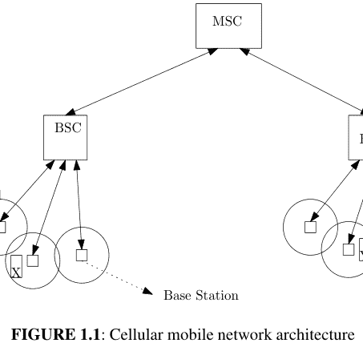

With the advances in technology, there has been an increasing demand from mobile users for multimedia services like voice, text, still image and video over wireless networks. On the other hand, the available bandwidth required for such multimedia data communication for a large number of mobile users is very limited. Such a limited availability of the radio spectrum, signal distortion and the interferences caused by the environment and other mobile users impose an inherent restriction on the capacity of such wireless networks. Therefore, developing methods to utilize the scarce radio spectrum efficiently is more critical than ever.

Interference is a function primarily of transmitter power, receiver sensitivity, antenna gains, and channel loss. Channel loss is a function of distance, frequency and weather, and is quantified by the minimum acceptable signal-to-noise ratio. Assuming that most of these factors are already determined or beyond our ability to influence, the interference can be defined directly as a function of frequency and distance. Based on that, three types of interference are generally taken into consideration which can be avoided by satisfying the following constraints:

- i) co-channel constraint, due to which the same channel cannot be assigned to certain pairs of cells simultaneously,
- ii) *adjacent channel constraint*, for which adjacent channels cannot be assigned to certain pairs of cells simultaneously, and
- iii) *co-site constraint*, which implies that any pair of channels assigned to the same cell must be separated by a certain number of channels [7].

The task of assigning frequency channels to the cells satisfying the interference constraints and using as little bandwidth as possible is known as the *channel assignment problem* (CAP). In its most general form, the CAP is equivalent to the generalized graph coloring which is a well known NP-complete problem [10, 11, 12]. In a subsequent chapter, we provide detailed discussion about this channel allocation problem in cellular mobile networks.

### 1.1.6 Ad Hoc Networks

Based on the application scenario, the common ways to design wireless networks are:

- i) infrastructure-based networks,
- ii) infrastructure-less networks, and
- iii) hybrid networks which uses a mix of both infrastructure and infrastructure-less network components.

The cellular mobile network discussed above is an example of an infrastructure-based network where base stations are the existing infrastructures in the network. Absence of such base stations in a network leads to an infrastructure-less network of which the ad hoc network is an example. In such an ad hoc network, the component telephone devices themselves create a communicating network of their own, without the support of any base station. Such ad hoc networks may be static (where the component units may not change their geographical positions) or dynamic (the component telephone units may be mobile, changing their geographical positions with time). An ad hoc network of mobile telephone devices or handsets is commonly known as a *mobile ad hoc network (MANET)*. Nodes in an ad hoc network usually communicate through a single channel by means of broadcasting or multicasting of data over the network.

Ad hoc networks are particularly useful where an infrastructure, (e.g., a base station) is difficult, if not impossible, to set up due to unfriendly terrain conditions, or in a disaster situation where the infrastructure has been destroyed or damaged. Accordingly, these networks have proven very effective in disaster management, military and surveillance operations, communication in underground mines and communication under seas.

Due to the absence of any infrastructure, ad hoc networks may be considered as distributed systems with no arbiters. However, the computing facilities with such portable or mobile devices are also limited in terms of available memory, processing capability and speed of computation. Moreover, each component node is operated by a battery to allow mobility of the nodes. This makes the network highly energy constrained.

Due to the energy constraint, a component node of an ad hoc network may go out of the network if it runs out of battery power. That is, this node will no longer be a part of the network and this situation may effectively be abstracted by a node failure in the network. Similarly, in a MANET where the nodes have mobility, if a node moves out of the communication range from all of the remaining nodes of the network, that node will be disconnected from the rest of the network. This situation may be abstracted by a link failure in the network. On the other hand, new nodes are allowed to join an ad hoc network (static or mobile) at any time, establishing connection links to some node(s) already existing in the network. All these facts make the topology of an ad hoc network and a mobile ad hoc network highly dynamic in nature. The communication protocols developed on such networks must consider this dynamic network topology arising from energy-constraints, mobility and new arrivals in designing a robust communication network.

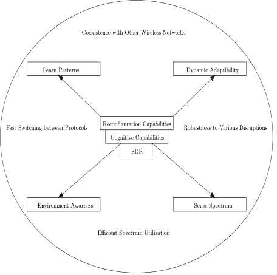

**FIGURE 1.2:** Schematic view of a cognitive radio network

Cognitive radios are widely accepted as the wireless technology of the future and it is envisioned that most radios on portable devices (e.g., cellphones (telephones used in cellular mobile networks) and Wi-Fi enabled notebook PCs) will possess some amount of cognitive capability [14] by the time this book is published.

In the context of networks operating in licensed bands, the ability to exploit unused parts of the spectrum can provide a multitude of benefits. Taking the case of cellular networks as an example, such frequency agility can dramatically reduce operational, deployment and licensing costs, increase the number of users that can be supported under a single base station and improve the operator’s ability to provide guaranteed service through the intelligent exploitation of the large additional unused spectrum pool. Moreover, such cognitive radio-based cellular networks can offer benefits in the events of attacks or natural disasters. While a conventional cellular system is centralized and can only operate in licensed bands, a cognitive system is capable of establishing communications even if some network elements are out of order or the


用户请求的总带宽超过了运营商的许可带宽。因此，很明显，认知无线电将在下一代无线网络中发挥关键作用[18, 19, 8, 9, 20, 13, 14, 17, 16, 15]。

### 1.1.8 无线网状网络

作为蜂窝网络和自组织（ad hoc）网络架构的替代方案，近年来无线网状网络（WMNs）引起了极大的关注。WMN的运行特性可以被认为是介于基于基础设施的网络（如无线局域网（WLANs））和没有预安装基础设施支持的ad hoc网络之间。在WMN中，网络由一组*固定*的网关节点和一组非网关节点（固定的或移动的）组成。非网关节点必须访问网关节点（类似于WLAN），才能与外界建立通信。这些非网关节点可以充当主机或无线路由器，转发来自其他用户的数据包（类似于ad hoc网络），从而使其他非网关节点能够在需要时以多跳方式与网关节点建立链路。

ad hoc网络与基于基础设施的网络特性的融合，使得网络的覆盖范围得以显著扩展，并使处于信号传播特性较差区域的节点能够以更高的成功概率与外界联系。这种部署的总体效果是，大大减少了覆盖某个区域所需的网关节点的数量，从而降低了安装、运行和维护费用。

此外，这种网络结构还允许通过简单地在需要的时间和地点添加新的网关节点来实现可扩展的操作。可靠性也得到了提高，因为到网关节点的多条路径更为常见，而且在节点故障时的数据包重路由也像在ad hoc网络中一样处理。

由于上述优点，即使是传统的基于基础设施的网络（如蜂窝网络）也开始考虑迁移到基于WMN或类似WMN的拓扑结构的可能性[21, 22, 24, 28]。其前景包括：降低基础设施建设和维护成本，提高在面对异常事件和自然灾害时的容错性和鲁棒性，以及增强网络覆盖等。然而，使用网状架构时，信道分配问题的重要性变得更加突出，因为WMN中链路之间的干扰概率增加了，因为大多数WMN应用（如密集传感器网络）往往包含比传统蜂窝和ad hoc网络更多的链路，试图通过路径多样性来提高可靠性[28, 27, 26, 25]。例如，Lan和Trang[23]提出了一种在WMN中每个节点具有多信道和多无线电的信道分配技术，以提高网络吞吐量。

### 1.1.9 车载自组织网络（VANETs）

车载自组织网络（VANET）是由行驶中的汽车组成的移动自组织网络（MANET）。每辆参与的车充当网络中的无线路由器或节点，通信范围约为100至300米。如果汽车移出信号范围，它们将退出网络，而其他汽车也可能加入网络。这种网络的设计最初是为了使警察和消防车辆能够在高速公路上相互通信，以保障安全和安防。

### 1.1.10 无线传感器网络

无线传感器网络（WSN）或简称为传感器网络，是由空间分布的自主传感器组成的网络，用于监测物理或环境条件（如温度、声音、压力等），并协作地将数据通过网络传递到某个位置的汇聚节点，如图1.3所示。更现代的网络是双向的，以便能够控制传感器活动。

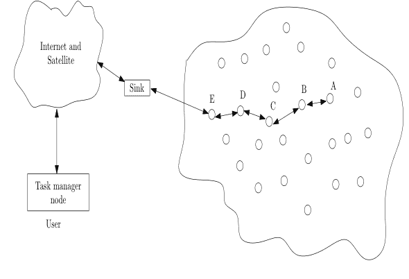

每个这种传感器网络节点都有几个部分：带有内部天线或连接到外部天线的无线电收发器、微控制器、用于与传感器接口的电子电路以及能源，通常是电池或嵌入式能量采集形式。传感器节点的大小可以从一个鞋盒到一粒尘埃大小不等，尽管真正微小尺寸的功能*微粒*（motes）尚未问世。传感器节点的成本也各不相同，从几美元到数百美元不等，具体取决于各个节点的复杂性。传感器节点在尺寸和成本上的限制导致了对能源、内存、计算速度和通信带宽等资源的相应限制。

传感器网络可以被认为是ad hoc网络。就像ad hoc网络一样，传感器网络也可以是静态的或移动的。例如，部署在商场或超市的大型静态摄像头传感器的监控系统是静态传感器网络，而部署在地形上、可以漂浮或随时间改变位置的非常轻巧和小型的传感器则构成移动传感器网络。无线传感器网络中的通信协议可以以类似于ad hoc网络的方式开发。传感器节点之间的数据传输可以通过点对点通信，或通过使用广播或多播的泛洪方式。

传感器网络在许多实际应用场景中都有应用，包括环境监测、工业库存控制、过程控制、机器健康监测、智能家居建设、大型建筑和桥梁的结构监测、军事和监控控制等。即使传感器节点具有较低的计算资源，针对特定应用目的，持续处理从传感器节点接收到的数据流也是一个具有挑战性的研究问题。

### 1.1.11 体域网

体域网（BAN）（也称为无线体域网（WBAN）或身体传感器网络（BSN））是由一组可穿戴计算设备组成的无线网络。具体来说，该网络由几个小型化的身体传感器单元（BSU）和一个身体中央单元（BCU）组成。体域网技术的开发始于1995年左右，其思想是基于使用无线个人区域网（WPAN）技术来实现人体上、人体附近和人体周围的通信。

## 1.2 设备移动性的影响

无线移动网络，无论是蜂窝网络、ad hoc网络还是传感器网络，都由移动设备（电话、传感器或其他类型的设备）组成，由于这些设备的移动性，它们总是由能量有限的电池供电。当设备电池耗尽时，该设备就离开通信网络。这种现象可以有效地抽象为网络中的节点/链路故障。

除了这个能量限制外，这类移动设备由于体积小、便于携带，通常具有较小的计算资源，包括内存、计算能力和计算速度。它们通常也受到低通信带宽的限制。

网络中组成节点的移动性还会引发网络连通性的额外问题，例如，当一个节点移动出网络中所有其他节点的通信范围时，它就会被从网络中移除。另一方面，新节点通常也允许随时加入网络，并可能请求额外的通信信道来发送消息。这种为新到达节点分配新信道的方式必须避免与附近区域现有通信节点的所有类型的信道干扰。网络的通信协议必须充分考虑所有这些情况产生的动态网络拓扑。

此外，当移动通信节点改变其地理位置时，分配给该节点的信道可能会干扰其新位置附近的其它通信节点所分配的信道。因此，需要快速为该节点分配一些新的非干扰信道，以免中断已经正在进行的通信。

服务质量（QoS）是在任何网络中开发通信协议的重要考虑因素。服务质量通常由用户以几种不同的形式表达或要求，例如延迟（传递消息数据包所需的时间）、延迟抖动（即传递同一消息的不同数据包时的延迟变化）、可靠性（例如误码率（BER））、信道的可用性以及在不同应用环境下的通信带宽。例如，对于电话语音通信，数据包

时延很重要，且应当非常小——不能被人类音频识别系统察觉；否则，它可能导致发送方不必要地重复消息，常常与接收方的回复消息重叠。此外，在发送语音信号（例如使用IP电话（VoIP））时，如果同一句话的不同部分以不同的间歇时延到达，时延抖动对人类音频识别系统同样令人烦恼。但或许可以在一定程度上牺牲语音信号通信的可靠性。例如，如果语音分组中的一个或两个比特接收出错，人耳或许能够容忍；如果不能，接收消息的人可以要求发送方再次重复消息。这也可能适用于视频信号的通信。

另一方面，对于文本数据通信，时延和时延抖动相对不重要，但可靠性极其重要。网络需要为特定目的向请求用户快速分配信道。此外，在网络中实现所需通信时使用最小带宽是网络系统设计者直接关心的问题；网络必须利用可用带宽资源，为尽可能多的用户提供不间断服务。

为了在上述可能由组件节点移动引起的所有动态网络条件下维持所需的 QoS，需要适当考虑开发稳健的通信协议。

## 1.3 蜂窝移动网络中的问题

从上述蜂窝移动网络的需求可以明显看出，我们本质上需要：i) 为新呼叫分配信道，避免来自其他呼叫的各种信道干扰；ii) 即使两个节点中的一个或两个从一个地方移动到另一个地方，也要维持任意两个节点之间的通信。

除了这两个基本因素，下一个重要问题是实现通信协议时的能效以及待通信消息的安全性。因此，从广义上讲，在实现蜂窝移动网络时，我们需要解决以下四个问题。

- 移动性管理
- 带宽管理
- 能源管理
- 安全性

### 1.3.1 移动性管理

为了实现蜂窝移动网络中移动计算的主要目标，即即使在人们移动时也能在任何地点、任何时刻进行计算，重要的问题当然是允许用户从任何地点（小区）向网络中的任何其他人发起呼叫，并且即使一方或双方正在移动，也能继续通话。实现这一要求涉及以下四项活动。

- 呼叫建立
- 切换管理
- 互联与互操作

下面简要介绍这些活动：

### 1.3.1.1 呼叫建立

为了建立从移动终端（MT）到另一个MT的呼叫，涉及两个不同的活动：i) 位置注册和 ii) 呼叫交付。这两个活动称为位置管理功能。每个移动终端都需要定期更新其位置信息，或者至少在其位置改变时更新。为此，通常将多个小区分组形成一个位置区（LA），一个移动交换中心（MSC）控制多个这样的LA。每当MT从一个LA移动到另一个LA时，MT会向其当前MSC发起请求以更新位置数据库。另一方面，呼叫交付涉及查询位置数据库以找到被叫MT的当前位置。我们将在第2章详细讨论这两个活动。

### 1.3.1.2 切换管理

当MT从一个小区移动到另一个小区时，它从旧小区基站（BS）接收到的信号强度会低于新小区基站发出的信号强度。因此，该MT的控制权需要从旧BS移交给新BS。在不影响与该MT正在进行的通信（如果有）的情况下，将MT的控制权从旧BS平滑地移交给新BS，称为切换管理。换句话说，切换（handoff或handover）管理使网络能够在用户（MT）继续移动并将其接入点从一个BS更改到另一个BS时维持用户的连接。切换有三个不同的阶段：i) 切换发起，ii) 新连接生成，iii) 数据流控制。在第一阶段，当用户或MT从其BS接收到非常低强度（低于某个阈值）的信号时，可以发起切换；或者由网络软件发起切换（可能是由于从MT接收到的信号较弱，或由于某些网络条件的变化，例如，MT使用的通信信道可以通过在基站执行信道分配算法来改变，以满足网络中其他MT的信道需求）。切换管理的第二阶段，即新连接生成，可以通过三种不同的方式执行。在网络控制切换（NCHO）或移动辅助切换（MAHO）的情况下，网络生成新连接并找到资源和附加的路由操作。在移动控制切换（MCHO）的情况下，MT找到新资源，网络批准这些资源。第三阶段，即数据流控制，涉及根据约定向MT提供的服务，将数据从旧连接路径传送到新连接路径。在第2章中，我们将更详细地讨论切换管理。

### 1.3.1.3 互联与互操作

存在支持蜂窝移动通信的不同骨干网络。此类骨干网络的示例包括公共陆地移动网络（PLMN）、移动IP网络、无线异步传输模式（WATM）网络、低地球轨道（LEO）卫星网络等。每个这样的骨干网络都有其自身的信号传播技术和通信协议，为蜂窝移动用户提供服务。在漫游时，MT很可能从一个地方移动到另一个地方，而所支持的骨干网络发生了变化。未来一代移动通信系统旨在为移动用户提供全球漫游能力。为了实现这一构想，必须妥善解决相关的互联问题。移动设备需要配备适当的硬件（物理层和MAC层问题）和软件（网络层问题），以便在漫游期间在不同的骨干网络中运行。此外，从一个骨干网络切换到另一个骨干网络应当是平滑的，并且对用户透明，不会中断移动MT正在进行的呼叫。位置注册、呼叫交付和切换管理技术也必须妥善处理，以便从一个骨干网络平滑切换到另一个骨干网络。

同样，MT也可能从一个区域移动到另一个区域，其中骨干网络保持不变，但服务提供商发生了变化，导致用户与服务提供商之间的通信技术、协议和服务水平协议（例如资费）发生相应变化。例如，不同的服务提供商可能在不同的频段上进行消息通信，并使用不同的信道接入机制。一个可能使用频分多址（FDMA）接入信道，而另一个可能使用码分多址（CDMA）。移动设备及相关通信协议的兼容性问题，以及为这种移动服务的互操作性设计适当的位置注册、呼叫交付、切换管理技术，也需要解决，以便跨不同服务提供商提供漫游功能。所有与互联和互操作相关的问题构成了未来研究和开发的重要领域，以便为移动终端提供有效的全球漫游设施。

## 1.3.2 带宽管理

由于移动电话系统的极度普及，蜂窝移动用户的数量几乎呈指数级增长。1997年列出的移动用户约为2亿，到2015年初该数字已升至超过68亿，并继续高速增长。此外，移动电话系统的用户不再局限于使用语音消息和文本；包括音频、静止图像和视频在内的多媒体信号也通过蜂窝移动网络进行通信。很自然地，多媒体信号对通信信道带宽的需求增加。因此，对于音频信号，64 Kbps被认为足够，而对于视频信号，384 Kbps是最低比特率。


第二代移动系统中使用的速率。在第三代和第四代移动通信系统中，为了实现更高质量的视频通信，信道速率分别设计为 2 Mbps 和 100 Mbps。

另一方面，蜂窝移动网络中信号通信的总带宽非常有限。除了 GSM（全球移动通信系统）所使用的 860 MHz 至 960 MHz 的 100 MHz 频段外，1992 年日内瓦世界无线电行政大会将 1885 至 2025 MHz 和 2100 至 2200 MHz 频段——总共只有 230 MHz——分配给了地面和卫星通信。在这两个频段中，卫星频段覆盖 1980 至 2010 MHz 和 2170 至 2200 MHz，共 60 MHz，其余 170 MHz 用于地面移动通信。2025 至 2110 MHz 之间以及 2200 MHz 以上的频率间隔保留给其他服务，如遥感、有线电视中继服务、空间研究等。1995 年，世界无线电大会对上述频率分配做了一些修改。第二区（美洲和加勒比地区）的卫星频段分配改为 1990 至 2025 MHz 和 2160 至 2200 MHz，共 75 MHz，只剩下其余 155 MHz 用于地面服务。这使得该地区国家的蜂窝移动通信状况更加困难。即使后来做了一些小的修改，最终结果是，与大量移动用户以及多媒体通信日益增长的需求所带来的巨大且不断增长的需求相比，可供地面使用的总带宽仍然非常小。

克服这一带宽危机问题的一种可能方法是，在蜂窝网络中相距足够远的小区智能地复用频率，从而使这些频率之间不会相互干扰。在过去二十年中，关于这一主题的研究成果已在文献中出现，但要开发出一种有效的蜂窝移动网络信道分配算法，仍有许多问题需要解决。我们将在后文讨论这些问题。

## 1.3.3 能量管理

能量是当前的热门话题。然而，有两类不同的科学家和技术专家对能量感兴趣。一类专注于从非常规来源产生能量，另一类则寻求在各种实际应用中高效利用能量。我们在蜂窝移动网络方面的关注点与后者相同。

特别是，由于终端的移动性，移动设备依赖能量有限的电池运行。此外，设备通常很小，因此所用电池的总能量容量也很小。这促使研究人员开发易于在蜂窝移动网络中采用的节能通信技术。在过去几年中，人们一直在研究能效，以最大限度地减少通信协议各层（例如物理层、MAC 层、网络层等）的能量消耗。例如，在物理层，可以考虑：i) 设计具有最少门电路和其他电子元件的电路，以降低总功耗；ii) 选择合适的调制解调技术来设计低功耗收发器。在 MAC 层，我们可以尝试避免冲突，或至少尽可能减少冲突，因为冲突需要重传发生冲突的消息，从而导致能量浪费。我们也可以尝试让信道处于睡眠模式，以比正常模式更低的功耗运行，并调整睡眠、监听和唤醒周期，以在能量消耗方面获得最佳性能。在网络层，消息可以通过跳数最少、因而能量消耗最小的路径进行路由。

我们将在第 8 章专门讨论各种低功耗无线网络中的节能通信。

## 1.3.4 安全性

通信安全是大多数涉及消息通信的实际应用中需要考虑的非常重要的方面之一。特别是，无线网络比有线网络更容易受到入侵者的攻击。这引发了诸如用户认证、消息的加密和解密以及干扰等安全问题。然而，为此目的设计的算法通常会消耗大量时间和能量（通过使用大型程序或复杂硬件），这可能不适合在线无线通信。目前正在进行研究，以寻找适用于蜂窝移动网络中在线低能耗安全通信的技术。

## 1.4 Ad Hoc 网络中的问题

Ad Hoc 网络的研究人员和开发人员需要考虑的重要问题包括：

- 初始化
- 领导者选举
- 通信协议
- 位置识别
- 能量
- 安全性

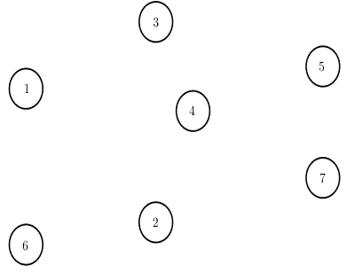

**图 1.4：** Ad Hoc 网络中的初始化

### 1.4.1 初始化与领导者选举

上述列表中的前两个问题仅与 Ad Hoc 网络相关，因为这类网络不像蜂窝移动系统那样具有任何基础设施。为了在网络中的两个节点之间建立通信，网络中的每个节点都必须有一个唯一的标识符，即 *Id*，并且该标识符应被网络中的所有其他节点所知。为节点分配唯一 *Id* 的过程称为*初始化*。参考图 1.4，Ad Hoc 网络中有七个节点，通过此初始化过程被赋予唯一 *Id*：1, 2, · · · , 7。在分配唯一 *Id* 时，必须充分考虑以下可能性：任何节点都可能随时退出（被关闭或电池电量耗尽），或离开与其他节点的通信范围；并且任何新节点都可能随时加入网络的任何位置。网络拓扑应在每次有节点加入或离开后重新确定。换句话说，初始化算法必须考虑网络的这种动态行为。

上面给出的领导者选举这一第二个问题也是 Ad Hoc 网络在缺乏基础设施（例如蜂窝移动网络中的基站）时的一个特定问题。如果网络有一个所谓的*领导者*来控制消息路由以优化这些参数，那么通常很容易控制网络中的通信以优化其他网络参数，例如消息泛滥导致的网络拥塞、节点的总能量消耗以及平均消息通信时间。

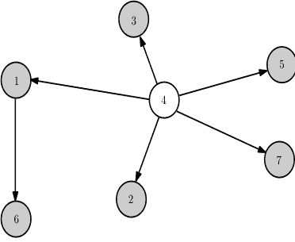

**图 1.5：**

同样，参考图 1.5 中具有七个节点的 Ad Hoc 网络，节点 4 被选为领导者；选举之后，节点 4 向所有其他节点广播消息，告知它们其当选为领导者。

通常，建议对网络进行分簇，使簇内的节点在地理上彼此靠近，从而收发器所需的通信功率很小；并根据某种标准（例如，与簇内所有节点的最小平均距离、最大剩余能量等）来选择簇头或簇领导者。图 1.6 中的例子说明了这一点。例如，簇 1 中的节点 *u* 与簇 2 中的节点 *v* 之间的通信，可以通过簇 1 和簇 2 的领导者来实现。

在本书第 5 章中，我们将讨论 Ad Hoc 网络中使用的各种通信协议。

### 1.4.2 位置识别

蜂窝移动和 Ad Hoc 网络中的大多数位置估计系统都采用接收信号的三边测量（*三边测量*）或三角测量（*三角测量*）的基本方法。


## 无线网络和移动计算

为获取接收端位置的估计值 [29]。在二维几何中，移动终端的距离是从三个非共线的参考点测得的。通过以这些参考点为圆心、以参考点到终端的测得距离为半径绘制三个圆，我们可以估计移动终端的坐标。移动终端到参考点的距离可以通过在参考点发送信号（超声波或射频）到移动终端，然后测量信号的飞行时间来确定。这种方法也称为时间到达（TOA）技术，用于确定移动终端的位置。如果发射器和接收器之间存在直接路径或视距（LOS）通信，则可以得到这样的距离估计。非视距或NLOS信号在多路情况下出现，接收信号来自反射、折射或散射路径，导致欧几里得距离被额外路径长度腐蚀。NLOS错误定义为相对于直接路径的额外距离，总是为正值。LOS信号被NLOS信号和高斯测量噪声腐蚀是所有定位估计系统的主要误差来源；前者是主导因素 [2]。

另一种定位移动终端的方法是测量到达角度（AOA），发射器通过高度指向性天线发送信号，使接收器能够利用该天线估计相对于参考方向的到达角度。通过在两个参考点处记录LOS信号的到达方向，移动终端的位置可以从两条直线的交点得到。

第一个、可以说是典型的室内定位发现系统是主动徽章定位系统 [31]。主动徽章系统使用到达时间差技术 [32]。主动徽章系统被克里克系统 [5] 所补充，该系统同时实现了后位法和近距离法。它的精度低于主动徽章系统，但具有隐私保护和去中心化可扩展性的优势。微波雷达 [4] 是微软开发的建筑范围跟踪系统，它使用建筑信号特征模型进行定位估计。不幸的是，人或物体的移动可能需要重建预定义的信号强度数据库，或创建全新的数据库。

全球定位系统（GPS） [3, 36] 可能是最广为人知的定位感知系统。然而，GPS 在密集城市区域或室内位置的可扩展性较差。通过建模无线电传播环境可以更准确地估计位置，从而减轻NLOS错误的影响。虽然室外条件下已有相当准确的无线电传播模型 [37, 38, 39]，但室内环境缺乏统一接受的模型。

在 [6] 中，作者对使用TOA技术在样本办公环境中测得的距离误差进行了建模。他们的模拟结果表明，LOS信号可以模型为高斯分布，而受阻LOS信号可以视为高斯分布与指数分布的混合，适用于所考虑环境。在 [6, 41] 中，作者展示了信道带宽对误差大小的重要作用，并指出至少需要100 MHz的带宽才能实现有效的定位估计。

多位作者尝试减轻NLOS错误的影响 [6, 42, 43, 1, 45, 4, 46, 47, 48, 49]。最小二乘（LS）算法 [50, 51] 使用Davidon算法 [52] 找到使估计残差最小的位置估计。在 [42] 中，提出了距离测量误差因NLOS传播而产生的影响的另一种算法 —  — 残差加权算法（Rwgh）。在 [50] 中，作者比较了不同的室内定位算法，假设信道特性遵循 [6] 中的模型。在 [43] 中，作者提出了两种基于对NLOS错误的先验知识的识别和校正算法。在 [53] 中，提出了一种基于最大似然检测的NLOS错误缓解算法。在 [1] 中，作者尝试通过假设热接收器噪声和信号特性的统计分布，区分LOS与NLOS测量，以实现定位估计。

在 [54] 中，作者考虑了大范围网络（特别是传感器网络）中的位置估计问题。他们基于信号强度或到达时间差的测量，并使用统计方法来描述两个节点之间的分离距离。APS [55] 是另一种不依赖GPS的定位算法。然而，使用跳跃式传播过程（如DV hop或DV距离）来传播位置估计，使其不适用于移动和随机图。在 [29] 中，作者提出了一种基于蜂窝移动网络信号三角化的定位算法，适用于室外环境。在 [56] 中，作者展示了另一种无GPS的移动自组网定位技术。上述所有算法的共同特征是它们都计算一个单一的位置点作为估计。然而，任何估计都是概率性的，在某些情况下（尤其是密集城市或室内环境，其中NLOS错误随位置和时间变化）可能与真实情形差距显著。

## 1.4.3 能源与安全问题

无线自适应网络中的能源和安全问题与蜂窝移动网络非常相似。关于这两方面在低功耗无线网络中的详细讨论将在章节 8 和 9 中给出。

## 1.5 认知无线电网络中的问题

在认知无线电网络中需要解决的重要问题包括：

- 频道感知
- 频道分配

关于这两个问题在单信号和多媒体信号网络中的详细讨论可参见 [57, 58, 59]。

## 1.6 传感器网络中的问题

在传感器网络中需要考虑的重要问题包括：

- 传感器部署位置
- 通信协议
- 流媒体数据计算
- 能源
- 安全

部署传感器的位置至关重要，原因因应用而异。例如，在购物中心或图书馆使用摄像头作为传感器的视频监控系统，需要摄像头能够覆盖该场所的所有区域。在天气传感器应用中，传感器的布局应使得所有传感器能够通过其他传感器以最小能耗通信其测得数据到汇聚点。我们将在章节 7 中更详细地讨论这一布局方面。

通信协议、能源和安全问题与自适应网络相似。但根据传感数据的典型应用需求，可以在通信协议栈的应用层为特定类型的传感器网络开发专门的能源高效算法，利用计算过程对传感数据的影响。

## 1.7 练习

1. 无线局域网（Wi‑Fi）通常在哪些频率带运行，这些网络遵循什么通信协议？Wi‑Fi 网络通常采用哪些加密机制？


2. 名称IEEE标准，ZigBee协议基于此标准。ZigBee网络的典型应用领域是什么？ZigBee网络的工作频率范围是什么？

3. 区分蜂窝移动网络和自组织移动网络。

4. 与蜂窝网络相比，自组织网络因缺乏基础设施会面临哪些缺点？讨论此问题。

5. 自组织网络需要多频繁调用初始化例程？自组织网络需要多频繁调用领导选举例程？节点的能量考量会影响网络的初始化或领导选举活动吗？

6. 自组织网络能否仅由静态通信设备组成，还是至少其中一个设备必须是移动的？

7. 认知无线电网络的功能特征是什么？

8. 在认知无线电网络中，区分主用户和次用户。认知无线电网络中的每个通信节点是否必须具备信道感知和信道分配能力？

9. 什么是身体区域网络，这类网络在哪些典型应用中可能有用？

10. 在移动通信环境中，什么是互联网络（internetworking）和互操作性（interoperability）？

[Bibliography]

[1] I. F. Akyildiz, J. McNair, J. S. M. Ho, H. Uzunalioglu and W. Wang, “Mobility management in next generation wireless systems,” *Proc. IEEE*, Vol. 87, pp. 1345-1382, August 1999.

[2] http://en.wikipedia.org/wiki/Cordless_telephone.

[3] http://en.wikipedia.org/wiki/Wireless_microphone.

[4] http://en.wikipedia.org/wiki/Wi-Fi.

[5] http://en.wikipedia.org/wiki/ZigBee.

[6] Federal Communications Commission, Spectrum Policy Task Force, *Report ET Docket No. 02-135*, Nov. 2002.

[7] C. W. Sung, and W. S. Wong, “Sequential packing algorithm for channel assignment under co-channel and adjacent-channel interference constraint,” *IEEE Trans. on Vehicular Technology*, Vol. 46, pp. 676-686, August 1997.

[8] M. D. Silvius et. al., “Smart radio: spectrum access for first responders,” *Tech. Report*, Center for Wireless Telecommunications (CWT), Virginia Tech. http://www.cognitiveradio.wireless.vt.edu, 2009.

[9] Cognitive Radio Project, http://kom.aau.dk/project/cognitive/cognitive_radio_project.htm, 2009.

[10] W. K. Hale, “Frequency assignment: theory and application,” *Proc. IEEE*, Vol. 68, pp. 1497-1514, 1980.

[11] Y. Yuan, P. Bahl, R. Chandra, T. Moscibroda and Y. Wu, “Allocating dynamic time-spectrum blocks in cognitive radio networks,” *Proc. ACM MobiHoc*, pp. 130–139, 2007.

[12] Y. Yuan, P. Bahl, R. Chandra, P. A. Chou, J. I. Ferrell, T. Moscibroda, S. Narlanka, and Y. Wu, “KNOWS: kognitive networking over white spaces,” *Proc. IEEE Dyspan 2007*.

[13] M. Sherman, A. N. Mody, R. Martinez and C. Rodriguez, “IEEE standards supporting cognitive radio and networks, dynamic spectrum access, and coexistence,” *IEEE Comm. Magazine*, pp. 72–79, 2008.

[14] P. Koch and R. Prasad, “The universal handset,” *IEEE Spectrum Magazine*, vol. 46(4), pp. 32–37, April 2009.

[15] E. G. Villegas, R. V. Ferre and J. Paradells, “Frequency assignments in IEEE 802.11 WLANS with efficient spectrum sharing,” *Wireless Communications and Mobile Computing*, vol. 9(8), pp. 1125–1140, 2009.

[16] L. Song and D. Hatzinakos, “Cognitive networking of large scale wireless systems,” *Intl. J. of Communication Networks and Distributed Systems*, vol. 2(4), pp. 452–475, 2009.

[17] E. Baccarelli, M. Biagi, C. Pelizzoni and N. Cordeschi, “Cognitive MIMO radio: An emerging paradigm for enhancing wireless access capability,” *Intl. J. of Communication Networks and Distributed Systems*, vol. 2(2/3), pp. 302–330, 2009.

[18] Cognitive Radio Projects, Dept. of Electronics, University of York, http://www.elec.york.ac.uk/research/comms/wireless/cognitive.html, 2009.

[19] Cognitive Radio Networks, *Broadband Wireless Networking Labaratory*, Georgia Tech. University, http://www.ece.gatech.edu/research/labs/bwn/CR, 2009.

[20] M.M. Buddhikot, P. Kolody, S. Miller, K. Ryan and J. Evans, “DIMSUMNet: new directions in wireless networking using coordinated dynamic spectrum access,” *Proc. IEEE WoWoM 2005*, pp. 78–85, June 2005.

[21] Ö. Oyman and S. Sandhu, “End-to-end design principles for broadband cellular mesh networks,” *Wireless Mesh Networks*, Springer US, pp. 57–76, 2007.

[32] A. Harter et. al., “The anatomy of a context-aware application,” *Proc. of the 5th Intl. Conf. Mobile Computing and Networking* (MOBICOM 99), ACM Press, New York, pp. 59–68, 1999.

[33] N. B. Priyantha, A. Chakraborty and H. Balakrishnan, “The cricket location-support system,” *Proc. of MOBICOM 2000*, ACM Press, pp. 32–43, Boston, USA, 2000.

[34] P. Bahl and V. Padmanabhan, “RADAR: an in-building RF-based user location and tracking system,” *Proc. IEEE Infocom*, pp. 775–784, 2000.

[35] J. Hightower and G. Boriello, “Location systems for ubiquitous computing,” *IEEE Computer*, vol. 34, No. 8, pp. 57–65, 2001.

[36] B. Parkinson et. al., “Global positioning system: theory and application,” *Progress in Astronautics and Aeronautics*, vol. 163, 1996.

[37] A. Falsafi, K. Pahlavan and G. Yang, “Transmission techniques for radio LAN’s - a comparative performance evaluation using ray tracing,” *IEEE J. Sel. Areas Commun.*, vol. 14, no. 33, pp. 477–491, 1996.

[38] L. J. Greenstein et. al., “A new path-gain/delay-spread propagation model for digital cellular channels,” *IEEE Trans. on Vehi. Tech.*, vol. 46, no. 2, pp. 477–485, May 1997.

[39] S. Fischer et. al., “Time of arrival estimation of narrowband TDMA signals for mobile positioning,” *IEEE Intl. Sym. Pers., Indoor and Mobile Radio Comm.*, vol. 1, pp. 451–455, 1998.

[40] B. Alavi and K. Pahlavan, “Modeling of the distance error for indoor geolocation,” *Proc. IEEE Wireless Commun. Networking Conf.*, vol. 1, pp. 668–772, 2003.

[41] B. Alavi and K. Pahlavan, “Bandwidth effect on distance error modeling for indoor geolocation,” *Proc. of the IEEE Personal Indoor Mobile Communications Conference (PIMRC)*, 2003.

[42] P-C. Chen, “A non-line-of-sight error mitigation algorithm in location estimation,” *Proc. IEEE Wireless Commun. Networking Conf.*, pp. 316–320, 1999.

[43] L. Cong and W. Zhuang, “Non-line-of-sight error mitigation in mobile location,” *Proc. IEEE INFOCOM*, 2004.

[44] M. P. Wylie-Green and S. S. (Peter) Wang, “Robust range estimation in the presence of the non-line-of-sight error,” *Proc. 54th IEEE Vehi. Tech. Conf.*, vol. 1, pp. 101–105, 2001.

[45] K. Pahlavan, X. Li and J. Mäkelä, “Indoor geolocation science and technology,” *IEEE Commun. Mag.*, pp. 112–118, Feb. 2002.

[46] S-S Woo, H. R. You and J. S. Koh, “The NLOS mitigation technique for position location using IS-95 CDMA networks,” *Proc. IEEE Vehi. Tech. Conf.*, vol. 4, pp. 2556–2560, 2000.

[47] A. M. Ladd, K. E. Bekris, A. Rudys, L. E. Kavraki and D. S. Wallach, “Robotics-based location sensing using wireless ethernet,” *Wireless Networks*, vol. 11, no. 1/2, pp. 189–204, 2005.

[48] S. Guha, R. N. Murty and E. G. Sirer, “Sextant: a unified node and event localization framework using non-convex constraints,” *Proc. 6th ACM Intl. Symp. on Mobile Ad Hoc Networking and Computing (MOBIHOC)*, pp. 205–216, May 25–28, 2005.

[49] J. Bruck, J. Gao and A. A. Jiang, “Localization and routing in sensor networks by local angle information,” *Proc. 6th ACM Intl. Symp. on Mobile Ad Hoc Networking and Computing (MOBIHOC)*, pp. 181–192, May 25–28, 2005.

[50] M. Kanaan and K. Pahlavan, “A comparison of wireless geolocation algorithms in the indoor environment,” *Proc. IEEE Wireless Commun. Networking Conf.*, pp. 177–182, 2004.

[51] A. Tarighat, N. Khajehnouri and A. H. Sayed, “Improved wireless location accuracy using antenna arrays and interference cancellation,” *Proc. of the IEEE Intl. Conf. on Acoustics, Speech, and Signal Processing (ICASSP)*, 2003.

[52] W. C. Davidon, “Variance algorithm for minimization,” *Computer Journal*, vol. 10, pp. 406–410, 1968.


[PAGE 59]
[53] J. Riba and A. Urruela, “A non-line-of-sight mitigation technique based on ML detection,” Proc. of the IEEE Intl. Conf. on Acoustics, Speech, and Signal Processing (ICASSP), Montreal, Canada, May 17-21, 2004.
[54] J. Zangl and J. Hagenauer, “Large ad-hoc sensor networks with position estimation,” Proc. of the 10th Aachen Symposium on Signal Theory, Aachen, Germany, pp. 115–118, 2001.
[55] D. Niculescu and B. Nath, “Ad hoc positioning system (APS),” Proc. of IEEE Global Communications Conference (GLOBECOM), 2001.
[56] S. Capkun, M. Hamdi and J. P. Hubaux, “GPS-free positioning in mobile ad-hoc networks,” Proc. 34th Hawaii Int. Conf. on System Sciences (HICSS), Jan. 2001.
[57] I. J. Mitola, “Cognitive radio for flexible mobile multimedia communications,” Proc. IEEE Intl. Workshop on Mobile Multimedia Communications 1999 (MoMuC 99), 1999; 3 10, doi:10. 1109/MOMUC.1999.819467.
[58] I. Akyildiz, W. Lee, M. Vuran, S. Mohanty, “Next generation/dynamic spectrum access/cognitive radio wireless networks: a survey,” Computer Networks, 2006; 50(13):21272159.
[59] A. Bhattacharya, R. N. Ghosh, K. Sinha and B. P. Sinha, “Multimedia communication in cognitive radio networks based on sample division multiplexing,” Proc. 3rd IEEE Intl. Conf. on Communication Systems and Networks (COMSNETS), Bangalore, India, Jan. 4-8, 2011, doi: 10.1109/COMSNETS.2011.5716435.
[PAGE 60]
<!-- no content -->
[PAGE 61]
## Chapter 2

## Mobility Management in Cellular Networks

- 2.1 Call Setup in Public Land Mobile Networks ................................ 42
- 2.1.1 Signaling Systems .................................................... 43
- 2.1.2 Location Registration ............................................... 43
- 2.1.3 Call Delivery ........................................................ 49
- 2.1.4 Database Architectures .............................................. 50
- 2.2 Call Setup in Mobile IP Networks ........................................ 56
- 2.3 Handoff Management ....................................................... 62
- 2.4 Mobility Models ........................................................... 65
- 2.4.1 Random Walk Mobility Model ........................................... 66
- 2.4.2 Random Way Point Mobility Model ....................................... 67
- 2.4.3 Brownian Mobility Model .............................................. 68
- 2.4.4 Map-based Mobility Model ............................................. 69
- 2.4.5 Group-based Mobility Model ........................................... 70
- 2.5 Exercises ................................................................. 71
- Bibliography ................................................................. 72

In Chapter 1, we briefly introduced the two basic location management functions for call setup: location registration and call delivery, and also described the handoff management function when an MT moves from one cell to the other. We now discuss

[PAGE 62]
## Wireless Networks and Mobile Computing

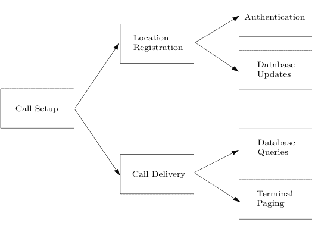

all these activities in more detail for a public land mobile network (PLMN) and a mobile IP (mobile Internet protocol) network.

A schematic diagram of the various operations to be performed for call setup in PLMN is shown in Figure 2.1. The _location registration_ module in the Figure 2.1 updates the location databases of the mobile terminals (MTs) stored at various places (e.g., MSCs) of the network and is also responsible for authentication of a mobile terminal when a request for location update from an MT is received. The _call delivery_ module shown in Figure 2.1 [1] performs the two functions: i) querying the databases to find the current MSC which keeps track of the called MT and ii) paging different LAs under that MSC to exactly locate the cell within which the called MT is currently residing. A detailed discussions on all these activities is given below.

[PAGE 63]
In a public land mobile network, the two location management functions, i.e., location registration and call delivery required to set up a call are implemented by the exchange of signaling messages through a signaling network. Signaling System 7 (SS7) [2, 3, 4] is the protocol used for signaling exchange which is based on a two- level data hierarchy using two types of location registers, the home location register (HLR) and the visitor location register (VLR) associated with each MSC . A user or an MT is permanently associated with an HLR in its own subscribed network (where it is originally registered with all details about the user and the types of services to be provided). When an MT moves to another LA controlled by a different MSC, the information regarding the current location of that MT is kept in the VLR of the MSC controlling its current LA, and the current location information of the MT is also communicated to the HLR of the MT (by sending a signaling message to the MSC which manages its HLR). Figure 2.2 shows a hierarchical view of the corresponding SS7 signaling network where the intermediate nodes STPs stand for the signal transfer points used for routing the signaling messages between the HLR of the MT and the VLR of its current MSC.

Location registration updates the current location of the MT in the MSC of its current LA and also authenticates the MT with the help of signaling messages from the HLR of the MT. There are two commonly used standards for location registration and call delivery: i) IS-41 (Interim Standard-41) [5, 6] introduced by the Electronic and Telephone Industry Associations EIA/TIA, and ii) GSM MAP (Global System for Mobile Communications Mobile Application Part) [7, 6]. IS-41 is popular in North America, while GSM MAP is commonly used in Europe, and both these standards are based on the above two-level database hierarchy using HLR and VLR.

[PAGE 64]
<!-- no content -->
[PAGE 65]
<!-- no content -->
[PAGE 66]
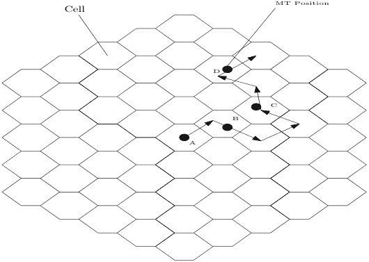

updates may have been issued.

**Movement-based location update:** The location of an MT is updated when the MT makes a predefined number of moves across the cell boundaries. The situation is illustrated by Figure 2.4 [1] assuming that the location update will be initiated after the MT crosses three cell boundaries. Thus, in this figure, the MT initially starts moving from point *A* and after reaching point *B*, when it has crossed three cell boundaries, a location update is initiated. The next location update is made at point *C* when it crosses another three cell boundaries from point *B*. The drawback of this approach is again that if the MT is situated around a cell boundary and moves back and forth across the same boundary without moving to any other distant cell, unnecessary location updates may be initiated.

**Distance-based location update:** The location update in this scheme is initiated when an MT moves through a predefined distance from the cell where it performed its last location update. The situation is illustrated in Figure 2.5 [1] with the assumed threshold of three-cell distance (two cells sharing a common boundary are assumed

[PAGE 67]
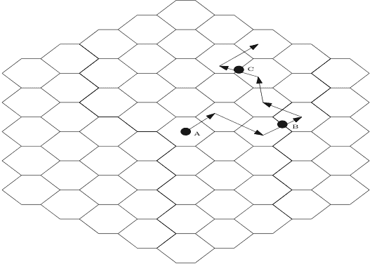

## FIGURE 2.4: Movement-based location update scheme

to be one distance apart) for successive location updates. Thus, the MT first makes a location update at point *A*, then it moves along the path *AB*. At the position *B* where the distance of the MT is going to exceed the assumed threshold of three-cell distance, the next location update is initiated.


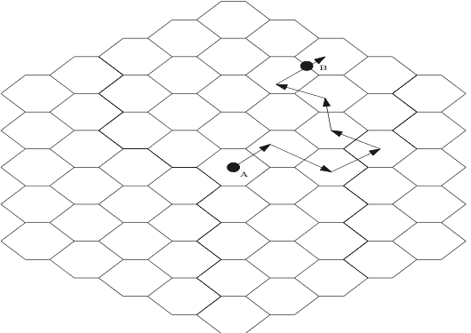

**FIGURE 2.5:** 基于距离的位置更新方案

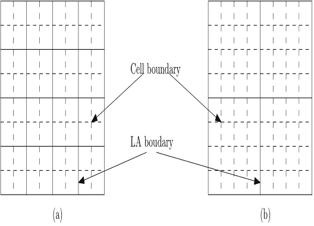

**FIGURE 2.6:** 动态位置区域更新方案

通过最优选择移动终端（MT）根据其移动模式和呼叫到达率确定的位置区域，可在每用户基础上实现位置更新的最小开销和呼叫延迟。

如果呼叫延迟没有约束，通过按概率降序依次搜索MT当前所在的小区，可以在一定程度上降低因轮询产生的信令流量 [8]。但这需要事先了解MT在该区域内最近移动历史的相关信息。针对延迟约束的位置更新和呼叫，多位研究者 [9, 10] 已考虑，核心是设定查询所需时间的上限。在 [9] 中，假设采用基于距离的位置更新机制，被呼叫MT的所在区域被划分为若干较小的子区域。当MT收到呼叫时，依次轮询这些子区域。查询区域数量上限设为N，以限制查询延迟为N次查询所需的时间。根据MT的移动模式（可能由移动模型决定）、呼叫到达率以及最大延迟N，可计算出最优距离，用于实现基于距离的位置更新。因此，在限制查询延迟的距离基于位置更新方案中，最优方案实现较为复杂。但如 [10] 所示，若结合移动基于位置更新与最大查询次数N来限制查询延迟，则整体位置更新和呼叫的实现相对简单。

## 2.1.4 数据库架构

如前所述，位置注册涉及更新MT的最新位置信息，而呼叫送达则需在数据库中查询被呼叫MT的当前位置，首先查询到存储被呼叫MT最新信息的MSC，再查询到当前所在的基站（BS）所在的小区，即MT当前所在的基站。若被呼叫MT从其家庭位置移动较远，则从其当前VLR到HLR以及从当前VLR到HLR的路径上所有中间VLR均可能产生大量位置更新消息。此外，确认和注销消息也会在HLR与相应VLR之间通信（参见上文描述的位置注册过程的步骤4、5和6）。除更新数据库和终端呼叫所需的信号传输开销外，网络中所需信号传输的总开销（即所需时间）可能显著，除非数据库得到妥善管理。

例如，假设被呼叫MT最初注册在Kolkata，目前已移动到Bangalore。每当MT移动到属于不同VLR的新区域时，会从Bangalore的VLR向Kolkata的HLR发送位置更新消息。此过程可能通过多个中间MSC传输。此外，当另一台MT在Bangalore生成呼叫时，该呼叫MT的MSC需先查询Kolkata的HLR，以确认被呼叫MT当前位于Bangalore。随着移动用户数量不断增加，这种网络信号传输量会非常高，严重削弱网络处理呼叫的性能。

为缓解上述问题，有两种基本的数据库架构设计方法：

### 中央化数据库架构

该类架构中的一种可能方案是采用动态层级数据库架构，在 IS-41 两层数据库结构（HLR和VLR）之外，增加名为目录注册（DR）的额外数据库层。核心思想是使用一个DR来覆盖若干MSC的服务区域，该DR存储在其服务区域内漫游MT的位置指针配置。DR使用三种基本类型的位置指针 [1]：

- **本地指针**：存储在MT的服务DR中，指向MT当前服务的MSC。
- **直接远程指针**：存储在远程DR中，直接指向MT当前服务的MSC。
- **间接远程指针**：存储在远程DR中，间接指向MT当前服务的MSC。

在该DR方案下，MT的HLR可以配置为保存指向服务DR的指针，或指向当前服务MSC。但在某些情况下，为降低成本，HLR可能不作任何修改，仍采用原始 IS-41 架构。基于这些DR，再次考虑前面的例子：MT的HLR位于Kolkata，目前漫游于Bangalore。若其移动到Chennai并接收来自Bangalore区域的呼叫，当检测到大量来自Bangalore的呼叫时，可在Chennai的DR中为该MT设置直接或间接远程指针。下一次呼叫发生在Chennai时， calling MSC 先查询DR，即可直接将呼叫转发至Bangalore，无需查询Kolkata的HLR。这大幅降低了网络信号传输量。同样，若HLR记录MT的服务DR ID（而非服务MSC ID），则位置注册的信号开销也可大幅降低。若MT移动到Bangalore区域内另一小区（但仍属于同一DR），仅需在服务DR中的本地指针进行更新，无需访问Kolkata的HLR。因此，利用DR方案可在位置注册和呼叫送达两个环节显著降低开销。

### per-user 位置缓存

另一种降低位置注册和呼叫送达开销的方法是通过 *per-user 位置缓存* [11]，在靠近信号传输点（STP）的缓存中存储MT的当前位置信息。每当MT通过该 STP 被访问时，就会在缓存中添加一条记录，映射MT ID 到其服务VLR ID。当发起呼叫时，STP 先检查缓存中是否存在该MT的记录。若不存在，则采用常规（如 IS-41）呼叫送达流程查找MT位置。若存在，STP 根据缓存条目查询相应VLR。若MT仍在该VLR下，则缓存命中，MT 可直接被找到，无需查询HLR。若MT已移动至其他非该VLR对应的位置，则出现缓存不命中，需按常规 IS-41 流程查找。图2.7展示了该方案：MT1 呼叫 MT2，STP1 缓存中存在 MT2 映射至 VLR2 的记录。若 MT2 仍在 VLR2 下，呼叫可直接通过 VLR2 送达，无需查询其HLR。若 MT2 移动至其他VLR，则出现缓存不命中，需按常规 IS-41 流程定位。因此，缓存不命中情况下的开销高于常规 IS-41 方案。为提升系统性能，应保持最小命中率，且系统始终保持该最小值以上。该最小命中率取决于本地呼叫对移动比率（LCMR），即在给定发起方中，对某MT的平均呼叫次数与其移动次数的比值。


## 移动性管理在蜂窝网络中

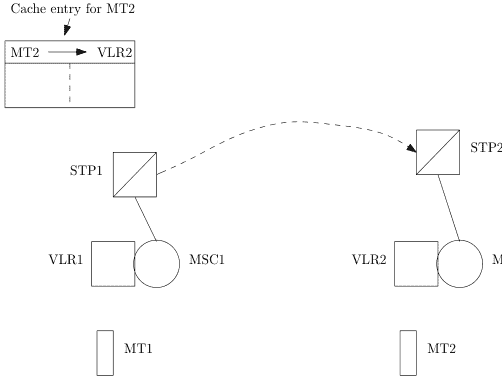

**FIGURE 2.7:** Location information caching scheme

STP 到平均每单位时间 MT 更改其 VLR 的次数。建议某些最小值的 LCMR 是实现缓存命中率最小值所必需的。此外，为了减少丢失的数量，建议 [35] 将缓存条目在一定时间间隔后定期失效。

还有其他一些可能的方案，利用集中数据库来减少时间和信令流量的开销，用于位置注册和呼叫交付，例如用户配置复制 [12]、指针转发 [14] 和本地锚定 [13]。关于这些方案的简要讨论也可以在 [1] 中找到。

### 分布式数据库架构

与上文所述的集中数据库架构不同，分布式数据库架构在整个网络中分布多个数据库。下面描述了该方法的几种变体：

#### 完全分布式树形数据库架构

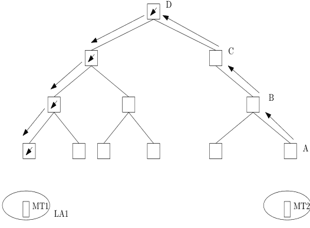

在该方案 [15] 中，IS-41 标准的 HLR/VLR 数据库架构被大量以树形组织的位置数据库所取代，如图 2.8 所示，MT 与叶子位置数据库关联，每个非叶子节点的位置数据库负责其下属的叶子节点。该方案在同一分区内 MT 移动率极高的区域（分区）中，将定位注册的开销最小化。

可以在 [17] 中找到一种改进位置注册和呼叫交付开销的分布式数据库层次结构的变体。关于其他可能方案的总结也可以在 [1] 中找到。

## 2.2 移动 IP 网络中的呼叫设置

以上关于呼叫设置的讨论均指公共陆地移动网络。然而，移动 IP 网络中的位置注册和呼叫交付方式不同——它不使用像 PLMN 那样的任何位置数据库。移动 IP 网络的通信标准由 IETF（Internet Engineering Task Force） [18] 开发。在该网络中，同一子网络内的移动终端可以直接发送其数据包，但属于不同子网络的终端必须通过执行切换功能的 IP 节点或路由器将其数据包发送出去。

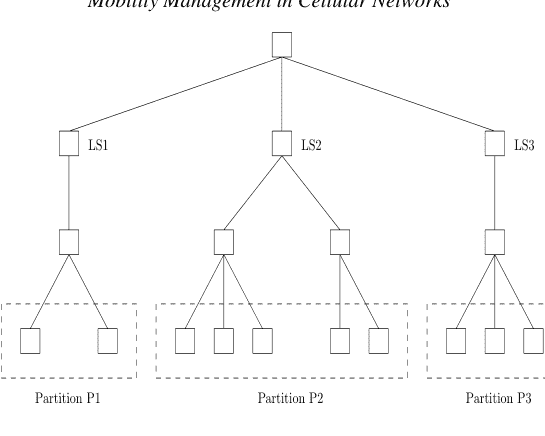

标准允许移动节点（MN）在不中断发送数据包的情况下，将数据包发送到另一个子网络中的目的 MN，即使源 MN 正在从一个子网络切换到另一个子网络。（注意，这里使用 MN 代替 MT 以遵循移动 IP 的惯例。）当 MN 位于其注册区域内时，它通过其家庭代理（HA）——位于其原始注册子网络中的路由器——访问 Internet。当 MN 移动到另一个子网络时，它通过外地代理（FA）——位于当前访问子网络中的路由器——访问 Internet。接收来自该 MN 数据包的目标节点称为对应节点（CN）。

移动 IP 网络架构的核心如图 2.10 [1] 所示。如图所示，MN 在其自身子网络（子网 A）中的 HA 通过该节点访问 Internet。当 MN 移动到另一个子网络（如图中的子网 B）时，它将在该子网中的 FA 通过该节点访问 Internet。MN 与对应节点（CN）之间的通信现在通过 MN 的 HA 和当前 FA 实现。

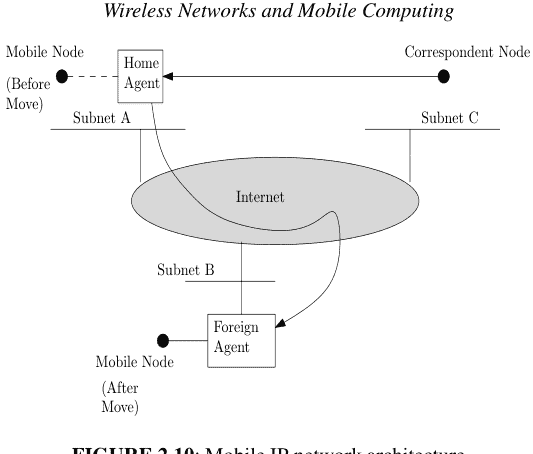

当 MN 从一个子网切换到另一个子网时，它必须向其家庭代理（HA）注册其在新子网中的新 IP 地址。因此，实际上每个 MN 都有两个 IP 地址：一个是用于标识的 home address，另一个是用于定位其当前位置的 care of address（CoA）。CoA 与 home address 之间的关联通过某种移动绑定规则在一定的 lifetime 期间维护。为该 MN 发送的任何数据包都使用当前的 CoA 进行路由。CoA 与 home address 的绑定的 lifetime 在 MN 在 HA 进行注册时确定，并在该时间段结束后删除该注册。MN 必须在该时间段到期前重新注册其 HA，以确保使用该 CoA 的服务（如正在进行的呼叫）不中断。因此，MN 可能需要在其位于 home subnet 时发送注册请求消息，即直接向其 HA 发送（当它仍在自身子网内）或通过其当前访问的 FA 发送。根据移动互联网协议版本 4（IPv4），下面的步骤在 MN 的位置注册过程中执行，如图 2.11 [1] 所示：

- 发送代理广告消息。MN 可以通过以下两种机制检测到从一个子网到另一个子网的移动：

  - **1. 广告生存时间：** ICMP 路由器广告部分的 agent advertisement 主体中包含一个 *lifetime* 字段。MN 在当前 CoA 的绑定生存期间记录该信息，直到该 lifetime 过期。当 lifetime 过期时，MN 必须尝试请求新的代理。
  - **2. 网络前缀：** 该方案使用由 IP 地址前导某些位数组成的网络前缀来检测移动。如果从 agent advertisement 中接收到的前缀与当前 CoA 的前缀不同，MN 判断自己已移动到不同的接入点（AP）。

一旦 MN 发现自己在新的外网上，它会从新的接入点（AP）获取新的 CoA，并执行位置更新过程，该过程包括在其 home agent 处创建或修改移动绑定，将当前 CoA 与关联的 lifetime 绑定在一起。这与 PLMN 中需要在网络的多个位置修改位置数据库的位置更新过程截然不同。

图 2.12 显示了移动 IP 网络中位置注册过程的步骤，包含以下操作序列 [1]：

- **1.** MN 通过发送 binding update（绑定更新）将新的 CoA 及其关联的 lifetime 向其 home agent（HA）注册（参见图中标记为 (1) 的弧）。
- **2.** MN 通过图中标记为 (2) 的弧向其对应节点（CN）通报其当前的绑定信息。
- **3.** 当当前绑定即将过期时，home agent 和对应节点……

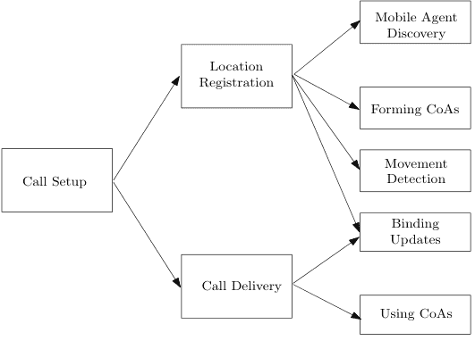

**FIGURE 2.13:** 移动 IP 网络中的呼叫设置过程

## 2.3 切换管理

在第 1 章中，我们提到了切换的三个不同阶段：i) 切换发起，ii) 新连接生成，iii) 数据流控制。实际上，切换发起取决于 MT 收到的基站信号强度以及反之亦然。这导致了两种切换情况： intracell handoff 和 intercell handoff。Intracell handoff 可能在用户即使在同一单元内移动时触发，但由于网络环境变化（如障碍物或反射墙等）导致信号强度低于阈值，从而无法保证可靠通信。此时，切换后，MT 正在进行的呼叫将通过新分配的信道继续，该信道的信号强度由 MT 收到的 BS 信号及反之亦然更强，以维持可靠通信。Intercell handoff 则在 MT 从一个单元移动到相邻单元时触发，此时从旧 BS 接收到的信号强度小于从其运动方向另一 BS 接收到的信号强度。


**FIGURE 2.14:** 交接管理过程

当执行小区内交接时，由于各基站之间的物理接近，移动终端（MT）可能同时接收到多个新基站的强信号。在这种情况下，移动终端可以使用某种信号多样性来组合从这些基站接收的多个信号，以保持与所有新基站的连接。这种短暂的情况称为*软交接*。最终，移动终端将根据其移动方向和接收到的信号强度，被交接到其中一个新基站。在此情况下，旧基站的连接将在将任何正在进行的呼叫的数据包转移到可能在交接过程中缓冲的移动终端后被清除。此外，移动终端的所需资源将从新基站分配，且正在进行呼叫的数据包的接收路径将被确定。此时，移动终端从旧基站到新基站的*硬交接*发生。所有这些交接管理步骤均在图 2.14 [1]中表示。

为了实现顺畅的交接过程，当移动用户改变其附着点（在公共土地网（PLMN）中的基站，或在自组织网（MANET）或无线传感器网（WSN）中的接入点（AP））时，必须满足以下条件。

## 2.4.1 随机游走移动模型

根据 Royer 等人 [22] 提出的模型，移动用户在闭合区域 R 的某一点选择一个随机方向（区间 [0, 2π]）和一个随机速度（范围 [vₘᵢₙ, vₘₐₓ]）来进行移动。当移动用户到达 R 的边界时，它会再次选择一个新的随机方向和速度，从该点继续移动，以此类推。因此，该模型假设每个个体移动终端（MT）或移动节点（MN）都能在障碍物-free 的环境中随机移动，导致在任何模拟运行中移动节点在区域 R 内的空间分布均匀。

文献中提出了该模型的几种变体。第一种变体指出，当移动节点到达区域 R 的边界点时，会在边界处“反弹”回去 [23, 24]。第二种变体允许移动节点以随机选择的方向和随机选择的速度移动一定时间（该时间服从指数分布），然后移动节点会再次根据选定的方向和速度改变其移动方向、速度和持续时间。

第三种变体，即 *高斯-马尔可夫移动模型* [25]，为每个移动节点分配一个初始速度和移动方向。在固定的时间间隔之后，下一个时间间隔（即 nᵗʰ 时间间隔）中每个移动节点的速度和方向由上一时间间隔（即 (n−1)ᵗʰ 间隔）的速度和方向通过两个统计随机变量 Sₓ 和 Dₓ（分别为速度和方向）来确定，这两个变量服从高斯（正态）分布，并且有一个调节参数 α（0 ≤ α ≤ 1），它决定了当前状态与移动变异性的相对贡献。具体而言，

速度 $S_n$ 和方向 $D_n$ 在第 n 个时间间隔的值是基于第 (n−1) 个时间间隔的速度 $S_{n-1}$ 和方向 $D_{n-1}$ 的值，并加入以下方程中的增量随机变化得到：

$$S_n = \alpha * S_{n-1} + (1 + \alpha) * \bar{S} + \sqrt{(1 - \alpha^2)} * S_{x_{n-1}}$$ (2.1)

$$D_n = \alpha * D_{n-1} + (1 + \alpha) * \bar{D} + \sqrt{(1 - \alpha^2)} * D_{x_{n-1}},$$ (2.2)

其中 $\bar{S}$ 和 $\bar{D}$ 分别是速度和方向的均值，而 $S_{x_{n-1}}$ 和 $D_{x_{n-1}}$ 是两个随机变量 $S_x$ 和 $D_x$ 在 (n−1)ᵗʰ 时间间隔的值。

## 2.4.2 随机途径移动模型

这是最流行的移动模型之一，并在 ns2 模拟器 [18] 中实现。该模型（也称为文献中的 *RWP 模型*）由 Johnson 和 Maltz [23] 提出，用于研究在自组织网络中用于路由的 DSR 协议的性能。与随机游走模型的主要区别在于，随机途径模型中移动节点选择一个在给定区域 R 内的随机点作为目的地（即*途径点*），然后以从给定区间（如 $[v_{min}, v_{max}]$）中随机选择的速度开始向该途径点移动。到达该途径点后，移动节点会停留（停顿）一个预定义的时间段（这与随机游走模型的另一个区别），然后重复上述步骤，从该点开始进行另一次移动。该 RWP 模型也允许在给定区域 R 内的个体移动节点进行障碍物-free 的移动，这可能代表一个人在购物中心、市场或会议场所中移动的模式。

图 2.15 展示了根据该 RWp 模型的移动模式的典型示意图，其中 A、B、C、D、E 和 F 分别代表不同的移动终端。图中显示，移动节点倾向于在部署区域的中心部分移动。多位研究者 [28, 29, 30] 指出，遵循 RWp 模型的移动节点在长期会集中在部署区域的中心附近，这称为 RWp 模型的*边界效应*。然而，随机游走模型并不表现出这种边界效应。

Bettsletter 等人 [29] 提出了 RWP 模型的一个小变体，建议在到达目的地点并从该点开始下一次移动之间的停顿时间也可以随任意概率分布随机选择。此外，网络中部分节点可以被允许在整个感兴趣的时间段内保持静止，以更真实地反映实际场景。

上述两个模型反映了节点有意进行移动的网络场景，其中每个移动的方向和速度都被随机化。

## 2.4.4 基于地图的移动模型

在上述三个模型中，节点被假设可以在部署区域 R 内自由移动。在此模型中，我们假设节点仅沿部署区域 R 内指定的路径移动。例如，包括在道路或高速公路上行驶，或在街道人行道上行走的情况。因此，需要一个区域 R 的道路地图。节点会在随机方式部署在这些道路上，且其移动受限于这些预定义的路径。一个典型的基于地图的模型是 Bai 等人 [32] 提出的*高速公路移动模型*，该模型假设存在若干高速公路，且在两个方向上车道数量有所不同。节点会在高速公路中随机部署，并只能在指定方向的车道上以随机选择的速度移动，该速度在时间上依赖于其最近的


先前的速度。然而，如果两个节点在同一车道行驶且距离在某个最小阈值距离（该距离可能与后车的速度成正比）之内，则后车的速度不能超过前车。

高速公路移动模型的一个变体是 *曼哈顿移动模型*，同样在 [32] 中提出，在该模型中，移动遵循区域 \(R\) 内类似曼哈顿的地图，该地图由水平和垂直街道组成，如同城市网格。节点可以沿这些街道双向移动。到达交叉路口后，节点选择下一移动方向：沿相同方向、左转或右转。节点的速度遵循上述针对高速公路移动模型讨论的相同规则。

## 2.4.5 基于组的移动模型

该模型 [33, 34] 用于模拟某些现实生活中的场景，例如一群游客在城市中的移动或一群徒步者在山上的移动。其思想是：节点集在被随机部署后，被分成若干簇或组，每组有一个领导者。组领导者遵循上述讨论的一种移动模型（例如随机路点移动模型），而其他组成员以领导者速度的微小扰动作为各自速度来跟随领导者。然而，该模型遵循如下规定：当两个组交叉时，任何组成员都可能以一定的概率离开当前组并加入另一个组。

## 2.5 习题

- 1. 在 PLMN 中，呼叫建立需要执行的两个重要功能是什么？

  描述在 PLMN 中使用的 SS7 信令网络架构。

- 2. 列出在 PLMN 中使用的的位置注册过程中需要遵循的步骤顺序。为此目的，数据库如何维护和更新？

- 3. 描述基于时间、基于运动和基于距离的位置更新机制的相对优缺点。你认为哪一种最有效？为什么？

- 4. 在 PLMN 中，呼叫投递过程遵循哪些步骤？借助一个合适的说明性示例解释所有这些步骤。

- 5. 在 PLMN 的集中式数据库架构中，目录寄存器的主要功能是什么？此类目录寄存器如何管理指针？

- 6. 描述在 PLMN 的分布式数据库架构中使用的分区方案。

- 7. 在移动 IP 网络中，定义术语*归属代理*、*外部代理*、*通信节点*和*转交地址*。

- 8. 描述在移动 IP 网络架构中使用的位置注册过程所涉及的步骤。

- 9. 在移动 IP 网络架构中，跟踪移动节点移动的可能方式有哪些？

- 10. 说明水平切换和垂直切换之间的差异。

- 11. 区分软切换和硬切换。

- 12. 定义小区内切换和小区间切换。小区内切换也可以是垂直切换吗？

- 13. 网络启动和处理切换的不同方式有哪些？

- 14. 解释用于表征移动网络中节点移动模式的 RWP 移动模型。在什么情况下，基于组的移动模型会比该模型更适用？

## 参考文献

- [1] I. F. Akyildiz, J. McNair, I. S. M. Ho, H. Uzunalioglu 和 W. Wang，“下一代无线系统中的移动性管理”，*IEEE 学报*，第 87 卷，第 1345-1382 页，1999 年 8 月。

- [2] A. R. Modaressi 和 R. A. Skoog，“7 号信令系统：教程”，*IEEE 通信杂志*，第 28 卷，第 19-35 页，1990 年 7 月。

- [3] D. R. Wilson，“7 号信令系统、IS-41 与蜂窝电话网络”，*IEEE 学报*，第 80 卷，第 664-652 页，1992 年 4 月。

- [4] Y. B. Lin 和 S. K. DeVries，“使用 SS7 的 PCS 网络信令”，*IEEE 通信杂志*，第 33 卷，第 44-55 页，1995 年 6 月。

- [5] EIA/TIA，“蜂窝无线电信系统间操作”，*EIA/TIA 技术报告*，IS-41 修订版 C，1995 年。

- [6] S. Mohan 和 R. Jain，“个人通信服务的两种用户定位策略”，_IEEE 个人通信_，第 1 卷，第 42-50 页，1994 年。

- [7] ETSI/TC，“移动应用部分 (MAP) 规范，版本 4.8.0”，_技术报告，GSM 09.02 建议书_，1994 年。

- [8] C. Rose 和 R. Yates，“在延迟约束下最小化寻呼平均成本”，_ACM-Baltzer 无线网络杂志_，第 1 卷，第 2 期，第 211-219 页，1995 年 7 月。

- [9] J. S. M. Ho 和 I. F. Akyildiz，“移动用户位置更新和寻呼机制”，_ACM-Baltzer 无线网络杂志_，第 1 卷，第 4 期，第 413-425 页，1995 年 12 月。

- [10] I. F. Akyildiz, J. S. M. Ho 和 Y. B. Lin，“面向 PCS 网络的基于移动的位置更新和选择性寻呼”，_IEEE-ACM 网络汇刊_，第 4 卷，第 629-636 页，1996 年 8 月。

- [11] R Jain, Y. B. Lin 和 S. Mohan，“减少 PCS 网络影响的缓存策略”，_IEEE 通信选题期刊_，第 12 卷，第 1434-1444 页，1994 年 10 月。

- [12] N. Shivakumar 和 J. Widom，“移动环境中用于更快位置查找的用户配置文件复制”，_ACM/IEEE MOBICOM ’95 论文集_，第 161-169 页，1995 年。

- [13] J. S. M. Ho 和 I. F. Akyildiz，“降低个人通信网络信令成本的本地锚点方案”，_IEEE-ACM 网络汇刊_，第 4 卷，第 5 期，第 709-726 页，1996 年 10 月。

- [14] R. Jain 和 Y. B. Lin，“采用转发指针以降低 PCS 网络影响的辅助用户定位策略”，_ACM-Baltzer 无线网络杂志_，第 1 卷，第 2 期，第 197-210 页，1995 年 7 月。

- [15] J. Z. Wang，“通用个人通信系统的完全分布式定位注册策略”，_IEEE 通信选题期刊_，第 11 卷，第 850-860 页，1993 年 8 月。

- [16] B. R. Badrinath, T. Imielinski 和 A. Virmani，“个人通信网络定位策略”，_个人通信应用网络研讨会论文集_，1992 年 12 月。

- [17] V. Anantharam, M. L. Honig, U. Madhow 和 V. K. Wei，“个人通信网络中移动性跟踪的数据库层次优化”，*性能评估*，第 20 卷，第 1-3 期，第 287-300 页，1994 年 5 月。

- [18] C. Perkins，“移动 IP”，*IEEE 通信杂志*，第 35 卷，第 84-99 页，1997 年 5 月。

- [19] D. B. Johnson 和 C. Perkins，“IPv6 中的移动性支持”，*因特网工程任务组*，因特网草案，draft-ietf-mobileip-ipv6-04.txt，1997 年 11 月。

- [20] C. Perkins 和 D. Johnson，“移动 IP 中的路由优化”，*因特网工程任务组*，因特网草案，draft-ietf-mobileip-optim-07.txt，1997 年 11 月 20 日。

- [21] P. Calhoun 和 C. Perkins，“隧道建立协议”，*因特网工程任务组*，因特网草案，draft-ietf-mobileip-calhoun-tep-00.txt，1997 年 11 月 21 日。

- [22] E. Royer, P. Melliar-Smith 和 L. Moser，“自组织移动网络最优节点密度分析”，*IEEE 国际通信会议论文集*，赫尔辛基，第 857-861 页，2001 年。

- [23] Z. Haas 和 M. Pearlman，“区域路由协议查询控制方案的性能”，*ACM Sigcomm 论文集*，温哥华，第 167-177 页，1998 年。

- [24] M. Pearlman, Z. Haas, P. Sholander 和 S. Tabrizi，“关于移动自组织中负载均衡的备用路径路由的影响”，*ACM MobiHoc 论文集*，马萨诸塞州波士顿，第 3-10 页，2000 年。

- [25] T. Camp, J. Boleng 和 V. Davies，“自组织网络研究模型综述”，*无线通信与移动计算 (WCMC)：移动自组织网络研究、趋势与应用特刊*，第 2 卷，第 483-502 页，2002 年。

- [26] NS2 2002，“网络模拟器 – ns-2”，http://www.isi.edu/nsnam/ns/。

- [27] D. Johnson 和 D. Maltz，“自组织无线网络中的动态源路由”，*移动计算*，Kluwer 学术出版社，第 153-181 页。


## Mobility Management in Cellular Networks

[28] C. Bettsletter and O. Krause, “On border effects in modelling and simulation of wireless ad hoc networks,” Proc. IEEE Intl. Conf. Mobile and Wireless Commun. Network (MWCN), Recife, 2001.

[29] C. Bettsletter, G. Resta and P. Santi, “The node distribution of the random waypoint mobility model for wireless ad hoc networks,” IEEE Trans. Mobile Computing, Vol. 2, pp. 257-269, 2003.

[30] D. Blough, G. Resta and P. Santi, “A statistical analysis of the long-run node spatial distribution in mobile ad hoc networks,” Wireless networks, Vol. 10, pp. 543-554, 2004.

[31] P. Santi and D. Blough, “The critical transmitting range for connectivity in sparse wireless ad hoc networks,” IEEE Trans. Mobile Computing, Vol. 2, pp. 25-39, 2003.

[32] F. Bai, N. Sadagopan and A. Helmy, “Important: A framework to systematically analyze the impact of mobility on performance of routing protocols for ad hoc networks,” Proc. IEEE Infocom, San Francisco, pp. 825-835, 2003.

[33] X. Hong, M. Gerla, G. Pei and C. Chiang, “A group mobility model for ad hoc wireless networks,” Proc. ACM MSWiM, Seattle, pp. 53-60, 1999.

[34] K. Wang and B. Li, “Group mobility and pattern prediction in wireless ad hoc networks,” Proc. IEEE Intl. Conf. Commun., New York, pp. 1017-1021, 2002.

[35] Y. B. Lin, “Determining the user locations for personal communications services networks,” IEEE Trans. Veh. Technol., vol. 43, pp. 466-473, Aug. 1994.

[PAGE 97]

## Chapter 3

## Bandwidth Management in Cellular Networks

| Section | Title | Page |
|---|---|---:|
| 3.1 | Introduction | 78 |
| 3.1.1 | Channel Assignment Problem and Variants | 78 |
| 3.1.2 | Mathematical Formulation of CAP | 81 |
| 3.1.3 | CAP and Generalized Graph Coloring | 83 |
| 3.2 | Benchmark Instances | 84 |
| 3.3 | Lower Bounds on Bandwidth | 89 |
| 3.3.1 | Lower Bounds on Bandwidth for Homogeneous Demand | 91 |
| 3.3.2 | Lower Bounds on Bandwidth for Non-Homogeneous Demand | 101 |
| 3.4 | Genetic Algorithm for Channel Assignment | 108 |
| 3.4.1 | Problem Formulation | 109 |
| 3.4.2 | *Algorithm GA* | 111 |
| 3.4.3 | GA on Special Cases of CAP | 116 |
| 3.4.3.1 | Scheme 1: $s_1=s_2$ | 116 |
| 3.4.3.2 | Scheme 2: For i) $s_2 < s_1 \leq 2s_2$ and ii) $s_1 \geq 2s_2$ | 119 |
| 3.4.3.3 | Scheme 3: For $s_1 \geq s_2$ | 125 |
| 3.4.4 | Overall Bandwidth Requirement | 131 |
| 3.5 | Coalesced CAP | 133 |

[PAGE 98]

+   3.5.1 Construction of Coalesced CAP ..... 133
+   3.5.2 Technique for Solving Original CAP from Coalesced CAP .. 137
+   3.6 Fast Near-Optimal Channel Assignment ..... 147
+   3.6.1 Assignment Algorithm ..... 147
+   3.6.2 Convergence Behavior of Algorithm ..... 159
+   3.6.3 Worst-Case Time Complexity of Assignment Algorithm .... 161
+   3.6.4 Worst-Case Deviation of Bandwidth from Optimality ..... 162
+   3.7 Conclusion ..... 164
+   3.8 Exercises ..... 167
+   Bibliography ..... 169

Mobile computing, particularly over cellular networks, has emerged as an important topic of research because of the need for computing capabilities even when people are on the move. Over the past decade, the number of such cellular network dependent mobile users has increased almost exponentially. However, the available bandwidth for providing services to those users is very limited. Such a limited availability of the radio spectrum, signal distortion, and the interference caused by the environment and other mobile users impose inherent limitations on the capacity of wireless networks. Therefore, developing methods to utilize the scarce radio spectrum efficiently is more critical than ever.

For cellular networks, the available radio spectrum is divided into a number of non-overlapping frequency bands. We assume that the frequency bands are of equal length and numbered 0, 1, 2, ... from the lower end. Each such frequency band is called a channel. The highest numbered channel required in an assignment problem is known as the required bandwidth or span of the assignment. When a mobile cellular network is designed, each cell of the network is assigned a set of channels to provide services to the individual calls. The same frequency channel may be assigned to different cells (reused) if they are at a sufficient distance without causing any interference. However, the assignment of channels to nearby cells should satisfy certain constraints to avoid channel interference. Interference is a function primarily of transmitter power, receiver sensitivity, antenna gains, and channel loss. Channel loss is a function of distance, frequency, and weather, and is quantified by the minimum acceptable signal-to-noise ratio (SNR). Assuming that most of these factors are already determined or beyond the ability to influence, the interference can be defined directly as a function of frequency and distance. Based on that, three types of interference are generally considered: 1) co-channel constraint, due to which the same channel cannot be assigned to certain pairs of cells simultaneously, 2) adjacent channel constraint, for which adjacent channels cannot be assigned to certain pairs of cells simultaneously, and 3) co-site constraint, which implies that any pair of channels assigned to the same cell must be separated by a certain number of channels [20].

The channel assignment problem (CAP) deals with assigning frequency channels to cells to satisfy the frequency separation constraints with a view to avoiding channel interference and using as little bandwidth as possible. This variant of the channel assignment problem is known as the minimum span channel assignment problem.

For another variant of the CAP, consider the channel assignment when the bandwidth B of the system is given, which may even be smaller than the required lower bound on bandwidth for the given problem. Depending on B, it may or may not be possible to satisfy all the channel demands of each cell unless B is sufficiently large.

Thus, a solution to this variant of CAP may cause blocked calls. However, the objective is to minimize call blocking. This class of assignment problem is known as the *fixed bandwidth* channel assignment problem.

There is, however, another class of problem of real-life importance known as the *perturbation-minimizing* frequency assignment problem (PMFAP) [17]. Assume that an assignment has been obtained for a given network to satisfy the required channel demands. After some time, demands of some of the cells may be changed due to either 1) newly generated calls or 2) a handoff situation or 3) completion of some ongoing calls. The objective of this variant of CAP is to accommodate these small changes in demands; but while doing so, the number of changes in the existing assignment should be minimized while meeting the desired QoS. This variant is useful for addressing the short-term demand fluctuations that often arise in real-life scenarios.

Channel assignment schemes can be classified into several categories. In the fixed (or static) channel assignment problem (FCA), the number of calls to each cell is known a priori and a number of nominal channels is permanently allocated to each cell for its exclusive use. In the simple uniform FCA, the same number of nominal channels is allocated to each cell. Since the traffic in cellular systems is mostly nonuniform, uniform allocation may result in poor channel utilization [34]. To achieve better channel utilization, the number of channels allocated to each cell should depend on the expected traffic load of the cell. This technique is called non-uniform channel allocation [35, 36]. Simple FCA schemes are not adaptive to temporal and spatial fluctuations of user demands and to overcome this drawback, dynamic channel assignment (DCA) schemes have been developed [37]. In DCA, all channels are available to every cell and channels are assigned to newly generated calls as and when required, provided they satisfy the interference constraints. Though DCA schemes provide flexibility and traffic adaptability at the cost of higher complexity,


they are less efficient than FCA under high load situations [34, 38, 40]. To address this drawback, many hybrid schemes combining the benefits of both FCA and DCA have been developed. Both the FCA and DCA schemes can be implemented in centralized or distributed fashion. In centralized schemes, a channel is assigned by the central controller whereas in the distributed schemes, a channel is selected by the base station at which the call is initiated or by the mobile [34]. If the base stations select the channel, each base station keeps the information about the currently available channels in its vicinity and this information is updated by exchanging status information among these stations. In the other situation where the mobile terminals are allowed to select the channel, the mobile terminals choose the channels based on the local signal-to-interference measurements [34].

### 3.1.2 Mathematical Formulation of CAP

The channel assignment problem can be represented as a mathematical optimization problem. The model used in [1], [8], [14] to represent a CAP can be described by the following components:

1. A set of \(n\) distinct cells \(X = \{0, 1, \cdots, n - 1\}\).
2. A demand vector \(W = (w_i)\) \((0 \leq i \leq n - 1)\), where \(w_i\) represents the number of channels required for cell \(i\).
3. A frequency separation matrix \(C = (c_{ij})\), where \(c_{ij}\) represents the frequency separation requirement between a call in cell \(i\) and a call in cell \(j\) \((0 \leq i, j \leq n - 1)\).
4. A frequency assignment matrix \(\Phi = (\phi_{ij})\), where \(\phi_{ij}\) represents the frequency assigned to call \(j\) in cell \(i\) \((0 \leq i \leq n - 1,\ 0 \leq j \leq w_i - 1)\).
5. A set of frequency separation constraints specified by the frequency separation matrix:

\[
|\phi_{ik}-\phi_{jl}| \ge c_{ij}
\]

for all \(i,j,k,l\) (except when both \(i=j\) and \(k=l\)).

Based on this model, a channel assignment problem \(P\) can be characterized by the triplet \((X, W, C)\). A frequency assignment \(\Phi\) for \(P\) is said to be *admissible* if the \(\phi_{ij}\)’s satisfy component 5 above for all \(i,j\), where \(0 \le i \le n-1\) and \(0 \le j \le w_i-1\).

The *span* \(S(\Phi)\) of a frequency assignment \(\Phi\) is the maximum frequency assigned to the system. That is,

\[
S(\Phi)=\max_{i,j}\phi_{ij}.
\]

Thus, the objective of the *minimum span* frequency assignment is to find an admissible frequency assignment with the minimum span \(S_{min}(P)\), where \(S_{min}(P)=\min\{S(\Phi)\mid \Phi\text{ is admissible for }P\}\). The advantage of this category of algorithms is that the derived channel assignment always fulfills all the interference constraints for a given demand. However, it may be hard to find optimal solutions for large and difficult problems, even with powerful optimization tools [29].

For the *fixed bandwidth* channel assignment, let \(B\) be the given bandwidth of the system. Now suppose, due to the bandwidth constraint \(B\), only \(w'_i\) channels are assigned to cell \(i\) instead of \(w_i\) in an admissible frequency assignment \(\Phi=(\phi_{ij})\) \((0\le i\le n-1,\ 0\le j\le w'_i-1)\) for \(P\), where \(w'_i<w_i\) for some or all \(i\). Let \(b_i=(w_i-w'_i)\) when \(w'_i<w_i\), and 0 when \(w'_i=w_i\). Then we say that \(b_i\) calls are blocked in cell \(i\) by the assignment \(\Phi\). Then the total number of blocked calls \(BL(\Phi)\) produced by \(\Phi\) is defined as

\[
BL(\Phi)=\sum_{i=0}^{n-1}b_i.
\]

Given bandwidth \(B\), the objective of the fixed bandwidth channel assignment is to find an admissible frequency assignment \(\Phi\) for \(P\) with minimum blocking \(BL_{min}(P)\), where \(BL_{min}(P)=\min\{BL(\Phi)\mid \Phi\text{ is admissible for }P\}\). The principal disadvantage of this formulation is that it is almost impossible to minimize the blocking to the desired value of zero taking the minimum number of required channels as the given bandwidth for very difficult problems [29].

Consider a CAP \(P = (X, W, C)\) and an admissible frequency assignment \(\Phi\) for \(P\). After some time, demands of some of the cells may be increased due to fluctuations that often arise in real-life scenarios and let \(W' = (w'_i)\) be this changed demand vector where \(w'_i > w_i\) for some or all \(i\). Given \(\Phi\), an initial admissible frequency assignment, the objective of the *perturbation-minimizing* frequency assignment [17] is to accommodate the additional requirements as specified in \(W'\) with minimum changes in the existing assignment.

### 3.1.3 CAP and Generalized Graph Coloring

In its most general form, the channel assignment problem is equivalent to the generalized graph coloring which is a well-known NP-complete problem [3]. The minimum span channel assignment problem can be represented as a graph coloring problem defined on a CAP *graph*. Call \(k\) of cell \(i\) is represented as node \((ik)\) of a CAP graph and the nodes \((ik)\) and \((jl)\) are connected by an edge with weight \(c_{ij}\), if \(c_{ij} > 0\). Let us assume that the channels are assigned to the nodes of the CAP graph in a specific order and a node will be assigned the channel corresponding to the smallest integer that will satisfy the frequency separation constraints with all the previously assigned nodes. It can be shown that the ordering of the nodes has a strong impact on the required channel bandwidth. Suppose there are \(m\) nodes in the CAP graph. Therefore, the nodes can be ordered in \(m!\) ways and hence for sufficiently large \(m\), it is impractical to find the best ordering by an exhaustive search.

**Example 1.** *Figure 3.1(a) shows a CAP graph with three cells having demands \(w_0 = 1\), \(w_1 = 2\), and \(w_2 = 2\), respectively. Each node is labeled \((rs)\), where \(r\) is the cell number at which a call is generated and \(s\) is the call number to this cell \(r\). That is,*

Practical assignment problem from Helsinki, Finland defined on a 25-node benchmark network [26, 24].

Problem 9 has been formulated on this 25-cell network, whose frequency separation ratio matrix \(C\) and demand vector \(D_3\) are shown in Tables 3.3 and 3.4, respectively. The entry corresponding to the \(i\)-th row and \(j\)-th column of Table 3.3, i.e., \(c_{ij}\), represents the minimum frequency separation requirement between a call in cell \(i\) and a call in cell \(j\) \((0 \le i, j \leq 24)\). Row \(D_3\) in Table 3.4 indicates the channel demand from cell \(i\).

In addition to the Philadelphia benchmarks and the 25-cell benchmark discussed above, we also considered two other benchmarks defined on the 55-node cellular network [26] shown in Figure 3.3.

**Figure 3.2:** The 21-node benchmark cellular network

**Figure 3.3:** The 55-node benchmark cellular network

These two benchmarks also have been defined on a two-band buffering system where \(s_0\), \(s_1\) and \(s_2\) are given as 7, 1 and 1, respectively. The demand vectors of these two problems (Problems 10 and 11) are given by \(D_4\) and \(D_5\), respectively, as shown in Table 3.5.

| Cell nos. | 0 | 1 | 2 | 3 | 4 | 5 | 6 | 7 | 8 | 9 | 10 | 11 | 12 | 13 | 14 | 15 | 16 | 17 | 18 | 19 | 20 |
|---|---|---|---|---|---|---|---|---|---|---|---|---|---|---|---|---|---|---|---|---|---|
| \(D_1\) | 8 | 25 | 8 | 8 | 8 | 15 | 18 | 52 | 77 | 28 | 13 | 15 | 31 | 15 | 36 | 57 | 28 | 8 | 18 | 13 | 8 |
| \(D_2\) | 5 | 5 | 5 | 8 | 12 | 25 | 30 | 25 | 30 | 40 | 40 | 45 | 20 | 30 | 25 | 15 | 15 | 30 | 20 | 20 | 25 |

| Problems | | 1 | 2 | 3 | 4 | 5 | 6 | 7 | 8 |
|---|---|---|---|---|---|---|---|---|---|
| Frequency separation constraints | \(s_0\) | 5 | 5 | 7 | 7 | 5 | 5 | 7 | 7 |
| | \(s_1\) | 1 | 2 | 1 | 2 | 1 | 2 | 1 | 2 |
| | \(s_2\) | 1 | 1 | 1 | 1 | 1 | 1 | 1 | 1 |
| Demand vector | | \(D_1\) | \(D_1\) | \(D_1\) | \(D_1\) | \(D_2\) | \(D_2\) | \(D_2\) | \(D_2\) |

**Table 3.3:** Frequency separation matrix for Problem 9

\[
C = \begin{bmatrix}
2 & 1 & 1 & 0 & 1 & 0 & 1 & 1 & 1 & 1 & 0 & 1 & 1 & 1 & 0 & 0 & 0 & 0 & 0 & 0 & 0 & 0 & 0 & 0 & 0 & 0 & 0 & 0 & 0 & 0 & 0 & 0 & 0 & 0 & 0 & 0 & 0 & 0 & 0 & 0 & 0 & 0 & 0 & 0 & 0 & 0 & 0 & 0 & 0 & 0 & 0 & 0 & 0 & 0 & 0 & 0 & 0 & 0 & 0 & 0 & 0 & 0 & 0 & 0 & 0 & 0 & 0 & 0 & 0 & 0 & 0 & 0 & 0 & 0 & 0 & 0 & 0 & 0 & 0 & 0 & 0 & 0 & 0 & 0 & 0 & 0 & 0 & 0 & 0 & 0 & 0 & 0 & 0 & 0 & 0 & 0 & 0 & 0 & 0 & 0 & 0 & 0 & 0 & 0 & 0 & 0 & 0 & 0 & 0 & 0 & 0 & 0 & 0 & 0 & 0 & 0 & 0 & 0 & 0 & 0 & 0 & 0 & 0 & 0 & 0 & 0 & 0 & 0 & 0 & 0 & 0 & 0 & 0 & 0 & 0 & 0 & 0 & 0 & 0 & 0 & 0 & 0 & 0 & 0 & 0 & 0 & 0 & 0 & 0 & 0 & 0 & 0 & 0 & 0 & 0 & 0 & 0 & 0 & 0 & 0 & 0 & 0 & 0 & 0 & 0 & 0 & 0 & 0 & 0 & 0 & 0 & 0 & 0 & 0 & 0 & 0 & 0 & 0 & 0 & 0 & 0 & 0 & 0 & 0 & 0 & 0 & 0 & 0 & 0 & 0 & 0 & 0 & 0 & 0 & 0 & 0 & 0 & 0 & 0 & 0 & 0 & 0 & 0 & 0 & 0 & 0 & 0 & 0 & 0 & 0 & 0 & 0 & 0 & 0 & 0 & 0 & 0 & 0 & 0 & 0 & 0 & 0 & 0 & 0 & 0 & 0 & 0 & 0 & 0 & 0 & 0 & 0 & 0 & 0 & 0 & 0 & 0 & 0 & 0 & 0 & 0 & 0 & 0 & 0 & 0 & 0 & 0 & 0 & 0 & 0 & 0 & 0 & 0 & 0 & 0 & 0 & 0 & 0 & 0 & 0 & 0 & 0 & 0 & 0 & 0 & 0 & 0 & 0 & 0 & 0 & 0 & 0 & 0 & 0 & 0 & 0 & 0 & 0 & 0 & 0 & 0 & 0 & 0 & 0 & 0 & 0 & 0 & 0 & 0 & 0 & 0 & 0 & 0 & 0 & 0 & 0 & 0 & 0 & 0 & 0 & 0 & 0 & 0 & 0 & 0 & 0 & 0 & 0 & 0 & 0 & 0 & 0 & 0 & 0 & 0 & 0 & 0 & 0 & 0 & 0 & 0 & 0 & 0 & 0 & 0 & 0 & 0 & 0 & 0 & 0 & 0 & 0 & 0 & 0 & 0 & 0 & 0 & 0 & 0 & 0 & 0 & 0 & 0 & 0 & 0 & 0 & 0 & 0 & 0 & 0 & 0 & 0 & 0 & 0 & 0 & 0 & 0 & 0 & 0 & 0 & 0 & 0 & 0 & 0 & 0 & 0 & 0 & 0 & 0 & 0 & 0 & 0 & 0 & 0 & 0 & 0 & 0 & 0 & 0 & 0 & 0 & 0 & 0 & 0 & 0 & 0 & 0 & 0 & 0 & 0 & 0 & 0 & 0 & 0 & 0 & 0 & 0 & 0 & 0 & 0 & 0 & 0 & 0 & 0 & 0 & 0 & 0 & 0 & 0 & 0 & 0 & 0 & 0 & 0 & 0 & 0 & 0 & 0 & 0 & 0 & 0 & 0 & 0 & 0 & 0 & 0 & 0 & 0 & 0 & 0 & 0 & 0 & 0 & 0 & 0 & 0 & 0 & 0 & 0 & 0 & 0 & 0 & 0 & 0 & 0 & 0 & 0 & 0 & 0 & 0 & 0 & 0 & 0 & 0 & 0 & 0 & 0 & 0 & 0 & 0 & 0 & 0 & 0 & 0 & 0 & 0 & 0 & 0 & 0 & 0 & 0 & 0 & 0 & 0 & 0 & 0 & 0 & 0 & 0 & 0 & 0 & 0 & 0 & 0 & 0 & 0 & 0 & 0 & 0 & 0 & 0 & 0 & 0 & 0 & 0 & 0 & 0 & 0 & 0 & 0 & 0 & 0 & 0 & 0 & 0 & 0 & 0 & 0 & 0 & 0 & 0 & 0 & 0 & 0 & 0 & 0 & 0 & 0 & 0 & 0 & 0 & 0 & 0 & 0 & 0 & 0 & 0 & 0 & 0 & 0 & 0 & 0 & 0 & 0 & 0 & 0 & 0 & 0 & 0 & 0 & 0 & 0 & 0 & 0 & 0 & 0 & 0 & 0 & 0 & 0 & 0 & 0 & 0 & 0 & 0 & 0 & 0 & 0 & 0 & 0 & 0 & 0 & 0 & 0 & 0 & 0 & 0 & 0 & 0 & 0 & 0 & 0 & 0 & 0 & 0 & 0 & 0 & 0 & 0 & 0 & 0 & 0 & 0 & 0 & 0 & 0 & 0 & 0 & 0 & 0 & 0 & 0 & 0 & 0 & 0 & 0 & 0 & 0 & 0 & 0 & 0 & 0 & 0 & 0 & 0 & 0 & 0 & 0 & 0 & 0 & 0 & 0 & 0 & 0 & 0 & 0 & 0 & 0 & 0 & 0 & 0 & 0 & 0 & 0 & 0 & 0 & 0 & 0 & 0 & 0 & 0 & 0 & 0 & 0 & 0 & 0 & 0 & 0 & 0 & 0 & 0 & 0 & 0 & 0 & 0 & 0 & 0 & 0 & 0 & 0 & 0 & 0 & 0 & 0 & 0 & 0 & 0 & 0 & 0 & 0 & 0 & 0 & 0 & 0 & 0 & 0 & 0 & 0 & 0 & 0 & 0 & 0 & 0 & 0 & 0 & 0 & 0 & 0 & 0 & 0 & 0 & 0 & 0 & 0 & 0 & 0 & 0 & 0 & 0 & 0 & 0 & 0 & 0 & 0 & 0 & 0 & 0 & 0 & 0 & 0 & 0 & 0 & 0 & 0 & 0 & 0 & 0 & 0 & 0 & 0 & 0 & 0 & 0 & 0 & 0 & 0 & 0 & 0 & 0 & 0 & 0 & 0 & 0 & 0 & 0 & 0 & 0 & 0 & 0 & 0 & 0 & 0 & 0 & 0 & 0 & 0 & 0 & 0 & 0 & 0 & 0 & 0 & 0 & 0 & 0 & 0 & 0 & 0 & 0 & 0 & 0 & 0 & 0 & 0 & 0 & 0 & 0 & 0 & 0 & 0 & 0 & 0 & 0 & 0 & 0 & 0 & 0 & 0 & 0 & 0 & 0 & 0 & 0 & 0 & 0 & 0 & 0 & 0 & 0 & 0 & 0 & 0 & 0 & 0 & 0 & 0 & 0 & 0 & 0 & 0 & 0 & 0 & 0 & 0 & 0 & 0 & 0 & 0 & 0 & 0 & 0 & 0 & 0 & 0 & 0 & 0 & 0 & 0 & 0 & 0 & 0 & 0 & 0 & 0 & 0 & 0 & 0 & 0 & 0 & 0 & 0 & 0 & 0 & 0 & 0 & 0 & 0 & 0 & 0 & 0 & 0 & 0 & 0 & 0 & 0 & 0 & 0 & 0 & 0 & 0 & 0 & 0 & 0 & 0 & 0 & 0 & 0 & 0 & 0 & 0 & 0 & 0 & 0 & 0 & 0 & 0 & 0 & 0 & 0 & 0 & 0 & 0 & 0 & 0 & 0 & 0 & 0 & 0 & 0 & 0 & 0 & 0 & 0 & 0 & 0 & 0 & 0 & 0 & 0 & 0 & 0 & 0 & 0 & 0 & 0 & 0 & 0 & 0 & 0 & 0 & 0 & 0 & 0 & 0 & 0 & 0 & 0 & 0 & 0 & 0 & 0 & 0 & 0 & 0 & 0 & 0 & 0 & 0 & 0 & 0 & 0 & 0 & 0 & 0 & 0 & 0 & 0 & 0 & 0 & 0 & 0 & 0 & 0 & 0 & 0 & 0 & 0 & 0 & 0 & 0 & 0 & 0 & 0 & 0 & 0 & 0 & 0 & 0 & 0 & 0 & 0 & 0 & 0 & 0 & 0 & 0 & 0 & 0 & 0 & 0 & 0 & 0 & 0 & 0 & 0 & 0 & 0 & 0 & 0 & 0 & 0 & 0 & 0 & 0 & 0 & 0 & 0 & 0 & 0 & 0 & 0 & 0 & 0 & 0 & 0 & 0 & 0 & 0 & 0 & 0 & 0 & 0 & 0 & 0 & 0 & 0 & 0 & 0 & 0 & 0 & 0 & 0 & 0 & 0 & 0 & 0 & 0 & 0 & 0 & 0 & 0 & 0 & 0 & 0 & 0 & 0 & 0 & 0 & 0 & 0 & 0 & 0 & 0 & 0 & 0 & 0 & 0 & 0 & 0 & 0 & 0 & 0 & 0 & 0 & 0 & 0 & 0 & 0 & 0 & 0 & 0 & 0 & 0 & 0 & 0 & 0 & 0 & 0 & 0 & 0 & 0 & 0 & 0 & 0 & 0 & 0 & 0 & 0 & 0 & 0 & 0 & 0 & 0 & 0 & 0 & 0 & 0 & 0 & 0 & 0 & 0 & 0 & 0 & 0 & 0 & 0 & 0 & 0 & 0 & 0 & 0 & 0 & 0 & 0 & 0 & 0 & 0 & 0 & 0 & 0 & 0 & 0 & 0 & 0 & 0 & 0 & 0 & 0 & 0 & 0 & 0 & 0 & 0 & 0 & 0 & 0 & 0 & 0 & 0 & 0 & 0 & 0 & 0 & 0 & 0 & 0 & 0 & 0 & 0 & 0 & 0 & 0 & 0 & 0 & 0 & 0 & 0 & 0 & 0 & 0 & 0 & 0 & 0 & 0 & 0 & 0 & 0 & 0 & 0 & 0 & 0 & 0 & 0 & 0 & 0 & 0 & 0 & 0 & 0 & 0 & 0 & 0 & 0 & 0 & 0 & 0 & 0 & 0 & 0 & 0 & 0 & 0 & 0 & 0 & 0 & 0 & 0 & 0 & 0 & 0 & 0 & 0 & 0 & 0 & 0 & 0 & 0 & 0 & 0 & 0 & 0 & 0 & 0 & 0 & 0 & 0 & 0 & 0 & 0 & 0 & 0 & 0 & 0 & 0 & 0 & 0 & 0 & 0 & 0 & 0 & 0 & 0 & 0 & 0 & 0 & 0 & 0 & 0 & 0 & 0 & 0 & 0 & 0 & 0 & 0 & 0 & 0 & 0 & 0 & 0 & 0 & 0 & 0 & 0 & 0 & 0 & 0 & 0 & 0 & 0 & 0 & 0 & 0 & 0 & 0 & 0 & 0 & 0 & 0 & 0 & 0 & 0 & 0 & 0 & 0 & 0 & 0 & 0 & 0 & 0 & 0 & 0 & 0 & 0 & 0 & 0 & 0 & 0 & 0 & 0 & 0 & 0 & 0 & 0 & 0 & 0 & 0 & 0 & 0 & 0 & 0 & 0 & 0 & 0 & 0 & 0 & 0 & 0 & 0 & 0 & 0 & 0 & 0 & 0 & 0 & 0 & 0 & 0 & 0 & 0 & 0 & 0 & 0 & 0 & 0 & 0 & 0 & 0 & 0 & 0 & 0 & 0 & 0 & 0 & 0 & 0 & 0 & 0 & 0 & 0 & 0 & 0 & 0 & 0 & 0 & 0 & 0 & 0 & 0 & 0 & 0 & 0 & 0 & 0 & 0 & 0 & 0 & 0 & 0 & 0 & 0 & 0 & 0 & 0 & 0 & 0 & 0 & 0 & 0 & 0 & 0 & 0 & 0 & 0 & 0 & 0 & 0 & 0 & 0 & 0 & 0 & 0 & 0 & 0 & 0 & 0 & 0 & 0 & 0 & 0 & 0 & 0 & 0 & 0 & 0 & 0 & 0 & 0 & 0 & 0 & 0 & 0 & 0 & 0 & 0 & 0 & 0 & 0 & 0 & 0 & 0 & 0 & 0 & 0 & 0 & 0 & 0 & 0 & 0 & 0 & 0 & 0 & 0 & 0 & 0 & 0 & 0 & 0 & 0 & 0 & 0 & 0 & 0 & 0 & 0 & 0 & 0 & 0 & 0 & 0 & 0 & 0 & 0 & 0 & 0 & 0 & 0 & 0 & 0 & 0 & 0 & 0 & 0 & 0 & 0 & 0 & 0 & 0 & 0 & 0 & 0 & 0 & 0 & 0 & 0 & 0 & 0 & 0 & 0 & 0 & 0 & 0 & 0 & 0 & 0 & 0 & 0 & 0 & 0 & 0 & 0 & 0 & 0 & 0 & 0 & 0 & 0 & 0 & 0 & 0 & 0 & 0 & 0 & 0 & 0 & 0 & 0 & 0 & 0 & 0 & 0 & 0 & 0 & 0 & 0 & 0 & 0 & 0 & 0 & 0 & 0 & 0 & 0 & 0 & 0 & 0 & 0 & 0 & 0 & 0 & 0 & 0 & 0 & 0 & 0 & 0 & 0 & 0 & 0 & 0 & 0 & 0 & 0 & 0 & 0 & 0 & 0 & 0 & 0 & 0 & 0 & 0 & 0 & 0 & 0 & 0 & 0 & 0 & 0 & 0 & 0 & 0 & 0 & 0 & 0 & 0 & 0 & 0 & 0 & 0 & 0 & 0 & 0 & 0 & 0 & 0 & 0 & 0 & 0 & 0 & 0 & 0 & 0 & 0 & 0 & 0 & 0 & 0 & 0 & 0 & 0 & 0 & 0 & 0 & 0 & 0 & 0 & 0 & 0 & 0 & 0 & 0 & 0 & 0 & 0 & 0 & 0 & 0 & 0 & 0 & 0 & 0 & 0 & 0 & 0 & 0 & 0 & 0 & 0 & 0 & 0 & 0 & 0 & 0 & 0 & 0 & 0 & 0 & 0 & 0 & 0 & 0 & 0 & 0 & 0 & 0 & 0 & 0 & 0 & 0 & 0 & 0 & 0 & 0 & 0 & 0 & 0 & 0 & 0 & 0 & 0 & 0 & 0 & 0 & 0 & 0 & 0 & 0 & 0 & 0 & 0 & 0 & 0 & 0 & 0 & 0 & 0 & 0 & 0 & 0 & 0 & 0 & 0 & 0 & 0 & 0 & 0 & 0 & 0 & 0 & 0 & 0 & 0 & 0 & 0 & 0 & 0 & 0 & 0 & 0 & 0 & 0 & 0 & 0 & 0 & 0 & 0 & 0 & 0 & 0 & 0 & 0 & 0 & 0 & 0 & 0 & 0 & 0 & 0 & 0 & 0 & 0 & 0 & 0 & 0 & 0 & 0 & 0 & 0 & 0 & 0 & 0 & 0 & 0 & 0 & 0 & 0 & 0 & 0 & 0 & 0 & 0 & 0 & 0 & 0 & 0 & 0 & 0 & 0 & 0 & 0 & 0 & 0 & 0 & 0 & 0 & 0 & 0 & 0 & 0 & 0 & 0 & 0 & 0 & 0 & 0 & 0 & 0 & 0 & 0 & 0 & 0 & 0 & 0 & 0 & 0 & 0 & 0 & 0 & 0 & 0 & 0 & 0 & 0 & 0 & 0 & 0 & 0 & 0 & 0 & 0 & 0 & 0 & 0 & 0 & 0 & 0 & 0 & 0 & 0 & 0 & 0 & 0 & 0 & 0 & 0 & 0 & 0 & 0 & 0 & 0 & 0 & 0 & 0 & 0 & 0 & 0 & 0 & 0 & 0 & 0 & 0 & 0 & 0 & 0 & 0 & 0 & 0 & 0 & 0 & 0 & 0 & 0 & 0 & 0 & 0 & 0 & 0 & 0 & 0 & 0 & 0 & 0 & 0 & 0 & 0 & 0 & 0 & 0 & 0 & 0 & 0 & 0 & 0 & 0 & 0 & 0 & 0 & 0 & 0 & 0 & 0 & 0 & 0 & 0 & 0 & 0 & 0 & 0 & 0 & 0 & 0 & 0 & 0 & 0 & 0 & 0 & 0 & 0 & 0 & 0 & 0 & 0 & 0 & 0 & 0 & 0 & 0 & 0 & 0 & 0 & 0 & 0 & 0 & 0 & 0 & 0 & 0 & 0 & 0 & 0 & 0 & 0 & 0 & 0 & 0 & 0 & 0 & 0 & 0 & 0 & 0 & 0 & 0 & 0 & 0 & 0 & 0 & 0 & 0 & 0 & 0 & 0 & 0 & 0 & 0 & 0 & 0 & 0 & 0 & 0 & 0 & 0 & 0 & 0 & 0 & 0 & 0 & 0 & 0 & 0 & 0 & 0 & 0 & 0 & 0 & 0 & 0 & 0 & 0 & 0 & 0 & 0 & 0 & 0 & 0 & 0 & 0 & 0 & 0 & 0 & 0 & 0 & 0 & 0 & 0 & 0 & 0 & 0 & 0 & 0 & 0 & 0 & 0 & 0 & 0 & 0 & 0 & 0 & 0 & 0 & 0 & 0 & 0 & 0 & 0 & 0 & 0 & 0 & 0 & 0 & 0 & 0 & 0 & 0 & 0 & 0 & 0 & 0 & 0 & 0 & 0 & 0 & 0 & 0 & 0 & 0 & 0 & 0 & 0 & 0 & 0 & 0 & 0 & 0 & 0 & 0 & 0 & 0 & 0 & 0 & 0 & 0 & 0 & 0 & 0 & 0 & 0 & 0 & 0 & 0 & 0 & 0 & 0 & 0 & 0 & 0 & 0 & 0 & 0 & 0 & 0 & 0 & 0 & 0 & 0 & 0 & 0 & 0 & 0 & 0 & 0 & 0 & 0 & 0 & 0 & 0 & 0 & 0 & 0 & 0 & 0 & 0 & 0 & 0 & 0 & 0 & 0 & 0 & 0 & 0 & 0 & 0 & 0 & 0 & 0 & 0 & 0 & 0 & 0 & 0 & 0 & 0 & 0 & 0 & 0 & 0 & 0 & 0 & 0 & 0 & 0 & 0 & 0 & 0 & 0 & 0 & 0 & 0 & 0 & 0 & 0 & 0 & 0 & 0 & 0 & 0 & 0 & 0 & 0 & 0 & 0 & 0 & 0 & 0 & 0 & 0 & 0 & 0 & 0 & 0 & 0 & 0 & 0 & 0 & 0 & 0 & 0 & 0 & 0 & 0 & 0 & 0 & 0 & 0 & 0 & 0 & 0 & 0 & 0 & 0 & 0 & 0 & 0 & 0 & 0 & 0 & 0 & 0 & 0 & 0 & 0 & 0 & 0 & 0 & 0 & 0 & 0 & 0 & 0 & 0 & 0 & 0 & 0 & 0 & 0 & 0 & 0 & 0 & 0 & 0 & 0 & 0 & 0 & 0 & 0 & 0 & 0 & 0 & 0 & 0 & 0 & 0 & 0 & 0 & 0 & 0 & 0 & 0 & 0 & 0 & 0 & 0 & 0 & 0 & 0 & 0 & 0 & 0 & 0 & 0 & 0 & 0 & 0 & 0 & 0 & 0 & 0 & 0 & 0 & 0 & 0 & 0 & 0 & 0 & 0 & 0 & 0 & 0 & 0 & 0 & 0 & 0 & 0 & 0 & 0 & 0 & 0 & 0 & 0 & 0 & 0 & 0 & 0 & 0 & 0 & 0 & 0 & 0 & 0 & 0 & 0 & 0 & 0 & 0 & 0 & 0 & 0 & 0 & 0 & 0 & 0 & 0 & 0 & 0 & 0 & 0 & 0 & 0 & 0 & 0 & 0 & 0 & 0 & 0 & 0 & 0 & 0 & 0 & 0 & 0 & 0 & 0 & 0 & 0 & 0 & 0 & 0 & 0 & 0 & 0 & 0 & 0 & 0 & 0 & 0 & 0 & 0 & 0 & 0 & 0 & 0 & 0 & 0 & 0 & 0 & 0 & 0 & 0 & 0 & 0 & 0 & 0 & 0 & 0 & 0 & 0 & 0 & 0 & 0 & 0 & 0 & 0 & 0 & 0 & 0 & 0 & 0 & 0 & 0 & 0 & 0 & 0 & 0 & 0 & 0 & 0 & 0 & 0 & 0 & 0 & 0 & 0 & 0 & 0 & 0 & 0 & 0 & 0 & 0 & 0 & 0 & 0 & 0 & 0 & 0 & 0 & 0 & 0 & 0 & 0 & 0 & 0 & 0 & 0 & 0 & 0 & 0 & 0 & 0 & 0 & 0 & 0 & 0 & 0 & 0 & 0 & 0 & 0 & 0 & 0 & 0 & 0 & 0 & 0 & 0 & 0 & 0 & 0 & 0 & 0 & 0 & 0 & 0 & 0 & 0 & 0 & 0 & 0 & 0 & 0 & 0 & 0 & 0 & 0 & 0 & 0 & 0 & 0 & 0 & 0 & 0 & 0 & 0 & 0 & 0 & 0 & 0 & 0 & 0 & 0 & 0 & 0 & 0 & 0 & 0 & 0 & 0 & 0 & 0 & 0 & 0 & 0 & 0 & 0 & 0 & 0 & 0 & 0 & 0 & 0 & 0 & 0 & 0 & 0 & 0 & 0 & 0 & 0 & 0 & 0 & 0 & 0 & 0 & 0 & 0 & 0 & 0 & 0 & 0 & 0 & 0 & 0 & 0 & 0 & 0 & 0 & 0 & 0 & 0 & 0 & 0 & 0 & 0 & 0 & 0 & 0 & 0 & 0 & 0 & 0 & 0 & 0 & 0 & 0 & 0 & 0 & 0 & 0 & 0 & 0 & 0 & 0 & 0 & 0 & 0 & 0 & 0 & 0 & 0 & 0 & 0 & 0 & 0 & 0 & 0 & 0 & 0 & 0 & 0 & 0 & 0 & 0 & 0 & 0 & 0 & 0 & 0 & 0 & 0 & 0 & 0 & 0 & 0 & 0 & 0 & 0 & 0 & 0 & 0 & 0 & 0 & 0 & 0 & 0 & 0 & 0 & 0 & 0 & 0 & 0 & 0 & 0 & 0 & 0 & 0 & 0 & 0 & 0 & 0 & 0 & 0 & 0 & 0 & 0 & 0 & 0 & 0 & 0 & 0 & 0 & 0 & 0 & 0 & 0 & 0 & 0 & 0 & 0 & 0 & 0 & 0 & 0 & 0 & 0 & 0 & 0 & 0 & 0 & 0 & 0 & 0 & 0 & 0 & 0 & 0 & 0 & 0 & 0 & 0 & 0 & 0 & 0 & 0 & 0 & 0 & 0 & 0 & 0 & 0 & 0 & 0 & 0 & 0 & 0 & 0 & 0 & 0 & 0 & 0 & 0 & 0 & 0 & 0 & 0 & 0 & 0 & 0 & 0 & 0 & 0 & 0 & 0 & 0 & 0 & 0 & 0 & 0 & 0 & 0 & 0 & 0 & 0 & 0 & 0 & 0 & 0 & 0 & 0 & 0 & 0 & 0 & 0 & 0 & 0 & 0 & 0 & 0 & 0 & 0 & 0 & 0 & 0 & 0 & 0 & 0 & 0 & 0 & 0 & 0 & 0 & 0 & 0 & 0 & 0 & 0 & 0 & 0 & 0 & 0 & 0 & 0 & 0 & 0 & 0 & 0 & 0 & 0 & 0 & 0 & 0 & 0 & 0 & 0 & 0 & 0 & 0 & 0 & 0 & 0 & 0 & 0 & 0 & 0 & 0 & 0 & 0 & 0 & 0 & 0 & 0 & 0 & 0 & 0 & 0 & 0 & 0 & 0 & 0 & 0 & 0 & 0 & 0 & 0 & 0 & 0 & 0 & 0 & 0 & 0 & 0 & 0 & 0 & 0 & 0 & 0 & 0 & 0 & 0 & 0 & 0 & 0 & 0 & 0 & 0 & 0 & 0 & 0 & 0 & 0 & 0 & 0 & 0 & 0 & 0 & 0 & 0 & 0 & 0 & 0 & 0 & 0 & 0 & 0 & 0 & 0 & 0 & 0 & 0 & 0 & 0 & 0 & 0 & 0 & 0 & 0 & 0 & 0 & 0 & 0 & 0 & 0 & 0 & 0 & 0 & 0 & 0 & 0 & 0 & 0 & 0 & 0 & 0 & 0 & 0 & 0 & 0 & 0 & 0 & 0 & 0 & 0 & 0 & 0 & 0 & 0 & 0 & 0 & 0 & 0 & 0 & 0 & 0 & 0 & 0 & 0 & 0 & 0 & 0 & 0 & 0 & 0 & 0 & 0 & 0 & 0 & 0 & 0 & 0 & 0 & 0 & 0 & 0 & 0 & 0 & 0 & 0 & 0 & 0 & 0 & 0 & 0 & 0 & 0 & 0 & 0 & 0 & 0 & 0 & 0 & 0 & 0 & 0 & 0 & 0 & 0 & 0 & 0 & 0 & 0 & 0 & 0 & 0 & 0 & 0 & 0 & 0 & 0 & 0 & 0 & 0 & 0 & 0 & 0 & 0 & 0 & 0 & 0 & 0 & 0 & 0 & 0 & 0 & 0 & 0 & 0 & 0 & 0 & 0 & 0 & 0 & 0 & 0 & 0 & 0 & 0 & 0 & 0 & 0 & 0 & 0 & 0 & 0 & 0 & 0 & 0 & 0 & 0 & 0 & 0 & 0 & 0 & 0 & 0 & 0 & 0 & 0 & 0 & 0 & 0 & 0 & 0 & 0 & 0 & 0 & 0 & 0 & 0 & 0 & 0 & 0 & 0 & 0 & 0 & 0 & 0 & 0 & 0 & 0 & 0 & 0 & 0 & 0 & 0 & 0 & 0 & 0 & 0 & 0 & 0 & 0 & 0 & 0 & 0 & 0 & 0 & 0 & 0 & 0 & 0 & 0 & 0 & 0 & 0 & 0 & 0 & 0 & 0 & 0 & 0 & 0 & 0 & 0 & 0 & 0 & 0 & 0 & 0 & 0 & 0 & 0 & 0 & 0 & 0 & 0 & 0 & 0 & 0 & 0 & 0 & 0 & 0 & 0 & 0 & 0 & 0 & 0 & 0 & 0 & 0 & 0 & 0 & 0 & 0 & 0 & 0 & 0 & 0 & 0 & 0 & 0 & 0 & 0 & 0 & 0 & 0 & 0 & 0 & 0 & 0 & 0 & 0 & 0 & 0 & 0 & 0 & 0 & 0 & 0 & 0 & 0 & 0 & 0 & 0 & 0 & 0 & 0 & 0 & 0 & 0 & 0 & 0 & 0 & 0 & 0 & 0 & 0 & 0 & 0 & 0 & 0 & 0 & 0 & 0 & 0 & 0 & 0 & 0 & 0 & 0 & 0 & 0 & 0 & 0 & 0 & 0 & 0 & 0 & 0 & 0 & 0 & 0 & 0 & 0 & 0 & 0 & 0 & 0 & 0 & 0 & 0 & 0 & 0 & 0 & 0 & 0 & 0 & 0 & 0 & 0 & 0 & 0 & 0 & 0 & 0 & 0 & 0 & 0 & 0 & 0 & 0 & 0 & 0 & 0 & 0 & 0 & 0 & 0 & 0 & 0 & 0 & 0 & 0 & 0 & 0 & 0 & 0 & 0 & 0 & 0 & 0 & 0 & 0 & 0 & 0 & 0 & 0 & 0 & 0 & 0 & 0 & 0 & 0 & 0 & 0 & 0 & 0 & 0 & 0 & 0 & 0 & 0 & 0 & 0 & 0 & 0 & 0 & 0 & 0 & 0 & 0 & 0 & 0 & 0 & 0 & 0 & 0 & 0 & 0 & 0 & 0 & 0 & 0 & 0 & 0 & 0 & 0 & 0 & 0 & 0 & 0 & 0 & 0 & 0 & 0 & 0 & 0 & 0 & 0 & 0 & 0 & 0 & 0 & 0 & 0 & 0 & 0 & 0 & 0 & 0 & 0 & 0 & 0 & 0 & 0 & 0 & 0 & 0 & 0 & 0 & 0 & 0 & 0 & 0 & 0 & 0 & 0 & 0 & 0 & 0 & 0 & 0 & 0 & 0 & 0 & 0 & 0 & 0 & 0 & 0 & 0 & 0 & 0 & 0 & 0 & 0 & 0 & 0 & 0 & 0 & 0 & 0 & 0 & 0 & 0 & 0 & 0 & 0 & 0 & 0 & 0 & 0 & 0 & 0 & 0 & 0 & 0 & 0 & 0 & 0 & 0 & 0 & 0 & 0 & 0 & 0 & 0 & 0 & 0 & 0 & 0 & 0 & 0 & 0 & 0 & 0 & 0 & 0 & 0 & 0 & 0 & 0 & 0 & 0 & 0 & 0 & 0 & 0 & 0 & 0 & 0 & 0 & 0 & 0 & 0 & 0 & 0 & 0 & 0 & 0 & 0 & 0 & 0 & 0 & 0 & 0 & 0 & 0 & 0 & 0 & 0 & 0 & 0 & 0 & 0 & 0 & 0 & 0 & 0 & 0 & 0 & 0 & 0 & 0 & 0 & 0 & 0 & 0 & 0 & 0 & 0 & 0 & 0 & 0 & 0 & 0 & 0 & 0 & 0 & 0 & 0 & 0 & 0 & 0 & 0 & 0 & 0 & 0 & 0 & 0 & 0 & 0 & 0 & 0 & 0 & 0 & 0 & 0 & 0 & 0 & 0 & 0 & 0 & 0 & 0 & 0 & 0 & 0 & 0 & 0 & 0 & 0 & 0 & 0 & 0 & 0 & 0 & 0 & 0 & 0 & 0 & 0 & 0 & 0 & 0 & 0 & 0 & 0 & 0 & 0 & 0 & 0 & 0 & 0 & 0 & 0 & 0 & 0 & 0 & 0 & 0 & 0 & 0 & 0 & 0 & 0 & 0 & 0 & 0 & 0 & 0 & 0 & 0 & 0 & 0 & 0 & 0 & 0 & 0 & 0 & 0 & 0 & 0 & 0 & 0 & 0 & 0 & 0 & 0 & 0 & 0 & 0 & 0 & 0 & 0 & 0 & 0 & 0 & 0 & 0 & 0 & 0 & 0 & 0 & 0 & 0 & 0 & 0 & 0 & 0 & 0 & 0 & 0 & 0 & 0 & 0 & 0 & 0 & 0 & 0 & 0 & 0 & 0 & 0 & 0 & 0 & 0 & 0 & 0 & 0 & 0 & 0 & 0 & 0 & 0 & 0 & 0 & 0 & 0 & 0 & 0 & 0 & 0 & 0 & 0 & 0 & 0 & 0 & 0 & 0 & 0 & 0 & 0 & 0 & 0 & 0 & 0 & 0 & 0 & 0 & 0 & 0 & 0 & 0 & 0 & 0 & 0 & 0 & 0 & 0 & 0 & 0 & 0 & 0 & 0 & 0 & 0 & 0 & 0 & 0 & 0 & 0 & 0 & 0 & 0 & 0 & 0 & 0 & 0 & 0 & 0 & 0 & 0 & 0 & 0 & 0 & 0 & 0 & 0 & 0 & 0 & 0 & 0 & 0 & 0 & 0 & 0 & 0 & 0 & 0 & 0 & 0 & 0 & 0 & 0 & 0 & 0 & 0 & 0 & 0 & 0 & 0 & 0 & 0 & 0 & 0 & 0 & 0 & 0 & 0 & 0 & 0 & 0 & 0 & 0 & 0 & 0 & 0 & 0 & 0 & 0 & 0 & 0 & 0 & 0 & 0 & 0 & 0 & 0 & 0 & 0 & 0 & 0 & 0 & 0 & 0 & 0 & 0 & 0 & 0 & 0 & 0 & 0 & 0 & 0 & 0 & 0 & 0 & 0 & 0 & 0 & 0 & 0 & 0 & 0 & 0 & 0 & 0 & 0 & 0 & 0 & 0 & 0 & 0 & 0 & 0 & 0 & 0 & 0 & 0 & 0 & 0 & 0 & 0 & 0 & 0 & 0 & 0 & 0 & 0 & 0 & 0 & 0 & 0 & 0 & 0 & 0 & 0 & 0 & 0 & 0 & 0 & 0 & 0 & 0 & 0 & 0 & 0 & 0 & 0 & 0 & 0 & 0 & 0 & 0 & 0 & 0 & 0 & 0 & 0 & 0 & 0 & 0 & 0 & 0 & 0 & 0 & 0 & 0 & 0 & 0 & 0 & 0 & 0 & 0 & 0 & 0 & 0 & 0 & 0 & 0 & 0 & 0 & 0 & 0 & 0 & 0 & 0 & 0 & 0 & 0 & 0 & 0 & 0 & 0 & 0 & 0 & 0 & 0 & 0 & 0 & 0 & 0 & 0 & 0 & 0 & 0 & 0 & 0 & 0 & 0 & 0 & 0 & 0 & 0 & 0 & 0 & 0 & 0 & 0 & 0 & 0 & 0 & 0 & 0 & 0 & 0 & 0 & 0 & 0 & 0 & 0 & 0 & 0 & 0 & 0 & 0 & 0 & 0 & 0 & 0 & 0 & 0 & 0 & 0 & 0 & 0 & 0 & 0 & 0 & 0 & 0 & 0 & 0 & 0 & 0 & 0 & 0 & 0 & 0 & 0 & 0 & 0 & 0 & 0 & 0 & 0 & 0 & 0 & 0 & 0 & 0 & 0 & 0 & 0 & 0 & 0 & 0 & 0 & 0 & 0 & 0 & 0 & 0 & 0 & 0 & 0 & 0 & 0 & 0 & 0 & 0 & 0 & 0 & 0 & 0 & 0 & 0 & 0 & 0 & 0 & 0 & 0 & 0 & 0 & 0 & 0 & 0 & 0 & 0 & 0 & 0 & 0 & 0 & 0 & 0 & 0 & 0 & 0 & 0 & 0 & 0 & 0 & 0 & 0 & 0 & 0 & 0 & 0 & 0 & 0 & 0 & 0 & 0 & 0 & 0 & 0 & 0 & 0 & 0 & 0 & 0 & 0 & 0 & 0 & 0 & 0 & 0 & 0 & 0 & 0 & 0 & 0 & 0 & 0 & 0 & 0 & 0 & 0 & 0 & 0 & 0 & 0 & 0 & 0 & 0 & 0 & 0 & 0 & 0 & 0 & 0 & 0 & 0 & 0 & 0 & 0 & 0 & 0 & 0 & 0 & 0 & 0 & 0 & 0 & 0 & 0 & 0 & 0 & 0 & 0 & 0 & 0 & 0 & 0 & 0 & 0 & 0 & 0 & 0 & 0 & 0 & 0 & 0 & 0 & 0 & 0 & 0 & 0 & 0 & 0 & 0 & 0 & 0 & 0 & 0 & 0 & 0 & 0 & 0 & 0 & 0 & 0 & 0 & 0 & 0 & 0 & 0 & 0 & 0 & 0 & 0 & 0 & 0 & 0 & 0 & 0 & 0 & 0 & 0 & 0 & 0 & 0 & 0 & 0 & 0 & 0 & 0 & 0 & 0 & 0 & 0 & 0 & 0 & 0 & 0 & 0 & 0 & 0 & 0 & 0 & 0 & 0 & 0 & 0 & 0 & 0 & 0 & 0 & 0 & 0 & 0 & 0 & 0 & 0 & 0 & 0 & 0 & 0 & 0 & 0 & 0 & 0 & 0 & 0 & 0 & 0 & 0 & 0 & 0 & 0 & 0 & 0 & 0 & 0 & 0 & 0 & 0 & 0 & 0 & 0 & 0 & 0 & 0 & 0 & 0 & 0 & 0 & 0 & 0 & 0 & 0 & 0 & 0 & 0 & 0 & 0 & 0 & 0 & 0 & 0 & 0 & 0 & 0 & 0 & 0 & 0 & 0 & 0 & 0 & 0 & 0 & 0 & 0 & 0 & 0 & 0 & 0 & 0 & 0 & 0 & 0 & 0 & 0 & 0 & 0 & 0 & 0 & 0 & 0 & 0 & 0 & 0 & 0 & 0 & 0 & 0 & 0 & 0 & 0 & 0 & 0 & 0 & 0 & 0 & 0 & 0 & 0 & 0 & 0 & 0 & 0 & 0 & 0 & 0 & 0 & 0 & 0 & 0 & 0 & 0 & 0 & 0 & 0 & 0 & 0 & 0 & 0 & 0 & 0 & 0 & 0 & 0 & 0 & 0 & 0 & 0 & 0 & 0 & 0 & 0 & 0 & 0 & 0 & 0 & 0 & 0 & 0 & 0 & 0 & 0 & 0 & 0 & 0 & 0 & 0 & 0 & 0 & 0 & 0 & 0 & 0 & 0 & 0 & 0 & 0 & 0 & 0 & 0 & 0 & 0 & 0 & 0 & 0 & 0 & 0 & 0 & 0 & 0 & 0 & 0 & 0 & 0 & 0 & 0 & 0 & 0 & 0 & 0 & 0 & 0 & 0 & 0 & 0 & 0 & 0 & 0 & 0 & 0 & 0 & 0 & 0 & 0 & 0 & 0 & 0 & 0 & 0 & 0 & 0 & 0 & 0 & 0 & 0 & 0 & 0 & 0 & 0 & 0 & 0 & 0 & 0 & 0 & 0 & 0 & 0 & 0 & 0 & 0 & 0 & 0 & 0 & 0 & 0 & 0 & 0 & 0 & 0 & 0 & 0 & 0 & 0 & 0 & 0 & 0 & 0 & 0 & 0 & 0 & 0 & 0 & 0 & 0 & 0 & 0 & 0 & 0 & 0 & 0 & 0 & 0 & 0 & 0 & 0 & 0 & 0 & 0 & 0 & 0 & 0 & 0 & 0 & 0 & 0 & 0 & 0 & 0 & 0 & 0 & 0 & 0 & 0 & 0 & 0 & 0 & 0 & 0 & 0 & 0 & 0 & 0 & 0 & 0 & 0 & 0 & 0 & 0 & 0 & 0 & 0 & 0 & 0 & 0 & 0 & 0 & 0 & 0 & 0 & 0 & 0 & 0 & 0 & 0 & 0 & 0 & 0 & 0 & 0 & 0 & 0 & 0 & 0 & 0 & 0 & 0 & 0 & 0 & 0 & 0 & 0 & 0 & 0 & 0 & 0 & 0 & 0 & 0 & 0 & 0 & 0 & 0 & 0 & 0 & 0 & 0 & 0 & 0 & 0 & 0 & 0 & 0 & 0 & 0 & 0 & 0 & 0 & 0 & 0 & 0 & 0 & 0 & 0 & 0 & 0 & 0 & 0 & 0 & 0 & 0 & 0 & 0 & 0 & 0 & 0 & 0 & 0 & 0 & 0 & 0 & 0 & 0 & 0 & 0 & 0 & 0 & 0 & 0 & 0 & 0 & 0 & 0 & 0 & 0 & 0 & 0 & 0 & 0 & 0 & 0 & 0 & 0 & 0 & 0 & 0 & 0 & 0 & 0 & 0 & 0 & 0 & 0 & 0 & 0 & 0 & 0 & 0 & 0 & 0 & 0 & 0 & 0 & 0 & 0 & 0 & 0 & 0 & 0 & 0 & 0 & 0 & 0 & 0 & 0 & 0 & 0 & 0 & 0 & 0 & 0 & 0 & 0 & 0 & 0 & 0 & 0 & 0 & 0 & 0 & 0 & 0 & 0 & 0 & 0 & 0 & 0 & 0 & 0 & 0 & 0 & 0 & 0 & 0 & 0 & 0 & 0 & 0 & 0 & 0 & 0 & 0 & 0 & 0 & 0 & 0 & 0 & 0 & 0 & 0 & 0 & 0 & 0 & 0 & 0 & 0 & 0 & 0 & 0 & 0 & 0 & 0 & 0 & 0 & 0 & 0 & 0 & 0 & 0 & 0 & 0 & 0 & 0 & 0 & 0 & 0 & 0 & 0 & 0 & 0 & 0 & 0 & 0 & 0 & 0 & 0 & 0 & 0 & 0 & 0 & 0 & 0 & 0 & 0 & 0 & 0 & 0 & 0 & 0 & 0 & 0 & 0 & 0 & 0 & 0 & 0 & 0 & 0 & 0 & 0 & 0 & 0 & 0 & 0 & 0 & 0 & 0 & 0 & 0 & 0 & 0 & 0 & 0 & 0 & 0 & 0 & 0 & 0 & 0 & 0 & 0 & 0 & 0 & 0 & 0 & 0 & 0 & 0 & 0 & 0 & 0 & 0 & 0 & 0 & 0 & 0 & 0 & 0 & 0 & 0 & 0 & 0 & 0 & 0 & 0 & 0 & 0 & 0 & 0 & 0 & 0 & 0 & 0 & 0 & 0 & 0 & 0 & 0 & 0 & 0 & 0 & 0 & 0 & 0 & 0 & 0 & 0 & 0 & 0 & 0 & 0 & 0 & 0 & 0 & 0 & 0 & 0 & 0 & 0 & 0 & 0 & 0 & 0 & 0 & 0 & 0 & 0 & 0 & 0 & 0 & 0 & 0 & 0 & 0 & 0 & 0 & 0 & 0 & 0 & 0 & 0 & 0 & 0 & 0 & 0 & 0 & 0 & 0 & 0 & 0 & 0 & 0 & 0 & 0 & 0 & 0 & 0 & 0 & 0 & 0 & 0 & 0 & 0 & 0 & 0 & 0 & 0 & 0 & 0 & 0 & 0 & 0 & 0 & 0 & 0 & 0 & 0 & 0 & 0 & 0 & 0 & 0 & 0 & 0 & 0 & 0 & 0 & 0 & 0 & 0 & 0 & 0 & 0 & 0 & 0 & 0 & 0 & 0 & 0 & 0 & 0 & 0 & 0 & 0 & 0 & 0 & 0 & 0 & 0 & 0 & 0 & 0 & 0 & 0 & 0 & 0 & 0 & 0 & 0 & 0 & 0 & 0 & 0 & 0 & 0 & 0 & 0 & 0 & 0 & 0 & 0 & 0 & 0 & 0 & 0 & 0 & 0 & 0 & 0 & 0 & 0 & 0 & 0 & 0 & 0 & 0 & 0 & 0 & 0 & 0 & 0 & 0 & 0 & 0 & 0 & 0 & 0 & 0 & 0 & 0 & 0 & 0 & 0 & 0 & 0 & 0 & 0 & 0 & 0 & 0 & 0 & 0 & 0 & 0 & 0 & 0 & 0 & 0 & 0 & 0 & 0 & 0 & 0 & 0 & 0 & 0 & 0 & 0 & 0 & 0 & 0 & 0 & 0 & 0 & 0 & 0 & 0 & 0 & 0 & 0 & 0 & 0 & 0 & 0 & 0 & 0 & 0 & 0 & 0 & 0 & 0 & 0 & 0 & 0 & 0 & 0 & 0 & 0 & 0 & 0 & 0 & 0 & 0 & 0 & 0 & 0 & 0 & 0 & 0 & 0 & 0 & 0 & 0 & 0 & 0 & 0 & 0 & 0 & 0 & 0 & 0 & 0 & 0 & 0 & 0 & 0 & 0 & 0 & 0 & 0 & 0 & 0 & 0 & 0 & 0 & 0 & 0 & 0 & 0 & 0 & 0 & 0 & 0 & 0 & 0 & 0 & 0 & 0 & 0 & 0 & 0 & 0 & 0 & 0 & 0 & 0 & 0 & 0 & 0 & 0 & 0 & 0 & 0 & 0 & 0 & 0 & 0 & 0 & 0 & 0 & 0 & 0 & 0 & 0 & 0 & 0 & 0 & 0 & 0 & 0 & 0 & 0 & 0 & 0 & 0 & 0 & 0 & 0 & 0 & 0 & 0 & 0 & 0 & 0 & 0 & 0 & 0 & 0 & 0 & 0 & 0 & 0 & 0 & 0 & 0 & 0 & 0 & 0 & 0 & 0 & 0 & 0 & 0 & 0 & 0 & 0 & 0 & 0 & 0 & 0 & 0 & 0 & 0 & 0 & 0 & 0 & 0 & 0 & 0 & 0 & 0 & 0 & 0 & 0 & 0 & 0 & 0 & 0 & 0 & 0 & 0 & 0 & 0 & 0 & 0 & 0 & 0 & 0 & 0 & 0 & 0 & 0 & 0 & 0 & 0 & 0 & 0 & 0 & 0 & 0 & 0 & 0 & 0 & 0 & 0 & 0 & 0 & 0 & 0 & 0 & 0 & 0 & 0 & 0 & 0 & 0 & 0 & 0 & 0 & 0 & 0 & 0 & 0 & 0 & 0 & 0 & 0 & 0 & 0 & 0 & 0 & 0 & 0 & 0 & 0 & 0 & 0 & 0 & 0 & 0 & 0 & 0 & 0 & 0 & 0 & 0 & 0 & 0 & 0 & 0 & 0 & 0 & 0 & 0 & 0 & 0 & 0 & 0 & 0 & 0 & 0 & 0 & 0 & 0 & 0 & 0 & 0 & 0 & 0 & 0 & 0 & 0 & 0 & 0 & 0 & 0 & 0 & 0 & 0 & 0 & 0 & 0 & 0 & 0 & 0 & 0 & 0 & 0 & 0 & 0 & 0 & 0 & 0 & 0 & 0 & 0 & 0 & 0 & 0 & 0 & 0 & 0 & 0 & 0 & 0 & 0 & 0 & 0 & 0 & 0 & 0 & 0 & 0 & 0 & 0 & 0 & 0 & 0 & 0 & 0 & 0 & 0 & 0 & 0 & 0 & 0 & 0 & 0 & 0 & 0 & 0 & 0 & 0 & 0 & 0 & 0 & 0 & 0 & 0 & 0 & 0 & 0 & 0 & 0 & 0 & 0 & 0 & 0 & 0 & 0 & 0 & 0 & 0 & 0 & 0 & 0 & 0 & 0 & 0 & 0 & 0 & 0 & 0 & 0 & 0 & 0 & 0 & 0 & 0 & 0 & 0 & 0 & 0 & 0 & 0 & 0 & 0 & 0 & 0 & 0 & 0 & 0 & 0 & 0 & 0 & 0 & 0 & 0 & 0 & 0 & 0 & 0 & 0 & 0 & 0 & 0 & 0 & 0 & 0 & 0 & 0 & 0 & 0 & 0 & 0 & 0 & 0 & 0 & 0 & 0 & 0 & 0 & 0 & 0 & 0 & 0 & 0 & 0 & 0 & 0 & 0 & 0 & 0 & 0 & 0 & 0 & 0 & 0 & 0 & 0 & 0 & 0 & 0 & 0 & 0 & 0 & 0 & 0 & 0 & 0 & 0 & 0 & 0 & 0 & 0 & 0 & 0 & 0 & 0 & 0 & 0 & 0 & 0 & 0 & 0 & 0 & 0 & 0 & 0 & 0 & 0 & 0 & 0 & 0 & 0 & 0 & 0 & 0 & 0 & 0 & 0 & 0 & 0 & 0 & 0 & 0 & 0 & 0 & 0 & 0 & 0 & 0 & 0 & 0 & 0 & 0 & 0 & 0 & 0 & 0 & 0 & 0 & 0 & 0 & 0 & 0 & 0 & 0 & 0 & 0 & 0 & 0 & 0 & 0 & 0 & 0 & 0 & 0 & 0 & 0 & 0 & 0 & 0 & 0 & 0 & 0 & 0 & 0 & 0 & 0 & 0 & 0 & 0 & 0 & 0 & 0 & 0 & 0 & 0 & 0 & 0 & 0 & 0 & 0 & 0 & 0 & 0 & 0 & 0 & 0 & 0 & 0 & 0 & 0 & 0 & 0 & 0 & 0 & 0 & 0 & 0 & 0 & 0 & 0 & 0 & 0 & 0 & 0 & 0 & 0 & 0 & 0 & 0 & 0 & 0 & 0 & 0 & 0 & 0 & 0 & 0 & 0 & 0 & 0 & 0 & 0 & 0 & 0 & 0 & 0 & 0 & 0 & 0 & 0 & 0 & 0 & 0 & 0 & 0 & 0 & 0 & 0 & 0 & 0 & 0 & 0 & 0 & 0 & 0 & 0 & 0 & 0 & 0 & 0 & 0 & 0 & 0 & 0 & 0 & 0 & 0 & 0 & 0 & 0 & 0 & 0 & 0 & 0 & 0 & 0 & 0 & 0 & 0 & 0 & 0 & 0 & 0 & 0 & 0 & 0 & 0 & 0 & 0 & 0 & 0 & 0 & 0 & 0 & 0 & 0 & 0 & 0 & 0 & 0 & 0 & 0 & 0 & 0 & 0 & 0 & 0 & 0 & 0 & 0 & 0 & 0 & 0 & 0 & 0 & 0 & 0 & 0 & 0 & 0 & 0 & 0 & 0 & 0 & 0 & 0 & 0 & 0 & 0 & 0 & 0 & 0 & 0 & 0 & 0 & 0 & 0 & 0 & 0 & 0 & 0 & 0 & 0 & 0 & 0 & 0 & 0 & 0 & 0 & 0 & 0 & 0 & 0 & 0 & 0 & 0 & 0 & 0 & 0 & 0 & 0 & 0 & 0 & 0 & 0 & 0 & 0 & 0 & 0 & 0 & 0 & 0 & 0 & 0 & 0 & 0 & 0 & 0 & 0 & 0 & 0 & 0 & 0 & 0 & 0 & 0 & 0 & 0 & 0 & 0 & 0 & 0 & 0 & 0 & 0 & 0 & 0 & 0 & 0 & 0 & 0 & 0 & 0 & 0 & 0 & 0 & 0 & 0 & 0 & 0 & 0 & 0 & 0 & 0 & 0 & 0 & 0 & 0 & 0 & 0 & 0 & 0 & 0 & 0 & 0 & 0 & 0 & 0 & 0 & 0 & 0 & 0 & 0 & 0 & 0 & 0 & 0 & 0 & 0 & 0 & 0 & 0 & 0 & 0 & 0 & 0 & 0 & 0 & 0 & 0 & 0 & 0 & 0 & 0 & 0 & 0 & 0 & 0 & 0 & 0 & 0 & 0 & 0 & 0 & 0 & 0 & 0 & 0 & 0 & 0 & 0 & 0 & 0 & 0 & 0 & 0 & 0 & 0 & 0 & 0 & 0 & 0 & 0 & 0 & 0 & 0 & 0 & 0 & 0 & 0 & 0 & 0 & 0 & 0 & 0 & 0 & 0 & 0 & 0 & 0 & 0 & 0 & 0 & 0 & 0 & 0 & 0 & 0 & 0 & 0 & 0 & 0 & 0 & 0 & 0 & 0 & 0 & 0 & 0 & 0 & 0 & 0 & 0 & 0 & 0 & 0 & 0 & 0 & 0 & 0 & 0 & 0 & 0 & 0 & 0 & 0 & 0 & 0 & 0 & 0 & 0 & 0 & 0 & 0 & 0 & 0 & 0 & 0 & 0 & 0 & 0 & 0 & 0 & 0 & 0 & 0 & 0 & 0 & 0 & 0 & 0 & 0 & 0 & 0 & 0 & 0 & 0 & 0 & 0 & 0 & 0 & 0 & 0 & 0 & 0 & 0 & 0 & 0 & 0 & 0 & 0 & 0 & 0 & 0 & 0 & 0 & 0 & 0 & 0 & 0 & 0 & 0 & 0 & 0 & 0 & 0 & 0 & 0 & 0 & 0 & 0 & 0 & 0 & 0 & 0 & 0 & 0 & 0 & 0 & 0 & 0 & 0 & 0 & 0 & 0 & 0 & 0 & 0 & 0 & 0 & 0 & 0 & 0 & 0 & 0 & 0 & 0 & 0 & 0 & 0 & 0 & 0 & 0 & 0 & 0 & 0 & 0 & 0 & 0 & 0 & 0 & 0 & 0 & 0 & 0 & 0 & 0 & 0 & 0 & 0 & 0 & 0 & 0 & 0 & 0 & 0 & 0 & 0 & 0 & 0 & 0 & 0 & 0 & 0 & 0 & 0 & 0 & 0 & 0 & 0 & 0 & 0 & 0 & 0 & 0 & 0 & 0 & 0 & 0 & 0 & 0 & 0 & 0 & 0 & 0 & 0 & 0 & 0 & 0 & 0 & 0 & 0 & 0 & 0 & 0 & 0 & 0 & 0 & 0 & 0 & 0 & 0 & 0 & 0 & 0 & 0 & 0 & 0 & 0 & 0 & 0 & 0 & 0 & 0 & 0 & 0 & 0 & 0 & 0 & 0 & 0 & 0 & 0 & 0 & 0 & 0 & 0 & 0 & 0 & 0 & 0 & 0 & 0 & 0 & 0 & 0 & 0 & 0 & 0 & 0 & 0 & 0 & 0 & 0 & 0 & 0 & 0 & 0 & 0 & 0 & 0 & 0 & 0 & 0 & 0 & 0 & 0 & 0 & 0 & 0 & 0 & 0 & 0 & 0 & 0 & 0 & 0 & 0 & 0 & 0 & 0 & 0 & 0 & 0 & 0 & 0 & 0 & 0 & 0 & 0 & 0 & 0 & 0 & 0 & 0 & 0 & 0 & 0 & 0 & 0 & 0 & 0 & 0 & 0 & 0 & 0 & 0 & 0 & 0 & 0 & 0 & 0 & 0 & 0 & 0 & 0 & 0 & 0 & 0 & 0 & 0 & 0 & 0 & 0 & 0 & 0 & 0 & 0 & 0 & 0 & 0 & 0 & 0 & 0 & 0 & 0 & 0 & 0 & 0 & 0 & 0 & 0 & 0 & 0 & 0 & 0 & 0 & 0 & 0 & 0 & 0 & 0 & 0 & 0 & 0 & 0 & 0 & 0 & 0 & 0 & 0 & 0 & 0 & 0 & 0 & 0 & 0 & 0 & 0 & 0 & 0 & 0 & 0 & 0 & 0 & 0 & 0 & 0 & 0 & 0 & 0 & 0 & 0 & 0 & 0 & 0 & 0 & 0 & 0 & 0 & 0 & 0 & 0 & 0 & 0 & 0 & 0 & 0 & 0 & 0 & 0 & 0 & 0 & 0 & 0 & 0 & 0 & 0 & 0 & 0 & 0 & 0 & 0 & 0 & 0 & 0 & 0 & 0 & 0 & 0 & 0 & 0 & 0 & 0 & 0 & 0 & 0 & 0 & 0 & 0 & 0 & 0 & 0 & 0 & 0 & 0 & 0 & 0 & 0 & 0 & 0 & 0 & 0 & 0 & 0 & 0 & 0 & 0 & 0 & 0 & 0 & 0 & 0 & 0 & 0 & 0 & 0 & 0 & 0 & 0 & 0 & 0 & 0 & 0 & 0 & 0 & 0 & 0 & 0 & 0 & 0 & 0 & 0 & 0 & 0 & 0 & 0 & 0 & 0 & 0 & 0 & 0 & 0 & 0 & 0 & 0 & 0 & 0 & 0 & 0 & 0 & 0 & 0 & 0 & 0 & 0 & 0 & 0 & 0 & 0 & 0 & 0 & 0 & 0 & 0 & 0 & 0 & 0 & 0 & 0 & 0 & 0 & 0 & 0 & 0 & 0 & 0 & 0 & 0 & 0 & 0 & 0 & 0 & 0 & 0 & 0 & 0 & 0 & 0 & 0 & 0 & 0 & 0 & 0 & 0 & 0 & 0 & 0 & 0 & 0 & 0 & 0 & 0 & 0 & 0 & 0 & 0 & 0 & 0 & 0 & 0 & 0 & 0 & 0 & 0 & 0 & 0 & 0 & 0 & 0 & 0 & 0 & 0 & 0 & 0 & 0 & 0 & 0 & 0 & 0 & 0 & 0 & 0 & 0 & 0 & 0 & 0 & 0 & 0 & 0 & 0 & 0 & 0 & 0 & 0 & 0 & 0 & 0 & 0 & 0 & 0 & 0 & 0 & 0 & 0 & 0 & 0 & 0 & 0 & 0 & 0 & 0 & 0 & 0 & 0 & 0 & 0 & 0 & 0 & 0 & 0 & 0 & 0 & 0 & 0 & 0 & 0 & 0 & 0 & 0 & 0 & 0 & 0 & 0 & 0 & 0 & 0 & 0 & 0 & 0 & 0 & 0 & 0 & 0 & 0 & 0 & 0 & 0 & 0 & 0 & 0 & 0 & 0 & 0 & 0 & 0 & 0 & 0 & 0 & 0 & 0 & 0 & 0 & 0 & 0 & 0 & 0 & 0 & 0 & 0 & 0 & 0 & 0 & 0 & 0 & 0 & 0 & 0 & 0 & 0 & 0 & 0 & 0 & 0 & 0 & 0 & 0 & 0 & 0 & 0 & 0 & 0 & 0 & 0 & 0 & 0 & 0 & 0 & 0 & 0 & 0 & 0 & 0 & 0 & 0 & 0 & 0 & 0 & 0 & 0 & 0 & 0 & 0 & 0 & 0 & 0 & 0 & 0 & 0 & 0 & 0 & 0 & 0 & 0 & 0 & 0 & 0 & 0 & 0 & 0 & 0 & 0 & 0 & 0 & 0 & 0 & 0 & 0 & 0 & 0 & 0 & 0 & 0 & 0 & 0 & 0 & 0 & 0 & 0 & 0 & 0 & 0 & 0 & 0 & 0 & 0 & 0 & 0 & 0 & 0 & 0 & 0 & 0 & 0 & 0 & 0 & 0 & 0 & 0 & 0 & 0 & 0 & 0 & 0 & 0 & 0 & 0 & 0 & 0 & 0 & 0 & 0 & 0 & 0 & 0 & 0 & 0 & 0 & 0 & 0 & 0 & 0 & 0 & 0 & 0 & 0 & 0 & 0 & 0 & 0 & 0 & 0 & 0 & 0 & 0 & 0 & 0 & 0 & 0 & 0 & 0 & 0 & 0 & 0 & 0 & 0 & 0 & 0 & 0 & 0 & 0 & 0 & 0 & 0 & 0 & 0 & 0 & 0 & 0 & 0 & 0 & 0 & 0 & 0 & 0 & 0 & 0 & 0 & 0 & 0 & 0 & 0 & 0 & 0 & 0 & 0 & 0 & 0 & 0 & 0 & 0 & 0 & 0 & 0 & 0 & 0 & 0 & 0 & 0 & 0 & 0 & 0 & 0 & 0 & 0 & 0 & 0 & 0 & 0 & 0 & 0 & 0 & 0 & 0 & 0 & 0 & 0 & 0 & 0 & 0 & 0 & 0 & 0 & 0 & 0 & 0 & 0 & 0 & 0 & 0 & 0 & 0 & 0 & 0 & 0 & 0 & 0 & 0 & 0 & 0 & 0 & 0 & 0 & 0 & 0 & 0 & 0 & 0 & 0 & 0 & 0 & 0 & 0 & 0 & 0 & 0 & 0 & 0 & 0 & 0 & 0 & 0 & 0 & 0 & 0 & 0 & 0 & 0 & 0 & 0 & 0 & 0 & 0 & 0 & 0 & 0 & 0 & 0 & 0 & 0 & 0 & 0 & 0 & 0 & 0 & 0 & 0 & 0 & 0 & 0 & 0 & 0 & 0 & 0 & 0 & 0 & 0 & 0 & 0 & 0 & 0 & 0 & 0 & 0 & 0 & 0 & 0 & 0 & 0 & 0 & 0 & 0 & 0 & 0 & 0 & 0 & 0 & 0 & 0 & 0 & 0 & 0 & 0 & 0 & 0 & 0 & 0 & 0 & 0 & 0 & 0 & 0 & 0 & 0 & 0 & 0 & 0 & 0 & 0 & 0 & 0 & 0 & 0 & 0 & 0 & 0 & 0 & 0 & 0 & 0 & 0 & 0 & 0 & 0 & 0 & 0 & 0 & 0 & 0 & 0 & 0 & 0 & 0 & 0 & 0 & 0 & 0 & 0 & 0 & 0 & 0 & 0 & 0 & 0 & 0 & 0 & 0 & 0 & 0 & 0 & 0 & 0 & 0 & 0 & 0 & 0 & 0 & 0 & 0 & 0 & 0 & 0 & 0 & 0 & 0 & 0 & 0 & 0 & 0 & 0 & 0 & 0 & 0 & 0 & 0 & 0 & 0 & 0 & 0 & 0 & 0 & 0 & 0 & 0 & 0 & 0 & 0 & 0 & 0 & 0 & 0 & 0 & 0 & 0 & 0 & 0 & 0 & 0 & 0 & 0 & 0 & 0 & 0 & 0 & 0 & 0 & 0 & 0 & 0 & 0 & 0 & 0 & 0 & 0 & 0 & 0 & 0 & 0 & 0 & 0 & 0 & 0 & 0 & 0 & 0 & 0 & 0 & 0 & 0 & 0 & 0 & 0 & 0 & 0 & 0 & 0 & 0 & 0 & 0 & 0 & 0 & 0 & 0 & 0 & 0 & 0 & 0 & 0 & 0 & 0 & 0 & 0 & 0 & 0 & 0 & 0 & 0 & 0 & 0 & 0 & 0 & 0 & 0 & 0 & 0 & 0 & 0 & 0 & 0 & 0 & 0 & 0 & 0 & 0 & 0 & 0 & 0 & 0 & 0 & 0 & 0 & 0 & 0 & 0 & 0 & 0 & 0 & 0 & 0 & 0 & 0 & 0 & 0 & 0 & 0 & 0 & 0 & 0 & 0 & 0 & 0 & 0 & 0 & 0 & 0 & 0 & 0 & 0 & 0 & 0 & 0 & 0 & 0 & 0 & 0 & 0 & 0 & 0 & 0 & 0 & 0 & 0 & 0 & 0 & 0 & 0 & 0 & 0 & 0 & 0 & 0 & 0 & 0 & 0 & 0 & 0 & 0 & 0 & 0 & 0 & 0 & 0 & 0 & 0 & 0 & 0 & 0 & 0 & 0 & 0 & 0 & 0 & 0 & 0 & 0 & 0 & 0 & 0 & 0 & 0 & 0 & 0 & 0 & 0 & 0 & 0 & 0 & 0 & 0 & 0 & 0 & 0 & 0 & 0 & 0 & 0 & 0 & 0 & 0 & 0 & 0 & 0 & 0 & 0 & 0 & 0 & 0 & 0 & 0 & 0 & 0 & 0 & 0 & 0 & 0 & 0 & 0 & 0 & 0 & 0 & 0 & 0 & 0 & 0 & 0 & 0 & 0 & 0 & 0 & 0 & 0 & 0 & 0 & 0 & 0 & 0 & 0 & 0 & 0 & 0 & 0 & 0 & 0 & 0 & 0 & 0 & 0 & 0 & 0 & 0 & 0 & 0 & 0 & 0 & 0 & 0 & 0 & 0 & 0 & 0 & 0 & 0 & 0 & 0 & 0 & 0 & 0 & 0 & 0 & 0 & 0 & 0 & 0 & 0 & 0 & 0 & 0 & 0 & 0 & 0 & 0 & 0 & 0 & 0 & 0 & 0 & 0 & 0 & 0 & 0 & 0 & 0 & 0 & 0 & 0 & 0 & 0 & 0 & 0 & 0 & 0 & 0 & 0 & 0 & 0 & 0 & 0 & 0 & 0 & 0 & 0 & 0 & 0 & 0 & 0 & 0 & 0 & 0 & 0 & 0 & 0 & 0 & 0 & 0 & 0 & 0 & 0 & 0 & 0 & 0 & 0 & 0 & 0 & 0 & 0 & 0 & 0 & 0 & 0 & 0 & 0 & 0 & 0 & 0 & 0 & 0 & 0 & 0 & 0 & 0 & 0 & 0 & 0 & 0 & 0 & 0 & 0 & 0 & 0 & 0 & 0 & 0 & 0 & 0 & 0 & 0 & 0 & 0 & 0 & 0 & 0 & 0 & 0 & 0 & 0 & 0 & 0 & 0 & 0 & 0 & 0 & 0 & 0 & 0 & 0 & 0 & 0 & 0 & 0 & 0 & 0 & 0 & 0 & 0 & 0 & 0 & 0 & 0 & 0 & 0 & 0 & 0 & 0 & 0 & 0 & 0 & 0 & 0 & 0 & 0 & 0 & 0 & 0 & 0 & 0 & 0 & 0 & 0 & 0 & 0 & 0 & 0 & 0 & 0 & 0 & 0 & 0 & 0 & 0 & 0 & 0 & 0 & 0 & 0 & 0 & 0 & 0 & 0 & 0 & 0 & 0 & 0 & 0 & 0 & 0 & 0 & 0 & 0 & 0 & 0 & 0 & 0 & 0 & 0 & 0 & 0 & 0 & 0 & 0 & 0 & 0 & 0 & 0 & 0 & 0 & 0 & 0 & 0 & 0 & 0 & 0 & 0 & 0 & 0 & 0 & 0 & 0 & 0 & 0 & 0 & 0 & 0 & 0 & 0 & 0 & 0 & 0 & 0 & 0 & 0 & 0 & 0 & 0 & 0 & 0 & 0 & 0 & 0 & 0 & 0 & 0 & 0 & 0 & 0 & 0 & 0 & 0 & 0 & 0 & 0 & 0 & 0 & 0 & 0 & 0 & 0 & 0 & 0 & 0 & 0 & 0 & 0 & 0 & 0 & 0 & 0 & 0 & 0 & 0 & 0 & 0 & 0 & 0 & 0 & 0 & 0 & 0 & 0 & 0 & 0 & 0 & 0 & 0 & 0 & 0 & 0 & 0 & 0 & 0 & 0 & 0 & 0 & 0 & 0 & 0 & 0 & 0 & 0 & 0 & 0 & 0 & 0 & 0 & 0 & 0 & 0 & 0 & 0 & 0 & 0 & 0 & 0 & 0 & 0 & 0 & 0 & 0 & 0 & 0 & 0 & 0 & 0 & 0 & 0 & 0 & 0 & 0 & 0 & 0 & 0 & 0 & 0 & 0 & 0 & 0 & 0 & 0 & 0 & 0 & 0 & 0 & 0 & 0 & 0 & 0 & 0 & 0 & 0 & 0 & 0 & 0 & 0 & 0 & 0 & 0 & 0 & 0 & 0 & 0 & 0 & 0 & 0 & 0 & 0 & 0 & 0 & 0 & 0 & 0 & 0 & 0 & 0 & 0 & 0 & 0 & 0 & 0 & 0 & 0 & 0 & 0 & 0 & 0 & 0 & 0 & 0 & 0 & 0 & 0 & 0 & 0 & 0 & 0 & 0 & 0 & 0 & 0 & 0 & 0 & 0 & 0 & 0 & 0 & 0 & 0 & 0 & 0 & 0 & 0 & 0 & 0 & 0 & 0 & 0 & 0 & 0 & 0 & 0 & 0 & 0 & 0 & 0 & 0 & 0 & 0 & 0 & 0 & 0 & 0 & 0 & 0 & 0 & 0 & 0 & 0 & 0 & 0 & 0 & 0 & 0 & 0 & 0 & 0 & 0 & 0 & 0 & 0 & 0 & 0 & 0 & 0 & 0 & 0 & 0 & 0 & 0 & 0 & 0 & 0 & 0 & 0 & 0 & 0 & 0 & 0 & 0 & 0 & 0 & 0 & 0 & 0 & 0 & 0 & 0 & 0 & 0 & 0 & 0 & 0 & 0 & 0 & 0 & 0 & 0 & 0 & 0 & 0 & 0 & 0 & 0 & 0 & 0 & 0 & 0 & 0 & 0 & 0 & 0 & 0 & 0 & 0 & 0 & 0 & 0 & 0 & 0 & 0 & 0 & 0 & 0 & 0 & 0 & 0 & 0 & 0 & 0 & 0 & 0 & 0 & 0 & 0 & 0 & 0 & 0 & 0 & 0 & 0 & 0 & 0 & 0 & 0 & 0 & 0 & 0 & 0 & 0 & 0 & 0 & 0 & 0 & 0 & 0 & 0 & 0 & 0 & 0 & 0 & 0 & 0 & 0 & 0 & 0 & 0 & 0 & 0 & 0 & 0 & 0 & 0 & 0 & 0 & 0 & 0 & 0 & 0 & 0 & 0 & 0 & 0 & 0 & 0 & 0 & 0 & 0 & 0 & 0 & 0 & 0 & 0 & 0 & 0 & 0 & 0 & 0 & 0 & 0 & 0 & 0 & 0 & 0 & 0 & 0 & 0 & 0 & 0 & 0 & 0 & 0 & 0 & 0 & 0 & 0 & 0 & 0 & 0 & 0 & 0 & 0 & 0 & 0 & 0 & 0 & 0 & 0 & 0 & 0 & 0 & 0 & 0 & 0 & 0 & 0 & 0 & 0 & 0 & 0 & 0 & 0 & 0 & 0 & 0 & 0 & 0 & 0 & 0 & 0 & 0 & 0 & 0 & 0 & 0 & 0 & 0 & 0 & 0 & 0 & 0 & 0 & 0 & 0 & 0 & 0 & 0 & 0 & 0 & 0 & 0 & 0 & 0 & 0 & 0 & 0 & 0 & 0 & 0 & 0 & 0 & 0 & 0 & 0 & 0 & 0 & 0 & 0 & 0 & 0 & 0 & 0 & 0 & 0 & 0 & 0 & 0 & 0 & 0 & 0 & 0 & 0 & 0 & 0 & 0 & 0 & 0 & 0 & 0 & 0 & 0 & 0 & 0 & 0 & 0 & 0 & 0 & 0 & 0 & 0 & 0 & 0 & 0 & 0 & 0 & 0 & 0 & 0 & 0 & 0 & 0 & 0 & 0 & 0 & 0 & 0 & 0 & 0 & 0 & 0 & 0 & 0 & 0 & 0 & 0 & 0 & 0 & 0 & 0 & 0 & 0 & 0 & 0 & 0 & 0 & 0 & 0 & 0 & 0 & 0 & 0 & 0 & 0 & 0 & 0 & 0 & 0 & 0 & 0 & 0 & 0 & 0 & 0 & 0 & 0 & 0 & 0 & 0 & 0 & 0 & 0 & 0 & 0 & 0 & 0 & 0 & 0 & 0 & 0 & 0 & 0 & 0 & 0 & 0 & 0 & 0 & 0 & 0 & 0 & 0 & 0 & 0 & 0 & 0 & 0 & 0 & 0 & 0 & 0 & 0 & 0 & 0 & 0 & 0 & 0 & 0 & 0 & 0 & 0 & 0 & 0 & 0 & 0 & 0 & 0 & 0 & 0 & 0 & 0 & 0 & 0 & 0 & 0 & 0 & 0 & 0 & 0 & 0 & 0 & 0 & 0 & 0 & 0 & 0 & 0 & 0 & 0 & 0 & 0 & 0 & 0 & 0 & 0 & 0 & 0 & 0 & 0 & 0 & 0 & 0 & 0 & 0 & 0 & 0 & 0 & 0 & 0 & 0 & 0 & 0 & 0 & 0 & 0 & 0 & 0 & 0 & 0 & 0 & 0 & 0 & 0 & 0 & 0 & 0 & 0 & 0 & 0 & 0 & 0 & 0 & 0 & 0 & 0 & 0 & 0 & 0 & 0 & 0 & 0 & 0 & 0 & 0 & 0 & 0 & 0 & 0 & 0 & 0 & 0 & 0 & 0 & 0 & 0 & 0 & 0 & 0 & 0 & 0 & 0 & 0 & 0 & 0 & 0 & 0 & 0 & 0 & 0 & 0 & 0 & 0 & 0 & 0 & 0 & 0 & 0 & 0 & 0 & 0 & 0 & 0 & 0 & 0 & 0 & 0 & 0 & 0 & 0 & 0


假设你是一个高级文档工程师和翻译员，请参考下面的注意事项了解 Markdown 文档的格式，然后参考示例，将给定英文文本翻译成中文。

## 注意事项

-   粗体（**bold**）和斜体（*itatic*）需要翻译翻译内容并保留符号。
-   内联代码（`code`）和代码块不需要翻译。
-   链接（[link](https://example.org)）需要翻译其内容，但保留网址。
-   列表，表格，引用块保留格式，翻译内容
-   原文可能有多行，不要漏掉任何一行，并且注意一定不要重复输出原文！！！
-   输出应包含在“[content]...[/content]”中

## 示例

原文：

[content]
-   [Feynman's learning method](https://wiki.example.org/feynmans_learning_method) is inspired by **Richard Feynman**, the Nobel Prize winner in physics. 

1.  With Feynman's skills, you can understand the knowledge points in depth in just `20 min`, and it is memorable and *hard to forget*. 

```
if (condVar > someVal) {console.log("xxx")}
```
[/content]

译文：

[content]
-   [费曼学习法](https://wiki.example.org/feynmans_learning_method)的灵感源于诺贝尔物理奖获得者**Richard Feynman**。

1.  运用费曼技巧，你只需花上`20 min`就能深入理解知识点，而且记忆深刻，*难以遗忘*。

```
if (condVar > someVal) {console.log("xxx")}
```
[/content]

## 以下是需要翻译的文本

[content]

optimal solutions for all the problems except 2 and 6, because in all six cases the required number of channels is primarily limited by the co-site interference constraint only. More difficult is finding optimal solutions for the other two Philadelphia instances: Problems 2 and 6 [15], [24]. For example, the assignment algorithm given in [16] required 165 hours of computing time for Problem 6 on an unloaded HP Apollo 9000/700 workstation, but produced only a non-optimal solution with 268 channels (optimal solution requires only 253 channels). Later, however, the authors in [15] proposed an algorithm which provided optimal solutions for Problems 2 and 6 with running times of 8 and 10 minutes, respectively, on the same workstation. Among the later works, the FESR (frequency exhaustive strategy with rearrangement) algorithm in [17] and the randomized saturation degree (RSD) heuristic presented in [24] also produced only non-optimal solutions to the benchmark Problems 2 and 6. However, combining their RSD heuristic with a local search (LS) algorithm, the authors in [24] were able to find an optimal solution for Problem 2 but not for Problem 6. Recently, an efficient heuristic algorithm has been proposed in [26] which also produced non-optimal results for Problems 2 and 6 with 463 and 273 channels, respectively.

| Cell no. | D3 |
|---|---:|
| 0 | 10 |
| 1 | 11 |
| 2 | 9 |
| 3 | 9 |
| 4 | 5 |
| 5 | 9 |
| 6 | 4 |
| 7 | 5 |
| 8 | 7 |
| 9 | 4 |
| 10 | 8 |
| 11 | 9 |
| 12 | 10 |
| 13 | 7 |
| 14 | 7 |
| 15 | 6 |
| 16 | 4 |
| 17 | 5 |
| 18 | 5 |
| 19 | 7 |
| 20 | 6 |
| 21 | 4 |
| 22 | 5 |
| 23 | 7 |
| 24 | 5 |

| Cell no. | D4 | D5 |
|---|---:|---:|
| 0 | 5 | 10 |
| 1 | 5 | 11 |
| 2 | 5 | 9 |
| 3 | 8 | 5 |
| 4 | 12 | 9 |
| 5 | 25 | 4 |
| 6 | 30 | 5 |
| 7 | 25 | 7 |
| 8 | 30 | 4 |
| 9 | 40 | 8 |
| 10 | 40 | 8 |
| 11 | 45 | 9 |
| 12 | 20 | 10 |
| 13 | 30 | 7 |
| 14 | 25 | 7 |
| 15 | 15 | 6 |
| 16 | 15 | 4 |
| 17 | 30 | 5 |
| 18 | 20 | 5 |
| 19 | 20 | 7 |
| 20 | 25 | 6 |
| 21 | 8 | 4 |
| 22 | 5 | 5 |
| 23 | 5 | 7 |
| 24 | 5 | 5 |
| 25 | 5 | 10 |
| 26 | 5 | 11 |
| 27 | 5 | 9 |
| 28 | 8 | 5 |
| 29 | 12 | 9 |
| 30 | 25 | 4 |
| 31 | 30 | 5 |
| 32 | 25 | 7 |
| 33 | 30 | 4 |
| 34 | 40 | 8 |
| 35 | 40 | 8 |
| 36 | <unk><unk><unk><unk><unk><unk><unk><unk><unk><unk><unk><unk><unk><unk><unk><unk><unk><unk><unk><unk><unk><unk><unk><unk><unk><unk><unk><unk><unk><unk><unk><unk><unk><unk><unk><unk><unk><unk><unk><unk><unk><unk><unk><unk><unk><unk><unk><unk><unk><unk><unk><unk><unk><unk><unk><unk><unk><unk><unk><unk><unk><unk><unk><unk><unk><unk><unk><unk><unk><unk><unk><unk><unk><unk><unk><unk><unk><unk><unk><unk><unk> [/content]

Let me check again. The user wants me to translate the given English text into Chinese, following the specified rules. Let me go through each part carefully.

First, I need to check the rules again to make sure I don't miss anything. The key points are:

- Bold and italic need translation but keep the symbols.
- Inline code and code blocks are not translated.
- Links: translate the content part, keep the URL.
- Lists, tables, quotes keep their format, translate the content.
- Don't miss any lines, don't repeat original text.
- Output must be in [content]...[/content].

Looking at the example, the original text has a list item, a numbered list, a code block, and a table. The translation keeps the structure, translates the text inside the brackets, keeps the code block as<unk><unk><unk><unk><unk><unk><unk><unk><unk><unk><unk><unk><unk><unk><unk><unk><unk><unk><unk><unk><unk><unk><unk><unk><unk><unk><unk><unk><unk><unk><unk><unk><unk><unk><unk><unk><unk><unk><unk><unk><unk><unk><unk><unk><unk><unk><unk><unk><unk><unk><unk><unk><unk><unk><unk><unk><unk><unk><unk><unk><unk><unk><unk><unk><unk><unk><unk><unk><unk><unk><unk><unk><unk><unk><unk><unk><unk><unk><unk><unk><unk><unk><unk><unk><unk><unk><unk><unk><unk><unk><unk>


最小频率与 _f_ 的分离。现在，满足所有已分配节点 _a_、_e_ 和 _f_ 的频率分离要求后，节点 _b_ 可以分配的最小频率是 i) (0, 3) 当 \(s_2 \leq s_1 \leq 2s_2\) 时，ii) (1, 1) 当 \(s_1 \geq 2s_2\) 时。通过类似的论证，节点 _g_ 和 _c_ 的最小频率分别为：i) (0, 4) 和 (0, 5) 当 \(s_2 \leq s_1 \leq 2s_2\) 时，ii) (1, 2) 和 (1, 3) 当 \(s_1 \geq 2s_2\) 时。

由于中心节点 _d_ 距离其他所有剩余节点均为 1，因此在当前情况下，分配给 _d_ 的最小频率为 (1, 5) 当 \(s_2 \leq s_1 \leq 2s_2\) 时，以及 (2, 3) 当 \(s_1 \geq 2s_2\) 时。

如果在集合 _A_ 的节点分配频率后，先分配给中心节点 _d_，再分配给集合 _B_ 的节点，按照类似的方式，我们会发现所需的最小带宽为 (2, 4)，无论是 i) \(s_2 \leq s_1 \leq 2s_2\) 还是 ii) \(s_1 \geq 2s_2\) 的情况。

图 3.6(a) 展示了在 \(s_2 \leq s_1 \leq 2s_2\) 时带宽为 (1, 5) 的分配情况，图 3.6(b) 展示了在 \(s_1 \geq 2s_2\) 时带宽为 (2, 3) 的分配情况。

因此，子图中任意两个节点分配的频率必须至少相差 $s_2$。假设频率通道 $y$（属于 $[0,p]$）被分配给子图中的任意节点，为满足干扰标准，频道 $y$ 本身及开区间 $(y-s_2,y)$ 和 $(y,y+s_2)$ 内的所有频道都不能分配给子图中的任何节点（包括该节点本身，因为 $s_0 \geq s_2$）。即，在频率谱线上，$y$ 前会出现一个不可用的间隔 $(y-s_2,y)$，$y$ 后也会出现一个不可用的间隔 $(y,y+s_2)$。我们称 $(a,b)$ 的长度为间隔 $(a,b)$ 中的整数个数。显然，当 $y=0$（或 $p$）时，其中一个不可用频率间隔，例如 $(y-s_2,y)$ 或 $(y,y+s_2)$，会超出区间 $[0,p]$。

此外，中心节点 $d$ 距离子图中每个其他节点均为 1。假设在分配过程中，频率通道 $x$（属于 $[0,p]$）被分配给中心节点 $d$。为满足干扰标准，频道 $x$ 本身及开区间 $(x-s_1,x)$ 和 $(x,x+s_1)$ 内的所有频道都不能分配给子图中的任何节点（包括中心节点本身，因为 $s_0 \geq s_1$）。即，需要在 $x$ 前后分别留出不可用的间隔 $(x-s_1,x)$ 和 $(x,x+s_1)$。如果 $x=0$（或 $p$），其中一个不可用频率间隔，例如 $(x-s_1,x)$ 或 $(x,x+s_1)$，会超出区间 $[0,p]$。

由于 $s_1 \geq s_2$，当我们将最小频率和最大频率分配给中心节点 $d$ 时，可获得更多可用的频率通道，而不是分配给其他节点。

我们总是可以将最小频率或最大频率分配给中心节点 $d$，但根据 $s_0$、$s_1$ 和 $s_2$ 的相对值，是否同时分配这两个频率给中心节点以保持 $p$ 最小是不确定的。

让我们现在考虑能够做到这一点以及不能做到的情况。

Lemma 1 表明，$(s_1+5s_2)$ 是仅分配

在第二轮频道分配完成后，对所有外围节点 $(a,b,c,e,f,g)$ 分配频道后，若分配给中心节点，最小间隔为 $s_1$。对于下一轮，我们需要在分配给节点 $a$ 之前保持另一个长度为 $s_1$ 的间隔。更经济的做法是仅完成外围节点的所有 $w$ 个频道的分配，然后再将剩余的 $(w-1)$ 个频道分配给中心节点。

**图 3.7**：当 $s_2 \leq s_1 \leq 2s_2$ 时，七节点子图的不同频率分配情况 (a) $s_1 \leq s_0 \leq (2s_1-s_2)$，(b) $(2s_1-s_2) \leq s_0 \leq 6s_2$，(c) $6s_2 \leq s_0 \leq (s_1+5s_2)$，(d) $(s_1+5s_2) \leq s_0 \leq (2s_1+5s_2)$，(e) $s_0 \geq (2s_1+5s_2)$

如图 3.7(a) 所示，我们将第二轮频道分配给除中心节点外的所有节点，分别为节点 $f$、$e$、$c$、$b$ 和 $g$ 分配 (0, 1, 7)、(0, 1, 8)、(0, 1, 9)、(0, 1, 10) 和 (0, 1, 11)。为向其余 $(w-2)$ 个频道分配到子图中每个节点 $(a,b,c,e,f,g)$，我们遵循相同的节点顺序，即 $a$、$f$、$e$、$c$、$b$ 和 $g$，以便在每个节点分配时使用当时可用的最小频率。对于第三、第四、...、$w^{th}$ 个频道，我们依次完成分配，最终在节点 $g$ 处的频率为 $(s_1+5s_2)+(w-1)(6s_2)$（当 $s_1\leq s_0\leq(2s_1-s_2)$ 时）。现在，我们只剩下为中心节点 $d$ 分配 $(w-1)$ 个频道。为此，我们可以从节点 $d$ 开始分配的最小频率为 $(s_1+5s_2)+(w-1)(6s_2)+s_1$。因此，在分配完剩余的 $(w-2)$ 个频道后，节点 $d$ 最高可达到的频率为 $(s_1+5s_2)+(w-1)(6s_2)+s_1+(w-2)s_0$。由于我们在中心节点 $d$ 上分配了最小和最大频率，并且在连续分配的频率之间保持最小间隔，所需的 $p$ 的最小值为 $(s_1+5s_2)+(w-1)(6s_2)+s_1+(w-2)s_0=(2s_1+5s_2)+(w-2)(s_0+6s_2)+6s_2$，当 $s_1\leq s_0\leq(2s_1-s_2)$ 时。图 3.7(a) 展示了按照此方法在第三个频道及之前为每个节点分配频道的情况。

**b)** 当 $(2s_1-s_2)\leq s_0\leq6s_2$（或 $6s_2\leq s_0\leq(s_1+5s_2)$）时：

在此情况下，更经济的做法是完成所有节点（包括中心节点）在每一轮中分配频道。

如图 3.7(b) 所示，在 $(2s_1-s_2)\leq s_0\leq6s_2$ 时，我们将第二轮频道分配给节点 $f$、$e$、$c$、$b$、$g$ 和 $d$，分别为 (0, 1, 7)、(0, 1, 8)、(0, 1, 9)、(0, 1, 10)、(0, 1, 11) 和 (0, 2, 11)。为子图中每个节点分配剩余的 $(w-2)$ 个频道，我们遵循相同的节点顺序，即 $a$、$f$、$e$、$c$、$b$、$g$ 和 $d$，以便在每个节点分配时使用当时可用的最小频率。图 3.7(b) 展示了按照此方法在第三个频道及之前为每个节点分配频道的情况。由于我们最终实现了最小和最大频率的分配。

+   5. \( (w - 1)s_0 + (2s_1 + 3s_2)\) ,when \( s_0 \geq (3s_1 + 3s_2)\).

Proof: We start from Figure 3.5(b) and proceed in a similar way as in the proof of Theorem 1 to get the desired result.

Note that the results presented in theorems above assumed homogeneous demand.

+   ### 3.3.2 Lower Bounds on Bandwidth for Non-Homogeneous Demand

The lower bounds for the non-uniform demands have been derived in [28]. These lower bounds are also based on the minimum bandwidth requirement for assigning frequencies to the seven-node subgraph shown in Figure 3.4. Let us now consider the seven-node subgraph G with non-homogeneous demand vector W = (w_i) (w_i being the channel requirement for cell i) where w = max(w_i), i = 1, 2, \(\cdots\) , 7. It is evident that the minimum bandwidth \( (B_{min}^{(h)})\) required to satisfy the homogeneous demand w is an upper bound on the minimum bandwidth requirement B_min of G with the demand vector W = (w_i). It is also evident that a lower bound on B_min for G is (w - 1)s_0. However, this lower bound is not always tight for all values of s_0, s_1, s_2, and W. We find a tighter lower bound on bandwidth for the general case in the following way.

+   Lemma 2. A lower bound on B_min for G with demand vector W = (w_i), where w = max(w_i), i = 1, 2, \(\cdots\) , 7, is:

+   1. max((w - 1)s_0, (\sum_{i=1}^7 w_i - 1)s_2 + (s_0 - s_2)(w_4 - 2) + 2(s_1 - s_2)) for s_1 \leq s_0 \leq (2s_1 - s_2), and

+   2. max((w - 1)s_0, (\sum_{i=1}^7 w_i - 1)s_2 + 2(s_1 - s_2)(w_4 - 2) + 2(s_1 - s_2)) for s_0 \geq (2s_1 - s_2).

Proof: Let us consider the Distance 2 clique G with the demand vector W = (w_i), i = 1, 2, \(\cdots\) , 7, as shown in Figure 3.4. Suppose, using the frequency channels


在对外围节点进行赋值后，为将频道分配给中心节点，最小间隙长度应为 $s_1$。此外，在中心节点分配完频率后，仍需在对外围节点分配频率前保持长度为 $s_1$ 的间隙。相反，先完成对所有必需的外围节点的频道分配，再分配给中心节点会更具经济性。

然而，如果将最小和最大频率通道分配给中心节点，则由上述讨论得出的最小 $p$ 的下界为 $(\sum_{i=1}^{7} w_i-1)s_2+(s_0-s_2)(w_4-2)+2(s_1-s_2)$，$w_4$ 表示中心节点的需求。

*Case 2)* 当 $s_0 \ge (2s_1-s_2)$ 时：

先分配给中心节点（在分配完外围节点后），再从中心节点分配给外围节点会更具经济性。

如果将最小和最大频率通道分配给中心节点，则最小 $p$ 的下界为 $(\sum_{i=1}^{7} w_i-1)s_2+2(s_1-s_2)(w_4-2)+2(s_1-s_2)$。

这并不一定意味着总能始终存在满足上述下界的冲突自由的 $G$ 分配。

关于给定 CAP $P$ 的最小带宽需求 $S_0(P)$ 的若干下界已在 [42, 7, 20] 中针对非均匀需求加以描述。这些下界基于求解 $CAPs$，而 $CAPs$ 比下文所定义的 $X$ 的子集更为简单 [7]。

**定义 1.** 设 $v$ 和 $v'$ 为两个正整数，且 $v' > v$。则：

+   一个 $X$ 的子集 $Q$ 被称作 $v$ 完备（$v$-complete），当且仅当 $c_{ij} \ge v$ 对所有 $i,j \in Q$ 成立。
+   一个 $X$ 的子集对 $(Q,Q')$ 被称作 $(v,v')$ 完备（$(v,v')$-complete），当 $Q$ 是 $X$ 的 $v$ 完备子集，且 $Q'$ 是 $Q$ 中的 $v'$ 完备子集时成立。

以下为来自 Gamst [42] 的通道分配问题 $P$ 的最小信道数下界（即结果 1）。

**结果 1.** *(第 9 条定理，[42])*: 设 $P=(X,W,C)$ 为通道分配问题（CAP），且假设存在一个 $(v,v')$ 完备子集对 $(Q,Q')$ 使得

$$c_{ij}\ge v'>v,\qquad\text{对所有 }i\in Q'\text{ 和 }j\in Q\text{ 成立。} \tag{3.1}$$

若

$$\sum_{i\in Q\setminus Q'}w_i>0,$$

则令

$$L_1=1+v'\sum_{i\in Q'}w_i+v\left(\sum_{i\in Q\setminus Q'}w_i-1\right).$$

则 $S_0(P)\ge L_1$。

注意，结果 1 在应用于共信道（$v=1$）和相邻信道（$v'=2$）约束的组合时特别有用（此处分别对应 $s_2=1$ 和 $s_1=2$）[42]。除此之外，由于难以找到满足条件 (3.1) 的 $(v,v')$ 完备子集对，使得 $Q'$ 中的每个单元至少与 $Q$ 中的每个单元兼容 $v'$，结果 1 的实际应用价值有限 [7]。基于此观察，在 [7] 中，Tcha 等人通过“频率插入”程序放宽了严格条件 (3.1)，允许某些 $Q'$ 与 $Q$ 之间的单元对低于 $v'$ 兼容性，从而推导出新的下界 $L_2$。

**结果 2.** *(第 2 条定理，[7])*: 设 $P=(X,W,C)$ 为包含一个 $(v,v')$ 完备子集对 $(Q,R)$ 的 CAP，其中 $R$ 是 $Q$ 中的最大 $v'$ 完备子集，由此定义 CAP $P'=(X,W',C')$，其中 $W'=(w'_i)$ 和 $C'=(c'_{ij})$ 如下：

[PAGE 126]

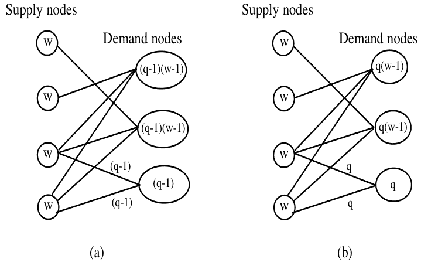

在此，我们考虑在 [42] 中于共址约束（$s_0$）存在时提出的另一个下界。

**结果 3.** *(第 10 条定理，[42])*: 设 $P=(X,W,C)$ 为 CAP，$v$ 为正整数，$Q$ 为 $X$ 的 $v$ 完备子集。假设 $c_{ii}=k>v$ 对所有 $i\in Q$ 成立。进一步，令

$$w=\max_{i\in Q} w_i$$

其中 $Q$ 中有 $r$ 个单元的需求为 $w$。

若

$$L_0=\sum_{i\in Q}w_i,$$

$$L_1=v(L_0-1)+1,$$

$$L_2=k(m-1)+v(r-1)+1,$$

[PAGE 127]

$k=qv+v_0,\ 0\leq v_0<v,$

*则*

$S_0(P)\geq L_1,\quad \text{当 }L_1-L_2\geq (v-v_0)(w-1)\text{ 时，}$

$S_0(P)\geq L_2,\quad \text{当 }L_2-L_1\geq v_0(w-1)\text{ 时，}$

*以及*

$S_0(P)\geq L_3=L_2+(L_0-r-q(w-1))(v-v_0),\quad \text{在其他所有情况中。}$

此处，我们考虑在 [20] 中于共址约束存在时提出的另一个下界。

# **结果 4.** *(第 2 条定理，[20])*: 设 $P=(X,W,C)$ 为 CAP，$Q$ 为 1 完备子集。设 $i\in Q$。假设 $c_{ii}=k>v'>1$ 且存在 $Q$ 的子集 $R$，满足：

$i\notin R$

*以及*

$c_{ii}\geq v',\quad \text{对所有 }j\in R\text{ 成立。}$

进一步，令 $w_R=\sum_{j\in R}w_j$。

*如果* $k-2v'+1\leq 0$

$S_0(P)\geq (w_i-1)k+1+w_R,$

[PAGE 128]

在使用遗传算法求解优化问题时，优化问题的参数集必须以有限长度字符串或染色体形式在某个有限字母 \( Q \) 上编码 [47]。\( M \) 个（有限）此类字符串或染色体的集合称为种群。简单遗传算法由三个基本算子组成：i) 繁殖或选择，ii) 交叉，iii) 变异 [47]。遗传算法（GA）从随机生成的初始种群开始，在每次迭代中，通过对当前种群中的字符串应用上述算子生成一个新的（希望更优）种群，种群大小保持不变。新生成的种群随后用于生成下一代（可能更优）种群，以此类推。

令 \( S_b \) 表示截至迭代 \( t \) 所生成种群中适应度最佳的字符串。在精英遗传算法（EGA）模型中，如果最佳字符串 \( S_b \) 或比其更优的任何字符串不在迭代 \( (t + 1) \) 生成的种群中，则将 \( S_b \) 纳入第 \( (t + 1) \) 代种群 [47]。我们接下来描述一种用于求解如 [29] 所示的通道分配问题的技术，该技术确保后续迭代中的种群持续改进。

[PAGE 129]

## 3.4.1 问题建模

假设通道分配问题由 CAP 图表示，频率分离约束由矩阵 $C=(c_{ij})$ 给出，如第 3.1.2 节所述。若 CAP 图包含 $n$ 个节点，则随机顺序的节点构成一个字符串 $S$ 或染色体。例如，$S=((20),(21),(10),(11),(00))$ 对应于图 3.1(a) 的 CAP 图。设 $M$ 为种群规模（本文取 $M$ 为偶数）。交叉概率记为 $cp$，我们将其设为较高值，例如 0.95。

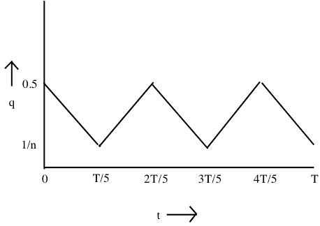

**图 3.9:**  mutation probability（$q$）随迭代次数（$t$）的变化趋势

令 $q$ 为变异概率，$T$ 为总迭代次数，通常为很大的正整数。我们将总迭代次数划分为五个相等区间（假设 $T$ 是 5 的倍数），即 $[0,T/5]$、$[T/5,2T/5]$、$[2T/5,3T/5]$、$[3T/5,4T/5]$ 和 $[4T/5,T]$。初始变异概率为 $q=0.5$，并随迭代次数变化，如图 3.9 所示。该变化方式与 [48] 中的方法类似。变异概率 $q$ 的变化是为了在接近最优字符串时保持种群多样性，并随着最优字符串的逼近而降低 $q$。图 3.9 展示了一种此类变异概率随迭代变化的方法。

变异概率函数在第 $t$ 次迭代中的表达式为：

```
Function m_probability(int t)
begin
W ← 5(1 - 0.5n)/(nT)
for i = 0 to 2 do
begin
V ← 2i + 1
V ← 2i + 1
if (t ≤ VT/5) do
begin
U ← t - (V - 1)T/5
U ← t - (V - 1)T/5
return (0.5 + WU)
return (0.5 + WU)
break
break
end;
end;
if (t ≤ (V + 1)T/5) do
begin
U ← (V + 1)T/5 - t
U ← (V + 1)T/5 - t
return (0.5 + WU)
return (0.5 + WU)
break
break
end;
end
end.
```

用于算法中的适应度函数 Fit(S) 如下：


## Step 3:

计算 $Fit(S_i)$ 对于 $q_t$ 中的每个字符串 $S_i$ $(0 \leq i \leq M - 1)$。找出最佳字符串 $S_{best1}$（即适应度值最小的字符串）和最差字符串 $S_{worst1}$（即适应度值最大的字符串）。如果 $S_{best1}$ 或 $S_{worst1}$ 不唯一，则任意选择一个。

## Step 4: *(Selection or Reproduction)*

在 $q_t$ 的字符串上执行下面描述的选择操作，生成大小为 M 的交配池 $q_{mat}$。

## *Selection operation*

+   计算 $S_i$ 的选择概率 $p_i$ $(i = 0, 1, \ldots, M - 1)$

$$p_i = \frac{\frac{1}{Fit(S_i)}}{\sum_{i=0}^{M-1}\frac{1}{Fit(S_i)}}$$

> *Note:* 由于我们处理的是最小化问题，因此 $Fit(S_i)$ 越小，$p_i$ 的概率越高。

[PAGE 133]

+   计算 $S_i$ 的累积概率 $q_i$ $(i = 0, 1, \cdots, M - 1)$

\[q_i = \sum_{j=0}^{i} p_j.\]

+   对于 $j = 0, 1, \cdots, M - 1$，生成一个在 $[0, 1]$ 范围内的随机数 $r_j$。如果 $r_j \leq q_0$，选择 $S_0$；否则，如果 $q_{i-1} < r_j \leq q_i$，选择 $S_i$ $(1 \leq i \leq M - 1)$。

> *Note:* $p_0 = q_0$ 且 $p_i = q_i - q_{i-1}$ 对于 $1 \leq i \leq M - 1$。

> **Remark 2.** 由于 $p_i$ 越大，即 $(q_{i-1}, q_i]$ 的区间长度越大，随机数落在该区间的概率越高。换句话说，若 $Fit(S_i)$ 较小，则 $S_i$ 的选择概率更高。因此，从当前大小为 $M$ 的种群中，构建同样大小的交配池 $q_{mat}$，其中包含潜在的字符串。随后这些交配池中的字符串进行交叉和变异。该交配池构建策略与文献[49]中使用的策略相似。

## Step 5: *(Crossover)*

在 $q_{mat}$ 的字符串上执行下面描述的交叉操作，得到大小为 M 的种群 $q_{temp1}$。

## *Crossover operation*

形成 $M/2$ 对，每对由 $q_{mat}$ 中的第 $i$ 条和第 $(M/2 + i)$ 条字符串组成 ($i = 0, 1, \cdots, (M/2 - 1)$)。

```
for each pair of strings do
begin
    generate a random number R from [0, 1].
```

[PAGE 134]

```
if (R ≤ cp) do
//to produce two offsprings for the next generation.//
begin
    generate two random numbers from [0, n − 1] to
    define a matching section. Use this matching
    section to effect a cross through position-by-
    position exchange operation.
end.
end.
```

> *Note:* 部分匹配交叉（PMX）[47]是一种既实现反转又实现交叉的重新排序操作。

**Example 3.** 假设生成的两个随机数分别为 2 和 3。则对 $S_1 = ((00), (10), (11), (20), (21))$ 和 $S_2 = ((20), (00), (21), (10), (11))$ 进行 PMX 会得到两个子代 $S'_1 = ((00), (20), (21), (10), (11))$ 和 $S'_2 = ((10), (00), (11), (20), (21))$。

**Remark 3.** 我们使用了两点交叉操作和 PMX 操作。多点交叉以及其他重新排序操作，如顺序交叉（OX）和循环交叉（CX）[47]，也可以使用。

## Step 6: *(Mutation)*

在 $q_{temp1}$ 的字符串上执行下面描述的变异操作，得到大小为 M 的种群 $q_{temp2}$。

## *Mutation operation*

```
Set q ← m_probability(t)
for each string Sᵢ of qₜₑₘₚ₁ (0 ≤ i ≤ M − 1) do
```

[PAGE 135]

```
begin
    for each node node_j (0 ≤ j ≤ n − 1) of string S_i do
    begin
        generate a random number from [0, 1], say m.
        if (m ≤ q) do
        begin
            exchange node_j of S_i with any other
            randomly selected node node_k of S_i
            (0 ≤ k ≤ n − 1, k ≠ j)
        end
    end
end.
```

**Example 4.** 如果节点 (00) 被节点 (21) 替换，则变异后的字符串 $S_1 = ((00), (10), (11), (20), (21))$ 变为 $S'_1 = ((21), (10), (11), (20), (00))$。

## Step 7:

计算 $Fit(S_i)$ 对于 $q_{temp2}$ 中的每个字符串 $S_i$ $(0 \leq i \leq M − 1)$。找出最佳字符串 $S_{best2}$ 和最差字符串 $S_{worst2}$。如果 $S_{best2}$ 或 $S_{worst2}$ 不唯一，则任意选择一个。

## Step 8: (Elitism)

比较 $q_t$ 中的最佳字符串 $S_{best1}$ 与 $q_{temp2}$ 中的最佳字符串 $S_{best2}$。如果 $Fit(S_{best2}) > Fit(S_{best1})$，则用 $S_{best1}$ 替换 $S_{worst2}$。将 $q_{temp2}$ 重命名为 $q_t$。

## Step 9:

$t \leftarrow t + 1$；如果 $t < T$，则回到步骤 3。

Bhandari et al. [49] 提供了证明，表明在迭代次数趋于无穷时，任何初始种群的 EGA 都会收敛到全局最优解。

[PAGE 136]

<!-- no content -->

[PAGE 137]

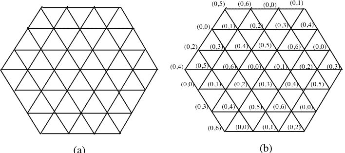

## **FIGURE 3.10:** (a) Subgraph of cellular graph and (b) frequency assignment when $s_1=s_2$

and $j$ are within Distance 2 and 0 otherwise. With this frequency separation matrix, we apply the *Algorithm GA* over the subgraph shown in the figure. The resulting assignment is shown in Figure 3.10(b). Observe that the frequency channels $(0, 0)$, $(0, 1)$, $(0, 2)$, $(0, 3)$, $(0, 4)$, $(0, 5)$ and $(0, 6)$ are assigned repeatedly to the nodes over the subgraph in a regular and symmetrical way. The symmetry is clear from Figure 3.10(b). Using this symmetry, frequencies can be assigned to the nodes over the entire network. This assignment is shown in Figure 3.11 and is characterized as follows.

We first consider three directions $x$, $y$ and $z$ in the cellular graph in Figure 3.12. In each direction, we have definite types of lines and each type of line is identified by the sequence of frequencies assigned to the nodes lying on that line. A sequence is of Period $b$ if each frequency is periodically repeated at Distance $b$ on that line.

In $x$ direction, there is only one type of line (*type x*) identified by the repetitive sequence of Period 7 as $(0, 0)$ $(0, 1)$ $(0, 2)$ $(0, 3)$ $(0, 4)$ $(0, 5)$ $(0, 6)$ $\cdots$.

In $y$ direction, there is only one type of line (*type y*) identified by the repetitive sequence of Period 7 as $(0, 0)$ $(0, 5)$ $(0, 3)$ $(0, 1)$ $(0, 6)$ $(0, 4)$ $(0, 2)$ $\cdots$.

[PAGE 138]

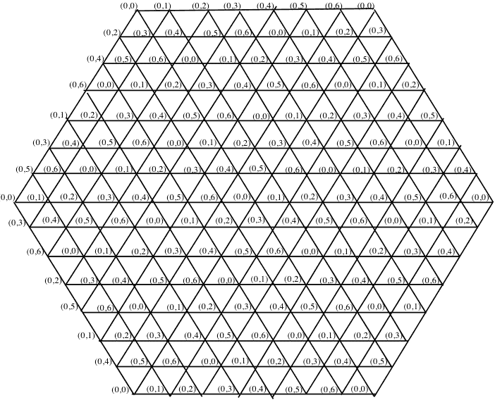

**FIGURE 3.11:** Frequency assignment of two-band buffering system for $s_1 = s_2$

In $z$ direction, there is only one type of line (type $z$) identified by the repetitive sequence of Period 7 as (0, 0) (0, 4) (0, 1) (0, 5) (0, 2) (0, 6) (0, 3) · · ·.

It follows from Figure 3.11 that along any of the lines of type $x$, type $y$ and type $z$, there is no conflict. Therefore, this assignment is conflict-free over the entire network.

Hence, by using the scheme described above, the frequencies can be assigned to the nodes of the entire network using a bandwidth of $6s_2$, when $s_1 = s_2$.

We now generalize Lemma 3 and state the following theorem for the assignment of $w$ channels to every node of the entire cellular network.

[PAGE 139]

## Theorem 3.

In a hexagonal cellular network with homogeneous demand $w$ and two-band buffering, there exists a frequency assignment scheme for $s_1=s_2$, which requires a bandwidth of:

+   1. **Case 1.** $(w-1)7s_2+6s_2$ when $s_0\leq 7s_2$, and
+   2. **Case 2.** $(w-1)s_0+6s_2$ when $s_0\geq 7s_2$.

**Proof:** Follows from Lemma 3.

**Remark 4.** For the second case of Theorem 3, i.e., when $s_1=s_2$ and $s_0\geq 7s_2$, the required bandwidth is close to $ws_0$.

**Remark 5.** For $s_1=s_2$, the above assignment requires a bandwidth equal to the corresponding lower bound presented in Theorem 1 for different relative values of $s_0$, $s_1$, and $s_2$. Hence this assignment is optimal.

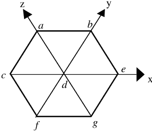

**FIGURE 3.12:** Three directions in hexagonal cellular graph

# 3.4.3.2　Scheme 2: for i) $s_2<s_1\leq 2s_2$ and ii) $s_1\geq 2s_2$

Consider the nine-node subgraph with nodes $a$, $b$, $c$, $d$, $e$, $f$, $g$, $h$ and $i$ of the cellular graph as shown in Figure 3.13.

Each node of this subgraph represents a cell of the cellular network. Suppose


## 图3.13：六边形蜂窝网络的九节点子图

φ(α) 是分配给节点 α 的频率，α ∈ {a, b, c, d, e, f, g, h, i}。我们提议只将这九个频率以规则且对称的方式分配给整个蜂窝图的节点，如图3.14所示。此分配方案背后的思想解释如下。

我们再次考虑图3.12中蜂窝图的 x、y、z 三个方向。

在 x 方向上，存在三种不同类型的线，由周期为3的重复序列标识，分别为：

- x1 型：φ(a) φ(b) φ(c) φ(a) φ(b) φ(c) ⋯，
- x2 型：φ(d) φ(e) φ(f) φ(d) φ(e) φ(f) ⋯，以及
- x3 型：φ(g) φ(h) φ(i) φ(g) φ(h) φ(i) ⋯。

在 y 方向上，只有一种类型的线（y 型），由周期为9的重复序列标识为 φ(a) φ(h) φ(f) φ(c) φ(g) φ(e) φ(h) φ(b) φ(i) φ(d) ⋯。

在 z 方向上，只有一种类型的线（z 型），由周期为9的重复序列标识为 φ(c) φ(i) φ(f) φ(b) φ(h) φ(e) φ(a) φ(g) φ(d) ⋯。

基于此分配方案，我们构建了一个频率间隔约束表，涵盖这九个节点中每对节点之间的约束，如表3.6所示（假设每个节点仅分配一个信道），以满足：

1. 在 \( x \) 方向上，沿着每条 \( x_1 \) 型、\( x_2 \) 型和 \( x_3 \) 型线，均不存在冲突。
2. 在 \( y \) 方向上，沿着所有 \( y \) 型线，均不存在冲突。
3. 在 \( z \) 方向上，沿着所有 \( z \) 型线，均不存在冲突。

因此，这九个频率可以在整个网络中重复使用而不会产生冲突。

重要的是，表3.6的构造使得仅为图3.13中的节点分配九个频率信道就足以满足

## **表3.6：** 方案2的频率间隔矩阵

| 节点 ↓ / → | a | b | c | d | e | f | g | h | i |
|---|---|---|---|---|---|---|---|---|---|
| **a** | 0 | $s_1$ | $s_1$ | $s_1$ | $s_1$ | $s_2$ | $s_1$ | $s_1$ | $s_2$ |
| **b** | $s_1$ | 0 | $s_1$ | $s_2$ | $s_1$ | $s_1$ | $s_2$ | $s_1$ | $s_1$ |
| **c** | $s_1$ | $s_1$ | 0 | $s_1$ | $s_2$ | $s_1$ | $s_1$ | $s_2$ | $s_1$ |
| **d** | $s_1$ | $s_2$ | $s_1$ | 0 | $s_1$ | $s_1$ | $s_1$ | $s_2$ | $s_1$ |
| **e** | $s_1$ | $s_1$ | $s_2$ | $s_1$ | 0 | $s_1$ | $s_1$ | $s_1$ | $s_2$ |
| **f** | $s_2$ | $s_1$ | $s_1$ | $s_1$ | $s_1$ | 0 | $s_2$ | $s_1$ | $s_1$ |
| **g** | $s_1$ | $s_2$ | $s_1$ | $s_1$ | $s_1$ | $s_2$ | 0 | $s_1$ | $s_1$ |
| **h** | $s_1$ | $s_1$ | $s_2$ | $s_2$ | $s_1$ | $s_1$ | $s_1$ | 0 | $s_1$ |
| **i** | $s_2$ | $s_1$ | $s_1$ | $s_1$ | $s_2$ | $s_1$ | $s_1$ | $s_1$ | 0 |

对整个蜂窝网络节点按照图3.14所示的分配模式进行频率分配，而不会产生冲突。

我们现在在图3.13的九节点子图上使用 *GA算法*，其频率间隔需求由表3.6给出。根据 $s_1$ 和 $s_2$ 之间的关系，该算法的结果可由以下两个引理表述。

**引理4.** *在一个双频带缓冲的六边形蜂窝网络中，若每个小区仅需求一个信道，则存在一种频率分配方案，当 $s_2 < s_1 \leq 2s_2$ 时所需带宽为 $8s_2$。*

**证明：** 当 $s_2 < s_1 \leq 2s_2$ 时，*GA算法* 给出如下结果：$\phi(a) = (0, 0)$，$\phi(b) = (0, 6)$，$\phi(c) = (0, 3)$，$\phi(d) = (0, 5)$，$\phi(e) = (0, 2)$，$\phi(f) = (0, 8)$，$\phi(g) = (0, 7)$，$\phi(h) = (0, 4)$，$\phi(i) = (0, 1)$。注意，此处使用了不等式 $2s_2 \geq s_1$，因为频率 $(0, 6)$ 和 $(0, 8)$ 被分配给了彼此距离为1的节点。在这种情况下，所分配的最大频率为 $(0, 8)$。该分配如图3.15所示，其通过将图3.14中的 $\phi(a)$、$\phi(b)$、$\phi(c)$、$\phi(d)$、$\phi(e)$、$\phi(f)$、$\phi(g)$、$\phi(h)$ 和 $\phi(i)$ 的值分别替换为 $(0, 0)$、$(0, 6)$、$(0, 3)$、$(0, 5)$、$(0, 2)$、$(0, 8)$、$(0, 7)$、$(0, 4)$ 和 $(0, 1)$ 得到。

因此，通过使用上述频率分配方案，当 $2s_2 \ge s_1 > s_2$ 时，可以使用 $8s_2$ 的带宽为整个网络的节点分配频率。

**图3.15：** 双频带缓冲系统在 $s_2 < s_1 \le 2s_2$ 情况下的频率分配

**引理5.** *在一个双频带缓冲的六边形蜂窝网络中，若每个小区仅需求一个信道，则存在一种频率分配方案，当 $s_1 \ge 2s_2$ 时所需带宽为 $4s_1$。*

**证明：** 与引理4完全相同。该分配如图3.16所示。

接下来我们考虑具有 $w$ 个信道的同质需求情况。接下来的两个定理分别直接扩展了引理4和引理5的结果。

**定理4.** *在具有均匀需求 $w$ 和双频带缓冲的六边形蜂窝网络中，当 $s_2 < s_1 \le 2s_2$ 时，存在一种频率分配方案，所需带宽为：*

+   1. **情况1.** 当 $s_0 \le 9s_2$ 时，$(w-1)9s_2 + 8s_2$；以及
+   2. **情况2.** 当 $s_0 \ge 9s_2$ 时，$(w-1)s_0 + 8s_2$。

**证明：** 由引理4得出。当 $w = 2$ 时，对于 $s_0 \le 9s_2$ 和 $s_0 \ge 9s_2$ 两种情况，分配分别如图3.17(a)和(b)所示。

我们将使用一个不同的频率间隔矩阵，如表3.7所示。表3.6和表3.7之间的差异在于对应行 $a$、$b$、$c$ 与列 $g$、$h$、$i$ 的子矩阵。由于这一变化，此处使用的重复模式将不同于上述方案2的模式，如下所述。

我们再次考虑图3.12中蜂窝图的 $x$、$y$、$z$ 三个方向。

在 $x$ 方向上，存在三种不同类型的线（$x_1$ 型、$x_2$ 型和 $x_3$ 型），与上述方案2相同。

在 $y$ 方向上，存在三种不同类型的线，由周期为3的重复序列标识，分别为：

- $y_1$ 型：$\phi(b)\ \phi(g)\ \phi(e)\ \phi(b)\ \phi(g)\ \phi(e)\ \cdots$，
- $y_2$ 型：$\phi(a)\ \phi(i)\ \phi(d)\ \phi(a)\ \phi(i)\ \phi(d)\ \cdots$，以及
- $y_3$ 型：$\phi(c)\ \phi(h)\ \phi(f)\ \phi(c)\ \phi(h)\ \phi(f)\ \cdots$。

在 $z$ 方向上，同样存在三种不同类型的线，由周期为3的重复序列标识，分别为：

- $z_1$ 型：$\phi(g)\ \phi(d)\ \phi(c)\ \phi(g)\ \phi(d)\ \phi(c)\ \cdots$，
- $z_2$ 型：$\phi(b)\ \phi(i)\ \phi(f)\ \phi(b)\ \phi(i)\ \phi(f)\ \cdots$，以及

3. 在 *z* 方向上，沿着每条 *z 型*₁、*z 型*₂ 和 *z 型*₃ 线，均不存在冲突。

因此，这些频率可以在整个网络中重复使用而不会产生任何冲突。

重要的是，表3.7的构造使得仅为图3.13中的节点分配九个频率信道就足以按照图3.19所示的分配模式对整个蜂窝网络的节点进行频率分配，而不会产生任何冲突。

我们现在在图3.13的九节点子图上使用 *GA算法*，频率间隔需求由表3.7给出。该算法的结果可由以下引理表述。

**引理6.** *在一个双频带缓冲的六边形蜂窝网络中，当每个小区仅需求一个信道时，存在一种频率分配方案，对于所有满足 s₁ ≥ s₂ 的 s₁ 和 s₂ 取值，所需带宽为 (2s₁ + 6s₂)。*

**证明：** 对于这种情况，*GA算法* 给出如下结果：φ(*a*) = (0, 0)，φ(*b*) = (2, 4)，φ(*c*) = (1, 3)，φ(*d*) = (2, 5)，φ(*e*) = (1, 4)，φ(*f*) = (0, 2)，φ(*g*) = (0, 1)，φ(*h*) = (2, 6)，φ(*i*) = (1, 2)。注意，所分配的最大频率为 (2, 6)。这


### 3.5.2 解决原始 CAP 从聚合 CAP 的技术

将原始 CAP \(P=(X,W,C)\) 转换为聚合 CAP \(P'=(X',W',C')\) 时，我们应用适当的第二类 CAP 算法，以求得一个频率分配 \(\Phi'\)，目标是最小化被阻塞通话的总数 \(BL_{total}\)。该分配 \(\Phi'\) 可能是可接受的，也可能不可接受，这取决于


可用带宽$B$。因此，为了推导出$P$所需的分配方案，我们考虑以下两种情况。

## 情况1：分配方案$\Phi'$是可允许的

通过以下定理，可以利用$\Phi'$推导出$P$的可允许频率分配方案。

**定理7.** 给定问题$P=(X,W,C)$和带宽$B$，如果$P'$的频率分配方案$\Phi'$是可允许的，则可以从$\Phi'$推导出$P$的可允许频率分配方案。

**证明：** 为了从$\Phi'$得到$P$的分配方案，将$Y(i)$ $(0\leq i\leq z-1)$中的所有小区分配在$\Phi'$中分配给$N(Y(i))$的同一组信道。该分配必须满足干扰约束，因为在$P'$中，$c'(Y(i),Y(j))$是$C$中所有满足$i\in Y(i)$和$j\in Y(j)$的$c_{ij}$的最大值。该分配还必须满足需求向量$W=(w_i)$，因为在$P'$中，$M(Y(i))$是$W$中所有满足$i\in Y(i)$的$w_i$的最大值。

当$\Phi'$是可允许的时，它不仅满足$P$的所有需求，还提供了一些冗余信道。如果小区$i$被分配了$w'_i$个信道，而需求是$w_i$，且$w'_i>w_i$，那么小区$i$中就有$r_i=(w'_i-w_i)$个信道未被使用或成为冗余。这组冗余信道由向量$R=(r_i)$表示。系统的冗余信道总数为

$$R_{total}=\sum_{i=0}^{n-1}r_i.$$

**例11.** 对于例6中的问题，其派生问题$P'$已在上面例10中描述。通过文献[15]中的算法（一种针对第二类CAP的基于遗传算法的算法）得到了$P'$的一个解，如表3.10所示，其中行$T_a$中的条目表示分配给每个节点的信道总数，行$T_r$中的条目表示实际需要的信道总数。

步骤2：适当利用\(R = (r_j)\)中的冗余信道，应用MFAR操作来最小化\(BL = (b_i)\)中的阻塞呼叫。

**例12.** 为说明此步骤，我们考虑费城基准问题5（表3.2）。我们首先如下构造该问题的\(P'\)。图3.22显示了\(P^*\)的一个解\(\Phi^*\)，其中与节点关联的标签\([\alpha]\)表示该节点被分配了频率\(\alpha\)。在图3.22的方案中，仅重复分配了7个信道0, 1, \(\cdots\), 6，其中\( Y(0) = \{2, 6, 11, 19\}\)，\( Y(1) = \{9, 14\}\)，\( Y(2) = \{10, 12, 15\}\)，\( Y(3) = \{1, 5, 17, 18\}\)，\( Y(4) = \{4, 8, 13\}\)，\( Y(5) = \{0, 16\}\)，\( Y(6) = \{3, 7, 20\}\)。相应的频率间隔\( c'(a_i, a_j) \)（\( 0 \leq i, j \leq 6 \)）如表3.12所示。我们得到\( M(a_0) = 45 \)，\( M(a_1) = 40 \)，\( M(a_2) = 40 \)，\( M(a_3) = 30 \)，\( M(a_4) = 30 \)，\( M(a_5) = 15 \)，\( M(a_6) = 25 \)。因此，\( P' = (X', W', C') \)由\( X' = (N(Y(i)))\)（\( 0 \leq i \leq 6 \)）、\( W' = (45, 40, 40, 30, 30, 15, 25) \)给出，而\( C' \)如表3.12所示。

现在，为了得到\(\Phi'\)，我们按照文献[28]中报告的关键块方法，将\(P'\)划分为若干具有均匀权重的子网络。然而，在多权重分配过程中，我们仅考虑不超过给定带宽\(B\)的信道。通过此方法得到的\(P'\)的一个解已在表3.13中示出。由此可见，\( W' = (45, 40, 40, 30, 30, 15, 25) \)所给出的\(P'\)的所有需求并未得到满足；该分配导致节点\( N(Y(5)) \)中出现四个阻塞呼叫。换句话说，推导出的分配方案不是可允许的。

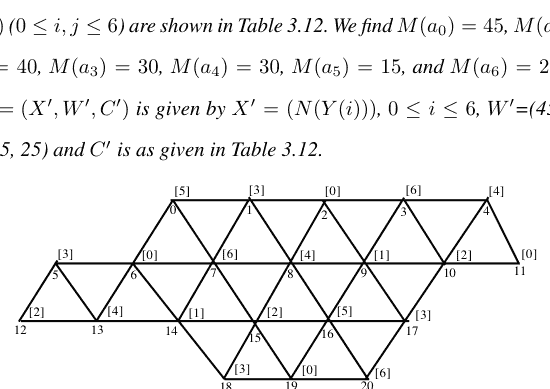

## 蜂窝网络中的带宽管理 143

\begin{tabular}{cccccccc}
c'(a_i, a_j) & a_0 & a_1 & a_2 & a_3 & a_4 & a_5 & a_6 \\
a_0 & 7 & 1 & 1 & 1 & 1 & 1 & 1 \\
a_1 & 1 & 7 & 1 & 1 & 1 & 1 & 1 \\
a_2 & 1 & 1 & 7 & 1 & 1 & 1 & 1 \\
a_3 & 1 & 1 & 1 & 7 & 1 & 1 & 1 \\
a_4 & 1 & 1 & 1 & 1 & 7 & 1 & 1 \\
a_5 & 1 & 1 & 1 & 1 & 1 & 7 & 1 \\
a_6 & 1 & 1 & 1 & 1 & 1 & 1 & 7 \\
\end{tabular}

我们现在应用算法Derive-Assignment(P, P')的步骤1，从表3.13中的\(P'\)的解求出\(P\)的分配方案。\(P\)的推导分配方案如表3.14所示。注意，分配给节点N(Y(0))的同一组信道也已分配给Y(0) = {2, 6, 11, 19}中的所有小区。该分配在小区16中留下了四个阻塞呼叫（15 - 11 = 4），同时在其它小区中产生了许多冗余信道（例如，小区2有40个冗余信道）。

我们现在应用算法Derive-Assignment(P, P')的步骤2，得到如表3.15所示的分配方案。注意表3.14的分配方案中小区16的四个阻塞呼叫。然而，MFAR操作发现，如果撤销从小区2和19分配给信道0、5、10和15的分配，则可以将信道0、5、10和15分配给小区16。注意，小区2和19中都有超过四个以上的冗余信道。小区16中的信道0、5、10和15的分配已加下划线，而小区2和19中的分配已用星号(*)标记。

[PAGE 164]

## 表3.13：问题5中\(P'\)的推导信道分配方案

\begin{tabular}{ccccccc}
节点 → & _a_<sub>0</sub> & _a_<sub>1</sub> & _a_<sub>2</sub> & _a_<sub>3</sub> & _a_<sub>4</sub> & _a_<sub>5</sub> & _a_<sub>6</sub> \\
0 & 1 & 2 & 3 & 4 & 159 & 96 \\
5 & 6 & 7 & 8 & 9 & 164 & 103 \\
10 & 11 & 12 & 13 & 14 & 169 & 108 \\
15 & 16 & 17 & 18 & 19 & 174 & 113 \\
20 & 21 & 22 & 23 & 24 & 184 & 118 \\
25 & 26 & 27 & 28 & 29 & 189 & 123 \\
30 & 31 & 32 & 33 & 34 & 194 & 128 \\
35 & 36 & 37 & 38 & 39 & 199 & 133 \\
40 & 41 & 42 & 43 & 44 & 209 & 138 \\
45 & 46 & 47 & 48 & 49 & 214 & 143 \\
50 & 51 & 52 & 53 & 54 & 219 & 148 \\
55 & 56 & 57 & 58 & 59 &  & 153 \\
60 & 61 & 62 & 63 & 64 &  & 158 \\
65 & 66 & 67 & 68 & 69 &  & 163 \\
70 & 71 & 72 & 73 & 74 &  & 168 \\
75 & 76 & 77 & 78 & 79 &  & 173 \\
80 & 81 & 82 & 83 & 84 &  & 178 \\
85 & 86 & 87 & 88 & 89 &  & 183 \\
90 & 91 & 92 & 93 & 94 &  & 188 \\
95 & 101 & 97 & 98 & 99 &  & 193 \\
100 & 106 & 102 & 154 & 104 &  & 198 \\
105 & 111 & 107 & 177 & 109 &  & 203 \\
110 & 116 & 112 & 182 & 114 &  & 208 \\
115 & 121 & 117 & 187 & 119 &  & 213 \\
120 & 126 & 122 & 192 & 124 &  & 218 \\
125 & 131 & 127 & 197 & 129 &  &  \\
130 & 136 & 132 & 202 & 134 &  &  \\
135 & 141 & 137 & 207 & 139 &  &  \\
140 & 146 & 142 & 212 & 144 &  &  \\
145 & 151 & 147 & 217 & 149 &  &  \\
150 & 156 & 152 &  &  &  &  \\
155 & 161 & 157 &  &  &  &  \\
160 & 166 & 162 &  &  &  &  \\
165 & 171 & 167 &  &  &  &  \\
170 & 176 & 172 &  &  &  &  \\
175 & 181 & 179 &  &  &  &  \\
180 & 186 & 201 &  &  &  &  \\
185 & 191 & 206 &  &  &  &  \\
190 & 196 & 211 &  &  &  &  \\
195 & 204 & 216 &  &  &  &  \\
200 &  &  &  &  &  &  \\
205 &  &  &  &  &  &  \\
210 &  &  &  &  &  &  \\
215 &  &  &  &  &  &  \\
220 &  &  &  &  &  &  \\
\end{tabular}

[PAGE 165]

<!-- no content -->

[PAGE 166]

## 表3.15：问题5的完整信道分配方案

\begin{tabular}{ccccccccccccccccccccc}
小区 → 0 & 1 & 2 & 3 & 4 & 5 & 6 & 7 & 8 & 9 & 10 & 11 & 12 & 13 & 14 & 15 & 16 & 17 & 18 & 19 & 20 \\
159 & 3 & *0 & 96 & 4 & 3 & 0 & 96 & 4 & 1 & 2 & 0 & 2 & 4 & 1 & 2 & 0 & 3 & 3 & *0 & 96 \\
164 & 8 & *8 & 103 & 9 & 8 & 5 & 103 & 9 & 6 & 7 & 5 & 7 & 9 & 6 & 7 & 5 & 8 & 8 & *5 & 103 \\
169 & 13 & *10 & 108 & 14 & 13 & 5 & 108 & 14 & 11 & 12 & 10 & 12 & 14 & 11 & 12 & 10 & 13 & 13 & *10 & 108 \\
174 & 18 & *15 & 113 & 18 & 15 & 15 & 113 & 18 & 16 & 17 & 15 & 17 & 19 & 16 & 17 & 15 & 18 & 18 & *15 & 113 \\
184 & 23 & 20 & 118 & 24 & 23 & 20 & 118 & 24 & 21 & 22 & 20 & 22 & 24 & 21 & 22 & 159 & 23 & 23 & 20 & 118 \\
189 & 28 & 25 & 123 & 29 & 25 & 25 & 123 & 29 & 26 & 27 & 25 & 27 & 29 & 26 & 27 & 164 & 28 & 28 & 25 & 123 \\
194 & 33 & 30 & 128 & 34 & 33 & 30 & 128 & 34 & 31 & 32 & 30 & 32 & 34 & 31 & 32 & 169 & 33 & 33 & 30 & 128 \\
199 & 38 & 35 & 133 & 39 & 38 & 35 & 133 & 39 & 39 & 37 & 37 & 39 & 36 & 37 & 38 & 174 & 38 & 38 & 35 & 135 \\
209 & 43 & 40 & 138 & 44 & 40 & 40 & 138 & 44 & 41 & 42 & 40 & 42 & 44 & 41 & 42 & 184 & 43 & 43 & 40 & 138 \\
214 & 48 & 45 & 143 & 49 & 48 & 45 & 143 & 49 & 46 & 47 & 45 & 47 & 49 & 46 & 47 & 189 & 48 & 48 & 45 & 143 \\
219 & 53 & 50 & 148 & 54 & 53 & 50 & 148 & 54 & 51 & 52 & 50 & 52 & 54 & 51 & 52 & 194 & 53 & 53 & 50 & 148 \\
63 & 60 & 153 & 59 & 58 & 55 & 55 & 153 & 59 & 56 & 57 & 55 & 57 & 59 & 56 & 57 & 199 & 58 & 58 & 55 & 153 \\
68 & 65 & 163 & 69 & 68 & 65 & 65 & 163 & 69 & 66 & 67 & 65 & 67 & 69 & 66 & 67 & 204 & 68 & 68 & 65 & 163 \\
73 & 70 & 168 & 74 & 73 & 70 & 70 & 168 & 74 & 71 & 72 & 70 & 72 & 74 & 71 & 72 & 219 & 73 & 73 & 70 & 168 \\
78 & 75 & 173 & 79 & 78 & 75 & 75 & 173 & 79 & 76 & 77 & 75 & 77 & 79 & 76 & 77 & 219 & 78 & 78 & 75 & 173 \\
83 & 80 & 178 & 84 & 83 & 80 & 80 & 178 & 84 & 81 & 82 & 80 & 82 & 84 & 81 & 82 & 83 & 83 & 83 & 80 & 178 \\
88 & 85 & 183 & 89 & 88 & 85 & 85 & 183 & 89 & 88 & 89 & 87 & 85 & 89 & 86 & 87 & 88 & 88 & 88 & 85 & 183 \\
93 & 90 & 188 & 94 & 93 & 90 & 90 & 188 & 94 & 91 & 92 & 90 & 92 & 94 & 91 & 92 & 93 & 93 & 93 & 90 & 188 \\
98 & 95 & 193 & 99 & 98 & 95 & 95 & 193 & 99 & 101 & 97 & 95 & 97 & 99 & 101 & 97 & 98 & 98 & 98 & 95 & 193 \\
154 & 100 & 198 & 104 & 154 & 100 & 100 & 198 & 104 & 106 & 102 & 100 & 102 & 104 & 106 & 102 & 154 & 154 & 100 & 100 & 198 \\
177 & 105 & 203 & 109 & 177 & 105 & 105 & 203 & 109 & 111 & 107 & 107 & 107 & 109 & 111 & 107 & 177 & 177 & 177 & 105 & 203 \\
182 & 110 & 208 & 114 & 182 & 110 & 208 & 114 & 116 & 112 & 112 & 110 & 112 & 114 & 116 & 112 & 182 & 182 & 182 & 110 & 208 \\
187 & 115 & 213 & 119 & 187 & 115 & 213 & 119 & 121 & 121 & 117 & 115 & 117 & 119 & 121 & 117 & 187 & 187 & 187 & 115 & 213 \\
192 & 120 & 218 & 124 & 192 & 120 & 218 & 124 & 126 & 126 & 122 & 120 & 122 & 124 & 126 & 122 & 192 & 192 & 192 & 120 & 218 \\
197 & 125 & 129 & 197 & 125 & 129 & 129 & 131 & 127 & 127 & 125 & 127 & 127 & 129 & 131 & 127 & 197 & 197 & 197 & 125 & 125 \\
202 & 130 & 134 & 202 & 134 & 135 & 134 & 136 & 132 & 130 & 132 & 132 & 134 & 139 & 141 & 137 & 202 & 202 & 202 & 130 & 135 \\
207 & 135 & 139 & 207 & 135 & 139 & 141 & 141 & 137 & 137 & 135 & 137 & 137 & 139 & 141 & 137 & 207 & 207 & 207 & 135 &  \\
212 & 140 & 144 & 212 & 140 & 145 & 144 & 146 & 142 & 140 & 142 & 140 & 142 & 144 & 146 & 142 & 212 & 212 & 212 & 140 &  \\
217 & 145 & 149 & 217 & 145 & 145 & 149 & 151 & 152 & 152 & 145 & 147 & 147 & 149 & 151 & 147 & 217 & 217 & 217 & 145 &  \\
 & 150 &  & 155 &  &  &  &  & 161 & 157 & 157 & 157 & 157 & 161 & 157 &  &  &  &  & 150 &  \\
 & 160 &  &  & 155 &  &  &  & 166 & 162 & 160 & 162 &  & 166 & 162 &  &  &  &  & 160 &  \\
 & 165 &  &  &  & 165 &  &  & 171 & 167 & 165 & 167 &  & 171 & 167 &  &  &  &  & 165 &  \\
 & 170 &  &  &  & 170 &  &  & 176 & 172 & 170 & 172 &  & 176 & 172 &  &  &  &  & 170 &  \\
 & 175 &  &  &  & 175 &  &  & 181 & 179 & 175 & 179 &  & 181 & 179 &  &  &  &  & 175 &  \\
 & 180 &  &  &  & 180 &  &  & 186 & 201 & 180 & 201 &  & 186 & 201 &  &  &  &  & 180 &  \\
 & 185 &  &  &  & 185 &  &  & 191 & 206 & 185 & 185 & 206 &  & 191 & 206 &  &  &  &  & 185 &  \\
 & 190 &  &  &  & 190 &  &  & 196 & 211 & 190 & 211 &  & 196 & 211 &  &  &  &  & 190 &  \\
 & 195 &  &  &  & 195 &  &  & 204 & 216 & 195 & 216 &  & 204 & 216 &  &  &  &  & 195 &  \\
 & 200 &  &  &  & 200 &  &  &  &  &  &  &  &  &  &  &  &  &  & 200 &  \\
 & 205 &  &  &  & 205 &  &  &  &  &  &  &  &  &  &  &  &  &  & 205 &  \\
 & 210 &  &  &  & 210 &  &  &  &  &  &  &  &  &  &  &  &  &  & 210 &  \\
 & 215 &  &  &  & 215 &  &  &  &  &  &  &  &  &  &  &  &  &  & 215 &  \\
 & 220 &  &  &  & 220 &  &  &  &  &  &  &  &  &  &  &  &  &  & 220 &  \\
\end{tabular}

\begin{tabular}{cccccccccccccccccccc}
Ta → & 11 & 30 & 41 & 25 & 30 & 45 & 25 & 30 & 40 & 40 & 45 & 40 & 30 & 40 & 40 & 15 & 30 & 30 & 41 & 25 \\
Tr → & 5 & 5 & 5 & 8 & 12 & 25 & 30 & 25 & 40 & 40 & 45 & 20 & 30 & 25 & 15 & 15 & 30 & 20 & 20 & 25 \\
\end{tabular}


## 3.6 快速近乎最优信道分配

我们现在提出了一种新颖的方法 [50]，用于解决六边形细胞网络中非均匀需求的信道分配问题（CAPs），该系统采用双缓冲机制（在该机制中，信道干扰不超出两个单元）。非均匀需求的 CAP 首先被划分为一系列较小的子问题，每个子问题的需求来自原始网络的节点子集，并且具有均匀需求。每个子问题的解构成一个分配阶段，在该阶段将多个均匀需求分配到对应子问题的节点，满足所有频率分离约束。原始网络的完整分配过程由对所有子问题的多个均匀分配相继进行组成。基于此概念，我们在 [50] 中给出了一个多项式时间近似算法，用于解决具有非均匀需求的细胞网络的信道分配问题。该算法在著名的基准实例上执行时，始终在最优带宽上方约 6% 以内，但执行时间极短（在 HPxw8400 工作站上不到 5 毫秒）。当快速信道分配至关重要且 6% 的带宽偏差是可接受的实际场景中，该算法非常适用。

## 3.6.1 分配算法

本研究的最终目标是设计一个贪心算法，能够在毫秒级别快速完成所需信道的分配，同时使带宽尽可能接近最优带宽。这是频率分配问题研究中的一项长期挑战。

该方法的核心是将给定的信道分配问题划分为一系列子问题，每个子问题包含一个特定的子图，且每个节点需要满足统一的需求。为了满足子图中每个节点的统一需求，我们首先使用贪心算法为每个节点找到单一频率分配，然后在每一轮中（每轮分配一个频率）通过增加下一轮的起始频率（_increment_）来逐次分配多个频率。_increment_ 的概念是：如果频率 φ(v) 可以在节点 v 处分配且不与已分配的频率冲突，那么可以在后续轮次中，对节点 v 依次分配 φ(v)+k×increment（k = 1, 2, 3, ⋯）而不产生冲突。由于 s0 是同一单元内两个呼叫之间的最小频率分离要求，因此 _increment_ 的值至少为 s0。于是，利用单一频率分配和 _increment_ 的值，可以轻松满足多个均匀需求。原始问题的解决方案将构成一系列分配阶段。每个分配阶段的起始频率是上一阶段结束时分配的最高频率的下一个频率。当从第 i 阶段切换到第 i+1 阶段时，必须确保第 i+1 阶段的子图中每个节点在开始时分配的频率不会与第 i 阶段最后一轮分配给节点的频率产生干扰。只需在第 i+1 阶段分配频率时满足第 i 阶段最后一轮分配给节点的频率即可，因为这些是第 i+1 阶段可能与第 i 阶段产生冲突的唯一频率。这是因为第 i 阶段第二轮分配的最高频率与第 i+1 阶段第一轮分配的最小频率之间的间隔至少为 i0（因为 _increment_ 总是大于等于 s0）。由于 s0 ≥ s1 ≥ s2，第 i 阶段第二轮分配的频率不可能与第 i+1 阶段第一轮分配的频率冲突。这保证了后续分配阶段之间的频率分配不产生冲突。

我们现在用基准问题 6（在图 3.2 所示的六边形细胞网络上定义）作为例子，描述分配算法的每一步。为了说明，我们在图 3.2 中明确给出了需求向量 D2，其中节点的标签 [d] 表示该节点的需求。该基准问题的频率分离约束由 s0 = 5、s1 = 2 和 s2 = 1 给出。频率分离矩阵 C = (cij) 可以通过 s0、s1 和 s2 的值推导得到，其中 cij = 5 对所有 i = j，且当节点 i 和节点 j 在图中的细胞图中距离为 1、2 或 ≥ 3 时，cij 分别等于 2、1 和 0。

作为分配算法的第一步，我们按照需求的降序对网络中的节点进行重新排序。重新排序后的顺序可能会出现多个需求相同的节点。我们进一步按照节点 Si 的降序对这些需求相同的节点进行排序，其中 Si 是节点 i 与其相邻节点的需求之和。令这个有序节点集合称为 S。

接下来，我们考虑包含需求最高节点的子图，并使用贪心算法对其进行分配。该贪心算法从在有序集合 S 中需求最高的节点开始，分配频率的起始值（origin）。随后，依次从有序集合 S 中取出下一个节点，尝试在序列 <origin, origin + 1, origin + 2, …> 中找到满足与已分配节点频率分离约束的最小频率，并将其分配给该节点。该过程对 S 中剩余的所有节点重复进行。在完成该过程后，我们找到最小的 increment 值，使得区间 [origin, origin + increment] 内的频率足够为每个最高需求节点分配单一频率。利用 increment 的值和单一频率分配，可以为这些节点分配多个频率。

随后，我们对整个网络进行分配，频率明确在区间 [origin, origin + increment) 内。increment 的计算方式保证该区间覆盖所有最高需求节点的分配，但可能无法覆盖整个网络的其他节点。令 V 为在该阶段分配频率的节点集合，γmax 为这些节点的最高需求，V′ 为剩余未被覆盖的节点集合，γ′max 为这些节点的最高需求。令 γmax − γ′max = w。我们在 V 中重复 w 轮分配，避免干扰，以满足 V 中每个节点的 w 个需求，并将这些节点的最高需求降低到 γ′max。对于 V 中实际需求小于 w 的节点，分配轮数等于其实际需求，这确保了 V′ 中的最高需求节点现在成为整个网络的最高需求节点。因此，下一阶段的分配必须覆盖该节点。我们现在以第一阶段结束时使用的频率紧接着的下一个频率作为新的 origin，开始第二阶段的分配。整个过程在 residual demand vector 变为全 0 向量时结束。下面我们给出一个分配阶段的具体算法描述。令 Q = (q0, q1, …, qr−1) 为一组 r（0 ≤ r ≤ n）节点的集合，这些节点的剩余需求非零，并且在上一阶段的分配中已分配了频率。令 φ(Q) 为上一阶段分配给 Q 中节点的最后一轮频率集合，即 φ(Q) = (φ(q0), φ(q1), …, φ(qr−1))。令 origin 为起始频率。


φ(y_i) 满足当前阶段在 y_0、y_1、⋯、y_{i−1} 处已分配频率的频率分离要求（C）。约束 (3.4) 确保，如果 φ(y_i) 可以在节点 y_i 处无冲突地分配，那么 φ(y_i) + k × increment（k = 1, 2, 3，⋯）也可以在 y_i 处无冲突地分配。注意，求 φ(y_0) 时只需满足约束 (3.2)。约束 (3.3) 和 (3.4) 对所有 0 < i ≤ m − 1 的 φ(y_i) 都生效。

**Algorithm Find_increment**

```
Y = (y_0, y_1, ···, y_{m−1})
Q = (q_0, q_1, ···, q_{r−1})
φ(Q) = (φ(q_0), φ(q_1), ···, φ(q_{r−1}))
origin
begin
    Set increment = s_0;
    For i = 0 to m − 1 do
        begin
            Find φ(y_i) as the least frequency in [origin, origin + increment] which satisfies constraints (3.2), (3.3) and (3.4) as mentioned under Step 3.2.
            If such φ(y_i) does not exist, set increment = increment + 1.
        end
    Return increment.
end
```

**FIGURE 3.23:** Algorithm for finding increment

**Example 14.** 考虑 X′（如表 3.16 所示）。W 中的最大需求为 45。注意，只有节点 11 在 X′ 中拥有 W 的最大需求。因此，m = 1，Y 仅包含 X′ 中的第一个节点（节点 11）。从 **Find_increment**（Y、Q、φ(Q)、origin）得到的增量值为 s_0 = 5，这是初始值。在后续的分配阶段，需求向量会被修改，从而可能出现多个最大需求节点，此时增量值可能更高。

**Step 4 (assign a single frequency)**

by the algorithm **Find_Assignment**. Note that the value of increment is computed in such a way that the set V must include the first m nodes in X′ having maximum demand. In other words, all the maximum demand nodes must be assigned a frequency by the **Find_Assignment** algorithm. Here, φ(V) represents the first round frequency assignment to V where each node has been assigned a frequency.

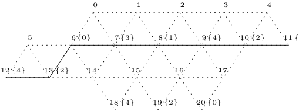

**FIGURE 3.25:** Single channel assignment to benchmark cellular network

**Example 15.** 考虑 X′（如表 3.16 所示），设 origin = 0。步骤 3 中得到的增量值为 5。算法 **Find_Assignment** 生成的集合 V、φ(V) 和 V′ 分别为 V = {11, 10, 9, 6, 8, 13, 7, 20, 19, 18, 12}，φ(V) = {0, 2, 4, 0, 1, 2, 3, 0, 2, 4, 4}，以及 V′ = {17, 14, 5, 16, 15, 4, 3, 2, 1, 0}。

步骤 4 中得到的频率分配 φ(V) 如图 3.25 所示，节点标签 {a} 表示在 V 中的单频率分配过程中，频率 a 已分配给该节点。

**Step 5 (assign multiple frequencies)**

- **Input:** The demand vector W; sets V, V′ and φ(V) as computed in Step 4 and the value of increment as computed in Step 3.
- **Step 5.1:** Compute γ_max and γ′_max to act as the maximum demands among the nodes in V and V′, respectively.
- **Step 5.2:** Compute the number of rounds d_v that the frequencies will be assigned to every node v ∈ V as: d_v = (γ_max − γ′_max) if w_v ≥ (γ_max − γ′_max), otherwise, d_v = w_v. Denote D = (d_v) as the round vector where v ∈ V.
- **Step 5.3:** Assign d_v frequencies to the node v ∈ V using the value of increment and the first round frequency φ(v) already assigned to v as follows: φ(v) + j × increment, where j ∈ {0, 1, ···, (d_v − 1)}.
- **Output:** The set of d_v frequencies assigned to each node v ∈ V.

**Example 16.** 考虑步骤 4 产生的集合 V 和 V′，以及表 3.16 中的当前需求向量 W。γ_max（V = {11, 10, 9, 6, 8, 13, 7, 20, 19, 18, 12} 中的最大需求）为 45，γ′_max（V′ = {17, 14, 5, 16, 15, 4, 3, 2, 1, 0} 中的最大需求）为 30。步骤 5 计算得到的圆向量 D = {15, 15, 15, 15, 15, 15, 15, 15, 15, 15, 15}，因为所有 v ∈ V 的 w_v ≥ (γ_max − γ′_max) = (45 − 30) = 15。利用 φ(V) 和增量值，节点 V 的多频率分配如图 3.26 所示，其中标签 {a − b} 表示频率 a、a + increment、a + 2 × increment、⋯、b = a + (d_v − 1) × increment 已分配给该节点，increment = 5，d_v = 15 对所有 v ∈ V 成立。图 3.26 中的最高频率为 74。

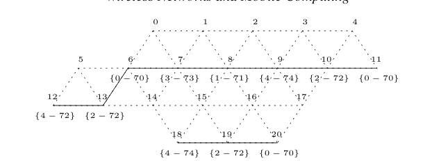

**FIGURE 3.26:** Set of assignment paths in first phase

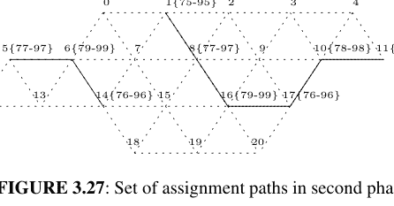

**FIGURE 3.27:** Set of assignment paths in second phase

**Step 6 (update)**

- **Step 6.1:** Modify the current demand vector W as follows: w_v = w_v if v ∈ V′; w_v = w_v − (γ_max − γ′_max) if v ∈ V and w_v ≥ (γ_max − γ′_max); and w_v = 0 if v ∈ V and w_v < (γ_max − γ′_max). Denote this modified demand vector as the residual demand vector R.
- **Step 6.2:** Reset Q to hold the subset of the nodes in V for which the residual demand is non-zero.
- **Step 6.3:** Reset φ(Q) to hold the last round frequencies assigned at the nodes in Q at Step 5.
- **Step 6.4:** Reset origin to the immediate next frequency of the maximum frequency in φ(Q).
- **Step 6.5:** Consider the residual demand vector R and the sorted node ordering X′ as the current demand vector W and current node ordering X, respectively.
- **Step 7:** Repeat Step 2 – Step 6 until the residual demand vector becomes 0.

**Remark 14.** Note that the next phase of assignment will be started with the frequency immediately next to the highest frequency used in the previous phase of assignment. The reason to hold in φ(Q) the last round frequencies of the nodes in Q is that these are the potential frequencies that may conflict with the frequencies that will be assigned in the first round of the next phase of assignment. Therefore it is required to assign frequencies in the first round of the next phase of assignment satisfying the last round frequencies of the previous phase of assignment held in φ(Q).

**Example 17.** The residual demand vector R, Q, φ(Q) and origin as obtained by Step 6 are R = {30, 25, 25, 30, 15, 15, 15, 25, 10, 25, 10, 5, 5, 5, 15, 15, 12, 8, 5, 5, 5}, Q = {11, 10, 9, 6, 8, 13, 7, 20, 19, 18, 12}, φ(Q) = {70, 72, 74, 70, 71, 72, 73, 70, 72, 74, 74} and origin = 75, respectively. The next phase of assignment obtained by repeating Step 2 through Step 6 with origin = 75 is shown in Figure 3.27. The set W = {30, 25, 25, 30, 15, 15, 15, 25, 10, 25, 10, 5, 5, 5, 15, 15, 12, 8, 5, 5, 5} is then sorted as W′ = {30, 30, 25, 25, 25, 25, 15, 15, 15, 15, 15, 12, 10, 10, 8, 5, 5, 5, 5, 5, 5}, which produces X′ = {17, 11, 10, 9, 14, 5, 16, 6, 8, 15, 13, 4, 7, 20, 3, 2, 18, 19, 12, 1, 0}. The set Y is computed as {11, 17} where both the nodes 11 and 17 have demand 30. The increment is computed as 5. Therefore, the available frequency channels are 75, 76, 77, 78 and 79, which are assigned to the set X′. Now V, φ(V) and V′ are computed as V = {17, 11, 10, 14, 5, 16, 6, 8, 1}, φ(V) = {76, 75, 78, 76, 77, 79, 79, 77, 75}, and V′ = {9, 15, 13, 4, 7, 20, 3, 2, 18, 19, 12, 0}, respectively. Note that the set of nodes in V in the second phase again forms a network structure of a set of sparse paths, as shown in Figure 3.27. The number of rounds that the frequencies in φ(V) will be repeated is given by D = {5, 5, 5, 5, 5, 5, 5, 5, 5} as γ_max − γ′_max = 30 − 25 = 5 and demands of all the nodes in V are greater than or equal to 5. Now the residual demand vector is given by R = {25, 25, 20, 25, 20, 20, 10, 10, 10, 15, 15, 12, 10, 10, 8, 5, 5, 5, 5, 0, 5}. Since demands of all the nodes in V are greater than or equal to 5, the set Q and set V are same. The last round frequencies assigned at the nodes in V is given by φ(Q) = {96, 95, 98, 96, 97, 99, 99, 97, 95}. The origin will now become 100 as 99 is the highest frequency assigned at φ(Q). Following the same procedure, subsequent phases of assignment are shown in Figures 3.28 through 3.31. In the sixth phase of the assignment, the residual demand vector becomes 0 and the process terminates. The highest frequency assigned in Figure 3.31 is 267 which corresponds to the final bandwidth requirement of 268.


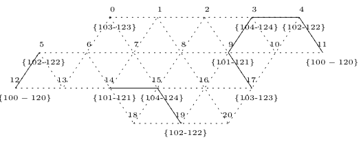

**FIGURE 3.28:** 第三阶段中的分配路径集合

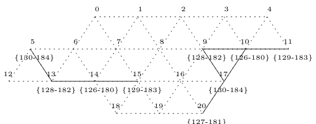

**FIGURE 3.29:** 第四阶段中添加三角形的路径

## 3.6.2  **算法收敛行为**

**定理 8.** 上述分配算法将在网络中所有节点数为 n 的 n 个阶段后终止，其中 n 是整个网络中节点的数量。

**证明：** 算法 **Assign_Frequency** 将在剩余需求向量变为 0 时终止。注意，第三步找到的增量使得当前需求向量 W 中所有最高需求节点都可以被分配。

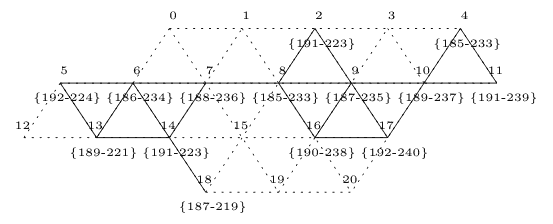

**FIGURE 3.30:** 第五阶段中添加四边形的路径

with frequencies in [origin, origin + increment). 计算完这个增量值后，在网络中所有节点按顺序，我们尽可能多地为节点分配 [origin, origin + increment) 范围内的频率。V 是已分配频率的节点集合，V' 是第 4 步中未分配的节点集合。注意，增量的值是这样计算的，集合 V 必须包含当前需求向量 W 中所有最高需求节点。

接下来，我们推导了回波向量 D = (d_v)，其中 d_v = (γ_max - γ'_max) 如果 w_v ≥ (γ_max - γ'_max)，否则 d_v = w_v。算法然后对集合 V 中的节点进行 d_v 轮的分配，并计算减去 V 中节点需求后的剩余需求向量。然而，V' 中节点的需求保持不变。因此，在满足 V 中节点 d_v 需求后，V 中节点的最高需求将减小到 γ'_max。这将确保 V' 中最高需求的节点现在成为剩余需求向量中的最高需求节点。因此，在下一个分配阶段，该节点必须被分配算法覆盖。注意，第一个分配阶段的集合 V 必须包含整个网络中所有最高需求节点。因此，在最坏情况下，如果 V' 包含整个网络中第二高需求的节点，剩余需求向量中的最高需求将变成整个网络中第二高需求。以此类推，经过 n 个阶段，剩余需求向量必须为 0，前提是原始需求向量中的所有需求都是不同的，并且在单一频率分配整个网络时，使用明确在区间 [origin, origin + increment_1) 中的频率，并考虑 Step 2 的算法 **Assign_Frequency** 可能产生的任意顺序。基于增量值的计算方式，区间 [origin, origin + increment_1) 中的频率不仅能覆盖所有具有 α_h 需求的 β_h 节点，还可能覆盖网络中的其他一些节点。设 V 为在 [origin, origin + increment_1) 中分配频率的节点集合，V' 为未分配的节点集合。假设存在至少一个属于 β_{h-1} 且需求为 α_{h-1} 的节点被排除在外。在这种情况下，V' 中的最大需求将是 α_{h-1}。因此，第一阶段的轮数为 α_h - α_{h-1} = y_1，该阶段的带宽需求为 (2s_1 + 6s_2) + increment_1 × y_1。在一般的第 i 阶段，所有具有 α_h、α_{h-1}、⋯、α_{h-(i-1)} 需求的 β_h + β_{h-1} + ⋯ + β_{h-(i-1)} 节点必须被覆盖，相应地，第 i 阶段的增量 increment_i 将被计算，该阶段的轮数为 α_{h-(i-1)} - α_{h-(i-2)} = y_i。最多有 h 个阶段，最终带宽需求变为 (2s_1 + 6s_2) + Σ_{i=1}^{h} (increment_i × y_i)。我们注意到 s_0 ≤ increment_i ≤ max(s_0, 3s_1 + 6s_2) 对所有 i 成立。因此，(2s_1 + 6s_2) + s_0(Σ_{i=1}^{h} y_i) ≤ (2s_1 + 6s_2) + Σ_{i=1}^{h} (increment_i × y_i) ≤ (2s_1 + 6s_2) + max(s_0, 3s_1 + 6s_2)(Σ_{i=1}^{h} y_i)。注意到 Σ_{i=1}^{h} y_i = α_h - 1，因此 (2s_1 + 6s_2) + s_0(α_h - 1) ≤ (2s_1 + 6s_2) + Σ_{i=1}^{h} (increment_i × y_i) ≤ (2s_1 + 6s_2) + max(s_0, 3s_1 + 6s_2)(α_h - 1)。最坏情况发生在所有节点需求相等 (h = 1) 时，贪心算法产生的最差可能的顺序用于为网络中每个节点找到单一频率分配。

网络中具有均匀需求 w 信道的下限带宽需求可从 [29] 中报告的结果中得到。根据 [29] 中的定理 1 和定理 2，可以验证 [50] 表明，上述贪心算法所需的带宽与最优带宽的最差比率总是小于或等于 5/3。然而，在以下两种情况下，该比率变为 10/7：1) s_0 ≥ (s_1 + 5s_2) 且 s_2 ≤ s_1 ≤ 2s_2，2) s_0 ≥ (2s_1 + 3s_2) 且 s_1 ≥ 2s_2。问题 3、4、7、8、10 和 11 都属于这两种情况之一。

应注意到，上述分析基于增量的保守估计（始终取最大值），因此上述比率是对所需带宽偏离最优性的非常宽松的上限。然而，计算平均情况近似比率似乎非常困难，并被留作一个开放问题。

## 3.7  结论

我们讨论了在六边形小区网络中，针对不同 s_0、s_1 和 s_2 的相对值，为每个节点分配 w 信道所需的下限带宽 [29]。接下来，我们描述了一种基于遗传算法（GA）的算法，用于解决信道分配问题的一般形式，并展示了该技术如何有效应用于六边形小区网络中具有均匀需求和双带缓冲的特殊情况。我们还表明，该方法可以轻松应用于非均匀需求的情况。

我们解释了一种优雅的解决信道分配问题（CAP）的技术，该技术适用于非六边形结构的小区网络。在给定带宽 B 的情况下，分配是为了最小化呼叫阻塞。该技术在给定带宽 B 等于相应问题的下限时，可以为所有著名的基准问题提供最优解。与 [28] 中的关键块方法相比，所需计算时间也有所提高。未使用或冗余信道的处理

**TABLE 3.17: 问题 2 的导出信道分配**

| Cells → | 0 | 1 | 2 | 3 | 4 | 5 | 6 | 7 | 8 | 9 | 10 | 11 | 12 | 13 | 14 | 15 | 16 | 17 | 18 | 19 | 20 |
| --- | --- | --- | --- | --- | --- | --- | --- | --- | --- | --- | --- | --- | --- | --- | --- | --- | --- | --- | --- | --- | --- |
|  | 230 | 272 | 228 | 129 | 2 | 3 | 1 | 127 | 0 | 3 | 126 | 0 | 0 | 126 | 4 | 2 | 128 | 1 | 226 | 126 | 4 |
|  | 236 | 279 | 234 | 134 | 7 | 8 | 6 | 132 | 5 | 8 | 131 | 5 | 5 | 131 | 9 | 7 | 133 | 6 | 232 | 131 | 9 |
|  | 242 | 286 | 240 | 139 | 12 | 13 | 11 | 137 | 10 | 13 | 136 | 10 | 10 | 136 | 14 | 12 | 138 | 11 | 238 | 136 | 14 |
|  | 248 | 293 | 246 | 144 | 17 | 18 | 16 | 142 | 15 | 18 | 141 | 15 | 15 | 141 | 19 | 17 | 143 | 16 | 244 | 141 | 19 |
|  | 254 | 300 | 252 | 149 | 22 | 23 | 21 | 147 | 20 | 23 | 146 | 20 | 20 | 146 | 24 | 22 | 148 | 21 | 250 | 146 | 24 |
|  | 260 | 307 | 258 | 154 | 27 | 28 | 26 | 152 | 25 | 28 | 151 | 25 | 25 | 151 | 29 | 27 | 153 | 26 | 256 | 151 | 29 |
|  | 266 | 314 | 264 | 159 | 32 | 33 | 31 | 157 | 30 | 33 | 156 | 30 | 30 | 156 | 34 | 32 | 158 | 31 | 262 | 156 | 34 |
|  | 393 | 321 | 389 | 164 | 37 | 38 | 36 | 162 | 35 | 38 | 161 | 35 | 35 | 161 | 39 | 37 | 163 | 36 | 268 | 161 | 39 |
|  | 328 |  |  |  |  | 43 | 41 | 167 | 40 | 43 | 166 | 40 | 40 | 166 | 44 | 42 | 168 |  | 275 | 166 |  |
|  | 335 |  |  |  |  | 48 | 46 | 172 | 45 | 48 | 171 | 45 | 45 | 171 | 49 | 47 | 173 |  | 282 | 171 |  |
|  | 342 |  |  |  |  | 53 | 51 | 177 | 50 | 53 | 176 | 50 | 50 | 176 | 54 | 52 | 178 |  |  | 176 |  |
|  | 349 |  |  |  |  | 58 | 56 | 182 | 55 | 58 | 181 | 55 | 55 | 181 | 59 | 57 | 183 |  |  | 181 |  |
|  | 356 |  |  |  |  | 63 | 61 | 187 | 60 | 63 | 186 | 60 | 60 | 186 | 64 | 62 | 188 |  |  | 186 |  |
|  | 363 |  |  |  |  | 68 | 66 | 192 | 65 | 68 | 65 | 65 | 65 | 191 | 69 | 67 | 193 |  |  |  |  |
|  | 370 |  |  |  |  | 73 | 71 | 197 | 70 | 73 | 70 | 70 | 70 | 196 | 74 | 72 | 198 |  |  |  |  |
|  | 377 |  |  |  |  |  | 76 | 202 | 75 | 78 |  | 75 |  |  | 79 | 77 | 203 |  |  |  |  |
|  | 384 |  |  |  |  |  | 81 | 207 | 80 | 83 |  | 80 |  |  | 84 | 82 | 208 |  |  |  |  |
|  | 391 |  |  |  |  |  | 86 | 212 | 85 | 88 |  | 85 |  |  | 89 | 87 | 213 |  |  |  |  |
|  | 399 |  |  |  |  |  | 217 | 90 | 93 | 93 |  | 90 |  |  | 94 | 92 | 218 |  |  |  |  |
|  | 407 |  |  |  |  |  | 222 | 95 | 98 | 98 |  | 95 |  |  | 99 | 97 | 223 |  |  |  |  |
|  | 415 |  |  |  |  |  | 227 | 100 | 103 | 103 |  | 100 |  |  | 104 | 102 | 232 |  |  |  |  |
|  | 423 |  |  |  |  |  | 233 | 105 | 108 |  |  | 105 |  |  | 109 | 107 | 400 |  |  |  |  |
|  | 431 |  |  |  |  |  | 239 | 110 | 113 | 113 |  | 110 |  |  | 114 | 112 | 408 |  |  |  |  |
|  | 439 |  |  |  |  |  | 245 | 115 | 118 | 118 |  | 115 |  |  | 115 | 117 | 416 |  |  |  |  |
|  |  |  |  |  |  | 251 | 120 | 123 | 123 |  | 120 |  |  | 124 | 122 | 424 |  |  |  |  |
|  | 447 |  |  |  |  |  | 257 | 125 | 270 | 270 |  | 128 |  |  | 129 | 229 | 432 |  |  |  |  |
|  |  |  |  |  |  | 263 | 130 | 277 |  |  | 133 |  |  | 134 | 235 | 440 |  |  |  |  |
|  |  |  |  |  |  | 269 | 135 | 284 |  |  | 138 |  |  | 139 | 241 | 448 |  |  |  |  |
|  |  |  |  |  |  | 276 | 140 |  |  |  | 143 |  |  | 144 | 247 |  |  |  |  |  |
|  |  |  |  |  |  | 285 | 145 |  |  |  | 148 |  |  | 149 | 253 |  |  |  |  |  |
|  |  |  |  |  |  | 290 | 150 |  |  |  | 153 |  |  | 154 | 259 |  |  |  |  |  |
|  |  |  |  |  |  | 297 | 155 |  |  |  |  |  |  | 159 | 265 |  |  |  |  |  |
|  |  |  |  |  |  | 304 | 160 |  |  |  |  |  |  | 164 | 271 |  |  |  |  |  |
|  |  |  |  |  |  | 311 | 165 |  |  |  |  |  |  | 169 | 278 |  |  |  |  |  |
|  |  |  |  |  |  | 318 | 170 |  |  |  |  |  |  | 174 | 285 |  |  |  |  |  |
|  |  |  |  |  |  | 325 | 175 |  |  |  |  |  |  | 179 | 292 |  |  |  |  |  |
|  |  |  |  |  |  | 332 | 180 |  |  |  |  |  |  |  | 299 |  |  |  |  |  |
|  |  |  |  |  |  | 339 | 185 |  |  |  |  |  |  |  | 306 |  |  |  |  |  |
|  |  |  |  |  |  | 346 | 190 |  |  |  |  |  |  |  | 313 |  |  |  |  |  |
|  |  |  |  |  |  | 353 | 195 |  |  |  |  |  |  |  | 320 |  |  |  |  |  |
|  |  |  |  |  |  | 360 | 200 |  |  |  |  |  |  |  | 327 |  |  |  |  |  |
|  |  |  |  |  |  | 367 | 205 |  |  |  |  |  |  |  | 334 |  |  |  |  |  |
|  |  |  |  |  |  | 374 | 210 |  |  |  |  |  |  |  | 341 |  |  |  |  |  |
|  |  |  |  |  |  | 381 | 215 |  |  |  |  |  |  |  | 348 |  |  |  |  |  |
|  |  |  |  |  |  | 388 | 220 |  |  |  |  |  |  |  | 355 |  |  |  |  |  |
|  |  |  |  |  |  | 396 | 225 |  |  |  |  |  |  |  | 362 |  |  |  |  |  |
|  |  |  |  |  |  | 404 | 231 |  |  |  |  |  |  |  | 369 |  |  |  |  |  |
|  |  |  |  |  |  | 412 | 237 |  |  |  |  |  |  |  | 376 |  |  |  |  |  |
|  |  |  |  |  |  | 420 | 243 |  |  |  |  |  |  |  | 383 |  |  |  |  |  |
|  |  |  |  |  |  | 428 | 249 |  |  |  |  |  |  |  | 390 |  |  |  |  |  |
|  |  |  |  |  |  | 436 | 255 |  |  |  |  |  |  |  | 398 |  |  |  |  |  |
|  |  |  |  |  |  | 444 | 261 |  |  |  |  |  |  |  | 406 |  |  |  |  |  |
|  |  |  |  |  |  |  | 267 |  |  |  |  |  |  |  | 414 |  |  |  |  |  |
|  |  |  |  |  |  |  | 274 |  |  |  |  |  |  |  | 422 |  |  |  |  |  |
|  |  |  |  |  |  |  | 281 |  |  |  |  |  |  |  | 430 |  |  |  |  |  |
|  |  |  |  |  |  |  | 288 |  |  |  |  |  |  |  | 438 |  |  |  |  |  |
|  |  |  |  |  |  |  | 295 |  |  |  |  |  |  |  | 446 |  |  |  |  |  |
|  |  |  |  |  |  |  | 302 |  |  |  |  |  |  |  |  |  |  |  |  |  |
|  |  |  |  |  |  |  | 309 |  |  |  |  |  |  |  |  |  |  |  |  |  |
|  |  |  |  |  |  |  | 316 |  |  |  |  |  |  |  |  |  |  |  |  |  |
|  |  |  |  |  |  |  | 323 |  |  |  |  |  |  |  |  |  |  |  |  |  |
|  |  |  |  |  |  |  | 330 |  |  |  |  |  |  |  |  |  |  |  |  |  |
|  |  |  |  |  |  |  | 337 |  |  |  |  |  |  |  |  |  |  |  |  |  |
|  |  |  |  |  |  |  | 344 |  |  |  |  |  |  |  |  |  |  |  |  |  |
|  |  |  |  |  |  |  | 351 |  |  |  |  |  |  |  |  |  |  |  |  |  |
|  |  |  |  |  |  |  | 358 |  |  |  |  |  |  |  |  |  |  |  |  |  |
|  |  |  |  |  |  |  | 365 |  |  |  |  |  |  |  |  |  |  |  |  |  |
|  |  |  |  |  |  |  | 372 |  |  |  |  |  |  |  |  |  |  |  |  |  |
|  |  |  |  |  |  |  | 379 |  |  |  |  |  |  |  |  |  |  |  |  |  |
|  |  |  |  |  |  |  | 386 |  |  |  |  |  |  |  |  |  |  |  |  |  |
|  |  |  |  |  |  |  | 394 |  |  |  |  |  |  |  |  |  |  |  |  |  |
|  |  |  |  |  |  |  | 402 |  |  |  |  |  |  |  |  |  |  |  |  |  |
|  |  |  |  |  |  |  | 410 |  |  |  |  |  |  |  |  |  |  |  |  |  |
|  |  |  |  |  |  |  | 418 |  |  |  |  |  |  |  |  |  |  |  |  |  |
|  |  |  |  |  |  |  | 426 |  |  |  |  |  |  |  |  |  |  |  |  |  |
|  |  |  |  |  |  |  | 434 |  |  |  |  |  |  |  |  |  |  |  |  |  |
|  |  |  |  |  |  |  | 442 |  |  |  |  |  |  |  |  |  |  |  |  |  |
|  |  |  |  |  |  |  | 444 |  |  |  |  |  |  |  |  |  |  |  |  |  |


这种方法所提供的（能力）是否可用于动态地适应需求的微小变化，是一个有待进一步研究的问题。

我们还描述了一种多项式时间算法，用于在双频段缓冲系统中为具有非均匀需求的六边形蜂窝网络进行近似最优信道分配。具有非均匀需求的信道分配问题（CAP）被划分为若干较小的子问题，每个子问题对原始网络的一个节点子集具有均匀需求。一种简单的分配方案优先满足需求较高的节点，从而求解每个子问题。我们借助费城基准问题6 说明了该算法，该问题被公认为文献中最困难的问题之一。该算法所得分配的带宽从未超过最优带宽的 6%，并且对于大多数困难基准问题而言，所需的执行时间非常短（在 HP xw8400 工作站上不到 5 毫秒）。因此，该算法适用于需要快速信道分配的现实场景，尽管可以容忍与最优带宽的微小偏差（例如约 6%）。

## 3.8 习题

- 1. 描述蜂窝移动网络中信道分配问题的数学模型。
- 2. 用经典顶点着色问题来表示蜂窝移动网络中的信道分配问题。
- 3. 对于网络中每个组成节点均只有一个需求的蜂窝移动网络，推导分配信道所需带宽的下界。
- 4. 给定一个七节点六边形子图（由一个中心节点和位于六边形六个角的六个外围节点组成），对蜂窝网络中不同节点具有非均匀需求的情况，推导其带宽需求的下界。
- 5. 描述求解信道分配问题的频率穷举策略和需求穷举策略。
- 6. 描述一种方法，将具有非均匀需求的信道分配问题划分为一系列较小的子问题，其中每个子问题对网络的一个节点子集具有均匀需求。
- 7. 假设算法 A 能够求解具有单信道均匀需求的信道分配问题。描述一种利用算法 A 求解具有非均匀需求的信道分配问题的算法。
- 8. 描述一种多项式时间算法，用于求解蜂窝移动网络中的信道分配问题，并具有 β 近似带宽，即该分配算法所需的带宽在问题最优带宽的 β 倍以内。
- 9. 设计一种多项式时间近似算法，为网络中各节点的非均匀需求分配信道，并且比本章提出的算法更高效。你所提出的算法在所有基准问题上的最坏情况执行时间需要小于现有算法所确定的时间，并且所需的最坏情况带宽超过最优带宽的近似因子需要小于 5/3。

## 参考文献

- [1] A. Sen, T. Roxborough, B. P. Sinha, “关于蜂窝网络中信道分配的最优算法，” *IEEE 国际通信会议论文集*，加拿大温哥华，第 1147–1151 页，1999 年 6 月。
- [2] A. Sen, T. Roxborough 和 S. Medidi, “蜂窝网络中一类信道分配问题的上界和下界，” *IEEE INFOCOM '98 会议论文集*，1998 年 4 月。
- [3] W. K. Hale, “频率分配：理论与应用，” *IEEE 论文集*，第 68 卷，第 1497–1514 页，1980 年。
- [4] M. Duque-Anton, D. Kunz 和 B. Ruber, “使用模拟退火的蜂窝无线电信道分配，” *IEEE 车辆技术汇刊*，第 42 卷，第 1 期，第 14–21 页，1993 年 2 月。
- [5] R. Mathar 和 J. Mattfeldt, “蜂窝无线网络中的信道分配，” *IEEE 车辆技术汇刊*，第 42 卷，第 4 期，第 647–656 页，1993 年 11 月。
- [6] D. Kunz, “使用神经网络的蜂窝无线电信道分配，” *IEEE 车辆技术汇刊*，第 40 卷，第 1 期，第 188–193 页，1991 年 2 月。
- [7] D. Tcha, Y. Chung 和 T. Choi, “频率分配问题的一个新下界，” *IEEE/ACM 网络汇刊*，第 5 卷，第 1 期，1997 年 2 月。
- [8] K. N. Sivarajan, R. J. McEliece 和 J. W. Ketchum, “蜂窝无线中的信道分配，” *第 39 届 IEEE 车辆技术会议论文集*，第 846–850 页，1989 年 5 月。
- [9] W. Wang 和 C. K. Rushforth, “信道分配问题的一种自适应局部搜索算法，” *IEEE 车辆技术汇刊*，第 45 卷，第 3 期，第 459–466 页，1996 年 8 月。
- [10] S. Khanna 和 K. Kumaran, “关于无线频谱估计与广义图着色，” *IEEE INFOCOM 会议论文集*，1998 年 4 月。
- [11] R. A. Leese, “矩形六边形网格上无线电信道分配的统一方法，” *IEEE 车辆技术汇刊*，第 46 卷，第 4 期，第 968–980 页，1997 年 11 月。
- [12] L. Narayanan 和 S. Shende, “蜂窝网络中的静态频率分配，” *第四届结构与信息通信复杂性国际学术讨论会论文集*，1997 年。
- [13] A. Sen, T. Roxborough 和 S. Medidi, “蜂窝网络中一类信道分配问题的上界和下界，” *IEEE INFOCOM 会议论文集*，1998 年 4 月。
- [14] S. Kim 和 S. Kim, “蜂窝移动系统中频率分配的两阶段算法，” *IEEE 车辆技术汇刊*，第 43 卷，第 3 期，第 542–548 页，1994 年 8 月。
- [15] D. Beckmann 和 U. Killat, “将遗传算法应用于信道分配问题的一种新策略，” *IEEE 车辆技术汇刊*，第 48 卷，第 4 期，第 1261–1269 页，1999 年 7 月。
- [16] C. Y. Ngo 和 V. O. K. Li, “使用改进遗传算法的蜂窝无线网络固定信道分配，” *IEEE 车辆技术汇刊*，第 47 卷，第 1 期，第 163–172 页，1998 年 2 月。

## 蜂窝网络中的带宽管理

- [17] D.-W. Tcha, J.-H. Kwon, T.-J. Choi 和 S.-H. Oh, “变化 TDMA/FDMA 蜂窝环境中扰动最小化的频率分配，” _IEEE 车辆技术汇刊_，第 49 卷，第 2 期，第 390–396 页，2000 年 3 月。
- [18] W. K. Lio 和 G. G. Coghill, “通过进化优化进行信道分配，” _IEEE 车辆技术汇刊_，第 45 卷，第 1 期，第 91–96 页，1996 年 2 月。
- [19] J. S. Kim, S. H. Park, P. W. Dowd 和 N. M. Nasrabadi, “使用改进 Hopfield 网络的蜂窝无线电信道分配，” _IEEE 车辆技术汇刊_，第 46 卷，第 957–967 页，1997 年 11 月。
- [20] C. W. Sung 和 W. S. Wong, “同信道和相邻信道干扰约束下信道分配的序列装箱算法，” _IEEE 车辆技术汇刊_，第 46 卷，第 676–686 页，1997 年 8 月。
- [21] J. S. Kim, S. H. Park, P. W. Dowd 和 N. M. Nasrabadi, “使用遗传算法的蜂窝无线电信道分配，” _无线个人通信_，第 3 卷，第 3 期，第 273–286 页，1996 年 8 月。
- [22] T.-M. Ko, “固定信道分配的频率选择性插入策略，” _第五届 IEEE 国际个人、室内和移动无线电通信研讨会论文集_，第 311–314 页，1994 年 9 月。
- [23] N. Funabiki 和 Y. Takefuji, “蜂窝无线网络中信道分配的神经网络并行算法，” _IEEE 车辆技术汇刊_，第 41 卷，第 430–437 页，1992 年 11 月。
- [24] R. Battiti, A. Bertossi 和 D. Cavallaro, “蜂窝无线网络中信道分配的随机饱和度和启发式算法，” _IEEE 车辆技术汇刊_，第 50 卷，第 2 期，第 364–374 页，2001 年 3 月。

无线网络与移动计算

- [25] K. Smith 和 M. Palaniswami, “使用神经网络的静态和动态信道分配，” _IEEE 通信选题杂志_，第 15 卷，第 238–249 页，1997 年 2 月。
- [26] G. Chakraborty, “蜂窝无线网络中信道分配问题的一种高效启发式算法，” _IEEE 车辆技术汇刊_，第 50 卷，第 6 期，第 1528–1539 页，2001 年 11 月。
- [27] http://www.specbench.org/osg/cpu95/results/cint95(cfp95).html
- [28] S. C. Ghosh, B. P. Sinha 和 N. Das, “六边形蜂窝网络高效信道分配的一种新方法，” _国际计算机科学基础杂志_，第 14 卷，第 3 期，第 439–463 页，2003 年 6 月。
- [29] S. C. Ghosh, B. P. Sinha 和 N. Das, “基于几何对称性的遗传算法信道分配，” _IEEE 车辆技术汇刊_，第 52 卷，第 4 期，第 860–875 页，2003 年 7 月。
- [30] A. Gamst, “信道分配问题的一个新下界，” _IEEE 车辆技术汇刊_，第 49 卷，第 4 期，第 1265–1272 页，2000 年 7 月。
- [31] R. Montemanni, J. N. J. Moon 和 D. H. Smith, “固定频谱频率分配问题的一种改进禁忌搜索算法，” _IEEE 车辆技术汇刊_，第 52 卷，第 3 期，第 891–901 页，2003 年 5 月。
- [32] D. Kunz, “使用神经网络的蜂窝无线电信道分配，” _IEEE 车辆技术汇刊_，第 40 卷，第 1 期，第 188–193 页，1991 年 2 月。
- [33] W. Wang 和 C. K. Rushforth, “蜂窝移动网络中信道分配的局部搜索，” 载于 _离散数学与理论计算机科学 DIMACS 系列_，第 35 卷，第 689–709 页，1997 年。


## 蜂窝网络中的带宽管理

- [34] I. Katzela 和 M. Naghshineh，“蜂窝移动电信系统的信道分配方案：综合综述”，_IEEE 个人通信_，第 3 卷，第 10–31 页，1996 年。
- [35] M. Zhang 和 T.-S. Yum，“用于蜂窝移动系统的非均匀紧凑图案分配算法”，_IEEE 车辆技术汇刊_，第 40 卷第 2 期，第 387–391 页，1991 年。
- [36] S.-H. Oh 和 D.-W. Tcha，“蜂窝无线网络中的优先信道分配”，_IEEE 通信汇刊_，第 40 卷，第 1259–1269 页，1992 年。
- [37] P. Venkata Krishna 和 N. Ch. S. N. Iyengar，“蜂窝网络中具有高效信道预留的最优信道分配算法”，_国际通信网络与分布式系统杂志_，第 1 卷第 1 期，第 33–51 页，2008 年。
- [38] G. Vidyarthi、A. Ngom 和 I. Stojmenovic，“无线移动网络中利用高效进化策略的混合信道分配方法”，_IEEE 车辆技术汇刊_，第 54 卷第 5 期，第 1887–1895 页，2005 年。
- [39] G. Kendall 和 M. Mohamad，“使用超启发式算法优化信道分配”，_IEEE 控制论与智能系统会议论文集_，新加坡，2004 年 12 月。
- [40] A. Boukerche、K. E. Khatib 和 T. Huang，“移动网络分布式动态信道分配协议的性能评估”，_无线通信与移动计算_，第 7 卷第 1 期，第 69–80 页，2007 年。
- [41] M. R. Garey 和 D. S. Johnson，“近最优图染色的复杂性”，_ACM 杂志_，第 23 卷，第 43–49 页，1976 年。
- [42] A. Gamst，“一类频率分配问题的一些下界”，_IEEE 车辆技术汇刊_，第 35 卷第 1 期，第 8–14 页，1986 年。
- [43] A. Gamst 和 W. Rave，“论移动自动电话系统中的频率分配”，_IEEE GLOBECOM 会议录_，1982 年。
- [44] S. C. Ghosh、B. P. Sinha 和 N. Das，“关于信道分配问题下界的进一步研究”，_第六届亚太地区高性能计算国际会议论文集_，印度班加罗尔，第 II 卷，第 522–527 页，2002 年 12 月。
- [45] D. H. Smith、S. Hurley 和 S. M. Allen，“信道分配问题的一个新下界”，_IEEE 车辆技术汇刊_，第 49 卷第 4 期，第 1265–1272 页，2000 年。
- [46] R. Montemanni、D. Smith 和 S. Allen，“固定频谱频率分配的下界”，_运筹学纪事_，第 107 卷第 1 期，第 237–250 页，2001 年。
- [47] D. E. Goldberg，_遗传算法在搜索、优化和机器学习中的应用_，Addison-Wesley，1989 年。
- [48] C. A. Murthy 和 N. Chowdhury，“利用遗传算法寻找最优聚类”，_模式识别快报_，第 17 卷，第 825–832 页，1996 年。
- [49] D. Bhandari、C. A. Murthy 和 S. K. Pal，“具有精英模型的遗传算法及其收敛性”，_国际模式识别与人工智能杂志_，第 10 卷，第 731–747 页，1996 年。
- [50] G. K. Audhya、K. Sinha、K. Mandal、R. Dattagupta、S. C. Ghosh 和 B. P. Sinha，“一种用于蜂窝移动网络中快速近最优信道分配的新方法”，_IEEE 移动计算汇刊_，第 12 卷第 9 期，第 1814–1827 页，2013 年 9 月。
- [51] S. C. Ghosh、B. P. Sinha 和 N. Das，“合并 CAP：一种改进的蜂窝网络频率分配技术”，_IEEE 车辆技术汇刊_，第 55 卷第 2 期，第 640–653 页，2006 年 3 月。
- [52] G. K. Audhya、K. Sinha、S. C. Ghosh 和 B. P. Sinha，“无线网络中信道分配问题综述”，_无线通信与移动计算_，第 11 卷第 5 期，第 583–609 页，2011 年 5 月。

## 第 4 章：移动网络中的节点定位

| 章节 | 页码 |
| --- | --- |
| 4.1 系统模型 | 178 |
| 4.2 预备知识 | 179 |
| 4.3 位置误差估计 | 183 |
| 4.3.1 节点坐标模糊性导致的误差 | 183 |
| 4.3.2 距离估计误差的贡献 | 187 |
| 4.3.3 组合误差估计 | 189 |
| 4.4 信标节点选择算法 | 192 |
| 4.5 位置区域识别 | 194 |
| 4.5.1 预备知识 | 195 |
| 4.5.2 区域估计算法 | 204 |
| 4.5.3 复杂度分析 | 206 |
| 4.5.4 仿真结果 | 206 |
| 4.6 习题 | 213 |
| 参考文献 | 214 |

在本章中，我们讨论用于计算自组织网络中节点位置的定位识别算法。我们从一小部分称为参考节点的节点开始，这些节点被假定为通过 GPS 或其他方式以高精度知道自身位置。从这些参考节点出发，其他节点的位置被依次计算出来。信标节点是参考节点，或者是借助其邻居的位置信息已计算出自身位置的节点。我们假设所有信标节点（包括参考节点）所公布的位置都存在误差。±ε 表示信标节点在二维坐标系中任一轴上所公布坐标的最大可能误差。±δ 表示节点与信标之间测量距离在任一轴上的最大可能误差。我们首先介绍由文献 [11] 提出的智能信标选择算法，该算法使节点计算位置在一个轴上的误差限制在 ±[3ε(1 + √2) + 2δ] 到 ±(3ε + 2δ) 范围内，在其正交轴上限制在 ±[2δ(1 + √2) + 3ε] 到 ±(3ε + 2δ) 范围内。文献 [11] 的作者还推导出了一个通用表达式，用于计算节点计算位置可能引入的误差界限，以及选择信标节点时必须满足的条件，从而将节点计算位置的误差保持在这些界限内。

自组织网络被建模为一个由 \( n \) 个节点组成的图 \( G = (V, E) \)。\( V \) 是所有节点的集合，\( |V| = n \)，\( E \) 是图 \( G \) 中的边集。节点可以是静止的，也可以是移动的。假设所有通信链路都是双向的。如果节点 \( v \) 和节点 \( u \) 处于彼此的收听范围内，则称 \( v \) 是 \( u \) 的 _邻居_。节点 \( i \) 的邻域 \( N(i) \) 由所有处于其传输范围内的节点组成。假设一小部分节点通过 GPS 或其他方式高精度地知道各自的位置。这些节点充当网络中的 _参考节点_（RN）。最初，除 RN 之外的节点对自身位置一无所知。如果一个节点被用于计算另一个节点的未知位置，则该节点被定义为 _信标节点_。信标节点可以是参考节点，也可以是借助其相邻信标的位置信息计算出自身位置的节点。

考虑到接收端的热噪声、NLOS 误差和信道特性，两个节点 *u* 和 *v* 之间的测量距离可以表示为，

$$r_{uv}=d_{uv}+\eta_{uv}+c\tau_{uv}$$

(4.1)

其中 $d_{uv}$ 表示 $u$ 和 $v$ 之间未知的欧几里得距离。$\eta_{uv}$ 对接收端热噪声、信号带宽和信噪比的组合加性效应进行了完整建模。$\eta_{uv}$ 已被证明是一个零均值正态随机变量，因此可以被测量或预先计算 [1]。假设 $\eta_{uv}$ 始终是加性的。$c\tau_{uv}$ 表示 NLOS 距离误差，并且是主要的误差贡献项 [2]，其中 $c$ 是空气中的光速。

除了用于位置计算的测量距离之外，我们还将假定参考节点（以及一般的信标节点）的公布位置在已知界限内存在误差。参考节点公布的坐标在 x 轴和 y 轴上可能有 ±ε 的误差。测量距离的误差在两个轴方向上可能达到 ±δ。

### 4.2 预备知识

上述模型假设，信标节点（包括参考节点）的公布坐标以及两个节点之间的测量距离中可能存在误差。我们注意到，许多现有的位置感知技术都提到了其定位过程的精度。该值可以用作参考节点公布坐标中的 ε 误差。例如，


## 图 4.1：延迟信道与接收机设计

GPS，目前应用最广泛的定位感知技术，在室外环境中95%到99%的时间里精度可达1至5米[3]。Microsoft Radar [4]声称精度为3至4.3米，而PinPoint 3D-iD和WhereNet [3]的定位精度为1至3米。Cricket系统[5]在几乎100%的时间内精度可达4 × 4英尺区域。因此，根据应用场景，我们可以为ε设置一个与参考节点相对应的适当值。

为了确定测距误差的±δ界限，假设NLOS误差是测量距离误差的主要来源。由热噪声（公式(4.1)中的η_tw）引起的误差通常远小于NLOS误差分量，因此在后续讨论中忽略不计。在[6]中，实验结果表明，对于发射机和接收机之间存在视距的室内位置，归一化距离误差的零均值高斯模型与NLOS距离误差非常吻合。对于室内有障碍物视距（OLOS）的情况，虽然高斯模型不适用，但由零均值高斯分布和指数分布组成的混合分布与距离误差非常吻合。

虽然无法知道NLOS传播在测量距离中引入的误差程度，但可以估计可容忍的最大NLOS误差，以便接收机能正确解译发射信号。为了分析可容忍的NLOS误差量，考虑如图4.1所示的*延迟信道*和接收机电路。在延迟信道中，给定时刻*t*的输出信道状态与时刻*t − t′*的输入信道状态相同。一个接收机

[PAGE 201]
<!-- no content -->

[PAGE 202]
<!-- no content -->

[PAGE 203]

540 Mbps），脉冲宽度将为5至1.85 ns，这在公式(4.1)中对应$c\tau_{uv}$为1.5至0.555米。

## 4.3 定位误差估计

假设节点$u$的位置通过三角定位法获得，使用其相邻且位置已知的信标节点。节点$u$估计位置的误差可能来自：

- 1. 用于对节点$u$进行三角定位的信标节点位置的不确定性。
- 2. 测距误差；其中NLOS误差占主导地位。

## 4.3.1 节点坐标模糊性引起的误差

我们首先考虑信标节点位置不能精确已知的情况。考虑如图4.2所示的两个信标节点$B_1$和$B_2$，相应的估计距离分别为$r_1$和$r_2$。令$T$表示节点$u$的计算位置。令$S$为从$T$向$B_1$和$B_2$连线所作垂线的垂足，$d_1$和$d_2$分别为$S$到$B_1$和$B_2$的距离。令$d = d_1 + d_2$。则以$B_1(0,0)$为原点、x轴沿$B_1B_2$方向时，$S$的坐标为$(d_1, 0)$，$T$的坐标为$(d_1, \sqrt{r_1^2 - d_1^2})$。

如果信标节点的位置估计存在误差，$B_1$和$B_2$可以分别位于以$B_1$和$B_2$为圆心、半径为$\epsilon$的圆内的任意位置，如图4.3所示（注意$B_1$和$B_2$被假定为实际位置

[PAGE 204]

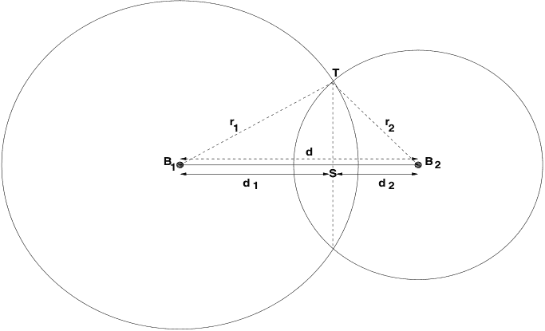

**图 4.2：** 使用两个信标节点的位置估计

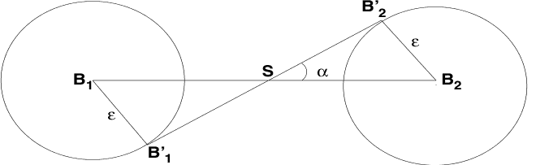

**图 4.3：** 信标节点位置存在误差时的位置估计

（接上）信标节点的实际位置），其中±ε是信标节点坐标误差的上界。这意味着上述T的坐标值\((d_1, \sqrt{r_1^2-d_1^2})\)现在是相对于某个新原点\(B'_1\)和旋转后的x轴\(B'_1B'_2\)的，如图所示，其中\(B'_1\)和\(B'_2\)分别是围绕\(B_1\)和\(B_2\)、半径为ε的圆内的点。我们将T在该新坐标系中的坐标记为\((x', y') = (d_1, \sqrt{r_1^2-d_1^2})\)。直线\(B'_1B'_2\)可以与\(B_1B_2\)成\(\alpha \leq \frac{2\epsilon}{d}\)的角度。

我们可以将这些坐标值转换为相对于\(B_1\)和\(B_2\)的\((x, y)\)，如下所示：

[PAGE 205]

```
$$\begin{aligned} x &= x'\cos\alpha-y'\sin\alpha\pm\epsilon \\ y &= x'\sin\alpha+y'\cos\alpha\mp\epsilon \end{aligned} \tag{4.6}$$
```

由于在大多数情况下$\frac{2\epsilon}{d}$是一个小量，根据公式(4.6)，我们有：

```
$$(x,y)\approx(x'-y'\alpha\pm\epsilon,\ x'\alpha+y'\mp\epsilon).$$
```

于是，$T$相对于由连接$B_1$和$B_2$的直线构成的旋转x轴的坐标为：

```
$$\begin{aligned} x &= d_1-\sqrt{r_1^2-d_1^2}\cdot\left(\frac{2\epsilon}{d}\right)\pm\epsilon \\ y &= d_1\cdot\left(\frac{2\epsilon}{d}\right)+\sqrt{r_1^2-d_1^2}\mp\epsilon. \end{aligned}$$
```

因此，由于信标节点公告位置存在最大$\pm\epsilon$的模糊性，节点$u$计算位置中引入的误差由下式给出：

```
$$\begin{aligned} |x-x'| &= \sqrt{r_1^2-d_1^2}\cdot\left(\frac{2\epsilon}{d}\right)+\epsilon \\ |y-y'| &= d_1\cdot\left(\frac{2\epsilon}{d}\right)+\epsilon \end{aligned}\quad\le 3\epsilon\tag{4.7}$$
```

由公式(4.7)我们得出结论：如果单个信标节点的位置存在$\pm\epsilon$的不确定性，则这种不确定性在节点$u$沿垂直于连接$B_1B_2$的直线轴上的评估位置中最多可导致$\pm3\epsilon$的误差。然而，对于沿直线$B_1B_2$方向的坐标值误差，无法给出这样的界限。

为了计算未知节点坐标计算过程中所引入误差的有界估计，我们考虑使用三个信标节点而不是两个。在图4.4中，点T表示该节点两个可能位置之一。

[PAGE 206]

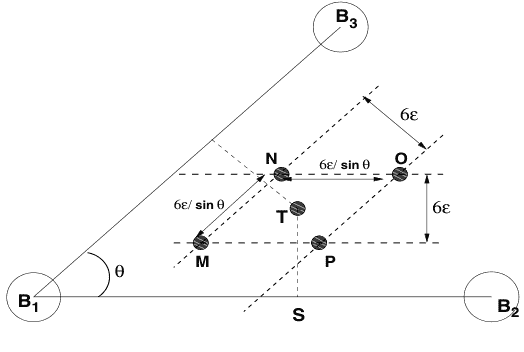

使用 $B_1$ 和 $B_2$ 作为信标节点，并假设信标节点坐标或测量距离均不存在误差。现在根据公式 (4.7)，两个信标节点位置估计中分别为 $\pm\epsilon$ 的误差，会在未知节点的 y 坐标估计中产生 $\pm3\epsilon$ 的误差。因此，关于直线 $B_1B_2$，我们设想放置一条宽度为 $6\epsilon$、与 $B_1B_2$ 平行的带状区域，使点 $T$ 到该带状区域两条边界线的距离均为 $3\epsilon$。类似地，关于信标节点 $B_3$，我们再放置一条宽度为 $6\epsilon$、与直线 $B_1B_3$ 平行的带状区域，并使点 $T$ 到该带状区域两条边界线的距离均为 $3\epsilon$。因此，如图 4.4 所示，$T$ 的实际位置始终可以在菱形 $MNOP$ 内找到。该菱形边长为 $\frac{6\epsilon}{\sin\theta}$，其中 $\theta$ 是直线 $B_1B_2$ 与 $B_1B_3$ 之间的夹角。因此，当 $45 \leq \theta \leq 90$ 度时，该菱形边长不超过 $6\sqrt{2}\epsilon$；当 $30 \leq \theta < 45$ 度时，不超过 $12\epsilon$。我们有如下引理：

## **Lemma 9.**

对于每个信标节点的 $x$ 和 $y$ 坐标均存在 $\pm\epsilon$ 误差的情况，使用三个信标节点（例如 $B_1$、$B_2$ 和 $B_3$）时，未知节点的位置可以被限定在边长为 $\frac{6\epsilon}{\sin\theta}$ 的菱形内，其中不失一般性地，$\theta$ 是直线 $B_1B_2$ 与 $B_1B_3$ 之间的夹角。

[PAGE 207]

# ### 4.3.2 测距误差的贡献

接下来我们考虑仅在各个测距估计中存在最大误差±δ的情况（由于NLOS误差和高斯噪声）。同样，通常假设δ与d、r₁或r₂相比相当小。假设所使用的信标节点坐标无误差。即，我们以B₁和B₂作为信标节点的实际坐标，但存在测距误差δ，因此从B₁和B₂测得的距离现在分别为r′₁和r′₂，其中r′₁ = r₁ ± δ，r′₂ = r₂ ± δ。因此，d₁的修正值由下式给出：

```
$$d'_1 = \frac{d_2 + r_1'^2 - r_2'^2}{2d}$$

$$= \frac{d_2 + r_1^2 - r_2^2 \pm 2\delta r_1 \pm 2\delta r_2}{2d} \qquad \text{(neglecting }O(\delta^2)\text{ terms).}$$
```

注意，在上述d′₁的表达式中，假定两个信标节点B₁和B₂之间的距离d是常数。因此，在u沿x轴（即连接B₁和B₂的直线）的计算位置中产生的误差为：

```
$$|d'_1-d_1| \leq \frac{2\delta(r_1+r_2)}{2d}$$

$$\leq \frac{2\delta\cdot 2d}{2d} \qquad \text{since } r_1\leq d \text{ and } r_2\leq d$$

$$=2\delta. \tag{4.8}$$
```

$\sqrt{r_1^2-d_1^2}$的修正值现在为

**图 4.5:** 使用三个信标节点时，范围误差的贡献

$$\sqrt{r_1'^2-d_1'^2}=\sqrt{(r_1\pm\delta)^2-(d_1\pm2\delta)^2}$$

$$=\sqrt{r_1^2-d_1^2\pm2\delta r_1\mp4\delta d_1}\qquad\text{(忽略 }O(\delta^2)\text{ 项)。}$$

因此，沿 y 轴的误差（如图 4.2 中的直线 $TS$）为

$$\left|\sqrt{r_1'^2-d_1'^2}-\sqrt{r_1^2-d_1^2}\right|\leq\frac{2\delta(r_1+2d_1)}{\sqrt{r_1^2-d_1^2}}. \tag{4.9}$$

因此，从方程 (4.8) 和 (4.9) 可知，沿连接两个信标节点 $B_1B_2$ 的直线 $u$ 的坐标值的误差上限为 $2\delta$，当每个测量范围的最大误差为 $\pm\delta$ 时。然而，由于每个测量范围的 $\pm\delta$ 误差导致的 $u$ 在 $B_1B_2$ 直线外的坐标误差是由信标节点之间的距离以及 $u$ 与信标节点之间的距离决定的，因此无法给出上限。

为了约束由于信标节点坐标错误和测量范围误差共同引起的未知节点位置误差，我们再次考虑使用三个信标节点而非两个，类似于位置估计的 ±ε 误差情况。图 4.5 展示了如何使用三个信标节点来计算未知节点 *u* 的坐标估计的上限，假设测量范围的误差为 ±δ。相对于 *B*₁ 和 *B*₂，我们考虑一个宽度为 4δ、垂直于 *B*₁*B*₂ 且距离 *B*₁ 为 d₁ 的带状区域，点 *T* 始终位于该带内。同样，相对于另一对信标节点，例如 *B*₁ 和 *B*₃，我们想象一个同样宽度为 4δ、垂直于 *B*₁*B*₃ 的带状区域，点 *T* 必须位于该区域内。因此，点 *T* 的实际位置始终可以在由实线在图 4.5 中所示的菱形（边长为 \(\frac{4\delta}{\sin\theta}\)，θ 为 *B*₁*B*₂ 与 *B*₁*B*₃ 之间的夹角）内找到。若 45° ≤ θ ≤ 90°，菱形的边长可约束为 \(4\sqrt{2}\delta\) 或更少；若 30° ≤ θ < 45°，则约束为 8δ。我们得到以下命题：

> **Lemma 10.** *对于每个信标节点的测量范围误差 ±δ，未知节点的位置可以在以三个信标节点（例如 B₁、B₂ 和 B₃）为基础的菱形 \(\frac{4\delta}{\sin\theta}\) 边长内被约束，其中 θ 为 B₁B₂ 与 B₁B₃ 之间的夹角，且无失一般性。*

## 4.3.3 综合误差估计

最后，我们考虑信标节点的广告坐标的最大可能误差 ±ε，以及测量范围估计的可能误差 ±δ。

在 Sections 4.3.1 和 4.3.2 中，我们分别考虑了使用三个信标节点对每种个案的误差上限，得出在图 4.2 中点 *T* 表示未知节点 *u* 的真实位置。对于坐标误差 ±ε 的情况，

在图 4.4 中，真实位置的 $u$ 必须位于边长为 \(\frac{6\epsilon}{\sin\theta}\) 的菱形（图 4.4 中的 $MNOP$）内。假设信标节点坐标精确，当每个测量范围的误差为 ±δ 时，真实位置了在边长为 \(\frac{4\delta}{\sin\theta}\) 的菱形内。

**Lemma 11.** *如果信标节点坐标误差和测量范围误差同时发生，则可以通过考虑 Lemma 9 和 Lemma 10 中所述的两个菱形的 Minkowski 求和 [9] 来获得两者的综合效果的有界估计。*

*证明.* 同时发生的两个误差的综合效果可以如下设想。

假设我们正在计算节点 $u$ 的坐标。首先，由于信标节点坐标的 ±ε 误差，我们得到菱形 $MNOP$（图 4.4）。该菱形表示在测量范围无误的情况下，节点 $u$ 必须位于的位置范围。换句话说，菱形内部及边缘的任意点都可能是节点 $u$ 的位置。设点 $X$ 表示节点 $u$ 的位置。如果测量范围也出现 ±δ 误差，我们可以将菱形 $ABCD$（边长为 \(\frac{4\delta}{\sin\theta}\)，如图 4.5）置于使得点 $X$ 位于 $ABCD$ 的对角线交点处，且 $ABCD$ 与坐标轴对齐（如图 4.5 所示）。由于点 $X$ 可能位于菱形 $MNOP$ 的任意位置，在同时存在两种误差时，节点 $u$ 被保证所在的区域由将菱形 $ABCD$ 在菱形 $MNOP$ 的所有点上移动所形成的多边形边界所界定，即两个菱形的 Minkowski 求和。

图 4.6 展示了边长为 \(\frac{6\epsilon}{\sin\theta}\) 和 \(\frac{4\delta}{\sin\theta}\) 的两个菱形的 Minkowski 求和。图 4.6 中多边形的顶点标签对应于图 4.4 和图 4.5 中原始菱形的顶点。例如，顶点 $MA$ 和 $MB$ 分别来源于菱形 $MNOP$ 中的顶点 $M$ 以及菱形 $ABCD$ 中的顶点 $A$ 和 $B$。

**定理 10.**

*假设信标节点坐标的误差为 ±ε，测量范围的误差为 ±δ，则未知节点位置因这两种误差共同作用而产生的误差在 x 轴方向上被界定为* $\pm\left[\frac{3\epsilon(1+\cos\theta)}{\sin\theta}+2\delta\right]$，*在 y 轴方向上被界定为* $\pm\left[\frac{2\delta(1+\cos\theta)}{\sin\theta}+3\epsilon\right]$。

*证明.* 边 $PO$ 在 x 轴上的投影为 $6\epsilon\cot\theta$。同样，边 $DA$ 在 y 轴上的投影为 $4\delta\cot\theta$。根据 Lemma 11，Minkowski 求和是通过在菱形 $MNOP$ 的所有边上放置菱形 $ABCD$，使得 $ABCD$ 的对角线交点位于 $MNOP$ 的边上而形成的。因此，$ABCD$ 在 x 轴上的投影为 $4\delta$，而 $MNOP$ 在 y 轴上的投影为 $6\epsilon$。于是，两种误差共同作用导致的 x 轴误差总跨度为 $\pm\left[\frac{6\epsilon}{\sin\theta}+6\epsilon\cot\theta+4\delta\right]$，y 轴误差总跨度为 $\pm\left[\frac{4\delta}{\sin\theta}+4\delta\cot\theta+6\epsilon\right]$。

## **Corollary 1.**

*For* $\frac{\pi}{4}\leq\theta\leq\frac{\pi}{2}$，*the error induced on the estimated location of an*

Algorithm 4.4 described below first constructs all possible three-tuple combinations of the beacon nodes from the neighbor set of a node whose location is to be computed. For each such three-tuple, each node of the tuple is considered individually as the pivot beacon and the angle $\theta$ subtended at it by the other two beacon nodes is computed. In the procedure SELECTBEACONS, $TupleSet_i^j$ denotes the $j$th tuple constructed from the set $N(i)$ of a node $i$ while $TupleSet_i^j(k)$ denotes the $k$th element of the $j$th tuple of node $i$. If for any pivot of a tuple, $\frac{\pi}{4}\le\theta\le\frac{\pi}{2}$, then the given tuple is copied to the output set and the process is repeated for the next tuple. The first node of an output three-tuple is assumed to be the pivot beacon for that tuple and the remaining two nodes are the other beacons.

Constructing all possible three-tuple combinations of the beacon nodes from the neighborhood set of a node $i$ requires $O(m^3)$ time, where $m=|N(i)|$ (line 8 of the procedure SELECTBEACONS). Also, the statements inside the nested loop in the procedure may be executed $3\genfrac(){pt}{2}{m}{3}$ times in the worst case. Procedure SELECTBEA- CONS thus has a time complexity of $O(m^3)$.

If we start with an error bound of $\pm\epsilon$ along both axes for the advertised locations


procedure SELECTBEACONS(i, N(i), PosSet(i))
    /* 该算法找出一组三元组 */
    /* 它们来自 a_i 的邻居集合（信标）， */
    /* 且满足推论 1 中所述的条件 */
    /* PosSet(i) = {p(j) : ∀j ∈ N(i), p(j) = 节点 j 的坐标} */
    BSSet ← ∅;                                      ▷ 所选三元组的输出集合
    m ← |N(i)|;                                     ▷ N(i) 的基数
    TupleSet_i ← 从集合 N(i) 中取所有可能的三元组组合;
    p ← |TupleSet_i|;                               ▷ TupleSet_i 的基数 = (m 选 3)
    /* 设 TupleSet_i^j 表示 TupleSet_i 的第 j 个三元组 */
    for j = 1 to p do                              ▷ 考虑第 j 个三元组
        for k = 1 to 3 do
            /* 选择枢轴信标 */
            B_1 ← TupleSet_i^j(k);                  ▷ 枢轴 = 第 j 个三元组中的第 k 个节点
            /* 设 B_2 和 B_3 为 TupleSet_i^j 中另外两个节点 */
            L_12 ← 连接点 p(B_1) 和 p(B_2) 的直线   ▷ 用于枢轴与 B_2
            L_13 ← 连接点 p(B_1) 和 p(B_3) 的直线   ▷ 用于枢轴与 B_3
            theta ← L_12 与 L_13 之间的夹角             ▷ theta = ∠B_2B_1B_3
            if theta ≥ π/4 and theta ≤ π/2 then
                /* 将第 j 个三元组加入 */
                /* 可用于计算节点 i 位置的 */
                /* 信标集合，即 BSSet */
                BSSet ← BSSet ∪ TupleSet_i^j;
                break;                              ▷ 继续处理下一个三元组
            end if
        end for
    end for
end procedure

AA'B'B 构成一个矩形。类似地，在 BC 上与 A 相对的一侧作一条平行于 BC 且与 BC 相距 \(r_{uv}\) 的直线 B''C'，形成矩形 BB''C'C；再在 CA 上与 B 相对的一侧作一条平行于 CA 且与 CA 相距 \(r_{uv}\) 的直线 C''A''，使 CC''A''A 成为矩形。接着，从点 A 画一条半径为 \(r_{uv}\) 的圆弧，分别与直线 A'B' 和 C''A'' 相交于点 A' 和 A''。类似地，再画两条半径为 \(r_{uv}\) 的圆弧：i) 从 B 画弧，分别与直线 A'B' 和 B''C' 相交于点 B' 和 B''；ii) 从 C 画弧，分别与直线 C'B'' 和 C''A'' 相交于点 C' 和 C''。由此得到的闭凸区域 A'B'B''C'C''A'' 即为 \(R_{uv}\)。

区域 \(R_{uv}\) 也可以看作节点 \(v\) 的驻留区域 \(R\) 与一个以原点为圆心、半径为 \(r_{uv}\) 的圆的闵可夫斯基和 [9]。我们假设所有节点的初始驻留区域都由直线段或圆弧围成。因此，区域 \(R_{uv}\) 也只会由直线段和/或圆弧围成。于是我们有以下结论。

**引理 13.** *节点 \(u\) 必定能在 \(R_{uv}\) 内的某个位置找到。*

## 无线网络与移动计算

k. 为简单起见，我们假设驻留区域为多边形。设 \( r_{1u} \)、\( r_{2u} \) 和 \( r_{3u} \) 分别是 \( u \) 与 \( i \)、\( j \)、\( k \) 测距所获得的距离测量值。根据节点 \( i \) 的视角，\( u \) 位于区域 \( R_{iu} \) 内，该区域由示例 18 中所展示的形状 \( A'B'C'D'C''A'' \) 决定。类似地，\( D'E'F'E''F''D'' \) 和 \( P'Q'Q''R'R'S'S''P'' \) 分别定义了节点 \( j \) 和 \( k \) 视角下 \( u \) 的驻留区域。根据定理 11，阴影区域 \( LMN \) 定义了节点 \( u \) 的最小驻留区域，\( u \) 必定能在此区域内被找到。

一旦找到节点 \( u \) 的最小驻留区域，节点 \( u \) 就会尝试利用 \( R_u \) 以及从邻居 \( v \) 测得的相应距离 \( r_{uv} \)，为每个邻居 \( v \)（\( \forall v \in N(u) \)）细化其最小驻留区域。节点 \( v \) 的新的最小驻留区域 \( R'_v \) 定义为 \( u \) 所看到的 \( v \) 的驻留区域 \( R_{vu} \) 与 \( v \) 当前最小驻留区域 \( R_v \) 的交集。在图 4.9 中，区域 \( LMN \) 定义了节点 \( u \) 的最小驻留区域，而 \( r_{3u} \) 是测量到的

**图 4.9：** 改进邻居的最小驻留区域

从 \(k\) 到 \(u\) 的距离。虚线 \(L'M'N'\) 所围成的区域定义了 \(u\) 所看到的 \(k\) 的驻留区域 \(R_{k u}\)。区域 \(UN'VQ\) 是 \(k\) 的当前最小驻留区域 \(PQRS\) 与 \(L'M'N'\) 的交集区域。根据定理 11，节点 \(k\) 的新的最小驻留区域是区域 \(UN'VQ\)。节点 \(u\) 尝试利用测量距离 \(r_{1u}\) 和 \(r_{2u}\) 及其最小驻留区域 \(R_u\)，类似地改进节点 \(i\) 和 \(j\) 的区域。

仔细审视上述示例中的图 4.9 可以发现：\(k\) 的驻留区域边界中促使 \(u\) 的驻留区域发生计算（改进）的那部分边界，与 \(k\) 的驻留区域中因 \(u\) 的这一计算部分而被细化（改进）的那部分边界，是互不相交的。即使节点 \(k\) 的初始驻留区域具有不同的形状，这一观察仍然成立。

**引理 14.** 给定节点 \(u\) 的最小驻留区域 \(R_u\)，以及从邻居 \(v\) 测得的距离 \(r_{uv}\)，则 \(v\) 的改进后的最小驻留区域 \(R'_v\) 由 \(u\) 所看到的 \(v\) 的驻留区域 \(R_{vu}\) 与 \(v\) 当前最小驻留区域 \(R_v\) 的交集给出。

$$R'_v = R_v \cap R_{vu}. \tag{4.10}$$

*证明。* 证明直接由引理 13 和定理 11 得出。□

由引理 14 可得 \(R'_v \subseteq R_v\)。注意，\(R'_v\) 是通过在 \(R_v\) 上引入一些额外的圆弧和/或直线段而生成的，这是因为节点 \(u\) 发起了区域计算。我们将这些新增圆弧和直线段的集合记为 \(E^v_u\)。\(E^v_u\) 中的元素要么平行于 \(R_u\) 的某条边界边，要么是以 \(R_u\) 边界上某个顶点为圆心、半径为 \(r_{vu}\) 的圆的圆弧。

假设网络中有一条从节点 \(u_0\) 到某个节点 \(u_k\) 的路径，记为 \(u_0\ u_1\ u_2\ \cdots\ u_k\)。如果 \(u_0\) 通过其邻居发起区域计算，并计算出自己的区域为 \(R_{u_0}\)，那么 \(R_{u_0}\) 可能会促使节点 \(u_1\) 的区域得到改进；这又可能导致节点 \(u_2\) 的区域得到改进，依此类推，使得区域细化过程沿节点 \(u_1, u_2, \cdots, u_k\) 依次进行。特别地，如果假设 \(u_k=u_0\)，即 \(u_0\ u_1\ u_2\ \cdots\ u_k\) 构成一个环，那么可以断言：这一连续的区域细化过程在经过有限步之后将无法进一步细化 \(u_0\) 的区域 \(R_{u_0}\)。为了证明这一断言，我们进行如下讨论。

令 \(E^{u_1}_{u_0}\) 表示由于 \(u_0\) 的所有直接邻居引起的 \(u_0\) 区域计算而在 \(u_1\) 的最小驻留区域边界上新引入的直线和/或圆弧的集合。由 \(E^{u_1}_{u_0}\) 导致的 \(u_1\) 的变化后区域 \(R'_{u_1}\)，可能会通过引入一些新的直线和/或圆弧使 \(R_{u_2}\) 发生变化，我们将这些新直线和/或圆弧的集合记为 \(E^{u_2}_{u_0,u_1}\)。一般地，我们把 \(u_j\)（\(1 \leq j \leq k\)）区域中新增的直线和/或圆弧的集合记为 \(E^{u_j}_{u_0,u_1\cdots u_{j-1}}\)。由于 \(R'_{u_{j-1}}\) 与一个以原点为圆心、半径为 \(r_{u_{j-1},u_j}\)（节点 \(u_{j-1}\) 与 \(u_j\) 之间的距离值）的圆的闵可夫斯基和具有这些性质，我们可以看到，对于任意 \(j\)（\(1 \leq j \leq k\)），可能出现以下两种情形：

+   情形 1：\(E^{u_j}_{u_0,u_1\ldots u_{j-1}}\) 中的一条线段（一段圆弧）平行于 \(E^{u_{j-1}}_{u_0,u_1\ldots u_{j-2}}\)（当 \(j>1\)）或 \(R_{u_0}\)（当 \(j=1\)）中的某条线段（某段圆弧）。

+   情形 2：\(E^{u_j}_{u_0,u_1\ldots u_{j-1}}\) 中的一段圆弧
+   
+   (a) 不平行于 \(E^{u_{j-1}}_{u_0,u_1\ldots u_{j-2}}\)（当 \(j>1\)）或 \(R_{u_0}\)（当 \(j=1\)）中的任何圆弧；
+   
+   (b) 是半径为 \(r_{u_{j-1},u_j}\) 的圆的圆弧，其圆心在区域 \(R'_{u_{j-1}}\) 上的某一点，该点是两条不同圆弧、两条不同线段或一条圆弧与一条线段的交点，其中至少有一个（圆弧或线段）必须在 \(E^{u_{j-1}}_{u_0,u_1\ldots u_{j-2}}\)（当 \(j>1\)）或 \(R_{u_0}\)（当 \(j=1\)）中。

图 4.10 说明了这一点：分别位于 \(R'_{u_{j-1}}\) 和 \(R'_{u_j}\) 上的圆弧 \(\alpha\) 和 \(\beta\) 彼此平行，而 \(R'_{u_j}\) 上的圆弧 \(\gamma\) 由 \(R'_{u_{j-1}}\) 上的点 \(Q\) 派生而来（以 \(Q\) 为圆心、半径等于 \(r_{u_{j-1},u_j}\)）。从图 4.10 中还可以看出，\(R'_{u_j}\) 上的每一个点都在 \(R'_{u_{j-1}}\) 上存在唯一的派生源点。因此，对于 \(R'_{u_j}\) 上的点 \(T\)，其在 \(R'_{u_{j-1}}\) 上的对应点为 \(Q\)，而 \(Q\) 又由 \(R_{u_0}\) 上的点 \(P\) 传递派生而来。

**引理 15.** 设 \(T\) 为 \(E^{u_j}_{u_0,u_1\ldots u_{j-1}}\) 上的任意一点，\(P\) 为 \(R_{u_0}\) 上派生 \(T\) 的对应点。欧氏距离 \(PT\) 总是大于或等于所有 \((r_{u_{j-1},u_j},\ \forall j,1\leq j\leq k)\) 的最大值。

*证明。* 我们通过对 \(j\) 进行归纳来证明。对于 \(j=1\)，断言显然成立。假设断言对 \(j=1,2,\ldots,j-1\) 成立。对于 \(j\geq1\)，参考图 4.10，欧氏距离 \(PQ\) 此时大于或等于 \((r_{u_0,u_1}, r_{u_1,u_2},\ldots,r_{u_{j-2},u_{j-1}})\) 的最大值。如果点 \(T\) 位于 \(E^{u_j}_{u_0,u_1\ldots u_{j-1}}\) 中某条与 \(E^{u_{j-1}}_{u_0,u_1\ldots u_{j-2}}\) 中的圆弧或线段平行的圆弧或线段上，则欧氏距离 \(PT =\)


## 图 4.10: 相邻节点的后续区域的精炼

$PQ + QT$，由此可得结果为 $QT = r_{u_{j-1},u_j}$。然而，如果点 $T$ 位于 $E^{u_j}_{u_0,u_1\ldots u_{j-1}}$ 中的弧线/线段上，且不平行于 $E^{u_{j-1}}_{u_0,u_1\ldots u_{j-2}}$ 中的任何弧线/线段，则从 $T$ 导出的对应点 $Q$ 在 $R'_{u_{j-1}}$ 上必须是两条不同弧线和/或线段的交点，如上文所述。没有失去一般性，设 $Q$ 为弧线 $\alpha$ 和 $\delta$ 在 $E^{u_{j-1}}_{u_0,u_1\ldots u_{j-2}}$ 中的交点（如图 4.10 所示）。弧线 $\delta$ 被映射到 $E^{u_j}_{u_0,u_1\ldots u_{j-1}}$ 中的平行弧线 $\eta$。设弧线 $\gamma$ 和 $\eta$ 的交点为 $T'$。因此，直线 $QT'$ 垂直于弧线 $\delta$ 的切线，从而 $\triangle PQT$ 为钝角三角形，钝角位于点 $Q$ 处。这意味着距离 $PT$ 大于 $PQ$ 或 $QT$ 中的任意一个，因此推论成立。

因此，我们看到，由 $u_0$ 开始的区域计算所引起的相邻节点 $u_j$（其中 $1 \le j \le k$）的边界部分（即被修改/精炼的部分）距离 $R_{u_0}$ 中导致该精炼的对应部分至少为 $r_{u_0,u_1}$。因此，我们得到以下重要结果，该结果保证了逐进精炼方案的终止。

## 定理 13.

*如果节点* $u$ *利用其所有邻居的范围读数来启动其区域计算，* 则节点 $u$ 计算出的区域 $R_u$ *可能会通过整个网络的后续邻居引起精炼，* 但它永远无法进一步精炼 $u$ 本身的 $R_u$。

## 定义 3.

节点 $u$ 的稳定居住区域是指使用网络中所有节点对的当前全局范围读数，对 $u$ 的最小居住区域进行最小改进后的区域。我们用 $S_u$ 表示该区域。

## 定理 14.

*节点* $u$ *在获得网络中所有直接通信节点的范围读数以及所有节点的初始区域信息后，即可计算其稳定居住区域。*

*证明.* 节点 $u$ 的最小居住区域仅在至少一个邻居（设为 $v$）能够改进其居住区域时才能被精炼。这又取决于 $v$ 的邻居（除 $u$ 外）是否能改进其居住区域，以此类推。过程会持续进行，直到网络中所有节点的居住区域都被评估为是否可以改进。因此，如果 $u$ 拥有来自所有这些更新的必要信息，$u$ 最终能够计算其稳定居住区域。

## 定理 15.

*所有节点的稳定居住区域的计算在功能上等价于网络中所有节点对的范围信息的全局广播（即集合 $RR$ 和集合 $Re_{fn}$）。*

*证明.* 要在中心重构自适应网络图，需要两类信息：i) 所有节点对的测量范围；ii) 每个节点是否为参考节点。从定理 14 可知，如果节点拥有网络中所有节点对的范围值（集合 $RR$）和集合 $Re_{fn}$，则可以本地构建网络图并计算所有节点的稳定居住区域。由于节点在网络中拥有集合 $RR$ 和集合 $Re_{fn}$ 等价于广播这两类信息，若每个节点都本地计算稳定居住区域，则问题等价于所有节点的全局广播集合 $RR_i$ 和每个节点 $i$ 的状态（是否为参考节点）。每个节点在收到邻居传来的信息后，会附带自身的 $RR_i$ 集合和状态一起广播该消息。□

## 4.5.2 区域估计算法

网络中每个节点维护一个本地变量 $status$，若节点为参考节点则设为 1，否则设为 0。初始时，所有非参考节点的最小居住区域被假设为无穷大。每个节点 $i$ 与其邻居进行测距以获取测量范围集合 $RR_i$，随后计算对每个 $j \in N(i)$ 的居住区域视图 $R_{ji}$。节点 $i$ 然后与每个邻居 $j \in N(i)$ 交换三类信息：i) 变量 $status_i$ 的值；ii) $j$ 的居住区域视图 $R_{ji}$；iii) 节点 $i$ 当前最小居住区域的面积 $A_i$。

设 $RR_i = \{r_{ij}: j \in N(i)\}$，$\mathcal{T}$ 表示所有节点的视图居住区域集合 $R_{ij}$。节点 $i$ 在从每个邻居 $j$ 获取其视图居住区域 $R_{ij}$ 后，使用以下算法计算其当前最小居住区域：

```
Function compute_region: Boolean
var $A_{old}$, $A_i$ : Real;

begin
    for each $R_{ij} \in \mathcal{T}$ such that $A_j \ne \infty$ do
        /* 计算节点 $i$ 从视图区域 $R_{ij}$ 得到的最小居住区域 */
        $\mathcal{R}_i \leftarrow \mathcal{R}_i \cap R_{ij}$;
    endfor;
    $A_i \leftarrow$ Area of $\mathcal{R}_i$;
    if $A_i < A_{old}$ then return true;  /* $\mathcal{R}_i$ improved */
else return false; /\* No improvement in \(\mathcal{R}_i\) \*/
end.
```

节点 $i$ 在计算完其最小居住区域后，会尝试改进其邻居的最小居住区域，具体操作如下：

Procedure improve_region

begin

for each \(j\in N(i)\) such that \(status_j\neq 1\) do

/\* Construct \(R_{ji}\), the viewed region of \(j\) \*/

\(R_{ji}=\mathcal{R}_i\oplus r_{ij};\)

Transmit \(R_{ji}\) to node \(j\);

endfor;

end.

每个节点 \(i\) 执行以下位置标识算法，直到节点获得其稳定居住区域 \(\mathcal{S}_i\)。

Algorithm location_region_identify

var region_change_flag : Boolean;

begin

while (true)

Get neighbor set \(N(i)\);

Generate \(RR_i\) : measure range with every neighbor \(j\in N(i)\);

region_change_flag = false;

repeat

Get T : viewed regions of residence \(R_{ij}\) from every neighbor \(j\);

if \(status_i=0\) then region_change_flag = compute_region(i, T);

improve_region(i, N(i), RR_i);

© 2016 by Taylor & Francis Group, LLC

[PAGE 226]

```
until `region_change_flag = false;` /* iterate until \(R_i = S_i\) */

**endwhile;**

**end.**
```

## 4.5.3 复杂度分析

函数 *compute_region* 和 *improve_region* 在最坏情况下均需要 \(O(\Delta)\) 时间，其中 \(\Delta\) 为网络中节点的最大度数。同时，*Get T* 操作也需要 \(O(\Delta)\) 时间。若为每个节点分配唯一的 *id* 编号 [15] 以避免碰撞，则每次 *repeat* 循环的迭代需要 \(O(n)\) 个时间槽。根据定理 15，当网络实现 $RR$ 和 $Ref_n$ 的全局广播时，算法 *location_region_identify* 终止。假设所有节点对的视图范围信息的传输需要 $O(1)$ 个时间槽，则整个通信过程将在 $O(D)$ 轮完成，其中 $D$ 为网络的直径（每轮包含 $O(n)$ 个时间槽，用于将消息从网络中一层节点传递到下一层节点 [15]）。因此，算法 *location_region_identify* 的总时间复杂度为 $O(nD)$。

## 4.5.4 仿真结果

作者在 [6] 中进行的仿真研究旨在评估算法 *location_region_identify* 在确定自适应网络中所有节点的稳定居住区域方面的性能。他们对多种图结构进行了实验，通过随机生成静态自适应图来模拟。一小部分节点被随机选为参考节点，这些节点被假设具有零面积的点位置。其余节点被假设具有初始无穷大的居住区域。所有通信均被假设为


to be symmetrical. A transmission range of 30 units of distance was assumed for all nodes in the system. All range estimates were assumed to be erroneous due to NLOS propagation errors. All errors were assumed to be positive, following Equation (4.1). An environment was considered with a mix of LOS and obstructed LOS (OLOS) signals. OLOS signals represent the scenario where no LOS communication is present between two nodes and hence all received communication between them is through NLOS propagation. The LOS range errors are drawn from a Gaussian distribution of mean μ and standard deviation σ, while the OLOS range errors are drawn from an exponential distribution with parameter λ [6]. The parameters μ, σ and λ characterize the channel characteristics and hence the magnitude of ranging errors. The performance of the above algorithm was evaluated with varying channel characteristics, percentage of LOS/OLOS signals and percentage of reference nodes in the system. For each set of parameters, the experiments were repeated for 100 randomly generated graphs and the areas of the stable regions of residence of all nodes in the system were measured. Figures 4.11 to 4.14 demonstrate the results of the simulation for random graphs of 100 nodes. For example, with λ = 5.3, μ = 0.0, σ = 0.3, 80% LOS signals and 25% of the nodes designated as RNs, a median area of 1.98 sq. units and a mean area of 7.008 sq. units were obtained. Figures 4.11(a) and 4.11(b) illustrate the variation of the median and mean areas of the stable regions of residence (in square units) respectively, against λ. The median area was chosen to measure as it is less affected by outlier cases. The mean area, on the other hand, may be significantly affected by situations such as a non-reference node i having only one neighbor (say j), in which case R_i = R_{ij} and the area of R_{ij} can be very small or large, depending on the ranged distance between the two nodes. Figures 4.12(a) and 4.12(b) show the variations of median and mean areas of stable regions of residence against σ. Figures 4.13(a) and 4.13(b) demonstrate that the median and mean areas of the stable regions of residence decrease exponentially with increases in percentages of LOS signals.

Similar behavior is observed by varying the number of reference nodes, as seen from Figures 4.14(a) and 4.14(b).

The regions of residence of every node in the system were approximated at every step of the algorithm with circumscribing convex polygons for the ease of implementation. Thus, the true areas of the stable regions of residence were smaller than those presented in this chapter.

From the graphs it appears that a small increase in the number of reference nodes would significantly improve the computed regions of residences for any given scenario. Also, using different technologies such as ultra-wideband (UWB), which would generally increase the percentage of observed LOS signals can also lead to significant improvement in the regions computed by the algorithm as seen from Figures 4.13(a) and 4.13(b).

Table 4.1 shows how the median areas of the stable regions of residence are affected by the node density measured in number of nodes per square unit. The median areas depicted are for λ = 5.3, μ = 0.0, σ = 0.03, 80% LOS signals and 25% of the nodes designated as RNs.

**TABLE 4.1:** Variation of median area of stable regions of residence with node density

| Node density (nodes/sq. units) | % of RNs | Median area of stable region (sq. units) |
|---:|---:|---:|
| 0.01 | 25 | 1.980 |
| 0.0075 | 25 | 2.656 |
| 0.005 | 25 | 5.249 |
| 0.003 | 25 | 10.275 |

## Localization of Nodes in Mobile Networks

## FIGURE 4.11: Variation of size of stable region of residence with λ

## FIGURE 4.13: Variation of size of stable region of residence with percent of LOS signals

## FIGURE 4.14: Variation of size of stable region of residence with percent of RNs

## Exercises

1. Explain the method of triangulation used for finding the location of a node in the network on a two-dimensional plane. How many beacon nodes are needed in this technique? How can you extend this technique to find the location of a node in a three-dimensional space?

2. What are the possible sources of errors in finding the location of a node using triangulation?

3. Derive an expression for the error in the measured location of a node due to the errors in the beacon nodes.

4. Derive an expression for the error in the measured location of a node due to the errors in the measured range.

5. What do you recommend for the orientation of the beacon nodes to bound the error in finding the location of a node? Justify your answer with appropriate reasons. Also, derive the maximum possible error in finding the location with your recommended orientation.

6. Define the term *region residence* of a node in an ad hoc network.

7. What is meant by the *viewed region of residence* of a node *v* by another node *u* in the network?

8. Consider a rectangle of sides one unit and two units centered at the origin (0,0) and a circle of radius two units centered at the point (2,0). Find Minkowski’s sum of this rectangle and the circle.

9. Describe a suitable beacon node selection algorithm which would minimize


在本章中，我们讨论自组网（固定或移动）中用于满足不同通信需求的各种通信协议，例如网络节点之间的广播、流言传播和点对点通信。广播是源节点发送消息并使网络中每个节点都能接收该消息的过程。另一方面，如果每个节点都有不同的消息要发送给网络中的所有其他节点，这种情况称为流言传播 [1]。

在讨论满足所有这些通信需求的协议时，我们假设自组网中的所有节点都只通过单一信道进行通信。在这个假设下，当一个节点试图向其邻居（发送节点可听范围内的节点）发送消息时，其他节点也可能会在同一时间通过公共信道进行传输。这可能导致接收端发生两个或多个消息的冲突。由于节点的移动性和电池电量有限，必须通过有效解决冲突来为自组网提供快速、节能且确定性（而不是随机化）的广播和流言传播协议。这类具有高效冲突解决机制的协议能够提供低端到端时延，并降低冲突消息重传的开销。我们首先讨论广播问题，然后描述流言传播和点对点路由协议。

## 5.2 自组网中的广播

自组网中的广播协议可以是集中式或分布式的，也可以基于确定性或随机化算法。一个广播协议应具备以下理想特性：

- 协议应具有*移动无关性*或*移动弹性*，以便在不知道节点邻居身份或节点移动性的情况下，广播也始终能够正确完成。
- 协议应具有*确定性*，从而可以确定广播完成时间的上界。
- 协议应当是*分布式*而不是集中式的，以便节点无需*先验*了解整个网络的拓扑即可执行协议。与集中式协议相比，这一特性能够更有效地处理自组网动态的网络拓扑。
- 协议应当*简单*，以最小化每个节点的计算开销。

我们首先描述一些确定性分布式广播协议，为此我们假设一个如下所示的系统模型。

## 5.2.1 系统模型

借鉴 [2, 3] 的思想，我们用一个无向图 *G = (V, E)* 来对由 *n* 个节点组成的自组网建模，其中 *V = 0, 1, 2, · · ·, n − 1* 是顶点集，*E* 是双向边集。我们假设：如果网络中对应的两个节点处于彼此的可听范围内，则这两个顶点之间存在一条边。注意，可能出现节点 $u$ 能听到另一个节点 $v$，但 $v$ 因某些原因（例如 $u$ 的发射功率可能太小，节点 $v$ 处接收机的灵敏度可能不够高等）而听不到 $u$ 的情况。

在这种情况下，将只存在从 $v$ 到 $u$ 的有向边，而不存在从 $u$ 到 $v$ 的有向边。不过，除非另有说明，本章将排除这种可能性。

我们用 $N(i)$ 表示节点 $i$ 的邻居集合，用 $\Delta$ 表示网络中节点的最大度，用 $D$ 表示网络图 $G$ 的直径。因此，

$$D = \max_{i,j\in V} d(i,j),$$ 其中 $d(i,j)$ 是 $G$ 中两个节点 $i$ 和 $j$ 之间的距离。

网络中有一个特殊的节点，称为源节点 $s$，它携带要广播给网络中所有其他节点的消息。$s$ 发起广播过程。对于任意节点 $i$，若 $0 \le d(s,i) = \ell \le D$，则称该节点属于从发起方源节点 $s$ 开始的网络第 $\ell$ 层。

我们假设时间轴被划分为若干*阶段*，每个阶段包含 $k$ 轮或时隙（编号从 0 到 $k-1$），每一轮具有相同的时间长度，且足够完成从一个节点到其邻居的一跳通信。只有当 $s$ 发起广播过程后，阶段 1 才会开始。

在任意一轮中，节点可以处于发送状态（向其邻居发送消息）、接收状态（准备接收来自其任一邻居的消息），也可以保持空闲（既不发送也不接收）。但是，节点只有在正确接收到某条消息后才能进入发送状态；一旦它正确接收到该消息，它将在任意一轮切换到发送状态，或者在广播完成之前一直保持空闲。节点 $u$ 在一轮中能够正确接收消息，当且仅当属于 $N(u)$ 的节点中只有一个在该轮发送该消息；如果在某一轮中属于 $N(u)$ 的多个节点处于发送状态，则 $u$ 会遇到冲突，并且在该轮中 $u$ 无法接收到任何消息。

我们还在该模型中假设所有节点逐轮同步。每个节点都有一个阶段计数器。当节点收到消息 $m$ 时，它会等待下一个阶段开始，并在此时将阶段计数器设为 0。从那时起，每经过 $k$ 轮，阶段计数器就加 1。此外，每个节点还有一个轮计数器，每轮结束时轮计数器加 1（对 $k$ 取模）。我们假设网络始终保持连通，并且在一次广播过程中拓扑不会变化。

## 5.2.2 确定性传输调度

为了建立用于广播源节点 $s$ 所发起消息的分布式确定性协议，我们需要在事前（a priori）找到每个节点 $i$ 的传输调度，而不管该节点当前的邻居集合 $N(i)$ 如何，仅给定 $n$、$\Delta$ 和节点标识符 $(i)$ 的值。注意，节点 $i$ 的邻居集合 $N(i)$ 可能因节点移动性、节点电池电量降低以及其他网络条件等因素而发生变化。尽管网络中存在这些动态情况，我们仍需要为每个节点找到一种传输调度，并给出阶段数 $p$ 的最终上界，每个阶段具有适当的轮数 $k$，从而保证消息能在网络所有节点中被正确广播。换句话说，一旦我们能给出一个最多需要 $p$ 个阶段、每个阶段 $k$ 轮的协议，广播就能保证在 $pk$ 轮传输内完成。每个节点将执行某个函数（例如 $Get\_Rounds$）来获取一个阶段中它应当发送的轮号，并将这些轮号存储为其传输调度。节点收到消息 $m$ 后，应当机械地遵循这个计算出的传输调度，以决定在给定阶段的任意轮中是否发送消息或保持空闲。

设置节点传输调度以实现上述目标的最简单方法可以如下所示，其中 _my_id_ 是节点的标识符 [3]：

```
Function Get_Rounds (n, Δ) : integer
begin
return _my_id_
end
```

每个阶段总共有 _n_ 轮，且任意一轮只有一个节点发送。因此，不会发生冲突，广播将在 _D_ 个阶段内完成。按照该协议进行广播所需轮数的上界为 _nD_。然而，这个简单协议的缺点是：即使节点最大度 Δ 很小（通常情况如此），每一轮也只允许一个节点发送，而实际上可能可以在不会引起冲突的情况下允许多个节点在一轮中发送。也就是说，对于较小的 Δ 和较大的 _n_，完成广播所需的轮数可能远小于 _nD_。

另一种计算节点传输调度的方法可能会使完成广播所需的轮数少于 _nD_，尤其是当 _n_ 非常大且 Δ 较小时。这种方法可能是允许冲突发生。当接收节点发生这样的冲突时，该节点应当能够检测到冲突，从而丢弃所有冲突消息。最终，在一个阶段的所有轮次完成后，应当保证消息已从节点 $i$ 成功广播到其至少一个邻居，比如还未收到该消息的节点 \( u \in N(i) \)。这可能只有在


当在$u$的所有邻居$N(u)$中，节点$i \in N(u)$是那一轮中唯一处于传输模式的节点时，$u$在该轮不会与来自$N(u)$中除$i$之外的任何节点的消息发生冲突。于是我们提出以下问题：

> 对于给定的节点$u$，是否有可能找到某种传输调度，使得在一个阶段的所有轮次中，至少有一轮只有属于集合$N(u)$中的一个节点处于传输状态？

根据文献[3, 2]的结果，上述问题的答案是“可以”。我们在下面描述文献[2]中提出的协议，然后将其性能与文献[3]中的协议进行比较。为此，我们将已经接收到消息的节点定义为*已覆盖*，将尚未接收到消息的节点定义为*未覆盖*。在任何时刻，节点$i$的已覆盖和未覆盖邻居集合分别记为$N_c(i)$和$N_u(i)$。如果存在至少一个与$C$中所有节点都相邻且尚未收到消息的邻居，则已覆盖节点集合$C$称为**冲突集**。按照文献[2]中的协议，广播以逐层方式进行，即第$\ell$层（$1 \leq \ell \leq D - 1$）的所有节点在第$\ell + 1$层的任何节点之前获知消息$m$。此外，每个节点的传输时隙与该节点当前邻居的身份无关，即与网络拓扑无关。这些传输时隙也与节点的移动性无关，前提是在单条消息广播期间拓扑不变，且网络始终保持连通，正如上述系统模型中所假设的那样。

## 5.2.2.3 逐次划分方案

给定节点$i$的传输时隙将基于集合$V$中节点标识符$(id)$的基数编码，使用逐次划分方案来计算。为简化讨论，我们假设基数为$r$，$r \geq 2$，且对于某个整数$m$，$n = r^m$。每个节点$id \in V = \{0,1,2,\cdots,n-1\}$在基数$r$数制中被转换为$m$位代码，形式为$id=d_{m-1}d_{m-2}\cdots d_0$，其中$0\le d_i\le r-1$对所有$i$（$0\le i\le m-1$）成立。考虑每个节点在特定$i$位上的$d_i$值；集合$V$被划分为$r$个不相交的块$B_i(j)$，$0\le j\le r-1$，即$d_i(id)=j\ \Longrightarrow\ id\in B_i(j)$。由于共有$m$个数字（$m$个不同的$i$值），我们得到$V$的$m$种不同划分，每种划分成$r$个不同的块，每个划分由$id$的一个数字诱导。因此，这些划分生成的总块数等于$rm$。一个给定的$id$值恰好属于这$rm$个块中的$m$个块。

**定义4.** 块$B_i(j)$，$0\le i\le m-1$，$0\le j\le r-1$，称为**第1级划分的块**，记为$P(1,k)$，$k=0,1,\cdots,rm-1$，其中若$k=ri+j$，则$P(1,k)=B_i(j)$。

注意，上述第1级划分的$P(1,k)$，$0\le k\le rm-1$，将恰好包含$n/r$个元素（节点）。

**例20.** 设$n=64$且$r=4$（见图5.1）。因此，$m=3$，即64个节点$id$值中的每一个都将以基数4系统编码为三位代码。第$0$位数字（最低有效位）将$V$划分为四个块$B_0(0),B_0(1),B_0(2)$和$B_0(3)$，其中$B_0(0)=(0,4,8,12,16,20,24,28,32,36,40,44,48,52,56,60)$，$B_0(1)=(1,5,9,13,17,21,25,29,33,37,41,45,49,53,57,61)$，$B_0(2)=(2,6,10,14,18,22,26,30,34,38,42,46,50,54,58,62)$，$B_0(3)=(3,7,11,15,19,23,27,31,35,39,43,47,51,55,59,63)$。类似地，块$B_1(0),B_1(1),B_1(2)$和$B_1(3)$（由次高位数字位置诱导）给出为$B_1(0)=(0,1,2,3,16,17,18,19,32,33,34,35,48,49,50,51)$，$B_1(1)=(4,5,6,7,20,21,22,23,36,37,38,39,52,53,54,55)$，$B_1(2)=(8,9,10,11,24,25,26,27,40,41,42,43,56,57,58,59)$，$B_1(3)=(12,13,14,15,28,29,30,31,44,45,46,47,60,61,62,63)$。同样，$B_2(0)=(0,1,2,\cdots,15)$，$B_2(1)=(16,17,18,\cdots,31)$，$B_2(2)=(32,33,34,\cdots,47)$，$B_2(3)=(48,49,50,\cdots,63)$。因此，第1级划分计算为$P(1,0)$

$$=B_0(0),\ P(1,1)=B_0(1),\ P(1,2)=B_0(2),\ P(1,3)=B_0(3),\ P(1,4)=B_1(0),$$

$$P(1,5)=B_1(1),\ P(1,6)=B_1(2),\ P(1,7)=B_1(3),\ P(1,8)=B_2(0),\ P(1,9)=B_2(1),\ P(1,10)=B_2(2),\ P(1,11)=B_2(3).$$

**引理16.** *对于集合$V$的任意子集$R$，至少存在一个$P(1,k)$，$0\leq k\leq rm-1$，它包含$R$中至多$(\lfloor |R|/2\rfloor)$个元素。*

**证明：** 考虑$R$中元素的$m$位基数-$r$代码。由于所有这些代码都是不同的，在$R$中的所有这些代码中，至少存在一个数字位置，在该位置至少有两个不同的值$v_1$和$v_2$，$0\leq v_1,v_2\leq r-1$。这意味着$R$中的元素将被放置在第1级划分的至少两个不同块中。这些块中至少有一个块包含至多$(\lfloor |R|/2\rfloor)$个元素。

**引理17.** *第1级划分的任意块$P(1,k)$，$0\leq k\leq rm-1$中的每个元素都可以使用基数-$r$数制中仅$m-1$位数字进行唯一重新编码。*

**证明：** 令$j=\lfloor k/r\rfloor$。根据定义，块$P(1,k)$由$V$中元素的基数-$r$代码的第$j$位数字$d_j$（$0\leq j\leq m-1$）诱导。考虑一个元素$id\in P(1,k)$。设$id$的$m$位代码为$d_{m-1}d_{m-2}\cdots d_{j+1}d_jd_{j-1}\cdots d_1d_0$。由于$\forall\ id\in P(1,k)$，$d_j$的值是相同的，它在区分$P(1,k)$中的元素时不发挥任何作用。

因此，如果我们为$P(1,k)$中的每个$id$通过移除每个代码中的第$j$位数字而得到新的$(m-1)$位代码$d_{m-1}d_{m-2}\cdots d_{j+1}d_{j-1}\cdots d_1d_0$，这些$m-1$位代码足以唯一标识$P(1,k)$中的元素。从这个重新编码过程可知，$P(1,k)$中的每个元素$id$通过以下一一映上的映射被映射到$V_1=\{0,1,2,\ldots,n/r-1\}$中的唯一元素$id'$：

$$id'=\left(\left\lfloor \alpha/r^{j+1}\right\rfloor\times r^j+\alpha\ MOD\ r^j\right),\quad\text{其中 }\alpha=id-d_j\times r^j.$$

**例21.** *设$n=64$且$r=4$如前一例所述，考虑划分$P(1,7)$，其中$P(1,7)=(12,13,14,15,28,29,30,31,44,45,46,47,60,61,$*

62, 63). 我们有\( j = \lfloor 7/4 \rfloor = 1\)。考虑$P(1,7)$中这些$id$中每一个的$m$位基数-$r$代码，我们看到所有这些$id$的$d_1 = 3$。因此，这些元素的\(\alpha\)值集合为\(\{0, 1, 2, 3, 16, 17, 18, 19, 32, 33, 34, 35, 48, 49, 50, 51\}\)。这些元素的$id'$值集合为\(\{0, 1, 2, 3, 4, 5, 6, 7, 8, 9, 10, 11, 12, 13, 14, 15\}\)，可以通过以下两位基数-4代码唯一标识：12: (0 0), 13: (0 1), 14: (0, 2), 15: (0 3), 28: (1 0), 29: (1 1), 30: (1 2), 31: (1 3), 44: (2 0), 45: (2 1), 46: (2 2), 47: (2 3), 60: (3 0), 61: (3 1), 62: (3 2), 63: (3 3)。

考虑第1级划分的任意块$P(1,k)$，\(0 \leq k \leq rm - 1\)

## 备注 16. 每个二级块 $P(2,k)$，其中 $0 \leq k \leq r^2m(m-1)-1$，其大小为 $n/r^2$。

## 备注 17. 任意节点 $id \in V$ 将恰好属于 $m(m-1)$ 个二级分区块中其中之一。

**Lemma 18.** 给定任意子集 $R$ 的 $V$，且满足 $|R| \leq 2n/r$，则存在一个二级块 $P(2,k)$，其中 $0 \leq k \leq r^2m(m-1)-1$，该块内的元素数不超过 $\lfloor |R|/4 \rfloor$。

**证明。** 根据 **Lemma 16**，存在一个一级块 $P(1,k)$，其中 $0 \leq k \leq rm-1$，该块内包含的元素数不超过 $\lfloor |R|/2 \rfloor \leq n/r$。该一级块 $P(1,k)$ 现在接受二级分区的划分，类似于 **Lemma 16** 的证明，我们可以得到一个二级块，其大小至多为 $\lfloor |R|/4 \rfloor$。

分区过程可以进一步推广。我们从二级块 $P(i,k)$ 生成三级块 $P(i+1)$ 的方法如下。对于每个元素 $id \in P(i,k)$，计算 $j=\lfloor k/r\rfloor$ 以及 $\alpha=id-d_j\times r^j$，其中 $d_{m-i-1}\cdots d_0$ 是元素 $id$ 的 $(m-i)$ 位 radix-$r$ 代码。随后将 $id$ 映射为 $id' = (\lfloor \alpha/r^{j+1}\rfloor)\times r^j + \alpha\ MOD\ r^j$，使得 $P(i,k)$ 中的所有元素映射为一组整数 $\{0,1,\cdots,r^{m-i}-1\}$，该映射是一对一且全满的。对应的 $id'$ 值用于重新编码 $P(i,k)$ 中的元素，生成二级块 $P(i+1)$ 的 $(m-i-1)$ 位 radix-$r$ 数，如 **Figure 5.1**（$r=4$，$n=64$）所示。该递归划分过程在分区树中以 Figure 5.1 的形式呈现，$V$ 为根（假设层次 $i=0$），其子节点为 $P(1,k)$，在每一层 $i$ 中，$P(i,k')$ 是 $P(i-1,k)$ 的子节点，仅当 $P(i,k')$ 通过上述过程从 $P(i-1,k)$ 生成时成立，且 $1<i\leq m$。每一层 $i$ 产生的块 $P(i,k)$ 的下标 $k$ 满足 $0\leq k\leq r^i\times m(m-1)(m-2)\cdots(m-i+1)-1$。与之前相同，从 $P(i,k)$ 生成的 $P(i+1,k')$（$i\ge 1$）的下标 $k'$ 范围为 $k'$ 从 $r(m-i)k$ 到 $r(m-i)(k+1)-1$。

分区过程通过下面的 **find_partition** 过程正式化，该过程使用简单的原始过程 **radix_code(value, q, r, D)**，其中 `value`、`q` 和 `r` 为整数输入，`D` 为 `q` 维整数数组输出。`radix_code(value, q, r, D)` 将整数 `value`（$0 \leq value \leq r^q-1$）转换为 `q` 位 radix-$r$ 数，并将数字存放在 `D(0)` 到 `D(q)`（从低位到高位）。

```
procedure find_partition(value, i, h, offset, Flag);
begin;
radix_code(value, m - i + 1, r, D);
for j = 0 to m - i do
  temp \(\leftarrow\) r × (j - 1) + D(j);
  set Flag(i, offset + temp) ← 1;
  if i ≤ h - 1 then
    value ← value − D(j) × r^j;
    value ← (valueDIVr^(j+1)) × r^j + valueMODr^j;
    offset ← r × (m - i) × temp;
    find_partition(value, i + 1, h, offset, Flag);
  end if
end for
end procedure;
```

**Lemma 19.** 给定任意子集 $R$ 的 $V$，且满足 $|R| \leq n \times (2/r)^i$ 对于某些 $i$（$i \geq 0$），则存在一个二级块 $P(i+1,k)$（层次 $i+1$ 分区），其中包含的元素数不超过 $\lfloor |R|/2^{i+1} \rfloor$。

**证明。** 由于 $|R| \leq n/(r/2)^i$，对所有 $i \geq 0$ 成立，我们可以对 $R$ 的元素进行一级分区，得到至少一个块，设为 $R_s$，其大小至多为 $(n/2)/(r/2)^i$。若 $i \geq 1$，则 $(n/2)/(r/2)^i \leq n/r$（当 $r \geq 2$ 时），因此可以对块 $R_s$ 进行二级分区。我们对 $j$（$1 \leq j \leq i+1$）使用归纳法表明，可以依次对每一步的最小块应用一级到 $(i+1)$ 级分区。归纳假设对 $j=1$ 与 $j=2$ 成立。假设截至 $j$ 级分区（$j < i+1$）后，结论成立。因此，在 $j$ 级分区后，至少存在一个块 $R'_s$，其中包含的元素数不超过 $\lfloor |R|/2^j \rfloor$。此时 $|R'_s| \leq 2^{i-j}n/r^i \leq n/r^j$，因为 $2^{i-j} \leq r^{i-j}$。于是可以对 $R'_s$ 进行 $(j+1)$ 级分区，从而验证归纳假设对所有 $j$ 至 $i+1$ 成立。

# **Theorem 16.** 给定任意子集 $R$ 的 $V$，满足 $2^h \leq |R| \leq 2^{h+1}-1$，$h \geq 0$，且 $n \geq r^h(2^{h+1}-1)/2^h$，则至少存在一个 $j \leq h$ 级块，其中仅包含 $R$ 的一个元素。

**证明.** 根据前面的讨论，每当我们对给定元素集应用特定层次的分区方案时，必然至少出现一个块，其元素数不超过原集合的一半。若 $2^h \leq |R| \leq 2^{h+1}-1$，则 $h$ 层分区足以将 $|R|$ 划分为足够小的块。由 **Lemma 19** 可知，对 $h$ 层连续分区后，最小块满足 $|R| \leq 2^h n/r^h$，即 $2^{h+1}-1 \leq 2^h n/r^h$。故定理成立。

# **Theorem 17.** 考虑一个在相位开始时尚未接收到消息的节点 $x$，以及至少有一个节点 $y$（在节点 $x$ 的邻居集合 $R$ 中）已经拥有消息。在该相位期间，必然存在至少一个时间槽 $T(k)$（$0 \leq k \leq r^h\frac{m!}{(m-h)!}-1$），使得恰好有一个已知的邻居在该时隙发送消息，节点 $x$ 能够正确接收（不发生碰撞）。

**证明.** 令 $R$ 为节点 $x$ 在相位开始时已知的邻居集合（即已拥有消息的邻居），显然 $|R| \leq \Delta$。考虑二级块 $P(h,k)$（$0 \leq k \leq r^h\frac{m!}{(m-h)!}-1$），这些块由 $V$ 的二级分区生成；根据 **Theorem 16**，必然存在至少一个 $k$，使得块 $P(h,k)$ 中仅包含 $R$ 的一个元素。在时隙 $T(k)$，仅有一个节点从 $R$ 中发送消息，节点 $x$ 能够正确接收。

整个广播过程如下：源节点 $s$ 发送消息。所有邻居进入 *receive_mode*，在 $s$ 发送后接收消息。假设相位在此时开始，意味着所有层 1 的节点在相位 1 开始时已接收到消息。随后这些节点被设为 *transmit_mode*，以便发送消息。


现在，各节点按照上述规定在阶段1的各自时隙中传输消息。

由于第2层中的任何节点在第1层至多有\(\Delta\)个邻居，因此在阶段1传输完成后，第2层中的所有节点都将接收到消息。该过程继续在后续各层中进行，因此在阶段\(i\)（\(i \ge 2\)）开始时，第\(i\)层中的所有节点都已成功接收消息，并准备在阶段\(i\)期间于各自的时隙中传输消息。根据定理17，第\(i+1\)层中的所有节点将在阶段\(i\)结束时接收到消息。因此，在阶段\(\mathcal{D}-1\)结束时，网络中第\(\mathcal{D}\)层的所有节点都将接收到消息，广播即告完成。由此我们得到以下结果。

**定理18.** *广播过程在\((\mathcal{D}-1)\)个阶段内完成，共包含\((\mathcal{D}-1)\times\tau\)轮（其中\(\tau=r^h\frac{m!}{(m-h)!}\)），即耗时\(O(\mathcal{D}r^h\log_r^h n)\)。*

**注记18.** *考虑到移动多跳网络中确定性分布式广播协议的\(\Omega(\mathcal{D}\log n)\)下界[5]，当\(h=1\)时（即对于\(\Delta=3\)的网络），定理18给出的界是紧的。*

**注记19.** *需要指出的是，对于基数\(r=2\)，上述协议（定理18）所需的帧长度与文献[3]中的Division协议所需的帧长度完全相同。*

**定理19.** *只要网络不中断，并且来自冲突集中的至少一个节点始终保持在任一相邻未覆盖节点的通信范围内，上述广播协议对节点移动性具有鲁棒性。*

*证明.* 根据假设，当节点移动时，网络永远不会断开，并且来自冲突集中的至少一个节点始终保持在任一相邻未覆盖节点的通信范围内。现在，考虑阶段\(i\)（\(i\ge 1\)）之后的情况。在此阶段，由于逐层广播，冲突集中的节点构成了已经收到消息的最后一层节点。每个冲突集的相邻未覆盖节点将成为下一层节点的成员。因此命题得证。

上述协议的优点在于，可以调整\(r\)的值以适应特定的\(\Delta\)值，从而减少完成广播过程所需的轮数。表5.2给出了该方案针对不同的\(n\)、\(r\)和\(\Delta\)值所需的轮数（\(\tau\)）（对于\(r=2\)显示的\(\tau\)值也等于*除法*协议[3]所需的轮数）。对于给定的\(n\)和\(\Delta\)，\(\tau\)的最小值（在\(r\)的所有可能选择中）在表中以**粗体**项显示。小于对应\(n\)值的最小值用矩形框出。我们有以下观察：

- 如文献[3]所述，只要\(h < \log_2 n/(\log_2 \log_2 n + 1)\)，*除法*协议就仍然优于*简单*协议（因为当\(h\)值较大时，帧长度\(\tau\)会超过\(n\)）；注意，该\(h\)界是近似的，并不精确。通过适当选择\(r\)，只要\(h < \log_r n/(\log_r \log_r n + 1)\)（该界同样是近似而非精确的），上述协议就优于*简单*协议。对于较大的\(n\)值，在该协议中，仍优于*简单*协议的\(h\)取值范围（进而\(\Delta\)的取值范围）更大。例如，对于\(n = 16384\)和\(\Delta = 15\)（对应\(h = 4\)），上述协议的\(\tau\)值为13440（\(< n\)）（通过选择\(r = 4\)），而*除法*协议（对应\(r = 2\)）的\(\tau\)值为17472。
- 对于较小的\(\Delta\)值（即在适当选择\(r\)后满足\(h < \log_r n/(\log_r \log_r n + 1)\)时），上述协议中的\(\tau\)值总是小于或等于*除法*协议中的\(\tau\)值，并且在大多数情况下明显更小。例如，对于\(n = 256\)和\(\Delta = 7\)，最小\(\tau\)值为192（对于\(r = 4\)），小于*除法*协议对应的224。这种改进在\(n\)和\(\Delta\)较大时更加显著。例如，对于\(n = 4194304\)和\(\Delta = 31\)，上述协议的最小\(\tau\)值为1945944（\(r = 3\)），而*除法*协议所需的轮数为2808960。

**图5.2：** 不同\(n\)、\(r\)、\(\Delta\)下的帧内轮数\(\tau\)。

## 5.4 基于位置信息的时隙分配

我们现在介绍另一种基于各节点位置信息为Ad Hoc网络中的节点分配时隙的策略。文献[6]中的技术通过一种精巧的*复用*方案，让相距足够远的节点使用相同时隙，从而显著提高时隙利用率，并避免传输过程中的冲突。其基本思想是：如果Ad Hoc网络中的节点数量非常庞大且分布在地理上很大的区域，并且我们沿用上一节讨论的确定传输调度的方法，那么成功广播一条消息所需的传输周期数可能非常大。相反，我们可以先将部署区域划分为类似于蜂窝网络的规则六边形小区，并假设*某个小区i中的给定节点只能听到位于同一小区或与小区i距离为1（即与小区i相邻）的任何其他小区j中的节点，而不能听到更远节点的消息。* 因此，小区i中的节点无法听到来自距离小区i为2的任何小区中任何节点的任何消息。注意，在此假设下，位于小区i中的节点p可能同时处于位于小区j和k中的两个节点q和r的*通信范围*内，其中j和k都与小区i相邻（小区间距离为1），但j和k彼此相距为2。在这种情况下，节点q和r很可能在同一传输周期内都试图向节点p发送消息，从而在节点p处造成冲突。为避免这种情况，同时允许某个小区中的节点所使用的时隙被另一个小区中的某些节点复用，我们施加如下限制：*某个小区i中的节点所使用的时隙只能被距离小区i至少为3的其他小区中的节点复用。* 因此，我们基本上将小区*i*中节点的*干扰区*定义为仅扩展到距离小区*i*为2的小区范围。注意，虽然在我们的假设中，给定小区*i*的通信范围最多扩展到距小区*i*距离为1的小区，但小区*i*的干扰区扩展到距小区*i*距离为2的小区。因此，在调度传输时隙时，我们每次只需要考虑位于某个小区及其距离为2以内的所有其他小区中的节点，而不必考虑整个Ad Hoc网络中的所有节点。如下文所述，这可能导致使用更少的通信时隙来实现广播。

利用节点的位置信息，计算当前时刻活动节点的数量以及每个小区的实际*需求*。我们利用这些小区需求信息，按照上述说明，通过对距离大于2的小区进行巧妙的时隙*复用*，并利用所施加的蜂窝结构的六边形对称性，来为每个移动节点分配时隙，同时避免节点间的干扰。下面描述的技术确保在\(O(m)\)时间内为网络中每个节点提供一个*最优无冲突分配*，其中\(m\)是网络中的节点数。为Ad Hoc网络寻找*最优*时隙分配调度表的问题称为*时隙分配问题*（SAP）。本文给出的时隙分配算法在最优性方面优于现有算法[3,7]，并且需要\(O(\log\log m + mD + n)\)时间来确定整个网络的最优无冲突时隙分配调度表，其中\(n\)是叠加蜂窝图中的小区数量，\(D\)是Ad Hoc网络的直径。

节点的移动性也通过每当节点从一个小区移动到相邻小区时调用分配算法来处理。适当的协议


## 5.4.3 最小槽位需求（蜂窝网络）

设 $D_7^{(2)}(G)$ 为一个蜂窝 Distance 2 团 $G=(V,E)$ 中所有小区的需求之和，$|V|\leq 7$。则 $D_7^{(2)}(G)=\sum_{i\in G}w_i$，其中 $w_i$ 为小区 $i$ 的需求。

**定义 10.** 一个由最多七个小区组成的七节点蜂窝 Distance 2 团 $G$ 或其子图，称为 *critical block* $CB_7$，其节点数最大为七，且其内小区的需求之和在所有可能的蜂窝 Distance 2 团中达到最大。

我们用 $D_7^{(2)*}$ 表示 critical block 的需求，即 $D_7^{(2)*}=\max_{\forall G}D_7^{(2)}(G)$。注意，网络中可能存在多个蜂窝 Distance 2 团。

我们首先考虑需求均匀的情况，即所有小区的需求相同。

## 5.4.4 均匀小区需求

令 $w$ 表示网络中所有小区的统一需求。当 $w=1$ 时，critical block 的需求 $D_7^{(2)*}$ 为七个时隙。参考图 5.5(a)，由于结构对称性，任何 Distance 2 团都可以作为 critical block。若不失一般性，设蜂窝 Distance 2 团 $abcdefg$ 为七节点 critical block，节点 $g$ 为中心节点。再考虑以节点 $c$ 为中心的 Distance 2 团 $gbpqrdc$，我们观察到：

- 节点 $p$ 距离节点 $e$ 与 $f$（属于 $CB_7$）为 3，因此 $p$ 可以使用与 $e$ 或 $f$ 相同的时隙。

- 节点 *q* 距离节点 *a*、$f$ 与 $e$ 为 3，故 *q* 的需求可以由这三个节点中的任意一个满足。

- 节点 *a* 与 *f* 距离节点 *r* 为 3。

一个可能的分配方案是将节点 *p* 与节点 *e* 使用相同的时隙，而节点 *q* 与 *r* 分别使用节点 *f* 与 *a* 的时隙。

因此，我们发现，Distance 2 团 $gbpqrdc$ 的需求可以完全由 critical block 所分配的时隙满足。图 5.5(b) 展示了一个可能的分配方案。

我们现在给出以下结果。

**Lemma 20.** 对于任意一个未满足的节点 *u*，若它与一个或多个已满足的蜂窝 Distance 2 团相邻，则总能在距离 3 的节点 *v* 处找到一个已满足的节点，使得 *v* 所分配的时隙在 *u* 的 Distance 2 范围内是空闲的。

**证明。** 根据定义，蜂窝 Distance 2 团是七节点的子图，其内部任意两节点之间的距离不超过 2。若节点 *u* 与子图中的节点 *v* 相邻，则可以直观看出，在该子图中至少有两个节点距离 *u* 为 3。因此，*u* 可以使用这些距离 3 节点所对应的时隙进行分配，而不会违背时隙分离约束。

基于 Lemma 20，我们接下来证明：

**定理 20.** 对于具有两层缓冲、缓冲容量分别为 $s_0 = s_1 = s_2$ 且小区均要求一个时隙的蜂窝图，其最小时隙需求等于七节点 critical block 的需求。

**证明.** 设 $G^*$ 为网络的 critical block，节点 $g$ 为中心节点。设 $G$ 为与 $G^*$ 相邻的蜂窝 Distance 2 团，其节点需要分配时隙。由于 $G$ 与 $G^*$ 相邻，四个公共节点已分配时隙。根据 Lemma 20，对于 $G$ 中剩余的节点，蜂窝图的对称性保证：对于任意节点 *i* ∈ $G$，总能在距离 3 的节点 *j* 处找到一个已满足的节点，且 *j* 的时隙在 *i* 的 Distance 2 范围内是空闲的。因此，$G$ 可以仅使用 $G^*$ 中的时隙来满足。

上述过程可以对 $G^*$ 相邻的所有 Distance 2 团重复进行，从而得到一个无冲突的时隙分配，仅使用七个时隙。利用蜂窝图的对称性，该模式可以在网络中通过对每个已满足的 Distance 2 团考虑其相邻的未满足 Distance 2 团来循环使用。

## **Theorem 20.** *The minimum slot requirement of a cellular graph with two-cell buffering having s₀ = s₁ = s₂ and a homogeneous demand of one time slot per cell is equal to the demand of the seven-node critical block of the graph.*

**Proof.** Let G* be the critical block of the network with node *g* as the central node. Let G be a cellular Distance 2 clique adjacent to G*, whose nodes must be assigned time slots. As G is adjacent to G*, the four common nodes of G and G* have already been assigned time slots. From Lemma 20, for the remaining nodes in G we observe that the symmetry of the cellular graph implies that for any node *i* in G, it is always possible to find at least one satisfied node *j* at Distance 3 from *i* such that the time slot assigned to *j* is unused within Distance 2 of node *i*. Hence, G can be satisfied using only the time slots from G*.

The above procedure can be repeated for all cellular Distance 2 cliques adjacent to G* to obtain a collision‑free schedule using only seven time slots. By exploiting the symmetry of the cellular graph, this pattern can be repeated over the network by considering unsatisfied cellular Distance 2 cliques adjacent to each satisfied cellular Distance 2 clique.

## **Theorem 20.** *The minimum slot requirement of a cellular graph with two-cell buffering having s₀ = s₁ = s₂ and a homogeneous demand of one time slot per cell is equal to the demand of the seven-node critical block of the graph.*

**Proof.** Let G* be the critical block of the network with node *g* as the central node. Let G be a cellular Distance 2 clique adjacent to G*, whose nodes have to be assigned time slots. As G is adjacent to G*, the four common nodes of G and G* have already assigned time slots. From Lemma 20, for the remaining nodes in G we observe that the symmetry of the cellular graph implies that for any node *i* in G, it is always possible to find at least one satisfied node *j* at Distance 3 from *i* such that the time slot assigned to *j* is unused within Distance 2 of node *i*. Hence, G can be satisfied using only the time slots from G*.

The above procedure can be repeated for all cellular Distance 2 cliques adjacent to G* to obtain a collision‑free schedule using only seven time slots. By exploiting the symmetry of the cellular graph, this pattern can be repeated over the network by considering unsatisfied cellular Distance 2 cliques adjacent to each satisfied cellular Distance 2 clique.

## 5.4.4.2  Algorithm homogeneous_slot_assignment

+   **Step 1:** 为 critical block 的中心小区分配时隙编号 $(0, w-1)$。

+   **Step 2:** 对于位于中心小区右侧（沿水平方向，如图 5.5(b) 所示）的第 $i$ 个小区，分配时隙编号 $(iw, (i+1)w-1) \bmod 7w$，其中 $i \ge 1$。即依次分配 $(0, w-1), (w, 2w-1), \ldots, (6w, 7w-1)$ 给沿水平方向右侧的小区。

+   **Step 3:** 对于位于中心小区左侧的第 $i$ 个小区，分配时隙编号 $(-iw, -(i-1)w-1) \bmod 7w$，其中 $i \ge 1$。即依次分配 $(7w-1, 6w), (6w-1, 5w), \ldots, (w-1, 0)$ 给沿水平方向左侧的小区。

+   **Step 4:** 对于位于中心小区下方的行，将 $(0, w-1)$ 的时隙值向左平移 3 个单元后，再重复步骤 2 和 3，为每行分配时隙。

+   **Step 5:** 对于位于中心小区上方的行，将 $(0, w-1)$ 的时隙值向右平移 3 个单元后，再重复步骤 2 和 3，为每行分配时隙。

## 5.4.5  异构小区需求

我们现在考虑 SAP 的一般情况，即小区的需求各不相同，即存在 $w_i, w_j$（$i \neq j$）使得 $w_i \neq w_j$。七节点 critical block 不足以确定蜂窝图的最优时隙数量，如下例所示。

**Example 24.** *Consider the cellular graph in Figure 5.7. The numbers in parentheses beside each cell denote the demand of the cell. The cellular Distance 2 clique $abfjhde$ has a demand of 62 slots. The subgraphs $bcgjief$ and $abcfe$ have demands of 61 and 62 time slots, respectively. Thus, we see two candidate critical blocks in the network: subgraph $abfjhde$ or subgraph $abcfe$. We arbitrarily choose $abfjhde$ as a seven‑node critical block. For the Distance 2 clique $bcgjief$ adjacent to the critical block, cells $g$ and $j$ can have their demands satisfied from the slots assigned to cells $a$ and $d$. However, the demand of cell $c$ ($w_c = 12$) is greater than the slots assigned to its two Distance 3 neighbors, $d$ and $h$, of the seven‑node critical block. The sum of the demands of cells $d$ and $h$, $w_d + w_h = (4 + 6) < w_c = 12$. Hence, it is necessary to assign additional slots beyond those allocated to the critical block to satisfy the demand of cell $c$. Thus, for heterogeneous demands, the seven‑node critical block will not always give the optimal number of slots of the cellular network. Figure 5.8


## 信号传输在自组织网络中的应用

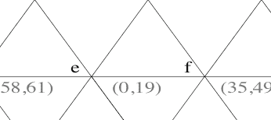

展示了图 5.7 中图形的一个可能的时隙分配方案。每个单元格旁边的两元组表示该单元格分配的时隙——(m, n) 表示区间 m 到 n 的时隙，包含两端。

七节点关键块未能给出最优的时隙数，因为它可能无法满足关键块中节点的邻居（但不属于关键块）的需求，该需求可能超过其距离为 3 的邻居的需求之和。从细胞图中可以看出，关键块的每个外围节点都有三个邻居，这些邻居距离关键块的其他外围节点为 3。例如，图 5.7 中的节点 f 的邻居为 c、g 和 j。节点 d 分配的时隙可以用于满足这三个节点的需求，而节点 a 分配的时隙只能用于满足 j 和 g 的需求，节点 h 分配的时隙只能用于满足 c 和 g 的需求。因此，这三个邻居可能是导致超过 $\mathcal{D}_7^{(2)}^*$ 的需求的潜在来源，无论是单独还是与其他节点组合。这表明必须在计算最优时隙数时包含这三个节点。

使用包含 8 个或 9 个节点的关键块同样无法获得较低的时隙下限，原因与七节点关键块相同。因此，我们考虑一个由七节点距离为 2 的团（Distance 2 clique）以及三个位于该团外部且为该团外围节点邻居的节点组成的十节点块。我们得到以下结果。

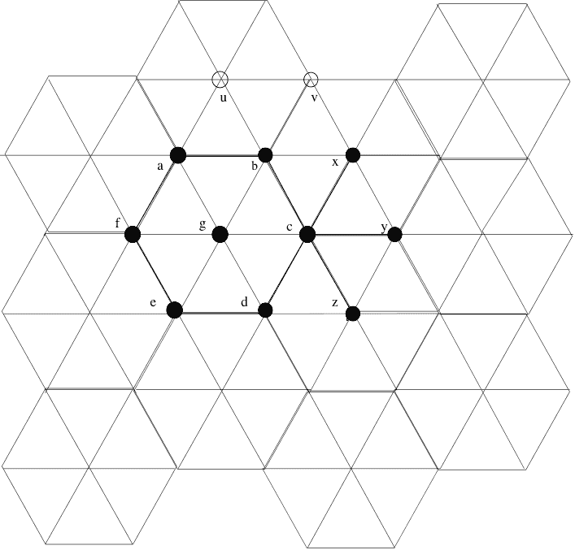

**图 5.9：十节点关键块**

**Lemma 22.** *对于具有异构需求向量的蜂窝网络，要找到网络的最优带宽需求，必须考虑十节点关键块，因为使用少于十节点的关键块不足以计算网络的最小时隙需求。*

要计算十节点关键块的需求，并找出其中需要的时隙最大值的十节点块，令 $C=(V,E)$ 为一个距离为 2 的蜂窝团。令 $free_u$ 表示节点 $u \in C$ 中可以被距离 3 的非 $C$ 节点使用的时隙数，而 $used_u(j)$ 表示节点 $u \in C$ 中被节点 $j \notin C$（距离 3）重新使用的时隙数。注意 $N_3(u)$ 是节点 $u$ 的所有距离为 3 的邻居集合，我们定义节点 $j \in N_1(i)$、$i \in C, j \notin C$ 的剩余需求 $res_j$ 为

$$res_j = \max(0, w_j - \sum_{u \in N_3(j)\cap C} used_u(j)).$$

对于 $i \in C$，所有不在 $C$ 中的 $N_1(i)$ 的剩余需求之和称为 $i$ 的邻居剩余和，定义为

$$Res_i = \sum_{j \in N_1(i),\ j \notin C} res_j.$$

我们通过以下例子演示十节点关键块的计算过程。

**例 25.** *考虑图 5.9 中所示的蜂窝图。设 abcdefg 为候选关键块。没有失去一般性，我们考虑节点 c 的三个邻居 x、y 和 z。初始时，$free_a = w_a$，$free_f = w_f$ 且 $free_e = w_e$。计算 $Res_c$ 的过程如下，*

- **步骤 1：** 使用节点 e 的最大时隙数为节点 x 分配时隙，其余（如有）从节点 f 分配。

$$used_e(x) = \min(w_x, free_e); \quad free_e = free_e - used_e(x).$$

$$used_f(x) = \min(w_x - used_e(x), free_f); \quad free_f = free_f - used_f(x).$$

$$res_x = \max(0, w_x - (used_e(x) + used_f(x))).$$

- **步骤 2：** 使用节点 a 的最大时隙数为节点 z 分配时隙，其余（如有）从节点 f 分配。

$$used_a(z) = \min(w_z, free_a); \quad free_a = free_a - used_a(z).$$

$$used_f(z) = \min(w_z - used_a(z), free_f); \quad free_f = free_f - used_f(z).$$

$$res_z = \max(0, w_z - (used_a(z) + used_f(z))).$$

- **步骤 3：** 使用节点 e、a 和 f 的可用时隙为节点 y 分配。

\[ res_y = \max(0, w_y - (free_a + free_e + free_f)). \]

- **步骤 4：** 求 x、y 和 z 的剩余需求之和，即 \(Res_C = res_x + res_y + res_z\)。

令 \(Res_{max}(C) = \max_{i \in C}[Res_i]\)。参考图 5.9，令 \(D_{10}^{(2)}(\mathcal{G})\) 表示十节点子图 \(\mathcal{G} \equiv abcdefgxyz\) 的需求，即 \(D_{10}^{(2)}(\mathcal{G}) = D_7^{(2)}(C) + Res_{max}(C)\)。十节点关键块的需求 \(D_{10}^{(2)*}\) 定义为具有最大 \(D_{10}^{(2)}(\mathcal{G})\) 的十节点子图的需求，即

\[ D_{10}^{(2)*} = \max_{\mathcal{G}}[D_{10}^{(2)}(\mathcal{G})]. \]

令 \(\mathcal{R}_C\) 表示除 \(C\) 外但与 \(C\) 的外围节点相邻的节点集合，对应 \(Res_{max}(C)\)。我们称 \(\mathcal{R}_C\) 为 \(C\) 的*最大剩余集*。

**定理 21.** *十节点关键块的需求和 \(D_{10}^{(2)*}\) 是六边形蜂窝网络在异构需求向量下的最优带宽需求。*

*Proof.* 我们从 Lemma 22 中已经证明，计算网络的最小时隙需求需要至少考虑十节点关键块。我们现在证明，十节点关键块的需求给出了六边形蜂窝网络在异构需求向量下的最小带宽需求。

关键块相邻的节点拥有的关键块内贡献节点最少，因此无法满足其需求。节点离关键块越远，关键块内贡献节点越多，从而能满足其需求。因此，证明关键块相邻的任意距离为 2 的团的需求可以仅通过关键块内分配的时隙来满足，就意味着网络中所有其他距离为 2 的团的需求也可以仅通过关键块内的时隙来满足。

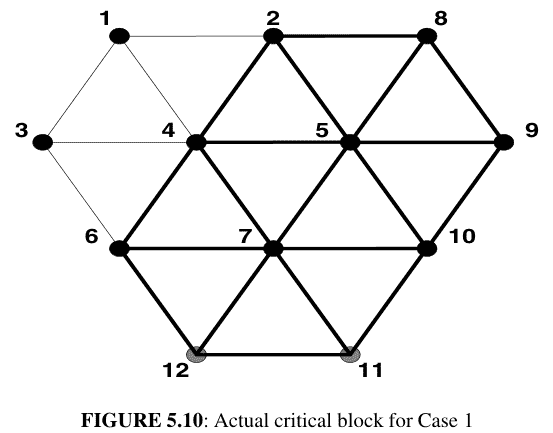

假设图 5.10 中的节点 1 到 10 构成关键块。节点 8、9 和 10 对应关键块的最大剩余集。没有失去一般性，设节点 11 和 12 是与关键块相邻的节点，其需求需要满足。

令 \(S_i\) 表示节点 \(i\) 分配的时隙集合。

令 \(N_i\) 表示节点 \(i\) 在利用关键块时额外分配的时隙集合。

目标是证明 \(|N_{11} \cup N_{12}|\) 始终为 0。当尝试在利用关键块时分配时隙给节点 11 和 12 时，可能出现以下两种情况：

- **情况 1：** 节点 1、3 和 6 的所有时隙都用于满足节点 8、9 和 10 的需求。

- **情况 2：** 节点 1、3 和 6 在满足节点 8、9 和 10 的需求后仍有未使用的时隙。

我们将分别证明在上述两种情况下 \(|N_{11} \cup N_{12}| = 0\)。为此，我们分别考虑上述两种情况。

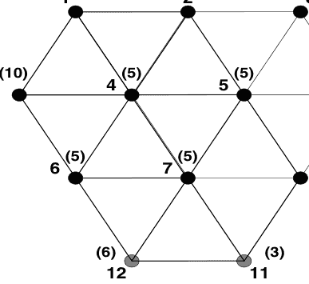

**情况 1 的证明：** 假设节点 1、3 和 6 的所有时隙都用于满足节点 8、9 和 10 的需求，则有：

- \(S_8 \subset S_3 \cup S_6 \cup N_8\)
- \(S_9 \subset S_1 \cup S_3 \cup S_6 \cup N_9\)
- \(S_{10} \subset S_1 \cup S_3 \cup N_{10}\)
- \(S_{11} \subset S_1 \cup S_2 \cup S_3 \cup S_8 \cup N_{11}\)
- \(S_{12} \subset S_1 \cup S_2 \cup S_8 \cup S_9 \cup N_{12}\) (5.1)

最差情况，即关键块时隙最少可重用于节点 11 和 12 的情况为：

- \(S_1\) 完全用于 \(S_{10}\)。
- \(S_3\) 完全用于满足 \(S_9\) 和 \(S_{10}\)。


-   [每个单元格中，还会选举一个移动终端作为*单元格领导者*，负责处理移动终端的移动性、新终端的加入以及MT或网络的离开。为简化，我们假设一个单元格中id最低的MT为单元格领导者。这种领导选举协议的优势是不需要额外的MT间通信来选举领导者。单元格领导者必须：

- 计算单元格的时隙需求。
- 控制新移动终端加入网络的 admission。
- 处理 handoff 场景和终端离开网络。
- 向*网络领导者*通报单元格的需求，并在必要时请求重新计算分配的时隙。

为了处理移动终端的移动性，每个单元格会保留若干时隙用于传输控制消息，以及一些空闲时隙用于处理新终端加入和 handoff 场景。一般情况下，单元格 *i* 的需求 *wᵢ* 等于单元格中移动终端的数量、用于控制目的的时隙数量以及若干额外空闲时隙。我们假设空闲时隙的数量是当前单元格中移动终端数量的某个分数 *f*。如果 *mᵢ* 是单元格 *i* 中当前的 MT 数量，*c* 为控制用途占用的时隙数，则单元格 *i* 的需求 *wᵢ* 为 *wᵢ = mᵢ + c + max(1, ⌈fmᵢ⌉)，0 ≤ f ≤ 1*。

## 5.4.6.1 算法 COSA

算法的步骤如下：

- **Step 1:** 通过某种领导选举协议 [10, 11] 选举出一个 MT 为*网络领导者*，并称其为 *L*。

**Step 2:** *L* 向网络中所有节点广播将地理区域映射到六边形网格结构的映射。它发送一个包含以下内容的消息 *M*：

- 发送该消息的 MT 的 id
- 将地理区域映射到六边形网格结构的映射
- *L* 听到的所有 MT 的 id 列表

每个节点在收到该消息后，会将其自身的位置坐标附加到消息中，以便所有节点都知晓。MT *i* 会在 *i*th 时隙发送其消息，以避免在此期间发生碰撞。

**Step 3:** 对于每个单元格 *i*，会从单元格中居住的 MT 中选举出一个 *单元格领导者* *Lᵢ*，依据一些指标（如剩余电池电量、负载、位置等）[11]。

**Step 4:** 每个单元格领导者 *Lᵢ* 向网络领导者 *L* 通报其单元格的需求 *wᵢ*。 *L* 通过执行 *homogeneous_slot_assignment* 或 *heterogeneous_slot_assignment* 算法，产生一个最优、无碰撞的传输时隙分配计划。

**Step 5:** *L* 向每个单元格领导者广播时隙分配计划。时隙分配计划详细说明分配给每个单元格 *i* 的时隙，即需求 *wᵢ* 个时隙。当单元格领导者 *Lᵢ* 收到来自 *L* 的分配给它的时隙信息后，它会为单元格 *i* 中的 MT 生成传输计划，并在单元格 *i* 内定期广播该计划。

对于 *COSA* 算法的 Step 2，假设传输 *M* 需要 *O(1)* 时间，广播算法的完成时间为 *O(mD)* 时隙，其中 *D* 是自组网络的直径。广播结束后，每个 MT *j* 将拥有以下信息：

- 它所在的六边形单元格的 id *i*
- 它的邻居集合 *N(j)*
- 单元格 *i* 中的 MT id 列表，从而知道单元格 *i* 中当前的 MT 数量

在 Step 5 中，如果 *dᵢ* 是单元格 *i* 的自组网络子图的直径，则在 *O(dᵢ wᵢ)* 时隙后，单元格 *i* 中的每个 MT *j* 将知道 *Lᵢ* 分配给它的传输时隙。

**Definition 11.** *一个单元格 $i$ 的传输轮次由 $w_i$ 个时隙组成，其中 $w_i$ 是单元格 $i$ 请求的时隙数量。*

单元格领导者会定期在一个或多个控制时隙中发送 *单元格状态消息* $M_s$，内容包括：

- 单元格领导者的 id
- 控制时隙的列表
- 单元格中已用和未用的时隙列表，以及哪个时隙被分配给哪个 MT，以便新加入或进入单元格的节点知道可以在哪些时隙中传输而不引起碰撞

> **Remark 20.** *我们假设分配给单元格的最低编号的 *c* 时隙被标记为控制时隙。此外，最高的控制时隙总被假设为未使用，因此在单元格当前没有空闲时隙时，新加入的移动终端可以使用该时隙与单元格领导者通信。*

[PAGE 283]

| HELLO | Sender ID | Slot value used |
|---|---|---|

**FIGURE 5.15:** HELLO 消息结构

## 5.4.6.2 复杂度分析

*Algorithm COSA* 的 Step 1 中的领导选举过程耗时 O(log log m) [10, 11, 12]。Step 2 和 Step 5 各自都进行轮询广播，耗时 O(mD) ，假设 ∀ i, dᵢ ≪ D 且 wᵢ = O(m)（Step 5 中 *Algorithm COSA*）。Step 3 耗时 O(1) 。计算最优时隙分配计划（由 *homogeneous_slot_assignment* 或 *heterogeneous_slot_assignment* 算法执行）耗时 O(n) ，其中 n 是移动网络中的单元格数量。因此，Step 4 耗时 O(mD) + O(n) 。故 *Algorithm COSA* 的时间复杂度为 O(log log m + mD + n) 。

## 5.4.6.3 新移动终端加入网络

在每个单元格中，单元格领导者会定期广播 *单元格状态消息* Mₛ（如上文所述）。该消息在单元格内局部广播。当新终端 j 在某个单元格 i 中加入网络时，它首先等待 Mₛ 消息。随后，它执行以下步骤以在单元格 i 中加入网络：

**Step 1:** 如果单元格 i 中存在至少一个空闲时隙，移动终端 j 会随机选择单元格 i 的空闲时隙 k 并向单元格领导者 Lᵢ 发送 HELLO 消息。如果单元格 i 中没有可用的时隙供 j 使用，j 会在最高的控制时隙（根据协议，该时隙始终为空闲）发送 HELLO 消息。HELLO 消息包含的信息如 Figure 5.15 所示。

+   1. 消息类型设置为 HELLO

**Step 2:** 如果 HELLO 消息被其邻居听到，邻居会转发该消息。

**Step 3:** 如果 L_i 在单元格 i 的空闲时隙 k 中听到来自新终端 j 的 HELLO 消息，则执行 Steps 3.1 和 3.2，否则进入 Step 4。

**Step 3.1:** L_i 将时隙 k 标记为分配给 j。

**Step 3.2:** L_i 启动本地单元格广播，发送更新后的单元格状态消息 M_s，反映已分配给 j 的时隙。单元格状态消息也是 L_i 向移动终端 j 的 ACK，确认其已被分配时隙 k。

**Step 4:** 如果 j 的 HELLO 消息是在控制时隙中发送的，

**Step 4.1:** L_i 启动垃圾回收例程，回收已离开单元格 i 的 MT 所占用的时隙。垃圾回收过程如下：

**Step 4.1.1:** L_i 向单元格 i 中的每个 MT 发送本地广播请求，要求其向 L_i 发送 ACK。

**Step 4.1.2:** 邻居的 ACK 会在每个 MT 的 ACK 传输中附带。

**Step 4.2:** 如果垃圾回收后 L_i 仍未找到足够的空闲时隙来容纳单元格 i 中的所有新节点，

**Step 4.2.1:** L_i 计算单元格 i 的新需求 wᵢ，考虑新加入的节点。

**Step 4.2.2:** L_i 向网络领导者 L 发送请求，使用新的 wᵢ 重新分配时隙。

**Step 5:** 如果 j 在某个超时间隔 T 内未收到来自 L_i 的 ACK 消息，则它假设自己未被 L_i 分配任何时隙。这可能发生在以下情况：

+   1. Case 1: L_i 未能为 j 分配时隙。
+   2. Case 2: 其他新节点在同一时隙中传输，导致碰撞，传输被破坏。

在超时后，j 会使用指数退避算法重新尝试发送。直到收到 L_i 的 ACK 为止。

## 5.4.6.4  **移动终端离开单元格或网络**

如果移动终端 u（除单元格领导者或网络领导者外）离开当前单元格，则不会立即采取任何更新操作。终端 u 所占用的时隙可能会在单元格领导者未能在单元格内找到足够的空闲时隙以容纳新加入的移动终端时被回收。如果单元格领导者离开网络或单元格，根据该协议，相应单元格的节点在控制时隙中将听不到任何传输。在这种情况下，会从剩余的 MT 中选举出新的 *单元格领导者*。

如果网络领导者离开网络，现有的单元格领导者会选举新的网络领导者。

## 5.4.6.5  **handoff 情况**

当移动终端 u 从单元格 i 移动到单元格 j 时，需要进行 handoff。handoff 的处理方式与新终端加入单元格 j 的方式相同，额外发送一条从 L_j 到 L_i 的消息，指示 u 所在的新单元格。


to have fast, energy-efficient and deterministic broadcast and gossiping protocols for wireless ad hoc networks by resolving collisions efficiently. Such protocols with efficient collision resolution mechanisms would provide low end-to-end latency and low overhead for retransmission of the collided messages. Most existing broadcast and gossiping algorithms do not address these issues together.

In this section, we present deterministic broadcast and gossiping algorithms as proposed [13] for mobile ad hoc networks that have low broadcast latencies. The algorithms presented here assume collision detection capabilities at the mobile terminals.

The deterministic broadcast algorithm is based on breadth-first traversal of the nodes of the network. The algorithm allows *simultaneous transmission* by multiple nodes. Although this may result in collisions at the receiving nodes, the algorithm can detect and take corrective measures to eventually avoid collisions. The idea of breadth-first broadcast was first proposed in [7, 15] where the two different types of rounds of transmission, *control round* and *message round*, made the protocol somewhat complex. However, in [13], only one type of round of transmission has been used. The algorithm presented in [SinhA08] works for scenarios where network topologies change frequently due to high mobility of the nodes and takes $O(n \log n)$ time in the worst case. Both the average case and worst case performances of this breadth-first algorithm are better than the *polylog broadcast* algorithm proposed in [3]. Simulation results show that the time complexity of this breadth-first algorithm on an average is upper bounded by $8D \log n$. The reported simulation results were obtained for networks having 100 nodes to 1024 nodes. It may be noted that the asymptotic lower bound for deterministic broadcast in networks where spontaneous transmission by the nodes is not allowed is on average $\Omega(D \log n)$ [5]. Also, based on simulation results, the time to complete broadcast is almost insensitive to the mo-

collisions are resolved. The source node is the only node in layer 0; all nodes within the hearing zone of the source node form layer 1, and in general all nodes within the hearing zone of the nodes in layer *i* but not in layers (*i* − 1) and *i*, form the layer (*i* + 1), for *i* ≥ 1.

### 5.5.2.1  Preliminaries and Basic Idea

A transmission of *M* by the source node will be received by all nodes in layer 1. The nodes in layer 1 then transmit the message to the nodes in layer 2. However, at this point, a node in layer 2 may receive a collided message due to simultaneous transmission from more than one node in layer 1. This situation can also arise from simultaneous transmissions by nodes in different layers in the same time slot. The proposed protocol proceeds in the way that i) a receiving node experiencing such a collision sends some appropriate acknowledgment signals to the transmitting nodes, and ii) one or more of the transmitting neighboring nodes are selectively dropped (dropped nodes do not transmit the message) at each of the succeeding stages (or *rounds*), so that eventually collision is resolved at each of the receiving nodes. Essentially, we drop out all nodes except the one with the maximum *id* value among the transmitting nodes causing collision at a receiving node. This is done by successively scanning the bits of *id* values of each such transmitting node from the most significant bit (*msb*) side. As an example, consider the scenario in Figure 5.17 in which a node *u* which has experienced a collision due to messages simultaneously transmitted from its three neighboring nodes having the id values 11111001, 11100011 and 10110110.

In the next round, the nodes whose *msb* values are 0 will be dropped. Since there is no such node, all of these nodes will again transmit in this second round. In the next round, the nodes whose (*msb* − 1)-th bits are 0 will be dropped and only those with bit value equal to 1 will be allowed to transmit. Thus, the node 10110110 will

A round of message transmission consists of several control slots, a message slot for transmitting the actual message *M*, and three slots for receiving acknowledgments from the neighboring nodes as explained below. The control slots are used to guarantee collision-free reception of the message by all receiving nodes and their usage is defined later. The acknowledgment slots are:

- Slot *S* for receiving a single-bit acknowledgment from the nodes which received the message correctly without any collision
- Slot *C* for receiving a single-bit acknowledgment from the receiving nodes, if the corresponding receiving nodes detected a *collision* during message slot
- Slot *N* for receiving a single-bit acknowledgment to indicate that it did not receive any message (clean or collided) in this round although it received a collided message in the previous rounds

If for a node *u*, the channel status is *null* during any of these three slots, we assume that none of the neighbors of *u* have responded in that slot. The presence of a clean or collided signal due to one or multiple nodes responding simultaneously in any of these *S*, *C* and *N* slots is interpreted as the appropriate acknowledgment signal for that slot by the node *u*.

### 5.5.2.3  Collision Resolution

Every transmitting node makes a decision depending only on the type of acknowledgments, clean or collided, received by it in the three slots *S*, *C* and *N*, respectively, associated with the previous message transmission slot. If a transmitting node receives an acknowledgment (which may come from a number of nodes in *receive* state) in slot *S*, it implies that the corresponding nodes in *receive* state received the message correctly without any collision. These receiving nodes become *active* in the successive rounds. If an acknowledgment is received by the transmitting node in the _C_ slot, it implies one or more of the receiving nodes experienced a collision during the previous message slot. Collision is resolved by preventing (dropping) some of the nodes from transmitting in the subsequent rounds. This is done by scanning the bit pattern (starting from the _msb_) of the id value of each of the transmitting nodes receiving a _C_ ACK signal and allowing only those nodes to transmit whose corresponding bit value is equal to 1.

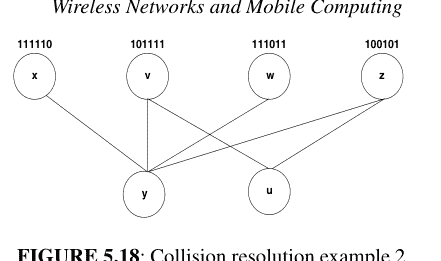

However, as we indicated earlier, a receiving node which experienced a collision may not be receiving the message in the immediate next round when all the neighboring transmitting nodes of a receiving node are dropped. At this point, the corresponding receiving node sends an acknowledgment in the _N_ slot. The transmitting nodes receiving _N_ ACKs, try to transmit again in the succeeding rounds. However, there may be some complex situation at this stage if a transmitting node receives an _N_ signal and also a _C_ signal from other nodes. As an example, consider the situation shown in Figure 5.18, where the node _y_ experienced a collision due to messages from nodes _v_, _w_, _x_ and _z_, and node _u_ experienced a collision as a result of simultaneous transmissions from nodes _v_ and _z_. Let the _id_ values of the nodes _v_, _w*, x* and _z* are 1011111, 1110111, 1111110 and 100101, respectively.

In the first round, nodes _v*, w*, x* and z* all receive _C_ signals. Since all these nodes have _msb* values equal to 1 in the next (second) round as well, all of _v*, w*, x* and z* will transmit the message and each will receive a _C* signal. Nodes _v* and z* will be dropped in the third round as both have (_msb*-1)-th* bits equal to 0. Hence, in this round, both *v* and *z* will receive *N* ACKs from *u* and *C* ACKs from node *y*. Neither *v* nor *z* can be allowed to resume transmission in the fourth round, as they would have caused a collision at *y*, jeopardizing the collision resolution at *y*. Collision at *y* will be resolved in the fifth round as the (_msb*-3)-th* bit of *w* is 0 and hence it will be dropped in the fifth round; leaving only node *x* to transmit. At this point, nodes *v* and *z* will get no *C* ACKs in this (fifth) round, but only an *N* ACK from node *u*. Now, *v* and *z* both can be allowed to resume transmission in the next (sixth) round and this will cause a collision at *u*. In the next (seventh) round, *v* and *z* will test their (_msb*-2)-th* bits (as they were dropped based on the value of their (_msb*-2)-th* bits), and at this time only *v* will be allowed to transmit since its (_msb*-2)-th* bit is equal to 1; a clean message is eventually received by node *u*.

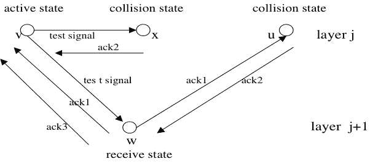

**FIGURE 5.19: Role of control signals**

### 5.5.2.4  Moving from *active* State to *transmit* State

It is possible that after a particular round, some nodes in a given layer, say *j*, will receive a message correctly and hence will become *active*, while others in the same layer experienced collisions and are in *collision* state. Two possible scenarios may arise:

1. As an *active* node in layer *j* starts transmitting a message, the message can also


-   [到达同一层（j）中仍处于碰撞状态的节点中的一些节点（j）。如图 5.19 所示，节点 v 在层 j 处于活动状态，而节点 x 在同一层 j 处于碰撞状态，并且位于节点 v 的听觉范围内。当 x 的碰撞解析正在进行（通过在层 j‑1 选择性丢弃其发送节点的过程）时，节点 v 从活动状态向发送状态的转换会因 v 传输的消息可能未被解析而导致 x 进一步发生碰撞。下面的示例说明了这一现象。

**Example 26.** 假设图 5.19 中的节点 x 有两个发送邻居，其 id 值分别为 11110001 和 11011011，这两个 id 在从最高位（msb）开始计数的第三位上有所不同，而节点 v 的 id 值为 10110001。因此，在第一次碰撞后的第三轮，节点 x 可能会从节点 11110001 获得干净的消息，因为节点 11011011 会在检测到（msb‑2）位时被丢弃。然而，如果在同一轮中节点 v 从活动状态转为发送状态，x 将因同时收到来自 11110001 和 v（= 10110001）的消息而再次发生碰撞。请注意，v 的 id 与该节点从（msb‑2）位向低位（least significant bit）的所有位相同。v 会从其 id 的最高位开始扫描位，而 11110001 则从（msb‑3）位开始扫描，这将完全破坏节点 x 的碰撞解析过程。

为避免上述情况并简化碰撞解析算法，层 j 中的活动节点会通过若干额外的控制信号（如下所述）判断自身是否是处于碰撞状态的节点的邻居。如果是，则该活动节点不会立即转入发送状态。

**FIGURE 5.21:** 状态转换图

**ack1:** 由处于 *receive* 状态的节点发送的 1 位确认信号，表示已收到上述测试信号。

**ack2:** 由处于 *collision* 状态的节点发送的 1 位确认信号，表示已收到 *test* 信号或 *ack1* 信号。

**ack3:** 由处于 *receive* 状态的节点发送的 1 位信号，表示已收到 *test* 与 *ack2* 信号。

整个轮次的结构以及用于避免碰撞的控制信号在图 5.20 中给出。四个控制信号（S、C、N）以及三个确认信号（ack1、ack2、ack3）均为 1 位长度。图 5.21 的状态转换图展示了基于各种信号在四种可能状态之间的转换。

根据上述讨论，广播协议满足以下性质：

**Property 1.** *将节点从活动状态转为发送状态的机制保证，当节点 u 处于碰撞状态并正在解决由其发送邻居集合 𝒯 产生的碰撞时，不会有外于 𝒯 的新发送节点加入 𝒯 向 u 发送消息。*

**Property 2.** *在满足上述 Property 1 的前提下，前文所述的碰撞解析机制保证，节点 u 经历的碰撞（由其发送邻居集合 $T$ 产生）最终能够被解决，使得 u 最终接收到一条干净的消息。*

为降低开销，我们希望在每 $\lceil\log n\rceil$ 轮中仅使用一次这四个控制时隙来测试活动节点是否可以转入发送状态。但这可能导致层 1 的节点在第 1 轮收到消息后，需要等待 $\lceil\log n\rceil - 1$ 轮才能有机会将消息传递到下一层。为避免这种不必要的等待，我们建议在每 $\lceil\log n\rceil$ 轮内的两次连续轮次中使用这些控制时隙。此外，为提高移动性强度，源节点会每 $\lceil\log n\rceil$ 轮继续传输消息。

## 5.5.2.5   Algorithm bf_broadcast

我们使用本地变量 *round_count* 初始化为 0 以跟踪传输轮次编号。随后，每个节点在每轮开始时递增其对应的 *round_count* 变量。下面的步骤由所有节点并行执行，用于广播消息 $M$。

+   **Step 1:** (初始化) 源节点将其状态设为 *transmit*，其余节点将状态设为 *receive*。随后的步骤在每轮中依次执行。

+   **Step 2:** (源节点的操作) 当 $round\_count \mathop{\mathrm{MOD}} \log n = 0$ 时，源节点发送 $M$。

+   **Step 3:** (活动节点是否有资格转入 *transmit* 状态的检测) 若节点状态为 *active* 且 $round\_count \mathop{\mathrm{MOD}} \log n \leq 1$，则执行步骤 3.1、3.2 和 3.3。

    **Step 3.1:** 发送一个 *test* 信号（四个控制信号之一）并等待 *ack2* 或 *ack3* 信号。

**Step 3.2:** 若在相应的时隙中未收到 *ack2* 或 *ack3* 信号，则节点状态改为 *transmit*，设置 *transmission_count* = 0，并将 *scanned_bit_position* 设为 $\log n - 1$。随后 *round_count* 加 1，进入 Step 4 的下一轮。

**Step 3.3:** 若在相应的时隙中收到 *ack2* 或 *ack3* 信号，则 *round_count* 加 1 并回到 Step 3 的下一轮。

**Step 4:** (*transmit* 状态的操作) 若节点状态为 *transmit*，执行步骤 4.1 到 4.5。

**Step 4.1:** 若 *transmission_count* = 0，则发送消息，使 *transmission_count* 加 1，并在 *S*、*C*、*N* 时隙等待确认信号。随后 *round_count* 加 1，回到 Step 4 的下一轮。

**Step 4.2:** 若在前一轮的 *C* 时隙收到确认信号：

**Step 4.2.1:** 若当前 *scanned_bit_position* 对应的位值为 1 且节点在上一轮发送了消息，则重新发送 *M*，使 *transmission_count* 加 1，将 *scanned_bit_position* 减 1，并再次寻找 *S*、*C*、*N* 信号。随后 *round_count* 加 1，回到 Step 4 的下一轮。

**Step 4.3:** 若在 *N* 时隙收到确认信号但 *C* 时隙未收到确认：

```
/* 有些节点在 receive 状态，仅收到已丢弃的节点（包括本节点）发来的消息；因此需要从本节点重新开始传输 */
```

**Step 4.3.1:** 若节点的 *id* 在 *scanned_bit_position* 位的值为 0，则发送消息，使 *transmission_count* 加 1，将 *scanned_bit_position* 减 1，并再次寻找 *S*、*C*、*N* 信号。随后 *round_count* 加 1，回到 Step 4 的下一轮。

**Step 4.4:** 若仅在 *S* 时隙收到确认信号，而 *C* 和 *N* 时隙均未收到确认，则节点状态切换回 *active*，即传输成功。随后 *round_count* 加 1，回到 Step 3 的下一轮。

**Step 5:** (*receive* 状态的操作) 若节点状态为 *receive*，执行步骤 5.1 到 5.4。

**Step 5.1:** 若在 *test* 时隙收到信号，则在本轮发送 *ack1*。若在 *ack2* 时隙收到信号，则在本轮发送 *ack3*。随后 *round_count* 加 1，回到 Step 5 的下一轮。

**Step 5.2:** 若接收到干净的 *M*，则在 *S* 时隙发送确认并将状态改为 *active*。随后 *round_count* 加 1，回到 Step 3 的下一轮。

**Step 5.3:** 若在 *message* 时隙发生碰撞，则在 *C* 时隙发送确认并将状态改为 *collision*。随后 *round_count* 加 1，回到 Step 6 的下一轮。

**Step 6:** (*collision* 状态的操作) 若节点状态为 *collision*，执行步骤 6.1 到 6.5。

**Step 6.1:** 若在 *test* 时隙或 *ack1* 时隙收到信号，则在本轮发送 *ack2*。随后 *round_count* 加 1，回到 Step 6 的下一轮。

**Step 6.2:** 若在 *message* 时隙遭遇碰撞，则在 *C* 时隙发送确认。随后 *round_count* 加 1，回到 Step 6 的下一轮。


## 图 5.22：广播算法解决冲突的一个示例

## 步骤 6.3
如果在*消息槽*中没有收到任何信号，但在之前的某一轮中收到了冲突消息，则在 *N* 槽中发送一个确认信号。将 *round_count* 加 1，然后返回步骤 6 进行下一轮。

## 步骤 6.4
如果在*消息槽*中收到清晰信号，则在 *S* 槽中发送确认并将状态改为*活动*。将 *round_count* 加 1，然后返回步骤 3 进行下一轮。

为了说明上述算法的基本思想，我们考虑以下两个示例。

### 示例 27
*考虑图 5.22 中的网络，其中节点 111111、111110、110110、110010 和 110001 是发送节点，节点 a、b、c、d 和 e 是接收节点。按照步骤 4.1，节点 111111、111110、110110、110010 和 110001 全部同时发送消息。节点 d 收到来自节点 110110 的清晰消息，但节点 a、b、c 和 e 检测到冲突。按照算法的步骤 4.2，在从最高有效位一侧数起的第三个比特测试之后，节点 110110 和 110001 被丢弃为发送节点，并且 c 在下一轮收到来自节点 111110 的清晰消息。随后，节点 111110 在第六个比特之后被丢弃，因此节点 a 和 b 在下一轮从 111111 收到清晰消息。节点 110010 在 N 槽中从*

### 图 5.23：广播算法解决冲突的另一个示例
节点 *e* 处收到与第三个比特位置对应的确认信号，因此根据步骤 4.3，节点 110010 在下一轮发送。于是，节点 *e* 将收到来自节点 110010 的消息。

### 示例 28
考虑图 5.23 中的网络，其中节点 000011、000010 和 000001 是发送节点，节点 a、b 和 c 是接收节点。由于步骤 4.1，所有这些节点在第一轮（即它们的状态变为发送后的紧接着那一轮）发送消息。由于冲突，在第二轮中这些节点都不会发送（因为这些节点的第二个最高有效位都是 0）。在第三轮中，由于步骤 4.3，它们都将开始重新发送消息。最终，节点 000001 在第五个比特（从 msb 一侧数）测试后被丢弃，节点 000010 在第六个比特测试后被丢弃。最后，节点 a、b 和 c 从节点 000011 收到清晰消息。

基于上述示例，步骤 4.2 和步骤 4.3 在以下方面起着关键作用：选择性地让一个节点退出传输（如果发生了冲突），并在该节点不会对任何接收节点造成冲突、但它至少有一个邻居接收节点，且该接收节点在上一轮中无法从任何发送节点到达时，重新激活它以发送消息。因此，由于节点的丢弃，处于*冲突*状态的节点最终能在 2 log n 轮内收到消息。此外，一个活动节点最终会根据步骤

## 3.2，当由处于*冲突*状态的节点引起的 *ack2* 或 *ack3* 信号不再存在时，将其状态改为*发送*
（因为根据上述论证，处于*冲突*状态的节点最终会变为活动状态）。

因此，我们得到以下结果。

> **定理 22.** *算法 bf_broadcast 能正确地在网络的所有 n 个节点之间执行一对全广播。*

## 5.5.2.6 移动性鲁棒性

如[3]中那样逐层传输消息，并且源节点每经过 log n 轮就周期性重传消息，这确保即使某个节点在收到消息 *M* 之前，并且在第 *i* 层中的所有节点都已完成传输 *M* 之后，从第 *j* 层移动到第 *i* 层（其中 *i* < *j*，即它现在离源节点 *s* 更近），它仍然能在某个时刻正确收到广播消息。因此，即使网络拓扑频繁变化，算法 *bf_broadcast* 也能正确工作。

## 5.5.2.7 复杂度

> **引理 23.** *每经过 2 log n 轮传输，至少能保证有一个节点已正确收到消息。*

*证明。* 由于连续丢弃导致冲突的发送节点这一典型性质，可以保证在每 2 log n 轮中，接收层 *j*（假设发送层为 *j* − 1）中至少有一个节点能正确收到消息。包含因子 2 是为了处理如下事实：如果要测试是否为 1 的某个位导致接收节点收到*无信号*，则该位会被翻转为 0。由于最多有 log n 次这样的翻转，因此该断言成立。

> **定理 23.** *在最坏情况下，算法 bf_broadcast 需要 O(n log n) 轮才能完成广播。*


该算法的平均情况性能上界为 $8D\log n$。值得注意的是，在节点无法自发传输的网络中，确定性广播的渐近下界为 $\Omega(D\log n)$ [5]。

## 5.5.3 闲聊

在碰撞检测模型下，我们扩展了上述广度优先广播的思想，设计了一种在自组织移动网络节点间进行闲聊的算法，使得每个节点 $u$ 都有某条消息 $m_u$ 需要广播给网络中的所有其他节点。

### 5.5.3.1 基本思想

在算法 *bf_broadcast* 中，处于*发送*状态的某些节点（例如第 $j-1$ 层）被有选择地丢弃，从而使第 $j$ 层中的接收节点最终恰好只有一个发送节点作为其邻居。第 $j$ 层中无碰撞地接收到消息的节点会在 $S$ 时隙发送一个*确认*信号。

设 $m_u$ 表示节点 $u$ 希望广播的消息。每个节点维护一个长度为 $n$ 的消息数组。来自节点 $i$ 的消息存储在该消息数组的第 $i$ 个位置。设 $\mathcal{M}_u$ 表示节点 $u$ 的消息集合，它由 $u$ 迄今为止收到的所有干净消息组成。启动闲聊算法的源节点 $s$ 初始时在其消息集合中只有一条消息 $(m_s)$。随后，$s$ 的每个邻居都将自己的消息 $m_u$ 以及它从邻居处收到的所有其他消息附加进来，形成其消息集合 $\mathcal{M}_u$。当 $u$ 进入*发送*状态时，它传输 $\mathcal{M}_u$。当网络中的每个节点都收到了网络中所有其他节点的消息时，算法终止。

具体来说，考虑如下情形：节点 $u_1, u_2, \cdots, u_k$ 都只从单个发送父节点 $u$ 处无碰撞地接收到消息集合 $\mathcal{M}_u$，如图5.33所示。

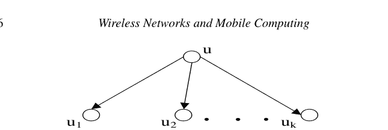

随后，$u$ 在 $S$ 时隙收到一个*确认*信号。现在，节点 $u$ 不会像 *bf_broadcast* 算法中那样立即将其状态改为*活跃*，而是先执行过程 *gather_messages*，收集 $u_1, u_2, \cdots, u_k$ 各节点要广播的消息集合，然后才将其状态改为*活跃*。此外，收到干净消息的节点 $u_1, u_2, \cdots, u_k$ 中的每一个都会将状态改为一个新状态*回传*；在该状态下，它将响应 $u$ 为收集消息而生成的所有控制信号，而不会像 *bf_broadcast* 算法那样立即进入*活跃*状态。通过执行这一经过修改的算法（我们称之为 *bf_gossip*），第 $j$ 层中 $u_1, u_2, \cdots, u_k$ 各节点所听到的所有消息都会向上移动一层，即移动到第 $j-1$ 层的节点 $u$。因此，如果 $D$ 是网络的直径，则对算法 *bf_gossip* 的 $D$ 次调用将使所有节点的消息都到达根节点 $s$。$s$ 再调用一次算法 *bf_broadcast*，即可完成闲聊所需的全部消息传输。

节点 $u$ 调用的过程 *gather_messages* 将利用后文描述的函数 *find_next_max_id*，从节点 $u_1, u_2, \cdots, u_k$ 中成功选出尚未将其消息列表 $\mathcal{M}_{u_i}$ 传输给 $u$ 的、具有最大 id 的邻居节点。节点 $u$ 收集所有这些消息。注意，当 $u$ 为此目的发送控制消息时，只有处于*回传*状态的邻居才会响应。当节点 $u_i$ 将其消息集合 $\mathcal{M}_{u_i}$ 发送给 $u$ 后，它将其状态改为*活跃*。最后，从过程 *gather_messages* 返回时，节点 $u$ 将其状态改为*活跃*。

为实现上述思想，我们在 *bf_broadcast* 算法（图5.20）所描述的轮结构中增加了五个额外的时隙：i) 查询，ii) 确认，iii) 发送，iv) 接收，以及 v) 结束。在查询时隙中，处于*发送*状态且仅收到 $S$ 信号的节点将执行 *find_next_max_id* 过程，尝试找到处于*回传*状态的、具有下一个最大 id 的邻居。在查询时隙期间听到信号的每个处于*回传*状态的节点，都会根据其地址的比特模式，要么在确认时隙中发送自己的 id 作为响应，要么保持沉默。*find_next_max_id* 过程可持续一个或多个轮。由此被某节点选中的邻居 $j$ 在传输完其消息集合 $\mathcal{M}_j$ 后，会将其状态改为*活跃*，并且不再响应后续的 *find_next_max_id* 调用。节点 $u$ 将在发送时隙向其邻居 $j$（该邻居通过执行 *find_next_max_id* 过程选出）发送命令，令其在接收时隙期间发送其消息集合。在接收时隙期间，$j$ 将把其消息集合发回给 $u$。节点 $j$ 通过在结束时隙发送信号来表示其消息集合传输结束。当节点 $u$ 在结束时隙听到干净或碰撞的信号时，它将在后续轮中恢复执行 *find_next_max_id*，直到所有处于*回传*状态的邻居都已被访问。结束时隙的目的是支持使用多轮查询时隙和接收时隙来执行 *find_next_max_id* 过程，并接收所选邻居 $j$ 的消息集合。图5.34显示了用于实现闲聊算法的轮结构。


**图5.34：** 算法 *bf_gossip* 的轮结构。

除了上一节提到的*接收*、*冲突*、*活跃*和*发送*状态之外，我们还引入节点的第五种可能状态，称为*回传*。

对于函数 *find_next_max_id*，我们使用以下记号：假设节点的 id 为 $j$。设 $m = \lceil\log n\rceil - 1$。则 $j$ 将由 $\lceil\log n\rceil$ 个比特表示为 \(j = j_mj_{m-1}\cdots j_0\)。我们用符号 \([j]_{m,k}\) 表示比特串 \(j_mj_{m-1}\cdots j_k\) 的部分。

### 5.5.3.2 算法 bf_gossip

本节描述将 *bf_broadcast* 转换为算法 *bf_gossip* 所需的修改。首先，节点 \(i\) 通过执行过程 *gather_messages* 收集其所有邻居收到的干净消息。

接下来，对于处于*发送*状态的节点，算法 *bf_broadcast* 的步骤4.4修改如下：

**步骤4.4：** 若仅在时隙 \(S\) 中收到确认，而在 \(C\) 和 \(N\) 中未收到确认，则执行过程 *gather_messages*，并将状态改回*活跃*。将 *round_count* 加 1，返回步骤3进入下一轮。

此外，如果节点状态为*接收*，则针对在*消息*时隙中收到干净信号的情况，步骤5.2现修改如下：

**步骤5.2：** 若在*消息*时隙中收到干净信号，则在 \(S\) 时隙发送确认，并将节点状态改为*回传*。将 *round_count* 加 1，返回步骤3进入下一轮。

此外，如果节点状态为*冲突*，则步骤6.4修改如下：

**步骤6.4：** 若在*消息*时隙中收到干净信号，则在 \(S\) 时隙发送确认，并将节点状态改为*回传*。将 *round_count* 加 1，返回步骤3进入下一轮。

最后，需要一个过程 *back_transmit_actions* 来执行与*回传*状态相对应的动作。

### 5.5.3.3 复杂度

由上述讨论可知，过程 *gather_messages* 至多需要 $2\lceil\log n\rceil\Delta$ 轮，其中 $\Delta$ 是节点的最大度数。

然而，当我们对算法 *bf_gossip* 一次完整遍历中的所有此类节点 $u$ 求和时，执行对过程 *gather_messages* 的所有调用所需的实际时间将不超过 $2\lceil\log n\rceil(n-1)$ 轮。

因此，闲聊算法的整体最坏情况时间复杂度等于 $[13(2n+\Delta-2)\log n+26\lceil\log n\rceil(n-1)(\Delta+1)]$ 个时隙 $= O(\Delta n\log n+\Delta^2\log n)$，这优于文献[16]中 $O(n^{3/2}\log^2 n)$ 的时间复杂度。对于较大的 $\Delta$ 值，上述算法的时间复杂度与文献[17]中 $O(D\Delta^2\log^3 n)$ 时间的算法相当。

## 5.6 自组织网络中的点对点路由

自组织网络中的点对点路由协议可大致分为：

- 1. 主动式路由协议
- 2. 反应式路由协议
- 3. 混合式（兼具主动式和反应式）路由协议

在主动式协议中，从源到目的地的路由信息被预先维护。因此，每个节点都要计算并存储到网络中所有其他节点的路由（*路由创建活动*）。这些路由可能会定期更新（*路由维护活动*），也可能由某些事件触发更新（例如，当先前存在的链路因节点移动而被移除时发生链路错误，或


节点传输功率的降低、网络中影响拓扑的其他变化、新节点的加入、流量负载的变化等）。

最常用的主动式路由协议包括*目的节点序列距离矢量路由（DSDV）*[21]和*优化链路状态路由（OLSR）*[20]。

在反应式路由协议中，路由不是预先计算的。相反，路由只在需要时才被发现。如果源节点想要向某个目的节点发送消息，它首先检查本地路由表，看是否已存在到所需目的地的路由。如果不存在这样的路由，它就会发起一个*路由发现*过程，以找到通往目的节点的路由路径。此类反应式路由协议的例子包括*自组织按需距离矢量路由（AODV）*[24]、*动态源路由（DSR）*[23]和*时间排序路由算法（TORA）*[25]。

在低到中等流量负载的网络中，反应式路由协议由于路由发现和路由维护的开销更低，其性能优于主动式路由协议。然而，如果流量负载较重，反应式协议在路由发现中的信令开销往往会变得与主动式路由协议相当，甚至超过后者。另一方面，如果MANET中的节点具有高移动性，或者由于节点的添加或移除或传输条件的变化导致网络条件频繁变化，主动式协议中的路由维护开销可能会显著上升（由特定事件触发），在这种情况下，反应式协议可能是更好的选择。反应式协议还有一个额外缺点，即从源节点需要到给定目的地的路由那一刻起，获取路由需要一段*延迟*时间。而在主动式协议中，由于每个源节点已经预先计算到所有目的地的路由，因此没有这种延迟。鉴于主动式和反应式协议各有优缺点，人们提出了混合协议。

网络带宽。然而，如果*A*在从任何邻居收到这条信息时记录到*D*的新路由，但不立即将此信息广播给网络中的其他节点，那么这种波动可以被抑制。相反，在收到来自某个邻居的第一条更新消息后，*A*会等待可能到达的、来自其他邻居的具有相同目的序列号的新路由信息。在这个稳定时间之后，*A*将最终的路由信息广播给其所有邻居。

DSDV协议的优点是它保证无环路由，并且使用目的序列号，总是选择跳数最少的最新路由。缺点是它不支持多路径路由——由于在每个节点维护路由表并更新路由信息，会产生较大开销，尤其是在低流量条件下。

## 5.8 动态源路由（DSR）

*动态源路由（DSR）*是反应式路由协议的一个例子。这是一种源路由协议，即从源节点路由的每个数据包在其报头中携带数据包必须经过的节点的完整有序列表。该协议有两个不同阶段：*路由发现*和*路由维护*。当源节点*S*想要向目的节点*D*发送数据包，且*S*没有关于到*D*的路由信息时，节点*S*必须找到合适的路由，这将在*路由发现*阶段完成。在*路由维护*阶段，如果由于链路故障等特殊情况，需要更新给定源节点和目的节点之间的现有路由，则要找到一条新路由。

每个节点*u*维护一个路由缓存，用于存储关于到所有其他节点的所有已发现路由的信息，以及其他节点到*u*的路由。

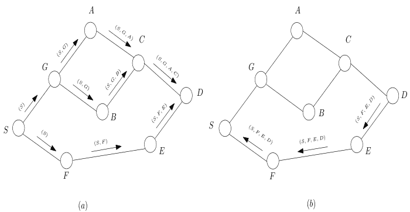

**图5.35：动态源路由**

因此，当*S*需要向目的节点*D*发送数据包，并且在路由缓存中找不到到*D*的有效（未过期）路由条目时，*S*会向其所有邻居发送一条*路由请求*消息*RREQ*。*RREQ*包含源节点ID *S*、目的节点ID *D*以及来自*S*的请求的唯一标识号。当节点*u*收到这条*RREQ*消息时，它会查找自己的路由缓存，看是否有从*u*到节点*D*的路由条目。如果不存在这样的条目且节点*u*不是目的节点*D*，*u*会将此*RREQ*转发给其所有邻居，并附加当前已知的从源节点*S*到*u*的路由。如果在*u*的路由缓存中找到了从*u*到*D*的路由条目，或者*u*就是目的节点*D*，则将根据从节点*u*到*D*累计的路由信息附加到*RREQ*消息上，生成从*S*到*D*的路由，并通过沿发现的路由反向遍历，将路由以路由回复消息*RREP*的形式从*u*发送回*S*（单播）。

参见图5.35(a)。包含源节点*S* ID的*RREQ*消息(*S*)到达节点*G*和*F*。节点*G*将包含所经过节点*S*和*G*的信息(*S, G*)的*RREQ*消息发送给其邻居*A*和*B*。类似地，节点*F*将包含所经过节点S和F的信息(S, F)的*RREQ*消息发送给节点*E*。节点C收到两条*RREQ*消息，一条来自节点A，包含(S, G, A)，另一条稍后来自节点B，包含(S, G, B)。C忽略后一条消息，只将(S, G, A, C)发送给节点D。D还收到来自S的另一条具有相同标识号的*RREQ*消息，其中包含所经过节点的信息(S, F, E)。D向S发送一条包含路由信息(S, F, E, D)的*RREP*消息，按顺序通过节点E和F反向遍历该路由，如图5.35(b)所示。

在收到来自源节点S的*RREQ*消息后，如果任何节点u（包括D）通过其他路由再次收到来自S的具有相同标识号的*RREQ*消息，它可以将从S到u的这条新路径信息存储在其缓存中，并且如果u有从u到D的路由信息，它还可以向S发送另一条*RREP*消息（注意在特殊情况下，u也可以是D）。这使得源节点和目的节点对之间可以知道多条路由，从而支持从源到目的节点的多路径路由，也便于路由维护。例如，如果到目的节点的现有路由中断，链路中断的上游节点（例如节点w）向源节点S发送*路由错误*消息*RERR*。如果S的路由缓存中存储了到D的替代路由，S可以选择这条新路由，无需发起新的*RREQ*消息。如果收到此*RERR*消息的中间节点（在从w到S的反向路由上）也有不涉及中断链路的从w到D的替代路由信息，该节点可以通过将从w到D的替代路由附加到从S到w的路由上，轻松执行*路由挽救*。然而，即使在这种情况下，*RERR*消息仍需发送回S，以让S知道该错误以及w采取的相应挽救动作。

该协议采用反应式方法，无需像*DSDV*这样的主动式方法那样定期用表更新消息洪泛网络。相反，该协议遵循反应式（按需）方法，因为仅在需要时才建立路由，因此消除了主动式方法所需的为网络中所有其他节点查找路由的需求。中间节点也高效利用路由缓存信息来减少路由发现和路由维护期间的控制开销。缺点是，如果节点*w*（位于断链的上游侧）没有到*D*的替代路由信息，路由维护机制可能不允许本地修复断开的链路。过时的路由缓存信息也可能导致路由重建过程中的不一致。与主动式协议相比，延迟或连接建立时延更高，尤其是在大型网络中。尽管该协议在静态和低移动性环境中表现良好，但随着移动性的增加，其性能会迅速下降。

## 5.9 自组织按需距离矢量路由（AODV）

*自组织按需距离矢量路由（AODV）*协议属于反应式路由协议一类，融合了*DSDV*和*DSR*两种协议的一些特点。该协议基于按需路由发现。然而，每个节点也维护一个路由表，用于存储到目的节点的最新路由路径信息（如果该路由已被发现）。每条这样的路由都有相关的生存时间。当源节点有数据包要发送到目的节点时，它首先检查其路由表，看是否存在从该源节点到所需目的地的有效或未过期（即仍在生存期内）的路由。如果路由已存在，源节点直接使用它。否则，就启动路由发现过程。

路由发现过程首先向网络中的所有节点广播一条路由请求消息*RREQ*。该消息有几个字段，包含


## 5.36 请求泛洪

本质上，上述路由发现操作是基于在网络中泛洪 $RREQ$ 消息，以通过网络中的不同源和目的路径到达目的节点。为了说明此路由发现过程，请参考图 5.36 所示的网络。目的序列号未显示。从任意节点向其任何可能的邻居节点转发的 $RREQ$ 消息字段按顺序包含源 id、目的 id 和跳计数。每个节点转发的 $RREQ$ 消息都显示在相应的链路上。因此，当节点 $F$ 收到转发消息的跳计数为 2 时，$F$ 会忽略该消息，因为它已经收到一个跳计数为 1 的 $RREQ$ 消息。此外，节点 $C$ 从 $A$ 和 $B$ 分别收到两条 $RREQ$ 消息，仅处理其中一条，即最先到达 $C$ 的那条（假设是 $A$ 的消息）。

当 $RREQ$ 消息被目的节点 $D$ 收到时，$D$ 会向源节点 $S$ 发送路由回复消息 $RREP$。$RREP$ 消息包含源节点和目的节点的地址、目的序列号、初始化为零的跳计数，以及前向路由信息（从 $S$ 到 $D$）。最初，$RREP$ 消息中形成的前向路由信息为空。目的序列号从 $D$ 在上一次发送的 $RREP$ 消息中使用的序列号中递增。目的节点 $D$ 然后单播该 $RREP$ 消息到它从该消息中接收 $RREQ$ 的邻居节点（根据其对应的逆路由信息条目）。当一个 $RREP$ 消息被节点 $u$ 从其邻居节点（例如 $v$）接收时，$u$ 会通过在前向路由信息中追加节点 $v$ 的地址来增强接收到的 $RREP$ 消息，并使跳计数字段增加 1。因此，参考图 5.37，目的节点 $D$ 会将带有跳计数 3 的 $RREP$ 消息向源节点 $S$ 逆向沿着源-目的路径（$S$、$F$、$E$、$D$）发送回去。每个节点都知道它从哪个节点接收到对应的 $RREQ$ 消息，即节点 $D$ 知道 $RREQ$ 消息来自 $E$，因此它会将 $RREP$ 消息发送给 $E$；$E$ 知道它从 $F$ 收到 $RREQ$ 消息，因此转发 $RREP$ 消息给 $F$；最后 $F$ 将 $RREP$ 消息发送给 $S$。

如果 $D$ 后来收到另一个来自 $S$ 的、具有相同请求标识号且跳计数值更小的新 $RREQ$ 消息，$D$ 会基于新的路由信息（路径更短）重新向 $S$ 发送一条新的 $RREP$ 消息。

然而，如前所述，在路由发现过程中，$RREQ$ 消息也可能被中间节点 $u$（$u$ 不是目的节点 $D$）接收，而 $u$ 具有从 $u$ 到 $D$ 的路由信息，且该信息的目的序列号高于接收到的 $RREQ$ 消息中的序列号。此时，$u$ 会向从该 $RREQ$ 消息接收的邻居节点发送 $RREP$ 消息（而不是继续广播 $RREQ$），在 $RREP$ 消息的前向路由信息中填入 $u$ 到 $D$ 的已存储路由信息，并将 $RREP$ 消息的跳计数字段设置为其表中 $u$ 到 $D$ 的路由信息的跳计数。

在形成路由后，源节点 $S$ 开始通过该路由向目的节点 $D$ 发送数据包。一旦路由建立，必须在 $S$ 到 $D$ 发送数据包的整个过程中保持该路由。如果在此期间因节点移动或其他原因出现链路故障，类似于 $DSR$ 协议，会启动路由错误消息 $RERR$。

最后，当节点 $u$ 检测到网络分区（即包含 $u$ 的网络部分与目的地分离，使得 $u$ 无法再从目的节点到达），$u$ 会发出路由擦除消息，以从 $u$ 到目的地删除所有无效的路由。

区域路由协议（ZRP）[22]结合了主动和反应性协议的特点。每个节点周围定义一个区域，其范围以覆盖整个区域所需的跳数来衡量。每个节点在其区域内遵循主动路由协议，在区域外遵循反应性路由协议。因此，参考图 5.40，假设区域定义为两跳范围，则源节点 $S$ 的区域内包含节点 $A$、gion 被分割成六边形单元格。在这个叠加的单元格结构中，位于给定单元格中的移动终端数量指示该单元格的需求。假设两个位于距离至少 3 的两个单元格中的移动终端在传输期间不会相互干扰。因此，位于距离至少 3 的两个单元格中的移动终端可以使用相同的时间槽广播其消息。基于这些假设，请描述一个算法，以高效方式在不同单元格中的节点之间分配时间槽。计算该算法的时间复杂度。

+   5. 假设一个节点的 id 值为二进制的 00011。该节点有三个邻居，其二进制 id 值分别为 11101、11011 和 01110，它们都希望同时向节点 00011 发送消息。根据本章节描述的广度优先广播策略，说明碰撞将如何解决，以及节点 00011 最终如何正确接收消息。

+   6. 描content<unk><unk><unk><unk><unk><unk><unk><unk><unk><unk><unk><unk><unk><unk><unk><unk><unk><unk><unk><unk><unk><unk><unk><unk><unk><unk><unk><unk><unk><unk><unk><unk><unk><unk><unk><unk><unk><unk><unk><unk><unk><unk><unk><unk><unk><unk><unk><unk><unk><unk><unk><unk><unk><unk><unk><unk><unk><unk><unk><unk><unk><unk><unk><unk><unk><unk><unk><unk><unk><unk><unk><unk><unk><unk><unk><unk><unk><unk><unk><unk><unk><unk><unk><unk><unk><unk><unk><unk><unk><unk><unk><unk><unk><unk><unk><unk><unk><unk><unk><unk><unk><unk><unk><unk><unk><unk><unk><unk><unk><unk><unk><unk><unk><unk><unk><unk><unk><unk><unk><unk><unk><unk><unk><unk><unk><unk><unk><unk><unk><unk><unk><unk><unk><unk><unk><unk><unk><unk><unk><unk><unk><unk> 11 在二进制中为 00011 的节点有三个邻居，其二进制 id 值分别为 11101、11011 和 01110，它们都希望同时向节点 00011 发送消息。根据本章节描述的广度优先广播策略，说明碰撞将如何被解决，以及节点 00011 最终能否正确接收消息。

## 6. 描述一个确定性广播算法，用于在自适应网络中进行广播，明确说明底层模型和算法的工作原理。

## 7. 证明上述算法的正确性，并计算其最坏情况时间复杂度。

## 8. 主动、反应式和混<unk><unk><unk><unk><unk><unk><unk><unk><unk><unk><unk><unk><unk><unk><unk><unk><unk><unk><unk><unk><unk><unk><unk><unk><unk><unk><unk><unk><unk><unk><unk><unk><unk><unk><unk><unk><unk><unk><unk><unk><unk><unk><unk><unk><unk><unk><unk><unk><unk><unk><unk><unk><unk><unk><unk><unk><unk><unk><unk><unk><unk><unk><unk><unk><unk><unk><unk><unk><unk><unk><unk><unk><unk><unk><unk><unk><unk><unk><unk><unk><unk><unk><unk><unk><unk><unk><unk><unk><unk><unk><unk><unk><unk><unk><unk><unk><unk><unk><unk><unk><unk><unk><unk><unk><unk><unk><unk><unk><unk><unk><unk><unk><unk><unk><unk><unk><unk><unk><unk><unk><unk><unk><unk><unk><unk><unk><unk><unk><unk><unk><unk>


- [10] K. Nakano 和 S. Olariu，“自组网的随机初始化协议”，*IEEE Trans. Parallel Distributed Systems*，第 11 卷，第 749–759 页，2000 年。

- [11] K. Nakano 和 S. Olariu，“无线网络的统一领导者选举协议”，*IEEE Trans. Parallel and Distributed Systems*，第 13 卷，第 516–526 页，2002 年。

- [12] K. Nakano 和 S. Olariu，“无线网络领导者选举协议综述”，*Proc. Intl. Symp. on Parallel Architectures, Algorithms, and Networks (I-SPAN)*，第 71–76 页，2002 年 5 月。

- [13] K. Sinha、S. Ghose 和 P. K. Srimani，“移动自组网的快速确定性广播与闲聊算法”，*J. Parallel Distributed Computing*，第 68 卷第 7 期，第 922–938 页，2008 年 7 月。

- [14] K. Sinha 和 P. K. Srimani，“基于广度优先遍历的移动自组网广播与闲聊算法”，*Proc. 6th International Workshop on Distributed Computing (IWDC)*，计算机科学讲义 3326，Springer，第 459–470 页，2004 年 12 月。

- [15] K. Sinha 和 P. K. Srimani，“自组网的确定性广播与闲聊算法”，*J. Supercomputing* 第 37 卷第 2 期，第 115–144 页，2006 年。

- [16] M. Chrobak、L. Gasieniec 和 W. Rytter，“无线网络中的快速广播与闲聊”，*Proc. 41st IEEE Symp. Found. of Computer Science*，第 575–581 页，2000 年。

- [17] A. E. F. Clementi、A. Monti 和 R. Silvestri，“轮询调度是无线网络容错广播的最优方案”，*Proc. 9th Annual European Symp. on Algorithms*，第 452–463 页，2001 年。

- [18] 网络模拟器，http://www.isi.edu/nsnam/ns，2006 年。

- [19] Bonn 移动性与网络套件，http://web.informatik.uni-bonn.de/IV/bonet/BonMotion.htm，2006 年。

- [20] T. Clausen、P. Jacquet、A. Laouiti、P. Muhlethaler、A. Qayyum 和 L. Viennot，“优化的链路状态路由协议”，*Proc. IEEE INMIC*，巴基斯坦拉合尔，2001 年 12 月。

- [21] C. E. Perkins 和 P. Bhagwat，“面向移动计算机的高度动态目的序号距离矢量路由（DSDV）”，*Computer Communications Review*，第 24 卷，第 234–244 页，1994 年 10 月。

- [22] M. R. Pearlman 和 Z. J. Haas，“确定区域路由协议的最佳配置”，*IEEE J. Selected Areas in Communications*，第 17 卷，第 1395–1414 页，1999 年 8 月。

- [23] D. B. Johnson 和 D. A. Maltz，“真正无缝的无线与移动主机联网：自适应无线与移动联网的协议”，*IEEE Personal Communications*，第 3 卷，第 34–42 页，1996 年 2 月。

- [24] C. E. Perkins 和 E. M. Royer，“自组网按需距离矢量路由”，*Proc. 2nd IEEE Workshop on Mobile Computing Systems and Applications*，第 90–100 页，1999 年。

- [25] V. Park 和 S. Corson，“时间顺序路由算法（TORA）第 1 版功能规范”，*Internet Draft*，draft-ietf-manet-tora-spec-01.txt，1998 年 8 月 7 日。

## 第 6 章

### 无线局域网

- 6.1 引言 ..... 321
- 6.1.1 关联问题 ..... 323
- 6.1.2 不同的关联策略 ..... 324
- 6.1.2.1 最强信号优先（SSF）关联 ..... 325
- 6.1.2.2 基于最大效用的关联 ..... 326
- 6.1.2.3 最大最小公平（MMF）分配 ..... 327
- 6.1.2.4 最轻负载优先（LLF） ..... 327
- 6.1.2.5 最小最大负载均衡分配 ..... 328
- 6.1.2.6 基于链路速率和吞吐量的关联 ..... 328
- 6.1.2.7 基于 RSSI 和带宽的关联 ..... 329
- 6.1.2.8 无线接入技术关联 ..... 329
- 6.2 AP 的布置与信道分配 ..... 329
- 6.3 练习 ..... 330
- 参考文献 ..... 331

无线局域网（*WLAN*）通过无线电波而非线缆基础设施来提供与位置无关的网络访问。

### 6.1.2 不同的关联策略

当存在多个 *APs* 时，某个 *STA* 对 *AP* 的选择会严重影响其自身及其他 *STA* 的性能。关联策略是一种算法，*STA* 基于该算法与其覆盖范围内的 *AP* 建立关联。众多研究者开展了广泛研究，基于不同的度量与目标来寻找 *STAs* 与 *APs* 之间可行的关联。Kumar 等人 [2] 研究了 *STAs* 与 *APs* 之间的最优关联策略，目标是最大化关联吞吐量，但通过假设 *APs* 的频率规划合理而忽略了同信道干扰。许多研究者提倡负载均衡以优化性能。已有研究 [3, 6, 5] 表明，基于接收信号强度指示（*RSSI*）测量的传统关联方式可能因不同 *APs* 间的负载分布不均而导致较差的用户体验。为解决该问题，一些 *AP* 接入控制机制被提出 [5, 6]。Bejerano 等人 [3] 提出了一种同时考虑负载均衡与公平性的关联模型，其中包含一个复杂的集中式 *AP* 关联机制。

与传统的 *RSSI* 不同，有人提出了一种启发式方法，帮助用户根据已与该 *AP* 关联的用户数以及平均 *RSSI* 来选择要关联的 *AP* [4]。

Vasudevan 等人 [7] 提出了一种 *AP-STA* 关联策略，该策略基于某个 *STA* 在与该 *AP* 关联后可能获得的带宽。在用户关联到某个 *AP* 之前，它会通过被动测量估计相邻 *APs* 的潜在带宽，并选择潜在带宽最高的 *AP* 进行连接。

在 [12] 中，提出了一种 *AP* 关联策略。在某个 *STA* 关联到 *AP* 之前，它会计算所有 *STAs* 的最小吞吐量。该 *STA* 找到其关联 *AP*，使得所有 *STAs* 的最小吞吐量最大化。

在 [9] 中，AP 选择被建模为二部图中的多对一匹配问题，以最大化所有 AP 的总负载。

另一种关联策略 [10] 考虑了某个 STA 在加入某个 AP 之前的吞吐量退化。该度量是提供给新 STA 的吞吐量与已关联到相关 AP 的 STA 平均传输时间的加权和。

下面我们在各种 MAC 调度策略下再描述几种关联策略。

#### 6.1.2.1 最强信号优先（SSF）关联

最强信号优先（SSF）是最简单的关联策略之一，它基于由接收信号强度指示（RSSI）测得的最高信噪比这一度量。根据该策略，一个 STA 与它能接收到最强信号的 AP 关联。如 [4] 所述，获取该度量的过程很简单。STA 扫描区域内每个 AP 的可用信道，并监听信标帧或探测响应帧。视国家/地区而定，每个 AP 可能有 1 到 14 个信道。STA 会存储信标帧或探测响应帧的 RSSI 以及其他相关信息（例如，加密是否开启）。扫描过程结束后，如果所选 AP 还能满足其他要求（通常是扩展服务集标识（ESSID）、有线等效保密（WEP）加密），STA 会选择具有最大 RSSI 的 AP。当 RSSI 低于预定义阈值时，STA 将离开该 AP。该过程基于“所选 AP 的服务质量最佳”这一前提。然而，该过程的结果是：许多站点连接到少数几个 AP，而邻近的 AP 却处于空闲状态。这种由负载分布不均导致的 AP 过载将引起性能下降 [3, 6, 5]。

#### 6.1.2.2 基于最大效用的关联

Kumar 等人 [2] 研究了其覆盖范围内 $STAs$ 与 $APs$ 之间的最优关联策略，其中寻找最优关联策略被视为该问题的基于最大效用的表述。作者指出，一个 $STA$ 以某个物理比特率与一个 $AP$ 关联，最终这种关联将产生一个取决于所采用的特定 $MAC$ 调度的 $STA$ 吞吐量。他们使用两种 $MAC$ 调度技术，即随机轮询和比例公平接入，来计算单个关联的吞吐量。根据随机轮询接入，与同一个 $AP$ 关联的 $STAs$ 集合获得相等的个体吞吐量。如果有 $m_j$ 个 $STAs$ $i_1,i_2,\ldots,i_{m_j}$ 与 AP $j$ 关联，且它们以速率 $r_{i_pj}$（$1 \leq p \leq m_j$）关联，则 AP $j$ 服务的所有 $STAs$ 获得的总上行吞吐量为：

$$\frac{m_j}{\displaystyle\sum_{p=1}^{m_j}\frac{1}{r_{i_pj}}}.$$

该 $STA$ 从 AP $j$ 获得的个体吞吐量可表示为

$$t_j=\frac{1}{\displaystyle\sum_{p=1}^{m_j}\frac{1}{r_{i_pj}}}.$$

为了公平分配用户吞吐量，他们使用对数效用函数表示网络总吞吐量，如下所示：

$$\sum_{j=1}^{n}m_j\ln(t_j).$$

基于这些事实，当 $STAs$ 与范围内的 $APs$ 关联，使得所获得的对数和


## 6.1.2.3 Max-Min Fair (MMF) Allocation

一种著名的关联策略 [2, 3] 称为 *max-min fair (MMF)* 分配。如前所述，STA 会在其覆盖范围内通过获取物理比特率与 AP 建立关联。*MMF* 向量是指在某个节点（例如 *i*）的速率更高的向量不存在，除非另一个节点（例如 *j*）的速率小于或等于 *i* 且该节点的速率被降低。基于 *MMF* 分配的 STA 可获得均匀或公平的吞吐量分配。然而，该策略可能导致网络吞吐量下降 [3]。此外，与所获得的数据速率相比，*max-min fair* 分配可以用所分配的带宽来表述。系统在提供公平服务时，所有用户的分配带宽相同。遗憾的是，这种程度的公平可能导致网络吞吐量显著下降，因为所有用户都与瓶颈用户拥有相同的带宽分配。如 [3] 所述，加权系统的带宽分配若满足“在不降低其他用户（具有相同或更小的归一化带宽）的情况下，无法提高某用户的带宽”，则称为 *max-min fair*。

## 6.1.2.4 Least Load First (LLF)

另一种称为 *least load first (LLF)* 关联的策略是广泛使用的负载均衡启发式方法，定义为 AP 的负载 [3]。当 STA 关联到 AP 时，它会在该 AP 上施加负载。根据该关联策略，STA 在关联前会检查 AP 的负载。用户会选择负载最小的 AP，其中 AP 的负载与其关联用户当前获得的带宽成反比。该策略可能导致带宽分配不公平以及负载均衡效果差。

## 6.1.2.5 Min-Max Load Balancing Allocation

一种旨在在 APs 之间提供公平负载均衡的关联策略是 *min-max load balancing* [3]。AP 的负载应反映其满足关联用户需求的能力，并且应与它们享受的平均带宽成反比。若对应的负载向量在字典序上与任何其他可行负载向量相同或更低，则该关联为 *min-max load balanced*。根据该策略，STA 会与能够实现 *min-max* 负载均衡的 AP 建立关联 [3]。可将负载均衡与平均 *RSSI* 一起用作关联度量 [4]。根据该度量，用户会根据已关联的用户数量和平均 *RSSI* 值选择 AP。

## 6.1.2.6 Link Rate and Throughput-Based Association

链路速率和实际吞吐量可以共同用于在多信道多 AP 网络中制定关联策略 [13]。目标是在动态流量模型下最大化 AP 集合的容量区域。用户在覆盖区域内某点到达、关联上一个接入点、完成下载后离开。网络容量定义为在某些区域到达率大于下载完成率时，活动用户数量将无限增长的临界负载。该方法的局限性在于，以网络容量为比较标准并不一定考虑在正常负载下策略的表现。

根据该关联策略 [1]，用户会关联到提供最大吞吐量的 AP，并在有带宽时切换到 RSSI 最大的另一个 AP。其缺点是，这种切换可能导致负载分布失衡。

在 [8] 中，基于随机动态编程的数值方法被提出，用于在仅包含两个 AP 的小规模网络中找到最优关联。利用两 AP 问题的关联规则，提出了一种近似最优启发式 RAT。该启发式定义了一个基于速率和吞吐量的客观函数，STA 会选择使该函数最小化的 AP 进行关联。

AP 选择和信道分配是两个基本的接入控制问题。对于覆盖在单个 AP 范围内的用户，只涉及信道分配；但对于位于多个 AP 覆盖区域交叉处的用户，选择合适的 AP 来建立连接同样重要。Iordanis 等人 [16] 提出了一种联合 AP 选择和信道分配的方法，旨在在满足给定用户负载向量的前提下，使用最少的信道实现。该问题被建模为 *clique load balancing* 问题，并据此提出了一种启发式算法。

传统上，AP 放置和信道分配是按顺序处理的。*AP* 放置通常被建模为设施定位问题，信道分配则映射为图染色问题。[11] 的作者认为，将这两个关键问题分开处理可能导致次优设计。

因此，他们提出了一个基于数学规划的集成模型，能够同时处理两个方面，以最大化 STA 可获得的净吞吐量。

在 [17] 中，*AP* 放置和信道分配被共同考虑，以最大化系统吞吐量并实现移动终端之间的公平资源共享。但他们允许不同小区之间的共信道重叠。

## 6.3 Exercises

- 1. 区分无线局域网设计中的两个关键概念：自组织模式（ad hoc mode）和基础设施模式（infrastructure mode）。
- 2. 描述 CSMA/CA 的工作原理，以解决 WLAN 中的碰撞问题。
- 3. 说明为什么碰撞检测不是 WLAN 的首选方法。
- 4. 解释 DSSS 和 FHSS 的工作原理。
- 5. 什么是 OFDM？
- 6. 区分 DCF 和 PCF 的操作方式。
- 7. DBPSK 与 DQPSK 的区别是什么？

## Bibliography

- [1] G. Athanasiou, T. Korakis, O. Ercetin, and L. Tassiulas, “A cross-layer framework for association control in wireless mesh networks,” *IEEE Transactions on Mobile Computing*, vol. 8, no. 1, pp. 65–80, January, 2009.
- [2] A. Kumar and V. Kumar, “Optimal association of stations and APs in IEEE 802.11 WLAN,” *National Communication Conference (NCC)*, January 2005.
- [3] Y. Bejrtano, S-J. Han, and L. Li, “Fairness and load balancing in wireless LANs using association control,” *In Proceedings of ACM MobiCom*, Philadelphia, pp. 315–329, Sept.-Oct. 2004.
- [4] I. Papanikos and M. Logothetis, “A study on dynamic load balance for IEEE 802.11b wireless LAN,” *In Proceedings of COMCON*, Rethymna, Greece, 2001.
- [5] G. Judd and P. Steenkiste, “Fixing 801.11 access point selection,” *In Poster in Proceedings of ACM MobiCom 2002*, Pittsburgh, Aug. 2002.
- [6] A. Balachandran, P. Bahl, and G. Voelker, “Hot-spot congestion relief and service guarantees in public-area wireless networks,” *SIGCOMM Computer Communication Review*, vol. 32, no. 1, 2002.
- [7] S. Vasudevan, K. Papagiannaki, C. Diot, J. Kurose, and D. Towsley, “Facilitating access point selection in IEEE 802.11 wireless networks,” *In Proceedings of 5th ACM SIG-COMM Conference on Internet Measurement*, pp. 293–298, 2005.
- [8] G. S. Kasbekar, P. Nuggehalli, and J. Kuri, “Online client-AP association in WLANs,” *In Proceedings of RAWNET*, Boston, April 03–04, 2006.
- [9] Mingming Lu and Jie Wu, “Localized access point association in wireless LANs with bounded approximation ratio,” *In Proceedings of ICCCN*, vol. 1-2, pp. 656–663, 2008.
- [10] M. Abusubaih, J. Gross, S. Wiethoelter, and A. Wolisz, “On access point selection in IEEE 802.11 wireless local area networks,” *In proceedings of LCN*, pp. 879–886, Nov. 14–16, 2006.


[11] A. Eisenblatter, H.-F. Geerders, and I. Siomina, “Integrated access point placement and channel assignment for wireless LANs in an indoor office environment,” *In Proceedings of WoWMoM 2007*, Espoo, Finland, pp. 1–10, 2007.

[12] F. Xu, C. C. Tan, Q. Li, G. Yan, and Jie Wu, “Designing a practical access point association protocol,” *In Proceedings of INFOCOM 2010*, San Diego, pp. 1361–1369, March 15–19, 2010.

[13] T. Bonald, A. Ibrahim, and J. Roberts, “The impact of association on the capacity of WLANs,” *In Proceedings of 7th International Symposium on Modeling and Optimization in Mobile, Ad Hoc, and Wireless Networks*, Seoul, pp. 1–10, 2009.

[14] H. Zhou, P. Fan, and D. Guo, “Joint channel probing and proportional fair scheduling in wireless networks,” *IEEE Transactions on Wireless Communications*, vol. 10, no. 10, pp. 3496–3505, Oct. 2011.

[15] I. Koukoutsidis and V. A. Siris, “Access point assignment algorithms in WLANs based on throughput objectives,” *In Proceedings of WiOPT 2008*, Berlin, pp. 375–383, April 2008.

[16] I. Koutsopoulos and L. Tassiulas, “Joint optimal access point selection and channel assignment in wireless networks,” *IEEE/ACM Transactions on Networking*, vol. 15, no. 3, June 2007.

[17] X. Ling and K. L. Yeung, “Joint access point placement and channel assignment for 802.11 wireless LANs,” *IEEE Transactions on Wireless Communications*, vol. 5, no. 10, pp. 2705–2711, 2006.

[18] Li(Erran) L. Li, M. Pal, and Y. R. Yang, “Proportional fairness in multi-rate wireless LANs,” *In Proceedings of the INFOCOM 2008*, Phoenix, pp. 1678–1686, April 2008.

[19] IEEE 802.11 Standard, 1997.

[20] J. Lim, H. G. Myung, K. Oh, and D. J. Goodman, “Proportional fair scheduling of uplink single-carrier FDMA systems,” *In Proceedings of the PIMRC*, Helsinki, pp. 1–6, 2006.

[21] H. Kim and Y. Han “A proportional fair scheduling for multicarrier transmission systems,” *IEEE Commun. Letters*, vol. 9, no. 3, pp. 210–212, 2005.

[22] http://www.cisco.com/c/en/us/td/docs/solutions/Enterprise/Mobility/emob73dg/emob73.pdf

[23] http://www.zcomax.co.uk/doc/XG-705S%20 Draft%20Product%20Specification_C0-060517.pdf, http://www.zcomax.co.uk/doc/AG-623C.pdf

## Chapter 7

## Placement of Sensor Nodes in WSN

| Section | Title | Page |
|---|---|---:|
| 7.1 | Introduction | 335 |
| 7.2 | Preliminaries | 336 |
| 7.3 | Deployment Algorithm | 338 |
| 7.4 | Experimental Results | 341 |
| 7.5 | Exercises | 346 |
|  | Bibliography | 347 |

## 7.1  Introduction

In this chapter, we consider the problem of deployment of sensor nodes in a wireless sensor network (WSN) to cover a region with a given number of sensor nodes. However, the results we present here will also be applicable for placement of base stations in a cellular mobile network. The overall objective is to place a given number of sensor nodes in a convex region and assign range to each of them so that every point in the region is covered by at least one sensor node and the maximum range assigned is minimized. We assume that the same range is assigned uniformly to all the sensor nodes and that the sensing ranges and communication ranges of the sensor nodes are the same.

In an abstract sense, the above problem basically maps to completely cover a

convex region (without leaving any holes) by a given number of circles of equal radius, as illustrated in Figure 7.1, with the objective of minimizing the radius. We describe an elegant algorithm for this problem using a Voronoi diagram, as presented in [8, 9]. Other results for this problem appear in the literature and indicate some special geometric structure of the region to be covered, e.g., a square [2] and an equilateral triangle [1]. For these special cases, the minimum radius obtained by the algorithm [8] compares favorably with the results reported in [1, 2]. Also, the execution time of this algorithm is a fraction of a second, whereas the existing methods may require 2 weeks to yield a reasonable value of the number of circles (≥ 27) as reported in [1, 2], even for special cases.

## 7.2  Preliminaries

Consider a set of points $P = \{p_1,p_2,\ldots,p_k\}$ inside a convex polygon $\Pi$ where the $i$-th base station is located at point $p_i \in \Pi$. We use $VOR(P)$ to refer the Voronoi diagram [3] of the set of points $P$, and $vor(p_i)$ to denote the Voronoi cell corresponding to the point $p_i \in P$. Since we need to establish communication inside $\Pi$, if a part of the region $vor(p_i)$ goes outside $\Pi$ for some $i$, the region $vor(p_i) \cap \Pi$ is used as $vor(p_i)$.

Note that all the points inside $vor(p_i)$ are closer to $p_i$ than any other point $p_j \in P$, $j \ne i$. Thus, all these points will communicate with $p_i$. As all the sensor nodes are of equal range, our objective is to arrange the points in $P$ inside the region so that the maximum range required $(\rho)$ among the points in $P$ is as small as possible. The algorithm [8] described below is iterative. At each step, it perturbs the point set $P$ as explained below, and finally attains a local minimum.

[PAGE 357]

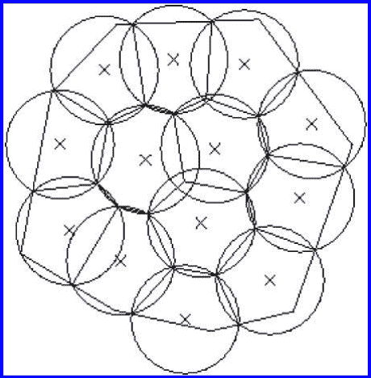

**FIGURE 7.1:** Illustration of abstract problem

[PAGE 358]

## 7.3 Deployment Algorithm

In each iteration, we compute _VOR_(_P_) [3], and then compute the circumscribing circle _C<sub>i</sub>_ of each _vor_(_p<sub>i</sub>_) using the algorithm proposed in [4] for each _i_ = 1, 2, ..., _k_. Let _r<sub>i</sub>_ denote the radius of _C<sub>i</sub>_. It can be easily verified that to cover a given convex polygon completely by a sensor node with minimum range, we need to place the sensor node at the center of the circumscribing circle of that convex region, and the range assigned to that base station is equal to the radius of the circumscribing circle. Thus, for each _i_ = 1, 2, ..., _k_, we move _p<sub>i</sub>_ to the center of _C<sub>i</sub>_ and assign range _r<sub>i</sub>_ to it. Next, we compute $\rho = max\{r_i, i=1,2,\dots,k\}$. The stepwise description of the algorithm for an iteration is given below.

+   Input: (* of the _j_-th iteration *)
+   _k_ points _P_ = {_p_<sub>1</sub>, _p_<sub>2</sub>, ..., _p<sub>k</sub>_}
+   If _j_ = 1, the members of _P_ are _k_ random points inside the polygon $\Pi$, and if _j_ > 1, the members of _P_ are the output of the (_j_ - 1)-th iteration.

+   Output: /\* of the _j_-th iteration \*/
+   The range $\rho$ obtained in this iteration and
+   the centers of _k_ circles for the next iteration.

+   Step 1: Compute _VOR_(_P_).

+   Step 2: Compute the minimum enclosing circle _C<sub>i</sub>_ of _vor_(_p<sub>i</sub>_).

+   Step 3: Compute $\rho = max\{r_i\}_{i=1}^k$, where _r<sub>i</sub>_ is the radius of the circle _C<sub>i</sub>_.

+   Step 4: Output $\rho$ and the centers of _C<sub>i</sub>_ for _i_ = 1, 2, ..., _k_.

+   Lemma 24. At each iteration, _i_) the newly assigned position of each point _p<sub>i</sub>_ lies inside the corresponding _vor_(_p<sub>i</sub>_), and _ii_) the value of $\rho$ decreases.

+   Proof. (i) The smallest enclosing circle of a convex polygon passes through the farthest pair of vertices of the polygon and the line segment joining that pair of vertices

[PAGE 359]

## Placement of Sensor Nodes in WSN

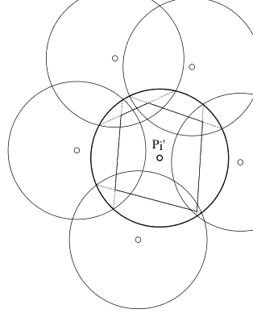

defines the diameter of the smallest enclosing circle, or it passes through three or more vertices of the polygon. In the first case, the lemma obviously follows. In the second case, if the center lies outside the convex polygon, there exists a point-free arc of the enclosing circle having length greater than half of the perimeter of the circle. Thus it is not the minimum enclosing circle of that convex polygon (see Chapter 16 of [5]).

(ii) Let {p<sub>1</sub>,p<sub>2</sub>,...,p<sub>k</sub>} be the position of the base stations prior to an iteration and ρ<sub>old</sub> be the corresponding value of ρ. We have drawn the Voronoi diagram of {p<sub>1</sub>,p<sub>2</sub>,...,p<sub>k</sub>} and then computed the smallest enclosing circle of each vor(p<sub>i</sub>). Let {p'<sub>1</sub>,p'<sub>2</sub>,...,p'<sub>k</sub>} be the center of these circles, and C* be the largest one among these circles. In other words, ρ<sub>old</sub> is equal to the radius of C*. In this iteration, the positions of the base stations are revised to {p'<sub>1</sub>,p'<sub>2</sub>,...,p'<sub>k</sub>}. The Voronoi polygon around each p'<sub>i</sub> in the next iteration is obtained as follows:

Draw copies of C* with centers at {p'<sub>1</sub>,p'<sub>2</sub>,...,p'<sub>k</sub>}. Let C<sub>i</sub> be the copy of C*


## 7.4 实验结果

下面的定理分析了上述启发式算法每次迭代的时间复杂度。

**定理 24.** *一次迭代的最坏时间复杂度是* $O(n + k\log k)$。

*Proof.* 这项分析涉及的因素如下：

+   - 计算 $VOR(P)$ 的时间复杂度为 $O(k\log k)$ [3]。
+   - $VOR(P)$ 将凸多边形区域 $\Pi$ 分割为 $k$ 个封闭单元。每条 $VOR(P)$ 的边最多出现在两个单元中。由于区域 $\Pi$ 的边数为 $n$，因此识别这 $k$ 个单元需要 $O(n+k)$ 时间。
+   - 计算凸多边形的最小包络圆的时间是线性的，取决于其边数 [4]。因此，计算 $\{C_i, i = 1, 2, \ldots, k\}$ 需要 $O(n+k)$ 时间。

从初始配置到达到局部最优所需的迭代次数相对较少。整体时间复杂度取决于我们应用精炼步骤的次数。

## 7.4 实验结果

已进行了多种凸形区域 $\Pi$ 的穷尽实验，并使用了不同的 $k$ 值。对于给定的初始 $P$ 位置，$\rho$ 在每次迭代中会递减。当过程达到局部最小值时，结果的质量取决于 $P$ 初始位置的选择。本文研究了 $P$ 的随机分布情况。在最优解中，点的分布非常规则。为了获得最佳结果，初始点分布被仔细选择。因此，在单位正方形区域 $\Pi$ 上进行实验时，点的初始位置选择如下：计算 $m = \lceil\sqrt{k}\rceil$。

如果 $m^2 = k$，则将区域划分为 $m \times m$ 个单元，并在每个单元中随机放置 $P$ 中的一个点。如果 $(k - m^2) < m$，则将区域划分为 $m$ 行等宽区域，任意选择 $(k - m^2)$ 行，并将每行划分为 $(m + 1)$ 个单元；其余行划分为 $m$ 个单元。然后在每个单元中放置一个点。如果 $(k - m^2) > m$，则将正方形区域划分为 $(m + 1)$ 行，每行再划分为 $m$ 或 $(m + 1)$ 行，以容纳 $P$ 中的所有点。

对于每个 $k$，文献 [8] 考虑了 1000 个初始实例。对于每个实例，他们通过执行上述迭代算法计算了 $\rho$ 的值。最后，他们报告了 $\rho^*_{opt}$ = 所有 1000 个实例中 $\rho$ 的最小值。表 7.1 展示了 $\rho^*_{opt}$ 与算法 [2] 中得到的 $\rho_{opt}$ 在不同 $k$ 值下的比较。

文献 [8] 在区域为等边三角形时，将其方法与文献 [1] 的方法进行了比较。不同 $k$ 值下的实验结果见表 7.2。图 7.1 展示了该部署算法在覆盖含 13 个圆的凸多边形时的输出。

为了测试设计该算法的启发式的性能，我们需要了解 $\rho$ 在所有 1000 个实例中对于不同 $k$ 值和单位正方形区域 $\Pi$ 的最小值、平均值和标准差。因此，表 7.1 的第 3 列与表 7.3 的第 2 列完全相同。Das 等人 [8] 在 Sun Blade 1000 工作站上（CPU 速度 750 MHz）完成了整个实验，并使用了 LEDA [6] 来计算伏尔诺伊图。每个实例的平均处理时间如下所示。在等边三角形的情况也观察到了类似的结果。

**表 7.2：覆盖等边三角形**

| k | 使用 [1] 方法的 $\rho_{opt}$ | 使用上述方法的 $\rho^*_{opt}$ | k | 使用 [2] 方法的 $\rho_{opt}$ | 使用上述方法的 $\rho^*_{opt}$ |
|---:|---:|---:|---:|---:|---:|
| 4 | 0.2679491924311227065 | 0.267972 | 21 | 0.0962250448649376274 | 0.099165 |
| 5 | 0.2500000000000000000 | 0.250006 | 22 | 0.0951772351261450917 | 0.095877 |
| 6 | 0.1924500897298752548 | 0.192493 | 23 | 0.0937742911094478264 | 0.094625 |
| 7 | 0.1852510857860085485 | 0.185345 | 24 | 0.0923541375945022204 | 0.093982 |
| 8 | 0.1769926664029649641 | 0.177045 | 25 | 0.0906182448311340175 | 0.091688 |
| 9 | 0.1666666666666666667 | 0.166701 | 26 | 0.0887829248953373781 | 0.090231 |
| 10 | 0.1443375672974064411 | 0.144681 | 27 | 0.0868913397937015305 | 0.088238 |
| 11 | 0.1410544578570137336 | 0.141252 | 28 | 0.0824786098842322521 | 0.086795 |
| 12 | 0.1373236156889236662 | 0.137633 | 29 | 0.0818048133956910115 | 0.084545 |
| 13 | 0.1326643857750888351 | 0.133379 | 30 | 0.08088285002585641436 | 0.082246 |
| 14 | 0.1275163863998600644 | 0.127829 | 31 | 0.0798927448089536737 | 0.081665 |
| 15 | 0.1154700538379251529 | 0.115811 | 32 | 0.0788506226168764215 | 0.080457 |
| 16 | 0.1137125784440782042 | 0.114574 | 33 | 0.0776371221487328244 | 0.079604 |
| 17 | 0.1113943099632405880 | 0.112141 | 34 | 0.0763874538343494465 | 0.078827 |
| 18 | 0.1091089451197961906 | 0.109890 | 35 | 0.0751604548962267707 | 0.076918 |
| 19 | 0.1061737927289732618 | 0.107288 | 36 | 0.0721687836487032206 | 0.075950 |
| 20 | 0.1032272183417310354 | 0.104049 |  |  |  |

**表 7.3：算法性能评估**

| k | $\rho^*_{opt}$ | $\rho_{average}$ | std. devn. | Time in sec. |
|---:|---:|---:|---:|---:|
| 4 | 0.353553 | 0.395284 | 0.040423 | 0.052 |
| 5 | 0.326165 | 0.326247 | 0.000201 | 0.073 |
| 6 | 0.298730 | 0.309837 | 0.008433 | 0.090 |
| 7 | 0.274295 | 0.27603 | 0.001668 | 0.107 |
| 8 | 0.260317 | 0.26131 | 0.003079 | 0.124 |
| 9 | 0.230672 | 0.231119 | 0.000540 | 0.143 |
| 10 | 0.218239 | 0.218244 | 0.000004 | 0.164 |
| 11 | 0.212533 | 0.213855 | 0.000894 | 0.184 |
| 12 | 0.202395 | 0.205567 | 0.000908 | 0.206 |
| 13 | 0.194339 | 0.194960 | 0.000645 | 0.228 |
| 14 | 0.185527 | 0.189217 | 0.001722 | 0.258 |
| 15 | 0.180208 | 0.182782 | 0.001883 | 0.279 |
| 16 | 0.169611 | 0.174669 | 0.003178 | 0.303 |
| 17 | 0.165754 | 0.168231 | 0.002336 | 0.327 |

| k | $\rho^*_{opt}$ | $\rho_{average}$ | std. devn. | Time in sec. |
|---:|---:|---:|---:|---:|
| 18 | 0.160682 | 0.164347 | 0.001092 | 0.351 |
| 19 | 0.158345 | 0.160797 | 0.000885 | 0.377 |
| 20 | 0.152528 | 0.156772 | 0.000877 | 0.405 |
| 21 | 0.149080 | 0.153131 | 0.001253 | 0.436 |
| 22 | 0.143711 | 0.148640 | 0.000582 | 0.465 |
| 23 | 0.141278 | 0.145498 | 0.001738 | 0.499 |
| 24 | 0.138715 | 0.142105 | 0.001507 | 0.531 |
| 25 | 0.134397 | 0.139549 | 0.001572 | 0.557 |
| 26 | 0.132050 | 0.136489 | 0.001618 | 0.587 |
| 27 | 0.128660 | 0.133725 | 0.001298 | 0.623 |
| 28 | 0.127426 | 0.131589 | 0.001357 | 0.655 |
| 29 | 0.126524 | 0.129241 | 0.000964 | 0.688 |
| 30 | 0.123214 | 0.127069 | 0.000881 | 0.719 |


-   [K. J. Nurmela, “Conjecturally optimal coverings of an equilateral triangle with up to 36 equal circles,” _Experimental Mathematics_, vol. 9, pp. 241–250, 2000.](https://wiki.example.org/feynmans_learning_method) 的灵感源于诺贝尔物理奖获得者**Richard Feynman**。

1.  运用费曼技巧，你只需花上`20 min`就能深入理解知识点，而且记忆深刻，*难以遗忘*。

```
if (condVar > someVal) {console.log("xxx")}
```


与上述说明的最后两点相冲突。因此，需要在满足尽可能多的节点能量剩余值高于阈值的要求与保持所有消息通信的总能耗最低之间进行权衡。

一种满足该要求的方法是将节点进行聚类，每个聚类有一个聚类头，使得聚类头构成后骨网络。通常，选择在聚类中剩余能量最大的节点作为聚类头。因此，特定聚类中的节点首先将其消息发送到其聚类头，然后聚类头将该消息直接路由到目的节点（如果它在同一聚类内）或到另一个聚类头，该聚类头可能作为后骨网络中最短路径路由的中间节点。注意，节点可能与目的节点存在直接（单跳）链路，但如果源节点不是聚类头，则上述技术不允许这种直接通信。该技术的一个变体是，当目的节点在同一聚类内时，源节点可以直接向目的节点发送其消息，从而解除聚类头作为中间节点的职责。这将减少通信时间和路由该消息的总能耗，但负面是非聚类头节点可能需要提高其峰值传输功率，即为了直接到达同一聚类中最远的节点而消耗更多能量。因此，需要一个仔细的聚类算法，考虑每个节点的剩余能量和传输范围，以确定包含在聚类中的节点以及选择适当的聚类头节点。因此，如果聚类中的节点没有足够的剩余能量来提高峰值传输功率以到达同一聚类中最远的另一个节点，则该节点不能被包含在聚类中。基本上，这一要求应减小聚类的规模，从而降低后骨网络的最大延迟。再次出现权衡问题，以实现最佳结果。

聚类和路由技术需要动态改变聚类和聚类头。经过一段时间后，聚类头可能耗尽能量，不再拥有聚类中所有节点中剩余能量最大。此外，如果节点是移动的、能量耗尽导致断开网络，或在上次计算聚类（及相应的聚类头）以来新节点加入，网络连接性可能会改变。这些情况应根据当前网络状态（如连接性、节点剩余能量和传输范围）重新计算聚类。

另一种节能路由方法是使用连通支配集（CDS）作为后骨网络，而不是使用前面提到的以聚类头形成的后骨网络。在该方法中，我们首先构建网络图 \( G(V, E) \)，其中 \( V \) 为顶点集合，\( E \) 为边集合，表示网络节点及其之间的连接关系。每个节点对应图中的一个顶点，若两个节点的传输范围相互重叠，则在图中对应的顶点之间有无向边。我们假设每个节点的传输范围相同。支配集 \( DS \) 是图 \( G(V, E) \) 的一个顶点子集，使得图中的每个顶点要么在 \( DS \) 中，要么至少与 \( DS \) 中的一个顶点相邻（距离为 1）。例如，图 8.1 中的 10 个顶点图，一个可能的支配集是 {2, 5, 9}，如图 8.2 所示。然而，该支配集诱导的子图不连通，因此该支配集对应的节点不能构成后骨网络。为了形成后骨网络，需要在该支配集中加入一个最小的额外顶点集合，使其成为连通支配集 \( CDS \)。因此，图 8.3 中的图形可能的连通支配集是 {2, 4, 5, 7, 9}。注意，额外加入的顶点 4 和 7。

一旦我们使用连通支配集的诱导子图形成后骨网络，消息路由可以采用与聚类技术相同的方法，其中聚类头构成后骨网络。从任意未被选入连通支配集的节点发送的消息首先会被发送到其在连通支配集中的相邻节点，然后从该节点路由到与目的节点相邻且属于连通支配集的节点，沿后骨网络的最短路径进行路由。图中可能存在多个支配集，对应于给定节点 5 需要累加从所有节点接收的温度值。假设节点 1、2、3、4 的温度值分别为 5、9、3、2，节点 1 将其数据值 5 发送给节点 2，节点 2 将该值与自身的感应数据 9 相加，在记忆中存储部分和 14。随后节点 3 将其数据值 3 发送给节点 2，节点 2 将其加到之前的部分和 14 上，生成新的部分和 17。节点 2 之后将该值 17 发送给节点 4（参见图 8.5），节点 4 将其与自身的感应数据相加得到结果 19，然后发送到集合节点 5。因此，从节点 1、2、3、4 发送数据值的通信跳数仅为四次，消耗了 4\(E_h\) 单位的能量。这节省了 5\(E_h\) 单位的能量。我们也可以计算观测点中所有温度值的最大值或最小值，这种方案同样能有效节省能量。但必须指出，这种在数据通信中通过数据聚合实现的能量节省仅在应用程序允许此类聚合时才有效。也就是说，能量节省在应用层并非通用技术，而是非常具体的应用场景。

## 能源高效通信

## 一些优雅的物理层中心技术

传统通信策略使用基于能量的传输（EbT）方案，需要为每个比特的传输消耗能量，无论该比特是 0 还是 1。根据传输策略，0 和 1 可能都由非零电压水平表示，或者一个比特值由零电压表示，另一个比特值由非零电压表示来区分。例如，极性返回至零（polar‑RZ）传输方案中，0 对应于零电压水平，而 1 表示非零电压水平。

然而，大多数现有传输方案使用非零电压水平表示 0 和 1 以区分静默信道和繁忙信道。需要为 0 和 1 都消耗能量的传输方案称为能量基于传输（EbT）方案。例如，要通信数值 278，节点会发送位序列 < 1, 0, 0, 0, 1, 0, 1, 1, 0 >，为每个传输的比特消耗能量。因此，若每个传输比特所需的能量为 \(e_b\)，则传输数值 278 所需的总能量为 \(9e_b\)。

2005 年，Zhu 和 Sivakumar [9] 提出了一种名为“通过静默通信”（CtS）的通信策略，利用静默期间替代能量基于传输。CtS 的缺点是时间复杂度呈指数增长，会引入长延迟并 adversely 影响网络吞吐量。另一个问题是在长时间静默期间保持发送端和接收端的同步。

Chen 等人提出 [10] 一种名为“可变基础隐式通信”（VarBaTaC）的替代方案，它结合变底数信息编码与 CtS 进行通信。VarBaTaC 的吞吐量随底数的指数增长而呈指数下降。此外，表示更高的底数以及处理动态底数变化的硬件电路复杂度显著增加。

我们现在描述适用于低功耗无线网络（如无线传感器网络、移动自组网络以及通常使用低成本设备、要求低功耗操作且采用ASK、OOK 和 FSK 等简单调制技术的应用）的优雅能源高效通信技术。所有这些技术都基于某种类型的源码编码，并通过在编码后的消息中选择性地在占主导地位符号（最频繁出现的符号）后静默传输来实现节能。

通过适当的源码编码，可能将给定的二进制位流（消息）转换为 \(m\) 种可能符号的流（\(m > 2\)），其中一种符号为主导符号。


在这些$m$个符号中，出现频率高于其余$m-1$个符号。大多数现代无线电设备具有多种状态，消耗不同数量的功率。通常，无线电在*发射*或*接收*状态下消耗的功率最大，而在*活动*和*空闲*状态下消耗的功率非常少。通常，无线电在空闲状态下消耗的功率最少，但从空闲状态切换到发射或接收状态所需的时间比从活动状态切换要长。因此，如果编码消息后的符号统计存在偏差，可以选择通过适当的数字调制方案传输这$m$个符号的流，在该方案中，发射机在主导符号出现期间保持静默。在这些静默间隔期间，发射机可以节省大量能量。相位和频率调制族，如相移键控（PSK）、频移键控（FSK）、$m$进制PSK、$m$进制FSK及其变体，优于幅移键控（ASK）和$m$进制ASK技术。当选择采用$m$进制PSK/FSK调制并对主导符号使用与ASK传输相对应的静默间隔时，由于与$m$进制PSK/FSK相比，ASK在相同误码率（BER）下需要更高的信噪比（SNR），因此可能必须适当提高其余$m-1$个非静默符号的瞬时功率电平。因此，为了实现成功的节能通信，因静默节省的能量与为$m$进制PSK/FSK提高瞬时功率所需的额外能量之差必须为正。

多位研究人员已经提出了几种成功的方法，这些方法实现了适当的源编码技术、主导符号的静默传输，以及合适的调制和解调技术[39, 3, 4, 6, 5, 40]。我们将在以下章节中讨论其中一些方案。

## 8.3 冗余二进制数编码与静默零通信（RBNSiZeComm）

该通信方案基于在冗余二进制数系统（*RBNS*）中对要传输的消息进行编码。我们首先讨论*RBNS*的基本概念以及在此数制中所有可能消息中符号的频率分布（假设每个二进制字符串作为消息传输的可能性相同）。之后，我们描述使用编码消息静默通信概念的通信协议，然后按照[39]中的描述，从收发机节能的角度评估该协议的性能。

### 8.3.1 冗余二进制数系统预备知识

冗余二进制数系统（RBNS）[21]使用集合$\{-1, 0, 1\}$中的数字以基2表示数字。在本章的其余部分，为方便起见，我们用**1̄**表示数字$-1$。在RBNS中，一个给定数字可能有多种表示形式。例如，十进制数7在RBNS中可以表示为111或1001̄。我们利用这一特性对消息字符串进行重新编码，以在传输消息时减少字符串中1的数量。然而，接收端可以通过将接收到的消息从RBN重新转换回二进制数系统来获得原始二进制消息。

重新编码方案的基本思想如下：考虑一段长度为*k*的连续1，*k* > 1。设*i*为该连续1中第一个1的位位置，*i* ≥ 0（位位置0指最右端的最低有效位）。设*v*表示这段连续*k*个1的值。则：

$$v = 2^i + 2^{i+1} + 2^{i+2} + \dots + 2^{k+i-1}. \tag{8.1}$$

或者，我们可以将公式(8.1)重写为：

$$v = 2^{k+i} - 2^i. \tag{8.2}$$

公式(8.2)可以在RBNS中用位位置$(k+i)$处的1和位位置$i$处的$\bar{1}$来表示，同时它们之间的所有中间1都转换为0。我们将这一观察结果形式化为以下归约规则。

**归约规则1。** *从位位置$i$开始的一段连续$k$个1（$k > 1$）被替换为等效表示：位位置$k+i$处为1，位位置$i$处为$\bar{1}$，所有中间位位置为0。*

观察到，对于一段连续$k$个1（$k > 1$），非零数字数量的节省为$k-2$。注意，当$k = 2$时，非零数字数量保持不变。另外，如果我们考虑一个字符串，例如110111，其中只有一个0夹在连续的1之间，在应用归约规则1后，我们会得到字符串$10\bar{1}100\bar{1}$。注意这个被夹住的0对应的$\bar{1}1$模式。现在可以对位模式$\bar{1}1$应用第二次归约，将其替换为$0\bar{1}$。因此，从$10\bar{1}100\bar{1}$，我们得到字符串$100\bar{1}00\bar{1}$，非零数字更少。于是我们有第二条归约规则。

**归约规则2。** *在应用归约规则1后得到的字符串中，每个出现的位模式$\bar{1}1$被替换为等效位模式$0\bar{1}$。*

归约规则1和2的应用需要两遍算法。然而，很容易将这两条规则组合成单遍算法，如下所述。

```
1: procedure RBNSiZeComm(IN bit vector data_frame, IN integer len)
2:     /* The data frame is converted to RBNS */
3:     /* by applying reduction rules 1 and 2 */
4:     bit vector out_buf : array [0..len] ▷ size of len + 1 bits;
5:     boolean runflag : false;
6:     integer runlengthcount, lowbit : 0;
7:     Call ReductionRule1(data_frame, len, out_buf); ▷ Reduction Rule 1
8:     Call ReductionRule2(out_buf, len); ▷ Reduction Rule 2
9:     for i = 0 to len do
10:         if out_buf[i] ≠ 0 then
11:             transmit bit out_buf[i]; ▷ Either 1 or 1̄
12:         else
13:             remain silent; ▷ No transmission of bit value '0'
14:         end if
15:     end for
16: end procedure

1: procedure REDUCTIONRULE1(IN data_frame, IN len, OUT out_buf)
2:     for i = 0 to len - 1 do ▷ Test each bit of data frame
3:         if data_frame[i] = 1 then
4:             if runlengthcount = 0 then
5:                 lowbit ← i; ▷ Start index of run of 1's
6:             end if
7:             runlengthcount ← runlengthcount + 1; ▷ Run length
8:             if runlengthcount > 1 then
9:                 runflag ← true; ▷ Found a run of ones
10:             end if
11:         else ▷ data_frame[i] = 0
12:             if runlengthcount > 1 then ▷ Apply Reduction Rule 1
13:                 out_buf[lowbit] ← 1̄;
14:                 for j = lowbit + 1 to i - 1 do
15:                     out_buf[j] ← 0;
16:                 end for
17:                 out_buf[i] ← 1;
18:                 runflag ← false;
19:             else ▷ Single 1, just copy to out buffer
20:                 out_buf[lowbit] ← 1;
21:                 out_buf[i] ← 0;
22:             end if
23:             runlengthcount ← 0; ▷ Reset run length count
24:         end if
25:     end for
26:     if runflag = true then ▷ run of 1 ends at MSB
27:         out_buf[lowbit] ← 1̄;
28:         for j = lowbit + 1 to len - 1 do
29:             out_buf[j] ← 0;
30:         end for
31:         out_buf[len] ← 1; ▷ out_buf of length len + 1
32:         runflag ← false;
33:     end if
34: end procedure

1: procedure REDUCTIONRULE2(INOUT out_buf, IN len)
2:     for i = 1 to len do
3:         if (out_buf[i] = 1̄) and (out_buf[i - 1] = 1) then ▷ Reduction Rule 2
4:             out_buf[i - 1] ← 1̄;
5:             out_buf[i] ← 0;
6:         end if
7:     end for
8: end procedure
```

为了将*RBNSiZeComm协议*转换为单遍例程，我们用单一过程替换*ReductionRule1*和*ReductionRule2*过程，并对*ReductionRule1*过程的第13行和第27行（我们在输出缓冲区中写入1̄的位置）进行更改。*ReductionRule1*过程的第13行和第27行都将替换为以下内容：

```
if (lowbit ≠ 0) and (out_buf[lowbit − 1] = 1) then
    out_buf[lowbit − 1] ← 1̄;
    out_buf[lowbit] ← 0;
else
    out_buf[lowbit] ← 1̄;
end if
```

在接收端，必须执行相反的过程以正确接收数据，然后将其转换为等效的二进制表示，供网络协议栈的不同层进一步处理。在传输过程中对RBN编码数据应用归约规则1和2，可防止传输数据中出现位模式1̄1和1̄1̄。此外，如果原始数据是*n*位二进制数据帧，RBN编码可能导致帧大小为*n* + 1个RBN位。协议*RBNSiZeRecv*概述了正确接收RBNS编码数据帧并将其重新转换为其二进制等效形式所涉及的步骤。

```
1: procedure RBNSiZeRecv(IN RBN vector integer len, OUT bit vector out_buf)
```


## 无线网络和移动计算

2: /* 首先接收一个长度为 len + 1 的 RBNS 数据帧 */
3: /* 然后将其转换为等价的二进制值 */
4: RBN 向量 recv_buf：数组 [0..len]；▷ 接收到的 RBNS 数据帧
5: 位向量 out_buf：数组 [0..len]；▷ 输出二进制帧
6: /* 接收数据帧 */
7: 调用 ReceiveRBNDataFrame(recv_buf, len);
8: 调用 ConvertRBNtoBinary(recvbuf, len, out_buf);
9:

10: /* out_buf 中的二进制数据为 len + 1 位。最高有效位（msb） */
11: /* 可以忽略，因为它始终为 0，只需返回低阶 len 位 */
13: end procedure

1: procedure RECEIVERBNDATAFRAME(INOUT recv_buf, IN len)
2: /* null 表示信道中无信号 */
3: /* time_slot[i] 指的是第 i 个时间槽 */
4: for i = 0 to len do
5: if time_slot[i] = null then
6: recv_buf[i] ← 0；▷ 信道在第 i 个时间槽期间为 null
7: else
8: recv_buf[i] ← time_slot[i]；▷ 在第 i 个时间槽中接收到 1 或 0
9: end if
10: end for
11: end procedure

1: procedure CONVERTRBNTOBINARY(IN recv_buf, IN len, INOUT out_buf)

2: /* 将接收到的 RBNS 数据帧转换为二进制数据 */
3: /* 最终的二进制数据将存放在 `out_buf` 中 */
4: **boolean** `runflag : false;`
5: `runflag ← false;`  ▷ 用于解码 1 的连续段
6: **for** `i = 0` **to** `len` **do**
7: &nbsp;&nbsp;&nbsp;&nbsp;**repeat**
8: &nbsp;&nbsp;&nbsp;&nbsp;&nbsp;&nbsp;&nbsp;&nbsp;**if** `recv_buf[i] = 1` **then**
9: &nbsp;&nbsp;&nbsp;&nbsp;&nbsp;&nbsp;&nbsp;&nbsp;&nbsp;&nbsp;&nbsp;&nbsp;**if** `runflag = false` **then**
10: &nbsp;&nbsp;&nbsp;&nbsp;&nbsp;&nbsp;&nbsp;&nbsp;&nbsp;&nbsp;&nbsp;&nbsp;&nbsp;&nbsp;&nbsp;&nbsp;`runflag ← true;`
11: &nbsp;&nbsp;&nbsp;&nbsp;&nbsp;&nbsp;&nbsp;&nbsp;&nbsp;&nbsp;&nbsp;&nbsp;&nbsp;&nbsp;&nbsp;&nbsp;`out_buf[i] ← 1;`  ▷ 第 i 位输出 1
12: &nbsp;&nbsp;&nbsp;&nbsp;&nbsp;&nbsp;&nbsp;&nbsp;&nbsp;&nbsp;&nbsp;&nbsp;**else**
13: &nbsp;&nbsp;&nbsp;&nbsp;&nbsp;&nbsp;&nbsp;&nbsp;&nbsp;&nbsp;&nbsp;&nbsp;&nbsp;&nbsp;&nbsp;&nbsp;`out_buf[i] ← 0;`  ▷ 规则 2 的减少结果
14: &nbsp;&nbsp;&nbsp;&nbsp;&nbsp;&nbsp;&nbsp;&nbsp;&nbsp;&nbsp;&nbsp;&nbsp;**end if**
15: &nbsp;&nbsp;&nbsp;&nbsp;&nbsp;&nbsp;&nbsp;&nbsp;**end if**
16: &nbsp;&nbsp;&nbsp;&nbsp;&nbsp;&nbsp;&nbsp;&nbsp;**if** `recv_buf[i] = 1` **then**
17: &nbsp;&nbsp;&nbsp;&nbsp;&nbsp;&nbsp;&nbsp;&nbsp;&nbsp;&nbsp;&nbsp;&nbsp;**if** `runflag = true` **then**
18: &nbsp;&nbsp;&nbsp;&nbsp;&nbsp;&nbsp;&nbsp;&nbsp;&nbsp;&nbsp;&nbsp;&nbsp;&nbsp;&nbsp;&nbsp;&nbsp;`out_buf[i] ← 0;`  ▷ 第 i 位输出 0
19: &nbsp;&nbsp;&nbsp;&nbsp;&nbsp;&nbsp;&nbsp;&nbsp;&nbsp;&nbsp;&nbsp;&nbsp;&nbsp;&nbsp;&nbsp;&nbsp;`runflag ← false;`  ▷ 1 的连续段结束
20: &nbsp;&nbsp;&nbsp;&nbsp;&nbsp;&nbsp;&nbsp;&nbsp;&nbsp;&nbsp;&nbsp;&nbsp;**else**
21: &nbsp;&nbsp;&nbsp;&nbsp;&nbsp;&nbsp;&nbsp;&nbsp;&nbsp;&nbsp;&nbsp;&nbsp;&nbsp;&nbsp;&nbsp;&nbsp;`out_buf[i] ← 1;`  ▷ 单独的 1
22: &nbsp;&nbsp;&nbsp;&nbsp;&nbsp;&nbsp;&nbsp;&nbsp;&nbsp;&nbsp;&nbsp;&nbsp;**end if**
23: &nbsp;&nbsp;&nbsp;&nbsp;&nbsp;&nbsp;&nbsp;&nbsp;**end if**
24: &nbsp;&nbsp;&nbsp;&nbsp;&nbsp;&nbsp;&nbsp;&nbsp;**if** `recv_buf[i] = 0` **then**
25: &nbsp;&nbsp;&nbsp;&nbsp;&nbsp;&nbsp;&nbsp;&nbsp;&nbsp;&nbsp;&nbsp;&nbsp;**if** `runflag = true` **then**
26: &nbsp;&nbsp;&nbsp;&nbsp;&nbsp;&nbsp;&nbsp;&nbsp;&nbsp;&nbsp;&nbsp;&nbsp;&nbsp;&nbsp;&nbsp;&nbsp;`out_buf[i] ← 1;`  ▷ 处于 1 的连续段内
27: else
28: out_buf[f] ← 0;
29: end if
31: until runflag = false;
32: end for
33: end procedure

作为上述软件实现的替代方案，也可以设计一个简单的硬件电路，实现二进制到 RBNS 串行转换。设 RBN 数字 \(b_i^{rbn}\)（\(0 \leq i \leq n\)）对应给定二进制数的位 _b_i_，可用两位 _x_(_i_) 和 _y_(_i_) 表示，其中 _x_(_i_) 为最高有效位。RBN 数字的编码为：0 用 00，1 用 01，\(\bar{1}\) 用 10，并用 _a_、_b_、_c_、_d_、_e_、_f_ 分别表示 _b_<sub>_i_+2</sub>、_b_<sub>_i_+1</sub>、_b<sub>i</sub>_、_b_<sub>_i_-1</sub>、_b_<sub>_i_-2</sub>、_b_<sub>_i_-3</sub>。

图 8.6 展示了一个代表性硬件电路，用于计算 _x_(_i_) 和 _y_(_i_)，其中 _b_<sub>-3</sub>、_b_<sub>-2</sub>、_b_<sub>-1</sub>、_b<sub>n</sub>_、_b_<sub>_n_+1</sub> 初始化为 0。该电路可用于 **pipelined** 传输方案，即 (_i_+1) 位的转换与第 _i_ 个 RBNS 符号的传输重叠进行。

同样，接收到的 RBNS 数字也可以通过硬件电路串行转换，如图 8.7 所示。线条 _R_<sub>0</sub>、_R_<sub>1</sub> 以及 \(R_\bar{1}\) 假设为逻辑 1 电平。

图 8.6 展示了一个代表性硬件电路，用于计算 _x_(_i_) 和 _y_(_i_)，其中 _b_<sub>-3</sub>、_b_<sub>-2</sub>、_b_<sub>-1</sub>、_b<sub>n</sub>_、_b_<sub>_n_+1</sub> 初始化为 0。该电路可用于 **pipelined** 传输方案，即 (_i_+1) 位的转换与第 _i_ 个 RBNS 符号的传输重叠进行。

图 8.7 展示了一个代表性硬件电路，用于计算 _x_(_i_) 和 _y_(_i_)，其中 _b_<sub>-3</sub>、_b_<sub>-2</sub>、_b_<sub>-1</sub>、_b<sub>n</sub>_、_b_<sub>_n_+1</sub> 初始化为 0。该电路可用于 **pipelined** 传输方案，即 (_i_+1) 位的转换与第 _i_ 个 RBNS 符号的传输重叠进行。

我们现在作出以下观察：

**观察 1.** 通过在传输二进制数据时应用减少规则 1 和 2，可确保传输数据中不出现 $\overline{1}\overline{1}$、$1\overline{1}$ 和 $\overline{1}1$ 这三种数字模式。

**观察 2.** 若原始二进制数据帧为 _n_ 位，RBNS 编码后的帧大小可达 _n+1_ 个 RBNS 数字。

**观察 3.** 编码和解码过程需要从最低有效位扫描到最高有效位，这可以便利地与 **pipelined** 的串行传输和接收同步进行。

因此，可以看出，从二进制到 RBNS 以及从 RBNS 到二进制的硬件转换逻辑复杂度极低。因此，由于编码和解码逻辑带来的延迟和能耗增加，远远不足以显著影响该方案所带来的能耗节约。

## 8.3.2  RBNSiZeComm 通信协议

RBNSiZeComm 通信协议仅包含两个步骤：

1. 使用减少规则 1 和 2 将二进制数据帧重新编码为 RBNS。
2. 发送 RBNS 数据帧，仅在 1 和 \(\bar{1}\) 位上驱动非零电压，而在 0 位上保持静默。

为了区分信道中没有信号和正在进行传输中的 0 位，需要在数据传输开始时发送 *start of transmission* 信号，在数据帧结束时发送 *end of transmission* 信号。

## 8.3.3  能耗节约分析

我们首先计算在应用减少规则 1 后，长度为 \(n\) 的二进制字符串中非零数字的平均个数。为此，我们先统计所有长度为 \(n\) 的由 0、1 组成的字符串中，长度为 \(k\)（\(1 \leq k \leq n\)）的 1 的连续段（即 \(R_k\)）出现的总次数。

我们用 \(R_k\) 表示长度为 \(k\) 的 1 的连续段。显然，两个相邻的 \(R_{k_1}\) 和 \(R_{k_2}\)（\(1 \leq k_1, k_2 \leq n\)）在位串中必须至少被一个 0 分隔。为了便于计数，我们在每个 \(R_k\) 前面附加一个 0，记作 \(y_k\)，并用 \(y_0\) 表示单独的 0。每个 \(y_k\)（\(0 \leq k \leq n\)）的长度为 \(k+1\)。下面介绍两种求解此计数问题的方法：一种是利用生成函数，另一种是利用递推关系。

### 8.3.3.1  生成函数方法

为了求所有长度为 \(n\) 的二进制字符串中 \(R_k\)（\(1 \leq k \leq n\)）出现的总次数，我们首先计算恰好有 \(i_k\) 个 \(y_k\) 的字符串数量，记为 \(N_n^{i_k,k}\)。也就是说，我们只考虑长度为 \(n+1\) 的位串，其中恰好包含 \(i_k\) 个 \(y_k\)。我们需要将整数 \(n+1\) 按有序方式拆分，使得恰好有 \(i_k\) 个长度为 \(k+1\) 的块。每一种有序拆分对应一个唯一的长度为 \(n\) 的位串（因为考虑了前置的 0）。


在每个 $y_k$（$1 \leq k \leq n$）左侧附加的 0 中，恰好有 $i_k$ 个 $R_k$。我们分三步求出这个可能的划分数量 [2]：

**第一步：** 从整数 $n+1$ 中取出 $i_k$ 个大小为 $k+1$ 的块（$1 \leq k \leq n$），并求出将 $m=(n+1)-(k+1)i_k$ 恰好划分为 $r$ 个块（当 $k \leq n$ 时 $r \geq 1$，当 $k=n$ 时 $r=0$）的有序划分总数，要求该划分中没有大小为 $k+1$ 的块。

**第二步：** 在第一步得到的每一个有序划分上，插入这 $i_k$ 个大小为 $(k+1)$ 的块，并求出所有不同可能方式的总数。这一步类似于将 $i_k$ 个相同的球放入 $r+1$ 个盒子中，其中某些盒子可以为空。

**第三步：** 最后，将上述第二步中得到的表达式对所有可能的 $r$ 值求和，并乘以 $i_k$，得到 $N_n^{i_k,k}$。

注意，对于 $k=n$，整个字符串中只有一个这样的游程，因此 $N_n^{1,n}=1$。对于 $k \leq n$，在上述第一步中，如果我们从左到右扫描长度为 $n+1$ 的比特字符串，$y_i$（$0 \leq i \leq n$）的出现将对应于生成函数 $(x+x^2+x^3+\cdots)$。为了排除 $y_k$ 的出现，我们从中减去 $x^{k+1}$。因此，对于 $r$ 个这样的块，我们考虑生成函数

$$G(x)=\left(x+x^2+x^3+\cdots-x^{k+1}\right)^r,$$

使得 $G(x)$ 中 $x^m$ 的系数就是第一步所需的划分数量。

现在，$G(x)$ 可以写为

## **表 8.1：** *n* = 8 时游程长度的出现次数

| 游程长度大小（*k*） | *iₖ* 的可能取值数 | 出现次数 |
|---:|---:|---:|
| 1 | 4 | 320 |
| 2 | 3 | 144 |
| 3 | 2 | 64 |
| 4 | 1 | 28 |
| 5 | 1 | 12 |
| 6 | 1 | 5 |
| 7 | 1 | 2 |
| 8 | 1 | 1 |

```
$$N_{8}^{2,2}=2\sum_{r=1}^{9-6}\binom{r+2}{2}\sum_{q=0}^{r}\sum_{j=0}^{q}(-1)^{q+j}\binom{2-2q-j}{3-r-2q-j}\binom{r}{q}\binom{q}{j}$$
$$=2\binom{3}{2}\left[\binom{2}{2}\binom{1}{0}\binom{0}{0}-\binom{0}{0}\binom{1}{1}\binom{1}{0}+\binom{-1}{-1}\binom{1}{1}\binom{1}{1}\right]$$
$$+2\binom{4}{2}\left[\binom{2}{1}\binom{2}{0}\binom{0}{0}-0+0\right]+2\binom{5}{2}\left[\binom{2}{2}\binom{3}{0}\binom{0}{0}-0+0\right]$$
$$=2(0+12+10)=44.$$
```

对于给定的 *k* ≥ 1，如果我们现在将表达式 $N_{n}^{i_k,k}$ 对所有可能的 $i_k$ 值（$1 \le i_k \le \lfloor(n+1)/(k+1)\rfloor$）求和，就得到长度为 *n* 的所有可能字符串中 $R_k$ 的总出现次数。表 8.1 和表 8.2 分别显示了长度为 8 位和 16 位的二进制字符串中所有可能的 1 的游程长度的出现次数。这些表格与图 8.8 一起表明，在长度为 *n* 的二进制字符串中，长度为 *k*（$1 \le k \le n$）的 1 的游程的出现次数随 *k* 的增大而指数减小。

## 8.3.3.2　递推关系方法

我们的目标是从包含 $R_{n-k+1}$ 的所有可能字符串出发，逐步生成包含 $R_{n-k}$（$1 \le k \leq n-1$）的所有可能字符串。首先

[PAGE 396]

## 表 8.2：n = 16 时游程长度的出现次数

\begin{tabular}{ccc}
游程长度大小 (k) & $i_k$ 的可能取值数 & 出现次数 \\
1 & 8 & 147456 \\
2 & 5 & 69632 \\
3 & 4 & 32768 \\
4 & 3 & 15360 \\
5 & 2 & 7168 \\
6 & 2 & 3328 \\
7 & 2 & 1536 \\
8 & 1 & 704 \\
9 & 1 & 320 \\
10 & 1 & 144 \\
11 & 1 & 64 \\
12 & 1 & 28 \\
13 & 1 & 12 \\
14 & 1 & 5 \\
15 & 1 & 2 \\
16 & 1 & 1 \\
\end{tabular}

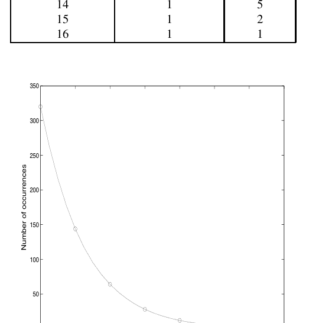

[PAGE 397]

注意，长度为 n 的 1 的游程只有一个，即对于任何 n 值，所有可能字符串中 Rₙ 的数量都等于 1。此外，包含 Rₙ₋₁ 的字符串只有两个。考虑 n = 8。包含 R₈ 的唯一字符串是 1111 1111，而包含 R₇ 的字符串只有两个：0111 1111 和 1111 1110。对于 R₆，有五个可能的字符串：0011 1111、1011 1111、1111 1100、1111 1101 和 0111 1110。现在我们尝试找到一种系统的方法，从包含 R₇ 的两个字符串生成包含 R₆ 的字符串。为此，我们定义以下规则。

+   左替换规则（LRR）：如果存在包含 Rₙ₋ₖ₊₁（k ≥ 2）的字符串，通过应用该规则，我们可以将 Rₙ₋ₖ₊₁ 中最左边的 1 替换为 0，并将其紧邻的前一个 0（如果存在）替换为 0 或 1，从而从 Rₙ₋ₖ₊₁ 生成两个可能的包含 Rₙ₋ₖ 的字符串。

+   注 22. 如果 Rₙ₋ₖ₊₁ 前面没有 0，则通过替换最左边的 1 位只生成一个包含 Rₙ₋ₖ 的字符串。

+   右替换规则（RRR）：如果存在包含 Rₙ₋ₖ₊₁（k ≥ 2）的字符串，通过应用该规则，我们可以将 Rₙ₋ₖ₊₁ 中最右边的 1 替换为 0，并将其紧邻的后一个 0（如果存在）替换为 0 或 1，从而从 Rₙ₋ₖ₊₁ 生成两个可能的包含 Rₙ₋ₖ 的字符串。

+   注 23. 如果 Rₙ₋ₖ₊₁ 后面没有 0，则通过替换最右边的 1 位只生成一个包含 Rₙ₋ₖ 的字符串。

+   示例 30. 因此，从 0111 1111 中的 R₇，通过左替换规则（LRR）可以生成两个包含 R₆ 的字符串：0011 1111 和 1011 1111。同样，对 1111 1110 中的 R₇ 应用右替换规则（RRR），可以生成两个包含 R₆ 的字符串：1111 1100 和 1111 1101。对 1111 1110 中的 R₇ 应用 LRR，或对 0111 1111 中的 R₇ 应用 RRR，会得到相同的字符串 0111 11110，即 0R₆0（重复生成）。

从所有这五个包含 R₆ 的字符串出发，应用 LRR 和 RRR，我们可以

[PAGE 398]

## 表 8.3：由包含长度为 6 的游程的字符串生成的游程长度为 5 的字符串

\begin{tabular}{ccc}
源字符串 & 由 LRR 生成的字符串 & 由 RRR 生成的字符串 \\
0011 1111 & 0001 1111 & 0011 1110 \\
1011 1111 & 1001 1111 & 1011 1110 \\
1111 1100 & 0111 1100 & 1111 1000 \\
1111 1101 & 0111 1101 & 1111 1001 \\
0111 1110 & 0011 1110 & 0111 1100 \\
\end{tabular}

生成如表 8.3 所示的所有包含 \( R_5 \) 的可能字符串。然而，此过程会生成重复字符串；我们看到，由 RRR 从 0011 1111 和 1011 1111 生成的字符串，与由 LRR 从 0111 1110 生成的字符串相同。此外，由 LRR 从 1111 1100 和 1111 1101 生成的字符串，与由 RRR 从 0111 1110 生成的字符串相同。为避免重复计数 1 的游程，我们采用下面讨论的偏置替换策略。

在字符串 0111 1110 中，子串 \( R_6 \) 从左边起的第二个位位置开始。对该字符串应用 RRR 后，我们得到两个字符串 \( 0R_500 \) 和 \( 0R_501 \)，其中子串 \( R_5 \) 也从左边起的第二个位位置开始。因此，这两个字符串都不可能通过对任何 1 的游程起始于最左边位位置的字符串连续应用 RRR 来生成。一般地，如果对形如 \( 0R_k0 * * * * \) 的字符串应用 RRR（其中 * 可取任意值（0 或 1）），这些字符串不可能通过对任何形如 \( R_j0 * * * * \)（\( j \geq k \)）的字符串连续应用 RRR 而重复生成。此外，对形如 \( * * * * * 0R_j \) 的字符串连续应用 LRR，也永远不会与仅由 RRR 从 \( 0R_k0 * * * * \) 生成的任何字符串相同。因此，为避免重复生成字符串，我们制定如下偏置替换规则：

[PAGE 399]

<!-- no content -->

[PAGE 400]

以及

$\mathcal{R}^{m}(R_{n-1},0R_{n-1})=R_{n-m-1}0^m*$,

其中符号 * 表示 0 或 1。

现在我们有以下结果：

# **引理 25.** $\mathcal{L}^{m}\mathcal{R}(R_{n-1},0R_{n-1})=\mathcal{L}^{m}(R_{n-2},0R_{n-2})$。

*证明：* 由 $\mathcal{L}$ 和 $\mathcal{R}$ 函数的定义即可得出。


# **引理 26.** $\mathcal{R}^{m}\mathcal{L}(R_{n-1},R_{n-1}0)=\mathcal{R}^{m}(R_{n-2},0R_{n-2}0)$。

*证明：* 由 $\mathcal{L}$ 和 $\mathcal{R}$ 函数的定义即可得出。


根据引理 25，对 $0R_{n-1}$ 中的 $R_{n-1}$ 应用 $\mathcal{L}^{m}\mathcal{R}$，可以等价地替换为对 $0R_{n-2}$ 中的 $R_{n-2}$ 连续应用 $m$ 次 $\mathcal{L}$ 函数。同样，由引理 26，对 $R_{n-1}0$ 中的 $R_{n-1}$ 应用 $\mathcal{R}^{m}\mathcal{L}$，可以等价地替换为对 $0R_{n-2}0$ 中的 $R_{n-2}$ 连续应用 $m$ 次 $\mathcal{R}$ 函数。

# **引理 27.** $\mathcal{L}\mathcal{R}(R_{n-2},0R_{n-2}0)=\mathcal{R}\mathcal{L}(R_{n-2},0R_{n-2}0)$。

*证明：* 由 $\mathcal{L}$ 和 $\mathcal{R}$ 函数的定义即可得出。


由于引理 27，我们可以在字符串 $0R_{n-2}0$ 上颠倒 $LRR$ 和 $RLR$ 的应用顺序，并且重复应用该性质可能导致先应用所有 $LRR$（或 $RLR$），再在 $0R_{n-2}0$ 上应用所有 $RLR$（或 $LRR$）。例如，我们可以写，$\mathcal{L}^{2}\mathcal{R}^{3}=\mathcal{L}(\mathcal{L}\mathcal{R})\mathcal{R}^{2}=\mathcal{L}\mathcal{R}\mathcal{L}\mathcal{R}\mathcal{R}=\mathcal{L}\mathcal{R}(\mathcal{L}\mathcal{R})\mathcal{R}=\mathcal{L}\mathcal{R}\mathcal{L}\mathcal{R}=\mathcal{L}\mathcal{R}\mathcal{R}\mathcal{L}=\cdots=\mathcal{R}\mathcal{R}\mathcal{L}\mathcal{L}$。因此，我们得到以下结果。

# **引理 28.** $\mathcal{L}^{p}\mathcal{R}^{q}(R_{n-2},0R_{n-2}0)=\mathcal{R}^{q}\mathcal{L}^{p}(R_{n-2},0R_{n-2}0)$。

根据引理 28，对 $0R_{n-2}0$ 中的 $R_{n-2}$ 应用 $\mathcal{L}^{m}\mathcal{R}$，可以等价地替换为仅对由 $\mathcal{R}^{m}$ 作用于 $0R_{n-2}0$ 中的 $R_{n-2}$ 所生成的字符串应用 $\mathcal{L}$ 函数。

通过对 $0R_{n-1}$ 中的 $R_{n-1}$ 重复应用 $LRR$，我们可能得到一个结果


string $S$ given by $S = *\cdots *0R_k0*\cdots *0R_{n-m-1}$, for some value of $k$. We claim that application of $LRR$ or $RRR$ on this resulting $R_k$ in $S$ is not needed to generate any new substring $R_{k-1}$, as this $R_{k-1}$ will also be generated by $LRR$ and $RRR$ on $R_{n-2}$ in $0R_{n-2}0$. This follows from the following lemma.

### **Lemma 29.** Given that $S = *^{k_1}0R_{k_0}0*^{k_2}0R_{n-k-k_1-k_2-3}$, we have

$\mathcal{L}(R_k,S)=\mathcal{R}^{n-k-k_1-2}\mathcal{L}^{(k_1+1)}(R_{n-2},0R_{n-2}0)$.

**Proof.** $\mathcal{L}(R_k,S)$ is the substring $R_{k-1}$ in $*^{k_1+1}0R_{k-1}0*^{k_2}0R_{n-k-k_1-k_2-3}$.

On the other hand, the string $\mathcal{R}^{n-k-k_1-2}(R_{n-2},0R_{n-2}0)$ is the substring $R_{n-2-n+k+k_1+2}(=R_{k+k_1})$ in the string $0R_{n-2-n+k+k_1+2}0*^{n-k-k_1-2}$, which is $0R_{k+k_1}0*^{n-k-k_1-2}$.

Hence, $\mathcal{R}^{n-k-k_1-2}\mathcal{L}^{k_1+1}(R_{n-2},0R_{n-2}0)=*^{k_1+1}0R_{k-1}0*^{n-k-k_1-2}$, which contains the string $*^{k_1+1}0R_{k-1}0*^{k_2}0R_{n-k-k_1-k_2-3}$.

Note that we have $\mathcal{L}^{m}(R_{n-1},0R_{n-1})$ = the substring $R_{n-m-1}$ in $*^{m}0R_{n-m-1}$, while the string $\mathcal{R}^{m}(R_{n-1},R_{n-1}0)$ = the substring $R_{n-m-1}$ in $R_{n-m-1}0*^{m}$. Hence, although $*^{m}0R_{n-m-1}$ may be identical with $R_{n-m-1}0*^{m}$ when $m=\frac{n+1}{2}$ for odd $n$, these two appearances of $R_{n-m-1}$ (one at the leftmost position and the other at the rightmost position) in the same string are different and should be counted twice, as obtained through the above two operations. Hence we get the following result.

### **Lemma 30.** $\mathcal{L}^{m}(R_{n-1},0R_{n-1})$ and $\mathcal{R}^{j}(R_{n-1},R_{n-1}0)$ always generate two distinct substrings $R_{n-m-1}$ and $R_{n-j-1}$ for any value of $m$ and $j$.

### **Theorem 25.** The biased replacement rule always produces all possible distinct appearances of $R_{n-k}$'s in all possible strings without any duplicate counting.

**Proof.** Follows from all the above lemmas.

Now we see that, by $LRR$ on a substring $R_{n-k+1}$, we generate two possible distinct substrings $R_{n-k}$. By $RRR$ on a substring $R_{n-k+1}$ in each string of the form $0R_{n-k+1}0*^{k-3}$, we always generate two different substrings of the form $0R_{n-k}0^{k-2}$, whose number is thus doubled on each application of $RRR$. Since for $k=2$, the number of such strings of the form $0R_{n-k}0^{k-2}=1$, we get the following theorems about the total number $\mathcal{N}_{n-k}$ of $R_{n-k}$'s in all possible strings of length $n$.

### **Theorem 26.** $\mathcal{N}_n=1$, $\mathcal{N}_{n-1}=2$, and for $k\geq 2$,

$$\mathcal{N}_{n-k}=2\mathcal{N}_{n-k+1}+2^{k-2}.$$

### **Theorem 27.** $\mathcal{N}_n=1$, $\mathcal{N}_{n-1}=2$, and for $k\geq 2$,

$$\mathcal{N}_{n-k}=(k+3)2^{k-2}.$$

*Proof.* Follows by solving the recurrence relation in Theorem 26.

Hence, the total number of runs of 1’s of all possible lengths $(n-k)$, $0\leq k\leq n-2$, is given by

$$\begin{aligned} S &= \sum_{k=2}^{n-2}(k+3)2^{k-2}+3 \\ &= 5\cdot 2^0+6\cdot 2^1+7\cdot 2^2+\cdots +(n+1)\cdot 2^{n-4}+3. \end{aligned}$$

Hence, $2S=5\cdot 2^1+6\cdot 2^2+\cdots+n\cdot 2^{n-4}+(n+1)\cdot 2^{n-3}+6$, from which we get, $S=n\cdot 2^{n-3}$.

The total number of 1’s and $\overline{1}$’s in the RBN coded message obtained after applying the reduction rule 1 (considering also the presence of $R_i$’s) is equal to $$2S+(n+2)\cdot 2^{n-3}=(3n+2)\cdot 2^{n-3}.$$

Hence the fraction of energy savings over EbT schemes obtained by applying reduction rule 1 is given by

RBN digit 0 may be encoded using the bit pair 00, while 1 and \overline{1} use the bit pairs 01 and 10, respectively.

## 8.3.4.2 Synchronization Issues

A requirement for the correct detection of silent symbols in the RBNSiZeComm protocol is clock synchronization between the sender and the receiver. We assume that the receiver and the transmitter are i) synchronized for every packet on the MAC packet header as common in most wireless and wired communication protocols (e.g., in the IEEE 802.3 protocol the *preamble* field in the MAC frame header is utilized for synchronization of the sender and the receiver) or, ii) there exists a global clock source, for example, the *network time protocol* (NTP), which disseminates *International Atomic Time* (TAI) in the form of Coordinated Universal Time (UTC) to provide network-wide clock synchronization. For WSNs, a number of low overhead clock synchronization protocols are described in the literature [30, 31]. The transmission time of the payload of the packet is assumed to be small enough not to lose synchronization between the receiver and the transmitter during the transmission of consecutive silent symbols. The exact implementation of maintaining synchronization of nodes is left to the data link layer designer.

## 8.3.4.3 Collision Avoidance Issues

For contention-based medium access protocols, an issue that arises with the use of silence-based symbols in the transmitted data is how neighboring nodes determine whether a channel is free for transmission or whether there is an ongoing transmission containing a run of 0’s. An erroneous interpretation of the absence of any signal on air (carrier and/or baseband) can lead to corruption of an ongoing transmission (thus leading to retransmission and an increase in energy consumption by the communicating node pair) or unnecessary increase in communication delay due to waiting when a channel is actually free.

One way to avoid this would be to utilize only designated time slots in a predetermined transmission schedule for data communication. For example, in the 802.15.4 protocol, one may choose to employ RBNSiZeComm-based data transmission only during the _contention-free period_ (CFP).

For contention-based medium access, three possible MAC layer schemes can detect and resolve collisions for acquiring the channel.

The first is based on a longer carrier sensing time, equal to the duration of the maximum allowable number of bits in the message as determined by the protocol, by a neighboring node (that wishes to transmit over the same channel) so that collision is avoided.

The second scheme is based on inserting a 1 or \(\bar{1}\) (similar to bit stuffing) after every run of 0’s of a predefined length. This avoids collision, but the overhead would be a small increase in transmission time and energy. This is in line with similar techniques used in protocols like IEEE 802.15.4.

A third possible scheme is based on waiting for a few, say _w_, symbol periods to get a non-zero symbol and then trying to retransmit which may, however, cause a collision with a probability as a function of _w_. If a collision is detected, standard backoff techniques similar to those used in IEEE 802.3 and IEEE 802.15.4 may be used. As an example, in CSMA-CA-based IEEE 802.15.4, before a node attempts to send a frame in the _contention access period_ (CAP), it waits for a random backoff period chosen from a specific integer range. After completing a backoff, a node performs a _clear channel assessment_ (CCA) for eight symbol periods to assess whether the channel is busy. If after eight symbol periods the channel is assessed to be free, the node attempts a transmission.

To understand the effects of the second and the third scheme on energy savings using the above results on run distribution [1], we note that for a binary string of length $n \geq 8$, the sum of the numbers of all possible runs of length less than or equal to 6 is given by

$$S_6=\sum_{k=7}^{n}N_k=(63n+69)2^{n-8}.$$

Thus, the fraction $f$ of all possible numbers of runs of length greater than 6 is given by

$$f=\frac{S-S_6}{S}=\frac{n-5}{2^6(n+1)}.$$

For $n=8$, $f=0.005208$, while the asymptotic value of $f$ is $0.015625$.

Thus, if we choose $w$ greater than 6, the collision probability is only about 1.5%, which is quite low. Thus, depending on the typical application environment, one may choose any of the above schemes to handle collisions while using RBNSiZeComm in contention-based medium access protocols.

## 8.3.4.4 Effect of Device Characteristics

For most commercially available radio devices, the power drawn in the *transmit* or *receive* state is considerably more than the power drawn in the *idle* or *active* state - i.e., when the radio is in *low power operation mode* [22]. The penalty paid for this low power operational state is the switching time from the active to transmit state and vice versa. However, this does not limit the applicability of the *RBNSiZeComm* protocol in a WSN, which essentially is classified as a low data rate one. With chips having faster switching time, the data rate can be increased. We now investigate the effect of the device characteristics on the energy saving aspect of the *RBNSiZeComm* protocol. We will use the terms *idle* and *active* interchangeably to refer to this low power operation state.

We assume that the device moves from idle to transmit (TX) state in time $t_{rise}$ and during this transition period, it draws current $I_{tran}$. Similarly, when the device


moves from a TX state to the idle state, it takes a finite amount of time, say \( t_\text{fall} \). Usually \( t_\text{fall} \) is small and we neglect the energy consumed by the device during \( t_\text{fall} \) time. For example, for the CC1100 or CC2420 chips, the device moves from TX to idle state quickly, drawing insignificant extra energy over that used in the idle state. Let \( V_\text{cc} \) be the supply voltage, and \( I_\text{high} \) and \( I_\text{low} \) denote the currents drawn in the TX and active states, respectively. Let \( I_0 = I_\text{high} - I_\text{low} \) and \( t_p \) denote the width of the symbol pulse. The energy expenditure for transmitting the equivalent RBNS data frame can be represented as the sum of the following three terms.

+   1. A base energy value \( P_\text{base} \) needed throughout the transmission, which is equal to the energy required when the device is in the _active_ state. For an _n_-digit RBN data frame, considering all possible \( 2^n \) strings of length _n_ each, \( P_\text{base} = n2^nt_p I_\text{low} V_\text{cc} \).

+   2. Extra energy \( P_{\bar{1}\bar{1}} \) in addition to the base energy required to transmit a 1 or \(\bar{1}\) symbol in TX state. For an _n_-digit RBN data frame, considering all possible strings, for \( (n+2)2^{n-2} \) non-zero symbols (1 and \(\bar{1}\)) in the TX state, \( P_{\bar{1}\bar{1}} = (n+2)2^{n-2}(t_p - t_\text{rise})I_0 V_\text{cc} \).

+   3. Extra energy \( P_\text{rise} \) in addition to the base energy required during the edge transitions from a 0 to 1 or \(\bar{1}\). This corresponds to switching from the active to TX state and the number of such transitions is equal to the number of non-zero symbols. Thus, we have, \( P_\text{rise} = (n+2)2^{n-2}t_\text{rise}(I_\text{tran} - I_\text{low})V_\text{cc} \).

Hence, the total energy required to transmit an _n_-digit RBN data frame is

\( E_\text{rbn} = P_\text{base} + P_{\bar{1}\bar{1}} + P_\text{rise} \)

\( = V_\text{cc}\big[n2^nt_p I_\text{low} + (n+2)2^{n-2}(t_p - t_\text{rise})I_0 + (n+2)2^{n-2}t_\text{rise}(I_\text{tran} - I_\text{low})\big].\) (8.8)

In contrast, the total energy consumed by an EbT transmission scheme for transmitting an $n$-bit binary data frame is $E_{ebt}=n2^n t_p(I_{low}+I_0)V_{cc}$. Considering the device characteristics, the fractional energy savings generated by the RBNSizeComm protocol over EbT transmission schemes is

$$\eta'_e=\frac{E_{ebt}-E_{rbn}}{E_{ebt}}$$
$$=\frac{(3n-2)I_0+(n+2)(I_{high}-I_{tran})\frac{t_{rise}}{t_p}}{4n\cdot I_{high}}. \tag{8.9}$$

From Equation (8.9), we see that as $n\to\infty$, $\eta'_e\approx\frac{3}{4}\left(\frac{I_0}{I_{high}}\right)+\frac{1}{4}\frac{(I_{high}-I_{tran})}{I_{high}}\left(\frac{t_{rise}}{t_p}\right)$. To estimate the effect of device characteristics on energy savings, we consider two examples using two commercially available popular chips:

**Example 31.** *For the CC1100 chip supporting O-QPSK modulation, we have $I_{low}=1.9mA$ and $I_{tran}=8.7mA$. At 868/915 MHz, values of $I_{high}$ are 30.3 mA, 19.7 mA, 16.6 mA and 14.0 mA for 10 dBm, 5 dBm, 0 dBm and -5 dBm output power respectively. Also, $t_{rise}=88.4\mu s$ and for a data rate of 2.5 Kbps, we have $t_p=400\mu s$. Assuming $n=1024$, we get from Equation (8.9), $\eta'_e=74.20\%, 70.81\%, 69.01\%$ and $66.87\%$ for 10 dBm, 5 dBm, 0 dBm and -5 dBm output power, respectively.*

**Example 32.** *For the CC2420 chip, $I_{low}=0.426$ mA, $I_{tran}\approx I_{low}$ and values of $I_{high}$ are 17.4 mA, 14 mA, 11 mA, 9.9 mA and 8.5 mA at 0 dBm, -5 dBm, -10 dBm, -15 dBm and -25 dBm output power, respectively. $t_{rise}=0.1\mu s$. As in the case of CC1100, we assume that $t_p=400\mu s$ and $n=1024$. Hence, from Equation (8.9), we get $\eta'_e=73.12\%, 72.68\%, 72.05\%, 71.73\%$ and $71.20\%$ for 0 dBm, -5 dBm, -10 dBm, -15 dBm and -25 dBm output power, respectively.*

**Observation 4.** $\eta'_e$ approaches the asymptotic value of $\eta_e=75\%$ for radios where $I_{low}\ll I_{high}$. Two examples of such radios include the RFM TR1000 ($I_{high}=$

[PAGE 410]

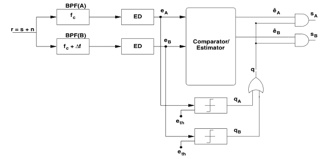

## **FIGURE 8.10:** Representative non-coherent FSK receiver for RBNS scheme

12mA, $I_{low}=7.0\times10^{-4}\,mA$) and the Maxim 1479 ($I_{high}=7.3mA$, $I_{low}=0.2\times10^{-6}\,mA$).

## 8.3.5  Transceiver Design and Analysis for Noisy Channels

We now turn our attention to a realistic situation where a channel is noisy. We assume that the channel has *additive white Gaussian noise* (AWGN) noise. Assume that the transmitter uses FSK modulation with two frequencies, $f_c$ and $f_c+\Delta f$ corresponding to 1 and 1̄, respectively, and is switched off during 0’s. Effectively this will be a hybrid modulation scheme involving FSK and ASK. To demonstrate energy savings, we use a non-coherent detection-based receiver as shown in Figure 8.10.

In the figure, $r$ is the signal received at the input which consists of the transmitted signal $s$ and the channel noise $n$, i.e., $r=s+n$. The received signal $r$ travels through two bandpass filters (BPFs) as shown in Figure 8.10, with center frequencies at $f_c$ and $f_c+\Delta f$ (corresponding to 1 and 1̄, respectively). The outputs $q_A$ and $q_B$ of the threshold detectors are applied to the inputs of an OR gate to generate $q=q_A+q_B$. If the transmitted symbol is 0 and $e_{th}$ is correctly chosen, the outputs of the threshold detectors will be 0, making $q$ equal to 0. On the other hand, if the transmitted symbol

where \(P\{q_A=0|0\}\) and \(P\{q_B=0|0\}\) are the probabilities of correctly receiving 0 at \(q_A\) and \(q_B\) respectively, given that 0 was transmitted. Hence,

$$\alpha=P\{q_A=0|0\}\cdot P\{q_B=0|0\}$$

$$=[P\{q_A=0|0\}]^2 \quad \text{(by symmetry).} \tag{8.11}$$

Also, note that \(q_A\) for 0 transmission follows Rayleigh distribution. Assuming a zero mean and standard deviation of \(\sigma\) for AWGN channel, we can write

$$P\{q_A=0|0\}=\int_{0}^{e_{th}}\frac{e_A}{\sigma^2}e^{-e_A^2/2\sigma^2}\,de_A=\left(1-e^{-e_{th}^2/2\sigma^2}\right).$$

Hence, we have \(\alpha=\left(1-e^{-e_{th}^2/2\sigma^2}\right)^2\). Next, we define \(\beta\) as

$$\beta=P\{q=1|1\}P\{e_A>e_B,\ \forall e_A|1\}=X_1X_2 \quad \text{(say)},$$

where \(X_1=P\{q=1|1\}\) and \(X_2=P\{e_A>e_B|1,\ \forall e_A|1\}\). From Figure 8.10, we can write:

$$X_1=\int_{0}^{\infty}[1-P\{q_A=0|1\}P\{q_B=0|1\}]p_1(e_A)\,de_A,$$

where \(P\{q_B=0|1\}\) is governed by a Rayleigh distribution, while \(P\{q_A=0|1\}\) follows a Rician distribution. Thus,

$$P\{q_A=0|1\}=\int_{0}^{e_{th}}\frac{e_A}{\sigma^2}e^{-(e_A^2+s_A^2)/2\sigma^2}I_0\left(\frac{s_Ae_A}{\sigma^2}\right)\,de_A \quad \text{and}$$

$$P\{q_B=0|1\}=\int_{0}^{e_{th}}\frac{e_B}{\sigma^2}e^{-e_B^2/2\sigma^2}\,de_B=1-e^{-e_{th}^2/2\sigma^2}.$$

Using the above expressions, we obtain $X_1$ and $X_2$ as

$$X_1=\int_0^\infty\left[1-\left(1-e^{-e_{th}^2/2\sigma^2}\right)\left(\int_0^{e_{th}}\frac{e_A}{\sigma^2}e^{-(e_A^2+s_A^2)/2\sigma^2}I_0\left(\frac{s_Ae_A}{\sigma^2}\right)de_A\right)\right]\\\times\frac{e_A}{\sigma^2}e^{-(e_A^2+s_A^2)/2\sigma^2}I_0\left(\frac{s_Ae_A}{\sigma^2}\right)de_A.$$

$$X_2=\int_0^\infty\left(1-e^{-e_A^2/2\sigma^2}\right)\frac{e_A}{\sigma^2}e^{-(e_A^2+s_A^2)/2\sigma^2}\\\times I_0\left(\frac{s_Ae_A}{\sigma^2}\right)u(e_A)\,de_A.$$

Let $P_0$, $P_1$ and $P_{\bar 1}$ be the probabilities of occurrences of 0, 1 and $\bar 1$, respectively, in the transmitted message. The probability that the transmitted RBNS frame with $n+1$ RBNS digits will be received correctly by the above hybrid FSK-ASK scheme can be expressed as *frame-correct rate* (FCR):

$$FCR=\alpha^{nP_0}*\beta^{nP_1}*\delta^{nP_{\bar 1}}.$$  (8.12)

Assuming that all possible binary strings with $n$ bits are equally likely to appear in the message, we found in Section 8.6.3.2 that with the application of both reduction rules 1 and 2, the average number of 0’s in the RBNS frame will be asymptotically (for large $n$) 75% and those of all non-zero symbols, i.e., 1 and $\bar 1$ taken together will be 25%. Thus, $P_0=0.75$ and $P_1+P_{\bar 1}=0.25$. The probability that a message frame in RBNS will be received correctly (using the hybrid FSK-ASK modulation scheme), is:

$$FCR=\alpha^{0.75n}*\beta^{0.25n}.$$  (8.13)


注意，$\log(FCR)=n(0.75\log\alpha+0.25\log\beta)$，由此我们可以很容易地计算出$FCR$。接下来，我们得到RBNS消息的误帧率($FER$)为$FER_{rbns}=1-FCR$。

让我们考虑这样一种情况：我们使用非相干FSK以误比特率$\rho$发送$n$比特的原始二进制消息。整个帧被正确接收的概率为$(1-\rho)^n$。因此，二进制FSK的误帧率可表示为$FER_{bfsk}=1-(1-\rho)^n$，由于$\rho$通常非常小，该值可近似为$n\rho$。对于给定的帧大小$n$，我们可以将$FER_{rbns}$与$FER_{bfsk}(=n\rho)$进行比较，换言之，即将$FER_{rbns}/n$与$\rho$进行比较。为了计算$FER_{rbns}/n$，我们令$s_A=1$，即信号功率$=s_A^2/2=1/2$，信噪比(SNR)$=1/2\sigma^2$。用于在给定SNR下寻找使$FER_{rbns}/n$最小的最优阈值电压$e_{th}$的计算是在$MATLAB^\circledR$中实现的。注意，根据式(8.13)，对于给定的$FER_{rbns}$值，我们可以得到RBNSiZeComm所需的峰值发射功率。

二进制FSK调制的SNR值由关系式$\rho=\frac{1}{2}e^{-\gamma/2}$确定，其中以dB为单位的SNR $=10\log_{10}\gamma$。对于$8\le n\le1024$范围内的不同帧大小，表8.4汇总了采用RBNS消息的混合调制方案的SNR值，以及二进制FSK为达到相同$FER$值所对应的SNR值。我们看到，对于相同的$FER$，使用RBNSiZeComm所需的SNR值平均比二进制非相干FSK高2.76 dB。然而，在RBNSiZeComm方案中，发射机仅在非零符号(1或$\bar{1}$)期间处于发射状态，而在RBNS编码消息中的0期间处于空闲状态。因此，对于给定的$FER$，所需的平均发射功率将小于式(8.13)所要求的值。将RBNS串中非零符号的占比视为25%，所需的平均发射功率将是0.25倍的

$^{1}MATLAB^\circledR$是注册商标

**图 8.11：** 在给定BER下平均发射功率（按比例缩放）的比较

可由式(8.13)求得的值。这意味着RBNSiZeComm所需的平均发射功率将比峰值降低$10\log_{10}(0.25)\ \mathrm{dB}=6.0206\ dB$。图8.11给出了RBNSiZeComm和二进制FSK（采用非相干检测）在$8\leq n\leq1024$范围内平均的缩放发射功率曲线。

从图8.11中我们可以看到，对于$10^{-4}$到$10^{-8}$范围内的给定$\rho=FER/n$，RBNSiZeComm所需的平均功率比二进制FSK低约3.26 dB。设$P_b$和$P_r$分别为二进制FSK和RBNSiZeComm所需的平均发射功率电平。注意到$10^{-3.26/10}=0.472$，我们有$P_r/P_b=0.472$。与二进制FSK相比，这相当于平均节省了52.8%的发射能量。

## 8.3.6 与CtS和VarBaTaC的性能比较

我们现在将RBNSiZeComm方案的性能与同样基于静默通信的CtS [9]和VarBaTac [10]进行比较。

[PAGE 416]

## 无线网络与移动计算

\begin{tabular}{cccccccc}
\multirow{2}{*}{RBNSiZeComm的SNR} & \multicolumn{6}{c}{不同帧大小(n)下二进制FSK对应的SNR} & \multirow{2}{*}{二进制FSK的平均SNR} \\
 & 16 & 64 & 128 & 256 & 512 & 1024 & \\
14.0 & 11.3121 & 11.321 & 11.3328 & 11.356 & 11.4012 & 11.4869 & 11.3545 \\
15.0 & 12.2674 & 12.2688 & 12.2706 & 12.2742 & 12.2813 & 12.2955 & 12.2741 \\
16.0 & 13.2278 & 13.2279 & 13.2281 & 13.2285 & 13.2292 & 13.2306 & 13.2285 \\
17.0 & 14.1921 & 14.1922 & 14.1922 & 14.1922 & 14.1922 & 14.1923 & 14.1922 \\
18.0 & 15.1649 & 15.1649 & 15.1649 & 15.1649 & 15.1649 & 15.1649 & 15.1649 \\
\end{tabular}

我们首先考虑传输时长。CtS的传输时间随要发送的比特数呈指数增长。VarBaTaC使用可变编码基数，并通过适当调整基数值来控制通信时间。不失一般性地，假设我们要传输一个值_M_，其中\(0 \leq M < 2^k\)，_k_ \(\geq\) 0。那么_M_在基数_r_下的表示将包含_m_ = \(\lceil\frac{k}{\log r}\rceil\)位数字。这_m_位数字中的每一位随后使用CtS传输，并用一个脉冲分隔各个数字。设_t_avg_为VarBaTaC方案所需的平均时隙数。为传输这_m_位数字，我们需要传输_m_ + 1个脉冲。此外，对于这些数字，我们平均需要\(\frac{m(r-1)}{2}\)个时隙（假设消息的所有可能取值等概率出现）。因此，_t_avg_由下式给出

\( t_{avg} = (m+1) + \frac{m(r-1)}{2} = \frac{m(r+1)}{2} + 1.\) (8.14)

设_r_ = 2_p_。因此，_m_ = \(\lceil\frac{k}{p}\rceil\)，根据式(8.36)我们有

\(\frac{k}{p}\left(\frac{2^p+1}{2}\right) + 1 \leq t_{avg} < \left(\frac{k}{p}+1\right)\left(\frac{2^p+1}{2}\right) + 1.\)

因此，对于给定的_k_，由于函数\(\frac{2^p+1}{p}\)，_t_avg_随_p_单调增加。

表8.5给出了_r_ = 2_p_不同取值下的_t_avg_。我们看到，RBNSiZeComm方案的传输时间将小于CtS和VarBaTaC的传输时间。与RBNSiZeComm一样，CtS和VarBaTaC都不会在接收端产生能量节省。因此，在CtS和VarBaTaC中，传输过程中产生的能量节省

[PAGE 417]

## **表 8.5：** 基数为2的幂且*k* = 64时VarBaTaC的时隙数

| *p* | 基数 *r* | *t*<sub>avg</sub> = [64/*p*] ((2<sup>*p*+1</sup>)/2) + 1 |
|---:|---:|---:|
| 2 | 4 | 81 |
| 3 | 8 | 100 |
| 4 | 16 | 137 |
| 5 | 32 | 215.5 |
| 6 | 64 | 357.5 |
| 7 | 128 | 646 |
| 8 | 256 | 1029 |

将在很大程度上被过大的接收端能耗所抵消，这是因为它们的通信时长远长于RBNSiZeComm。虽然对于单跳网络这不是问题，但在多跳WSN中，这对CtS和VarBaTaC来说可能成为一个问题。

## 8.3.7 与QPSK的性能比较

我们现在针对RBNSiZeComm方案，分别采用非相干和相干接收机，给出与QPSK的比较。

## 8.3.7.1 采用非相干接收机设计

我们根据以下关系式计算给定ρ = *E*/*R*/*n*下QPSK所需的SNR值：

$$\rho = Q(\sqrt{2\gamma}) \approx \frac{1}{2\sqrt{\pi\gamma}}e^{-\gamma}. \tag{8.15}$$

结果汇总在表8.6中。根据该表中的数据绘制SNR值随不同ρ值变化的曲线，我们可以看到，采用非相干FSK-ASK检测的RBNSiZeComm的峰值发射功率比QPSK调制高约6.537 dB。注意到RBNSiZeComm的平均发射功率将比峰值功率低6.0206 dB，由此可见，上述RBNSiZeComm实现的平均功率需求

[PAGE 418]

<!-- no content -->

[PAGE 419]

对于给定的FER可重新计算，并与QPSK调制所需的相应SNR值进行比较。结果汇总在表8.7中，我们可以看到，采用相干FSK-ASK实现的RBNSiZeComm的峰值发射功率比QPSK调制高约6.077 dB。注意到在RBNSiZeComm中平均发射功率将比峰值功率低6.0206 dB，可见RBNS的平均发射功率将比QPSK高约0.057 dB，这相当于QPSK方案能量的1.01321倍，即约多出1.32%。因此，就能量消耗而言，采用相干FSK-ASK检测时，RBNSiZeComm的性能与相干二进制FSK相当。

\begin{tabular}{cccc}
\multirow{2}{*}{\(\rho = FER/n\)} & \multicolumn{3}{c}{所需SNR(dB)} \\
 & \multicolumn{2}{c}{相干RBNSiZeComm} & \multirow{2}{*}{QPSK} \\
 & _xth_（伏特） & SNR &  \\
2.29217 \(\times\) 10-4 & 0.54 & 14.0 & 7.9256 \\
4.17229 \(\times\) 10-5 & 0.53 & 15.0 & 8.9167 \\
4.91399 \(\times\) 10-6 & 0.52 & 16.0 & 9.91931 \\
3.37337 \(\times\) 10-7 & 0.52 & 17.0 & 10.9267 \\
1.22031 \(\times\) 10-8 & 0.51 & 18.0 & 11.9265 \\
\end{tabular}


我们评估了 RBNSiZeComm 在无线传感器网络（WSNs）中两种典型应用所产生的节能效果：远程医疗和农业传感器网络。对于医疗应用，我们考虑了心电图（ECG）信号、血样 JPEG 图像以及表示血压、血糖水平和体温等各种生理参数的 ASCII 文本数据的传输 [23]。为了评估 ECG 信号的节能效果，我们使用了取自 [27] 中 QT 数据库的 50 个真实样本。血液、组织和骨骼样本的 JPEG 图像取自 [28]。对于农业传感器网络，我们假设传感器设备产生的数据以 ASCII 文本消息的形式传输 [25, 26, 24]。

在表 8.8 中，无噪声信道的节能效果是使用公式 (8.9) 针对 CC1100 芯片在 10 dBm 发射功率下获得的。这些节能值几乎等于相应数据类型经 RBNS 编码后版本中 0 的百分比。AWGN 噪声信道下的表项是使用公式 (8.12) 获得的，其中 P0 等于表 8.8 第二列中的值。图 8.13 和图 8.14 展示了三个应用领域中不同数据类型上的节能效果。图 8.13 描绘了在给定 ρ = FER/n 值下，平均发射功率（相对于噪声功率缩放）的 dB 值，并在 8 ≤ n ≤ 1024 范围内取平均；图 8.14 则展示了 RBNSiZeComm 在发射端相对于二进制 FSK 所产生的相对平均节能效果，使用的是公式 (8.12) 和图 8.10 所示的接收机。

| 信号类型 | RBNSiZeComm 节能：无噪声信道 | RBNSiZeComm 节能：噪声信道 |
| --- | --- | --- |
| 心电图信号 | 79.70% | 62% |
| JPEG 血液/组织样本图像 | 65.11% | 33.4% |
| ASCII 文本数据 | 69.44% | 41.8% |

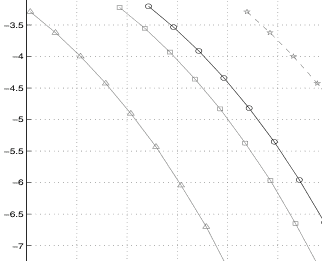

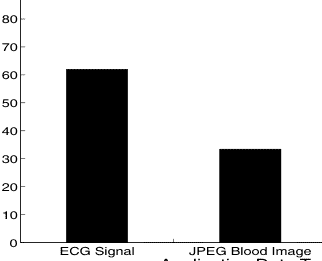

## 8.4 带静默符号的三进制（TSS）通信协议

我们现在描述另一种节能通信协议，称为_带静默符号的三进制（TSS）_ [3, 4]，它基于使用三进制数系统的源编码方案，并结合静默通信。在编码消息的三个符号 0、1 和 2 中，一个符号（例如 0）被设为静默，而另外两个（例如 1 和 2）使用混合调制方案进行传输。在无噪声信道中，由于在 0 的期间不传输载波，发射机将节省 33% 的能量。然而，在具有加性高斯白噪声（AWGN）且接收机基于非相干检测的信道中，发射机的节能效果预计会低于该值，因为在存在噪声的情况下，需要提高峰值信号功率以区分静默符号与信道的无信号状态。

### 8.4.1 基本思想和算法描述

设给定的二进制消息 B 由 n 位二进制字符串 b_{n-1} b_{n-2} ... b_2 b_1 b_0 表示。设 T 为其等价的 m 位三进制表示，由 T = t_{m-1} t_{m-2} ... t_2 t_1 t_0 给出。我们假设 n 为偶数，否则我们在最左侧（即最高有效位（msb）位置）用 0 位填充消息。为了从二进制转换为三进制，我们从二进制消息的 msb 位置开始依次扫描每两位，然后将二进制消息最左边的部分（从 msb 到当前扫描的位位置）转换为其等价的三进制表示。为此，我们将当前扫描的两位（位对）替换为单个三进制数字（根据二进制位对是 00、01 还是 10，分别为 0、1 或 2），或者替换为两个三进制数字 (10)3（如果二进制位对是 11），并将其加到从所有先前位位置（在该位对的左侧）获得的三进制数 T 的四倍上。注意，此加法将在三进制数系统中进行，乘数因子 4 是为了调整 T 相对于当前扫描位对的权重。另外，由于此加法将在三进制数系统中进行，可以通过将两个三进制数 T0 和 0T 相加来为 T 赋予权重 4。因此，从 msb 到当前扫描位对的二进制消息部分的等价三进制表示将得到为 T0 ⊕ 0T ⊕ x，其中 ⊕ 表示三进制加法运算符，x 是三进制数，等于 0、1 或 2（分别对应扫描位对为 00、01 或 10），或等于 (10)3（当扫描位对为 11 时）。

**示例 33.** 考虑二进制数 10011100。首先，我们从最左边的两位 10 得到 T = 2。然后，对于接下来的两位，等价的三进制数字是 1。我们将（在三进制中）三个数 (20)3、(02)3 和 (1)3 相加，得到 T 的改变值为 (100)3（这等于十进制的 9，对应到目前为止扫描的二进制数字 1001）。对于接下来的两位，我们得到等价的三进制表示为 (10)3，将其与 (1000)3（= T0）和 (0100)3（= 0T）在三进制中相加，得到 T 的改变值为 (1110)3 = (39)10。最后，对于位对 00，我们将 (11100)3 与 (01110)3 相加，得到等价的三进制数为 (12210)3 = (156)10。

_二进制转三进制_ 算法概述了将数字从二进制转换为三进制所需的步骤。

- 1: **过程** BINARY2TERNARY(输入 位向量 B, 整数 n, 输出 三进制数 T)
- 2: /* 初始化 */
- 3: **如果** b_{n-1} b_{n-2} = 00 **那么**
- 4: T <- 0;
- 5: **结束如果**
- 6: **如果** b_{n-1} b_{n-2} = 01 **那么**
- 7: T <- 1;

以类似的方式，我们可以通过使用 _三进制转二进制_ 算法将接收到的 m 位三进制消息重新转换为其等价的二进制形式，并且我们再次从给定三进制数的最高有效（最左边）位置开始逐位扫描，并将扫描到的三进制数字转换为其等价的二进制表示。在该算法中，我们用 t_i 表示三进制数字，用 B 表示转换后的二进制数。与 _二进制转三进制_ 算法一样，我们需要通过相对于当前扫描的三进制数字附加权重 3 来调整先前扫描的三进制数字的二进制表示的权重，这可以通过将 B0、0B 和当前扫描的三进制数字的等价二进制表示相加来实现（注意这次是二进制加法）。

**示例 34.** 设给定的三进制数 T = 2102。最左边的数字是 2，其二进制表示为 10。我们最初形成二进制数 B = 10。下一个三进制数字是 1。我们将三个二进制数 100（= B0）、010（= 0B）和 1 相加，得到 B 的改变值为 111。下一个扫描到的三进制数字是 0，我们将 1110 与 0111 相加，得到 B 的改变值为 10101。最后，对于最右边的三进制数字 2，我们将 101010、010101 和 10 相加，得到 1000001 作为给定三进制数 T 的等价二进制表示 B。

- 1: **过程** TERNARY2BINARY(输入 三进制数 T, 整数 m, 输出 二进制数 B)
- 2: /* 初始化 */
- 3: **如果** t_{m-1} = 0 **那么**
- 4: B <- 00;
- 5: **结束如果**
- 6: **如果** t_{m-1} = 1 **那么**
- 7: B <- 01;
- 8: **结束如果**
- 9: **如果** t_{m-1} = 2 **那么**
- 10: B <- 10;
- 11: **结束如果**
- 12: **对于** i = m-2 **到** 0 **步长** -1 **执行**
- 13: **如果** t_i = 0 **那么**
- 14: B <- B0 + 0B; // 这是二进制加法
- 15: **结束如果**
- 16: **如果** t_i = 1 **那么**
- 17: B <- B0 + 0B + 1; // 二进制加法
- 18: **结束如果**
- 19: **如果** t_i = 2 **那么**
- 20: B <- B0 + 0B + 10; // 二进制加法
- 21: **结束如果**
- 22: **结束循环**
- 23: **结束过程**

将数据从二进制转换为三进制具有减少待传输符号总数并缩短总传输持续时间的优势。由于发射机和接收机的能量消耗都与它们开启的持续时间成正比，而与传输的符号无关，因此重新编码为更高基数将在发射机和接收机两端都带来能量节省。在发射机处还可以通过采用前面章节中针对三个可能三进制数字之一所解释的静默符号策略来获得额外的能量节省。带静默符号的三进制（TSS）结合了这两种策略，从而得到一种在发射机和接收机两端都节省能量的节能通信方案。假设三个符号等概率出现，我们假设 0 为静默符号。然而，在实际中，三个符号的相对频率将取决于待传输数据的性质。更好的策略是基于符号的相对频率将出现频率最高的符号指定为静默符号，这些频率可以通过统计确定，也可以针对每条要传输的消息进行分配。


因此，TSS 的传输协议由两步组成：

## TransmitTSS 协议

- **步骤 1：** 使用 *Binary2Ternary* 协议将二进制数据重新编码为三进制。
- **步骤 2：** 按照步骤 1 中重新编码得到的符号，逐符号传输三进制数据，规则如下：
  - **步骤 2.1：** 如果要传输的符号为 0，则在符号周期内关闭发射机。
  - **步骤 2.2：** 否则，打开发射机并在时隙内传输该符号（1 或 2）。

接收端协议与发射端相反：

## ReceiveTSS 协议

- **步骤 1：** 按如下方式逐符号接收三进制编码数据：
  - **步骤 1.1：** 如果在给定时间槽（符号周期）内接收到信号，则接收到的符号为 1 或 2，具体取决于预先设定的接收信号到符号的映射。
  - **步骤 1.2：** 否则，如果信道安静，则接收到的符号为 0。
- **步骤 2：** 使用 *Ternary2Binary* 协议将接收到的三进制消息转换为二进制。

## 8.4.2 性能分析

TSS 传输方案将待发送的二进制消息重新编码为等效的三进制形式并发送。接收端随后将接收到的三进制数据重新转换回二进制，并将其传递给通信栈的上层做进一步处理。

发射机使用 FSK 调制，采用两个频率，例如 $f_c$ 和 $f_c + \Delta f$ 分别对应符号 1 和 2；在传输 0 期间切换到*空闲*状态，此时与*发射*或*接收*状态相比，功耗非常低。实际上，这是一种包含 FSK 和 ASK 的混合调制方案。

图 8.10 中用于 RBNSiZeComm 的接收机框图也可用于基于非相干检测的 TSS 方案，其中频率 $f_c$ 和 $f_c + \Delta f$ 将分别对应符号 1 和 2。此外，$q_A$ 和 $q_B$ 现在是分别对应符号 1 和 2 的阈值检测器的二进制输出。因此，在这种情况下，接收机的期望输出 $\hat{s}$ 可表示如下：

- i) 如果 $q = 0$，则 $\hat{s} = 0$，对应 $s_A = s_B = 0$。
- ii) 如果 $q = 1$，

$$\hat{s} = \begin{cases} 1 & \text{如果 } e_A > e_B,\ (\text{当 } s_A = 1, s_B = 0) \\ 2 & \text{如果 } e_B > e_A,\ (\text{当 } s_B = 1, s_A = 0). \end{cases}$$

我们考虑一个包含 $n$ 个二进制比特的消息帧。对应每个这样的帧，我们考虑将二进制转换为三进制形式后的消息帧，其中包含符号 0、1 和 2，长度为 $m$ 位，$n$ 和 $m$ 的关系为 $m = \lceil n \log 2 / \log 3 \rceil = \lceil 0.6309n \rceil$。

为了对 TSS 方案进行节能分析，传统的误比特率（BER）同样不适用。取而代之的是，与 RBNSiZeComm 方案一样，将使用误帧率（FER）。BER 的局限性在于，由于它将每个比特的传输视为相互独立，因此无法恰当捕捉因错误接收三进制符号而向更高有效位传播的误差。可以注意到，由于三进制（以及其他不是 2 的幂的基数编码）的特性，接收到的某个数位（在较高基数中）发生错误后，会在原始二进制数中向多少个更高有效位传播，这是很难预测的。这是因为从二进制到这种基数的转换涉及从低位数字到高位数字的*进位传播*。当使用 2 的幂作为基数时，比如 $k > 1$ 时的 $2^k$，不会出现这种进位传播，因为新基数 $2^k$ 下的等效数字可以通过从最低有效位位置开始简单地对连续的 $k$ 个比特分组得到，与其他比特无关。

以使用三进制编码传输二进制数 $(0111111)_2 = (63)_{10}$ 为例。$(63)_{10}$ 的三进制表示为 $(2100)_3$。如果该三进制数的最低位数字（即 0）在接收端被错误地判为 1，则解码后接收到的二进制数将为 $(1000000)_2$，表示错误从最低有效位传播到了最高有效位。基于 BER 的错误分析无法捕捉接收端在解释单个数字（在非 2 的幂基数中）时的错误对原始二进制数产生的这种*涟漪效应*。

基于 FER 的错误分析克服了基于 BER 的错误分析的局限性，能够捕捉接收到的三进制数据中单个数字错误导致错误传播到解码后二进制数更高有效位位置的这种传递性。尽管我们仅展示了基于 FER 的 TSS 方案错误分析，但基于 FER 的错误分析这一概念通常适用于任何使用将二进制数据重新编码为另一个非 2 的幂基数的传输方案，原因如上所述。下面我们分别使用非相干和相干接收机设计来描述 TSS 方案的错误分析。

## 8.4.3 非相干检测

在本节中，我们将使用非相干 BFSK 传输二进制数据帧的 FER，与使用基于非相干检测的接收机（如图 8.10 所示）在 TSS 方案中传输等效三进制数据的 FER 进行比较。

在混合 FSK-ASK 调制方案中，令 $\alpha$ 为发送的三进制符号是 0 且被正确接收为 0 的概率。类似地，令 $\beta$（或 $\delta$）为发送符号是 1（或 2）且接收符号也是 1（或 2）的概率。由对称性，$\beta = \delta$。注意 $\alpha = P\{q_A = 0|0\}\cdot P\{q_B = 0|0\}$，其中 $P\{q_A = 0|0\}$ 和 $P\{q_B = 0|0\}$ 分别是在给定发送 0 的条件下 $q_A$ 和 $q_B$ 正确接收 0 的概率。因此，

$$\alpha = P\{q_A=0|0\}\cdot P\{q_B=0|0\} = [P\{q_A=0|0\}]^2 \quad \text{(由对称性).} \tag{8.19}$$

此外，注意发送 0 时 $q_A$ 服从瑞利分布。假设 AWGN 信道均值为零、标准差为 $\sigma$，我们可以写出

$$P\{q_A=0|0\}=\int_0^{e_{th}} \frac{e_A}{\sigma^2}e^{-e_A^2/2\sigma^2}\,de_A = (1-e^{-e_{th}^2/2\sigma^2}).$$

因此，我们有 $\alpha = (1 - e^{-e_{th}^2/2\sigma^2})^2$。接下来，我们将 $\beta$ 定义为

$$\beta = P\{q=1|1\}P\{e_A>e_B,\forall e_A|1\}=X_1X_2 \quad \text{(记为),}$$

其中 $X_1 = P\{q = 1|1\}$，$X_2 = P\{e_A > e_B|1, \forall e_A|1\}$。根据图 8.10，我们写出：

$$X_1=\int_0^\infty [1-P\{q_A=0|1\}P\{q_B=0|1\}]p_1(e_A)\,de_A,$$

其中 $P\{q_B=0|1\}$ 由瑞利分布决定，而 $P\{q_A=0|1\}$ 表示莱斯分布。因此，

$$P\{q_A=0|1\}=\int_0^{e_{th}}\frac{e_A}{\sigma^2}e^{-\frac{e_A^2+s_A^2}{2\sigma^2}}I_0\left(\frac{s_Ae_A}{\sigma^2}\right)de_A\quad\text{且，}$$
$$P\{q_B=0|1\}=\int_0^{e_{th}}\frac{e_B}{\sigma^2}e^{-e_B^2/2\sigma^2}\,de_B=1-e^{-e_{th}^2/2\sigma^2}.$$

利用上述表达式，我们得到 $X_1$ 和 $X_2$ 如下：

$$X_1=\int_0^\infty\left[1-\left(1-e^{-e_{th}^2/2\sigma^2}\right)\left(\int_0^{e_{th}}\frac{e_A}{\sigma^2}e^{-\frac{e_A^2+s_A^2}{2\sigma^2}}I_0\left(\frac{s_Ae_A}{\sigma^2}\right)de_A\right)\right]\frac{e_A}{\sigma^2}e^{-\frac{e_A^2+s_A^2}{2\sigma^2}}I_0\left(\frac{s_Ae_A}{\sigma^2}\right)de_A.\tag{8.20}$$

$$X_2=\int_0^\infty\left[\left(1-e^{-e_A^2/2\sigma^2}\right)\frac{e_A}{\sigma^2}e^{-\frac{e_A^2+s_A^2}{2\sigma^2}}I_0\left(\frac{s_Ae_A}{\sigma^2}\right)u(e_A)\right]de_A.\tag{8.21}$$

设 $P_0$、$P_1$ 和 $P_2$ 分别表示发送消息中符号 0、1 和 2 出现的概率。上述混合 FSK-ASK 方案正确接收包含 $m$ 个三进制数字的发送三进制帧的概率可表示为*帧正确率*（FCR），由下式给出：

$$FCR=\alpha^{mP_0}\times\beta^{mP_1}\times\delta^{mP_2}.\tag{8.22}$$

假设所有可能的 $n$ 比特二进制字符串在二进制消息中出现的可能性相同，则三进制帧中 0 的平均数量将渐近地（对于较大的 $n$）为 33%，而所有非零符号（即 1 和 2 合计）的平均数量将为 67%。因此，$P_0=0.33$，$P_1+P_2=0.67$。该概率


# 8.4.3.1 Energy Savings Analysis

让我们假设三值编码信号在 TSS 中的符号时长与 BFSK 相同。因此，三值信号的传输时长为

Table 8.9 乘以 \(10 \log_{10}(1 - 1/3) \text{ dB} = 1.76 \text{ dB}\)。因此，TSS 通信的平均发射功率 \(P_1\) 将比非协调 BFSK 的平均功率 \(P_b\) 高出 \((2.64 - 1.76) \text{ dB} = 0.88 \text{ dB}\)，从而使得 \(P_1/P_b = 1.2246\)。

下图展示了 TSS 与 BFSK（采用非协调检测）的缩放平均发射功率的图表，图中为 Figure 8.15。

# 8.4.3.1 Energy Savings Analysis

让我们假设三值编码信号在 TSS 中的符号时长与 BFSK 相同。因此，三值信号的传输时长为

[PAGE 434]

<!-- no content -->

[PAGE 435]

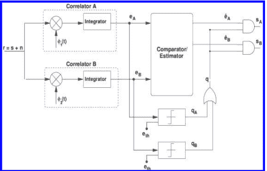

**FIGURE 8.16:** 代表性协调 FSK 接收器用于 TSS 方案

此外，[5] 中关于 \(X_1\) 和 \(X_2\) 的表达式将分别修改为 \(X'_1\) 和 \(X'_2\)，其中

$$X'_1=\frac{1}{\sqrt{2\pi}\sigma}\int_{-\infty}^{\infty}\left[1-\frac{1}{\sqrt{2\pi}\sigma}\int_{-\infty}^{e_{th}}e^{-\frac{(e_A-1)^2}{2\sigma^2}}\,de_A\frac{1}{\sqrt{2\pi}\sigma}\int_{-\infty}^{e_{th}}e^{-\frac{e_B^2}{2\sigma^2}}\,de_B\right]e^{-\frac{(e_A-1)^2}{2\sigma^2}}\,de_A.$$ (8.26)

$$X'_2=\frac{1}{\sqrt{2\pi}\sigma}\int_{-\infty}^{\infty}\left[\frac{1}{\sqrt{2\pi}\sigma}\int_{-\infty}^{e_A}e^{-\frac{e_x^2}{2\sigma^2}}\,de_x\right]e^{-\frac{(e_A-1)^2}{2\sigma^2}}\,de_A.$$ (8.27)

因此，\(\beta\) 的值将改为 \(\beta_c = X'_1 X'_2\)，我们得到

$$FCR_c = \alpha_c^{0.33m} \times \beta_c^{0.67m}.$$ (8.28)

协调检测的帧误码率（FER）表示为 \(FER_c = 1 - FCR_c\)。TSS 在协调检测下，当 \(8 \leq n \leq 1024\) 时的平均 SNR 值与 \(n = 128\) 时的值基本相同。使用协调检测的 BFSK 接收机，可通过

[PAGE 436]

<!-- no content -->

[PAGE 437]

# # Energy-Efficient Communication

\begin{tabular}{ccccccc}
\multirow{2}{*}{**FER/n value**} & \multicolumn{2}{c}{**Required peak SNR in db**} & \multicolumn{4}{c}{**Relative energy units required for**} \\
 & **TSS (Coherent)** & **BFSK (Coherent)** & **TSS (Coherent)** & **TSS (Non-Coherent)** & **BFSK (Coherent)** & **BFSK (Non-Coherent)** \\
1.64525 × 10⁻⁴ & 14.0 & 11.105 & 10.24 & 10.834 & 11.105 & 12.0517 \\
7.29469 × 10⁻⁵ & 14.5 & 11.591 & 10.74 & 11.2855 & 11.591 & 12.4712 \\
2.93585 × 10⁻⁵ & 15.0 & 12.08 & 11.24 & 11.744 & 12.08 & 12.8973 \\
1.06484 × 10⁻⁵ & 15.5 & 12.5695 & 11.74 & 12.211 & 12.5695 & 13.3272 \\
3.42302 × 10⁻⁶ & 16.0 & 13.0612 & 12.24 & 12.668 & 13.0612 & 13.763 \\
9.64132 × 10⁻⁷ & 16.5 & 13.5536 & 12.74 & 13.1318 & 13.5536 & 14.2025 \\
2.33905 × 10⁻⁷ & 17.0 & 14.047 & 13.24 & 13.605 & 14.047 & 14.6468 \\
4.80461 × 10⁻⁸ & 17.5 & 14.541 & 13.74 & 14.086 & 14.541 & 15.0939 \\
8.24905 × 10⁻⁹ & 18.0 & 15.0336 & 14.24 & 14.5456 & 15.0336 & 15.5437 \\
\end{tabular}

相对于非协调 BFSK 和协调 BFSK 方案，能耗节约约 37%，位于接收端前端放大器部分。□

此外，除了 RBNSiZeComm [39] 之外，另一个名为 RZE [5] 的协议由 Sinha 和 Sinha 提出。比较非协调 TSS、协调 TSS、RBNSizeComm 和 RZE 协议在接收端前端放大器部分的能耗节约（相对于非协调 BFSK），可以看出，虽然 TSS 的发射端节约量小于 RBNSiZeComm 和 RZE，但其在接收端前端放大器的节约量超过了这两种方案。因此，综合考虑发射端和接收端的能耗节约，TSS 更适合在多跳无线网络中进行数据通信，优于 RBNS 或 RZE。

[PAGE 438]

<!-- no content -->

[PAGE 439]

<!-- no content -->

[PAGE 440]

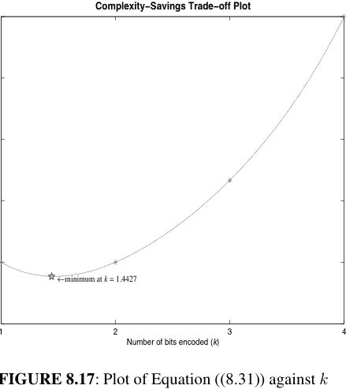

发射节点和接收节点。将位组概念类似于 PSK 和 QAM [29] 等调制方案中的处理方式。然而，我们的重点在于确定最佳 *k* 值，以在硬件复杂度和传输能耗之间取得平衡。通过使用不同于方程 (8.31) 的优化函数，可得到不同的最佳 *k* 值。

随着可允许符号数量的增加，编码和解码逻辑的能耗会增加，但通常通信能耗远大于编码和解码能耗 [22, 41]。然而，我们仅使用四个符号对应 *k* = 2，因此编码和解码逻辑对能耗的影响微乎其微。此外，在对应的混合 FSK-ASK 调制方案中，实现该思想只需使用三个频率进行通信（对应 *k* = 2）。更高的 *k* 值意味着更多的传输频率，从而导致收发器成本、复杂度和能耗增加。

[PAGE 441]

<!-- no content -->

[PAGE 442]

## 8.5.2.1   Representation of Encoded Numbers

从第 8.5.1 节可知，最优编码方案对应 \(k = 2\)。因此，从二进制数据帧的最低有效位（lsb）位置开始，每对比特（00、01、10 或 11）可被视为一个 CNS 符号。我们称这四种 CNS 符号为 *A*、*B*、 *C* 和 *N*，其中 *N* 代表 *null*，指示通过静默时间段或信道上的 null 信号进行通信。例如，在特定情境下，位对 00、01、10 和 11 可分别映射为符号 *N*、*A*、 *B* 和 *C*。从二进制数据帧的 lsb 开始，系统会依次读取每个比特对，判断对应的传输 CNS 符号是 *A*、*B*、 *C* 还是 *N*，并在接收端进行逆映射以重构原始二进制字符串。

## 8.5.2.2   Mapping to Codewords

对于长度为 \(n\) 的二进制字符串，考虑其 \(2^n\) 种可能性，四种比特对（00、01、10、11）的理论平均出现百分比为 25%。但在实际操作中，这四种比特模式的分布取决于所传输数据的特性，如图 8.18 所示，该图展示了不同文件类型（共 691 份文件）中四种代码词的频率统计。表 8.11 列出了用于得出这些统计数据的文件类型数量。

表 8.11: 用于分析代码词统计的文件

\begin{tabular}{cc}
文件类型 & 文件数量 \\
1. 纯文本文件 (TEXT) & 122 \\
2. 图像文件 (JPEG) & 71 \\
3. HTML 源文件 (HTML) & 71 \\
4. 二进制文件 (BIN) & 82 \\
5. 位图图像 (BMP) & 345 \\
\end{tabular}

注意，对于这两种方法，MAC 层协议必须支持向接收端传输关于 BpS 映射的信息。对于 Scheme 1，映射只需在数据帧传输会话开始时传输一次；而 Scheme 2 需在每帧传输时传输映射。

基于上述讨论，能耗高效通信方案的发射端和接收端操作流程如下：CNSTransmit 和 CNSReceive。

在 CNSTransmit 过程，data_frame 表示长度为 frame_len 的二进制字符串，需要传输。发射端首先确定符号的 BpS 映射，采用上述 Scheme 1 或 Scheme 2。对于 Scheme 2，映射需在每帧传输时发送；而 Scheme 1 只需在整个会话开始时传输一次。使用该映射后，发射端从 lsb 开始，依次解释每个比特对，并发射对应的符号 sym。

另一方面，接收端首先从发射端获取 BpS 映射，Scheme 1 在会话开始时传输一次，Scheme 2 在每帧传输时传输。随后，接收端利用该映射对每个接收到的符号进行判断，确定其对应的比特对是否为 00、01、10 或 11。


## 8.5.2.3 同步问题

为了使上述方案能够工作，接收机和发射机在传输期间必须保持同步。该同步可以通过 Section 8.3.4.2 中描述的技术之一实现。

```
1:  procedure CNSTRANSMIT(IN bit vector *data_frame*, IN integer *frame_len*)
2:      **var** *trans_len* : **Integer**;                    ▷ *trans_len* is half of binary frame length
3:      *trans_len* = \frac{*frame_len*}{2};
4:      **Transmit** *trans_len*;                              ▷ length of CNS data
5:      Determine the *BpSMapping* using either *Scheme 1* or *Scheme 2*; ▷ bit pair to symbol mapping
6:      **Transmit** *BpSMapping*;                             ▷ obtained using either Scheme 1 or 2
7:      **for** *i* = 0 to *frame_len* step 2 **do**
8:          Determine symbol *sym* to be transmitted based on
9:          *BpS Mapping* of bits *data_frame[i]* and *data_frame[i + 1]*;
10:         **Transmit** symbol *sym*;                          ▷ either A, B, C or N
11:     **end for**
12: **end procedure**
```

```
1:  procedure CNSRECEIVE(OUT bit vector *recv_data*)
2:      /* *time_slot[i]* refers to the *i*th time slot */
3:      **var** *j* : **Integer**;                             ▷ counter for output buffer *recv_data*
4:      *j* ← 0;
5:      **Receive** *trans_len* from transmitter;              ▷ length of the transmitted CNS data
6:      **Receive** *BpSMapping*;                              ▷ transmitter first sends the BpS Mapping
7:      **for** *i* = 0 to *trans_len* **do**
```

```
8: `recv_sym ← time_slot[i];` ▷ received symbol in time slot *i*, either A, B, C or N

9: Use received *BpSMapping* to determine output bit pair, `recv_data[j]` and `recv_data[j + 1]` corresponding to symbol `recv_sym`; ▷ either 00, 01, 10 or 11

11: `j ← j + 2;`

12: **end for**

13: **end procedure**
```

## 8.5.2.4 碰撞避免问题

在基于 contention（竞争）的介质访问协议中，使用 *N* 符号进行传输时，一个问题在于邻居节点如何判断信道是空闲还是正在传输包含连续 *N* 个静默符号的传输。错误判断为“无信号”（载波和/或基带均不存在）会导致正在进行的传输被破坏（从而引发重传，增加通信节点的能量消耗），或者因错误等待而增加不必要的通信延迟，尽管信道实际上是空闲的。

为避免上述问题，我们可以采用 Section 8.3.4.3 中描述的三种方案中的一种。按照第三种方案，当节点检测到信道连续八个符号周期保持静默时，它会尝试进行传输。在 CNS 中，八个连续 *N* 符号对应原始消息中的十六个连续零比特。因此，八个连续 *N* 符号的出现意味着消息中有一段长度为 16 的零运行。根据这八个连续 *N* 符号前后的符号，原始消息中的零运行长度可能为 16、17 或 18。利用 [39] 的结果（该文献在 CNS 协议相对于不使用静默符号策略的传统 n‑bit 二进制数据帧的能耗方面的节能方面）：

让 $V_{cc}$ 为供电电压，$I_{high}$ 和 $I_{low}$ 分别表示在发送（TX）和空闲（idle）状态下的电流。设 $I_0 = I_{high} - I_{low}$。我们假设设备从空闲态切换到 TX 态所需时间为 $t_{rise}$，在此期间电流为 $I_{tran}$。令 $t_p$ 表示一个符号（A、B、C 或 N）的持续时间，且该时间远大于开关时间 $t_{rise}$。通常，对于 CC1100 芯片，$I_{tran}$ 约为 8.7 mA。当设备从 TX 态切换回空闲态时，所需时间为 $t_{fall}$，该时间很短，几乎可以忽略不计（例如 CC1100 或 CC2420 芯片在 TX 到空闲切换时消耗的额外能量极小），因此我们在此忽略 $t_{fall}$ 期间的能耗。

传输使用 CNS 协议的等效四进制数据帧的能量消耗可以表示为以下三项之和：

1. 基础能量值 $E_{base}$，它在传输期间始终需要，等于设备在空闲状态下的能量。假设原始二进制数据长度为 $n$ 位，则传输所有可能的 $4^{n/2}(=2^n)$ 字符串（每个长度为 $n/2$ 的 CNS 符号）所需的能量为  
   $$E_{base}=\frac{n}{2}2^n t_p I_{low}V_{cc}$$

2. 额外能量 $E_{tx}$，在 TX 状态下传输 A、B 或 C 符号时额外消耗的能量。对于 n 位二进制数据帧，考虑所有可能的字符组合，A、B 或 C 符号的数量为 $\frac{3n}{8}$，因此  
   $$E_{tx}=\frac{3n}{8}2^nt_pI_0V_{cc}$$

3. 额外能量 $E_{rise}$，在从 N 符号过渡到 A、B 或 C 符号时额外消耗的能量。N 符号在 $\frac{n}{2}$ 符号的数据流中出现的概率为 $\frac{1}{4}$，于是  
   $$E_{rise}=\frac{n}{8}2^nt_{rise}(I_{tran}-I_{low})V_{cc}$$

于是，传输一个长度为 $n/2$ 的 CNS 数据帧所需的总能量为  
$$\begin{aligned} E_{cns} &= E_{base}+E_{tx}+E_{rise} \\ &= V_{cc}2^n\left[\frac{n}{2}t_pI_{low}+\frac{3n}{8}I_0t_p+\frac{n}{8}t_{rise}(I_{tran}-I_{low})\right]. \tag{8.34} \end{aligned} $$

相比之下，使用 EbT 方案传输 n 位二进制数据帧的总能耗为 $E'=n2^nt_p(I_{low}+I_0)V_{cc}$。

在设备特性和无噪声信道的前提下，CNS 协议相对于传统 EbT 传输方案所产生的能量节约的比例为  
$$\gamma' = \frac{E'-E_{cns}}{E'} = \frac{\frac{I_{low}}{2}+\frac{5}{8}I_0-\frac{1}{8}(I_{tran}-I_{low})\frac{t_{rise}}{t_p}}{I_{low}+I_0}. \tag{8.35} $$

# **TABLE 8.12:** \(\gamma'\) values for CC1100

| Transmit Power (dBm) | \(I_{high}\) (mA) | \(I_{low}\) (mA) | \(I_{tran}\) (mA) | \(t_{rise}\) (μs) | \(t_p\) (μs) | \(\gamma'\) |
|---:|---:|---:|---:|---:|---:|---:|
| 10 | 30.3 | 1.9 | 8.7 | 88.4 | 400 | 61.1% |
| 5 | 19.7 | 1.9 | 8.7 | 88.4 | 400 | 60.34% |
| 0 | 16.6 | 1.9 | 8.7 | 88.4 | 400 | 59.94% |
| −5 | 14.0 | 1.9 | 8.7 | 88.4 | 400 | 59.46% |

# **TABLE 8.13:** \(\gamma'\) values for CC2420

| Transmit Power (dBm) | \(I_{high}\) (mA) | \(I_{low}\) (mA) | \(I_{tran}\) (mA) | \(t_{rise}\) (μs) | \(t_p\) (μs) | \(\gamma'\) |
|---:|---:|---:|---:|---:|---:|---:|
| 0 | 17.4 | 0.426 | 0.426 | 0.1 | 400 | 62.19% |
| −5 | 14.0 | 0.426 | 0.426 | 0.1 | 400 | 62.12% |
| −10 | 11.0 | 0.426 | 0.426 | 0.1 | 400 | 62.02% |
| −15 | 9.9 | 0.426 | 0.426 | 0.1 | 400 | 61.96% |
| −25 | 8.5 | 0.426 | 0.426 | 0.1 | 400 | 61.87% |

为了估计设备特性对能耗节约的影响，我们考虑下面两个商用芯片的示例：

**示例 35.** *对于支持 O‑QPSK 调制的 CC1100 芯片，我们有* \(I_{low}=1.9\,mA\) *和* \(I_{tran}=8.7\,mA\)。* 在 868/915 MHz 频段，\(I_{high}\) 在 10 dBm、5 dBm、0 dBm 和 −5 dBm 输出功率下分别为 30.3 mA、19.7 mA、16.6 mA 和 14.0 mA。此外，\(t_{rise}=88.4\,\mu s\)，假设数据速率为 2.5 Kbps，则 \(t_p=400\,\mu s\)。因此，\(t_{rise}/t_p\) 可取为 0.221。由公式 (8.35) 可得，\(\gamma'\) 在 10 dBm、5 dBm、0 dBm 和 −5 dBm 输出功率下分别为 61.1%、60.34%、59.94% 和 59.46%。因此，\(\gamma'\) 只略低于观察 5 中给出的理论值 62.5%。结果如表 8.12 所示。

**示例 36.** *对于 CC2420 芯片，\(I_{low}=0.426\,mA\)，且 \(I_{tran}\approx I_{low}\)。* 在 0 dBm、−5 dBm、−10 dBm、−15 dBm 和 −25 dBm 输出功率下，\(I_{high}\) 分别为 17.4 mA、14 mA、11 mA、9.9 mA 和 8.5 mA。\(t_{rise}=0.1\,\mu s\)。与 CC1100 类似，我们假设 \(t_p=400\,\mu s\)。由公式 (8.35) 可得，\(\gamma'\) 在 0 dBm、−5 dBm、−10 dBm、−15 dBm 和 −25 dBm 输出功率下分别为 62.19%、62.12%、62.02%、61.96% 和 61.87%。结果如表 8.13 所示。


在这一节中，我们比较 CNS 与下文讨论的现有技术的性能。

我们首先以传输长度为度量，比较 CNS 与 CtS [9] 和 VarBaTaC [10] 的性能。我们假设信道条件理想。由于 CtS 和 VarBaTaC 都使用完全静默来传递信息，因此在存在噪声时它们的性能退化幅度要远大于 CNS。

CtS 方案的最大缺点是传输时间随要发送的比特数呈指数增长。VarBaTaC 采用可变编码基数，并通过合适调节基数来控制通信时间。假设我们想要传输一个值 \(M\)，其中 \(0 \leq M < 2^k\)，\(k \geq 0\)。将 \(M\) 在底数 \(r\) 中的表示会有 \(m = \left\lceil \frac{k}{\log_2 r} \right\rceil\) 位。每个这些 \(m\) 位都使用 CtS 通过脉冲分隔来传输。对于 \(m\) 位，传输的脉冲数为 \(m+1\)，最坏情况下的总时间为 \((m+1)+m\cdot(r-1)\)。例如，十进制数 \((245)_{10}\) 在底数 16 中表示为 \(F5\)。假设传输时使用底数 16，VarBaTaC 方案需要 3 个脉冲（即 3e_b 单位的能量消耗），总传输时长为 \(3+(15+5)=23\) 个时隙。为了与 CNS 进行比较，我们看到 \((245)_{10}\) 在二进制中是 \(11110101\)。位对 \(01\) 和 \(11\) 的频率均为 2。我们任意选择 \(01\) 作为 \(N\) 符号，并将 \(11\) 映射为符号 \(A\)。因此 CNS 需要传输的序列是 \(AANN\)，总传输时长为四个时隙，发射器仅消耗 \(2e_b\) 单位的能量用于两个 \(A\) 符号。

设 \(t_{avg}\) 为 VarBaTaC 方案中所需的平均时隙数。

**表 8.14：** 当 radix 为 2 的幂且 \(k=64\) 时，VarBaTaC 的位数

| \(p\) | radix \(r\) | \(t_{avg}=\frac{64}{p}\left(\frac{2^p+1}{2}\right)+1\) |
|---:|---:|---:|
| 2 | 4 | 81 |
| 3 | 8 | 100 |
| 4 | 16 | 137 |
| 5 | 32 | 215.5 |
| 6 | 64 | 357.5 |
| 7 | 128 | 646 |
| 8 | 256 | 1029 |

无论要传输的信息值在 \(0\) 到 \(M\)（包含两端）之间取何值，我们需要为传输的 \(m\) 位传输 \(m+1\) 个脉冲。此外，平均而言，需要 \(\frac{m(r-1)}{2}\) 个时隙用于这些位（假设信息的所有可能取值均等可能）。因此，\(t_{avg}\) 由

$$t_{avg}=(m+1)+\frac{m(r-1)}{2}=\frac{m(r+1)}{2}+1. \tag{8.36}$$

令 \(r=2^p\)。因此，\(m=\left\lceil\frac{k}{p}\right\rceil\)，由公式 (8.36) 可得

$$\frac{k}{p}\left(\frac{2^p+1}{2}\right)+1\leq t_{avg}<\left(\frac{k}{p}+1\right)\left(\frac{2^p+1}{2}\right)+1.$$

因此，对于给定的 \(k\)，\(t_{avg}\) 随 \(p\) 单调递增，因为函数 \(\frac{2^p+1}{p}\) 随 \(p\) 递增。表 8.14 显示了不同 \(r=2^p\) 时的 \(t_{avg}\) 值，而表 8.15 则展示了 \(t_{avg}\) 随 radix \(r\) 的变化情况，即使 \(r\) 不是 2 的幂。

**表 8.15：** 当 \(k=64\) 时，VarBaTaC 的时隙需求与不同 radix 值

| \(r\) | \(t_{avg}=\left\lceil\frac{64}{\log_2 r}\right\rceil\left(\frac{r+1}{2}\right)+1\) |
|---:|---:|
| 3 | 83 |
| 4 | 81 |
| 5 | 85 |
| 6 | 88.5 |
| 7 | 93 |
| 8 | 100 |
| 9 | 106 |
| 10 | 111 |
| 12 | 118 |
| 14 | 128.5 |
| 16 | 137 |

从表 8.14 和表 8.15 可以看出，平均而言 CNS 所需的时隙数少于 VarBaTaC。总体而言，CNS 的传输时间短于 CtS 和 VarBaTaC，并且在发射器和接收器上均能显著节省能量。请注意，CtS 和 VarBaTaC 在接收器上不会产生能量节省。因此，在 CtS 和 VarBaTaC 中，传输期间产生的能量节省会被比二进制数据传输或 CNS 更长的通信时间导致的接收器过度能量消耗所大大抵消。对于单跳网络这不是问题，但在多跳无线传感器网络（WSNs）中可能成为问题。

### 8.5.3.2 无噪声信道中的性能比较

我们现在转向现实情况，即信道存在噪声，并比较 CNS 与二进制 FSK 以及类似使用静默符号策略的技术（如 RBNSiZeComm [39]、TSS [3] 和 RZE [5]）的性能。我们首先需要确定位误码率（BER）与信号噪声比（SNR）在 CNS 方案中的依赖关系。我们假设信道噪声是 *加性高斯白噪声*（AWGN）。我们还假设发射器使用 FSK 调制，频率为 \(f_c\)、\((f_c - \Delta f)\) 和 \((f_c + \Delta f)\) 来表示 \(A\)、\(B\) 和 \(C\)，它们可以以任意顺序出现。这实际上是一种结合 FSK 和 ASK 的混合调制方案。为了展示能量节省，我们使用一种非协调检测接收器的示例，其结构类似于 RBNSiZeComm 或 TSS 协议，如图 8.19 所示。

在图 8.19 中，\(r\) 是接收器输入的信号，由传输信号 \(s\) 与信道噪声 \(\eta\) 组成，即 \(r = s + \eta\)。接收信号 \(r\) 首先经过三个带通滤波器（BPFs），中心频率分别为 \(f_c + \Delta f\)、\(f_c\) 和 \(f_c - \Delta f\)（对应符号 \(A\)、\(B\) 和 \(C\)）。这些带通滤波器的输出分别送入三个包络检测器（ED），以获取 \(e_A\)、\(e_B\) 和 \(e_C\)，分别对应符号 \(A\)、\(B\) 和 \(C\)。在理想情况下（无噪声 \(\eta = 0\)），只有当传输符号为 \(A\) 或 \(B\) 或 \(C\) 时，三个 \(e_A\)、\(e_B\)、\(e_C\) 中仅有一个会取非零值；如果传输符号是 \(N\)，则三个 \(e_A\)、\(e_B\)、\(e_C\) 都为零。然而，由于噪声，即使传输符号是 \(A\)，\(e_B\) 和 \(e_C\) 也可能取非零值，但我们可以假设在此情况下 \(e_A > e_B\) 且 \(e_A > e_C\)。同样，如果传输符号是 \(B\)（或 \(C\)），则不仅 \(e_B\)（或 \(e_C\)）会取非零值，\(e_A\) 和 \(e_C\)（或 \(e_A\) 和 \(e_B\)）也可能取小的非零值。如果传输符号是 \(N\)，则 \(e_A\)、\(e_B\) 和 \(e_C\) 都可能取小的非零值。

为了在信道噪声下正确检测传输符号，我们首先将 \(e_A\)、\(e_B\) 和 \(e_C\) 传递给比较器，以确定哪个最大，同时使用三个阈值检测器检查 \(e_A\)、\(e_B\) 或 \(e_C\) 是否超过某个阈值。

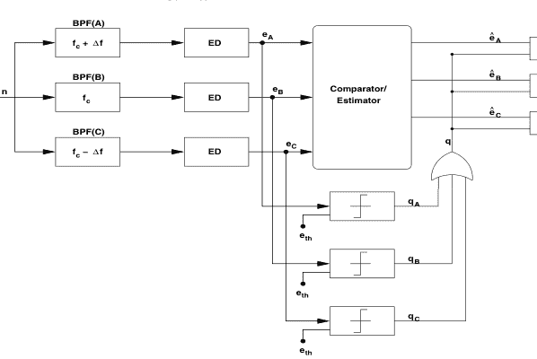

**图 8.19：** CNS 方案的代表性 FSK 接收器

$$X=P\{q=1|A\}P\{e_A>e_B,e_C|A\}\qquad\text{(for all }e_A|A\text{)}$$
$$=X_1X_2\qquad\text{(say).}$$

其中 \(X_1=P\{q=1|A\}\)，\(X_2=P\{e_A>e_B,e_C|A\},\ \forall e_A|A\)。根据图 8.19 的接收器示意图，可得

$$X_1=\int_0^\infty\left[1-P\{q_A=0|A\}\cdot P\{q_B=0|A\}\cdot P\{q_C=0|A\}\right]p_A(e_A)\,de_A.$$

\(P\{q_B=0|A\}\) 和 \(P\{q_C=0|A\}\) 由瑞利分布控制，而 \(P\{q_A=0|A\}\) 由瑞利分布控制。\(p_A(e_A)\) 是 \(e_A\) 的概率密度函数，也遵循瑞利分布。因此，我们可以写出

$$P\{q_A=0|A\}=\int_0^{e_{th}}\frac{e_A}{\sigma^2}e^{-\frac{e_A^2+s_A^2}{2\sigma^2}}I_0\left(\frac{s_Ae_A}{\sigma^2}\right)de_A,$$

以及

$$P\{q_B=0|A\}=P\{q_C=0|A\}=\int_0^{e_{th}}\frac{e_B}{\sigma^2}e^{-e_B^2/2\sigma^2}\,de_B=1-e^{-e_{th}^2/2\sigma^2}.$$

我们有关于 \(X_1\) 和 \(X_2\) 的表达式：

$$X_1=1-\left(1-e^{-e_{th}^2/2\sigma^2}\right)^2\int_0^{e_{th}}\frac{e_A}{\sigma^2}e^{-\frac{e_A^2+s_A^2}{2\sigma^2}}I_0\left(\frac{s_Ae_A}{\sigma^2}\right)de_A. \tag{8.41}$$

$$X_2=\int_0^\infty P\{e_A>e_B\mid A\}P\{e_A>e_C\mid A\}p_A(e_A)\,de_A=\int_0^\infty\left(P\{e_A>e_B\mid A\}\right)^2p_A(e_A)\,de_A. \tag{8.42}$$

在公式 (8.42) 中，我们有：

$$P\{e_A>e_B\mid A\}=P\{e_A>e_C\mid A\}=\int_0^{e_A}\frac{e_B}{\sigma^2}e^{-e_B^2/2\sigma^2}\,de_B=1-e^{-e_A^2/2\sigma^2}.$$

因此，\(X_2\) 可表示为

$$X_2=\int_0^\infty\left(1-e^{-e_A^2/2\sigma^2}\right)^2\frac{e_A}{\sigma^2}e^{-\frac{e_A^2+s_A^2}{2\sigma^2}}I_0\left(\frac{s_Ae_A}{\sigma^2}\right)u(e_A)\,de_A. \tag{8.43}$$

最后，\(P_S\) 可以表示为：


## 节能通信

$$
\begin{aligned}
P_S &= P_N\left[1-\left(1-e^{-e_{\text{th}}^2/2\sigma^2}\right)^3\right] \\
&\quad + P_A(1-X_1X_2)+P_B(1-X_1X_2) \\
&\quad + P_C(1-X_1X_2).
\end{aligned} \tag{8.44}
$$

假设符号 \(A\)、\(B\) 和 \(C\) 出现的概率相等，即 \(P_A=P_B=P_C\)，则得到

$$
P_S=P_N\left[1-\left(1-e^{-e_{\text{th}}^2/2\sigma^2}\right)^3\right]+3P_A(1-X_1X_2).
$$

假设 \(P_N=0.25\)、\(P_A+P_B+P_C=0.75\)，则得到 \(P_S\) 的表达式如下：

$$
P_S=0.25\left[1-\left(1-e^{-e_{\text{th}}^2/2\sigma^2}\right)^3\right]+0.75(1-X_1X_2). \tag{8.45}
$$

因此，由式(8.38)和式(8.45)，对于 CNS 方案取 \(k=2\)，误码率由下式给出：

$$
BER=\frac{2}{3}\left[0.25\left[1-\left(1-e^{-e_{\text{th}}^2/2\sigma^2}\right)^3\right]+0.75(1-X_1X_2)\right]. \tag{8.46}
$$

### 8.5.3.4 不同 SNR 值下的误码率

为了根据上述方程计算不同 SNR 值下的误码率，我们设定 \(s_A=1\)，即信号功率 \(=s_A^2/2=1/2\)，SNR 值 \(=1/(2\sigma^2)\)。使用 MATLAB 实现了相关计算，以寻找在给定 SNR 值下使 BER 最小的阈值电压 \(e_{\text{th}}\) 的最优值。这些计算的结果如表 8.16 所示。

**表 8.16：** 由式(8.46)计算得到的 BER 值

| SNR（dB） | BER 值 | 对应的 \(e_{\text{th}}\) 值 |
|---:|---:|---:|
| 14.00 | \(5.07959 \times 10^{-4}\) | 0.55 |
| 14.50 | \(2.3079 \times 10^{-4}\) | 0.55 |
| 15.00 | \(9.49895 \times 10^{-5}\) | 0.54 |
| 15.50 | \(3.52053 \times 10^{-5}\) | 0.54 |
| 16.00 | \(1.18318 \times 10^{-5}\) | 0.54 |
| 16.50 | \(3.36706 \times 10^{-6}\) | 0.53 |
| 17.00 | \(8.37597 \times 10^{-7}\) | 0.53 |
| 17.50 | \(1.80442 \times 10^{-7}\) | 0.53 |
| 18.00 | \(3.1863 \times 10^{-8}\) | 0.52 |

### 8.5.3.5 静默符号对能量节省的影响

由式(8.46)可得到给定 BER 值下所需的发射机峰值功率，该功率对应于发射机在整个消息传输期间均开启的场景。然而，在 CNS 方案中，发射机在 \(N\) 个符号期间将处于*工作*或*空闲*状态，因此给定 BER 所需的 SNR 值将小于式(8.46)所要求的值。我们保持 CNS 符号持续时间与二进制消息中原始比特持续时间相同。假设符号 \(A\)、\(B\)、\(C\) 和 \(N\) 出现概率相等，则 25% 的时间内发射机消耗的功率可忽略不计（在传输符号 \(N\) 时）。所需 CNS 发射机功率将是式(8.46)要求值的四分之三。注意到 \(10\log_{10}(3/4)\,\mathrm{dB}=-1.25\,\mathrm{dB}\)，这意味着 CNS 所需的 SNR 值将比表 8.16 中给出的值低 1.25 dB。

当使用非相干检测时，针对不同 BER 值，CNS 以及二进制 FSK 所需的归一化平均发射机功率值如表 8.17 所示。图 8.20 以图形方式展示了表 8.17 的内容。表 8.17 中二进制 FSK 的 SNR 值由以下关系式确定：

**表 8.17：** SNR 值比较

| BER 值 | 所需 SNR（dB）（CNS） | 所需 SNR（dB）（二进制 FSK） |
|---|---:|---:|
| \(5.08\times10^{-4}\) | 12.75 | 11.394 |
| \(2.31\times10^{-4}\) | 13.25 | 11.864 |
| \(9.50\times10^{-5}\) | 13.75 | 12.34 |
| \(3.52\times10^{-5}\) | 14.25 | 12.815 |
| \(1.183\times10^{-5}\) | 14.75 | 13.284 |
| \(3.367\times10^{-6}\) | 15.25 | 13.769 |
| \(8.376\times10^{-7}\) | 15.75 | 14.249 |
| \(1.804\times10^{-7}\) | 16.25 | 14.72 |
| \(3.186\times10^{-8}\) | 16.75 | 15.203 |

**图 8.20：** 给定 BER 值下平均发射机功率（缩放后）的比较

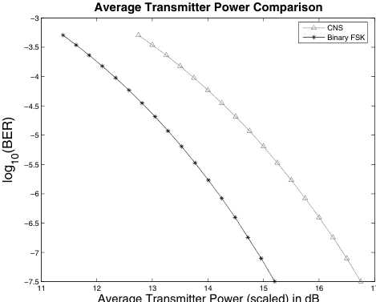

$$
BER=\frac{1}{2}e^{-\gamma/2}, \tag{8.47}
$$

其中 SNR（dB）\(=10\log_{10}\gamma\)，\(\gamma\) 是信号功率与噪声功率之比。从表 8.17 可以看出，对于 \(10^{-4}\) 到 \(10^{-7}\) 范围内的给定 BER，CNS 所需的功率比二进制 FSK 高约 1.5 dB。

### 8.5.3.6 数据压缩对能量节省的影响

现在我们考虑数据压缩对发射机总能量的影响。设 \(P_b\) 和 \(P_C\) 分别为二进制 FSK 和 CNS 所需的发射机功率。同时，设 \(T_b\)、\(T_C\) 分别为二进制 FSK 和 CNS 的传输时间。由于 CNS 的传输时间仅为二进制 FSK 的一半，因此 \(T_C=T_b/2\)。注意到 \(10^{1.5/10}=1.4125\)，我们有 \(P_C/P_b=1.4125\)。设 \(E_b\)、\(E_C\) 分别为二进制 FSK 和 CNS 的发射机能量需求。因此得到：

$$
E_C=P_CT_C=\frac{1.4125}{2}\cdot P_bT_b=0.7063E_b. \tag{8.48}
$$

**定理 28.** *假设在 AWGN 信道下，当符号 \(A\)、\(B\)、\(C\) 和 \(N\) 出现概率相等时，与二进制 FSK 相比，CNS 所需的总能量约为二进制 FSK 的 70%，从而节省 30% 的发射机能量。*

此外，CNS 还具有将接收机能耗降低一半的优势，因为接收机接收所有符号值所需的时间仅为传输原始二进制消息所需时间的一半。图 8.21 比较了在 AWGN 信道上使用基于非相干检测的接收机、且给定长度的所有可能二进制字符串等概率出现时，RBNSiZeComm [39]、TSS [3]、RZE [5] 和 CNS 在发射机和接收机处的能量节省情况。表 8.18 给出了各方案在发射机和接收机处相对于使用非相干检测的典型二进制 FSK 通信方案所产生的能量节省值。

**表 8.18：** 各方案能量节省比较

| 通信方案 | 发射机能量节省 | 接收机能量节省 |
|---|---:|---:|
| RBNSiZeComm | 53% | 0% |
| RZE | 35.2% | 12.5% |
| TSS | 20% | 36.9% |
| CNS | 30% | 50% |

我们看到，CNS 在发射机和接收机两侧的能量节省方面均优于 TSS。结果还表明，虽然 CNS 在发射机侧的能量节省低于 RBNSiZeComm 和 RZE，但它在接收机侧的能量节省方面明显优于这些方案。大多数 WSN 本质上是多跳的。

约每 0.5 到 1 秒一次的传输频率（传输 ECG 信号和其他重要身体参数等生理数据通常所需的速率）即使通过强连接传输数据，也会在 10 到 12 小时内将手机电池完全耗尽 [23]。换句话说，该系统需要每半天充电一次。

为了评估 CNS 在医疗保健应用中产生的能量节省，我们假设这些应用涉及传输 ECG 信号、血液样本 JPEG 图像以及表示血压、血糖水平和体温等生理参数的 ASCII 文本数据 [1, 23]。下面提到的 CNS 性能基于对取自 QT 数据库 [27] 的 50 个真实 ECG 信号样本以及血液、组织和骨骼样本的 JPEG 图像 [28] 的仿真结果 [1]。

**农业 WSN：** 在用于监测作物健康的 WSN 中，通过田间传感器网络收集的信息包括温度、相对湿度、太阳辐射和土壤成分等气候数据。网络架构通常由*采集站*网络和一个*网关*节点组成。数据采集通过配备无线收发器并以网状拓扑部署的低成本采集站完成 [24, 26]。采集站收集温度、相对湿度、太阳辐射和土壤成分等数据，并检测虫害及其他数据。通常的做法是每分钟采集一个样本。通信基于廉价收发器提供的低功耗射频链路。单个网关节点从采集站收集数据以进行处理 [25]。这些数据假定以短 ASCII 文本消息形式传输 [25, 26, 24]，通常最多只有几个字节长。在典型的基于 EbT 传输的田间部署中，考虑 60m × 60m 农田的网状网络部署、0 到 80m 的多跳通信无线电范围、30 个包/分钟 = 0.5 个包/秒的数据速率、20mA 下 15% 的占空比以及 7.2Ah 容量的电池，无线电电池只能持续 100 天 [25, 26, 24]。

由仿真结果可知，如表 8.19 所示，ECG 信号的 \(P_N\) 约为 0.4751，血液样本 JPEG 数据约为 0.2884，文本数据约为 0.388。将这些 \(P_N\) 值代入式(8.44)，并注意到发射机在 \(N\) 个符号的传输期间处于*工作*或*空闲*状态，我们针对上述每种数据类型计算了给定 BER 下所需的 SNR 值。从这些计算中发现，在相同 BER 下，ECG 信号使用 CNS 相比二进制 FSK 的能量节省约为 50%。

类似地，与二进制 FSK 相比，CNS 在传输血液和组织样本 JPEG 图像文件时的能量节省为 33%。对于文本数据，能量节省为 42.6%。所有这些结果汇总在表 8.19 中。

CNS 的发射机能量节省量在 33% 到 50% 之间，具体取决于所传输数据的性质。对于相同的数据集，RBNSiZeComm 产生的平均发射机能量节省在 33% 到 61% 之间 [39]。图 8.22 比较了 CNS 和 RBNSiZeComm 在不同数据类型下的发射机能量节省。此外，无论数据类型如何，CNS 在接收机处相比二进制 FSK 同时还可节省约 50% 的能量。然而，RBNSiZeComm 在接收机处没有产生这样的节省 [39]。


**Table 8.19:** 不同应用数据的能量节约

| 信号类型 | *N* 符号频率 | 无噪声信道产生的 TX 能量节约 | CNS 产生的 TX 能量节约 |
|---|---:|---:|---:|
| ECG 信号 | 47.51% | 73.75% | 50% |
| JPEG 血液/组织样本图像 | 28.84% | 64.02% | 33% |
| ASCII 文本数据 | 38.8% | 69.44% | 42.6% |

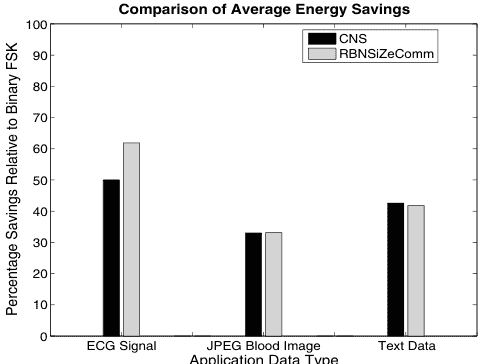

**Figure 8.22:** CNS 与 RBN-SiZeComm 在发射端对各类应用数据类型产生的能量节约的比较（二进制 FSK）

我们可以得出结论，CNS 在发射端和接收端均能提供能量节约。CNS 在发射端和接收端的总能量节约超过采用 BFSK 的传统 EbT 方案，也超过 RBN-SiZeComm 和 TSS。因此，CNS 在低功耗实际应用中将非常有用，例如在需要多跳无线通信的无线传感器网络和自组织网络中。

## 8.6 三位数斐波那契数字系统（TFNS）通信协议

我们介绍一种基于斐波那契数字系统的变体，即三位数斐波那契数字系统（TFNS），并结合对编码消息的主导符号的静默通信，描述了一种高效能耗的通信协议。

在许多工程应用中，斐波那契数字系统（FNS）已被成功应用。这些应用包括 VLSI 芯片设计（在处理器芯片内数据总线之间最小化串扰 [37]）、同步控制 [35]、大规模稀疏比特串的压缩 [33]、以及二进制字符串的可靠传输 [32]。另一个可能的应用是在低功耗无线通信系统中 [34, 39, 6]，利用通过无线信道传输符号数量的不对称性，以最小化发射器和/或接收器所需的能量。如果将斐波那契数字系统用于二进制数字的位权，以表示十进制数，则在得到的代码词中 0 和 1 的数量会出现明显的不对称。这些不对称特性可以用于节约能量，特别是在低功耗无线传感器网络中。然而，如果使用传统的 FNS，表示一个给定十进制数的二进制位数会比二进制数系统多，因此低功耗无线通信系统的能源节约可能并不显著。Sinia 等人 [40] 提出了一种称为三位数斐波那契数字系统（TFNS）的变体，该系统在表示所有可能数值时，能够实现 0、1 和 2 的数量分布不对称，并且大幅减少位数数量。这在下文描述的无线通信系统中带来了显著的能源节约。

### 8.6.1 基本概念

考虑斐波那契数列 $\langle 0, 1, 1, 2, 3, 5, 8, 13, 21, \ldots \rangle$，并用 $F_n$ 表示该数列的第 $n$ 项（$n \ge 0$），其中 $F_0 = 0$，$F_1 = F_2 = 1$，$F_3 = 2$，$F_4 = 3$，$F_5 = 5$ 等等。在 FNS 中，第 $i$ 位（$i \ge 0$，$i=0$ 为最低有效位）的权重为 $F_{i+2}$。文献中存在不同版本的 FNS，它们对相同十进制数的表示方式各异 [37]。然而，正规形式的 FNS [35] 始终为给定十进制数 $N$ 提供唯一的 FNS 表示，如表 8.20 所示。关于斐波那契数的另一个有趣结果是，正整数可以唯一表示为非连续斐波那契数之和，这与数字的 Zeckendorf 表示相同 [38]。然而，所有这些表示的位权均由按顺序排列的所有斐波那契数组成，因此只能用 0 和 1 的字符串来表示数值。

正规 FNS 的一个有趣性质是：如果第 $i$ 位（$i > 0$）为 1，则第 $i-1$ 位必须为 0。即在正规代码词中，不会出现两个连续的 1。所有 $n$ 位 FNS 表示的十进制数在范围 $0 \le N \le F_{n+2}-1$ 内的 0 和 1 在任意位置（从最高有效位 msb 开始）的总数可以通过如图 8.23 所示的带权重的二进制树来可视化。

树根节点标记为 *，其左子节点标记为 0，对应的边权为 $F_{n+1}$，右子节点标记为 ‘1’，对应的边权为 $F_n$；在考虑所有可能数值的表示时，msb（即第 $(n-1)^\text{th}$ 位）有 $F_{n+1}$ 个 0 和 $F_n$ 个 1。左子节点 0 进一步有左子节点 0（边权 $F_n$）和右子节点 1（边权 $F_{n-1}$），这意味着 msb 为 0 的代码在 $(n-2)^\text{th}$ 位上有 $F_n$ 个 0 和 $F_{n-1}$ 个 1。右子节点 1 只有一个左子节点 0（因两个连续的 1 不允许），对应的边权为 $F_n$，这意味着 msb 为 1 的代码在 $(n-2)^\text{th}$ 位上只有 $F_n$ 个 0。

从图 8.23 的二进制树可以得出，$n$ 位表示的所有十进制数（范围 0 到 $F_{n+2}-1$）中 0 的总数 $\nu_0$ 由以下公式给出：

$$
\nu_0 = F_{n+1} + (F_n + F_n) + (F_{n-1} + F_{n-1} + F_{n-1}) + \cdots \tag{8.49}
$$

$$
= F_{n+1} + 2F_n + 3F_{n-1} + 5F_{n-2} + 8F_{n-3} + \cdots \tag{8.50}
$$

$$
= F_2 F_{n+1} + F_3 F_n + F_4 F_{n-1} + F_5 F_{n-2} + F_6 F_{n-3} + \cdots + F_{n+1} F_2. \tag{8.51}
$$

同样，1 的数量 $\nu_1$ 由以下公式给出：

$$
\nu_1 = F_n + F_{n-1} + (F_{n-2} + F_{n-2}) + (F_{n-3} + F_{n-3} + F_{n-3}) + \cdots
$$

$$
= F_n + F_{n-1} + 2F_{n-2} + 3F_{n-3} + 5F_{n-4} + 8F_{n-5} + \cdots
$$

$$
= F_1 F_n + F_2 F_{n-1} + F_3 F_{n-2} + F_4 F_{n-3} + F_5 F_{n-4} + F_6 F_{n-5} + \cdots + F_n F_1.
$$

设 $G(z) = F_0 + F_1 z + F_2 z^2 + F_3 z^3 + F_4 z^4 + \cdots$。则 $G^2(z) = (F_0 + F_1 z + F_2 z^2 + F_3 z^3 + F_4 z^4 + \cdots)^2$，其 $z^{n+3}$ 的系数为：

$$
F_{n+3}F_0 + F_{n+2}F_1 + F_{n+1}F_2 + \cdots + F_2 F_{n+1} + F_1 F_{n+2} + F_0 F_{n+3} = \nu_0 + 2F_{n+2}F_1.
$$

根据 [36]，

$$
G(z) = \frac{1}{\sqrt{5}}\left[(1-\phi z)^{-1} - (1-\bar{\phi}z)^{-1}\right],
$$

其中 $\phi = \frac{\sqrt{5}+1}{2}$，$ \bar{\phi} = \frac{\sqrt{5}-1}{2}$。于是，

$$
G^2(z) = \frac{1}{5}\left[(1-\phi z)^{-2} + (1-\bar{\phi}z)^{-2} - 2(1-\phi z)^{-1}(1-\bar{\phi}z)^{-1}\right].
$$

因此，$z^{n+3}$ 的系数为：

$$
\frac{1}{5}\left[(n+4)\phi^{n+3} + (n+4)\bar{\phi}^{n+3} - 2\left(\phi^{n+3}\bar{\phi}^0 + \phi^{n+2}\bar{\phi} + \cdots + \phi^1\bar{\phi}^{n+2} + \phi^0\bar{\phi}^{n+3}\right)\right].
$$

令 $S = \phi^{n+3} + \phi^{n+2}\bar{\phi} + \cdots + \phi\bar{\phi}^{n+2} + \bar{\phi}^{n+3}$，则 $S\left[1-\frac{\bar{\phi}}{\phi}\right] = \phi^{n+3} - \frac{\bar{\phi}^{n+4}}{\phi} = \frac{\phi^{n+4} - \bar{\phi}^{n+4}}{\phi}$。因此，$S = \phi^{n+4} - \bar{\phi}^{n+4}$，因为 $\phi - \bar{\phi} = 1$。于是，

$$
\nu_0 = \frac{1}{5}\left[(n+4)(\phi^{n+3} + \bar{\phi}^{n+3}) - 2(\phi^{n+4} - \bar{\phi}^{n+4})\right]. \tag{8.52}
$$

将 $\phi$ 和 $\bar{\phi}$ 的值代入上式，即可得到所有 $n$ 位有效代码词中 0 的数量。所有 $n$ 位有效代码词中 1 的数量由

$$
\nu_1 = nF_{n+2} - \nu_0. \tag{8.53}
$$

对于大 $n$，$\nu_0 \approx \frac{(n+4-2\phi)\phi^{n+3}}{5} = \frac{(n+0.764)\phi^{n+3}}{5}$。$\nu_0$ 与总位数 $nF_{n+2}$ 的比值在无穷大时趋于 $\frac{\phi}{\sqrt{5}} = 72.36\%$。这种 0 和 1 数量的巨大不对称可以在低功耗无线通信应用中被利用，通过在占主导符号（此处为 0）时使发射器静默或关闭，从而降低信号传输的平均功率。

另一方面，对于 $m$ 位二进制表示，需要 $n$ 位 FNS，其中 $n$ 是满足 $F_{n+2}-1 > 2^m-1$ 的最小整数。注意到 $F_{n+2} \approx \frac{\phi^{n+2}}{\sqrt{5}}$（当 $n$ 很大时），则 $\frac{\phi^{n+2}}{\sqrt{5}} > 2^m$，即 $n \approx \left\lceil\frac{m+\log\sqrt{5}}{\log\phi}\right\rceil - 2$。对于 $m=8,16,32,64,128,256,512,1024$，对应的 $n$ 值分别为 12、
分别为 23、46、92、185、369、738 和 1475。比率 \(\frac{n}{m}\) 渐近趋于 1.44。这表明 FNS 表示中的位数是原始二进制表示的 1.44 倍。这种码长的增加在许多工程应用中可能是不可取的。

## 8.6.2 三值斐波那契数制

为了克服 FNS 中码字长度增加的问题，我们描述一种数制 [40]，其中 i) 每个位置上的数字取自集合 \(\{0,1,2\}\)，ii) 第 \(i\)（\(i \geq 0\)）个数字位（\(i=0\) 对应最低有效数字位）的位权等于 \(F_{2i+2}\)。也就是说，不同数字位置上的位权为 \(F_2,F_4,F_6,\ldots\)，其中 \(F_2\) 是最低有效数字位的权值。我们将这种数制称为*三值斐波那契数制*（TFNS）[40]。不同数字位置上的权值是斐波那契数列中隔位取出的数。给定一个十进制数 \(N < F_{2k+2}\)（\(k\) 为某个整数），我们可以通过下述十进制到 TFNS 的转换算法 *DTFNS*，用 \(k\) 个数字 \(d_0,d_1,d_2,\ldots,d_{k-1}\) 来表示 \(N\) 的等价 TFNS 形式。

```text
**Input:** Decimal number \(N\), integer \(k\) such that \(N < F_{2k+2}\)
**Output:** Equivalent TFNS form for \(N\)

1. **for** \(i = k - 1\) **downto** 0 **do**
2.     **if** \(N \geq 2F_{2i+2}\) **then**
3.         \(d_i \leftarrow 2\)
4.         \(N \leftarrow N - 2F_{2i+2}\)
5.     **else if** \(N \geq F_{2i+2}\) **then**
6.         \(d_i \leftarrow 1\)
7.         \(N \leftarrow N - F_{2i+2}\)
8.     **else**
9.         \(d_i \leftarrow 0\)
10.    **end if**
11. **end for**
```

按照 *DTFNS* 转换算法，使用四位 TFNS 表示 0 到 12（含 0 和 12）范围内所有十进制数的结果如表 8.20 所示。注意，使用上述转换算法时，十进制数 8 在 TFNS 中被*唯一地*表示为 0100。尽管十进制数 8 在上述位权下还有另一种可能的 TFNS 表示 0022；但这种表示无法由算法 *DTFNS* 得到，因为第 3 行的 *if* 语句实际上只要有可能就会强制该数在尽可能高的数字位上用非零数字表示。

**引理 31.** 设 \(N\) 是一个十进制数，其在 *TFNS* 中的表示为 \(2111\cdots 1\)，即一个 2 后面跟着 \((k-1)\) 个 1。则十进制数 \(N+1\) 将被表示为 \(1000\cdots 0\)，即 1 后面跟着 \(k\) 个 0。

**证明：** 由 \(N\) 的 TFNS 表示可得：

\[
N = 2F_{2k} + F_{2k-2} + F_{2k-4} + \cdots + F_4 + F_2
\]

\[
\Rightarrow N + 1 = 2F_{2k} + F_{2k-2} + F_{2k-4} + \cdots + F_4 + F_2 + 1
\]

\[
= 2F_{2k} + F_{2k-2} + F_{2k-4} + \cdots + F_4 + F_2 + F_1
\]

\[
= 2F_{2k} + F_{2k-2} + F_{2k-4} + \cdots + F_6 + F_4 + F_3
\]

\[
= 2F_{2k} + F_{2k-2} + F_{2k-4} + \cdots + F_8 + F_6 + F_5 + \cdots
\]

\[
= 2F_{2k} + F_{2k-1}
\]

\[
= F_{2k} + F_{2k+1}
\]

\[
= F_{2k+2}.
\]

由于转换算法 *DTFNS* 的性质，\(N+1\) 因此将在 TFNS 中被表示为 \(1000\cdots 0\)，即 1 后面跟着 \(k\) 个 0。

由于引理 31，如果我们考虑 TFNS 中数字的 \(n\) 位表示，并非所有可能的 \(3^n\) 个码值都会由 *DTFNS* 算法生成。更准确地说，每当遇到某个数字 \(N\)，其 TFNS 表示中最低的 \(k\) 位为 \(2111\ldots 1\) 时，下一个连续数字 \(N+1\) 的 TFNS 表示中最低的 \(k+1\) 位将为 \(1000\ldots 0\)，从而消除了它们之间许多可能的码值。该数制与 Zeckendorf 数制的不同之处在于，它采用隔位斐波那契数作为位权。这种对隔位斐波那契数的选择使得任意数字位都可以用 0、1 和 2 来表示数字。此外，Zeckendorf 表示不允许出现两个连续的 1；而正如我们将在下面看到的，确切地说，在下面引理所述的数字表示中不会出现两个连续的 2。

**引理 32.** *任意给定数的 TFNS 表示可能含有连续的 1，但不含连续的 2。*

证明是引理 31 的推论。

因此，与表示中不允许出现连续 1 的 Zeckendorf 表示不同，这种数制允许两个连续的 1，但不允许两个连续的 2。引理 31 和引理 32 给出的性质导致对于任意给定的 \(n\) 位表示，在 TFNS 编码中数字 0、1 和 2 的总数分布不均匀。仔细观察 *DTFNS* 算法中的数字生成过程，可以揭示 TFNS 码值中 0、1 和 2 数量的确切分布。我们通过构建图 8.24 中所示的加权三叉树 \(T\)，从最高有效数字位开始跟踪这一数字生成过程，以涵盖所有可能的 \(n\) 位码（表示 0 到 \(F_{2n+2} - 1\) 范围内的数）。

首先，我们从 \(T\) 的根节点开始，插入它的三个子节点，分别标记为 0、1 和 2（从根节点连接到这三个节点的三条边），这意味着

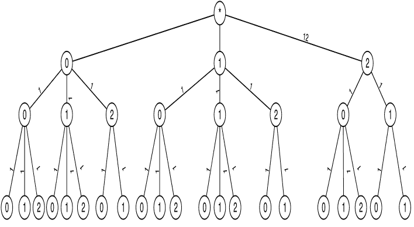

码值最左边的数字位可以由 0、1 或 2 填充。由于十进制值范围从 0 到 \(F_{2n}\) 的所有数，其最左边的数字位都会出现 0，因此连接根节点与其标记为 0 的子节点的边的权值被设为 \(F_{2n}\)。连接根节点与其标记为 1 的子节点的边的权值也是如此。但连接根节点与标记为 2 的子节点的边的权值为 \(F_{2n+2}-2F_{2n}=F_{2n-1}\)。我们现在推导 TFNS 中 0、1 和 2 分布的表达式。

### 8.6.2.1 推导 TFNS 数字分布

从图 8.24 中我们看到，在所有表示 0 到 \(F_{2n+2}-1\)（含两端）范围内所有数字的 \(n\) 位有效码字中，0 的总数为：

\[
\nu'_0=F_{2n}+3F_{2n-2}+8F_{2n-4}+\cdots=F_2F_{2n}+F_4F_{2n-2}+F_6F_{2n-4}+\cdots+F_{2n}F_2.
\]

类似地，所有有效码字中 1 的总数为：

\[
\nu'_1=F_{2n}+(2F_{2n-2}+F_{2n-3})+\cdots=F_1F_{2n}+(F_3F_{2n-2}+F_2F_{2n-3})
\]

\[
\qquad +(F_5F_{2n-4}+F_4F_{2n-5})+\cdots +(F_{2n-1}F_2+F_{2n-2}F_1).
\]

所有有效码字中 2 的总数为：

\[
\nu'_2=F_1F_{2n-1}+2F_{2n-3}+5F_{2n-5}+\cdots
\]

\[
\qquad =F_1F_{2n-1}+F_3F_{2n-3}+F_5F_{2n-5}+\cdots+F_{2n-1}F_1.
\]

为了将 \(\nu'_0\)、\(\nu'_1\) 和 \(\nu'_2\) 表示为闭式形式，我们进行如下推导。

设

\[
G(z)=F_0+F_1z+F_2z^2+F_3z^3+F_4z^4+\cdots
\]

因此，如 [36] 所示，\(G(z)\) 由 \(G(z)=\frac{z}{1-z-z^2}\) 给出。现在，

\[
G(-z)=F_0-F_1z+F_2z^2-F_3z^3+F_4z^4+\cdots.
\]

因此我们有：

\[
\frac{G(z)+G(-z)}{2}=F_0+F_2z^2+F_4z^4+F_6z^6+\cdots=H(z),\quad\text{（记为）}.
\]

也就是说，

\[
H(z)=\frac{z^2}{(1-z^2)^2-z^2}=\frac{z^2}{1-3z^2+z^4}
\]

\[
\qquad=\frac{z^2}{(1-\alpha z^2)(1-\beta z^2)},\quad\text{（记为）}
\]

其中 \(\alpha\) 和 \(\beta\) 由下式给出：

\[
\begin{cases}
\alpha+\beta=3\\
\alpha\beta=1.
\end{cases}
\tag{8.54}
\]

因此，\(\alpha=\frac{3+\sqrt5}{2}=1+\phi\)，\(\beta=\frac{3-\sqrt5}{2}=1-\bar{\phi}\)。同时，\(H^2(z)=(F_0+F_2z^2+F_4z^4+\cdots)^2\)，其中 \(z^{2n+2}\) 的系数为

\[
F_0F_{2n+2}+F_2F_{2n}+F_4F_{2n-2}+\cdots+F_{2n+2}F_0=\nu'_0.
\]

因此，

\[
H(z)=\frac{z^2}{[1-(1+\phi)z^2][1-(1+\bar{\phi})z^2]}
\]

\[
\Rightarrow H^2(z)=\frac{z^4}{[1-(1+\phi)z^2]^2[1-(1+\bar{\phi})z^2]^2}.
\]

设 \((1+\phi)z^2=x\)，\((1-\bar{\phi})z^2=y\)。则 \(H^2(z)=\frac{z^4}{(1-x)^2(1-y)^2}\)。\(H^2(z)\) 中 \(z^{2n+2}\) 的系数

\[
=\text{在}(1-x)^{-2}(1-y)^{-2}\text{中}z^{2n-2}\text{的系数}.
\]

\[
=\text{在}(1-x)^{-2}(1-y)^{-2}\text{中}x^iy^j\text{的系数之和，其中}i+j=n-1.
\]

\[
=(1+\phi)^0\cdot1\cdot n(1-\bar{\phi})^{n-1}+2(1+\phi)(n-1)(1-\bar{\phi})^{n-2}
\]

\[
+3(1+\phi)^2(n-2)(1-\bar{\phi})^{n-3}+\cdots+n(1+\phi)^{n-1}\cdot1\cdot(1-\bar{\phi}).
\]

### 8.6.2.2 \(
u'_0\) 的计算

收集上述表达式右侧的项，并注意到 \((1+\phi)(1-\bar{\phi})=1\)，我们得到

\[
\nu'_0=n(1+\phi)^{n-1}+2(n-1)(1+\phi)^{n-3}+3(n-2)(1+\phi)^{n-5}+\cdots+n(1+\phi)^{1-n}.
\]

将 \((1+\phi)\) 替换为 \(\alpha\)，我们得到

\[
\nu'_0=n\alpha^{n-1}+2(n-1)\alpha^{n-3}+3(n-2)\alpha^{n-5}+\cdots+n\alpha^{1-n}. \tag{8.55}
\]

\[
\frac{\nu'_0}{\alpha^2}=n\alpha^{n-3}+2(n-1)\alpha^{n-5}+\cdots+(n-1)\cdot2\alpha^{1-n}+n\alpha^{-n-1}. \tag{8.56}
\]

用式 (8.55) 减去式 (8.56)，我们得到：

\[
\nu'_0\left(1-\frac{1}{\alpha^2}\right)=n\alpha^{n-1}+(n-2)\alpha^{n-3}+(n-4)\alpha^{n-5}
\]

\[
\quad +(n-6)\alpha^{n-7}+\cdots+[n-2(n-1)]\alpha^{1-n}-n\alpha^{-n-1}
\]

\[
\quad =n(\alpha^{n-1}+\alpha^{n-3}+\alpha^{n-5}+\cdots)-2(\alpha^{n-3}+2\alpha^{n-5}+3\alpha^{n-7}+\cdots)
\]


$$=\frac{n\alpha^{n-1}(1-\gamma^n)}{1-\gamma}-2\alpha^{n-3}\left[\frac{1-\gamma^{n-1}}{(1-\gamma)^2}-\frac{(n-1)\gamma^{n-1}}{1-\gamma}\right]-n\alpha^{-1-n},$$

其中 \(\gamma=\frac{1}{\alpha^2}\)。

因此，

$$\nu'_0=\frac{1}{1-\gamma}\left(\frac{n\alpha^{n-1}(1-\gamma^n)}{1-\gamma}-2\alpha^{n-3}\left[\frac{1-\gamma^{n-1}}{(1-\gamma)^2}-\frac{(n-1)\gamma^{n-1}}{1-\gamma}\right]-n\alpha^{-1-n}\right). \tag{8.57}$$

即，

$$\nu'_0=\frac{n\alpha^{n-1}(1-\gamma^n)}{(1-\gamma)^2}-2\alpha^{n-3}\left[\frac{1-\gamma^{n-1}}{(1-\gamma)^3}-\frac{(n-1)\gamma^{n-1}}{(1-\gamma)^2}\right]-\frac{n\alpha^{-1-n}}{1-\gamma}. \tag{8.58}$$

## 8.6.2.3 \(
u'_1\) 和 \(
u'_2\) 的计算

我们有 \(\nu'_2=F_1F_{2n-1}+F_3F_{2n-3}+\cdots+F_{2n-1}F_1\)。设 \(H'(z)=\frac{1}{2}[G(z)-G(-z)]=F_1z+F_3z^3+F_5z^5+\cdots\)。

\(\nu'_2\) 是 \(H'^2(z)\) 中 \(z^{2n}\) 的系数，且 \(H'(z)\) 可以写为：

$$H'(z)=\frac{1}{2}\left[\frac{z}{1-z-z^2}-\frac{-z}{1+z-z^2}\right]=z\left[\frac{1-z^2}{1+z^4-3z^2}\right].$$

用 \(\delta\) 表示 \(z^2\)，我们得到

$$\frac{1-z^2}{1+z^4-3z^2}=\frac{1-\delta}{1-3\delta+\delta^2}=\frac{1-\delta}{(1-\alpha\delta)(1-\beta\delta)}$$

其中 \(\alpha\) 和 \(\beta\) 由公式 (8.54) 给出。

现在，我们可以将 \(H'(z)\) 表示为

$$H'(z)=\frac{z}{2}\left[\frac{C_1}{1-\alpha z^2}+\frac{C_2}{1-\beta z^2}\right],$$

其中 \(C_1=1+\frac{1}{\sqrt{5}}\)，\(C_2=1-\frac{1}{\sqrt{5}}\)。因此，

$$H'^2(z)=\frac{z^2}{4}\left[\frac{C_1}{1-\alpha z^2}+\frac{C_2}{1-\beta z^2}\right]^2
=\frac{z^2}{4}\left[C_1^2(1+2\alpha z^2+3\alpha^2z^4+4\alpha^3z^6+\cdots)
+C_2^2(1+2\beta z^2+3\beta^2z^4+4\beta^3z^6+\cdots)
+2C_1C_2(1+\alpha z^2+\alpha^2z^4+\alpha^3z^6+\cdots)(1+\beta z^2+\beta^2z^4+\beta^3z^6+\cdots)\right].$$

因此，\(\nu'_2\) 是 \(H'^2(z)\) 中 \(z^{2n}\) 的系数，其表达式为

$$\nu'_2=\frac{1}{4}\left[C_1^2 n\alpha^{n-1}+C_2^2 n\beta^{n-1}+2C_1C_2\left(\beta^{n-1}+\beta^{n-2}\alpha+\beta^{n-3}\alpha^2+\cdots+\beta\alpha^{n-2}+\alpha^{n-1}\right)\right].$$

设 \(S'=\beta^{n-1}+\beta^{n-2}\alpha+\beta^{n-3}\alpha^2+\cdots+\beta\alpha^{n-2}+\alpha^{n-1}\)。于是我们得到：

$$S'\left(1-\frac{\beta}{\alpha}\right)=\alpha^{n-1}-\frac{\beta^n}{\alpha}\Rightarrow S'=\frac{\alpha^n-\beta^n}{\sqrt{5}}, \text{ 因为 } \alpha-\beta=\sqrt{5}.$$

**表 8.21：** 不同 \(n\) 值下 \(\nu'_0\)、\(\nu'_1\) 和 \(\nu'_2\) 取值的比较

| \(m\) | \(n\) | \(\nu'_0\) | \(\nu'_1\) | \(\nu'_2\) |
|---:|---:|---:|---:|---:|
| 8 | 6 | 954 | 864 | 444 |
| 16 | 12 | 632916 | 556416 | 267384 |
| 32 | 23 | \(4.87153 \times 10^{10}\) | \(4.22352 \times 10^{10}\) | \(1.96227 \times 10^{10}\) |
| 64 | 46 | \(4.03077 \times 10^{20}\) | \(3.46847 \times 10^{20}\) | \(1.5813 \times 10^{20}\) |
| 128 | 93 | \(3.6107 \times 10^{40}\) | \(3.09529 \times 10^{40}\) | \(1.39756 \times 10^{40}\) |
| 256 | 185 | \(2.04551 \times 10^{79}\) | \(1.75032 \times 10^{79}\) | \(7.86544 \times 10^{78}\) |
| 512 | 369 | \(3.29995 \times 10^{156}\) | \(2.82114 \times 10^{156}\) | \(1.2647 \times 10^{156}\) |
| 1024 | 738 | \(1.1288 \times 10^{311}\) | \(9.64587 \times 10^{310}\) | \(4.31886 \times 10^{310}\) |

因此，

$$\nu'_2=\frac{1}{4}\left[C_1^2 n\alpha^{n-1}+C_2^2 n\beta^{n-1}+2C_1C_2\frac{\alpha^n-\beta^n}{\sqrt{5}}\right]. \tag{8.59}$$

分别利用公式 (8.58) 和 (8.59) 中的 \(\nu'_0\) 和 \(\nu'_2\) 值，所有 \(n\) 位有效码字中 1 的总数由下式给出：

$$\nu'_1=nF_{2n+2}-\nu'_0-\nu'_2. \tag{8.60}$$

表示所有 \(m\) 位二进制数所需的位数由满足不等式 \(F_{2n+2}-1>2^m-1\) 的最小整数 \(n\) 给出。注意到

$$F_{2n+2}\approx\frac{\phi^{2n+2}}{\sqrt{5}}\text{ 对于较大的 }n,\quad \frac{\phi^{2n+2}}{\sqrt{5}}>2^m.$$

即，

$$n\approx\left\lceil\frac{m+\log\sqrt{5}}{2\log\phi}\right\rceil-1. \tag{8.61}$$

对于 \(m=8,16,32,64,128,256,512\) 和 1024，相应的 \(n\) 值分别为 6、12、23、46、93、185、369 和 738。比值 \(n/m\) 渐近趋于 0.72。在表 8.21 中，我们展示了 \(m=8,16,32,64,128,256,512\) 和 1024 时某些 \(n\) 值下的 \(\nu'_0\)、\(\nu'_1\) 和 \(\nu'_2\) 值。可以看出，对于较大的 \(n\)，TFNS 所有有效码字中 0、1 和 2 的出现频率分别渐近趋于 42.2%、38.2% 和 19.6%。这一事实连同与二进制数相比码字长度的缩减，可在许多工程应用中得到利用，例如在无线通信系统中大幅减少发射机和接收机所消耗的能量。

## 8.6.3 利用 TFNS 的节能通信

我们将 TFNS 应用于通信系统，以在通信过程中节省能量。二进制格式的数字数据首先转换为十进制形式，然后使用相应的转换算法将十进制数编码为三数字斐波那契数。如果以这种编码形式（即基于 TFNS 的格式）传输数字数据，则对于较大数据量，此类数据流中 1 和 2 的数量将大幅减少。在此类数据流中，0、1 和 2 的数量之比分别为 44:38.2:17.8，而普通二进制编码中 0 和 1 的比例为 50:50。

### 8.6.3.1 TFNS 协议的实施

TFNS 传输方案涉及将传出的二进制消息重新编码为其等效的十进制形式，并将该十进制数转换为三数字斐波那契数然后发送。接收端随后将接收到的三数字斐波那契数重新转换为十进制数，解码为二进制数，并将其传递给通信栈的更高层以进行进一步处理。与 TSS 的情况一样，我们采用涉及 FSK 和 ASK 的混合调制方案。同样，发射机使用具有两个频率的 FSK 调制，例如 \(f_c\) 和 \(f_c + \Delta f\)，分别对应符号 1 和 2。在传输静默符号（0）期间，发射机切换到*睡眠*状态。与 TSS 协议的情况一样，图 8.10 可被用作基于非相干检测实现 TFNS 方案的接收机。我们可以使用相干检测

### 8.6.3.3 非相干检测

设 \(\alpha\) 为发射的三元符号为 0 且被正确接收为 0 的概率。类似地，设 \(\beta\)（或 \(\delta\)）为发射符号为 1（或 2）且接收符号也为 1（或 2）的概率。按照与 TSS 相同的方法，*帧正确率（FCR）* 由下式给出：

$$FCR = \alpha^{nP_0} \times \beta^{nP_1} \times \delta^{nP_2}. \tag{8.63}$$

其中 \(P_0\)、\(P_1\) 和 \(P_2\) 分别表示发射消息中 0、1 和 2 出现的概率。在渐近意义下（对于较大的 \(m\)），TFNS 帧中 0 的平均数量占比为 44%，而所有非零符号（即 1 和 2 合计）的占比为 56%。即 \(P_0 = 0.44\)，\(P_1 + P_2 = 0.56\)。根据对称性，\(\beta = \delta\)。因此，TFNS 中一帧被正确接收的概率由下式给出：

$$FCR = \alpha^{0.44n} \times \beta^{0.56n}. \tag{8.64}$$

因此，TFNS 帧的误帧率（FER）为 \(FER_{tfns} = 1 - FCR\)。

### 8.6.3.4 性能评估

假设我们使用非相干 BFSK 传输原始的 \(m\) 位二进制帧，且非相干 BFSK 的误比特率（BER）为 \(\rho\)。整帧被正确接收的概率由 \((1-\rho)^m\) 给出。因此，BFSK 的误帧率（FER）为 \(FER_{bfsk} = 1-(1-\rho)^m\)。由于 \(\rho\) 通常很小，这可近似为 \(m\rho\)。对于给定的帧大小 \(m\)，可以将 \(FER_{tfns}\) 与 \(FER_{bfsk}(=m\rho)\) 进行比较。为了了解 TFNS 相对于非相干 BFSK 的性能，我们可以将 \(FER_{tfns}/m\) 与 \(\rho\) 进行比较。为了计算 \(FER_{tfns}/m\)，我们设 \(s_A = 1\)，即信号功率 \(=s_A^2/2=1/2\)。这对应于信噪比（SNR）\(=1/(2\sigma^2)\)。我们使用 MATLAB 实现相关计算，以求...


对于给定的 SNR 值，使 \( FER_{tfn}/m \) 最小的阈值电压 \( e_{th} \) 的最优值。由式(8.64)，我们可以得到在给定 \( FER_{tfn} \) 值时 TFNS 所需的峰值发射功率。

对于非相干 BFSK，误比特率（BER）为 \( \rho = \frac{1}{2} e^{-\gamma/2} \)，其中 \( \gamma \) 是信噪比（SNR）。我们使用 \( 8 \leq m \leq 1024 \) 范围内的不同帧长度，并利用 \( X_1 \) 和 \( X_2 \) 的表达式，得到非相干接收下 TFNS 方案的 SNR 值，以及为满足相同 \( FER \) 值非相干 BFSK 对应的 SNR 值。结果汇总于表8.22；平均而言，对于给定的 \( FER/m \)，TFNS 的 SNR 比二进制非相干 FSK 高约 2.68 dB。

在 TFNS 方案中，发射机仅在非零符号（1 和 2）期间开启。在 TFNS 编码消息中的零符号期间，发射机关闭。因此，对于给定 BER 所需的平均发射功率将小于式(8.64)所要求的值。已知 \( P_0 = 0.44 \)，且 \( 10 \log_{10}(1 - 0.44) \) dB = -2.518 dB。因此，TFNS 的平均发射功率将比表8.22中给出的值降低 2.518 dB。由此可知，TFNS 通信的平均发射功率 \( P_1 \) 比非相干 BFSK 对应的平均功率 \( P_b \) 高 (2.68 - 2.518) dB = 0.162 dB，即 \( \frac{P_1}{P_b} = 1.038 \)。图8.25 绘制了 TFNS 和 BFSK 的归一化峰值发射功率。

| 采用TFNS（非相干）时的SNR | m=16 | m=64 | m=128 | m=256 | m=512 | m=1024 | 非相干BFSK的平均SNR |
|---|---:|---:|---:|---:|---:|---:|---:|
| 14.0 | 11.4243 | 11.4316 | 11.4412 | 11.4602 | 11.4695 | 11.5686 | 11.4557 |
| 15.0 | 12.3623 | 12.3634 | 12.3649 | 12.3678 | 12.3736 | 12.3852 | 12.3678 |
| 16.0 | 13.3084 | 13.3086 | 13.3087 | 13.309 | 13.3096 | 13.3107 | 13.309 |
| 17.0 | 14.2566 | 14.2566 | 14.2567 | 14.2567 | 14.2567 | 14.2568 | 14.2566 |
| 18.0 | 15.2176 | 15.2176 | 15.2176 | 15.2176 | 15.2176 | 15.2176 | 15.2176 |


**图8.25：** FER与峰值发射功率的关系

### 8.6.3.5 能量节省分析

现在我们分析使用 TFNS 进行非相干检测时的能量节省程度。我们假设在 TFNS 方案中 TFNS 编码消息的符号持续时间与 BFSK 中的相同。这意味着由于编码，TFNS 消息的传输持续时间将小于等效二进制消息的传输持续时间。设 \( T_b \) 和 \( T_1 \) 分别为二进制消息及其等效三进制消息的传输持续时间，则可以写出 \( \frac{T_1}{T_b}=\frac{n}{m} \)。对于大的 \( m \)，其渐近值等于 0.72。

如果用 \( E_1 \) 表示非相干接收下 TFNS 的总（归一化）能量，用 \( E_b \) 表示非相干 BFSK 的能量，

\[
\frac{E_1}{E_b}=\frac{P_1\times T_1}{P_b\times T_b}=1.038\times 0.72=0.7474 \tag{8.65}
\]

同时，由于 TFNS 编码消息中 \( n \) 的值减小，

### 8.6.3.7 能量节省分析

表8.23表明，对于 \( 10^{-4} \) 到 \( 10^{-9} \) 范围内不同的 \( FER/m \) 值，采用相干检测的 TFNS 的峰值发射功率平均比相干 BFSK 高 3 dB。现在，\( 10\log_{10}(1-0.44) \) dB = -2.518 dB。因此，相干检测 TFNS 的平均发射功率将比相干 BFSK 方案高 \( (3-2.518) \) dB = 0.482 dB。我们将相干 TFNS 和相干 BFSK 的平均发射功率分别记为 \( P_t \) 和 \( P'_b \)，于是有 \( \frac{P_t}{P'_b}=10^{0.482/10}=1.1174 \)。

我们将相干 TFNS 和相干 BFSK 方案的发射端能量需求分别记为 \( E_t \) 和 \( E'_b \)。传输时间的缩短由下式给出：

\[
\frac{E_t}{E'_b}=\frac{P_t\times T_t}{P'_b\times T_b}=1.1174\times0.72=0.8045. \tag{8.67}
\]

我们考虑 \( FER/m \) 在 \( 10^{-4} \) 到 \( 10^{-8} \) 范围内的情况。非相干 TFNS、相干 TFNS、相干 BFSK 和非相干 BFSK 的相对能量需求对比值见表8.23。从表中数值可以看出，采用相干检测的 TFNS 方案的峰值发射功率平均比非相干 BFSK 高 2.28 dB，而相干检测 TFNS 的平均发射功率将比非相干 BFSK 高 \( (2.28-2.518) \) dB = -0.238 dB（即 0.9466 倍）。由于 \( 0.9466\times0.72=0.6815 \)，采用相干检测的 TFNS 方案所需的能量是非相干 BFSK 的 0.6815 倍，表明可以节省 31.85% 的发射能量。

**结果8.** *上述基于相干检测接收机的 TFNS 实现方案，相对于非相干 BFSK 和相干 BFSK 方案，将分别节省约 31.85% 和 19.55% 的发射能量，同时在接收机前端放大器部分节省约 28% 的能量。*

我们可以比较非相干 TFNS、相干 TFNS、RBNSiZeComm、RZE、非相干 TSS、相干 TSS 和 CNS 相对于非相干 BFSK 在发射端和接收端（前端放大器部分）的能量节省情况，如表8.24所示。

**表8.24：** 不同方案之间的能量节省比较

| 通信方案 | 发射端能量节省（%） | 接收端能量节省（%） |
|---|---:|---:|
| RBNSiZeComm | 53 | 0 |
| RZE | 35.2 | 12.5 |
| TSS（非相干） | 23 | 36.9 |
| TSS（相干） | 30 | 36.9 |
| CNS | 30 | 50 |
| 非相干TFNS | 25.26 | 28 |
| 相干TFNS | 31.85 | 28 |

我们看到，虽然 TFNS 在发射端的能量节省量小于 RBNSiZeComm 和 RZE，但它在接收部分的前端放大器处节省的能量比它们更多。

我们已在物理层提出了几种高能效通信技术，进一步研究以找到替代方法（可能通过源编码和/或信道编码）来实现发射端和接收端能量的大幅节省将很有意义。在 MAC 层、网络层和应用层进一步研究能效问题也非常必要。

1. 说明十进制数 222 在应用 i) 归约规则 1 和 ii) 同时应用归约规则 1 和 2（如文中所述）后，将如何以 RBNS 形式表示。按照 RBNSiZeComm 协议，发射机处于发射状态时对应的 RBNS 数字位数是多少？

2. 描述将给定二进制字符串转换为适用于 RBNSiZeComm 协议的等效 RBNS 形式的逻辑，并绘制相应的电路图。

3. 描述从接收到的 RBNS 数字（来自 RBNSiZeComm 协议所用接收电路中的检测器）推导出二进制字符串的逻辑，并绘制相应的电路图。

4. 编写一种简单算法，将二进制数转换为其等效的三进制形式，并且在硬件实现中不涉及任何除法或乘法运算。

5. 编写一种简单算法，将三进制数转换为其等效的二进制形式，并且在硬件实现中不涉及任何除法或乘法运算。

6. 在 RBNSiZeComm、TSS 和 CNS 协议中，您认为哪一种最适合低功耗传感器网络应用？为什么？

7. 在 RBNSiZeComm 协议接收机的性能分析中，为什么认为 FER 比 BER 更合适？如何将 FER 最终与常规 BER 相关联，以比较 RBNSiZeComm 与传统 BFSK 的性能？

8. 在 TSS 协议接收机的性能分析中，为什么认为 FER 比 BER 更合适？

9. 设计一种合适的源编码技术及相关通信协议，以便为发射机和/或接收机获得比文中所述任何技术更多的能量节省。

## 参考文献

[1] K. Sinha，“面向低功耗无线网络应用的高能效通信方案”，*第六届IEEE消费通信与网络会议论文集*，拉斯维加斯，第1–5页，2009年1月。

[2] K. Sinha 和 B. P. Sinha，“关于二进制字符串中连续1的游程分布”，*计算机与数学及其应用*，第58卷第9期，第1816–1829页，2009年。

[3] R. N. Ghosh、K. Sinha、B. P. Sinha 和 D. Datta，“TSS：一种面向低功耗无线网络的高能效通信方案”，*IEEE国际性能计算与通信会议论文集*，第85–92页，2008年12月。

[4] R. N. Ghosh、K. Sinha、D. Datta 和 B. P. Sinha，“利用编码和静默符号在多跳无线传感器网络中实现高能效通信”，*国际通信网络与分布式系统杂志*，第11卷第4期，第376–389页，2013年。

[5] K. Sinha 和 B. P. Sinha，“面向无线传感器网络中分布式计算应用的高能效通信方案”，*国际分布式计算与互联网技术会议论文集*，第139–144页，2008年12月。

[6] K. Sinha、B. P. Sinha 和 D. Datta，“CNS：一种新的无线传感器网络高能效传输方案”，*无线网络杂志*，第16卷第8期，2010年11月，第2087–2104页。


## 节能通信

- [18] Y. Li, W. Ye and J. Heidemann, “Energy and latency control in low duty cycle MAC protocols,” Proc. IEEE Wireless Communications and Networking Conference, vol. 2, pp. 676–682, 2005.
- [19] C. Enz, A. El-Hoiydi, J.-D. Decotignie and V. Peiris, “WiseNET: an ultralow-power wireless sensor network solution,” IEEE Computer, vol. 37, no. 8, pp. 62–70, 2004.
- [20] Y. P. Chen, A. L. Liestman and J. Liu, “Energy-efficient data aggregation hierarchy for wireless sensor networks,” Proc. QShine ’05, Orlando, 2005.
- [21] N. Takagi, H. Yasuura and S. Yajima, “High-speed VLSI multiplication algorithm with a redundant binary addition tree,” IEEE Trans. Comp., vol. C-34, pp. 789–796, 1985.
- [22] J. Polastre, R. Szewczyk and D. Culler, “Telos: enabling ultra-low power wireless research,” Proc. 4th Intl. Symp. on Information Processing in Sensor Networks, pp. 364–369, 2005.
- [23] D. Jea, J. Liu, T. Schmid and M. Srivastava, “Hassle free fitness monitoring,” 2nd Intl. Workshop on Systems and Networking Support for Healthcare and Assisted Living Environments, June, 2008.
- [24] J. Burrell, T. Brooke and R. Beckwith, “Vineyard computing: sensor networks in agricultural production,” IEEE Pervasive Computing, vol. 3(1), pp. 38–45, Jan.–Mar., 2004.
- [25] R. Beckwith, D. Teibel and P. Bowen, “Report from the field: results from an agricultural wireless sensor network,” Proc. 29th Annual IEEE Intl. Conf. Local Comp. Networks, 2004.
- [26] P. Mestre, E. Peres and C. Serôdio, “Agricultural monitoring and control system using low-cost wireless sensors networks,” Proc. 5th EFITA/WCCA, pp. 837–844, 2005.
- [27] P. Laguna et al., “A database for evaluation of algorithms for measurement of QT and other waveform intervals in the ECG,” Comp. in Cardiology, (24), pp. 673–676, 1997.
- [28] Systemic Pathology Laboratory, http://www.tigerpath.com/unit_08.htm, 2008.
- [29] J. G. Proakis, Digital Communication. McGraw-Hill, 4th ed., 2000.
- [30] O. Mirabella, M. Brischetto, A. Raucea, and P. Sindoni, “Dynamic continuous clock synchronization for IEEE 802.15.4 based sensor networks,” Proc. IEEE Annual Conf. on Industrial Electronics, pp. 2438–2444, 2008.
- [31] P. Song, X. Shan, K. Li and G. Qi, “Highly precise time synchronization protocol for ZigBee networks,” Proc. IEEE/ASME Intl. Conf. on Advanced Intelligent Mechatronics, pp. 1254–1258, 2009.
- [32] A. Apostolico and A. Fraenkel, “Robust transmission of unbounded strings using Fibonacci representations,” IEEE Transactions on Information Theory, vol. 33, pp. 238–245, 1987.
- [33] A. Fraenkel and S. Klein, Combinatorial Algorithms on Words. pp. 169–183, Springer, Heidelberg, 1985.
- [34] R. N. Ghosh, K. Sinha, B. P. Sinha and D. Datta, “TSS: an energy efficient communication scheme for low power wireless networks,” Proc. 27th IEEE Intl. Performance Computing and Communications Conf., pp. 85–92, Dec. 2008.
- [35] W. Kautz, “Fibonacci codes for synchronization control,” IEEE Transactions on Information Theory, vol. 11, pp. 284–292, 1965.
- [36] D. E. Knuth, The Art of Computer Programming, 3rd ed., Volume 1. Pearson Education, 1997.
- [37] M. Mutyam, “Preventing crosstalk delay using Fibonacci representation,” IEEE Intl. Conf. on VLSI Design, pp. 685–688, 2004.
- [38] M. A. Sanders, “Counting bits with Fibonacci and Zeckendorf,” REU program in Mathematics at Oregon State University, Summer 2006.
- [39] K. Sinha, B. P. Sinha and D. Datta, “An energy-efficient communication scheme for wireless networks: A redundant radix-based approach,” IEEE Trans. Wireless Communications, vol. 10, pp. 550–559, 2011.
- [40] K. Sinha, R. Ghosh, B. P. Sinha, “A new number system using alternate Fibonacci numbers as the positional weights with some engineering applications,” Proc. International Conference on Distributed Computing and Internet Technology, Feb. 6-9, 2014, LNCS 8337, pp. 164–175, 2014.

## 第9章
### 无线通信中的安全

- 9.1 引言 ..... 478
- 9.1.1 内部攻击 ..... 478
- 9.1.2 外部攻击 ..... 481
- 9.2 攻击应对措施 ..... 482
- 9.2.1 身份认证 ..... 482
- 9.2.2 入侵检测 ..... 484
- 9.2.3 消息加密 ..... 485
- 9.2.4 RC4 流密码 ..... 486
- 9.3 每时钟输出一字节的 RC4 硬件实现 ..... 489
- 9.3.1 各组件设计 ..... 489
- 9.3.2 完整电路 ..... 497
- 9.3.3 实际实现 ..... 501
- 9.3.4 与其他 RC4 硬件设计的比较 ..... 502
- 9.3.5 另一种 RC4 设计方法 ..... 505
- 9.3.5.1 流水线设计 A 中的面积优化 ..... 506
- 9.4 习题 ..... 509
- 参考文献 ..... 510

如第1章所述，安全是所有无线通信应用中的一个重要关注点。在无线通信网络中，无论是蜂窝网络、自组织网络、认知无线电网络还是无线传感器网络，都可能存在不同类型的潜在安全威胁。这些威胁会以多种方式危害网络。攻击者可能是网络中的某个节点（称为入侵者），也可能是网络外部的某个节点。例如，如果我们要关注 MANET 中各节点之间的消息通信，内部攻击者可能是同一网络中的行为不当或敌对节点，而外部攻击者则可能是并非该网络组成部分的节点。

内部攻击可能有多种类型。例如，网络中的某个节点可能行为异常：它接收来自邻居的所有消息，但从不回复这些消息，也从不将其转发到目的地。因此，实际上，该攻击节点对所有消息来说就像一个无限的汇聚点。

另一种内部攻击可能是一种反向行为，即向网络中的其他节点发送不必要或重复的消息，这会导致网络被无用消息过度泛洪，消耗大量通信带宽和节点能量，从而扰乱或延迟消息通信。如果某些节点因网络中不良的泛洪而耗尽所存储的电池能量，它们可能会停止工作。

在第三种更智能的内部节点攻击中，攻击者选择性地压制那些未被转发到目的节点的接收数据包。攻击节点还可能通过更改目的地址来误导数据包，阻止它们到达真实目的地。数据包可能是随机选择的，也可能更智能地通过严格检查数据包内容，只选择包含重要信息的数据包。

第四种攻击可能略有不同。攻击节点通过更改消息中的路由信息来误导数据包，使数据包在局部环路中不断循环。这样，数据包永远无法到达目的地，但通信带宽、节点能量等网络资源却被持续浪费。这种攻击比上述第三种攻击更为严重。

在第五种类型中，内部节点可能进行*干扰*，即持续发射与网络中所有节点所用频率相同的高强度无线电信号，使其他节点无法发送数据包（无法实现无冲突传输），或节点因攻击节点噪声信号造成的干扰而无法正确接收数据包（接收端的误码率可能因信噪比降低而降低）。为了衡量网络在有噪声情况下的性能，我们通常定义两个参数：

- **数据包发送率（PSR）**：在发送端，等于 *s/n*，其中 *s* 是发送器在指定超时时间内实际发送的数据包数量，*n* 是总共生成（即打算发送）的数据包数量。
- **数据包投递率（PDR）**：在接收端，等于 *r/s*，其中 *r* 是从发送器发出的总共 *s* 个数据包中被正确接收的数据包数量。

由于这类干扰信号，*PSR* 和 *PDR* 都可能降低。这种干扰类型被称为*持续干扰*，以区别于上述第二种攻击所产生的其他干扰类型。请注意，第二种攻击也带有干扰的意味，因为正常数据包的传输受到


关于网络中非常重要节点的数据，例如，这些节点经常被用作网络中其他节点的目的地。攻击者以后可能会利用这些信息来干扰与这些重要节点的通信。

通常，造成拒绝服务的前五类内部攻击也被称为主动攻击；文献中，最后两类被称为被动攻击。

## 9.1.2 外部攻击

外部攻击源于未授权节点，即不属于网络的节点。在第一种类型中，外部攻击者节点在网络通信频带内注入强干扰信号，类似于前面提到的持续干扰。如果外部节点（通过未授权来源）掌握了关于物理层（通信频带、调制解调机制等）、MAC层协议和网络层协议的足够信息，它就可以生成虚假数据包，并将这些数据包连续地、或按随机时间间隔、或在信道上有数据包传输时插入网络，就像内部节点的类似攻击一样。如果网络具备适当的认证技术（通常情况确实如此），外部攻击者节点注入的数据包最终可能会被忽略。危险在于，这种行为会消耗大量网络资源，如通信频带和节点能量。然而，考虑到网络最终会使用认证来允许节点参与通信，外部攻击者注入的数据包被网络中节点接受的可能性实际上非常小。基于这一最终后果，外部攻击者最好只选择持续干扰，生成随机噪声信号来干扰网络，而不必费心生成虚假或误导性数据包并试图将其注入网络。对外部攻击者来说，仅通过这些干扰信号就足以造成预期的拒绝服务。

随后，如果另一个节点拥有函数 _V_(_k_)，它就能验证元组 (_m_, _a_) 是否真实。如果是，则拥有 _V_(_k_) 的节点就会认证发送（消息，认证符）元组 (_m_, _a_) 的节点。没有函数 _S_(_k_) 的节点将无法从其消息 _m_ 正确生成 _a_，因而不会被拥有函数 _V_(_k_) 的节点认证。认证符通常在网络中公开，所有人都可以看到。因此，_S_(_k_) 不仅应当是秘密的，而且不应容易从认证符推导出来。

认证算法有两种类型。第一种类型称为**消息认证码（MAC）**（不要与媒体访问控制协议混淆），其中 _S_(_k_) 和 _V_(_k_) 的知识是等价的，即一个函数可以很容易地从另一个函数推导出来。因此，任何知道 _V_(_k_) 的人也能从中找到 _S_(_k_)，反之亦然。一个例子是令 _S_(_k_)(_m_) = _f_(_k_, _m_)，其中函数 _f_ 不容易通过知道 _k_ 来推导，并且 _f_(_k_, _m_<sub>1</sub>) = _f_(_k_, _m_<sub>2</sub>) 当且仅当 _m_<sub>1</sub> = _m_<sub>2</sub>。换句话说，函数 _f_ 对 _m_ 是抗碰撞的。相应的验证算法将是 _V_(_k_)(_m_, _a_) ≡ (_f_(_k_, _m_) = _a_)，即，如果 _f_(_k_, _m_) = _a_，则 _V_(_k_)(_m_, _a_) 才产生真值。因此，任何知道 _S_(_k_) 的人都知道 _f_，也知道 _V_(_k_)，反之亦然。因此，在这种方案中，必须将 _S_(_k_) 和 _V_(_k_) 都保密。

另一种认证算法通过**数字签名**实现，在这种算法中，从 _V_(_k_) 的知识推导出 _S_(_k_) 在计算上是不可行的（或非常困难的），而且 _V_(_k_) 是一个单向函数，即知道 _V_(_k_) 使得计算 _k_ 不可行（或非常困难）。因此，没有必要对 _V_(_k_) 保密。在非对称密钥密码学中，_V_(_k_) 可以被视为公钥，而 _k_ 可以被视为私钥。

作为用于认证的数字签名技术的一个例子，假设我们使用 RSA——Rivest、Shamir 和 Adleman 在 1978 年提出的最流行的加密算法之一。我们假设一个大数 _N_ 是公开已知的，其中 _N_ 是两个大素数 _p_ 和 _q_ 的乘积。即使是最强大的计算机，如果只知道 _N_，也很难在合理时间内计算出 _p_ 和 _q_。我们构造一个秘密密钥 _k_ = (_d_, _N_)，其中 _d_ 是私钥，尽管 _N_ 是公开已知的。要被认证的节点执行的签名算法是 _S_(_d_, _N_)(_m_) = _m_<sup>_d_</sup> mod _N_（假设 _m_<sup>_d_</sup> mod _N_ 是 _d_ 的一个抗碰撞函数）。因此，_a_ = _m_<sup>_d_</sup> mod _N_。相应的验证函数将是 _V_(_d_, _N_)(_m_, _a_) ≡ (_a_<sup>_e_</sup> mod _N_ = _m_)，其中 _ed_ mod (_p_ − 1)(_q_ − 1) = 1。即使一个节点知道 _e_ 和 _N_，即验证函数，它从 _e_ 和 _N_ 的知识中计算 _d_ 在计算上也是不可行的或非常困难的，因为从 _N_ 计算 _p_ 和 _q_ 是困难的。也就是说，从函数 _V_ 的知识无法计算出函数 _S_。

## 9.2.2 入侵检测

入侵检测技术依赖于检测内部节点特征的偏差。如果我们收集关于节点对各种网络功能相关参数贡献的统计数据，就可以估计出该节点正常行为的概念。任何偏离这种估计的正常行为的情况都可能被视为异常行为或异常，从而用于将该节点识别为入侵者。可用于异常检测的网络功能相关参数包括丢包率、数据包转发延迟，以及数据包是否沿指定路由成功转发（如果路由是在源节点计算的）。事实上，这依赖于节点在长时间内的统计行为，以及对每个组成节点行为的适当建模。从这种分析中推断可能需要大量的工程工作。这些技术的潜在问题包括未能检测出真正的入侵者，以及将正常节点误识别为入侵者。

## 9.2.3 消息加密

为了防止窃听或中间人攻击，源节点必须适当加密其消息 _m_，该消息只能由其预期的接收者解密。因此，外部攻击者或中间内部节点都无法获知该消息。这样一来，攻击者就无法更改此消息。加密算法有两种不同类型。第一种基于**对称密钥加密**，在这种加密中，每对发送方和接收方节点共享一个公共密钥，该密钥对所有其他节点保密。例子是美国国家标准与技术研究院（NIST）采用的**数据加密标准（DES）**，主要用于民用应用。然而，在2001年，DES 被认为对许多应用来说不再安全，因为它使用的密钥长度仅为 56 位，可以用现有计算资源进行穷举搜索。DES 被**高级加密标准（AES）**所取代，AES 处理 128 位的分组，密钥长度为 128 位到 256 位。

对称密钥加密的主要问题是密钥管理。如果网络中有 _n_ 个节点，可能的通信对数量将是 _n_(_n_ − 1)/2，因此我们需要 _O_(_n_²) 个秘密密钥。在通信信道的安全性存疑时，管理如此大量的秘密密钥（每对通信节点一个）在实践中是一个问题。

另一种加密算法基于**非对称密钥加密**，它始于1976年 Diffie 和 Hellman 的一项开创性想法。他们提出了公钥密码学的概念，涉及两个不同的密钥：一个是所有人都知道的_公钥_，另一个是只有消息接收者知道的_私钥_。任何人都可以使用公钥加密消息，但只有拥有私钥的人才能解密消息。因此，实际上，对于所有 _n_ 个节点，我们只需要管理 _n_ 个秘密密钥，远好于对称密钥加密所需的 _O_(_n_²) 个秘密密钥。这一想法的成功在很大程度上取决于

该命题指出，对于任意通信双方，即使公钥已知（特别是对攻击者而言），任何一方都无法从公钥计算出秘密私钥。**RSA算法**是基于上述思想的第一个成功加密算法。

RSA算法适用于数据块或消息比特的加密。在许多实际应用中，消息比特以流的形式传输，例如在无线通信信道中。对于此类应用，需要一类不同于RSA算法等所谓**分组密码**的加密算法，通常称为**流密码**。

流密码根据最适合其实现的平台大致分为两类：软件流密码和硬件流密码。RC4是软件实现中使用最广泛的流密码之一。该密码用于SSL、TLS、WEP和WPA等网络协议中。该密码还应用于Microsoft Windows、Lotus Notes、Apple AOCE和Oracle Secure SQL。尽管在RC4之后又设计出了其他几种高效且安全的流密码，但由于其简单、易于实现和速度快，它仍然是最流行的流密码算法。

## 9.2.4 RC4流密码

RC4流密码由Ron Rivest于1987年为RSA Data Security设计。它使用*S*盒*S*，即长度为*N*的数组，其中*S*的每个位置存储一个字节（通常*N* = 256）。使用大小为*l*字节的密钥*k*对该排列进行打乱（通常 5 ≤ *l* ≤ 16）。长度为*N*的数组*K*保存主密钥，密钥*k*重复填充为*K[y] = k[y mod l]*，其中 0 ≤ *y* ≤ *N* − 1。

RC4有两个组成部分，即密钥调度算法（KSA）和伪随机生成算法（PRGA）。KSA使用密钥*K*生成{0, 1, . . . , *N* − 1}的伪随机排列*S*，PRGA使用该伪随机排列生成任意数量的伪随机密钥流字节。这两个过程分别如算法1和算法2所示。

```
**Algorithm 1** Key Scheduling Algorithm

1: **procedure** KSA(Secret Key *K*)
2: Initialize *S* ← {0, 1, . . . , *N* − 1} and *j* ← 0
3: **for** *i* = 0, . . . , *N* − 1 **do**
4:       Increment: *j* ← *j* + *S*[*i*] + *K*[*i*]
5:       Swap: *S*[*i*] ↔ *S*[*j*]
6: **end for**
7: **return** S-box *S*
8: **end procedure**
```

```
**Algorithm 2** Pseudo-Random Generation Algorithm

1: **procedure** PRGA(*S*-box *S*)
2: Initialize indices: *i* ← 0, *j* ← 0
3: **while** TRUE **do**
4:       Increment: *i* ← *i* + 1, *j* ← *j* + *S*[*i*]
5:       Swap: *S*[*i*] ↔ *S*[*j*]
6:       **output** *Z* ← *S*[*S*[*i*] + *S*[*j*]]
7: **end while**
8: **end procedure**
```

除非另有说明，RC4中使用的任何算术加法通常都是模*N*加法。输出密钥流*Z*与明文逐字节异或，在发送端生成密文（*C* = *M* ⊕ *Z*），并与密文异或，在接收端恢复明文（*M* = *C* ⊕ *Z*）。

密钥流吞吐量效率通常用作流密码的基准参数。RC4的效率显然取决于KSA和PRGA的效率。KSA生成初始伪随机状态*S*需要固定开销，而PRGA根据要生成的密钥流字节数产生可变开销。高效的RC4实现会最小化每轮KSA和PRGA的成本，以提供更好的吞吐量。RC4的软件实现很简单，文献[2]给出了eSTREAM和RC4软件性能的详细比较。密码学界有传言称，高效的RC4软件实现可以以每字节3个周期的速率生成密钥流字节。然而，没有书面证据证明这一说法。文献[2]中记载的RC4最佳软件性能为每字节7到15个周期，具体取决于测试该密码时所使用的处理器和时钟速度。对于典型的无线通信应用来说，这一速率较慢。

与软件实现相比，RC4流密码的硬件实现可能更快，并有望在无线通信网络的消息流加密和解密中找到应用。文献中已经报道了多种高效硬件实现RC4的尝试。

2003年，Kitsos等人[11]提出了一种在定制流水线硬件上每字节3个周期的高效RC4实现。后来，Matthews的专利[17]公开，提供了一种使用硬件流水线的类似每字节3个周期的架构。五年后，Matthews又公开了另一项专利[18]，其中包含一种基于流水线架构的RC4硬件设计，可将该密码的效率提高到RC4 PRGA中每周期1字节。2013年，Sen Gupta等人[1]介绍了一种RC4硬件实现，同样如Matthews的专利[18]一样每周期产生1字节。我们在下文描述一种RC4 [1]的硬件实现，它基于循环展开和指令重调度，并采用三级流水线，其硬件成本和复杂度低于[18]。注意，无线通信设备通常受计算资源限制，因此对资源和速度进行优化总是有益的。

[1]中采用的方法基于PRGA算法中循环的二重展开，对循环中连续两次迭代的指令进行重调度，并以三级流水线方式每周期生成一个密码字节。


**图9.1：计算$i_1$和$i_2$的电路**

### 步骤1：计算$i_1$和$i_2$

将$i_0$加1和加2可以通过将同一时钟脉冲施加到两个同步8位计数器来完成。$i_1$的计数器初始加载00000001，$i_2$的计数器初始加载00000010，即这两个索引的初始状态。这满足了RC4在KSA和PRGA中的前两轮。

此后，每隔一个周期，时钟脉冲施加到所有触发器，但两个计数器的LSB位置除外，如图9.1所示。这将使$i_1$正确递增，只取奇数1, 3, 5, . . .，而$i_2$只取偶数2, 4, 6, . . .，这正是RC4所要求的。这得以保证，因为$i_1$的LSB始终为1，而$i_2$的LSB始终为0，如图9.1所示。

### 步骤2：计算$j_1$和$j_2$

$j_1$和$j_2$的值将被计算并存储在两个8位寄存器中。为了计算$j_1$，我们需要一个2输入并行加法器单元。它可以使用超前进位加法器，或使用Sinha和Srimani [24]提出的*扫描*操作，或使用Lynch和Swartzlander [13]提出的*超前进位树*。计算$j_2$时，有两个特例：

$$j_2=j_0+S_0[i_1]+S_1[i_2]=\begin{cases} j_0+S_0[i_1]+S_0[i_2] & \text{if } i_2\ne j_1 \\ j_0+S_0[i_1]+S_0[i_1] & \text{if } i_2=j_1. \end{cases}$$

从$S_0$到$S_1$的唯一变化是交换$S_0[i_1]\leftrightarrow S_0[j_1]$，因此我们需要检查$i_2$是否等于$i_1$或$j_1$。由于$i_2$与$i_1$在模256下仅相差1，因此$i_2$不可能等于$i_1$。因此，如果$i_2 = j_1$，则$S_1[i_2] = S_1[j_1] = S_0[i_1]$；否则$S_1[i_2] = S_0[i_2]$。在两种情况下，都需要对三个二进制数求和。

设$j_0$、$S_0[i_1]$和$S_1[i_2]$（或为$S_0[i_2]$，或为$S_0[i_1]$）的第$k$位分别记为$a_k$、$b_k$和$c_k$，其中$0 \leq k \leq 7$。我们首先构造两个9位向量$R$和$C$，其中$R$和$C$的第$k$位（$0 \leq k \leq 8$）由下式给出：

$$R_k = \operatorname{XOR}(a_k,b_k,c_k)\ \text{for }0 \leq k \leq 7,\quad R_8=0,\quad C_0=0,$$

$$C_k = a_{k-1}b_{k-1}+b_{k-1}c_{k-1}+c_{k-1}a_{k-1}\ \text{for }1\leq k\leq 8.$$

在RC4中，所有加法都以模256进行。因此，在将向量$R$和$C$相加时，我们可以舍弃第9位（$k=8$），并执行考虑$0\leq k\leq 7$的普通8位并行加法。因此，可以使用与$j_1$相同的并行全加器将$R$和$C$相加。计算$j_1$和$j_2$的电路如图9.2所示。

**表9.2：交换操作中寄存器到寄存器传输的不同情况**

| # | 条件 | 寄存器到寄存器传输 |
|---|---|---|
| 1 | $i_2\ne j_1$ & $j_2\ne i_1$ & $j_2\ne j_1$ | $S_0[i_1]\to S_0[j_1],\ S_0[j_1]\to S_0[i_1],\ S_0[i_2]\to S_0[j_2],\ S_0[j_2]\to S_0[i_2]$ |
| 2 | $i_2\ne j_1$ & $j_2\ne i_1$ & $j_2=j_1$ | $S_0[i_1]\to S_0[j_2],\ S_0[i_2]\to S_0[j_1]=S_0[j_2],\ S_0[j_1]\to S_0[i_1]$ |
| 3 | $i_2\ne j_1$ & $j_2=i_1$ & $j_2\ne j_1$ | $S_0[i_1]\to S_0[j_1],\ S_0[i_2]\to S_0[j_2]=S_0[i_1],\ S_0[j_1]\to S_0[i_2]$ |
| 4 | $i_2\ne j_1$ & $j_2=i_1$ & $j_2=j_1$ | $S_0[i_1]\to S_0[j_2],\ S_0[i_2]\to S_0[j_1]=S_0[i_1],\ S_0[j_1]\to S_0[i_2]$ |
| 5 | $i_2=j_1$ & $j_2\ne i_1$ & $j_2\ne j_1$ | $S_0[i_1]\to S_0[j_2],\ S_0[j_2]\to S_0[i_1]=S_0[i_2],\ S_0[j_1]\to S_0[i_2]$ |
| 6 | $i_2=j_1$ & $j_2\ne i_1$ & $j_2=j_1$ | $S_0[i_1]\to S_0[j_1]=S_0[i_2]=S_0[j_2],\ S_0[j_1]\to S_0[i_1]$ |
| 7 | $i_2=j_1$ & $j_2=i_1$ & $j_2\ne j_1$ | 相同排列，无需数据传输。 |
| 8 | $i_2=j_1$ & $j_2=i_1$ & $j_2=j_1$ | 不可能，因为这意味着$i_1=i_2=i_1+1$。 |

### 步骤3：交换$S$值

在表9.1中，第三行的两次交换操作根据$i_1,j_1,i_2$和$j_2$的可能取值，产生$S$寄存器组的八种可能数据传输需求之一。我们必须检查$i_2$和$j_2$是否可能等于$i_1$或$j_1$（我们只知道$i_2\ne i_1$）。这一方向上的所有情况可列于表9.2中。每个情况的更详细说明如下。


数据传输表示如下：


这涉及三次数据传输：$S_0[i_1]\to S_0[j_1]$、$S_0[i_2]\to S_0[i_1]=S_0[j_2]$ 和 $S_0[j_1]\to S_0[i_2]$。

- *情况 4：* $i_2\ne j_1$ 且 $j_2=i_1$ 且 $j_2=j_1$

    数据传输表示如下：

    

    这涉及两次数据传输：$S_0[i_1]\to S_0[i_2]$ 和 $S_0[i_2]\to S_0[i_1]=S_0[j_1]=S_0[j_2]$。

- *情况 5：* $i_2=j_1$ 且 $j_2\ne i_1$ 且 $j_2\ne j_1$

    数据传输表示如下：

    

    这涉及三次数据传输：$S_0[i_1]\to S_0[j_2]$、$S_0[j_2]\to S_0[j_1]=S_0[i_2]$ 和 $S_0[j_1]\to S_0[i_1]$。

- *情况 6：* $i_2=j_1$ 且 $j_2\ne i_1$ 且 $j_2=j_1$

    数据传输表示如下：

    

    这涉及两次数据传输：$S_0[i_1]\to S_0[j_1]=S_0[i_2]=S_0[j_2]$ 和 $S_0[j_1]\to S_0[i_1]$。

- *情况 7：* $i_2=j_1$ 且 $j_2=i_1$ 且 $j_2\ne j_1$

    数据传输表示如下：

    

    这是一个恒等置换，不涉及数据传输。

- *情况 8：* $i_2=j_1$ 且 $j_2=i_1$ 且 $j_2=j_1$

    这种情况不可能出现，因为它意味着 $i_1=i_2$，而这是不可能的，因为 $i_2=i_0+2=i_1+1$。

交换操作成功完成后，我们从 $S_0$ 得到 $S_2$。从接收寄存器（在 $S$ 寄存器组中）的角度来看，对于寄存器到寄存器的传输，我们可以将各种情况总结如下。

- $S_2[i_1]$ 从 $S_0[i_1]$、$S_0[j_1]$ 或 $S_0[i_2]$ 接收数据。
- $S_2[j_1]$ 从 $S_0[i_1]$、$S_0[j_1]$、$S_0[i_2]$ 或 $S_0[j_2]$ 接收数据。
- $S_2[i_2]$ 从 $S_0[i_1]$、$S_0[j_1]$、$S_0[i_2]$ 或 $S_0[j_2]$ 接收数据。
- $S_2[j_2]$ 从 $S_0[i_1]$、$S_0[i_2]$ 或 $S_0[j_2]$ 接收数据。

$S$ 寄存器组中 256 个寄存器中每一个的输入数据（1 字节）将取自一个 8 选 1 MUX 单元的输出，该 MUX 的数据输入取自 $S_0[i_1]$、$S_0[j_1]$、$S_0[i_2]$、$S_0[j_2]$，控制输入取自三个比较器的输出，这三个比较器分别比较 i) $i_2$ 与 $j_1$，ii) $j_2$ 与 $i_1$，iii) $j_2$ 与 $j_1$。实现交换的电路如图 9.3 所示。

为了在交换操作期间同时进行寄存器到寄存器数据传输，我们建议使用主从 JK 触发器来构造 $S$ 寄存器组中的寄存器。读和写操作将遵循所需的运行顺序，并且可以在每个时钟周期结束时执行同步以更新 $S$ 状态。


## 图 9.3：交换 $S$ 值的电路（仅显示固定 $k$ 的数据线）

## 步骤 4：计算 $Z_1$ 和 $Z_2$。

如前所述，充分利用 RC4 中循环展开的主要思想是绕过 $S_1$ 的生成，直接从 $S_0$ 转移到 $S_2$。然而，请注意，计算输出字节 $Z_1 = S_1[S_0[j_1] + S_0[i_1]]$ 时需要状态 $S_1$。我们采用以下跨循环回看方法来解决这个问题。

利用算法 2 的步骤 4，我们可以将输出 $Z_1 = S_1[S_1[i_1] + S_1[j_1]] = S_1[S_0[j_1] + S_0[i_1]]$ 重写为

$$Z_1 = \begin{cases}
S_2[i_2] & \text{如果 } S_0[j_1] + S_0[i_1] = j_2,\\
S_2[j_2] & \text{如果 } S_0[j_1] + S_0[i_1] = i_2,\\
S_2[S_0[j_1] + S_0[i_1]] & \text{否则。}
\end{cases}$$

计算 $Z_1$ 首先需要将 $S_0[i_1]$ 和 $S_0[j_1]$ 相加，这可以使用双输入并行加法器来完成。用于从 $S_2$ 中提取相应数据的 256 选 1 MUX 将由另一个 4 选 1 MUX 控制。该 MUX 又由两个比较器的输出控制，这两个比较器分别比较 i) $S_0[j_1]+S_0[i_1]$ 与 $i_2$，以及 ii) $S_0[j_1]+S_0[i_1]$ 与 $j_2$，如图 9.4 所示。


然而，计算 $Z_2$ 需要将 $S_1[i_2]$、$S_1[j_2]$ 相加，如下式所示：

$$Z_2=S_2[S_2[i_2]+S_2[j_2]]=S_2[S_1[j_2]+S_1[i_2]].$$

在这种情况下，我们展开 RC4 的一个循环，并从 $S_0$ 状态中收集 $S_1[i_2]$ 和 $S_1[j_2]$ 的值。根据条件，$S_1[i_2]$ 和 $S_1[j_2]$ 从 $S_0$ 的相应寄存器接收值，如下所示：

- $i_2\ne j_1, j_2\ne i_1, j_2\ne j_1$: $S_1[i_2]=S_0[i_2], S_1[j_2]=S_0[j_2]$
- $i_2\ne j_1, j_2\ne i_1, j_2=j_1$: $S_1[i_2]=S_0[i_2], S_1[j_2]=S_0[i_1]$
- $i_2\ne j_1, j_2=i_1, j_2\ne j_1$: $S_1[i_2]=S_0[i_2], S_1[j_2]=S_0[j_1]$
- $i_2\ne j_1, j_2=i_1, j_2=j_1$: $S_1[i_2]=S_0[i_2], S_1[j_2]=S_0[j_1]$
- $i_2=j_1, j_2\ne i_1, j_2\ne j_1$: $S_1[i_2]=S_0[i_1], S_1[j_2]=S_0[j_2]$
- $i_2=j_1, j_2\ne i_1, j_2=j_1$: $S_1[i_2]=S_0[i_1], S_1[j_2]=S_0[i_1]$
- $i_2=j_1, j_2=i_1, j_2\ne j_1$: $S_1[i_2]=S_0[i_1], S_1[j_2]=S_0[j_1]$

这些条件可以使用一个 8 选 1 MUX 单元来实现，该 MUX 由三个比较器的输出控制，这三个比较器分别比较 i) $i_2$ 与 $j_1$，ii) $j_2$ 与 $i_1$，iii) $j_2$ 与 $j_1$。我们可以使用与交换操作相同的控制线。电路如图 9.5 所示。


### 9.3.2 完整电路

完整的 PRGA 电路如图 9.6 所示，其中五个模块——电路 1、电路 2、电路 3、电路 4 和电路 5——分别对应图 9.1、9.2、9.3、9.4 和 9.5 所示的电路。我们用 $\phi$ 表示时钟，用 $\phi_1$、$\phi_2$ 等表示其周期，其中 $\phi_0$ 指启动 PRGA 的时钟脉冲。

## 无线网络与移动计算


在图 9.6 中，$L_i$ 表示由 $\phi_{2n+i}$ 的下降沿操作的锁存器，其中 $\phi_{2n+i}$ 是主时钟 $\phi$ 的第 $(2n+i)$ 个周期，$n \ge 0$。例如，标记为 $L_1$ 的锁存器（共 4 个）在 $\phi_1, \phi_3, \phi_5, \ldots$ 的下降沿释放，标记为 $L_2$ 的锁存器（共 8 个）在 $\phi_2, \phi_4, \phi_6, \ldots$ 的下降沿释放，依此类推。在最终实现中，这些锁存器已被边沿触发器所取代，这些触发器在时钟的下降沿工作。

图 9.6 所示电路的时序分析见图 9.7 的三级流水线图。我们说明前两次迭代，其余迭代与此类似。组合逻辑在时钟脉冲之间运行，所有读、交换和递增操作均在时钟脉冲的下降沿完成。前两个字节 $Z_1, Z_2$ 在第三个时钟周期结束时获得，接下来的两个字节 $Z_3, Z_4$ 在第五个时钟周期获得。我们现在对这一观察结果进行推广。

## PRGA 设计的效率：

> 如图 9.6 所示，RC4 PRGA 阶段的硬件在经过两个时钟周期的初始延迟后，每个时钟产生一个字节。

我们将图 9.6 所示的 PRGA 电路级称为第 $n$ 级。这表示上述模型的第 $n$ 次迭代，它产生输出字节 $Z_{n+1}$ 和 $Z_{n+2}$。第一个模块（电路 1）在 $\phi_n$ 的下降沿工作，并将 $i_n$ 递增为 $i_{n+1}, i_{n+2}$。在周期 $\phi_{n+1}$ 期间，电路 2 的组合逻辑部分工作以产生 $j_{n+1}, j_{n+2}$。$\phi_{n+1}$ 的下降沿释放 $L_1$ 型锁存器，并激活交换电路（电路 3）。交换电路的组合逻辑在周期 $\phi_{n+2}$ 期间运行，实际交换操作在 $\phi_{n+2}$ 的下降沿发生，从而从 $S_n$ 产生 $S_{n+2}$。同时，$L_2$ 型锁存器被释放以激活电路 4 和 5。这两个电路的组合逻辑在 $\phi_{n+3}$ 期间运行，我们在 $\phi_{n+3}$ 的下降沿得到 $Z_{n+1}$ 和 $Z_{n+2}$。


这个完整的架构模块以级联流水线方式运行，因为索引 *i₂*、*j₂* 和状态 *Sₙ₊₂* 在 φₙ₊₂ 结束时被反馈回系统（实际上，*iₙ₊₂* 在 φₙ₊₁ 结束时被反馈，以便在 φₙ₊₂ 的后沿进行增量）。因此，系统两次迭代（例如，第 *n* 次和第 (*n* + 2) 次）之间的运行间隔为两个时钟周期（例如，从 φₙ 到 φₙ₊₂），并且每次迭代获得两个输出字节。

因此，图 9.6 中所示的 PRGA 电路在 *N* 次迭代、2*N* 个时钟周期内产生 2*N* 字节的输出流。注意，初始时钟脉冲 φ₀ 是额外的一个周期，并且输出字节的产生在每次迭代中比反馈周期晚一个时钟脉冲（例如，第 *n* 次迭代时为 φₙ₊₃）。因此，该设计在 2*N* 个时钟周期内产生 2*N* 个输出字节，即在初始延迟两个时钟周期后，每个时钟产生一个字节。

**KSA 的问题。** 注意，常规 KSA 例程运行 256 次迭代以生成 *S* 盒的初始排列。此外，KSA 的步骤与 PRGA 的步骤相似，不同之处在于：

- 计算 *j* 涉及密钥 *K* 以及 *S* 和 *i*。
- 不需要也不建议计算 *Z₁, Z₂*。

我们对 KSA 使用 *循环展开* 的 PRGA 架构（图 9.6），并做如下小幅度修改：

- 1. **K 寄存器组：** 为密钥 *K* 引入一个新的寄存器组。它将包含 *l* 个 8 位寄存器，实际中 8 ≤ *l* ≤ 15。
- 2. **K 寄存器 MUX：** 为了从 *K* 寄存器中读取密钥值 *K[i₁ mod l]* 和 *K[i₂ mod l]*，我们引入了两个 16 选 1 多路选择器单元。该 MUX 的前 *l* 条输入线将接收来自寄存器 *K[0]* 到 *K[l − 1]* 的数据，其余 (16 − *l*) 条输入可以悬空（回顾 8 ≤ *l* ≤ 15）。控制线

### 表 9.3：文献[18]所提出设计的流水线阶段

| 流水线阶段 | 周期 1 | 周期 2 | 周期 3 | 周期 4 | 周期 5 |
|---|---|---|---|---|---|
| 第 1 级 | *i*₁ = *i*₀ + 1 | *i*₂ = *i*₁ + 1 | *i*₃ = *i*₂ + 1 |  |  |
| 第 2 级 |  | 读取 *S*[*i*₁] | 读取 *S*[*i*₂] | 读取 *S*[*i*₃] |  |
|  |  | 将 *S*[*i*₁] 存入 *SI* | 将 *S*[*i*₂] 存入 *SI* | 将 *S*[*i*₃] 存入 *SI* |  |
|  |  | *j*₁ = *j*₀ + *S*[*i*₁] | *j*₂ = *j*₁ + *S*[*i*₂] | *j*₃ = *j*₂ + *S*[*i*₃] |  |
| 第 3 级 |  |  | 读取 *S*[*j*₁] | 读取 *S*[*j*₂] | 读取 *S*[*j*₃] |
|  |  |  | 将 *S*[*j*₁] 存入 *SJ* | 将 *S*[*j*₂] 存入 *SJ* | 将 *S*[*j*₃] 存入 *SJ* |
|  |  |  | *t*₁ = *SI* + *S*[*j*₁] | *t*₂ = *SI* + *S*[*j*₂] | *t*₃ = *SI* + *S*[*j*₃] |
|  |  |  | 将 *SI* 写入 *S*[*j*₁] | 将 *SI* 写入 *S*[*j*₂] | 将 *SI* 写入 *S*[*j*₃] |
| 第 4 级 |  |  |  | 读取 *S*[*t*₁] | 读取 *S*[*t*₂] |
|  |  |  |  | 将 *S*[*t*₁] 存入 *K* | 将 *S*[*t*₂] 存入 *K* |
|  |  |  |  |  | 将 *S*[*t*₃] 存入 *K* |
|  |  |  |  | 将 *SJ* 写入 *S*[*i*₁] | 将 *SJ* 写入 *S*[*i*₂] |
|  |  |  |  |  | 将 *SJ* 写入 *S*[*i*₃] |

Kitsos 等人 [11] 和 Matthews [17]。将上述设计方案中的 KSA 和 PRGA 架构结合起来，我们可以在 2N + 259 个时钟周期内获得 2N 字节的输出流，其中 KSA 的初始延迟为 1 个周期，PRGA 的初始延迟为 2 个周期。文献[11]和[17]中描述的 RC4 硬件实现在 3N + 768 个时钟周期内输出 N 字节。时序的正式比较见表 9.4。我们很容易看出，对于较大的 N，上述设计[1]的吞吐量是文献[11]和[17]所提出设计的三倍。

由于我们无法获取文献[11]报告面积所针对的 FPGA 板，因此无法与其进行精确的面积比较。从设计思路来看，文献[11]和[17]都使用块 RAM 对其存储进行建模。这种实现限制了每周期端口访问的次数。为克服这一点，文献[11]中使用了三个 256 字节双端口 RAM 块。即便如此，该设计仍需要三个周期才能产生 1 字节数据。文献[17]报告了一种改进设计，其中仅使用两个 256 字节双端口 RAM 块。Sen Gupta 等人 [1] 使用基于寄存器的存储来存放 S 和 K 数组，而不是使用 RAM，因为基于 RAM 的存储会带来端口访问限制和延迟问题，从而导致吞吐量受损。在基于 RAM 的实现中保持高吞吐量的一种替代技术可以是根据访问情况对数组进行分区，并相应地进行优化。

Matthews [18]。该设计提出了一种每周期 1 字节的 RC4 硬件设计，所用技术不同于 Sen Gupta 等人 [1] 采用的技术。文献[18]通过硬件流水线实现了所声称的吞吐量；PRGA 中不是每周期执行两次迭代，而是每周期执行一次迭代。流水线设计如表 9.3.4 所示（见[18, Table 1]）。该设计在 PRGA 中提供每字节 1 周期的输出，并在 256 个周期内完成 KSA，由于四级流水线结构（如表 9.3.4 所示），初始延迟为三个周期。因此，大约在 N + 259 个时钟周期内产生 N 字节输出，这与 Sen Gupta 等人 [1] 设计的性能相当。详细的比较结果见表 9.4；设计 1 是指第 9.3 节描述的设计方法。

### 表 9.4：设计 1 与文献[11]、[17]和[18]的时序比较

| 操作 | [11] 和 [17] | [18] | 设计 1 |
|---|---:|---:|---:|
| 每轮 KSA | 3 | 1 | 1 |
| 完整 KSA | 256 × 3 = 768 | 256 + 3 = 259 | 256 + 1 = 257 |
| *N* 字节 PRGA | *N* + 3 | *N* + 3 | *N* + 2 |
| *N* 字节 RC4 | 3*N* + 768 | 259 + (*N* + 3) = *N* + 262 | 257 + (*N* + 2) = *N* + 259 |
| 每字节周期数 | 3 + 768/*N* | 1 + 262/*N* | 1 + 259/*N* |

文献[18]所提出设计的明显优势在于其紧凑性。然而，该文档没有报告对应于任何技术节点的面积或时序数据，而是给出了逻辑结构的示意性总结。此外，在文献[18]中，既没有报告 KSA 的硬件实现，也没有报告 PRGA 与 KSA 之间的端口访问共享。

## 9.3.5 RC4 的又一种设计方法

本节介绍 Sen Gupta 等人 [1] 提出的用于 RC4 生成的流水线设计方法。

**流水线设计 A：** 该设计方法基于如图 9.9 所示的两级流水线架构。虽然文献[18]提出了带有旁路和数据转发的深度流水线，但本方案允许采用更简单的两级流水线，并具有相同的每周期 1 字节吞吐量和类似的存储器端口限制。第一级流水线专门用于计算 *j* 并执行交换，第二级流水线计算 *Z* 的值。为尽量减少对 *S* 盒的读写访问，第二级流水线要使用的索引在第一级计算。注意，第一级的索引计算不会改变结果，因为 *S[i]* 和 *S[j]* 会被交换；因此加法结果 *S[i] + S[j]* 保持不变。

借助上述结构，与第 9.3 节中的设计相比，PRGA 电路中的流水线大为简化。为改善面积和时序，KSA 电路被重新组织，以便在一个周期内合并两次密钥生成迭代。这样做的好处是只需 128 个周期而非 256 个周期即可创建 *S* 盒。


### **图 9.9：** 通过硬件流水线实现每周期 1 字节

### 表 9.5：RC4 密钥调度的两个连续循环

| 第一个循环 | 第二个循环 |
|---|---|
| $i_1=i_0+1$<br>$j_1=j_0+S_0[i_1]+K[i_1]$<br><br>交换 $S_0[i_1]\leftrightarrow S_0[j_1]$ | $i_2=i_1+1=i_0+2$<br>$j_2=j_1+S_1[i_2]+K[i_2]$<br>$\quad=j_0+S_0[i_1]+S_1[i_2]+K[i_2]$<br><br>交换 $S_1[i_2]\leftrightarrow S_1[j_2]$ |

### 9.3.5.1 **流水线设计 A 中的面积优化**

循环展开的思想也被融入 KSA 中，以合并两个连续的 KSA 轮次。因此，KSA 对 *K* 盒的读访问次数增加到两次。由于在一个周期内进行两次交换，KSA 对 *S* 盒的读访问和写访问次数均为四次。如文献[1]中所讨论的，可以进一步采用以下面积优化方法。

**流水线设计 B：** 对设计 A 进行了修改，以实现 KSA 和 PRGA 对 *S* 盒的访问共享（读和写）。在设计 A 中，KSA 对 *S* 盒有四次读访问和四次写访问，PRGA 有三次读访问和两次写访问。自然，PRGA 的所有访问都可以与 ac- 共享。


-   [访问 KSA，导致 Pipelined Design B 中出现四次读取和四次写入访问。合成结果显示电路紧凑，吞吐量相同。]
-   ### Pipelined Design C
-   另一种进一步缩小电路尺寸的思路是每个周期仅进行一次 KSA 迭代。在此方法中，KSA 需要 256 个周期初始化 _S_-box，且对 _S_-box 的读取和写入访问变为每个周期两次。在此基础上，通过对访问进行共享，_S_-box 的总读取和写入访问次数分别减少到三次和两次。此外，对 _K_-box 的读取次数也降至一次。该电路的合成结果同样表明设计更为紧凑。
-   与前几代设计相比，Pipelined Design C 在 _S_-box 和 KSA 区域上实现了显著的面积缩减。_S_-box 面积的缩减最为突出，因为 Pipelined Design C 直接减少了地址解码器和复用器的需求，原因是 _S_-box 访问端口更少。然而，_K_-box 访问端口的减少导致 KSA 需要 256 个周期（相较于前两代设计的 128 个周期）。所有这些设计的区域需求对比在 Sen Gupta 等人 [1] 的表 9.6 中给出；Design 1 指的是第 9.3 节所描述的方法。
-   ## *Security in Wireless Communication*
-   - [6] M. D. Galanis, P. Kitsos, G. Kostopoulos, N. Sklavos and C. E. Goutis, “Comparison of the hardware implementation of stream ciphers,” _Int. Arab J. Info. Tech._, vol. 2, No. 4, pp. 267–274, 2005.
-   - [7] J. Golic, “Linear statistical weakness of alleged RC4 keystream generator,” _EUROCRYPT 1997_, LNCS, vol. 1233, pp. 226–238, 1997.
-   - [8] T. Good and M. Benaissa, “Hardware results for selected stream cipher candidates,” _ECRYPT_ Stream Cipher Project, SASC, Report 2007/023, 2007.
-   - [9] F. K. Gurkaynak, P. Luethi, N. Bernold, R. Blattmann, V. Goode, M. Marghitola, H. Kaeslin, N. Felber and W. Fichtner, “Hardware evaluation of eSTREAM candidates: Achterbahn, Grain, MICKEY, MOSQUITO, SFINKS, Trivium, VEST, ZK-Crypt,” _ECRYPT_ Stream Cipher Project, Report 2006/015, 2006.
-   - [10] P. Hamalainen, M. Hannikainen, T. Hamalainen and J. Saarinen, “Hardware implementation of the improved WEP and RC4 encryption algorithms for wireless terminals,” _Proc. Eur. Signal Processing Conf._, pp. 2289–2292, 2000.
-   - [11] P. Kitsos, G. Kostopoulos, N. Sklavos and O. Koufopavlou, “Hardware implementation of the RC4 stream cipher,” _Proc. 46th IEEE Midwest Symposium on Circuits & Systems ’03_, Cairo, 2003. (http://dsmc.eap.gr/en/members/pkitsos/papers/Kitsos_c14.pdf)
-   - [12] J.-D. Lee and C.-P. Fan, “Efficient low-latency RC4 architecture designs for IEEE 802.11i WEP/TKIP,” _Proc. Int. Symp. on Intelligent Signal Processing and Communication Systems (ISPACS) ’07_, pp. 56–59, 2007.
-   - [13] T. Lynch and E. E. Swartzlander Jr., “A spanning tree carry Lookahead adder,” _IEEE Trans. Computers_, vol. 41, No. 8, pp. 931–939, 1992.
-   - [14] I. Mantin, “Predicting and distinguishing attacks on RC4 keystream generator,” _EUROCRYPT 2005_, LNCS, vol. 3494, pp. 491–506, 2005.
-   - [15] I. Mantin, “A Practical attack on the fixed RC4 in the WEP mode,” _ASIACRYPT 2005_, LNCS, vol. 3788, pp. 395–411, 2005.
-   - [16] I. Mantin and A. Shamir, “A practical attack on broadcast RC4,” _FSE 2001_, LNCS, vol. 2355, pp. 152–164, 2001.
-   - [17] D. P. Matthews Jr., “System and method for a fast hardware implementation of RC4,” US Patent 6549622, Campbell, CA, April 2003. (http://www.freepatentsonline.com/6549622.html)
-   - [18] D. P. Matthews Jr., “Methods and apparatus for accelerating ARC4 processing,” US Patent 7403615, Morgan Hill, CA, July 2008. (http://www.freepatentsonline.com/7403615.html)
-   - [19] A. Maximov and D. Khovratovich, “New state recovering attack on RC4,” *CRYPTO 2008*, LNCS, vol. 5157, pp. 297–316, 2008.
-   - [20] I. Mironov, “(Not so) random shuffles of RC4,” *CRYPTO 2002*, LNCS, vol. 2442, pp. 304–319, 2002.
-   - [21] G. Paul and S. Maitra, “On biases of permutation and keystream bytes of RC4 towards the secret key,” *Cryptography and Communications*, vol. 1, No. 2, pp. 225–268, 2009.
-   - [22] A. Roos, “A class of weak keys in the RC4 stream cipher,” Two posts in sci.crypt, 1995. (http://marcel.wanda.ch/Archive/WeakKeys)
-   - [23] S. Sen Gupta, K. Sinha, S. Maitra and B. P. Sinha, “One byte per clock: A novel RC4 hardware,” *Indocrypt 2010*, LNCS, vol. 6498, pp. 347–363, 2010.
-   - [24] B. P. Sinha and P. K. Srimani, “Fast parallel algorithms for binary multiplication and their implementation on systolic architectures,” _IEEE Trans. Computers_, vol. 38, No. 3, pp. 424–431, 1989.
-   - [25] D. Wagner, “My RC4 weak keys,” Post in sci.crypt, 1995. (http://www.cs.berkeley.edu/~daw/my-posts/my-rc4-weak-keys)


## 索引

direct sequence spread spectrum, 322  
directory registers, 52  
distance-based location update, 46  
distributed, 220  
distributed database architecture, 54  
distribution system, 323  
dominating set, 356  
DOS, 480  
DOPSK, 322  
DR, 52  
DREAM, 301  
DSDV, 300, 301  
DSR, 300, 303  
DSS, 3  
dynamic channel assignment, 80  
dynamic rate shifting, 322  
dynamically changing size of LA, 47  

eavesdropping, 480  
EbT, 361  
effect of data compression on energy savings with CNS, 442  
effect of device characteristics in CNS, 428  
effect of device characteristics in RBNSiZeComm, 387  
effect of silent symbols on energy savings with CNS, 441  
EIA/TIA, 43  
energy, 25, 32  
energy and security issues, 31  
energy management, 24  
energy savings analysis for coherent detection with TFNS, 468  
energy savings analysis for coherent detection with TSS, 416  
energy savings analysis for non-coherent detection with TFNS, 466  
energy savings analysis for non-coherent detection with TSS, 413  
energy-based transmission, 361, 418  
energy-efficient communication using TFNS, 462  
error analysis for RBNSiZeComm, 391  
error analysis of CNS, 436  

error due to ambiguity in node coordinates, 183  
estimation of location error, 183  
Ethernet, 5  
external attacks, 481  

FA, 57–59  
fairness, 324  
Fast Near-Optimal Channel Assignment, 147  
FCA, 80  
FCC, 11  
FCR, 393, 394, 411, 412  
FDM, 7  
FDMA, 22  
Federal Communication Commission, 11  
FER, 391, 394, 409, 410, 412  
fixed bandwidth channel assignment, 82  
fixed bandwidth channel assignment problem, 80  
fixed channel assignment problem, 80  
flooding, 478  
FM, 4  
foreign agent, 57  
frame error rate, 391  
frame-error rate, 393, 411  
freeway mobility model, 69  
frequency division multiple access, 22  
frequency-division multiplexing, 7  
FSK, 361, 362  
fully distributed tree-based database architecture, 54  

GA on Special Cases of CAP, 116  
Gauss-Markov mobility model, 66  
generating functions, 372  
Genetic Algorithm for Channel Assignment, 108  
global positioning system, 29  
global system for mobile communications mobile application part, 43  
gossiping, 295  
GPS, 29  

+ group-based mobility model, 70  
+ GSM MAP, 43  
+ HA, 57-59, 61  
+ handoff management, 20, 62  
+ handset, 3  
+ hard handoff, 63  
+ hardware implementation of RC4 for one byte per clock, 489  
+ hearing zone, 237  
+ heterogeneous cell demand, 248  
+ HLR, 43, 45, 49, 51-54  
+ home agent, 57  
+ home location register, 43  
+ homogeneous cell demand, 242  
+ horizontal handoff, 64  
+ hybrid FSK-ASK, 391, 393, 410  
+ hybrid networks, 9  
+ hybrid routing protocols, 299  
+ ICMP, 60  
+ idle mode, 353  
+ IEEE 802.11, 5  
+ IEEE 802.15, 6  
+ IEEE 802.15.4, 6, 386  
+ IEEE 802.3, 386  
+ IETF, 56  
+ IL-41, 54  
+ implementation issues of CNS, 421  
+ implementation of the TFNS protocol, 462  
+ industrial, scientific and medical band, 6  
+ infrastructure-based networks, 9  
+ infrastructure-less networks, 9  
+ initialization, 25, 26  
+ intercell handoff, 62  
+ interference, 8  
+ interference zone, 238  
+ interim standard-41, 43  
+ internal attacks, 478  
+ Internet control message protocol, 60  
+ Internet Engineering Task Force, 56  
+ internetworking and interoperability, 21  
+ intracell handoff, 62  
+ intrusion detection, 482, 484  

+ IPv4, 58  
+ IPv6, 59  
+ IS-41, 43, 52, 53  
+ ISM, 6  
+ jamming, 479  
+ key scheduling algorithm, 486  
+ KSA, 486  
+ LA, 20, 43-45, 47, 49-51, 53, 65  
+ LCMR, 53  
+ leader election, 25, 26  
+ left replacement rule, 377  
+ LEO satellite networks, 21  
+ level 1 partitioning, 225  
+ level 2 partitioning, 227  
+ licensed spectrum bands, 11  
+ line of sight, 28  
+ load balance, 324  
+ local anchoring, 54  
+ local call to mobility ratio, 53  
+ location area, 20  
+ location identification, 25, 27  
+ location regioni identification, 194  
+ location registration, 43  
+ LOS, 28, 30  
+ low earth orbit satellite networks, 21  
+ Lower Bounds on Bandwidth, 89  
+ Lower Bounds on Bandwidth for Homogeneous Demand, 91  
+ Lower Bounds on Bandwidth for Non-homogeneous Demand, 101  
+ MAC scheduling, 323  
+ MAHO, 21  
+ man-in-the-middle, 480  
+ MANET, 9, 14, 66  
+ Manhattan mobility model, 70, 285  
+ map-based mobility model, 69  
+ mapping to codewords for CNS, 422  
+ Mathematical formulations of CAP, 81  
+ max-min fair, 327  
+ MCHO, 21  
+ measures against attacks, 482  

message authentication code, 483  

message encryption, 485  

minimum region of residence, 197, 198  

minimum slot requirement for cellular networks, 242  

minimum span frequency assignment, 82  

Minkowski’s sum, 196  

MN, 57–60, 64, 65  

mobile ad hoc network, 9, 14  

mobile controlled handoff, 21  

mobile identification number (MIN), 44  

mobile IP networks, 21, 56  

mobile switching center, 7, 20  

mobile terminal, 20  

mobile terminals, 7  

mobile-assisted handoff, 21  

mobility independent, 220  

mobility management, 19, 41  

mobility models, 65  

mobility resilience, 282  

mobility resilient, 220  

motes, 15  

movement-based location update, 46  

MSC, 7, 20, 43, 44, 49, 51, 52  

MT, 7, 20, 43, 44, 47, 49–53, 62, 64, 65  

NCHO, 21  

network prefix, 60  

network-controlled handoff, 21  

NLOS, 28, 30, 179  

non-coherent detection with TSS, 410  

non-line of sight, 28  

OLSR, 300  

OOK, 361  

Overall Bandwidth Requirement, 131  

packet delivery ratio, 479  

packet sending ratio, 479  

paging, 42  

partitioning, 55  

passive attacks, 481  

PDR, 479  

per-user location caching, 53  

performance analysis of CNS, 432  

performance analysis of TFNS protocol, 463  

performance analysis of TSS, 407  

performance comparison of CNS in noisy channel, 434  

performance comparison of CNS with CtS and VarBaTaC, 432  

performances of RBNSiZeComm compared with QPSK, 397  

performances of RBNSizeComm, CtS and VarBaTaC, 395  

perturbation-minimizing frequency assignment problem, 80  

Philadelphia benchmarks, 84  

physical implementation issues of RBNSiZeComm, 384  

pipelined design A, 505  

pipelined design B, 506  

pipelined design C, 507  

placement of sensors, 32  

PLMN, 21, 42, 56, 63  

PMFAP, 80  

point-to-point routing in ad hoc networks, 299  

pointer forwarding, 54  

PRGA, 486  

primary users, 11  

proactive routing protocols, 299  

protocol ReceiveTSS, 407  

protocol TransmitTSS, 407  

pseudo-random generation algorithm, 486  

pseudo-random numerical, 322  

PSK, 362  

PSR, 479  

public land mobile network, 56  

public land mobile networks, 21, 42  

QoS, 11, 17, 352  

quality of service, 11, 17, 352  

querying, 42  

radio microphone, 4  

random jamming, 480  

random walk mobility model, 66  

## 索引

random walk model, 68  
random way point mobility model, 67, 285  
Rayleigh distribution, 392, 410, 437, 438  
RBNS, 372  
RBNSiZeComm, 363, 371  
RBNSiZeComm communication protocol, 371  
RC4 stream cipher, 486  
reactive jamming, 480  
reactive routing protocols, 299  
recurrence relations, 375  
redundant binary number encoding with silent zero communication, 363  
redundant binary number system, 363  
reference nodes, 178  
region estimation algorithm, 204  
region of residence, 194, 195  
reliability, 17  
remote healthcare applications, 444  
representation of encoded numbers for CNS, 422  
representation of RBNS encoded numbers, 384  
RH/DSSS, 322  
Rician distribution, 392, 438  
right replacement rule, 377  
RN, 178  
RSA algorithm, 483  
RSSI, 324  
RWP model, 67, 68  

SDR, 11  
secondary users, 11  
secure sockets layer, 5  
security, 25, 32  
sensor network, 14, 16, 31  
SER, 436  
seven-node subgraph, 90, 95  
signal transfer points, 43  
signaling system 7, 43  
signaling systems, 43  

simulation results for CNS with some real-life data, 444  
simulation results for range estimation algorithm, 206  
simulation Results for RBNSiZeComm, 400  
slot assignment based on location information, 237  
SNR, 362  
soft handoff, 63  
software defined radios, 11  
span of a frequency assignment, 82  
spectrum holes, 11  
SS7, 43  
SSL, 5  
STP, 43, 45, 53  
successive partitioning scheme, 224  
symbol error rate, 436  
symmetric encryption, 6  
symmetric key encryption, 485  
synchronization issues of CNS, 425  
synchronization issues of RBNSiZeComm, 385  
TDM, 7, 240  
Technique for Solving Original CAP from Coalesced CAP, 137  
temporary local directory number (TLDN), 49  
ternary with silent symbol communication protocol, 402  
Ternary2Binary algorithm, 404  
TFNS, 448  
TFNS communication protocol, 448  
time of arrival (TOA), 28  
time-based location update, 45  
time-division multiplexing, 7, 240  
TOA, 28  
TORA, 311  
TPRA, 300  
transceiver design and analysis for noisy channels with RBNSiZeComm, 390  
transmission schedule, 232  
transmit mode, 353  


- 三位数斐波那契数字系统，448
- 三位数斐波那契数字系统，453
- 三角测量，27，195
- 三角定位，27
- TSS，402
- 双带缓冲，85，91，95，100，116，119，122–125，128，129，131，147，164，167
- 超高频段（UHF），4，6
- 用户配置文件复制，54
- VANET，14
- VarBaTaC，361
- 变基带隐式通信，361
- 车联网，14
- 垂直切换，64
- 超高频段（VHF），4
- 居住区域视图，195
- 访客位置注册，43
- VLR，43，45，49，51，53，54
- 互联网协议语音，18
- VoIP，18
- 伏尔诺伊图，336
- WATM 网络，21
- WBAN，16
- WEP，5
- 空白空间，11
- Wi-Fi 受保护访问，5
- WiFi，4，6，11，12
- 等效隐私，5
- 无线异步传输模式网络，21
- 无线局域网，5
- 无线Mesh 网络，13
- 无线麦克风，4
- 无线个人区域网络，6
- 无线传感器网络，66
- 无线传感器网络，14
- WLAN，5，13，321
- WMN，13
- 带宽从最优解的最坏偏差，162
- 分配算法的最坏时间复杂度，161
- WPA，5
- WPA2，5
- WPAN，6，16
- WSN，14，66
- 农业用无线传感器网络，445
- ZDO，6
- ZigBee，5，11
- ZigBee 设备对象，6
- ZRP，301，314
