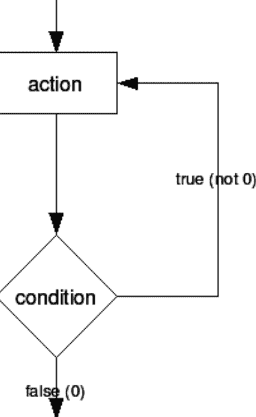
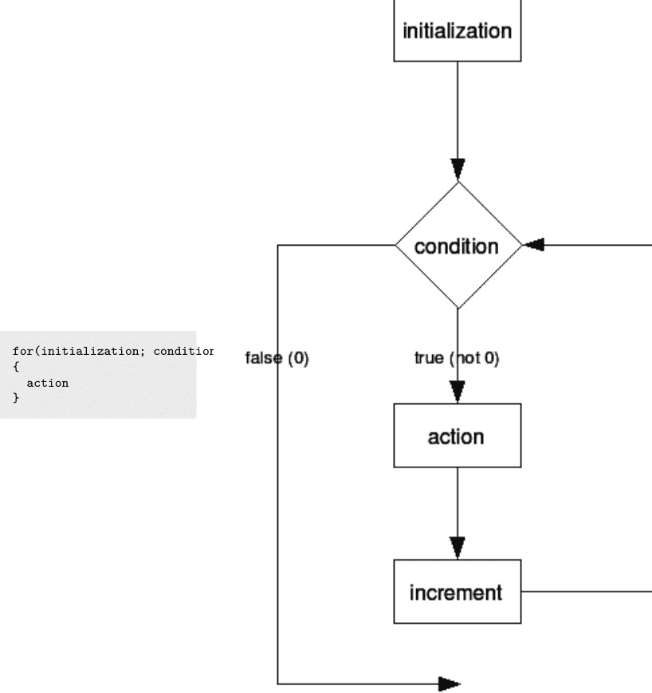

# X86 反汇编：探索 C 语言、x86 汇编与机器码之间的关系

- 12.2 GNU C 编译器 ................................................................................................................................................... 87
- 21.2 调用约定 ...................................................................................... 143
+ 25.6 代码转换 . . . . . . . . . . . . . . . . 171
+ 25.8 代码解密器 . . . . . . . . . . . . . . . . . 172
# 28 贡献者 . . . . . . . . . . . . . . . . 181

## 插图列表

### 1.1 汇编器

汇编器¹比编译器要简单得多，通常实现为仅通过一一对应关系将汇编代码翻译为二进制代码。汇编器很少在选择指令的最短形式或填充延迟槽之外进行优化。

由于汇编只是一个简单的过程，反汇编通常也同样简单。汇编指令和机器码字之间有一一对应的关系，因此每个机器码字都将精确映射到一条汇编指令。反汇编存在一些无法通过简单的代码字查找来解决的困难性。我们将在此处介绍汇编器，稍后会讨论反汇编。

### 1.2 汇编器概念

在最基础层面，汇编器将汇编指令一一对应地翻译成机器码。它们还可以将变量名翻译为硬编码的内存地址以及相对代码地址中的标签。

通常，汇编器不执行代码优化。汇编器输出的机器码等同于输入汇编器的汇编指令。某些汇编器以宏的形式具有高级功能。

在汇编过程中，程序的一些信息会丢失。首先也是最重要的是，程序数据是以原始二进制格式作为机器码指令存储的。这意味着很难确定程序的哪些部分实际上是指令。注意，你可以反汇编原始数据，但生成的汇编代码将是毫无意义的。其次，汇编源文件中的文本信息（如变量名、标签和注释）在汇编过程中都会被破坏。当你反汇编代码时，指令是相同的，但所有其他有用信息都会丢失。代码是准确的，但更难以阅读。

正如我们后面看到的，编译器会导致更多信息的丢失，而反编译往往如此复杂混乱，以至于几乎无法准确执行。

### 1.3 Intel 语法汇编器

由于基于 Intel 的 IA-32 微处理器在家庭 PC 市场的普及，大多数的汇编工作（以及本书中考虑的大多数汇编工作）都是基于 x86 的。这些汇编器（或它们的新版本）可以很好地处理 amd64/x86_64/EMT64 代码，尽管本书将主要关注 32 位（x86/IA-32）代码示例。

#### 1.3.1 MASM

MASM 是微软的汇编器，“Macro Assembler”（宏汇编器）的缩写。然而，许多人将其作为“Microsoft Assembler”（微软汇编器）的缩写，这种区别完全没有问题。MASM 拥有强大的宏功能，并能够利用其宏功能编写非常底层的语法和伪高级代码。MASM 6.15 目前可以从微软免费下载，而 MASM 7.xx 目前作为微软平台 DDK 的一部分。

- MASM 使用 Intel 语法。
- 微软使用 MASM 实现其 Windows 操作系统的一些底层部分。
- 与大众认知相反，MASM 从 1980 年以来一直在持续开发，并根据需要进行升级。
- 微软一直确保 MASM 与当前平台和可执行文件类型兼容。
- MASM 目前支持所有 Intel 指令集，包括 SSE2。

许多用户喜欢 MASM，但许多人仍然讨厌无法移植到其他系统的事实。

#### 1.3.2 TASM

TASM 是 Borland 的“Turbo Assembler”（快速汇编器），是来自 Borland 的功能性汇编器，与 Borland 的其他软件开发工具无缝集成。当前发布版本为 5.0。TASM 与 MASM 非常相似，事实也如此。

#### 1.3.3 NASM

NASM 是“Net Assembler”（网络汇编器），是来自 Borland 的功能性汇编器，与 Borland 的其他软件开发工具无缝集成。当前发布版本为 5.0。TASM 与 MASM 非常相似，事实也如此。

#### 1.3.4 FASM

FASM 是“Flat Assembler”（平面汇编器），是来自 Borland 的功能性汇编器，与 Borland 的其他软件开发工具无缝集成。当前发布版本为 5.0。TASM 与 MASM 非常相似，事实也如此。

### 1.4 (&T) 语法汇编器

#### 1.4.1 GAS

GNU 汇编器 `GAS` 作为 `GCC` 的一部分提供。某些编译器，例如微软

- * http://en.wikibooks.org/wiki/Compiler%20Construction

### 1.5 其他汇编器

#### 1.5.1 HLA

HLA³ 是“High Level Assembler”（高级汇编器）的简称，是 Randall Hyde 创建的一个项目，HLA 支持常见的汇编语言，还实现了若干高级结构，如循环、if-then-else 分支和函数。HLA 配带了完整的库。

由于 HLA 作为另一个汇编器的前端工作，程序员必须拥有另一个汇编器来汇编 HLA 程序。

- 2 http://en.wikipedia.org/wiki/GNU%Assembler
- 3 http://en.wikipedia.org/wiki/High%20Level%20Assembly

C 编译器直接将 C 和 C++ 源代码编译为机器码。而 GCC 则是将 C 和 C++ 转换为汇编语言，然后使用汇编器将其转换为相应的机器码。从反汇编器的角度来看，它发现无法精确地还原出最初创建可执行文件时所使用的 C 或 C++ 代码。然而，可以创建出与原代码编译结果完全相同、或者执行相同任务的代码。

C 语言语句与汇编语言之间并不是一一对应的关系。请考虑以下语句通常会编译成相同的汇编代码：

```
*arrayA = arrayB[x];
*arrayA = arrayB[x];
arrayA[0] = arrayB[x];

arrayA(0) = arrayB[x];
```

此外，考虑以下循环是如何执行相同任务的，并且它们可能会产生相似甚至相同的汇编代码：

```
for(;;) { ... }
while(i) { ... }
do { ... } while(i);
```

## 1.7 常见的 C/C++ 编译器

本节的目的是列出用于生产级软件开发的最常用的 C 和 C++ 编译器。世界上有很多 C 编译器，但逆向工程人员不需要考虑所有情况，特别是在查看专业软件时。本页将讨论每个编译器的优缺点（下载站点或成本信息），还将讨论如何从每种编译器生成汇编列表文件。

### 1.7.1 微软 C 编译器

微软 C 编译器由微软作为 Windows Server 2003 SDK 的一部分免费提供。它与 MS Visual Studio 中使用的编译器和库是同一个，但不带华丽的 IDE。MS C 编译器拥有非常出色的优化引擎。它可以编译 C 和 C++，并可以选择将 C++ 代码编译为 MSIL（.NET 字节码）。

微软的编译器仅支持 Windows 系统以及与 Intel 兼容的 16/32/64 位架构。

> http://en.wikibooks.org/wiki/C%2B%2B%20Programming%2FProgramming%20Languages%2FC%2B%2B%2BCode%2F%2FCompiler

### 汇编器与编译器

微软 C 编译器是 `cl.exe`，链接器是 `link.exe`。

### 列表文件

在书中，`cl.exe` 常用于生成 C 源代码的汇编列表文件。若要自己生成汇编列表文件，请使用语法：

```
cl.exe /Fa*assembly file name <C source file>
```

`/Fa*` 关是一个命令行选项，告诉编译器生成汇编列表文件。

例如，以下命令行：

```
cl.exe /Faest.asm Test.c
```

将从 C 源文件 'Test.c' 生成名为 'Test.asm' 的汇编列表文件。注意，`/Fa` 关与输出文件名之间没有空格。

### 1.7.2 GNU C 编译器

GNU C 编译器是 GNU 编译器集合 `GCC` 套件的一部分。该编译器适用于大多数系统，并且是免费软件。许多人专门使用它，以便用一个编译器处理许多平台。GNU GCC 是 Linux 和 Unix 系统的事实性标准编译器。它是可重定向的，允许许多输入语言（C, C++, Obj-C, Ada, Fortran 等），并支持多个目标操作系统和架构。它优化得良好，但 IA-32 代码生成引擎不够激进。

GCC 前端程序是 `gcc`（Windows 上的 `gcc.exe`），关联的链接器是 `ld`（Windows 上的 `ld.exe`）。

### 列表文件

要在 GCC 中生成汇编列表文件，请使用以下命令：

```
gcc -S <sourcefile>
```

例如，以下命令行：

```
gcc.exe -S test.c
```

将生成一个名为 'test.s' 的汇编列表文件。

GCC 前端程序是 `gcc`（Windows 上的 `gcc.exe`），关联的链接器是 `ld`（Windows 上的 `ld.exe`）。

### 1.7.3 Intel 编译器

Intel 编译器由 Intel 提供的，用于优化 x86 代码。它支持多种汇编语言，并可以输出 Intel 或 AT&T 语法。书中的示例将交叉使用 Intel 和 AT&T 语法，但以后可能会改变。

### 1.7.4 Metrowks CodeWarrior

该编译器通常用于 MacOS 和嵌入系统。如果你对电子产品进行逆向工程，可能会遇到 Metrowks 生成的代码。

### 1.7.5 Green Hills Software

该编译器通常用于嵌入式系统。如果你对电子产品进行逆向工程，可能会遇到 Green Hills 生成的代码。

## 2 反汇编器与反编译器

### 2.1 什么是反汇编器？

反汇编器：本质上说，**反汇编器**是汇编器的相反。汇编器将汇编语言转换为二进制机器码，反汇编器反转这一过程，从二进制机器码还原汇编代码。由于大多数汇编语言与机器码是一一对应的，反汇编过程相对直接。当然，反汇编也有自己的问题和陷阱，将在本文介绍。许多反汇编器支持输出 Intel、AT&T 或偶尔的 HLA 语法。书中示例将使用 Intel 和 AT&T 语法。

### 2.2 x86 反汇编器

在这里我们将列一些常用的反汇编工具。注意，有专业的反汇编器（需要购买许可证），也有免费/共享版反汇编器。每个反汇编器的功能都不同，因此由读者来决定偏于使用哪些工具。

#### 2.2.1 商业版反汇编器

##### IDA Pro

是一种专业的反汇编器，价格昂贵、功能强大且特性众多。IDA Pro 的缺点是单用户价格为 515 美元。存在免费版本，见下文。

- [http://www.hex-rays.com/idapro/](http://www.hex-rays.com/idapro/)

##### Hopper Disassembler

适用于 Mac 的逆向工程工具，可以反汇编、反编译和调试 32/64 位可执行文件。

#### 2.2.2 免费/共享 Windows 反汇编器

##### OllyDbg

OllyDbg 最近是最流行的反汇编器之一。它拥有庞大的社区和各种插件。它强调二进制代码分析。支持 x86 指令。

- http://www.ollydbg.de/（官方网站）
- http://www.openrc.org/downloads/browse/OllyDbg_Plugins（插件）

#### 2.2.3 Windows 反汇编器

##### Objconv

一个支持 16、32 和 64 位 x86 代码的命令行反汇编器。支持最新的指令集（SSE4, AVX, XOP, FMA 等）、多种对象文件格式、多种汇编语法方。支持 Windows、Linux、Mac。智能分析。

- http://www.agner.org/optimize/#objconv

##### x86 反汇编器

- * http://www.simtel.net/product.php (搜索 ida37fw)

##### IDA Pro 免费版

行为几乎与 IDA Pro 完全一致，但只能反汇编 Intel x86 机器码且仅限 Windows。你可以反汇编截至 2003 年可用的处理器。非商业用途免费。

- (version 4.1) http://www.themel.com/idafree.zip
- (version 4.3) http://www.datarescue.be/idafree/freeida43.exe
- (version 5.0) http://www.x-rays.com/idapro/idadownfreeware.htm

##### BORG 反汇编器

BORG 是一个带有 GUI 的优秀 Win32 反汇编器。

http://www.caesum.com/

##### HT Editor

用于 Intel x86 指令的分析反汇编器。最新版本在 Windows 上作为控制台 GUI 程序运行，但也有为 Linux 编译的版本。

http://hte.sourceforge.net/

##### diStorm64

diStorm 是一个针对 80x86 和 AMD64 的开源高度优化流反汇编库。

http://ragestorm.net/distorm/

##### crudasm

crudasm 是一个具有多种选项的开源反汇编器。它仍在开发中，附带了一个部分反编译器。

http://code.google.com/p/vm64dec/downloads/list

##### BeaEngine

BeaEngine 是一个针对 IA-32 和 intel64 架构的完整反汇编库（用 C 编写，适用于多种语言：C, Python, Delphi, WinDev, masm, nasm, Go）。

http://www.beaengine.org

##### VisualDebugger

适用于 Windows 的 64 位用户态调试器反汇编器。

http://www.duxcore.com/

##### BugDbg

是一个用于调试原生 64 位应用的 64 位调试器。

http://www.pespin.com/

##### DSMHELP

Disassemble Help 是一个带有单行多态汇编器的反汇编库。支持的指令集包括 SSE, SSE2, SSE3, SSE4, FPU, VMX, SVM, AVX2, BMI1, BMI2

http://dmshelp.narod.ru/（俄语）

## 2.2 Unix 反汇编器

##### Bastard 反汇编器

Bastard 反汇编器是一个适用于 Linux 和 FreeBSD 的强大、可脚本的反汇编器。

http://bastard.sourceforge.net/

##### udis86

用于 x86 和 x64 的反汇编库。

http://udis86.sourceforge.net/

##### Objconv

见上文。

##### ciasdis

ciasdis 的正式名称为 computer_intelligence_assembler。这种基于 Forth 的工具之处在于，所有反汇编的代码都可以重新汇编成完全相同的代码。支持的处理器有 8080, 6809, 8086, Pentium Alpha，脚本功能有助于分析 ELF 头并使该工具具有扩展性，可加载到同一站点。

http://home.ccnet/a.van.der.horst/ciasdis.html

### objdump

标准配置，通常用于对二进制文件的常规检查。请注意重定位选项和动态符号表。

##### gdb

标准配置，作为调试器使用，但也经常用于反汇编。如果你有松散数据想要反汇编，只需（交互式地）覆盖其他内容，或将其编译为程序，例如：`char foo[] = {0x90, 0xcd, 0x80, 0xcf, 0x90};`

##### linux 交互式反汇编器

一个具有某些特殊功能（如加密分析器）的交互式反汇编器。显示字符串引用、代码流分析，且不依赖 objdump。利用 Bastard 反汇编库解码单个操作码。该项目始于 2004 年，至今一直处于静态状态。

http://ida.sourceforge.net

# 反汇编器问题 (Issues)

dissy

此程序是一个使用 objdump 的交互式反汇编器。

http://code.google.com/p/dissy/

x86dis

此程序可显示二进制流，例如引导区或其他非结构化二进制文件。


ldasm

LDasm (Linux Disassembler) 是一个基于 `Perl/Tk` 的 `objdump/binutils` GUI，试图模仿 `W32Dasm` 的“外观和感受”。它搜索交叉引用（例如字符串），将代码从 `GAS` 转换为 `MASM` 风格，跟踪程序并提供更多功能。附带 `PTrace`，一个进程记录器。

`http://www.feedface.com/projects/ldasm.html`

## 2.3 反汇编器问题

正如我们之前提到的，反汇编过程存在许多问题和困难。最主要的两个困难是代码与数据的划分，以及文本信息的丢失。

### 2.3.1 代码与数据的分离

由于数据和指令都以二进制数据的形式存储在可执行文件中，因此产生了一个明显的问题：反汇编器如何区分代码和数据？给定的任何字节是变量还是指令的一部分？

如果数据仅限于可执行文件的 `.data` 段（将在后文中解释），且可执行代码仅限于 `.code` 段，那么问题就不会那么困难了，但情况通常并非如此。数据可能直接插入代码段（例如跳转地址表、常量字符串），而可执行代码可能存储在数据段（尽管许多新系统出于安全考虑防止了这一点）。

许多交互式反汇编器会给用户渲染代码或数据段的选项，但非交互式反汇编器会自动进行分离。反汇编器通常在同一行内提供对应十六进制数据的指令 AND 形式，以减少对代码性质做出决定的需求。某些反汇编器允许你根据所研究对象的内容指定要反汇编的内容或标签名称的规则。以这种方式编写自己的“爬虫”更高效；对于大型程序，交互式反汇编可能不实际，甚至到了不可行的地步。

在任意可执行程序分离代码与数据的通用问题等同于停机问题。因此，无法编写一个能够为所有可能的输入程序正确分离代码和数据的反汇编器。逆向工程充满了此类理论限制，尽管根据 `Rice's theorem`，关于程序属性的所有有趣问题都是不可判的（因此编译器许多许多处理任何形式程序的工具都会遇到此类限制）。在实践中，通过交互式与自动分析相结合以及毅力，可以处理所有旨在阻碍逆向工程的程序，例如在使用之前进行加密和解密，并在内存中移动代码。

### 2.3.2 丢失的信息

所有基于文本的标识符（如变量名、标签名和宏）在汇编过程中都被删除了。它们可能仍存在于生成的对象文件中，供调试器和链接器使用，但直接连接已经丢失。没有了这些注释和标识符，更难理解源代码的目的，并且很难确定该代码所使用的算法。

### Hex-Rays 反汇编译器

Hex-Rays 是一款商业级反汇编译器。它是作为流行的 `IDA-Pro` 反汇编器的扩展代码制作的。它是目前唯一能产生可用结果的商业反汇编译器。它支持 `x86` 和 `ARM` 架构。

```
http://www.hex-rays.com/products/decompiler/index.html
```

### DCC 反汇编译器

Dcc 是对反编译的一种极佳的理论观察，但它只支持小文件。

```
http://www.itee.uq.edu.au/-cristina/dcc.html
```

### Boomerang 反汇编译器项目

Boomerang 反汇编译器试图创建一个强大的、可重目标的反汇编译器。到目前为止，它只能反编译为 `C` 语言，且成功率一般。

```
http://boomerang.sourceforge.net/
```

### 反向工程编译器 (REC)

REC 是一个强大的“反汇编译器”，它可以将原生汇编代码反编译为类 `C` 的代码表示。该代码介于汇编和 `C` 语言之间，但比纯汇编更易读。遗憾的是，该程序似乎相当不稳定。

```
http://www.backstreet.com/rnc/rec.html
```

### ExeToC

ExeToC 反汇编译器是一个交互式反汇编译器，其结果相当出色。

```
http://sourceforge.net/projects/exetoc
```

### Decompile-It

Decompile-It 是一个针对用 `-g` 编译的 32 位 Linux `x86` 可执行文件的 Web 反汇编译器。

```
http://decompile-it.com
```

大多数 CPU 都是 8 位 CPU。⁴

通常当子程序结束时，它会立即返回执行 `call` 指令之后的下一个地址。

然而，汇编语言程序员偶尔使用几种不同的技术来调整返回地址，使反汇编变得更加困难：

- 跳转表 (`jump tables`)，
- 计算跳转 (`calculated jumps`)，以及，
- `call` 指令后的参数。

+ 4 Jim Turley. "The Two Percent Solution" `{http://www.eetimes.com/discussion/other/4024488/The-Two-Percent-Solution}`. 2002.

### 2.6.1 跳转表和其他计算跳转

对于 8 位 CPU，计算跳转通常通过将一个计算出的“返回”地址推入栈中，然后使用 `return` 指令跳转到该地址来实现。例如，`RTS Trick`⁵ 使用这种技术来实现跳转表 (`w:branch table`⁶)。

### 2.6.2 call 指令后的参数

子程序不是从栈中或某些固定全局地址获取它们的参数，而是在调用该子程序的指令之后的内存地址处提供这些地址。使用这种技术的子程序会调整返回地址以跳过常量数据，然后返回到 `call` 指令后许多字节处的地址。使用这种技术的最著名的程序之一是 `Sweet 16` 虚拟机。

这种技术可能会使反汇编变得更加困难。

大多数 32 位 CPU 使用 `ARM` 指令集⁷⁸⁹。

典型的 `ARM` 汇编代码是一系列子程序，字面量常量散落在子程序之间。子程序的标准序言（`prolog`）和结尾（`epilog`¹⁰）很容易识别。

- `asgen`¹¹ 包含通用工具，并已用于为 `8080` `8086` `80386` `Alpha` `6809` 用于 `Pentium` `68000` `6502` `8051` 制作汇编器。¹¹。

| 索引 | 参考文献 |
| :--- | :--- |
| 5 | `http://wiki.nesdes.com/w/index.php/RTS_Trick` |
| 6 | `http://en.wikipedia.org/wiki/branch32table` |
| 7 | Jim Turley. "The Two Percent Solution" [`http://www.eetimes.com/discussion/other/4024488/The-Two-Percent-Solution.`] (2002). |
| 8 | Max Huffman. "ARM Core Club Into 3G Territory" [`http://www.extremetech.com/extreme/52186-arm-cores-club-into-3g-territory.`] (2002). 虽然 Intel 和 AMD 在法庭上获得了大部分关注，但 ARM 的 32 位架构... 已经卖掉了其他。 |
| 9 | Tom Kraitz. "ARMed for the living room [`http://www.cnet.com/ARMed-for-the-living-room/2100-1056-3-6056729.html`]" - ARM 授权了 16 亿核心 [2005年]。 2006. |
| 10 | `http://en.wikibooks.org/wiki/Embedded_Systems/Mixed_C_and_Assembly_Programming%ZARMY20` |
| 11 | `http://home.hccnet.nl/a.w.man.der.horst/asgen.fr` |

- `radare`，反向工程框架¹² 包含开源工具，用于反汇编许多处理器的代码，包括 `x86`, `ARM`, `PowerPC`, `m68k` 等，包括 `java`, `msil` 等在几个虚拟机，以及包括 `Linux`, `BSD`, `OS`, `Windows`, `iPhoneOS` 等在许多平台。

- `IDA`，交互式反汇编器¹³ (`IDA Pro`¹) 可以反汇编大量处理器的代码，包括 `ARM` 架构（包括 `Thumb` 和 `Thumb-2`），`ATMEL`, `AVR`, `INTEL 8051`, `INTEL 8086`, `MOS Technologies 6502`, `MC6809`, `MC6811`, `M68H2C`, `MSP430`, `PIC 12XX`, `PIC 14XX`, `PIC 16XX`, `ZilogXX`, `Zilog Z80` 等。

- `dmoz`: "Disassemblers"⁵ 列出了大量的反汇编器。

- 程序转换反汇编¹⁶ 许多备受推荐的反汇编器。

- Wikipedia: `objdump`¹⁷ 的 GNU `binutils`，可以反汇编几个处理器和平台的代码。

- 在 `SourceForge`¹⁸ 上搜索 "disassemble" 显示了用于各种 CPU 的反汇编器。`Hopper`¹⁹ 是一种运行在 `OS-X` 上并反汇编 32/64 位 `OS-X` 和二进制文件的反汇编器。

### 3.1 反汇编

大多数 CPU 都是 8 位 CPU。⁴

通常当子程序结束时，它会立即返回执行 `call` 指令之后的下一个地址。

然而，汇编语言程序员偶尔使用几种不同的技术来调整返回地址，使反汇编变得更加困难：

- 跳转表 (`jump tables`)，
- 计算跳转 (`calculated jumps`)，以及，
- `call` 指令后的参数。

对于 8 位 CPU，计算跳转通常通过将一个计算出的“返回”地址推入栈中，然后使用 `return` 指令跳转到该地址来实现。例如，`RTS Trick`⁵ 使用这种技术来实现跳转表 (`w:branch table`⁶)。

### 3.1.2 call 指令后的参数

子程序不是从栈中或某些固定全局地址获取它们的参数，而是在调用该子程序的指令之后的内存地址处提供这些地址。使用这种技术的子程序会调整返回地址以跳过常量数据，然后返回到 `call` 指令后许多字节处的地址。使用这种技术的最著名的程序之一是 `Sweet 16` 虚拟机。

这种技术可能会使反汇编变得更加困难。

一个受著名的 `OllyDbg`⁴ 启发的全功能插件型调试器。项目页面⁵ `KDBg`

一个针对 `KDE` 的 `gdb` 前端。`http://kdbg.`

一个针对 Linux 的 Ring-0 调试器。`RR0D` 项目页面⁶

### 3.1.3 其他系统的调试器

运行在源自 AT&T Unix 的系统上的 Unix 调试器。它通常是可选开发工具包的一部分，且需要额外付费。它使用交互式命令行界面。

一个来自 HP（原数字设备公司）的 Tru64 Unix 上的上的增强型调试器，它比 `dbx` 能够更好地处理线程等高级功能。

一个位于 Solaris 上的高级工具，它可以对整个系统（包括内核）提供性能分析等许多功能。

模块化调试器 (`MDB`) 是一种用于 Solaris 操作系统环境的新型通用型调试工具。它的主要特点是其可扩展性。Solaris 模块化调试器描述了如何使用 `MDB` 调试复杂的软件系统，特别强调了调试 Solaris 内核以及相关设备驱动和模块的可用设施。它还包含了对 `MDB` 语言语法、调试器功能以及 `MDB` 模块编程 API 的完整参考和讨论。

### 设置断点

正如之前在反汇编器章节中提到的，一个输出“Hello, World!”的 6 行 `C` 程序会变成大量的汇编代码。大多数人都不希望通过筛选整个这堆乱码来寻找他们想要的信息。仅仅通过翻阅代码来寻找所需信息可能耗费大量。作为替代方案，可以选择设置断点，以便在程序运行到代码中的给定点时将其停止。

例如，假设在你的程序中，在某个特定事件之后经常遇到崩溃：在关闭消息框之后立即。你对所有 `MessageBoxA` 的调用都设置了断点。你带有断点运行程序，它会停下来并准备调用 `MessageBoxA`。此后逐行执行代码（称为*单步执行* *stepping*）并观察程序堆栈，你发现在调用后不久发生了缓冲区溢出。

+ 4 `http://ollydbg.de`

5 `http://www.codef00.com/projects.php#Debugger`

6 `http://rr0d.droids-corp.org/`

`wxEditor` 十进制编辑器能够直接查看和编辑源文件的二进制文件，对于研究专有闭源格式数据文件的结构非常有用。本节将尝试列出一些最优秀、最流行或最强大的工具。

### 3.2.1 Windows 编辑器

`wxHexEditor`（免费且开源）

针对超大文件和设备的快速十六进制编辑器，支持高达艾字节的大小，允许在不创建临时文件的情况下更改大小（插入和删除），可以使用多窗格查看文件，内置反汇编器，支持用于（反）逆向工程大型二进制文件或文件系统的标签，可以查看经过 XOR 加密的文件。

```
http://wxhexeditor.sourceforge.net/
```

`HxD`（免费软件）

一个快速且强大的免费十六进制、磁盘和内存编辑器

```
http://mh-nexus.de/hxd/
```

免费 Hex编辑器 `XVI32`

一个适用于 Windows 的免费十六进制编辑器。

```
http://www.chmaas.handshake.de/delphi/freware/xvi32/xvi32.htm
```

`HHD Software Hex Editor Neo`

一个快速的磁盘和内存编辑器，内置反汇编器和文件结构查看器。

```
http://www.hhdsoftware.com/Family/hex-editor.html
```

`Catch22 HexEdit`

这是一个具有许多功能的强大十六进制编辑器。具有极的数据结构查看器。

```
http://www.catch22.net/software/hexedit.asp
```

`Breakpoint Hex Workshop`

```
7 http://en.wikipedia.org/wiki/hex%20editor
```

一个优秀且强大的十六进制编辑器，其实用性受限于它不像其他一些选项那样免费。

`http://www.bpsoft.com/`

##### Tiny Hexer

免费且提供统计功能。

`http://www.mirkes.de/files/`

`frhed` - 免费十六进制编辑器

适用于 Windows，免费开源。

`http://www.kibria.de/frhed.html`

##### Cygnus Hex Editor

一个非常快速且易用的十六进制编辑器，提供“免费版”。

`http://www.softcircuits.com/cygnus/fe/`

##### Hexprobe Hex Editor

一个专业的十六进制编辑器，旨在包含处理十六进制数据的所有功能，在十六进制编辑和字节模式分析领域特别有用。

`http://www.hexprobe.com/hexprobe/index.htm`

##### UltraEdit32

一个十六进制编辑器/文本编辑器，曾获得 2005 年共享软件行业奖会议的“年度应用程序”奖。

`http://www.ultraedit.com/`

##### ICY Hexplorer

一个轻量级的免费开源十六进制文件编辑器，具有一些巧妙的功能，如像素视图、结构体、反汇编。

`http://explorer.sourceforge.net/`

##### WinHex

一个强大的十六进制文件和磁盘编辑器，具有计算机取证和数据恢复的高级能力（被政府和军队使用）。

`http://www.x-ways.net/index-m.html`

##### 010 Editor

一个非常强大且快速的十六进制编辑器，对数据结构和脚本有广泛支持。可以用于编辑驱动器和进程。

`http://www.sweetscape.com/010editor/`


运行在源自 AT&T Unix 的系统上的 Unix 调试器。它通常是可选开发工具包的一部分，且需要额外付费。它使用交互式命令行界面。

一个来自 HP（原数字设备公司）的 Tru64 Unix 上的增强型调试器，它比 `dbx` 能够更好地处理线程等高级功能。

一个位于 Solaris 上的高级工具，它可以对整个系统（包括内核）提供性能分析等许多功能。

模块化调试器 (`MDB`) 是一种用于 Solaris 操作系统环境的新型通用型调试工具。它的主要特点是其可扩展性。Solaris 模块化调试器描述了如何使用 `MDB` 调试复杂的软件系统，特别强调了调试 Solaris 内核以及相关设备驱动和模块的可用设施。它还包含了对 `MDB` 语言语法、调试器功能以及 `MDB` 模块编程 API 的完整参考和讨论。


### 3.1.4 调试技术

#### 设置断点

正如之前在反汇编器章节中提到的，一个输出“Hello, World!”的 6 行 C 程序会变成大量的汇编代码。大多数人都不希望通过筛选整个这堆乱码来寻找他们想要的信息。仅仅通过翻阅代码来寻找所需信息可能耗费大量。作为替代方案，可以选择设置断点，以便在程序运行到代码中的给定点时将其停止。

例如，假设在你的程序中，在某个特定事件之后经常遇到崩溃：在关闭消息框之后立即。你对所有 `MessageBoxA` 的调用都设置了断点。你带有断点运行程序，它会停下来并准备调用 `MessageBoxA`。此后逐行执行代码（称为*单步执行* *stepping*）并观察程序堆栈，你发现在调用后不久发生了缓冲区溢出。

+ 4 `http://ollydbg.de`

5 `http://www.codef00.com/projects.php#Debugger`

6 `http://rr0d.droids-corp.org/`

## 3.2 进制编辑器

`wxEditor` 十进制编辑器能够直接查看和编辑源文件的二进制文件，对于研究专有闭源格式数据文件的结构非常有用。本节将尝试列出一些最优秀、最流行或最强大的工具。

### 3.2.1 Windows 编辑器

`wxHexEditor`（免费且开源）

针对超大文件和设备的快速十六进制编辑器，支持高达艾字节的大小，允许在不创建临时文件的情况下更改大小（插入和删除），可以使用多窗格查看文件，内置反汇编器，支持用于（反）逆向工程大型二进制文件或文件系统的标签，可以查看经过 XOR 加密的文件。

```
http://wxhexeditor.sourceforge.net/
```

`HxD`（免费软件）

一个快速且强大的免费十六进制、磁盘和内存编辑器

```
http://mh-nexus.de/hxd/
```

免费 Hex编辑器 `XVI32`

一个适用于 Windows 的免费十六进制编辑器。

```
http://www.chmaas.handshake.de/delphi/freware/xvi32/xvi32.htm
```

`HHD Software Hex Editor Neo`

一个快速的磁盘和内存编辑器，内置反汇编器和文件结构查看器。

```
http://www.hhdsoftware.com/Family/hex-editor.html
```

`Catch22 HexEdit`

这是一个具有许多功能的强大十六进制编辑器。具有极的数据结构查看器。

```
http://www.catch22.net/software/hexedit.asp
```

`Breakpoint Hex Workshop`

```
7 http://en.wikipedia.org/wiki/hex%20editor
```

一个优秀且强大的十六进制编辑器，其实用性受限于它不像其他一些选项那样免费。

```
http://www.bpsoft.com/
```

##### Tiny Hexer

免费且提供统计功能。

```
http://www.mirkes.de/files/
```

`frhed` - 免费十六进制编辑器

适用于 Windows，免费开源。

```
http://www.kibria.de/frhed.html
```

##### Cygnus Hex Editor

一个非常快速且易用的十六进制编辑器，提供“免费版”。

```
http://www.softcircuits.com/cygnus/fe/
```

##### Hexprobe Hex Editor

一个专业的十六进制编辑器，旨在包含处理十六进制数据的所有功能，在十六进制编辑和字节模式分析领域特别有用。

```
http://www.hexprobe.com/hexprobe/index.htm
```

##### UltraEdit32

一个十六进制编辑器/文本编辑器，曾获得 2005 年共享软件行业奖会议的“年度应用程序”奖。

```
http://www.ultraedit.com/
```

##### ICY Hexplorer

一个轻量级的免费开源十六进制文件编辑器，具有一些巧妙的功能，如像素视图、结构体、反汇编。

```
http://explorer.sourceforge.net/
```

##### WinHex

一个强大的十六进制文件和磁盘编辑器，具有计算机取证和数据恢复的高级能力（被政府和军队使用）。

```
http://www.x-ways.net/index-m.html
```

##### 010 Editor

一个非常强大且快速的十六进制编辑器，对数据结构和脚本有广泛支持。可以用于编辑驱动器和进程。

```
http://www.sweetscape.com/010editor/
```

##### 分析工具


一个带有内置编辑器的二进制文件查看器，支持二进制、十六进制和反汇编模式。它使用原生语法进行反汇编。支持对 AVR/Java/Athon64/Pentium 4/K7-Athon 反汇编器的高亮、Runuis 编码页转换器，支持格式完整预览 - MZ, NE, PE, NLM, cod32，部分支持 - a.out, LE, LX, PharLap：代码导航器等功能。

（项目已重命名，请参阅 BEYE）

```
http://biew.sourceforge.net/en/biew.html
```

`hview`

一种基于 Aurses 的十六进制编辑器，旨在尽可能快速且以低开销处理大文件（600MB+）。

```
http://tdistortion.esmartdesign.com/Zips/hview.tz
```

##### HT Editor (HT)

一个用于可执行文件的文件编辑器/分析器。它的目标是结合调试器的低级功能和 IDE 的易用性。

```
http://hte.sourceforge.net/
```

##### HexCurve

一个用 C 语言编写的基于 ncurses 的十六进制编辑器，目前支持十六进制和十进制地址输出、跳转到指定文件位置、搜索、ASCII 和 EBCDIC 输出、加粗修改、撤销命令、快速键盘快捷键等。

```
http://www.jfish.net/description.php?title=HexCurve
```

##### hexedit

以十六进制或 ASCII 格式查看并编辑二进制文件。

```
http://rigaux.org/hexedit.html
```

##### Data Workshop (数据工作坊)

一个用于查看和修改二进制数据的编辑器；提供不同的视图，可用于编辑、分析和导出二进制数据。

```
http://www.dataworkshop.de/
```

##### VCHE

一个十六进制编辑器，可以查看视频 ROM 中看到的全部 256 个字符，甚至是控制字符和扩展 ASCII，它使用 `/dev/vcs*` 设备进行编辑。它还可以编辑非标准文件、遍历硬盘、软盘、CD-ROM、PIPs、RAM 以及几乎任何设备。它带有 ncurses 版本以及一个适用于在 X 环境下或远程工作者的原始版本。

```
http://www.grigna.com/diego/linux/vche/
```

##### DHEX

`DHEX` 是另一个带有 ncurses 差异模式（Diff-mode）的十六进制编辑器。它大量使用颜色并支持主题定制。

```
http://www.dettus.net/dhex/
```

### 3.2.3 Macintosh 十六进制编辑器

##### wxHexEditor (免费且开源)

一个专门为巨大文件和磁盘设备设计的快速十六进制编辑器，支持高达艾字节（exabyte）的大小，允许在不创建临时文件的情况下更改（插入和删除），可以使用多窗格查看文件，内置反汇编器，支持用于（逆）工程十六进制二进制文件或文件系统的标签，可以使用 XOR 加密查看文件。

```
http://wxhexeditor.sourceforge.net/
```

##### HexEdit

一个更改高亮颜色时简单但可靠的十六进制编辑器。还有一个针对 Apple Classic 用户的移植版本。

```
http://hexedit.sourceforge.net/
```

##### Hex Fiend

非常简单但尽管极其强大。下载仅需 346 KB，可处理高达 116 GB 的文件。

```
http://ridiculousfish.com/hexfiend/
```

# 3.3 其他其他 Windows 工具

### 3.3.1 资源监器

`Sysinternals Freeway`

此页面包含大量优秀的实用程序，其中许多对安全专家、网络管理员以及（对逆向工程人员最重要）非常有用。特别是检查 `Process Monitor`、`FileMon`、`RegMon`、`TCPView` 和 `Process Explorer`。

```
http://technet.microsoft.com/sysinternals/default.aspx
```

### 3.3.2 API 监视

`SpyStudio Freeway`

`Spy Studio` 软件是一个挂钩 Windows 进程、日志到 DLL 的 Windows API 调用、插入断点并更改参数的工具。

```
http://www.nektra.com/products/spystudio/
```

`rohit.com API Monitor`

`API Monitor` 是一项可以监控应用程序和服务的 API 调用的免费工具。它包含详细的参数信息、结构体、联合、调用栈、内存以及 1300+ 接口。

##### 分析工具

```
http://www.rohit.com/apimonitor
```

### 3.3. PE 文件头导出工具

### Dumpbin

`Dumpbin` 是随 Microsoft Visual Studio 提供的程序，用于导出信息。

```
dumpbin /options
```

它经常以这种方式使用：

```
link.exe /dump
```

它是处理此类转换的：

```
::dumpbin
```

这是以这种方式调用 `dumpbin` 的示例：

| 命令 | |
|--- |--- |
| `dumpbin /PORTS` | 显示从其他库导出的函数 |
| 库 | |
| `dumpbin /IMPORTS` | 显示从其他库导入的函数 |
| 可执行文件 | |
| `dumpbin /HEADERS` | 显示可执行文件的头部信息 |

```
http://msdn.microsoft.com/library/default.asp?url=..._core_dumpbin_reference.asp
```

### 依赖项

`Dependency Walker` 是一个 GUI 工具，可以查看二进制文件的导出和导入。它随许多 Microsoft 工具。

## 3.4 GNU 工具

GNU 软件包已移植到包括 Windows 在内的许多平台。

### GNU BinUtils

GNU BinUtils 包包含许多处理二进制文件非常有用的小工具。列表中最重要的程序是 GNU `objdump`、`readelf`、`GAS` 汇编器和 GNU 链接器，逆向人员可能还需要 `addr2line`、`c++filt`、`nm` 和 `readelf`。

```
http://www.gnu.org/software/binutils/
```

### objdump

dump 关于可执行文件的信息，包括符号和汇编。它是标准配置。它可以被支持非原生二进制格式。

```
objdump -p 显示从其他库导出的函数列表以及杂项头部信息
```

它用于从命令行检查 dll 依赖项

### readelf

类似于 `objdump`，但专门用于 ELF 可执行文件。

### size

列出段的大小。

### nm

列出文件的符号。

### strings

打印文件中的字符串。

### file 告诉你是文件类型。

### fold

折叠 `strings` 的结果。

### kill 可用于停止程序。

### strace

跟踪系统调用。

### 3.5 其他 Linux 工具

### oprofile

可以用于找出

### subteruge

一个对可执行文件进行戏弄的工具。用户可以为系统调用等事件编写脚本。

```
http://subteruge.org/
```

### lizard

让你反向运行程序。

```
http://lizard.sourceforge.net/
```

### dprobes

让你与内核和用户代码工作。

### biew

既是十六进制编辑器也是反汇编器。

### ltrace

显示动态可执行文件的运行时调用信息。

### asmDiff

在相同版本的二进制文件中搜索函数、指令和内存指针。支持 PE 和 ELF 文件中的 x86、x86_64 代码。

```
http://duschumpane.org/index.php/asmd
```

# Microsoft Windows

2000 (NT 5.0), Windows XP (NT 5.1), Windows Server 2003 (NT 5.2), Windows Vista (NT 6.0) 以及 Windows 7 (NT 6.1)。

Microsoft XBOX 和 XBOX 360 也运行一种 NT 的变体，该变体是从 Windows 2000 分叉出来的。大多数微软操作系统产品以某种形式基于 NT。

### 4.3 虚拟内存

32 位 WinNT 允许最大 4Gb 的虚拟内存空间，被划分为默认为 4096 字节的“页”（pages）。系统或任何应用程序未使用的页可以写入硬盘上一个称为“分页文件”（paging file）的特殊区域。使用分页文件可能会提高某些系统的性能，尽管机械硬盘（HDD）的 I/O 高延迟实际上在某些情况下会降低性能。

### 4.4 系统架构

Windows 架构是高度分层的。程序员发出的函数调用在实际执行任何操作之前，可能会被重定向 3 次或更多。从用户态应用程序调用 Win32 函数会有不可忽视的代价。然而，其优势同样不可忽视：在 Windows 系统更高层级编写的代码更容易编写。涉及初始化多个数据结构和调用多个子函数的复杂操作可以通过调用单个高层函数来完成。

Win32 API 调用 3 个模块：`KERNEL`、`USER` 和 `GDI`。`KERNEL` 函数层叠在 `NTDLL` 之上，大多数对 `KERNEL` 的调用只是简单地重定向到 `NTDLL` 调用。`USER` 和 `GDI` 均基于 `Win32K`（一个内核态模块，负责 Windows 的“外观和感受”），尽管 `USER` 也会调用 `GDI` 中更原始的函数。这者以及 `NTDLL` 都提供了指向 Windows NT 内核 `NTOSRNL`（见下后文）的接口。

`NTOSRNL` 也部分层叠在 `HAL`（硬件抽象层）之上，但本文将不再考虑这种交互。这种分层设计的目的是为了让处理器的变体问题（如资源的位置）与内核本身分离离开。因此，略有不同的系统配置只需要不同的 HAL 模块，而不是一个完全不同的内核。

### 4.5 系统调用和中断

在过滤了不同层的子程序后，大多数 API 调用都需要与操作系统的部分进行交互。服务通过“软件中断”提供，传统上通过 `int 0x2e` 指令实现。这会将执行控制切换到 NT 执行内核/内核，在该处处理请求。需要指出，内核态下使用的栈与用户态栈不同。这在内核和用户之间提供了一层额外的保护。一旦函数完成，控制权将返回给用户应用程序。

Intel 和 AMD 都提供了一组额外的指令以允许快速系统调用，Intel 的 `SYSENTER` 指令和 AMD 的 `SYSCALL` 指令。

### 4.6 Win32 API

WinNT 和 Win9x 系统都利用 Win32 API。然而，WinNT 版本的 API 有更多功能和安全结构，以及对 Unicode 支持。大多数 Win32 API 可以分解为 3 个独立的组件，每个组件执行一个单独的任务。

### 4.6.1 kernel32.dll

`Kernel32.dll` 是 `KERNEL` 子系统的所在地，是实现非图形化函数的地方。堆堆 API、虚拟内存 API、文件 I/O API、线程 API、系统对象管理器以及其他系统服务。`kernel32.dll` 的大部分功能在 `ntdll.dll` 中实现，但属于未文档的函数。微软倾向于发布 `kernel32` 的文档并保证这些 API 将保持不变，而其他库中的大部分工作则不进行记录。

### 4.6.2 gdi32.dll

`gdi32.dll` 是实现 GDI 系统的库，在此处执行原始图形操作。GDI 将大部分调用重定向到 `WIN32K`，但它确实包含一个 GDI 对象的管理器，例如笔、画刷和设备上下文。GDI 对象管理器和 KERNEL 对象管理器是完全分离的。

### 4.6.3 user32.dll

`USER` 子系统位于 `user32.dll` 库文件中。该子系统控制 `USER` 对象的创建和操作，这些是常见的屏幕项目，如窗口、菜单、光标等……`USER` 设置要绘制的对象，但将通过调用 `GDI`（`GDI` 反而会调用 `WIN32K`）或有时直接调用 `WIN32K` 执行实际绘制。`USER` 利用 GDI 对象管理器。

### 4.7 原生 API

原生 API（此处称为 `NTDLL` 子系统）是一系列未文档的 API 函数调用，处理 `KERNEL` 执行的大部分工作。微软也不保证在不同版本之间原生 API 会保持不变，微软开发者会修改软件。这带来了原生 API 调用可能在没有警告的情况下被删除或更改的风险，从而破坏利用它的软件。

### 4.7.1 ntdll.dll

`NTDLL` 子系统位于 `ntdll.dll`。该库包含许多 API 函数调用，所有调用都遵循特定的命名方案。每个函数都有一个前缀：`Ldr`, `Nt`, `Zw`, `Csr` 等，所有具有特定前缀的函数都遵循所有特定的规则。

“官方”的原生 API 通常限于前缀为 `Nt` 或 `Zw` 的函数。

- `Ldr`：代表 Load Library（加载库）
- `Nt`：代表 Native（原生）
- `Zw`：代表 Windows
- `Csr`：代表 Client Server Runtime（客户端服务器运行时）
- `Dbg`：代表 Debug（调试）
- `Rtl`：代表 Runtime（运行时）
- Memory Management：代表内存管理
- Thread：代表线程管理


- `Object`：代表对象管理
- `System`：代表系统管理
- `DLL`：代表 DLL
- `Kernel`：代表内核
- `User`：代表用户
- `GDI`：代表 Graphics Interface（图形设备接口）
- `HAL`：代表 Hardware Abstraction Layer（硬件抽象层）
- `NTOSRNL`：代表 NT System Loader（NT 系统加载器）

### 4.7.2 用户态与内核态

许多原生 API 函数在内核态导出。需要注意的是，在 Win32 和 Win64 之间，许多调用的格式是相同的，除了指针的大小以及特定的 64 位地址空间的其他数据类型。

### 4.8 ntoskrnl.exe

该模块是 Windows “执行内核”，它位于更底层的 `NTOSRNL` 之上。它负责维护操作系统的状态。

### 4.9 Win32K.sys

该模块是位于执行内核之上的“Win32内核”。`WIN32K` 负责窗口的“外观和感受”。此代码部分自 Win9x 版本以来一直保持基本不变。该模块负责将 `USER` 和 `GDI` 的 API 调用转换为显示器上看到的图像。

### 4.10 Win64 API

随着 64 位处理器的出现，64 位软件成为必须。因此，创建了 `Win64 API` 以利用新硬件。需要注意的是，在 Win32 和 Win64 之间，许多函数的格式是相同的，除了指针的大小和其他数据类型。

### 4.10.1 差异

微软发布了新的 Windows 操作系统，命名为“Windows Vista”。Vista 可能以开发代号“Longhorn”更为人。微软声称 Vista 是头开始编写的，因此可以假设 Vista 的 API 和系统架构与之前的 Windows 版本存在本质差异。Windows Vista 于 2007 年 1 月 30 日发布。

# 4.12 Windows CE/Mobile 等版本

Windows CE 是微软小型设备的产品。它与桌面系统使用相同的 Win32 API，尽管架构略有不同。

# 4.13 “不可执行内存”

最近的 Windows 服务补丁尝试实现一种被称为“不可执行内存”的系统，某些页面可以被标记为“不可执行”。该系统的目的是通过不允许控制流通过攻击者在内存缓冲区中插入的代码来防止一些常见的安全漏洞。

## 4.14 COM 及相关技术

在逆向 Windows 二进制文件时，COM 以及与 COM 相关或实际上带有华丽名称的 COM 技术是另一个需要考虑的因素。`DCOM`、`COM+`、`ActiveX`、`OLE`、`MTS` 和 `Windows DNA` 都是同一个主题的不同名称，因此它们可以被归为一类。简而言之，COM 是一种以统一、跨平台和跨语言的方式导出面向对象类的方法。本质上，COM 是 0 beta 版 .NET。通过 COM，用多种语言编写的组件可以在另一个文件（通常是 `DLL`）中导出、导入、实例化和销毁对象。`DLL` 提供了（某种程度上的）跨平台和跨语言的功能，每个 COM 对象都被编译为原生二进制文件，而不是像 Java 或 .Net 那样的中间格式。因此，COM 不需要虚拟机来执行这些此类对象。

此本书将向你介绍一些 COM 的示例以及与之相关的逆向工程，尽管这个主题非常广泛，可能超出本书的范围（或至少超出本书的前几个章节）。相关讨论可能是本书后续章节中“高级主题”的一部分。

由于 COM 的工作机制，仅仅通过检查可执行文件很难察觉 COM 组件导出的方法和数据结构。如果程序员使用了 `ATL` 等库来简化编程体验，情况会变得糟糕。遗憾的是，对于逆向工程师来说，这会将可执行文件的内容简化为“比特海洋”，到处都是点和数据结构。

## 4.15 远程过程调用 (RPC)

`RPC` 是一个通用术语，指运行在一台机器上的程序调用实际在另一台机器上执行的技术。通常，这是通过对过程所需的所有数据（包括存储在第一台机器上的任何状态）进行封，，并构建成单个数据结构，然后通过某些通信传输到另一台机器来实现。第二台机器执行请求的操作，并返回一个包含任何以及可能更改的状态信息的数据包给源机器。

在 Windows NT 中，`RPC` 通常由两个名称类似的库处理：一个根据用户态程序的请求生成 `RPC` 请求并接受 `RPC` 返回，另一个响应 `RPC` 请求并通过 `RPC` 返回结果。一个经典的例子是打印后台程序（print spooler），它由两个部分组成：`RPC` 存根 `spools.dll` 和后台程序提供程序 `spools.exe`。在大多数情况下，由于这两个模块是独立的，通过 `RPC` 进行通信似乎是多此一举；为什么不简单地将它们合并为一个例程呢？但在网络中，这是合理的，`RPC` 服务提供程序可以物理上留在带有远程打印机的远程机器上，本地机器可以完全按照控制本地打印机的方式控制远程机器上的打印机。

> 3 http://en.wikipedia.org/wiki/Active_Template_Library

## 5 Windows 可执行文件

### 5.1 MS-DOS RAM COM 文件

`COM` 文件完全按照其在磁盘上的样子被加载到 RAM 中：从硬盘镜像到 RAM 完全没有进行任何更改。这归功于早期 x86 系列的 20 位内存模型。这需要设置两个 16 位寄存器，将 1MB+64K 的内存空间划分为 65536 个“段”，并指定其中一个段的偏移量。段寄存器由 DOS 设置，`COM` 文件预期遵守此设置且永远更改段寄存器。然而，偏移量寄存器是自由的，并且（对于 `COM` 文件）的作用与 32 位寄存器相同。缺点是，由于偏移量寄存器，`COM` 文件被限制为使用 64K 的 RAM。这种方法的优点是，DOS 不需要额外的内存来加载和运行 `COM` 文件：只需加载文件，设置段寄存器，然后跳转到该处。（程序可以通过仅提供跳转偏移量来执行“近”跳转。）

`COM` 文件在偏移量 `$100$` 处加载到 RAM。此之前的空间将用于与 DOS 之间传递数据（例如，调用程序的命令行内容）。

注意，根据定义，`COM` 文件不能是 32 位的。Windows 通过特殊的 CPU 模式提供对 `COM` 文件的支持。

> 注意，MS-DOS `COM` 文件（command 文件的缩写）与组件对象模型文件不同，后者是一种面向对象的库技术。

### 5.2 MS-DOS EXE 文件

MS-DOS 编译器能够规避 64k 内存限制的一种方法是引入内存模型。其基本概念是巧妙地设置 x86 CPU 中不同的段寄存器（`CS`, `DS`, `ES`, `SS`），使其指向相同或不同的段，从而允许不同程度的内存访问。典型的内存模型有：

- **tiny**（微型）：所有内存访问均为 16 位的（从不重载任何段寄存器）。生成 `.COM` 文件而不是 `.EXE` 文件。
- **small**（小内存）：所有内存访问均为 16 位的（从不重载任何段寄存器）。
- **compact**（紧凑）：对数据段的访问重载 `CS` 寄存器，允许 32 位代码。数据访问不重载 `DS`、`ES`、`SS` 寄存器，允许 16 位数据。
- **medium**（中内存）：对数据段的访问重载 `DS`、`ES`、`SS` 寄存器，允许 32 位数据。代码访问不重载 `CS` 寄存器，允许 16 位代码。
- **large**（大内存）：代码和数据访问均使用段寄存器（`CS` 用于代码，`DS`, `ES`, `SS` 用于数据），允许 32 位代码和 32 位数据。
- **huge**（巨大内存）：与 `large` 模型相同，但通过编译器生成的额外运算允许访问大于 64k 的数组。查看 `COM` 文件时，必须判断使用了哪种内存模型。

### 5.3 PE 文件

`PE`（Portable Executable）文件是 Windows NT、95 和 Win32 的标准二进制格式。Win32 SDK 中的 `wnt.h` 声明了 `PE` 文件中使用的各种结构体和变量。`PE` 文件被拆分为若干个节。

### 5.4 相对虚拟地址 (RVA)

在 Windows 环境中，可执行模块可以加载到内存的任何位置。为了允许程序加载到内存的随机位置，`PE` 文件采用了一种称为 `RVA`（相对虚拟地址）的技术。这假设模块在内存中的加载位置是未知的。因此，`PE` 文件将内存中的位置描述为相对于基地址的偏移量。当内存中的位置未知时，该问题的解决方法描述在“重定位”（Relocations）中。反汇编模块得到的地址将与调试器中看到的地址匹配。

### 5.5 文件格式

`PE` 可执行文件格式包含若干个头部，排列如下：

| DOS header |
| PE Signature |
| COFF Header |
| Optional Header |
| Section Table |

### 5.5.1 DOS header

用十六编辑器打开任何 Win32 二进制执行文件，注意你看到的：前两个字母总是“`MZ`”。对于某些人来说，文件的前几个字节被称为“魔数”（magic number），但本书不会使用该术语，因为没有规定“魔数”必须是一个数字。相反，我们将使用“File ID”或简单的 File ID。这也称为 Signature。在 File ID 之后，十六编辑器将显示几个看起来随机的字节以及人类可读的“This program cannot run in DOS mode”。这是什么？

```
00000000 4D 5A 90 00 03 00 00 00 04 00 00 FF FF 00 00 MZ
00000010 48 00 00 00 00 00 00 40 00 00 00 00 00 00 @
00000020 00 00 00 00 00 00 00 00 00 00 00 00 00 00 00
00000030 00 00 00 00 00 00 00 00 00 00 00 00 00 00 00
00000040 0E 1F 8A 0E 0B 04 09 21 28 01 1C 24 21 54 68 L!h
00000050 69 73 20 70 70 6F 67 72 61 6D 6D 21 63 66 6F is program
00000060 74 20 62 75 20 72 75 6E 24 65 6E 64 6F 73 20 20 be run in DOS
00000070 6D 6F 74 65 2E 0D 0D 0A 24 00 00 00 00 00 00 00 mode.\$
00000080 26 63 85 62 A2 E0 D6 62 A2 E0 D6 62 A2 E0 D6 & . b . b . b . b
00000090 14 F1 RR FF 8B 6D 64 6F 7F 7B 7A 64 6A 64 66 76 74 . o . h s
```

MS-DOS 文件头十六进制列表

你正在看到的是 Win32 `PE` 文件的 DOS header。为了确保向后兼容性或通过优雅地拒绝新文件类型，微软在每个 `PE` 文件的头部设计了一系列 DOS 指令。当 32 位的 Windows 文件运行在 16 位环境中时，程序将立即终止并显示错误信息：“This program cannot run in DOS mode”。

DOS header 也被某些人称为 EXE header。以下是以 C 数据结构形式表示的 DOS header：

```
struct DOS_Header {
  char signature[2] = "MZ";
  short latype;
  short blocks;
  short nreloc;
  short dsize;
  short minalloc;
  short maxalloc;
  void *ea;
  void *sp;
  void *checksum;
  void *id;
  void *cs;
  short relics;
  short overlay;
  short reserved[4];
  short om_id;
  short om_info;
  short reserved2[10];
  long _efanew
}
```

# 文件格式

紧随 DOS 头部（DOS Header）之后的是经典错误消息“程序无法在 DOS 模式下运行”。

### 5.5.2 PE 头部

从 DOS 头部开始偏移 60 处是一个指向可执行文件（PE）文件头部的指针（MZ 结构中的 `e_l`）。DOS 将打印错误消息并终止，但 Windows 将顺着该指针找到下一组信息。

```
00000000 4D 5A 90 00 03 00 00 04 00 00 00 FF FF 00
00000010 4B 00 00 00 00 00 00 00 00 00 00 00 00 00
00
000000 00 00 00 00 00 00 00 00 00 00 01 01 (00000000000000000000)
00000030 00 00 00 00 00 00 00 00 00 00 00 00 54 68
00000040 0E 1F BA 6D 0B 49 CD 21 2B 01 4C E5 6F
00000050 69 73 20 70 6F 67 72 61 6D 20 63 61 72
00000060 74 20 63 69 73 74 74 72 72 64 61 64
00000070 62 64 65 2E 0D 0D 0A 24 00 00 00 00 00
00000080 6D 6F 64 65 20 74 6F 20 72 75 6E 20 73
00000090 E1 B1 D6 6F A2 E0 D2 E6 A2 D6
000000A0 00 00 F3 6D 00 00 62 A1 D6 5A A3 E0
000000B0 DA A4 E5 D6 63 62 A2 E0 D6 62 63 E0
000000C0 00 00 00 00 00 50 45 4C 01 03 00
```

`PE` 头部仅包含一个签名，其值为 'PE'，该签名表示：a) 这是一个合法的 `PE` 文件，且 b) 本章将不考虑字节序，并假设所有 `PE` 文件均为“小端序”（little endian）格式。

`PE` 头部定义了可执行文件中节（section）的数量。每个节的定义长度为 40 字节。以下是程序的一个十六进制片段：

```
00000000 74 65 78 74 00 00 00 00 00 00 00 0000
00000010 64 61 74 61 00 00 00 00 00 00 00 0000
00000020 72 65 73 73 00 00 00 00 00 00 00 0000
```

节的结构定义如下：

| 偏移 | 长度 | 节名称 / 描述 |
| :--- | :--- | :--- |
| 0x00 | 8 字节 | 节名称 - 在上述示例中名称为 |
| 0x08 | 4 字节 | 节加载到内存后的大小 |
| 0x0C | 4 字节 | 节加载到的相对虚拟地址 (RVA) |
| 0x10 | 4 字节 | 节在磁盘上的物理大小 |
| 0x14 | 4 字节 | 节在磁盘上的物理位置（从磁盘开始） |
| 0x18 | 12 字节 | 预留（通常为 0），用于对象格式 |
| 0x24 | 4 字节 | 节标志位 |

常见的节有：

- `.text/code/TEXT` - 包含可执行代码（机器指令）
- `.bss/TEXTBSS` - 如果启增量链接（Incremental Linking）则存在
- `.data/idata/DATA` - 包含已初始化的数据
- `.bss/BSS` - 包含未初始化的数据

### 5.5.3 COFF 头部

`COFF` 头部同时存在于 `COFF` 对象文件（链接前）和 `PE` 文件中。`COFF` 头部包含对执行有用的信息，以及一些对对象文件更有用的信息。以下是以 C 结构体形式的 `COFF` 头部：

```c
struct COFFHeader {
  short Machine;
  short NumberOfSections;
  long Timestamp;
  long PointerToSymbolTable;
  long NumberOfSymbols;
  short SizeOptionalHeader;
  short Characteristics;
};
```

## 5.5.4 PE 可选头部

“`PE` 可选头部”（`PE` Optional Header）本身并不是“可选”的，因为它在可执行文件中是必须的，而在 `COFF` 中不是。可选头部包含许多可以用于分析文件结构并获取其有用信息的内容。`PE` 可选头部直接位于 `COFF` 头部之后，某些来源将这两个头部视为同一个结构的一部分。为了方便，这里将它们分开了。以下是以 C 数据结构形式的 `PE` 可选头部：


```c
struct PEOptionalHeader {
	short signature; // 十进制数字 9054.
	char MajorLinkVersion;
	char MinorLinkVersion;
	long SizeOfCode;
	long SizeOfInitializedData;
	long SizeOfUninitializedData;
	long AddressEntryPoint; // 代码入口点的 RVA
	long SizeOfBase;
	long BaseBase;
	long ImageBase;
	long SectionAlignment;
	short FileAlignment;
	short MajorOSVersion;
	short MinorOSVersion;
	short MajorImageVersion;
	short MinorImageVersion;
	short MajorSubsystemVersion;
	short MinorSubsystemVersion;
	long Reserved;
	long SizeOfImage;
	long SizeOfHeaders;
	long Checksum;
	short Subsystem;
	short DLLCharacteristics;
	long SizeOfStackReserve;
	long SizeOfStackCommit;
	long SizeOfHeapReserve;
	long SizeOfHeapCommit;
	long LoaderFlags;
	long NumberOfRvaAndSizes;
	DataDirectory[16]; // 可以包含任意数量的元素，匹配 NumberOfRvaAndSizes。
}

// 然而，始终为 16
struct data_directory {
  long VirtualAddress;
  long Size;
}
```

一些重要的信息字段：

- `MajorLinkerVersion`, `MinorLinkerVersion`: 创建 PE 文件的链接器版本，格式为 x.y。
- `AddressEntryPoint`: 可执行文件入口点的 RVA。这非常重要。
- `SizeOfCode`: `.text` 节的大小。
- `SizeOfInitializedData`: 已初始化数据的大小。
- `BaseOfCode`: `.text` 节的 RVA。
- `BaseOfData`: `.data` 节的 RVA。
- `ImageBase`: 模块加载到内存中的首选位置。
- `Checksum`: 校验和，用于验证文件的有效性，Microsoft 提供。
- `Subsystem`: 子系统类型：
  - 1 = native
  - 2 = Windows
  - 5 = OS
  - 7 = POSIX
- `DataDirectory`: 可能最有趣的成员，以下是 Data目录的内容：
  - `IMAGE_DIRECTORY` (0): 导出
  - `IMAGE_DIRECTORY` (1): 导入
  - `IMAGE_DIRECTORY` (2): 资源
  - `IMAGE_DIRECTORY` (11): 绑定导入

### 5.6.1 节标志

节标志是一个 32 位字段（每个位代表一个特定含义）。以下是 `NT.h` 中定义的常量：

```c
#define IMAGE_SCN_TYPE_NO_PAD 0x00000008 // 预留
#define IMAGE_SCN_CNT_CODE 0x00000020 // 节
#define IMAGE_SCN_CNT_INITIALIZED_DATA 0x00000040 // 已初始化数据
#define IMAGE_SCN_CNT_UNINITIAL_DATA 0x00000080 // 未初始化数据
#define IMAGE_SCN_NNK_OTHER 0x00000100 // 预留
#define IMAGE_SCN_DATA 0x00000200 // 节信息
#define IMAGE_SCN_NNK_REMOVE 0x00000800 // 节将成为镜像
#define IMAGE_SCN_NNK_COAT 0x00001000 // 节
#define IMAGE_SCN_NO_SPEC 0x00004000 // 异常处理位
#define IMAGE_SCN_GREL 0x00008000 // 节内容可以访问
#define IMAGE_SCN_MEM_FDATA 0x00020000
#define IMAGE_SCN_MEM_PURGE 0x00040000
#define IMAGE_SCN_MEM_LOCKED 0x00080000
#define IMAGE_SCN_MEM_PRELOAD 0x00100000
#define IMAGE_SCN_ALIGN_1_BYTES 0x00200000
#define IMAGE_SCN_ALIGN_2_BYTES 0x00400000
#define IMAGE_SCN_ALIGN_4_BYTES 0x00800000
#define IMAGE_SCN_ALIGN_8_BYTES 0x01000000 // 如果未指定其他对齐值
#define IMAGE_SCN_ALIGN_16_BYTES 0x02000000
#define IMAGE_SCN_ALIGN_64_BYTES 0x04000000
#define IMAGE_SCN_ALIGN_128_BYTES 0x08000000
#define IMAGE_SCN_ALIGN_256_BYTES 0x10000000
#define IMAGE_SCN_ALIGN_512_BYTES 0x20000000
#define IMAGE_SCN_ALIGN_1024_BYTES 0x40000000
#define IMAGE_SCN_ALIGN_2048_BYTES 0x80000000 // (注：此处原文可能可能有误，2048通常对应 0xC0000000)
#define IMAGE_SCN_ALIGN_4096_BYTES 0xD0000000
#define IMAGE_SCN_ALIGN_MASK 0xE0000000
#define IMAGE_SCN_NRE_RELOC 0xF0000000 // 节结束重定位
#define IMAGE_SCN_MEM_DISCARDABLE 0x20000000 // 节可以被丢弃
#define IMAGE_SCN_MEM_NOT_CACHE 0x40000000 // 节不可缓存
#define IMAGE_SCN_MEM_NOT_PAGED 0x80000000 // 节不可分页
#define IMAGE_SCN_MEM_SHARED 0x10000000 // 节可共享
#define IMAGE_SCN_MEM_EXECUTE 0x20000000 // 节可执行
#define IMAGE_SCN_MEM_READ 0x40000000 // 节可读
#define IMAGE_SCN_MEM_WRITE 0x80000000 // 节可写
```

## 5.7 导入与导出 - 模块间的链接

### 5.7.1 什么是链接？

每当开发者编写程序时，通常预期已经实现了许多子程序和函数，这避免了作者编写更多代码或处理复杂数据结构的烦恼。相反，编码员只需要对子程序声明一次调用，然后由链接器决定接下来的操作。

链接有两种类型，可以使用：静态链接和动态链接。这种预编译代码可以插入到最终的可执行文件中以实现功能，为程序员节省大量时间。相比之下，动态链接允许子程序保留在不同的文件（或模块）中，由操作系统在运行时加载。这被称为“动态链接库”，或 `DLL` ，它是包含一组可以导出的函数或值的模块。这与可执行文件不同，可执行文件是从库导入内容来实现其功能。从这里开始，“模块”（module）是指任何 PE 格式的文件，而“库”（Library）是指任何导出和导入函数及值的模块。

- 动态链接具有以下优点：
- 如果有多个可执行文件链接到该库模块，它可以节省空间
- 允许立即更新程序，而无需为所有应用程序提供新的可执行文件
- 可以通过将库的代码映射到多个进程来节省内存空间
- 增加了实现的抽象性。可以修改实现操作的方法，而无需重新编写应用程序。这对于操作系统的向后兼容非常有用。

本节讨论了如何使用 PE 文件格式实现这一点。此时需要注意的一个重要点是，模块之间可以导入或导出任何内容，包括变量以及子程序。

### 5.7.2 加载

动态链接模块的缺点是在运行时，初始化可执行文件的软件必须将这些模块链接在一起。由于各种原因，在这里你声明“此动态库中的函数将始终存在于内存中”。如果内存地址无效或库已更新，该函数将不再存在那里，尝试使用它的应用程序将会崩溃。相反，每个模块（库或可执行文件）必须声明向其他模块导出哪些函数或值，以及它希望从其他模块导入什么。

如上所述，模块不能声明它期望函数或值位于内存的哪个位置。相反，它声明在自己的内存中哪个位置找到它想要导入的值的指针。这允许模块访问内存中出现的任何导入值，无论它出现在何处。

## 5.8 导出

导出是一个模块中的用于与其他模块共享的函数和值。这是通过使用“导出目录”（Export Directory）实现的，该目录用于翻译导出名称（或“序数”，见下文）以及查找代码或数据的内存位置。导出目录的起始由资源目录中的 `IMAGE_DIRECTORY_ENTRY` 条目标识。所有导出数据必须存在于同一个节中。该目录由以下结构引导：

```struct
struct IMAGE_EXPORT_DIRECTORY {
    long Characteristics;
    long TimeStamp;
    short MajorVersion;
    short MinorVersion;
    long Name;
    long Base;
    long NumberOfFunctions;
    long *AddressOfFunctions;
    long *AddressOfNames;
    long *AddressOfOrdinals;
}
```

`Characteristics` 值通常未使用，`TimeStamp` 描述导出生成的时间，`MajorVersion` 和 `MinorVersion` 描述目录的版本细节，但它们的性质未定义。这些值对实际导出本身几乎没有或没有影响。`Name` 值是一个指向零终止 ASCII 字符串的 RVA，即该库名称或模块的名称。

### 名称与序数

每个导出都有名称和“序数”（一种索引）。实际的导出通过 `AddressOfFunctions` 描述，它是一个指向 RVA 数组的 RVA，每个 RVA 指向要导出的函数或值。该数组的大小由 `NumberOfFunctions` 值决定。这些函数每个都有一个序数。`Base` 值用作第一个导出的序数，数组中的下一个 RVA 是 `Base+1`，依此类推。

`AddressOfFunctions` 中的每个条目通过名称识别，通过 RVA `AddressOfNames` 找到。`AddressOfNames` 指向的数据是一个 RVA 数组，每个 RVA 指向一个零终止 ASCII 字符串，每个字符串都是导出的名称。还有一个由 `AddressName` 中的 RVA 指向的第二个数组。（注：原文此处存在大量重复的占位符文本，已按逻辑处理）

## 转发 (Forwarding)

（原文此处存在大量重复的占位符文本，已按逻辑处理）

### 5.9 导入

### 5.9.1 导入

## Windows 可执行文件

（原文此处存在大量重复的占位符文本，已按逻辑处理）

### 5.9.2 运行时导入

在运行时使用上述导入目录，加载器找到相应的模块，将其加载到内存中，寻找正确的导出。然而，为了使用该导出，必须在导入模块的某处存储指针。这就是为什么有两个并行的数组 `OriginalThunk` 和 `FirstThunk`，用于识别 `IMAGE_BY_NAME` 结构。一旦解析了导入值，其指针将存储在 `FirstThunk` 数组中。随后它可以在运行时用于访问值。

### 5.9.3 绑定导入

PE 格式还支持一种被称为“绑定”（binding）的特殊功能。在加载和解析导入地址的过程中可能会非常耗时，在某些情况下需要避免。如果开发者非常确定某个库不会被更新或更改，那么导入值在内存中的地址在每次加载应用程序时都不会改变。因此，可以在运行时计算导入并存储在 `FirstThunk` 数组中，允许加载器跳过解析导入——导入被绑定到某个特定的内存位置。然而，如果模块之间的版本号过期，或者导入的库需要重定位，加载器将假设绑定地址是无效的并解析导入。

模块导入目录条目的 `Timestamp` 成员控制绑定；如果设置为 0，则导入不绑定。如果是非零，则绑定到另一个模块。然而，导入表中的 `Timestamp` 必须与模块头中的 `Timestamp` 匹配，否则绑定值将被加载器丢弃。

## 转发与绑定

如果绑定的库/模块将其导出转发到另一个模块，绑定可能会成为问题。在这些情况下，非转发的导入可以绑定，但被转发的值必须被识别，以便加载器可以解析它们。这是通过导入描述符的 `ForwarderChain` 成员实现的。`ForwarderChain` 的值是一个

50

## Windows 可执行文件

索引 `FirstThunk` 和 `OriginalFirstThunk` 数组。该 `OriginalFirstThunk` 用于标识需要解析的导入的 `IMAGE_IMPORT_BY_NAME` 结构，而 `FirstThunk` 是另一个需要解析的条目的索引。此过程持续持续直到 `FirstThunk` 的值为 -1，表示没有更多需要导入的转发值。

### 5.10 资源

### 5.10.1 资源结构

资源是模块中的数据项，使用所选编程语言很难存储或描述。这需要一个单独的编译器或资源生成器，允许插入对话框、图标、菜单、图像以及其他类型的资源（包括任意的二进制数据）。然后可以使用若干 API 调用从模块中检索资源。资源数据的基指向数据中的 `IMAGE_DIRECTORY_ENTRY` 条目，在该位置有一个 `IMAGE_RESOURCE_DIRECTORY` 结构：

```c
struct IMAGE_RESOURCE_DIRECTORY
{
    long Characteristics;
    long DateStamp;
    short MajorVersion;
    short MinorVersion;
    short NumberOfNamedEntries;
    short NumberOfIdEntries;
}
```

`Characteristics` 未被使用，`DateStamp` 通常是创建时间，尽管设置与否并不重要。`MajorVersion` 和 `MinorVersion` 与资源的版本信息有关：这些字段没有定义值。紧随 `IMAGE_RESOURCE_DIRECTORY_ENTRY` 之后，其数量由 `NumberNamedEntries` 和 `NumberOfIdEntries` 的总和定义。这些条目的的第一部分用于命名资源，后半部分用于 ID 资源，取决于 `IMAGE_RESOURCE_DIRECTORY` 结构中的值。资源结构的实际形状如下：

```c
struct IMAGE_RESOURCE_DIRECTORY_ENTRY
{
    long NameId;
    long *Data;
}
```

`NameId` 具有双重用途：如果最高位（或符号位）为 0，则低 16 位是资源的 ID 编号。或者，如果最高位被置，则这 31 位构成了从资源数据开始到该特定资源名称字符串的偏移量。`Data` 值也具有双重用途：如果最高位被置，则剩余的 31 位形成从资源数据开始到另一个 `IMAGE_RESOURCE_DIRECTORY` 的偏移量（即该条目是资源树的内部节点）。否则，这是一个叶子节点，`Data` 包含从资源数据开始到描述资源数据本身细节的结构的偏移量（可以被视为有序字节流）；

```c
struct IMAGE_RESOURCE_DATA_ENTRY
{
  long *Data;
  long Size;
  long CodePage;
  long Reserved;
}
```

`Data` 值包含指向实际资源数据的 RVA，`Size` 自言易懂，`CodePage` 包含用于解码资源中 Unicode 编码字符串的 Unicode 编码页（如果有的话）。`Reserved` 应被设置为 0。

### 5.10.2 布局

上述资源目录条目系统允许通过名称或 ID 编号简单存储资源。然而，这会很快变得复杂。不同类型的资源、资源本身以及其他语言中的资源实例可能会在资源资源目录中混在一起。由于这个原因，资源目录被赋予了一个工作结构，允许将不同的资源分开。

为了实现这一目的，资源条目的 'Data' 值指向另一个 `IMAGE_RESOURCE_DIRECTORY`，形成了一种类似于树形图的资源组织。第一层资源条目标识资源类型：光标、位图、图标及类似。它们使用 ID 方法来标识资源条目，总共有两个定义值。可以添加更多用户定义的资源类型。这些资源条目中的每一个都指向一个资源目录，命名资源本身。这些可以是任何名称或值。它们又指向另一个资源目录，该目录使用 ID 编号区分语言，允许为使用不同语言的系统提供不同的特定资源。最后，语言目录中的条目实际上提供了资源数据本身的偏移量，其格式未由 PE 规范定义，可以被视为任意字节流。

### 5.11 重定位

## 5.12 备绑定导入结构

## 5.13 Windows DLL 文件

Windows DLL 文件是 PE 文件的一种类型，但有几个关键区别：

- `.DLL` 文件扩展名
- `DLLMain()` 入口点，而不是 `WinMain()` 或 `main()`。
- PE 头中设置了 DLL 标志。

DLL 可以通过两种方式之一加载：a) 在加载时，b) 通过调用 `LoadModule()` Win32 API 函数。


### 5.13.1 函数导出

函数使用以下语法从 DLL 文件导出：

```c
__declspec(dllexport) void myFunction()...
```

- 这里的 `declspec` 关键字不是 C 语言标准，但被许多编译器实现以扩展函数和变量的特定选项。Microsoft C 编译器和运行在 Windows 上的 GCC 版本允许 `__declspec` 关键字和 `dllexport` 选项。

函数也可以从普通的 `.exe` 文件导出，带有导出函数的 `.exe` 文件可以类似于 `.dll` 文件的方式被动态调用。然而，这种情况很少见。

### 5.13.2 识别 DLL 导出

有几种方法可以确定 DLL 导出了哪些函数。本书将使用的（通常是隐式的）方法是 `dumpbin`：

```
dumpbin /EXPORTS <dll file>
```

### 6.3 配置文件

### 6.4 Shell（外壳）

这里是一些常用的 Shell：

- Bash

  - “Bourne Again SHell”的缩写。

- Bourne

  - Bash 的前身。

- Csh

  - C 壳

- Ksh

  - Korn Shell

- TCsh

  - 一个面向终端的 Csh。

- Zsh

  - Z Shell

### 6.5 GUI（图形化用户界面）

一些比较流行的 GUI：

- KDE

  - K 桌面环境

- GNOME

  - GNU 网络对象建模环境

### 6.6 调试器

- `gdb`

  GNU² 调试器³。它在大多数 Linux 发行版中都是预装的，主要用于调试 ELF⁴ 可执行文件。[manpage（帮助手册）⁵

```
2 http://en.wikibooks.org/wiki/Debugger
3 http://en.wikibooks.org/wiki/Debugger
4 http://en.wikibooks.org/wiki/ELF
5 http://www.die.net/doc/linux/man/man1/gdb.1.html
```

- `winedbg`

  用于 Wine⁶ 的调试器，用于在 Linux 下调试 Win32 可执行文件。[manpage（帮助手册）⁷

- `edb`

  一个受著名的的 OllyDbg⁸ 启发的全功能插件型调试器。[项目页面⁹

## 6.7 文件分析器

- `strings`

  查找文件中的可打印字符串。例如，当密码存储在二进制文件本身时（在源代码中静态定义），可以从二进制文件中提取该字符串，而无需执行它。[manpage¹¹⁰⁰

- `file`

  确定文件类型，用于判断可执行文件是否已剥离符号（stripped），以及它是动态（还是静态）链接的。[manpage¹¹¹

- `objdump`

  反汇编对象文件、可执行文件和库。可以列出内部文件结构并反汇编特定部分。支持 Intel 和 AT&T 语法。

- `nm`

  列出可执行文件中的符号。不支持已剥离符号的二进制文件。主要用于可执行文件的调试版本。

+ 6 http://en.wikibooks.org/wiki/Wine

7 http://www.die.net/doc/linux/man/1/winedbg.html

8 http://ollydbg.de

9 http://www.codef00.com/projects.php?Debugger

10 http://www.doc.ic.ac.uk/lab/labman/lookup-man.cgi?strings(1)

11 http://www.doc.ic.ac.uk/lab/labman/lookup-man.cgi?file(1)

## 7 Linux 可执行文件

### 7.1 a.out 文件

`a.out` 是一种非常简单的格式，由一个头部（位于偏移量 0 处）组成，该头部包含 3 个可执行段（代码、数据、bss）的大小，以及指向重定位信息（针对 `.o` 文件）、符号和符号字符串等额外信息的指针。实际段的内容紧随头部。不同段的偏移量根据前一个段的大小计算得出。

### 7.1.1 ELF 格式

### 7.2 ELF 文件

可执行与链接格式¹Executable and Linkable Format）

**ELF 文件格式**（Executable and Linking Format 的缩写）由 Unix 系统实验室开发，作为 COFF 和 `a.out` 等之前格式的后续者。在许多方面，ELF 格式比之前的格式更强大、更灵活，已广泛成为 Linux、Solaris、IRIX 和 FreeBSD 的标准（尽管基于 FreeBSD 的 Mac OS X 使用 Mach-O 格式）。ELF 也被 OpenVMS 用于 Titanium 以及 BeOs 用于 x86。

从历史上看，Linux 并不总是使用 ELF；Red Hat Linux 4 是第一个使用 ELF 的分发行版；之前的版本使用 `a.out` 格式。

ELF 对象被分为不同的段（segments）和/或节（sections）。可以通过第一个字节处的 ELF 头部找到这些位置。ELF 头部提供了程序头部（program header）和节头部（section header）的位置。使用这些数据结构可以找到 ELF 对象的其余内容，包括包含代码和数据的 `.text` 和 `.data` 段。

来自 binutils 包的 GNU `readelf` 实用是解析 ELF 对象的常用工具。

> $1 http://en.wikipedia.org/wiki/Executable%20and%20Linkable%20Format$

### 7.2.1 文件格式

| ELF 头部 |

| :--- |

| 程序头部表 |

| .text |

| .rodata |

| ... |

| .data |

| 节头部表 |

**图 6** 一个 ELF 文件有两个视图：程序头部显示运行时使用的段，而节头部列出了二进制文件的一组节。

每个 ELF 文件由一个 ELF 头部后跟文件数据组成。文件数据可以包括：

- 程序头部表，描述零或多个节

- 节头部表，描述零或多个节

- 指向程序头部或节头部表条目的数据

段包含了文件在执行执行所必需的信息，而节包含了链接和重定位的重要数据。文件中的每个字节一次时间不会被超过一个节占用，但可能存在未被任何节覆盖的孤立字节。在 Unix 可执行文件的正常情况下，一个或多个节被包含在一个段中。

## 7.3 可重定位 ELF 文件

## 8 栈

### 8.1 栈

通常情况下，栈（Stack）是一种后入先出（LIFO）的数据结构。

## 9 函数与栈帧（Stack Frames）

为了适应执行环境中的许多不确定性，函数通常会设置一个“栈帧”（stack frame），以便访问函数参数和自动局部变量。栈帧的核心思想是：每个子程序都可以独立于其在栈上的位置运行，并且每个子程序都可以表现得就像它位于栈顶端一样。

当函数被调用时，会在当前的 `esp` 位置创建一个新的栈帧。栈帧的作用就像栈上的一个分区。之前函数的所有项都在栈的高处，每个当前函数拥有栈的剩余部分（从栈帧到栈页的结束）。当前函数始终可以访问栈的“顶部”，因此函数不需要考虑其他函数或程序的内存使用情况。

### 9.2 标准入口序列（Standard Entry Sequence）

| 此代码示例使用了 MASM 语法 |

对于许多编译器来说，标准的函数入口序列是以下代码（X 是函数中使用的所有自动变量的总大小，以字节为单位）：

```
push ebp
mov ebp, esp
sub esp, X
```

例如，这里有一个 C 函数片段以及生成的汇编指令：

```c
void MyFunction() {
    int a, b, c;
}
```

```
MyFunction:
    push ebp          ; 保存 ebp 的值
    mov ebp, esp      ; ebp 现在指向栈顶
    sub esp, 12       ; 在栈上为局部变量分配空间
```

这意味着可以通过引用 `ebp` 来访问局部变量。考虑以下 C 代码片段和对应的汇编代码：

```c
a = 10;
```

```c
b = 5;
c = 2;
```

```
mov [ebp] -4, 10;    ; 变量 a 的位置
mov [ebp] -8, 5;     ; b 的位置
mov [ebp] -12, 2    ; c 的位置
```

这些看起来都很好，但 `ebp` 的作用是什么？为什么要保存 `ebp` 的旧值并将其推栈，只为了通过下一条指令改变 `esp` 的值？答案是*函数参数*。

考虑以下函数声明：

```c
void MyFunction2(int x, int y, int z)
{
    ...
}
```

它产生以下汇编代码：

```
_MyFunction2:
push ebp
mov ebp, esp
sub esp, 0      ; 没有局部变量，大多数编译器会跳过此行
```

这完全符合预。。那么，`ebp` 究竟做了什么，函数参数存储在哪里？答案在调用函数时就能找到。

考虑以下函数调用：

`MyFunction2(10, 5, 2);`

这将创建以下汇编代码（使用从右到左的调用约定 CDECL，后文会解释）：

```
push 2
push 5
push 10
call _MyFunction2
```

**注意：** 记住 x86 的 `call` 指令基本上等同于

```
push ebp + 2    ; 返回地址 + 两个条指令的大小
jmp _MyFunction2
```

事实证明，函数参数都在栈上！因此，当我们把栈指针（`esp`）的值移动到 `ebp` 时，我们让 `ebp` 直接指向函数参数。当函数推入和弹出值时，`ebp` 不受 `esp` 的影响。记住推入（push）操作基本上是这样的：

```
sub esp, 4      ; 为新的栈项“分配”空间
mov [esp], X    ; 放入新栈项的值 X
```

这意味着返回地址以及 `ebp` 的旧值被放在栈上。因此，`[ebp]` 指向 `ebp` 旧值的位置，`[ebp + 4]` 指向返回地址，`[ebp + 8]` 指向第一个函数参数。以下是此时栈的（粗略表示）：

| | |

|---|---||

| 2 | [ebp + 16] (第3个函数参数) |

| 5 | [ebp + 12] (第2个参数) |

| 10 | [ebp - 8] (第1个参数) |

| RA | [ebp + 4] (返回地址) |

| FP | [ebp] (旧 ebp 值) |

| | [ebp - 4] (局部变量列表)|

栈指针在当前函数的执行期间可能会发生变化。这种情况发生在：

- * 参数被传递到另一个函数中；

- 使用了伪函数 `alloca()`。

[FIXME: 当参数传递到另一个函数时，`esp` 的变化不是问题。当函数返回时，`esp` 将恢复到旧值。为什么 `ebp` 在这里有帮助。这需要更好的解释。（真正的解释是，其实并不需要 ESP：http://blogs.msdn.com/larryosterman/archive/2007/03/12/fpo.aspx)] 这意味着无法可靠地使用 `esp` 的值来确定（适当的偏移）特定变量的位置。为了解决这个问题，许多编译器使用相对于 `ebp` 寄存器的负偏移量来访问局部变量。这允许我们假设使用相同的偏移量始终访问相同的变量（或参数）。由于这个原因，`ebp` 寄存器被称为**帧指针**（frame pointer），或 FP。

### 9.3 退出序列（Exit Sequence）

退出序列必须顺序撤销入口序列执行的操作：

1. 移除局部变量，恢复到旧值。

2. 恢复 `ebp` 的旧值。

3. 返回到调用者。

### 9.4 非标准帧（Non-Standard Frames）

某些函数按照上述方法设置了标准的栈帧，但开头有一行无意义的指令：

```
mov edi, edi;
```

这条指令被汇编成 2 个字节，为未来的补丁提供占位符。整体来看，这样的函数可能如下：

```
nop
nop
nop
nop

FUNCTION: <-- 这是 call 指令使用的入口点
```

#### 9.4.1 使用未初始化的寄存器

编译器经常会遇到没有设置栈帧的子程序。在查看它时，需要考虑以下几点：

#### 9.4.2 "static" 函数

在 C 中，函数可以使用 `static` 关键字声明。`static` 关键字导致函数具有局部作用域，这意味着它可能被外部函数访问。当优化编译器看到一个静态函数时：

```c
static void MyFunction4();
```

#### 9.4.3 热补丁序言（Hot Patch Prologue）

如果需要通过重新加载应用程序（在内核补丁中为重启）来替换此类函数，可以通过插入跳转到替换函数的指令来实现。短跳转（可以跳转 +/-127 字节）需要 2 个字节的存储空间——正是 `mov edi, edi` 占位符提供的空间。跳转到任何内存位置（在这种情况下到我们的替换函数）需要 5 个字节。这些由函数之前的 5 个无操作字节提供。如果一个被补丁的函数调用它，它会先回跳 5 个字节，然后长跳转到替换函数。补丁后，内存可能如下：

```
LABEL:
mp REPLACEMENT_FUNCTION;-- 5 个 NOP 被替换为 jmp

FUNCTION:
jmp short LABEL; <-- mov edi 已替换为
向后跳转
push ebp
mov ebp,                与之前相同的标准栈帧设置
```

### 9.5 局部静态变量（Local Static Variables）

局部静态变量不能创建在栈上，因为变量的值在函数调用之间会被保留。我们将在后面的章节讨论局部静态变量和其他类型的变量。

# #10 函数与栈帧示例

### 10.1 示例：参数数量

此代码示例使用了 MASM 语法。

给定以下反汇编后的函数（使用 MASM 语法），该函数接收了多少个 4 字节参数？栈上创建了多少个变量？该函数的作用是什么？

```assembly
_Question:
push ebp
mov ebp, esp
sub esp, 4
mov eax, [ebp + 8]
mul 2
mov [esp + 0], eax
mov eax, [ebp + 12]
mov edx, [esp + 0]
add eax, edx
mov esp, ebp
pop ebp
ret
```

上述函数接收了 2 个 4 字节参数，通过 ebp 的偏移量 +8 和 +12 访问。该函数在栈上还创建了 1 个变量，通过 esp 的偏移量 +0 访问。该函数与以下 C 代码几乎一致：

```c
int Question(int x, int y)
{
    int z;
    z = x * 2;
    return y + z;
}
```

## 10.2 示例：标准入口序列

此代码示例使用了 MASM 语法。

以下函数是否遵循标准的入口和退出序列？如果不遵循，它在何处不同？

```assembly
_Question2:
call _SubQuestion2
mul 2
ret
```

该函数没有遵循标准的入口序列，因为它没有使用 ebp 和 esp 建立一个的栈帧。该函数基本上执行了以下 C 指令：

```c
int Question2()
{
    return SubQuestion2() * 2;
}
```

尽管优化型编译器选择了采取一些捷径。

## 11 调用约定

### 11.1 调用约定

调用约定（Calling conventions）是机器用于实现和调用函数的标准化方法。调用约定规定了编译器设置的用于访问子程序的方法。从理论上讲，只要所有函数都具有相同的调用约定，来自任何编译器的代码都可以相互接口。但在实践中，情况并非总是如此。

调用约定规定了参数如何传递给函数、返回值如何传回函数、以及函数如何管理栈及其栈帧。简而言之，就是规定了 C 或 C++ 中的函数调用如何转换为汇编代码。无需解释，为什么指定某些标准方法是如此重要。如果不存在这些标准约定，使用不同编译器创建的程序几乎无法相互通信和交互。

C 语言中使用了三种主要的调用约定：STDCALL、CDECL 和 FASTCALL。此外，还有另一种通常用于 C++ 的调用约定：THISCALL。其他其他调用约定，包括 PASCAL 和 FORTRAN 约定等。我们将在本书中不考虑这些约定。

### 11.2 术语说明

在本章中我们将使用几个术语，它们大多是常识，但直接指出是有价值的：

**传递参数 (Passing arguments)**


*传递参数*（passing arguments）是一种表达方式，指调用函数正在向被调用函数查找参数的地方写入数据。参数在调用指令执行之前传递。

## 从右到左和从左到右 (Right-to-Left and Left-to-Right)

这些描述了从高级代码的角度来看参数传递给子程序的方式。例如，以下 C 函数调用：

```c
MyFunction(a, b);
```

> 1 http://en.wikipedia.org/wiki/Calling%20convention

如果从左到右传递，它将生成以下代码：

```assembly
push a
push b
call _Function
```

如果从右到左传递，它将生成以下代码：

```assembly
push b
push a
call _Function
```

## 返回值 (Return value)

某些函数返回一个值，该值必须由函数的调用者可靠地接收。被调用函数将其返回值放在一个位置，以便调用函数在执行返回时可以获取它。被调用函数在执行 `ret` 指令之前存储返回值。

## 清理栈 (Cleaning the stack)

当参数被推入栈中时，最终必须被再次弹出。无论调用者还是被调用者负责清理栈，都需要重置栈指针以消除传递的参数。

## 调用函数（被调用者 callee）

调用子程序的“父”函数。在子程序调用后，执行直接在调用函数中恢复，除非程序在子程序内部终止。

## 被调用函数（调用者 callee）

被“父”函数调用的“子”函数。

## 名称修饰 (Name Decoration)

当 C 翻译为汇编代码时，编译器通常会通过添加额外信息来“修饰”函数名，链接器将使用这些信息查找并链接到正确的函数。对于大多数调用约定，修饰非常简单（通常只需一两个符号来表示调用约定），但在某些极端情况下（特别是 C++ 的“混结”mangled 约定），名称会被严重变形。

## 入口序列（函数序言 function prologue）

在函数开始处的指令，用于准备栈和寄存器供使用。

## 退出序列（函数尾声 epilogue）

在函数结束处的指令，用于恢复栈和寄存器到调用者的状态。

## 调用序列 (Call sequence)

在函数中间的指令，用于被调用函数。在被调用函数返回后，某些调用约定清理栈。

### 标准调用约定

C 语言默认使用 `CDECL`，但如果你想使用 `CDECL` 以外的调用约定，必须在函数声明中指定。这是因为 `CDECL` 允许变长参数。

#### 11.3.1 CDECL

在 `CDECL` 调用约定下，遵循以下：

- 参数从左到右传递，返回值通过 `eax` 。
- 调用者清理栈。这允许 `CDECL` 函数具有变长参数列表（即变参函数）²

考虑以下 C 指令：

```c
int Question(int x, int y)
{
    int z;
    z = x * 2;
    return y + z;
}
```

以及以下函数调用：

```c
x = MyFunction(2, 3);
```

它们将产生相应的汇编列表：

```assembly
MyFunction:
push ebp
mov ebp, esp
mov eax, [ebp + 8]
mov edx, [ebp + 12]
```

> 2 http://en.wikipedia.org/wiki/Variadic_function

```assembly
add eax, edx
pop ebp
ret
```

```assembly
push 3
push 2
call _MyFunction
add esp, 8
```

翻译成汇编代码时，`CDECL` 函数几乎总是带有下划线前缀。

#### 11.3.2 STDCALL

`STAPI`（取决于你阅读的地方，还有其他名称）几乎被微软称为 Win32 API 的标准调用约定。由于 `STDCALL` 由微软严格定义，所有实现它的编译器方式都相同：

- 参数从右到左传递，并在 `eax` 返回。（微软文档错误地声称参数是从左到右传递的，但事实并非如此）。
- 被调用函数清理栈，与 `CDECL` 不同。这意味着 `STDCALL` 不允许变长参数列表。

考虑以下函数：

```c
_stdcall int MyFunction2(int a, int b)
{
    return a + b;
}
```

以及调用指令：

```c
x = MyFunction2(2, 3);
```

这将产生相应的汇编片段：

```assembly
:_MyFunction08
push ebp
mov ebp, esp
mov eax, [ebp + 8]
mov edx, [ebp + 12]
add eax, edx
pop ebp
ret
```

```assembly
and
push 3
push 2
call _MyFunction08
```

这里有几点重要的说明需要注意：

1. 在函数体中，`ret` 指令有一个（可选的）参数，用于指示函数返回时从栈中弹出多少字节。
2. `STDCALL` 函数以前导的下划线进行名称修饰，随后跟上 `@`，然后是传递到栈上的参数数量（字节数）。在 32 位对齐机器上，此数字将是 4 的倍数。

### 11.3.3 FASTCALL

`FASTCALL` 调用约定在所有编译器中并不完全标准，因此应该应谨慎使用。在 `FASTCALL` 中，前 2 或 3 个 32 位（或更小）参数通过寄存器传递，最常用的寄存器是 `edx`、`eax` 和 `ecx`。额外的参数或大于 4 字节的参数通过栈传递，通常按照从右到左的顺序（类似于 `CDECL`）。如果需要，调用函数通常负责清理栈。

由于存在歧义性，建议仅在对速度至关重要且只有 1、2 或 32 位参数的情况下使用 `FASTCALL`。

以下 C 函数：

```c
_fastcall int MyFunction3(int a, int b)
{
return a + b;
}
```

以及以下 C 调用：

```c
x = MyFunction3(2, 3);
```

将分别为被调用函数和调用函数产生以下汇编代码片段：

```
@MyFunction3
push ebp
mov eax, esp ;许多编译器即使在使用时不也会创建一个栈帧
add eax, edx ;a 在 eax 中，b 在 edx 中
pop ebp
ret
```

以及

```
;the calling function
mov eax, 2
mov edx, 3
call @MyFunction3
```

`FASTCALL` 的名称修饰在函数名前面加上一个 `@`，并在函数名后跟上 `@x`，其中 `x` 是传递给函数的参数数量（字节数）。

许多编译器仍然为 `FASTCALL` 函数生成栈帧，特别是在 `FASTCALL` 函数本身调用另一个子程序的情况下。然而，如果 `FASTCALL` 函数不需要栈帧，优化型编译器可以自由省略它。

### 11.4 C++ 调用约定

C++ 要求类的非静态方法必须通过类的实例来调用。因此，它使用标准的调用约定来确保将对象的指针传递给函数：`THISCALL`。

#### 11.4.1 THISCALL

在 `THISCALL` 中，指向类对象的指针通过 `ecx` 传递，参数在栈上按从右到左顺序传递，返回值通过 `eax` 传递。

例如，C++ 指令：

```
MyObj.MyMethod(a, b, c);
```

将形成以下汇编代码：

```
mov ecx, MyObj
push c
push b
push a
call _MyMethod
```

至少，如果不是**名称修饰（name mangling）**，*它看起来就像*上面的汇编代码。

#### 11.4.2 名称修饰 (Name Mangling)

什么是名称修饰？由于函数重载固有的复杂性，C++ 函数的名称修饰程度以至于人们经常将该过程称为“名称修饰”。遗憾的是，由于标准没有强制规定约定，C++ 编译器可以自由以不同的方式进行名称修饰。此外，异常处理等其他问题也没有标准化。

由于每个编译器的名称修饰方式都不同，本书将不会花费太多时间讨论算法的细节。请注意，在许多情况下，可以通过检查名称修饰格式的细节来确定是由哪个编译器创建的可执行文件。然而，我们在书中不会深入讨论这个主题。

以下是关于 `THISCALL` 名称修饰函数的几般备注：

- 与 `CDECL`、`FASTCALL` 和 `STDCALL` 函数声明相比，由于其复杂性一眼就能识别。
- 它们有时包含函数类的名称。
- 它们几乎总是包含参数的数量和类型，以便可以通过传递的参数来区分重载函数。

这里是一个 C++ 类和函数声明的示例：

3 http://en.wikipedia.org/wiki/Name%20mangling

```
class MyClass {
  MyFunction(int a);
}

MyClass::MyFunction(int a)
```

这里是生成的修饰名：

```
?Function@MyClass@@QAEHNZ
```

#### 11.4.3 Extern "C"

在 C++ 源文件中，放置在 `extern "C"` 块中的函数保证不会被修饰。这在用 C++ 编写库且需要在不进行修饰的情况下导出函数时使用。尽管程序是用 C++ 编写并用 C++ 编译器编译的，但某些函数可能不会被修饰，并将使用普通的 C 调用约定（通常是 `CDECL`）。

### 11.5 关于名称修饰的说明

在本章中我们讨论了名称修饰，但事实是，在纯反汇编代码中没有任何名称，特别是带有花哨修饰的名称。汇编阶段会移除所有这些可读标识符，并代之替换为二进制位置。函数名称实际上只出现在两个地方：

- 1. 编译期间产生的列表文件
- 2. 在导出表中（如果函数被导出）

在反汇编机器码时，将没有函数名，也没有名称修饰可以检查。

（注：原文后续部分存在大量重复内容，此处已按要求停止重复输出相同文本。）

没有通过 SP 的正偏移访问的参数，它们似乎没有被推入其中，因此可以使用 `ret 0`。让我们进行进一步调查：

```c
int FastTest(int x, int y, int z, int a, int b, int c)
{
    return x * y * z * a * b * c;
}
```

对应的列表：

```
@PUBLIC @FastTest24
_TEXT1 SEGMENT
-y = -8; size = 4
-x = -4; size = 4
-z = 8; size = 4
-a = 12; size = 4
-b = 16; size = 4
-c = 20; size = 4
@FastTest24 PROC NEAR
;-z = ecz
;-y = edx
```

```
; Line 2
    push ebp
    sub ebp, esp
    mov y$[ebp], edx
    mov x$[ebp], ecx
; Line 3
    mov eax, DWORD PTR z$[ebp]
    mov eax, DWORD PTR y$[ebp]
    mov eax, DWORD PTR a$[ebp]
    mov eax, DWORD PTR b$[ebp]
    mov eax, DWORD PTR c$[ebp]
; Line 4
    mov ebp, ebp
    pop
    ret 16 ; 0000010H
```

现在我们有 6 个参数，其中四个由调用者从右到左推入栈，最后两个像之前的示例一样再次通过 `cx/dx` 传递。栈清理由 `ret 16` 完成，这对应于调用前传递的 4 个参数。

对于 `FASTCALL`，编译器将尝试在寄存器中传递参数，如果空间不够，调用者仍会将它们从右到左推入栈。栈清理由被调用者完成。之所以被称为 `FASTCALL`，是因为参数可以通过寄存器传递（对于 64 位 CPU，最大数量为 6），则不需要栈推入/清理。

函数的名称修饰方案：`@MyFunction@`，这里的 `n` 是所有参数所需的栈大小。

### 12.1.3 STDCALL

```c
int MyFunction(int x, int y)
{
    return (x * 2) + (y * 3);
```

变为：

##### 调用约定示例

```
PUBLIC          _MyFunction8
_TEXT
    x = 8              ; size = 4
y = 12             ; size = 4
    _MyFunction8 PROC NEAR
    ; Line 4
    push           ebp
    mov            ebp, esp
    ; Line 5
    mov            eax, y$[ebp]
    imul           eax, eax
    mov            ecx, x$[ebp]
    lea            eax, [eax+ecx*2]
    ; Line 6
    pop            ebp
    ret
_MyFunction8 ENDP
_TEXT
END
```

`STDCALL` 列表与 `CDECL` 列表的唯一区别在于它使用 `ret 8` 来自动清理栈。让我们看一个带有更多参数的示例：

```c
int STDCALLTest(int x, int y, int z, int a, int b, int c)
{
    return x * y * z * a * b * c;
```

让我们看看这个函数是如何被 `cl.exe` 翻译汇编的：

```
PUBLIC          _STDCALLTest024
_TEXT
    SEGMENT
    x = 8              ; size = 4
y = 12             ; size = 4
z = 16             ; size = 4
a = 20             ; size = 4
b = 24             ; size = 4
c = 28             ; size = 4
_STDCALLTest024 PROC NEAR
    ; Line 2
    push           ebp
    mov            ebp, esp
    ; Line 3
    mov            eax, x$[ebp]      2
    imul           eax, DWORD PTR, y$[ebp]
    imul           eax, DWORD PTR, z$[ebp]
    imul           eax, DWORD PTR, a$[ebp]
    imul           eax, DWORD PTR, b$[ebp]
    ; Line 4
    pop            ebp
    ret            24              ; 000001B8H
_STDCALLTest024 ENDP
ENDS
END
```

`STDCALL` 和 `CDECL` 的唯一区别是前者由被调用者清理栈，后者由调用者清理。这在 X86 中通过 `ret n` 节省了一些空间。

### 12.2 GNU C 编译器

我们将使用 2 个 C 函数示例来演示 GCC 如何实现调用约定：

```c
int MyFunction1(int x, int y)
{
    return (x * 2) + (y + 3);
}

int MyFunction2(int x, int y, int z, int a, int b, int c)
{
    return x * y * (z + 1) * (a + 2) + (b + 3) * (c + 4);
}
```

`GCC` 没有命令行参数来强制更改默认调用约定为 `CDEC6`（对于 C），因此它们将在正文中通过指令 `__decl`、`__fastcall` 和 `__stdcall` 手动定义。

#### 12.2.1 CDECL

第一个函数 (`MyFunction1`) 提供了汇编列表：

```
_MyFunction1:
push %ebp
mov %ebp, %eax
mov 8(%ebp), %eax
leal (%eax), %ecx
mov 12(%ebp), %edx
addl %edx, %eax
addl %eax, %ecx
addl %edx, %eax
leal (%ecx), %eax
pop %ebp
ret
```

首先，我们可以看到名称修饰与 `cl.exe` 中是相同的。我们还可以看到指令没有参数，因此是调用函数在清理栈。然而，由于 `GCC` 没有在列表中为我们变量名，我们必须推断哪些参数是哪一个。在设置栈帧后，函数的第一条指令是 `mov 8(%ebp), %eax`。一旦记住（或第一次学习）`GAS` 指令的通用形式为：

```
instruction src, dest
```

我们意识到 `+8 - %ebp` 处的值（推入栈的最后一个参数）被移动到了 `eax`。`leal` 指令稍微难懂一点，特别是如果我们没有 `GAS` 指令的经验。`leal(reg1,reg2), dest` 的形式将括号中的值相加，并将结果存储在 `dest` 语法中。翻译成 Intel 语法，我们得到指令：

##### 调用约定示例

```
lea ecx, [eax + eax]
```

这显然等同于乘以 2。第一个访问的值必须是最后一个传递的值，这似乎表明值是从右到左传递的。为了证明这一点，我们将查看后续列表：

```
movl    2(ebp), %edx
movl    %edx, %eax
addl %eax, %ecx
addl %edx, %eax
leal (%ecx), %eax
```

（注：后续文本包含大量重复和乱码 OCR 信息，已根据要求进行逻辑合并和清理。）

##### 调用约定示例


```
.global _MyFunction@24
    _MyFunction@24: .scl 2; .type 32; .endef
_MyFunction@24:
    push %ebp
    mov %ebp, %eax
    movl 8(%ebp), %eax
    imull 12(%ebp), %edx
    movl 16(%ebp), %edx
    movl %edx, %eax
    incl %eax
    imull
    movl 20(%ebp), %edx
    addl $2, %edx
    movl 24(%ebp), %edx
    addl $3, %edx
    imull
    movl 28(%ebp), %edx
    movl %edx, %eax
    pop %ebp
    ret $24
```

我们可以在这里看到，距离 `a` 偏移 `+8` 和 `+12` 处的值仍然是 `x` 和 `y`。偏移 `+16` 处的值加了 `1`，偏移 `+20` 处的值加了 `2`，以此类推直到偏移 `+28` 处的值。我们可以创建下表：

| `x = [ebp - 8]` |

| `y = [ebp - 12]` |

| `a = [ebp - 16]` |

| `b = [ebp - 20]` |

| `c = [ebp - 24]` |

| `d = [ebp - 28]` |

由于 `c` 先入栈，`x` 后入栈。因此，这些参数也是从右到左的顺序入栈的。该函数通过 `ret 24` 指令从栈上清理了 `24` 字节。

### 12.3 示例：C 调用约定

识别以下 C 函数的调用约定：

```
int MyFunction(int a, int b)
{
    return a + b;
}
```

该函数用 C 语言编写，且没有其他限定符，因此默认是 `DECL`。

### 12.4 示例：命名汇编函数

识别函数 `MyFunction` 的调用约定：

```
:_MyFunction@12
push ebp
mov ebp, esp

pop ebp
ret 12
```

该函数包含了 `STDCALL` 函数的修饰名称，并清理了自己的栈。因此，它是一个 `STDCALL` 函数。

### 12.5 示例：未命名汇编函数

这段代码片段是一个未命名汇编函数的正体。识别该函数的调用约定。

```
push ebp
mov ebp, esp
add eax, edx

pop ebp
ret
```

该函数设置了栈帧，所以我们知道编译器没有对其做任何“花哨”的操作。它访问了尚未初始化的寄存器 `edx` 和 `eax` 寄存器。因此它是一个 `FASTCALL` 函数。

### 12.6 示例：另一个未命名汇编函数

```
push ebp
mov ebp, esp
mov eax, [eax + 8]
pop ebp
ret 16
```

该函数具有标准的栈帧，且 `ret` 指令有一个参数用于清理它自己的栈。此外，它从栈中访问了一个参数。因此它是一个 `STDCALL` 函数。

### 12.7 示例：名称修饰 (Name Mangling)

我们可以从以下函数调用得出什么信息？

```
mov eax, eax
push eax
mov eax, ss:[ebp - 4]
push eax
mov al, ss:[ebp - 3]
call @_Load$Container_XXXX_7Fci
```

有两个点会立即引起我们的注意。首先是在函数调用之前，每个位置都存储了一个值；函数名本身经过了深度修饰。这个示例必须使用了 C++ 的 `THISCALL` 约定。在函数的修饰名称中，我们可以提取出两个英文单词 'Load' 和 'Container'在不知道这种修饰方案细节的情况下，无法确定哪个单词是函数名，哪个是类名。

我们可以提取出传递给函数的 `32` 位变量和一个单个 `8` 位变量。第一个位于 `eax` 中，第二个原本位于栈上（距离 `ebp` 偏移 `-3` 处），第三个位于 `ebp` 偏移量处。在 C++ 中，这些可能对应于两个 `int` 变量和一个单个 `char` 变量。在修饰后的函数名末尾有三个小写的 'cii'。我们无法确定，但这三个字母似乎对应于三个参数（`char`, `int`, `int`）。我们无法得知函数是否返回了值，因此假设函数返回 `void`。

假设 'Load' 是函数名而 'Container' 是类名（也可能相反），那么我们的函数定义如下：

```
class Container
{
    void Load(char, int, int);
}
```

## 13 分支

### 13.1 分支语句

计算机科学教授告诉学生避免使用跳转和 `goto` 指令，以避免所谓的“面条代码”。不幸的是，汇编只有跳转指令来控制程序流。本章将探讨这个许多人避之不及([的主题，并尝试展示如何将汇编的“面条”翻译成高级语言中更熟悉的控制结构。具体来说，本章将关注 `If-Then-Else`（如果-那么-否则）和 `Switch` 分支指令。

### 13.2 If-Then

让我们考虑一个通用的伪代码 `if` 语句及其使用跳转的等效形式：


`if (condition)` 则执行 `action`; 如果不是

`(condition)` 则 `goto end`; 执行 `action`;

`end:` 

图 10

这段代码在做什么？用英语描述，该代码检查条件并仅在条件为假时执行跳转。考虑到这一点，让我们比较一些实际的 C 代码及其汇编翻译：

```
if(
  mov eax, $x
{
  cmp eax, 0
  jne end
  mov eax, 1
}
end:
x++
  inc eax
  mov $x, eax
```

注意翻译成汇编时，我们需要取反条件，因为正如上面所说——只在条件为假时跳转。为了还原高级代码，只需再次取反条件。

如果你不注意，取反比较可能会很复杂。以下是正确的对应形式：

| 指令 | 含义 |

|---|---|

| `JNE` | 不等于跳转 |

| `JE` | 等于跳转 |

| `JG` | 大于跳转 |

| `JLE` | 小于或等于跳转 |

| `JL` | 小于跳转 |

| `JGE` | 大于或等于跳转 |

这里有一些示例：

```
mov eax, $x         // 移动 eax
cmp eax, $y          //  eax 和 y
jg end             // 大于跳转
inc eax
move $x, eax        // 增加 x
end:
```

由这些语句产生：

```
if (x < y) {
    x++;
}
```

你可以看到，只有当 `小于或等于` y 时，x 才会增加。因此，如果它大于 y，在汇编代码中将不会增加。同样，C 代码：

```
if (x < y) {
    x++;
}
```

在汇编中增加：

```
mov eax, $x
cmp eax, $y
jge end
inc eax
mov $x, eax
end:
```

（注：提示中的 OCR 文本在后半部分极其混乱且重复。我将根据文档的逻辑流提供一个干净的合并版本。）

```
push	ecx
; Line 11
mov	eax, DWORD PTR tv64[ebp]
mov	DWORD PTR tv64[ebp], eax
mov	eax, DWORD PTR tv64[ebp]
sub	cx, 1
mov	eax, DWORD PTR tv64[ebp]
mov	DWORD PTR tv64[ebp], 3
ja	SHORT $L810
mov	eax, DWORD PTR tv64[ebp]
mov	DWORD PTR $L818[esp+4]
jmp
$L806:	1
; Line 14
push	push
call	_MyFunction
add	esp, 4
; Line 15
jmp	SHORT $L803
$L807:	2
; Line 17
push	push
call	_MyFunction
add	esp, 4
; Line 18
jmp	SHORT $L803
; Line 19
push	3
call	_MyFunction
add	esp, 4
; Line 20
jmp	SHORT $L803
$L809:	4
; Line 22
push	4
call	_MyFunction
add	esp, 4
; Line 23
jmp	SHORT $L803
$L810:	5
; Line 25
push	5
call	_MyFunction
add	esp, 4
$L803:
; Line 27
xor	eax, eax
; Line 28
mov	esp, ebp
pop	ebp
ret	0
$L818:
DD	$L806
DD	$L807
DD	$L808
DD	$L809
_main	ENDB
```

让我们逐一分析代码。首先，我们看到第 10 行设置了标准的栈帧，它还保存了 `ecx`。它为什么要保存 `ecx` 呢？扫描整个函数，我们没有看到对应的 `pop ecx` 指令，所以这个值似乎从没有被恢复。实际上，编译器并没有保存 `ecx`，而仅仅是在栈上留出了空间：它正在创建一个局部变量。然而，原始 C 代码中并没有局部变量，所以也许编译器需要一些额外的临时空间来存储中间值。为什么编译器不执行更熟悉的 `sub esp, 4` 命令来创建局部变量呢？`push ecx` 是一个执行相同操作但速度更指令。这里的“临时空间”是通过 `ebp` 的负偏移量来引用的。`tv64` 在列表的开头被定义为值为 `-4`，因此对 `tv64[ebp]` 的每次调用都是对临时空间的调用。

关于该函数，我们需要注意以下几点：

-   `$L803$` 是 `end_of_switch` 标签。因此，`jmp SHORT $L803` 语句是一个 `break`。这可以通过与 C 代码逐行对比来验证。

-   `$L818$` 包含一个硬编码的内存地址列表，这里这些是代码段中的标签！记住，标签会解析为指令的内存地址。这将是我们解谜游戏的重要部分。

为了解决这个问题，我们将深入查看第 11 行：

```
mov     DWORD PTR _arg0[ebp], eax
mov     DWORD PTR tv64[ebp], eax
mov     ecx, tv64[ebp]
sub     ecx, 1
mov     DWORD PTR tv64[ebp], ecx
cmp     ecx, $L810
ja     SHORT $L810
mov     edx, DWORD PTR L818[ebx]
jmp     DWORD PTR L818[edx+4]
```

这段序列指令执行了以下伪 C 代码操作：

```
if (arg0 - 1 > 4 )
{
    /*默认情况 */
    goto L810;
}
label *L818[] = { $L806, $L807, $L808, $L809 }; /* 定义一个跳转表，每个 case 有一个跳转 */
// 
goto L818[arg0 - 1]; /* 使用表中的地址跳转到正确的 case */
```

原因如下如下……

### 13.4.1 设置

```
mov     eax, DWORD PTR _arg0[ebp]
mov     DWORD PTR tv64[ebp], eax
mov     ecx, DWORD PTR tv64[ebp]
sub     ecx, 1
mov     DWORD PTR tv64[ebp], ecx
```

`ecx` 的值被移动到 `eax`。然后将临时空间的值移动到 `ecx`。这种获取值的方法非常复杂，但记住：我关闭了优化。`ecx` 的值随后减了 `1`。为什么编译器不使用 `dec` 指令呢？也许这个语句是一个通用的陈述，在这里它恰好有一个参数为 `1`。我们并不确切知道，只知道：

-   `eax` = "临时内存"

### 分支

-   `ecx` = `eax - 1`

最后，最后一行将 `ecx` 减1 后的新值移回临时空间。非常低效。

### 13.4.2 比较与跳转

```
cmp     DWORD PTR tv64[ebp], 3
ja     SHORT $L810
```

临时空间的值与值 `3` 进行比较，如果无符号值大于 `3`（`4` 或更多），执行将跳转到 `$L810$`，因为 `ja` 是一个无条件跳转。让我们回原始 C 代码：

```
switch(argc)
  case 1:
    MyFunction(1);
    break;
  case 2:
    MyFunction(2);
    break;
  case 3:
    MyFunction(3);
    break;
  case 4:
    MyFunction(4);
    break;
  default:
    MyFunction(5);
```

记住，临时空间包含值 `$(argc - 1$`，这意味着该条件只有在 `$argc > 4$` 时才会触发。当 `$argc$` 大于 `4` 时会发生什么？函数进入 `default`。现在让我们看接下来两行：

```
mov     edx, DWORD PTR tv64[ebp]
jmp     DWORD PTR L818[edx+4]
```

`edx` 获取了 `tv64[ebp]` 的值，跳转到 `L818[edx+4]` 指向的地址。由于临时空间的值是 `$(argc - 1)$`，这意味着当 `$argc > 4$` 时，它会跳转到 `default`。

### 13.4.3 跳转表

这里 `$L818$` 实际上是一个跳转表：

```
DD	$L806
DD	$L807
DD	$L808
DD	$L809
```

## 14 分支示例

### 14.1 示例：参数数量

此函数接受哪些参数？它使用什么调用约定？它返回什么类型的值？编写该函数的 C语言原型。假设所有值都是无符号值。

```
push ebp
mov ebp, esp
mov eax, 0
mov ecx, [ebp + 8]
cmp ecx, 0
jne _Label_1
inc eax
jmp _Label_2
:_Label_1
dec eax
:_Label_2
mov ecx, [ebp + 12]
cmp ecx, 0
jne _Label_3
inc eax
:_Label_3
mov esp, ebp
pop ebp
ret
```

该函数访问栈上 `[ebp + 8]` 和 `[ebp + 12]` 处的参数。这两个值都被加载到 `ecx` 中，因此我们可以假设它们是 `4` 字节值。该函数没有清理自己的栈，且值不是通过寄存器传递的，因此我们该函数是 `CDECL` 约定。`eax` 中的返回值是一个 `4` 字节值，且我们假设所有值都是无符号的。将这一切整合起来，我们可以构造函数原型：

```
unsigned int CDECL MyFunction(unsigned int param1, unsigned int param2);
```

### 14.2 示例：识别分支结构

此函数中有多少个独立的分支结构？它们是什么类型？你能根据这些分支的结构，为 `_Label_1`、`_Label_2` 和 `_Label_3` 提供更具描述性的名称吗？

```
push ebp
mov ebp, esp
mov eax, 0
mov ecx, [ebp + 8]
cmp ecx, 0
je _Label_1
inc eax
jmp _Label_2
:_Label_1
dec eax
:_Label_2
mov ecx, [ebp + 12]
cmp ecx, 0
je _Label_3
inc eax
:_Label_3
mov esp, ebp
pop ebp
ret
```

此函数中有多少个独立的分支结构？去掉入口和退出序列后，剩下的代码如下：

```
mov ecx, [ebp + 8]
cmp ecx, 0
je _Label_1
inc eax
jmp _Label_2
:_Label_1
dec eax
:_Label_2
mov ecx, [ebp + 12]
cmp ecx, 0
je _Label_3
inc eax
:_Label_3
```

通过查看，我们看到了 `cmp` 语句。第一个 `cmp` 语句将 `ecx` 与零进行比较。如果 `ecx` 不为零，我们跳转到 `_Label_1`，递减 `eax`，然后穿到 `_Label_2`。如果 `ecx` 为零，我们增加 `eax` 并直接跳转到 `_Label_2`。编写伪代码，第一部分的结果如下：

```
if(ecx does equal 0) goto _label_1
eax++;
goto _label_2
:_label_1
eax--;
:_label_2
```

由于 `_Label_2` 出现在该结构的末尾，我们可以将其重命名为更具描述性的名称，例如 'End_of_Branch_1' 或 'Branch_1_End'。第一个比较测试 `ecx` 与 `0` 的关系，并在不相等时跳转。我们可以反转该条件，称 `_Label_1` 为一个 `else` 块：

```
if(ecx == 0); ecx is param1
{
    eax++;
}
else
{
    eax--;
}
```

因此我们可以将 `_Label_1` 重命名为另一个具描述性的名称，如 'Else_1'。Branch_1_End (`_Label_2`) 之后的剩余代码块如下：

```
mov ecx, [ebp + 12]
cmp ecx, 0
je _Label_3
inc eax
:_Label_3
```

我们可以立即看到 `_Label_3` 是分支结构的末尾，因此我们可以立即称其为 'Branch_2_End' 或其他名称。在这里，我们再次比较 `ecx` 与 `0`，如果不相等，则跳转到块的末尾。然而，如果它等于零，我们就增加 `eax` 并跳出分支底部。我们可以看到这个分支结构中没有 `else` 块，因此我们不需要反转条件。我们可以直接写 `if` 语句：


```
if(ecx == 0); ecx is param2 here
{
    eax++;
}
```

### 14.3 示例：转换为 C 代码

编写该函数的等效 C 代码。假设所有参数和返回值都是无符号值。

```
push ebp
mov ebp, esp
mov eax, 0
mov ecx, [ebp + 8]
cmp ecx, 0
jne _Label_1
inc eax
jne _Label_2
:_Label_1
dec eax
:_Label_2
mov ecx, [ebp + 12]
cmp ecx, 0
jne _Label_3
inc eax
:_Label_3
mov esp, ebp
pop ebp
ret
```

从答案 1 中的 C 函数原型和答案 2 中的条件块开始，我们可以组合出一个伪代码函数，且不包含变量声明或返回值：

```
unsigned int __CDECL MyFunction(unsigned int param1, unsigned int param2)
{
    if(ecx == 0)
    {
        eax++;
    }
    else
    {
        eax--;
    }
    if(param2 == 0)
    {
        eax++;
    }
}
```

现在我们只需要创建一个变量来存储 `eax` 的值，我们称之为 'a' 并将其声明为 **register** 类型：

```
unsigned int CDECL MyFunction(unsigned int param1, unsigned int param2)
{
    register unsigned int a = 0;
    if(param1 == 0)
    {
        a++;
    }
    else
    {
        a--;
    }
    if(param2 == 0)
    {
        a++;
    }
    return a;
}
```虽然这个函数并不用，但我们至少知道它做了什么。

## 15 循环

### 15.1 循环

为了完成重复任务，程序员经常实现循环。循环有很多种类，但它们都可以简化为几种类似的汇编格式。本章将讨论循环、如何识别它们以及如何将其反编译回高级表示。

### 15.2 Do-While 循环

考虑到 Do-While 循环在实践中最少使用，本节先考虑它们似乎很反直觉。然而，这一切都有，请继续阅读。考虑以下通用的 Do-While 循环：



```c
do{
  action;
} while(condition);
```

这个循环做了什么？循环体首先执行，在循环结束测试条件；如果满足条件，循环回到开头。与 if 语句不同，Do-While 条件是不反转的。现在让我们看看以下 C 代码：

```c
do{
  x++;
} while(x != 10);
```

```assembly
mov eax, x
beginning:
inc eax
cmp eax, 0A
jne beginning
```

### 15.3 While 循环

While 循环看起来和 Do-While 循环一样简单，但实际上并不简单。让我们检查一个通用的 while 循环：

```
while(x)
{
  // loop body
}
```

这个循环做了什么？首先，循环检查 x 是否为真。如果 x 不为真，则跳过循环。然后通过另一个检查执行体：x 是否仍然真？通过查看，我们看到了 `cmp` 语句。第一个 `cmp` 语句将 `ecx` 与零进行比较。如果 `ecx` 不为零，我们跳转到 `_Label_1`，递减 `eax`，然后穿到 `_Label_2`。如果 `ecx` 为零，我们增加 `eax` 并直接跳转到 `_Label_2`。编写伪代码，第一部分的结果如下：

```
if(ecx does equal 0) goto _label_1
eax++;
goto _label_2
:_label_1
eax--;
:_label_2
```

由于 `_Label_2` 出现在该结构的末尾，我们可以将其重命名为更具描述性的名称，例如 'End_of_Branch_1' 或 'Branch_1_End'。第一个比较测试 `ecx` 与 0 的关系，并在不相等时跳转。我们可以反转该条件，称 `_Label_1` 为一个 `else` 块：

```
if(ecx == 0); ecx is param1
{
    eax++;
}
else
{
    eax--;
}
```

因此我们可以将 `_Label_1` 重命名为另一个具描述性的名称，如 'Else_1'。Branch_1_End (`_Label_2`) 之后的剩余代码块如下：

```
mov ecx, [ebp + 12]
cmp ecx, 0
jne _Label_3
inc eax
:_Label_3
```

我们可以立即看到 `_Label_3` 是分支结构的末尾，因此我们可以立即称其为 'Branch_2_End' 或其他名称。在这里，我们再次比较 `ecx` 与 0，如果不相等，则跳转到块的末尾。然而，如果它等于零，我们就增加 `eax` 并跳出分支底部。我们可以看到这个分支结构中没有 `else` 块，因此我们不需要反转条件。我们可以直接写 `if` 语句：

```
if(ecx == 0); ecx is param2 here
{
    eax++;
}
```

### 15.4 For 循环

什么是 For 循环？本质上，它是一个带有初始状态、条件和迭代指令的 While 循环。例如，以下通用的 For 循环：



被翻译成以下伪代码 while 循环：

```
initialization;
while(condition)
{
  action;
  increment;
}
```

这又翻译成以下 Do-While 循环：

```
initialization;
if(condition)
{
    do
        action;
        increment;
} while(condition);
```

注意，在 for() 循环中，你通常 A 中分配一个初始常量（例如 x = 0），然后将其与 B 中的另一个常量进行比较（例如 x < 10）。大多数优化编译器能够注意到第一次 x 确实小于 10，因此不需要初始的 if(B) 语句。在这种情况下，编译器将仅生成以下序列：

```
initialization;
do{
    action
    increment
} while(condition);
```

### 15.5 其他循环类型

C 只有 Do-While、While 和 For 循环，但其他语言可能实现它们自己的类型。此外，一个良好的 C 程序员可以使用一系列良好的宏轻松地“自酿”出新类型的循环，因此它们值得考虑：

### 15.5.1 Do-Until 循环

常见的 Do-Until 循环采用如下形式：

```
do
{
    //loop body
} until(x);
```

它本质上变成了以下 Do-While 循环：

```
do
{
    //loop body
} while(!x);
```

### 15.5.2 Until 循环（直到循环）

与 Do-Until 类似，标准的 Until 循环如下：

```
until(x)
{
  //loop body
}
```

它（同样）被翻译为以下 While 循环（当循环）：

```
while(!x)
{
  //loop body
}
```

### 15.5.3 Do-Forever 循环（无限循环）

Do-Forever 循环简单来说是一个条件始终为真的无条件循环。例如，以下伪代码：

```
dofever
{
  //loop body
}
```

将转变为以下 while 循环：

```
while(1)
{
  //loop body
}
```

这实际上可以被简化为简单的无条件跳转语句：

```
beginning:
  ;loop body
jmp beginning
```

注意，某些非优化型编译器会为以下代码产生无意义的代码：

```
mov ax, 1
cmp ax, 1
je label
beginning:
  ;loop body
cmp ax, 1
je beginning
loopend:
```

注意，这里的很多比较是不需要的，因为条件是一个常量。

大多数编译器都会优化此类情况。

## 16 循环示例

### 16.1 示例：识别用途

这个函数是做什么的？它接收什么类型的参数？它返回什么类型的结果（如果有的话）？

```
push ebp
mov ebp, esp
mov esi, [ebp + 8]
mov ebx, 0
mov eax, 0
mov ecx, 0
_Label_1:
mov ecx, [esi + ebx * 4]
add eax, ecx
inc ebx
mp ebx, 100
je _Label_1
mov esp, ebp
pop ebp
ret 4
```

该函数遍历一个由 `esi` 指向 4 字节整数值数组，并累加每一项。它将和存储在 `eax` 中。唯一的参数（位于 [ebp+8]）是一个指向整数数组的指针。`ebx` 与 100 的比较表明输入数组有 100 个元素。指针偏移量 `[esi + ebx * 4]` 显示数组中的每个元素宽度为 4 字节。

### 16.2 示例：完成 C 语言原型

该函数的 C 原型是什么？确保包含参数、返回值和调用约定。

```
push ebp
mov ebp, esp
```

```
mov esi, [ebp + 8]
mov ebx, 0
mov eax, 0
mov ecx, 0
_Label_1:
mov ecx, [esi + ebx + 4]
add eax, ecx
inc ebx
cmp ebx, 100
jns _Label_1
mov esp, ebp
pop ebp
ret 4
```

注意 `ret` 是如何从栈上清理参数的？这意味着该函数是一个 `STDCALL` 函数。我们知道该函数的唯一参数是指向整数数组的指针。然而，我们不知道这些整数是有符号的还是无符号的，因为 `je` 命令同时用于这两种类型的值。我们可以假设其中一种，为了简单起见，我们可以假设为无符号值（在此函数中，无符号和有符号值的作用实际上是相同的）。我们还知道返回值是一个 4 字节整数值，类型与参数数组中的类型相同。由于函数没有名称，我们可以直接将其命名为 'MyFunction'并将参数命名为 'array'，因为它是一个数组。根据这些信息，我们可以在 C 中确定以下原型：

```
unsigned int STDCALL MyFunction(unsigned int *array);
```

### 16.3 示例：反汇编译为 C 代码

将此代码反汇编译为等效的 C 源文件。

```
push ebp
mov ebp, esp
mov esi, [ebp + 8]
mov ebx, 0
mov eax, 0
mov ecx, 0
_Label_1:
mov ecx, [esi + ebx + 4]
add eax, ecx
```

```
inc ebx
cmp ebx, 100
jne _Label_1
mov esp,ebp
pop ebp
ret 4
```

从上面的函数原型以及该函数功能的描述开始，我们可以编写该函数的代码。我们知道该函数在循环之前初始化了 `ebx`、`eax` 和 `ecx`。然而，我们可以看到 `ecx` 被用作简单的中间存储位置，接收来自数组的连续值，然后加到 `ecx` 上。

我们将创建两个无符号整数，`a`（对应 `eax`）和 `b`（对应 `ebx`）。我们将使用寄存器限定符定义 `a` 和 `b`，这样我们可以指示编译器不要在栈上为它们分配空间。在每次循环迭代中，我们将 `eax` 处数组的值加到运行和 `eax` 中。将其转换为我们的变量 `a` 和 `b` 并使用 C 语法，我们看到：

```
a = a + array[b];
```

循环可以是 `for` 循环，也可以 `while` 循环。我们看到循环控制变量 `b` 在循环之前初始化为 0，并在每次循环迭代中自增 1。循环在自增后测试 `b` 是否等于 100，因此我们知道在循环体内 `b` 永远不会等于 100。利用这些简单事实，我们将用 3 种方式编写循环：

首先，使用 `while` 循环：

```
unsigned int STDCALL MyFunction(unsigned int *array)
{
    register unsigned int b = 0;
    register unsigned int a = 0;
    while(b != 100)
    {
        a = a + array[b];
        b++;
    }
    return a;
}
```

或者，使用 `for` 循环：

```
unsigned int STDCALL MyFunction(unsigned int *array)
{
    register unsigned int b;
    register unsigned int a = 0;
    for(b = 0; b != 100; b++)
    {
        a = a + array[b];
    }
    return a;
}
```

最后，使用 `do-while` 循环：

```
unsigned int STDCALL MyFunction(unsigned int *array)
{
    register unsigned int b = 0;
    register unsigned int a = 0;
    do
    {
        a = a + array[b];
        b++;
    } while(b != 100);
    return a;
}
```

## 17 变量

我们已经看到了一些创建变量的机制。本章将讨论其他技术，包括全局变量。

### 17.1 如何识别变量

变量分为两种不同的类型：栈上的变量和全局变量。

### 17.2 识别变量

变量分为两种类型：硬编码的和会变化的。

### 硬编码地址

任何硬编码的内容实质上都是常量。硬编码地址通常用于跳转表。硬编码地址的示例：

```
mov eax, 0x40100
```

### 非硬编码地址示例

非硬编码的变量在运行时计算。非硬编码地址的示例：

```
mov eax, [ebp+8]
```

### 17.3 .bss 和 .data 段

`.bss` 和 `.data` 段都包含可以改变的值。通常，源中初始化为非零值的变量分配在 `.data` 段。未初始化或初始化为零值的变量可以分配到 `.bss` 段。由于所有 `.bss` 变量都保证位于程序的开头，因此链接器不需要在二进制文件中分配空间。因此，无论大小如何，`.bss` 段都不会占用二进制文件空间。

### 17.4 静态局部变量

局部静态会在函数调用之间保持其值，因此不能像局部变量那样创建在栈上。静态变量是如何创建的？来看一个简单的示例：

```c
void MyFunction(int a)
{
    static int x = 0;
    printf("my number: %d\n", x);
    printf("%d\n", a);
}
```

使用 `cl.exe` 编译库会得到以下代码：

```
.bss                SEGMENT
7x071??MyFunction@@089 DD 0IH DUP    MyFunction::2::z
.BSS                ENDS
.DATA               SEGMENT
$05796              DB             ,my number: %d
$05797              DB             ,Xd, Xd0, OAH, OOH
.DATA               ENDS
PUBLIC             _MyFunction
EXTRN               _printf:NEAR   /Dat
; Function compile flags: /Dat
                    SEGMENT
.TEXT
_$a = 8                             ;size = 4
_MyFunction PROC NEAR
; Line 4
    push               ebp
    mov                ebp, esp
; Line 6
    push               OFFSET:$SG796
    call               _printf
    add                esp, 4
; Line 7
    push               eax, DWORD PTR ??MyFunction@@089
    push
mov                ecx, DWORD PTR _a{ebp}
    push
push
push
    push               OFFSET:$SG797
    call               _printf
    add                esp, 12             ;000000cH
; Line 8
    pop                ebp
    ret                0
_MyFunction ENDP
.TEXT               ENDS
```


### 有符号与无符号变量

通常在 wikibook 中发布汇编列表时，大部分代码乱码会被丢弃以提高可读性，在本例中，这些“乱码”包含了我们正在寻找的答案。显而易，此函数创建了一个标准的栈帧，并且没有在栈上创建局部变量。为了保证完整性，我们将一步步为营，通过逻辑推导得出结论。

在第 7 行的代码中，有一个对 `_printf` 的调用。`printf` 是标准的 libc 函数，因此可以假设它采用 cdecl 调用约定。在调用 `_printf` 之前，有三个参数被推入栈中：

- `DWORD PTR ?_=0717?MyFunction@@0@9`
- `DWORD PTR _$[ebp]`
- `OFFSET FLAT=$SG797`

第二个参数 `_a$[ebp]` 在此汇编指令中部分定义：

```
_a$ = 8
```

因此，`_a$[ebp]` 是位于 eb 偏移 +8 处的变量，或者说是函数的第一个变量。`OFFSET FLAT=$SG797` 同样在汇编列表中声明如下：

```
SG797              DB      ,Xd, ?4a, OaH, 08
7?=0717?MyFunction@@0@99 DD 01H DUP (?)
ENDS
```

如果你有 ASCII 表，你会发现 `0aH = 0xA = '\n'`。`OFFSET FLAT=$SG797` 是我们打印语句的格式字符串。我们的最后一个选项是看起来很神秘的 `"?x@71?MyFunction@@0@9"`，它在接下来的汇编代码段中定义：

这表明微软 C 编译器在 `.bss` 段创建了静态变量。这对于所有编译器可能并非如此，但原理是一样的：局部变量的创建和使用方式与全局值非常相似，甚至完全相同。事实上，对于逆向工程工程师来说，它们通常是互换的。请记住，静态变量和全局变量之间唯一的区别在于“作用域”的概念，而作用域仅供编译器使用。

### 17.5 有符号与无符号变量

整数格式变量（如 `int`、`char`、`short` 和 `long`）在 C 源代码中可以声明为有符号或无符号变量。变量的处理方式上有两区别：

- 有符号变量使用 `add`、`sub` 等指令。无符号变量使用无符号算术指令，如 `addi`、`subi`。
- 有符号变量使用有符号分支指令，如 `jge` 和 `jl`。无符号变量使用无符号分支指令，如 `jae`、`jb`。

有符号和无符号指令之间的区别在于设置大于或小于（溢出）标志位的条件。对于有符号和无符号数据，整数结果值完全相同。

### 17.6 浮点值

浮点值可以是 32 位数据值（对于 `float`）或 64 位数据值（对于 `double`）。这些值与普通的整数值变量的区别在于，它们与浮点指令配合使用。浮点指令通常以字母 f 开头。例如，`fadd`、`fcmp` 和类似的指令用于浮点值。特别需要注意的是 `float` 指令及其变体。这些指令接收一个整数值变量并将其转换为浮点变量。

我们将在后面的章节中更详细地讨论浮点变量。

### 17.7 全局变量

全局变量在函数体内部没有限制作用域的变量。由于词法作用域的本质，它们通常不在栈上。全局变量在本质上不是词法的，它们以硬编码内存地址的形式存在程序中，该地址在程序执行过程中永远不变。这可能存在于可执行文件的 DATA 段，或任何其他可以使用硬编码内存地址存储数据的地方。

在 C 中，全局变量定义在任何函数体之外。没有“global”关键字。任何未在函数内部定义的变量都是全局变量。但在 C 中，未在函数内部定义的变量仅对于其被定义的特定源文件是全局的。例如，我们有两个文件 `Foo.c` 和 `Bar.c`，以及一个全局变量 `MyGlobalVar`：

| Foo.c | Bar.c |
|---|---|
| `int MyGlobalVar;` | `int GetVar(void)` |
| `int GetVar(void)` | `{` |
| `//正确！` | `//错误！` |
| `return MyGlobalVar;` | `return MyGlobalVar;` |
| | |

在上面的示例中，变量 `MyGlobalVar` 在 `Foo.c` 文件可见，但在 `Bar.c` 文件内部不可见。为了让 `MyGlobalVar` 在所有项目文件中可见，我们需要使用 `extern` 关键字，我们将在下文中讨论。

#### 17.7.1 "static" 变量

C 编程语言使用特殊关键字 `static` 来定义函数局部变量（它们无法从函数外部引用），但它们在跨函数调用时保持其值。与普通的词法变量（在进入函数时在栈上创建并在退出时销毁）不同，静态变量在函数调用间保持有效。

```
int myFunction(void) {
    static int x;
}
```

静态变量是全局的。局部变量的创建和使用方式与全局值非常相似，即使不是完全相同。事实上，对于逆向工程工程师来说，它们通常是互换的。请记住，静态变量和全局变量之间唯一的区别在于“作用域”的概念，而作用域仅供编译器使用。在汇编时，我们应将其视为全局变量。

#### 17.7.2 "extern" 变量

`extern` 关键字用于编译器来指示特定变量对于整个项目是全局的，而不只是单个源文件。除了这种区别以及全局变量略大的作用域外，它们应该被视为普通的全局变量。

在静态库中，标记为 `extern` 的变量可能供链接到库的程序使用。

#### 17.7.3 全局变量总结

以下是关于全局变量总结表格：

| 引用方式 | 作用域 | 备注 |
|---|---|---|
| 静态变量 | 硬编码内存地址，仅限函数 | 单个函数 | 在汇编时，除了仅在单个函数中使用外，与全局变量无法区分。如果全局变量不在其他函数中使用，它是静态的。 |
| 全局变量 | 硬编码内存地址，仅限文件 | 单个文件 | 全局变量仅在单个文件中使用。这有助于你在汇编时估计原始代码的安排。 |
| extern 变量 | 硬编码内存地址，整个项目 | 整个项目 | `extern` 变量适用于项目的所有函数，以及链接到项目的程序（例如外部库）。 |

在汇编时，除非你能从变量的作用域确定它是静态或外部的，否则硬编码内存地址应被视为全局变量。

### 17.8 常量

用 `const` 关键字修饰的变量通常存储在可执行文件的 `.data` 段中。常量值可以通过它们在程序开始时初始化且从不被程序修改来区分。由于这些原因，某些编译器可能会将常量变量（特别是字符串）存储在可执行文件的 `.text` 段，允许在同一进程的多个实例之间共享这些变量。这为逆向工程师带来了大问题，他们必须判断看到的代码是常量变量的一部分还是子程序的一部分。

### 17.9 volatile内存

在 C 和 C++ 中，变量可以声明为 `volatile`，这告诉编译器内存位置可以被外部或并发进程访问，并且编译器不应对该变量执行任何优化。例如，如果多个线程都在访问和修改同一个全局值，有时将其存储在寄存器中是不好的，应该经常刷新到内存。通常，`volatile` 内存在每次计算后都必须刷新到内存，以确保当其他进程来查找时，内存中是最新版本的数据。

通过反汇编列表并不总是能够确定给定变量是否为 `volatile` 变量。然而，如果频繁从内存访问该变量，其值在内存中不断更新（特别是当有空寄存器可用时），该变量可能是 `volatile` 的良好提示。

### 17.10 简单访问器方法 (Accessor Methods)

访问器方法是源自面向对象理论和实践的工具。在最简单的形式下，访问器方法是不接收参数（或可能仅接收偏移量）并返回变量值的函数。访问器（Accessor）和 `Setter` 方法是限制访问某些变量的方法。获取变量值的唯一标准方法是使用访问器。

访问器可以防止一些简单的问题，例如数组越界索引和使用未初始化的数据。通常，访问器方法包含很少或没有错误检查。

这里是一个示例：

```
push ebp
mov ebp, esp
mov ecx, [ebp + 8] ;THISCALL函数，通过ecx传递"this"指针
mov esp, ebp
pop ret
```

由于访问器方法非常简单，它们经过了高度优化（它们通常不需要栈帧），有时甚至会被编译器内联。

### 17.11 简单 Setter 方法（操作器方法）

`Setter` 方法是访问器方法的对立面，提供了一种修改给定变量值的统一方法。`Setter` 方法通常将要设置给变量的值作为参数，尽管某些方法（初始化器）地将变量设置为预定义的值。`Setter` 方法通常在设置之前对变量进行边界检查和错误检查，并很大程度上 a) 不返回值，或 b) 返回一个简单的布尔值来判断成功。

这里是一个示例：

```
push ebp
mov ebp, esp
mov eax, [ebp + 8], 0
je error
mov eax, [ebp + 8]
mov [ecx + 0], eax
mov eax, 1
jmp error
:error:
mov eax, 0
:end
mov esp, ebp
pop ebp
ret
```

### 18 变量示例

#### 18.1 示例：识别 C++ 代码

对于下面的访问器方法，你能够看出原始的 C++ 源代码大概是什么样的吗？

```
push ebp
mov ebp, esp
mov eax, [ecx + 8]; ;THSCALL函数，通过ecx传递"this"指针
mov esp, ebp
pop ebp
ret
```

我们不知道类的名称，因此我们将使用一个通用名称 `MyClass`（或任何你喜欢的名称）。我们将列出一个简单的类定义，它在 `+8` 处有一个数据值。偏移 `+8` 是唯一被访问的数据值，因此我们不知道前 8 字节的数据是什么样的，但（为了我们的目的）我们假设该类如下所示：

```
class MyClass
{
    int value1;
    int value2;
    int value3; //偏移量 +8

}
```

然后我们将创建函数，我将将其命名为 *GetValue()*。我们知道被访问的数据值位于 `[ecx+8]`（我们在上面定义它为 `value3`）。此外，我们知道数据被读取到一个 4 字节的寄存器（eax）中且没有被截断。因此，我们可以假设 `value3` 是一个 4 字节的数据值。我们可以将 `this` 指针作为存储在 `ecx` 中的指针值，并获取该指针偏移 `+8` 处的元素（`value3`）：

```
MyClass::GetValue()
{
return this->value3;
}
```

这里 **this** 指针并不是必须的，但我仍然使用它来说明该变量是作为相对于 **this** 指针的偏移量被访问的。

**注意：** 记住，我们不知道类中前 8 字节实际是什么样的，我们只有一个访问器方法，它只访问偏移 `+8` 处的单一数据值。该类也可能像这样：

```
class MyClass /* 另一种定义*/
{
    byte byte1;
    byte byte2;
    short short1;
    long value2;
    long value3;
    ...
}
```

或者任何其他 8 字节的组合。

#### 18.2 示例：识别 C++ 代码

对于下面的 `setter` 方法，你能够看出原始的 C++ 源代码大概是什么样的吗？

```
push ebp
mov ebp, esp
cmp [ebp + 8], 0
je error
mov eax, [ebp + 8]
mov [ecx + 0], eax
mov eax, 1
jmp end
:error:
mov eax, 0
end:
mov esp, ebp
pop ebp
ret
```

这段代码看起来有点复杂，但不要恐慌！我们将缓慢地分析。

前两行代码设置了栈帧：

```
push ebp
mov ebp, esp
```

接下来两行代码将 `[ebp+8]` 的值（我们知道它是第一个参数）与零进行比较。如果 `[ebp+8]` 为 0，函数跳转到标签 `error`。我们将看到 `error` 标签将 `eax` 设置为 0 并返回。我们之前没见过，但这看起来非常像一个 `if` 语句。如果参数为 0，返回 'error'。

相反，如果参数不为 0，我们将值移动到 `eax`，然后将其移动到 `[ecx + 0]`，我们知道这是 `MyClass` 中的第一个数据字段。从这段代码中还可以看到，由于我们使用了 `eax`，这个第一个数据字段必须是 4 字节长。

如果我们使用如问题 1 所示的 `MyClass` 定义，可以得到如下函数 `SetValue(int val)`：

```
int MyClass::SetValue(int val)
{
  if(val == 0) return 0;
  this->value = val;
  return 1;
}
```

注意，由于失败时返回 0，成功时返回 1，函数看起来有一个 `bool` 返回。然而，返回值是 4 字节（使用了 `eax`），所以无法确定。`bool` 通常被定义为 1 字节，但存储方式与 `int` 。

### 19 数据结构

#### 19.1 数据结构

很少程序通过简单的内存存储工作；大多数需要利用复杂对象，包括**指针、数组、结构**和其他类型。本章将介绍编译器如何实现复杂对象，以及如何识别这些对象。

#### 19.2 数组

内存中的数组（例如全局数组，或具有初始数据的数组（记住，初始化数据创建在内存的 `.data` 段中））将作为内存中硬编码地址的偏移量被访问：

考虑以下 C 代码：

```
x = array[25];
```

这与以下汇编代码相同：

```
mov ebx, array
mov eax, [ebx + 25]
mov x, eax
```

现在考虑以下示例：

```
int MyFunction()
{
  int array[20];
  ...
}
```

这（大致）翻译为以下汇编代码：

```
:MyFunction!
push ebp
mov esp, esp
sub esp, 80 ;数组在栈上创建
lea eax, [esp + 0]
数组的指针保存在数组中
```

等待，让我们重新对齐提供的碎片化 OCR 逻辑：

现在考虑以下示例：

```
int MyFunction()
{
  int array[20];
  ...
}
```

这（大致）翻译为以下汇编代码：

```
:MyFunction!
push ebp
mov esp, esp
sub esp, 80 ;数组在栈上创建
lea eax, [esp + 0]
数组的指针保存在数组中
```

整个数组在栈上创建，并且数组的指针保存在变量中。优化后的编译器可能只想从 `esp` 进行偏移，因此你将需要小心。

同样，考虑以下示例：

```
void MyFunction()
{
  char buffer[4];
  ...
}
```

这将翻译为以下汇编代码：

```
:_Function2
push ebp
mov ebp, esp
sub esp, 4
lea buffer, [esp + 0]
```

这看起来足够无害。但如果程序无意访问了 `buffer[4]` 呢？`buffer[5]` 呢？`buffer[8]` 呢？这是缓冲区溢出漏洞的成因，可能会在稍后的章节中讨论。然而，本节将不会讨论安全问题，而是重点关注数据结构。

##### 19.2.1 识别栈上的数组

要识别栈上的数组，请寻找在栈上分配的大量本地存储（例如 `sub esp, 1000`），并寻找该数据的大部分通过相对于 `esp` 不同寄存器的偏移量被访问。例如：

```
:_Function3
push ebp
mov ebp, esp
sub esp, 256
lea ebx, [esp + 0x00]
mov [ebx + 0], 0x00
```

这是栈上创建数组的良好迹象。当然，优化后的编译器可能只想从 `esp` 进行偏移，因此你将需要小心。

##### 19.2.2 识别内存中的数组

内存中的数组（例如全局数组，或具有初始数据的数组（记住，初始化数据创建在内存的 `.data` 段中））将作为内存中硬编码地址的偏移量被访问：

```
:_Function4
push ebp
mov ebp, esp
mov esi, 0x77651004
mov ebx, 0x00000000
mov [esi + ebx], 0x00
```

### 19.3 结构

由于大多数情况下数组是通过计算出的索引而非常量来访问的，编译器可能会使用以下方式来访问数组元素：

```
mov [ebx + eax], 0x00
```

如果数组存储的元素大于 1 字节（例如 char），则索引需要乘以元素的大小，从而产生类似于下方的代码：

```
mov [ebx + eax * 4], 0x01223344  # 访问 DWORD 数组，
e.g.   arr[i] = 0x01223344
...
                                     # 访问结构体数组，
mul eax, 20
每个长度 20 字节
lea edi, [ebx + eax]                  # e.g.      ptr = &arr[i]
```

这种模式可以用于区分数组访问和结构体数据成员的访问。

所有的 C 语言程序员都会熟悉以下语法：

```
struct MyStruct{
    int FirstVar;
    double SecondVar;
    unsigned short int ThirdVar;
}
```

它被称为结构体（Pascal 程序员可能熟悉类似的概念，称为“record”）。


结构体可能很大，也可以很小，而且……字段通常是 4 字节对齐的（不是连续的），结构体中的每个元素都有自己的偏移量。因此，通过相对于基的变量偏移来引用结构体元素是没有意义的。

看看下面的结构体定义：

```
struct MyStruct2{
    long value1;
    short value2;
    long value3;
}
```

假设指向此结构体基的指针加载到 `ebx` 中，我们可以通过两种方案之一访问成员：

# 数据结构

| 数据是 32 位对齐 | 数据是“紧凑的” |
| :--- | :--- |
| `[ebx + 0]` | `:value1` |
| `[ebx + 4]` | `:value2` |
| `[ebx + 8]` | `:value3` |

第一个参数是最常见的，但它显然在偏移量 +6 处留了一个整个内存字（2 字节），该部分完全没有被使用。编译器偶尔允许程序员手动指定每个数据成员的偏移量，但并不总是如此。第二个示例的优点在于，逆向工程师可以轻松识别出结构体中的每个数据成员的大小是不同的。

现在考虑以下函数：

```
:MyFunction
push ebp
mov ebp, esp
lea ecx, ss:[ebp + 8]
mov [ecx + 0], ecx
mov [ecx + 4], 0x0000000A
mov esp, ebp
pop ebp
ret
```

该函数显然将一个数据结构体的指针作为第一个参数。此外，我们如何判断它是数组还是结构体呢？为了回答这个问题，我们需要记住结构体和数组的一个重要区别：数组中的元素都是相同类型，而结构体中的元素不需要是相同类型。根据这条规则，很明显该结构体中的一个元素是指针（它指向结构体自身的基），而另外两个字段加载了十六进制值 `0x9A`（十进制为 16），这在我用过的任何系统上绝对不是一个有效的指针。我们可以部分重建结构体和函数代码：

```
struct MyStruct {
long value1;
void value2;
long value3;
}

void MyFunction2(struct MyStruct *ptr) {
ptr->value1 = 10;
ptr->value2 = ptr;
ptr->value3 = 10;
}
```

顺便提一下，注意此函数没有将任何内容加载到 `eax` 中，因此它没有返回值。

## 19.4 高级结构

假设我们在函数中遇到以下情况：

```
:MyFunction1
push ebp
mov esp, esp
mov esi, [ebp + 8]
lea ecx, [esi + 8]
```

这里发生了什么？首先，`esi` 加载了函数第一个参数的值（`ebp + 8`）。然后，`ecx` 加载了指向 `esi` 偏移量 +8 处的指针。看起来我们有两个指针在访问同一个数据结构！

该函数很可能是以下 2 种原型之一：

```
struct MyStruct1
{
DWORD value1;
DWORD value2;
struct MySubStruct1
{
...
}

struct MyStruct2
{
DWORD value1;
DWORD value2;
DWORD array[LENGTH];
...
```

结构体中的指针指向另一个指针通常意味着复杂的数据结构。然而，结构体和数组的组合太多了，所以这本电子书不会在这个主题上花费太多时间。

## 19.5 识别结构和数组

数组元素和结构体都是通过相对于数组/结构体指针的偏移来访问的。在反汇编时，我们如何区分这些数据结构？这里是一些提示：

- 1. 数组元素不被逐个访问。数组元素通常使用变量偏移量进行访问。
- 2. 数组经常在循环中被访问。因为数组通常包含一系列相似的数据项，访问它们的所有最佳方法是循环。具体而言，`for(x = 0; x < length_of_array; x++)` 风格的循环常用于访问数组，尽管也可以其他方式。
- 3. 数组中的所有元素具有相同类型。
- 4. 结构体字段通常使用常量偏移量访问。
- 5. 结构体字段通常不是顺序访问的，也不使用循环。
- 6. 结构体字段通常不是相同类型或宽度。

## 19.6 链表和二叉树

编程时常用的两种常用结构是链表和二叉树。这两种结构反过来可以通过许多方式变得复杂。图中所示是链表结构和二叉树的示例（`img/9b641f47ec80cbc0123790141_0.png`）。

链表或二叉树中的每个节点包含一些数据和一个指向其他节点的指针。考虑以下汇编代码：

```asm
loop_top:
cmp [ebp + 0], 10
je loop_end
mov ebp, [ebp + 4]
jmp loop_top
loop_end:
```

在每次循环中，将 `[ebp + 0]` 处的值与 10 进行比较。如果相等，循环结束。否则，`ebp` 被更新为偏移量处的指针，循环继续。这是一种经典的链表搜索技术。这类似于下面的 C 代码：

```c
struct node
{
int data;
struct node *next;
};

struct node *x;

while(x->data != 10)
{
 x = x->next;
}
```

二叉树也一样，使用了两个不同的指针（左分支和右分支）。

## 20 对象和类

### 20.1 对象对象

面向对象（OO）编程提供了一个新的单元：本章将直接处理 C++ 的汇编类。

### 20.2 类

一个基础类可以拆分为两个部分：变量和方法。非静态变量被放入对象中，而方法像其他函数一样被编译和调用。当你开始添加继承和多态时，情况会变得复杂。

### 20.2.1 变量

类中定义的所有静态变量在整个应用程序期间位于内存的静态区域。当构造函数被调用时，变量被放入名为“对象”的数据结构中，见图 1。

A:

```cpp
class ABC123 {
public:
    int a, b, c;
    ABC123():a(1), b(2), c(3) {};
};
```

B:

|  |  |  |
| :--- | :--- | :--- |
| 0x00200000 | dd | 1 ;int a ; offset = abc123 |
| 0x00200004 | dd | 2 ; int b |
| 0x00200008 | dd | 3 ; int c |

Figure 1: 对象在内存中的示例

Figure 1:A: 类 "`ABC123`" 的定义。该类有三个整数 `a`、`b` 和 `c`。构造函数将 'a' 设置为 1，'b' 设置为 2，'c' 设置为 3。

Figure 1.B: 对象 `ABC123` 在内存中的放置方式，类变量排序。内存地址 `0x00200000` 处是一个值为 1 的整数（32 位），代表 'a'。内存地址 `0x00200004` 处是一个值为 2 的整数，代表 'b'。在内存地址 `0x00200008` 处有一个值为 3 的整数，代表 'c'。

然而，编译器通常需要将变量分离为字（2 字节）倍数的组，即字符数组；某些未使用位可能会填充变量以满足此大小要求。如图 2 所示。

A:

```cpp
class ABC123{
public:
    int a;
    char b[3];
    double c;

    ABC123():a(1),c(3) { strcpy(b,"02"); };};
```

B:

|  |  |  |  |
| :--- | :--- | :--- | :--- |
| 0x00200000 | dd | 1 | ;int a ; offset = abc123 |
| + 0x00200004 | dd | 0, | ;b[0] = '0' ; offset = |
| 0x00200006 | db | 2, | ;b[1] = '2' |
| 0x00200007 | db | 0 | ;b[2] = null |
| 0x00200008 | dd |  | ;USED ;double c, lower 32 bits |
| offset = abc123 + 4*word_size | dd | 0x40080000 | ;double c, upper 32 bits |
| 0x002000c |  |  |  |

Figure 2: 带有填充变量的对象示例

```
abc123 = pointer to object      offset
mov eax, [abc123]      eax = eax        offset = abc123+0*word_size
      abc123
mov ebx, [abc123+4]   ebx = ebx       offset = abc123+2*word_size
      abc123+4
mov ecx, [abc123+8]   ecx = ecx        offset = abc123+4*word_size
      abc123+8
```

**图 3：** 这展示了如何对指针进行偏移，并将变量 'a' 的地址取到 `eax` 中。第二行将变量 'b' 的地址放入 `ebx` 中。最后一行将变量 'c' 放入 `ecx` 中。

### 20.2.2 方法

在底层，函数（`function`）和方法（`method`）之间几乎没有区别。在反编译时，有时看起来很难区分两者。它们存在于文本内存空间，且调用方式也相同。方法调用的示例可以参见**图 4**。

A:

```
//method call
abc123->foo(1, 2, 3);
```

B:

```
push 3               ; int c
push 2               ; int b
push 1               ; int a
push [ebp-4]        ; 对象的地址
call 0x00434125      ; 调用到方法
```

**图 4：** C++ 语法下的一种方法调用。`abc123` 是指向拥有方法 `foo()` 的对象的指针。`foo()` 接受三个整数参数：1、2 和 3。

**图 4.B** x86 汇编语言中的相同方法调用。它接受四个参数：对象的地址和三个整数。指向对象的指针位于 `ebp-4` 和 `00434125` 处。

方法调用的一个显著特征是，作为参数传递的是一个对象的地址。然而，这并不总是一个好的判断依据。**图 5** 显示了一个第一个参数为引用传递的对象的函数。其结果是一个看起来与方法调用一模一样的函数。

A:

```
//function call
foo(abc123, 1, 2, 3);
```

B:

```
push 3               ; int c
push 2               ; int b
```

# 对象与类

```
push 1
push [ebp-4]
call 0x00498372
; int a
; 对象的地址
; 调用到函数
```

图 5：一个函数调用。

图 5.A：C++ 语法下的函数调用。`foo()` 接受四个参数：一个指针和三个整数。

图 5.B：x86 汇编中的相同调用。它接受四个参数：对象的地址和三个整数。指向对象的指针在 `ebp-4`，而方法在地址 `0x00498372` 处。

### 20.2.3 继承与多态

继承和多态完全改变了类的结构，对象不再仅仅包含变量，还包含了指向所继承方法的指针。这是由于多态需要在运行时确定主对象或内部对象的地址。

考虑图 6。应用程序如何知道要调用 `D::one` 还是 `C::one`？答案是编译器使用了一种约定，在对象内部对变量和方法指针进行排序，使得当它们被引用时，任何继承了其方法和变量的对象，其偏移量都是相同的。

```
* obj[2];
obj[0] = new C();
[1] = new D();

for(int i=0; i<2; i++)
obj[i]->one();
```

图 6：一个简单的 C++ 多态循环，它调用了函数 `one`。类 `C` 和 `D` 都继承自抽象类 `A`。为了让这段代码运行，类 `A` 必须有一个名为 "one" 的虚方法。

抽象类 `A` 充当编译器的蓝图，为 `A` 中的任何类定义了预期的结构，并且 `A` 中定义的每个虚方法对于任何子类都具有完全相同的偏移量。图 7 详细说明了一种可能的继承方案及其在内存中的存储方式。注意 `C::one` 的偏移量与 `D::one` 相同，且 `C` 的 `A::a` 拷贝的偏移量与 `D` 的拷贝相同。此时，我们的多态循环只需要遍历指针数组，就能确切知道在哪里找到每个方法。

A:

```cpp
class A{
public:
	int a;
	virtual void one() = 0;
};
class B {
public:
  int b;
  int c;
  virtual void two() = 0;
};
class C : public A {
public:
  int d;
  void one();
};
class D : public A, public B {
public:
  int e;
  void one();
  void two();
};
```

| 对象 C | 偏移 | 值 | 描述 |
| :--- | :--- | :--- | :--- |
| 0x00200000 | dd | 0x00423848 | C:: 的地址; 偏移 = word_size |
| 0x00200004 | dd | 1 | C 对 A:: 的拷贝; 偏移 = |
| 0x00200008 | dd | 4 | C::d; 偏移 = 4*word_size |
| 对象 D | 偏移 | 值 | 描述 |
| 0x00200100 | dd | 0x00412348 | D::one 的地址; 偏移 = word_size |
| 0x00200104 | dd | 1 | D 对 A:: 的拷贝; 偏移 = word_size |
| 0x00200108 | dd | 0x00431255 | D::two 的地址; 偏移 = 4*word_size |
| 0x002001BC | dd | 2 | D 对 B:: 的拷贝; 偏移 = 6*word_size |
| 0x00200110 | dd | 3 | D 对 B::c 的拷贝; 偏移 = 8*word_size |
| 0x00200114 | dd | 5 | D::e; 偏移 = 10*word_size |

图 7：一种多态方案。图 7.A 定义了继承方案，显示了类 `C` 继承类 `A`，而类 `D` 继承类 `A` 和类 `B`。图 7.B 展示了继承方案在内存中可能的结构。类 `C` 的对象在前两个双字中包含了类 `A` 中声明的所有内容。对象的其余部分由 `C` 定义。类 `D` 的对象在前两个双字中包含了类 `A` 中声明的所有内容。接下来的三个双字在 `B` 中声明。最后一个双字由 `D` 定义。

## 20.3 类对比 结构体

## 21 浮点数

本页将介绍浮点数在汇编语言中如何使用。本页将不会讨论构造函数，而是会解释 FPU 指令的作用、浮点数如何被存储或处理，以及浮点数据之间的差异。然而，本页将演示浮点数如何在我们已经考虑过的代码和结构中使用。x86 架构没有专门用于浮点数的寄存器，但确实有用于它们的栈。浮点栈是直接构建在处理器中的，且与普通栈类似。

### 21.2 调用约定

通过栈传递浮点数时，我们将这些调用约定以及它们如何受到浮点栈的影响。

__cdecl 约定：

```cpp
push 3               ; int c
push 2               ; int b
push 1               ; int a
push [ebp-4]        ; 对象的地址
call 0x00434125      ; 调用到方法
```

fastcall 约定：

```cpp
push 3               ; int c
push 2               ; int b
```

stdcall 约定：

```cpp
push 1
push [ebp-4]
call 0x00498372
; int a
; 对象的地址
; 调用到函数
```

图 5：一个函数调用。

图 5.A：C++ 语法下的函数调用。`foo()` 接受四个参数：一个指针和三个整数。

图 5.B：x86 汇编中的相同调用。它接受四个参数：对象的地址和三个整数。指向对象的指针在 `ebp-4`，而方法在地址 `0x00498372` 处。

### 21.2.1 CDECL

这里是 `MyFunction` 的汇编列表：


```assembly
PUBLIC      MyFunction
PUBLIC      _real3f0000000000000
PUBLIC      _real400000000000000
PUBLIC      _real400800000000000
EXTERN      _fused NEAR
            DATA      _real3f0000000000000
                        SEGMENT
            DB      03f0000000000000 ; 1
                        ENDS
            DATA      _real400000000000000
                        SEGMENT
            DB      0400000000000000 ; 2
                        ENDS
            DATA      _real400800000000000
                        SEGMENT
            DB      0400800000000000 ; 3
                        ENDS
            TEXT
            _x = 8
            _y = 16
            _z = 24
_MyFunction PROC NEAR
    Line 2
        push    eb
        mov     eb, esp
    Line 3
        fld     QWORD PTR _z[eb]
        fld     QWORD PTR _real3f0000000000000
        fadd    QWORD PTR _y[eb]
        fld     QWORD PTR _real400000000000000
        fmul    ST(0), ST(0)
        fld     QWORD PTR _z[eb]
        fadd    QWORD PTR _real400800000000000
        fmul    ST(0), ST(0)
    Line 4
        pop     eb
        ret     0
_MyFunction ENDP
ENDS
```

GCC 不使用这些指令来创建这些函数，而是使用 `/Gd`、`/Gr` 和 `/Gz` 选项分别编译。

# 调用约定

```
ST1 := ST1 + ST0
FPU POP ST0
```

将 `ST(1)` 和 `ST(0)` 相乘并将结果存储在 `ST(1)` 中。然后，`ST(0)` 被标记为空，栈指针递增。因此，`ST(1)` 的内容位于栈顶。所以，栈顶的两个值被相乘，结果存储在栈顶。因此，在我们上面的指令 `fmul ST(1), ST(0)*` 中（这也是该函数的最后一条指令），我们可以看到最后一个结果存储在 `ST0` 中。因此，浮点数参数是通过普通栈传递的，但浮点数结果是通过 FPU 栈栈传递的。

最后的一点是，`MyFunction` 清理了它自己的栈空间，如末尾的 **ret 20** 命令所示。由于没有参数通过寄存器传递，该函数看起来完全符合我们预期的 `STDCALL` 函数一模一样：参数从右到左传递在栈上，并且由函数自己清理栈空间。我们将在下面看到，这实际上是一个假设。

作为对比，这里是 GCC 的列表：

```
LC1:
  .long
  .long
  .align 8 0 1073741824

LC2:
  .long
  .long 0 1074266112
.global MyFunction
  .def MyFunction;    .scl 2;    .type 32;    .endf
  MyFunction:
    push
    movl %esp,%eb
    subl $16,,(eb)
    fld
    -8(%eb)
    fstpl
    fld
    -16(%eb)
    fstpl
    -8(%eb)
    fld
    fadd
    %st, xst(1)
    fld
    -16(%eb)
    LC1
    fadd
    %st, xst(1)
    %st, xst(1)
    fmul
    24(%eb)
    fld
    LC2
    fadd
    %st, xst(1)
    fmul
    %st, xst(1)
    leave
    ret
    .align 8
```

这是一个非常复杂的列表，所以我们将逐步分析它（尽管速度很快）。在栈上分配了 16 字节的额外空间。然后，通过 `fld` 和 `fstpl` 指令的组合，将前两个参数从偏移 +8 和 +16 移动到相对于 ebp 的偏移 -8 和 -16。这看起来是在浪费时间，但请记住，此时优化是关闭的。**fld1** 将浮点值 1.0 加载到 FPU 栈上。fadd 将栈顶的值（1.0）加到 `ST1` 中的值 `[ebp - 8]` 上，该值原本是 `[ebp + 8]`。

# 浮点数

# 21.2.2 MyFunction 的 FASTCALL：

这里是 `MyFunction` 的清晰列表：

```
PUBLIC          @MyFunction2020
PUBLIC          __real83ff000000000000
PUBLIC          __real8400000000000000
PUBLIC          __real848000000000000
EXTRN           floatused:NEAR
CONST           COMDAT          __real83ff000000000000
                               SEGMENT
CONST           __real83ff000000000000 DQ 03ff000000000000r ; 1
                                ENDS
CONST           COMDAT          _
                               SEGMENT
CONST           __real8400000000000000 DQ 0400000000000000r ; 2
                                ENDS
CONST           COMDAT          _
                               SEGMENT
CONST           __real8480000000000000 DQ 040000000000000r ; 3
                                ENDS
TEXT            _
x$ = 8                                     ; size = 8
y$ = 16                                     ; size = 8
z$ = 24                                     ; size = 4
@MyFunction2020 PROC NEAR
; Line 7
    mov             ebp, ebp
; Line 8
    fld             QWORD PTR y$[ebp]
    fadd            QWORD PTR [__real83ff000000000000]
    fld             QWORD PTR [__real8400000000000000]
    fmul            QWORD PTR ST(1)
    fld             QWORD PTR [ebp]
    fadd            QWORD PTR [__real8480000000000000]
    fmul            ST(1), ST(0); Line 9
    pop             ebp
    set             20                              ; 0000014H
@MyFunction20 END
TEXT            ENDS
```

我们可以看到这个函数占据了 20 字节的空间，因为名称末尾有 @20 装饰。这是合理的，因为该函数接收了两个 **double**（双精度）参数（每个 8 字节）和一个 **float**（单精度）参数（4 字节）。总共是 20 字节。无需深入分析代码，一眼就能看出有一个寄存器被访问了：ebp。这看起来很奇怪，考虑到 FASTCALL 通过寄存器传递参数。但事实并非如此：所有浮点参数（甚至是 32 位的 z）都是在栈上传递的。我们通过观察代码知道这一点，因为没有其他参数来源。

# 调用约定

注意在 CDECL 示例中，fmul 是最后执行的指令。我们不需要深入研究就能推断出结果传递到了浮点栈。同样注意到 x (偏移 `[ebp + 8]`)、y (偏移 `[ebp + 16]`) 和 z (偏移 `[ebp + 24]`) 是反序入栈的：这意味着浮点参数是从右到左传递的。这与 CDECL 代码完全相同，尽管我们使用的是浮点值。这里是 `MyFunction2` 的 GCC 汇编：

```
.align 8
LC5:
  .long 0
  .long 1073741824
.align 8
LC6:
  .long 0
  .long 1074266612
  .glob @MyFunction20
  .def @My2020; .type 32; .endf
@MyFunction220:
  push %ebp
  movl %esp, %ebp
  subl $16, %esp
  fstpl -8(%ebp)
  fld 16(%ebp)
  fstpl -10(%ebp)
  fld
  fadd %st, xst(1)
  fld -6(%ebp)
LC5:
  fadd %st, xst(1)
  fmul 24(%ebp)
LC6:
  fadd %st, xst(1)
  fmul
  leave
```

这是一这是一段棘手的代码，但幸运的是我们不需要读得很仔细。首先，注意除了 ebp 之外没有访问其他寄存器。再次，GCC 将所有浮点值（32 位的 z）传递在栈上。同样，浮点值传递到了浮点栈顶。

我们可以看到 GCC 在开头做了一些奇怪的操作，从栈 `[ebp + 8]` 和 `[ebp + 16]` 取值，并将它们移动到 `[ebp - 8]` 和 `[ebp - 16]`。在移动后，这些值被加载到浮点栈并进行运算。z 直到后面才加载，尽管存在这种模式，它从未移动到 `[ebp - 24]`。`LC5` 和 `LC6` 很可能代表浮点值（因为数字本身 1073741824 和 1074266612 在我们的示例上下没有任何意义）。注意 `LC5` 和 `LC6` 都包含两个 `.long` 项，总共 8 字节。因此它们绝对是 double 值。

### 21.2.3 STDCALL

这里是 `MyFunction` 的 c.exe 列表：

```
PUBLIC      MyFunction3#20
PUBLIC      __real83ff000000000000
PUBLIC      __real8400000000000000
PUBLIC      __real848000000000000
EXTRN           floatused:NEAR
CONST           COMDAT          __real83ff000000000000
                               SEGMENT
CONST           __real83ff000000000000 DQ 03ff000000000000r ; 1
                                ENDS
CONST           COMDAT          _
                               SEGMENT
CONST           __real8400000000000000 DQ 0400000000000000r ; 2
                                ENDS
CONST           COMDAT          _
                               SEGMENT
CONST           __real8480000000000000 DQ 0400000000000000r ; 3
                                ENDS
TEXT            _
x$ = 8                                     ; size = 8
y$ = 16                                     ; size = 8
z$ = 24                                     ; size = 4
@MyFunction2020 PROC NEAR
; Line 7
    mov             ebp, ebp
; Line 8
    fld             QWORD PTR y$[ebp]
    fadd            QWORD PTR [__real83ff000000000000]
    fld             QWORD PTR [__real8400000000000000]
    fmul            QWORD PTR ST(1)
    fld             QWORD PTR [ebp]
    fadd            QWORD PTR [__real8480000000000000]
    fmul            ST(1), ST(0); Line 9
    pop             ebp
    set             20                              ; 0000014H
@MyFunction20 END
TEXT            ENDS
```

x 在栈的顶端，z 在栈的底部，因此这些参数是从右到左传递的。我们可以看出 x 是最小的偏移（偏移 +8），而 z 是最大的偏移（偏移 +24）。我们同样在最后一条 fmul 指令中看到结果在浮点栈上。该函数也根据需要清理栈，通过调用 `ret` 实现。它清理了栈上的 20 字节，碰巧也就是我们最初传递的总量。

我们还可以注意到，该函数的实现方式与该函数的 FASTCALL 版本完全相同。这是因为 FASTCALL 只通过寄存器传递 DWORD 大小的的参数，而浮点数不符合条件。这意味着我们上面的假设是正确的。

这里是 `MyFunction3` 的 GCC 列表：

```
.LC9:
    align 8
  .long 0
```

# 浮点到整数转换

```
.long 1073741824
.align 8 0
LC1:
.long 1074266112
.global def @MyFunction320:
.cli 2; .type 32; .endef
@MyFunction320:
    ebp
    pushl
    mov %esp, %ebp
    sub $16, %esp
    fld 8(%ebp)
    fstpl -8(%ebp)
    fld 16(%ebp)
    fstpl -16(%ebp)
    fld -8(%ebp)
    faddp %xst, %x1
    fld -16(%ebp)
    LC0:
    faddp %xst, %x1
fmul
    fld 24(%ebp)
LC10:
    faddp %xst, %x1
fmul
    faddp %xst, %x1
leave
ret $20
```

在这里我们也可以看到，在经过所有复杂的初始化后，`[eb - 8]`（原始为 `[eb + 8]`）是值 x，而 `[eb - 24]`（原始为 `[eb - 24]`）是值 z。因此，这些参数是从右向左传递的。此外，我们从最后的 fmul 指令可以推断出结果是通过 `ST0` 传递的。正如我们预期的那样，STDCALL 函数会清理自己的栈帧。

### 21.2.4 结论

浮点值作为参数在栈上传递，并作为结果在 FPU 栈上传递。浮点值不会被放入通用整数寄存器（eax, ebx, ecx 等），因此仅包含浮点参数的 STDCALL 函数会合并为 STDCALL。**double** 值的宽度为 8 字节，因此将在栈上占据 8 字节。然而，**float** 值的仅为 4 字节。

## 21.3 浮点到整数转换

## 21.4 FPU 比较与跳转

## 22 浮点数示例

### 22.1 示例：浮点算术

这里是 C 源代码，一个执行简单浮点算术的 C 语言函数的 GCC 汇编列表。你能确定 `LC5` 和 `LC6` 的数值是多少吗？

```
__fastcall double MyFunction(double x, double y, float z)
{
  return (x + 1.0) * (y + 2.0) * (z + 3.0);
}
```


```
.align 8
LC5:
.long 0
.long 1073741824
.align 8
LC6:
.long 0
.long 1074266112
.globl @MyFunction2@0
.def @MyFunction2@0; .scl 2; .type 32; .ndef
@MyFunction2@:
push %Xeb
movl x,%Xeb
sub $16,%Xeb
fdl 8(%Xeb)
lfstp -8(%Xeb)
fdl 16(%Xeb)
lfstp -16(%Xeb)
fdl
fadd %Xst,%Xst(1)
fdl -16(%Xeb)
fdl
LCS
faddp %Xst,%Xst(1)
mul %Xst,%Xst(1)
```

```
flds 24(%ebp)
fld1 LC6
fadd %xst, %st(i)
mul %xst, %st(i)
leave
ret $20
```

对于这个，我们甚至不需要浮点计算器，尽管如果你愿意，可以使用一个（而且如果你能找到一个好用的话）。`LC5` 加到了 `[ebp - 16]`，我们知道那是 `y`，而 `LC6` 加到了 `[ebp - 24]`，我们知道那是 `z`。因此，`LC5` 是数字 `"2.0"`，而 `LC6` 是数字 `"3.0"`。注意 `fld1` 指令会自动将常量值 `"1.0"` 加载到浮点栈的顶部。

## 23 代码优化

### 23.1 代码优化

优化编译器可能是世界上最复杂、最强大且最有趣的程序之一。本章将讨论优化，尽管本章不会包含常见优化的表格。

### 23.2 优化的阶段

编译器可以在两个时间执行优化：第一次是在中间表示阶段，第二次是在代码生成阶段。

#### 23.2.1 中间表示优化

在处理中间表示时，编译器可以执行各种优化，通常基于数据流分析技术。例如，考虑以下代码段：

```
x = 5;
if(x != 5)
{
  //循环体
}
```

优化编译器可能会注意到，在 `'if (x != 5)'` 这一点上，`x` 的值始终是常量 `'5'`。这允许用 `'5'` 替换 `x`，导致 `'5 != 5'`。然后编译器注意到结果表达式完全对常量进行操作，因此值可以在编译时计算而不是在运行时，从而将条件优化为 `'if (false)'`。最后，编译器看到 `if` 的体永远不会被执行，因此可以省略整个 `if` 结构。

考虑相反的情况：

```
x = 5;
if(x == 5)
{
  //循环体
}
```

在这种情况下，优化编译器会注意到 `IF` 条件始终为真，因此它甚至不会费力编写测试 `x` 的代码。

#### 23.2.2 控制流优化

另一组可以在中间或代码生成级别执行的优化是控制流优化。这些优化中的大部分涉及消除无用分支。考虑以下代码：

```
if (A)
{
    if (B)
    {
        C;
    } else
{
        D;
    }
} else
{
    E;
}
end_A;
```

在代码中，简单的编译器会生成从 `C` 块到 `end_B`，然后从 `end_B` 跳到 `end_A`（以获取 `E` 语句）。显然，跳转是低效的，因此优化编译器将直接从块块跳转到 `end_A`。

遗憾的是，这会让代码变得更加混乱，并防止恢复原始代码。对于复杂的函数，可能必须考虑仅由 `if()-goto;` 序列组成的代码，而无法识别高级语句如 `if-else` 或循环。

识别高级语句结构的过程被称为“代码结构化”。

#### 23.2.3 代码生成优化

一旦编译器过滤了代码中所有的逻辑低效之处，代码生成器就会接管。通常代码生成器会将较慢的机器指令替换为更快的机器指令。

例如，指令：

```
beginning:
...
loopnz beginning
```

运行速度远慢于等效指令集：

```
beginning:
...
dec ecz
jne beginning
```

147

那么编译器还会使用 `loopxx` 指令吗？答案是，大多数优化编译器从未使用 `loopxx`，因此使用以下指令更合理：

```
mov eax, 0
```

那么指令呢：

```
xor eax
```

147

```
mov eax,0
```

## 24 优化示例

### 24.1 示例：优化代码 vs 未优化代码

以下示例改编自 Knuth (第1卷, 第1章) 中介绍的一种算法，该算法用于寻找两个整数的最大公约数。比较该函数在开启和关闭编译器优化时生成的列表文件。

```
/line i=/
int EuclidGCD(int m
```

使用 Microsoft C 编译器编译，我们生成了一个未经过优化的列表文件：

```
PUBLIC _EuclidsGCD
_TEXT SEGMENT
_r = -8; size = 4
_q = -4; size = 4
_m = 12; size = 4
_EuclidGCD PROC NEAR
: Line 2
push ebp
mov ebp, esp
sub ebp, 8
$L477:
```

```
; Line 4
mov eax, 1
test eax, eax
je SHORT $L473
; Line 6
mov eax, DWORD PTR _m$[ebp]
cdq
idiv DWORD PTR _q$[ebp], eax
; Line 7
mov eax, DWORD PTR _m$[ebp]
cdq
idiv DWORD PTR _n$[ebp], eax
mov DWORD PTR _r$[ebp], edx
; Line 8
cmp DWORD PTR _r$[ebp], 0
jne SHORT $L479
; Line 10
mov eax, DWORD PTR _n$[ebp]
jmp SHORT $L473
$L479:
; Line 12
mov ecx, DWORD PTR _n$[ebp]
mov DWORD PTR _m$[ebp], ecx
; Line 13
mov edx, DWORD PTR _r$[ebp]
mov DWORD PTR _n$[ebp], edx
; Line 14
jmp SHORT $L473
$L473:
; Line 15
mov esp, ebp
pop ebp
ret 0
_EuclideanGCD ENDP
_TEXT ENDS
END
```

注意 C 代码行与 ASM 代码行之间存在非常明显的对应关系；添加 `; line x` 指令在某方面非常有帮助。

接下来，我们使用一系列优化来编译同一个函数，以速度优先于代码大小：

```
cl.exe /Teuclids.c /Fa /Ogt2
```

我们产生了以下内容：

```
PUBLIC _EuclidsGCD
_TEXT SEGMENT
_r = 8 ; size = 4
_q = 12
_EuclidsGCD PROC NEAR
; Line 7
mov eax, DWORD PTR n#[esp-4]
push esi
mov esi, DWORD PTR n#[esp]
cdq
idiv esi
mov eax, edx
; Line 8
test ecx, ecx
je SHORT $L563
$L547:
; Line 12
mov eax, esi
cdq
idiv ecx, ecx
; Line 13
mov esi, ecx
mov eax, edx
test ecx, ecx
jne SHORT $L547
$L563:
; Line 10
mov eax, esi
pop esi
; Line 15
ret 0
_EuclidGCD ENDP
_TEXT ENDS
```

如你所见，优化版本比未优化版本要短得多。一些关键区别包括：

- 优化版本没有准备标准的栈帧。这一点很重要，因为很多时候新的反汇编器假设函数总是以正确的栈帧开始和结束的，而这里显然并非如此。`EBP` 没有被使用，`ESP` 没有被修改（因为局部变量被保存在寄存器中，而不是放在栈上），并且没有调用子函数。这减少了 5 条指令。

- 未优化输出中 `line 4` 处的 `test 'EAX, EAX'` 系列指令是不必要的。`while` 循环由 `while(1)` 定义，因此循环会一直持续。这段额外的代码很容易被删掉。同时注意，这里没有无条件跳转。`if(r == 0) return` 指令变成了新的循环条件。

- 函数结构发生了变化；对 `m` 和 `n` 的除法操作在函数中执行了两次：一次在函数开始时初始化，一次在循环结束。编译器在处理存储分配方面非常慷慨，并丢弃了不需要的值。

### 24.2 示例：手动优化

以下汇编代码没有经过优化，但可以很容易进行优化。你能找到优化这些行代码的方法吗？

```
mov eax, 1
test eax, eax
je SHORT $L473
```

这一行是为 `while(1 )` C 代码生成的，表示循环条件。因为这是一个无限循环，我们可以假设这些行是不必要的。`mov eax, 1` 初始化了 `eax`，随后的 `test` 指令实际上是在检查 `eax` 是否为非零。条件跳转可以被移除。另一个事实是，`for` 循环的 C 代码：

```
for( ; )
{
...
```

### 24.3 示例：追踪变量

这里是上述 `EuclidGCD` 函数的 C 代码和优化后的汇编。你能确定哪些寄存器包含变量 **r** 和 **q** 吗？

```c
/* line 1
int EuclidGCD(int m, int n) /*我们要寻找 m 和 n 的公约数*/
{
    int q, r; /*q 是商，r 是余数*/
    while(1)
    {
        q = m / n; /*找到 q 和 r*/
        r = m % n;
        if(r == 0) /*如果 r 为 0，返回我们的 n 值*/
            return n;
        m = n; /*将 m 设置为当前的 n 值*/
        n = r; /*将 n 设置为当前的余数值*/
    }
} /*重复*/
```

```asm
PUBLIC _EuclidGCD
_TEXT SEGMENT
_m = 8; size = 4
_n = 12; size = 4
_EuclidGCD PROC NEAR
; Line 7
mov eax, DWORD PTR _m$[esp-4]
push esi
mov esi, DWORD PTR _n$[esp]
cdq
idiv esi
mov ecx, edx
; Line 8
test ecx, ecx
je SHORT $L563
$L547:
```

```asm
; Line 12
mov eax, esi
cdq
iv ecx
; Line 13
mov esi, ecx
mov ecx, edx
test ecx, ecx
je SHORT $L547
$L563:
; Line 10
mov eax, esi
pop esi
; Line 15
ret 0
_EuclidGCD ENDP
_TEXT ENDS
END
```

在函数开头，`eax` 包含 `m`，`esi` 包含 `n`。执行指令 `idiv esi` 时，`eax` 包含商 `q`，`edx` 包含余数 `r`。指令 `mov ecx, edx` 将 `r` 移动到 `ecx`，而 `q` 未被使用。

## 24.4 示例：反编译优化代码

以下是上述 `EuclidGCD` 函数的优化列表。你能将这段汇编反编译为等效的 C 代码吗？优化版本与未优化版本有什么不同？

```asm
PUBLIC _EuclidGCD
_TEXT SEGMENT
_m = 8 ; size = 4
_n = 12 ; size = 4
_EuclidGCD PROC NEAR
; Line 7
mov eax, DWORD PTR _m$[esp-4]
push esi
mov esi, DWORD PTR _n$[esp]
cdq
idiv esi
mov ecx, edx
```

```asm
; Line 8
test ecx, ecx
je SHORT $L563
$L547:
; Line 12
mov eax, esi
cdq
idiv ecx
; Line 13
mov esi, ecx
mov eax, edx
test ecx, ecx
jne SHORT $L547
$L563:
; Line 10
mov eax, esi
pop esi
; Line 15
ret 0
_EuclidGCD ENDP
_TEXT ENDS
```

修改条件以保持相同的结构，我们得到：

```c
int EuclidGCD(int m, int n)
{
    int q, r;
    while(1)
    {
        r = m % n;
        if(r != 0)
            do {
                m = n;
                r = m % r;
                n = r;
            }while(r != 0);
    }
    return n;
}
```

由读者来编译这段新的“优化”代码，并判断是否有性能提升。尝试在不开启优化的情况下编译这段新代码，然后将汇编列表与之前的进行对比。

### 24.5 示例：指令配对

Q

为什么 `dec/jne` 移动得比等效的 `looppnz` 快？

A

`dec/jnz` 配在 `netburst` 流水线的不同模块中，因此它们可以同时执行。除了 `dec` 和 `jnz` 都只需要少数周期即可执行外，`looppnz`（实际上是所有的循环指令）指令的完成需要更多周期。优秀的编译器很少看到循环指令。

### 24.6 示例：避免分支

以下是表达式 `c ? d : 0` 的汇编版本。代码中没有分支，它是如何工作的？

```asm
; ecx = c 和 eds = d
; eax 将包含 c ? d : 0 (如果 c 不为零，则 eax = d；否则 eax
; = 0)
neg ecx
sbb eax, eax
and eax, edx
ret
```

## 24.7 示例：Duff 设备 (Duff's Device)

以下 C 代码函数的作用是什么？它有用吗？为什么有用或者为什么没用？

```c
void MyFunction(int *arrayA, int *arrayB, int cnt)
{
    switch(cnt % 6)
    {
        while(cnt != 0)
        {
            case 0:
                arrayA[cnt] = arrayB[cnt];
            case 5:
                arrayA[cnt] = arrayB[cnt];
            case 4:
                arrayA[cnt] = arrayB[cnt];
            case 3:
                arrayA[cnt] = arrayB[cnt];
            case 2:
                arrayA[cnt] = arrayB[cnt];
            case 1:
                arrayA[cnt] = arrayB[cnt];
        }
    }
}
```

Duff 设备¹这段代码被称为 **Duff 设备**或“Duff 机器”。它用于部分展开循环以提高效率。注意 `while()` 嵌套在 `switch` 语句中的奇特方式。函数传入了两个整数数组，在 `while` 循环的每次迭代中，6 个连续元素会从 **arrayB** 复制到 **arrayA**。由于 `switch` 语句位于 `while` 循环之外，它只会在函数开始时执行。取模是对变量 `cnt` 与 6 进行。如果 `cnt`不能被 6 整除，取模语句将从旋转的中间启动循环，从而防止循环导致缓冲区溢出，而无需在每次迭代后都测试计数。

Duff 设备被认为是复制字符串、数组或数据流最高效的通用方法之一。

## 25 代码混淆

### 25.1 代码混淆

**代码混淆**是指使程序的汇编代码或机器代码变得更难反汇编或反编译的行为。“混淆”一词通常用于暗示一种为了增加难度而刻意的尝试，但许多其他做法也会在非主意的情况下导致代码被混淆。软件供应商可能会尝试混淆甚至加密代码，以防止逆向工程。混淆有许多不同的类型。请注意，许多代码优化（在上章中讨论过）具有使代码更难以阅读的副作用，因此优化也充当了混淆。

### 25.2 什么是代码混淆？

混淆可以是许多形式：

- 在运行前进行解密的加密代码。

- 在运行前进行解压缩的压缩代码。

- 包含加密段和简单解密器的可执行文件。

- 以难以阅读的顺序排列的代码指令。

- 以非明显方式使用的代码指令。

本章尝试研究一些常见的代码混淆方法，但不一定深入探讨破解混淆的方法。

### 25.3 交织 (Interleaving)

优化编译器会参与一种名为**交织**的过程，以试图最大化流水线处理器器中的并行性。这种技术基于两个前提：

- 1. 某些指令可以乱序执行并保持正确的输出

- 2. 处理器可以同时执行某些任务对

#### 25.3.1 x86 NetBurst 架构

Intel **NetBurst 架构** 将 x86 处理器分为两个部分：支持硬件和原始核心处理器。处理器的原始核心具有盲速计算的能力，但不包含我们熟悉的指令。处理器将代码指令转换为称为“微操作”（micro-ops）的形式，然后由原始核心处理器处理。

处理器还可以被分为 4 个组件或模块，每个模块都能够执行任务。由于每个模块都可以独立运行，只要这些任务可以由 4 个模块中的每一个执行，处理器核心就可以*同时*处理多达 4 个独立任务：

| 端口 (Port) | 描述 |

| :--- | :--- |

| Port0 | 双速整数算术、浮点加载、内存存储 |

| Port1 | 双速整数算术、浮点算术 |

| Port2 | 内存读取 |

| Port3 | 内存写入（写入地址总线） |


例如，处理器可以在 `Port0` 和 `Port1` 中同时执行 2 条整数算术指令，编译器会经常尽力将算术指令放在一起。如果时机恰好，在一个指令周期内可以执行最多 4 条算术指令。

注意写入内存的速度特别慢（需要由 `Port3` 写入地址，而数据本身由 `Port0` 写入）。浮点数在操作之前需要加载到 `FPU` 中，因此浮点加载指令和浮点算术指令无法在单个指令周期内对单个值进行操作。因此，看到加载浮点值、处理整数值、然后对浮点值进行操作并不罕见。

### 25.4 非直观指令

优化编译器经常使用不直观的指令。某些指令可以执行并非为其设计的任务，通常作为副作用实现。有时，一条指令执行任务的速度比其他专用指令更快。

了解某指令更快更快的方法是咨询处理器文档。然而，了解一些最常见的替换方案对于逆向人员非常有帮助。

以下是一些示例。第一个框中的代码运行速度比第二个框中的快，但执行的任务完全相同。

#### 示例 1

快

```assembly
xor eax, eax
```

慢

```assembly
mov eax, 0
```

#### 示例 2

快

```assembly
shl eax, 3
```

慢

```assembly
mul eax, 8
```

有时可以进行这种转换来增加分析难度：

#### 示例 3

快

```assembly
push $next_instr
jmp $some_function
$next_instr:...
```

慢

```assembly
call $some_function
```

#### 示例 4

快

```assembly
pop eax
jmp eax
```

慢

```assembly
retn
```

### 25.4.1 常见指令替换

`lea`

指令的格式如下：

```assembly
lea dest, (XS):[reg1 + reg2 * x]
```

其中 `XS` 是段寄存器（`SS`, `DS`, `CS` 等），`reg1` 是基址地址，`reg2` 是变量偏移量，`x` 是乘法比例因子。

`xchg` 交换两个寄存器、寄存器或内存地址的内容。值得注意的一点是，`xchg` 的运行速度比 `move` 指令快。因此，当源中的值不再需要保存时，可以使用 `xchg` 将值从源地址移动到目的地。

例如，考虑以下代码：

```
mov ebx, eax
mov eax, 0
```

在这里，`eax` 中的值被存储在 `ebx` 中，然后向 `eax` 加载零值。我们可以使用 `xchg` 和 `xor` 来执行相同的操作：

```
xchg eax, ebx
xor eax, eax
```

你可能会惊讶地发现，第二个代码示例的运行速度明显比第一个快得多。

### 25.5 混淆器 (Obfuscators)

市上有许多工具可以自动化代码混淆过程。这些产品将使用多种转换将代码段转换为可读性较低的格式，尽管这不会影响程序流本身（转换可能会增加代码大小或执行时间）。

### 25.6 代码变换

代码变换是一种重新排列代码的方法，使其执行完全相同的任务，但变得更难以跟踪和反汇编。我们可以通过示例最好地演示这种技术。假设我们有两个函数，`FunctionA` 和 `FunctionB`。这两个函数都由 3 个独立部分组成，并顺序执行。我们可以将其拆解如下：

```
FunctionA()
{
    FuncPart1();
    FuncPart2();
    FuncPart3();
}
```

```
FunctionB()
{
    FuncPart1();
    FuncPart2();
    FuncPart3();
}
```

我们有一个主程序，它执行这两个函数：

```
main()
{
    FunctionA();
    FunctionB();
}
```

现在，我们可以将这些片段重新排列为复杂得多的形式（汇编）：

```
main:
  jmp FAP1
  FBP3: call FuncBP3
  jmp end
  FBP1: call FuncBP1
  jmp FBP2
  FAP2: call FuncAP2
  jmp FAP5
  FBP2: call FuncBP2
  jmp FBP3
  FAP1: call FuncAP1
  jmp FAP2
  FAP3: call FuncAP3
  jmp FBP1
end:
```

如你所见，这难读得多，尽管它完美地保留了原始代码的程序流。这段代码对于人类来说很难阅读，但对于自动化调试工具（如 `IDA Pro`）来说一点也不难。

### 25.7 不透明谓词 (Opaque Predicate)

不透明谓词是代码中的一种判断，在静态分析期间无法进行求。这迫使攻击者进行动态分析以理解判断的结果。通常这与分支指令有关，用于防止静态分析理解程序执行了哪条代码路径。

### 25.8 代码加密

代码可以加密，就像任何其他类型的数据一样，但代码还可以加密并解密自身。加密的程序无法直接反汇编。然而，此类程序无法直接运行，因为 CPU 无法正确解释加密的操作码。因此，加密程序在运行之前必须包含某种解密自身的方法。

最基础的方法包含一个小的根程序（`stub`），解密可执行文件的剩余部分，然后将控制权交给解密后的程序。

### 25.8.1 反汇编加密代码

要反汇编加密的可执行文件，你必须先确定代码是如何解密的。代码可以通过两种主要方式之一解密：

- 1. 一次解密。整个代码部分在一次通过中解密，并在执行期间保持解密状态。使用调试器允许解密程序完全运行，然后将解密后的代码导出到文件中进行进一步分析。

- 2. 分块解密。代码被加密在不同的块中，每个块可能有不同的加密密钥。块在使用前解密，在使用后重新加密。使用调试器，你可以尝试捕获所有解密密钥，然后使用这些密钥一次性解密整个程序，或者等待块解密，然后将每个块单独导出到单独的文件进行分析。

## 26 调试器检测器

### 26.1 检测调试器

你可能会感到惊讶，运行中的程序实际上可以检测到已附加的用户态调试器的存在。此外，还有方法可以检测内核态调试器，尽管使用的方法在很大程度上取决于使用哪个调试器。

### 26.2 IsDebuggerPresent

`Win32 API` 包含一个 `IsDebuggerPresent` 函数，如果附加了调试器，它将返回一个布尔值。你可能会感到惊讶，运行中的程序实际上可以检测到已附加的用户态调试器的存在。

```
if (IsDebuggerPresent()) {
    TerminateProcess();
}
```

### 26.3 PEB

进程环境块（`PEB`）存储了 `IsDebuggerPresent` 标记。要访问它，可以使用代码：

```
mov eax, fs:[30h]
mov eax, [eax+2]
test eax, eax
```

### 26.4 时间

调试器会减慢执行。通过测量代码中两点之间经过的时间，程序可以检测自己是否正在被调试。

### 26.5 SoftICE

`SoftICE` 是一个内核调试器。有很多方法可以检测它，例如检查特定的注册表项。

### 26.6 OllyDbg

`OllyDbg` 是一个流行的调试器。有很多技术可以检测它，例如检查它的断点或特定的产物。

# 资源

- http://www.opensolaris.org/os/community/mdb/ 错误跟踪器7

- 免费调试工具、静态源代码分析工具、函数

- 微软开发者网络 (MSN): http://msdn.microsoft.com

- Graham Hamilton: http://garlethegeek.ga.funpic.de/

- B. Leveseverge PE 格式描述: http://www.cs.bilkent.tr/-hozgur/PE_TT format description

- TheCorp "TypeLib 数据格式规范": http://thecorp.byethost11.com/index.php?v=TypeLib

- MSDN 调用约定页面: msdn.microsoft.com/library/default.asp?url=library/en-us/vcc98/core_calling_conventions_topics.asp

- 算法与数据结构字典

- Charles Petzold 的主页: http://www.charlespetzold.com/

- Donald Knight 的主页: http://cs-faculty.stanford.edu/~knuth/

- Mark Sokes 2000 年著的《ISA 和 PC/104 总线》

- Baser Bostaan 2005 年著的《实战逆向 CRC16》

- 1499 著的《CRC 以及如何逆向它》11

- Matthew Russotto 著的《逆向工程是一种生活方式12》

- “逆向与重工程 Wiki13”

- F-Secure 挑战赛 III: 2008：逆向工程竞赛14（这是一个年度挑战赛吗）

- “打破鸡蛋做煎蛋：多媒体技术与逆向工程主题15

## 27.2. 图籍

- Eilam, Eldad. 《逆向：逆向工程的秘密。》2005. Wiley Publishing Inc. ISBN 0764574817

- Hyde, Randall. 《汇编语言艺术。》No Starch, 2003 ISBN 1886411972

- Aho, Alfred V. 等. 《编译器：原理、技术与工具。》 Addison Wesley,, 1986. ISBN: 0321428900

- Steven Muchnik, 《高级编译器设计与实现。》Robert Kaufmann Publishers, 1997. ISBN-1-55860-320-4

- Kernighan and Ritchie, 《C 语言程序》第 2 版, 1988, Prentice Hall.

- Petzold, Charles. 《Windows 编程，第五版。》Microsoft Press, 1999

- Hart, John M. 《Win32 系统编程，第二版。》Addison Wesley, 2001

- Gordon, Alan. 《COM 和 COM+ 编程入门。》Prentice Hall, 2000

- Neuberg, Gary. 《Windows NT/2000 Native API 参考。》Macmillan, 2000

7 http://www.thefree.com/programming/debuggers.html

8 http://www.nist.gov/dae/

9 http://www.techfest.com/hardware/bus/isa_sakos.html

10 http://blog.v-nz.com/archives/2005/07/

11 http://www.woodmann.com/travia/rcctuti.html

12 http://speaker.org//

13 http://www.program-transformation.org/Transform/ReengineeringWiki

14 http://www.assembly.org/summer08/news/f-secure_challenge3

15 http://multimedia.cz/eggs/category/reverse-engineering/

# 外部资源

- Levine, John R. 《链接器与加载器。》Morgan-Kauffman, 2000

- Knuth, Donald E. 《计算机程序设计》，第 1 卷，1997, Addison Wesley.

- MALWARE: 对抗恶意代码，Ed Skoudis 著，Prentice Hall, 2004

- 极致 Linux 安全，第二版，Anonymous；; Sams, 2001

## #28 贡献者

| 编辑次数 | 用户 |
| :--- | --- |
| 1 | 0x001¹ |
| 1 | Abhi166² |
| 26 | Adrignola³ |
| 3 | Afog⁴ |
| 13 | AlbertCahalan⁵ |
| 1 | AnthonyD⁶ |
| 1 | Az1568⁷ |
| 1 | Barthax⁸ |
| 3 | C1de0x⁹ |
| 1 | Chazz¹⁰ |
| 8 | Chris.digiamo¹¹ |
| 1 | ChrisR1¹² |
| 1 | CrazyIvan¹³ |
| 1 | Cspurnrier¹⁴ |
| 1 | Dögg¹⁵ |
| 12 | DavidCary¹⁶ |
| 1 | Ddouthitt¹⁷ |
| 1 | Dennis714¹⁸ |
| 19 | Dirk Hünmigner¹⁹ |
| 8 | Dr Dnar²⁰ |
| 1 | Duplecode¹ |

http://en.wikibooks.org/w/index.php?title=User:0x01

http://en.wikibooks.org/w/index.php?title=User:Abhi166

http://en.wikibooks.org/w/index.php?title=User:Adrignola

http://en.wikibooks.org/w/index.php?title=User:Afog

http://en.wikibooks.org/w/index.php?title=User:AlbertCahalan

http://en.wikibooks.org/w/index.php?title=User:AnthonyD

http://en.wikibooks.org/w/index.php?title=User:Az1568

http://en.wikibooks.org/w/index.php?title=User:Barthax

http://en.wikibooks.org/w/index.php?title=User:C1de0x

http://en.wikibooks.org/w/index.php?title=User:Chazz

http://en.wikibooks.org/w/index.php?title=User:Chris.digiamo

http://en.wikibooks.org/w/index.php?title=User:ChrisR1

http://en.wikibooks.org/w/index.php?title=User:CrazyIvan

http://en.wikibooks.org/w/index.php?title=User:Cspurnrier

http://en.wikibooks.org/w/index.php?title=User:Dögg

http://en.wikibooks.org/w/index.php?title=User:DavidCary

http://en.wikibooks.org/w/index.php?title=User:Ddouthitt

http://en.wikibooks.org/w/index.php?title=User:Dennis714

http://en.wikibooks.org/w/index.php?title=User:Dirk Hünmigner

http://en.wikibooks.org/w/index.php?title=User:DrDnar

http://en.wikibooks.org/w/index.php?title=User:Duplecode

# 贡献者

- 4 EleoTager

- 1 Ero

- 1 Frozen dude

- 9 Gannalech

- 18 Gcaprino

- 2 Hagindaz

- 1 Herbythyme

- 5 Hexed321

- 24 Isaiah.v

- 2 JamesCrook

- 2 Jason Lee

- 2 Jfantis

- 1 Jodel

- 1 Jonegat

- 2 Jsvcycling

- 2 Kaosone

- 1 KenMacD

- 1 Leonus

- 5 Macpunk

- 22 Mantis

- 1 Marcika

- 1 Mdupont

- 1 MichaelFrey

- 1 Mike Emmerik

- 2 Mohammedbrahim

http://en.wikibooks.org/w/index.php?title=User:EleoTager

http://en.wikibooks.org/w/index.php?title=User:Ero

http://en.wikibooks.org/w/index.php?title=User:Frozen_dude

http://en.wikibooks.org/w/index.php?title=User:Gannalech

http://en.wikibooks.org/w/index.php?title=User:Gcaprino

http://en.wikibooks.org/w/index.php?title=User:Hagindaz

http://en.wikibooks.org/w/index.php?title=User:Herbythyme

http://en.wikibooks.org/w/index.php?title=User:Hexed321

http://en.wikibooks.org/w/index.php?title=User:Isaiah.v

http://en.wikibooks.org/w/index.php?title=User:JamesCrook

http://en.wikibooks.org/w/index.php?title=User:Jason_Lee

http://en.wikibooks.org/w/index.php?title=User:Jfantis

http://en.wikibooks.org/w/index.php?title=User:Jodel


http://en.wikibooks.org/w/index.php?title=User:Jonegat

http://en.wikibooks.org/w/index.php?title=User:Jsvcycling

http://en.wikibooks.org/w/index.php?title=User:Kaosone

http://en.wikibooks.org/w/index.php?title=User:KenMacD

http://en.wikibooks.org/w/index.php?title=User:Leonus

http://en.wikibooks.org/w/index.php?title=User:Macpunk

http://en.wikibooks.org/w/index.php?title=User:Mantis

http://en.wikibooks.org/w/index.php?title=User:Marcika

http://en.wikibooks.org/w/index.php?title=User:Mdupont

http://en.wikibooks.org/w/index.php?title=User:MichaelFrey

http://en.wikibooks.org/w/index.php?title=User:Mike_Van_Emmerik

http://en.wikibooks.org/w/index.php?title=User:Mohammedbrahim

# 外部资源

- 1 Mshoule
- 4 NipplesCool
- 2 Orderud
- 1 Perpetuum
- 9 Unusual
- 1 Quoth
- 1 Recent Runes
- 1 Sientes
- 2 Shnizzy
- 2 Shokuku
- 6 Sigma
- 1 Spouch88
- 1 Svdb
- 1 Swatnio
- 1 Swift
- 1 Sz
- 1 Timjr
- 1 UlfAbrahamsson
- 1 Van Hoorn
- 1 Voomoo
- 6 Whiteknight
- 7 Wikimoder

47 http://en.wikibooks.org/w/index.php?title=User:Mshoule

http://en.wikibooks.org/w/index.php?title=User:NipplesCool

http://en.wikibooks.org/w/index.php?title=User:Orderud

http://en.wikibooks.org/w/index.php?title=User:Perpetuum

http://en.wikibooks.org/w/index.php?title=User:Unusual

http://en.wikibooks.org/w/index.php?title=User:Quoth

http://en.wikibooks.org/w/index.php?title=User:Recent_Runes

http://en.wikibooks.org/w/index.php?title=User:Sientes

http://en.wikibooks.org/w/index.php?title=User:Shnizzy

http://en.wikibooks.org/w/index.php?title=User:Shokuku

http://en.wikibooks.org/w/index.php?title=User:Sigma_7

http://en.wikibooks.org/w/index.php?title=User:Spouch88

http://en.wikibooks.org/w/index.php?title=User:Svdb

http://en.wikibooks.org/w/index.php?title=User:Swatnio

http://en.wikibooks.org/w/index.php?title=User:Swift

http://en.wikibooks.org/w/index.php?title=User:Sz

http://en.wikibooks.org/w/index.php?title=User:Timjr

http://en.wikibooks.org/w/index.php?title=User:Ulf_Abrahamsson

http://en.wikibooks.org/w/index.php?title=User:Van_der_Hoorn

http://en.wikibooks.org/w/index.php?title=User:Voomoo

http://en.wikibooks.org/w/index.php?title=User:Whiteknight

4 Wj32^{72}

1 X-Fi6^{73}

72 http://en.wikibooks.org/w/index.php?title=User:Wj32

73 http://en.wikibooks.org/w/index.php?title=User:X-Fi6

# 图表列表

- GFDL: GNU 自由文档许可证。http://www.gnu.org/licenses/fdl.html
- cc-by-sa-3.0: 知识共享署名-相同 3.0 许可证。http://creativecommons.org/licenses/by-sa/3.0/
- cc-by-sa-2.5: 知识共享署名-相同 2.5 许可证。http://creativecommons.org/licenses/by-sa/2.5/
- cc-by-sa-2.0: 知识共享署名-相同 2.0 许可证。http://creativecommons.org/licenses/by-sa/2.0/
- cc-by-sa-1.0: 知识共享署名-相同 1.0 许可证。http://creativecommons.org/licenses/by-sa/1.0/
- cc-by-2.0: 知识共享署名 2.0 许可证。http://creativecommons.org/licenses/by/2.0/
- cc-by-2.0: 知识共享署名 2.0 许可证。http://creativecommons.org/licenses/by/2.0/deed.en
- cc-by-2.5: 知识共享署名 2.5 许可证。http://creativecommons.org/licenses/by/2.5/deed.en
- cc-by-3.0: 知识共享署名 3.0 许可证。http://creativecommons.org/licenses/by/3.0/deed.en
- GPL: GNU 通用公共许可证。http://www.gnu.org/licenses/gpl-2.0.txt
- LGPL: GNU 较小公共许可证。http://www.gnu.org/licenses/lgpl.html
- PD: 属于公有领域。
- ATTR: 该文件的版权所有者允许任何人出于任何目的使用该文件，只要正确注明了版权所有者。允许重新分发、衍生作品、商业使用以及所有其他用途。
- EURO: 这是欧元硬币的共同（反）面。欧元硬币共同面的版权属于欧盟委员会。允许在无浮凸的格式（图画、绘画、电影）中进行授权复制，只要这些复制不对欧元的形象造成损害。
- LFK: 自由艺术许可。http://artlibre.org/licence/lal/de
- CFR: 版权自由使用。
- EPL: Eclipse 公共许可证。http://www.eclipse.org/documents/epl-v10.php

GPL、LGPL 以及 GFDL 的副本包含在第^74 节许可证中。请注意，公有领域的图像不需要署名。您可以点击下表中的图编号，在您的浏览器中打开图像的网页。

# 图表列表

| | | | |
| :--- | :--- | :--- | :--- |
| 1 | | | |
| 2 | | | |
| 3 | 原始上传者为 en.wikibooks76 中的 Whiteknight$^{75,76}$ | PD |
| 4 | 原始上传者为 en.wikibooks78 中的 Whiteknight$^{77}$ | PD |
| 5 | 原始上传者为 en.wikibooks80 中的 Whiteknight$^{79}$ | PD |
| 6 | Suerueña$^{81}$ | GFDL |
| 7 | User:Boivie$^{82}$ | PD |
| 8 | | PD |
| 9 | | PD |
| 10 | Thedsadude$^{83}$ | GFDL |
| 11 | Thedsadude$^{84}$ | GFDL |
| 12 | Thedsadude$^{85}$ | GFDL |
| 13 | Thedsadude$^{86}$ | GFDL |
| 14 | Thedsadude$^{77}$ | GFDL |
| 15 | | GFDL |

75 http://en.wikibooks.org/wiki/User:Whiteknight

76 http://en.wikibooks.org/

77 http://en.wikibooks.org/wiki/User:Whiteknight

78 http://en.wikibooks.org/

79 http://en.wikibooks.org/wiki/User:Whiteknight

80 http://en.wikibooks.org/

81 http://en.wikibooks.org/wiki/User:Suerueña

82 http://en.wikibooks.org/wiki/User:Boivie

83 http://en.wikibooks.org/wiki/User:Thedsadude

84 http://en.wikibooks.org/

85 http://en.wikibooks.org/wiki/User:Thedsadude

86 http://en.wikibooks.org/

87 http://en.wikibooks.org/

# GNU 通用公共许可证

第 3 版，2007年6月29日

版权所有 © 2007 Free Software Foundation, Inc.

均允许自由地复制和分发作品，前提是保持不变，但您不能这样做。GNU 通用公共许可证是自由软件及所有基于此作品的适当许可证。更多详情请阅读全文 <://www.gnu.org/licenses/gpl-3.0>。通过使用本程序，您承认已阅读并接受本许可证的条款。如果您希望以自由软件的形式发布程序，通用许可证允许您向接收程序副本的人授予权利。如果您分发该作品的副本，或者您对其进行修改并发布，必须确保整个作品受本许可证的保护。您也可以为提供作品的物理媒介收取合理的费用。某些编辑器设计用于显示交互链接。在这种情况下，链接不被视为打印文本。除了第 7 节“使用限制”外，如果您想发布基于本程序但不包含本程序任何部分的作品，可以根据自己选择的条款进行，只要该作品不限制本许可证所授予的权利。“接口”被定义为任何包含协议的接口，例如定义的调用接口、套接接口、文件系统接口或任何两个程序通信的机制。“标准接口”指的是允许对实现进行独立修改的接口，例如定义的稳定的二进制接口，或任何允许不同程序处理存储在共同格式中的数据的机制。“交互式工作”是指允许用户与程序交互并由其提示的图形用户界面。您可以根据本许可证的条款，以源代码的形式分发程序或其任何部分，或者以目标代码、可执行代码或其他翻译作品的形式分发。作品的“源代码”指的是用于修改它的所有优选形式，包括所有安装脚本、编译脚本以及生成和安装输出时使用的辅助文件。作品的“相应源代码”包括生成、安装和运行该作品的所有源码，以及在该过程中使用的脚本和辅助代码。您可以根据本许可证的条款，以源代码的形式分发程序或其任何部分，或者以目标代码、可执行代码或其他翻译作品的形式分发。如果您以目标代码的形式分发程序或其任何部分，您必须提供该作品的相应源代码，并允许接收者修改和重新编译该作品。“作品的传递”包括以目标代码形式传递该作品以及对应的任何“交互式工作”或“相应源代码”。

# 29.2 自由文档许可证

版本 1.3，2003年11月

本文作者包括相关作品的原始作者以及本文的任何贡献者（以下简称“作者”）。

由文字处理器生成的输出 PDF 必须确保其生成的副本在每份副本的封面或封底页至少包含以下许可证文本。

您许可以任何媒介（电子或非电子媒介）复制和分发本文，前提是您在本文的每份副本中都包含以下许可证文本。

您也可以修改或翻译本文，前提是您必须按照这些条款分发修改后的版本，并包含一份显眼的通知，说明您对本文进行了修改或翻译。

本许可证适用于任何包含本文或其部分内容的手册或其他作品。

根据本文的条款和条件，您可以使用、复制和分发本文。

您不被要求在任何包含本文的著作中包含此版权声明，除非您修改了本文。在这种情况下，您必须包含一份显眼的通知，说明您对本文进行了修改。

本许可证按“原样”提供，不提供任何种类的保证。

在任何情况下，作者均对因使用本文而引起的或与使用本文相关的任何损害（包括任何种的特殊、偶然或间接性损害）不承担责任。

“封面文本”是指每份本文副本封面或封底上的短篇文本。

本许可证是一种“版权式共享”（copyleft），这意味着如果您分发本文的修改版本，您也必须根据本许可证对该修改版本进行许可。该软件或文档保持对所有人免费，以确保修改版本仍然保持免费。运行、使用、修改和分发软件的格式示例。不透明格式包括需要免费软件或工具才能访问内容或文档的格式。

# GNU 第 3 版通用公共许可证

GNU 通用公共许可证

版本 3，2007年6月

版权所有 (C) 2007 Free Software, Inc.

本程序允许复制和分发本许可证的其他副本，前提是您遵守本许可证的所有条款。

此版本的 GNU 通用公共许可证适用于任何程序（您随本许可证副本一起接收的程序）或您在 GNU 通用公共许可证第 3 版下在其或其部分基础上构建的任何作品。

如果您希望不在这这些条款下发布您的程序，请参阅 <http://www.gnu.org/licenses/> 提供的不支持通用公共许可证的程序列表以及其他可用替代许可证。

0. 版权许可的授予。每个程序（您随本许可证副本一起接收的程序）或您在 GNU 通用公共许可证第 3 版下在其或其部分基础上构建的任何作品的作者，均授予您和根据本协议传输程序的所有接收者：

- 您还授予每个接收者使用和修改该程序的权利，但实施本许可证条件和/或接收信息所需的权利除外。
- 您授予每个接收者对该程序进行分许可的权利，并根据这些条款分发副本和/或修改版本的权利，前提是每个接收者也接收了本许可证的副本。
