# Xamarin：初学者的 Xamarin，C# .NET 和 Xamarin 第一个移动应用构建指南 - 第4版


## Introduction

Xamarin 平台目前是可用的最重要的移动应用程序开发平台之一，似乎始终保持在时代前沿，尤其是在微软公司收购之后，该公司也拥有相同的名称 Xamarin。你可能有动力进入移动应用开发世界 并且准备直接编写代码，但请稍有耐心，了解入门知识，以及 Xamarin 的工作原理，在本文中会更好地解释，这篇文章是系列的第一篇，将指导你如何使用 Xamarin 平台开发应用程序并通过它们创建实用应用程序。

Xamarin 发音为 Zamarin，于 2011 年由设计 Mono 项目的同一批工程师创立。Mono Brothers 项目如 Mono for android 和 Mono Touch 是在 Linux、Android 和 iOS 操作系统上分别运行用 C# 编写的应用程序的平台。有了 Xamarin，你可以用一种非官方支持的编程语言为 Android、iOS、Mac 和 Windows 创建原生 Native Apps。在本系列中，我们将专注于构建 Android 应用。

## Whose series?

如果你对 C Sharp 和 DotNet 框架中的 BCL 有很好的熟悉度，以及对如何使用 Visual Studio 2015 开发环境的基本知识，并且热衷于学习如何使用 Xamarin 编程移动应用，那么本系列绝对适合你。在 Hassoub Academy，我们有一个 C-Sharp 教育系列可以使用。

## Need for Xamarin

Xamarin 的需求出现是因为移动应用程序的性质及其在不同竞争公司操作系统的运行。目前有三种不同的操作系统主导市场：Apple 的 iOS、Google 的 Android，以及 Microsoft 的 Windows Phone。这些系统在许多方面存在差异，我们将在下面讨论。

## User experience

对于用户体验而言，这些系统在提供图形用户界面和通过触摸或多点触控与设备交互方面具有相似性，但在细节上存在差异。每个操作系统都有不同的方式来导航应用程序页面、呈现数据、处理菜单以及其他细节，这要求开发人员针对每个操作系统采取不同的方法。

## Development environments and different programming languages

对于编程语言和开发环境，这是另一回事。每个操作系统都有自己的要求，我简要总结如下：

- 要在 iOS 上创建应用程序，你需要掌握 Objective-C 编程语言或 Swift 编程语言。并且拥有一台 MacBook 任何版本 以及 Xcode 开发环境。
- 要在 Android 上创建应用程序，你需要 Java 以及可在许多操作系统上运行的 Android Studio 开发环境。
- 要创建在 Windows Phone 或 Windows 10 Mobile 上运行的应用程序，你需要 C# 编程语言、运行 Windows 的计算机，以及 Visual Studio 开发环境。

## Different programming interfaces

所有先前的操作系统都依赖于不同的 API。然而，对于用户界面对象存在一些相似性。例如，所有先前的系统都为用户提供选择布尔逻辑状态的方式，可表示为 True 或 False。在 iOS 中，该对象被归类为名为 UISwitch 的视图，在 Android 中它是名为 Switch 的小部件，在 Windows 中它被称为 ToggleSwitch。

## The solution provided by Xamarin

上述所有要点都可以通过 Xamarin 来绕过，因为它提供了一种单一的编程语言 C-Sharp，可用于在任何操作系统上编写应用程序。它还提供了一个单一的高级开发环境 Visual Studio 2015 来编写这些应用程序 也可使用 Xamarin Studio 开发环境用于 Mac。此外，它将各种 API 统一为单一的开发者接口。

C-Sharp 语言是无防御的。它是一种强大、灵活、非常丰富且持久的语言。它已真正成为最先进和现代的编程语言之一。我们并非在这里偏爱一种编程语言胜过另一种，但在我个人经验中，以及了解许多其他编程语言，你可以说 Sea Sharp 在其中占据了突出地位。

对于特定应用程序，开发人员可以为所有先前的操作系统编写一个通用代码，无需对它们进行任何修改，涉及应用程序内的业务逻辑以及与移动设备类型或其运行的操作系统无关的软件操作。我们称此代码为独立于平台 independent。如果应用程序需要处理其工作设备的硬硬件 例如相机或 GPS 传感器，那么你可以编写考虑每个操作系统特性的代码部分，我们称这种代码为与平台 dependent 操作系统相关联的代码。

## The main components of the platform Xamarin

自成立以来，Xamarin 一直专注于编译器技术。该公司发布了三个核心的 .NET 库集合：Xamarin.Mac、Xamarin.iOS 和 Xamarin.Andorid，它们共同构成了 Xamarin 平台。这些库允许开发人员为每个受支持的操作系统编写原生应用。

## Xamarin models

在 2014 年，Xamarin 创建了被称为 Xamarin 或 Xamarin Forms 的东西。该平台允许开发人员编写用户界面代码，以便将其直接转换为在 Android、iOS 和 Windows 上运行的应用程序。事实上，Xamarin Forms 现在支持在运行不同 Windows 版本的设备上通用的通用 Windows 平台应用程序，如 Windows Phone、Windows 10、Windows 10 Mobile、Windows 8.1 和 Windows 8.1 Phone。

在 Visual Studio 中的解决方案架构不会有太大变化，只是先前操作系统的单独项目会显著变小，因为其中代码量很少。在这种情况下，PCL 或 SAP 项目将包含共享代码，独立于操作系统，如前所述，以及负责显示和处理用户界面的代码。换句话说，Xamarin Forms 允许我们编写一个在不同操作系统上直接工作的单一代码。参见以下图表以了解 Xamarin Forms 应用程序的工作方式。

在此情况下，为不同操作系统编写的应用程序完全依赖于 PCL 或 SAP 项目与 API 通信。因此在许多应用程序中，只需编写一个在所有设备上工作的代码即可！除非有必要为特定操作系统编写自定义代码。将来这可能会改变，可能可以编写一个在任何类型的所有设备上工作的单一代码。在本系列中我们将讨论


## Xamarin 的工作原理

对于 iOS 应用，Xamarin 的 C-Sharp 翻译器会将代码翻译成 MSIL，然后使用苹果的 Mac 翻译器生成在 iOS 上运行的原生代码，就像它是 Objective-C 应用一样。

对于 Android 应用，编译器也会生成 MSIL 语言，在这种情况下会为 Android 创建一个通用的 CLR。在这种情况下生成的应用程序也将与使用 Java 语言和 Android Studio 开发环境为 Android 创建的应用程序非常相似。

最后，对于在 Windows Phone 和 Windows 10 Mobile 上运行的应用，应用显然是受支持的，并且将像使用 Visual Studio 在没有 Xamarin 的情况下创建的原生应用一样工作。

### 结论

Xamarin 平台很有前景，并且在 Xamarin 出现之前已有悠久的历史和丰富的经验。微软可能已经意识到其重要性，并完成了收购。我建议你主动学习 Xamarin，特别是如果你是 C Sharp 程序员，或者对其有初步了解。未来的日子可能会为 Xamarin 平台带来更多支持和惊喜，其中第一个就是使其对个人使用或小型软件团队免费。从本教程的下一课开始，我们将安装 Visual Studio 2015 并开始使用 Xamarin。

## 第一章

### 应用架构

### 使用 Xamarin 创建的应用的结构

运行 Visual Studio 2015，在主窗口出现后转到文件菜单，然后转到新建并从出现的子菜单中选择项目选项。如我们在上一课中所做的那样，从出现的窗口左侧选择跨平台，然后从窗口中间部分选择空白应用（Xamarin.Forms 便携式）。将此项目命名为 SimpleTextApp 并单击确定按钮。

我们将构建一个简单的应用程序，展示如何在基于 Xamarin 的应用程序中使用单个 Label 显示文本。从解决方案资源管理器中，通常位于 Visual Studio 开发环境窗口右侧，只保留 SimpleTextApp.Droid 和 SimpleTextApp（便携式）项目，因为我们将只处理 Android 应用程序（正如我们在上一课中商定的那样）。你会得到一个类似以下形状的界面：

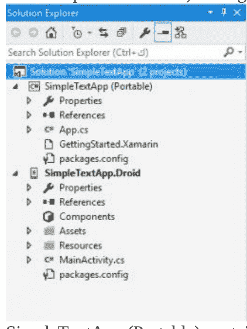

SimpleTextApp（便携式）包含大部分代码，这是 PCL 风格项目中的常见行为。项目内的代码（便携式部分加上其名称）对在任何操作系统上运行的任何类型应用程序都是通用的，包括 Android。基本的 .cs 将存在于我们之前谈到的任何 Xamarin 应用程序中，我们看到了它如何包含从 Application 类继承的 App 类，以及该类的构建器如何负责创建应用程序的主页。你会注意到有几个引起我们兴趣的库，包括：Xamarin.Forms.Core、Xamarin.Forms.Platform、Xamarin.Forms.Xaml 这些

是为 Xamarin.Forms 形成的核心库。

SimpleTextApp.Droid 项目包含两个文件夹：Assets 和 Resources。Resources 文件夹包含图像文件、布局描述和其他文件，这些是你的应用的资源。发布 Resources 文件夹以查看其结构。至于 Assets 文件夹，其他你想要包含在应用程序中的公共文件都包含在其中。该项目还包含 MainActivity.cs 文件，其中包含与 MainActivity 名称相同的类别，它是 Android 应用程序的主要活动。打开此文件可发现该类包含在启动 Android 应用时执行的 OnCreate 函数。注意此函数内的以下代码语句：

```
LoadApplication (new App ());
```

显然，它从 SimpleTextApp（便携式）项目中的 App 类创建一个新对象，然后将其直接传递给 LoadApplication 函数以加载应用程序并向用户显示。创建 App 类的新对象会执行其结构并负责创建应用程序的主页，正如我们提到的那样，然而在我们开始编写代码后，这个想法将被很好地阐明。

### 编写代码

在解决方案资源管理器中右键单击 SimpleTextApp（便携式）以显示上下文菜单，选择添加然后从子菜单中选择类。将出现添加新类的窗口。Visual Studio 将向项目添加一个名为 MainPage.cs 的新文件，其中包含同名类和内容如下：

```
using System;
using System.Collections.Generic;
using System.Linq;
using System.Text;
using System.Threading.Tasks;
```

```
namespace SimpleTextApp
{
class MainPage
{
}
}
```

我们不需要上一代码中大部分的名称范围，在此程序中我们目前需要的是命名空间 Xamarin.Forms。我们将使 MainPage 类继承自 ContentPage 类并向其添加构建器。修改上一代码使其读取如下：

```
using Xamarin.Forms;
```

```
namespace SimpleTextApp
{
class MainPage: ContentPage
{
public MainPage ()
{
}
}
}
```

请注意我摆脱了所有不必要的名称范围（然而在 Visual Studio 2015 开发环境中，任何未使用的名称范围都会以淡色显示在代码中）。MainPage 类将充当 SimpleTextApp 应用程序的简单内容页。我们将在此类别中包含创建单个 Label 包含简单文本所需的代码。然后我们将对该标签进行一些简单实验。此程序实际上很简单，其任务是让你更熟悉 Xamarin。

我们将从在 MainPage 类构建器内从 Label 类创建标签开始。标签通常用于向用户显示文本。看以下简单代码：

```
Label lblMain = new Label ();
 lblMain.Text = "Welcome to moaml Academy!";
```

我们创建一个标签并创建一个类的任何对象。我们在上一对象中设置新代码的类和 Label 到变量 lblMain。然后将文本 "Welcome to Hsoub Academy!" 分配给变量 lblMain 的 Text 属性。Text 属性用于设置和读取标签的文本内容。

为了让我们可以在应用程序的主页上查看之前的标签，我们将变量 lblMain 分配给类 ContentPage 的 Content 属性。由于 MainPage 类继承自 ContentPage，Content 属性会自动包含在其中。归属过程将如下所示：

```
this.Content = lblMain;
```

之前的归属过程是可能的，因为该类继承自 Label 类 View，它代表一个通用视图显示接口概念。由于 Content 属性也是 View 类型，因此此归属是可能的。MainPage.cs 文件的内容将类似于以下内容：

```
using Xamarin.Forms;

namespace SimpleTextApp
{
    class MainPage: ContentPage
    {
    public MainPage ()
        {
    Label lblMain = new Label ();
    lblMain.Text = "Welcome to moaml Academy!";

    this.Content = lblMain;
        }
    }
}
```

就这样！现在我们必须做最后的一个小步骤，即让我们的应用程序作为 MainPage 文件 App.cs 的一部分创建我们类的一个新对象。导航到此文件（位于项目 SimpleTextApp（便携式）内并确保是类 App 的构建器在以下图上：

```
public App ()
{
// The root page of your application
MainPage = new MainPage ();
}
```

现在按 F5 键执行应用程序，以获得类似以下形状的界面：

**Welcome to moaml Academy!**

### 小

大家好！

插入的内容要能正常显示才是比较好的。

这是第二行内容。

请注意我删除了 lblMain 变量，因为我们直接将 Label 对象分配给 Content 属性。

#### 应用的额外优势：

你会注意到从之前的应用程序中，贴纸出现在窗口左上角。我们将使其出现在屏幕中央。为此应设置两个形容词属性：
HorizontalOptions（用于水平对齐选项）和 VerticalOptions（用于垂直对齐选项）。这两个属性的类型均为 LayoutOptions，这是一个存在于命名空间 Xamarin.Forms 内的结构体结构。该结构包含几个现成的字段，对标签的水平和垂直定位选项非常有用，这些选项非常重要，我们将在本系列的后面看到。让我们现在对 MainPage 类构建器内的标签进行必要的修改。MainPage.cs 文件的内容将如下所示：

```
using Xamarin.Forms;

namespace SimpleTextApp
{
class MainPage: ContentPage
{
public MainPage ()
{
this.Content = new Label {
Text = "Welcome to Hsoub Academy!",
HorizontalOptions = LayoutOptions.Center,
VerticalOptions = LayoutOptions.Center
};
}
}
}
```


请注意，LayoutOptions.Center 被分别赋给 HorizontalOptions 和 VerticalOptions，以实现水平和垂直居中。再次运行程序，你会注意到，标签位于屏幕中央，如下图所示：


如果你希望标签中的文本使用不同的颜色，比如红色，在这种情况下，请将 Color.Red 值赋给标签对象的 TextColor 属性。Color 也是 Xamarin.Forms 命名空间中的一个结构。

### 处理文本片段

我们经常需要在屏幕上显示一段文本。这段文本可能来自文档、Web 服务或其他来源。应用程序应该能够处理这种大小的文本。与上一课一样，我们创建了一个名为 TextManipulationApp 的新 Blank App（Xamarin.Forms Portable）项目。只保留 TextManipulationApp（Portable）和 TextManipulationApp.Droid 项目。

现在我们添加一个新的内容页，但采用与上一课不同且更简洁的方式。右键单击项目（TextManipulationApp（Portable）），选择“添加”，然后在出现的子菜单中选择“新建项”。在出现的窗口左侧选择“跨平台”节点，更新窗口中间部分的内容后，选择文件类型，在底部的“名称”框中，单击“添加”。

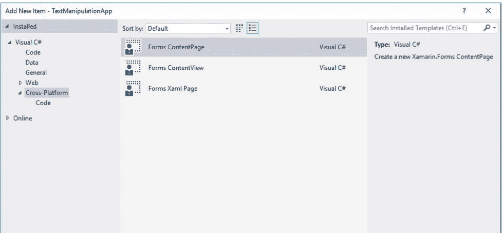

在 Visual Studio 添加此文件后，其内容将如下所示：

```
using System;
using System.Collections.Generic;
using System.Linq;
using System.Reflection.Emit;
using System.Text;

using Xamarin.Forms;
namespace TextManipulationApp
{
public class ParagraphPage: ContentPage
{
public ParagraphPage ()
{
Content = new StackLayout
{
Children = {
new Label {Text = "Hello ContentPage"}
}
};
}
}
}
```

这里有一些不必要的命名空间，但目前没什么问题。请注意，ParagraphPage 类默认继承自 ContentPage 类，并且 ParagraphPage 类构造函数已就绪，其中包含一个简单的示例。删除该构造函数的内容，让我们开始处理我们的应用程序。我们将创建一个 Label，其中包含一段阿拉伯语文本片段。将以下代码输入到 ParagraphPage 类构造函数中：

```
Content = new Label
{
```

```
VerticalOptions = LayoutOptions.Center,
    Text = "Xamarin is currently one of the most important mobile app development platforms available," +
    "Which seems to stay on the front for not too long," +
    "Especially after Microsoft acquired the company that also has the same name." +
    "Through this series we will learn to write practical applications by using this promising technology."
};
```

转到 TextManipulationApp（Portable）项目中的 App.cs 文件，确保应用类构造函数如下所示：

```
public App ()
{
// The root page of your application
MainPage = new ParagraphPage ();
}
```

#### 使用 F5 运行程序

请注意，所有文本在垂直方向上居中显示。这是因为将 LayoutOptions.Center 值分配给了 Label 的 VerticalOptions 属性。另请注意，上图中的文本向左对齐，而不是像阿拉伯语文本那样向右对齐。这是因为 Label 类的 HorizontalTextAlignment 属性（负责标签内文本的水平对齐）在运行程序时会具有默认值 TextAlignment.Start。TextAlignment 是一个枚举，包含三个值：Start、Center 和 End。由于移动设备的屏幕在水平方向上分为三个主要区域：Start 对应左侧区域，Center 对应中间（中央）区域，End 对应屏幕右侧区域，因此文本将向左对齐而不是向右对齐。如果我们想要将文本向右对齐，只需将 TextAlignment.End 值赋给 HorizontalTextAlignment 属性即可，我们稍后将这样做。从上图中还要注意的另一件事是，文本离屏幕边缘太近，几乎贴在了边缘上。解决这个问题很简单：为屏幕边缘添加内边距（Padding），这是一个可以通过编程方式分配给屏幕的小区域，通过它我们可以控制四边的边距空间。现在看看经过所需修改的 ParagraphPage 类构造函数：

```
public ParagraphPage ()
{
Content = new Label
{
VerticalOptions = LayoutOptions.Center,
Text = "Xamarin is currently one of the most important mobile app development platforms available," +
"Which seems to stay on the front for not too long," +
"Especially after Microsoft acquired the company that also has the same name." +
"Through this series we will learn to write practical applications through the use of this promising technology.",

HorizontalTextAlignment = TextAlignment.End
};

Padding = new Thickness (5, 5, 5, 5);
}
```

我们首先向 Label 添加了 HorizontalTextAlignment 属性，并为其分配了 TextAlignment.End 值，以使标签内的文本向右对齐（请注意，普通逗号分隔属性）。我们还添加了 Padding 属性（来自 ParagraphPage 类），并为其分配了一个新的 Thickness 类对象。Thickness 支持重载，因为它有多种形式。我使用了最后一种形式，它接受四个参数，分别代表左、上、右、下的内边距量。你可能对这里使用的一个类比感到疑惑，但我会把讨论推迟到

屏幕

```
using System;
using System.Collections.Generic;
using System.Linq;
using System.Reflection.Emit;
using System.Text;

using Xamarin.Forms;

namespace TextManipulationApp
{
public class FormattedParagraphPage: ContentPage
{
public FormattedParagraphPage ()
{
FormattedString formattedString = new FormattedString ();

formattedString.Spans.Add (new Span
{
Text = "Don't count",
});

formattedString.Spans.Add (new Span
{
Text = "Glory",
BackgroundColor = Color.Yellow,
ForegroundColor = Color.Blue,
});

formattedString.Spans.Add (new Span
{
Text = "Pass you eat",
});

```

```
formattedString.Spans.Add (new Span
{
    Text = "You will not attain glory until you lick patience.",
    ForegroundColor = Color.Aqua,
    FontSize = Device.GetNamedSize (NamedSize.Large, typeof
(Label))
});

Content = new Label
{
VerticalOptions = LayoutOptions.Center,
FormattedText = formattedString,
HorizontalTextAlignment = TextAlignment.End,
FontSize = Device.GetNamedSize (NamedSize.Medium, typeof (Label))
};

Padding = new Thickness (5, 5, 5, 5);
}
}
}
```

我们在构造函数（第 15 行）中首先创建了一个 FormattedString 类的对象，并将其分配给 formattedString 变量。然后我们开始使用以下简单方法（第 17 至 20 行）向 Spans 集合添加格式化文本：

```
formattedString.Spans.Add (new Span
{
Text = "Don't count"
});
```

我们使用 Spans 集合的 Add 函数来添加一个 Span 类型的对象，我们创建了该对象并在创建时直接为其分配了 Text 属性。前面代码中的文本没有任何特殊格式。实际上，我们对完整文本的每一部分都重复了这一方法。但有时我们采用了一些不同的文本格式。例如，请看第 22 至 27 行的代码：

```
formattedString.Spans.Add (new Span
{
Text = "Glory",
BackgroundColor = Color.Yellow,
ForegroundColor = Color.Blue,
});
```

这一次，我们设置了文本“Glory”的格式，为 BackgroundColor 指定了黄色作为背景色，为文本颜色 ForegroundColor 指定了蓝色。另请参见我们在第 34 至 39 行添加的文本部分：

```
formattedString.Spans.Add (new Span
{
Text = "You will not attain glory until you lick patience.",
ForegroundColor = Color.Aqua,
FontSize = Device.GetNamedSize (NamedSize.Large, typeof (Label))
});
```

这次字体颜色为 Aqua，字体大小为 Large。注意我们是如何将字体大小值赋给 FontSize 属性的。为此使用了以下表达式：

**Device.GetNamedSize (NamedSize.Large, typeof (Label))**

Device 表示我们的应用程序当前运行的设备，并包含许多有用的静态函数。在这些函数中，我们使用了 GetNamedSize 函数，它返回由传递给它的参数所要求的字体大小。第一个参数是 NamedSize.Large，所以我们想要一个大的字体大小（NamedSize 是一个枚举），第二个参数是应用该字体的元素类型。在这种情况下，我们希望将此字体应用到 Label，因此我们传递了 typeof (Label) 作为第二个参数，它会返回 Label 的类型。这是为你想到的任何内容设置合适尺寸的首选方法，因为设备我们


我们正在编写的程序将显示在不同尺寸的屏幕上，因此我们希望让 GetNamedSize 函数进行正确的计算，以根据程序当前所处的屏幕尺寸以及要获取的尺寸返回合适的字号（在我们的示例中，我们想要得到一个大字号 NamedSize.Large，其他尺寸当然也存在）。

程序的其余部分非常简单，在第44行，我们将 formattedString 变量赋给了标签的 FormattedText 属性。这可以确保文本以格式化形式显示在屏幕上；请注意，在这种情况下我们没有使用 Text 属性。

最后一点需要注意。请注意，在第46行，我们为标签的 FontSize 属性分配了一个新的字号。这个字体将是中等大小（注意第一个参数 NamedSize.Medium）。这里的思路是：如果某段文本（包含在 Span 对象中）的 FontSize 属性未设置，那么这个字体将应用于该段文本。例如，这个字号不会应用于第34至39行指定的文本部分；正如我们之前看到的，该部分已经设置了自己的字号（NamedSize.Large）。

注意：要尝试此程序，你需要修改 App.cs 文件中的 App 构造函数。确保构造函数如下所示，以使用我们的新类 FormattedParagraphPage：

```csharp
public App()
{
    // The root page of your application
    MainPage = new FormattedParagraphPage();
}
```

### 结论

在本课中，我们介绍了 Xamarin 中文本处理的原理，并首次构建了两个向用户显示信息的简单应用。我们学习了如何对齐文本，以及执行一些格式化操作，例如更改任意单词或短语的文本颜色和背景颜色。本课没有涉及如何处理文本较大、需要一种方式来滚动显示其全部内容的情况。我们将在后续课程中解决这个问题。

## 第三章
### Xamarin 中的 StackLayout

在前面的课程中，我们只处理了屏幕上出现的一个元素。这个元素是 Label，我们把它赋给了内容页的 Content 属性。众所周知，在真实程序中，我们肯定需要许多元素出现在屏幕上，以满足程序的需求。这里的问题是，内容页的 Content 属性只接受一个继承自 View 类的元素。

Xamarin 使用布局为这个问题找到了一个简单的解决方案。布局可以容纳任意数量的项，这些项都继承自 View 类。实际上，布局本身继承自 `Layout<View>` 类，而 `Layout<View>` 类间接继承自 View 类。任何布局都可以直接赋给 Content 属性。Xamarin 支持四种类型的布局：

- AbsoluteLayout
- Grid
- RelativeLayout
- StackLayout

在本系列中，我们将介绍三种布局：AbsoluteLayout、RelativeLayout 和 StackLayout。本章我们先从 StackLayout 开始。

### StackLayout 堆叠布局

此布局中可以添加任意数量的项。之所以叫这个名字，是因为它排列的是堆叠起来的元素。与其他布局相比，StackLayout 类多了两个属性：Orientation 表示方向（水平或垂直），Spacing 表示添加到布局中的元素之间的间距，默认值为 6.0。现在让我们看一个简单的例子，来了解如何使用这个实用的布局。

### ColorsApp 应用：显示一些颜色

按照我们在前几课中学习的方法创建一个新应用，类型为空白应用（Xamarin.Forms Portable），并将其命名为 ColorsApp。在 Visual Studio 中创建应用后，只保留 ColorsApp（Portable）和 ColorsApp.Droid 项目。

将名为 ColorsListPage 的内容页添加到 ColorsApp（Portable）项目中（右键单击项目，选择“添加”，然后选择“新建项”。窗口出现后，从左侧选择“跨平台”，然后在屏幕中央选择“Forms ContentPage”）。创建此页面后，我们会注意到它已经自带了一个堆叠布局。看一下这个页面的内容：

```csharp
using System;
using System.Collections.Generic;
using System.Linq;
using System.Reflection.Emit;
using System.Text;

using Xamarin.Forms;

namespace ColorsApp
{
    public class ColorsListPage : ContentPage
    {
        public ColorsListPage()
        {
            Content = new StackLayout
            {
                Children = {
                    new Label { Text = "Hello ContentPage" }
                },
            };
        }
    }
}
```

请注意，在 ColorsListPage 构造函数中，我们将 StackLayout 类的一个新对象赋给了 Content 属性。还要注意，StackLayout 布局有一个名为 Children 的属性，它表示我们想要添加到堆叠中的子元素（每个子元素都继承自 View 类）。

将 ColorsListPage.cs 文件的内容替换为以下代码：

```csharp
using System;
using System.Collections.Generic;
using System.Linq;
using System.Reflection.Emit;
using System.Text;

using Xamarin.Forms;

namespace ColorsApp
{
    public class ColorInfo
    {
        public Color Color { get; set; }
        public string Name { get; set; }
    }

    public class ColorsListPage : ContentPage
    {
        public ColorsListPage()
        {
            ColorInfo[] colors = new ColorInfo[]
            {
                new ColorInfo { Color = Color.Aqua, Name = "Aqua" },
                new ColorInfo { Color = Color.Blue, Name = "Blue" },
                new ColorInfo { Color = Color.Gray, Name = "Gray" },
                new ColorInfo { Color = Color.Black, Name = "Black" },
                new ColorInfo { Color = Color.Silver, Name = "Silver" },
                new ColorInfo { Color = Color.Red, Name = "Red" },
                new ColorInfo { Color = Color.Maroon, Name = "Maroon" },
                new ColorInfo { Color = Color.Yellow, Name = "Yellow" },
                new ColorInfo { Color = Color.Olive, Name = "Olive" },
                new ColorInfo { Color = Color.Lime, Name = "Lime" },
                new ColorInfo { Color = Color.Green, Name = "Green" },
                new ColorInfo { Color = Color.Navy, Name = "Navy" },
                new ColorInfo { Color = Color.Teal, Name = "Teal" },
                new ColorInfo { Color = Color.Pink, Name = "Pink" },
                new ColorInfo { Color = Color.Fuchsia, Name = "Fuchsia" },
                new ColorInfo { Color = Color.Purple, Name = "Purple" }
            };

            StackLayout stackLayout = new StackLayout();

            for (int i = 0; i < colors.Length; i++)
            {
                stackLayout.Children.Add(new Label
                {
                    Text = colors[i].Name,
                    TextColor = colors[i].Color,
                    FontSize = Device.GetNamedSize(NamedSize.Large, typeof(Label))
                });
            }

            Padding = new Thickness(5, 5, 5, 5);

            Content = stackLayout;
        }
    }
}
```

我们在该文件中添加了一个名为 ColorInfo 的新简单类（第11至15行）。虽然同一个文件中有两个类通常不是好的软件实践，但我选择了简化处理。这个类的作用是保存任何颜色值及其名称的简单信息。在第21行，我们创建了一个 ColorInfo 类数组，并将其赋给 colors 变量。这个数组显然包含16种颜色。然后，我们创建 StackLayout 类的一个新对象，并将其赋给 stackLayout 变量（第41行），接着进入一个 for 循环（第43行），遍历 colors 数组中的元素，并通过 Children 属性将它们添加到 StackLayout 中。接下来，确定页面的内边距值（第53行），最后将 stackLayout 变量赋给页面的 Content 属性（第55行）。

要尝试此应用，请先转到 App.cs 文件，并确保 App 类的构造函数如下所示：

```csharp
public App()
{
    // The root page of your application
    MainPage = new ColorsListPage();
}
```

### 使用 F5 运行程序，外观与下面类似：

这里有两件重要的事情。首先，有些颜色在黑色背景（Android 上 Xamarin 应用的默认背景）上显示效果不佳，因为颜色对比度不够好；而 Black（黑色）这个词不会显示出来，因为它的颜色与黑色背景颜色相近。其次，我们基本上有16种颜色，但只出现了其中的12种。你看到的颜色数量可能会因所用屏幕的不同而有所差异。例如，它们可能全部出现，但无论如何，你一定会遇到

未来的应用中，并非所有项目都会同时出现在屏幕上。实际上，我们需要像其他 Android 应用一样的滚动机制。下面我们将同时解决这两个问题。

### 增强版 ColorsApp 实现

我们首先来解决颜色变化的问题，方法是在 `ColorsListPage` 类中添加一个新函数 `GetSuitableBackgroundColor`。该函数的目的是根据公认理想的数值常量来计算亮度值。如果要显示的颜色亮度大于 0.5，则背景为黑色；如果小于或等于 0.5，则背景为白色。这样可以为屏幕上显示的颜色提供合适的对比度。请查看此函数的代码：

```csharp
private Color GetSuitableBackgroundColor(Color color)
{
    double luminance = 0.30 * color.R +
            0.59 * color.G +
            0.11 * color.B;

    return luminance > 0.5 ? Color.Black : Color.White;
}
```

`color.R`、`color.G` 和 `color.B` 属性分别表示传入此函数的颜色的红、绿、蓝分量，该函数用于查找合适的背景颜色。0.30、0.59 和 0.11 这些常量是计算颜色亮度的理想值，如果你愿意，也可以修改它们。

至于屏幕滚动，使用 ScrollView 很简单：我们创建一个新对象，将 `stackLayout` 变量赋给该对象的 `Content` 属性，然后将这个新对象赋给 `ColorsListPage` 的 `Content` 属性，而不是像上一个程序那样直接将 `stackLayout` 赋给它。请看下面的代码：

```csharp
Content = new ScrollView
{
    Content = stackLayout
};
```

现在看一下完成上述修改后的完整代码：

```csharp
using System;
using System.Collections.Generic;
using System.Linq;
using System.Reflection.Emit;
using System.Text;

using Xamarin.Forms;

namespace ColorsApp
{
    public class ColorInfo
    {
        public Color Color { get; set; }
        public string Name { get; set; }
    }

    public class ColorsListPage : ContentPage
    {
        public ColorsListPage()
        {
            ColorInfo[] colors = new ColorInfo[]
            {
                new ColorInfo { Color = Color.Aqua, Name = "Aqua" },
                new ColorInfo { Color = Color.Blue, Name = "Blue" },
                new ColorInfo { Color = Color.Gray, Name = "Gray" },
                new ColorInfo { Color = Color.Black, Name = "Black" },
                new ColorInfo { Color = Color.Silver, Name = "Silver" },
                new ColorInfo { Color = Color.Red, Name = "Red" },
                new ColorInfo { Color = Color.Maroon, Name = "Maroon" },
                new ColorInfo { Color = Color.Yellow, Name = "Yellow" },
                new ColorInfo { Color = Color.Olive, Name = "Olive" },
                new ColorInfo { Color = Color.Lime, Name = "Lime" },
                new ColorInfo { Color = Color.Green, Name = "Green" },
                new ColorInfo { Color = Color.Navy, Name = "Navy" },
                new ColorInfo { Color = Color.Teal, Name = "Teal" },
                new ColorInfo { Color = Color.Pink, Name = "Pink" },
                new ColorInfo { Color = Color.Fuchsia, Name = "Fuchsia" },
                new ColorInfo { Color = Color.Purple, Name = "Purple" }
            };

            StackLayout stackLayout = new StackLayout();

            for (int i = 0; i < colors.Length; i++)
            {
                stackLayout.Children.Add(new Label
                {
                    Text = colors[i].Name,
                    TextColor = colors[i].Color,
                    BackgroundColor = GetSuitableBackgroundColor(colors[i].Color),
                    FontSize = Device.GetNamedSize(NamedSize.Large, typeof(Label))
                });
            }

            Padding = new Thickness(5, 5, 5, 5);

            Content = new ScrollView
            {
                Content = stackLayout
            };
        }

        private Color GetSuitableBackgroundColor(Color color)
        {
            double luminance = 0.30 * color.R +
                0.59 * color.G +
                0.11 * color.B;

            return luminance > 0.5 ? Color.Black : Color.White;
        }
    }
}
```

仔细思考上面的代码，确保你完全理解。然后按 F5 运行程序，效果大致如下。我使用了新的滚动功能来显示之前未能显示出的其余元素：

- 银色
- 红色
- 栗色
- 黄色
- 橄榄色
- 青柠色
- 绿色
- 海军蓝
- 蓝绿色
- 粉色
- 紫红色
- 紫色

你会注意到，此列表中显示的每种颜色都有一个适合它的背景颜色，以达到最佳显示效果。

### *注意*

你可以使用 StackLayout 的 `Spacing` 属性来增加或减少屏幕上标签之间的间距。如前所述，`Spacing` 的默认值为 6.0。例如，尝试将该值设为 0，看看会发生什么。你可以通过添加下面这一行为之前的程序设置此属性：

```csharp
stackLayout.Spacing = 0;
```

紧接在下一行之后：

```csharp
StackLayout stackLayout = new StackLayout();
```

### 结论

在本课中，我们学习了如何处理 StackLayout 堆栈布局的原理，这种布局在 Xamarin 应用中广泛使用，用于将屏幕上的可视元素按堆叠方式排列。我们还学习了如何让堆栈布局滚动，以便显示屏幕上未出现的项目。在下一课中，我们将继续使用 StackLayout，并讨论这种布局所具有的更重要优势。

## 第四章

### 屏幕测量

在 Xamarin 移动应用编程系列的这一课中，我们将讨论一个经常让移动应用开发者感到困惑的重要主题，即如何处理屏幕上的测量值和尺寸。我们首先快速回顾一下历史，然后继续理解 Xamarin.Forms 中使用的测量单位。

### 历史概述

任何屏幕都由矩形像素阵列组成。屏幕上显示的任何对象都有一个像素区域。从一开始，程序员就把像素视为在屏幕上绘制不同对象和形状的标准度量单位。虽然程序员通常不应依赖他所编写应用中可视元素的固定尺寸，但经常会因为应用需求而不得不这样做。由于该领域的技术进步，屏幕尺寸各异、每块屏幕的像素密度也各不相同，要让程序员在不同显示器上保持相同的界面形态已成为一项重大挑战。

台式机显示器的像素测量范围很广，从旧的 640x480（640 像素宽，480 像素高）到如今每个维度数千像素。显示器还有一个物理尺寸，通常以英寸为单位——即屏幕矩形的对角线距离。通过测量屏幕上任意像素的物理大小，我们可以将分辨率计算为每英寸像素数（PPI），通常也称为 DPI（每英寸点数）。

例如，对于一个旧的 800x600 像素屏幕，根据勾股定理，我们可以直接得出该屏幕的对角线为 1000 像素。

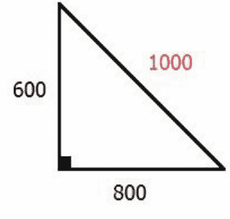

相比之下，对于同样的 13 英寸屏幕，我们现在可以找到诸如 2560x1600 的像素尺寸，这使得该屏幕的 DPI 约为 230。这意味着新屏幕上的任何对象（例如一个 100 平方像素的对象）所占的空间，将只有旧屏幕上同一对象所占空间的三分之一，这将导致应用在不同显示器上的外观产生显著差异。

随着桌面操作系统的发展，实用的解决方案开始出现，这些方案后来也被用于移动设备。微软和苹果等公司设计出了基于设备无关单位的测量系统，而不是基于像素。操作系统负责将这些使用新测量系统设计的尺寸转换为合适的像素尺寸。这样，程序员就可以基于一种独立的测量系统来编写应用，使他们的应用在不同类型的屏幕上几乎一致地显示。

Google 在 Android 系统中也采用了同样的做法，以确保具有指定尺寸的格式能够统一地显示在各种类型的 Android 屏幕上。

### Xamarin.Forms 提供的解决方案

Xamarin.Forms 基于以下简单的假设为这个问题提供了良好的解决方案：每 160 个（设备无关）单位对应一英寸。这相当于每厘米 64 个测量单位。上述假设适用于运行在 Android、iOS 或 Windows Phone 上的任何应用。

屏幕上出现的任何可见对象都继承自 `VisualElement` 类。该类有两个有用的属性：`Width` 和 `Height`。如我们之前所约定的，这两个属性以设备无关单位表示屏幕上任何可见元素的宽度和高度。它们的初始值都是 -1，只有当屏幕上的布局被处理且每个元素各就其位时，才会给出有效的值。

`VisualElement` 类还定义了一个名为 `SizeChanged` 的事件，当 `Width` 或 `Height` 属性之一的值发生变化时，该事件就会发生。这些值可能会因多种原因而改变，例如旋转屏幕。可以为页面上出现的任何可视元素（包括页面本身）安装 `SizeChanged` 事件的处理程序。在以下


section, 我们将介绍一个简单的程序，展示其运行屏幕的测量，但使用与设备无关的单位。

### 获取屏幕测量的软件

创建一个新的 Blank App (Xamarin.Forms Portable) 应用程序并将其命名为 GetSize。按约定，删除除 GetSize (Portable) 和 GetSize.Droid 之外的所有项目。向 GetSize (Portable) 项目添加一个新的 ContentPage 并将其命名为 GetSizePage，并确保 GetSizePage 类如下所示：

```
public class GetSizePage: ContentPage
{
private Label label;

    public GetSizePage ()
    {
    this.label = new Label
    {
    FontSize = Device.GetNamedSize (NamedSize.Large, typeof (Label)),
    HorizontalOptions = LayoutOptions.Center,
    VerticalOptions = LayoutOptions.Center,
    };

    Content = this.label;

    SizeChanged += GetSizePage_SizeChanged;
    }

    private void GetSizePage_SizeChanged (object sender, EventArgs e)
    {
    label.Text = String.Format ("{0} \u00D7 {1}", this.Width, this.Height);
    }
}
```

注意一开始我们在第 3 行声明了类型为 Label 的 label 字段，我们将在 GetSizePage 类构建器的第 7 行稍后创建的新标签的引用分配给它。创建此字段的原因是我们需要在事件处理程序中访问标签，如我们将很快看到的那样。 . 我们在第 10 行和第 11 行分别为此新标签分配了 HorizontalOptions 和 VerticalOptions 选项，以便它出现在页面的中心。 请注意，我们在此程序中不使用堆叠布局，而是直接在第 14 行将内容分配给页面的 Content 属性。 在本系列中对我们来说新的是在第 16 行将事件处理程序分配给页面的 SizeChanged 事件。 我称之为 GetPageSize_SizeChanged 的事件处理程序在第 19 行到第 22 行声明。
如果查看第 21 行，您会发现我们正在生成格式化的文本以在标签内显示（我们将其分配给其 Text 属性）。 请注意使用的 \u00D7 代码来生成乘法符号 x，如我们将很快看到的那样。 请注意，我们读取页面的 Width 和 Height 属性并将它们包含在生成的格式化文本中。 转到 App 构建器并确保它如下所示：

```
public App ()
{
    // The root page of your application
    MainPage = new GetSizePage ();
}
```

### 使用 F5 运行程序以获得类似以下的外观：

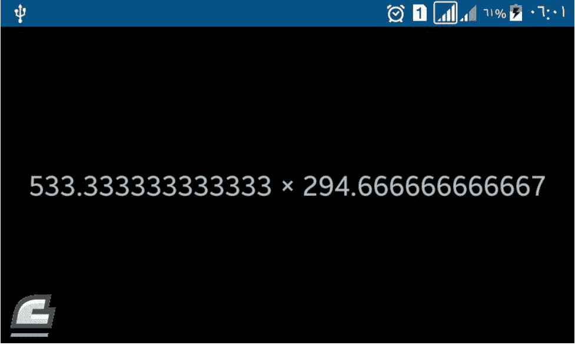

- Logo 不是结果的一部分

### 注意

您已在您的 Samsung Galaxy Core Prime 上运行了之前的程序。

### 结论

本课对于理解如何在 Xamarin.Forms 应用程序中处理测量至关重要，我们在其中讨论了测量的旧概念和新概念。 处理设备无关单位的方法及其在不同类型屏幕上对具有固定尺寸的视觉元素测量进行标准化的基本作用。 在下一课中，我们将找到使用独立模块编写两个简单应用程序的有用实际示例。 第一个应用程序处理在屏幕上绘制具有特定面积的简单形状，而第二个应用程序处理简单的数字时钟，该时钟根据应用程序运行的屏幕大小匹配显示的文本。

## 第五章

### 屏幕上的 Tap 事件

在本系列的前几章中，我们处理的主要功能是向用户适当显示数据的视觉元素。 事实上还有另一种类型的视觉元素，包括用户可以与其交互以执行特定命令或任务的元素。 在本有趣的章节中，我们将查看 Button 元素，这是一个允许用户点击（或更确切地说触摸）特定命令的视觉元素。

### 计数器应用程序

这是一个简单的应用程序，旨在理解如何在 Xamarin.Forms 中处理按钮。 该应用程序的界面由两个按钮和一个标签组成。 该应用程序的想法很简单。 当用户点击其中一个按钮时，标签上显示的数字增加一，当他点击另一个按钮时，该数字也会减少一。

按通常方式创建一个新的 Blank App (Xamarin.Forms Portable) 应用程序并将其命名为 CounterApp，并仅保留其中的 CounterApp.Droid 和 CounterApp (Portable) 项目。 添加一个新的 ContentPage 内容页面，命名为 CounterPage。 确保 CounterPage.cs 文件的内容如下：

```
1 using System;
2using Xamarin.Forms;
3
4namespace CounterApp
5{
6  public class CounterPage : ContentPage
7 {
8   private int counter = 0;
9   private Label lblDisplay;
10
11   public CounterPage()
12 {
13    Button btnIncrement = new Button
14    {
15     Text = "+",
16     HorizontalOptions = LayoutOptions.CenterAndExpand,
17     FontSize = Device.GetNamedSize(NamedSize.Large,
typeof(Label))
18    };
19   btnIncrement.Clicked += btnIncrement_Clicked;
20
```

```
21      Button btnDecrement = new Button
22      {
23          Text = "-",
24          HorizontalOptions = LayoutOptions.CenterAndExpand,
25          FontSize = Device.GetNamedSize(NamedSize.Large,
typeof(Label))
26      };
27      btnDecrement.Clicked += BtnDecrement_Clicked;
28
29      lblDisplay = new Label
30      {
31          Text = "0",
32          TextColor = Color.Accent,
33          HorizontalOptions = LayoutOptions.CenterAndExpand,
34          FontSize = Device.GetNamedSize(NamedSize.Large,
typeof(Label))
35      };
36
37      Content = new StackLayout
38      {
39          Children = {
40              new StackLayout
41              {
42                  Orientation = StackOrientation.Horizontal,
43                  Padding = new Thickness(0,64,0,64),
44                  Children =
45                  {
46                      btnIncrement,
47                      btnDecrement
48                  }
49              },
50              lblDisplay
51          }
52      };
53  }
```

```
private void BtnDecrement_Clicked(object sender, EventArgs e)
{
	counter--;
	lblDisplay.Text = counter.ToString();
}
```

```
private void btnIncrement_Clicked(object sender, EventArgs e)
{
	counter++;
	lblDisplay.Text = counter.ToString();
}
```

### 注意

请记住，我们通过右键单击 CounterApp (Portable) 项目然后选择 Add 然后 New Item 来添加新的内容页面。 从出现的窗口中，选择左侧部分的 Cross-Platform，并从右侧部分我们选择 Forms ContentPage

我们在此应用程序中遇到了许多在之前的课程中使用的技术。 有一些新东西。 例如，我们第一次开发了堆叠布局等，这在外观设计中非常常见。

在第 8 行，我们声明了 counter 字段，这是将保存标签中显示的数字当前值的计数器。 我们需要在 CounterPage 类的不同依赖项中的每个先前字段，所以我们将它们放在两个字段的形式中以获得此图像。

在 CounterPage 构建器中，我们声明了 btnIncrement 的 Button 类型并为其分配了一个新的 Button 类型对象，我们在创建时直接分配属性值。 请注意，在第 19 行我们已为此按钮分配了 Clicked 事件处理程序。 此处理程序的名称是 btnIncrement_Clicked，其在第 61 行至第 65 行下方声明。 

对于 btnDecrement 按钮（第 21 行至第 27 行）及其事件处理程序 btnDecrement_Clicked（第 55 行至第 59 行）也是如此。 增加一并在标签内显示结果。
如果我们转到 CounterPage 类的 Content 属性（第 37 行），则分配了一个新的堆叠布局，并且它具有我们在上一课中解释的默认垂直方向。 我们只会将其分配给 Children（第 39 行）。 此功能指出此方案有两个儿子，第一个儿子是另一个堆叠规划器（第 40 行至第 49 行），第二个是 lblDisplay，它将显示当前问题：

```
Children = {
    new StackLayout
    {
        Orientation = StackOrientation.Horizontal,
        Padding = new Thickness(0,64,0,64),
        Children =
        {
            btnIncrement,
            btnDecrement
        }
    },
    lblDisplay
}
```

至于堆叠儿子方案如上一个代码所示，请注意我们将 Orientation 属性设置为水平 StackOrientation.Horizontal，我们有适合其内容顶部和底部的填充填充，最后我们将 Child 属性分配给它，以便它在这里有两个儿子，即增加按钮 btnIncrement 和减少按钮 btnDecrement。
然后堆叠儿子（内部）方案将有两个按钮水平位于中间，而父（堆叠）堆叠计划将包含一个堆叠儿子方案和一个垂直定位的标签。
转到 App.cs 文件并确保 App 类构建器如下所示：


```
public App ()
{
    // The root page of your application
    MainPage = new CounterPage ();
}
```

当你使用 F5 执行程序时，你会得到类似如下的界面，我在每个按钮上都点击了几次：

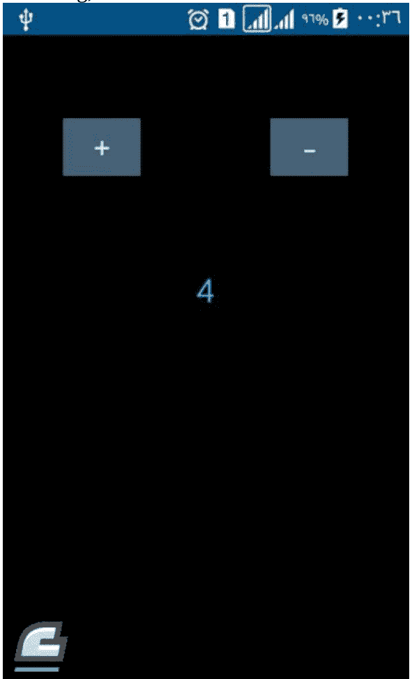

正如我们所知，图像是任何应用程序的基本元素，它们增添美感并对应用程序的基本功能产生解释性的印象。我们将在本系列中继续工作，解释如何在 Xamarin.Forms 中使用图像。Xamarin 处理的位图在 Android、iOS 和 Windows 之间可能略有不同，但如果你依赖 JPEG、PNG 和 BMP 等格式，就不会有任何问题。

Xamarin.Forms 以两种主要样式处理图像。第一种方法依赖于平台无关的图像，第二种方法依赖于平台特定的图像，或更准确地说，操作系统。你将在我们的课程中通过两个简单的应用程序来处理第一种方法。第二种方法将推迟到另一课。

Xamarin 应用程序中的图像可以通过 Image 类表示的视觉元素查看。与继承自 VisualElement 类的其他视觉元素一样，该元素与任何其他视觉元素（如 Label）具有许多共同的属性。除了其他区分它的特性，例如 Source 属性，它反映了将在其中显示的图像的来源。这个特性将是我们本课的重点。设备无关的图像可以通过两种不同的样式获得。在每种方法中，你需要将 ImageSource 类的对象分配给 Image 对象的 Image 属性。

第一种方法是直接从互联网获取图像，通过调用 ImageSource 类的 FromUri 静态函数并传递在线图像文件的 Uri 地址。

第二种方法是调用 ImageSource 类的 FromResource 静态函数并向其传递资源名称。以下两个简单应用程序将解释如何做到这一点。

### 从互联网获取图片：

创建一个名为 WebImageApp 的新应用程序，类型为 Blank App (Xamarin.Forms Portable) 并仅保留 WebImageApp (Portable) 和 WebImageApp.Droid 项目，如我们已商定的那样。添加一个新 ContentPage，如本课中所做的那样。将其命名为 WebImagePage 并确保 WebImagePage.cs 文件的内容如下：

```
using System;
using Xamarin.Forms;

namespace WebImageApp
{
    public class WebImagePage: ContentPage
    {
        public WebImagePage ()
        {
            Image webImage = new Image
            {
                VerticalOptions = LayoutOptions.FillAndExpand,
                HorizontalOptions = LayoutOptions.FillAndExpand,
                Source = ImageSource.FromUri (new Uri ("https://developer.xamarin.com/demo/IMG_2138.JPG?width=800")),
                Aspect = Aspect.AspectFit,
                BackgroundColor = Color.Accent
            };

            Content = new StackLayout
```
```
{
    Children = {
        webImage
    }
};
}
}
}
```

然后导航到 App.cs 文件并确保它看起来像这样：

```
public App ()
{
    // The root page of your application
    MainPage = new WebImagePage ();
}
```

应用程序代码很简单，它创建一个新的图像对象，将其分配给 webImage 变量，然后明确地使该图像对象成为堆栈布局的子项。

我们现在感兴趣的是图像对象的属性。Source 属性是我们获取图像的来源。在此应用程序中我们将从互联网获取图像，因此我们将使用返回 ImageSource 行对象的静态函数 ImageSource.FromUri。请注意，我们向此函数传递了一个新的 Uri 对象：

```
ImageSource.FromUri (new Uri ("https://developer.xamarin.com/demo/IMG_2138.JPG?width=800"))
```

此处使用的地址为：

```
"https://developer.xamarin.com/demo/IMG_2138.JPG?width=800"
```

Aspect 指定图像在 Image 元素内的显示方式。它们接受同名 Aspect 的值。此数字有三个元素：AspectFit、AspectFill 和 Fill。在此应用程序中我们使用了 AspectFit 值，这是默认值。以下是前面三个值的含义：

- * AspectFit：表示图像将出现在元素内，使其与分配给它的空间一致，同时尊重图像外观的纵横比。
- * AspectFill：在这种情况下，图像将出现在元素内，以便尊重图像的纵横比，但它不会照顾分配给此元素的空间。因此，如果图像大于元素，图像可能会出现截断。
- * Fill：此值表示图像将出现以占据分配给对象的整个区域，而不考虑图像的纵横比。因此图像只是水平或垂直拉伸。你已将 Color.Accent 分配给图像元素的 BackgroundColor 属性，以便看到该元素实际占用的空间。使用 F5 运行之前的程序以获得类似如下的外观，请注意我是在 4.5 英寸屏幕的设备上测试的，因此你在设备上获得的结果可能因屏幕更大而有所不同。如果是这样，我建议从 Source 属性中删除图像 Uri 标题的 "? Width = 800" 部分：


注意图像如何出现使得顶部和底部空间保持为空。这是因为它尊重了原始图像的纵横比。如果你修改 Aspect 属性使其携带 Aspect.AspectFill 值，你将得到类似如下的外观：


注意这里图像如何出现轻微截断。现在尝试最后一种情况，将 Aspect.Fill 值分配给 Aspect 属性以获得类似如下的形状：


如预期，图像出现了垂直拉伸，因为它将填充图像元素可用的整个空间，而不考虑原始图像外观的比例，如所注。

### 从本地资源获取图片：

以这种方式处理图像与我们处理从网络获取的图像的方式没有区别。只是我们使用 ImageSource 类的 FromResource 静态函数。在本节中，我们将讨论一个实用的应用程序，用于浏览我专门为此目的创建的一组图像。你将通过两个按钮浏览："Next" 和 "Previous"，此外还有一个贴纸显示当前显示在图像元素上的图像编号的简单信息。这些图像将本地位于应用程序内。现在让我们开始创建一个名为 ResourceImageApp 的新应用程序，类型为 Blank App (Xamarin.Forms Portable)。仅保留 ResourceImageApp (Portable) 和 ResourceImageApp.Droid 项目。添加一个名为 ContentImagePage 的新内容页并确保 ResourceImagePage.cs 文件的内容如下：

```
1using System;
2using Xamarin.Forms;
3
4namespace ResourceImageApp
5{
6  public class ResourceImagePage : ContentPage
7  {
8    private Button btnPrev;
9    private Button btnNext;
10    private Image resourceImage;
11    private Label lblInfo;
12    private int currentIndex = 1;
13
14    public ResourceImagePage()
15    {
16      lblInfo = new Label
17      {
18        VerticalOptions = LayoutOptions.Start,
19        HorizontalOptions = LayoutOptions.FillAndExpand,
20        HorizontalTextAlignment = TextAlignment.Center,
21        TextColor = Color.Accent,
22        FontSize = Device.GetNamedSize(NamedSize.Medium,
```
```
typeof(Label))
23        };
24
25        resourceImage = new Image
26        {
27            VerticalOptions = LayoutOptions.FillAndExpand,
28            HorizontalOptions = LayoutOptions.FillAndExpand,
29            Aspect = Aspect.AspectFit
30        };
31
32        btnPrev = new Button
33        {
34            Text = "first",
35            HorizontalOptions = LayoutOptions.FillAndExpand,
36            IsEnabled = false
37        };
38        btnPrev.Clicked += BtnPrev_Clicked;
39
40        btnNext = new Button
41        {
42            Text = "next",
43            HorizontalOptions = LayoutOptions.FillAndExpand
44        };
45        btnNext.Clicked += BtnNext_Clicked;
46
47        StackLayout buttonsLayout = new StackLayout
48        {
49            Orientation = StackOrientation.Horizontal,
50            VerticalOptions = LayoutOptions.End,
51            HorizontalOptions = LayoutOptions.FillAndExpand,
52            Children =
53            {
54                btnNext,
55                btnPrev
56            }
```


```csharp
57     };
58
59     Content = new StackLayout
60     {
61         Children = {
62             lblInfo,
63             resourceImage,
64             buttonsLayout
65         }
66     };
67
68     Padding = new Thickness(5, 5, 5, 5);
69
70     UpdateScreen();
71     }
72
73     private void BtnPrev_Clicked(object sender, EventArgs e)
74     {
75         currentIndex--;
76         if (currentIndex == 1)
77         {
78             btnPrev.IsEnabled = false;
79         }
80
81         btnNext.IsEnabled = true;
82
83         UpdateScreen();
84     }
85
86     private void BtnNext_Clicked(object sender, EventArgs e)
87     {
88         currentIndex++;
89         if (currentIndex == 5)
90         {
91         btnNext.IsEnabled = false;
92     }
93
94     btnPrev.IsEnabled = true;
95
96     UpdateScreen();
97    }
98
99     private void UpdateScreen()
100    {
101      lblInfo.Text = string.Format("{0}", currentIndex);
102      string path = string.Format("ResourceImageApp.Images.res0{0}.jpg", currentIndex);
103      resourceImage.Source = ImageSource.FromResource(path);
104    }
105  }
106 }
```

然后导航到 App.cs 文件并确保它看起来像这样：

```csharp
public App ()
{
    // The root page of your application
    MainPage = new ResourceImagePage ();
}
```

右键单击 ResourceImageApp (Portable) 共享项目并选择 Add，然后从出现的侧边菜单中选择 New Folder。这将在该项目中创建一个名为 Images 的新文件夹。然后右键单击新的 Images 文件夹并选择 Add。选择图片文件：res01.jpg、res02.jpg、res03.jpg、res04.jpg、res05.jpg（点击此处下载 Images.zip）。这些图片按顺序包含文字“Welcome to Hassoub Academy”。再次右键单击你刚刚添加到项目的每个文件名，从菜单中选择 Properties。文件属性将会出现；将 Build Action 属性设置为 Embedded Resource，如下图所示：

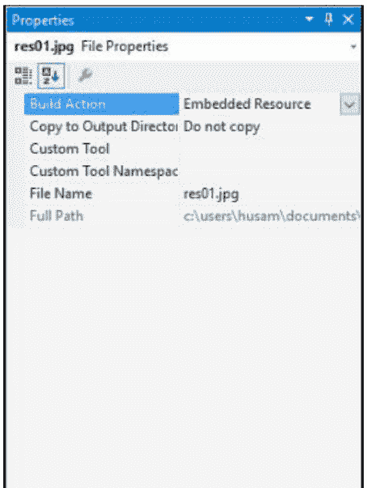

一旦你点击 Back 按钮，Next 按钮将恢复可用。让我们讨论一下此应用程序的操作代码。请注意第 8 行到第 11 行，我声明了表示我们将在此应用程序中处理的绝大多数视觉元素的特殊字段：一个图片元素、一个标签元素，以及用于下一个和上一个的两个按钮。在第 12 行，你声明了一个特殊的变量 currentIndex，它表示我们希望在图片文件中显示的当前文件编号，其初始值为 1。ResourceImagePage 类结构配置了所使用的所有视觉元素，如我们所知。在第 16 行到第 23 行，我们设置了 lblInfo 标签的属性，其中我们将 LayoutOptions.Start 值分配给 VerticalOptions 属性，使其出现在屏幕顶部。我们还将 TextAlignment.Center 值分配给 HorizontalTextAlignment 属性，以便文本水平显示。至于 resourceImage 图片元素，我们在第 25 行到第 30 行设置了其属性，其中我们将 Aspect 属性值设置为 Aspect.AspectFit，以便根据图片的外观比例填充可用图片空间。接下来是第 32 行到第 45 行对 btnPrev（上一个）和 btnNext（下一个）按钮的调整。稍后，我们将把这些按钮添加到它们的堆叠布局 buttonsLayout 中，这就是为什么我们希望使这些按钮水平相邻并填充可用的水平空间。注意两者 HorizontalOptions 属性的 LayoutOptions.FillAndExpand 值。我们在第 47 行到第 57 行声明了 StackLayout。我们将把按钮 btnPrev 和 btnNext 添加到此布局中，并将 Orientation 属性设置为 StackOrientation.Horizontal，以便水平显示上一个和下一个按钮，而不是垂直显示。我们将把此堆叠布局稍后添加到页面的基本堆叠布局中。

我们在第 59 行到第 66 行设置页面的 content 属性，以便创建一个新的堆叠布局，其中包含以下元素：标签、图片和按钮的堆叠布局，分别。此即为何先前项目按此顺序出现。请查看以下示意图，显示先前项目在页面上的大致位置：

```
lblInfo

resourceImage

btnNext

btnPrev
```

底部的棕色矩形代表 buttonsLayout 的堆叠布局。

最后，UpdateScreen 函数（第 99 行到第 104 行）在每次点击 Next 和 Previous 按钮时更新标签和图片元素上显示的数据。ImageSource 类的 FromResource 函数需要一个表示文件 ID 的文本参数。文件 ID 由应用程序名称（或更准确地说是 Assembly）组成，后跟一个句点、包含图片文件的文件夹名称，后跟另一个句点，最后是文件名及其扩展名。在我们的示例中，res01.jpg 的文件 ID 如下：

```
ResourceImageApp.Images.res01.jpg
```

此应用程序的代码可能看起来相对较大，但我向你保证，你将在任何可以工作的商业程序中多次编写它！这是由于我们迄今为止从本系列开始所采取的方法，依赖于代码来创建整个用户界面。虽然可以使用有助于显著安排和组织此代码的好方法，但许多开发人员更喜欢在 Xamarin.Forms 应用程序开发中使用另一种方法，即使用 XAML（类似代码的 XML），它允许将用户界面与软件代码分离。我们当然将在未来的课程中处理这个问题。

### 结论

在本课中我们处理了 Xamarin.Forms 中的图片。我们从两个不同的方面讨论了这个问题。第一个方面是从互联网（以及可能从本地网络）下载图片，而第二个方面是从本地源下载图片。关于此主题还有更多内容需要讨论，特别是关于通过与设备平台相关的图片源获取图片，或更准确地说是与设备上运行的操作系统相关， 在我们的例子中是 Android 系统。这与使用 Android Studio 处理图片源时使用的方法类似。我们将在本书后面介绍此主题。

## 第七章

### 在页面之间移动

移动应用程序通常由用户导航以利用应用程序提供的功能的单独页面组成。对于 Android 应用程序，Back 按钮在此导航中至关重要。在本教程的 Xamarin.Forms Android 应用程序编程学习系列中，我们学习如何在应用程序页面之间导航。首先我们将讨论单个应用程序中页面导航的概念，然后我们将通过一个简单的实际示例讨论导航中使用的内容页类型。

### 在应用程序页面之间导航的概念

在应用程序页面之间导航与堆栈的工作原理非常相似。堆栈是一种支持 LIFO（后进先出）概念的数据结构。当你从页面 A 移动到页面 B 时，页面 B 被推到堆栈顶部，导致它显示给用户。同样，当你从页面 B 移动到页面 C 时，页面 C 被推到堆栈以显示给用户。当我们想要返回到原始页面 A 时，页面 C 被弹出并从堆栈中移除，页面 B 将位于堆栈顶部（即它将显示给用户），页面 B 将从堆栈中移除，页面 A 将位于堆栈顶部。请参阅以下图示来说明这个想法：

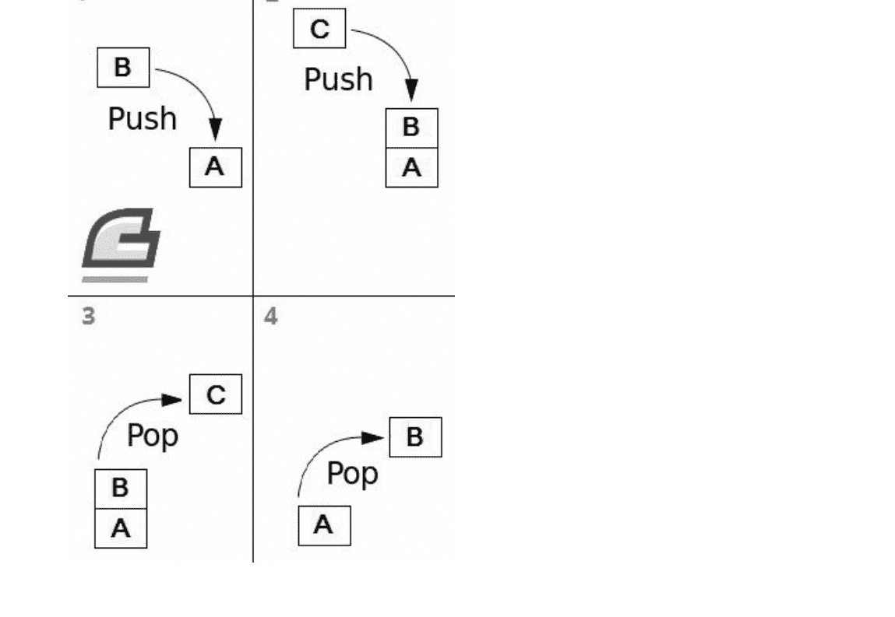

### 模态和非模态页面


每个应用程序都包含一个主页面（它将属于 NavigationPage 类别），它是所有其他页面的主节点，无论其数量和层级如何，都可以通过它访问。Xamarin 还区分了两种在这种导航结构中使用的内容页面类型：Modal Pages 和 Modeless Pages。对于 Android 应用而言，这两种类型之间的区别很简单。即，在 Modal 页面中，页面的标题将不会像我们稍后在示例中看到的那样显示在顶部。在 Modeless 页面中，如果使用 content page 的 Title 属性指定，页面的标题将位于顶部。为了预览这两种类型之间的差异，让我们创建一个简单、实用的应用程序来说明这一点。

首先创建一个名为 ModelessAndModal 的新 Blank App (Xamarin.Forms Portable) 项目，然后保留 ModelessAndModal (Portable) 和 ModelessAndModal.Droid 项目，就像我们在本课中所做的那样。接下来我们将添加三个常规内容页面（Forms ContentPage）：MainPage、ModalPage 和 ModelessPage。编辑 MainPage 文件的内容，使其类似于以下内容：

```csharp
1  using Xamarin.Forms;
2
3  namespace ModelessAndModal
4  {
5      public class MainPage : ContentPage
6      {
7          public MainPage()
8          {
9              Title = "Main Page";
10
11             Button gotoModelessButton = new Button
12             {
13                 Text = "Go to Modeless Page",
14                 HorizontalOptions = LayoutOptions.Center,
15                 VerticalOptions = LayoutOptions.CenterAndExpand
16             };
17
18             gotoModelessButton.Clicked += async (sender, args) =>
19             {
20                 await Navigation.PushAsync(new ModelessPage());
21             };
22
23             Button gotoModalButton = new Button
24             {
25                 Text = "Go to Modal Page",
26                 HorizontalOptions = LayoutOptions.Center,
27                 VerticalOptions = LayoutOptions.CenterAndExpand
28             };
29
30             gotoModalButton.Clicked += async (sender, args) =>
31             {
32                 await Navigation.PushModalAsync(new ModalPage());
33             };
34
35             Content = new StackLayout
36             {
37                 Children = { gotoModelessButton, gotoModalButton }
38             };
39         }
40     }
41 }
```

MainPage 只会显示两个按钮。第一个按钮是 gotoModelessButton，其功能是创建一个 modeless（非模态）页面并导航到它。第二个按钮是 gotoModalButton，其功能是创建并导航到一个静态 modal 页面。对于第一个按钮 gotoModelessButton，请查看第 11 行到第 21 行：

```csharp
Button gotoModelessButton = new Button
{
    Text = "Go to Modeless Page",
    HorizontalOptions = LayoutOptions.Center,
    VerticalOptions = LayoutOptions.CenterAndExpand
};

gotoModelessButton.Clicked += async (sender, args) =>
{
    await Navigation.PushAsync(new ModelessPage());
};
```

我们首先创建一个 Button 对象并将其分配给 gotoModelessButton 变量，然后分配一个 clicked 事件处理程序，一个简单的 lambda 表达式，表示需要 sender 和 e 参数的函数，并在前面加上保留字 async，如上一个代码所示。async 存在的原因是我们将在此事件处理程序中使用异步调用：

```csharp
await Navigation.PushAsync(new ModelessPage());
```

从当前页面的 Navigation 属性调用的 PushAsync 函数会在堆栈中推送一个新页面以在页面之间移动。在上一行中，将创建类型为 ModelessPage 的新页面并传递给 PushAsync 方法。我建议你复习本课以刷新你对异步调用主题的记忆。对于前往静态页面的按钮也会做同样的事情，但有一个细微差别。这次调用将通过 PushModalAsync（第 32 行）进行，以移动到静态页面（ModalPage）。在这两种情况中，我们本可以将两个点击处理器放在独立的方法中，而不是作为 lambdas。MainPage 类中另一个值得注意的是 Title 属性被设置（第 9 行）。事实上，在我们迄今为止在本系列中创建的所有程序中，此功能都没有任何意义。设置此属性与否不会有任何区别！这里的新内容是如何创建 MainPage 页面本身，我们将像往常一样在 App 类中创建它。转到 App.cs 文件并确保它看起来如下：

```csharp
public App ()
{
    // The root page of your application
    MainPage = new NavigationPage (new MainPage ());
}
```

请注意我这里的新命令。我们不再像以前那样创建一个 content page 并将其分配给 MainPage 属性。我们创建一个 content page（在我们的例子中它来自 MainPage 类），然后将此页面作为中介传递给 NavigationPage 类构建器。即，我们实际上是在创建一个支持导航的内容页面。这将使主页的标题，使用 Title 属性设置，出现在页面的顶部，如我们稍后将看到的那样。我们现在可以尝试这个应用。运行应用以获得如下所示的外观：

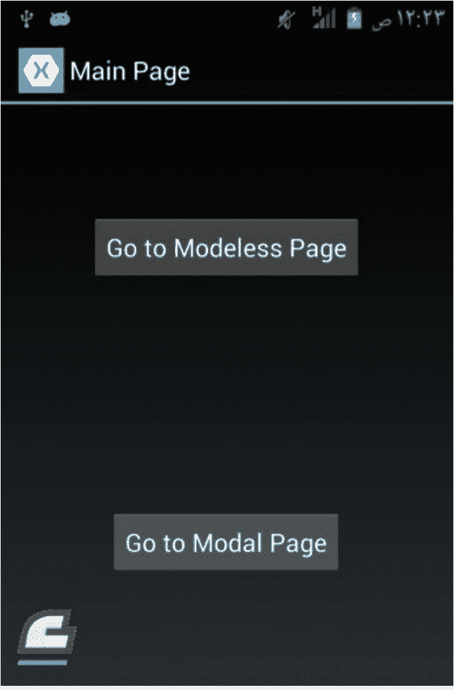

首先停止程序的实现以开始准备内容页面 ModalPage 和 ModelessPage 的最后阶段。转到 ModalPage.cs 文件并确保其内容与以下内容匹配：

```csharp
using Xamarin.Forms;

namespace ModelessAndModal
{
    public class ModalPage : ContentPage
    {
        public ModalPage()
        {
            Title = "Modal Page";
            Button goBackButton = new Button
            {
                Text = "Back to Main",
                HorizontalOptions = LayoutOptions.Center,
                VerticalOptions = LayoutOptions.Center
            };

            goBackButton.Clicked += async (sender, args) =>
            {
                await Navigation.PopModalAsync();
            };

            Content = goBackButton;
        }
    }
}
```

然后导航到 ModelessPage.cs 文件并确保其内容如下：

```csharp
using Xamarin.Forms;

namespace ModelessAndModal
{
    public class ModelessPage : ContentPage
    {
        public ModelessPage()
        {
            Title = "Modeless Page";
            Button goBackButton = new Button
            {
                Text = "Back to Main",
                HorizontalOptions = LayoutOptions.Center,
                VerticalOptions = LayoutOptions.Center
            };

            goBackButton.Clicked += async (sender, args) =>
            {
                await Navigation.PopAsync();
            };

            Content = goBackButton;
        }
    }
}
```

前面两个页面的内容是相同的。每个页面都有一个名为 goBackButton 的按钮，旨在返回到上一个页面（导致当前页面出现）。前两个页面上的两个点击事件处理程序之间只有一个细微差别。对于 modal 页面，使用了 Navigation.PopModalAsync 调用返回到上一个页面。对于 modeless 页面，使用了 Navigation.PopAsync 返回到上一个页面。执行程序时的另一个区别是，如果你从主页移动到 ModelessPage 页面，页面标题将出现在顶部，并带有允许我们返回到上一个页面的小箭头。当你从主页转到 ModalPage 页面时，页面的标题将永远不会出现（尽管 Title 属性已设置为它）。返回到上一个页面的唯一方法是通过点击页面上的返回按钮或点击操作系统提供的返回按钮。尝试该应用并查看两个页面之间的差异。

### Conclusion

在本课中，我们讨论了如何在 Android 应用中在页面之间导航，这当然是一个重要主题。我们确定了 modal 和 modeless 页面之间的区别。我们还学习了如何通过将主页面创建为 NavigationPage 来创建主页面，这是页面之间转换中的主要构建块。

## Chapter VIII

### Engineering Transformations

Transforms 是图形编程世界中必不可少的数学概念。有三种工程变换类型：

- **Translation**
- **Rotation**
- **Scaling**

几何变换主要基于矩阵。它们是任何几何变换的支柱的重要数学结构。幸运的是，Xamarin 简化了这一点，使其易于使用。


前三个转换。在本系列关于使用 Xamarin.Forms 学习 Android 应用程序编程的课程中，我们将讨论之前的三种类型以及如何在简单的实践示例中实现它们。

### Translation

平移是在不改变物体大小或进行任何旋转的情况下进行的过渡。VisualElement 类的任何元素都可以通过 TranslationX 和 TranslationY 属性进行平移。当为 TranslationX 属性分配正值时，这将使对象相对于其当前位置水平向右移动。当为 TranslationY 属性分配正值时，这将使对象相对于其当前位置垂直向下移动。让我们开始测试这种转换类型。首先创建一个名为 TransformsApp 的新 Blank App (Xamarin.Forms Portable) 项目，然后仅保留 TransformsApp (Portable) 和 TransformsApp.Droid 项目，就像我们在本课中所做的那样。接下来我们将添加一个基于 XAML 代码的内容页，就像我们在本课中所做的那样，我们将它命名为 TranslationPage。确保此页面的内容如下：

```xml
<ContentPage xmlns="http://xamarin.com/schemas/2014/forms"
             xmlns:x="http://schemas.microsoft.com/winfx/2009/xaml"
             x:Class="TransformsApp.TranslationPage">
    <StackLayout Padding="20, 10">
        <Frame x:Name="frame" HorizontalOptions="Center" VerticalOptions="CenterAndExpand" OutlineColor="Accent">
            <Label Text="TEXT" FontSize="Large" />
        </Frame>
        <Slider x:Name="xSlider" Minimum="-200" Maximum="200" Value="{Binding Source={x: Reference frame}, Path=TranslationX}" />
        <Label Text="{Binding Source={x: Reference xSlider}, Path=Value, StringFormat='TranslationX = {0:F0}'}" HorizontalTextAlignment="Center" />
        <Slider x:Name="ySlider" Minimum="-200" Maximum="200" Value="{Binding Source={x: Reference frame}, Path=TranslationY}" />
        <Label Text="{Binding Source={x: Reference ySlider}, Path=Value, StringFormat='TranslationY = {0:F0}'}" HorizontalTextAlignment="Center" />
    </StackLayout>
</ContentPage>
```

之前的代码使用了我们在本课中讨论过的数据绑定技术。它通过 Slider 元素控制包含标签的 frame 元素的位置。上部元素控制水平平移，而下部元素控制垂直平移。这是通过将 Slider 元素 xSlider 的 Value 属性链接到 frame 元素的 TranslationX 属性来实现的。类似地，名为 ySlider 的 Slider 元素，其 Value 属性与 frame 元素的 TranslationY 属性相关联。修改 App.cs 文件中的 App 类构建器，使其读取如下：

```csharp
public App ()
{
    // The root page of your application
    MainPage = new TranslationPage ();
}
```

运行程序以获得与以下类似的输出：

```text
TEXT

TranslationX = 84

TranslationY = 52
```

尝试一些实验并注意这种运动的变化。

### Rotation

Xamarin 中的任何可见元素都可以通过选择旋转中心和旋转角度来进行旋转。旋转角度以度为单位确定，旋转角度的正值表示顺时针旋转。任何元素的旋转中心由其 AnchorX 和 AnchorY 属性决定。旋转角度也可以由 Rotation 确定。

如果未为 AnchorX 和 AnchorY 属性指定值，则旋转中心默认为可见元素的中心。让我们通过一个简单的示例来看看这是如何工作的。将基于 XAML 代码的内容页添加到当前项目，就像我们在本课中所做的那样，命名为 RotationPage。确保此页面的内容如下：

```xml
<?xml version="1.0" encoding="utf-8"?>
<ContentPage xmlns="http://xamarin.com/schemas/2014/forms"
             xmlns:x="http://schemas.microsoft.com/winfx/2009/xaml"
             x:Class="TransformsApp.RotationPage">
    <StackLayout Padding="20, 10">
        <Frame x:Name="frame" HorizontalOptions="Center" VerticalOptions="CenterAndExpand" OutlineColor="Accent">
            <Label Text="TEXT" FontSize="Large" />
        </Frame>

        <Slider x:Name="rotationSlider" Maximum="360" Value="{Binding Source={x: Reference frame}, Path=Rotation}" />

        <Label Text="{Binding Source={x: Reference rotationSlider}, Path=Value, StringFormat='Rotation = {0:F0}'}" HorizontalTextAlignment="Center" />

        <StackLayout Orientation="Horizontal" HorizontalOptions="Center">
            <Stepper x:Name="anchorXStepper" Minimum="-1" Maximum="2" Increment="0.25" Value="{Binding Source={x: Reference frame}, Path=AnchorX}" />
            <Label Text="{Binding Source={x: Reference anchorXStepper}, Path=Value, StringFormat='AnchorX = {0:F2}'}" VerticalOptions="Center" />
        </StackLayout>

        <StackLayout Orientation="Horizontal" HorizontalOptions="Center">
            <Stepper x:Name="anchorYStepper"
                Minimum="-1" Maximum="2" Increment="0.25" Value="{Binding Source={x: Reference frame}, Path=AnchorY}" />
            <Label Text="{Binding Source={x: Reference anchorYStepper}, Path=Value, StringFormat='AnchorY = {0:F2}'}" VerticalOptions="Center" />
        </StackLayout>

    </StackLayout>
</ContentPage>
```

之前的程序依赖于旋转包含标签的 frame 元素。为此，我们将使用名为 rotationSlider 的 Slider 来控制旋转角度（通过与 frame 元素的 Rotation 属性关联）。我们还将使用 Stepper 元素 anchorXStepper 和 anchorYStepper 来控制旋转中心的坐标（通过与 frame 元素的 AnchorX 和 AnchorY 属性链接）。要执行此程序，请转到 App.cs 文件中的 App 类构建器并确保如下：

```csharp
public App ()
{
    // The root page of your application
    MainPage = new RotationPage ();
}
```

运行程序以获得如下所示的外观：

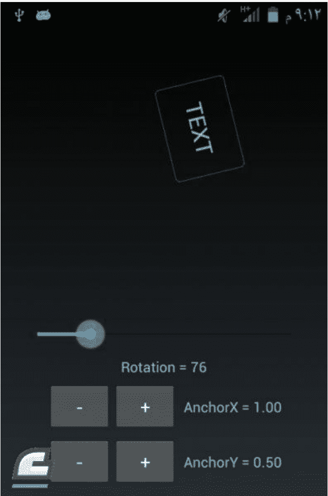

- 真棒，不是吗？

做一些实验并享受这个程序！

### Scale

缩放是一种几何变换，导致尺寸发生变化。缩放可用于通过其 Scale 属性控制视觉元素的大小。该属性的默认值是 1。当使用小于 1 的值时，我们会减小尺寸。当使用大于 1 的任何值时，我们会放大尺寸。例如，值为 3 表示我们将尺寸放大 3 倍，依此类推。Scale 属性的值为 0 是允许的，但会导致元素消失。Scale 的负值也可以使用，但这会使元素翻转，同时保持之前的概念不变。也就是说，值为 -1 将使元素翻转但尺寸保持不变。要进行缩放，请将基于 XAML 代码的内容页添加到当前项目，就像我们在本课中所做的那样。确保此页面的内容如下：

```xml
<?xml version="1.0" encoding="utf-8"?>
<ContentPage xmlns="http://xamarin.com/schemas/2014/forms"
             xmlns:x="http://schemas.microsoft.com/winfx/2009/xaml"
             x:Class="TransformsApp.ScalePage">

    <StackLayout Padding="20, 10">
        <Frame x:Name="frame" HorizontalOptions="Center" VerticalOptions="CenterAndExpand" OutlineColor="Accent">
            <Label Text="TEXT" FontSize="Large" />
        </Frame>

        <Slider x:Name="scaleSlider" Minimum="-10" Maximum="10" Value="{Binding Source={x: Reference frame}, Path=Scale}" />

        <Label Text="{Binding Source={x: Reference scaleSlider}, Path=Value, StringFormat='Scale = {0:F1}'}" HorizontalTextAlignment="Center" />
    </StackLayout>
</ContentPage>
```

转到 App.cs 文件中的 App 类构建器并确保它如下所示：

```csharp
public App ()
{
}
```

```csharp
// The root page of your application
MainPage = new ScalePage();
}
```

运行程序，你会看到类似下面的界面：

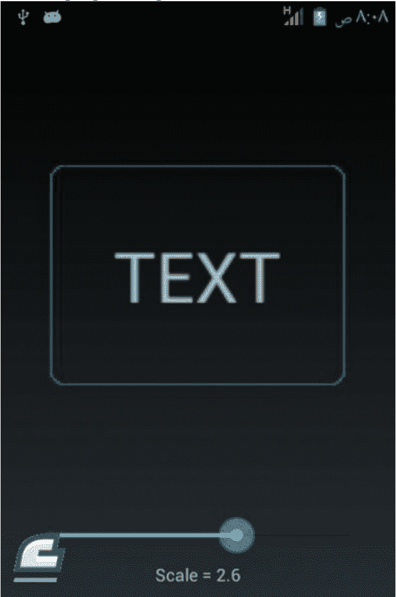

### 结论：

在本课中，我们讨论了基本的工程变换：平移、旋转、缩放，以及如何通过 Xamarin 处理它们。事实上，这类变换的需求通常出现在游戏或图形应用程序中。在本系列的后续课程中，我们将应用其中一些变换。

## 使用 Xamarin 构建联系人应用

1

在本章中，我们将开始构建一个具有高技术标准的实用应用程序。我们将使用前几课学到的知识来构建一个简单的联系人应用程序，但它使用了相对高级的技术和概念。

我们将分三个连续的部分来介绍这个应用程序，以下是各部分内容的简要描述：

**第一部分：** 解释应用程序的目的，并阐明仓库（Repository）模型在构建应用程序中的思想，同时构建应用程序的整体结构，这是本课的内容。
**第二部分：** 装备仓库的功能方面，使其可用。
**第三部分：** 实现用于显示详细信息的主界面和子界面。以及两个界面之间移动过程的实现。

### 应用程序的目的及其工作原理

应用程序的思路非常简单，归结为显示已有的联系人并支持在其中搜索，同时能够添加、编辑和删除新联系人。应用程序依赖于两个界面。第一个界面是主界面，包含一个按姓名或昵称搜索任何已有联系人的区域，此外还有一个列表用于显示搜索结果中的联系人，最后还有一个用于添加新联系人的按钮。下图显示了在未指定搜索条件时按下 FIND 的结果：

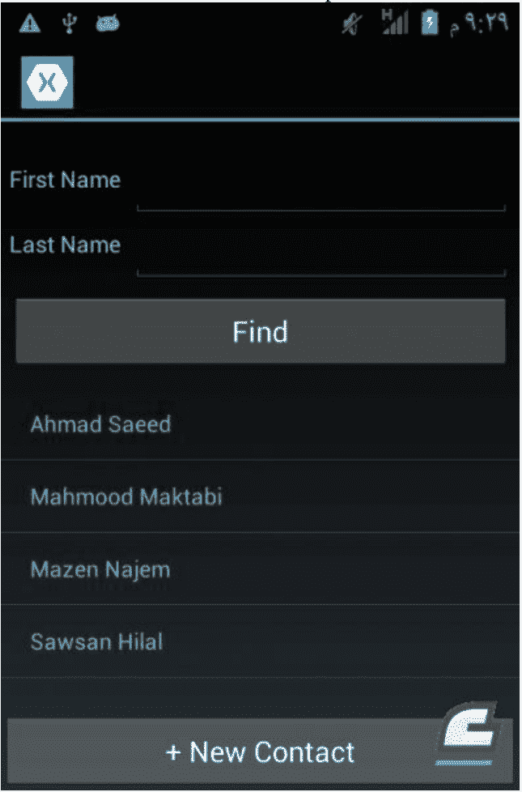

当用户未指定任何条件点击 FIND 按钮时，应用程序将显示其拥有的所有联系人，在此版本的程序中，这些联系人将是应用程序内存中的模拟数据。当用户指定姓名或昵称时，应用程序将使用 AND 逻辑进行搜索。

至于第二个界面，当用户点击之前列表中的某个联系人时出现，该界面显示此联系人的详细数据：姓名、昵称、电话号码、电子邮件地址和爱好。见下图：

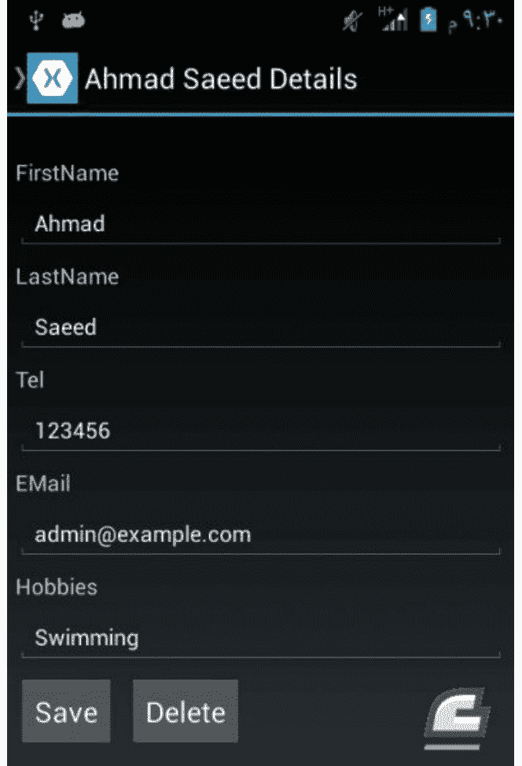

可以修改这些数据中的任何一项，然后用户单击保存按钮进行保存，或者如果不想修改数据，可以单击顶部程序图标旁边的返回上一界面按钮。用户还可以通过单击上图所示的“删除”按钮来删除此联系人。简而言之，这就是实现思路。

### 仓库（Repository）模式

随着应用程序规模的增长和所需任务的多样化，需要一种在应用程序内组织工作的方式。事实上，Xamarin 为此支持许多模型，例如 MVVM 模型，它在 Xamarin 中被有效用于组织和分离负责界面的部分、负责业务逻辑的部分以及负责处理各种类型远程或本地数据服务器的部分。

我个人喜欢的模型之一是 Repository，我在正在开发的各种应用程序中广泛使用它。这是一种优美且合理的方法，允许应用程序平滑快速地开发以适应各种类型的环境，并且它与 MVVM 模型兼容。

仓库模型允许将负责处理数据的代码与业务逻辑隔离开。这样做有几个好处，其中最重要的是：

-   组织程序，使其更易于理解和开发。
-   开发数据处理方法，而无需对程序逻辑做任何更改。
-   能够彻底改变用于存储数据的服务类型，而业务逻辑几乎不需要改变。

我将直接介绍如何在我们应用程序中采用这种模型。我们需要使用一个接口和一个相应的实现类。关于外观模式（facades），如果你想回顾一下，请参阅这一课。现在让我们在下一段开始构建这个应用。

### 构建应用程序

首先创建一个名为 ContactsApp 的新 Blank App（Xamarin.Forms Portable）项目，然后像我们在本课中所做的那样，只保留 ContactsApp（Portable）和 ContactsApp.Droid 项目。

在“解决方案资源管理器”窗口中，右键单击 ContactsApp 项目，从出现的菜单中选择“添加”，然后从子菜单中选择“新建文件夹”以添加新文件夹。将此文件夹命名为 Entity，当它出现在解决方案资源管理器中后，右键单击它，选择“添加”，然后从子菜单中选择“类”。将出现一个窗口，允许你为此项指定名称。选择名称 Contact。这个类是该程序的主要构建块，并代表了其中的工作逻辑。请确保 Contact.cs 文件的内容如下：

```
namespace ContactsApp.Entities
{
    public class Contact
    {
        public int Id {get; set;}
        public string FirstName {get; set;}
        public string LastName {get; set;}
        public string Tel {get; set;}
        public string EMail {get; set;}
        public string Hobbies {get; set;}

        public override string ToString ()
        {
            return string.Concat (FirstName, "" " , LastName);
        }
    }
}
```

从上图可以看出，Contact 类包含任何联系人所需的基本数据，外加一个对联系人来说可能有点奇怪的爱好功能。

再次右键单击 ContactsApp 项目，从出现的列表中选择“添加”，然后从子菜单中选择“新建文件夹”以添加新文件夹。将此文件夹命名为 Abstract，当它出现在解决方案资源管理器中后，右键单击它，选择“添加”，然后从子菜单中选择“新建项”。将出现一个窗口，允许你指定要添加的项类型。选择“接口”并将其命名为 IContactsRepository。

确保 IContactsRepository.cs 文件的内容如下：

```
using System.Threading.Tasks;
using System.Collections.ObjectModel;
using ContactsApp.Entities;

namespace ContactsApp.Abstract
{
    public interface IContactsRepository
    {
        Task<ObservableCollection<Contact>> GetContactsAsync (string firstName, string lastName);

        Task<bool> AddContactAsync (Contact contactToAdd);

        Task<bool> UpdateContactAsync (Contact contactToUpdate);

        Task<bool> DeleteContactAsync (Contact contactToDelete);
    }
}
```

接口通常用于当我们想要提取抽象并将其公开时，这极大地有益于使软件代码更易于理解和重用。这就是为什么这个接口被添加到 Abstract 文件夹中。接口不包含任何软件代码，如我们所知，它包含的只是任何希望实现该接口的类必须满足的依赖契约。这个接口简要包含我们的应用完成任务所需的基本操作：按姓名和昵称获取联系人 GetContactsAsync，添加新联系人 AddContactAsync，更新现有联系人 UpdateContactAsync，以及删除联系人 DeleteContactAsync。每个函数名称中带有 Async 的原因是为了表明你应该使用我们在本课中讨论过的异步编程技术。有趣的是，这个接口不关心数据的位置，也不关心如何获取和处理数据。它们只关心应用需要什么，仅此而已。

我们现在重复同样的过程，在 ContactsApp.cs 项目中添加一个名为 Concrete 的新文件夹，该文件夹将包含实现之前 IContactsRepository 接口的项。右键单击此文件夹并选择“添加”。从子菜单中选择“类”。将此项命名为 MemoryContactsRepository，并确保其内容如下：

```
using System.Collections.Generic;
using System.Linq;
using System.Threading.Tasks;
using System.Collections.ObjectModel;
using ContactsApp.Abstract;
using ContactsApp.Entities;

namespace ContactsApp.Concrete
{
    public class MemoryContactsRepository: IContactsRepository
    {
        private ObservableCollection<Contact> contacts;

        public MemoryContactsRepository()
        {
            contacts = new ObservableCollection<Contact>()
        {
```


```
new Contact ()
{
    Id = 1,
    FirstName = "Ahmad",
    LastName = "Saeed",
    Tel = "123456",
    EMail = "admin@example.com",
    Hobbies = "Swimming"
},
new Contact ()
{
    Id = 2,
    FirstName = "Mahmood",
    LastName = "Maktabi",
    Tel = "852136",
    EMail = "info@example.com",
    Hobbies = "Reading"
},
new Contact ()
{
    Id = 3,
    FirstName = "Mazen",
    LastName = "Najem",
    Tel = "987456",
    EMail = "it@example.com",
    Hobbies = "Swimming"
},
new Contact ()
{
    Id = 4,
    FirstName = "Sawsan",
    LastName = "Hilal",
    Tel = "741258",
    EMail = "sales@example.com",
    Hobbies = "Writing, Reading"
},
new Contact ()
{
    Id = 5,
    FirstName = "Musab",
    LastName = "Aga",
    Tel = "357159",
    EMail = "admin@example.com",
    Hobbies = "Sport"
}
};
}
public async Task<ObservableCollection<Contact>>
GetContactsAsync (string firstName, string lastName)
{
    throw new System.NotImplementedException ();
}

public async Task<bool> AddContactAsync (Contact
contactToAdd)
{
    throw new System.NotImplementedException ();
}
public async Task<bool> UpdateContactAsync (Contact
contactToUpdate)
{
    throw new System.NotImplementedException ();
}
public async Task<bool> DeleteContactAsync (Contact
contactToDelete)
{
    throw new System.NotImplementedException ();
}
}
}

这里引人注目的地方在于，联系人数据已经存在于此类别中，并且具体存在于其结构中。它存储在 contacts 变量中，并在类级别定义，并且全局类型为 ObservableCollection，我们将在下一课中讨论。现阶段只需知道它是一个元素集合，其类型为联系人类型，并且在异步编程的应用中很有用。以这种方式将数据存储在项目中是完全不现实的。假设它位于本地或远程数据库中，甚至是普通文件中。事实上，Repository 的真正强大之处在于将数据获取方法与实际程序隔离开来。

也很明显，这里的方法实际上包含一段代码，会抛出 NotImplementedException 来提醒我们它尚未准备就绪。

解决方案资源管理器最终将看起来类似于以下内容：

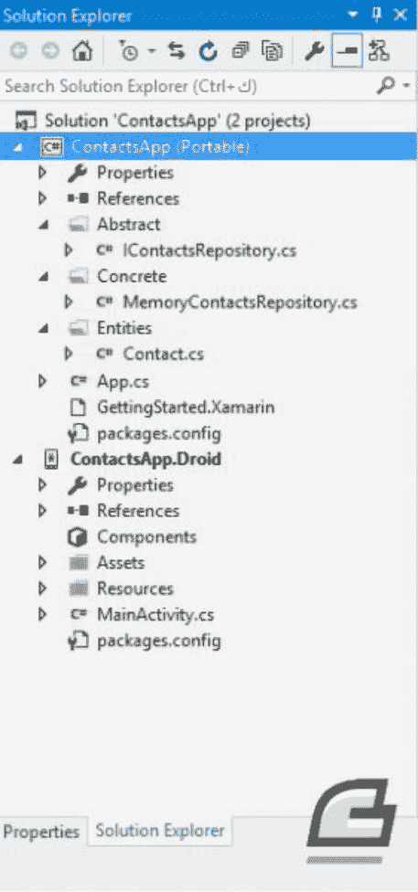

### 结论

本课是联系人应用程序的介绍，我们将在接下来的两课中继续构建它。在本课中，我们介绍了基本的应用思路，并通过构建一个代表它的接口以及一个实现它的类，阐明了 Repository 模型的概念。通过这个类（仓库类），我们将能够处理仅包含在应用程序内存中的数据

虽然这种方法不切实际，但有必要简化问题，使其更容易理解。我们还创建了一个代表应用中联系人的项目。我们看到了它与仓库类之间的关系，通过在最后一课中对门徒的召唤。

在本课中，我们将继续在上一课中开始的工作，即构建联系人应用程序。在上一课中，我们通过声明 IContactsRepository 接口并通过 MemoryContactsRepository 类实现它，完成了存储库模型的构建。我们还创建了 Contacts 类别，它是应用中的构建块。

在本课中，我们将为存储库 MemoryContactsRepository 添加功能，使我们的应用程序可用。

### 准备仓库的功能方面

打开 MemoryContactsRepository.cs 文件并确保其内容如下：

```
using System.Collections.Generic;
using System.Linq;
using System.Threading.Tasks;
using System.Collections.ObjectModel;
using ContactsApp.Abstract;
using ContactsApp.Entities;

namespace ContactsApp.Concrete
{
    public class MemoryContactsRepository : IContactsRepository
    {
        private ObservableCollection<Contact> contacts;
        public MemoryContactsRepository()
        {
            contacts = new ObservableCollection<Contact>()
            {
                new Contact()
                {
                    Id=1,
                    FirstName = "Ahmad",
                    LastName="Saeed",
                    Tel="123456",
                    EMail="admin@example.com",
                    Hobbies="Swimming"
                },
                new Contact()
                {
                    Id=2,
                    FirstName = "Mahmood",
                    LastName="Maktabi",
                    Tel="852136",
                    EMail="info@example.com",
                    Hobbies="Reading"
                }
},
new Contact()
{
    Id=3,
    FirstName = "Mazen",
    LastName="Najem",
    Tel="987456",
    Email="it@example.com",
    Hobbies="Swimming"
},
new Contact()
{
    Id=4,
    FirstName = "Sawsan",
    LastName="Hilal",
    Tel="741258",
    Email="sales@example.com",
    Hobbies="Writing, Reading"
},
new Contact()
{
    Id=5,
    FirstName = "Musab",
    LastName="Aga",
    Tel="357159",
    Email="admin@example.com",
    Hobbies="Sport"
}
};
}
public async Task<ObservableCollection<Contact>>
GetContactsAsync(string firstName, string lastName)
{
    return await Task.Factory.StartNew(() =>
    {
```

```
IEnumerable<Contact> result = from contact in contacts where
    contact.FirstName
        .ToUpper()
        .Contains(firstName.ToUpper()) &&
    contact.LastName
        .ToUpper()
        .Contains(lastName.ToUpper())
    select contact;

    ObservableCollection<Contact> tmp = new
ObservableCollection<Contact>(result);
    return tmp;
    });
}
public async Task<bool> AddContactAsync(Contact contactToAdd)
{
    return await Task.Factory.StartNew(() =>
    {
        contactToAdd.Id = contacts.Count() + 1;
        contacts.Add(contactToAdd);
        return true;
    });
}
    public async Task<bool> UpdateContactAsync(Contact contactToUpdate)
{
    return await Task.Factory.StartNew(() =>
    {
        Contact result = (from contact in contacts
            where contact.Id == contactToUpdate.Id
            select contact).FirstOrDefault();

        if (result != null)
        {
            contactToUpdate.FirstName = result.FirstName;
```

```
contactToUpdate.LastName = result.LastName;
contactToUpdate.Email = result.Email;
contactToUpdate.Tel = result.Tel;
contactToUpdate.Hobbies = result.Hobbies;

return true;
} 
else 
{
return false;
}
});

public async Task<bool> DeleteContactAsync(Contact contactToDelete)
{
return await Task.Factory.StartNew(() =>
{
var result = (from contact in contacts
where contact.Id != contactToDelete.Id
select contact);

if (result != null)
{
contacts = new ObservableCollection<Contact>(result);
contactToDelete = null;
return true;
}
else 
{
return false;
}
}
});
}
```

```
}
}
```

新的是，我们为存储库中的每个基本功能分配了代码。查看以下段落，了解每个子项中代码的工作原理。

### 继续搜索 GetContactsAsync

以下是 GetContactsAsync 函数，它需要字符串参数按姓名和昵称搜索联系人：

```
public async Task<ObservableCollection<Contact>>
GetContactsAsync (string firstName, string lastName)
{
    return await Task.Factory.StartNew (() =>
    {
        IEnumerable<Contact> result = from contact in contacts where
            contact.FirstName
                .ToUpper ()
                .Contains (firstName.ToUpper ()) &&
            contact.LastName
                .ToUpper ()
                .Contains (lastName.ToUpper ())
            select contact;
        ObservableCollection<Contact> tmp = new ObservableCollection<Contact> (result);
        return tmp;
    });
}
```


在内部函数（lambda表达式）的最后两行，我们以全局组的形式显示搜索结果，该全局组是`ObservableCollection<Contact>`，其中它被隐式转换为`<ObservableCollection<Contact>>`类型的对象。

### 继续添加新联系人，AddContactAsync

AddContactAsync函数只需要一个Contact参数，并返回一个Task<bool>对象以指示添加操作是否成功：

```
public async Task<bool> AddContactAsync (Contact contactToAdd)
{
	return await Task.Factory.StartNew (() =>
	{
		contactToAdd.Id = contacts.Count () + 1;
		contacts.Add (contactToAdd);
		return true;
	});
}
```

此代码将新联系人添加到contacts变量下已有的联系人中，请注意以下代码：

```
contactToAdd.Id = contacts.Count () + 1;
```

这句话的作用在任何实际应用中都不存在。它给传递给函数的联系人的Id属性赋一个值。任何应用程序都不应该这样做，因为这个数字应该在联系人添加到数据库时自动生成。由于我们的应用程序依赖于内存中存在的假数据，我们不得不这样做以区分新添加的联系人。

### 继续 DeleteContactAsync

DeleteContactAsync函数只需要一个Contact参数，并返回一个Task<bool>对象以指示删除操作是否成功：

```csharp
public async Task<bool> DeleteContactAsync (Contact contactToDelete)
{
 return await Task.Factory.StartNew (() =>
 {
 var result = (from contact in contacts where contact.Id != contactToDelete.Id select contact);
 if (result != null)
 {
 contacts = new ObservableCollection<Contact> (result);
 contactToDelete = null;
 return true;
 }
 else
 {
 return false;
 }
 });
}
```

前面的代码实际上过滤了要删除的联系人，这仅意味着LINQ to Objects查询将返回除我们要删除的联系人的Id值之外的所有联系人。然后将结果赋予contacts变量，这意味着我们实际上已从内存中删除了此联系人。

### 继续 UpdateContactAsync

UpdateContactAsync函数只需要一个Contact类型参数，并返回一个Task<bool>对象以指示更新操作是否成功：

```
public async Task<bool> UpdateContactAsync (Contact contactToUpdate)
{
    return await Task.Factory.StartNew (() =>
    {
        Contact result = (from contact in contacts
                          where contact.Id == contactToUpdate.Id
                          select contact) .FirstOrDefault ();
        if (result != null)
        {
            contactToUpdate.FirstName = result.FirstName;
            contactToUpdate.LastName = result.LastName;
            contactToUpdate.EMail = result.EMail;
            contactToUpdate.Tel = result.Tel;
            contactToUpdate.Hobbies = result.Hobbies;
            return true;
        }
        else
        {
            return false;
        }
    });
}
```

此代码遵循相同的原则：LINQ to Objects查询根据联系人的Id属性值在contacts变量中搜索所需的联系人，获取后，其他属性的值也会清晰地进行更新。

这样，仓库模板就可以使用了。它将处理应用程序的所有组件，对数据执行四种不同类型的操作：搜索、添加、修改和删除。

### 结论

在本课中，我们研究了如何构建由MemoryContactsRepository类表示的存储库模型，这是通过我们了解的IContactsRepository接口实现的，我们了解了其中的四个函数，它们允许应用程序组件处理数据，而无需关注这些数据的位置。我们还学习了如何在四个依赖项中使用LINQ to Objects查询技术来执行该存储库所需的任务。在下一课中，我们将开始构建应用程序界面。

## 3

本课是有关如何使用初步数据构建联系人管理简单实用应用程序的系列课程的第三部分，也是最后一部分。在继续本课之前，您需要阅读第一部分和第二部分。

- 主界面，您可以通过它按姓名和昵称搜索联系人，也可以添加新联系人。
- 用于查看从主界面选择的联系人详细信息的界面，然后能够修改其数据甚至删除它。

此外，还需要修改App类以使应用程序可运行。

### ContactsPage 的主界面

首先，我们需要添加一个新文件夹，我们将其命名为Pages，用于放置应用程序的任何新页面。

从解决方案资源管理器窗口中，右键单击ContactsApp（Portal）项目名称，然后从出现的列表中选择“添加”选项。从子菜单中选择“新建文件夹”并将其命名为Pages。

右键单击刚刚添加的文件夹Pages，然后从“添加”菜单中选择“新建项”子菜单，会出现一个窗口，允许您选择要添加的新项。像我们在本课中已经做的那样，选择基于代码的内容页。将此页命名为ContactsPage。

现在转到ContactsPage.xaml文件，并确保其内容如下：

```
<?xml version="1.0" encoding="utf-8"?>
<ContentPage xmlns="http://xamarin.com/schemas/2014/forms" xmlns:x="http://schemas.microsoft.com/winfx/2009/xaml" x:Class="ContactsApp.Pages.ContactsPage" Appearing="ContactsPage_Appearing">

<StackLayout>
    <StackLayout Padding="5,25,5,5">
        <StackLayout Orientation="Horizontal">
            <Label Text="First Name" />
            <Editor x:Name="txtFirstName" HorizontalOptions="FillAndExpand" TextChanged="Editor_TextChanged" />
        </StackLayout>

        <StackLayout Orientation="Horizontal">
            <Label Text="Last Name" />
            <Editor x:Name="txtLastName" HorizontalOptions="FillAndExpand" TextChanged="Editor_TextChanged" />
```

```
</StackLayout>

<Button Text="Find" x:Name="btnFind" Clicked="btnFind_Clicked" />
</StackLayout>

<StackLayout>
<ListView x:Name="lsvContacts" ItemTapped="lsvContacts_ItemTapped" />
</StackLayout>

<Button Text="+ New Contact" HorizontalOptions="FillAndExpand" Clicked="btnNewContact_Clicked" />
</StackLayout>

</ContentPage>
```

我们在此页面上使用了四个不同的事件。下面将简要介绍每个事件：

- 将Contacts页面的Appearing事件链接到ContactsPage_Appearing处理程序，以便在从负责查看联系人详细信息的页面返回时更新页面数据，我们将在本课后面看到。
- txtFirstName和txtLastName都发生了TextChanged变化，我们将其链接到Editor_TextChanged处理程序，以便在任何用户更改时清除lsvContacts列表下方出现的搜索结果。
- 点击了lsvContacts列表中的项，我们将其链接到lsvContacts_ItemTapped处理程序，以便程序在点击时移动到负责查看联系人详细信息的界面。
- 单击“添加新联系人”按钮，并将其链接到btnNewContact_Clicked处理程序。

然后，转到相应的代码文件ContactsPage.xaml.cs，并确保其内容如下：

```
using System;
using Xamarin.Forms;
using ContactsApp.Entities;

namespace ContactsApp.Pages
{
    public partial class ContactsPage: ContentPage
    {
        public ContactsPage ()
        {
            InitializeComponent ();
        }

        private async void DoFind ()
        {
            string firstName = txtFirstName.Text == null ? "" : txtFirstName.Text;
            string lastName = txtLastName.Text == null ? "" : txtLastName.Text;

            lsvContacts.ItemsSource = await ((App) Application.Current).ContactsRepository.GetContactsAsync (firstName, lastName);
        }

        private void btnFind_Clicked (object sender, EventArgs e)
        {
            DoFind ();
        }

        private void Editor_TextChanged (object sender, TextChangedEventArgs e)
        {

```


```
if (lsvContacts.ItemsSource != null)
    lsvContacts.ItemsSource = null;
}

private async void lsvContacts_ItemTapped (object sender, ItemTappedEventArgs e)
{
    Contact selectedContact = (Contact) e.Item;
    ContactDetailsPage ContactDetailsPage = new
        ContactDetailsPage (selectedContact);

    await Navigation.PushAsync (ContactDetailsPage);
}

private void ContactsPage_Appearing (object sender, EventArgs e)
{
    DoFind ();
}

private async void btnNewContact_Clicked (object sender, EventArgs e)
{
    ContactDetailsPage ContactDetailsPage = new
        ContactDetailsPage (null);

    await Navigation.PushAsync (ContactDetailsPage);
}
}
}
```

该文件包含 ContactsPage 类，其中包含我们之前在相应代码页上看到的事件处理程序，此外还有一个服务依赖项，即 DoFind，其功能是根据用户想要的条件（姓名和昵称）执行搜索。事件处理程序中的代码简单明了。但我想暂停一下，看看执行搜索的 DoFind 实用程序所使用的代码：

```
string firstName = txtFirstName.Text == null? "": txtFirstName.Text;
string lastName = txtLastName.Text == null? "": txtLastName.Text;
```

```
lsvContacts.ItemsSource = await ((App) Application.Current)
.ContactsRepository
.GetContactsAsync (firstName, lastName);
```

前两行很清晰，它们从文本框 txtFirstName 和 txtLastName 中获取用户想要的搜索条件。至于最后一行，它通过调用 GetContactsAsync 函数并将搜索条件传递给它，联系存储库执行搜索并返回结果。请看这句话：

```
await ((App) Application.Current) .ContactsRepository
.GetContactsAsync (firstName, lastName);
```

Application.Current 属性返回一个表示当前正在使用的应用程序的 Application 类型对象。反过来，需要使用 Transform (App) 将其转换为 App 类型的对象，即应用程序中的主类。事实上，我已在 App 类中声明了 ContactsRepository 功能，以便从我们应用程序的任何位置访问存储库。我们很快就会看到该功能的声明。

### ContactDetailsPage 联系人详情界面

按照我们添加主界面文件时相同的方式添加此界面，即添加到 Pages 文件夹中。其名称应为 ContactDetailsPage。

你的解决方案资源管理器将如下所示：

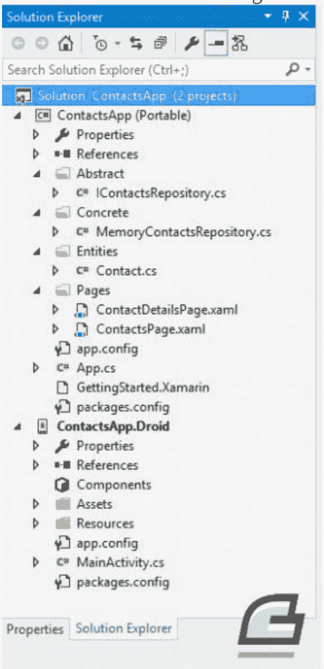

我们转到 ContactDetailsPage.xaml 符号文件，并确保其内容如下：

```
<? xml version = "1.0" encoding = "utf-8"?>
<ContentPage xmlns = "http://xamarin.com/schemas/2014/forms"
```

```
xmlns: x = "http://schemas.microsoft.com/winfx/2009/xaml"
x: Class = "ContactsApp.Pages.ContactDetailsPage"

<StackLayout Orientation = "Vertical" Padding = "5,25,5">
<Label Text = "FirstName" />
<Entry x: Name = "txtFirstName" />
<Label Text = "LastName" />
<Entry x: Name = "txtLastName" />
<Label Text = "Tel" />
<Entry x: Name = "txtTel" />
<Label Text = "EMail" />
<Entry x: Name = "txtEMail" />
<Label Text = "Hobbies" />
<Editor x: Name = "txtHobbies" />
<StackLayout Orientation = "Horizontal">
<Button Text = "Save"
x: Name = "btnSave"
Clicked = "btnSave_Clicked" />
<Button Text = "Delete"
x: Name = "btnDelete"
Clicked = "btnDelete_Clicked" />
</StackLayout>
</StackLayout>
</ContentPage>
```

这显然是一个简单的文件。我们在此页面上报告了两个事件：

- * “保存”按钮的点击事件已关联到 btnSave_Clicked 处理器，负责保存和添加。
- * “删除”按钮的点击事件已关联到 btnDelete_Clicked 处理器，负责删除联系人。

转到与之前的符号文件对应的代码文件，名为 ContactDetailsPage.xaml.cs，并确保其内容如下：

```
using System;
using Xamarin.Forms;
using ContactsApp.Entities;

namespace ContactsApp.Pages
{
    public partial class ContactDetailsPage : ContentPage
    {
        private Contact currentContact;

        public ContactDetailsPage(Contact contact)
        {
            InitializeComponent();

            this.currentContact = contact;

            if (this.currentContact != null)
            {
                txtFirstName.Text = contact.FirstName;
                txtLastName.Text = contact.LastName;
                txtEMail.Text = contact.EMail;
                txtTel.Text = contact.Tel;
                txtHobbies.Text = contact.Hobbies;

                Title = contact.ToString() + " Details";

                btnDelete.IsVisible = true;
            }
            else
```

```
{
    Title = "New Contact";

    btnDelete.IsVisible = false;
}
}

private async void btnSave_Clicked(object sender, EventArgs e)
{
    string firstName = txtFirstName.Text == null ? "" : txtFirstName.Text;
    string lastName = txtLastName.Text == null ? "" : txtLastName.Text;
    string tel = txtTel.Text == null ? "" : txtTel.Text;
    string email = txtEMail.Text == null ? "" : txtEMail.Text;
    string hobbies = txtHobbies.Text == null ? "" : txtHobbies.Text;

    if (this.currentContact != null)
    {
        this.currentContact.FirstName = firstName;
        this.currentContact.LastName = lastName;
        this.currentContact.EMail = tel;
        this.currentContact.Tel = email;
        this.currentContact.Hobbies = hobbies;

        await ((App)Application.Current).ContactsRepository
            .UpdateContactAsync(this.currentContact);
    }
    else
    {
        Contact contact = new Contact
        {
            FirstName = firstName,
            LastName = lastName,
            Tel = tel,
            EMail = email,
```

```
```csharp
Hobbies = hobbies,
};
await ((App)Application.Current).ContactsRepository
.AddContactAsync(contact);
}
await Navigation.PopAsync();
}
```
```

```
```csharp
private async void btnDelete_Clicked(object sender, EventArgs e)
{
    var result = await
        DisplayAlert("Delete Confirmation",
            "Are you sure you want to delete this contact?",
            "Yes", "No");

    if (result)
    {
        await ((App)Application.Current).ContactsRepository
            .DeleteContactAsync(this.currentContact);

        await Navigation.PopAsync();
    }
}
```
```

我们之前也解释过，此界面的功能是查看和编辑联系人的详细信息，并有可能删除联系人，此外还可以使用此界面添加新联系人。此界面通过传递给其构造函数的联系人类型对象来区分其预期用途。如果该媒介包含有效的 Contact 对象，则意味着我们要显示该对象表示的联系人，然后修改或删除它，当然这需要显示删除按钮。如果 null 作为中间对象传递给构造函数，则意味着该页面被调用来创建全新的联系人，因此隐藏删除按钮，因为在这种情况下它没有意义。传递对象的副本保存在类中名为 currentContact 的专用字段下。界面的用途在构造函数本身内确定。请查看前面代码中 btnSave_Clicked 事件处理器的定义，了解它如何处理前两种情况（修改或添加）。

### 项：App

转到 App.cs 文件，并确保其内容如下：

```
```csharp
using Xamarin.Forms;
using ContactsApp.Abstract;
using ContactsApp.Concrete;
using ContactsApp.Pages;

namespace ContactsApp
{
	public class App: Application
	{
		public IContactsRepository ContactsRepository {get; set; }
		public App ()
		{
			ContactsRepository = new MemoryContactsRepository();
			// The root page of your application
			MainPage = new NavigationPage (new ContactsPage ());
		}
		protected override void OnStart ()
		{
			// Handle when your app starts
		}
	}
}
```


> “当我们想要更改数据保存的位置时，仓库模型的优势将变得明显，因为我们只需要更改仓库类（而不是接口），而应用程序的其他组件保持不变。更准确地说，更改将只在一个地方进行，即在 App 类内部，我们将更改用来创建分配给 ContactsRepository 属性的对象的类型。”

### 结论

通过本课，我们完成了 Contacts 应用的构建，其中我们讨论了如何构建两个应用程序界面，如何在这两个界面之间导航，以及在需要处理应用程序中的数据源时，它们如何与仓库相关联。这是一个由存在于应用程序内存中的联系人类型元素组成的组。
