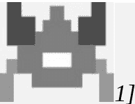
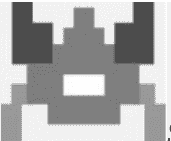

# ZX SPECTRUM 游戏代码俱乐部：20 个用于编程与学习的趣味游戏

Sinclair BASIC 有趣且易于学习。

输入一个游戏，运行它，然后我们将对其进行解释。

跳跃的小鸟、ZX 俄罗斯方、星际入侵者、C5 太阳竞赛、MiniPong、复古猎人、外卖泰德、比利·波布的黄金以及更多等游戏。

Gary Plowman

## 特别感谢

感谢 Gabby 和 Pippin 忍受我的熬夜

## 致谢

我对此本书的所有支持者以及在早期阶段支持这一想法的 ZX Spectrum 和 BASIC 编程粉丝们表示谢意。

感谢我的伴侣 Gabrielle 帮助我测试书中的一些代码。

感谢我的父母在 80 年代圣诞节为我买了 ZX Spectrum。

感谢 Richard Langford 使用他的 48k Spectrum 图形图像。

感谢广大复古社区的帮助传播信息。

感谢 Sir Clive Sinclair 制造了 Sinclair ZX Spectrum。

## 关于作者

## 引言

在我们开始之前，让我们先明确一下这本书的目的。这并不是一本关于 Sinclair BASIC 语言细节的百科全书。这本书旨在通过输入各种游戏的代码列表来促进 Sinclair BASIC 的学习，额外的好处是，你可以在书中享受你的努力，体验一些“老派”的游戏。随着你阅读的进行，我们会减少解释，以免让你感到无聊。书中有许多不同类型的游戏，所以我希望每个人都能找到感兴趣的内容。

也许你们中的一些人想向年轻一代介绍伴他们一起成长的机器的早期微型计算机黄金时代。或者你可能希望为当地的代码俱乐部提供易于学习的活动，来制作有趣的游戏，而不需要成为出色的艺术家、极客或天才。又或者你是一个 ZX 粉丝，并且买了一台那些新的蓝牙 ZX Spectrum，无论如何，我们都希望你使用这本书得愉快。

青少年时期，学习 BASIC 编程让我受益匪浅，这段经历开启了许多可能性，激发了我对计算和通用编程的热情。今天，我参与桌面、网页和移动端的编程，涵盖游戏开发、业务应用程序和互联网初创公司。每个人都要从某个地方开始，学习编程永远不晚也不早。

## 为什么要选择 Sinclair BASIC？

Sinclair BASIC 语言是许多成功的英国和欧洲程序员在 20 世纪 80 年代编写不起的游戏和实用程序之前，进入专业编程的大门之一。这一切都在少于 48k 的内存中完成。这些程序的示例包括 RARE（又称 Ultimate Play the Game，或 ACG）、The Oliver Twins（Dizzy 系列）、Codemasters 等。

BASIC 是“初学者全能符号指令代码”（Beginners All Purpose Symbolic Instruction Code）的缩写，因此它非常适合学习编程的初学者。它友好且易学，命令逻辑清晰，并根据其执行的功能进行命名。

Sinclair BASIC 教你逻辑、如何进行判断以及组织你的代码，但仅限于简单概念。它有助于基础数学技能——学习它时你不需要成为一个数学大师。

BASIC ROM（只读存储器）是 Sinclair 机器的操作系统，它的设置方式不允许输入非法代码。每一行都由 ROM 验证，因此在输入一行后，如果输入正确，你会听到接受提示声。如果行错误，系统会使用较低的音调，并提示你修复任何错误代码。

必须感谢 Sinclair 的伙伴们，特别是 Steve Vickers 以及 Nine Tiles Ltd 的同事们，他们创建了 Sinclair BASIC。

## 在开始之前你需要什么？

任何以下配置都可以快速开始：

- a) 一台真实的 ZX Spectrum：例如 ZX Spectrum 16k、48k、48K+、128K 或任何其他型号。
- b) 一台可以运行模拟器的电脑：各种平台的模拟器示例...
  - Windows: ZX Spin, Spectacular, Speccy 以及更多。
  - Mac OS: Fuse
  - Linux/Unix: Fuse
  - iOS/Android: Spectacularator, Fuse, Speccy, Marvin
  - Chrome/FF: 有那么几个在线模拟器可以在浏览器中运行。使用 Google 会引导你找到它们，但这里有我两个可以在浏览器中运行的示例...
    - http://jpeccy.org
    - http://torinak.com/qaop
- c) 另一个很好的选择是新的 ZX Spectrum（蓝牙），对于 48k 模式或 16k。

## 快速上手

如果你想立即开始编写代码，并且已经准备好了上面的选项，那么你可以跳过这一节，直接开始编写游戏。

## 基础命令

我们将使用的一些常用命令包括 `PRINT`、`IF`、`GOTO`、`GO SUB`、`DIM` 和 `LET`。我只会给你每个命令的概述，因为这是一本通过实践来学习的书，而不是手册。过多的技术术语会让读者感到无聊。这里有一个几乎在所有编程书中出现的“你好世界”示例。

```
10 PRINT AT 10,5;"Hello World"
```

在行末按回车键将其保存到内存中，然后输入 `RUN` 并再次按回车查看效果。

上述示例代码的分解如下：

```
10      = 行号（程序的执行顺序）
PRINT   = 在屏幕上打印（简单！）
AT y,x  = 告诉程序坐标，其中 y 是纵轴，x 是横轴
;       = 允许新的子函数或让文本打印
"Hello World" = 你的文本内容
```

`PRINT` 将你指定的位置填充文本或特殊字符（例如 UDG）。ZX Spectrum 的可用屏幕宽度为 32 个列（0 到 31），长度为 22 行（0 到 21）。命令 `AT`（操作数）部分是告诉命令将项目放在 Y（行），X（列）处。还有额外的 2 行，但这些不用于标准的 `PRINT` 命令。

以下子函数可以与 `PRINT` 命令内联使用：

- `INK <0-7>` 设置打印所有文本和图形的笔前景颜色
- `PAPER <0-7>` 设置主屏幕纸张背景颜色
- `INVERSE <1 or 0>` 打印当前 `INK` 和 `PAPER` 设置的正反反色
- `OVER <1 or 0>` 开启/关闭屏幕上的覆盖打印
- `FLASH <1 or 0>` 在当前颜色和反色之间反复交替闪烁
- `BRIGHT <1 or 0 or 8>` 颜色 1-6 的更亮版本（用于 `INK` 和 `PAPER`）8 是透明的
- `TAB #` 从左到右水平移动光标 # 空格

例如：`PRINT INK 2; AT 10,10;"Test"; TAB 16;PAPER 1;INK 7;1;"Print"`

如你所见，在 `PRINT` 语句中你几乎可以任意组合这些命令。

### 行号

在为代码行编号时留出足够的间隙是一个良好的习惯，这样你就可以在以后输入额外的命令。我建议你自己的程序至少以 10 为步进进行编号。例如第 10 行，然后是第 20 行，以此类推。Sinclair BASIC 最多可以有 9999 行，但由于可以使用冒号（`:`）分隔时包含多个语句，因此命令可以达到数万行。

### 128k 模式与行号

128k Spectrum 模式还有另一个对新代码者非常有用的功能。如果你的程序缺少某部分，且你没有为命令留足够的空间，你可以运行 `RENUMBER`，它将重新组织程序的行号。这有一定的局限性，但在我们早期阶段无需担心这些。

### UDGs（用户定义图形）

你将学会如何轻松地创建自己的图形！因此，你可以回到书中的某些程序，并添加你自己的图形来增强它们。

### 机器码

对于本书来说，机器码会有点难以理解。因此我们不会涵盖它。不过，请在 Gazzapper.com 订阅我们的警报，因为我们可能会发布某些游戏的更新版本，其中包含少量的机器码例程。

### 什么是“打入列表”（Type-in Listing）？

在微型计算机的早期，杂志会发布“列表”或“打入列表”，让年轻的爱好者（即代码编写者/程序员）坐在舒适的卧室里，在键盘上一个字字输入。有些列表可能会打印错误或包含漏洞，导致使用户对作者感到沮丧和愤怒。如果你无法修复漏洞，就只能面对无法运行的代码，并花费好几个小时来输入它们。

不过，我很兴奋地告诉大家，我已经编写并测试了所有的列表，确保它们能够正常工作，任何问题都可以通过我建立的名为 ZX Spectrum Code Club 的新 Facebook 群组来解决。如果你已经是 ZX Spectrum 群组的成员，可以在那里发布你的问题（如果规则允许）。

列表的编码方式充分利用了 Sinclair BASIC 的速度限制（在合理范围内），以便游戏具有可玩性，并希望也同样有趣。结构设计得易于理解，虽然并不完美，但允许用户了解每个游戏内部的运作。游戏的结构保持相似，以便你熟悉它们，并为你自己的创作提供一个简单的模板。

Sinclair BASIC 的一个伟大特性是 ROM 在接受语句之前会验证大部分代码。以防你之前错过了，ROM 代表“只读存储器”（Read Only Memory），它包含了操作系统以及 BASIC 所需各种例程。

虽然运行程序并不需要 `REM` 语句，但提供这些注释是一个良好的习惯，因为你向程序中添加的代码越多，需要的注释就越多。特别是为了让用户在未来的以后某天编辑或扩展代码时进行参考。它们也可以作为你程序中不同部分之间的视觉分割符，使其更易读。

Sinclair BASIC 不是最快的编程语言，但它是最容易学习的语言之一，而且非常有趣。在不涉及过多技术细节的情况下，用户可以在选项中将任何 Spectrum 模拟器的运行速度从标准的 3.54MHz 加快到 x2 倍或更高。

### 模拟器键盘映射

当使用模拟器而非真实的 Spectrum 机器时，关于键盘映射有几点复杂之处需要指出。下面是真实的 48k Spectrum 键盘布局。


在模拟器上使用时，注意某些符号在模拟器上可能会不同。

#### 模拟器的标准等价键

在模拟器上使用时，注意以下是某些符号在模拟器上可能会不同：

- `*`（星号）= Ctrl + B
- `(` = Ctrl + 9
- `)` = Ctrl + P
- `.`（句号）= Alt + M
- `,`（逗号）= Alt + n
- `;`（分号）= Alt + O
- `:`（冒号）= Alt + O
- `Delete`（删除键）= Shift + 0

### 录制你的打入

对于真实的机器用户，你需要一个录音机来录制 15、30、60 或 90 分钟磁带。


### 游戏循环基础

游戏循环是程序内发生所有动作的部分，并反复运行直到游戏结束。它遵循特定的事件顺序。这种结构并不是死板的，下面展示了它如何进入代码的简单示例：

- 设置：加载数据
- 初始化：变量、字符串和数组
- 菜单/开始界面
- 游戏循环：
  - 处理输入
  - 更新位置
  - 绘制屏幕
- 重复
- 结束/退出游戏

我在书中的大多数游戏中都使用了这种结构。希望你发现这种格式有助于理解游戏循环的作用以及如何使用它。

### 如何使用本书

你可以按照你喜欢的任何顺序编写或输入这些列表。不过，某些命令或新概念可能没有解释，因为它们可能在之前的列表中讨论过。记住这是为了趣味，所以如果某个游戏对你不感兴趣，请尽管跳过。

此外，这里有一个非常实用的空格规则（仅适用于印刷版）：对于印刷版，每 12 个字符大约占 3 厘米。

| 10 | 20 | 30 |
|---|---|---|
| 3cm | 6cm | 9cm |

扫描/复制它，或者在需要计算列表中的空格时参考它。你也可以创建自己的规则。

### 输入代码时的小贴士...

1. 为了加快打入数据速度，你可以让朋友或家人逐行向你读出代码列表。
2. 其他方法是使用尺子或其他书遮住尚未输入的行。
3. 务必双击行号是否正确！人们在输入数字时经常会出错。

所以话不多说，开始吧！

## 井格游戏（Tic Toe）

让我们从一个简单的游戏开始。井格游戏（Tic Toe）是一种相当普遍的游戏。大多数人至少在纸笔上玩过。

规则：玩家 1 尝试连成三个 X，玩家 2 尝试连成三个 O。控制：1 到 9 选择方格。见下方网格。

1 2 3
4 5 6
7 8 9

```
1050 PRINT AT 18,1;"
1090 RETURN
2000 REM ***** 胜利条件检查
2010 FOR n=1 TO 2
2020 IF a(1,n)=1 AND a(2,n)=1 AND a(3,n)=1 THEN win=n
2030 IF a(1,n)=1 AND a(4,n)=1 AND a(7,n)=1 THEN win=n
2040 IF a(2,n)=1 AND a(5,n)=1 AND a(8,n)=1 THEN win=n
2050 IF a(3,n)=1 AND a(6,n)=1 AND a(9,n)=1 THEN win=n
2060 IF a(3,n)=1 AND a(5,n)=1 AND a(7,n)=1 THEN win=n
2070 IF a(1,n)=1 AND a(5,n)=1 AND a(9,n)=1 THEN win=n
2080 IF a(4,n)=1 AND a(5,n)=1 AND a(6,n)=1 THEN win=n
2090 IF a(7,n)=1 AND a(8,n)=1 AND a(9,n)=1 THEN win=n
2100 NEXT n
2110 RETURN
3000 REM ***** 绘制移动 *****
3010 LET posx=80: LET posy=130: REM 绘制位置
3020 IF square=1 THEN LET posx=80: LET posy=130
3030 IF square=2 THEN LET posx=130: LET posy=130
3040 IF square=3 THEN LET posx=180: LET posy=130
3050 IF square=4 THEN LET posx=80: LET posy=100
3060 IF square=5 THEN LET posx=130: LET posy=100
3070 IF square=6 THEN LET posx=180: LET posy=100
3080 IF square=7 THEN LET posx=80: LET posy=70
3090 IF square=8 THEN LET posx=130: LET posy=70
3100 IF square=9 THEN LET posx=180: LET posy=70
3300 IF ply=1 THEN CIRCLE INK 4;posx-10,posy-10
3310 IF ply=2 THEN INK 5: PLOT posx,posy: DRAW -20,-20: PLOT posx-20,posy: DRAW 20,-20
3350 RETURN
```

现在你已经完成了你的输入游戏，可以开始玩它了。要在 BASIC 中运行程序，请在提示符处输入 `RUN` 然后按回车键。

# 玩过之后

我们不会逐行解释代码，只讲解重要的内容或我认为可能较难理解的部分。

这一切意味着什么呢？嗯，第 10 到 20 行只是演示，`REM` 命令用于添加代码的任何注释或备注。

| 10 REM **************************************** | 15 REM * 井字游戏或交叉点游戏 |
|---|---|
| 20 REM ********** Gary Plowman ********** | |

第 30 行设置了游戏的显示。`INK` 命令是笔的颜色，`PAPER` 是主屏幕区域，`BORDER` 是主屏幕区域之外的区域。边界区域很少使用，`PLOT` 或 `PRINT` 命令无法到达那里，但可以让它闪烁以表示击中或得分。

```
30 INK 7: PAPER 6: BORDER 7: CLS: LET ply=1: LET win=0: DIM a(9,2): LET sq=0
```

该行的后续部分是 `CLS`。这意味着清除屏幕，如果没有 `PAPER` 命令，就无法让整个屏幕区域着色。之后使用 `LET` 命令来设置变量。变量存储值，以便在代码稍后使用或更改。

### 数组与多维数组

接下来的部分一点也不难，但如果你还没有理解数组，也不要担心。数组在刚开始很复杂，最好把它们看作值的列表。

第 30 行的最后部分是 `DIM a(9,2)` 命令（维度数组）。这是一个变量数组，工作类似于按数值排序的列表或电子表格。但如果你不理解，也许这里能解释得更好。

第一维可以看作第 1 列，包含 9 行数据。第二部分指的是第 2 列，包含另一组 9 行数据。

#### DIM a(9,2) – 9 行 2 列

| 列 1 | 列 2 |
|---|---|
| LET a(1,1)=1 | LET a(1,2)=1 - 行 |
| ... | ... |
| LET a(9,1)=9 | LET a(9,2)=9 - 行 |

上面的命令将把值存储在数组的不同部分。如果你尝试超出 `DIM` 语句中定义的数组限制，就会发生错误。Sinclair BASIC 中的数组总是从 1 开始，而不是 0。

### 解释 GO SUB

`GO SUB` 命令意味着跳转到子程序。`GO SUB` 将允许程序根据提供的行号跳转到代码的另一部分然后在遇到 `RETURN` 语句时返回之前的位置。这对于将 BASIC 程序分为逻辑部分非常有用。对于任何想要扩展的游戏的重要问题，都可以分离为 `GO SUB` 程序，这有助于你跟踪程序。

### 剩余程序总结

第 90 到 210 行绘制游戏内容。

- 90 `PRINT AT 2,10; INK 1;"井字"`


- 110 PLOT INK 5:100,40; DRAW INK 5:0,100
- 120 PLOT INK 5:150,40; DRAW INK 5:0,100
- 130 PLOT INK 5:65,70; DRAW INK 5:0,20
- 140 PLOT INK 5:65,110; DRAW INK 5:0,20
- 160 REM 玩家 1, 2 状态

第 110 到 140 行使用 `PLOT` 绘制起始点（圆点）。第 175 到 190 行将在网格上绘制 X 和 O 符号。第 300 到 400 行运行主循环，该循环对于游戏来说非常短。

```
300 REM ****** 测试
310 PRINT AT 18,1; INK 7; PAPER 6;"选择 1-9
320 LET i$=INKEY
330 IF i$="1" AND i$<="9" LET square=VAL i$: GO SUB 100
340 IF i$="" THEN GOTO 320
350 GO SUB 200: REM 胜利条件
360 IF win=0 THEN PRINT AT 18,1;"玩家赢了!"; BEEP 4,3; BEEP 2,10: GO TO 10
370 IF win=0 THEN PRINT AT 18,1;"重新开始"; BEEP 4,3: BEEP 2,10: GO TO 10
400 GO TO 300
```

第 320 行很重要，因为它捕获玩家的按键。第 330 行检查按键是否有效（1 到 9 之间）。第 1000 到 1090 行确保选定的格子已被占用。

```
1000 REM 检查格格
1010 IF a(square,1)=1 OR a(square,2)=1 THEN PRINT AT 18,1;"格子已被占用"; BEEP 3,1: GO TO 1050
1020 LET a(square,ply)=1: LET ply=ply+1: LET sq=sq+1
1025 PRINT AT 18,1; INK 4;"好棋！": BEEP 4,1
1030 IF ply=3 THEN ply=1
1040 GO SUB 3000: REM 平局
1050 PRINT AT 18,1;"
1090 RETURN
```

第 2000 到 2110 行检查是否胜利条件。如果找到胜利者，程序将宣布并重启游戏。

```
2000 REM 胜利检查
2010 FOR n=1 TO 2
2020 IF a(1,n)=1 AND a(2,n)=1 AND a(3,n)=1 THEN win=n
2030 IF a(1,n)=1 AND a(4,n)=1 AND a(7,n)=1 THEN win=n
2040 IF a(2,n)=1 AND a(5,n)=1 AND a(8,n)=1 THEN win=n
2050 IF a(3,n)=1 AND a(6,n)=1 AND a(9,n)=1 THEN win=n
2060 IF a(3,n)=1 AND a(5,n)=1 AND a(7,n)=1 THEN win=n
2070 IF a(1,n)=1 AND a(5,n)=1 AND a(9,n)=1 THEN win=n
2080 IF a(4,n)=1 AND a(5,n)=1 AND a(6,n)=1 THEN win=n
2090 IF a(7,n)=1 AND a(8,n)=1 AND a(9,n)=1 THEN win=n
2100 NEXT n
2110 RETURN
```

第 3000 到 3350 行将根据轮到谁在棋板上绘制新标记。

```
3000 REM ****** 绘制移动
3010 LET posx=80: LET posy=130: REM 绘制位置
3020 IF square=1 THEN LET posx=80: LET posy=130
3030 IF square=2 THEN LET posx=130: LET posy=130
3040 IF square=3 THEN LET posx=180: LET posy=130
3050 IF square=4 THEN LET posx=80: LET posy=100
3060 IF square=5 THEN LET posx=130: LET posy=100
3070 IF square=6 THEN LET posx=180: LET posy=100
3080 IF square=7 THEN LET posx=80: LET posy=70
3090 IF square=8 THEN LET posx=130: LET posy=70
3100 IF square=9 THEN LET posx=180: LET posy=70
3300 IF ply=1 THEN CIRCLE INK 4;posx-10,posy-10
3310 IF ply=2 THEN INK 5: PLOT posx,posy: DRAW -20,-20: PLOT posx-20,posy: DRAW 20,-20
3350 RETURN
```

# 恭喜！你到达了第 1 层

所以这些内容并不难理解，如果你具备一些 BASIC 知识，你可能想考虑以下练习来扩展游戏。如果你需要更多时间，请开始编写你的下一个游戏。

# 扩展建议（可选）

- 1] 为玩家一和玩家二创建计数，先到五者获胜。
- 2] 添加单人对战模式，并带有基础的 AI（人工智能）*
- 3] 在胜利格子之间画一条线

*简单的 AI 并不难实现。

纸 7; 墨 1; 位置 6,0; "取自.."; 位置 8,0; "ZX Spectrum 游戏代码书"; 暂停 0

100 GO SUB 300: REM 初始化
120 GO SUB 500: REM 菜单
130 GO SUB 1000: REM 游戏主循环

```
300 LET ply=2; LET win=0; DIM a(9,2); DIM d(30); LET lvl=1; LET pos=30; LET x=10; LET time=0; LET score=0; LET timer=0; LET mov=11; LET pos=11; LET v=0; LET vy=0; LET speed=1; LET ball=0; LET bx=0; LET by=0; LET score=2
```

```
310 LET b$="CHR(147)+CHR(145)+" " LET w$=CHR(146)+CHR$ (146)
```

```
400 RETURN
```

```
500 CLS
```

```
510 LET w$=CHR(146)
```

```
520 FOR n = 0 TO 31
```

```
530 PRINT INK 2;AT 1,n;w$;AT 21,n$
```

```
540 NEXT n
```

```
545 FOR n = 0 TO 20:
```

```
546 PRINT INK 2;AT n,0;w$;AT n,31;w$
```

```
549 NEXT n
```

```
550 RETURN
```

```
1000 REM 主循环
```

```
1005 PRINT AT 20,x-2;";b$"; "
```

```
1010 LET i=$INKEY($); LET kemp=IN 51
```

```
1020 LET timer=timer+1
```

```
1030 IF (i="z" OR komp=2) AND x>2 THEN x=x-1:
```

```
1040 IF (i="x" OR komp=1) AND x<29 LET x=x+1
```

```
1045 IF i$="z" OR is="" OR komp=0 THEN PRINT AT 20,x-2; ";b$"; "
```

```
1050 IF (i=CHR(32) OR komp=16) AND ball=0 THEN vx=(RND*1.5) (RND*1.5): LET vy=-1; LET ball=1; LET bx=x; LET by=19
```

```
1060 timer=5 THEN SUB 300
```

```
1070 ball=1 THEN GO SUB 4000
```

```
1080 PRINT AT 0,2;"SCORE:";score;\;(Lvl);lvl;";Lives";lives:
```

```
2000 GO TO 1010
```

```
3000 REM 绘制方块
```

```
3010 FOR n = 1 TO 20 STEP 2
```

```
3020 FOR p = 1 TO 10 STEP 2
```

```
3025 LET ir=RND*4+1
```

```
3030 PRINT AT p+2,n+4; INK 0; PAPER ir;__";
```

```
3050 NEXT p
```

```
3060 NEXT n
```

```
3070 LET timer = 6
```

```
3100 RETURN
```

```
4000 REM **** 球移动
```

```
4005 PRINT AT by,bx;" “
```

```
4010 LET bx=bx+vx: LET by=by+vy
```

```
4014 LET y$=$SCREEN (INT (by),INT(bx)
```

```
4015 IF y=\” THEN LET score = score + 1: BEEP.008,vx+bx: LET score2=score2+1; LET vy=-vy*speed
```

```
4016 IF by=19 AND (bx-x)<2 THEN LET vx=((RND*2)+1)-((RND*2)+1) vy=-vy*speed; PRINT AT 20,x-2; “b;b;” “
```

```
4020 PRINT AT by,bx; INK 2;CHR($144)
```

```
4040 IF bx>29 THEN LET vx-(vx*speed)
```

```
4050 IF bx<2 THEN LET vx=(-vx*speed)
```

```
4060 IF by>20 THEN LET lives=lives-1: BORDER 2: BEEP 1,0: BORDER 4
```

```
4070 IF by<3 THEN LET vy=(-vy*speed)
```

```
4080 IF lives=0 THEN GO SUB 5000:
```

```
4090 IF score>=70 THEN GO SUB 6000: REM 下一关:
```

```
4200 RETURN
```

```
5000 REM **** 重启
```

```
5010 PRINT AT 10,5; FLASH 1; PAPER 6; INK 2;“G A M E O V R
```

```
5030 FOR n = 1 TO 200
```

```
5050 NEXT n
```

```
5110 PRINT AT 12,5;“PRESS KEY TO START
```

```
5110 IF INKEY=$=\” THEN GO TO 5110
```

```
5120 GO TO 30
```

## 6000 REM **** 下一关

```
6005 LET lvl=lvl+1: CLS ; PRINT AT 10; FLASH 1; “L E V L ;lvl
6010 BEEP 1,13
6020 LET timer=2
6050 FOR n=1 TO 100
6055 BEEP .001,n/10
6060 NEXT n
6070 LET score2=0
6080 LET ball=0
6100 GO TO 120
```

## 7000 REM **** 创建 UDG 图形

```
7010 FOR n = 0 TO 31
7020 READ graph
7030 POKE USR “a”+n,graph
7050 NEXT n
7060 RETURN
```

## 7190 REM **** 球

```
7200 DATA BIN 00111100
7210 DATA BIN 0110110
7220 DATA BIN 0101110
7230 DATA BIN 0101110
7240 DATA BIN 0111110
7250 DATA BIN 00111100
7260 DATA BIN 00000000
7270 DATA BIN 00000000
## 7280 REM **** 左侧- 使用完整数字
```

7300 DATA 252,41,2,252,248,0,224

```

## 7270 REM **** 墙
```

7400 DATA 231,195,165,24,24,165,195,231

```

## 7470 REM **** 右侧
```

7480 DATA 63,84,148,64,31,0
```

是什么？`RND` 函数用于生成 0 到 1 之间的随机值，通过乘以一个值来决定范围。例如，`INT(RND*10)` 将返回 0 到 9 之间的整数。列表中的其他部分是 UDG（用户自定义图形）和一些碰撞检测。我们将简要介绍这些。还有存储在 `vx` 和 `vy` 中的方向值，在每个循环中不断增加或减少球的 x 和 y 值。

```
4010 LET bx=bx+vx: LET by=by+vy
```

什么是 UDG？UDG 代表用户自定义图形。它们可以为游戏添加精灵。`READ` 命令查找 `DATA` 语句，如果数据耗尽则会发生错误。因此可以告诉从 `<data_number>` 开始。UDG 是字符集中的字符，默认情况下它们看起来和 A 到 Z 一样。经过思考后可以改为图形。每个 UDG 字符有 8 字节。

创建这些图形的简单方法是使用 `BIN` 函数将 1 和 0 的字符串转换为数字。二进制范围从 0 到 255，每个 1 都使前一个数字翻倍。

| 数字 1 | 数字 2 | 数字 3 | 数字 4 | 数字 5 |
|---|---|---|---|---|
| 1 = 1 | 1 = 2 | 1 = 4 | 1 = 8 | 1 = 16 |
| 数字 6 | 数字 8 | | | |
| 1 = 32 | 1 = 128 | | | |
| 数字 7 | | | | |
| 1 = 64 | | | | |

8 位数字总和为 255。这是一个二进制数据制作基本形状的示例。

| 0 | 0 | 1 | 1 | 1 | 0 | 0 |
|---|---|---|---|---|---|---|
| 0 | 1 | 0 | 1 | 1 | 0 | 0 |
| 1 | 0 | 0 | 1 | 1 | 0 | 0 |
| 0 | 0 | 1 | 1 | 1 | 0 | 0 |
| 0 | 1 | 0 | 1 | 1 | 0 | 0 |
| 1 | 0 | 0 | 1 | 1 | 0 | 0 |
| 0 | 1 | 0 | 1 | 1 | 0 | 0 |
| 0 | 0 | 1 | 1 | 1 | 0 | 0 |

这是十进制看起来的样子：

```
7010 FOR n = 0 TO 31
7020 READ graph
7030 POKE USR “a”+n,graph
7050 NEXT n
```

扩展建议（可选）：
- 添加更多关卡布局
- 添加强化道具

提示：使用代码创建 UDG 相对容易

# 蛇吃蛇 SNAKE BITE

你必须通过吃从树上掉下的苹果来帮助蛇生存并长大。尝试吃尽可能多的苹果而不撞到屏幕侧或自己的尾巴！好运！我和我的同学在计算机课上用 IBM 电脑玩了很久这个游戏。它也出现在诺基手机上，是最早移动游戏之一！

- 玩家：1
- 规则：玩家尝试尽可能多的苹果并打破高分。碰到边界或自己的尾巴将结束游戏。
- 控制：q = 上，a = 下，o = 左，p = 右。

```
15 REM *蛇吃蛇 by Garyman
20 REM *********************************
25 LET hsc=0: GO SUB 6000
30 INK 1: PAPER 7: BORDER 4: CLS
45 REM *****初始变量
50 PRINT AT 2,10; INK 7; BRIGHT 1; PAPER 2;"蛇KE BITE": PRINT 4,5;"控制你的蛇 *
35 LET lives=3
60 PRINT AT 7,5;"避开你的尾巴！ *****"
65 PRINT AT 8,5;"吃苹果"; PAPER 6;"o"
70 PRINT AT 11,2;"控制";AT 12,2;"Q/A=上/下，O/P=左/右"
80 PRINT AT 18,5; FLASH 1;"按任意键开始": PAUSE 0
```

```
100 GO SUB 300: REM 初始化
130 GO SUB 1000: REM 游戏主循环
200 GO TO 30:
```

```
300 REM ***设置
310 LET x=10: LET y=10: LET vx=0: LET vy=0: LET score=0: LET lvl=1: LET ax=1: LET ay=1: LET ax2=0: LET ay2=0: LET loot=0: LET snk=5: LET dx-x: LET dy-y: LET longer=0: LET snkpos=1: LET ny=0: LET nx=0: LET ly=0: LET lx=0
330 RETURN
```

```
1000 类
1010 FOR n=0 TO 19:
1030 PRINT n,0;CHR$(136);AT n,31;CHR$(136)
1040 NEXT n
1045 FOR n=1 TO 30
1050 PRINT 0,n;CHR$(136);AT 19,n;CHR$(136)
1060 NEXT n
```


# ZX Spectrum BASIC 游戏代码示例

## 贪吃蛇游戏核心代码

```basic
1087 PRINT AT INT (RND*15)+3,INT (RND*25)+3; PAPER 6;"o"
1095 PRINT AT 20,1;"Score":score
1096 FOR n=1 TO 5
1097 PRINT AT y,x-n;"**"
1098 NEXT n
1099 PRINT AT y,y;"**"
1100 LET i$=INKEY$(): LET i=IN 31
1110 IF(i$="q" OR i=2) AND y>2 THEN vy=-1: LET vx=0
1120 IF(i$="a" OR i=4) AND y<19 THEN vy=1: LET vx=0
1130 IF(i$="o" OR i=1) AND x>20 THEN vx=-1: LET vy=0
1140 IF(i$="p" OR i=2) AND y>30 THEN vx=1: LET vy=0
1190 LET x=x+vx: LET y=y+vy
1150 IF x=0 THEN GO SUB 200
1160 IF x=31 THEN GO SUB 2000
1170 IF y=19 THEN GO SUB 2000
1180 IF y=0 THEN GO SUB 2000
1185 LET a$=SCREEN$ (y,x)

1200 IF a$="o" THEN GO SUB 3000
1210 IF vx<>0 OR vy<>0 THEN GO SUB 2500
1230 PRINT AT y,x;"*"
1300 GO TO 1100
1900 STOP
2000 PRINT AT 10,10;"DEAD!";AT 15,10; FLASH 1;"RESTARTING"; BEEP 2,1:PAUSE 1000
2010 IF score=hsc THEN LET hsc=hsc
2100 GO TO 30
2500 REM *** 绘制蛇身
2510 IF a$="*" AND (vx<>0 OR vy<>0) THEN GO SUB 2000
2520 PRINT AT dy,dx;"*"
2525 IF longer>0 THEN LET longer=longer-1: RETURN
2526 LET mx=0: LET nx=0: LET ny=0
2530 IF SCREEN$(dy-1,dx)="*" THEN LET ny=-1: LET mx=mx+1
2540 IF SCREEN$(dy+1,dx)="*" THEN LET ny=1: LET mx=mx+1
2550 IF SCREEN$(dy,dx-1)="*" THEN LET nx=-1: LET mx=mx+1
2560 IF SCREEN$(dy,dx+1)="*" THEN LET nx=1: LET mx=mx+1
2570 IF mx>1 THEN GO SUB 400
2575 LET dy=dy+ny: LET dx=dx+nx
2580 RETURN
3000 REM *** 吃苹果
3010 LET score=score+INT(RND*4)+1
3020 PRINT AT 20,1; PAPER 1; INK 7;"Score:";score;AT 20,16;"Hi-Score:";hsc:BEEP 0.5,20
3030 LET ax=INT(RND*25)+3: LET ay=INT(RND*15)+3
3040 IF SCREEN$(ay,ax)="*" THEN GO TO 3030
3060 RETURN
4000 REM *** 遵循正确路线
4010 LET r1=0: LET r2=0
4020 IF SCREEN$(dy,nx)="*" THEN LET r1=r1+1
4030 IF SCREEN$(dy+(ny*2),dx)="*" THEN LET r1=r1+1
4040 SCREEN$(dy+(ny*3))
```

## 新特性：摇杆控制

这里主要的更新内容是提供了第二种控制方法。`IN 31` 用于读取机器（或模拟器）的摇杆端口。因此，现在你将能够在你的游戏中使用摇杆控制了。是的，在 Sinclair BASIC 游戏中添加摇杆控制真的这么简单。第 1100 行到 1140 行包含了检测游戏键盘和摇杆控制的代码。这仅有 5 行代码！

```basic
1100 IF i$=INKEY$(): LET i=IN 31
1110 IF (i$="q" OR i=8) AND y>2 THEN LET vy=-1: LET vx=0
1120 IF (i$="a" OR i=4) AND y<19 THEN LET vy=1: LET vx=0
1130 IF (i$="o" OR i=1) AND x>2 THEN LET vx=-1: LET vy=0
1140 IF (i$="p" OR i=2) AND y<30 THEN LET vx=1: LET vy=0
```

如果你使用一个或多个 Sinclair 摇杆端口选项，你需要设置按键 1,2,3,4 和 5 或 6,7,8,9 和 0，这些键将等同于左、右。

## 速度

为了保持游戏始终以相同的速度运行，而不求助于任何机器代码，我们为蛇编写了一个自定义的吃尾程序。为了让蛇能够生长，我们在每次蛇吃到东西时都延迟了吃尾程序。

## 碰撞检测

像 `SCREEN$(dy+ny,dx)="*"` 这样的命令对于测试碰撞或让程序知道物体可以移动到哪里，或者屏幕部分区域是否为空非常有用。在你创建任何自己的游戏时，请记住这一点。

## 高分

我在这个版本的游戏中个人最好成绩是 72 分。如果可以的话，尝试超越它吧！

## IF x THEN y

所有游戏都需要做出决策。BASIC 中的这些决策是使用 `IF THEN` 语句实现的。`IF x=1 THEN 执行某事 : 现在执行其他事 :以此类推。Sinclair BASIC 中的 `IF` 语句非常简单，只执行单行命令。它们没有 `ELSE` 或 `ELSEIF` 可选条件。但你可以使用 `GOTO` 或 `GO SUB` 分支并执行多个命令。在本书中，我们还将看到使用 `AND / OR` 布尔表达式来满足多个条件的 `IF` 语句。

## 简单布尔表达式示例

在 `IF THEN` 之间，你可以有许多不同的表达式可以测试其为真或假，并使用括号以及 `AND` 和 `OR` 布尔运算符对这些表达式进行排序。

128k 模式提供了 `PLAY` 命令的另一种形式，它使用更具音乐性的 AY 芯片，但为了易用性和兼容性，我们将直接使用 `BEEP`。

# 扩展建议（可选）

- [ ] 添加 UDGs 并使用颜色属性进行碰撞检测
- [ ] 添加更多需要回避的障碍
- [ ] 添加计时器以增加玩家快速行动的压力

# FLAPPY BIRD

世界在 2014 年陷入了 Flappy Bird 热潮。Flappy Bird 无处不在，随着开发者在如此短的时间内创建该游戏的消息，成千上万的新程序员涌现出来。它重新燃起了世界上许多国家对“卧室编程”的兴趣。我在同一年用 BASIC 创建了一个版本，纯粹好玩。它不像原版快，但谁在乎呢？如果你增加了模拟器的速度，它仍然是 Flappy Bird。

**玩家：** 1
**规则：** 玩家尝试穿过迎面而来的管道而不碰撞。玩家尝试打破高分。
**控制：** 按任意键以留在空中。就这样！

```basic
1 REM Specky Conversion by Plowman (Gazzapper Games)
2 PRINT AT 10,10;"LOADING GRAPHICS"
3 GO SUB 3000
5 BRIGHT 1
6 PAPER 7
7 INK 1: CLS
8 LET hscore=0
10 PRINT AT 1,0; INK 2: PRINT"= = ===== ===== ===== ="
20 INK 3: PRINT"= = = = = =\"
```

（注：由于原文中包含大量重复和 OCR 错误，我已根据指令清理了逻辑块和文本。）

# 数字游戏

我非常喜欢《10只猫里的8只猫在玩倒计时》，我很喜欢尝试解决其中的数学题！这个灵感就来源于此。它并不算高深，但试一试，看看你能不能自己出题自己！也许你以后会产生灵感创建一个“文字版”的版本？

- **玩家：** 1
- **规则：** 玩家尝试使用提供的数字和数学命令计算结果。
- **控制：** 输入相应的数值和命令：`add`（加法）、`mult`（乘法）和 `sub`（减法）。

```basic
15 REM * The Numbers Game (Countdown)
20 REM ************G,Plowman***********
30 INK 0: PAPER 5: BORDER 4: CLS
45 REM ***** 初始化变量
50 PRINT AT 2,7; INK 7; BRIGHT 1; PRINT 7; INK 3;"The Numbers Game": PRINT AT 4,5;"
60 PRINT AT 4,5;"运动员们准备好了!"
80 PRINT AT 18,5; FLASH 1;"按任意键开始": PAUSE 0: CLS
100 REM 调用子程序 5000: 图形处理
110 GO SUB 300: REM 初始化
130 GO SUB 1000: REM 绘制屏幕
140 GO SUB 2000: REM 主循环
300 REM **** 初始化 *
310 LET p1=0: LET p2=0: LET p3=0: LET p4=0: LET p5=0: LET p$="": LET q$="": LET r$=""
320 LET s$="": LET t$=""
330 RETURN
1000 REM ****** 屏幕
1005 PRINT AT 3,10; PAPER 7; BRIGHT 1; INK 3;"数字游戏"
1010 FOR n=5 TO 10
1020 PRINT AT n,10; PAPER 7;" "
1030 NEXT n
1040 PRINT AT 5,3; INK 6;CHR$(137);CHR$(143);CHR$(143);CHR$(143);CHR$(143);CHR$(134)
1060 PRINT AT 6,2; INK 6;CHR$(133); PAPER 7;CHR$(138);CHR$(137);CHR$(137); INK 6;CHR$(133); PAPER 5;CHR$(138)
1070 PRINT AT 7,2; INK 6;CHR$(133); PAPER 7;CHR$(138); INK 1;CHR$(132);CHR$(132); INK 6;CHR$(133); PAPER 5;CHR$(138)
1080 PRINT AT 8,2; INK 6;CHR$(133); PAPER 7;CHR$(138); CHR$(138); PAPER 5;CHR$(138)
1090 PRINT AT 9,2; INK 6;CHR$(133); PAPER 7;CHR$(138); INK 2;CHR$(132);CHR$(140);CHR$(138); INK 6; PAPER 5;CHR$(143)
1100 PRINT AT 10,3; INK 6;CHR$(133); PAPER 7;CHR$(138); CHR$(138); INK 6;CHR$(133)
1110 PRINT AT 11,4; PAPER 7;" "
1200 FOR n = 12 TO 18
1205 RANDOMIZE
1210 LET c=INT (RND*4): CHR$(143);CHR$(143);CHR$(143);CHR$(143); AT n,4;CHR$(143);AT n+1,5;CHR$(143);CHR$(143)
1230 NEXT n
1250 FOR n=13 TO 19 STEP 2
1260 PRINT AT n,14; PAPER 7;CHR$(138); PAPER 5;CHR$(138); PAPER 7;CHR$(138); PAPER 5;CHR$(138); PAPER 7;CHR$(138); PAPER 5;CHR$(138); PAPER 7;" "
1270 NEXT n
2000 PRINT AT 1,10;"按 S 开始"
2010 LET i$=INKEY$()
2020 IF i$="s" THEN GO TO 2100
2030 GO TO 2010
2100 RANDOMIZE
2105 LET ans=0: LET ans1=0
2110 LET n1=INT(RND*90)+10
2120 LET n2=INT(RND*10)+2
2130 LET n3=INT(RND*10)+2
2140 LET n4=INT(RND*10)+2
2150 LET n5=INT(RND*10)+2
2170 LET o1=INT(RND*4)+1
2180 LET o2=INT(RND*4)+1
2190 LET o3=INT(RND*4)+1
2195 LET o4=INT(RND*4)+1
2200 PRINT PAPER 1; INK 7;82
2340 INPUT "输入命令：加、减、乘或计算",q$
2345 IF q$="calc" THEN GO SUB 3000
2350 INPUT "输入卡片上的下一个数字",p3
2355 IF p3>n1 AND p3<n2 AND p3>n3 AND p3<n4 AND p3>n5 THEN BEEP 0.5,0; PRINT AT 11,10;"数字错误": GO TO 2350
2360 INPUT "输入命令：加、减、乘或计算",r$
2370 IF r$="calc" THEN GO SUB 3000
2380 INPUT "输入卡片上的下一个数字",p4
2385 IF p4>n1 AND p4<n2 AND p4>n3 AND p4<n4 AND p4>n5 THEN BEEP 0.5,0; PRINT AT 11,10;"数字错误": GO TO 2380
2390 INPUT "输入命令：加、减、乘或计算",s$
2400 IF s$="calc" THEN GO SUB 3000
2410 INPUT "输入卡片上的下一个数字",p5
2420 IF p5>n1 AND p5<n2 AND p5>n3 AND p5<n4 AND p5>n5 THEN BEEP 0.5,0; PRINT AT 11,10;"数字错误": GO TO 2410
2440 IF s$="calc" THEN GO SUB 3000
3000 REM *****检查答案
3010 LET answer=0
3020 IF p$="add" THEN LET answer=p1+p2
3030 IF p$="sub" THEN LET answer=p1-p2
3040 IF p$="mult" THEN LET answer=p1*p2
3050 IF q$="add" THEN LET answer=answer+p3
3060 IF q$="sub" THEN LET answer=answer-p3
3070 IF q$="mult" THEN LET answer=answer*p3
3080 IF r$="add" THEN LET answer=answer+p4
3090 IF r$="sub" THEN LET answer=answer-p4
3100 IF r$="mult" THEN LET answer=answer*p4
3110 IF s$="add" THEN LET answer=answer+p5
3120 IF s$="sub" THEN LET answer=answer-p5
3130 IF s$="mult" THEN LET answer=answer*p5
3200 IF answer=ans THEN BEEP 0.1,6; PRINT AT 11,10;"正确了！"
3210 IF answer<>ans THEN BEEP 0.1,-7; PRINT AT 11,10; INK 2;"结果是 "answer
3250 PRINT AT 12,10;"再次游戏":PAUSE 0
3260 GO TO 1000
```

## 进度

得还好吗？你现在应该理解这些命令了。你会注意到最后一个列表中有很多代码，可以在附录 A 中查询。

## 输入

我们使用了大量的 `INPUT` 命令。非常实用的命令，要求用户执行操作或做出决定。它对于文字游戏或用户可以改变故事情节的故事非常有用。

## PEEK 和 POKE

对于我们的图形，我们使用了名为 `POKE` 的命令。它将数值放入内存位置。然后可以使用 `PEEK` 命令再次获取该值。例如：尝试 `POKE 33000,45` 然后回车，现在尝试 `PEEK 33000` 获取值。

## 数学函数

Sinclair BASIC 有很多函数。它并不完美，也没有所有的函数，但包含了初学者学习三角函数或代数所需的大部分函数。例如：`PI` (3.14159...)、`EXP`(指数)、`LN`(对数)、`SIN`(正弦)、`COS`(余弦)、`TAN`(正切)。

# 扩展建议（可选）

- [ ] 添加更复杂的解决方案
- [ ] 添加游戏的字母部分

# 战舰大战

另一个经典的纸上游戏。《战舰大战》是该游戏的电脑版。在网格上选择你的船。确保你的对手没有看到你放置的位置。然后轮到他们在网格上放置船只。获胜者是摧毁了对方所有船的玩家。所以快来玩吧！

- **玩家：** 2
- **规则：** 按键 A 到 J 水平放置船只，按 1 到 9 垂直放置。在按下 ENTER 键之前保存。提示：一张好的纸板可以隐藏屏幕。

```basic
10 REM ****** ZX CLUB ************
15 REM * 战舰大战由 Gary Plowman
20 REM *****************
30 INK 7: PRINT AT 0,0; BORDER 4: CLS
40 PRINT AT 5,10; INK 2;"战舰大战"
50 PRINT AT 10,5;"2人游戏 (对战)"
60 PRINT AT 12,5; BRIGHT 1;INVERSE 1;"1. 开始游戏"
70 PRINT AT 15,2;"用卡片遮住部分"
80 PRINT AT 16,2;"屏幕或移开视线"
90 PRINT AT 17,2;"当其他玩家放置单位时"
100 IF INKEY$="1" THEN LET gm=1: GO TO 130
120 GO TO 100
```


# ZX Spectrum 游戏代码集

## 战舰大战

```basic
130 BEEP ,2,7: BEEP ,3,-3: BEEP ,7,9
135 INPUT "船只坐标 (2-5):",n
140 BORDER 5: CLS
150 PRINT AT 1,10; INK 2;"战舰大战"
160 GO SUB 190
170 GO TO 270
180 REM ***** 绘制棋盘
190 FOR n=6 TO 14
200 PRINT AT n,5; PAPER 5;"----"
210 PRINT AT n,17; PAPER 5;"----"
220 PRINT AT n,3; PAPER 5;n-5
230 NEXT n
240 LET a$="DEFGHIJ"
250 PRINT AT 5,5;a$;AT 18,3
260 RETURN
270 IF gm=2 THEN PRINT AT 18,3;"玩家1准备好了";AT 19,3;"请移开视线"
280 PRINT AT 21,5;"按任意键继续";PAUSE 0
290 GO TO 100
```

```basic
1005 LET hits=1: LET ply=1: LET hits1=1: LET hits2=1
1010 PRINT AT 4,2;""
1020 GO SUB 190
1030 GO SUB 320
1040 PRINT AT 17,0;"PLAYER ";ply;"....FIRE SHOT..e.g. A5"
1050 GO SUB 2000: REM 获取发射
2000 REM ****** 获取发射坐标
2005 LET ply=ply+1
2006 IF ply>2 THEN LET ply=1
2008 PRINT AT 18,0;"目标当前命中数:";f(ply)
2010 LET i$=INKEY$()
2020 IF i$>="a" AND i$<="k" THEN LET h(1)=(CODE (i$))-96: LET m$=i$+STR$(h(1)): BEEP .05,6
2030 IF i$>="1" AND i$<="9" THEN LET h(2)=VAL(i$): LET m$=i$+STR$(h(2)): BEEP .05,7
2040 IF h(1)>0 AND h(2)>0 THEN PRINT AT 20,0; INK 6;"FIRING...";h(1);";";h(2): GO SUB 2300: GO TO 1030: REM **** 检查命中
2050 IF f(ply)=nships*3 THEN GO SUB 2200
2100 GO TO 2010
2200 REM ****** 胜利者！
2210 PRINT AT 10,10;"PLAYER ";ply;" WINS!"
2220 FOR n = 1 TO 10
2230 BEEP .1,n+RND*2
2240 NEXT n
2250 BEEP 1,2: PAUSE 0
2260 GO TO 30
2270 RETURN
2300 REM **** 命中检查 *********************
2305 LET miss=1
2316 IF ply=1 AND ATTR(h(2)+5,h(1)+4)<41 THEN BEEP .1,-2: GO TO 2380
2317 IF ply=2 AND ATTR(h(2)+5,h(1)+16)<41 THEN BEEP .1,-2: GO TO 2380
2320 FOR n=1 TO nships
2330 IF h(1)=a(n,1,ply) AND h(2)=a(n,2,ply) THEN miss=0: LET f(ply)=f(ply)+1
2345 IF x(n,ply)=0 AND (h(1)-1=a(n,1,ply) OR h(1)-2=a(n,1,ply)) AND h(2)=a(n,2,ply) THEN miss=0: LET f(ply)=f(ply)+1
2346 IF x(n,ply)=1 AND (h(2)-1=a(n,2,ply) OR h(2)-2=a(n,2,ply)) AND h(1)=a(n,1,ply) THEN miss=0: LET f(ply)=f(ply)+1
2350 NEXT n
2360 IF ply=1 AND miss=0 THEN PRINT AT 21,0; FLASH 1;"PLAYER2 SHIP HIT";AT h(2)+5,h(1)+4; PAPER 2;"*"
2370 IF ply=2 AND miss=0 THEN PRINT AT 21,0; FLASH 1;"PLAYER1 SHIP HIT";AT h(2)+5,h(1)+16; PAPER 2;"*"
2390 IF miss=1 AND ply=1 AND ATTR(h(2)+5,h(1)+4)=41 THEN PRINT AT 21,0;"YOU MISSED!";AT h(2)+5,h(1)+4; INK 6;"*"; BEEP .3,2
2400 LET h(1)=0: LET h(2)=0
2410 RETURN
```

### 新功能？

这里使用了更多的数组（`Array`）来记录飞船的状态和位置。如果你觉得代码中的数组部分让你很困惑，**请不要担心**。学者在变得更有信心之前会稀疏使用数组，然后才会开始尝试。

为了提高效率，屏幕部分可能不会重新绘制，我们可以通过在动作发生后选择性地清除屏幕区域来避免。这种简单的技巧可以提升你的程序性能。

| 行号 | 代码 |
| :--- | :--- |
| 320 | `REM ************ 清除部分屏幕` |
| 325 | `PRINT AT 17,0;""` |
| 330 | `PRINT AT 18,0;""` |
| 340 | `PRINT AT 19,0;""` |
| 350 | `PRINT AT 20,0;""` |
| 360 | `PRINT AT 21,0;" "` |

```basic
DIM a(noships,2,2)
```

上面的数组被用作飞船（x艘船）、位置（2个值 x 和 y）、玩家（2个玩家）的存储容器。

同时 `CODE` 和 `STR$` 命令用于获取按键值作为网格坐标。然后我们使用 `m$` 来显示选定的坐标。

```basic
2020 IF i$="a" AND i$<="k" THEN LET h(1)=(CODE (i$))-96: LET m$=i$+STR$(h(1))
```

数组指针用于绘制飞船的位置和旋转，并保存到 `x(#,#)` 数组中。如果你觉得数组让你很困惑，不用担心。通过足够的练习，你将开始没有任何问题地在自己的代码中使用它们。


| 扩展建议（可选） |
| :--- |
| 1] 添加 CPU 玩家选项 |
| 2] 为飞船添加 UDG 图形 |

---

## 破解密码 (CODEBREAK)

这是二战时期，敌人正在向他们的部队发送秘密指令。你必须破解代码来解密信息！好，还记得那个你必须解决颜色代码的小型电子游戏吗？还有一个名为 MasterMind 的双人游戏，它通过第二个玩家设置代码并告诉你是否正确猜出了序列。

- **玩家**：1 个或更多（协作）
- **规则**：有限的回合来猜测颜色序列。从红、蓝、绿、洋红（紫色）和黄色中选择。CPU 将告诉你 Y（序列中颜色的数量），C（正确的颜色数量）。
- **控制**：每回合使用之前的回合信息来推导出代码。

```basic
10 REM ****** ZX Spectrum
15 REM * 代码由 Plowman 提供
20 REM ********************
30 INK 1: PAPER 7: BORDER 4: CLS
35 REM POKE 23617,128: REM 将光标设为大写
45 REM 初始化变量
50 PRINT AT 2,10; INK 7; BRIGHT 1; PAPER 2;"CODEBREAK": PRINT AT 4,5;"寻找颜色！"
60 PRINT AT 7,5;"按顺序获取代码"
70 PRINT AT 8,5;"一次输入一种颜色。"
80 PRINT AT 18
100 GO SUB 300: REM 初始化
130 GO SUB 1000: REM 游戏主循环
200 GO TO 30
300 REM 设置
310 LET turn=1: DIM c(4): DIM t$(1,1): LET col=0: LET colseq=0: LET codeseq=1
330 RETURN
1000 PAPER 4: CLS
1010 RANDOMIZE
1020 FOR n = 1 TO 4
1030 LET c(n)=INT(RND*5)+1
1040 NEXT n
1050 GO SUB 2000: REM 创建游戏板：
1100 REM **** 开始循环
1105 PRINT AT 0,4;"破解密码 "
1110 PRINT AT 2,2;"回合 ";turn; AT 20,0;"序列";codeseq
1120 PRINT AT 18,0;"输入代码的每个字母"
1130 INPUT r,g,b,c,m,y$(1,1)
1140 IF a$(1,1)="c" THEN LET t(codeseq)=2
1150 IF a$(1,1)="b" THEN LET t(codeseq)=1
1160 IF a$(1,1)="g" THEN LET t(codeseq)=4
1170 IF a$(1,1)="y" THEN LET t(codeseq)=6
1180 IF a$(1,1)="m" THEN LET t(codeseq)=3
1190 IF a$(1,1)="c" THEN LET t(codeseq)=5
1390 LET codeseq=codeseq+1
1400 IF codeseq=5 THEN GO SUB 2000: REM ***
1900 GO TO 1100
2000 REM ***
4000 REM 检查值
2010 LET col=0: LET colseq=0
2020 FOR n = 1 TO 4
2030 IF t(n)=c(n) THEN LET colseq=colseq+1
2040 IF t(n)=c(1) OR t(n)=c(2) OR t(n)=c(3) OR t(n)=c(4) THEN LET col=col+1
2050 NEXT n
2060 LET turn=turn+1
2070 PRINT AT 18-turn,18; PAPER 7;"Y=";colseq;" C=";col
2080 FOR n = 1 TO 4
2090 PRINT AT 18-turn,10+n; PAPER c(n);" "
2100 NEXT n
2110 IF turn=15 THEN PRINT AT 10,10;"输了 "; GO SUB 4300
2120 RETURN
4300 REM 失败
4310 PRINT PAPER 7;AT 12,10;"";AT 13,10;"";AT 14,10;""
4320 FOR n = 1 TO 4
4340 PRINT AT 13,12+n; PAPER c(n);"\n"
4350 NEXT n
4360 PAUSE 0
4370 GO TO 30
```

### 简单有趣

这是一个玩家可以玩的简单彩色游戏。玩家可以商量并同意序列中使用的颜色。第 `2030` 和第 `2040` 行允许少量的作弊模式以测试你的程序是否运行正常。你需要删除每行开头的 `REM`。

---

## 星际入侵者 (ASTRAL INVADERS)

准备好防御你的基地！外星人正在进攻！面对为了奴役你们人民的外星人侵袭，你能生存多久？《太空入侵者》的主题永远不会过时，几乎每个人都体验过这款 80 年代经典游戏的版本。这个游戏有趣且上瘾，拥有精美的彩色 UDG 图形，所以快开始编码并消灭那些外星人吧。

- **玩家**：1
- **规则**：类《太空入侵者/银河战士》的游戏，让人联想起如《星际大战》之类的桌面电子游戏。在外星人攻击你的基地之前击败它们。让它们冲过将导致失去一条生命。非常好玩！
- **控制**：`z` = 左，`x` = 右，`[空格键]` = 射击。

```basic
10 REM ******ZX Spectrum Code Club ****
15 REM * ASTRAL INVADERS by Gary Plowman
20 REM ************2015************
30 INK 7: PAPER 0: BORDER 0: CLS
45 REM ***** Initialising variables
50 PRINT AT 2,8; INK 7; BRIGHT 1; PAPER 0;"ASTRAL INVADERS": PRINT AT 4,6;"DONT LET THEM LAND"; AT 6,1; INK 6;"Controls"; AT 8,1;"Z=Left, X=Right, Space to fire"
80 PRINT AT 18,5; FLASH 1;"PRESS A KEY TO START"; PAUSE 0: LET hisc=0
100 GO SUB 5000: REM Graphics
110 GO SUB 300: REM initiale
130 GO SUB 1000: REM main loop game
200 GO TO 30
300 REM ***** SETUP
310 LET lives=5: LET score=0: LET lvl=1: LET ax=INT(RND*16)+6: LET ay=1: LET alien=145+INT(RND*3): LET acol=INT(RND*6)+1: LET x=10: LET i$=""
315 LET speed=1
320 RESTORE 340
305 RANDOMIZE
390 RETURN
1000 CLS : PRINT AT 0,7;i$: REM ****** MAIN GAME
1010 FOR n=2 TO 19
1020 PRINT AT n,30; PAPER 6; INK RND*5;CHR$(137);CHR$(134);AT 0;CHR$(137);CHR$(134)
1030 NEXT n
1031 FOR n=16 TO 170
1032 PLOT RND*6,INT(RND*200)+20,n
1036 NEXT n
1038 PRINT AT 0,7;"Astral Invaders "; BRIGHT 1;AT 0,0; INK 2;"1 UP";AT 1,0; INK 7;"";AT 02,25;"Hi-Sc"; INK 7;AT 1,25;hisc
1039 FOR n=1 TO lives: PRINT AT 20,n; INK 6;CHR$(144); NEXT n: BEEP 1,4: BRIGHT 1
1040 IF i$="z" THEN LET x=x-1
1070 IF i$="x" THEN LET x=x+1
1080 PRINT AT 18,x;CHR$(144);""
1090 IF i$=" " THEN GO SUB 3500: REM Firing
1110 GO SUB 3000: REM Bug movement
1110 IF ay = 19 THEN BEEP 1,2: LET ax=INT(RND*16)+6: RANDOMIZE : LET lives=lives-1
1120 IF ay=19 THEN FOR n=1 TO lives: PRINT AT 20,n; INK 6;CHR$(144);"" NEXT n: LET ay=2
1130 IF lives=0 THEN GO SUB 2000
1300 GO TO 1040
2000 REM ***** DEAD
2010 PRINT AT 18,5; INK 2;"BASE DESTROYED*"
2020 PRINT AT 10,1; FLASH 1;"PRESS TO RESTART"
2030 IF INKEY$()=" " THEN GO TO 2030
2050 GO TO 1000
3000 REM *** move alien
3020 PRINT AT ay,ax
3030 IF ay=6 THEN LET ax=ax+INT ((RND*2)-(RND*2))
3050 LET ay=ay+1
3060 PRINT AT ay,ax; INK acol;CHR$(alien): BEEP speed,ay-10
3070 IF score>200 THEN LET i$="LEVEL UP"
3080 IF speed > .01 THEN LET speed = speed - .01
3400 RETURN
3500 REM ***** FIRING
3510 PLOT x*8+12,32: DRAW OVER 1; INK 2;0,100: DRAW OVER 1,0,-100: PLOT INK 0;x*8+12,132
3520 BEEP .01,10
3530 IF x+1>ax THEN RETURN
3540 FOR n =7 TO 0 STEP -1
3550 PRINT AT n,ay; INK 2;"*"
3560 NEXT n
3570 RETURN
```


# ASTRAL INVADERS

Prepare to defend your base! The Aliens are attacking! How long can you survive the onslaught of the oncoming aliens who are here to enslave your people. The Space Invaders theme never gets old and nearly everyone has enjoyed a version of this classic 80s game. The game is fun and addictive with nice colourful UDG graphics, so get coding and start zapping some aliens.

- Players: 1
- Rules: Space Invader / Galaxian-type game that is reminiscent of those table-top electronic games like Astro Wars etc. Shoot the aliens before they attack your base. Letting them get past will result in losing a life. Good fun!
- Controls: `z` = left, `x` = right, `[space]` = fire.

```
10 REM ******ZX Spectrum Code Club ****
15 REM * ASTRAL INVADERS by Gary Plowman
20 REM ************2015************
30 INK 7: PAPER 0: BORDER 0: CLS
45 REM ***** Initialising variables
50 PRINT AT 2,8; INK 7; BRIGHT 1; PAPER 0;"ASTRAL INVADERS": PRINT
AT 4,6;"DONT LET THEM LAND"; AT 6,1; INK 6;"Controls"; AT 8,1;"Z=Left,
X=Right, Space to fire"
80 PRINT AT 18,5; FLASH 1;"PRESS A KEY TO START"; PAUSE 0: LET his0

100 GO SUB 5000: REM Graphics

110 GO SUB 300: REM initiale

130 GO SUB 1000: REM main loop game

200 GO TO 30

300 REM ***** SETUP

310 LET lives=5: LET score=0: LET lvl=1: LET ax=INT(RND*16)+6: LET ay=1:
LET alien=145+INT(RND*3): LET acol=INT(RND*6)+1: LET x=10: LET i$=ONE

315 LET speed=1

320 RESTORE 340

305 RANDOMIZE

390 RETURN

1000 CLS : PRINT AT 0,7;i$: REM ****** MAIN GAME

1010 FOR n=2 TO 19

1020 PRINT AT n,30; PAPER 6; INK RND*5;CHR$(137);CHR$(134);AT
0;CHRS(137);CHR$(134)

1030 NEXT n

1031 FOR n=16 TO 170

1032 PLOT RND*6;INT(RND*200)+20,n

1036 NEXT n

1038 PRINT AT 0,7;"Astral Invaders "; BRIGHT 1;AT 0,0; INK 2;"1 UP";AT 1,0;
INK 7;"AT 02,25;"Hi-Sc"; INK 7;AT 1,25;hisc

1039 FOR n=1 TO lives: PRINT AT 20,n; INK 6;CHR$(144); NEXT n: BEEP 1,4
BRIGHT 1

1040 IF i$="z" THEN LET x=x-1

1070 IF i$="x" THEN LET x=x+1

1080 PRINT AT 18,x;"CHR$(144);""

1090 IF i$=" " THEN GO SUB 3500: REM Firing

1110 GO SUB 3000: REM Bug movement

1110 IF ay = 19 THEN BEEP 1,2: LET ax=INT(RND*16)+6: RANDOMIZE : LET
lives=lives-1

1120 IF ay=19 THEN FOR n=1 TO lives: PRINT AT 20,n; INK 6;CHR$(144);""
NEXT n: LET ay=2

1130 IF lives=0 THEN GO SUB 2000

1300 GO TO 1040

2000 REM ***** DEAD

2010 PRINT AT 18,5; INK 2;"BASE DESTROYED*"

2020 PRINT AT 10,1; FLASH 1;"PRESS TO RESTART"

2030 IF INKEY()=" " THEN GO TO 2030

2050 GO TO 1000

3000 REM *** move alien

3020 PRINT AT ay,ax

3030 IF ay=6 LET ax=ax+INT ((RND*2)-(RND*2))

3050 LET ay=ay+1

3060 PRINT AT ay,ax; INK acol;CHR$(alien): BEEP speed,ay-10

3070 IF score>200 THEN LET i$="LEVEL UP"

3080 IF speed > .01 THEN LET speed = speed - .01:
3400 RETURN

3500 REM ***** FIRING

3510 PLOT X*8+12,32: DRAW OVER 1; INK 2;0,100: DRAW OVER 1,-100:
PLOT INK 0;x*8+12,132
3520 BEEP .01,10

3530 IF x+1>ax THEN RETURN

3540 FOR n =7 TO 0 STEP -1

3550 PRINT INK n;AT ay,ax;CHR$(alien)

3560 BEEP .006,n*2

3570 NEXT n
```

ATTR() 函数比 SCREEN($) 实际上要可靠得谱得多。


```
3010 LET att1=INT (ATTR (y,x+1)/8)
3020 LET att2=INT (ATTR (y,x-1)/8)
3030 LET att3=INT (ATTR (y-1,x)/8)
3040 LET att4=INT (ATTR (y+1,x)/8)
```

3010 到 3040 用于检查四个方向是否与黑色以外的颜色发生碰撞，如果你匹配到颜色，则游戏结束（Game Over）。

```
1180 LET timer=timer-1
```

在游戏中使用计时器是一个很棒且简单的动态机制，能让玩家从一开始就保持警觉。在这个游戏中，我们只在玩家移动时减少计时器，因此它不是一个实时计时器。由于我们的游戏是一款益智游戏，我们允许玩家思考下一步。这也可以适用于需要在玩家移动时减少其能量的游戏，要求他们通过吃东西来恢复能量。

# 扩展建议（可选）

- 1] 为游戏增加更多变化——随机出现可以增加时间的物品
- 2] 在游戏中添加小型迷宫区域

# 愤怒的母鸡 (ANGRY CHICKY)

今天是圣诞节，小提米肚子饿了吃早餐，但他需要一些鸡蛋来做他的鸡蛋面包和蛋奶酒。下蛋的那只母鸡非常愤怒，正想要咬可怜的提米并阻止他拿鸡蛋！引导提米收集尽可能多的鸡蛋并进入下一个屏幕。

玩家：1

规则：收集所有黄金并避开阿帕奇印第安人的陷阱。

控制方法：q = 上，a = 下，o = 左，p = 右，如果你有摇杆也可以使用。

彩蛋：为了感谢你对图形的一点小辛苦，请尝试在纸上计算出图形的二进制转十进制的值，这样就不用得手动输入那些 1 和 0 了。

```
10 REM *******ZX Spectrum Code Club ***
15 REM * ANGRY CHICKY by G Plowman 5015
20 REM ************************************
25 GO SUB 7000: REM **** 创建图形
30 INK 1: PAPER 7: BORDER 4: CLS
45 REM ***** 初始化变量
50 PRINT AT 2,10; INK 7; BRIGHT 1; PAPER 2;"ANGRY CHICKY"; PRINT AT 4,5;"Help Timmy;CHR(145);" grab eggs to make his Eggy Bread";AT 6,5;"Avoid the Angry Chicky!"; INK 2;CHR$ (146)
35 LET lives=3
60 PRINT AT 7,5;"Avoid the cracked ice!"; PAPER 5; INK 2;"x"
65 PRINT AT 8,5;Collect the EGGS!; PAPER 6;“o"
70 PRINT AT 11,2;Controls: “;AT 12,2;Q/A=Up/Down, O/P=Left/Right
80 PRINT AT 18,5;FLASH 1;PRESS A KEY TO START”: PAUSE 0

100 GO SUB 300: REM 初始化
130 GO SUB 1000: REM 游戏循环

200 GO TO 30:

300 REM ***** 设置
310 LET x=10: LET y=0: LET vx=0: LET vy=0: LET score=0: LET lvl=1: LET ax=1: LET ay=1: LET ax2=0: LET ay2=0: LET loot=0
330 RETURN

1000 CLS
1010 FOR n = 0 TO 19:
1030 PRINT AT n,0;CHR$ (144);AT n,31;CHR$ (144)
1040 NEXT n
1045 FOR n=1 TO 30
1050 PRINT AT 0,n;CHR$ (144);AT 19,n;CHR$ (144)
1060 NEXT n:
1070 FOR n = 1 TO 20
1080 PRINT AT INT (RND*(15)+3),INT (RND*(25)+3); PAPER 5; INK 2;"x"
1085 NEXT n
1086 FOR n = 1 TO 5:
1087 PRINT AT INT (RND*(15)+3),RND*(25)+3; PAPER 6;"o"
1090 NEXT n
1095 PRINT AT 20,1;“Egg Bread: “;score
1100 LET i$=INKEY($): LET i=IN 31
1110 IF (i=“q” OR i=8) AND y>2 THEN LET vy=-1: LET vx=0
1120 IF (i=“a” OR i=4) AND y<19 THEN vy=1: LET vx=0
1140 IF (i$=“o” OR i=2) AND x>2 THEN vx=-1: LET vy=0
1130 IF (i$=“p” OR i=1) AND y<30 THEN vx=1: LET vy=0
1190 LET x=x+vx: LET y=y+vy
1150 IF x=0 THEN GO SUB 2000
1160 IF x=31 THEN GO SUB 2000
1170 IF y=19 THEN GO SUB 200
1180 IF y=0 THEN GO SUB 2000
1185 LET a=$SCREEN$(y,x)
1190 IF a=$“x” OR (y=ay AND x=ax) THEN GO SUB 2000
1200 IF a=$“o” THEN GO SUB 3000
1210 PRINT AT y,x;CHR$(145)
1230 IF vx<>0 PRINT AT y,vx;“”
1240 IF vy<>0 PRINT AT y-vy,x;“”
1250 IF lvl>0 THEN GO SUB 3500
1300 GO TO 1100
1900 STOP

2000 PRINT AT 21,15;“DEAD!”;AT 15,10; FLASH 1;“RESTART”; BEEP 2,1:
PAUSE 1000
2100 GO TO 30

2000-continued

3000 REM *** Collect loot
3010 LET score = score +(INT(RND*4)+1
3020 PRINT AT 20,1; PAPER 6; INK 2;“Egg Bread:;score: BEEP 0,2
3030 LET loot=loot+1
3040 IF loot=5 PRINT AT 15,10; FLASH 1;“NEXT ROUND!"; BEEP 2,1
3050 IF loot=5 THEN loot=0: LET lvl=lvl+1: LET ax=2: LET ay=2: LET vx=0: vy=0: GO TO 1000
3060 RETURN

3500 REM **** Move Chucky
3505 LET ax2=ax; LET ay2=ay
3510 IF ax>x THEN PRINT AT ax;“: LET ax-1: GO TO 3550
3530 IF ax<x THEN PRINT AT ax;“: LET ax+1: GO TO 3550
3520 IF ay<y THEN PRINT AT ay;“: LET ay+1: GO TO 3550
3540 IF ay>y THEN PRINT AT ay;“: LET ay-1: GO TO 3550
3550 IF SCREEN$(ay,ax)<“ ” THEN ax=ax2: LET ay=ay2
3560 PRINT AT ay,ax; INK 2;CHR$(146)
3565 IF ax=X AND ABS(ay-y)<1 GO TO 2000
3590 RETURN

7000 FOR n = 0 TO 23
7010 READ dat
7020 POKE USR "a"+n,dat
7030 NEXT n
7050 DATA 00111100
7060 DATA 01000011
7070 DATA 01110101
7080 DATA 11000011
7090 DATA 0000001
7110 DATA 0000001
7120 DATA 0100010
7130 DATA 0011110
7150 DATA 0011110
7160 DATA 0111100
7170 DATA 1110111
7180 DATA 1111111
7220 DATA 100001
7230 DATA 0000000
7350 DATA 0011100
7360 DATA 0011010
7365 DATA 0111111
7380 DATA 1011100
7410 DATA 111110

72000111
```

A fun game with a funny premise. That is what lot of the old spectrum have common. Games like Mathew Smith’s Manic Miner and Jet Set Willy, gaming is literally full of wacky ideas. Don’t be afraid to experiment and have fun when making your.

## New?

We used `ABS()` function in our code, this is useful for calculating distances of objects from another, amongst things. This function returns the result as an absolute value, i.e. So -1 become 1 and +1. This allows test between values without worrying if the value is +2 or -2. The use in Angry Chicky game is to find out Chicky caught Timmy.

## Suggestions for Extending (optional)

- 1] Add another Angry Chicky to chase you
- 2] Add more items to collect
- 3] Add a timer bonus score to encourage the user to complete

# ALLOT WARS

In this odd game you have to make money from your produce and compete with your allotments sabotaging others. Hark back to the mad days of bedroom coding zaniness that made British gaming great! This game is not in this league, but disregard ideas away, on paper. This game is made for extending or changing so free to take apart and add extra features.

Players:1

Rules: Throw weeds to hit other opponents. Each shot you takes of opponents get a shot at you. You lose if score goes below -4 and win the round if your score is 5 or more.

Controls: Keys A – G or 1 to 7 will place your Gardener. Then A = Across, U = Up, D = Diagonal

```
10 REM ********************
20 REM * ALLOTMENT WARS - Gary Plowman
25 REM ********************
30 INK 7: PAPER 0: BORDER 0
45 GO SUB 500
50 CLS : PRINT AT 2,10; INK 6; BRIGHT 1; PAPER 1;“ALLOTMENT WARS"
LVL i = 10; LET round=1
60 PRINT AT 4,1;“You must win Best Allotment"
70 PRINT AT 6,1;“Throw weeds to spill. Veg 
75 PRINT AT 8,1;“Score 5 to get next round!”AT 10,1;“Each Veg you hit will give you an extra Veg"
80 PRINT AT 18,5; FLASH 1;“PRESS A KEY TO START”: PAUSE 0; CLS :
```

## RANDOMIZE

```
110 GO SUB 300: REM initialise
130 GO SUB 1000: REM draw screen
140 GO SUB 3000: REM draw info on screen
150 GO SUB 2000: main loop
160 GO TO 50
300 REM **** Setup
310 LET score1=0: DIM v(3): LET score2=0: LET score3=0: LET score4=0
320 LET power=0: LET rightpos=0: LET toppos=0: LET g$="CPBT"; LET targ=0: LET turn=1
400 RETURN

1000 REM **** Screen
1005 PRINT AT 1,23;"ALLOTMENT";AT 2,25;"WARS"
1010 FOR n=1 TO 7
1020 PRINT AT n,5; PAPER 4;"*-*-*---";
1030 PRINT AT n+10,5; PAPER 4;"*-*-*---"; PAPER 0;n
1040 PRINT AT n,15; PAPER 4;"*-*-*---";
1050 PRINT AT n+10,15; PAPER 4;"*-*-*---";
1080 NEXT n
1085 RANDOMIZE
1090 PRINT AT 7,12; INK 3;CHR$(144);AT 7,14; INK 5;CHR$(144);AT 20,20: INK 2;CHR$(144)
1100 PRINT AT 10,5;"ABCDEFG";AT 19,0;"GROWING VEG - PLEASE WAIT..."
1120 PRINT AT 9,13; INK 6;CHR$(144)
1140 REM ******** WE SOME VEG
1150 FOR n = 1 TO 18
1160 FOR m = 1 TO 20
1165 LET m =INT(RND(lvl)+1)
1170 IF SCREEN$(n,m)="**" AND rn<5 THEN PRINT AT n,m; PAPER 4; INK 3;g$(m)
1180 NEXT m
1190 NEXT n
1500 RETURN
```

2000 REM **** 主循环

2010 LET a$=INKEY$()

2020 IF a="" THEN GO TO 2010

2030 IF a$="1" AND a$="7" THEN LET rightpos = VAL a$: GO SUB 2500: SUB 3000

2040 IF a$="a" AND a$="g" THEN LET toppos = CODE a$-96: GO SUB 2500: GO SUB 3000

2100 GO TO 2010

2500 REM **** 移除杂草

2505 PRINT AT 10,13;" BEEP .05,4

2510 IF rightpos>0 THEN PRINT AT 10+rightpos,13; PRINT AT 10,13;"

2515 IF topos>0 THEN PRINT AT 9+toppos, INK 6;CHR$(144): PRINT AT 10,13;"

2520 PRINT AT 19,0;"(A)cross Up or (D)diagonal"; AT 9,13; "

2540 LET b$=power+1: PRINT AT 20,0;"Pwr:"

2560 PRINT IN 2;AT 20,3+power;";CHR$(138)

2570 IF power > 8 THEN LET power = 1

2580 IF b$="a" OR b$="u" OR b$="d" THEN GO TO 2600

2590 GO TO 2540:

2600 BEEP .05,4: LET fx=0: LET fy=0

2610 FOR n = power TO 1 STEP -.5

2620 BEEP .05,n

2630 NEXT n

2650 IF rightpos>0 AND b$="a" THEN LET fx=13: LET fy=10+rightpos

2660 IF rightpos>0 AND b$="u" THEN LET fx=13: LET fy=10+rightpos-power

2670 IF rightpos>0 AND b$="d" THEN LET fx=13: LET fy=10+rightpos-power

2680 IF topos>0 AND b$="a" THEN LET fx=4+toppos: LET fy=9

2690 IF topos>0 AND b$="u" THEN LET fx=4+toppos: LET fy=9-power


## 代码片段 1

```basic
2700 IF topos>0 AND b$="d" THEN LET fx=4+toppos+power: LET fy=9-power
2710 LET r$=SCREEN$(fy,fx)
2710 PRINT AT fy,fx; INK 6;"
2715 IF fx<12 THEN LET targ=1
2720 IF fx>9 AND fy>9 THEN LET targ=2
2730 IF fx>12 AND fy>9 LET targ=3:
2735 LET rightpos=0: LET toppos=0
2740 IF rs="C" OR rs="P" OR rs="B" OR rs="T" THEN LET score1=score1+1: BEEP,5,9; LET vx=5; LET vy=11; GO SUB 3200
2745 GO SUB 3300
2750 RETURN

3000 REM **** 重绘信息 *******
3010 PRINT AT 9,5;"
3020 FOR n = 1 TO 9
3030 PRINT AT 8+n,13;"
3040 NEXT n
3050 PRINT AT 19,0;"Select A - G or 1 - 7 "AT 20,0;"
3060 PRINT AT 3,23; INK 6;"You;"CHR(96);score1;" "AT 4,23; INK 3;"Pump;"CHR(96);v(1);" "AT 5,23; INK 5;"Blue";CHR(96);v(2);" "AT 6,23; INK 2;"Red;"CHR(96);v(3);" ""
3070 PRINT AT 9,13; INK 6;CHR(144)
3075 PRINT AT 8,23;"ROUND:";round
3080 IF score1<-2 OR score1>4 THEN GO SUB 3400:
3090 RETURN

3200 REM 赢得某个蔬菜
3201 LET cnt=0
3205 IF targ=0 THEN LET v(targ)=v(targ)-1
3206 IF targ=0 THEN LET v(n)=v(n)+1
3210 LET veg=vgx+INT(RND*8); LET veg=vgy+INT(RND*4) INT=(RND*4)+1
3220 IF SCREEN$(veg,veg)="*" THEN PRINT veg,veg; PAPER 4; INK 1;r$:
3225 LET cnt = cnt + 1
3226 IF cnt > 40 RETURN
3230 GO TO 3210
3240 RETURN

3300 REM 有什么新？
```

## 游戏设计说明

游戏的最初概念改变了几次。最后它从一个动作游戏变成了回合制游戏。这完全是因为 Spectrum 的限制和可玩性。它为扩展到街机版本提供了更多选项。如果你愿意，可以将其重写为四玩家游戏，同时保持剩余玩家控制。

### 减少代码

我们通过将按键输入转换为游戏的坐标，减少了 `IF` 语句的数量：

```basic
2030 IF a$="1" AND a$="7" THEN LET rightpos = VAL a$: GO SUB 2500: GO SUB 3000
2040 IF a$="a" AND a$="g" THEN LET toppos = CODE a$-96: GO SUB 2500: 0
```

`VAL` 将字符串转换为数字，而 `CODE` 返回字符值。

### 扩展建议（可选）


1. 添加更多功能 - 例如多人游戏
2. 蔬菜类型 - 给不同的蔬菜赋予不同的分数
3. 你可以添加影响游戏的随机事件

## RETRO HUNTER

Ally 到了 Retro Expo 展会，必须在时间限制内收集许多游戏。他有点疯狂，朝一个方向跑，直到遇到摊位或墙。在这个有趣的游戏中，玩家必须快速找出如何逛完 Expo。利用其他摊位到达游戏。

- q = 向上
- a = 向下
- o = 向左
- p = 向右

```basic
10 REM ZX Club |
15 REM * RETRO HUNTER 由 Gary Plowman 编写
20 REM *****************25 |
30 INK 0: PAPER 5: BORDER 1: CLS |
40 GO SUB 6000 |
50 PRINT AT 2,10; INK 7; BR 1; PAPER 0;"RETRO HUNTER" |
60 PRINT AT 4,5;"收集游戏以获得成功!";AT 5,5;"收集数量增加了！ |
80 PRINT AT 18,5;"按按键开始"; PAUSE 0: RANDOMIZE |
110 GO SUB 300: REM 初始化 |
130 GO SUB 1000: REM 绘制屏幕 |
140 GO SUB 2000: REM 主循环 |

300 REM *******
310 LET x=7: LET y=17: LET vy=0: LET vx=0: LET sega=0: LET nin=0: spec=0: LET timer=100
400 RETURN

1000 REM 屏幕
1010 CLS ; INK 5: PAPER 5: PRINT INK 0;AT 0,4;"环绕 Expo";AT 1,4;"收集复古游戏";AT 20,0;"RETHUNTER*"
1020 PRINT AT 3,5;"MMMMMMMM"
1030 PRINT AT 4,5;"MM"
1040 PRINT AT 5,5;"MM M"
1050 PRINT AT 6,5;"MM M M"
1060 PRINT AT 7,5;"MM M M"
1070 PRINT AT 8,5;"MM"
1080 PRINT AT 9,5;"M"
1090 PRINT AT 10,5;M"
1100 PRINT AT 11,5;"MMM"
1110 PRINT AT 12,5;"MMM"
1120 PRINT AT 13,5;"MMM"
1130 PRINT AT 14,5;"MM M"
1140 PRINT AT 15,5;"MM M"
1145 PRINT AT 16,5;"MM"
1160 FOR n=3 TO 18
1170 FOR m = 5 TO 18
1180 IF SCREEN$(n,m)="M" THEN PRINT AT n,m;PAPER 1;INK 1;"M"
1190 NEXT m: NEXT n
1200 INK 2: PRINT AT 3,20;"SEGA;:sega;AT 5,20;Nndo;"nin;AT 7,20;"ZXSp";spec;AT 9,20;"C-64;";comm
1210 LET score=min+spec+comma
1220 IF score<10 THEN s$="Novice"
1230 IF score>=10 THEN s$="Beginner"
1240 IF score>30 THEN s$="RetroFan"
1250 IF score>50 THEN s$="RetroGuru"
1280 PRINT AT 18,20;s;s;"
1300 RETURN

2000 REM 游戏循环
2010 IF i=$INKEY($); LET j=IN31
2110 IF (i$="q" OR j=8) AND (vx=0 AND vy=0) THEN LET vy=-1: LET vx=0
2120 IF (i$="a" OR j=4) AND (vx=0 AND vy=0) THEN LET vy=1: LET vx=0
2140 IF (i$="o" OR j=1) AND (vx=0 AND vy=0) THEN LET vx=-1: LET vy
2130 IF (i$="p" OR j=2) AND (vx=0 AND vy=0) THEN LET vx=1: LET vy=0
2190 IF SCREEN$(y+vy,x+vx)<"M" THEN PRINT AT y,x; LET x=x+vx; LET y=y+vy
2195 IF i$="S" THEN LET sega=sega+1; LET timer=timer+20; BEEP .2,8
2210 IF i$="C" THEN LET comm=comm+1; LET timer=timer+10; BEEP .2,5
2220 IF i$="Z" THEN LET spec=spec+1; LET timer=timer+30; BEEP .2,13
2230 IF i$="N" THEN LET nin=nin+1; LET timer=timer+20; BEEP .2,8
```

## 雪球大战

在任何游戏列表中，如果没有一款可以在节日期间享受的圣诞主题游戏将是不完整的。尝试通过先投中 5 个雪球来击败对方。选择一名射击者，然后选择你团队中的两个成员躲起来。

- 玩家：2
- 规则：选择一名射击者，然后选择你团队中的两人躲起来。
- 注意不要让对手看到你的按键操作。
- 控制：按键 1 到 4。


# ZX Spectrum Code Club: Snowball Shootout

## 简介

在任何游戏列表中，如果没有一款可以在节日期间享受的圣诞主题游戏将是不完整的。尝试通过先投中 5 个雪球来击败对方。选择一名射击者，然后选择你团队中的两个成员躲起来。

- **玩家**：2
- **规则**：选择一名射击者，然后选择你团队中的两人躲起来。
- **注意**：不要让对手看到你的按键操作。
- **控制**：按键 `1` 到 `4`。

## 完整源代码

```basic
10 REM ******* ZX Spectrum Code Club
15 REM * SNOWBALL SHOOTOUT G Plowman 2015
18 REM ************************************
20 BRIGHT 1: INK 2: PAPER 7: BORDER 4 : CLS
30 GO SUB 5000: REM *** graphics
40 GO SUB 200: REM *** Setup
50 GO SUB 300: REM *** Restart
60 GO SUB 1000: REM *** Main loop:
200 LET score=0; DIM p(4): DIM o(4): LET turn=1: LET shoot1=0: LET shoot2=0: sc1=0: LET sc2=0: LET hide=0
210 FOR n = 1 TO 4
220 LET p(n)=0: LET o(n)=0
250 RETURN
300 PRINT AT 6,5;"Snowball Shootout!"
310 PRINT AT 8,5;"Winter Is Coming!";AT 10,5;"EACH TURN";AT 12,5;"Choose your player to shoot";AT 16,3; FLASH 1;"PRESS A KEY TO START";
320 BEEP 1,4: PAUSE 0: CLS
390 RETURN

1000 REM *** Main loop / Setup screen

1005 LET hide=0

1010 FOR n=1 TO 20 STEP 2

1020 PRINT INK 4;AT n,0;CHR$ (146);AT n,30;CHR$ (146)
1030 PRINT INK 4;AT n+1,0;CHR$ (147);AT n+1,30;CHR$ (147)
1040 NEXT n:

1050 FOR n =0 TO 30

1060 PRINT INK 0,n;CHR$ (147);AT 20,CHR$ (146)
1070 NEXT n:

1110 PRINT AT 3,7;"\;AT 4,7;""
1112 PRINT AT 17,7;";AT 18,7;""
1115 FOR n =1 TO 4

1120 PRINT INK 4,6+n*3;CHR$ (146);AT 16,6+n*3;CHR$ (146);""
1130 PRINT INK 4;5,6+n*3;CHR$ (147);AT 17,6+n*3;CHR$ (147);":
1140 NEXT n
1150 IF p(n)=10 THEN GO TO 1165
1160 PRINT INK n+1;AT 3,7+n*3;CHR$ (145)
1165 IF o(n)=10 THEN GO TO 1185
1170 PRINT INK n;AT 18,7+n*3;CHR$ (145)
1185 NEXT n:
1190 PRINT AT 10,5; INK 1; PAPER 4;"PLAYER 1;"\BEGIN SNOWFIGHT!\": PAUSE 0: SUB 3000: REM clear part of screen"

1200 REM *** game loop

1205 LET hide=0

1210 IF turn=1 THEN PRINT AT 10,5 :"shooter";AT 3,2; PAPER 7;"PLY 2";AT 18,2; PAPER 11,5;"PRESS 1-4 FOR "shooter";AT 18,2; PAPER 7;"PLY 1";AT 3,2; PAPER 4;"PLY 1"

1210 IF turn=2 THEN PRINT AT 10,5; INK 1; PAPER 4;"PLAYER 2;"\AT 11,5;"PRESS 1-4 FOR "shooter";AT 18,2; PAPER 7;"PLY 1";AT 3,2; PAPER 4;"PLY 2"

1215 PRINT AT 3,26;"SC";AT 4,26;sc2;AT 18,26;"SC";AT 19,26;sc1

1220 i=$INKEY($); LET v=0
1225 IF i>="1" AND i<="4" THEN v=VAL i$: GO TO 1240
1230 GO TO 1220
1240 IF v<1 AND v>4 THEN BEEP .4,0 REM wrong!
1250 IF p(v)<11 AND turn=1 THEN BEEP .1,12: p(v)=1: GO TO 1280
1260 IF o(v)<11 AND turn=2 THEN BEEP .1,12: o(v)=1: GO TO 1280
1270 GO TO 1220:
1280 i=$INKEY($); LET v=0: REM Select who to cover
1285 IF i>="1" AND i<="4" THEN v=VAL i
1290 IF turn=1 THEN PRINT AT 10,5; INK 1; PAPER 4;"PLAYER 1;AT 11,5;PRESS 1-4 to Cover"
1290 IF turn=2 THEN PRINT AT 10,5; INK 1; PAPER 4;"PLAYER 2;AT 11,5;PRESS 1-4 to Cover"
1295 IF v=0 THEN GO 1280
1300 IF v<=4 AND turn=1 AND p(v)<10 THEN GO 1360
1310 IF v<=4 AND turn=2 AND o(v)<10 THEN GO 1350
1330 GO TO 1280
1350 IF o(v)=0 AND turn=2 THEN BEEP .1,8: o(v)=2: hide=hide+1
1360 IF p(v)=0 AND turn=1 THEN BEEP .1,8: p(v)=2: hide=hide+1
1370 GO SUB 3400
1390 IF turn=1 AND (check=5) AND hide=2 THEN GO 1200
1400 IF turn=2 AND (check=5) AND hide=2 THEN BEEP .4,4: GO SUB 3000: GO SUB 2000:
1450 GO TO 1280
1600 *** Redraw Teams:
1610 FOR n=1 TO 4
1620 p(n)=1 PRINT AT 18,7+n*3;AT 17,7+n*3;CHR$(145)
1630 o(n)=1 PRINT AT 3,7+n*3;AT 4,7+n*3;CHR$(145)
1640 p(n)=0 PRINT AT 18,7+n*3;AT 17,7+n*3;CHR$(145)
1650 o(n)=2 PRINT AT 3,7+n*3;AT 4,7+n*3;CHR$(145)
1690 NEXT n
1700 RETURN

2000 *** Turn
2010 GO SUB 1600
2020 FOR n=1 TO 4
2030 IF p(n)=1 THEN shoot1=n
2040 IF o(n)=1 THEN shoot2=n
2050 NEXT n
2060 *** shoot
2070 FOR n = 1 TO 13
2080 PRINT AT 16-n+1,shoot1*3;
2090 PRINT AT 5+n-1,7,shoot2*3;
2100 PRINT AT 16,7,shoot1*3;CHR$(144)
2110 PRINT AT 5+n,7,shoot2*3;CHR$(144)
2120 BEEP .1,n
2140 NEXT n
2150 IF o(shoot1)<2 THEN BEEP .1,12: PRINT AT 3,7,shoot1*3;"ow!"; o(shoot1)=10: LET sc1=sc1+1
2150 IF p(shoot2)<2 THEN BEEP .1,12: PRINT AT 18,7,shoot2*3;"ow!"; p(shoot2)=10: LET sc2=sc2+1
2200 LET turn =1
2210 REM PRINT AT 11,3;"NEXT ROUND!"
2220 FOR n=1 TO 4
2230 IF o(n)<11 THEN o(n)=0
2240 IF p(n)<11 THEN p(n)=0
2250 NEXT n
2260 GO SUB 3400: REM check team
2270 IF sc2>=5 AND sc1<sc2 PRINT AT 10,10;"PLAYER 1 LOST!": PAUSE 100: BEEP 1,10: PAUSE 0: CLS : GO 40
2280 IF sc1>=5 AND sc2<sc1 PRINT AT 10,10;"PLAYER 2 LOST!": PAUSE 100: BEEP 1,10: PAUSE 0: CLS : GO 40
2290 GO TO 1110
2300 RETURN

3000 REM *** Clear screen routine
3010 PRINT AT 10,3;"
3020 PRINT AT 11,3;"
3030 RETURN
3400 REM *** Checking teams
3410 LET check1=p(1)+p(2)+p(3)+p(4)
3420 LET check2=o(1)+o(2)+o(3)+o(4)
3450 RETURN
5000 FOR n = 0 TO 31:
5010 READ dat
5020 POKE USR "a"+n,dat
5030 NEXT n
5050 RETURN
5100 DATA 0,24,55,122,60,24,0,0
5110 DATA 24,60,102,102,60,219,24,36
5120 DATA 8,28,28,42,73,28,42,73
5130 DATA 28,42,73,28,42,73,28,62
```


# ZX Spectrum Code Club: Snowball Shootout & Tetrix

## 程序清单

```basic
10 REM ******* ZX Spectrum Code Club
15 REM * SNOWBALL SHOOTOUT G Plowman 2015
18 REM ************************************
20 BRIGHT 1: INK 2: PAPER 7: BORDER 4 : CLS
30 GO SUB 5000: REM *** graphics
40 GO SUB 200: REM *** Setup
50 GO SUB 300: REM *** Restart
60 GO SUB 1000: REM *** Main loop:
200 LET score=0; DIM p(4): DIM o(4): LET turn=1: LET shoot1=0: LET shoot2=0: sc1=0: LET sc2=0: LET hide=0
210 FOR n = 1 TO 4
220 LET p(n)=0: LET o(n)=0
250 RETURN
300 PRINT AT 6,5;"Snowball Shootout!"
310 PRINT AT 8,5;"Winter Is Coming!";AT 10,5;"EACH TURN";AT 12,5;"Choose your player to shoot";AT 16,3; FLASH 1;"PRESS A KEY TO START";
320 BEEP 1,4: PAUSE 0: CLS
390 RETURN

1000 REM *** Main loop / Setup screen
1005 LET hide=0
1010 FOR n=1 TO 20 STEP 2
1020 PRINT INK 4;AT n,0;CHR$ (146);AT n,30;CHR$ (146)
1030 PRINT INK 4;AT n+1,0;CHR$ (147);AT n+1,30;CHR$ (147)
1040 NEXT n:
1050 FOR n =0 TO 30
1060 PRINT INK 0,n;CHR$ (147);AT 20,CHR$ (146)
1070 NEXT n:
1110 PRINT AT 3,7;"\;AT 4,7;""
1112 PRINT AT 17,7;";AT 18,7;""
1115 FOR n =1 TO 4
1120 PRINT INK 4,6+n*3;CHR$ (146);AT 16,6+n*3;CHR$ (146);""
1130 PRINT INK 4;5,6+n*3;CHR$ (147);AT 17,6+n*3;CHR$ (147);":
1140 NEXT n
1150 IF p(n)=10 THEN GO TO 1165
1160 PRINT INK n+1;AT 3,7+n*3;CHR$ (145)
1165 IF o(n)=10 THEN GO TO 1185
1170 PRINT INK n;AT 18,7+n*3;CHR$ (145)
1185 NEXT n:
1190 PRINT AT 10,5; INK 1; PAPER 4;"PLAYER 1;"\BEGIN SNOWFIGHT!\": PAUSE 0: SUB 3000: REM clear part of screen"

1200 REM *** game loop
1205 LET hide=0
1210 IF turn=1 THEN PRINT AT 10,5 :"shooter";AT 3,2; PAPER 7;"PLY 2";AT 18,2; PAPER 11,5;"PRESS 1-4 FOR "shooter";AT 18,2; PAPER 7;"PLY 1";AT 3,2; PAPER 4;"PLY 1"
1210 IF turn=2 THEN PRINT AT 10,5; INK 1; PAPER 4;"PLAYER 2;"\AT 11,5;"PRESS 1-4 FOR "shooter";AT 18,2; PAPER 7;"PLY 1";AT 3,2; PAPER 4;"PLY 2"
1215 PRINT AT 3,26;"SC";AT 4,26;sc2;AT 18,26;"SC";AT 19,26;sc1
1220 i=$INKEY($); LET v=0
1225 IF i>="1" AND i<="4" THEN v=VAL i$: GO TO 1240
1230 GO TO 1220
1240 IF v<1 AND v>4 THEN BEEP .4,0 REM wrong!
1250 IF p(v)<11 AND turn=1 THEN BEEP .1,12: p(v)=1: GO TO 1280
1260 IF o(v)<11 AND turn=2 THEN BEEP .1,12: o(v)=1: GO TO 1280
1270 GO TO 1220:
1280 i=$INKEY($); LET v=0: REM Select who to cover
1285 IF i>="1" AND i<="4" THEN v=VAL i
1290 IF turn=1 THEN PRINT AT 10,5; INK 1; PAPER 4;"PLAYER 1;AT 11,5;PRESS 1-4 to Cover"
1290 IF turn=2 THEN PRINT AT 10,5; INK 1; PAPER 4;"PLAYER 2;AT 11,5;PRESS 1-4 to Cover"
1295 IF v=0 THEN GO 1280
1300 IF v<=4 AND turn=1 AND p(v)<10 THEN GO 1360
1310 IF v<=4 AND turn=2 AND o(v)<10 THEN GO 1350
1330 GO TO 1280
1350 IF o(v)=0 AND turn=2 THEN BEEP .1,8: o(v)=2: hide=hide+1
1360 IF p(v)=0 AND turn=1 THEN BEEP .1,8: p(v)=2: hide=hide+1
1370 GO SUB 3400
1390 IF turn=1 AND (check=5) AND hide=2 THEN GO 1200
1400 IF turn=2 AND (check=5) AND hide=2 THEN BEEP .4,4: GO SUB 3000: GO SUB 2000:
1450 GO TO 1280
1600 *** Redraw Teams:
1610 FOR n=1 TO 4
1620 p(n)=1 PRINT AT 18,7+n*3;AT 17,7+n*3;CHR$(145)
1630 o(n)=1 PRINT AT 3,7+n*3;AT 4,7+n*3;CHR$(145)
1640 p(n)=0 PRINT AT 18,7+n*3;AT 17,7+n*3;CHR$(145)
1650 o(n)=2 PRINT AT 3,7+n*3;AT 4,7+n*3;CHR$(145)
1690 NEXT n
1700 RETURN

2000 *** Turn
2010 GO SUB 1600
2020 FOR n=1 TO 4
2030 IF p(n)=1 THEN shoot1=n
2040 IF o(n)=1 THEN shoot2=n
2050 NEXT n
2060 *** shoot
2070 FOR n = 1 TO 13
2080 PRINT AT 16-n+1,shoot1*3;
2090 PRINT AT 5+n-1,7,shoot2*3;
2100 PRINT AT 16,7,shoot1*3;CHR$(144)
2110 PRINT AT 5+n,7,shoot2*3;CHR$(144)
2120 BEEP .1,n
2140 NEXT n
2150 IF o(shoot1)<2 THEN BEEP .1,12: PRINT AT 3,7,shoot1*3;"ow!"; o(shoot1)=10: LET sc1=sc1+1
2150 IF p(shoot2)<2 THEN BEEP .1,12: PRINT AT 18,7,shoot2*3;"ow!"; p(shoot2)=10: LET sc2=sc2+1
2200 LET turn =1
2210 REM PRINT AT 11,3;"NEXT ROUND!"
2220 FOR n=1 TO 4
2230 IF o(n)<11 THEN o(n)=0
2240 IF p(n)<11 THEN p(n)=0
2250 NEXT n
2260 GO SUB 3400: REM check team
2270 IF sc2>=5 AND sc1<sc2 PRINT AT 10,10;"PLAYER 1 LOST!": PAUSE 100: BEEP 1,10: PAUSE 0: CLS : GO 40
2280 IF sc1>=5 AND sc2<sc1 PRINT AT 10,10;"PLAYER 2 LOST!": PAUSE 100: BEEP 1,10: PAUSE 0: CLS : GO 40
2290 GO TO 1110
2300 RETURN

3000 REM *** Clear screen routine
3010 PRINT AT 10,3;"
3020 PRINT AT 11,3;"
3030 RETURN
3400 REM *** Checking teams
3410 LET check1=p(1)+p(2)+p(3)+p(4)
3420 LET check2=o(1)+o(2)+o(3)+o(4)
3450 RETURN
5000 FOR n = 0 TO 31:
5010 READ dat
5020 POKE USR "a"+n,dat
5030 NEXT n
5050 RETURN
5100 DATA 0,24,55,122,60,24,0,0
5110 DATA 24,60,102,102,60,219,24,36
5120 DATA 8,28,28,42,73,28,42,73
5130 DATA 28,42,73,28,42,73,28,62
```

```basic
2205 GO TO 2000
2210 GO SUB 3000
2600 GO TO 2000
3000 REM rotateoproc
3005 GO SUB 4000: GO SUB 4000: RANDOMIZE
3006 FOR n =1 TO 3: LET b(n)=0: LET a(n)=0: LET c$(n)": LET d$(n)="" NEXT n
3007 IF ypos < 4 THEN BEEP .5,-4: PRINT AT 10,10;"GAME OVER": PAUSE 0 PAUSE 0: CLS GO TO 110
3010 blocktype=INT(RND*7)
3020 IF blocktype=0 THEN LET b(2)=1: LET a(1)=1: LET a(2)=1: LET a(3)=1
3030 IF blocktype=1 THEN a(1)=1: LET b(1)=1: LET b(2)=1: LET b(3)=1
3030 IF blocktype=2 THEN a(3)=1: LET b(1)=1: LET b(2)=1: LET b(3)=1
3040 IF blocktype=3 OR blocktype=3 THEN b(1)=1: LET b(2)=1: LET a(1)=1 LET a(2)=1
3050 IF block=4 THEN a(1)=1: LET b(1)=1: LET b(2)=1
3070 IF blocktype=5 THEN a(2)=1: LET b(1)=1: LET b(2)=1
3075 IF blocktype>5 THEN a(1)=1: LET b(1)=1: LET b(2)=1
3080 LET ypos=2: LET xpos=7+INT(RND*3)
3200 RETURN

3500 REM **** 使用交替颜色打印块
3505 LET inkbl = INT (blocktype/2)+1
3510 FOR n =1 TO 3
3540 IF a(n)=1 THEN PRINT INK inkbl;AT ypos,xpos+(n-1);CHR$ (145)
3550 IF b(n)=1 THEN PRINT INK inkbl;AT ypos-1,xpos+(n-1);CHR$ (145)
3560 NEXT n
3570 RETURN

3600 REM **** 清除块
3610 FOR n =1 TO 3
3620 IF a(n)=1 THEN PRINT PAPER 7;AT ypos,xpos+(n-1)+offset; ""
3630 IF b(n)=1 THEN PRINT PAPER 7;AT ypos-2,xpos+(n-1)+offset; ""
3660 NEXT n
3665 LET offset=0
3670 RETURN

3700 REM **** 使用标准颜色打印块
3710 FOR n=1 TO 3
3740 IF a(n)=1 THEN PRINT INK 1; PAPER 7;AT ypos
4520 FOR m=7 TO 15
4530 IF count=9 AND ATTR (ypos-n,m)>56 THEN PRINT INK 0; PAPER 7;AT ypos-1-n,m;"AT ypos-n+1,m;CHR$(145)
4540 IF count=9 AND ATTR (ypos-n,1)>56 THEN PRINT INK 0; PAPER 7;AT ypos-n,m;"AT ypos-n+1,m;CHR$(145)
4590 NEXT n
4600 NEXT n
4610 RETURN

4700 REM ***---下移
4710 FOR n =cn ypos TO 3 STEP -1
4720 FOR j =7 TO 15
4725 LET att=ATTR (n,j)
4730 IF att<56 THEN PRINT INK att-56; PAPER 7;AT n+1,j;CHR$(145);AT n; INK 0; PAPER 7;"
4740 NEXT j
4750 NEXT n
4760 RETURN

4800 IF blocktype > 5 THEN blocktype=5: BEEP .2,8: GO SUB 3600: LET a(1)=1: LET a(2)=0: GO SUB 3700: RETURN
4810 IF blocktype =5 THEN blocktype=6: BEEP .2,8: GO SUB 3600: LET a(2)=1: LET a(1)=0: GO SUB 3700: RETURN
4820 IF blocktype =2 THEN blocktype=1: BEEP .2,8: GO SUB 3600: LET a(3)=1: LET a(1)=0: GO SUB 3700: RETURN
4830 IF blocktype =1 THEN blocktype=2: BEEP .2,8: GO SUB 3600: LET a(1)=1: LET a(3)=0: GO SUB 3700: RETURN
4840 RETURN

5000 FOR n =0 TO 23:
5010 READ dat
5030 NEXT n
5050 RETURN
5100 DATA 85,162,85,168,21,170,69,170,255,129,189,165 ,189,129,255
5110 DATA 255,145,145,245,253,133,255
```

## 更新了什么？

我们首先构建游戏屏幕并限制移动区域。物品会向下移动，直到遇到地面或另一个块。现在物品将一个一个位置地向下移动。如果下方区域被占用且块无法放入，它将停在那里，我们处理下一个块。

现在这些都非常简单，困难的部分在于我们需要匹配行并下移剩余的块。这是通过数组、循环和 `ATTR()` 函数实现的。`SCREEN()` 不支持自定义图形（UDG），不像 `ATTR()` 那样区分颜色。

```basic
4710 FOR n =cn ypos TO 3 STEP -1
4720 FOR j = 7 TO 15
4725 LET att=ATTR (n,j)
4730 IF att<56 THEN PRINT INK att-56; PAPER 7;AT n+1,j;CHR$(145);AT n; INK 0; PAPER 7;"
4740 NEXT j
4750 NEXT n
```

上面是用于移动块的位置颜色的简单代码。我们的 Tetrix 游戏并不完美，但你可以添加旋转功能来改进它。我采用了简单的方法以便于理解和输入。

## 扩展建议（可选）


- 尝试为游戏添加功能
- 为游戏添加更多块样式或不同的主题

## TYPE INVERS

一个测试反应速度、拼写以及如何应对压力的游戏如何？这就是 Type Invaders 所做的。一个核心上带有少量教育内容的游戏，可以与朋友或家人比赛，看谁能保持冷静获得最高分。玩家在屏幕右侧输入单词。控制方法：输入单词，出错时按回车键重新开始。这也是给孩子们玩的趣味游戏。


# ZX Club 代码示例

## 10 REM ZX Club
```basic
10 REM ZX Club
15 REM * TYPE INVERS by Gary Plowman
20 REM *****************
30 INK 7: PAPER 0: BORDER 4: CLS
45 REM 初始化变量
50 PRINT AT 2,10; INK 7; BRIGHT 1; PAPER 0;"TYPE INVADERS": PRINT AT 4,5;"Fast to Keep the Invaders"
60 PRINT AT 4,5;"Mistakes cost Points!"
80 PRINT AT 18,5; BRIGHT 1;"PRESS A KEY TO START";
100 GO SUB 300: REM 初始化
130 GO SUB 1000: REM 游戏主循环
200 GO TO 30
```

## 300 设置

```basic
300 REM 初始化
310 LET lives=3: DIM a$(18,20): DIM x(18): DIM y(18): LET score=0: LET misses=0: LET t$="BEEP": LET limit=3: LET lmt=0
320 RESTORE 340
305 RANDOMIZE
330 FOR n=1 TO 18:
340 READ d$
350 LET a(n)=d$: LET y(n)=INT(RND*18)+1
370 NEXT n
390 RETURN
```

## 1000 主游戏循环

```basic
1000 CLS : REM 主游戏循环
1010 FOR n=1 TO 19
1020 PRINT AT n,30; PAPER 6; INK RND*5;CHR$(139);CHR$(139)
1030 NEXT n
1031 FOR n=1 TO 170
1032 PLOT INK RND*6;INT(RND*210),n
1036 NEXT n
1038 PRINT AT 0,0; "TYPE INVADERS"
1040 LET i$=INKEY$()
1045 LET lmt=0
1050 FOR n=1 TO 18:
1060 IF x(n)>0 THEN PRINT AT y(n),x(n);a$(n); LET lmt=lmt+1: LET x(n)=x(n)+5
1080 IF x(n)=30 THEN GO SUB 2000:
1070 IF i$="" THEN i$=INKEY$()
1090 NEXT n
1100 IF limit<limit THEN LET test=INT(RND*17)+1
1110 IF x(test)=0 THEN LET x(test)=1: LET y(test)=test:
1120 IF i$="" THEN i$=BEEP$()
1130 IF i$=CHR$(13) THEN BEEP .5,4: GO SUB 1500: REM *** 检查匹配
1200 IF i$="" AND i$="z" THEN GO TO 1040
1205 IF i$<>"" THEN BEEP .02,10
1210 LET t$=t$+i$
1220 PRINT AT 20,0; PAPER 7; INK 2;t$
1230 PRINT AT 20,13; INK 7; BRIGHT 1;"Score: ";score;" Misses: ";misses
1400 GO TO 1040:
1500 REM **** 检查命中
1510 LET t$=""
```

## 附加代码片段

```basic
mov=11: LET ball=0: LET vx=0: LET vy=0: p$=CHR$(143)
400 RETURN
500 CLS
510 LET w$=CHR$(140)
520 FOR n=0 TO 31
530 PRINT INK 7; AT 1
```

```basic
2060 IF bx+vx<3 AND ABS(collide)>1 THEN LET score2=score2+1: BEEP 1,0
2065 IF bx+vx>27 AND collide<1 THEN LET vx=-1*(vx): LET vy=(RND*3)-(RND*3): BEEP .2,4
2070 IF bx+vx<3 AND collide<1 THEN LET vx=-1*(vx): LET vy=(RND*3)-(RND*3): BEEP .2,4
2080 LET bx=bx+vx: LET by=by+vy:
2090 PRINT AT by,bx;p$
2100 RETURN
```

## 2500 玩家2移动

```basic
2500 REM **** 玩家2移动
2510 IF y2>by+vy AND bx>9 THEN LET y2=y2-.8
2520 IF y2<by+vy AND bx>9 THEN LET y2=y2+.8
2550 RETURN
```

# 新功能？

针对对手的一些基础移动 AI。通过反转水平或垂直方向值来实现简单的反弹。要增加难度，你可以增加玩家 2 的速度设置。

```basic
2500 REM **** 玩家2移动
2510 IF y2>by+vy AND bx>9 THEN LET y2=y2-.8
2520 IF y2<by+vy AND bx>9 THEN LET y2=y2+.8
```

# 扩展建议（可选）



- 1) 增加难度
- 2) 添加障碍物以改变反弹效果
- 3) 实现双玩家模式，其中一个使用摇杆
- 4) 添加额外的颜色主题选项

# 外卖 Ted

Ted 必须管理好他的外卖店，否则将面临失去客户和金钱风险。此外，如果他搞得太糟，他的妻子会骂他一顿。Ted 必须给顾客提供正确的订单来赚钱！如果食物排队完全满，Ted 就能节省运营成本。如果他给了顾客错误的食物……噢糟糕！

**玩家人数**：1

**规则**：开始你的排队，当顾客进入你的炸鱼店时，你必须将他们的订单与队列中的物品相匹配。屏幕上的字母：`C` = 薯条，`B` = 汉堡，`F` = 鱼，`P` = 披萨，`K` = 肉串。将订单与你的顾客队列匹配。`K` 会生成一份新的食物列表，但需要花费资金。使用所有可用物品可以获得一份免费的食物列表供供应。给顾客错误的订单将损失一些金钱。商店运行需要资金，因此要赚到足够的钱来维持经营。

**控制**：`k` = 制作最多 5 件食物。选择食物：按键 `a`, `b`, `c`, `d` 或选择食物。按键 `1`–`8` 将物品交给顾客。

## 代码清单

```basic
10 REM ******ZX Spectrum 代码俱乐部 ***
15 REM * 外卖 Ted (炸鱼店模拟器)
20 REM ******** Gary Plowman 2015 ****
30 INK 2: PAPER 0: BORDER 0: CLS
45 REM ******** TED*: 初始化变量
50 PRINT AT 1,8;"TAKEAWAY TED": PAUSE 0
35 DIM p(2): DIM l(10): DIM c(8): LET cash=30: LET speed=100: DIM c$(8):
LET cost=0: DIM q$(5): LET k$="CBFPK": LET take = 0: LET timer=20: LET
score=0
100 GO SUB 300 REM 初始化并开始游戏
130 GO SUB 1000: REM 游戏主循环
200 GO TO 30
```

```basic
300 REM *** 绘制屏幕
310 CLS
320 INK 6: PLOT 20,150: DRAW 0,-100: DRAW 200,0: DRAW 0,100: PLOT 30,70: DRAW 180,0: DRAW 0,80: PLOT 30,70: DRAW 0,80
325 INK 4: PLOT 20,104: DRAW 0,-15: DRAW 15,0: DRAW 0,-15: DRAW -15,0: PLOT 105,114: DRAW 0,-5: PLOT 110,114: DRAW 0,-5
326 INK 6: PLOT 107,102: DRAW 0,-7: DRAW -5,0
327 PLOT 112,102: DRAW 0,-9: DRAW -5,0:
330 PRINT AT 20,12; PAPER 2; INK 7;"门"
340 INK 3: PRINT AT 20,0; PAPER 6;"Ted的薯条"; AT 20,17; "外卖"
350 PRINT AT 14,19;" 柜台"
360 PRINT AT 14,3;"12345678"
370 INK 4: PRINT AT 0,10;"现金: $";cash;" 分"; score
380 FOR N =1 TO 5: PRINT AT 2+N, INK 6;CHR$(6+N): NEXT N
390 REM ** 绘制更多...
400 INK 5: PLOT 120,130: DRAW -34,0
410 PLOT 140,130: DRAW 0,30: FOR n = 10 TO 30 STEP 4: PLOT 137,130+N: DRAW 7,0: NEXT N
420 PRINT AT 4,11;"烤箱";AT 2,19;"肉串"; BRIGHT 1;"K=新食物"
430 INK 6:PRINT AT 6,18;"_菜单_"; BRIGHT 1;AT 7,17;"薯条 $"
430 INK 6:AT 8,17;"汉堡 $3":AT 9,17;"鱼 $5":AT 10,17;"披萨 $8":AT 11,17;"肉串 $4"
500 RETURN
```

```basic
1000 REM 顾客处理
1000 REM (此处原文包含大量二进制数据，已省略)
```

```basic
2570 RETURN
```

```basic
3000 REM *** 能量条
3005 PRINT AT 20,0; INK 2;"P";v
3010 FOR n = 1 TO p(v): PRINT AT 20,n+3; INK 2;CHR$ 138; ":";: NEXT n
3020 RETURN
```

```basic
3500 REM *** 重绘 C5 错误修复
3510 IF x(1)=25 OR x(2)>25 OR x(3)>25 OR x(4)>25 THEN GO SUB 3800:
3700 REM *** 滚动屏幕
3550 LET pos=v*3+2:
3560 PRINT PAPER 0; INK 7;AT pos,x(v)-2; ";";AT pos+1,x(v)-2; ";";AT pos+2,x(v)-2; " "
3570 PRINT PAPER 0; INK 7;AT v*3+2,x(v);a$;AT v*3+3,x(v);b$;AT v*3+4,x(v);c$;AT v*3+2,x(v); INK v+1;CHR$ 143:
3600 RETURN
```

```basic
3700 REM *** 滚动
3710 FOR n=1 TO 4: LET x=x(n)-10
3720 IF x(n)<0 THEN LET x(n)=2
3730 NEXT n
3760 RETURN
```

```basic
3800 REM *** 重绘
3810 FOR n=1 TO 4
3820 PRINT PAPER 0; INK 7;AT n*3+2,x(n)-2; ";";AT n*3+3,x(n)-2; ";";AT n*3+4,x(n)-2; " "
3830 IF x(n)<2 THEN LET x(n)=2
3840 NEXT n
3850 RETURN
```

```basic
5000 REM *** 判定胜者
5010 LET win=0: LET winner=0
5020 FOR n=1 TO 4
5030 IF x(n)>win THEN LET win=x(n): LET winner=n
5040 NEXT n
5050 PRINT AT 10,10;"WINNER IS", BEEP 2,8: PAUSE 0: GO TO 100
5060 PRINT AT 12,10;"Player ";winner
```

# 游戏原型设计

使用非常基础的图形来设计游戏想法，是在投入大量时间进行大量编码之前测试该想法的好方法。BASIC 非常适合用于原型设计。原型就像是某东西的粗糙演示模型。下次当你想到一个游戏想法时，尝试用 BASIC 制作它并看看好不好玩。如果是的话，你可能就有足够的理由将你的想法构建成一个完整的游戏了！

# 简单区块图形

区块图形具有复古风，而且 Minecraft 的风格非常流行。你可以使用 Spectrum 图形字符为你的游戏创建简单的图形——这可以避免为简单形状创建不必要的 UDG（自定义图形）。

# 扩展建议（可选）


| 1] | 更多 C5 |
| 2] | 发挥你的想象力尽情疯狂 |

# 点球大战

每个人都喜欢精彩的点球大战。所以你可以在这里编写自己的 2 人版本。在这个有趣的小游戏中，时机就是一切。希望你在玩的时候时不会和任何朋友闹翻。玩得开心，不要因为沮丧而洒了茶。

玩家：2

规则：玩家 1 为蓝色，玩家 2 为红色。轮流进行，先达到 5 分的人获胜，证明对手至少落后 2 分。射门者出手后，守门员将机会扑救。

控制：`S` = 向球门射门（尽量不要偏！），`G` = 守门员尝试扑救。

```basic
10 REM ******ZX Spectrum 代码 Club ****
15 REM * PENALTY SHOOTOUT – G Plowman
20 REM *********************************
30 INK 1: PAPER 4: BORDER 4: CLS
45 REM ***** 初始化变量
50 PRINT AT 1,5; INK 7; BRIGHT 1; PAPER 2;"PENALTY SHOOTOUT":
USE 0
35 LET lives=3: LET dice=0: LET ply=1: DIM p(2): DIM l(10): DIM c(2): LET miss=0
100 GO SUB 300: REM 初始化
120 GO SUB 500: REM 菜单
130 GO SUB 1000: REM 主循环
200 GO TO 30
300 PRINT AT 2,8; INK 1; BRIGHT 1;"0123456789"; AT 10; INK 1; BRIGHT 1;"0123456789";
320 FOR n = 1 TO 30: PRINT AT 3+n,0; INK n=n=n; AT 3+n,10, PAPER 7; INK 4; n=n=n; NEXT n
330 PRINT AT 6,0; PAPER 2;"==";AT 6,6;==========
340 PLOT 80,190-(6*8); DRAW 10,-14; PLOT 80+6*8,190-(6*8); DRAW -10,-14
1000 PRINT AT 18,2; FOR n TO INT (RND*15)+4; BEEP 1,n
NEXT n
1001 IF ply=1 THEN PRINT AT 16
1005 BEEP 3,10; LET ink =1; IF ply=2 THEN INK=2
1006 PRINT INK ink; AT 10,6;CHR(139); AT 11,5;CHR(137);CHR(143);AT 12,6;CHR(142)
1010 FOR n = 1 TO 10
1020 LET i=$INKEY($)
1030 PRINT AT 11,8+(n-2); INK 6;";CHR(143);
1040 IF i="g" THEN GO TO 1200
1045 NEXT n; PRINT AT 11,16;
1050 GO TO 1010
1100 BEEP 3,10
1100 IF ply=1 THEN PRINT AT 16,0; INK 2;"PLAYER 2 to save g"
1102 IF ply=2 THEN PRINT AT 16,0; INK 1;"PLAYER 1 to save gol"
1110 FOR m = 1 TO 10
1120 LET i=$INKEY($)
1130 PRINT AT 3,8+(n-2); INK 6;";CHR(143);
1140 IF i="g" THEN GO TO 1200
1145 NEXT m; PRINT AT 3,16;
1150 GO TO 1110
1200 LET c(ply) = c(ply) + 1 : LET miss=0
1210 IF n=m THEN PRINT AT 18,10;"S A!"; LET miss=1
1220 IF n<>m OR (n<3) THEN PRINT AT 18,10;"Wide!!"; LET miss=1
1225 IF n<>m AND (n>2 AND n<8) THEN PRINT AT 18,10; INK 2;"GO A !!!"
LET miss=0
1230 REM ply =1 AND miss=1
1240 IF ply=1 AND miss=0 THEN p(ply)=p(ply)+1: BEEP 1,14
1250 REM ply =2 AND miss=1 THEN l(c))=0
1260 IF ply =2 AND miss=0 THEN p(ply)=p(ply)+1: BEEP 1,14
1270 IF miss=1 THEN BEEP,-1
1275 IF miss=9 THEN BEEP,-1
1276 PRINT AT 11,9; ";AT 3,9;"
1280 IF ply=1 THEN ply=2: GO SUB 2000
1290 IF ply=2 THEN ply=1: GO SUB 2000
1300 GO TO 1000:
2000 *** 胜者
2010 p(1)<5 AND p(2)<5 THEN GO TO 1000
2020 p(1)>5 AND p(1)-p(2)=2 THEN win=1: GO SUB 3000
2030 p(2)=5 AND p(2)-p(1)=2 THEN win=2: GO SUB 3000
3000 RETURN
3010 PRINT AT 10,10; FLASH;"WINNER IS \win:
3020 PAUSE 0: PAUSE 0: CLS
3030 BEEP 2,0
3050 RETURN
```

# 扩展建议（可选）

+   1] 增加更好的图形 
+   2] 完全修改并制作你自己的足球游戏作为得分场景

# BILLY BOB’S

这个小游戏是多种游戏的结合。部分像 Horace，部分像吃豆人，部分是时间赛跑。金币面临着盗匪的威胁，他们会寻找并夺走所有的金币。

- 玩家：1
- 规则：收集 Billy Bob 的金币，小心盗匪。
- 控制：`q` = 上，`a` = 下，`o` = 左，`p` = 右。也可以使用摇杆。

```basic
10 REM ********* 代码 Club
20 REM Billy Bob’s Gold - Garyman
25 REM ********************
30 INK 6: PAPER 0: BORDER 0: BRIGHT 1: CLS
40 GO SUB 6000
50 PRINT AT 2,6; INK 7; BRIGHT; PAPER 0;"BILLY BOB’S GOLD": PRINT AT 4,5
60 PRINT AT 6,0;"收集盗匪";
70 PRINT AT 8,0;"时间!";
80 PRINT AT 18,5; FLASH;"PRESS TO START"; PAUSE 0 : CLS : RANDOM
100 GO SUB 300: REM 初始化
110 GO SUB 1000: REM 绘制
120 GO SUB 2000:
（注：原文此处有 1100 重复错误，此处应该是逻辑）
110 GO SUB 300: REM 初始化
130 GO SUB 1000: REM 绘制
140 GO SUB 2000: REM 主循环
300 REM ***********
305 LET score=0: LET maxgold=0
310 LET x=7; LET y=17; LET vy=0; LET vx=0; LET timer=99
320 LET ex1=2; LET ex2=22; LET e=""; LET ey1=4; LET ey2=4
330 LET vx1=0; LET vx2=0; LET vy1=0; LET vy2=0; LET vx3=0; LET vy3=0; LET ey3=18; LET ex3=22; LET h$
340 r3=0
400 RETURN
1000 REM 屏幕
1010 CLS : INK 7; PAPER 0; PRINT INK 4;AT 0,0; Billy Bob’s Gold
1015 INK 0
1020 PRINT AT 3,0;"MMMMMMMMMMMMMMMMMMMM"
1030 PRINT AT 4,0;"M"
1040 PRINT AT 5,0;"M MMMMMM MMMMM M"
1050 PRINT AT 6,0;"M M"
1060 PRINT AT 7,0;"M MMMMM M MM M"
1070 PRINT AT 8,0;"M MM M"
1080 PRINT AT 9,0;"M MMMMM M MM M"
1090 PRINT AT 10,0;"M M M"
1100 PRINT AT 11,0;"MMMM M MMM"
1110 PRINT AT 12,0;"M M'"
1115 PRINT AT 13,0;"M MMM M MMMMM"
1120 PRINT AT 14,0;"M M'"
1125 PRINT AT 15,0;"MM MMMMMM M MMM M"
1130 PRINT AT 16,0;"M M'"
1140 PRINT AT 17,0;"M MMMMMM M MM M"
1145 PRINT AT 18,0;"M M'"
1150 PRINT AT 19,0;"MMMMMMMMMMMMMMMMMMMMMMMMMM"
1155 INK 7
1160 FOR n=3 TO 19
1170 FOR m = 0 TO 25
1180 IF SCREEN$(n,m)="M" THEN PRINT AT n,m; PAPER 1; INK 1;"M"
1185 IF SCREEN$(n,m)="  " THEN PRINT AT n,m; INK 6;"6"
1190 NEXT m: NEXT n
2000 GAME LOOP *****************************************************************
2010 LET i=$INKEY($): LET j=IN 31
2110 IF (i=$0 OR j=8) THEN LET vy=-1: LET vx=0
2120 IF (i=$a" OR j=4) THEN LET vy=1: LET vx=0
2140 IF (i=$o" OR j=1) THEN LET vx=-1: LET vy=0
2130 IF (i=$p" OR j=2) THEN LET vx=1: LET vy=0
2190 IF SCREEN$(y+vy,x+vx)<"M" THEN PRINT AT y,x;"; LET x=x+vx; y=y+vy
2195 LET y=$SCREEN(y,x)
2200 IF y="." THEN score=score+1: LET timer=timer+1: LET maxgold=maxgold+1: BEEP,.18
2240 IF timer>160 THEN timer=160:
2290 PRINT AT y,x;CHR(144);AT 20,18;"Clock;";timer";AT 2,0; INK 6;"Score";score
2300 LET timer=1
2310 IF timer <=0 THEN PRINT AT 10,10;"GO OVER";AT 12,10;"SCOREWAS="";score: BEEP 2,10; CLS : GO TO 50
2400 IF maxgold=score THEN maxgold=maxgold*2: PRINT AT 10,10;"NEXT LEVEL"; BEEP 1,8: BEEP,.50: GO SUB 310: GO TO 130
2420 PRINT AT ey1,ex1; INK 6;CHR(145);AT ey2,ex2; INK 5;CHR(145);AT y3,ex3; INK 4;CHR(145)
2430 GO SUB 4000:
3000 GO TO 2000
4000 REM ENEMIES
4010 LET r1=0: LET r2=0: LET r3=0: RANDOMIZE
4020 IF (vx=1 AND vy=0) OR (ex1=11 OR ex1=14) THEN LET r1=INT(RND*4)+1
4025 IF (vx=2 AND vy=0) OR (ex2=11 OR ex2=14) THEN LET r2=INT(RND*4)+1
4030 IF (vx=3 AND vy=0) OR (ex3=11 OR ex3=14) THEN LET r3=INT(RND*4)+1
```

```basic
4070 IF vy1 AND r1=3 THEN LET vy1=-1: GO 4080
4075 IF vy1=0 AND r1=4 THEN LET vy1=1
4080 IF vy2=0 AND r2=1 THEN LET vx2=-1: GO 4120
4095 IF vy2=0 AND r2=2 THEN LET vx2=1: GO 4120
4100 IF vy2=0 AND r3=3 THEN LET vy2=-1: GO 4120
4110 IF vy2=0 AND r2=4 THEN LET vy2=1
4120 IF vy3=0 AND r3=1 THEN LET vx3=-1: GO 4200
4135 IF vy3=0 AND r3=2 THEN LET vx3=1: GO 4200
4140 IF vy3=0 AND r3=3 THEN LET vy3=-1: GO 4200
4150 IF vy3=0 AND r3=4 THEN LET vy3=1
4200 REM *** move ::
4210 PRINT INK 6; AT ey1,ex1,e$;AT ey2,ex2,f$;AT ey3,ex3,h:
4215 SCREEN$(ey1+vy1,vx1)="M" THEN vy1=0: LET vx1=0
4216 SCREEN$(ey2+vy2,vx2)="M" THEN vy2=0: LET vx2=0
4218 SCREEN$(ey3+vy3,vx3)="M" THEN vy3=0: LET vx3=0
4220 LET ex1=ex1+vx1: LET ey1=ey1+vy1
4230 LET ex2=ex2+vx2: LET ey2=ey2+vy2
4232 LET ex3=ex3+vx3: LET ey3=ey3+vy3
4235 LET e$=SCREEN$(ey1,ex1): LET f$=SCREEN$(ey2,ex2): LET h$=SCREEN$(ey3,ex3)
4240 PRINT ey1,ex1, INK 6;CHR$(145);AT ey2,ex2, INK 5;CHR$(145);AT y3,ex3; INK 4;CHR$(145)
4250 IF ABS(x-1)<2 AND (y-1)<2 THEN GO SUB 4600
4260 IF ABS(x-2)<2 AND (y-2)<2 THEN GO SUB 4600
4270 IF ABS(x-3)<2 AND (y-3)<2 THEN GO SUB 4600
4410 RETURN
4600 REM ***** GAME OVER
4610 PRINT AT AT 10,10;"GAME OVER";AT 12,10;"SCORE WAS ";score
4620 FOR n=1 TO 10: BEEP n/10,n:NEXT n
4630 CLS
4640 GO TO 50
4650 RETURN
5999 REM **** GRAPHICS
6000 FOR n = 0 TO 15
6010 READ dat
6020 POKE USR "a"+n,dat
6030 NEXT n
6040 RETURN
6100 DATA 24,60,24,27,15,11,24,60,24,36,126,153,126, 24,36,36
```


## 有什么更新？

看，我们再次使用了 `ABS` 来测试与坏蛋的碰撞。

```
4250 IF ABS (x-ex1)<2 AND ABS (y-ey1)<2 THEN GO SUB 4600
```

此外，为了打乱坏人的移动，我们添加了非常基础的 AI，当它们满足以下条件时随机改变方向：

```
4020 IF (vx1=0 AND vy1=0) OR (ex1=11 OR ex1=14) THEN LET r1=INT(RND*4)+1
```

## 迷宫游戏

谁不喜欢迷宫游戏呢！在20世纪80年代，每个人都为一个吃豆的小图标而疯狂。所以，这里我们添加了3个具有基础原始AI（随机）的坏蛋，以及一些让坏蛋沿着屏幕迷宫中心部分的黑技巧。利用这些可以做很多事情，这是我们书中的最后一个游戏。



### 扩展建议（可选）

- 1] 增加难度
- 2] 添加另外一个坏蛋
- 3] 调整布局并制作你自己的迷宫追踪者！

## 恭喜

你现在是一名经过认证的 Sinclair BASIC 程序员了！

感谢购买本书并花时间完成它。如果你完成了所有的游戏，现在应该对 BASIC 非常熟悉了，并能够编写一些自己的程序了。先在纸上草拟地规划你的游戏，然后一段段输入你的代码。

我希望你在输入这些游戏的过程中玩得开心并学到了一些东西。我希望你喜欢这次体验，也许它已经让你开始思考如何为下一个项目创建你自己的游戏。不要忘记在 Android 商店为这本书留下评论。你可以在 Twitter 上关注我们 `@Gazzapper` 或访问我们的网站 [www.gazzapper.com](http://www.gazzapper.com) 获取精美的 8x10 版本。

# 附录 A - 字符集

这是完整的进制字符集。例如 `CHR$(38)` 会显示 `&` 字符。

| 代码 | 字符 |
| :--- | :--- |
| 0 | 未使用 |
| 1 | 未使用 |
| 2 | 未使用 |
| 3 | 未使用 |
| 4 | 未使用 |
| 5 | 未使用 |
| 6 | PRINT |
| 7 | EDIT |
| 8 | |
| 9 | |
| 10 | |
| 11 | |
| 12 | DELETE |
| 13 | ENTER |
| 14 | 数字 |
| 15 | 未使用 |
| 16 | INK 控制 |
| 17 | PAPER 控制 |
| 18 | FLASH 控制 |
| 19 | BRIGHT 控制 |
| 20 | INVERSE 控制 |
| 21 | OVER 控制 |
| 22 | AT 控制 |
| 23 | TAB 控制 |
| 24 | 未使用 |
| 25 | 未使用 |
| 26 | 未使用 |
| 27 | 未使用 |
| 28 | 未使用 |
| 29 | 未使用 |
| 30 | 未使用 |
| 31 | 未使用 |
| 32 | 空格 |
| 33 | ! |
| 34 | ” |
| 35 | # |
| 36 | $ |
| 37 | % |
| 38 | & |
| 39 | , |
| 40 | ( |
| 41 | ) |
| 42 | * |
| 43 | + |
| 44 | , |
| 45 | - |
| 46 | . |
| 47 | / |
| 48 | 0 |
| 49 | 1 |
| 50 | 2 |
| 51 | 3 |
| 52 | 4 |
| 53 | 5 |
| 54 | 6 |
| 55 | 7 |
| 56 | 8 |
| 57 | 9 |
| 58 | |
| 59 | ; |
| 60 | < |
| 61 | = |
| 62 | > |
| 63 | ? |
| 64 | @ |
| 65 | A |
| 66 | B |
| 67 | C |
| 68 | D |
| 69 | E |
| 70 | F |
| 71 | G |
| 72 | H |
| 73 | I |
| 74 | J |
| 75 | K |
| 76 | L |
| 77 | M |
| 78 | N |
| 79 | O |
| 80 | P |
| 81 | Q |
| 82 | R |
| 83 | S |
| 84 | T |
| 85 | U |
| 86 | V |
| 87 | W |
| 88 | X |
| 89 | Y |
| 90 | Z |
| 91 | [ |
| 92 | / |
| 93 | ] |
| 94 | ^ |
| 95 | _ |
| 96 | £ |
| 97 | A |
| 98 | B |
| 99 | C |
| 100 | D |
| 101 | E |
| 102 | F |
| 103 | g |
| 104 | h |
| 105 | i |
| 106 | j |
| 107 | k |
| 108 | l |
| 109 | m |
| 110 | n |
| 111 | o |
| 112 | p |
| 113 | q |
| 114 | r |
| 115 | s |
| 116 | t |
| 117 | u |
| 118 | v |
| 119 | w |
| 120 | x |
| 121 | y |
| 122 | z |
| 123 | { |
| 146 | c |
| 147 | d |
| 148 | e |
| 149 | f |
| 150 | g |
| 151 | h |
| 152 | i |
| 153 | j |
| 154 | k |
| 155 | l |
| 156 | m |
| 157 | n |
| 158 | o |
| 159 | p |
| 160 | q |
| 161 | r |
| 162 | s |
| 163 | t |
| 164 | u |
| 165 | v |
| 166 | |
| 167 | |
| 168 | |
| 169 | |
| 170 | |
| 171 | |
| 172 | |
| 173 | |
| 174 | |
| 175 | |
| 176 | |
| 177 | |
| 178 | |
| 179 | |
| 180 | |
| 181 | |
| 182 | |
| 183 | |
| 184 | |
| 185 | |
| 186 | |
| 187 | |
| 188 | |
| 189 | |
| 199 | |
| 200 | |
