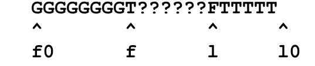
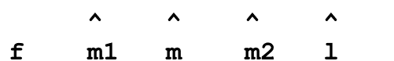
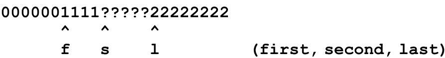
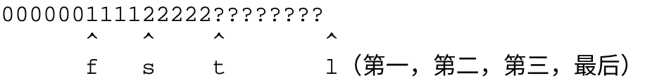

# 编程笔记（Alexander Stepanov）

- 前言
- 第一讲 介绍
- 第二讲 设计 fvector_int
- 第三讲 继续 fvector_int
- 第四讲 实现 swap
- 第五讲 类型和类型函数
- 第六讲 常规类型和相等性
- 第七讲 排序和相关算法
- 第八讲 最多 5 个对象的排序选择
- 第九讲 函数对象
- 第十讲 通用算法
    - 10.1 绝对值
    - 10.2 最大公约数
        - 10.2.1 欧几里得算法
        - 10.2.2 Stein 算法
    - 10.3 指数运算
- 第十一讲 位置和地址
- 第十二讲 动作和它们的轨道
- 第十三讲 迭代器
- 第十四讲 基本优化
- 第十五讲 迭代器类型函数
- 第十六讲 范围的相等性和复制算法
- 第十七讲 排列算法
- 第十八讲 反转
- 第十九讲 旋转
- 第二十讲 分区
- 第二十一讲 优化分区
- 第二十二讲 链表迭代器上的算法
- 第二十三讲 稳定分区
- 第二十四讲 约简和平衡约简
- 第二十五讲 3 分区
- 第二十六讲 找到分区点
- 第二十七讲 总结

## 前言

这是我在过去 10 年里在 SGI 和 Adobe 教授编程课程时使用的笔记中的一部分选择。（其中一些材料甚至可以追溯到我在 80 年代在 Polytechnic 大学教授的课程。）这些课程的目的是教导有经验的工程师设计更好的界面并对代码进行推理。总的来说，本书假定读者具有一定的计算机科学流利度和对 C++ 的一些熟悉。

本书不提供学术共识。它呈现了我的个人观点，因此应该带着一颗谨慎的心态来看待。编程是一项美妙的活动，远远超出了一个程序员在一生中所能体验到的范围。

这不是一本关于 C++ 的书。尽管它使用了 C++，但重点是编程而不是编程语言。这不是一本关于 STL 的书。我经常将 STL 作为示例的来源，既有好的示例，也有（比我想象的）更多的坏示例。这本书不会帮助你成为 STL 的熟练用户，但它解释了设计 STL 所使用的原则。

这本书不试图解决复杂的问题。它将尝试解决非常简单的问题，大多数人认为这些问题微不足道：最小值和最大值，线性搜索和交换。然而，这些问题并不像它们看起来那么简单。我被迫多次重新审视它们。而且我并不孤单。我经常与我的老朋友和合作者就接口和实现的不同方面争论这些简单函数。它比许多人想象的要复杂。

我明白大多数人必须设计比最大值和最小值更复杂的系统。但我敦促他们考虑以下事项：除非他们能够很好地设计一个三行程序，否则他们为什么能够设计一个三十万行的程序。我们必须通过完成简单的练习来建立我们的设计技能，就像钢琴家在尝试演奏复杂的曲子之前必须通过简单的手指练习一样。

如果没有 Sean Parent 的持续鼓励，这本书将永远不会被写出来。Sean 是我过去三年的经理。Paul McJones 和 Mark Ruzon 一直在审查每一页的每个版本的笔记，并提出了许多重大改进。还有许多其他人帮助我开发课程和笔记。我特别要提到以下人员：Dave Musser, Jim Dehnert, John Wilkinson, John Banning, Greg Gilley, Mat Marcus, Russell Williams, Scott Byer, Seetharaman Narayanan, Vineet Batra, Martin Newell, Jon Brandt, Lubomir Bourdev, Scott Cohen。（按照大致出现的时间顺序列出的姓名。）这本书是献给他们和我许多其他多年来忍受我试图理解如何编程的学生们的。

## 第一讲 介绍

我已经从事编程工作超过 30 年了。我在 1969 年写下了我的第一个程序，并在 1972 年成为全职程序员。我的第一个重大项目是编写一个调试器。我花了整整两个月的时间来编写它。它几乎成功了。可悲的是，它有一些根本的设计缺陷。我不得不放弃所有的代码，从头开始重新编写。然后我不得不对代码进行大量的补丁，但最终我让它工作了。在接下来的几年里，我坚持这个过程：先写一大块代码，然后加上很多补丁使其工作。我的管理层对我非常满意。在 3 年内，我晋升了 4 次，并在 25 岁时获得了高级研究员的头衔¹，比我所有的大学朋友都要早。生活似乎如此美好。到 1975 年底，我的年轻快乐永远丧失了。我是一个优秀的程序员的信念被粉碎了。

（无论好坏，我从未恢复信仰。从那时起，我一直是一个困惑的程序员，寻找指南。这本书是我在探索过程中学到的一些东西的尝试。）

第一个想法是通过阅读结构化编程学派的作品得出的：Dijkstra、Wirth、Hoare、Dahl。到 1975 年，我成为了一个狂热的信徒。我阅读了巨人们撰写的每一本书和论文。然而，我对于无法遵循他们的建议感到悲伤。我不得不用汇编语言编写我的代码，并且不得不使用 goto 语句。我感到非常羞愧。然后在 1976 年初，我有第一个启示：结构化编程的思想与语言无关。即使在汇编语言中，也可以编写优美的代码。而且如果我能做到，我就必须这样做。（毕竟，我已经达到了技术阶梯的顶端，不得不追求一些无法实现的东西，或者进入管理岗位。）我决定在做下一个项目时运用我的新见解：实现一个汇编器。具体而言，我决定采用以下原则：

- 1. 代码应该被分割成函数；
- 2. 每个函数应该最多有 20 行代码；
- 3. 函数不应该依赖于全局状态，而只依赖于参数；
- 4. 每个函数要么是通用的，要么是应用特定的，其中通用函数对其他应用程序有用；
- 5. 每个可以通用化的函数都应该通用化；
- 6. 每个函数的接口应该有文档说明；
- 7. 全局状态应该通过描述单个变量的语义和全局不变量来进行文档化。

我的实验结果非常令人惊讶。代码没有严重的错误。有一些拼写错误：我不得不将 AND 改为 OR 等等。但是我不需要补丁。而且超过 95% 的代码是通用函数！我感到非常自豪。但是还有一个问题，我还不能准确地弄清楚函数是什么意思。

一般来说，事实上，可以将我未来 30 年的研究总结为试图澄清这一点。

很容易忽视我所发现的重要性。我并没有发现一般函数可以被其他程序员使用。事实上，我没有考虑其他程序员。我甚至没有发现我以后可以使用它们。重要的是，使接口通用——即使我不太知道它的意思——我使它们更加健壮。周围代码的变化或输入语言语法的变化不会影响一般函数：95% 的代码不受影响。换句话说：将应用程序分解为一组通用算法和数据结构使其更加健壮。（但即使没有通用性，当代码分解为具有清晰接口的小函数时，代码也更加健壮。）后来，我发现了以下事实：随着应用程序的规模增长，通用代码的百分比也会增加。例如，我相信在大多数现代桌面应用程序中，非通用代码应该远远低于 1%。

在 1976 年的十月，我有了第二个重要的领悟。我正在准备去一个研究机构的面试，该机构正在研究并行架构。（可重构的并行架构——听起来很棒，但我从未能理解其背后的概念。）我想要这份工作，并试图将我对软件的想法与并行性结合起来。我还患了重病，在医院期间有了一个想法：我们重组某些可以并行执行的计算取决于操作的代数性质。例如，我们可以将 $a+(b+(c+d))$ 重新排序为 $(a+b)+(c+d)$，因为加法是可结合的。事实上，如果你的操作是一个半群操作（这只是一个特殊的说法，表示操作是可结合的），你就可以做到这一点。这个领悟导致了第一个问题的解决：如果代码被定义为适用于具有确保其正确性所需属性的任何输入（包括个体输入和它们的类型），那么它就是通用的。值得再次指出的是，使用仅依赖于最小要求集的函数可以确保最大的健壮性。

一个人如何学会识别通用组件？唯一合理的方法是，一个人必须了解许多不同的通用算法和数据结构，以便识别新的组件。寻找它们的最佳来源仍然是唐纳德·克努斯的伟大作品《计算机程序设计艺术》。这不是一本容易阅读的书；它包含了大量的信息，你必须使用顺序访问来查找它；有一些算法你真的不需要知道；它并不真正作为一本参考书有用。

但它是一个编程技术的宝库。（最令人兴奋的事情通常在练习的解决方案中找到。）我已经阅读它超过 30 年了，任何时候我都知道其中 25% 的内容。然而，这是一个不断变化的 25%——现在很明显我永远不会超过四分之一的进度。如果你没有它，买一本。如果你有它，开始阅读。只要你是一个程序员，就不要停止阅读！任何领域都需要有一个经典作品集：一套必须了解的作品。我们需要有这样一个经典作品集，而克努斯的作品是唯一明确属于编程经典作品集的作品。

在开始设计之前，了解可以有效完成的工作是至关重要的。每个程序员都被教导了自顶向下设计的重要性。虽然原始软件工程考虑可能是正确的，但它变得毫无意义：即可以在没有深入了解实现方式的情况下设计抽象接口的想法。在不了解数据结构的实现细节和使用细节的情况下，无法设计数据结构的接口。优秀程序员的第一项任务是了解许多具体的算法和数据结构。只有这样，他们才能尝试设计一个连贯的系统。从有用的代码开始。毕竟，抽象只是组织具体代码的工具。

如果我使用自顶向下的设计来设计一架飞机，我会迅速将其分解为三个重要部分：升降装置、着陆装置和水平运动装置。然后我会指派三个不同的团队来研究这些装置。我怀疑这个装置能否飞起来。幸运的是，奥维尔和威尔伯·莱特兄弟都没有上过大学，因此从未上过软件工程课程。我想表达的观点是，要成为一个优秀的软件设计师，你需要掌握一系列不同的技术。你需要了解许多不同的低级事物，并理解它们之间的相互作用。

有史以来最重要的软件系统是 UNIX。它使用字节序列作为一种普遍的抽象方式，以显著降低系统的复杂性。但它并没有从一个抽象开始。它始于 1969 年，肯·汤普森勾画了一种数据结构，允许相对较快的随机访问和文件的递增增长。正是能够通过磁盘上的固定大小块实现文件的增长，导致了记录类型、访问方法和其他使以前的操作系统如此不灵活的复杂构件的废除。（值得注意的是，第一个 UNIX 文件系统甚至不是字节寻址的——它处理的是字——但它是正确的数据结构，最终它发展了。）汤普森和他的合作者在 Multics 上开始了他们的系统工作——一个宏伟的全面系统，以适当的自上而下的方式设计。Multics 引入了许多有趣的抽象，但它仍然是一个死胎系统。与 UNIX 不同，它没有从一个数据结构开始！

我们需要了解实现的原因之一是我们需要在抽象接口中指定操作的复杂性要求。仅仅说一个栈提供了 push 和 pop 是不够的。栈需要保证操作在合理的时间内完成——对我们来说弄清楚“合理”是很重要的。（然而，很明显，push 的成本与栈的大小成线性增长的栈实际上不是一个真正的栈——我曾经见过至少一个商业实现的栈类具有这样的行为——它在每次 push 时重新分配整个栈。）一个专业的程序员不能不了解不同操作的成本。虽然不是必要的，但确实需要知道什么时候担心，什么时候不担心。从某种意义上说，正是抽象性和效率的不断相互作用使得编程成为如此迷人的活动。

对于程序员来说，理解使用不同数据结构的复杂性影响是至关重要的。选择错误的数据结构是性能问题最常见的原因。因此，了解给定数据结构支持的操作以及它们的复杂性是至关重要的。事实上，我不相信一个库可以消除程序员了解算法和数据结构的需求。它只消除了程序员实现它们的需求。为了正确使用数据结构，需要理解数据结构的基本属性，以满足应用程序的复杂性要求。在这里，复杂性不仅指渐近复杂性，还包括机器周期计数。

为了学习它，有必要养成编写基准测试的习惯。一次又一次地，我发现我编写了一个小型基准测试之后，我的精心设计完全错误。最尴尬的情况是，在多次公开宣称 STL 具有手写汇编代码的性能之后，我发布了我的抽象惩罚基准测试，显示出我的声明只有在使用 KAI 的专用预处理器时才是真实的。这尤其令人尴尬，因为它显示出我雇主 Silicon Graphics 生产的编译器在抽象惩罚和编译 STL 方面是最差的。SGI 编译器最终得到了修复，但是 STL 在主要平台上的性能却越来越差，这正是因为客户和供应商都没有进行基准测试，似乎对性能下降完全不关心。偶尔会有需要进行基准测试的作业，请完成它们。

对于程序员来说，了解现代处理器的架构是很重要的，了解缓存层次结构如何影响性能也很重要，而且要知道虚拟内存并不能真正帮助：如果你的工作集不适合物理内存，那就麻烦了。很遗憾，许多年轻的程序员从未有机会用汇编语言编程。我认为，计算机科学专业的本科生应该将其作为必修课。但是，即使是有经验的程序员也需要定期复习计算机体系结构。每隔十年左右，硬件的变化足以使我们对底层硬件的大部分直觉完全过时。在现代处理器上，曾经在 PDP-20 上运行得很好的数据结构可能完全不适用，因为现代处理器具有多层缓存。

从底层开始，甚至在单个指令的级别上，都是很重要的。然而，同样重要的是不要停留在底层，而是始终向上进行抽象的过程。我相信，每一段有趣的代码都是一个很好的抽象起点。每一个所谓的“黑客”，如果是一个有用的黑客，都可以作为一个有趣抽象的基础。

对程序员来说，了解编译器对他们编写的代码会做什么同样重要。很遗憾，现在教授的编译器课程都在教授编写编译器的内容。毕竟，只有极小一部分程序员会编写编译器，即使是那些会编写编译器的人，也会很快发现现代编译器与他们在本科编译器构造课程中学到的内容几乎没有关系。我们需要的是一门教会程序员了解编译器实际工作的课程。

***

¹ Natalya Davydovskaya, Ilya Neistadt 和 Aleksandr Gurevich——这些都是我的原始老师，我非常感激他们。这三个人都是硬件工程师出身。他们仍然在以电路和设计的最小化思维方式思考。

每个重要的优化技术都与编程对象的某些抽象属性相关联。优化毕竟是基于我们对程序进行推理和用更快的等效程序替换原程序的能力。

虽然可以以任何方式定义对象类型，但大多数类型的行为都受一组自然法则的约束。这些法则定义了对象的基本操作的含义：构造、销毁、赋值、交换、相等性和全序。它们基于一个现实的本体论，其中对象拥有它们不可共享的部分，并且相等性是通过对应部分的成对相等性来定义的。我们将满足这些法则的对象称为正常的（normal）。我们可以通过在正常类型上定义的函数在相等输入上给出相等结果来将正常性的概念扩展到函数上。我们将看到，这个概念允许我们扩展对复合对象的标准编译器优化，并且允许有条理地处理异常行为。

在这本书中，我将使用 C++。这主要是因为它结合了两个重要的特点：接近机器和强大的抽象能力。我不相信在不使用真正的编程语言的情况下，能够写出我正在尝试写的这本书。而且，由于我坚信编程语言的目的是呈现底层硬件的抽象，所以 C++ 是我唯一的选择。可悲的是，大多数语言设计师似乎对阻止我接触原始位并提供比我计算机内部更好的“机器”更感兴趣。即使 C++ 也有被“管理”成完全不同的东西的危险。

- **问题**：请看以下定义：
```cpp
bool operator<(const T& x, const T& y)
{
    return true;
}
```
解释为什么这对于任何类 T 都是错误的。

- **问题**：请看以下定义：
```cpp
bool operator<(const T& x, const T& y)
{
    return false;
}
```
解释一下什么是 T 使得这个定义合法的要求。

- **项目**：C 数组在编译时确定大小。设计一个 C++ 类，提供像 int 数组一样的对象，但其大小在运行时确定。解释你设计决策的原因。

## 讲座 2. 设计 fvector_int

你的一个作业是设计一个类，提供 C 数组的功能，但允许用户在运行时定义数组边界。我收到了很多不同的解决方案——事实上，我计划在这个讲座中展示的每个“有趣”的错误都被提交为某人的解决方案。当然，问题是能够区分正确的解决方案和错误的解决方案。我们将从展示一个解决方案开始，逐步改进和完善它。它与大多数人通常在代码上工作的方式非常相似。在我的情况下，需要很多次迭代才能得到合理的东西。我最初尝试实现 STL 向量的许多尝试与我们开始的半成品代码并没有太大区别。

让我们来看一下以下代码：

```cpp
class fvector_int
{
private:
    int* v; // v 指向分配的区域
public:
    explicit fvector_int(std::size_t n) : v(new int[n]) {}
    int get(std::size_t n) const { return v[n]; }
    void set(std::size_t n, int a) { v[n] = a; }
};
```

显然它是有效的。可以这样写：

```cpp
fvector_int squares(std::size_t(64));

for (size_t i = 0; i < 64; ++i) {
    squares.set(i, int(i * i));
}
```

它甚至使用了正确的索引类型。`std::size_t` 是机器相关的无符号整数类型，允许编码内存中最大对象的大小。`std::size_t` 是无符号的明显好处是：不需要担心将负值传递给构造函数。（在课程后面我们将讨论由于将 `std::size_t` 定义为无符号的与 `std::ptrdiff_t` 不同的类型而引起的问题。如果你忘记了，`std::size_t` 和 `std::ptrdiff_t` 在 `<cstddef>` 中定义。）设计者决定将构造函数设为显式的也是很好的。

隐式转换是主要的一种 C 和 C++ 的缺陷，确保你的课程不会成为这个邪恶游戏的一部分。如果一个函数期望一个 `fvector_int` 作为参数，而有人给了它一个整数，最好不要将这个整数转换为我们的数据结构。（打开你的 C++ 书籍，阅读关于 `explicit` 关键字的内容！还要请愿你的邻居 C++ 标准委员会成员最终废除隐式转换。有一个常见的误解，经常被那些应该更清楚的人传播，即 STL 依赖于隐式转换。事实并非如此！）

它以清晰的面向对象风格编写，具有获取器（getter）和设置器（setter）。这种风格的支持者说，拥有这样的函数的优势在于它允许程序以后更改实现。他们忘记提到的是，有时候暴露实现是非常好的。让我们看看我是什么意思。我很难想象一个系统的演变，能让你保持 `get` 和 `set` 的接口，但能够改变实现。我可以想象实现超过 `int` 并且你需要切换到 `long`。但那是一个不同的接口。我可以想象你决定从数组切换到链表，但这也会迫使你改变接口，因为从链表中索引实际上不是一个很好的主意。

现在让我们看看为什么公开实现真的很好。假设明天你决定对整数进行排序。你该如何做呢？你能使用 C 库 `qsort` 吗？不行，因为它对你的获取器和设置器一无所知。你能使用 STL 排序吗？答案是一样的。当你设计你的类以应对实现的假设性变化时，你并没有为非常常见的排序任务进行设计。当然，获取器和设置器的支持者会建议你通过一个成员函数 `sort` 来扩展你的接口。在你这样做之后，你会发现你需要二分查找和中位数等等。很快你的类将有 30 个成员函数，但是它当然会隐藏实现。而这只有在你是类的所有者的情况下才能做到。否则，你需要从头开始在获取器和设置器接口之上实现一个体面的排序算法，这比人们想象的要困难和危险得多。

即使是一个简单的标准函数 `swap` 也不起作用；你不能只是说：

```cpp
fvector_int foo(size_t(15));
// 一些东西
std::swap(foo[0], foo[14]);
```

就像你对数组一样。你需要定义自己的函数：

### 内联交换

```cpp
void fvector_int_swap(fvector_int& v,
                      std::size_t n,
                      std::size_t m)
{
    int tmp = v.get(n);
    v.set(n, v.get(m));
    v.set(m, tmp);
}
```

然后你才能这样做：

```cpp
fvector_int_swap(foo, 0, 14);
```

几年后，其他人可能需要在两个不同的 `fvectors` 之间交换元素。而不是简单的（但不是面向对象的）：

```cpp
std::swap(foo[0], bar[0]);
```

他们将不得不定义一个新的函数：

### 跨容器内联交换

```cpp
void fvector_int_swap(fvector_int& v, std::size_t n,
                      fvector_int& u, std::size_t m)
{
    int tmp = v.get(n);
    v.set(n, u.get(m));
    u.set(m, tmp);
}
```

然后当有人想要在 `fvector` 和一个 `int` 的数组之间进行交换时，很快就会意识到需要第三个版本的交换函数。

设置器和获取器使我们日常编程变得困难，但是当我们发现更好的方法来存储整数数组时，它们会带来巨大的回报。但是我不知道任何一个现实场景，隐藏内存位置在我们的数据结构中有帮助而暴露则有害；因此，我有义务提供一个更方便的接口，同时也与 C 数组的熟悉接口一致。当我们使用 C++ 进行编程时，我们不应该为其 C 的继承感到羞耻，而是要充分利用它。唯一的问题是 C++，甚至是 C 的问题，是当它们自身与自身的逻辑不一致时出现的。

很明显，如果我们用一个暴露整数存储内存位置的接口来替换复杂的获取器/设置器接口，所有这些问题都会消失：

```cpp
class fvector_int
{
private:
    int* v; // v 指向分配的内存
public:
    explicit fvector_int(std::size_t n) : v(new int[n]) {}
    int& operator[](std::size_t n) {
        return v[n];
    }
    const int& operator[](std::size_t n) const {
        return v[n];
    }
};
```

注意我们如何在 `const` 上进行重载，以确保在构造常量对象时返回正确类型的引用。如果将方括号运算符应用于常量对象，它将返回一个常量引用，将无法对该位置进行赋值。

现在我们可以轻松地使用标准的 `swap` 函数交换元素。如果我们克服了羞怯，并在我们的接口描述中透露出连续整数的引用位于内存的连续位置——我完全理解这将阻止我们将它们存储在随机位置——我们可以很容易地对它们进行排序：

```cpp
fvector_int foo(std::size_t(10));

// 用整数填充 fvector

std::sort(&foo[0], &foo[0] + 10);
```

(我对暴露连续整数地址位置的评论并非玩笑。说服标准委员会认同这种要求是一项重大努力；然而，他们不同意向量迭代器应该是指针，因此在包括微软在内的几个主要平台上，通过以下非常丑陋的方式对向量进行排序更快：)

```cpp
if (!v.empty()) {
    sort(&*v.begin(), &*v.begin() + v.size());
}
```

比预期的更快：

```cpp
sort(v.begin(), v.end());
```

以效率为代价强加伪抽象性是可以被击败的，但代价非常高昂。

## C++ 测验：

弄清楚为什么需要检查 `v.empty()` 以及为什么不能写 `&*v.end()`。不要仅仅用你的编译器来检查：你的编译器可能会让你逃脱一些事情——这并不意味着它符合标准的 C++。

我们的课程还远未完善。你们中的一些人注意到它缺少一个析构函数。如果我们不编写一个析构函数会发生什么？事实上，如果我们不编写一个析构函数，编译器会为我们提供一个。这样的析构函数被称为合成析构函数（synthesized destructor）。合成析构函数按照声明顺序的相反顺序将其所有成员的析构函数应用于它们。由于我们只有一个类的成员，并且由于这个成员是一个指针，而指针的析构函数是一个空操作，我们的合成析构函数将什么也不做。

为什么是错误的？我们类的一个典型用法可能是这样的：

```cpp
void print_shuffled_integers(std::size_t n)
{
    fvector_int integers(n);
    for (std::size_t i = 0; i < n; ++i)
        integers[i] = int(i);
    std::random_shuffle(&integers[0], &integers[n]);
    for (std::size_t i = 0; i < n; ++i)
        std::cout << integers[i] << std::endl;
}
```

我们的过程在构造过程中分配内存，然后在销毁过程中让其消失进入一个黑洞。现在构造函数的第一个任务是获取对象所需的资源：存储空间、文件、设备等（构造函数引发异常的唯一原因是所需资源不可用）。而基于堆栈的计算模型规定，当对象被销毁时，它所获取的所有资源都会被释放。（对象在销毁过程中引发异常的唯一原因是表明其所获取的资源消失无踪迹——这在设计良好的系统中绝不应该发生）。对象拥有资源的概念是一个很好的想法，但在许多编程语言中却缺失。例如，在 Lisp 中，列表不拥有其 cons 单元，而且——在词法作用域的 Lisp 方言中——即使过程对象也不拥有其局部状态，该状态可以在离开过程后长时间存活和使用。完全没有所有权使得集中式垃圾回收成为必需，并鼓励一种相当浪费的编程风格。确实，如果资源是无限的，为什么还要费心回收呢？基于所有权的语义模型最早是在 ALGOL 60 中引入的，该语言实际上具有动态数组——这与我们试图设计的东西非常接近。C++ 没有内置的动态数组，但构造函数/析构函数的基本机制使我们能够实现它们。事实上，我们将创建各种不同的数据结构，这些数据结构的行为符合基于堆栈的机器模型。

我不是垃圾回收的敌人。在内存管理领域有许多重要的算法，多年来我一直敦促 Hans Boehm 写一本关于它们的书籍——Knuth 的第一卷中的章节虽然仍然很重要，但非常不完整。虽然引用计数往往是一种更重要的通用工具系统设计，所有的内存管理技术都很重要。我反对的是坚持认为垃圾回收是唯一的方法。

我对“自动内存管理”的第二个反对意见，无论是垃圾回收、引用计数还是基于所有权的容器语义，都是这些技术都不足以解决实际问题。对于任何严肃的应用程序来说，开发一个清楚描述谁释放和何时释放的数据模型是至关重要的。

其他任何方式都只是将一种错误换成另一种错误。如果在设计企业系统时，我们不能确保当一个人从员工数据库中删除时，他也从企业图书馆中删除，那么垃圾回收也无济于事。这个已经离开很久的人的记录仍然会被图书馆指向。我们正在用悬空指针来交换内存泄漏。很久以前我读过一个提案，每个对象都需要维护一个指向它的所有对象的列表，当一个对象被销毁时，它应该去将指向它的所有指针清零。如果应用于每个对象，这是一个奇怪的想法，但对于某些类的对象来说，这是一个好的解决方案。再次强调，管理存储或其他资源没有单一正确的方法。

现在让我们回到 `fvector_int`。添加适当的析构函数是微不足道的：

```cpp
class fvector_int
{
private:
    int* v; // v 指向分配的内存
public:
    explicit fvector_int(std::size_t n) : v(new int[n]) {}
    ~fvector_int() { delete[] v; }
    int& operator[](std::size_t n) {
        return v[n];
    }
    const int& operator[](std::size_t n) const {
        return v[n];
    }
};
```

但是必须承认，C++ 中的 `new` 和 `delete` 的语法是一个语法上的尴尬的例子。它们是函数调用，更准确地说，是模板函数调用，应该看起来像函数调用。

只要我们只有一个对象的副本，资源的分配/释放就是正确的。当我们尝试将其传递给函数时，问题就会改变。目前，该类没有定义复制构造函数。与析构函数一样，编译器为我们提供了一个合成的复制构造函数。它将复制构造函数应用于所有成员，进行逐成员构造。在我们的情况下，只有一个成员，指向分配内存的指针，并通过复制其值来构造它。现在我们有了两个共享相同整数数组的相同类的副本。共享和私有所有权不太合适地共同工作。在过程的退出点，它调用了复制对象的析构函数，并根据私有所有权的基本原则——我死后，哪管它洪水滔天，它释放了内存，这使得原始所有者处于一个相当奇特的境地。

(写时复制数据结构允许共享但延迟复制。可以设计符合 STL 的容器，这些容器确实进行写时复制。毕竟，这是一种不改变语义的优化。然而，根据我的经验，原始数据结构如向量和列表并不从这种优化中受益。)

值得注意的是，数组传递给函数的方式是另一个令人尴尬的问题。这可以追溯到 C 不允许将大对象传递给函数的时候。甚至结构体也不能按值传递。作为一个“方便”的特性，传递一个数组会导致将其转换为指针并传递指针。在几年内，传递结构体按值成为可能。（幸运的是，没有将结构体转换为指向它的指针的“方便”方法。）但数组仍然处于尴尬的状态。如果将数组封装在结构体中，可以按值传递数组：

```cpp
template <std::size_t m>
struct cvector_int {
    int values[m];
    int& operator[](std::size_t n) {
        assert(n < m);
        return values[n];
    }
    const int& operator[](std::size_t n) const {
        assert(n < m);
        return values[n];
    }
};

template <std::size_t m>
cvector_int<m> reverse_copy(cvector_int<m> x) {
    std::reverse(&x[0], &x[m]);
    return x;
}
```

我们需要我们的 **fvector_int** 类的行为像 **cvector_int** 类一样。换句话说，我们需要为其提供适当的复制构造函数。毕竟，**fvector_int** 的存在主要是因为 **cvector_int** 的大小必须在编译时知道。（Pascal 语言在许多方面都很出色，但其数组（至少在语言的原始版本中）与 **cvector_int** 非常相似；能够拥有在运行时确定大小的数组真的很重要。）但它的语义应该模仿 **cvector_int** 的出色语义，适应我们的基于堆栈的机器模型，具有所有权语义。一般来说，我们将尝试使我们的类的行为像熟悉的 C 对象。我们的容器将表现得像结构，我们的迭代器将表现得像指针。这种方法有两个优点。首先，它在原始对象和我们的扩展之间强制实施一致的行为；其次，它确保我们的抽象是基于已被证明有用的东西。

为我们的类提供一个适当的复制构造函数非常简单，除了一个小细节。复制构造函数不知道原始对象的大小。我们的类没有足够的成员。它是构造上不完整的（construction-incomplete）。如果一个类无法实现自己的复制，我们称之为构造上不完整的类。如果我们回顾一下我们的使用示例，我们总是使用外部可用的大小。我们需要将其内部存储，并且，顺便说w一句，这也将允许我们在我们的括号运算符中放入适当的断言：

```cpp
class fvector_int
{
private:
    std::size_t length; // 分配区域的大小
    int* v; // 分配区域的指针
public:
    fvector_int(const fvector_int& x);
    explicit fvector_int(std::size_t n)
        : length(n), v(new int[n]) {}
    ~fvector_int() { delete[] v; }
    int& operator[](std::size_t n) {
        assert(n < length);
        return v[n];
    }
    const int& operator[](std::size_t n) const {
        assert(n < length);
        return v[n];
    }
};

fvector_int::fvector_int(const fvector_int& x)
    : length(x.length), v(new int[x.length]) {
    for(std::size_t i = 0; i < length; ++i)
        (*this)[i] = x[i];
}
```

我们需要将向量的大小与向量一起存储的事实是由于 `operator new[]` 和 `operator delete[]` 的设计不够严谨；这种设计可以追溯到 C 中的 `malloc/free` 调用的设计不够严谨。很明显，数组操作符 `new` 和 `delete` 的实现知道它分配的对象数量。如果不知道，它将无法在应用 `operator delete` 时销毁它们。

对于 `new` 返回的指针来说，当然，对于 `malloc`/`free` 也是一样的。这就是为什么我们现在需要将长度与指针一起存储，重复存储系统已经存储的信息。情况更糟糕，因为系统既知道分配的存储量，也知道实际构建对象的存储量。如果我们同时访问这两个量，我们可以实现一个类型安全的 `realloc` 版本，甚至可以将 `std::vector` 的头部大小减小到一个指针的大小，这将使得对向量的操作非常高效。而且它将提高内存利用率，因为我们只有一个未使用的内存段，而不是向量中的一个和分配的内存块中的另一个。但是，我提出重新设计 C++ 中的内存分配接口的所有建议都被拒绝了，因为 `new` 和 `delete` 被视为核心语言的一部分，我没有权限修改它们。

很容易就能意识到我们还有一个问题。确实，虽然我们提供了一个复制构造函数，但我们没有提供赋值操作。当然，我们将得到一个合成的赋值操作，并且很容易猜到它的语义：它将按照成员的定义顺序进行成对赋值。

当然，这完全不是我们所需要的。复制和赋值必须保持一致。

在实现我们的赋值操作之前，我们需要回答一个重要的问题：如果 `fvector_int` 的大小不同，我们应该能够进行赋值吗？既然我们同意大小在构造时确定，那么它不应该改变。我们应该检查大小是否相等并引发异常吗？这个问题在 `cvector_int` 中不会出现，因为两个相同类型的 `cvector_int` 具有相同的大小；因此，我们不能以此作为指导来决定该怎么做。这样做是不明智的，因为它将违反任何好的类型的两个重要规则：`a = b` 始终是合法的，只有在我们无法构造 `b` 的副本时才会引发异常；其次，程序员应该能够编写：

```cpp
T a; a = b;
```

每当他们能写：

```cpp
T a(b);
```

这些程序片段应该具有相同的意义并且可以互换。在这里，我们首次遇到了我们的主要设计原则之一：当一个代码片段对于所有内置类型具有特定的含义时，它应该对于用户定义的类型保持相同的含义。由于这两个代码片段对于所有内置类型都是等价的，所以它们对于我们的类也是等价的。（这就是为什么我反对使用 `operator+` 进行字符串连接。对于所有内置类型及其非奇异值（正如我们将在本讲座后面看到的，由于另一个标准，即 IEEE 浮点数标准，我们经常需要对神秘的奇异值进行这个例外），我们可以确保 `a + b == b + a`。请注意，数学家不会使用 `+` 进行非交换操作。这就是为什么阿贝尔群使用 `+` 而非阿贝尔群使用乘法。对于字符串连接来说，使用 `*` 也完全可以。

之后所有这些都是传统形式语言理论中的内容。如果一个集合上定义了一个二元操作，并且它被指定为 `*`，我们有理由认为它是不可交换的。

这就是为什么我们将允许在不同大小的 `fvector_int` 之间进行赋值。

现在应该有一种非常简单的方法来获得一个赋值运算符：首先我们需要使用析构函数清理赋值的左侧，然后将右侧的值复制到我们的新存储中。当两边引用同一个对象时，当然不能执行任何操作。在这种情况下，我们可以安全地什么都不做。这给我们提供了一个通用赋值运算符的样板：

```cpp
T& T::operator=(const T& x)
{
    if (this != &x) {
        this->~T(); // 在原地销毁对象
        new (this) T(x); // 在原地构造对象
    }
    return *this;
}
```

不幸的是，这个赋值的定义存在问题。如果在构造过程中出现异常，对象将处于不可接受的“销毁”状态。在下一堂课中，我们将学习到一个更好的“通用”赋值定义可以使用，但是，至少目前让我们忽略“高级”的异常安全概念，继续使用现有的定义。

> （你们中的一些人可能认为这样的赋值定义在现实中永远不会出现。嗯，这就是 STL 在其前 4 年的所有实现中使用的赋值定义。它被所有主要专家看到，没有人提出异议。这是渐进演化的结果——即使今天也不完全——异常安全概念的一个概念最终使得这个定义可疑。我们将在下一堂课中详细讨论。）

有一个令人沮丧的义务要从赋值中返回一个引用。C 引入了写入 `a = (b = c)` 的危险能力。C++ 使得我们可以写入更加危险的 `(a = b) = c`。我宁愿生活在一个赋值返回 `void` 的世界中。虽然我们被迫使我们的赋值符合标准语义，但我们应该避免在我们的代码中使用这种语义。（这类似于 Jon Postel 的健壮性原则：“TCP 实现应遵循一个健壮性的一般原则：在你所做的事情上保守，在你从他人那里接受的事情上宽容。”）

#### 在 fvector_int 的情况下

在 `fvector_int` 的情况下，有一个很好的优化。如果两个实例具有相同的大小，则我们可以将一个实例的值复制到另一个实例中，而无需任何需要分配的操作。这给我们带来了一个很好的特性，即如果两个 `fvector_int` 的大小相同，我们可以保证赋值操作不会引发异常：

```cpp
class fvector_int
{
private:
    std::size_t length; // 分配区域的大小
    int* v; // 分配区域的指针
public:
    fvector_int(const fvector_int& x);
    explicit fvector_int(std::size_t n)
        : length(n), v(new int[n]) {}
    ~fvector_int() { delete [] v; }
    fvector_int& operator=(const fvector_int& x);
    int& operator[](std::size_t n) {
        assert(n < length);
        return v[n];
    }
    const int& operator[](std::size_t n) const {
        assert(n < length);
        return v[n];
    }
};
```

```cpp
fvector_int::fvector_int(const fvector_int& x)
    : length(x.length), v(new int[x.length]) {
    for(std::size_t i = 0; i < length; ++i)
        (*this)[i] = x[i];
}
```

```cpp
fvector_int& fvector_int::operator=(const fvector_int& x)
{
    if (this != &x)
        if (this->length == x.length)
            for (std::size_t i = 0; i < length; ++i)
                (*this)[i] = x[i];
        else {
            this->~fvector_int();
            new (this) fvector_int(x);
        }
    return *this;
}
```

让我们观察从两个程序片段的等价性中得出的另一个事实：

```cpp
T a;        // 默认构造函数
a = b;      // 赋值运算符
```

和

```cpp
T a(b);     // 拷贝构造函数
```

由于我们希望它们具有相同的语义，并且希望能够互换地编写其中之一，因此我们需要为 `fvector_int` 提供一个默认构造函数——一个不带参数的构造函数。假设两个程序片段的等价性为我们提供了关于默认构造函数的资源需求的重要线索。几乎可以肯定，默认构造函数应该分配的唯一资源是对象的堆栈空间。（当我们讨论 swap 和 move 的语义时，它将变得完全清楚。）真正的资源分配应该发生在赋值过程中。只有在没有定义其他构造函数时，编译器才会提供一个合成的默认构造函数。（当然，这是一个令人尴尬的规则：向类中添加一个新的公共成员函数——构造函数是一种特殊类型的成员函数——可以将现有的合法代码变成无法编译的代码。）

显然，默认构造函数应该等同于构造一个长度为零的 `fvector_int`：

```cpp
class fvector_int
{
private:
    std::size_t length; // 分配区域的大小
    int* v; // 分配区域的指针
public:
    fvector_int() : length(std::size_t(0)), v(NULL) {}
    fvector_int(const fvector_int& x);
    explicit fvector_int(std::size_t n)
        : length(n), v(new int[n]) {}
    ~fvector_int() { delete [] v; }
    fvector_int& operator=(const fvector_int& x);
    int& operator[] (std::size_t n) {
        assert(n < length);
        return v[n];
    }

    const int& operator[] (std::size_t n) const {
        assert(n < length);
        return v[n];
    }
};
```

让我们重新审视一下我们的复制构造函数和赋值的设计。现在我们知道为什么要分配一个不同的内存池，但是我们如何知道我们需要将原始数据复制到副本中呢？让我们再次看一下由内置类型给出的复制语义。这是非常清楚的（特别是如果我们忽略由 IEEE 浮点标准给出的奇异值），有一个基本原则，它控制着所有内置类型和指针类型的复制构造函数和赋值行为：

```cpp
T a(b); assert(a == b);
```

和

```cpp
T a; a = b; assert(a == b);
```

这是一个不言而喻的规则：复制意味着创建一个与原始对象相等的对象。

不幸的是，这个规则并不适用于结构。既不是 C 也不 C++ 定义了一个相等运算符。（`operator==` 我真的讨厌在 C 中的相等/赋值符号表示法；如果我们回到 Algol 的表示法：`:=` 作为赋值符号，以及五个世纪前的数学符号 `=` 作为相等符号，我会非常高兴。然而，我发现 `!=` 比 Wirth 的 `<>` 更好。）扩展定义将非常简单：按照定义的顺序比较成员的相等性。我已经提倡这样的添加约 12 年了，但没有任何成功。

（在未来的编程语言中，不需要为合成的相等性定义内置的语义定义。可以在语言中说对于任何类型，如果它自己的相等性未定义——或者对于某些不规则类型可能是“未定义”的情况——相等性意味着成员逐个比较相等性。当然，对于合成的复制构造函数、默认构造函数等也是如此。这些事情需要一些简单的反射功能，而这在 C++ 中是缺失的。）

相同的扩展应该适用于数组，除了不幸的是将数组自动转换为指针。很容易看出 `cvector_int` 的正确相等语义：

```cpp
template <std::size_t m>
bool operator==(const cvector_int<m>& x,
                const cvector_int<m>& y)
{
    for (std::size_t i(0); i < m; ++i)
        if (x[i] != y[i]) return false;
    return true;
}
```

我们定义相等性为全局函数的原因是因为参数是对称的，但更重要的是因为我们希望它被定义为一个非友元函数，通过它们的公共接口访问两个对象。这样做的原因是，如果相等性可以通过公共接口定义，那么我们就知道我们的类是等式完备的，或者只是完备的。一般来说，这是一个比较强的概念，即构造完备性，因为它要求我们拥有一个足够强大的公共接口来区分不同的对象。我们可以很容易地看到 `fvector_int` 是不完整的。大小不是公开可见的。现在很容易看出来不仅仅是相等的定义是不可能的。没有非平凡的函数——即对于 `fvector_int` 的不同值将执行不同操作的函数是可定义的。

实际上，如果我们给出一个 `fvector_int` 的实例，我们不能查看它的任何位置，否则可能会导致断言违规。毕竟，它可能是大小为 0 的。而且，`operator[]` 是观察对象之间差异的唯一方法，我们无法区分两个实例。

我们应该将成员 `length` 公开吗？毕竟，我一直主张向用户公开事物。在这种情况下不行，因为它会允许用户破坏类的不变性。我们的不变性是什么？第一个不变性是 `length` 必须等于分配内存的面积除以 `sizeof(int)`。第二个不变性是内存不会过早释放。这就是为什么我们将这些成员保持为私有的原因。一般来说：只有受类不变性约束的成员需要是私有的。

虽然我们可以创建一个成员函数来返回 `length`，但最好将其作为一个全局友元函数。如果我们这样做，最终我们将能够定义相同的函数来处理内置数组，并实现更大的设计统一性。我在 STL 中将 `size` 变成了一个成员函数，试图取悦标准委员会。我知道 `begin`、`end` 和 `size` 应该是全局函数，但我不愿意冒险与委员会再次争论。一般来说，有很多妥协，我为此感到羞愧。如果不做这些妥协，成功将更加困难，但当我在知道如何正确做事的同时，仍然会对自己所做的错误事情感到不舒服。毕竟，成功被高估了。我将在 STL 中指出一些错误的设计：其中一些是出于政治考虑，但很多是由于我无法辨别一般原则而造成的错误。

现在让我们看看如何进行相等性和大小比较：

```cpp
class fvector_int
{
private:
    std::size_t length; // 分配区域的大小
    int* v;             // v 指向分配区域
public:
    fvector_int() : length(std::size_t(0)), v(NULL) {}
    fvector_int(const fvector_int& x);
    explicit fvector_int(std::size_t n)
        : length(n), v(new int[n]) {}
    ~fvector_int() { delete [] v; }
    fvector_int& operator=(const fvector_int& x);
    friend std::size_t size(const fvector_int& x) {
        return x.length;
    }
    int& operator[](std::size_t n) {
        assert(n < size(*this));
        return v[n];
    }
    const int& operator[](std::size_t n) const {
        assert(n < size(*this));
        return v[n];
    }
};
```

```cpp
bool operator==(const fvector_int& x,
                const fvector_int& y) {
    if (size(x) != size(y)) return false;
    for (std::size_t i = 0; i < size(x); ++i)
        if (x[i] != y[i]) return false;
    return true;
}
```

甚至改变我们的复制构造函数和赋值函数的定义来使用公共接口可能是值得的。

```cpp
fvector_int::fvector_int(const fvector_int& x)
    : length(size(x)), v(new int[size(x)])
{
    for(std::size_t i = 0; i < size(x); ++i)
        (*this)[i] = x[i];
}
```

```cpp
fvector_int& fvector_int::operator=(const fvector_int& x)
{
    if (this != &x)
        if (size(*this) == size(x))
            for (std::size_t i = 0;
                 i < size(*this);
                 ++i)
                (*this)[i] = x[i];
        else {
            this->~fvector_int();
            new (this) fvector_int(x);
        }
    return *this;
}
```

我们还可以通过为 `cvector_int` 类提供一个 `size` 函数来“升级”它以匹配 `fvector_int`：

```cpp
template <std::size_t m>
struct cvector_int;

template <std::size_t m>
inline
size_t size(const cvector_int<m>&)
{
    return m;
}

template <std::size_t m>
struct cvector_int {
    int values[m];
    int& operator[](std::size_t n) {
        assert(n < size(*this));
        return values[n];
    }
    const int& operator[](std::size_t n) const {
        assert(n < size(*this));
        return values[n];
    }
};
```

现在我们可以通过复制和粘贴 `cvector_int` 的主体来编写相等性。它进行了不必要的大小比较——因为它们总是相同的，所以可以安全地省略比较——但是任何现代编译器都会对其进行优化：

```cpp
template <std::size_t m>
bool operator==(const cvector_int<m>& x,
                const cvector_int<m>& y)
{
    if (size(x) != size(y)) return false;
    for (std::size_t i = 0; i < size(x); ++i)
        if (x[i] != y[i]) return false;
    return true;
}
```

课程的第一部分的目标之一是将此代码优化到可以适用于任何数据结构的程度。毕竟，代码可以用以下规则用英语重新表述：如果两个数据结构的大小相同且逐个元素相等，则它们相等。总的来说，我们将尽可能使所有函数与数据结构无关。

## 问题1.

根据我们今天学到的知识，改进第1讲的问题1的解决方案。

问题2. 扩展你的 fvector_int 以便能够更改其大小。

## 第3讲. 继续fvector_int

在上一讲中，我们为 fvector_int 实现了 `operator==`。这是一个重要的步骤，因为现在我们的类可以与许多使用相等性的算法一起使用，例如 `std::find`。然而，仅定义相等性是不够的。我们必须定义不等式来匹配它。为什么我们需要这样做呢？主要原因是我们希望保留自由，能够编写 `a != b` 和 `!(a == b)`，这两种语句是可以互换的。

声明两个事物不相等和两个事物不等于彼此应该是等价的。不幸的是，C++ 对运算符重载没有规定任何语义规则。程序员可以将相等定义为相等，但将不等定义为内积或除法取模。当然，这是完全不可接受的。不等式应该自动定义为相等的否定。不应该能够单独定义它，而且在定义相等性时必须为我们提供它。但事实并非如此。我们必须养成一种习惯，在定义类时同时定义这两个运算符。幸运的是，这非常简单：

#### 内联

```cpp
bool operator!=(const fvector_int& x, const fvector_int& y)
{
    return !(x == y);
}
```

不幸的是，即使是不等式和等式的否定等价这样一个显而见的规则也不适用于所有情况。浮点数数据类型（float 和 double）包含一个值 NaN（非数字），具有一些显著的特性。IEEE 754 标准要求涉及 NaN 的每个比较（==, <, >, <=, >=）都应返回 false。这是一个糟糕的决定，它推翻了等式的含义，并使得对程序进行仔细推理变得困难。这使得对程序进行推理变得不可能，因为等式推理是核心。

由于不幸的标准，我们不再能够假设：

```cpp
T a = b; assert(a == b);
```

或者

```cpp
a = b; assert(a == b);
```

构造和赋值的含义受到了损害。甚至相等性的公理本身也不再成立，因为 NaN 的存在，相等性的自反性不再成立，我们不能假设 `assert(a == a);` 成立。（我们稍后将看到，对于排序比较的后果同样令人不悦。）唯一合理的方法是忽略规则的后果，假设所有基本的相等性法则成立，然后假设我们的推理结果以及这种推理允许我们进行的所有程序转换，只有在程序执行期间没有 NaN 生成时才成立。这种方法将为大多数程序给出合理的结果。在我们的讲座期间，我们将做出这样的假设。

（其中有一个教训：IEEE 标准的制定者关注的是浮点数的语义，但忽视了统治世界的一般规则：恒等律，即任何事物都等于自身，以及排中律，即一个命题或其否定必为真。他们笨拙地试图将一个多值逻辑 {真，假，未定义} 映射到一个二值逻辑 {真，假}，而我们必须承受后果。标准很少被推翻以符合理性，因此，当我们提出某个东西作为标准时，我们必须非常小心。）

我们将在下一堂课上回到关于相等性的讨论，但现在让我们考虑是否应该为 `fvector_int` 实现 `operator<`。当有这样的问题被提出时，我们需要分析它从我们定义它后能做什么方面来考虑。而且，直接的答案是，我们将能够对 `fvector_int` 数组进行排序。虽然我们将在课程的后期学习排序，但每个程序员都知道为什么排序很重要：它允许我们使用二分搜索快速找到东西，并实现集合操作，如并集和交集。

显然，这是一个有用的事情，并且很容易看出如何比较两个 `fvector_int` 实例：我们将按字典顺序进行比较。与 `operator==` 一样，定义 `operator<` 作为一个只使用公共接口的全局函数是正确的：

```cpp
bool operator<(const fvector_int& x, const fvector_int& y)
{
    size_t i(0);

    while (true) {
        /*
        if (i >= size(x) && i >= size(y)) return false;
        if (i >= size(x)) return true;
        if (i >= size(y)) return false;
        // 这三个if语句等同于下面的两个
        */

        if (i >= size(y)) return false;
        if (i >= size(x)) return true;
        if (y[i] < x[i])  return false;
        if (x[i] < y[i])  return true;
        ++i;
    }
}
```

或者稍微更加神秘一些:

```cpp
bool operator<(const fvector_int& x, const fvector_int& y)
{
    size_t min_size(std::min(size(x), size(y)));
    size_t i(0);
    while (i < min_size && x[i] == y[i]) ++i;
    if (i < min_size) return x[i] < y[i];
    return size(x) < size(y);
}
```

### 测验

让自己相信这两种实现是等价的。哪一种更加高效，为什么？测试一下你的效率猜测是否正确。

现在，我们明确希望保留程序员可以编写的规则 `a < b` 和 `b > a` 可以互换使用。此外，我们希望确保 `!(a < b)` 等同于 `a >= b`，和 `a <= b` 等同于 `!(a > b)`。

与相等性一样，C++ 不强制要求同时定义所有关系运算符。同时定义它们很重要，虽然有点繁琐，但并不具有智力挑战性。虽然严格来说并不是必需的，但我建议始终先定义 `operator<`，然后再根据它来实现其他三个：

#### 内联

```cpp
inline bool operator>(const fvector_int& x, const fvector_int& y)
{
    return y < x;
}

inline bool operator<=(const fvector_int& x, const fvector_int& y)
{
    return !(y < x);
}

inline bool operator>=(const fvector_int& x, const fvector_int& y)
{
    return !(x < y);
}
```

如果一个类型上定义了 `operator<`，那么它应该表示全序；否则应该使用其他符号。特别地，它是严格全序的。（这意味着 `a < a` 永远不为真。）正如我之前所说，如果我们想要实现快速的集合操作，对类型进行全序排序是必不可少的。因此，令人惊讶的是，C 和 C++ 明显削弱了底层硬件提供的获得全序的能力。任何现代处理器的指令集都提供了比较任何内置数据类型的两个值的指令。很容易通过使用词典顺序来扩展它们以适用于结构。不幸的是，有一种隐藏硬件操作的趋势，这显然甚至影响了 C 社区。例如，不允许比较空指针。即使对于非空指针，只有当它们指向同一个数组时才能进行比较。例如，这使得对一个指向堆分配对象的指针数组进行排序成为不可能。

当然，编译器无法强制执行这样的规则，因为不知道指针指向哪里。我认为所有内置类型都需要提供至少通过暴露其位模式的自然顺序来实现 `<`。如果排序保留代数运算的拓扑结构，那就太好了，这样如果 `a < b`，我们就知道 `a + c < b + c`，在许多自然情况下都应该如此。然而，即使排序与其他操作不一致，也必须允许人们对其数据进行排序。如果提供了它，我们可以确保数据可以快速找到。

对于用户定义的结构，编译器总是可以基于成员合成一个按字典顺序的排序，或者用户需要定义一个更语义相关的排序。无论如何， `<` 的定义应与 `==` 的定义一致，以便始终成立以下关系：`!(a < b) && !(b < a)` 等同于 `a == b`。

只有定义了关系运算符的类才能有效地与标准库容器（set、map等）和算法（sort、merge等）一起使用。

（在 STL 中我犯了一个遗漏，即省略了迭代器的关系运算符。STL 仅要求随机访问迭代器具有这些运算符，并且仅当它们指向相同的容器时才需要。这使得在列表中无法拥有迭代器的集合成为不可能。是的，无法确保这些迭代器的拓扑排序顺序——即如果 `a < b` 则 `++a < ++b` 或者换句话说，由 `<` 所强加的排序与遍历顺序一致——但是这种属性对于排序是不需要的。我决定不提供它们的原因是我想防止人们写出像下面这样的代码：

```cpp
for (std::list<int>::iterator i = mylist.begin(); i < mylist.end(); ++i) sum += *i;
```

换句话说，我认为“安全性”比可表达性或统一的语义更重要。这是一个错误。人们很快就会发现这不是一个正确的习惯用法，但我让自己更难以维护所有常规类型——我们将在下一堂课中定义“常规”是什么意思，但简单地说，分配和复制的类型——不仅应该有相等性，还应该定义关系运算符。一般原则不应为特定的权宜之计而妥协。）

现在我们可以创建一个 `fvector_int` 的向量：

```cpp
vector<fvector_int> my_vector(size_t(100000), fvector_int(1000));
```

在我们填充向量的所有元素之后，我们可以对其进行排序。很可能在 `std::sort` 内部，有一段代码用 `std::swap` 交换了向量的两个元素。

正如我们在本课程中将要发现的那样，交换是编程中最重要的操作之一。我们在上一堂课中遇到了它，当时我们希望它能与 `fvector_int` 的元素一起使用。现在我们需要考虑将 `swap` 应用于两个 `fvector_int` 的实例。定义一个通用的交换函数非常容易：

```cpp
template <class T> // T是Regular模型
inline void swap(T& x, T& y)
{
    // assert(true); // 没有前提条件
    // T x_old = x; assert(x_old == x);
    // T y_old = y; assert(y_old == y);
    T tmp(x); // assert(tmp == x_old);
    x = y;    // assert(x == y_old);
    y = tmp;  // assert(y == x_old);
    // assert(x == y_old && y == x_old);
}
```

这是一段依赖于复制和赋值的基本属性的精彩代码。我们将在以后使用这些断言来推导出控制复制和赋值的公理。我相信你们中的一些人会惊讶于我对基本数学事实的无知，即公理只能推导出定理而不能推导出公理。然而，你必须思考公理从何而来。很容易看出，除非对于每组公理都要求私人启示，否则我们必须学会如何从观察到的行为中归纳出控制（一般）对象行为的公理。归纳——不是数学归纳，而是从特殊到一般的归纳技术——是科学中最基本的工具（第二个最基本的工具是通过归纳过程获得的一般规则的实验验证）。

当然，有一种巧妙的方法可以在不使用临时变量的情况下进行交换：

#### 内联

```cpp
void swap(unsigned int& x, unsigned int& y)
{
    // assert(true); // 无前提条件
    // unsigned int x_old = x; assert(x_old == x);
    // unsigned int y_old = y; assert(y_old == y);
    y = x ^ y; // assert(y == x_old ^ y_old);
    x = x ^ y; // assert(x == y_old);
    y = x ^ y; // assert(y == x_old);
    // assert(x == y_old && y == x_old);
}
```

现如今，这段代码几乎总是比使用临时变量的代码慢。在寄存器交换的汇编语言编程中，当处理器寄存器数量有限时，这种方法可能在非常罕见的情况下有用。但它很美丽，经常出现在面试题中。有趣的是，实际上我们并不真正需要使用异或来实现它。可以使用 + 和 - 来完成相同的操作：

```cpp
y = x + y; // 断言 (y == x_old + y_old);
x = y - x; // 断言 (x == y_old);
y = y - x; // 断言 (y == x_old);
```

通用的交换函数清晰地适用于 `fvector_int`。模板体使用的所有操作都适用于 `fvector_int`，你应该能够轻松证明所有的断言。然而，这种实现存在两个问题。首先，它需要很长时间。事实上，我们需要复制一个 `fvector_int`——这需要与其大小成线性关系的时间——然后我们进行两次赋值——这也与其大小成线性关系的时间。（再加上分配和释放的时间，虽然通常是摊销常数，但可能相当显著。）其次，如果没有足够的内存来构造一个临时对象，我们的交换函数可能会抛出异常。似乎这两件事情都是不必要的。如果两个对象使用额外的资源，它们可以直接交换指向它们的指针。交换函数不应该引发异常，因为它不需要请求额外的资源。如何实现这一点是非常明显的：逐个成员交换类的成员。一般来说，如果一个类型的交换函数可以通过交换相应对象的位模式来实现，则称其为 *swap-regular* 类型。我们将遇到的所有类型都将是 *swap-regular* 类型。（通过定义一个包含指向对象本身的指针的远程部分的类，可以获得一个非 *swap-regular* 类型。这通常是不必要的，并且可以通过创建一个远程头节点来避免，反向指针可以指向该节点。）

交换允许我们产生更好的赋值实现。我们在上一堂课中介绍的通用目的赋值看起来像这样：

```cpp
T & T::operator=(const T & x)
{
    if (this != &x) {
        this -> ~T();    // 在原地销毁对象
        new (this) T(x); // 在原地构造对象
    }
    return *this;
}
```

如果复制构造函数引发异常，我们将处于一种独特的情况，因为赋值的左侧对象将处于未定义状态。显然这是不好的，因为当堆栈被解开并且对象被销毁时，很可能会再次应用析构函数来销毁对象。而且，将事物销毁两次是非常不恰当的。

此外，即使我们忽略这一方面，如果不完整的赋值不修改对象，那将非常好。（如果你不能存储新值，至少保持旧值不变。）如果我们有一个快速且无异常的交换， we 总是可以实现我们期望的赋值属性：

```cpp
T& T::operator=(const T& x)
{
    if (this != &x) {
        T tmp(x);
        swap(*this, tmp);
    }
    return *this;
}
```

注意，如果复制构造函数抛出异常，则 `*this` 保持不变。否则，在交换后，临时对象被销毁，并且在交换之前属于 `*this` 的资源被释放。

有人可能会反对，认为在旧内存返回之前不尝试获取内存的旧定义更好。在处理大型数据结构的赋值时，这可能会更有益。我们可能更愿意在遇到异常的频率较低的情况下，牺牲在异常情况下保留旧值的能力。然而，修复它很容易。我们需要提供一个返回内存的函数，并在赋值之前调用它。对于 `fvector_int` 来说，实现起来很简单：

#### 内联

```cpp
void shrink(fvector_int& x)
{
    fvector_int tmp;
    swap(x, tmp);
}
```

现在我们只需要调用 `shrink` 然后进行赋值。

对于拥有需要复制的远程部分的对象，交换比赋值更高效。确实，让我们来看看我们在 `fvector_int` 上定义的操作的复杂性。在我们讨论操作的复杂性之前，我们需要弄清楚如何衡量对象的大小。C/C++ 为我们提供了一个内置的类型函数 `sizeof`。这显然不能反映对象的 “真实” 大小。在 `fvector_int` 的情况下，我们有一个告诉我们它包含多少个整数的 `size`。我们可以通过定义一个函数 `areaof` 来“归一化”我们的度量，该函数告诉我们一个对象拥有的字节数。对于 `fvector_int` 的情况，它可以被定义为：

```cpp
size_t areaof(const fvector_int& x)
{
    return size(x) * sizeof(int) + sizeof(fvector_int);
}
```

我们可以借助以下方法确定我们的类如何使用其内存：

```cpp
double memory_utilization(const fvector_int& x)
{
    double useful(size(x) * sizeof(int));
    double total(areaof(x));
    return useful / total;
}
```

很明显，复制和赋值都是 $O(\text{areaof}(x))$。交换是 $O(\text{sizeof}(x))$。在最坏的情况下，相等和小于都是 $O(\text{areaof}(x))$，但很容易观察到它们在平均情况下是常数时间，假设存储在 `fvector_int` 中的整数值服从均匀分布。默认构造函数是常数时间的，初始化构造函数 (`fvector_int::fvector_int(size_t)`) 似乎是常数时间的（假设分配是常数时间）。人们很容易相信析构函数也是常数时间的，但实际上大多数现代系统会用 0 填充返回的内存作为安全措施，所以实际上它是 $O(\text{areaof}(x))$。而且 `size` 和 `operator[]` 都是常数时间的。

现在我们可以将我们学到的一切整合到一个改进版的 `fvector_int` 中：

```cpp
#include <cstddef> // size_t 的定义
#include <cassert> // assert 的定义

template <class T>
inline void swap(T& x, T& y)
{
    T tmp(x);
    x = y;
    y = tmp;
}

class fvector_int
{
private:
    size_t length; // 分配区域的大小
```

```cpp
    int* v;         // v指向分配区域
public:
    fvector_int() : length(std::size_t(0)), v(NULL) {}
    fvector_int(const fvector_int& x);
    explicit fvector_int(std::size_t n)
        : length(n), v(new int[n]) {}
    ~fvector_int() { delete [] v; }
    fvector_int& operator=(const fvector_int& x);
    friend void swap(fvector_int& x, fvector_int& y)
    {
        swap(x.length, y.length);
        swap(x.v, y.v);
    }
    friend std::size_t size(const fvector_int& x)
    {
        return x.length;
    }
    int& operator[](std::size_t n)
    {
        assert(n < size(*this));
        return v[n];
    }
    const int& operator[](std::size_t n) const
    {
        assert(n < size(*this));
        return v[n];
    }
};
```

```cpp
fvector_int::fvector_int(const fvector_int& x)
            : length(size(x)), v(new int[size(x)])
{
            for(std::size_t i = 0; i < size(x); ++i)
                (*this)[i] = x[i];
}
```

```cpp
fvector_int& fvector_int::operator=(const fvector_int& x)
{
    if (this != &x) {
        if (size(*this) == size(x)) {
            for (std::size_t i = 0; i < size(*this); ++i)
                (*this)[i] = x[i];
        } else {
            fvector_int tmp(x);
            swap(*this, tmp);
        }
    }
    return *this;
}
```

```cpp
bool operator==(const fvector_int& x,
                const fvector_int& y) {
    if (size(x) != size(y)) return false;
    for (std::size_t i = 0; i < size(x); ++i)
        if (x[i] != y[i]) return false;
    return true;
}
```

#### 内联

```cpp
bool operator!=(const fvector_int& x, const fvector_int& y)
{
    return !(x == y);
}
```

```cpp
bool operator<(const fvector_int& x, const fvector_int& y)
{
    for (size_t i(0); ; ++i) {
        if (i >= size(y)) return false;
        if (i >= size(x)) return true;
        if (y[i] < x[i]) return false;
        if (x[i] < y[i]) return true;
    }
}
```

#### 内联

```cpp
bool operator>(const fvector_int& x, const fvector_int& y)
{
    return y < x;
}
```

#### 内联

```cpp
bool operator<=(const fvector_int& x, const fvector_int& y)
{
    return !(y < x);
}
```

#### 内联

```cpp
bool operator>=(const fvector_int& x, const fvector_int& y)
{
    return !(x < y);
}
```

```cpp
size_t areaof(const fvector_int& x)
{
    return size(x) * sizeof(int) + sizeof(fvector_int);
}

double memory_utilization(const fvector_int& x)
{
    double useful(size(x) * sizeof(int));
    double total(areaof(x));
    return useful / total;
}
```

## 第四讲 实现 swap

到目前为止，我们主要处理了两种类型：`fvector_int` 和 `int`。这些类型有许多共同的操作：复制构造、赋值、相等性、小于。可以编写能够适用于任何一种类型的代码片段。当我们查看 `swap` 的实现时，我们几乎发现了这样一个片段：

```cpp
T tmp(x);
x = y;
y = tmp;
```

当我们将 `T` 替换为任一类型时，这段代码是有意义的，但我们发现对于 `fvector_int` 来说，有一种更高效的 `swap` 实现。我们需要提出的问题是，我们是否能找到一种方法，使代码在两种情况下都能高效运行。

让我们来看一个非常有用的 `swap` 的泛化版本：

```cpp
template <typename T>
inline
void cycle_left(T& x1, T& x2, T& x3) // 向左旋转
{
    T tmp(x1);
    x1 = x2;
    x2 = x3;
    x3 = tmp;
}
```

虽然它对于两种类型都能正常工作，但对于 `fvector_int` 来说效率相当低，因为它的复杂度是三个参数大小之和的线性，如果没有足够的资源来复制 `x1`，它可能会引发异常。

如果我们用以下定义替换它，效果会好得多：

```cpp
template <typename T>
inline
void cycle_left(T& x1, T& x2, T& x3) // 向左旋转
{
    swap(x1, x2);
    swap(x2, x3);
}
```

由于在 `fvector_int` 上交换是一个常数时间操作，所以我们可以毫不费力地使用这个定义。不幸的是，这种定义通常会变慢，因为它会扩展为：

```cpp
T tmp1(x1);
x1 = x2;
x2 = tmp1;
T tmp2(x2);
x2 = x3;
x3 = tmp2;
```

而且，尽管一个好的优化编译器有可能使其在 `int` 和 `double` 方面与第一个版本一样快，但是当我们处理结构时，不太可能消除额外的操作，潜在的性能损失可能达到 50% 左右。

因此，我们需要两个定义——一个用于 `fvector_int` 和其他具有远程部分的类，另一个用于内置类型和没有用户定义的复制构造函数、赋值运算符和析构函数的用户定义类型。C++ 语言专家将这些类型称为 `POD` 类型，其中 `POD` 代表“普通旧数据”（Plain Old Data）。目前，在 C++ 中没有一种简单的方法来编写针对 `POD` 类型执行一项操作和针对更复杂类型执行另一项操作的代码。

然而，我们可以尝试使用一种较弱版本的赋值操作来统一我们的两个版本。我们将这样的操作称为“移动”（move）。当我们进行赋值操作时，我们知道：

```cpp
assert(b == c); a = b; assert(a == b && b == c);
```

换句话说，赋值使得左边的值等于右边的值，同时保持右边的值不变。

`move` 具有较弱的语义：

```cpp
assert(b == c && &b != &c); move(b, a); assert(a == c);
```

换句话说，`move` 确保值从源移动到目标；没有保证源值不变。`move` 的较弱语义通常可以实现更快的效果。我们可以定义最通用的 `move` 版本，默认为赋值：

```cpp
template <typename T>
inline
void move(T& source, T& destination)
{
    destination = source;
}
```

注意我们将源参数作为引用而不是常量引用。虽然对于最通用的情况不需要，但是它的改进版本会修改源值，我们希望在通用情况和改进之间保持一致的签名。

对于类型（比如 `fvector_int`），我们可以提供更高效的 `move` 实现：

#### 内联

```cpp
void move(fvector_int& source, fvector_int& destination)
{
    swap(source, destination);
}
```

正确实现的移动不需要额外资源，因此不会引发异常。

现在我们可以借助移动来实现循环左移：

```cpp
template <typename T>
inline
void cycle_left(T& x1, T& x2, T& x3) // 向左旋转
{
    T tmp;
    move(x1, tmp);
    move(x2, x1);
    move(x3, x2);
    move(tmp, x3);
}
```

由于行为良好的默认构造函数不会引发异常，我们还有一个异常安全的实现。对于 `fvector_int` 而言，基于三个赋值的实现更合理，但比基于两个交换的实现效率低得多。

当然，我们可以为 `fvector_int` 专门设计 `cycle_left` 的方式，就像我们为 `swap` 和 `move` 专门设计它一样。然而，这将导致专门化使用类似技术的每个其他算法，并且我们将在课程后面看到其中许多。如果我们能找到一个原始的方法，可以用来生成 `swap`、`cycle_left`，并且也适用于 `rotate`、`partial_sort` 和许多其他在原地排列值的函数，那将会更好。所有这些函数都可以通过 `swap` 的帮助来实现，但这只会增加不必要的操作。

因此，虽然 `move` 是一个有用的操作，我们所有的类型都应该有，但我们不能设计一个通用的 `cycle_left` 的实现，它对于 `int` 和 `fvector_int` 一样快。这主要是因为我们试图将效率和安全性结合起来。我们对 `fvector_int` 的 `move` 实现比必要的工作要多得多，因为它确保源对象处于正确的状态。对安全性的关注是一件好事，但我们应该能够允许有纪律地违反安全规则。

我们可以通过引入 `raw move`（原始移动）的概念来进一步削弱 `move` 的语义。它不能保证将源对象保持在有效状态。特别是，源对象可能无法被销毁。然而，通过将一个有效的对象移回到一个无效的状态，可以使一个对象从无效状态变为有效。

与 `move` 一样，我们可以通过赋值来实现 `move_raw` 的通用版本：

```cpp
template <typename T>
inline
void move_raw(T& source, T& destination)
{
    destination = source;
}
```

现在我们可以为 `fvector_int` 提供一个 `move_raw` 的实现：

```cpp
friend void move_raw(fvector_int& source,
                     fvector_int& destination)
{
    destination.length = source.length;
    destination.v = source.v;
}
```

现在，`move_raw` 的问题在于很难找到一种安全使用它的方法。在我们制定规则之前，让我们尝试使用它来实现 `cycle_left`：

```cpp
template <typename T>
inline
void cycle_left(T& x1, T& x2, T& x3) // 向左旋转
{
    T tmp;
    move_raw(x1, tmp);
    move_raw(x2, x1);
    move_raw(x3, x2);
    move_raw(tmp, x3);
}
```

最后，`x1`、`x2` 和 `x3` 中有了正确的值。问题是在退出函数之前，我们现在有一个无效的对象 `tmp`，并且在无效对象上调用析构函数非常危险。至少在 `fvector_int` 的情况下，我们可以通过更改代码来“修复”问题：

```cpp
template <typename T>
inline
void cycle_left(T& x1, T& x2, T& x3) // 向左旋转
{
    T tmp;
    move_raw(x1, tmp);
    move_raw(x2, x1);
    move_raw(x3, x2);
    move_raw(tmp, x3);
    move_raw(T(), tmp);
}
```

这个版本通过依赖于 `T()` 构造的匿名默认值不进行任何资源分配来保持 `tmp` 的有效性。现在我们引入了一个规则，即 `move_raw` 应该使默认构造的对象处于有效状态，以便可以安全地销毁。这个规则并不特别繁琐，因为我们已经同意默认构造函数不分配任何资源，因此不需要释放它们。但是这个解决方案并不通用，并且会导致完全不必要的第五个 `move_raw`。我们需要的是能够关闭 `tmp` 的销毁，并且这将消除保持 `tmp` 处于有效状态的需要。（我们还希望在其构造过程中避免进行任何工作，但是稍后再解决这个问题。）

如果对于任何类型 `T`，我们都有另一个类型 `U`，可以将对象从 `T` 移动到 `U`，然后再移回来，使 `U` 保持有效状态以便销毁，那么很容易想象如何做到这一点。换句话说，我们希望有一种类型，它只将描述 `T` 的位模式视为位模式。我们将这样的类型称为“底层类型”（underlying type）。如果我们有这样的类型，我们可以实现 `cycle_left` 如下：

```cpp
template <typename T>
inline
void cycle_left(T& x1, T& x2, T& x3) // 向左旋转
{
    UNDERLYING_TYPE(T) tmp;
    move_raw(x1, tmp);
    move_raw(x2, x1);
    move_raw(x3, x2);
    move_raw(tmp, x3);
}
```

前提是 `move_raw` 也在 `T` 和 `UNDERLYING_TYPE(T)` 之间定义，反之亦然。这是我们第一次遇到一个类型函数的例子，类型函数是一个接受类型并返回类型的函数。类型函数返回的类型称为关联类型。

在 C++ 中定义类型函数非常困难，因此在我们尝试之前，让我们用英语来定义它。首先，很明显，对于任何内置类型，其底层类型与类型本身相同。对于用户定义的类型，我们可以将其定义为由其成员的底层类型按顺序组成的结构体。

现在，对于内置类型，`move_raw` 只是一个赋值操作；对于用户定义的类型，它等同于类型中成员与 `UNDERLYING_TYPE(T)` 中相应成员之间的逐个移动。如果我们有一种专门用于执行此类操作的编程语言，它所占用的空间将比英语中定义一种通用的获取底层类型和原始移动的方式要少。正如我们将在下一堂课中看到的那样，这将需要大量的黑客技巧（有些人称之为模板元编程）来完成任务。

需要注意的是，如果我们可以有 `UNDERLYING_TYPE(T)` 和原始移动，我们最终可以得到一个对于 `int` 和 `fvector_int` 同样高效的 `swap` 定义：

```cpp
template <typename T>
inline
void swap(T& x, T& y) {
    UNDERLYING_TYPE(T) tmp;
    move_raw(x, tmp);
    move_raw(y, x);
    move_raw(tmp, y);
}
```

这段代码唯一的不足之处在于，在为 `fvector_int` 的 `underlying_type` 构造临时对象时，编译器可能会生成一些初始化结构体的代码，而对于 `int` 则不会生成代码。令人尴尬的是，C++ 对于内置类型的初始化与用户定义类型的初始化处理方式不同，而如果我们写下：

```cpp
int array[100];
```

我们可以确保不会生成任何代码，但是当我们写下以下代码时，无法保证相同的行为：

```cpp
complex<int> array[100];
```

我们需要一个比默认构造函数弱的构造函数。我称之为“构造任意”（construct-arbitrary）构造函数。如果没有定义，它默认为默认构造函数。然而，对于任何位模式都构成有效值的类型，应该定义它。然后就可以要求：

```cpp
T a;
```

和

```cpp
T a[100];
```

调用“构造任意”而不是调用默认构造函数。这样的规则将使我们能够避免不必要的初始化，并证明：

```cpp
int n; // n 的值未定义
```

当：

```cpp
int n(int()); assert(n == 0);
```

很容易想出一个合理的语法。类似于：

```cpp
T::T(std::any)
```

可以使用其中 `std::any` 是一个特殊的类，使用它意味着不需要做任何工作。

而且，由于我们正在处理与构造函数相关的所有问题，所以重要的是指出 C++ 中的一个主要缺陷，它阻止我们统一 `int` 和 `fvector_int`。很容易编写一个将返回 `int` 的函数：

```cpp
int successor(int i) { return ++i; }
```

虽然编写一个返回 `fvector_int` 的函数同样容易：

```cpp
fvector_int multiply_by_scalar(const fvector_int& v, int n)
{
    fvector_int result(v);
    for (std::size_t i = 0; i < size(result); ++i) {
        result[i] *= n;
    }
    return result;
}
```

但实际上并不希望这样做，因为在返回结果时会进行一次额外的昂贵的复制。如果我们能够确保在不必要的复制时，编译器会执行原始移动操作，而不应用析构函数，那将非常好。换句话说，我们需要我所称之为 *copy-destructor* 的东西，它在复制之后立即调用析构函数。复制析构函数应默认为 `move_raw`。

在我忘记之前，让我们定义一个规则，使得一系列的 `move_raw` 是安全的：如果原始类型的值生成了一个排列（permutation），那么原始类型值的序列就是安全的。这个规则将使我们在课程后期处理一般的排列算法时能够使用它。

## 讲座5. 类型和类型函数

我们观察到 int 和 fvector_int 之间存在相似之处。我们还发现，通过使用类型函数，可以将一种类型与另一种类型连接起来。但是，我们所说的类型是什么意思呢？这个问题是编程中的核心问题之一。我们将在整个课程中讨论它。但是我们现在将从最一般的定义开始：类型是一种存储在计算机内存中的数据赋予意义的方法。这个定义对我们来说很重要，因为它说明了类型的存在与我们使用的编程语言无关。即使我们使用汇编语言编程，我们也会为内存中的不同位序列赋予意义。这个意义通常通过我们在其上定义的操作、我们期望它们遵守的属性以及从它们到物理可观察值的映射来表达。我们编程语言提供的类型只是对我们应用程序中位模式的完整含义的近似。重要的是要记住这一点，这样我们就不会受到语言的限制，而是提出类型的预期定义，然后将它们映射到编程语言中。换句话说，先设计数据结构和算法，然后再将它们映射到编程语言中。不要从继承或模板开始，而是从链表和哈希函数开始。以汇编语言或 C 思考，然后在高级语言如 C++ 中实现。

每种类型都有一个（潜在无限的）可在其上定义的可计算函数集。我们可以从这个集合中选择一个子集，使得所有其他函数都可以用它来定义。我将这样的子集称为类型的计算基础。如果所有类型上的函数都可以用基础来高效地表示，我将这样的基础称为高效的计算基础，即使它们没有访问类型的位表示。如果没有任何函数可以在没有效率损失的情况下用其他函数来表示，我将这样的基础称为正交的计算基础。

（设计正交基础比设计高效基础更不重要；我们经常插入“不必要”的辅助函数，以使接口更方便。例如，operator!= 并不是严格必需的，但我们将要求所有常规类型都具有它。）

经常需要定义（至少在概念上）对类型本身进行操作的函数，而不是对对象进行操作。我将这样的函数称为类型函数。在 C 和 C++ 中，最好的类型函数示例是 sizeof 运算符。它接受一个类型并返回 size_t；其伪签名为：

```cpp
size_t sizeof(type);
```

另一个类型函数的例子是后缀一元 operator*，它接受一个类型并返回指向它的指针类型。

可惜的是，C 和 C++ 不仅缺乏定义类型函数的功能，而且不提供提取不同类型属性的大多数有用的类型函数，这些属性是微不足道的，已知给编译器。无法确定一个类型有多少成员；无法找到结构类型成员的类型；无法确定一个函数有多少参数或它们的类型；无法知道一个函数是否为某个类型定义的；等等。语言尽力隐藏编译器在处理程序时发现的事物。这就是为什么无法表达最自明的事情，比如默认的相等定义：如果一个类型没有定义相等性，就逐个成员提供相等性。这就是为什么我们很难给出一个可编译的 underlying_type 类型函数和相应的 move_raw 定义。

这种语言的基本限制导致了一系列被称为模板元编程的技术的发展。正如我之前所说的，这是一种被称为丑陋黑客的编程技术的很好的例子。需要注意的是，我并不认为做这种事的人是丑陋的。（毕竟，我个人对这个东西的推广负有责任：STL 不仅是泛型编程的第一个重要示例，也是模板黑客的第一个重要示例。）我认为丑陋黑客是一个技术术语，用来描述使用为其他目的设计的机制来提供基本问题的脆弱部分解决方案的技术。丑陋黑客总是“聪明”的。这类似于用脚拉小提琴。能够做到这一点是令人钦佩的，但它的位置在马戏团而不是音乐学院。

顺便说顺便说一句，让我对使用术语泛型编程做一个免责声明。这个术语是由 David Musser 和我在我们在 1988 年的论文“泛型编程”中引入的，该论文定义了这个术语如下：“泛型编程的核心是从具体的高效率算法中抽象出泛化的算法，这些算法可以与不同的数据表示结构相结合，从而产生各种有用的软件。例如，可以定义一类通用排序算法，它们可以处理有限序列，但可以以不同的方式实例化，以处理数组或链表。”它与模板或模板元编程无关。它与算法和数据结构有着密切的关系。

不幸的是，这个术语被绑架了，并经常用来描述“巧妙”的模板使用。几乎每周我都会在电梯里遇到有人告诉我他对参加我的模板元编程课程很感兴趣。我试图教授编程，而不是模板元编程！

不幸的是，我将不得不使用丑陋的黑客技巧来完成某些事情。这将使我能够介绍一些基本的思想。但请记住，这是一种绝望的行为。除非绝对必要，不要自己这样做。如果你这样做了，不要为自己的成就感到骄傲，而是为你不得不给未来阅读你代码的人带来这种丑陋感到悲伤。

只要我们逐个定义其定义域中的每个点的函数，就相对容易实现结构和类的基本类型函数。例如，如果在 fvector_int 的定义中，我们加入以下定义：

```cpp
public:
    struct underlying_type
    {
        size_t length;
        int* v;
    };

    friend void move_raw(fvector_int& x, underlying_type& y) {
        y.length = x.length;
        y.v = x.v;
    }

    friend void move_raw(underlying_type& x, fvector_int& y) {
        y.length = x.length;
        y.v = x.v;
    }

    friend void move_raw(fvector_int& x, fvector_int& y) {
        y.length = x.length;
        y.v = x.v;
    }
```

看起来我们已经接近成功了。如果我们定义：

```cpp
#define UNDERLYING_TYPE(T) typename T::underlying_type
```

我们可以使用最终的通用交换定义：

```cpp
template <typename T>
inline void swap(T& x, T& y) {
    UNDERLYING_TYPE(T) tmp;
    move_raw(x, tmp);
    move_raw(y, x);
    move_raw(tmp, y);
}
```

与 fvector_int 一起使用，并摆脱这个类的专门版本的交换。

不幸的是，这将使我们的“通用”定义无法交换两个整数，因为我们不能在 int 的定义中放入以下行：

```cpp
typedef int underlying_type;
```

似乎没有办法从 int 中提取类型，就像我们从 fvector_int 中提取类型一样。可悲的是，有一个丑陋的技巧可以让我们勉强通过。（我说可悲，是因为如果不是因为丑陋的技巧，核心语言设计者们将被迫引入适当的语言机制。）我们可以使用一个特殊的辅助类来生成一个关联的类型。

```cpp
template <typename T>
struct underlying_type_traits
{
    typedef T underlying_type;
};

template <>
struct underlying_type_traits<fvector_int>
{
    typedef fvector_int::underlying_type underlying_type;
};
// 在 fvector_int 的定义之后
// 但在 fvector_int::operator= 的定义之前
// 为什么呢？

#define UNDERLYING_TYPE(T) typename underlying_type_traits<T>::underlying_type
```

我们必须记住，我们的宏只适用于模板参数，因为我们不能在模板定义之外使用关键字 typename。如果我们需要在模板定义之外引用某个类型的底层类型，我们需要写出完整的表达式。例如：

```cpp
underlying_type_traits<int>::underlying_type tmp1;
underlying_type_traits<fvector_int>::underlying_type tmp2;
```

现在，我们需要为所有底层类型与它们不同的类做额外的工作。

然而，如果我们能够操作我们的类型，并且假设复合类型是其他类型的序列，我们可以定义一个元过程：

```cpp
type underlying_type(const type& t)
{
    if (!is_composite(t)) return t;
    type result(composite_type(size(t)));
    for (size_t i(0); i < size(t); ++i)
        result[i] = underlying_type(t[i]);
    return result;
}
```

而且——能够在一个想象的编程语言中编程——我们将能够一次性定义所有原始移动！

如果我们回到现实，我们可以制作一个包含所有新发现功能的 fvector_int 版本：

```cpp
#include <cstddef> // size_t的定义
#include <cassert> // assert的定义

template <typename T>
struct underlying_type_traits
{
    typedef T underlying_type;
};

#define UNDERLYING_TYPE(T) typename underlying_type_traits<T>::underlying_type

template <typename T>
inline void swap(T& x, T& y) {
    UNDERLYING_TYPE(T) tmp;
    move_raw(x, tmp);
    move_raw(y, x);
    move_raw(tmp, y);
}

template <typename T>
inline void cycle_left(T& x1, T& x2, T& x3)
{
    UNDERLYING_TYPE(T) tmp;
    move_raw(x1, tmp);
    move_raw(x2, x1);
    move_raw(x3, x2);
    move_raw(tmp, x3);
}

template <typename T>
inline void cycle_right(T& x1, T& x2, T& x3) {
    cycle_left(x3, x2, x1);
}

class fvector_int
{
private:
    size_t length; // 分配区域的大小
    int* v;        // v指向分配区域
public:
    fvector_int() : length(std::size_t(0)), v(NULL) {}
    fvector_int(const fvector_int& x);
    explicit fvector_int(std::size_t n)
        : length(n), v(new int[n]) {}
    ~fvector_int() { delete [] v; }
    fvector_int& operator=(const fvector_int& x);
    
    friend std::size_t size(const fvector_int& x)
    {
        return x.length;
    }
    
    int& operator[](std::size_t n)
    {
        assert(n < size(*this));
        return v[n];
    }
    
    const int& operator[](std::size_t n) const
    {
        assert(n < size(*this));
        return v[n];
    }

    struct underlying_type
    {
        size_t length;
        int* v;
    };

    friend void move_raw(fvector_int& x, underlying_type& y) {
        y.length = x.length;
        y.v = x.v;
    }

    friend void move_raw(underlying_type& x, fvector_int& y) {
        y.length = x.length;
        y.v = x.v;
    }

    friend void move_raw(fvector_int& x, fvector_int& y) {
        y.length = x.length;
        y.v = x.v;
    }
};

template <>
struct underlying_type_traits<fvector_int>
{
    typedef fvector_int::underlying_type underlying_type;
};

fvector_int::fvector_int(const fvector_int& x)
    : length(size(x)), v(new int[size(x)])
{
    for (std::size_t i = 0; i < size(x); ++i)
        (*this)[i] = x[i];
}

fvector_int& fvector_int::operator=(const fvector_int& x)
{
    if (this != &x)
        if (size(*this) == size(x))
            for (std::size_t i = 0; i < size(*this); ++i)
                (*this)[i] = x[i];
        else {
            fvector_int tmp(x);
            swap(*this, tmp);
        }
    return *this;
}

inline void move(fvector_int& x, fvector_int& y)
{
    swap(x, y);
}

bool operator==(const fvector_int& x, const fvector_int& y) {
    if (size(x) != size(y)) return false;
    for (std::size_t i = 0; i < size(x); ++i)
        if (x[i] != y[i]) return false;
    return true;
}

inline bool operator!=(const fvector_int& x, const fvector_int& y)
{
    return !(x == y);
}

bool operator<(const fvector_int& x, const fvector_int& y)
{
    for (size_t i(0) ; ; ++i) {
        if (i >= size(y)) return false;
        if (i >= size(x)) return true;
        if (y[i] < x[i]) return false;
        if (x[i] < y[i]) return true;
    }
}

inline bool operator>(const fvector_int& x, const fvector_int& y)
{
    return y < x;
}

inline bool operator<=(const fvector_int& x, const fvector_int& y)
{
    return !(y < x);
}

inline bool operator>=(const fvector_int& x, const fvector_int& y)
{
    return !(x < y);
}

size_t areaof(const fvector_int& x)
{
    return size(x) * sizeof(int) + sizeof(fvector_int);
}

double memory_utilization(const fvector_int& x)
{
    double useful(size(x) * sizeof(int));
    double total(areaof(x));
    return useful / total;
}
```

## 第六讲。常规类型和相等性

引入 `move_raw` 和 `UNDERLYING_TYPE` 让许多人感到不安。它们似乎违反了常规的软件工程规则，允许我们违反类型不变式并将对象置于不安全状态。当然，这需要解释。

我选择忽略常见的软件工程规则有两个主要原因。

第一个原因是，我在编程中的目标是将两个看似不可调和的愿望结合起来：

- 以最一般的术语编写程序，和
- 以底层硬件允许的效率编写程序。

希望以最一般的术语编写程序迫使我扩展我的类型系统，以便能够处理复杂的数据结构（如 `fvector_int`），就像处理内置类型一样。我希望能够将它们存储在其他数据结构中，并使用标准算法（如 `swap`）进行操作。这要求某些操作（如复制和赋值）保持某些基本不变量。

然而，保持不变量是一项代价高昂的活动。有时，如果有一条规则可以确保一系列操作恢复不变量，我可以忽略它们。只为了确保所有中间状态都有效而使一个基本操作变得比必要的慢几倍是不可接受的。重要的是，在操作结束或发生异常时恢复有效性。

忽略软件工程规则的第二个原因是我不接受通过语法限制来构建安全性的尝试。多年来，我们一直被告知避免使用 `goto` 或指针或其他完全有效的编程结构将使我们的代码更加健壮。事实并非如此，任何一个主要软件产品中的错误数量都可以证明这一点。通过限制我们对某些机器类型或操作的访问来立法保证健壮性或安全性的所有尝试都没有产生更加健壮的软件。从某种根本意义上说，保持一个足够表达图灵完备性并使其健壮是不可能的编程模型。程序员始终可以编写执行不需要的操作的程序。我相信，通往安全的道路不是通过创建慢速虚拟机和隐藏机器细节的语言来实现，而是通过开发可靠高效的组件来实现。如果我们为程序员提供高效的算法和数据结构，并提供精确指定的接口和复杂度保证，他们将不需要使用不安全的操作，如 `move_raw`（只有少数编写基本算法的人才会使用）。此外，通过使用正确的“标准”算法而不是编写自己的“部分正确”算法，他们在许多情况下将能够避免使用可能导致非健壮行为的语句，如 `for` 和 `while`。

我必须承认，我将抽象与效率结合的尝试只有部分成功。STL算法在某些完全合理的输入上会明显恶化。尝试使用字符串进行部分排序，看看性能有多糟糕。对于字符串来说，使用排序（sort）比使用部分排序（partial_sort）几乎总是更快的。

导致性能下降的原因是部分排序使用赋值而不是交换。有很多重要的原因需要这样做，这使得部分排序对于内置类型来说更快，但对于字符串来说更慢。为了解决这种性能下降问题，我引入了`move_raw`和`UNDERLYING TYPE`。是的，初级程序员不应该使用它们，甚至不需要了解它们，但对于想要设计高效且可重用的算法和数据结构的人来说，它们是必不可少的。但无论如何，现在的STL还不能完全结合抽象和效率。

这就引出了一个更一般的问题：一个类型在STL容器中工作并与STL算法配合使用的要求是什么？STL是否依赖于任何未写明的假设？事实上，它们是未写明的，因为有关部门告诉我不能对通用C++类型提出任何要求。他们认为，程序员应该能够编写任何他们想要的东西，而且没有人有权对任意类型的行为提出要求。我钦佩他们对编程自由的奉献精神，但我认为这种自由是一种幻觉。找到管理软件组件的法则使我们能够像根据物理法则构建复杂的机械和电气系统一样，构建复杂的程序，从而给我们真正的自由。

我称那些与所有STL算法和容器一起使用的类型为“常规类型”（Regular types）。我在我的技术生涯中最丢脸的错误之一是我没有坚持将常规类型的要求纳入C++标准，并且我甚至没有确保所有的STL类型本身都是常规类型。

那么，STL期望任何类型具有哪些基本操作？它们属于3个组：

-   1. **相等性**：为了使用 `find` 和其它相关算法，STL要求定义 `operator==`，并假设它具有某些属性。
-   2. **全序**：排序和二分搜索允许我们快速找到相等的元素，并且基于此构建了排序的关联容器，它们要求定义 `operator<`，并假设它具有某些属性。全序必须与相等性一致。
-   3. **复制和赋值**：为了将事物放入容器中，并通过不同的变异算法移动它们，STL假设存在复制构造函数、赋值和相关操作。它们必须与相等性一致。

注意，第2组和第3组依赖于第1组。相等性在概念上是核心的，它恰好是所有常规类型操作中最不被理解的操作。当我要求你弄清楚相等性的要求时，那些尝试完成作业的人认为相等性是一种操作，它具有以下特点：

-   **自反性**：a == a
-   **对称性**：a == b 意味着 b == a
-   **传递性**：a == b && b == c 意味着 a == c

当然，这些是定义相等性作为等价关系的特性。但这些并不是相等性的本质特性。类型的元素之间可能存在许多不同的等价关系，但只有其中一个，一个非常具体的等价关系，被称为“相等性”。

> （对于分析哲学家来说，关于相等性和身份的讨论是上个世纪的常见话题之一。自1892年以来，已经有很多论文讨论了晨星是否是夜晚的星星以及“是”是什么意思。我们将把这两颗星星留给哲学家，将“是”的意义留给总统历史学家，并试图给出一个更加计算导向的相等性理解。）

当我们说两个相同类型的对象相等时，我们试图表达的是在对它们进行观察时它们是可以互换的。所有的测量（或者至少是所有必要的测量）都将返回相等的结果。

我们知道这并不是真的。所有的测量的完全相等将包括位置（地址运算符），这将给我们“身份”（Identity）但不是相等。我们知道有非相同但相等的对象，因为我们可以创建对象的副本。而且副本与原始对象相等但不是相同的。在某种意义上，相等是通过复制和赋值来保持的关系，但这也不是它的本质定义。我们不能通过它来实现相等。

如果我们定义一个“常规函数”的概念，我们可以更接近相等。我们称一个以类型T为参数的函数在这个参数上是常规的，如果它可以被一个相等的参数替代而不改变函数的行为，除了可能在复杂度上进行一些调整（相等的参数可以，例如，更远一些，比如不在缓存中）。如果一个函数在所有的参数上都是常规的，我们称之为常规函数。

不同类型有不同的常规函数集，识别它们是一个非常重要的任务。

**测验**：在 `fvector_int` 接口中，哪些函数是常规函数？

观察到大多数常见的优化技术都基于常规函数的等式保持属性。如果编译器知道类型和它们上的函数是常规的，它们可以进行常量折叠、常量传播、公共子表达式消除，甚至使用一般的SSA（静态单赋值）形式优化。

有些函数本身不是常规的，但具有与其他一些函数组合后产生常规函数的属性。例如，地址运算符不是常规函数，因为 `a == b` 并不意味着 `&a == &b`。地址与解引用的组合给我们一个常规函数，因为 `*&a == *&b`。我们将这样的函数称为“解引用常规函数”。更准确地说，如果函数 `f` 和解引用运算符（`operator*`）的组合是一个常规函数（`a == b` 意味着 `*f(a) == *f(b)`），则函数 `f` 是解引用常规的。当我们在 `fvector_int` 中添加迭代器、`begin` 和 `end` 函数时，我们会观察到当解引用被定义时，`begin` 是解引用常规的。

对类型的修改操作称为“正则操作”（Regular operation），如果将其应用于两个（非相同的）相等对象后，它们仍然保持相等。一般来说，如果对同一非易失对象应用非修改的正则函数两次，结果将是相同的，中间没有发生任何修改操作。另一方面，如果存在三个不同但相等的对象 `a`, `b` 和 `c`，并且将 `a` 修改为 `a != b`，仍然必须保持 `b == c` 的真实性。

我们还期望正则类型上的相等操作是快速的。比较两个对象的最坏情况复杂度应该是较小对象的线性。并且假设数据结构中的位值均匀分布，我们甚至可以期望平均复杂度是常数时间。

虽然我们在编程中需要许多不同类型的类型，但其中一个最重要的类型是数据结构。C++ 社区通常将数据结构称为容器。我将不加区分地使用这两个术语。让我们简要概述一下我们对数据结构的理解。了解什么是数据结构将使我们能够得出对正则类型上的相等和其他操作的更精确的定义。

数据结构是由几个对象组成的集合，称为其“部分”。有两种不同的部分：适当的部分和连接器。例如，在 `fvector_int` 中，存储在分配的内存中的整数是适当的部分。头部中的指针和长度字段是连接器。换句话说，适当的部分是对象中对用户“有趣”的部分，而连接器提供对适当的部分的可访问性。

顺便说一下，我刚刚介绍了一个非常重要的概念：头部（Header）。头部是数据结构的一部分，允许对象访问其所有部分，并且严格来说是传统 C++ 意义上的一个对象：具有几个成员的 `struct`。我将对象的概念扩展到包括其拥有的所有内存。数据结构的一部分不必与其头部共位。类型的概念始于 Fortran 中的简单字大小的东西，如整数和实数，然后进一步发展为包括记录类型的 Algol-68、Pascal 和 C，这些类型允许组合几个对象，这些对象按顺序布局在连续的内存位置上，需要包含各种数据结构：列表、哈希表、树等。

以下是一些重要定义：

-   **本地与远程**：数据结构中位于头部的一部分被称为“本地”（Local）。非本地部分被称为“远程”（Remote）。需要非本地部分是因为需要在编译时不知道大小的对象，以及需要在运行时改变大小和形状的对象。非本地部分的另一个优点是使头部更小，以便在必要时更便宜地“移动”数据结构。
-   **销毁**：当一个对象被销毁时，所有部分都被销毁。
-   **共享**：如果两个对象共享一个部分，那么一个对象是另一个对象的一部分。这意味着通常没有部分的共享。这种语义不排除写时复制（COW），它本质上是一种优化技术，不违反非共享的基本属性：如果一个对象被修改，其他不是它的部分的对象保持不变。
-   **循环性**：对象之间没有循环性——一个对象不能是自己的一部分。
-   **可寻址与可访问**：可寻址部分（Addressable part）是通过公共成员函数可以获得引用的部分。可访问部分（Accessible part）是通过公共成员函数可以确定值的部分。每个可寻址部分也是可访问的。
-   **不可透明对象**：指没有可寻址部分的对象。
-   **开放数据结构**：如果所有适当的部分都是可寻址的，那么对象被称为开放数据结构或开放容器。
-   **相等性判定**：如果所有对应的适当部分都相等，那么两个开放数据结构是相等的。对应的部分是由数据结构的遍历协议或迭代协议确定的。
-   **固定大小与可扩展**：如果对象在其生命周期内具有相同的部分集，则称其为固定大小的对象；否则称为可扩展的。
-   **永久放置**：如果一个部分在其生命周期内驻留在相同的内存位置，则称其为永久放置的部分。如果对象的每个部分都是永久放置的，则称其为永久放置的对象。
-   **简单对象**：如果一个对象的大小固定且永久放置，则称其为简单对象。

**概念**（Concept）是一组相似类型以及这些类型和程序属性的集合。

## 第七讲：排序和相关算法

等式允许我们在序列中找到一个对象；如果没有等式，就无法实现最简单版本的线性搜索。如果我们想要快速找到东西，就需要有一个排序（Ordering）。如果我们可以排序，就可以进行排序操作，进而可以使用二分搜索。虽然我们还没有准备好实现排序算法，但我们可以用排序做许多有趣的小事情。

当我们为 `fvector_int` 实现它时，我们已经遇到了 `operator<`。我当时提到它是 C++ 中四个可用的关系运算符之一。我还说过它们应该一起定义。语言不要求这样做。你可以有一个定义了 `<` 和 `>` 的类，其中 `x < y` 不等于 `y > x`。这样的设计使人们认为重载运算符是一个大麻烦。重载的基本原则是，用户定义类型的运算符应该与内置类型和常见数学用法中的运算符意义相同。

如果编译器在定义了四个运算符之一 (`<`, `>`, `<=`, `>=`) 后，能为任何类合成剩下的三个关系运算符就好了。我通过为 STL 提供以下三个模板来提供几乎等效的功能，当定义了 `<` 时，它们定义了 `>`, `<=`, `>=`：

```cpp
template <typename T> // T 模型严格全序
inline bool operator>(const T& x, const T& y)
{
    return y < x;
}

template <typename T> // T 模型严格全序
inline bool operator<=(const T& x, const T& y)
{
    return !(y < x);
}

template <typename T> // T 模型严格全序
inline bool operator>=(const T& x, const T& y)
{
    return !(x < y);
}
```

标准委员会在其无限的智慧中保留了这些定义，但将它们移动到一个特殊的命名空间中（译注：指 `std::rel_ops`），使它们变得相当无用。尽管如此，我建议您在定义 `operator<` 之后始终复制这些模板，直到语言和编译器自动为您完成此操作。

由于这四个运算符都是等效的，因此在定义使用全序的算法时，必须选择其中一个作为默认运算符。我选择了 `operator<`。我假设元素的升序排序对我们来说更自然，我还假设 `<` 比 `<=` 更省力。

小于运算符必须满足三个**严格全序**（Strict Total Ordering）公理：

1.  **反自反律**：`a == b` 蕴含 `!(a < b)`。由此可推导出 `a == b` 蕴含 `!(b < a)`。
2.  **传递律**：`a < b && b < c` 蕴含 `a < c`。由此可推导出 `!(a < b && b < a)`（反对称性）。
3.  **三歧律**：`a != b` 蕴含 `a < b || b < a`。

请注意，严格全序假设了相等性。

一个很好的起点是一个非常简单的算法，很多人都搞错了：一个返回两个对象中较小值的函数 `min`。你经常会找到以下“通用”最小值的定义：

```cpp
template <typename T>
T min(T x, T y)
{
    return x < y ? x : y;
}
```

这是一段糟糕的代码。虽然它以关键字 `template` 开始，但与通用编程无关。其根本原因是它做了不必要的复制。由于这段代码接受任意大的 `T`，三次不必要的复制开销可能相当大。比较操作不应引发异常，但复制通常会。我们需要通过引用传递对象：

```cpp
template <typename T> 
inline T& min(T& x, T& y)
{
    return x < y ? x : y;
}
```

我们还应该内联它。不幸的是，为了使其能用于常量对象，我们需要对 `const` 进行重载：

```cpp
template <typename T> 
inline const T& min(const T& x, const T& y)
{
    return x < y ? x : y;
}
```

现在，即使这两个对象中至少有一个是常量，也能正确工作。

要使其真正通用，我们需要考虑到除了默认全序关系外，还可能使用不同的**严格弱序**（Strict Weak Ordering）关系。例如，对包含两个整数的结构体仅按第一个元素排序：

```cpp
struct pair_int_int
{
    int first;
    int second;
};

inline bool first_ordering(const pair_int_int& x, const pair_int_int& y)
{
    return x.first < y.first;
}
```

严格弱序关系 `r(a, b)` 遵守类似于严格全序关系的公理，但它是基于一种较弱的等价关系 `eq`：

-   **非自反律**：`eq(a, b)` 意味着 `!r(a, b)`
-   **传递律**：`r(a, b) && r(b, c)` 意味着 `r(a, c)`
-   **三分律**：`!eq(a, b)` 意味着 `r(a, b) || r(b, a)`

我们可以修复 `min` 函数，使其接受任何严格弱序：

```cpp
template <typename T, typename R> // R 模型 T 上的 StrictWeakOrdering
inline T& min(T& x, T& y, R r)
{
    return r(x, y) ? x : y;
}
```

请注意，我们通过引用传递 `T`，而通过值传递 `R`。因为 `T` 可能很大，而 `R`（函数对象）通常很小且没有状态。

通过提供默认的关系，我们可以获得更简便的版本：

```cpp
template <typename T> // T 是 Strict Totally Ordered 的模型
inline T& min(T& x, T& y)
{
    return min(x, y, std::less<T>());
}

template <typename T, typename R> 
inline const T& min(const T& x, const T& y, R r)
{
    return r(x, y) ? x : y;
}

template <typename T> // T 是 Strict Totally Ordered 的模型
inline const T& min(const T& x, const T& y)
{
    return min(x, y, std::less<T>());
}
```

#### 内联

```cpp
const T& min(const T& x, const T& y)
{
    return min(x, y, std::less<T>());
}
```

（如果你不知道 `std::less<T>()` 是做什么的，就相信它会让代码使用 `operator<`。我们将在几堂课中学习函数对象。）

请注意，虽然 C++ 允许我们编写 `min`，但它要求我们编写 4 个不同的函数来完成相同的相当琐碎的事情。部分原因是不可能将 `const T&` 和 `T&` 的签名统一为一个函数。在 C++ 或未来的语言中，它们是一个棘手的语言设计问题。找到这样的统一将把接口数量从四个减少到两个。当编译器允许我们编写这个符合标准的代码时，还可以轻松实现两倍的减少：

```cpp
template <typename T, // T 模拟任意类型
          typename R = std::less<T> >
          // R 模拟 T 上的严格弱序
inline
T& min(T& x, T& y, R r = R())
{
    return r(x, y) ? x : y;
}
```

由于编写相同代码的四个版本很繁琐，从现在开始，我只会使用一个带有 `T&` 和显式比较的版本。假设带有 `const T&` 和显式比较的版本是类似定义的。

虽然看起来我们终于完成了，但是这个非常简单的代码下面还隐藏着另一个问题。为了看到它，让我们实现另一个函数，这个函数可以使用两个对象和它们之间的严格弱序来完成，即排序函数。看起来我们可以很容易地通过交换输入来实现它们的顺序不正确时：

```cpp
template <typename T> // T 模型严格全序
inline
void sort_2(T& x, T& y)
{
    if (!(x < y)) swap(x, y);
}
```

这段代码具有不愉快的特性，即等价的对象被交换。换句话说，我们的 `sort_2` 比必要的工作更多，而且不稳定。稳定的排序算法能够保持等价对象的相对顺序。正如我们在课程中稍后将看到的那样，稳定性是一个重要的属性，我们不应该没有必要地放弃它。事实上，通过只在第二个对象严格小于第一个对象时进行交换，问题可以轻松解决：

```cpp
template <typename T> // T 模型严格全序
inline
void sort_2(T& x, T& y)
{
    if (y < x) swap(x, y);
}
```

现在很明显，`sort_2` 和 `min` 之间应该有一个关系：在我们排序两个元素之后，第一个元素应该是最小的：

```cpp
template <typename T> // T 模型严格全序
inline
void sort_2(T& x, T& y)
{
    if (y < x) swap(x, y);

    assert(x == min(x, y));
}
```

然而，这并不是真的。我们的 `min` 函数将在两个对象等价时返回第二个对象，并且 `sort_2` 将保持它们不变并假设第一个对象较小。我们需要使我们的 `min` 稳定：

```cpp
template <typename T> // T 模型 TotallyOrdered
inline
T& min(T& x, T& y)
{
    return y < x ? y : x;
}
```

现在我们需要一个更合理的函数：`maximum`。即使当人们以稳定的方式定义 `min` 时，他们总是假设 `max` 只需要将关系反转过来（例如，在 SGI STL 的实现中可以看到 `max` 的实现：http://www.sgi.com/tech/stl/stl_algobase.h）：

```cpp
template <typename T> // T 模型 TotallyOrdered
inline
T& max(T& x, T& y)
{
    return x < y ? y : x;
}
```

（我很难责怪那些这样做的人：毕竟，他们只是按照我写的 C++ 标准规范来做。我花了几年时间才意识到我错了。）

当两个对象相等时，返回第一个对象。当然，这将打破 `sort_2` 的另一个不言而喻的后置条件：

```cpp
template <typename T> // T 模型 TotallyOrdered
inline
void sort_2 (T& x, T& y)
{
    if (y < x) swap(x, y);

    assert(x == min(x, y));
    assert(y == max(x, y));
}
```

事实上，为了满足这个条件，当第一个对象严格大于第二个对象时，`max` 应该返回第一个对象：

```cpp
template <typename T> // T 模型 TotallyOrdered
inline
T& max(T& x, T& y)
{
    return y < x ? x : y;
}
```

这种方式还有一个额外的优势。我们可以通过将转置的排序关系传递给 `min` 来始终获得“旧”的 `max` 语义。（对于默认的全序关系，我们可以传递 `greater<T>()`，对于任何用户指定的排序关系 `r`，我们可以传递 `transpose(r)` 函数对象 —— 你必须稍微等一下才能了解 `transpose` 是什么以及它是如何工作的。）

### 问题：实现一个返回 3 个元素的中位数的 `median_3` 函数。

### 问题：实现一个返回 5 个元素的中位数的 `median_5` 函数。

## 第8讲 最多选择5个对象的顺序选择

现在我们知道如何找到两个元素的最大值和最小值。虽然我们将在课程中学习处理任意对象序列的算法，并对其进行严格的弱排序定义，但了解我们在 2 个对象上定义的算法如何推广到 3、4 和 5 个对象是有教益的。在本讲座中，我们将集中讨论如何用最少的比较次数来实现这些操作。我们偶尔会忽略稳定性。（我将在以后的讲座中介绍确保稳定性和最小化移动的技术。）那些成功实现了 `median_5` 的人知道这是一个相当困难的任务。其中一个目标是看看我们如何在没有英雄主义的努力和使用系统化方法的情况下处理这个函数的设计。总的来说，通过将问题分解为小的可重用步骤来找到解决方案的技术是本课程的核心思想。

很明显，我们可以很容易地将我们的 `min` 和 `max` 推广到 3 个元素。

```cpp
template <typename T> inline
T& min_3(T& x1, T& x2, T& x3)
{
    return min(min(x1, x2), x3);
}
```

```cpp
template <typename T> inline
T& max_3(T& x1, T& x2, T& x3)
{
    return max(max(x1, x2), x3);
}
```

如何定义 4 个或更多参数的版本是不言而喻的。当我们学习如何迭代遍历任意序列时，我们将编写这些函数的迭代版本。如果我们有 $n$ 个元素，我们需要 $n-1$ 次比较来找到最小值或最大值，因为用更小的数字我们无法将元素连接在一起，如果比较图是不连通的，我们就无法知道最小值或最大值属于哪个连通分量。

找到中位数元素要困难一些。我们将使用一种将中位数算法简化为更简单问题的技术。（通过进行蛮力案例分析编写算法并不困难，但我们将看到这种技术在更困难的中位数 5 的情况下会对我们有很大帮助。总的来说，这是一种需要掌握的重要技术。）

通常，我们在寻找解决方案时，首先假设我们已经完成了其一半。让我们假设第一个和第二个对象已经按正确的顺序排列，也就是说，第二个对象不大于第一个对象。然后我们可以定义一个简单的返回中位数的函数。我们称之为 **median_3_2**，意思是前 3 个元素中的前 2 个已排序。

```cpp
template <typename T> inline
T& median_3_2 (T& x1, T& x2, T& x3)
{
    assert(x1 <= x2);
    return x3 < x2 ? max(x1, x3) : x2;
}
```

### 问题：证明 median_3_2 是稳定的。

现在很容易通过找到前两个参数是否满足 `median_3_2` 的前提条件并在这种情况下一调用它来获得一个通用的中位数函数；否则，我们可以交换参数的顺序：

```cpp
template <typename T> inline
T& median_3 (T& x1, T& x2, T& x3)
{
    return x2 < x1 ? median_3_2(x2, x1, x3)
                   : median_3_2(x1, x2, x3);
}
```

（请注意，我们不会 `swap(x1, x2)` —— 因为我们的 `median_3_2` 是内联的，不会有额外的工作。）

### 问题：证明 median_3 是稳定的。

很明显，`median_3` 在最坏情况下进行了 3 次比较。计算平均比较次数需要一点思考。为了简单起见，假设这三个值是不同的。那么当 `x3` 是三个值中最大的时候，函数只会进行 2 次比较；而这种情况只会发生在三分之一的情况下。

因此，预期的比较次数是 $2 - 2/3 = 2.33$。

### 问题：实现 sort_3。

### 问题：在最坏的情况下和平均情况下，sort_3 需要多少次比较？

我们可以用三个元素做任何事情：最大值、最小值、中位数，甚至排序。在我们尝试做五个元素之前，做四个元素非常重要。正如我们将会发现的那样，按部就班地做事要比试图一步到位找到最终解决方案要容易得多。我们已经知道如何构建 `min_4` 和 `max_4`。虽然找到四个元素的中位数是不可能的，但是可以找到其中第二小和第三小的元素。（有时你会看到将中位数定义为四个元素中第二小和第三小元素的平均值。然而，这样的定义假设了平均值已经被定义。我们只假设总数排序，因此，不可能计算两个元素的平均值。）

再次我们使用类似于 `median_3` 的技术将问题简化为一个较小的问题。让我们假设第一个和第二个元素以及第三个和第四个元素是有序的。然后我们可以找到第二小的元素：

```cpp
template <typename T> inline
T& select_2nd_4_2 (T& x1, T& x2, T& x3, T& x4)
{
    assert(x1 <= x2 && x3 <= x4);
    return x3 < x1 ? min(x1, x4) : min(x2, x3);
}
```

```cpp
template <typename T> inline
T& select_2nd_4_2_alt (T& x1, T& x2, T& x3, T& x4)
{
    assert(x1 <= x2);
    return x4 < x3 ? select_2nd_4_2(x1, x2, x4, x3)
                   : select_2nd_4_2(x1, x2, x3, x4);
}
```

现在我们可以通过确保前提条件，即第一对和第二对元素的顺序正确，轻松找到第二小的元素：

```cpp
template <typename T> inline
T& select_2nd_4 (T& x1, T& x2, T& x3, T& x4)
{
    return x2 < x1 ? select_2nd_4_2_alt(x2, x1, x3, x4)
                   : select_2nd_4_2_alt(x1, x2, x3, x4);
}
```

很容易看出，`select_2nd_4` 总是执行 4 次比较。这比返回 `min_4` 所需的比较多一次。

### 问题：实现 select_3rd_4。

### 问题：select_2nd_4 是否稳定？

为了找到五个元素的中位数，我们依赖以下观察结果：在我们移除前四个元素中最小的元素后，剩下的四个元素中的第二小的元素是中位数。找出前四个元素中最小的元素需要三次比较，找出剩下的四个元素中第二小的元素需要额外的四次比较。

但是我们可以利用在找到前四个元素中最小元素的过程中获得的知识，使用 `select_2nd_4_2` 代替 `select_2nd_4` 并将比较次数减少到六次。同样，让我们假设前两对元素是有序的：

```cpp
template <typename T> inline
T& median_5_2_2(T& x1, T& x2, T& x3, T& x4, T& x5)
{
    assert(x1 <= x2 && x3 <= x4);
    return x3 < x1 ? select_2nd_4_2(x1, x2, x4, x5)
                   : select_2nd_4_2(x3, x4, x2, x5);
}

template <typename T> inline
T& median_5_2(T& x1, T& x2, T& x3, T& x4, T& x5)
{
    assert(x1 <= x2);
    return x4 < x3 ? median_5_2_2(x1, x2, x4, x3, x5)
                   : median_5_2_2(x1, x2, x3, x4, x5);
}

template <typename T> inline
T& median_5(T& x1, T& x2, T& x3, T& x4, T& x5)
{
    return x2 < x1 ? median_5_2(x2, x1, x3, x4, x5)
                   : median_5_2(x1, x2, x3, x4, x5);
}
```

这个版本的 `median_5` 在最坏情况下进行了最少的比较。然而，平均情况下我们可以稍微减少一些比较。事实上，如果我们逻辑上对前三个元素进行排序，我们可以将第四个和第五个与中位数进行比较。如果它们落在中位数的两侧，那么前三个的中位数就是五个的中位数。如果它们落在同一侧，那么我们需要返回 `max_3` 或 `min_3`，具体取决于它们是小于还是大于前三个的中位数。让我们假设前三个元素是有序的：

```cpp
template <typename T> inline
T& median_5_3(T& x1, T& x2, T& x3, T& x4, T& x5)
{
    assert(x1 <= x2 && x2 <= x3);
    return x4 < x2 ? x5 < x2 ? max_3(x1, x4, x5) : x2
                   : x5 < x2 ? x2 : min_3(x3, x4, x5);
}

template <typename T> inline
T& median_5_2b(T& x1, T& x2, T& x3, T& x4, T& x5)
{
    assert(x1 <= x2);
    return x3 < x2 ?
        x3 < x1 ? median_5_3(x3, x1, x2, x4, x5)
                : median_5_3(x1, x3, x2, x4, x5)
        : median_5_3(x1, x2, x3, x4, x5);
}

template <typename T> inline
T& median_5b(T& x1, T& x2, T& x3, T& x4, T& x5)
{
    return x2 < x1 ? median_5_2b(x2, x1, x3, x4, x5)
                   : median_5_2b(x1, x2, x3, x4, x5);
}
```

现在让我们将比较次数的期望计算分为两部分。首先，让我们找出由 `median_5_3` 完成的比较次数的期望。当第四个和第五个元素位于前三个元素的中位数的两侧时，我们需要进行两次比较。如果它们位于同一侧，我们需要再进行两次比较。因此，平均比较次数等于 $2p + 4(1-p)$，其中 $p$ 是它们位于不同侧的概率。第五个元素与第四个元素位于同一侧的概率为 $3/5$，这使得比较次数的期望为 $3 - 1/5$。

算法的第一阶段如果第三个元素大于前两个元素的最大值，则进行 2 次比较，否则进行 3 次比较。预期的比较次数为 $2 - 2/3$，这给出了总的预期比较次数为 $5 - 13/15$。第二个算法平均快了 2% 左右。

### 问题：实现 select_2nd_5。

### 问题：实现 select_4th_5。

如果你阅读《计算机程序设计艺术》第 3 卷的第 5.3.3 节“最小比较选择”，你可以更多地了解这个主题。在课程中，我们将多次回顾这个内容。

## 第9讲 函数对象

对于学习 C++ 的程序员来说，一个困扰的障碍是一个任务通常有几种不同的机制来完成。这个问题是语言长期演进的结果。一些特性继承自 C 语言，一些特性是由于曾经处于不同的生态位，还有一些是死胡同。这些替代语言机制中最重要的当然是继承和模板，它们提供了两种不同的方式来生成抽象的、通用的软件组件。我们还没有准备好处理这个问题，将在课程的后期再详细讨论。但现在我们需要解决 C++ 程序面临的第二个最常见的问题：何时使用函数，何时使用函数对象。正如我们将看到的，这个问题没有明确的解决方案，因为两种机制都有不同的优势和劣势。

让我们考虑一下在使用组件时遇到的几个问题，例如 `min`, `max` 和 `median_3`，或者 `sort`。我们经常需要使用一个与 `operator<` 不同的比较对象来进行 `sort`。例如，我们可能希望按照绝对值的升序对一个双精度数组进行排序。可以通过调用以下函数来实现：`std::sort`

```cpp
bool less_abs_fun(double x, double y)
{
    return std::abs(x) < std::abs(y);
}

int main()
{
    double array[10000];
    std::sort(array, array + 10000, less_abs_fun);
}
```

这段代码比使用 `operator<` 进行排序要慢得多。原因是在之前我们只执行了一次比较，现在我们要进行函数调用。

### 问题：使用 less_abs_fun 进行排序比使用 operator< 在你的计算机上慢多少？（多次对一个包含 10000 个数字的数组进行排序并观察所需时间。）

声明 `less_abs_fun` 为内联是没有帮助的，因为编译器不会通过指针内联调用传递给模板的函数。编译器将使用以下参数类型实例化 `std::sort: double*, double*, bool (*) (double, double)`。

然后调用它，传递一个指向 `less_abs_fun` 的指针。毕竟，模板是为不同类型实例化的，而不是为不同的参数值实例化的。这是第一个原因。

引入函数对象的原因之一：将代码片段传递到模板中以进行内联。我们需要找到一种将 `less_abs_fun` 的代码与类型关联起来的方法。我们可以通过定义类来实现：

```cpp
struct less_abs
{
    bool operator() (double x, double y) const {
        return std::abs(x) < std::abs(y);
    }
};
```

我们正在定义一个没有数据成员的类型，并将传递该类的实例到 `sort` 以强制内联代码：

```cpp
int main()
{
    double array[10000];
    std::sort(array, array + 10000, less_abs());
}
```

我们在 `less_abs` 的名称后面放括号来构造一个未命名或匿名的类对象。该对象不包含任何数据，我们只是为了其类型将其传递给函数。（有趣的是，一个不包含任何数据的对象仍然具有非零大小，因为在 C++ 中，两个不同的对象不能具有相同的地址。在大多数系统上，一个空对象的大小为 1 字节。不幸的是，在许多情况下，一个字节实际上意味着一个字。）

当使用匿名函数对象时，我们必须记住通过添加一对括号来构造它。毕竟，我们不能将一个类传递给函数。如果我们想要使用我们的函数对象来比较两个双精度数，我们可以这样写：

```cpp
less_abs()(1.5, -4.7) // 返回true
```

此外，我们可以通过创建一个命名对象来避免额外的一对括号：

```cpp
less_abs my_compare;
my_compare(1.5, -4.7);
```

使用函数对象的第二个原因是，我们经常需要将在运行时计算的数据与一段代码关联起来。例如，我们可能希望根据数字与某个数字 $a$ 的距离来对数字进行排序。当然，可以通过函数和全局变量来实现：

```cpp
double a;

bool less_distance_fun(double x, double y)
{
    return std::abs(x - a) < std::abs(y - a);
}

int main()
{
    double array[10000];
    std::cin >> a;
    std::sort(array, array + 10000, less_distance_fun);

    // 更多内容
}
```

这样做是可行的，但除了速度慢之外，也相当丑陋。函数对象使我们能够更优雅地解决这个问题：

```cpp
struct less_distance_double
{
    double a;
    less_distance_double(double a0) : a(a0) {}
    bool operator()(double x, double y) {
        return std::abs(x - a) < std::abs(y - a);
    }
};

int main()
{
    double array[10000];
    double a;
    std::cin >> a;
    std::sort(array, array + 10000, less_distance_double(a));

    // 更多内容
}
```

将数据与代码结合在过程对象中的能力使我们能够产生更灵活的设计，对于程序分解非常重要。这种编程风格最早由 Hal Abelson 和 Jerry Sussman 的一本杰出的本科教材《计算机程序的构造和解释》所推广。不幸的是，他们犯了一个错误，将函数对象的能力（他们称之为过程对象）与 Scheme 编程语言中实现这种对象的相当奇特的方式等同起来：它们依赖于词法作用域的嵌套过程和无限的范围（生命周期），这使得过程的参数在过程终止后可能长时间保留，而这又依赖于垃圾回收。

这导致主流编程社区对这种编程风格完全不予理会，因为他们需要发布产品，而无法用函数式语言来编写它们。当然，这些观点来自于一种认为静态类型是一种麻烦的传统。C++ 通过确保以这种方式编写的程序通常比传统的 C 风格程序更快，而且绝对比严重依赖于通过函数指针调用函数的面向对象程序更快，使得这种编程风格能够进入主流。

由于数据保存在函数对象内部，因此可以进行模板化：

```cpp
template <typename T> // T是线性有序群的模型
inline
T abs(const T& x)
{
    return x < T(0) ? -x : x;
}

template <typename T> // T是线性有序群的模型
struct less_distance
{
    T a;
    less_distance(const T& a0) : a(a0) {}
    bool operator()(const T& x, const T& y) const {
        return std::abs(x - a) < std::abs(y - a);
    }
};
```

（有趣的是，C++ 的权威人士拒绝了标准中对 `abs` 的定义，并评论说 C++ 程序员不使用线性有序群。然后他们继续为几种其他类型包含了它的版本。）

为了使用我们的模板化代码，我们需要重新编写排序调用，使其如下所示：

```cpp
std::sort(array, array + 10000, less_distance<double>(a));
```

我们可以通过提供一个辅助的制造函数来消除需要指定 `less_distance` 函数的类型：

```cpp
template <typename T> // T是线性有序群
inline
less_distance<T> make_less_distance(const T& x)
{
    return less_distance<T>(x);
}
```

现在我们可以这样进行排序：

```cpp
std::sort(array, array + 10000, make_less_distance(a));
```

代码不再需要提及 `double` 类型。如果我们决定切换设计到不同的类型，我们将不需要更改这行代码。自动类型推断通常很有帮助。然而，更重要的是，我们发现我们可以编写创建新函数对象的函数。这是使用函数对象的第三个重要原因：可以编写生成新函数对象的制造函数，利用现有的函数对象。

我将花一些时间向您展示 STL 中用于处理函数对象的技术。重要的是要记住，这些是临时技术，旨在解决语言的限制。找到处理语言限制的方法是程序员的传统。每个语言社区都会发展出一群专家，他们找到克服语言缺点的方法。重要的是要记住，这只是程序员主要任务的分散注意力。主要任务是发明算法和数据结构。这就是为什么我不会描述 Boost lambda 和 `bind`。它们非常巧妙地展示了使用 C++ 模板可以达到多远，但它们是模板元编程的例子，而我试图教授的是编程。

STL 为我们提供了一系列预定义的函数对象，对应于所有关系运算符：等于，不等于，大于，小于，大于等于和小于等于。它还提供了许多算术和逻辑操作。实现它们非常容易：

```cpp
template <typename T> // T是严格全序模型
struct less : std::binary_function<T, T, bool>
{
    bool operator() (const T& x, const T& y) const {
        return x < y;
    }
};
```

（我将很快解释 `binary_function<T, T, bool>` 的目的。）

现在我们可以将这个结构的实例传递给 `min` 或 `sort`：

```cpp
std::sort(array, array + 10000, std::less<double>());
```

编译器将使用正确的操作实例化模板代码。

想象一下，如果我们想使用 `std::find_if` 这样的函数来找到数组中第一个小于给定数字 $u$ 的数字的出现位置。它期望一个一元谓词，但 `less` 是一个二元谓词。我们需要将 $u$ 绑定到 `less` 的第二个参数上。如果我们有一种从函数对象中提取参数类型的语言功能，我们就可以这样说：

```cpp
template <class F> // F是一个二元函数的模型
struct binder2nd {
    F op;
    type(F, 2) value;
    binder2nd(const F& f, type(F, 2) y)
        : op(f), value(y) {}
    type(F, 0) operator()(type(F, 1) x) const {
        return op(x, value);
    }
};
```

其中 `type` 是一个类型函数，如果第二个参数为 0，则返回结果的类型，如果第二个参数为 1，则返回第一个参数的类型，依此类推。（实际上，在一个真正为这种编程风格设计的未来语言中，我们将不需要编写 `binder2nd` 来绑定二元函数的第二个参数，而是一个绑定任意函数的多个参数的通用绑定。当然，Boost `bind` 是一种尝试在 C++ 中实现类似功能的方式，但没有得到核心语言的适当支持。）不幸的是，目前没有这样的函数，我们必须使用一些愚蠢的机制来完成任务。这就是为什么我引入了 `binary_function` 基类的原因：

```cpp
template <typename T1, typename T2, typename R>
struct binary_function
{
    typedef T1 first_argument_type;
    typedef T2 second_argument_type;
    typedef R   result_type;
};
```

（有趣的是，STL 中唯一保留的继承示例是继承自空类。最初，在容器和迭代器中有许多继承的用法，但由于引起的问题，它们不得不被移除。）

允许我们编写函数对象适配器的约定——绑定、组合和对函数对象进行其他转换——依赖于它们内部具有相应的 `typedef`。`binary_function` 是一个辅助类，用于获取定义。只要函数对象类内部有 `typedef`，就不真正需要使用它（以及它的伴随 `unary_function`）。使用它们，我们可以定义 `binder2nd` 为：

```cpp
template <class F> // F是一个二元函数
struct binder2nd {
    typedef typename F::first_argument_type argument_type;
    typedef typename F::second_argument_type value_type;
    typedef typename F::result_type result_type;
    F op;
    value_type value;
    binder2nd(const F& f, const value_type& y)
            : op(f), value(y) {}
    result_type operator()(const argument_type& x) const
    {
            return op(x, value);
    }
};
```

现在我们可以调用 `find_if`：

```cpp
double array[10000];
// 将一些数据放入数组
double u = 1.1010010001;
double* p = find_if(array, array + 10000,
        binder2nd<less<double> >(less<double>(), u));
```

为了更容易调用，STL 定义了一个有用的函数，可以省去两次输入二元函数对象类型的名称：

```cpp
template <class F, // F是二元函数
          class T> // T可以转换为F::second_argument_type
inline
binder2nd<F> bind2nd(const F& op, const T& x) {
        return binder2nd<F>(op,
                typename F::second_argument_type(x));
}
```

现在我们的代码变成了：

```cpp
double* p = find_if(array, array + 10000,
        bind2nd(less<double>(), u));
```

**问题：** 实现 `binder1st` 和 `bind1st`，它们绑定二元函数对象的第一个参数。

绑定只是几个有用的函数对象适配器之一。另一个有用的函数对象操作是组合：

- 它接受两个函数对象 $f(x)$ 和 $g(x)$，并返回一个计算 $f(g(x))$ 的函数对象。
- 很容易看出如何制作这样的适配器：

```cpp
template <class F, // F模型一元函数
          class G> // G模型一元函数
struct unary_compose {
    typedef typename G::argument_type argument_type;
    typedef typename F::result_type result_type;
    F f;
    G g;
    unary_compose(const F& f0, const G& g0) :
        f(f0), g(g0) {}
    result_type operator() (const argument_type& x) const
    {
        return f(g(x));
    }
};

template <class F, // F models unary function
          class G> // G models unary function
inline
unary_compose<F, G> compose1(const F& f, const G& g) {
    return unary_compose<F, G>(f, g);
}
```

**问题：** 定义一个类 `binary_compose` 和一个辅助函数 `compose2`，能够接受一个二元函数对象 $f(x, y)$ 和两个一元函数对象 $g(x)$ 和 $h(x)$，并构造一个执行 $f(g(x), h(y))$ 的二元函数对象。

`compose1` 和 `compose2` 都包含在 HP STL 中。然而，它们不是提案的一部分，也没有包含在 C++ 标准中。我不知道为什么它们没有被提议。可能是委员会中的某个人反对，或者可能是我的疏忽造成的。

我们最终需要的另一个适配器是 `f_transpose`，它接受一个二元函数对象 $f(x, y)$ 并返回一个二元函数对象 $f(y, x)$：

```cpp
template <class F> // F是一个二元函数
struct transposer {
    typedef typename F::first_argument_type second_argument_type;
    typedef typename F::second_argument_type first_argument_type;
    typedef typename F::result_type result_type;
    F fun;
    transposer(const F& f) : fun(f) {}
    result_type operator()(const first_argument_type& x,
                           const second_argument_type& y) const
    {
        return fun(y, x);
    }
};

template <typename F> // F是一个二元函数
inline
transposer<F> f_transpose(const F& f)
{
    return transposer<F>(f);
}
```

**问题：** 实现类 `unary_negate` 和 `binary_negate` 以及辅助函数 `not1` 和 `not2`，将一元和二元谓词转换为它们的否定。

虽然函数对象通常很有用，但我们仍然使用很多函数。有三个原因：

1. 定义函数对象的语法更繁琐。
2. 即使很明显，语言也不会进行类型推断。通常，在构造对象时，模板参数没有类型推断。例如，如果我们写：`int a, b; pair p(&a, &b)`，编译器无法推断出 `pair` 的类型。我们需要写 `pair<int*, int*>(&a, &b)`。
3. 添加额外的括号真的很烦人。

希望未来的语言只提供一种像 `min` 这样的写法，并且允许我们以简单的方式进行各种操作。

## 第十讲. 通用算法

当我们处理 **max**、**min** 和其他选择操作时，我们观察到它们定义在满足某些要求的类型上：即它们提供严格的弱排序或者在使用 **operator<** 时，提供严格的全排序。满足一组共同要求的类型集合被称为概念。一个常见的概念示例是 *Integral* 的概念：包含了 C 中所有整数类型的集合。与特定概念相关联的集合中的类型被称为模型该概念，或者用名词而不是动词，是该概念的一个模型。`int` 是 *Integral* 的一个模型。定义在概念中所有类型上的算法被称为通用算法。

（1988 年，戴夫·马瑟和我不幸地引入了术语 *generic algorithm* 和 *generic programming*。它们让人们误以为这些是使用给定编程语言的通用功能的算法。但是使用通用功能只是一种语法机制。即使在没有这些功能的语言中，也可以有通用算法。它们可能需要手动实例化每个特定模型，但这是一个次要问题。在我看来，我们应该使用术语 *generalized algorithm* 和 *generalized programming*。但已经发生的事情就是这样。）

我相信，在每一行有用的代码背后都隐藏着一个通用算法。这种信念基于个人经验：当我看到一段代码时，我立即开始问自己，“使这段代码工作的基本概念是什么？”还有待观察，这是不是我和我的几个朋友特有的心理异常，或者这是否表明存在一条科学的编程路径。当然，我相信我在编程方面的方法并没有什么特别之处，这就是为什么我希望我能教授一些有用的东西。然而，应该记住，计算机科学（以及科学总体上）的历史上充满了自欺欺人的江湖骗子。真诚并不是一种辩护——真诚被高估了——毕竟，在八十年代中期，我告诉我的学生们，在 5 年内，大多数代码将用 Scheme 编写，在七十年代初，我同样坚信 Algol-68 和标记式体系结构的完全胜利。幸运的是，我没有成为一个成功的江湖骗子的能力，通用编程思想的传播速度相当缓慢。不管你信不信，这是一个好兆头。

现在，让我们花一些时间推导出通用算法。这种方法非常简单。首先，我们需要找到一段有用的代码。我们可以使用各种来源：现有的库、Knuth、应用代码。然而，它应该是一段有用的代码。应该有一些证据表明人们使用它或想要使用它。其次，我们看看它是如何工作的，并尝试抽象出需求并确定其真正定义的概念。

### 10.1. 绝对值

让我们从我们已经遇到的东西开始：绝对值函数。这是一个很好的起始例子，因为它非常简单。让我们来看看 **abs** 的代码：

```cpp
return x < 0 ? -x : x;
```

(顺便说一句，这是我们将一直采用的方式：从内到外，从实现到接口。我知道这不是软件工程教授的方式，但这是我唯一知道如何操作的方式。)

它什么时候工作？当 **x** 是 **int** 时，它显然有效。如果 **x** 是 **short**，它也有效，但在这种情况下，它依赖于字面值 0 被转换为 **short** 的事实。我不喜欢隐式的转换，所以我宁愿看到：

```cpp
return x < type_of(x)(0) ? -x : x;
```

但是 C++ 不允许我们找到变量或表达式的类型。因此，我们必须假设我们以某种方式找到了 **x** 的类型，并称之为 **T**。

```cpp
return x < T(0) ? -x : x;
```

当然，还有一种不同的可能性，即假设在 **x** 的类型和 **int** 之间定义了 **operator<**，但让我们将其保留给类型的全序关系，而不是某种交叉类型的关系。让我们保持它的良好性质，即不可反身性、传递性和三歧性。

现在有人可能会说，这段代码定义的概念是所有具有 **operator<** 的类型，可以从 **int** 构造（或者至少可以从一个特定的 **int** 构造），并且具有一元 **operator-**。从某种严格的语法角度来说，这是正确的。显然，除非这些条件成立，否则代码将无法编译。但是这段代码有一些预期的含义，我们需要弄清楚它是什么，并提出对 **T** 的语义要求。很明显，对一元 **operator-** 有一个假设。虽然这段代码没有使用二元 **operator+** 和二元 **operator-**，但很明显，任何阅读这段代码的人都会假设：

```cpp
x - y == x + (-y)
x - x == T(0)
```

我之前提到过，大多数人类熟悉符号 **+** 时，会认为它表示某种可交换和可结合的运算。换句话说，有一个（未写明的）假设，即这段代码适用于可加性（因此也是阿贝尔或可交换）群。但事实并非如此。他们明显期望 **operator+**（以及一元和二元 **operator-**）与 **operator<** 之间存在某种联系。例如，大多数人认为 **abs** 应满足三角不等式：

```cpp
abs(x + y) <= abs(x) + abs(y)
```

有一种数学结构符合我们的直觉期望。它被称为全序阿贝尔群。有时它也被称为完全有序阿贝尔群或线性有序阿贝尔群。尽管他们自称严谨，但数学家们仍然在术语上比化学家更不精确。他们没有像国际纯粹与应用化学联合会（IUPAC）那样的中央机构来制定明确的命名法。毕竟，如果假设每个环都有可交换的乘法，或者每个实闭域都是阿基米德的，那么很少有人会中毒。通常可以从上下文中推断出假设的内容。虽然数学家对严谨性有一种相对宽松的概念是可以接受的，但计算机科学迫切需要一个固定的名称集合，不仅用于数据结构和算法，还用于类型要求——概念。值得注意的是，由于错误的程序规范，人们可能会死亡。

如果集合满足群的公理和全序集的公理，并且存在将这两个结构联系起来的附加公理，则称其为全序阿贝尔群：

$x < y$ 意味着 $x + z < y + z$

这导致我们的定义如下：

```cpp
template <typename T>
// T 模型完全有序可加群
inline
T abs(const T& x)
{
    return x < T(0) ? -x : x;
}
```

（一个可加群是一个使用 + 作为群运算的阿贝尔群。）

虽然我们只能将对 T 的要求作为注释来陈述，但是编程语言最终会为我们提供在语言中而不是注释中陈述函数要求的机制。即使 C++ 可能会有一些指定概念的方式。它可能会严格地语法化（没有公理），但最终我们将能够指定语义。有些人反对语义规范，因为编译器永远无法完全自动验证它们。但我认为编程语言应该允许我表达我对代码的所有了解。随着编译器技术的进一步发展，编译器将能够使用越来越多的知识。

我们的代码存在三个问题。首先，代码不够通用。它假设群操作是 **operator+**（因此，假设群是阿贝尔群，因为在标准数学约定中，加法群被假设为阿贝尔群）。它还假设元素之间存在全序关系。我们可以将其放宽为严格弱序关系。我们可以定义一个弱序群的概念，并将 **abs** 定义为：

```cpp
template <typename T, // T是弱序群的模型
          typename I, // I是一元函数: T -> T的模型
          typename R> // R是二元谓词的模型
inline
T abs(const T& x, I inverse, R less)
{
    return less(x, identity_element(inverse)) ?
           inverse(x) :
           x;
}
```

如果我们现在定义：

```cpp
template <typename T>
inline
T identity_element(const std::negate<T>&)
{
    return T(0);
}
```

我们可以通过调用来获得 abs 的先前定义：

```cpp
abs(x, std::negate<int>(), std::less<int>())
```

然后，我们可以将我们的代码与正有理数的全序乘法群或非零有理数的弱序群一起使用。然而，这是我所谓的过度泛化：将算法扩展到超出已知模型的范围之外。新函数更加通用，但并不更加有用。

目前，我不知道任何有用的应用。我们需要培养一种判断何时停止的意识。只有在存在有用的已知模型时，算法的泛化才有用。对于一个只假设弱排序并将比较作为参数的更一般的 min，我知道许多有用的模型。我还没有看到需要对 abs 进行泛化的必要性。换句话说，我建议抽象应该基于我们所知道的模型，而不仅仅是我们使代码更抽象的能力。不应该无谓地增加抽象。

关于 abs 的第二个问题是，有一种不同的定义绝对值的方式。我们决定遵循绝对值作为与元素相关的“正”值的概念。它假设元素要么是正的，要么是负的，取决于它们与单位元的关系，并且可以通过反转（取反）负元素来得到正元素。有一种不同的定义方式：到零的距离。它允许我们为 std::complex 定义 abs 为：

```cpp
template <typename T>
inline
double abs(const complex<T>& z)
{
    return std::sqrt(double(std::norm(z)));
}
```

其中 `norm` 的定义如下：

```cpp
template <typename T>
inline
T norm(const complex<T>& z)
{
    T x = real(z);
    T y = imag(z);
    return x*x + y*y;
}
```

（C++标准声称 `abs` 应始终返回 T，但我不知道当处理高斯整数 `complex<int>` 时他们的意思是什么。当人们谈论高斯整数的绝对值时，他们指的是其范数的平方根。因此，让我们忽略标准接口。）

在这里，我们正在处理糟糕的过载数学术语的遗留问题。绝对值的第二个概念非常有用，并且自然地从复数扩展到任意欧几里德空间，并最终导致了范数环的概念。它是一个不同的概念，因为它定义了一个将元素映射到实数而不是它们自身的函数。虽然我们可以重载使用，但我认为这种重载非常不合适，因为不清楚在处理整数时应该使用哪种重载。`abs(3)` 应该返回 3 还是 3.0？这两个函数都很有用。我建议在我们的原始函数中使用 `abs`，并在实值函数中使用 `modulus`。但目前我们将遭受这种歧义。

对代码的第三个反对意见是，严格来说，没有类型可以模拟完全有序的群。（或者，准确地说，具有非零元素的类型不能成为这样的模型。）实际上，从公理中我们可以推导出在这样的群中没有有限阶元素，因此该群是无限的。众所周知，即使内存便宜，计算机也无法容纳无限多个不同的值。像 `int` 这样的类型严格来说不是加法下的群，因为当两个值的和大于 `MAX_INT` 时，加法是未定义的。此外，C 似乎不能保证定义 `-MIN_INT`。负数可能比正数多，这将阻止我们的 abs 成为一个全函数。我们需要放弃模型实现概念中定义的所有操作作为全函数的要求。

操作可以作为部分函数实现，并且公理只有在定义了所有操作时才需要满足。我们的模型是 *partial models*。

有时候，即使使用部分模型也不够好。有时候，即使基本操作已定义，公理也不成立。特别是当我们处理 doubles 时，所有 *equational axioms* 都是可疑的。甚至加法的结合律这样基本的定律也不成立。我们需要发展一个近似模型的概念，但是显然，这超出了本课程的范围，因为它属于一门关于通用数值方法的课程，我计划在 2016 年教授。

在 abs 的情况下，我们看到找到算法背后的概念是困难的。即使我们考虑最古老的已知算法，它们的通用表示仍然很困难。接下来，让我们考虑两个非常古老的问题：找到两个数的最大公约数和求一个数的幂（或者在其历史背景下称为乘法）。每次我教它们时，我都会惊讶地发现我对它们的了解比以前少，我不认为这只是老年痴呆的结果，而是我逐渐意识到事情有多复杂。

## 10.2. 最大公约数

### 10.2.1. 欧几里得算法

欧几里得算法（显然比欧几里得早至少 200 年）是希腊数学的核心算法（例如，David Fowler 的杰作《柏拉图学院的数学》）。它当然没有为数值数量指定，而是为线段指定，并且只有当两个线段具有公共度量时才终止，即每个线段的长度都是某个公共线段的长度的整数倍。

我们可以很容易地用 C++ 来表示：

```cpp
int gcd(int a, int b)
{
    if (a == b)      return a;
    if (a < b)       return gcd(a, b - a);
    /* if (b < a) */ return gcd(a - b, b);
}
```

欧几里得会对这段代码感到满意，因为它与他在《几何原本》第七卷中描述的算法完全相同。有趣的是，在他的第十卷中，他描述了一个更一般的过程，我们必须表示为：

```cpp
real gcd(real a, real b)
{
    if (a == b)      return a;
    if (a < b)       return gcd(a, b - a);
    /* if (b < a) */ return gcd(a - b, b);
}
```

这不是一个算法，因为它不总是终止。如果该过程从不终止，欧几里得实际上将两个不可测量的量定义为不可测量的。确定不可测量性所需的时间似乎并不困扰他。请注意，在这两种情况下，他对负数或零输入并不特别关心。古希腊人没有负数或零的概念。（可以争论他们对实数有一个相当现代的概念，并且欧多克西斯的比例理论等同于 19 世纪的戴德金切割理论；甚至可以争论阿基米德在他的《数沙者》中证明了他对零的概念；但我找不到希腊人中负数的任何证据。负数的第一个暗示出现在欧几里得之后的 9 个世纪，出现在印度数学家布拉马古普塔的作品中。）因此，我们需要重新命名我们的函数并添加一个断言：

```c
int gcd_positive_subtractive_recursive(int a, int b)
{
    assert(0 < a && 0 < b);
    if (a == b)      return a;
    if (a < b)       return gcd(a, b - a);
    /* if (b < a) */ return gcd(a - b, b);
}
```

（我们稍后将处理零和负数输入。）

很明显为什么它有效：我们依赖于一个事实，即如果一个数能够整除两个数，那么它也能整除它们的差。因此，我们可以不断用较大数与较小数的差替换较大数。由于在每一步中，a + b 都在逐渐变小，所以这个过程必定会停止。（这个论证基于希腊人使用的一个奇妙原理，而不是数学归纳法：一个自然数的单调递减序列是有限的。）

请注意，我们的算法是尾递归的：递归调用立即返回值。有些计算机科学家认为，编译器识别尾递归并自动消除尾递归是至关重要的。我属于一派认为程序员应该认识到尾递归并学会将其转化为迭代的思想。这通常会使代码更易读，并且不依赖于可能不被您的生产编译器支持的优化。

问题：测试你的编译器是否消除了我们的最大公约数中的尾调用。

将尾递归算法转换为迭代算法非常简单：我们只需要将递归调用替换为对输入变量的赋值，并将其放在一个循环内：

```c
int gcd_positive_subtractive(int a, int b)
{
    assert(0 < a && 0 < b);
    while (a != b) {
        while (a < b)    b -= a;
        while (b < a)    a -= b;
    }
    return a;
}
```

而且我们可以很容易地修复它以接受零和负数：

```c
int gcd_subtractive(int a, int b)
{
    make_abs(a);
    make_abs(b);
    assert(0 <= a && 0 <= b);
    if (a == 0) return b;
    if (b == 0) return a;
    assert(0 < a && 0 < b);
    while (a != b) {
        while (a < b)    b -= a;
        while (b < a)    a -= b;
    }
    return a;
}
```

其中 `make_abs` 是一个有用的辅助函数：

```cpp
template <typename T>
// T 模型完全有序可加群
inline
void make_abs(T& x)
{
    if (x < T(0)) x = -x;
}
```

（在函数内部使用 `x = abs(x)` 是很诱人的，但是现在的编译器都会惩罚我们生成一个不必要的赋值，特别是当赋值是用户定义的函数时。实际上，我们引入这个函数的原因是为了避免不必要的赋值。）

这是一段非常重要的代码。它通常被称为减法 gcd 算法。它比人们想象的要快。虽然它的最坏情况复杂度确实很慢，与 max(a, b) 成正比，但它的平均情况复杂度相对较低。姚和 Knuth 有一个引人注目的结果，即减法 gcd 的迭代次数平均与 max(a, b) 的对数的平方成正比。但是对数的平方不如没有平方的对数好，我们可以使用模运算符来计算余数，从而降低减法算法的复杂度。(然而，我们将看到，即使在有模运算符的情况下，当与余数版本结合使用时，减法算法也可以给我们带来一些性能优势。我们还将发现，算法的计算结构将在与数论完全不相关的情境中重新出现。)

如何使用余数加速算法是清楚的。我们不再依赖于 $a$ 和 $b$ 的差是它们的公共因子的倍数这一事实，而是依赖于 $a$ 除以 $b$ 的余数是它们的公共因子的倍数这一事实。

所讨论的代码非常简单：

```cpp
int gcd_modulus(int a, int b)
{
    while (true) {
        if (b == 0) return a;
        a %= b;
        if (a == 0) return b;
        b %= a;
    }
}
```

问题：证明该算法在每次迭代中绝对值之和减少。

需要注意的是，我们的代码可以处理负数和 0，但结果可能出乎意料：`gcd_modulus(1, -1)` 将返回 -1，有人可能会反对 -1 不是 1 和 -1 的最大公约数，因为显然 $-1 < 1$。当然，我们可以像在减法算法的情况下那样，用它们的绝对值替换 $a$ 和 $b$，但这样做并不好。这将使我们的算法依赖于存在一个完全排序，虽然对于整数来说这不是一个问题，但对于推广它来说将是一个重大障碍。相反，我们将使用欧几里得所知的最大公约数的定义，但现在经常被遗忘：最大公约数是可被任何其他约数整除的约数。这个定义仅依赖于可整除关系来确定最大公约数。当然，这个定义允许两个元素有多个最大公约数。例如，2 和 -2 都是 6 和 8 的最大公约数。

> （一般来说，在我们的领域中，有多少个可逆元素或单位元，就有多少个最大公约数，因为我们可以通过将原始最大公约数乘以一个单位元来得到一个新的最大公约数。）

这个洞察力使我们能够将我们的算法扩展到没有完全排序的领域。在 1585 年，伟大的弗拉芒科学家西蒙·斯蒂文将欧几里得算法扩展到多项式上。大约在 1830 年，卡尔·高斯意识到他可以在复数上使用欧几里得算法，其中 $x + yi$ 具有整数系数 $x$ 和 $y$。（这些数字被称为高斯整数。）这两个领域都没有完全排序，也没有唯一的最大公约数。

因此，我们可以推广我们的算法：

```cpp
template <typename T> // T 模拟弱欧几里得域
T gcd_euclid(T a, T b)
{
    while (true) {
        if (b == T(0)) return a;
        a %= b;
        if (a == T(0)) return b;
        b %= a;
    }
}
```

现在我们的任务是找到弱欧几里得域的要求。抽象代数将欧几里得域定义为满足某些公理的整环。你可以在任何一本抽象代数的书中找到定义。然而，我们将寻找一个不同的、不那么严格的定义，因为数学定义不允许我们在许多实际有用、明确定义并且欧几里得自己打算使用的域上使用欧几里得算法，比如有理数。

在人们开始过分认真地对待抽象代数之前，每个人都很清楚 1/3 and 1/2 的最大公约数是什么。甚至如何使用欧几里得算法找到它们的最大公约数也是很清楚的。所以让我们试着恢复算法的原始普遍性。

很明显，算法明确需要的唯一操作是 **operator%** 或者更准确地说是 **operator%=**。假设是合理的：

```cpp
a %= b;
```

等价于（可能更快）

```cpp
a = a % b;
```

（当然，我会要求所有这些运算符都具有这种等价性，但是，正如我之前抱怨的那样，C++ 允许你在没有任何语义约束的情况下重载运算符。）

通常情况下，对于 **T** 来说，它是一个弱欧几里得域，我们假设存在一个相关的操作称为商，通常默认为 *operator/*（但对于诸如有理数和其他具有除法的域，它将是一个名为 *quotient*的特殊函数）。应满足以下条件：

- 1. **T** 是一个交换半环（一个具有 **+** 和 **\*** 的集合，它们都是交换和结合的，并且 **\*** 分配于 **+**）且具有 **0**。
- 2. **a == b * (quotient(a, b)) + a % b**
- 3. **存在一个函数 D: T x T -> 无符号整数，如果 a 或 b 不等于 0，则 D(a, b) 和 D(b, a) 都为 0。否则，D(a%b, b) < D(a, b) 或 D(a, b%a) < D(a, b)。**

很明显，如果这些条件成立，那么算法将终止，因为在每次迭代中，D(a, b) 都会减少。同样容易为所有构建一个函数 D。

算法终止的所有域上都可以通过定义它等于算法执行的模运算次数来定义它。

问题：为有理数定义有意义的商、余数和D函数。

使用基于余数的算法的一个问题是模运算（或整数除法）是一个非常昂贵的操作。在Pentium 4上需要80个周期。AMD Athlon大约快两倍，但仍然相当慢。（例如，请参阅 [http://swox.com/doc/x86-timing.pdf](http://swox.com/doc/x86-timing.pdf) ）这就是为什么经常寻找避免进行余数运算的方法的原因。

一种方法是尽可能使用减法，并且仅在 $a$ 和 $b$ 的大小相差很大时计算余数。（将余数gcd和减法gcd结合的想法是由Sean Parent提出的。我无法在已发表的文献中找到相关引用。）我们可以实现一个参数化函数，让我们可以设置从一种算法切换到另一种算法的阈值：

```cpp
template <int shift>
int gcd_hybrid(int a, int b)
{
    make_abs(a);
    make_abs(b);
    assert(0 <= a && 0 <= b);
    sort_2(a, b);
    while (a != 0) {
        assert(a <= b);
        if (a < b>>shift)
            b %= a;
        else
            do
                b -= a;
            while (a <= b);
        swap(a, b);
    }
    return b;
}
```

问题：在你的计算机上，不同范围的整数的最佳shift值是多少？

### 10.2.2. 斯坦算法

1961年，以色列物理学家约瑟夫·斯坦（Josef Stein）发现了一种全新的求最大公约数的算法。他的算法基于以下观察结果：判断一个数是否为偶数并将其除以2比取模运算要快得多。特别地，他的算法基于以下不言自明的事实：

- 1. $\gcd(a, a) = a$
- 2. $\gcd(2a, 2b) = 2\gcd(a, b)$
- 3. $\gcd(2a, 2b+1) = \gcd(a, 2b+1)$
- 4. $\gcd(2a+1, 2b) = \gcd(2a+1, b)$
- 5. $a < b$ 意味着 $\gcd(a, b) = \gcd(a, b-a)$
- 6. $b < a$ 意味着 $\gcd(a, b) = \gcd(a-b, b)$

为了简化问题，让我们看看当两个输入都是奇数且正数时的情况。（启发我从它们开始的直觉是，通过迭代地分解2，任何非零输入都可以轻松转化为奇数输入。）我们假设我们正在处理一个提供快速除法和判断数字是偶数还是奇数的二进制整数的概念。

```cpp
template <typename T> // T 模型二进制整数
inline
T stein_gcd_odd(T a, T b)
{
    assert(is_positive(a) && is_positive(b));
    assert(is_odd(a) && is_odd(b));

    while (a != b) {
        if (a < b) {
            b -= a;
            halve_till_odd(b);
        } else {
            a -= b;
            halve_till_odd(a);
        }
        assert(is_odd(a) && is_odd(b));
    }
    return a;
}
```

其中 halve_till_odd 通常定义为：

```cpp
template <typename T> // T 模型二进制整数
inline
void halve_till_odd(T& a)
{
    assert(is_positive(a) && !is_odd(a));
    do {
        halve_non_negative(a);
    } while (!is_odd(a));
}
```

而 is_positive、halve_non_negative 和 is_odd 通常定义为：

```cpp
template <typename T>
// T 模型完全有序可加群
inline
bool is_positive(const T& a)
{
    return T(0) < a;
}

template <typename T> // T 模型二进制整数
inline
void halve_non_negative(T& a)
{
    assert(is_positive(a));
    a >>= 1;
}

template <typename T> // T 模型二进制整数
inline
bool is_odd(const T& a)
{
    return a & T(1);
}
```

如果我们的类型有更快的执行这些函数的方法，我们总是可以提供适当的特化。

现在我们可以使用另一个函数，它接受两个正整数，将它们减半直到它们变为奇数，并返回它们共同的末尾零的数量：

```cpp
template <typename T> // T 模型二进制整数
inline
int find_common_exponent(T& a, T& b)
{
    assert(0 < a && 0 < b);

    int common_trailing_zeros = 0;

    while (true) {
        if (is_odd(a)) {
            if (!is_odd(b)) halve_till_odd(b);
            return common_trailing_zeros;
        }
        if (is_odd(b)) {
            assert(!is_odd(a));
            halve_till_odd(a);
            return common_trailing_zeros;
        }

        halve_non_negative(a);
        halve_non_negative(b);
        ++common_trailing_zeros;
    }
}
```

现在实现完整的算法非常容易：

```cpp
template <typename T> // T代表二进制整数
T stein_gcd(T a, T b)
{
    if (is_zero(a)) return b;
    if (is_zero(b)) return a;

    make_abs(a);
    make_abs(b);

    assert(is_positive(a) && is_positive(b));

    int common_trailing_zeros =
        find_common_exponent(a, b);

    assert(is_odd(a) && is_odd(b));

    return left_shift(stein_gcd_odd(a, b),
                      common_trailing_zeros);
}
```

其中 is_zero 和 left_shift 的定义如下：

```cpp
template <typename T> // T代表可加性么半群
inline
bool is_zero(const T& a) {
    return a == T(0);
}

template <typename T> // T 模型二进制整数
inline
T left_shift(T a, int n) {
    assert(0 <= n);
    assert(is_positive(a));

    return a << n;
}
```

我在实现 **stein_gcd** 时使用了一些小辅助函数，还有一些其他函数（例如 **is_even**），它们属于一个名为 **binary_integer.h** 的头文件，这个头文件经常很有用。当我们学习俄罗斯农民算法时，我们将再次使用它们。

在实践中，Stein 的算法通常比 Euclid 的算法更快。它的复杂度非常清楚：在每次迭代中，它至少将其参数之一向右移动。这使得迭代次数不大于最高有效位的位置之和减去 2。但是 Brigitte Vallée 有一个显著的结果，即对于二进制编码的整数，Stein 的算法在位操作方面的理论平均复杂度比 Euclid 的算法要好大约 60%。

Stein 的算法经常被称为二进制 gcd，但实际上并不仅限于处理二进制整数。正如 Euclid 的算法被发现适用于不同的域一样，Stein 的算法也是如此。首先人们注意到它可以在带有除以 2 替换为除以 $x$ 的域中与多项式一起使用。（我不知道这些人是谁。我独立发现了它，但后来在 Knuth 的练习 4.6.1.6 中找到了它。他没有说明谁先发现了它。）在 2000 年，Andre Weilert 意识到它可以在高斯整数上使用，如果使用除以 $1+i$ 而不是 2。在 2003 年和 2004 年，Gudmund Skovbjerg Frandsen 及其在奥胡斯大学的合作者们展示了该算法可以在其他代数整数环中使用，包括 Euclid 的算法无法工作的环！很明显，Stein 的算法背后有一个与 Euclid 的算法背后一样有趣的概念。如果我们看一下将 Stein 的算法应用于不同域的统一性，就会发现最小素数的概念。毕竟，整数的最小素数是 2，多项式的最小素数是 $x$，高斯整数的最小素数是 $1+i$。当然，在每个域中都有几个最小素数：整数的 2 和 -2，高斯整数的 $1+i$、$1-i$、$-1+i$ 和 $-1-i$，多项式的 $ax + b$。除以最小素数具有一个很好的特性，即当余数不等于 0 时，总是产生一个可逆元素（单位元）作为余数。这意味着具有非零余数（奇数元素）的两个元素可以乘以单位元素，以便取消相应的余数。

然后我们可以定义一个广义的斯坦算法为：

```cpp
template <typename T> // T 是斯坦领域的模板
T generalized_stein_gcd(T a, T b)
{
    if (is_zero(a)) return b;
    if (is_zero(b)) return a;

    int exponent1 = find_exponent(a);
    int exponent2 = find_exponent(b);

    while (!are_associates(a, b)) {
        if (norm(a) < norm(b)) swap(a, b);
        cancel_remainder(a, b);
        do { halve(a); } while (!is_odd(a));
    }

    return shift_left(a, min(exponent1, exponent2));
}
```

其中 find_exponent 的定义如下：

```cpp
int find_exponent(T& a) {
    int n = 0;
    while (!is_odd(a)) {
        halve(a);
        ++n;
    }
    return n;
}
```

在这种情况下 is_odd，halve 和 shift_left 的含义被扩展为相应地二进制整数的操作，但是以该领域的最小素数为单位。（我们需要选择一个斯坦顿域的定义）请注意，我们现在使用的是 halve 而不是 halve_non_negative。我们还需要定义函数 are_associates，它确定一个元素是否等于另一个元素乘以一个单位，cancel_remainder 接受两个参数 a 和 b 并用 unit1*a - unit2*b 替换 a，其中单位被选择为使差值可被最小素数整除，norm 将领域的元素映射为在差值被最小素数除后递减的正整数。寻找新领域的 cancel_remainder 函数以及证明相应的 norm 的减少是一个棘手的任务。多年来，我一直正在努力证明每个欧几里得领域都是斯坦顿领域，但运气不太好。一般来说，我不知道欧几里得领域、弱欧几里得领域和斯坦顿领域之间的关系。弗兰森证明了存在斯坦顿领域不是欧几里得领域的情况，但其他情况仍然不清楚。

问题：定义额外的函数，使得 generalized_stein_gcd 适用于内置的有符号整数类型。

问题：测量减法 gcd、余数 gcd、混合 gcd（具有不同的移位）和 Stein gcd 在 32 位和 64 位整数的不同范围内的性能。

## 10.3. 指数

我们接下来要看的问题是重复乘法的问题：$a * a * ... * a$。希腊人知道平方（$a * a$）和立方（$a * a * a$）。阿基米德，他显然领先于他的时代大约2000年，知道更高的幂，但它们很快被遗忘了。自1600年以来，将一个数字或其他对象提升到$n$次方的概念成为一种常规操作。欧拉指出，我们当然可以写成 $a, a * a, a * a * a, a * a * a * a, a * a * a * a * a$ 等等，但正如他所说，“我们很快就会感到以这种方式写幂的不便之处，这种方式包括必须重复相同的字母很多次来表示更高的幂；如果读者被迫数所有的字母，以了解所表示的幂，那么他也会有同样的麻烦。”例如，百万次方不能方便地用这种方式写出；同样难以阅读”（《代数元素》，第51页）。他试图将线性空间表示法减少为对数空间表示法。我们将试图将线性时间减少为对数时间。

编写一个有用的幂函数实现是理解泛型编程的一个典型起点，因为它同时结合了算法困难和抽象困难，同时在两个维度上都可管理。在我们尝试编写一个高效的指数算法之前，让我们先尝试编写一个简单而低效的算法。通常有几个原因这样做是有好处的。首先，它使我们能够在不涉及额外算法复杂性的情况下面对接口设计。其次，拥有不同的算法来检查快速算法的正确性是有用的。最后，正如我们将会发现的那样，有时候快速算法并不像它们看起来的那样快。

像往常一样，让我们从内部开始进行初步实现：

```cpp
while (--n != 0)
    result = result * a;

return result;
```

代码的中间部分似乎很简单。我们递减指数并将结果乘以 $a$。我们写成这样真的重要吗：

`result = result * a;`

而不是写：

`result = a * result;`

或者换句话说，我们可以假设乘法是可交换的吗？如果它不是可交换的，我们应该选择哪个版本的语句？似乎指数运算并不真正要求我们的运算是可交换的。事实上，人们将矩阵提升到 $n$ 次方，而我们知道矩阵乘法是不可交换的。

但实际上，即使一般的乘法不可交换，在这种特殊情况下是可交换的。我们应该注意到，虽然指数运算不要求交换律，但它要求结合律。

请注意，当欧拉谈论幂时，他写成了 $a * a * a$，没有加括号。（实际上，在他的原始文本中，他写成了 $aaa$，省略了乘法运算符，但为了现代读者的方便，我插入了运算符。为现代读者的方便做了这么多惊人的事情，再多一点也不会有害。）因此，他假设 $(a * a) * a$ 等于 $a * (a * a)$ —— 这在他的情况下是一个非常自然的假设，因为他假设 $a$ 是一个实数，并且实数的乘法是结合的。但结合律对于相同元素的幂意味着交换律。例如，很容易看出 $(a * a * a) * (a * a)$ 等于 $(a * a) * (a * a * a)$。如果我们有结合律，我们可以省略括号，并以任何顺序计算表达式。这给了我们幂的标准法则：$a^n a^m = a^{n+m}$。

换句话说，指数运算是在具有结合二元运算的集合上定义的。数学家称这样的结构为半群。半群不一定是交换的。字符串是一个半群，字符串连接是半群的运算。这个运算是结合的但不是交换的。重要的是要记住，在非交换的半群中，指数运算的另一个基本定律不成立：$a^n b^n$ 不等于 $(ab)^n$，这一点可以通过比较字符串 $aaabbb$ 和 $ababab$ 很容易观察到。

这意味着我们可以将我们的通用算法定义为：

```cpp
template <typename T, // T是乘法半群的模型
          typename I> // I是整数的模型
T slow_power(T a, I n)
{
    assert(is_positive(n));

    T result = a;

    while (!is_zero(--n))
        result = result * a;

    return result;
}
```

很明显，我们可能希望将我们的运算作为参数传递给算法，并且我们需要一个更通用的版本：

```cpp
template<typename T, // T模型Regular
         typename I, // I模型Integer
         typename Op>
         // Op模型Semigroup T上的操作
T slow_power(T a, I n, Op op)
{
    assert(is_positive(n));

    T result = a;

    while (!is_zero(--n))
        result = op(result, a);

    return result;
}
```

将来，当编译器符合1998年的C++标准时，我们将用以下方式统一两个版本:

```cpp
template<typename T, // T模型Regular
         typename I, // I模型Integer
         typename Op = std::multiplies<T> >
         // Op模型Semigroup T上的操作
T slow_power(T a, I n, Op op = Op())
{
    assert(is_positive(n));

    T result = a;

    while (!is_zero(--n))
        result = op(result, a);

    return result;
}
```

请注意，我们不知道负指数或零应该返回什么。标准的数学约定是，我们将一个数的零次幂时，返回1。事实上，由于 $a^n a^m = a^{n+m}$ 是我们希望保持的法则，它意味着 $a^n a^0 = a^{n+0} = a^n$，这将意味着 $a^0$ 行为像一个右乘法单位元。显然，它也表现为一个左乘法单位元。因此，$a^0$ 应该定义为返回单位元。（证明半群只能有一个单位元。）但是，一般来说，半群不一定有单位元。如果看一下偶数自然数的乘法半群，就可以很容易地看出来。因此，如果我们的半群有一个单位元，算法应该仅适用于零指数。

数学家将这样的结构称为么半群。我们可以很容易地定义这样一个算法:```cpp
template <typename T, // T是Regular的模型
          typename I, // I是Integer的模型
          typename Op> // Op是T上的么半群运算的模型
T slow_power(T a, I n, Op op)
{
    assert(is_non_negative(n));

    if (is_zero(n)) return identity_element(op);

    T result = a;

    while (!is_zero(--n))
        result = op(result, a);

    return result;
}
```

而且我们可以告诉编译器1是乘法的单位元，0是加法的单位元:

```cpp
template <typename T> // T是乘法么半群的模型
inline
T identity_element(const std::multiplies<T>&)
{
    return T(1);
}
```

```cpp
template <typename T> // T代表可加性么半群
inline
T identity_element(const std::plus<T>&)
{
    return T(0);
}
```

问题在于新定义的 `slow_power` 与半群的旧定义冲突，因为我们的语义约束是以注释的形式表达的。我们只能保留一个定义。从实用的角度来看，保留对么半群更严格的定义更好，因为大多数常见的结合操作都具有单位元。但是让我们想象一分钟，我们可以区分不同的概念。那么我们可以写出类似这样的东西:

```cpp
template <Regular T,
          Integer I,
          MonoidOperation<T> Op = std::multiplies<T>>
T slow_power(T a, I n,    Op op = Op())
{
    assert(is_non_negative(n));

    if (is_zero(n)) return identity_element(op);

    return slow_power(a, n, SemigroupOperation<T>(op));
}
```

其中，参数化概念 `MonoidOperation` 是参数化概念 `SemigroupOperation` 的细化，提供了 `identity_element` 函数。

我们还可以通过定义在一个更精细的 `GroupOperation` 概念上来处理负指数，该概念将提供一个额外的函数 `inverse_operation`，默认情况下返回 `plus` 的 `negate` 和 `multiplies` 的 `reciprocal`。（对于那些忘记了抽象代数的人来说，一个 group 是一个带有逆操作的 monoid。群中的每个元素都有一个逆元素，将群操作应用于一个元素及其逆元素将返回单位元素。）群的版本将如下所示:

```cpp
template <typename T,
          Integer I,
          GroupOperation<T> Op = std::multiplies<T>>
T slow_power(T a, I n, Op op = Op())
{
    if (is_negative(n))
        return slow_power(
            inverse_operation(op)(a),
            -n,
            SemigroupOperation<T>(op)
        );

    return slow_power(a, n, MonoidOperation<T>(op));
}
```

```cpp
template <AdditiveGroup T>
inline
std::negate<T> inverse_operation(const std::plus<T>&)
{
    return std::negate<T>();
}
```

```cpp
template <MultiplicativeGroup T>
inline
reciprocal<T> inverse_operation(
                    const std::multiplies<T>&)
{
    return reciprocal<T>();
}
```

where **reciprocal** is defined as:

```cpp
template <MultiplicativeGroup T>
struct reciprocal : std::unary_function<T, T>
{
    T operator() (const T& x) const {
        return identity_element(std::multiplies<T>()) / x;
    }
};
```

And we can even provide an implementation of **slow_power** in terms of **left_power** algorithm defined on **GroupoidOperation**. A *groupoid*, or, as my old friend Nicolas Bourbaki calls it, a *magma*, is a set with a binary operation with no associativity or any other property assumed; that is why we need to define the order of evaluation of power. It is an interesting question why we default our power to **left_power**. One of the reasons, of course, is my European habit of writing left-to-right which makes it more natural to view $(a * a) * a$ as a default, rather than $a * (a * a)$. 但是有一个不那么轻浮的原因：在课程的后面，我们将学习约简算法，由于将 **slow_power** 视为对一系列相等元素进行约简的操作，我们应该使用最一般的约简方式，这恰好是左约简。

令人惊讶的是，没有一种编程语言允许我们在其适当的数学环境中编写算法。我一直希望有一种编程语言已经超过25年了。你可能活得足够长，能够看到一种，但我已经失去了希望，不能以正确的方式编写 power。正如希腊人过去常说的那样，“神的磨坊磨得很慢……”

当视为一种操作时，指数运算定义了一种连接原始半群操作域和整数的乘法操作。它允许我们通过正整数来“乘以”半群的任何元素。例如，如果我们取字符串和连接操作，指数运算将使我们能够通过一个数字，比如3，将任何字符串，比如“foo”，乘以该数字，并得到一个结果，“foofoofoo”。对于一个半群，我们得到了非负整数的乘法，对于一个群，我们得到了任意整数的乘法。一般来说，这种乘法不会在半群操作上分配，但在处理阿贝尔（或交换）半群时，它会分配。数学家会说，指数运算将一个阿贝尔半群转化为自然数半环上的半模，将一个阿贝尔群转化为整数环上的模。听起来非常复杂，但实际上是一些非常琐碎的东西。人们经常因为使用未知术语和奇怪符号而感到害怕数学。然而，重要的是要记住，数学的真正目的是使事情清晰明了。这就是为什么我希望最终我们能够使用诸如半群和群之类的东西进行编程。我太愚蠢了，没有简单数学结构的帮助，我无法编写良好的程序。

### 埃及乘法与阿赫梅斯卷轴

需要注意的是，如果使用加法作为操作，幂运算可以得到乘法。事实上，这就是快速指数运算首次被发现的背景。我们很难说这个发现追溯到多久以前。埃及抄写员阿赫梅斯（Ahmes）已经知道在公元前1650年左右如何用一种方法相乘两个数，但他声称这是他从几百年前的一本书中抄袭的。（阿赫梅斯写的卷轴以其苏格兰发现者亚历山大·亨利·林德命名，被称为林德纸卷。）后来，这种方法被希腊人称为埃及乘法，并在欧洲和阿拉伯地区流传了数千年。

阿赫梅斯用一个例子来描述这个算法。（现在不鼓励使用例子来解释；曾经有一个参加我的课程的人对我用例子解释这个算法感到非常厌恶，他告诉我我会把我的学生培养成糟糕的程序员。然而，我很想知道如果他读过丢番图斯（Diophantus）的话，他会说什么，丢番图斯将其构建为一系列精心选择的例子，这可能是数学史上第二重要的书。但是，回到阿赫梅斯！）

让我们相乘两个数字，比如，41和59。让我们从一对 (1, 59) 开始，然后让我们将两个元素都加倍，直到第二个元素超过41。

- 1 59    ◀
- 2 118
- 4 236
- 8 472   ◀
- 16 944
- 32 1888 ◀
- 64 ... - 我们不需要烦恼地将 1888 加倍。

现在我们标记行，使得标记行中第一个元素的和等于 41。（这表明整数的二进制表示已经存在了相当长的时间。）Ahmes 依赖于这样一个事实，即 41 * 59 等于 (1 + 8 + 32) * 59，这等于 59 + 472 + 1888。因此，如果你将标记行的第二个元素相加，你将得到正确的答案：2419。

这个过程在依赖算盘进行计算的社会中一直延续到 19 世纪，因为算盘很容易进行所需的加倍操作。特别是，它的一个改进版本显然被西方旅行者在俄罗斯观察到了，并且基于它的指数运算算法在西方被称为俄罗斯农民算法。

### 俄罗斯农民算法

我能找到的最早的参考资料出现在精彩的书《希腊数学史》中，作者是托马斯·希思爵士（Sir Thomas Heath），出版于 1921 年。有趣的是，在描述这种方法之前，他写道：“我听说现在有一种方法在使用（有人说是在俄罗斯，但我无法验证）...”因此，最早的参考资料给我们留下了一个悬空指针。如果有人能提供一个更早的非悬空参考资料，请将其发送给我。（无法验证的）俄罗斯农民是这样做的：从相同的数字 41 和 59 开始，当第一个数字（41）是偶数时，他们将它们写成三元组 (n, a, result)。然后，他们将第一个数字除以 2（保留整数商），同时将第二个数字加倍，并在第一个数字为奇数时将结果增加第二个数字：

| n | a | result |
|---|---|---|
| 41 | 59 | 59 |
| 20 | 118 | 59 |
| 10 | 236 | 59 |
| 5 | 472 | 531 |
| 2 | 944 | 531 |
| 1 | 1888 | 2419 |

而且，正如农民在古老的国家里所说的那样， *voilà*: 2419。

现在让我们尝试实现俄罗斯农民算法。我将使用我所知道的唯一方法来编写程序：首先我会写糟糕的代码，然后再逐步改进。这与 Dijkstra/Wirth 的逐步改进不同。他们从一个抽象得太过美丽的程序开始，然后将其改进为一个美丽的具体程序。我做不到这一点。我总是从一个具体且经常是错误的程序开始，然后逐渐重写它，使其变得更抽象、正确，并且我希望更美丽。正如我之前所说的，我总是从内而外地编写代码。我找到核心思想，然后用其他内容围绕它。让我们看看这个过程。

我首先观察到我可以将前面示例的第一列命名为 **n**，第二列命名为 **a**，第三列命名为 **result**。然后，我的算法的核心行是：

```cpp
if (is_odd(n)) result = result + a;
```

自从我在执行慢速幂算法时学到了通用幂，我可以快速地替换它为：

```cpp
if (is_odd(n)) result = op(result, a);
```

我知道要到达下一行，我需要将 **a** 翻倍并将 **n** 减半：

```cpp
if (is_odd(n)) result = op(result, a);
a = op(a, a);
halve_non_negative(n);
```

而且，我知道当我将 1 除以 2 时，会得到 0，内部循环就结束了：

```cpp
while (!is_zero(n)) {
    if (is_odd(n)) result = op(result, a);
    a = op(a, a);
    halve_non_negative(n);
}
return result;
```

现在，我只需要初始化 `result`，算法就完成了：

```cpp
template <typename T, // T模型Regular
          typename I, // I模型Integral
          typename Op> // Op模型T上的MonoidOperation
T fast_power_0(T a, I n, Op op)
{
    assert(!is_negative(n));
    T result = identity_element(op);
    while (!is_zero(n)) {
        if (is_odd(n)) result = op(result, a);
        a = op(a, a);
        halve_non_negative(n);
    }
    return result;
}
```

然而，在现实中，它最多只能完成一半。在最后一次迭代期间，它多做了一个平方操作。这不仅仅是一个额外的操作。它可能导致溢出或内存异常。修复它的技术是众所周知的：我们需要旋转循环，以便在平方操作之前检查退出条件。为了做到这一点，我们需要交换平方和除以二的操作，因为我们需要在检查退出条件之前除以二：

```cpp
template <typename T,   // T models Regular
          typename I,   // I models Integral
          typename Op> // Op models MonoidOperation on T
T fast_power_1(T a, I n, Op op)
{
    assert(!is_negative(n));
    T result = identity_element(op);
    if (is_zero(n)) return result;
    while (true) {
        if (is_odd(n)) result = op(result, a);
        halve_non_negative(n);
        if (is_zero(n)) return result;
        a = op(a, a);
    }
}
```

我们还可以观察到，如果 n 是一个非零偶数，那么在将其除以 2 后，它不会变为零。所以我们只需要在 n 为奇数时检查退出条件。我们可以通过以下方式实现：

```cpp
template <typename T, // T模型Regular
          typename I, // I模型Integral
          typename Op> // Op模型T上的MonoidOperation
T fast_power_2(T a, I n, Op op)
{
    assert(!is_negative(n));
    T result = identity_element(op);
    if (is_zero(n)) return result;
    while (true) {
        bool odd = is_odd(n);
        halve_non_negative(n);
        if (odd) {
            result = op(result, a);
            if (is_zero(n)) return result;
        }
        a = op(a, a);
    }
}
```

我们可以在这里停下来并宣布胜利。毕竟，那是 Knuth 停下来的地方（第462页，《计算机编程艺术》第2卷）。但我们可以容易地看到至少有一个操作是没有理由进行的：我们知道将 a 乘以单位元的结果。

有一个简单的步骤我们可以使用：将结果累积到额外的参数中。我们假设我们需要计算 $ra^n$ 而不是 $a^n$，其中 $r$ 是一个额外的参数，我们可以在不进行额外操作的情况下完成：

```cpp
template <typename T, // T是Regular的模型
          typename I, // I是Integral的模型
          typename Op> // Op是T上的SemigroupOperation的模型
T accumulate_power_0(T r, T a, I n, Op op)
{
    assert(!is_negative(n));
    if (is_zero(n)) return r;
    while (true) {
        bool odd = is_odd(n);
        halve_non_negative(n);
        if (odd) {
            r = op(r, a);
            if (is_zero(n)) return r;
        }
        a = op(a, a);
    }
}
```

注意，我们不仅仅是创建了一个更强大的函数，而且还减弱了对操作的要求。我们不再需要一个么半群。任何半群都可以。

我会稍微作弊一点，在这里介绍一个函数，下一页会用到它。大多数作者都这样做，而且你会认为他们比你聪明得多。我没有额外的聪明才智，只是和你一样，在下一页才发现了这个函数的需要。但是把它放在这里会让流程更顺畅。哦，我们为了改善流程而做的事情。如果我们确定 n 是正数，就不需要进行第一次检查是否为零。让我们通过定义来分解这种情况：

```cpp
template <typename T, // T是Regular的模型
       typename I, // I是Integral的模型
       typename Op> // Op在T上模拟半群操作
inline
T accumulate_positive_power(T r, T a, I n, Op op)
{
    assert(is_positive(n));
    while (true) {
        bool odd = is_odd(n);
        halve_non_negative(n);
        if (odd) {
            r = op(r, a);
            if (is_zero(n)) return r;
        }
        a = op(a, a);
    }
}
```

(即使函数的名字相当富有诗意；正能量明显地遵循正小时和短暂的力量；这是对 T.S. 艾略特的明确暗示。我曾经被一个面试官问过是否可以用代码写诗。简短的回答是可以。)

我们可以得到一个非常直观的版本 `accumulate_power`:

```cpp
template <typename T, // T是Regular的模型
       typename I, // I是Integral的模型
       typename Op> // Op模型T上的半群操作
T accumulate_power(T r, T a, I n, Op op)
{
```

```cpp
        assert(!is_negative(n));
        if (is_zero(n)) return r;
        return accumulate_positive_power(r, a, n, op);
    }
```

我们可以很容易地通过将 $n-1$ 个元素累积到第一个元素中来获得一个版本的 power：

```cpp
template <typename T, // T models Regular
          typename N, // N models Integer
          typename Op> // Op models SemigroupOperation(T)
T fast_positive_power_0(T a, N n, Op op)
{
    assert(is_positive(n));
    if (is_one(n)) return a;
    return accumulate_positive_power(a, a, --n, op);
}
```

```cpp
template <typename T, // T代表正则型
          typename N, // N代表整数型
          typename Op> // Op代表T上的幺半群操作
T fast_power_3(T a, N n, Op op)
{
    assert(!is_negative(n));
    if (is_zero(n)) return identity_element(op);
    return fast_positive_power_0(a, n, op);
}
```

当 $n$ 等于 17 时，`fast_power_3` 将执行比 `fast_power_2` 更少的操作，但当 $n$ 等于 16 时，它将执行更多的操作。我们需要从指数的第一个有效位开始累积。我们可以轻松地转换 $a$ 和 $n$，使问题简化为奇数的情况：

```cpp
template <typename T, // T models Regular
          typename N, // N models Integer
          typename Op> // Op models SemigroupOperation(T)
inline
void square_while_even(T& a, N& n, Op op)
{
    assert(is_positive(n));
    while (!is_odd(n)) {
        halve_non_negative(n);
        a = op(a, a);
    }
}
```

现在我们准备好最终版本了：

```cpp
template <typename T, // T models Regular
          typename N, // N models Integer
          typename Op> // Op models SemigroupOperation(T)
T fast_positive_power(T a, N n, Op op)
{
    assert(is_positive(n));
    square_while_even(a, n, op);
    halve_non_negative(n);
    if (is_zero(n)) return a;
    return accumulate_positive_power(a, op(a, a), n, op);
}
```

```cpp
template <typename T, // T models Regular
          typename N, // N models Integer
          typename Op> // Op models MonoidOperation(T)
T fast_power(T a, N n, Op op)
{
    assert(!is_negative(n));
    if (is_zero(n)) return identity_element(op);
    return fast_positive_power(a, n, op);
}
```

很容易看出算法的操作次数：对于除了最后一位之外的每个有效位，需要进行一次平方运算，对于第一个 1 之后遇到的每个 1，需要进行一次累加运算。很明显，二进制表示中只有 1 的数字是最坏的情况。俄罗斯农民算法的操作次数非常少，但有趣的是，并不总是最优的。第一个例子是指数为 15 的情况。根据我们的公式，操作次数将是：$(4 - 1) + (4 - 1) = 6$。但是我们可以通过先计算 $a^5$（需要三次操作）然后将其提升到 3 次方（需要两次操作）来得到更好的结果，总共 5 次操作。

有一个复杂的加法链理论，用于描述求幂的最优操作次数，该理论在 Knuth 的第二卷中有描述。在不涉及理论复杂性的情况下，我们可以使用最小加法链来生成一个小型库，用于在编译时已知指数的特殊情况下进行最优求幂。这也是一个模板元编程的小例子，具有一定的算法内容。我给出了 $n \le 15$ 的最优代码。这段代码足够简单，不需要太多解释。我使用了一个约定，依赖于编译时常量的函数对象的名称以 `_k` 结尾：

```cpp
template <int k>
struct conditional_operation
{
    template <typename T,    // T models Regular
              typename Op> // Op models BinaryOperation(T)
    T operator() (const T& a, const T& b, Op op)
    {
        return op(a, b);
    }
};

template <>
struct conditional_operation<0>
{
    template <typename T,   // T models Regular
              typename Op> // Op models BinaryOperation(T)
    T operator() (const T& a, const T&, Op)
    {
        return a;
    }
};

template <int k>
struct power_k;

template <>
struct power_k<0>
{
    template <typename T, typename Op>
              // Op models MonoidOperation(T)
    T operator() (const T& a, Op op)
    {
        return identity_element(op);
    }
};

template <>
struct power_k<1>
{
    template <typename T, typename Op>
              // Op models SemigroupOperation(T)
    T operator() (const T& a, Op)
    {
        return a;
    }
};

template <>
struct power_k<2>
{
    template <typename T, typename Op>
    T operator() (const T& a, Op op)
    {
        return op(a, a);
    }
};

template <int k>
struct power_k
{
    template <typename T, typename Op>
    T operator() (const T& a, Op op)
    {
        return conditional_operation<k%2>()
            (power_k<2>() (power_k<k/2>() (a, op) , op) ,
            a,
            op) ;
    }
};

template <>
struct power_k<15>
{
    template <typename T, typename Op>
    T operator() (const T& a, Op op)
    {
        return power_k<3>() (power_k<5>() (a, op) , op) ;
    }
};

template <>
struct power_k<23>
{
    template <typename T, typename Op>
    T operator() (const T& a, Op op)
    {
        T p3 = power_k<3>() (a, op) ;
        return op (power_k<4>() (op(p3, op(a, a)) , op) ,
                   p3) ;
    }
};

template <>
struct power_k<27>
{
    template <typename T, typename Op>
    T operator() (const T& a, Op op)
    {
        T p3 = power_k<3>() (a, op) ;
        return op (power_k<8>() (p3, op) , p3) ;
    }
};

template <>
struct power_k<39>
{
    template <typename T, typename Op>
    T operator() (const T& a, Op op)
    {
        T p3 = power_k<3>() (a, op) ;
        return op(power_k<12>() (p3, op) , p3);
    }
};

template <>
struct power_k<43>
{
    template <typename T, typename Op>
    T operator() (const T& a, Op op)
    {
        T p2 = op(a, a) ;
        T p3 = op(p2, a) ;
        return op(power_k<8>() (op(p3, p2) , op) , p3);
    }
};

template <>
struct power_k<45>
{
    template <typename T, typename Op>
    T operator() (const T& a, Op op)
    {
        return power_k<3>() (power_k<15>() (a, op) , op) ;
    }
};
```

问题：将 `power_k` 扩展到 100。

## 讲座 11. 位置和地址

在前一讲中，我们发现我们可以将算法视为在数学结构上定义的，例如全序、欧几里德环、幺半群等。这是一个很好的发现，因为它使我们能够将我们的活动视为伟大数学传统的延续。这并不特别令人惊讶，因为计算机科学是由数学家如 Alan Turing 和 John von Neumann 发现的。我们被认为是忙于例行任务，比起数学家的工作来说，这是一种错觉。过去的伟大数学家如同阿基米德、欧拉和高斯对解决实际问题并不反感。对解决实际问题的鄙视通常是一门学科衰落的标志。

但我们只是在重复数学的路径吗？我们是在重新发现一组众所周知的基本抽象吗？还是我们的学科中有一些东西可以增加数学家发现的抽象集合？对于最后一个问题，我的答案是肯定的；对于其他问题，我的答案是否定的。图灵和冯·诺伊曼的伟大发现使我们走上了一条新的道路，即内存的发现。我们不仅仅是在处理数字：我们将它们存储在不同的位置。

随着计算机科学的发展，内存的概念也得到了发展。起初，图灵将内存引入为（潜在的）无限带。我说“潜在的”，因为在任何计算的任何时刻，实际上只使用了有限数量的带。然后，人们意识到我们真正需要的模型是一种随机访问机器模型，它使用自然数作为地址，并且可以在“恒定”时间内从位置检索或存储数据。（“恒定”有时是对数的，但我们必须记住对于所有实际目的，对数都是恒定的。）然后，令人惊奇的发现是，我们可以通过创建不同的数据结构来模拟内存的不同行为。问题是，在过去的 40 年中，控制我们对位置的访问的不同个体数据结构的数量大幅增长。我们需要使用经过良好测试的抽象方法来处理它们。我们面临的挑战是开发处理位置的抽象概念。如果传统数学处理值集合及其上的操作（值代数），那么我们必须处理位置集合及其上的操作：位置代数。位置代数不是一个数据结构，而是对位置上一组特定操作的抽象。

让我们快速给出不同类别的位置代数的几个重要定义。

- 如果代数中的所有位置都包含相同类型的值，则称为均匀的位置代数。在这门课程中，我们主要处理均匀代数。
- 如果位置中的值没有约束，则称为自由位置代数。链表是自由的。如果我们保证它是排序的，那么它就不是自由的。

虽然可以不断提供更多的定义，但这不是构建理论的正确方法。我们经常认为数学理论是从定义和公理开始逻辑地构建的。事实并非如此。定义和公理出现在一个良好理论发展的最后阶段。它始终从简单事实开始，然后将其推广为定理，只有在最后才会形成正式的定义和公理。可惜的是，许多试图将数学应用于编程的人从公理开始，最终批评真实的程序与他们的“美丽”公理不符。要建立数据结构理论，我们需要从操作数据结构的简单算法开始，只有当我们研究了许多具体算法后，才能提出令人满意的理论。

在我的讲座中几乎不可能捕捉到这个过程。毕竟，我已经知道答案，并且不管怎样，以比实际推导出来的更演绎的方式呈现结论。这种发现至关重要的归纳过程已经丢失了。但是让我们尽力而为，采用我最喜欢的“从内到外”的设计方式。我们将从最简单的基于位置的算法——线性搜索——开始，并尝试推导出一个迭代器的理论——或者定义位置的对象。

我必须承认，我对术语“迭代器”有严重的疑虑。最初我没有使用它，并且可以互换使用术语“位置”和“坐标”。我非常熟悉 Clu 中的迭代器概念，并且知道那不是我所需要的。不幸的是，C++ 社区从 Clu 借用了迭代器的概念，当我开始解释我的想法时，他们坚持说他们已经有一个术语来描述像我的坐标这样的东西，应该称为迭代器。当然，随机访问迭代器与在 STL 之前在 C++ 中使用的类似 Clu 的迭代器没有关系，但是这个名字已经被固定下来，现在我不得不使用它。对于最基本的迭代器——平凡迭代器（trivial iterator）——来说，这个名字尤其不合适，因为它们并不迭代！

如果一个类型被称为类 **T** 的平凡迭代器，那么它是一个提供（摊销）常数时间解引用操作并返回对 **T** 的引用的常规类型。我们将 **T** 称为迭代器的值类型，将对 **T** 的引用称为迭代器的引用类型。在准确定义 C++ 中的引用类型方面存在严重的复杂性。可以创建几乎像引用一样的代理类。

不幸的是，“几乎”是不够好的。我建议你远离它们，在这门课程中，我们只处理普通引用：**T&** 和 **const T&**。引用的概念已经固定在语言中，我看到的所有扩展它的尝试都不太令人信服。因为我可能是第一个（如果不是第一个的话）尝试在 `vector<bool>` 中引入这样的代理引用的人，所以我有权对它们持怀疑态度。

一个微不足道的迭代器的概念在理论上很重要，但在实践中却不那么重要，因为没有多少算法使用微不足道的迭代器。虽然 STL 使用一元 `operator*` 来解引用，但我将使用一个函数 `deref` 来表示这样的操作。这将使某些事情更加一致，并且使我的代码不再依赖于 C++ 语法的特殊性。特别是，这将使我们能够确保任何不作为另一种类型的迭代器的常规类型都是自身的微不足道迭代器：

```cpp
template <typename T> // T是常规类型
inline
T& deref(T& x)
{
    return x;
}

template <typename T> // T是常规类型
inline
const T& deref(const T& x)
{
    return x;
}
```

换句话说，不指代其他东西的对象指代它自己。现在，我们将把指代其他东西的对象称为 *proper iterators*，并且通常假设迭代器是 proper 的。正如我们将看到的，然而，任何常规类型都可以被视为自身的迭代器，在算法上是有用的。现在，我们需要确保最常见的迭代器类型——指针——具有定义的解引用操作：

```cpp
template <typename T>
inline
T& deref(T* x)
{
    return *x;
}

template <typename T> // T是常规类型
inline
const T& deref(const T* x)
{
    return *x;
}
```

要做一些有趣的事情，我们需要能够从一个位置移动到下一个位置。如果我们量实现线性搜索，这是显然必要的。毕竟，线性搜索的最简单描述是：一直找到为止。所以我们需要能够去下一个位置。我们需要将迭代器的概念与可增加的概念结合起来。实际上，可增加的类型本身就很有趣。它们允许我们创建许多基本算法，并且它们具有一个有趣的分类法，这个分类法是迭代器继承的。因此，值得花一些时间来研究它们。

## 讲座 12. 动作及其轨道

可增加类型的概念与在该类型上定义的 `operator++` 紧密相关，该操作会改变对象并将其值设置为该类型的下一个值。实际上，我们需要一个更一般的概念，即具有动作（Action）的类型——一个函数或函数对象，它会改变对象的值。毕竟，类型上存在许多不同的类似增加的操作。例如，在整数的情况下，我们可以有一个函数对象，它执行 `x += c` 或 `x = x * c % m`，其中 $c$ 和 $m$ 是常数。如果一个动作对类型的任何值都有定义，则称其为 *total* 动作。在编程中，我们经常处理非 *total* 或部分动作。如果存在一个函数：

```cpp
bool is_defined(A a, T x)
```

则称类型 $T$ 上的类型 $A$ 的动作为显式定义动作。如果在 $x$ 上定义了 action $a$，则返回 true，否则返回 false。（事实上，这样的函数总是存在的，作为一个隐式函数。隐式函数是在数学上定义良好但可能没有显式实现的函数。引入隐式函数通常是为了能够表达一个概念的语义。）一个没有定义 action $a$ 的对象被称为 *bottom of a*，或者如果清楚讨论的是哪个 action，则简称为 *bottom*。

我们可以为总 action 提供默认值：

```cpp
template <typename T, // T是Regular模型
          typename A> // A是T上的Action模型
inline
bool is_defined(const A&, const T&)
{
    return true;
}
```

如果对于类型 $A$ 的一个显式定义的 action，对于两个 action $a$ 和 $b$ 和两个不同的对象 $x$ 和 $y$ 类型 $T$，以下条件成立：

```cpp
assert(is_defined(a, x) && a == b && x == y);
assert(is_defined(b, y));
```

换句话说，这个动作在相等的值上是定义的。同时以下内容是正确的：

```cpp
assert(is_defined(a, x));
assert(&x != &y && x == y && a == b);
a(x); b(y);
assert(x == y);
```

换句话说，对于相等但不相同的对象应用相等的动作会保持相等。（动作通过引用接受参数并返回 `void`。）

有时我们想要多次应用这个动作：

```cpp
template <typename T, // T 是 Regular 的模型
          typename A, // A 是 T 上的 Action 的模型
          typename I> // I 是 Integer 的模型
inline
void advance(T& x, I n, A a)
{
    while (n > I(0)) {
        assert(is_defined(a, x));
        a(x);
        --n;
    }
}
```

我们可以很容易地制作一个行为与 STL 版本的 `advance` 相同的版本，通过定义：

```cpp
template <typename T> // T 模型 Incrementable
struct increment
{
    void operator()(T& x) { ++x; }
};

template <typename T, // T 模型 Incrementable
          typename I> // I 模型 Integer
inline
void advance(T& x, I n)
{
    advance(x, n, increment<T>());
}
```

通常我们可以使用函数式版本的 `advance`：

```cpp
template <typename T,
          typename A, // A 模型 Action on T
          typename I> // I 模型 Integer
inline
T successor_n(T x, I n, A a)
{
    advance(x, n, a);
    return x;
}
```

```cpp
template <typename T,
          typename I> // I 模型 Integer
inline
T successor_n(T x, I n)
{
    return successor_n(x, n, increment<T>());
}
```

```cpp
template <typename T>
inline
T successor(T x)
{
    increment<T>()(x);
    return x;
}
```

### 问题
定义函数对象 `advance_k` 和 `successor_k`，接受一个模板整数参数。（提示：查看 `power_k` 的代码。）

有时候我们不能确定我们能一直前进到底；这时我们可以使用一个版本，它会尽可能地前进，然后返回剩余需要完成的前进次数：

```cpp
template <typename T, // T 是 Regular 模型
          typename A, // A 是对 T 进行操作的 Action 模型
          typename I> // I 是 Integer 模型
I guarded_advance(T& x, I n, A action)
{
    while (n > I(0) && is_defined(action, x)) {
        action(x);
        --n;
    }
    return n;
}
```

### 问题
实现 `guarded` 版本的 `successor` 和 `successor_n`。

### 距离与可计数类型

现在我们可以定义 `advance` 的算法逆函数：一个名为 `distance` 的函数，它计算从一个值到另一个值需要多少次应用。代码与 `advance` 几乎无法区分，但我们面临着确定计数时应该使用的类型的问题。让我们引入一个类型函数 `COUNT_TYPE`，它对于每个类型返回一个足够大的整数类型，用于计算原始类型可能具有的不同值的数量。在将来的某种语言中，我们将拥有特殊的类型函数设施。在 C++ 中，我们使用标准约定通过类型特性来实现类型函数：

```cpp
template <typename T> // T 模型 Countable
struct count_type_traits
{
    typedef size_t type;
};

#define COUNT_TYPE(T) typename count_type_traits<T>::type
```

这段代码建立了一个默认值，对于大多数类型，返回 `size_t` 作为 `COUNT_TYPE(T)`。如果需要其他内容，我们可以针对我们的类型或参数化的类型族部分特化 `count_type_traits`：

```cpp
template <>
struct count_type_traits<short>
{
    typedef unsigned short type;
};
```

或者，

```cpp
template <typename T>
struct count_type_traits<vector<T> >
{
    typedef uint32 type;
    // 不同向量的数量小于 2^32
};
```

我们将称具有 `COUNT_TYPE` 定义的类型为可计数类型。现在很容易定义距离函数：

```cpp
template <typename T, // T 模型 Regular
          typename A> // A 模型 T 上的操作
COUNT_TYPE(T) distance(T first,
                       T last,
                       A action)
{
    COUNT_TYPE(T) n(0);
    while (first != last) {
        action(first);
        ++n;
    }
    return n;
}
```

从现在开始，我们将假设动作是部分的、明确定义的和规则的，除非另有说明。

### 轨道与循环检测

类型为 T 的每个对象 x 在类型为 A 的动作 a 下经历一系列的值。我们称这个序列为 x 在 a 下的轨道。让我们假设所有的轨道都是有限长度的。

那么每个轨道要么是底部终止的，要么是循环终止的。

- 需要注意的是，循环终止轨道中的值要么属于循环本身，要么属于导致循环的句柄。
- 例如，如果我们有一个轨道：**x1 => x2 => x3 => x1**，**x1** 在循环中。
- 然而，如果我们有一个轨道：**x1 => x2 => x3 => x2**，**x1** 在句柄上。
- 循环终止轨道上第一个不在句柄上的值被称为该轨道的初始循环值。
- 底终止轨道的最后一个值被称为轨道的最终值。

有一个非凡的算法可以帮助我们判断一个轨道是循环终止还是底终止。它依赖于以下观察结果：让我们发送两辆车沿着一条路径行驶，一辆快车和一辆慢车；如果路径终止，那么快车将到达终点，如果路径循环，那么快车将追上慢车。重要的是观察到，如果快车的速度至少是慢车的两倍，那么慢车将行驶不到一个完整的循环。实际上，当慢车进入循环时，它要么遇到快车，要么快车在循环的前面某个位置。由于快车和慢车的相对速度不小于慢车的绝对速度，并且它们之间的距离小于循环的长度，快车将在慢车完成一个循环之前追上慢车。

下面的算法就是这样做的：

```cpp
template <typename T, // T 模型正则
          typename A> // A 模型正则 T 上的操作
pair<T, T>
detect_cycle(T x, A a)
{
    if (!is_defined(a, x)) return pair<T, T>(x, x);

    T fast(x);
    T slow(x);

    do {
        a(fast);
        if (!is_defined(a, fast)) break;

        a(slow);

        a(fast);
        if (!is_defined(a, fast)) break;

    } while (fast != slow);

    // slow == fast 当且仅当 x 的轨道是循环的
    // 在这种情况下，fast 移动的步数正好是 slow 的两倍

    return pair<T, T>(slow, fast);
}
```

我们必须假设 T 是正则的，因为我们需要相等性。我们还需要假设 A 是正则操作。我们返回慢值和快值的一对。如果我们返回一对相等的值，并且该操作在它们上定义，则轨道是循环终止的，如果不是，则一对中的第一个元素指向轨道的中间值。

### 问题
定义底部终止轨道的中间值是什么。

有时候我们可以从保留计数并返回一个三元组中受益，其中第二个和第三个元素是慢和快，第一个元素是应用于快的操作数的数量。

### 轨道结构检测

```cpp
template <typename T, // T 是 Regular 和 Countable 的模型
          typename A> // A 是 T 上的操作的模型
triple<COUNT_TYPE(T), T, T>
detect_count_cycle(T x, A a)
{
    typedef COUNT_TYPE(T) I;

    if (!is_defined(a, x))
        return triple<I, T, T>(I(0), x, x);

    I n(0);
    T fast(x);
    T slow(x);

    do {
        a(fast); ++n;
        if (!is_defined(a, fast)) break;

        a(slow);

        a(fast); ++n;
        if (!is_defined(a, fast)) break;
    } while (fast != slow);

    // slow == fast 当且仅当 x 的轨道是循环的
    // 在这种情况下, fast 移动的步数正好是 slow 的两倍

    return triple<I, T, T>(n, slow, fast);
}
```

现在我们知道如何区分底部终止轨道和循环终止轨道。然而，这还不够。循环终止轨道的完整特征包括初始循环值、循环的长度和句柄的长度。

找到循环的长度是微不足道的。由于循环检测算法返回循环中的一个值，我们可以通过先向前移动一步，然后计算后继值与该值之间的距离来轻松计算循环长度。这个距离加一就是循环的长度：

```cpp
template <typename T, // T 是 Regular 的模型
          typename A> // A 是对 T 的操作的模型
inline
COUNT_TYPE(T)
cycle_length(const T& x, A a)
{
    // 前提条件：x 是循环的一部分
    return distance(successor_n(x, 1, a), x, a) +
           COUNT_TYPE(T)(1);
}
```

现在，如果我们知道循环的长度，我们可以使用以下观察结果找到初始循环值。（我将再次使用我们的两辆车的类比。）如果我们以相同的速度驾驶两辆相隔循环长度的车，那么它们将在循环的开始处相遇。实际上，当第二辆车到达循环的开始处时，第一辆车将恰好领先它一个循环长度。我们可以使用以下辅助函数来实现两辆车以相同的速度行驶直到它们相遇：

```cpp
template <typename T, // T 模型正则
          typename A> // A 模型对 T 的操作
T 收敛点(T 第一个, T 第二个, A a)
{
    while (第一个 != 第二个) {
        a(第一个);
        a(第二个);
    }
    return 第一个;
}
```

我们可以通过以下方式找到两辆以相同速度行驶的汽车，其中一辆领先另一辆 n 步，它们何时相遇:

```cpp
template <typename T, // T 模型正则
          typename I, // I 模型整数
          typename A> // A 模型对 T 的操作
inline
T 初始循环值(T x, I n, A a)
{
    return 收敛点(x, successor_n(x, n, a), a);
}
```

如果我们保持计数，还可以找到轨道的手柄长度:

```cpp
template <typename T, // T 模型正则
          typename A> // A 模型对 T 的操作
pair<COUNT_TYPE(T), T>
收敛距离(T 第一个, T 第二个, A a)
{
    typedef COUNT_TYPE(T) I;

    I n(0);

    while (第一个 != 第二个) {
        a(第一个);
        a(第二个);
        ++n;
    }

    return pair<I, T>(n, 第一个);
}
```

现在我们可以定义一个函数，它可以给我们关于轨道的完整信息:

```cpp
template <typename T, // T models Regular
          typename A> // A models Action on T
triple<COUNT_TYPE(T), COUNT_TYPE(T), T>
orbit_structure_0(const T& x, A a)
{
    typedef COUNT_TYPE(T) I;

    triple<I, T, T> t = detect_count_cycle(x, a);

    if (!is_defined(a, t.third))
    // bottom-terminated orbit:
        return triple<I, I, T>(t.first, 0, t.third);

    // cycle-terminated orbit:

    I n = cycle_length(t.third, a);

    T y = successor_n(x, n, a);
    // y is a full cycle length ahead of x

    pair<I, T> q = 收敛距离(x, y, a);
    // q contains the handle length and the initial
    // cycle value

    return triple<I, I, T>(q.first, n, q.second);
}
```

算法执行的操作应用次数是多少？如果我们将 $c$ 表示为我们的循环长度，将 $h$ 表示为句柄长度，那么调用 `detect_count_cycle` 时，当轨道是循环终止时，最多会执行 $3(c+h)$ 个操作。（在底部终止轨道的情况下，该数字为 $1.5h$。）计算循环长度会增加 $c$ 个操作。计算句柄长度和初始循环值会增加 $2h+c$ 个操作。这给出了总操作数的上限，为 $5(c+h)$ 或轨道中值的 5 倍。如果我们将代码更改为，我们可以将总操作数减少 $c$：

```cpp
template <typename T, // T models Regular
          typename A> // A models Action on T
triple<COUNT_TYPE(T), COUNT_TYPE(T), T>
orbit_structure(const T& x, A a)
{
    typedef COUNT_TYPE(T) I;

    triple<I, T, T> t = detect_count_cycle(x, a);

    if (!is_defined(a, t.third))
    // bottom-terminated orbit:
        return triple<I, I, T>(t.first, 0, t.third);

    // cycle-terminated orbit:

    I n = cycle_length(t.third, a);

    pair<I, T> q = 收敛距离(x, t.third, a);
    return triple<I, I, T>(q.first, n, q.second);
}
```

### 问题
解释为什么上述代码有效。

### 问题
通过（几乎总是）不遍历完整个循环来计算其长度，可以进一步减少步数。在上面的代码中，找到这样做的方法。

1981 年，Leon Levy 发表了一篇包含以下算法的论文，以不同的方式计算轨道结构：

```cpp
template <typename T, // T models Regular
          typename A> // A models Action on T
triple<COUNT_TYPE(T), COUNT_TYPE(T), T>
orbit_structure_1(T x, A a)
{
    typedef COUNT_TYPE(T) I;

    triple<I, I, T> t = orbit_cycle_length(x, I(1), a);

    if (!is_defined(a, t.third)) return t;

    T y = successor_n(x, t.second, a);
    pair<I, T> q = 收敛距离(x, y, a);

    return triple<I, I, T>(q.first, t.second, q.second);
}
```

其中 `orbit_cycle_length` 是通过使用辅助函数 `orbit_length_bounded` 来定义的：

```cpp
template <typename T, // T 模型 Regular
          typename I, // I 模型 Integer
          typename A> // A 模型 Action on T
triple<I, I, T>
orbit_length_bounded(T first, I bound, A a)
{
    typedef triple<I, I, T> result_t;
    T last(first);
    I n(0);
    while (n < bound) {
        if (!is_defined(a, first))
            return result_t(n + bound, 0, first);
        a(first);
        ++n;
    }
}
``````cpp
++n;
if (first == last)
    return result_t(n + bound, n, first);
```

```cpp
template <typename T, // T 模型 Regular
          typename I, // I 模型 Integer
          typename A> // A 模型 Action on T
triple<I, I, T>
orbit_cycle_length(T first, I n, A a)
{
    assert (n > 0);
    while (true) {
        triple<I, I, T> t =
            orbit_length_bounded(first, n, a);
        if (t.first != t.second) return t;
        n = t.first;
        first = t.third;
    }
}
```

- 问题：弄清楚Levy算法的工作原理。
- 问题：分析其复杂性。
- 问题：创建一个比较三个不同版本的orbit_structure的基准测试。

当我们处理链接结构时，找到轨道是一项重要的任务。当分析随机数生成器的周期时，这也是重要的。

总的来说，对类型的操作的概念是非常基础的，几乎任何算法都可以表示为对表示其状态的类型的操作。例如，我们可以用一个操作来表示欧几里得算法，该操作接受来自欧几里得领域的一对元素，并用表示算法的下一个状态的一对代替它：

```cpp
template <typename T> // T是欧几里得域的模型
struct euclidean_action
{
    void operator() (pair<T, T>& x) {
        T tmp = x.first % x.second;
        x.first = x.second;
        x.second = tmp;
    }
};
```

很明显，当对偶的第二个组件等于零时，该操作未定义：

```cpp
template <typename T> // T是欧几里得域的模型
inline
bool is_defined(euclidean_action<T>, const pair<T, T>& x) {
    return x.second != T(0);
}
```

现在我们需要一个函数，它将一直应用一个操作，直到它变为未定义为止：

```cpp
template <typename T, // T是正则模型
          typename A> // A是作用于T上的模型
inline
void advance_while_defined(T& x, A a)
{
    while (is_defined(a, x)) a(x);
}
```

我们可以通过以下方式获得我们的老朋友：

```cpp
template <typename T> // T是欧几里得域的模型
T gcd_action_based(T a, T b)
{
    pair<T, T> p(a, b);
    advance_while_defined(p, euclidean_action<T>());
    return p.first;
}
```

虽然在某些情况下，我们需要将一个操作应用到它变为未定义为止，但通常情况下，我们希望在轨道上的某个特定点上进行应用。轨道中的值序列被称为范围。有三种常见的指定范围的方式：
1. 通过结束值
2. 通过数值的数量
3. 通过谓词

这给我们带来了两个额外的advance版本：

```cpp
template <typename T, // T是正则模型
          typename A> // A是作用于T上的模型
inline
void advance_till_last(T& first, const T& last, A a)
{
    while (first != last) {
        assert(is_defined(a, first));
        a(first);
    }
}
```

```cpp
template<typename T, // T模型Regular
         typename A, // A模型T上的操作
         typename P> // P模型T上的谓词
inline
void advance_till_predicate(T& x, P p, A a)
{
    while (!p(x)) {
        assert(is_defined(a, x));
        a(x);
    }
}
```

很容易观察到我们遇到的advance版本不要求操作是正则的。

### 问题：设计上述函数的两个保护版本。

到目前为止，操作是将对象的值向一个方向移动。没有简单的方法来反转遍历的方向。然而，通常情况下，操作是可逆的。例如，有一个 `operator--` 是 `operator++` 的逆操作。
很容易看出，只有与一对一映射（Bourbaki引入的单射）相对应的操作才能有逆操作。

类型为 `A` 的常规操作在类型为 `T` 上的作用被称为可逆的，如果存在类型为 `B` 的操作在类型为 `T` 上，并且有一个具有以下签名的函数 `inverse`:

```cpp
B inverse(A);
A inverse(B);
```

这样，对于类型为 `A` 的任何操作 `a` 和两个相等的对象 `x` 和 `y`，在我们执行 `a(x)` 后跟 `inverse(a)(x)` 之后，`x` 和 `y` 保持相等；对于类型为 `B` 的操作 `b` 也满足相同的条件。我们还期望逆操作的复杂性与原始操作相同。

几页前，我们引入了一个函数对象 `increment`:

```cpp
template <typename T> // T 模型 Incrementable
struct increment
{
    void operator() (T& x) { ++x; }
};
```

现在我们可以介绍 `decrement`：

```cpp
template <typename T> // T模型Decrementable
struct decrement
{
    void operator() (T& x) { --x; }
};

template <typename T>
inline
decrement<T> inverse(const increment<T>&)
{
    return decrement<T>();
}

template <typename T>
inline
increment<T> inverse(const decrement<T>&)
{
    return increment<T>();
}
```

我们经常需要获得相反操作的类型。为了做到这一点，我们引入了一个类型函数 `INVERSE_ACTION_TYPE`:

```cpp
template <typename T> // T模型可逆操作
struct inverse_action_type_traits;

#define INVERSE_ACTION_TYPE(T) \
        typename inverse_action_type_traits<T>::type

template <typename T> // T模型常规
struct inverse_action_type_traits<increment<T> >
{
    typedef decrement<T> type;
};

template <typename T> // T模型常规
struct inverse_action_type_traits<decrement<T> >
{
    typedef increment<T> type;
};
```

现在我们可以构建以下从两个方向遍历范围的算法：

```cpp
template <typename T, // T模型常规
          typename A, // A模型T上的可逆操作
          typename U, // U模型T,T上的二元函数
          typename V> // V模型T上的函数
inline
triple<U, V, bool>
bidirectional_traversal(T& first, T& last, A a, U u, V v)
{
    INVERSE_ACTION_TYPE(A) b(inverse(a));

    while (first != last) {
        b(last);
        if (first == last) {
            v(first);
            return triple<U, V, bool>(u, v, true);
        }
        u(first, last);
        a(first);
    }
    return triple<U, V, bool>(u, v, false);
}
```

### 问题：对上述函数的接口进行合理化解释。

让我们介绍一些小的（但通常有用的）函数对象：

```cpp
template <typename T>
struct null_action
{
    void operator()(const T&) {}
};

template <typename I> // I models TrivialIterator
struct iterator_swapper
{
    void operator()(I x, I y) {
        swap(*x, *y);
    }
};
```

（对于这种函数对象，最好的方式是通过给出代码来进行文档化或指定。我不相信说“// null_action什么也不做”会比只是混淆代码更有用。对于 `iterator_swapper` 也是如此。）

现在很容易实现一个反转序列的函数。（我将用迭代器的方式来写，我们下面会学习；但是弄清楚它的作用应该不难。）

```cpp
template <typename I> // I是双向迭代器
void reverse(I first, I last)
{
    bidirectional_traversal(first, last,
                            increment<I>(),
                            iterator_swapper<I>(),
                            null_action<I>());
}
```

稍后我们将在迭代器为基础的算法的上下文中学习反转。有趣的是，每个基于迭代器的算法背后都隐藏着一个或多个更基本的算法抽象。在双向迭代器背后，我们发现了可逆操作。可以将随机访问迭代器推广为索引操作，即允许我们从对象的给定状态移动到第 $n$ 个连续状态，比通过对对象执行 $n$ 个操作更快。它们需要一个专门版本的 `advance`，其复杂度受到 $\log(n)$ 的某个幂的限制。（似乎多对数界是索引加速的自然要求。）它们还需要一个具有类似复杂度限制的专门版本的 `distance`。

分析所有STL算法并找到底层的基于操作的算法是一个有趣的研究项目。然而，在我们学习迭代器算法时，我只会偶尔提到它们。原因是我不太确定算法抽象的程度应该达到多高。总的来说，在抽象算法和具体算法之间找到合适的平衡非常困难。从反向遍历到双向遍历进行抽象化有没有充分的理由？还是有点过头了？这是一个我无法回答的问题。在我们发现一组规范的抽象化并将其作为编程的一部分之前，需要一些时间。教授这门课程的难度之一是我真的不知道何时停下来。有各种各样的诱人方向；算法泛化的计划可以进一步推进，不仅统一不同数据结构上的迭代，还可以统一任意值上的迭代。

我们可以发现一些令人惊奇的基础结构。但是对于程序员来说，了解它们有意义吗？他们已经对迭代器感到困惑了吗？抽象软件接口和规则是否可以教给实际的程序员，还是我在进行一场无望的战斗？未来会告诉我答案。

## 第13讲 迭代器

你可能会感到惊讶，但我发现迭代器的主题非常难教。主要原因是我认为这个概念是不言而喻的，所有基本设计决策都是不可商议的。但我也知道，即使是那些对迭代器非常热衷的人，STL“专家”，他们对迭代器基础知识的理解也相当薄弱。我之所以认为这个概念是不言而喻的，是因为多年来尝试了许多替代方案，发现它们都不起作用。从某种意义上说，只有通过尝试数百种的算法，并找到允许最美观和高效表示的抽象，才能完全理解为什么它们必须是这样的。事实上，找到一个有用的抽象的唯一方法就是试图用代码来描述它。可悲的是，人们往往比尝试更快地定义抽象。甚至有一个有害的观念，即“架构师”，他们经常是那些在不编写代码的情况下产生抽象的人。值得记住的是，在计算机科学中引入的最成功的抽象——将文件作为字节序列的抽象，凭借这一抽象，Ken Thompson彻底改变了系统设计——实际上并不是作为一个抽象产生的，而是作为一种实现文件的具体数据结构。

好的抽象来自于高效的算法和数据结构，而不是来自于“架构”考虑。然而，教学的问题在于我不能向你展示我在展示正确方法之前尝试过的 20 种错误方法。我必须作弊并将我多次错误尝试后变得不言自明的东西作为第一个和唯一的选择呈现出来。尽管如此，我仍然会尝试通过考虑可以用迭代器表示的最简单和最基本的问题来向你展示一种逐步的方法，即线性搜索。

我们经常需要找到一段数据。在课程的后面，我们将学习一些聪明的方法来快速度。但首先，让我们来看看通过逐个查看它们来找到事物的问题。我们的第一次尝试甚至可以使用最基本的迭代器类别，即平凡迭代器（Trivial Iterator）。由于它们不提供从一个位置移动到下一个位置的方法（因此根本不进行迭代），找到某个东西的唯一方法是显式地将所有位置交给我们的函数。如果只给出一个位置，似乎很容易找到某个东西：

```cpp
template <typename I> // I模型TrivialIterator
                      // VALUE_TYPE(I) 模型Regular
inline
bool find_trivial_0(I i, VALUE_TYPE(I) a)
{
    return deref(i) == a;
}
```

这个设计的问题是，当我们给出多个不同的 trivial 迭代器时，它无法推广。仅返回一个布尔值表示我们在其中一个迭代器上解引用后找到了正确的值是不够的。（当然，这是一个有用的函数，但它不是在“找到”值。）我们需要返回找到值的第一个位置。例如，如果我们在一个具有两个位置 $i_1$ 和 $i_2$ 的序列中搜索，我们显然希望在我们的代码中有类似这样的内容：

```cpp
if (deref(i1) == a) return i1;
if (deref(i2) == a) return i2;
```

问题是，如果我们没有找到值，我们需要返回一些东西，而且没有什么可以返回。我们只给出了两个可能的位置。在这里，我们看到了许多人在迭代器上遇到的真正困难之一。重要的是要理解，处理 $n$ 个元素序列的算法通常需要 $n+1$ 个不同的位置来描述结果或输入。如果我们有一个额外的位置 `limit`，它不属于我们搜索的位置，我们就可以返回这个值来表示搜索失败。

```cpp
template <typename I> // I模型TrivialIterator
                      // VALUE_TYPE(I)模型Regular
inline
I find_trivial(I i1, I i2, I limit, const VALUE_TYPE(I)& a)
{
    if (deref(i1) == a) return i1;
    if (deref(i2) == a) return i2;
    return limit;
}
```

我们可以为不同数量的参数定义几个版本的 `find_trivial`:

```cpp
template <typename I> // I模型TrivialIterator
inline
I find_trivial(I i1, I i2, I i3, I limit, const VALUE_TYPE(I)& a)
{
    if (deref(i1) == a) return i1;
    if (deref(i2) == a) return i2;
    if (deref(i3) == a) return i3;
    return limit;
}

template <typename I> // I模型TrivialIterator
inline
I find_trivial(I i1, I i2, I i3, I i4, I limit, const VALUE_TYPE(I)& a)
{
    if (deref(i1) == a) return i1;
    if (deref(i2) == a) return i2;
    if (deref(i3) == a) return i3;
    if (deref(i4) == a) return i4;
    return limit;
}
```

我们甚至可以修正只有一个位置的定义：

```cpp
template <typename I> // I模型TrivialIterator
inline
I find_trivial(I i1, I limit, const VALUE_TYPE(I)& a)
{
    if (deref(i1) == a) return i1;
    return limit;
}
```

可惜的是，C++没有为我们提供一种有用的方式来定义一个接受不同数量参数的函数族。这样的功能通常很重要。当我们定义 `max_3` 和 `max_4` 时，我们是出于绝望。

我们需要的是一个 `max` 函数，它接受用户拥有的任意数量的参数，并返回最大值。同样适用于我们在 swap 部分遇到的 `cycle_left`。当然，对于 `find_trivial` 也是一样。

（我想要备注一下，可以使用布尔标志而不是迭代器的额外值来表示搜索失败，但这会使接口变得更加丑陋。我在尝试在 Ada 中引入类似迭代器的抽象时使用了这样的接口。Ada 编译器无法编译我的代码，我的大部分实验性库都消失了，除了 Dave Musser 和我在一篇论文中使用的一个算法外，我不得不等待 C++ 模板。这是非常幸运的，因为我当时开发的迭代器概念（当时称为 coordinate）比我为 C++ 开发的迭代器概念要不那么优雅。）

我们经常可以将平凡迭代器的概念与可增加性的概念结合起来——一种具有由 `operator++` 执行的操作的类型。当操作是规则的时候，这种组合概念被称为前向迭代器；当操作不规则时，被称为输入迭代器。关于这两者之间的区别的简单思考方式是，前向迭代器允许我们从给定位置向前移动多次。输入迭代器不能保证如果我们增加相等的位置，我们将到达相等的位置。它们只适用于单次遍历算法。幸运的是，查找是一种单次遍历算法。

我们可以使用我们在前一章中学习的范围习语来定义一个通用的查找：

```cpp
template <typename I> // I是InputIterator的模型
                      // VALUE_TYPE(I) 是Regular的模型
``````cpp
I find(I first, I limit, VALUE_TYPE(I) a)
{
    while (first != limit && deref(first) != a)
        ++first;
    return first;
}
```

问题：在 find_trivial 中，我通过常量引用传递了 a。在 find 中，我通过值传递它。有什么原因吗？

在这里，我们可以停下来讨论类型函数 VALUE_TYPE 及其在查找中的使用。首先，重要的是要注意，在 STL 最初设计时，根本没有办法在 C++ 中实现类型函数。这导致了许多“有趣”的设计决策。一些接口必须放松。我不得不允许任意元素类型，而不是指定迭代器指向的元素的确切类型。STL 的 find 函数定义如下：

```cpp
template <typename I, // I 是 InputIterator 的模型
          typename A>
I find(I first, I limit, const A& a)
{
    while (first != limit && deref(first) != a)
        ++first;
    return first;
}
```

可悲的是，即使现在这个接口比试图精确指定值类型的接口更安全。例如，如果我们尝试在一个包含 0 的 short（假设 short 是一个两字节的量）数组中查找 100000，使用 VALUE_TYPE 的代码将不幸成功，因为 C++ 编译器会引入一个缩小转换，将 100000 变为 0，并在我们的序列中找到它。STL 的代码虽然在理论上不安全，但会避免这个特定的错误，因为在函数体内部，编译器会生成从 short 到 int 的扩大转换，而不是在输入时进行缩小的隐式转换。在包含隐式转换的语言中编写通用程序是一场设计噩梦，因为任何尝试指定类型之间确切关系的尝试都会被代码中的随机类型转换所破坏。（事实上，在 2006 年，我不得不争论强类型是好的，这真是令人惊讶。）

我们使用范围的末尾作为限制。这样我们就可以在迭代器的基础上多一个值。（让我们再次强调，我们需要为许多其他序列操作多一个额外的值。例如，如果我们想要在一个包含 n 个元素的序列中插入一个元素，很容易看出有 n+1 个插入点。）

这段代码有多通用？有可能开发一个更通用的版本吗？

当我们查看 **find** 的代码时，我们可以看到将值与引用的结果进行比较可以使用任何二元谓词，而不仅仅是相等。因此，我们可以推广为：

```cpp
template <typename I, // I 是 InputIterator 的模型
          typename A, // A 是 Regular 的模型
          typename P> // P 是 BinaryPredicate(VALUE_TYPE(I), A) 的模型
I find(I first, I limit, A a, P p)
{
    while (first != limit && !p(deref(first), a)) ++first;
    return first;
}
```

现在我们可以在一个序列中找到一个比给定值小的值。

有时我们需要一个接受一元谓词并找到满足条件的值的版本：

```cpp
template <typename I, // I 是 InputIterator 的模型
          typename P> // P 是 Predicate(VALUE_TYPE(I)) 的模型
I find_if(I first, I limit, P p)
{
    while (first != limit && !p(deref(first))) ++first;
    return first;
}
```

通过给出第一个元素和长度来定义一个范围也很方便。我们将通过在它们的名称后面加上 **_n** 来区分相应的函数。它们的接口也略有不同。为了理解原因，让我们看一下下面的代码：

```cpp
template <typename I, // I 是 InputIterator 的模型
          typename N, // N 是 Integer 的模型
          typename A, // A 是 Regular 的模型
          typename P> // P 是 BinaryPredicate(VALUE_TYPE(I), A) 的模型
I find_n_0(I first, N n, A a, P p)
{
    while (n != N(0) && !p(deref(first), a)) {
        ++first;
        --n;
    }
    return first;
}
```

然而，这个接口并不能告诉我们是否找到了某个东西。在 find 中，我们可以通过将返回值与 limit 进行比较来确定，但现在我们无法知道我们是因为谓词满足还是计数减到零而退出循环。请注意，测试返回的迭代器所指向的值是否满足谓词不是一个选项，因为迭代器可能是“limit”迭代器，不指向任何值。

而且，当我们使用 find 时，重新开始搜索很容易。我们可以使用它一次，并在没有得到限制的情况下增加返回值并再次尝试。例如，我们可以实现一个函数：

```cpp
template <typename I, // I models InputIterator
          typename P> // P models Predicate(VALUE_TYPE(I))
void print_when_satisfies(I first, I limit, P p)
{
    while (true) {
        first = find_if(first, limit, p);
        if (first == limit) return;
        std::cout << deref(first) << std::endl;
        ++first;
    }
}
```

（当然，STL 专家可以将该函数写成对 STL 算法的一行调用。）

然而，使用 find_n 是不可能做到相同的。要做下一个 find_n，我们需要知道在执行前一个 find_n 时，序列中有多少步骤。或者，更准确地说，我们不知道范围中还剩下多少步骤。但请注意，所需的信息是由代码计算的。我们原本可以在不进行额外工作的情况下返回它。在这里，让我陈述一个非常重要的原则：算法应该返回它计算的所有信息。丢弃有用信息（或返回冗余信息）通常表示接口设计不良。修正后的 find_n 版本如下：

```cpp
template <typename I, // I 是 InputIterator 的模型
          typename N, // N 是 Integer 的模型
          typename A, // A 是 Regular 的模型
          typename P> // P 是 BinaryPredicate(VALUE_TYPE(I), A) 的模型
I find_n_0(I first, N n, A a, P p) {
    // ...
}

template <typename I, typename N, typename A, typename P>
pair<I, N> find_n(I first, N n, A a, P p)
{
    while (n != N(0) && !p(deref(first), a)) {
        ++first;
        --n;
    }
    return pair<I, N>(first, n);
}
```

现在重新开始很容易。毕竟，算法返回一个表示剩余范围的对。（我们可以用 `find` 并返回一对迭代器 `first` 和 `limit` 来做同样的事情。然而，这并不特别有趣，因为客户端已经知道 `limit`。）

当范围的长度和限制都已知时，使用 `find_n` 可能比 `find` 更快，因为编译器有时会展开循环。在下一节中，我们将花一些时间学习如何手动展开这样的循环。

一般来说，`find` 的代码只包含一个可能的额外操作，即范围结束的测试。从某种意义上说，谓词的应用和迭代器的递增代表了真正的工作；范围结束的检查是额外开销。有些情况下，我们不需要进行这个检查：我们可能知道我们正在搜索的值在范围内。然后我们可以使用以下算法：

```cpp
template <typename I> // I 是 InputIterator 的模型
                      // VALUE_TYPE(I) 是 Regular 的模型
I find_unguarded(I first, VALUE_TYPE(I) a)
{
    while (deref(first) != a) ++first;
    return first;
}
```

如果二元谓词是相等的，我们的迭代器指向可修改的位置，并且有一种方法可以到达需要检查的最后一个位置，即使我们不知道序列是否包含我们正在搜索的元素，我们也可以使用 `find_unguarded`：

```cpp
template <typename I> // I 是 ForwardIterator 的模型
                      // VALUE_TYPE(I) 是 Regular 的模型
                      // REFERENCE_TYPE(I) 是 Modifiable 的模型
I find_with_sentinel(I first, I last, I limit,
                     VALUE_TYPE(I) a)
{
    if (first == limit) return first;
    VALUE_TYPE(I) tmp(deref(last));
    deref(last) = a;
    first = find_unguarded(first, a);
    deref(last) = tmp;
    if (first != last) return first;
    if (tmp == a) return last;
    return limit;
}
```

如果我们有提供 **++** 和 **--** 的迭代器（我们称这样的迭代器为双向迭代器），我们可以轻松地获得 **last**：

```cpp
template <typename I> // I 模型双向迭代器
                      // VALUE_TYPE(I) 模型常规类型
                      // REFERENCE_TYPE(I) 模型可修改类型
I find_with_sentinel(I first, I limit, VALUE_TYPE(I) a)
{
    if (first == limit) return first;
    I last(limit);
    --last;
    return find_with_sentinel(first, last, limit, a);
}
```

（在这里我们可以看到我们对空范围进行了重复检查。如果我为自己建立一个库，而且没有人能够丢弃我定义的函数，那么对于每个接受范围的算法 foo，我会定义一个算法 foo_non_empty，然后再根据 foo_non_empty 定义 foo。然后在那些我已经知道范围不为空的情况下，我可以调用 foo_non_empty 并节省几个纳秒。总的来说，我喜欢尽可能多地拥有同一个算法的不同版本。如果它们组织得好，很容易找到。）

问题：在使用任意谓词而不是相等性时，设计一个版本的 **find_if_with_sentinel** 是否可能。实现这样一个版本。（提示：使用客户端必须提供的函数 **satisfiable_element** 和 **unsatisfiable_element** 来处理谓词。）

## 第14讲. 基本优化

一段代码有多优化？我们能做得更好吗？我们需要其他版本的代码吗？每次我们提出一个接口时，我们都必须学会提出这些问题。通常情况下，我们对于找到一个通用解决方案感到非常兴奋，以至于停止寻找其他不太通用但潜在更快的解决方案。

首先，当一个范围不是由起始点和限制点定义，而是由起始点和长度定义时，我们经常会受益。有时这就是我们需要的接口；通常它是允许我们提高性能的接口。如果我们在编译时知道范围的长度，并且范围相对较小（比如小于 16），我们可以完全消除循环，并用直线代码替换它：

```cpp
template <int K>
struct find_k;

template <>
struct find_k<0>
{
    template <typename I, // I models InputIterator
              typename A, // A models Regular
              typename P> // P models BinaryPredicate(VALUE_TYPE(I), A)
    pair<I, int> operator() (I i, A, P) {
        return pair<I, int>(i, 0);
    }
};

template <int k>
struct find_k
{
    template <typename I, // I models InputIterator
              typename A, // A models Regular
              typename P> // P models BinaryPredicate(VALUE_TYPE(I), A)
    pair<I, int> operator() (I i, A a, P p) {
        if (p(deref(i), a))
            return pair<I, int>(i, k);
        ++i;
        return find_k<k-1>()(i, a, p);
    }
};
```

有时候我们在编译时不知道序列的长度，但我们知道它很小（不超过 16）。我们可以提供一个相对好的实现：

#### 内联

```cpp
template <typename I, // I 是 InputIterator 的模型
          typename A, // A 是 Regular 的模型
          typename P> // P 是 BinaryPredicate(VALUE_TYPE(I), A) 的模型
pair<I, int> find_small_n(I i, int n, A a, P p)
{
    assert (n <= 16);
    switch (16 - n) {
    case 0:    if (p(deref(i), a)) return pair<I, int>(i, 16);
               ++i;
    case 1:    if (p(deref(i), a)) return pair<I, int>(i, 15);
               ++i;
    case 2:    if (p(deref(i), a)) return pair<I, int>(i, 14);
               ++i;
    case 3:    if (p(deref(i), a)) return pair<I, int>(i, 13);
               ++i;
    case 4:    if (p(deref(i), a)) return pair<I, int>(i, 12);
               ++i;
    case 5:    if (p(deref(i), a)) return pair<I, int>(i, 11);
               ++i;
    case 6:    if (p(deref(i), a)) return pair<I, int>(i, 10);
               ++i;
    case 7:    if (p(deref(i), a)) return pair<I, int>(i, 9);
               ++i;
    case 8:    if (p(deref(i), a)) return pair<I, int>(i, 8);
               ++i;
    case 9:    if (p(deref(i), a)) return pair<I, int>(i, 7);
               ++i;
    case 10:   if (p(deref(i), a)) return pair<I, int>(i, 6);
               ++i;
    case 11:   if (p(deref(i), a)) return pair<I, int>(i, 5);
               ++i;
    case 12:   if (p(deref(i), a)) return pair<I, int>(i, 4);
               ++i;
    case 13:   if (p(deref(i), a)) return pair<I, int>(i, 3);
               ++i;
    case 14:   if (p(deref(i), a)) return pair<I, int>(i, 2);
               ++i;
    case 15:   if (p(deref(i), a)) return pair<I, int>(i, 1);
               ++i;
    default:   return pair<I, int>(i, 0);
    }
}
```

> 更多关于展开；达夫设备；软件流水线以及需要特殊控制结构的信息，表明迭代之间没有依赖关系：do_parallel，语言需要能够表达编译器生成高效代码所需的所有信息，内部函数用于查找确切的缓存/内存结构，对算术运算的充分处理：返回完整结果的内部函数和除法/余数对；向量操作的语言接口 >>

## 第15讲 迭代器类型函数

> > << 处理原始STL中的类型函数；count和count_if；容器和函数对象中的嵌套typedefs；不支持内置类型；部分特化和特性类；对真实类型函数的需求 >>

## 第16讲 范围的相等性和复制算法

> > << 不同版本的不匹配；范围的相等性；复制和输出迭代器；复制的语义；非交叉范围的并行复制；复制_n；向后复制 >>

## 第17讲 排列算法

在之前的讲座中，我们已经看到了如何将对象从一个范围复制到另一个范围。（实际上，计算机在将数据从一个地方移动到另一个地方而不进行任何有意义的修改时花费了很多时间。有趣的是，我现在输入的字符在你读取之前被复制了多少次。）幸运的是，计算机科学不仅仅是复制。我们可以对数据做的最基本的事情之一就是重新排列它。我这样做的算法称为排列算法。对我来说，它们是一个丰富而奇妙的工具集，每个程序员都应该了解和喜爱。

如果一个对象范围 $[f_1, l_1)$ 是范围 $[f_0, l_0)$ 的一个排列，那么范围中的对象之间存在一对一的对应关系，并且对应的对象是相等的。虽然这个定义听起来很“数学”，因为它涉及“一对一的对应关系”，但它对于判断两个序列是否是排列关系是毫无用处的。当给定两个范围时，我们应该做什么？我们应该遍历所有的 $n!$ 可能的一对一映射，检查对应的元素是否相等吗？需要指数级步骤来检查的定义被称为棘手的。我们需要找到更好的东西。引人注目的事实是，如果我们只能使用相等性来操作对象，那么我所知道的最好的定义仍然需要二次操作的数量：

```cpp
template <typename I0, // I0模型正向迭代器
          typename I1> // I1模型正向迭代器
bool is_permutation_0(I0 f0, I0 l0, I1 f1, I1 l1)
{
    I0 n0 = f0;

    while (n0 != l0) {
        if (count(f0, l0, *n0) != count(f1, l1, *n0))
            return false;
        ++n0;
    }

    I1 n1 = f1;

    while (n1 != l1) {
        if (count(f0, l0, *n1) != count(f1, l1, *n1))
            return false;
        ++n1;
    }

    return true;
}
```

换句话说，当两个序列包含相同数量的相等元素时，它们是彼此的排列。（我们可以通过首先检查两个范围是否具有相同的长度来对代码进行一些优化。）

### 问题
证明只使用相等性来确定一个范围是否是另一个范围的排列的任何算法，最多是二次的。（非常困难。）

然而，如果我们在对象上定义了一个完全排序，确定两个范围是否彼此的排列就容易得多。然后我们可以对它们进行排序，并获得一个 $n\log(n)$ 的算法。当我们到达排序时，我们可以看一下这个问题。

在我们开始研究各个算法之前，让我们花一些时间来尝试提出一个它们的分类法。（当然，我并没有从分类法开始，而是从各个算法开始，只是逐渐观察到一些模式，使我能够发展出一个分类法。但我遵循了一个长期以来的传统，在开始时呈现抽象的分类。）我们将观察到这样一个分类法有许多维度。让我们列举它们。

如果一个算法用它的排列替换原始对象序列，则称为 *mutative*（变异）算法。如果一个算法将结果排列放在不同的范围中，则称为 *copying*（复制）算法。我们经常需要两个版本，并使用标准后缀 `_copy` 来命名一个排列算法的复制版本。例如，拥有 **reverse** 和 **reverse_copy** 算法非常有用。当然，可以将 **reverse_copy** 实现为 **copy** 后跟 **reverse**，但有方法可以构建更快的复制版本的 *mutative* 算法。

虽然不是严格必要的，但我们通常假设变异算法不会使用太多额外的存储空间。如果算法使用的额外存储空间最多是原始范围大小的对数级别，则称其为就地（in-place）算法。我们还将介绍一类算法，虽然不是就地算法，但在实践中非常重要：使用与范围大小成线性关系的附加缓冲区的内存自适应算法。

它们之所以重要，是因为它们通常比就地算法具有更好的性能，同时使用的缓冲区只占原始范围的 1% 到 10%。理论家更喜欢具有小系数的对数（或多对数）额外存储空间，而不是线性额外存储空间。然而，在实践中，找到一个大小为 0.01N 的缓冲区并不是真的困难。

我们分类的第二个维度取决于算法使用的信息类型。

- **基于位置的排列算法**：有一些算法可以在不查看对象的情况下移动它们。它们的最终位置仅取决于它们的初始位置。反转范围或随机洗牌的算法就是其中的例子。
- **基于谓词的算法**：有时我们会查看各个值，并且最终位置取决于对象的谓词值。例如，我们可能希望将偶数放在奇数之前。除了范围之外，它们还接受一个确定对象相对位置的谓词（或多值谓词）。
- **基于比较的排列算法**：最后，有时我们会根据对象之间的相互关系重新排列它们。例如，我们可能希望将最小的元素移到最前面。（它们使用的比较是有序关系。与 **max** 和 **min** 一样，我们假设所有的有序关系都是严格的。）

需要注意的是，可能最终人们会发现其他类别的算法。有可能存在一些排列，它们不是由单个值或二进制比较确定的，而是由一个以某种有趣方式比较三个对象的函数确定的。但目前为止，我还没有找到任何这样的操作。

### 问题
尝试提供几个不同的基于位置、基于谓词和基于比较的操作的示例。

最后，我们经常通过赋值或交换来对范围内的值进行排列。但有时候通过改变迭代器的相对位置也可以达到类似的效果。确实，有一些数据结构可以让我们修改给定位置之后的位置。我称这样的数据结构为链式结构，修改链接的排列算法我称之为链接修改算法。正如我们将看到的，正常排列操作和它们的链接修改等效操作在语义上有微妙的差异。

对于我们来说，了解在实现可变排列算法时需要执行多少次赋值是很重要的。实际上，不难看出我们并不真正需要全面的赋值。排列不涉及对象的净构建或销毁，只是将现有对象移动到其他位置，而赋值则构建一个新值。因此，我们可以使用我们在研究交换时发现的相同原语：即 `UNDERLYING_TYPE` 和 `raw_move`。在所有这些之后，交换只是一种排列算法，而任何其他排列算法只是交换和 `cycle_left` 的更复杂版本。

对于范围的任何排列，范围中的迭代器上定义了一个（通常是隐式的）排列操作：如果由于排列，一个迭代器指向的对象从一个位置移动到了另一个迭代器指向的位置，那么将该操作应用于包含值的对象将使其等于值。（排列操作按与排列中对象移动相反的顺序移动迭代器值。）很容易看出，排列作用于的范围中的所有迭代器都属于由排列操作生成的一个或多个循环。

现在，如果我们可以定义一个执行排列操作的函数对象，我们就可以借助以下函数移动一个循环中的对象：

```cpp
template <typename I, // I是前向迭代器的模型
          typename A> // A是对I的操作的模型
void do_cycle(I i, A a)
{
    I next = i;
    a(next);

    if (next == i) return;

    UNDERLYING_TYPE(VALUE_TYPE(I)) tmp;
    move_raw(deref(i), tmp);

    I first = i;

    do {
        move_raw(deref(next), deref(first));
        first = next;
        a(next);
    } while (next != i);

    move_raw(tmp, deref(first));
}
```

现在，如果我们能确定循环的第一个元素的序列，我们可以通过对每个循环的第一个元素应用 `do_cycle` 来获得我们的排列。（事实上，我们并不真正需要有第一个元素；如果我们可以从每个循环中获得一些迭代器，我们就完成了。）虽然这并不总是容易做到，但我们现在对排列所需的移动次数有了个确定的上限：$N + C_{非平凡} - C_{平凡}$，其中 $N$ 是范围中的元素数，$C_{非平凡}$ 是排列中包含多个元素的循环数，$C_{平凡}$ 是包含单个元素的循环数。

### 问题
证明最小移动次数永远不会小于 $N - C_{琐碎} + 1$，也永远不会大于 $3N/2$。

## 第18讲 反转

很容易看出，就移动次数而言，需要最多工作的排列是那些包含 $N/2$ 个长度为 2 的循环的排列。

### 问题
对于一个有 $N$ 个元素的范围，有多少种不同的类似排列？

虽然有着 $N/2$ 个长度为 2 的循环的不同排列数量很大，但有用的算法数量却非常少。虽然 `reverse` 是我们将在本节中学习的算法之一，但至少还有另一个常用的算法。在我看来，看一下比 `reverse` 更简单的东西是值得的，看看我们能学到什么。

我心目中的算法可以称为 `adjacent_swap`。它接受一个序列 *ababab* 并将其变成一个序列 *bababa*。如果末尾有一个奇数元素，则保持不变。

代码相对简单：

```cpp
template <typename I> // I模型正向迭代器
                       // 具有可修改的引用类型
void adjacent_swap_0(I first, I limit)
{
    while (true) {
        if (first == limit) return;
        I next = successor(first);
        if (next == limit) return;
        iterator_swap(first, next);
        first = successor(next);
    }
}

template <typename I1, // I1模型正向迭代器
                       // 具有可修改的引用类型
          typename I2> // I2模型正向迭代器
                       // 具有可修改的引用类型
inline
void iterator_swap(I1 i, I2 j)
{
    swap(deref(i), deref(j));
}
```

当然，问题在于我们的 `adjacent_swap_0` 丢失了有用的信息。在不做任何额外工作的情况下，我们可以确定范围末尾是否有奇数个元素。通常情况下，当我们的退出条件是几个较简单条件的析取时，返回指示哪个条件满足的信息往往很有用。我们可以简单地做到：

```cpp
template <typename I> // I模型Forward Iterator
                      // 具有可修改的引用类型
int adjacent_swap(I first, I limit)
{
    while (true) {
        if (first == limit) return 0;
        I next = successor(first);
        if (next == limit) return 1;
        iterator_swap(first, next);
        first = successor(next);
    }
}
```

请注意，我决定返回一个整数而不是布尔值。这是因为我返回的是奇偶校验，对我来说将结果视为范围长度除以2的余数更自然。（而且它更适用于类似的算法，其中我们使用三个或更多参数的 `cycle_left` 而不是 `swap`。）总的来说，我不特别喜欢 C++ 中的 `bool` 类型。占用至少 8 位来存储 1 位信息的类型是一种迂腐的发明。在 IBM Stretch 项目中（50 年代末设计，尽管勇敢但不成功地提供了位寻址体系结构），我们不得不处理字节作为我们最小的可寻址单元。（有趣的是，Stretch 的设计团队读起来就像计算机体系结构研究的名人录：Gene Amdahl, Gerrit Blaauw, Fred Brooks, Werner Buchholz 和 John Cocke。如果不是因为事实上它不包含更伟大的当代人 Seymour Cray 的名字，它将是有史以来最伟大的建筑师名单。顺便说一句，如果你不认识这些名字，谷歌一下！其中一个发明了术语字节。谁？）

请注意，如果我们有随机访问迭代器，可以稍微加快速度：

```cpp
template <typename I> // I是随机访问迭代器的模型
                      // 具有可修改的引用类型
void adjacent_swap_random_access(I first, I limit)
{
    DISTANCE_TYPE(I) n = limit - first;
    while (n > 1) {
        iterator_swap(first, first + 1);
        first += 2;
        n -= 2;
    }
}
```

### 问题
解释一下为什么我改变了接口以返回 `void`。

实现一个复制版本的 `adjacent_swap` 也是有教育意义的：

```cpp
template <typename I, // I是输入迭代器的模型
          typename O> // O是输出迭代器的模型
pair<O, int> adjacent_swap_copy(I first, I limit, O result)
{
    while (first != limit) {
        VALUE_TYPE(I) tmp = deref(first);
        ++first;
        if (first == limit) {
            deref(result) = tmp;
            ++result;
            return pair<O, int>(result, 1);
        }
        deref(result) = deref(first);
        ++result;
        ++first;
        deref(result) = tmp;
        ++result;
    }
    return pair<O, int>(result, 0);
}
```

现在让我们来看看如何反转一个范围。基本思路很清楚：我们需要将第一个和最后一个交换位置。当我们有能力向后移动时，这是一件相当简单的事情：

```cpp
template <typename I> // I models Bidirectional Iterator
void reverse0(I first, I limit)
{
    while (true) {
        if (first == limit) return;
        --limit;
        if (first == limit) return;
        iterator_swap(first, limit);
        ++first;
    }
}
```

我们需要考虑返回类型。（STL 返回 `void`，这是它的设计者对编程细节不够关注的又一个迹象。）很明显，在主循环中不需要额外的工作，我们就可以找到范围的中间位置，并确定其奇偶性。我们可以通过返回未交换的元素范围来实现：

```cpp
template <typename I> // I 模型双向迭代器
pair<I, I> reverse(I first, I limit)
{
    while (true) {
        if (first == limit)
            return pair<I, I>(first, limit);
        --limit;
        if (first == limit)
            return pair<I, I>(first, successor(limit));
        iterator_swap(first, limit);
        ++first;
    }
}
```

现在，如果我们知道范围的长度，我们可以减少循环中的测试次数：

```cpp
template <typename I, // I 模型双向迭代器
          typename N> // N 模型整数
// N 应该是 DIFFERENCE_TYPE(I), 但对于 C++ 隐式转换
pair<I, I> reverse_n(I first, I limit, N n)
{
    assert(distance(first, limit) <= n);
    while (n > N(1)) {
        --limit;
        iterator_swap(first, limit);
        ++first;
        n -= 2;
    }
    return pair<I, I>(first, limit);
}
```

很容易生成一个根据迭代器类别分派并在随机访问迭代器中调用 `reverse_n` 的 `reverse` 版本。

当我们观察 `reverse` 和 `reverse_n` 内部的交换序列时，我们可以看到它们不会发生别名（aliasing）。每个元素只被交换一次。这是一个更一般的事实的具体实例，即排列中的不同循环不相交。不同的交换不触碰相同的位置的事实取决于输入范围是有有效范围的前提条件。如果我们做如下操作：

```cpp
int a[4];
reverse_n(a, a + 4, 8);
```

每个位置将成为两个不同交换的参数。但是当我们的算法被调用时，传入的是有效范围——并且它明确只为这种情况编写——没有别名。应该清楚，编译器很难弄清楚这一点。重要的是，我们应该向它传达我们的意图。很明显，通过滥用类型系统来处理这个问题是行不通的，因为 `first` 和 `limit` 指向相同的范围，并且在终止点处彼此发生别名。一般来说，不发生别名是迭代器的一个属性，它取决于算法的属性，而不是类型系统可以处理的东西。但是重要的是，程序员拥有的知识可以传达给编译器，并最终传达给其他程序员。我相信通过引入一个新的语言结构 `initiate(statement)`，可以获得解决方案，该结构指示封闭的语句不需要完成，并且程序的执行可以继续直到下一个完成点被达到。然后我们可以写：

```cpp
while (n > N(1)) {
    --limit;
    initiate(iterator_swap(first, limit));
    ++first;
    n -= 2;
} // 完成点
```

这表达了我们对 `iterator_swap` 来自不同迭代的并行进行而不影响算法有效性的保证。很容易发出一种机制，允许我们描述任意复杂的执行线程，但我怀疑正确的解决方案是通过在每个 `while`、`for` 和 `do/while` 语句的末尾以及独立复合语句的末尾插入完成点来实现非常简单的完成点语义。这似乎保证了合理的异常语义，通过确保每个异常完成所有未完成的语句。将潜在的重新排序限制在编译器编写者的范围内。

调用基本块似乎允许积极使用软件流水线和推测加载/存储。

在我们看向迭代器的问题之前，让我们先看看反向的复制版本。有四个有用的版本。（STL在标准化过程中进行了修剪，只剩下一个。）它们是：

```cpp
template <typename I, // I是双向迭代器的模型
          typename O> // O是输出迭代器的模型
O reverse_copy(I first, I limit, O result)
{
    while (first != limit) {
        --limit;
        deref(result) = deref(limit);
        ++result;
    }
    return result;
}
```

```cpp
template <typename I, // I是双向迭代器的模型
          typename N, // N是整数的模型
          typename O> // O是输出迭代器的模型
pair<I, O> reverse_copy_n(I limit, N n, O result)
{
    while (n > N(0)) {
        --limit;
        deref(result) = deref(limit);
        ++result;
        --n;
    }
    return pair<I, O>(limit, result);
}
```

```cpp
template <typename I, // I models Input Iterator
          typename B> // B models Bidirectional Iterator
B copy_reverse(I first, I limit, B result)
{
    while (first != limit) {
        --result;
        deref(result) = deref(first);
        ++first;
    }
    return result;
}
```

```cpp
template <typename I, // I models Input Iterator
          typename N, // N models Integer
          typename B> // B models Bidirectional Iterator
pair<I, B> copy_reverse_n(I first, N n, B result)
{
    while (n > N(0)) {
        --result;
        deref(result) = deref(first);
        ++first;
        --n;
    }
    return pair<I, B>(first, result);
}
```

- 问题：copy_reverse和reverse_copy有什么不同？
- 问题：解释算法的返回类型。

如果我们的范围迭代器只是前向迭代器，那么反转范围会更加困难。

如果我们有足够大的额外存储空间来容纳整个范围，我们可以很容易地实现以下有用的算法：

```cpp
template <typename I, // I是正向迭代器
          typename B> // B是双向迭代器
// 到底层类型(VALUE_TYPE(I))
void reverse_with_buffer(I first, I limit, B buffer)
{
    I current = first;

    while (current != limit) {
        move_raw(deref(current), deref(buffer));
        ++current;
        ++buffer;
    }

    while (first != limit) {
        --buffer;
        move_raw(deref(buffer), deref(first));
        ++first;
    }
}
```

- 问题：实现reverse_n_with_buffer。
- 问题：证明没有一种线性时间、原地算法可以反转一个正向迭代器范围。（非常困难。）

前面的问题告诉你，我不知道如何原地、使用线性时间来反转一个正向迭代器范围。正如我刚才说的，使用额外缓冲区的reverse_with_buffer非常简单。一个二次算法也非常简单。

- 问题：实现一个原地二次反转，用于正向迭代器。

通常可以通过使用分治法找到一个 $N \log N$ 算法。事实上，如果我们可以反转序列的两半 abcdefgh 并得到序列 dcbahgfe，我们可以轻松地使用非常有用的函数 **swap_ranges** 来获得最终结果。有三个有用的版本，其中只有一个包含在标准库中：

```cpp
template <typename I1, // I1 是正向迭代器的模型
          typename I2> // I2 是正向迭代器的模型
I2 swap_ranges(I1 first1, I1 limit1, I2 first2)
{
    while (first1 != limit1) {
        iterator_swap(first1, first2);
        ++first1;
        ++first2;
    }
    return first2;
}
```

```cpp
template <typename I1, // I1 是正向迭代器的模型
          typename I2> // I2 是正向迭代器的模型
pair<I1, I2> swap_ranges(I1 first1, I1 limit1,
                         I2 first2, I2 limit2)
{
    while (first1 != limit1 && first2 != limit2) {
        iterator_swap(first1, first2);
        ++first1;
        ++first2;
    }
    return pair<I1, I2>(first1, first2);
}
```

```cpp
template <typename I1, // I1 models Forward Iterator
          typename N,  // N models Integer
          typename I2> // I2 models Forward Iterator
pair<I1, I2> swap_ranges_n(I1 first1, N n, I2 first2)
{
    while (n > N(0)) {
        iterator_swap(first1, first2);
        ++first1;
        ++first2;
        --n;
    }
    return pair<I1, I2>(first1, first2);
}
```

- 问题：解释为什么我们不需要一个同时接受两个长度参数的swap_ranges版本。

现在我们可以为前向迭代器生成一个反转版本。一个简单的版本可能如下所示：

```cpp
template <typename I> // I models Forward Iterator
void naive_reverse(I first, I limit)
{
    DIFFERENCE_TYPE(I) n = distance(first, limit);

    if (n < 2) return;

    I middle = successor(first, n/2);
    naive_reverse(first, middle);

    if (is_odd(n)) ++middle;

    naive_reverse(middle, limit);

    swap_ranges(middle, limit, first);
}
```

注意我们不仅仅是递归下降，而且在每个递归层次上，我们遍历一次范围以找到其距离，然后遍历它到中间。我们可以通过使我们的递归过程以范围的长度作为其参数来避免这两个遍历——这将消除对距离的调用，然后返回反转范围的限制——这将消除对中间位置的需求：

```cpp
template <typename I, // I models Forward Iterator
          typename N> // N models Integer
I reverse_n_in_place(I first, N n)
{
    if (n == N(0)) return first;
    if (n == N(1)) return successor(first);

    I middle = reverse_n_in_place(first, n/2);

    if (is_odd(n)) ++middle;

    I limit = reverse_n_in_place(middle, n/2);

    swap_ranges_n(first, middle, n/2);

    return limit;
}
```

- 问题：与 **reverse** 不同，reverse_n返回的不是从中间开始的一段未交换的元素范围。为正向迭代器设计一个与双向迭代器的reverse具有相同接口的版本。（提示：看看能否使reverse_n返回更多信息。）

现在我们有两个正向迭代器的reverse版本：一个带有缓冲区，一个原地操作。但实际上，我们需要介于两者之间的东西：我们需要一个可以使用尽可能多额外空间的算法。在只使用多对数额外存储（原地或原地）和可以使用尽可能多额外存储之间的二分法对算法家的内部世界很有用，但在实际应用中几乎没有实用价值。

如果我们需要稳定地分割一百万条记录，很可能会有一个额外的缓冲区包含一万条记录始终可用。即使包含十万条记录的缓冲区通常也不会改变应用程序的性能。换句话说，1%的空间始终可用，即使在内存有限的情况下，10%的空间也经常可用。

因此，引入一种不同类别的算法是有用的，即内存自适应算法，如果有更多的内存可用，它们可以提高性能。

我们的 **reverse_n_in_place** 算法是内存自适应算法的理想候选。如果数据适合一个缓冲区，调用 **reverse_n_with_buffer**，否则使用分而治之的方法，直到适合为止：

```cpp
template <typename I, // I是正向迭代器
          typename N, // N是整数
          typename B> // B是双向迭代器
// 转换为UNDERLYING_TYPE(VALUE_TYPE(I))
I reverse_n_adaptive(I first, N n, B b, N m)
{
    if (n == N(0)) return first;
    if (n == N(1)) return successor(first);
    if (n <= m)
        return reverse_n_with_buffer(first, n, b);

    I middle = reverse_n_adaptive(first, n/2, b, m);

    if (is_odd(n)) ++middle;

    I limit = reverse_n_adaptive(middle, n/2, b, m);

    swap_ranges_n(first, middle, n/2);

    return limit;
}
```

在时间关键的应用中，程序员能够仔细分配内存资源非常重要，因此提供一个允许手动选择缓冲区的接口非常重要。然而，对于给定的任务，内存管理系统通常能够确定适当的缓冲区大小。为了使程序员能够获取这样的临时缓冲区，STL定义了一对模板函数：

```cpp
template <typename T>
pair<T*, ptrdiff_t> get_temporary_buffer(ptrdiff_t);

template <typename T>
void return_temporary_buffer(T*);
```

第一个函数返回一个最优的可用内存量，该量不超过函数的参数。第二个函数释放内存。

我本打算系统供应商提供一个经过精心调整的函数，该函数将考虑物理内存的大小、堆栈上可用的内存等等。我提供了一个临时版本，它使用给定的参数调用 malloc，如果 malloc 返回 0，则以一半的大小递归调用它等等。我假设没有人会保留这样愚蠢的代码，但这正是 2006 年主要供应商提供的。我一直在努力说服供应商和标准委员会，提供内存的标准钩子是至关重要的：缓存结构、缓存大小、缓存行大小、进程可用的物理内存大小、堆栈大小、可用堆栈的大小等等。到目前为止，我还没有成功。由此可见，将使用临时缓冲区的算法包含在标准中是一个错误。我应该坚持要求包含使用显式缓冲区的自适应版本。

我们接下来要看到的现代封装是无用的。无论如何，大多数严肃的应用程序都会进行自己的内存管理，例如，为它们提供 stable_sort_adaptive 而不是将缓冲区隐藏在 stable_sort 中，会更加有用。

通过使用临时缓冲区，我们可以生成以下版本的 reverse_n 函数：

```cpp
template <typename I, // I是正向迭代器的模型
          typename N> // N是整数的模型
I reverse_n(I first, N n)
{
    typedef UNDERLYING_TYPE(VALUE_TYPE(I)) UT;
    pair<UT, ptrdiff_t> tmp = get_temporary_buffer(n);
    I limit = reverse_n_adaptive(first, n,
                                  tmp.first, tmp.second);
    return_temporary_buffer(tmp.first);
    return limit;
}
```

不幸的是，正如我刚才提到的，这是一段无用的代码，因为它依赖于一对系统供应商没有正确实现的函数。因此，我不会为笔记中的其他内存自适应函数提供它们。

## 第19讲 旋转

令人惊讶的是，很少有人知道 **rotate**，也很少有人知道为什么和如何使用它。部分原因由于不断增长的“架构”方法对软件工程的影响。不知何故，人们相信重要的是一些高层次的战略决策，而不是了解基本的算法和数据结构。

当我在1995年加入SGI时，他们的C++组的经理告诉我：“在SGI，我们不做算法……”我感到惊讶，因为我一直相信尼克劳斯·维尔特的格言：算法 + 数据结构 = 程序⁵。但现在似乎是一种常见的态度。不知何故，人们相信你可以设计主要应用程序，而不需要了解构成这些应用程序的基本构建模块。我不同意。一个程序员的算法工具箱决定了他的水平。一个没有旋转的程序员就像一个没有螺丝刀的手艺人。

让我们看看旋转的作用。假设我们有一个序列 *abcdef*，我们想要形成序列 *efabcd*。这是一个旋转的例子。使用旋转的典型例子是当我们需要在向量的前面插入一些数量未知的项目时。逐个插入是一种可怕的浪费，因为在前面插入需要将所有项目向后移动一步。正确的做法是先在后面插入它们，然后再旋转向量。几年前，当一个领先的STL 专家告诉我们发现他们可以使用旋转来加速插入成员函数的二次实现时，我感到惊讶。我认为这是不言而喻的。然而，有一个奇怪的事实是，原始的STL规范也假设它是二次的。我无法想象犯下这样一个愚蠢的错误，但显然我犯了。（如果我开始表现得像我知道如何编程，只需在我耳边轻声说一句：二次插入……）例如，可以实现以下类似STL的函数：

```cpp
template <typename T,
          typename I> // I模型输入迭代器到T
void insert(std::vector<T>& v,
            typename std::vector<T>::iterator
            insertion_point,
            I first, I limit)
{
    typename
    std::iterator_traits
        <typename std::vector<T>::iterator>
        ::difference_type n(v.end() - v.begin());

    // 在C++中执行类型函数
    // 如果我们有一流的类型函数，它会像这样：
    // difference_type(iterator(vector(T)))

    while (first != limit) {
        v.push_back(*first);
        ++first;
    }
    std::rotate(insertion_point, v.begin() + n, v.end());
}
```

(如果我们知道要插入的范围的长度，并且允许在向量中打破某些不变量，那么可能使插入变得更快。)

我们将在课程后面看到，旋转是其他算法非常有用的组成部分。

有三种不同的算法可以进行原地旋转。碰巧它们具有不同的迭代器要求：第一种需要前向迭代器，第二种需要双向迭代器，第三种需要随机访问迭代器。

我将从第二种开始：双向迭代器版本。该算法基于这个简单的观察：要围绕旋转点旋转元素，我们需要将旋转点之前的所有元素放在旋转点之后的元素之后，同时不改变同一侧元素之间的顺序。

现在，如果我们反转一个序列，那肯定会将旋转点之前的元素放在它之后的元素之后。例如，如果我们想要围绕旋转点 abcdef 旋转，通过反转它，我们得到 fedc ab，这将将前后组移动到正确的位置，但不幸的是，它颠倒了组内的顺序。我们可以通过首先反转两个子序列来轻松解决这个问题：

abcdef -> dcbaef -> dcbafe -> efabcd

这给我们提供了一个直接的实现：

```cpp
template <typename I> // I是双向迭代器的模型
void rotate_0(I f, I m, I l)
// f-第一个元素, m-旋转点, l-限制
// [f, l) 是有效的, m 在 [f, l) 内
{
    reverse(f, m);
    reverse(m, l);
    reverse(f, l);
}
```

(在课程中，我通常使用 m 来表示范围内的迭代器，其中 m 代表 middle。)

---
⁵他的这本书是一部经典之作，很遗憾它已经绝版了。这是一本很好的入门教材编程，现在完全没有了。问题是我们没有一种编程语言能够像Pascal一样作为教学语言。令人遗憾的是，大多数学校放弃了Pascal，转而使用Java、C++或Scheme。

该算法通常被称为三次反转旋转算法。目前尚不清楚是谁发明了它。唐纳德·克努特曾告诉我，它是由沃恩·普拉特发明的，但我无法验证他的说法。很容易看出，它通常会进行约 $N$ 次交换，其中 $N$ 是范围的大小。更准确地说，在所有三个范围都包含偶数个元素时，它会进行 $N$ 次交换，在其他情况下每次会进行 $N-2$ 次交换。

问题：预期的交换次数是多少？

假设交换等同于三次移动（在实践中是一个可疑的说法），我们需要 $3N$ 次移动。（我们需要知道移动的次数，因为其中一个算法将不使用交换，而是使用移动，我们需要将苹果与其他苹果进行比较。）

这里我们遇到了一个困难的问题：`rotate` 应该返回什么？原始的 STL `rotate`——标准库中的那个——返回 `void`。我实际上怀疑返回这个是错误的，但我找不到一种简单的方法来返回正确的结果。可以返回由三个 `reverse` 返回的三个成对的三元组，但这不是我们真正想要的。这表明不丢弃信息的原则需要补充另一个更重要的原则：看看一个函数是如何被使用的。这告诉我们任何设计都需要至少两次迭代：一次用于开发接口，一次用于查看它们的使用情况并相应地进行调整。对于我们这些凡人来说，通常需要超过两次迭代——正如我们将看到的，即使是一个相对简单的函数，如 `rotate`，也让我头疼了大约 20 年。我实际上发布的第一个 `rotate` 是 AT&T USL 标准组件的一部分。我在 1987 年写的，大致如下：

```cpp
void rotate(ptrdiff_t 数字,
            TYPE *开始,
            TYPE *结束)
{
    if (开始 >= 结束)
        return;

    数字 %= 结束 - 开始;

    if (数字 == 0)
        return;

    if (数字 < 0)
        数字 += (结束 - 开始);

    反转(开始, 结束);
    反转(开始, 开始 + 数字);
    反转(开始 + 数字, 结束);
}
```

它基本上是用 C 写的。C++ 当时没有模板，我尽量少用与 C 不兼容的部分。它只处理指针——我知道迭代器，但是发现用预处理器很难处理它们。我不知道使用三个迭代器而不使用整数移位（数字）的接口更加优雅，而且更容易推广到非随机访问迭代器的情况。直到 90 年代初（1991 年？）我才发现传入三个迭代器会让生活变得更容易。我还观察到，在我使用 `rotate` 时，我经常需要立即计算新旋转点的位置，也就是第一个子范围的开始位置。假设我们正在处理随机访问迭代器，在 `rotate(f, m, l)` 之后，我经常需要 `f + (l - m)`。对于随机访问迭代器来说，计算它是微不足道的，但对于链式结构来说，速度真的很慢。

顺便说一下，如果我们返回这样一个迭代器，我们会得到 `rotate(f, rotate(f, m, l), l)` 是一个恒等排列。虽然我们不能将其作为确凿的证据，但这种属性的存在使我对我们走在正确的道路上感到舒适。由于这个属性，我将称之为 `m` 旧的旋转点，而 `rotate` 的结果是新的旋转点。

问题在于，虽然我知道需要什么，但我不知道如何在不引起三次反转 `rotate` 的性能损失的情况下实现它。这就是为什么在 1994 年我为 STL 编写 `rotate` 的规范时，它返回 `void`。直到 1997 年，当我在 SGI 教授这门课程时，我的几个学生（罗瑞文和何威）提出了一个非常优雅的解决方案：

```cpp
template <typename I> // I 是双向迭代器的模型
pair<I, I> reverse_until(I f, I m, I l)
{
    while (f != m && m != l) {
        --l;
        iterator_swap(f, l);
        ++f;
    }
    return pair<I, I>(f, l);
}

template <typename I> // I models Bidirectional Iterator
pair<I, I> rotate(I f, I m, I l,
                  bidirectional_iterator_tag)
{
    reverse(f, m);
    reverse(m, l);
    pair<I, I> p = reverse_until(f, m, l);
    reverse(p.first, p.second);
    return p;
}
```

### 双向与正向迭代器的实现

令人惊讶的是，**reverse_until** 是比 **reverse** 更简单的函数。它每次交换都执行相同的两个迭代器比较，就像常规的 **reverse** 一样，但是循环更加优雅（请将它们并排比较，并思考为什么一个比另一个更简单）。将第三个反转分为两部分——直到达到旋转点，然后从旋转点到我们将返回的新旋转点（我们不知道哪个在前面）——可以在不做额外工作的情况下找到返回值。

请注意，我偷偷改变了返回值：不再是迭代器，而是一个 `pair`。事实上，直到 2006 年，我一直返回的是一个迭代器，直到我的课程中的一个学生观察到我违反了不丢弃有用信息的原则。如果我返回这个 `pair`，调用者可以找出旧的和新的旋转点的相对位置，这非常方便。而且，这也简化了代码，因为我不需要测试新的旋转点是在旧的旋转点之前还是之后。

现在，在我们讨论另外两个算法之前，让我们开发一个小框架来放置它们：

```cpp
template <typename I> // I 是正向迭代器的模型
inline
I rotate(I f, I m, I l)
{
    pair<I, I> p = rotate_basic(f, m, l);
    return (m != p.first) ? p.first : p.second;
}

template <typename I> // I 是正向迭代器的模型
inline
pair<I, I> rotate_basic(I f, I m, I l)
{
    if (f == m || m == l) return pair<I, I>(f, l);
    return rotate(f, m, l, ITERATOR_CATEGORY(I));
}
```

在平凡旋转的情况下，我们不想做任何事情。我们根据迭代器的类别进行调度，选择正确的算法。我们提供了返回一个 `pair` (**rotate_basic**) 的公共接口和返回新旋转点的主接口。

现在让我们开发一个正向迭代器的算法。借助于 `reverse`，我们能够实现旋转。现在我们可以考虑借助于另一个我们已经定义的原语 **swap_ranges** 来实现它。毕竟，至少在某种情况下可以通过单次调用 `swap_ranges` 来实现旋转。当从开头到旋转点的距离等于从旋转点到结尾的距离时，就会出现这种情况。虽然这种情况很少见，但让我们看看当我们调用 `swap_ranges(f, m, m, l)` 时会发生什么。（请注意，我们使用的是接受两个范围并返回一个指示它们何时停止的对的版本。）

```cpp
pair<I, I> p = swap_ranges(f, m, m, l);
I u = p.first;
I v = p.second;
assert(u == m || v == l);
```

有三种可能性：

- **情况 1**: `u == m && v == l`
  此时旋转已完成。
- **情况 2**: `u == m && v != l`
  我们知道从 `f` 到 `m` 的元素已经到达了最终目的地，但是我们需要将范围 `[m, l)` 围绕 `v` 旋转。
- **情况 3**: `u != m && v == l`
  我们知道从 `f` 到 `u` 的元素已经到达了最终目的地，但是我们需要将范围 `[u, l)` 围绕 `m` 旋转。

这给我们提供了一个简单的递归实现（现在我会忽略返回值）：

```cpp
template <typename I> // I 模型正向迭代器
void rotate_recursive(I f, I m, I l)
{
    pair<I, I> p = swap_ranges(f, m, m, l);
    I u = p.first;
    I v = p.second;
    if (v != l) {
        rotate_recursive(u, v, l);
    } else if (u != m) {
        rotate_recursive(u, m, l);
    }
}
```

由于递归调用是尾递归的，我们可以很容易地将其转换为迭代程序:

```cpp
template <typename I> // I 模型前向迭代器
void rotate_iterative_0(I f, I m, I l)
{
    while (true) {
        pair<I, I> p = swap_ranges(f, m, m, l);
        I u = p.first;
        I v = p.second;
        if (v != l) {
            f = u;
            m = v;
        } else if (u != m) {
            f = u;
        } else {
            return;
        }
    }
}
```

为了更好地理解事物，让我们跟踪我们交换的范围的大小:

```cpp
template <typename I> // I 模型前向迭代器
void rotate_iterative_annotated(I f, I m, I l)
{
    DISTANCE_TYPE(I) a = distance(f, m);
    DISTANCE_TYPE(I) b = distance(m, l);
    while (true) {
        pair<I, I> p = swap_ranges(f, m, m, l);
        I u = p.first;
        I v = p.second;
        if (v != l) {
            assert(a < b);
            f = m;
            m = v;
            b = b - a;
            assert(b == distance(m, l));
        } else if (u != m) {
            assert (b < a);
            f = u;
            a = a - b;
            assert (a == distance(f, m));
        } else {
            assert(a == b);
            return;
        }
    }
}
```

### 复杂度分析与 GCD 的联系

你可能已经看到了，但为了更清楚起见，让我们只跟踪处理距离的代码：

```cpp
while (true) {
    if (b < a) {
        a = a - b;
    } else if (b > a) {
        b = b - a;
    } else
        break;
}
```

欧几里得再次出现！我们看到当我们退出时，**a** 和 **b** 彼此相等，并且它们等于原始长度的最大公约数。（**gcd** 和 **rotate** 之间有显著的联系。不仅这个算法，还有随机访问迭代器的算法与 **gcd** 密切相关。多年来，我一直在寻找三次反转旋转算法和 **gcd** 之间的联系，但是到目前为止，这种联系逃脱了我。）在某种意义上，这个算法正在进行减法 **gcd**，只是它在 **swap_ranges** 的帮助下进行减法。

现在我们需要弄清楚操作的次数，幸运的是我们不需要分析减法 **gcd** 的复杂性。我们可以观察到以下两个简单的事实：

1. 最后一次调用 **swap_ranges** 将两个元素放入它们的最终位置每次交换都会发生；
2. 其他每次调用 **swap_ranges** 只将一个元素放入它的最终位置每次交换都会发生。

这给我们的交换总数等于 $N - \text{gcd}(N, K)$，其中 $K$ 是第一个段的长度。实际上，$\text{gcd}(N, K)$ 在平均情况下是相当小的。在大约 60% 的情况下，它实际上等于 1。对于大多数实际序列，我们可以安全地假设 **gcd** 的期望值小于 32。因此，就交换次数而言，Gries-Mills 算法与三次反转算法几乎无法区分。

现在我们可以应用一些简单的转换来优化我们的算法:

```cpp
template <typename I> // I 模型前向迭代器
void rotate_iterative_1(I f, I m, I l)
{
    while (true) {
        pair<I, I> p = swap_ranges(f, m, m, l);
        if (p.second != l) {
            m = p.second;
        } else if (p.first == m) {
            return;
        }
        f = p.first;
    }
}
```

如果我们内联 `swap_ranges`，我们可以得到以下结果:

```cpp
template <class I>
void rotate_returning_void(I f, I m, I l) {
    assert (f != m && m != l);
    I i = m;
    while (true) {
        iterator_swap(f, i);
        ++f;
        ++i;
        if (f == m) {
            if (i == l) return;
            m = i;
        } else if (i == l) {
            i = m;
        }
    }
}
```

现在我们需要花一些时间来开发算法的最终版本。毕竟，我们知道返回 `void` 不是正确的做法。我们需要开发一个版本，它将返回新的旋转点。为了做到这一点，我们需要观察到新的旋转点是在第一次调用 `swap_ranges` 后返回一个具有第二个组件等于范围末尾的对，并且只有在第一次调用 `swap_ranges` 之后发生时，新的旋转点才在旧的旋转点之前:

```cpp
template <typename I> // I 模型前向迭代器
pair<I, I> rotate(I f, I m, I l, forward_iterator_tag)
{
    I old = m;
    pair<I, I> p = swap_ranges(f, m, m, l);
    if (p.second == l) {
        if (p.first != m)
            rotate_returning_void(p.first, m, l);
        return pair<I, I>(p.first, old);
    }
    while (true) {
        f = p.first;
        m = p.second;
        p = swap_ranges(f, m, m, l);
        if (p.second == l) {
            if (p.first != m)
                rotate_returning_void(p.first, m, l);
            return pair<I, I>(old, p.first);
        }
    }
}
```

问题：生成一个内联的 `swap_ranges` 和 `rotate_returning_void` 的前一个例程版本。尽量使其美观。

### 随机访问迭代器算法

下一个算法——这个算法特定于随机访问迭代器，它基于我在“排列算法”讲座中介绍的 `do_cycle` 算法。为了使用它，我们需要做两件事：首先，弄清楚是什么操作将迭代器移动到循环中；其次，我们需要弄清楚 `rotate` 生成了多少个循环以及如何找到它们的起始点。

让我们从第一个任务开始。我们知道，如果我们有一个迭代器 `i` 在范围 `[f, l)` 内，我们围绕迭代器 `m` 旋转，那么有两种可能性：

- 如果 `i < f + (l - m)`，那么 `i` 将从 `i + (m - f)` 获取一个元素
- 如果 `i >= f + (l - m)`，那么 `i` 将从 `i + (m - l)` 获取一个元素

这是不言而喻的，因此，我总是不得不停下来思考几分钟，才能说服自己这是正确的。实现真的很简单：

```cpp
template <typename I> // I 是随机访问迭代器的模型
class rotate_iterator_action
{
private:
    DISTANCE_TYPE(I) forward;
    DISTANCE_TYPE(I) backward;
    I new_rotation_point;
public:
    rotate_iterator_action(I f, I m, I l) :
        forward(m - f),
        backward(m - l),
``````cpp
new_rotation_point(f + (l - m)) {}
void operator() (I& i) {
    i += i < new_rotation_point ? forward : backward;
}
```

循环次数的关键在于先前算法 (Gries-Mills) 的结构。每次交换两个元素，它们属于同一个循环。这意味着只有算法的最后一次遍历——将两个元素放入最终位置的遍历——属于不同的循环。因此，最后 $gcd(l-m, m-f)$ 个元素属于不同的循环。而前 $gcd(l-m, m-f)$ 个元素也是如此。这给我们提供了第三个算法⁹：

```cpp
template <typename I> // I models Forward Iterator
pair<I, I> rotate(I f, I m, I l,
                  random_access_iterator_tag)
{
    DISTANCE_TYPE(I) n = gcd(m - f, l - m);
    rotate_iterator_action<I> action(f, m, l);
    while (n > 0) {
        --n;
        do_cycle(f + n, action);
    }
    I n_m = f + (l - m);
    return (n_m < m) ?
           pair<I, I>(n_m, m) :
           pair<I, I>(m, n_m);
}
```

很明显，算法的移动次数等于 $N + gcd$，这几乎等于 $N$ 的平均值。看起来它应该比另外两个算法更好，这两个算法的交换次数接近 $N$。（即使交换不等于三次移动，它也不比两次移动更快：两次加载和两次存储。）然而，它有一个主要缺点，在现代计算机上尤为显著：没有局部性。我们在序列中跳来跳去，对于大型序列可能会有很多缓存未命中。

有一种技术可能会有所帮助。它被称为循环融合¹⁰。这个想法是，当我们有几个循环时，我们可以尝试将它们一起执行，并在同一个局部性中停留更长一段时间。不幸的是，我们已经知道大约 60% 的情况下只有一个循环，融合是无法帮助的。然而，这仍然是一种值得演示的重要技术。通常假设编译器可以对于我们来说，只有在相对简单的情况下才会发生循环融合。所以让我们看看如何做到这一点。

> ⁹ William Fletcher 和 Roland Silver，ACM 算法 284，两个数据块的交换，ACM 通讯，卷 9，第 5 期（1966 年 5 月），页：326。（不幸的是，算法的发明者使用交换来沿着循环旋转元素，使其比前面的算法都慢。）
> ¹⁰ 这种技术是由 Andrei Ershov 在 ALPHA —— 一种高效的自动编程系统中引入的。ACM 杂志，13, 1（1966 年 1 月），页 17-24。Ershov 是俄罗斯计算机科学的创始人之一；他对编程词典的概念是泛型编程的重要灵感来源。

```cpp
template <typename I, // I 是随机访问迭代器的模型
          int size>
struct cycle_rotator
{
private:
    typedef DISTANCE_TYPE(I) N;
    N forward;
    N backward;
    I n_m;
public:
    cycle_rotator(N fw, N bk, I nm) : forward(fw), 
        backward(bk), n_m(nm) {}
    I operator()(I i)
    {
        UNDERLYING_TYPE(VALUE_TYPE(I)) tmp[size];
        raw_move_k<size>()(i, tmp);

        I hole = i;
        I next = i + forward;

        while (true) {
            raw_move_k<size>()(next, hole);
            hole = next;
            if (hole < n_m)
                next += forward;
            else {
                next += backward;
                if (next == i) break;
            }
        }
        raw_move_k<size>()(tmp, hole);
        return i + size;
    }
};
```

- 问题：实现 `raw_move_k`。
- 问题：注意我们在测试循环结束时的次数比使用通用的 `do_cycle` 少了 50%。设计一个不同版本的通用 `do_cycle`，以消除冗余的测试。

> ¹¹ 这个优化是由约翰·威尔金森提出的。

#### 内联

```cpp
template <typename I> // I 模拟随机访问迭代器
I rotate_cycle_fused(I i,
                     I nrp,
                     DISTANCE_TYPE(I) fw,
                     DISTANCE_TYPE(I) bk,
                     DISTANCE_TYPE(I) fusion_factor)
{
    switch (fusion_factor) {
    case 1: return cycle_rotator<I, 1>(fw, bk, nrp)(i);
    case 2: return cycle_rotator<I, 2>(fw, bk, nrp)(i);
    case 3: return cycle_rotator<I, 3>(fw, bk, nrp)(i);
    case 4: return cycle_rotator<I, 4>(fw, bk, nrp)(i);
    case 5: return cycle_rotator<I, 5>(fw, bk, nrp)(i);
    case 6: return cycle_rotator<I, 6>(fw, bk, nrp)(i);
    case 7: return cycle_rotator<I, 7>(fw, bk, nrp)(i);
    default: return cycle_rotator<I, 8>(fw, bk, nrp)(i);
    }
}

template <typename I> // I 模型随机访问迭代器
pair<I, I> rotate_fused(I f, I m, I l)
{
    if (f == m) return make_pair(f, l);
    if (m == l) return make_pair(f, l);

    typedef DISTANCE_TYPE(I) N;

    N fw = m - f;
    N bk = m - l;

    I n_m = l - fw;
    I end = f + gcd(fw, -bk);

    while (f < end)
        f = rotate_cycle_fused(f, n_m, fw, bk, end - f);

    return (n_m < m) ?
                pair<I, I>(n_m, m) :
                pair<I, I>(m, n_m);
}
```

- 问题：设计一个版本的 `rotate`，在可用时使用临时缓冲区。当 `rotate` 在内存自适应算法的上下文中使用时，它可能很有用，因为缓冲区已经可用。
- 项目：测量本章描述的四个 `rotate` 算法的性能，加上前一个问题的算法。将值类型从简单的内置类型（如 `char`, `int` 和 `double`）变化到包含多个内置类型数组的结构体中。尝试看看是否可以调整算法以改善结果。

## 第20讲：分区

反转、旋转和随机洗牌是基于索引的排列的最重要的例子，即根据元素的原始位置重新排列序列而不考虑它们的值。现在我们将研究一种不同类别的谓词排序算法。这些算法将元素移动到序列中的位置主要取决于它们是否满足给定条件，而不仅仅是它们的原始位置。

本节中的大多数算法都基于分区的概念：根据谓词将元素在范围内分开。我将能够演示许多不同的技术来解决这个问题。我们将会用到之前学过的许多函数，如 `find`、`reduce` 和 `rotate`。我们将发现许多技术和接口将对我们有很大帮助。

我花了 20 年时间才找到一个合理的规则，决定是先放满足谓词的元素还是后放。1986 年，我写了我的第一个库，实现了 Ada 通用库工作的一部分的分区¹²。我必须决定分区的方式：是将满足谓词的元素放在不满足谓词的元素之前，还是相反。我觉得满足谓词的元素是“好”的，应该放在前面，这一点对我来说是“不言而喻”的。

无论如何，我都看不出相反的理由，两种可能的解决方案似乎是等效的。当我在 1993 年为 STL 定义分区时，我没有质疑我之前的推理，分区再次将满足谓词的元素移到了前面。我花了另外 10 年才意识到我错了。当我开始考虑 3 路、4 路和 n 路分区的算法时，我意识到分区确保结果按照分区键（键函数的结果）排序非常重要。而且，所有的 STL 排序算法都假设升序。此外，这将使得以下好的特性成立：如果给定一个返回 {0, 1} 的二值键函数，`partition_3way` 将像常规分区一样工作。此外，使用基于键比较的排序将进行分区——这对于常规的 2 路分区来说是不正确的。当我们定义 `partition_n_way` 时，问题将变得更加明显。我知道排序和分区之间的联系，但无法确保接口的一致性。现在我将按照正确的方式进行——先放不满足谓词的元素——但你需要记住，标准的 `std::partition` 是按相反的顺序进行的。看到我经常做出错误的决定。犯错误的不仅仅是其他程序员，还有我们自己。编程真的很难。

让我们介绍一些定义：

- 1. 如果范围中的每个不满足谓词的元素都在满足谓词的每个元素之前，则该范围被分区。
- 2. 如果迭代器 $m$ 指向分区范围 $[f, l)$，并且范围 $[f, m)$ 中的每个元素都不满足谓词，范围 $[m, l)$ 中的每个元素都满足谓词，则迭代器被称为分区点。

例如，如果 **T** 代表 *true*（满足条件），**F** 代表 *false*（不满足条件）的元素，那么以下范围 $[f, l)$ 被分割，并且 $m$ 是其分割点：

```
FFFFFTTT
^     ^   ^
f     m   l
```

注意，正如我们在其他算法的情况下所见，分割需要 $N + 1$ 个不同的迭代器值来描述 $N$ 个元素的所有可能的分割点。实际上，如果我们有 $N$ 个元素在一个序列中，其中好元素的数量在 $0$ 和 $N$ 之间变化，因此有 $N + 1$ 个不同的值。

我们可以使用以下函数来检查一个范围是否被分割：

```cpp
template <typename I, // I 是输入迭代器的模型
          typename P> // P 是一元谓词的模型
bool is_partitioned_0(I f, I l, P p)
{
    return l == find_if_not(find_if(f, l, p), l, p);
}
```

该函数检查是否没有 true 元素后面跟着 false 元素。如果我们知道分区点 $m$，我们可以用以下方式验证分区：

```cpp
template <typename I, // I 是输入迭代器的模型
          typename P> // P 是一元谓词的模型
bool is_partitioned(I f, I m, I l, P p)
{
    return none(f, m, p) && all(m, l, p);
}
```

如果一个范围根据某个谓词进行了分区，我们可以通过调用以下方式轻松找到其分区点：

```cpp
find_if(f, l, p)
```

稍后我们将看到，通常可以更快地找到分区点。

- 测验：如何更快地找到分区点？

一个范围可能有许多不同的排列方式，使我们得到一个分区的范围。如果我们有一个包含 $U$ 个 true 元素和 $V$ 个 false 元素的范围，不同的分区排列的数量等于 $U!V!$。

- 问题：一个范围必须有多大才能具有不同的分区排列，而不考虑其中的 true 和 false 元素的数量？

为了在原地对范围 $[f, l)$ 进行分区，我们从归纳假设开始：假设我们成功地将范围分区到某个点 $n$，并且当前的分区点是 $m$。我们可以用图示来表示当前的状态：

```
FFFFFFFFTTTTTT??????
^       ^      ^      ^
f       m      n      l
```

其中 $T$ 代表“真”（满足），$F$ 代表“假”（不满足），$?$ 代表“未测试”。那么我们知道：

```cpp
assert(none(f, m, p) && all(m, n, p)); // 不变式
```

我们对于 $n$ 的值一无所知。在检查它是否满足谓词之前，我们需要确保我们还没有到达范围的末尾。但是如果不知何故我们已经到达了末尾，那么我们就完成了。事实上，如果 $n$ 等于 $l$，那么我们的循环不变式就变成了 `is_partitioned` 的第二个版本，这恰好是我们正在尝试实现的函数的后置条件。很明显，我们应该返回分区点。事实上，我们可以获得它，并且对调用者来说可能是有用的，实际上几乎总是有用的。

现在我们有了程序的最内部部分：

```cpp
assert(none(f, m, p) && all(m, n, p)); // 不变式
if (n == l) return m;
```

由于我们还没有到达范围的末尾，我们可以测试下一个元素。如果指向的元素满足谓词，我们可以简单地推进 `n` 并且我们的不变式仍然成立。否则，我们将 `n` 指向的元素与 `m` 指向的（通常是）满足谓词的元素交换，并且我们可以同时推进 `m` 和 `n`，保持不变式成立。

- 测验：`m` 是否可能指向一个满足谓词的元素？如果是这样，不变式是否仍然成立？

由于我们知道最终 `n` 将达到 `l`，我们的程序几乎完成了：

```cpp
while (true) {
    assert(none(f, m, p) && all(m, n, p)); // 不变式
    if (n == l) return m;
    if (!p(deref(n))) {
        iterator_swap(n, m);
        ++m;
    }
    ++n;
}
```

我们观察到对于任何范围 `[f, l)`，我们可以通过将 `m` 和 `n` 都设置为 `f` 来找到归纳基础。或者换句话说，很容易将一个空范围划分并找到其划分点。既然我们现在有了归纳的起始点和归纳步骤，我们就得到了：

```cpp
template <typename I, // I 是前向迭代器的模型
          typename P> // P 是一元谓词的模型
I partition_forward_unoptimized(I f, I l, P p)
{
    I m = f;
    I n = f;
    while (n != l) {
        if (!p(deref(n))) {
            iterator_swap(n, m);
            ++m;
        }
        ++n;
    }
    assert(is_partitioned(f, m, l, p));
    return m;
}
```

有趣的是，这个优秀的算法在 C++ 标准中并没有要求使用双向迭代器进行划分。我早就知道、实现和教授这个算法了——自从我在八十年代初次在 *CACM* 中读到 Jon Bentley 的专栏文章以来。但是我的原始 STL 提案确实指定了双向迭代器用于 `partition` 和 `stable_partition`。这两个都已经被纠正了在 SGI STL 中，但大多数供应商仍然落后。这个小事情困扰了我十多年了；最令人困扰的部分是遗漏的事实。它是怎么发生的？我怀疑解释非常简单：在 90 年代初，我已经理解了将每个算法简化为其最小要求的想法，我也知道我们对应算法的数据了解更多时，可以使用更好的算法来实现相同的操作，但我还没有完全意识到如果有这样的算法，需要为最弱的情况提供一个算法。理解“填充算法空间”的重要性还需要几年时间。

算法执行了多少次操作？谓词的应用次数恰好等于范围的长度。这确实是可能的最小次数。

- 问题：证明在少于 $N$ 谓词应用的情况下，不可能对范围进行分区并找到其分区点，其中 $N$ 是范围的长度。
- 问题：证明如果不需要返回分区点，则可以使用少于 $N$ 个谓词应用来分区非空范围。[Jon Brandt]
- 问题：证明即使不返回分区点，也不可能使用少于 $N-1$ 个谓词应用来分区范围。

虽然该算法在谓词应用的数量方面是最优的，但它显然进行了比必要更多的交换。实际上，它对序列中的每个不满足谓词的元素进行了一次交换。但是当没有前面的满足谓词的元素时，这样做是完全不必要的。因此，我们可以制作一个优化版本的算法，跳过范围开始处的所有不满足谓词的元素。我们还可以优化掉一个迭代器变量：

```cpp
template <typename I, // I 模型正向迭代器
          typename P> // P 模型一元谓词
I partition_forward_1(I f, I l, P p)
{
    f = find_if(f, l, p);
    if (f == l) return f;
    I n = f;
    while (++n != l) {
        if (!p(deref(n))) {
            iterator_swap(n, f);
            ++f;
        }
    }
    return f;
}
```

虽然这似乎是一个值得优化的地方，但实际上并不是非常有用，因为第一个真元素前面的错误元素的平均数量将非常小。因此，在一个线性算法中，我们只是节省了一定数量的操作，这在一般情况下并不是一个非常有用的优化。这样做出的主要原因是美学上的考虑：如果一个范围已经被分区，优化版本将不会进行任何交换，这是一个“好”但并不实际有用的特性。

- 问题：第一个满足谓词的元素前面的不满足谓词的元素的平均数量是多少？

现在，交换的次数将等于第一个满足谓词的元素后面出现的不满足谓词的元素的数量。虽然对于这个算法来说是“最优”的，但显然太多了。例如，如果我们有一个由一个满足谓词的元素后面跟着四个不满足谓词的序列：`TFFFF`。我们的程序将执行四次交换，而通过单次交换第一个和第五个元素可以得到一个分区序列。很容易看出，在平均情况下，在一个真元素之后大约有 $N/2$ 个元素，因此，平均情况下算法将执行 $N/2$ 次交换。

分区所需的最小交换次数是多少？事实上，这个问题并不特别有趣。从最小移动操作的角度来看，我们应该问的是在分区给定范围时需要的最小移动次数是多少。答案很简单：如果我们有一个范围，其中有 $U$ 个假元素和 $V$ 个真元素，并且在范围的前 $U$ 个元素中有 $K$ 个真元素，则需要 $2K+1$ 次移动来分区范围（当然，前提是 $K$ 不等于 0）。实际上，$K$ 个错误元素位置不正确，因此有 $K$ 个元素最初位于它们的最终位置之外。为了移动这 $2K$ 个元素，我们至少需要 $2K$ 次移动，并且我们需要一个额外的位置来保存其中一个元素，以便我们能够开始移动序列。

- 问题：设计一个执行 $2K+1$ 次移动的分区算法。你不需要假设迭代器是前向迭代器。[解决方案将在稍后给出。]

`partition_forward` 执行的迭代器操作次数是多少？很明显，我们需要执行 $N$ 次迭代器比较来观察结束。我们目前的实现会多做一次比较，因为它会比较 `find` 返回的迭代器，如果我们决定手动内联 `find` 并获得以下代码序列，则不需要这次比较：

```cpp
template <typename I, // I 是前向迭代器的模型
          typename P> // P 是一元谓词的模型
I partition_forward(I f, I l, P p)
{
```

```cpp
while (true) {
    if (f == l) return f;
    if (p(deref(f))) break;
    ++f;
}

I n = f;
++f;

// 我改变了f和n，使代码更对称

while (true) {
    if (f == l) return f;
    if (!p(deref(f))) {
        iterator_swap(n, f);
        ++n;
    }
    ++f;
}
```

在这种情况下，优化并不特别有用，因为单个额外的比较并不真正影响性能（线性函数中添加了一个小常数），但是在下一个算法中，我们在内部循环中遇到了相同的转换，额外的比较出现了。转换始于 `find_if` 的循环：

```cpp
while (f != l && !p(deref(f))) ++f;
```

并根据合取范式的哪个部分成立提供了两种不同的退出方式。迭代器增量的总数等于 $N + W$，其中 $W$ 是第一个 true 元素后面的 false 元素的数量。正如我们之前提到的，平均而言，它将大约是 $N + U - 2$，其中 $U$ 是范围内的 false 元素的数量。

前向分区算法是由 Nico Lomuto 提出的，他正在寻找一种更简单的方法来实现快速排序的内部循环$^{13}$。它的主要优点是，首先，它适用于前向迭代器，其次，它保持满足谓词的元素的相对顺序（参见稳定分区的讨论）。它的缺点是，它在平均情况下进行了更多的交换，但尤其是它无法修改以将包含相等元素的范围分成两个相等部分，这使得它完全不适合用于快速排序——尽管被所谓的权威教科书频繁推荐。

正如许多算法一样，它有其适用的地方，但不是其发明者所想的地方。

$^{13}$ 乔恩·本特利，编程珠玑。ACM 通信，第 27 卷，第 4 期。1984 年 4 月。第 287–291 页。

我不知道有比我们刚刚描述的更适用于前向迭代器的分区算法。我相信在某种基本意义上，它是最优的，但我甚至不知道如何以严格的方式陈述这个问题。我们通常通过计算一种操作来分析算法性能。实际上，我们正在处理几种不同的操作。对于分区，我们需要谓词应用和移动（两者都取决于元素类型）以及迭代器的增量和相等性（两者都取决于迭代器类型）。我有一种一般的感觉——（感觉导向编程？）——元素操作（谓词）可能比迭代器操作（++，==，deref）更昂贵，因为元素可能很大而迭代器很小。

这样模糊的考虑通常能够让我们产生令人满意的算法，但其中有一些令人深感不满。也许我们可以提出关于不同操作复杂度度量的公理，从而证明某些算法的最优性。到目前为止，我既没有设计出这样的公理，也没有能够引起他人对其设计的兴趣。

本讲和下一讲中的所有代码都基于 C.A.R. Hoare 的一篇非凡论文$^{14}$。他介绍了用最小移动次数进行分区和使用哨兵进行分区的算法，我们将在下一讲中学习。在我看来，这篇论文是计算机科学史上最好的论文的有力竞争者。我希望每个教科书作者在尝试实现快速排序之前都能花些时间研究原始论文，而不是（通常）较差的次要来源。不幸的是，这篇论文并不容易获取，而且大多数人对其的关注都被他在 ACM 通信中的简短注释所掩盖。

虽然，正如我们后面将看到的，可以用最少的移动次数实现分区算法，但在实践中，通常只需用 $2K+1$ 次移动来替换 $2K$ 次交换，即找出所有 $K$ 个错位的错误元素并与 $K$ 个错位的正确元素交换。我们的目标是确保每次交换都将错误元素和正确元素放在最终位置上。如果我们取最右边的正确元素和最左边的错误元素，我们可以确定如果它们位置不对，我们可以通过交换它们将两者都放在可接受的位置上。实际上，我们知道最左边的正确元素左边的所有元素必须是错误的，并且已经在最终位置上；最右边的错误元素也是如此。因此，如果它们位置不对——最左边的正确元素在最右边的错误元素之前，那么交换它们将把两者都放在可接受的位置上。高效地找到最右边的错误元素需要从右边移动，这需要双向迭代器。

算法的思想可以通过以下图片来说明：



通过交换指向的元素 f 和 l，可以将它们放在正确的子范围内：将真元素放在分区点的右侧，将假元素放在分区点的左侧。值得注意的是，分区点位于范围 [f, l) 的某个位置。

我们可以通过首先找到新的 f，然后找到新的 l，然后交换它们或返回适当的一个来开始我们的实现：

```cpp
// 使用 find_if 找到第一个真元素
// 使用 find_backward_if_not 找到最后一个假元素
// 检查迭代器是否交叉并返回
// 交换刚刚找到的真和假元素
```

在我们试图弄清楚它是如何工作之前，让我们绕个弯学习一下 `find_backward`。

我在关于查找的章节中没有讨论向后查找。主要原因是我们对其接口的设计可能在其使用示例之后更容易理解。但是我们可能最终决定将其移动到那里。

在遍历范围时，找到元素并向后遍历通常很重要。这似乎是一个简单的任务；只需使用 `find` 并将 `++` 替换为 `--`：

```cpp
template <typename I, // I 是双向迭代器的模型
          typename P> // P 是一元谓词的模型
I buggy_find_backward_if_not_1(I f, I l, P p)
{
    while (f != l && !p(deref(l))) --l;

    return l;
}
```

当然，这不起作用，因为第一次循环时我们将对一个过去的结束迭代器进行解引用。我们应该记住我们的范围是半开区间，结束迭代器与开始迭代器不对称。看起来我们可以通过编写以下内容来弥补它：

```cpp
template <typename I, // I 代表双向迭代器
          typename P> // P 代表一元谓词
I buggy_find_backward_if_not_2(I f, I l, P p)
{
    while (true) {
        if (f == l) return l;
        --l;
        if (p(deref(l))) return l;
    }
}
```

现在的问题是，我们无法区分在范围的开头找到一个错误元素（但在搜索结束时）和根本找不到错误元素。当然，我们可以通过重新测试第一个元素来确定哪种情况，但这将需要额外的测试，并且与普通的 `find_if` 不对称。如果我们能够将半开范围 [f, l) 转换为半开范围 [l, f) 那将非常好。只需在找到错误元素时在返回之前将 l 递增即可对我们的代码进行轻微修改：

```cpp
template <typename I, // I 模型双向迭代器
          typename P> // P 模型一元谓词
I find_backward_if_not(I f, I l, P p)
{
    do {
        if (f == l) return l;
        --l;
    } while (p(deref(l)));

    return successor(l);
}
```

如果我们找不到一个假元素，我们返回 f；否则，我们返回指向第一个假元素的迭代器的后继。（我们假设范围从左到右增长。）

现在很容易看出我们的程序：

```cpp
template <typename I, // I 模型双向迭代器
          typename P> // P 模型一元谓词
I partition_bidirectional_1(I f, I l, P p)
{
    while (true) {
        f = find_if(f, l, p);
        l = find_backward_if_not(f, l, p);

        if (f == l) return f;

        --l;
        iterator_swap(f, l);
        ++f;
    }
}
```

上述代码看起来如此优雅，如此完美，以至于让我感到难过，我们必须把它搞砸。但是我们将搞砸它。目前的代码执行了几个额外的操作。就交换次数而言，它完成了承诺的 $K$ 次。然而，很明显它经常执行比必要的谓词应用更多的操作。

- 问题：算法执行了多少次额外的谓词应用？

虽然一两次额外的谓词应用通常无关紧要——并且很快我们将看到，几次额外的应用可以通过允许我们将线性数量的迭代器比较换成额外的谓词调用来加速算法——但有时确保算法不执行任何额外的谓词应用是很重要的。当谓词不是严格函数式的，并且将谓词应用于相同的元素两次可能产生不同的结果时，通常会发生这种情况。使用具有这种谓词的分区的有用示例出现在尝试设计一种用于随机洗牌前向迭代器范围的算法时。除非范围提供了随机访问迭代器，否则我不知道一种原地线性时间随机洗牌算法。

然而，有一种基于使用带有抛硬币谓词的分区的算法，它只能使用前向迭代器来随机洗牌一个范围——一个谓词，当应用于任何元素时，返回一个均匀随机的 true 和 false 序列。这样的算法要求谓词只对序列的每个元素应用一次。

- 问题：证明对于前向和双向迭代器，不存在原地线性时间的随机洗牌算法。（困难。）
- 问题：实现一个使用分区在范围上随机洗牌的函数 [雷蒙德·洛和威尔逊·何]。
- 问题：证明你的随机洗牌实现确实产生一个均匀随机的洗牌 [雷蒙德·洛和威尔逊·何]。

除了额外的谓词应用外，我们的 `partition_bidirectional_1` 函数做了比必要的迭代器比较更多的工作。我们可以通过内联我们的查找并进行不同的退出转换来修复所有这些小问题，这是我们在上一节中首次介绍的方法：

```cpp
template <typename I, // I 模型双向迭代器
          typename P> // P 模型一元谓词
I partition_bidirectional(I f, I l, P p)
{
    while (true) {
        while (true) {
            if (f == l) return f;
            if (p(deref(f))) break;
            ++f;
        }
        while (true) {
            --l;
            if (f == l) return successor(f);
            if (!p(deref(l))) break;
        }
        iterator_swap(f, l);
        ++f;
    }
}
```

- 问题：通过仔细编写断言来证明程序的正确性。

事实上，我们没有搞砸得太厉害。它看起来仍然非常对称，非常优雅，但是很快我们将看到搞砸还没有结束。

就操作次数而言，当前代码执行了 $N$ 个谓词应用（证明它！）和 $N+1$ 个迭代器比较和 $N+1$ 个迭代器增减。它还——如承诺的那样——执行了 $K$ 次交换。

## 第 21 讲。优化分区

有时候，即使最后我们发现某个优化技术对我们用来说明该技术的算法几乎没有什么好处，我们仍然需要学习它。实现具有最小移动次数的分区是一个这样的主题。正如我们之前在本节中看到的，对于分区一个范围而言，所需的最小移动次数等于 $2K+1$，其中 $K$ 是在（最终的）分区点之前的真元素的数量。虽然我们有一个执行 $K$ 次交换的算法，但它似乎并不是最优的，因为我们通常认为一次交换相当于 3 次移动，而 $3K$ 对于大多数正整数来说大于 $2K+1$。（当 $K$ 为 1 时，它确实是最优的，并且我们将执行一次交换。）

现在让我们看看如何生成具有最小移动次数的版本。这个想法非常简单：我们保存第一个错位的元素，然后将其他错位的元素移动到第一个保存和后续移动形成的空位中。当我们到达末尾时，我们将保存的元素移动到最后一个空位。换句话说，我们将我们的分区排列从具有 $K$ 个循环的排列重新组织为具有一个循环的排列。请注意，通过实现这个算法，我们展示了一个有趣的性质：任何序列都可以用一个循环进行分区。

需要注意的是，算法的结果将与我们的 `partition_bidirectional` 生成的结果有所不同，它会生成一个稍微不同的排列。

现在很容易获得它的实现：

```cpp
template <typename I, // I 是双向迭代器的模型
          typename P> // P 是一元谓词的模型
I partition_bidirectional_minimal_moves (I f, I l, P p)
{
    while (true) {
        if (f == l) return f;
        if (p(deref(f))) break;
        ++f;
    } // f 指向 true
    do {
        --l;
        if (f == l) return f;
    } while (p(deref(l))); // l 指向 false

    UNDERLYING_TYPE(VALUE_TYPE(I)) tmp;
    move_raw(*f, tmp);

    while (true) {
        // f 处的空位需要 false
        move_raw(deref(l), deref(f));
        // 用 l 处的 false 填充 f 处的空位
        // 空位在 l 处且需要 true
        do {
            ++f;
            if (f == l) goto exit;
        } while (!p(deref(f)));
        // f 指向 true
        move_raw(deref(f), deref(l));
        // 用 f 处的 true 填充 l 处的空位
        // 空位在 f 处且需要 false
        do {
            --l;
            if (f == l) goto exit;
        } while (p(deref(l)));
        // l 指向 false
    }
exit:
    // f 和 l 都相等且指向一个空洞
    move_raw(tmp, deref(f));
    return f;
}
```

这段代码在许多操作方面是“最优”的：它进行了最少的比较，（几乎）最少的移动，最少的迭代器增量和迭代器比较。

- 问题：找到一个情况，使得“最优”算法多做一次移动 [Joseph Tighe]。
- 问题：找到一种避免多余移动的方法 [明确跟踪空洞]。
- 问题：使用相同的技术来减少 `partition_forward` 中的移动次数。

然而，需要注意的是，在实践中——或者至少在 2006 年的实践中——优化移动次数对于大多数类型的元素并不显著加快代码的速度。虽然我们认为交换等同于三次移动，但对于大多数现代计算机来说，将交换视为两次加载和两次存储更准确，而将移动视为一次加载和一次存储。如果我们切换到这种记账系统，我们观察到 `partition_bidirectional` 执行的内存操作几乎与 `partition_bidirectional_minimal_moves` 相同。学习许多优化技术是值得的，原因有两个：

1. 优化技术基于我们研究的算法的基本属性，使我们能更好地理解算法；
2. 在某个领域中不适用的优化技术通常会在另一个领域中再次适用。

如果我们查看 `partition_bidirectional` 的代码，我们会发现我们为每个谓词应用做了一个迭代器比较——或者几乎是一个，因为算法运行过程中的最后一个迭代器比较后面没有谓词应用。如果我们知道我们的范围包含真和假元素，我们可以实现一个函数，用一个线性数量的额外比较来交换一个额外的谓词调用。如果范围中有一个真元素，我们可以通过编写以下代码来查找最左边的第一个真元素：

```cpp
while (!p(deref(f))) ++f;
```

并且可以确信在停止后，范围 $[f_0, f)$ 中的元素都不满足谓词，f 将指向一个真元素。现在我们可以从右边查找假元素：

```cpp
do --l; while (p(deref(l)));
```

并且同样确定我们将停在一个好的元素上。很容易看出，它们只能通过一个位置交叉。也就是说，如果它们交叉了，那么 f 将成为 l 的后继。（当然，这假设谓词在应用于同一元素两次时返回相同的值。）

这使我们能够从内部循环中消除一个迭代器比较：

```cpp
template <typename I,   // I models Bidirectional Iterator
          typename P>   // P models Unary Predicate
I partition_bidirectional_unguarded(I f, I l, P p)
{
    assert(!all(f, l, p) && !none(f, l, p));
    while (true) {
        while (!p(deref(f))) ++f;
        do --l; while (p(deref(l)));

        if (successor(l) == f) return f;

        iterator_swap(f, l);
        ++f;
    }
}
```

这样我们可以构建一个新版本的分区，首先在两侧找到守卫或者哨兵，然后调用无守卫分区：

```cpp
template <typename I, // I 是双向迭代器的模型
          typename P> // P 是一元谓词的模型
I partition_bidirectional_optimized(I f, I l, P p)
{
    f = find_if(f, l, p);
    l = find_backward_if_not(f, l, p);
    if (f == l) return f;
    --l;
    iterator_swap(f, l);
    ++f;
    return partition_bidirectional_unguarded(f, l, p);
}
```

通过内联查找并使用哨兵技术，可以消除额外的迭代器比较，以换取一些谓词的应用，可能会产生线性数量的迭代器比较。然而，这并不是一个紧急的优化，因为如果我们假设好的和坏的元素是等概率的，并且我们的输入序列是均匀分布的，那么额外的迭代器比较的数量将会很小。

- 问题：在 `partition_bidirectional_optimized` 中，额外的迭代器比较的最坏情况数量是多少？
- 问题：在 `partition_bidirectional_optimized` 中，额外的迭代器比较的平均数量是多少？
- 问题：重新实现 `partition_bidirectional_optimized` 以最小化迭代器比较的数量。

- 问题：将哨兵技术和最小移动优化结合到一个单一算法中。
- 项目：测量我们所学的所有分区算法的性能。从 32 位整数和双精度浮点数到具有 64 字节大小的结构体。还要使用两个不同的谓词：一个是内联的和非常简单的，另一个是作为函数指针传递的。提出一个建议，哪些算法值得保留在库中。
- 项目：编写一个简单的指南，告诉用户如何选择正确的分区算法。
- 项目：编写一个库函数，根据迭代器要求、元素大小和谓词的属性，正确选择要使用的分区算法。

虽然在原地对范围进行分区通常很重要，但有时将元素复制到新位置时进行分区同样重要。当然，通常可以通过先复制再分区来完成。这种方法有两个问题：性能和通用性。

就性能而言，我们将需要超过 $N$ 次移动。如果我们只能用 $N$ 次移动完成任务，那将非常好。第二个问题是，为了复制再分区，我们需要能够再次遍历结果范围。这意味着我们不能将输出迭代器作为目标的要求。事实上，在操作次数和对结果迭代器的要求方面都最小的算法是如此简单，不需要任何解释。逐个遍历输入范围，将好的元素发送到一个目标流中，将坏的元素发送到一个另一个目标流中。

如何开始编写算法是显而易见的：

```cpp
if (p(*f)) {
    deref(r_b) = deref(f); // 错误的结果
    ++r_b;
} else {
    deref(r_g) = deref(f); // 正确的结果
    ++r_g;
}
++f;
```

唯一剩下的问题是确定要返回什么。由于好和坏元素的目标不同，我们必须返回两者的最终状态：

```cpp
template <typename I,  // I是输入迭代器
          typename O1, // O1是输出迭代器
          typename O2, // O2是输出迭代器
          typename P>  // P是一元谓词
pair<O1, O2> partition_copy(I f, I l, O1 r_g, O2 r_b, P p)
{
    while (f != l) {
        if (p(*f)) {
            deref(r_b) = deref(f);
            ++r_b;
        } else {
            deref(r_g) = deref(f);
            ++r_g;
        }
        ++f;
    }
    return pair<O1, O2>(r_g, r_b);
}
```

值得注意的是，对于一个复制版本的 partition，它的自明接口直到 1996 年才被 T. K. Lakshman 建议给我。这就是为什么该算法不在标准中的原因。

当我们处理稳定分区算法时，我们将依赖于 `partition_copy` 是稳定的，也就是说，良好元素之间的相对顺序被保留，坏元素之间的相对顺序也被保留。

## 讲座 22. 链式迭代器上的算法

到目前为止，我们假设每个迭代器的后继至少与我们使用的算法一样长。（当然，这个假设对于输入迭代器是不成立的，因为它们不允许我们通过同一个迭代器两次前进。但即使对于它们，我们也假设只要前进是可能的，我们将每次都前进到同一个位置。）没有办法改变迭代器的后继。但是虽然这是一个很好的假设，因为我们希望尽可能多地开发与尽可能少的假设一起工作的算法，但我们应该始终记住每个理论都是有限的，并准备好扩展它以适应现实。

而在现实中，有一些数据结构可以让我们改变它们之间的关系。它们被称为链式数据结构。单向链表和双向链表是这种结构最常见的例子。如何反转一个链表是非常明显的：反转所有的链接。一种做法是要求链接结构的迭代器提供一个 `set_successor` 函数，该函数保证对于任何可解引用的迭代器 $i$ 和任何迭代器 $j$，以下条件成立：

```cpp
set_successor(i, j);
assert(successor(i) == j);
```

如果我们的迭代器是双向的，我们需要加强它：

```cpp
set_successor(i, j);
assert(successor(i) == j);
assert(predecessor(j) == i);
```

因为我们通常希望标准公理 `predecessor(successor(i)) == i` 保持有效。（我们很快会看到，有时忽略这个公理是有好处的。）它还需要支持一个 `set_predecessor` 函数，对应的公理是显而易见的。然而，有趣的是，大多数链式迭代器的算法并不受益于 `set_predecessor` 函数。拥有双向链式结构的主要优势似乎是它允许我们通过迭代器从列表中删除元素。但我岔开了话题...

反转链式结构的算法非常简单：

```cpp
template <typename I> // I是链式迭代器的模型
I reverse_linked_0(I first, I limit)
{
    I result = limit;
    while (first != limit) {
        I old_successor = successor(first);
        set_successor(first, result);
        result = first;
        first = old_successor;
    }
    return result;
}
```

唯一需要记住的是，在更改之前需要保存旧的后继。

第一个观察是，通过传递结果而不是将其初始化为限制，可以很容易地将此算法推广：

```cpp
template <typename I> // I模型链接迭代器
I reverse_append(I first, I limit, I result)
{
    while (first != limit) {
        I old_successor = successor(first);
        set_successor(first, result);
        result = first;
        first = old_successor;
    }
    return result;
}
```

（作为一般规则，通过额外的参数替换初始化某些计算的局部变量，通常可以获得更一般且非常有用的函数。）

现在很容易获得 `reverse_linked` 如下：

```cpp
template <typename I> // I模型链接迭代器
inline
I reverse_linked(I first, I limit)
{
    return reverse_append(first, limit, limit);
}
```

看起来我们已经完成了。我们扩展了迭代器接口以适应重新链接的能力，并编写了一个漂亮且实用的算法。我们可以宣布胜利。问题在于，在我们看到设计的所有后果之前，宣布胜利是为时过早的。换句话说，只有当我们真正深入研究领域时，才能找到正确的抽象。随着我们在课程中的进展，我们将发现越来越多的 STL 算法的链接迭代器版本：`partition`，`merge`，`set_union`，`set_intersection` 等等。我们刚刚创建的抽象将非常有效。事实上，对于任何一次遍历的算法，它都将非常有效。只有当我们对相同的迭代器多次执行 `set_successor` 时，我们才会注意到问题。

事实上，当我们实现 `sort_linked` 时，我们会注意到对于双向链表，它将开始执行大量不必要的工作。它将调用 `merge_linked`，这将通过重新设置前向和后向指针来重新链接节点。问题在于，它将做两倍于必要的工作来维护一个不需要的不变量，因为在我们对双向链表进行排序和合并时，不需要后向指针和后向遍历。只要我们在算法结束时修复它，打破我们的不变量（`predecessor(successor(i)) == i`）是完全可以的。（要求始终保持所有不变量是一个奇怪的想法。它不能使程序安全，但会使其变慢。总的来说，我们需要教程序员找到不变量，并在必要时维护它们，而不是试图设计一个无懈可击的编程方式。只要程序员可以使用类似 `while` 语句的东西，我们的找到语言安全子集的梦想注定要失败。但理论限制与软件供应商所做的事情无关，所以为更多和更多的奇怪错误消息做好准备，这些消息抱怨你的完全安全的代码是不安全的。）

为了处理这个问题，我们需要为所有链接的迭代器定义一个函数 `set_successor_unsafe`。对于链接的前向迭代器，它将等同于 `set_successor` 而对于链接的双向迭代器，它将不修复后向链接并且只会将它们保留在一个未确定的状态中。我们还需要 `set_predecessor_unsafe`，它将允许我们使用一个函数来修复破损的后向链接：

```cpp
template <typename I> // I模型链接迭代器
inline
void patch_back_links(I first, I limit,
                      forward_iterator_tag)
{
    // 不需要修复链接
}

template <typename I> // I模型链接迭代器
inline
void patch_back_links(I first, I limit,
                      bidirectional_iterator_tag)
{
    while (first != limit) {
        set_predecessor_unsafe(successor(first), first);
        ++first;
    }
}

template <typename I> // I模型链接迭代器
inline
void patch_back_links(I first, I limit)
{
    patch_back_links(first, limit, ITERATOR_CATEGORY(I));
}
```

现在我们需要同时使用常规的 `set_successor` 和 `merge_linked` 来使用 `merge_linked` 函数或者在 `sort_linked` 中使用 `set_successor_unsafe`。（还会有一些其他有趣的变体，但我们现在不需要处理它们，因为它们与 `reverse_append` 的接口设计无关。）这导致我们得出一个结论，我们希望使用一个函数对象来参数化我们的链接算法，该函数对象确定进行何种链接：

```cpp
template <typename I, // I模型链接迭代器
          typename S>
    // S模型一个从 I x I -> void 的函数对象
    // S s; s(i, j); assert(successor(i) == j);
I reverse_append(I first, I limit, I result, S setter)
{
    while (first != limit) {
        I old_successor = successor(first);
        setter(first, result);
        result = first;
        first = old_successor;
    }
    return result;
}
```

尽管我的编译器现在不允许我这样做（在一个标准一致性是可选的语言中编程是不是很有趣？），但最终我们将为类型 `S` 提供一个默认值，即 `successor_setter<I>`，其中它被定义为：

```cpp
template <typename I> // I模型链接迭代器
struct successor_setter
{
    void operator()(I i, I j) {
        set_successor(i, j);
    }
};
```

以及一个调用 `set_successor_unsafe` 的伴随函数对象。

（人们假设常量链接迭代器不允许 `set_successor`。然而，这是 constness 的限制的一个有趣的例子。可以想象一个列表，允许你对其进行排序或反转，但不允许更改其元素。）

与 `reverse` 一样，有时侯希望为链式结构设计不同的分区算法。如果我们将结构转换为每个节点保留其值，但所有具有相应真或假元素的节点链接在一起，那么旧的链接迭代器将保持其元素，但它们将被重新链接到两个不同的链式结构中。

处理累积节点有一种标准技术：以相反的顺序累积它们。假设 `r_f` 指向我们已经累积的所有假节点，`r_t` 指向所有真节点。我们还知道 `f` 指向我们尚未检查的节点。然后我们可以看到算法的内部部分：

```cpp
if (p(deref(f))) {
    setter(f, r_t);
    r_t = f;
} else {
    setter(f, r_f);
    r_f = f;
}
```

现在，我们向适当的结构中添加了一个元素。问题是我们无法访问第一个节点的“旧”后继节点。好吧，这个问题可以很容易地通过先保存它来解决。这给我们带来了以下实现：

```cpp
template <typename I, // I模型链接迭代器
          typename P, // P模型一元谓词
          typename S> // S模型I的链接设置器
pair<I, I> partition_node_reversed(I f, I l, P p, S setter)
{
    I r_f = l;
    I r_t = l;
    while (f != l) {
        I n = successor(f);
        if (p(deref(f))) {
            setter(f, r_f);
            r_f = f;
        } else {
            setter(f, r_t);
            r_t = f;
        }
        f = n;
    }
    return pair<I, I>(r_f, r_t);
}
```

它执行 $N$ 次谓词应用，$N$ 次设置器应用和 $N$ 次后继操作：显然，谓词应用和后继操作的最小值。而 $N$ 次设置器应用只比最坏情况多一个。

- 问题：如果我们只计算设置器应用，对于任何分区节点算法，最坏情况输入是什么？
- 问题：假设真值和假值元素等可能且均匀分布，任何分割节点结构的算法所需的最小预期 setter 应用次数是多少？

现在让我们试着解决最小化 setter 应用次数的问题。（在解决这个问题的同时，我们也将解决使节点分区稳定的问题，即确保好元素和坏元素以原始范围中的相同顺序链接。）很明显，我们只需要在后继元素为真时更改假元素的后继元素，反之亦然。

作为构建这种算法中间部分的第一步，让我们假设我们以某种方式获得了指向真值和假值元素尾端的两个迭代器，分别称为 $t\_t$ 和 $t\_f$。然后我们可以按正确的顺序构建这两个结构：

```cpp
while (f != l) {
    if (p(deref(f))) {
        setter(t_f, f);
        t_f = f;
    } else {
        setter(t_t, f);
        t_t = f;
    }
    ++f;
}
```

现在让我们观察一下，我们正在进行太多的 setter 应用。据我们所知，$t\_f$ 可能已经指向 $f$；毕竟我们要从它那里来，要么从 $t\_t$ 那里来。如果我们保持一个标志 `was_false`，指示我们之前检查的元素是真还是假，问题就可以解决：

```cpp
while (f != l) {
    if (p(deref(f))) { // true
        if (was_false) {
            setter(t_t, f);
            was_false = false;
        }
        t_t = f;
    } else { // false
        if (!was_false) {
            setter(t_f, f);
            was_false = true;
        }
        t_f = f;
    }
    ++f;
}
```

现在我们只需重新链接具有不同“极性”后继的节点；如果一个真元素的后继是真的，那么该元素保留其后继，假元素也是如此。请注意，我们不需要保存 `f` 的后继，因为子结构会指向它，而不是 `f` 指向适当的子结构。

有一种替代方法可以使用标志。我们可以为循环的一个部分复制代码用于前一个元素是好的情况，用于前一个元素是坏的情况，并在谓词值改变时跳转到另一个部分：

```cpp
current_false:
    do { 
        t_f = f;
        ++f;
        if (f == l) goto exit;
    } while (!p(deref(f)));
    setter(t_t, f);
    goto current_true; // 使其对称
current_true:
    do { 
        t_t = f;
        ++f;
        if (f == l) goto exit;
    } while (p(deref(f)));
    setter(t_f, f);
    goto current_false;
exit:
```

现在只剩下两个问题：在这段代码之后放什么和在之前放什么。

让我们先从相对较容易的问题开始，即在这段代码之后放什么。现在我们知道所有的节点都被正确地链接起来了。我们还可以推测尾部的元素 $t\_f$ 和 $t\_t$ 对应于一些头部元素 $h\_f$ 和 $h\_t$。

因此，作为第一个近似，我们可以假设我们的程序以以下方式结束：元素 $t\_f$ 和 $t\_t$ 对应于一些头部元素 $h\_f$ 和 $h\_t$。

```cpp
return pair<I, I>(h_f, h_t);
```

但是这个结尾有一个小问题：我们刚刚扔掉了两个链表的尾部。而我们程序的客户可能想要添加更多的东西到尾部。当然，这是很容易修复的，只需将 return 语句替换为：

```cpp
return pair<pair<I, I>, pair<I, I>>
        (pair<I, I>(h_f, t_f), pair<I, I>(h_t, t_t));
```

需要注意的是，如果序列中没有假元素，第一个 pair 将为 $[l, l)$，如果没有真元素，第二个 pair 将为 $[l, l)$，最后，如果好元素或坏元素的尾部不等于 $l$，则尾部的后继节点未定义。我们可以选择始终将这些尾部的后继节点设置为 last，但我们决定不这样做，因为通常头节点和尾节点将连接到列表头部或插入到列表中。

现在我们知道算法应该从哪里开始。在进入主循环之前，我们应该找到 $h\_f$ 和 $h\_t$：假列表和真列表的头节点。很明显，它们中的任何一个（甚至两个都可能）都可能不存在。这就引出了一个问题，在这种情况下应该返回什么。答案是不言而喻的：我们可以返回一对 `make_pair(make_pair(l, l), make_pair(l, l))`。我们需要做的是找到 $h\_f$，$h\_t$，$t\_f$ 和 $t\_t$。

现在我们可以写出整个算法：

```cpp
template<typename I, // I是Forward Node Iterator的模型
         typename P, // P是Unary Predicate的模型
         typename S> // S是I的Link Setter的模型
pair<pair<I, I>, pair<I, I>>
partition_node(I f, I l, P p, S setter)
{
    I h_t = l;
    I h_f = l;
    I t_t = l;
    I t_f = l;
    if (f == l) goto exit;
    if (!p(deref(f))) goto first_false;
//  else             goto first_true;
first_true:
    h_t = f;
    do { 
        t_t = f;
        ++f;
        if (f == l) goto exit;
    } while (p(deref(f)));
    h_f = f;
    goto current_false;
```

```cpp
first_false:
    h_f = f;
    执行 { t_f = f;
          ++f;
          如果 (f == l) 跳转到 exit;
        } while(!p(deref(f)));
    h_t = f;
//  跳转到 current_true;
current_true:
    执行 { t_t = f;
          ++f;
          如果 (f == l) 跳转到 exit;
        } while (p(deref(f)));
    setter(t_f, f);
//  跳转到 current_false;
current_false:
    执行 { t_b = f;
          ++f;
          如果 (f == l) 跳转到 exit;
        } while (!p(deref(f)));
    setter(t_t, f);
    跳转到 current_true;
exit:
    return make_pair(make_pair(h_f, t_f),
                     make_pair(h_t, t_t));
}
```

我完全了解 Dijkstra 对使用 `goto` 语句的限制。多年来，我一直遵循他的原则。最终，我发现在极少数情况下，如果使用 `goto`，可以编写更优雅和高效的代码。我坚持认为 `goto` 是一个非常有用的语句，如果它有助于使代码更清晰，就不应该避免使用。当我看着前面的代码时，我觉得它很美。（请注意，我甚至添加了一个不必要的标签 `first_good`，使代码更对称，更易理解，更美观。为了同样的原因，我甚至添加了三个不必要的 `goto` 语句——但是，我不确定所有现代编译器是否会消除从一个地址到下一个地址的 `goto` 语句，所以将它们注释掉了。）如果您将每个标签视为一个状态，将 `gotos` 视为状态转换，那么更容易理解算法。通常，状态机更容易表示为带有标记的代码段，其中 `gotos` 是转换。

具有指令级并行性和条件执行的现代处理器可能完全不受消除标志位的影响。虽然我们确信学习这种转换的教育价值，但它可能对性能没有好处。但是，再次强调，昨天的优化在今天可能不相关，但在明天可能会相关。此外，我认为通过语法限制来产生良好的代码的任何尝试都是完全错误的。我们需要产生不同的高级抽象来匹配我们的问题。

> [16] 艾兹格·狄克斯特拉，《考虑有害的跳转语句》，ACM 通信，第 11 卷，第 3 期，1968 年 3 月，第 147-148 页。然而，唐纳德·E·克努特在《带有跳转语句的结构化编程》中对这个问题进行了更仔细的分析，《计算机调查》，第 6 卷：261-301，1974 年。

不幸的是，为了实现它们，我们需要基本的构建块，如跳转语句和指向程序和数据的地址。唯一能说服我的是在没有它们的计算机系统上构建。到目前为止，我还没有看到成功的尝试。如果它们在机器级别上是必需的，它们偶尔也会在软件级别上需要。实际上，令人遗憾的是，C 语言不允许我们在数据结构中存储标签。虽然它并不经常需要，但有时候——比如当我们想要实现一个通用状态机时——它可能非常有用。换句话说，我希望能够实现自己版本的 `switch` 语句，它将标签存储在适当的数据结构中。

- 问题：使用标志实现 `partition_node`，并避免使用 `goto`。与我们的版本进行比较。
- 问题：实现一个名为 `unique_node`的函数，该函数接受两个指向节点结构的迭代器和一个二元谓词（默认为相等），并返回一个具有唯一元素的结构和一个具有“重复”元素的结构。

## 第 23 讲。稳定分区

当人们同时使用正向和双向版本的分区算法时，有时会对结果感到惊讶。让我们考虑一个简单的整数序列分区的例子：

`0 1 2 3 4 5 6 7 8 9`

谓词为 `is_odd`。

**如果我们在此输入上运行 `partition_forward`，我们将得到：**

`0 2 4 6 8 5 3 7 1 9`

虽然偶数按照原始序列的顺序排列，但奇数完全混乱。

对于 `partition_bidirectional`，我们可以看到偶数和奇数元素都没有保持原始顺序：

`0 8 2 6 4 5 3 7 1 9`

保持好和坏元素的原始顺序通常很重要。例如，想象一家公司按照员工的姓氏排序的员工列表。如果他们决定将它们分成两组：美国员工和非美国员工，保持两部分排序是很重要的；否则将需要一个昂贵的排序操作。

定义：保持真和假元素的相对顺序的分区称为**稳定分区（Stable Partition）**。

稳定分区的一个重要特性是它允许多次处理。实际上，要使用谓词 `p1` 将范围 `[f, l)` 分区，然后使用非稳定分区使用谓词 `p2` 分区结果的子范围，我们需要编写：
`Im = partition(f, l, p1); partition(f, m, p2); partition(m, l, p2);`

然而，如果 `stable_partition` 可用，可以通过以下方式实现相同的目标：

```cpp
stable_partition(f, l, p2); // p2在p1之前!
stable_partition(f, l, p1);
```

当需要多次通过并且跟踪小的子范围的开销变得困难和昂贵时，这个特性非常重要。这个特性在基数排序中被非常有效地使用。

- 问题：证明具有给定谓词的给定序列的稳定分区是唯一的；也就是说，证明只有一个范围的排列可以给出稳定分区。

很明显，我们无法像实现 `is_partitioned` 那样为任意类型的元素实现 `is_stably_partitioned`。事实上，如果有人给我们展示一个序列：

`0 4 2 1 3 5`

我们不知道它是否稳定，因为我们不知道元素的原始顺序。然而，确定一个范围是否是第二个范围的稳定分区要比确定一个范围是否是第二个范围的分区容易得多：唯一性有助于此。

事实上，为了确保分区算法正常工作，我们需要比较两个序列——原始序列和分区后的序列。为了确保分区算法的正确性，我们需要确保两件事：首先，结果序列被正确分区，可以通过应用 `is_partitioned` 函数轻松测试；其次，结果序列是原始序列的一个排列。而要确定一个序列是否是另一个序列的排列是困难的，除非元素是完全有序的，并且我们可以通过对它们进行排序将两个序列都转化为规范形式。如果元素之间的唯一操作是相等性，我们不知道一种有效的方法来确定两个序列是否是彼此的排列。

- 问题：证明如果只有元素的相等性可用，则确定一个序列是否是另一个序列的排列需要 $O(N^2)$ 次操作。

对于小的序列，我们可以借助一个有用的算法来确定一个序列是否是另一个序列的排列，该算法通过一个范围并尝试找到相等的元素在另一个范围中。如果找到元素，则将它们移到前面。算法在第一个范围耗尽或第二个范围中没有相等的元素时返回：

```cpp
template <typename I1,   // I1模型输入迭代器
          typename I2,   // I2模型前向迭代器
          typename Eqv>  // Eqv模型二元谓词
pair<I1, I2> mismatch_permuted(I1 f1, I1 l1,
                               I2 f2, I2 l2,
                               Eqv eqv = equal<VALUE_TYPE(I1)>())
{
    while (f1 != l1) {
        I2 n = find_if(f2, l2, bind1st(eqv, deref(f1)));
        if (n == l2) break;
        iterator_swap(f2, n);
        ++f1;
        ++f2;
    }
    return make_pair(f1, f2);
}
```

（需要注意的是，第二个范围被重新排序以匹配第一个范围。我们还应该记住不要对长范围使用该算法——它是二次的。）

要确定一个范围是否是另一个范围的排列，我们调用 `mismatch_permuted` 并检查两个范围是否都用尽：

```cpp
template <typename I1, // I1是输入迭代器
          typename I2> // I2是前向迭代器
inline
bool is_permutation(I1 f1, I1 l1, I2 f2, I2 l2)
{
    return mismatch_permuted(f1, l1, f2, l2) ==
           make_pair(l1, l2);
}
```

- 问题：假设范围中的元素具有通过 `operator<` 定义的总排序，并实现 `is_permutation` 的更快版本。

现在我们可以编写一个函数来测试第一个范围是否是第二个范围的分区：

```cpp
template <typename I1, // I1是前向迭代器
          typename I2, // I2是前向迭代器
          typename P>  // P是一元谓词
bool is_partitioning(I1 f1, I1 l1, I2 f2, I2 l2, P p)
{
    return is_partitioned(f1, l1, p) &&
           is_permutation(f1, l1, f2, l2);
}
```

现在，在稳定分区的情况下，测试要容易得多。我们需要遍历原始范围，并检查每个元素：如果原始元素是好的，它是否与好元素的子范围中的对应元素相等；如果原始元素是坏的，它是否与坏元素的子范围中的对应元素相等。我们可以使用 `mismatch` 算法的一个类似版本：

```cpp
template <typename I1,     // I1 模型输入迭代器
          typename I2,     // I2 模型输入迭代器
          typename I3,     // I3 模型输入迭代器
          typename P,      // P 模型一元谓词
          typename Eqv>    // Eqv 模型二元谓词
triple<I1, I2, I3> mismatch_partitioned(I1 f, I1 l,
                                        I2 f_f, I2 l_f,
                                        I3 f_t, I3 l_t,
                                        P p,
                                        Eqv eqv = equal<VALUE_TYPE(I1)>())
{
    while (f != l) {
        if (!p(deref(f))) {
            if (f_f == l_f ||
                !eqv(deref(f), deref(f_f))) break;
            ++f_f;
        } else {
            if (f_t == l_t ||
                !eqv(deref(f), deref(f_t))) break;
            ++f_t;
        }
        ++f;
    }

    return make_triple(f, f_f, f_t);
}
```

现在我们可以通过以下方式确定一个范围是否是另一个范围的稳定分区：

```cpp
template <typename I1, // I1是正向迭代器的模型
          typename I2, // I2是正向迭代器的模型
          typename P>  // P是一元谓词的模型
bool is_stable_partitioning(I1 f1, I1 l1,
                            I2 f2, I2 l2, P p)
{
    I1 m1 = find_if(f1, l1, p);
    return find_if_not(m1, l1, p) == l1 &&
           mismatch_partitioned(f2, l2, f1,
                                 m1, m1, l1, p) ==
           make_triple(l2, m1, l1);
}
```

在我们构建用于测试稳定分区的所有机制之后，让我们看看有哪些可用的算法。

- 问题：定义 `stable_partition_with_buffer`——一个将范围分区的函数，首先将元素复制到缓冲区中。

虽然 `stable_partition_with_buffer` 在实践中通常足够，但在某些情况下，没有足够的内存来容纳与范围大小相同的额外缓冲区。为了能够处理这样的情况，我们需要有一个原地算法，可以在保持稳定性的同时对数据进行分区。

为了得到这样一个稳定分区的算法，最简单的方法是再次查看前向分区算法的循环：

```cpp
while (n != l) {
    if (!p(deref(n))) {
        iterator_swap(n, f);
        ++f;
    }
    ++n;
}
```

该算法保持了假元素的顺序。每次遇到一个假元素，我们将其放在之前遇到的假元素的右边。该算法可以称为半稳定。然而，对于真元素来说并非如此。当我们进行交换时，到目前为止遇到的真元素部分中的第一个真元素变为最后一个真元素。稳定性丢失。例如：

```
0 2 4 1 3 5 6
      ^     ^ ^
      f     n l
```

我们交换 1 和 6。我们需要按顺序保留运行 1 3 5。现在，我们花了相当多的时间研究了一个能够做到这一点的函数。我们可以通过旋转（rotate）而不是交换来实现。`rotate(f, n, l)` 将给我们希望的结果：

```
0 2 4 6 1 3 5
```

这给我们的稳定分区提供了第一个草稿：

```cpp
template <typename I, // I是前向迭代器
          typename P> // P是一元谓词
I stable_partition_slow(I f, I l, P p)
{
    I n = f;
    while (n != l) {
        if (!p(deref(n))) {
            rotate(f, n, successor(n));
            ++f;
        }
        ++n;
    }
    return f;
}
```

由于旋转是一个线性时间操作，并且可以执行多次，算法的复杂度是二次的。可以修改算法，在执行旋转之前找到连续的好元素运行，并通过一个常数减少操作的数量，但这不会将复杂度从二次降低到线性或至少 $N \log N$。

然而，有一种标准的方法可以通过应用分治技术来降低复杂度。如果我们将一个范围 `[f, l)` 分成两个相等（或几乎相等）的部分 `[f, m)` 和 `[m, l)` 并以稳定的方式对它们进行划分：`F...FT...TF...FT...T`



我们可以通过将子范围的划分点围绕分割点 `m` 旋转形成的范围 `[m1, m2)` 来划分整个范围。而且，对于空序列或只有一个元素的序列，稳定地进行划分是非常容易的。

这给我们带来了以下算法：

```cpp
template <typename I, // I是前向迭代器的模型
          typename N, // N是整数的模型
          typename P> // P是一元谓词的模型
pair<I, I> stable_partition_inplace_n(I f, N n, P p)
{
    if (n == N(0)) return make_pair(f, f);

    if (n == N(1)) {
        I l = successor(f);
        if (p(deref(f)))
            return make_pair(f, l);
        else
            return make_pair(l, l);
    }

    N half = n / N(2);

    pair<I, I> i = stable_partition_inplace_n(f, half, p);
    pair<I, I> j = stable_partition_inplace_n(i.second, n - half, p);
    return make_pair(rotate(i.first, i.second, j.first),
                    j.second);
}
```

注意我们如何使用分治法来计算分区点，以及计算中点——这对于前向迭代器来说可能是一个昂贵的操作。第一个递归调用返回子问题的分区点和第二个子问题的起始迭代器。第二个递归调用返回第二个子问题的分区点和问题本身的范围迭代器的末尾。

通过首先计算范围的长度，我们可以获得一个常规的范围接口：

```cpp
template <typename I, // I代表前向迭代器
          typename P> // P代表一元谓词
inline
I stable_partition_inplace(I f, I l, P p)
{
    return stable_partition_inplace_n(f,
                                      distance(f, l),
                                      p).first;
}
```

很明显，该算法有 $\lceil \log N \rceil$ 层，只有底层才进行 $N$ 次谓词应用。其他每一层平均旋转 $N/2$ 个元素，因此平均而言，每一层的移动次数在 $N/2$ 和 $3N/2$ 之间，具体取决于迭代器的类型。总的移动次数对于随机访问迭代器约为 $(N \log N)/2$，对于前向和双向迭代器约为 $(3N \log N)/2$。

- 问题：在最坏情况下，算法将执行多少次移动操作？

我们的稳定分区算法是一个理想的内存自适应算法候选。如果数据适合缓冲区，则调用 `stable_partition_with_buffer`，否则使用分治法直到适合为止。

- 问题：实现 `stable_partition_adaptive`。
- 问题：测量 `stable_partition_adaptive` 的性能，当给定 1%、10% 或 25% 的范围大小的缓冲区时，并将其与 `stable_partition_inplace` 的性能进行比较。

## 第24讲. 归约和平衡归约

当我们实现 `stable_partition` 时，我们必须使用分而治之的递归。虽然在实践中使用这样的递归通常是可以的，但我们现在将花一些时间学习一种消除递归的通用技术。虽然在实践中，只有当递归引起的函数调用开销开始影响性能时才需要它，但解决问题的机制非常美丽，无论其实用性如何，都需要学习。

编程中最重要、最常见的循环之一是将一系列事物相加的循环。这种循环的抽象——它由 Ken Iverson 在 1962 年引入¹⁷——被称为归约（reduction）。一般来说，归约可以使用任何二元操作来执行，但通常与可结合的操作一起使用。实际上，

((...((a1 ∘ a2) ∘ a3)...) ∘ an)

是一个明确定义的表达式，我们很少会用到这样的东西。无论如何，如果一个操作不是结合的，我们需要指定评估的顺序。假设默认的评估顺序是最左边的约简。（这是一个自然的假设，因为它允许我们用最弱的迭代器来约简范围。输入迭代器是足够的。）这是一个明显的循环。我们将结果设置为范围的第一个元素，然后将元素累积到其中：

```cpp
assert (f != l);
VALUE_TYPE(I) result = deref(f);
++f;
while (f != l) {
    result = op(result, deref(f));
    ++f;
}
return result;
```

唯一的问题是如何处理空范围。一种常用的解决方案是提供一个假设范围不为空的约简版本：

```cpp
template <typename I,          // I 模型输入迭代器
        typename Op>           // Op 模型二元操作
VALUE_TYPE(I) reduce_non_empty(I f, I l, Op op)
{
    assert (f != l);
    VALUE_TYPE(I) result = deref(f);
    ++f;
    while (f != l) {
        result = op(result, deref(f));
        ++f;
    }
    return result;
}
```

但是还有一个普遍的问题。对于一个空的范围，应该返回什么适当的值？对于一个结合操作，比如 +，通常假设返回的值是操作的单位元素（0 在 + 的情况下）。事实上，这样的约定使得以下良好的性质成立。对于任意范围 [f, l)，对于范围内的任意迭代器 m 和任意结合操作 op，以下条件成立：

`op(reduce(f, m, op), reduce(m, l, op)) == reduce(f, l, op)`

为了使这个等式在 m 等于 f 或 l 时成立，我们需要 reduce 返回操作的单位元素。

我们可以很容易地实现它：

```cpp
template <typename I,         // I 代表输入迭代器
      typename Op>            // Op 代表二元操作
inline
VALUE_TYPE(I) reduce(I f, I l, Op op,
                    VALUE_TYPE(I) z = identity_element(op))
{
    if (f == l) return z;
    return reduce_non_empty(f, l, op);
}
```

代码的使用者需要提供一个明确的元素来表示空范围的返回值，或者操作本身必须提供一种获取其单位元素的方法。正如我们在研究幂算法时观察到的，一些常见情况我们可以提供标准解决方案：

```cpp
template <typename T>
inline
T identity_element(const plus<T>&) {
    return T(0);
}
```

将 0 强制转换为元素类型的加法单位元素是一个自然的默认值。当默认值不适用时，也很容易定义特定版本的 `identity_element`。

### 问题：为定义适当的默认 identity_element:

```cpp
struct min_int : binary_function<int, int, int>
{
    int operator() (int a, int b) const {
        return min(a, b);
    }
};
```

如果规约知道身份元素（identity element）是什么，它可以通过跳过范围中的身份元素来进行标准优化，因为将结果与身份元素组合不会改变它。这给我们带来了一个有用的变体 `reduce_nonzeros`:

```cpp
template <typename I,          // I 模型输入迭代器
        typename Op>           // Op 模型二元操作
VALUE_TYPE(I) reduce_nonzeros(I f, I l, Op op,
                VALUE_TYPE(I) z = identity_element(op))
{
    f = find_not(f, l, z);     // 跳过零（身份元素）

    if (f == l) return z;

    VALUE_TYPE(I) result = deref(f);
    ++f;

    while (f != l) {
        if (deref(f) != z)
            result = op(result, deref(f));
        ++f;
    }
    return result;
}
```

当我们想要避免在操作中测试身份元素时，应使用此版本。在只处理非 identity 元素情况的操作的代码中，我们不需要在内部使用两个身份检查（左和右参数）来包围代码。

现在我们可以解决稳定分区（stable partition）的问题。首先让我们观察一下，如果我们有一个范围的两个子范围 [f1, l1) 和 [f2, l2) 对于一个范围 [f, l)，使得对于某个谓词 p:
- **距离 (f, l1) <= 距离 (f, f2)** – 第一个子范围在第二个子范围之前
- **all (f1, l1, p) && all (f2, l2, p)** – 两个子范围只包含真元素
- **none (l1, f2, p)** – 它们之间没有真元素

那么我们可以通过执行 `rotate(f1, l1, f2)` 来稳定地分区组合范围 [f1, l2)，`rotate` 返回的结果是组合范围的分区点。下面的函数对象类对这样的范围执行操作:

```cpp
template <typename I> // I 模型正向迭代器
struct combine_ranges
    : binary_function<pair<I, I>, pair<I, I>, pair<I, I>>
{
    pair<I, I> operator() (const pair<I, I>& x,
                            const pair<I, I>& y) const
    {
        return make_pair(
            rotate(x.first, x.second, y.first),
            y.second);
    }
};
```

有趣的是，我们只需要担心包含真元素的子范围。当我们合并真元素的范围时，假元素会冒泡到主范围的后面。

### 问题：证明 combine_ranges 是可结合的。

我们有一个用于合并范围的对象。生成一系列包含“真”元素的平凡范围非常简单。对于主范围中的每个可解引用迭代器，我们可以借助以下方法生成一个平凡子范围:

```cpp
template <typename I, // I models Forward Iterator
          typename P> // P models Unary Predicate
struct partition_trivial
    : unary_function<I, pair<I, I>>
{
    P p;
    partition_trivial(const P & x) : p(x) {}

    pair<I, I> operator() (I i) {
        if (p(deref(i)))
            return make_pair(i, successor(i));
        else
            return make_pair(i, i);
    }
};
```

唯一剩下的问题是将迭代器范围转换为元素范围，然后通过 `reduce` 使用 `combine_ranges` 组合为一系列平凡范围。我们可以通过以下迭代器适配器来实现。它由一个可递增对象（一个在其上定义了 ++ 的对象）和函数对象构造而成。当递增时，它递增可递增对象。当解引用时，它返回将函数对象应用于可递增对象的结果。这是一个通用的适配器：

```cpp
template <typename I,            // I 模拟了 Incrementable
         typename F = identity<I> >
                         // F 模拟了一元函数
class value_iterator
{
public:
    typedef typename F::result_type value_type;
    typedef ptrdiff_t difference_type;
    typedef forward_iterator_tag iterator_category;
private:
    I i;
    F f;
public:
    value_iterator() {}
    value_iterator(const I& x, const F& y)
        : i(x), f(y) {}
    value_iterator& operator++() {
        ++i;
        return *this;
    }
    value_iterator operator++(int) {
        value_iterator tmp = *this;
        ++*this;
        return tmp;
    }
    value_type operator*() const {
        return f(i);
    }
    friend bool operator==(const value_iterator& a, const value_iterator& b) {
        assert(a.f == b.f);
        return a.i == b.i;
    }
    friend bool operator!=(const value_iterator& a, const value_iterator& b) {
        return !(a == b);
    }
};
```

### 问题：进一步推广 value_iterator，允许用户指定 ++ 的含义，并为 ++ 提供一个自然的默认值。

现在，我们可以通过调用 `reduce_nonzeros` 并将身份元素设置为由范围的最后一个元素组成的对来获得稳定分区的慢速版本。（毕竟，迄今为止，它唯一要使用的地方就是在原始范围为空时返回。在这种情况下，它是正确的结果。重要的是观察到，对于没有可解引用的迭代器，`partition_trivial` 将不会返回这样的范围。确实，它返回的 true 元素的空范围就是身份元素！）

```cpp
template <typename I, // I 模型正向迭代器
          typename P> // P 模型一元谓词
I stable_partition_slow_iterative(I f, I l, P p)
{
    typedef partition_trivial<I, P> fun_t;
    typedef value_iterator<I, fun_t> val_iter;
    fun_t fun(p);
    pair<I, I> z(l, l);
    combine_ranges<I> op;
    val_iter f1(f, fun);
    val_iter l1(l, fun);
    return reduce_nonzeros(f1, l1, op, z).first;
}
```

现在，由于我们知道 `combine_ranges` 是可结合的，可以用平衡归约替换最左边的归约，该归约将应用构造一个平衡树的操作。

也就是说，像这样添加 4 个元素的树：
((a1 ∘ a2) ∘ a3) ∘ a4

将被转换为像这样组合相同元素的树：
(a1 ∘ a2) ∘ (a3 ∘ a4)

操作次数将保持不变，但树的层数将减少。使用最左边的归约来减少 n 个元素需要 n-1 个层级，而使用平衡归约只需要 ceiling(log2(n)) 个层级。而我们的 `combine_ranges` 属于一类与平衡归约更好配合的操作，即线性可加操作。如果一个操作的成本是其参数大小的线性函数，并且结果的大小是参数大小的总和，则称该操作为线性可加操作。很容易看出，对于相同大小的元素序列，使用线性可加操作进行最左边的归约将需要 O(N²) 的成本，而使用平衡归约将需要 O(N log N) 的成本。开发一个通用版本的平衡归约非常重要，因为有许多算法可以受益于它。

### 问题：证明 combine_ranges 是一个线性可加操作。

为了实现平衡的缩减，我们需要观察到它需要存储多达 log N 个中间结果。结果可以存储在一个简单的计数器中，其中第 k 个“位”表示由缩减 2^k 个元素得到的平衡树的子结果。以下过程将一个新元素添加到这样的计数器中：

```cpp
template <typename I, // I 模型 Forward Iterator
          typename Op> // Op 模型 Binary Operation
VALUE_TYPE(I) add_to_counter(I f, I l, Op op,
                             VALUE_TYPE(I) x,
                             VALUE_TYPE(I) z = identity_element(op))
{
    if (x == z) return z;
    while (f != l) {
        if (deref(f) != z) {
            x = op(deref(f), x); // 见注18
            deref(f) = z;
        } else {
            deref(f) = x;
            return z;
        }
        ++f;
    }
    return x;
}
```

如果计数器中有空间容纳新元素，则该过程返回“零”，如果计数器的最后一个“位”被合并到表示 2^n 个元素的新“位”中，则返回“溢出位”，其中 n 是计数器中的“位”数。

现在很容易生成平衡规约的实现。首先，我们将输入范围中的所有元素放入计数器中。如果范围大小是 2 的幂次，我们可以从计数器的相应“位”中获得结果。如果不是，我们需要减少计数器。为了最小化我们需要做的工作量，我们需要进行最左边的规约，以便先组合“较小”的位，并且我们需要转置操作，因为当我们组合两个位时，左边的位是由在计数器中较早进入的元素产生的：

```cpp
template <typename I, // I 是输入迭代器
      typename Op>    // Op 是二元操作
VALUE_TYPE(I) reduce_balanced(I f, I l, Op op,
                     VALUE_TYPE(I) z = identity_element(op))
{
    vector<VALUE_TYPE(I)> v;
    while (f != l) {
        VALUE_TYPE(I) tmp = add_to_counter(
                            v.begin(), v.end(), op, deref(f), z);
        if (tmp != z) v.push_back(tmp);
        ++f;
    }
    return reduce_nonzeros(
                v.begin(), v.end(), f_transpose(op), z);
}
```

请注意，`reduce_balanced` 不会将操作应用于身份元素，因此我们不需要 `reduce_non_zero_balanced`。

最后，我们现在可以通过将对最左边的归约的调用替换为对平衡归约的调用来轻松获得平衡的非递归实现 `stable_partition_inplace`:

```cpp
template <typename I, // I models Forward Iterator
          typename P> // P models Unary Predicate
I stable_partition_inplace_iterative(I f, I l, P p)
{
    typedef partition_trivial<I, P> fun_t;
    typedef value_iterator<I, fun_t> val_iter;
    fun_t fun(p);
    pair<I, I> z(l, l);
    combine_ranges<I> op;
    val_iter f1(f, fun);
    val_iter l1(l, fun);
    return reduce_balanced(f1, l1, op, z).first;
}
```

### 问题：比较 stable_partition_inplace 和 stable_partition_inplace_iterative 的性能。解释结果。

### 问题：使用 reduce_balanced 实现 stable_partition_adaptive 的迭代版本。

---

¹⁷K. E. Iverson, *A Programming Language*, John Wiley and Sons, New York (1962). 有两篇 Iverson 的论文对我产生了影响，我强烈推荐: *Notation as a Tool for Thought*, Communications of the ACM, 23(8), 444-465, 1980 和 *Operators*, ACM Transactions on Programming Languages and Systems (TOPLAS), 1(2):161-176, 1979. 虽然我不喜欢 APL 的语法，但我发现他的思想很有吸引力。

¹⁸ `op(deref(f), x)` 而不是 `op(x, deref(f))` 因为指向的部分结果 f 是序列中较早添加的元素的结果。

## 第25讲 3路分区

有时我们处理的序列被分成两种以上的元素。在我们要解决将范围分成任意数量的桶的问题之前，让我们花一些时间来讨论一个非常重要的情况，即将范围分成三个类别。

三路分区的算法通常被称为荷兰国旗算法（Dutch National Flag algorithm），用于三种颜色：红色、白色和荷兰三色旗的蓝色。我不知道是谁首先引入了它；我和大多数其他人一样，是从 Edsger Dijkstra 的一本重要的书《编程的学科》（A Discipline of Programming）中了解到的。

在这本书中，Dijkstra 承认他对问题的感激之情是向 W. H. J. Feijen 表达的。

我们将使用整数而不是颜色；特别是，我们假设我们不是返回布尔值的谓词——如在分区中——而是给定一个返回三个值的键函数：{ 0, 1, 2 } 称为键。现在，如果范围中不包含键为 1 和 2 的元素在键为 0 的元素之前，并且不包含键为 2 的元素在键为 1 的元素之前，则我们认为范围被 3 路分区。实现一个函数来检查范围是否被分割非常容易：

```cpp
template <typename I, // I 模型正向迭代器
          typename F> // F 模型一元函数
bool is_partitioned_3way(I f, I l, F key)
{
    equal_to<int> eq;
    f = find_if_not(f, l, compose1(bind2nd(eq, 0), key));
    f = find_if_not(f, l, compose1(bind2nd(eq, 1), key));
    f = find_if_not(f, l, compose1(bind2nd(eq, 2), key));
    return f == l;
}
```

**问题**：证明 **is_partitioned_3way** 的功能是否如其所述。

重要的是要观察到，另一种陈述范围被 3 分区的方式是通过说键函数将返回非递减的值序列，或者如果我们假设我们有一个函数 **is_sorted**，我们可以通过以下简单的函数检查范围是否被 3 分区：

```cpp
template <typename I, // I 是正向迭代器
          typename F> // F 模型一元函数
bool is_partitioned_3way_1(I f, I l, F key)
{
    return is_sorted(
        f, l, compose2(less<int>(), key, key));
}
```

事实上，我们可以使用相同的代码来验证 n 路分区：

```cpp
template <typename I, // I 模型前向迭代器
          typename F> // F 模型一元函数
bool is_partitioned_n_way(I f, I l, F key)
{
    return is_sorted(
        f, l, compose2(less<int>(), key, key));
}
```

这表明排序和分区之间存在联系。事实上，我们总是可以通过实现以下方式来实现 n 路分区：

```cpp
template <typename I, // I 模型前向迭代器
          typename F> // F 模型一元函数
void partition_n_way_0(I f, I l, F key) {
    sort(f, l, compose2(less<int>(), key, key));
}
```

当然，这需要一个适用于前向迭代器的排序算法：这是目前标准库中找不到的。事实上，这段代码换个名字后会成为一个非常有用的库函数：

```cpp
template <typename I, // I 是随机访问迭代器
          typename F> // F 是一元函数
void sort_by_key(I f, I l, F key) {
    sort(f, l, compose2(less<int>(), key, key));
}
```

当然，对于小规模的 n 来说，这并不是一件非常有趣的事情，因为这是一个线性时间问题的 $N \log N$ 算法。像快速排序一样，通过分区来实现排序会更好。

现在，让我们回到三路划分和 Dijkstra 算法。假设我们设法解决了问题，直到某个中间点 s：



如果 s 指向一个键为 1 的元素，我们只需将 s 向前移动。如果它是 0，我们将将其与 f 指向的元素交换，并同时将 f 和 s 向前移动。如果它是 2，我们将 l 减小；交换 l 和 s 指向的元素。这个算法对于 0 和 1 完全像 Lomuto 的 partition_forward 一样，但是将 2 发送到范围的另一端。

代码看起来像这样：

```cpp
template <typename I, // I 模型双向迭代器
          typename F> // F 模型一元函数
pair<I, I> partition_3way_bidirectional(I f, I l, F fun)
{
    I s = f;
    while (s != l) {
        int key = fun(deref(s));

        if (key == 0) {
            iterator_swap(f, s);
            ++f;
            ++s;
        } else if (key == 1) {
            ++s;
        } else if (key == 2) {
            --l;
            iterator_swap(l, s);
        }
    }
    return make_pair(f, l);
}
```

很明显，在最坏的情况下，该算法进行了 N 次谓词应用和 N 次交换，平均情况下进行了 $2N/3$ 次交换。

现在，让我们找到一种允许我们使用前向迭代器进行 3 路划分的算法。使用我们的标准归纳技术，可以很容易地得到这样的算法。让我们假设我们以某个中间点为界限成功解决了这个问题：



然后我们可以用以下方式进行分区：

```cpp
template<typename I, // I 模型正向迭代器
         typename F> // F 模型一元函数
pair<I, I> partition_3way_forward(I f, I l, F fun)
{
    I t = f;
    I s = f;

    while (t != l) {
        int key = fun(deref(t));

        if (key == 0) {
            cycle_left(deref(t), deref(s), deref(f));
            ++s;
            ++f;
        } else if (key == 1) {
            iterator_swap(s, t);
            ++s;
        }

        ++t;
    }
    return make_pair(f, s);
}
```

- **问题**：比较 partition_3way_bidirectional 和 partition_3way_forward 的操作次数。
- **项目**：使用返回整数除以 3 的余数的 3 路谓词，测量 partition_3way_forward 和 partition_3way_bidirectional 在不同整数类型（char, short, int, long long 等）上的性能。
- **问题**：实现 partition_4way_forward。
- **问题**：实现 partition_4way_bidirectional。
- **问题**：在最坏情况下和平均情况下，partition_4way_forward 和 partition_4way_bidirectional 执行的操作次数是多少？
- **问题**：实现 partition_copy_3way。
- **问题**：实现 stable_partition_3way。

> [19] Dijkstra, E.W.: A Discipline of Programming, Prentice Hall (1976). 令人遗憾的是，Dijkstra 的工作对于现代程序员来说已经完全不为人知。虽然 Dijkstra 的一些观点是极端的，我们应该偶尔对他表达的声明持怀疑态度，但他的工作对于编程作为一门科学学科至关重要，我建议每个年轻的程序员都研究他的工作。我们应该感谢德克萨斯大学奥斯汀分校的计算机科学系创建了 Dijkstra 作品的互联网档案：http://www.cs.utexas.edu/users/EWD/.

## 第26讲 找到分区点

我们已经讨论过如何找到已经分区的范围的分区点。有一个明显的解决方案：

```cpp
find_if_not(f, l, p)
```

一定会返回分区范围的分区点。问题是我们需要重新测试所有好的元素。

很容易观察到分区范围 `[f, l)` 的以下基本属性：如果迭代器 `m` 在范围内指向一个好的元素，则 `[f, l)` 的分区点位于范围 `[successor(m), l)` 内；如果 `m` 指向一个坏的元素，则分区点位于范围 `[f, m)` 内。

就空范围而言，它的开始和结束都恰好是分区点。

让我们暂时假设我们正在处理随机访问迭代器，因此可以在常数时间内访问范围内的任何元素。如果我们将范围表示为一个迭代器和一个整数对（范围的长度），并且如果我们有一个函数 `choose`，它对于任何非空范围都返回小于范围长度的非负整数，那么对于任何这样的函数 `choose`，都有一个简单的递归算法来找到分区点：

```cpp
template <typename I, // I 是随机访问迭代器的模型
          typename P> // P 是一元谓词的模型
I partition_point_recursive(I f, DIFFERENCE_TYPE(I) n, P p)
{
    if (n == 0) return f;
    DIFFERENCE_TYPE(I) m = choose(n);
    if (p(deref(f + m)))
        return partition_point_recursive(f + (m + 1),
                                        n - (m + 1));
    else
        return partition_point_recursive(f, m);
}
```

由于 $0 \le m < n$，我们可以确定 $n - m - 1$ 和 $m$ 都小于 $n$ 且不小于 0；因此，我们可以确保我们的程序终止。显然，通过选择对于任何正数 $n$ 返回 $n/2$ 的选择函数，可以确保（无论 `if` 语句的哪个路径为真）。

**问题**：证明选择 `n/2` 确实是最佳选择。

如果你想知道我们是否在描述二分查找，你是正确的。了解分区点查找算法的接口和实现是至关重要的，才能正确定义二分查找。特别是，虽然 **partition_point** 应该返回什么是自明之理，但二分查找应该返回什么却远非自明。即使是声誉良好的计算机科学家在定义它时经常会遇到困难。这就是为什么我认为在攻击更加棘手的基于比较的操作之前，彻底处理基于谓词的操作（如分区）是至关重要的。

由于我们的递归调用是正确的尾递归，我们可以通过在循环中重置变量而不是进行递归调用来立即获得以下算法：

```cpp
template <typename I, // I 是随机访问迭代器的模型
          typename P> // P 是一元谓词的模型
I partition_point_n_random_access(I f, DIFFERENCE_TYPE(I) n, P p)
{
    while (n != 0) {
        if (p(deref(f + n/2))) {
            f = (f + n/2) + 1;
            n = n - (n/2 + 1);
        } else {
            // f = f;
            n = n/2;
        }
    }
    return f;
}
```

由于我们在每一步都将长度除以 2，所以该算法需要 $\lceil \log(n) \rceil + 1$ 个谓词应用。

如果给定的迭代器比随机访问迭代器功能更弱，我们该怎么办？尽管算法的效率会大大降低，但在那些谓词应用比迭代器上的操作 `++` 更昂贵的情况下，它仍然非常有用。如果我们使用 **find_if** 来找到分区点，那么在长度为 $n$ 的范围内找到分区点的预期成本是：

$c_{linear} = (n/2) \cdot c_p + (n/2) \cdot c_i$

其中 $c_p$ 是谓词应用的成本，$c_i$ 是迭代器的成本。（换句话说，在进行线性搜索时，我们预计平均要走一半的路程。）如果我们使用 partition_point_n 算法，预期成本将是：

$c_{binary\_best} = (\log(n) + 1) \cdot c_p + n \cdot c_i$

因为我们将按照 $n/2, n/4, n/8$ 等方式前进。在链接结构频繁更改大小的情况下，我们需要进行另外的 $n$ 次增量，并且成本变为：

$c_{binary\_worst} = (\log(n) + 1) \cdot c_p + 2 \cdot n \cdot c_i$

对于较大的 $N$，我们可以安全地忽略对数项，而二进制算法在链接结构不改变大小且当 $c_p > c_i$ 时胜过线性算法；当链接结构的大小需要每次重新计算时，当 $c_p > 3 \cdot c_i$ 时胜过线性算法。

在实践中，谓词应用的成本应该比迭代器增量高出 4 倍以上，才能真正证明在链表上使用二分搜索类似的算法是合理的。否则，通常最好使用线性搜索。通常这意味着，如果你的谓词是一个小的内联函数对象，那么使用 find 更好；如果它是一个非内联函数调用，那么二分搜索更好。

修改我们的算法以适应前向迭代器非常简单，我们还可以进行一些小的优化：

```cpp
template <typename I, // I 是前向迭代器的模型
          typename P> // P 是一元谓词的模型
I partition_point_n(I f, DIFFERENCE_TYPE(I) n, P p)
{
    while (n != 0) {
        DIFFERENCE_TYPE(I) h = n >> 1;
        I m = successor(f, h);
        if (p(*m)) {
            f = successor(m);
            n -= h + 1;
        } else {
            n = h;
        }
    }
    return f;
}
```

- **问题**：实现一个 partition_point 函数，它以两个迭代器 `[f, l)` 作为参数。

partition_3way 返回一对迭代器，它们是两个分区点。显然，如果一个范围已经被分区，我们可以借助 partition_point_n 来找到分区点：

```cpp
template <typename I, // I 是正向迭代器的模型
          typename F> // F 是一元函数的模型
pair<I, I> partition_point_3way_simple_minded(I f, DIFFERENCE_TYPE(I) n, F fun)
{
    less<int> comp;
    return make_pair(partition_point_n(f, n,
                        compose1(bind2nd(comp, 1), fun)),
                    partition_point_n(f, n,
                        compose1(bind2nd(comp, 2), fun)));
}
```

问题是我们做了一些额外的工作，因为这两个调用至少会重复中间元素的第一个测试。

- **问题**：重复测试的最大次数是多少？

我们可以很容易地修复这个问题：

```cpp
template <typename I, // I 是正向迭代器的模型
          typename F> // F 是一元函数的模型
pair<I, I> partition_point_3way(I f, DIFFERENCE_TYPE(I) n, F fun)
{
    equal_to<int> eq;
    while (n > 0) {
        DIFFERENCE_TYPE(I) h = n >> 1;
        I m = successor(f, h);
        switch (fun(*m++)) {
        case 0:
            f = m;
            n = n - h - 1;
            break;
        case 1:
            I i = partition_point_n(f, h,
                            compose1(bind2nd(eq, 0), fun));
            I j = partition_point_n(m, n - h - 1,
                            compose1(bind2nd(eq, 1), fun));
            return make_pair(i, j);
        case 2:
            n = h;
        }
    }
    return make_pair(f, f);
}
```

## 第27讲 总结

1968年，道格·麦克罗伊 (Doug McIlroy) 对软件工程的现状进行了一次引人注目的演讲[20]。从对软件工程糟糕状态的观察开始，他呼吁创建“一个软件组件行业，为任何给定的任务提供一系列例程。不同的例程家族中的任何一个成员的用户都不应该因为他使用了标准模型例程而遭受不需要的普遍性的惩罚。换句话说，从家族中购买组件的购买者将选择一个符合他确切需求的组件。他将参考一个提供不同程度的精确度、健壮性、时间空间性能和普遍性的例程目录。他将相信家族中的每个例程都是高质量的——可靠且高效。……他将期望例程家族根据合理的原则构建，以便家族可以作为构建块组合在一起。简而言之，他应该能够将组件安全地视为黑盒子。”

[20] M. D. McIlroy, 大规模生产的软件组件, NATO软件工程会议, Garmisch, 德国 (1968), 页码 138-155. 这段文字可以在 http://www.cs.dartmouth.edu/~doug/components.txt 找到。你必须阅读它！